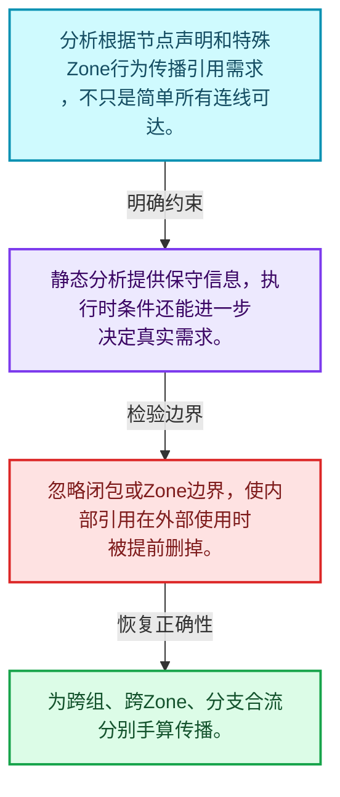
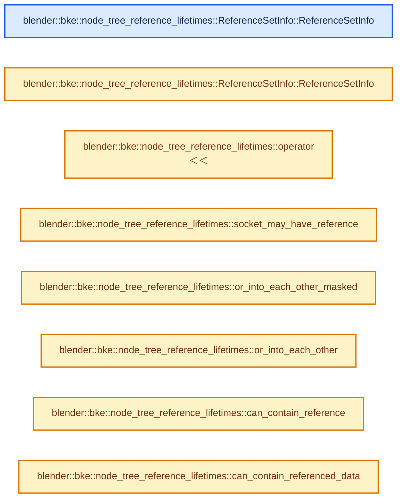
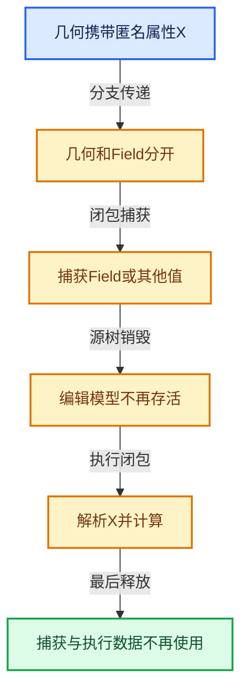

# 10-03 节点树生命周期分析

[方向导航](README.md) · [总目录](../README.md) · [实现索引](../%E7%AC%A6%E5%8F%B7%E4%BE%9D%E8%B5%96%E4%B8%8E%E5%AE%9E%E7%8E%B0%E7%B4%A2%E5%BC%95.md)

## 从问题到实现

构建执行图前怎样推导引用依赖？

分析在节点关系上传播信息，实际使用条件还会影响需求；静态关系和执行期条件有边界。

**数据模型**

分析根据节点声明和特殊Zone行为传播引用需求，不只是简单所有连线可达。

**设计取舍**

静态分析提供保守信息，执行时条件还能进一步决定真实需求。

**最小反例**

忽略闭包或Zone边界，使内部引用在外部使用时被提前删掉。

**推导**

为跨组、跨Zone、分支合流分别手算传播。

## 阅读地图与执行推演








图中的数值推演是本方向的教学模型；实际函数之间的调用边与概念分析边分别标注，不能把概念关系当作运行时调度顺序。

## 完整源码单元与就地讲解

中文讲解直接放在相关代码旁，复杂机制在代码下展开。原文折叠区保留基准行号；不需要在行号表和函数之间来回查找。类布局可分段展示，函数实现不按固定行数切开。

### 类型布局、声明与编译条件 · BKE_node_tree_reference_lifetimes.hh L1—L75

<a id="t-a6afbea54f71"></a>

<a id="t-45c18b6ffb3e"></a>

`ReferenceSetInfo`在这里声明的数据成员：

- `ReferenceSetType type`
- `Vector<const bNodeSocket *> potential_data_origins`

<!-- annotated:09136a6fa0362a -->

```cpp
/* SPDX-FileCopyrightText: 2024 Blender Authors
 *
 * SPDX-License-Identifier: GPL-2.0-or-later */

/** \file
 * \ingroup bke
 */

#pragma once

/**
 * Geometry nodes has the concept of anonymous attributes. These are attributes that are created by
 * some node with an internal name that is not exposed to the user. The only way to use this
 * attribute is to make a link in the node tree to the node that should use it. This explicitness
 * allows us to automatically determine when anonymous attributes are not needed anymore and should
 * be deleted (or not created in the first place).
 *
 * This file is used to determine the lifetimes of these anonymous attributes. The logic is fairly
 * straight forward to extend to other kinds of referenced data, but for now we only have anonymous
 * attributes.
 *
 * The lifetime analysis uses information provided in the node declaration and hardcoded behavior
 * for some special nodes like zones to determine the following things among others.
 * - Where are new references (like anonymous attributes) created?
 * - Which data sockets (like geometry) contain the referenced data?
 * - Which nodes have to propagate which referenced data to which outputs?
 *
 * This information is later used when evaluating geometry nodes to reduce the lifetime of
 * anonymous attributes automatically.
 */

#include "BLI_bit_group_vector.hh"
#include "BLI_vector.hh"

#include "DNA_node_types.h"

#include "NOD_node_declaration.hh"

namespace blender::bke::node_tree_reference_lifetimes {

enum class ReferenceSetType {
  /**
   * Corresponds to geometry outputs that may contain attributes that are propagated from a group
   * input. In such cases, the caller may provide a set of attributes that should be propagated.
   */
  GroupOutputData,
  ClosureOutputData,
  /**
   * Field inputs may require attributes that need to be propagated from other geometry inputs to
   * the node that evaluates the field.
   */
  GroupInputReferenceSet,
  ClosureInputReferenceSet,
  /**
   * Locally created anonymous attributes (like with the Capture Attribute node) need to be
   * propagated to the nodes that use them or even to the group output.
   */
  LocalReferenceSet,
};

struct ReferenceSetInfo {
  ReferenceSetType type;
  union {
    /** Used for group interface sockets. */
    int index;
    /** Used for local and closure sockets. */
    const bNodeSocket *socket;
  };

  /**
   * Sockets that may contain the referenced data (e.g. the geometry output of a Capture Attribute
   * node).
   */
  Vector<const bNodeSocket *> potential_data_origins;

```

<details>
<summary>核对原始源码：source/blender/blenkernel/BKE_node_tree_reference_lifetimes.hh · L1—L75</summary>

<!-- original:09136a6fa0362a:source/blender/blenkernel/BKE_node_tree_reference_lifetimes.hh:1:75 -->

```cpp
/* SPDX-FileCopyrightText: 2024 Blender Authors
 *
 * SPDX-License-Identifier: GPL-2.0-or-later */

/** \file
 * \ingroup bke
 */

#pragma once

/**
 * Geometry nodes has the concept of anonymous attributes. These are attributes that are created by
 * some node with an internal name that is not exposed to the user. The only way to use this
 * attribute is to make a link in the node tree to the node that should use it. This explicitness
 * allows us to automatically determine when anonymous attributes are not needed anymore and should
 * be deleted (or not created in the first place).
 *
 * This file is used to determine the lifetimes of these anonymous attributes. The logic is fairly
 * straight forward to extend to other kinds of referenced data, but for now we only have anonymous
 * attributes.
 *
 * The lifetime analysis uses information provided in the node declaration and hardcoded behavior
 * for some special nodes like zones to determine the following things among others.
 * - Where are new references (like anonymous attributes) created?
 * - Which data sockets (like geometry) contain the referenced data?
 * - Which nodes have to propagate which referenced data to which outputs?
 *
 * This information is later used when evaluating geometry nodes to reduce the lifetime of
 * anonymous attributes automatically.
 */

#include "BLI_bit_group_vector.hh"
#include "BLI_vector.hh"

#include "DNA_node_types.h"

#include "NOD_node_declaration.hh"

namespace blender::bke::node_tree_reference_lifetimes {

enum class ReferenceSetType {
  /**
   * Corresponds to geometry outputs that may contain attributes that are propagated from a group
   * input. In such cases, the caller may provide a set of attributes that should be propagated.
   */
  GroupOutputData,
  ClosureOutputData,
  /**
   * Field inputs may require attributes that need to be propagated from other geometry inputs to
   * the node that evaluates the field.
   */
  GroupInputReferenceSet,
  ClosureInputReferenceSet,
  /**
   * Locally created anonymous attributes (like with the Capture Attribute node) need to be
   * propagated to the nodes that use them or even to the group output.
   */
  LocalReferenceSet,
};

struct ReferenceSetInfo {
  ReferenceSetType type;
  union {
    /** Used for group interface sockets. */
    int index;
    /** Used for local and closure sockets. */
    const bNodeSocket *socket;
  };

  /**
   * Sockets that may contain the referenced data (e.g. the geometry output of a Capture Attribute
   * node).
   */
  Vector<const bNodeSocket *> potential_data_origins;

```

</details>

<a id="f-a64516585329d193"></a>

### `blender::bke::node_tree_reference_lifetimes::ReferenceSetInfo::ReferenceSetInfo`

实现位置：[source/blender/blenkernel/BKE_node_tree_reference_lifetimes.hh](../../../../../source/blender/blenkernel/BKE_node_tree_reference_lifetimes.hh) · L76—L80。

接口参数：

- `ReferenceSetType type`
- `const int index`

**教学注释版**

<!-- annotated:8369ad29a05534 -->

```cpp
  ReferenceSetInfo(ReferenceSetType type, const int index) : type(type), index(index)
  {
    BLI_assert(
        ELEM(type, ReferenceSetType::GroupInputReferenceSet, ReferenceSetType::GroupOutputData));
  }
```

<details>
<summary>核对原始源码：source/blender/blenkernel/BKE_node_tree_reference_lifetimes.hh · L76—L80</summary>

<!-- original:8369ad29a05534:source/blender/blenkernel/BKE_node_tree_reference_lifetimes.hh:76:80 -->

```cpp
  ReferenceSetInfo(ReferenceSetType type, const int index) : type(type), index(index)
  {
    BLI_assert(
        ELEM(type, ReferenceSetType::GroupInputReferenceSet, ReferenceSetType::GroupOutputData));
  }
```

</details>

**继续追踪实现**

- `BLI_assert` → [BLI_assert · L48](../01-%E5%9F%BA%E7%A1%80%E5%AE%B9%E5%99%A8%E4%B8%8E%E7%8E%B0%E4%BB%A3CPP/%E4%BE%9D%E8%B5%96-BLI_assert-cc98e8.md#m-57a88495704d)；[BLI_assert · L63](../01-%E5%9F%BA%E7%A1%80%E5%AE%B9%E5%99%A8%E4%B8%8E%E7%8E%B0%E4%BB%A3CPP/%E4%BE%9D%E8%B5%96-BLI_assert-cc98e8.md#m-d07050020cb5)。宏定义由构建条件选择。
- `ELEM` → [ELEM · L88](../05-%E5%87%A0%E4%BD%95%E5%AD%98%E5%82%A8%E4%B8%8E%E6%8B%93%E6%89%91%E6%98%A0%E5%B0%84/%E4%BE%9D%E8%B5%96-GHOST_utildefines-34b996.md#m-d28724a15928)；[ELEM · L135](../01-%E5%9F%BA%E7%A1%80%E5%AE%B9%E5%99%A8%E4%B8%8E%E7%8E%B0%E4%BB%A3CPP/%E4%BE%9D%E8%B5%96-BLI_utildefines-293a0a.md#m-d6572de7cae0)。宏定义由构建条件选择。

<!-- annotated:a25229ba1377ae -->

```cpp

```

<details>
<summary>核对原始源码：source/blender/blenkernel/BKE_node_tree_reference_lifetimes.hh · L81—L81</summary>

<!-- original:a25229ba1377ae:source/blender/blenkernel/BKE_node_tree_reference_lifetimes.hh:81:81 -->

```cpp

```

</details>

<a id="f-ffb56190353cc0bd"></a>

### `blender::bke::node_tree_reference_lifetimes::ReferenceSetInfo::ReferenceSetInfo`

实现位置：[source/blender/blenkernel/BKE_node_tree_reference_lifetimes.hh](../../../../../source/blender/blenkernel/BKE_node_tree_reference_lifetimes.hh) · L82—L88。

接口参数：

- `ReferenceSetType type`
- `const bNodeSocket *socket`

**教学注释版**

<!-- annotated:88e97156c441b1 -->

```cpp
  ReferenceSetInfo(ReferenceSetType type, const bNodeSocket *socket) : type(type), socket(socket)
  {
    BLI_assert(ELEM(type,
                    ReferenceSetType::LocalReferenceSet,
                    ReferenceSetType::ClosureInputReferenceSet,
                    ReferenceSetType::ClosureOutputData));
  }
```

<details>
<summary>核对原始源码：source/blender/blenkernel/BKE_node_tree_reference_lifetimes.hh · L82—L88</summary>

<!-- original:88e97156c441b1:source/blender/blenkernel/BKE_node_tree_reference_lifetimes.hh:82:88 -->

```cpp
  ReferenceSetInfo(ReferenceSetType type, const bNodeSocket *socket) : type(type), socket(socket)
  {
    BLI_assert(ELEM(type,
                    ReferenceSetType::LocalReferenceSet,
                    ReferenceSetType::ClosureInputReferenceSet,
                    ReferenceSetType::ClosureOutputData));
  }
```

</details>

**继续追踪实现**

- `BLI_assert` → [BLI_assert · L48](../01-%E5%9F%BA%E7%A1%80%E5%AE%B9%E5%99%A8%E4%B8%8E%E7%8E%B0%E4%BB%A3CPP/%E4%BE%9D%E8%B5%96-BLI_assert-cc98e8.md#m-57a88495704d)；[BLI_assert · L63](../01-%E5%9F%BA%E7%A1%80%E5%AE%B9%E5%99%A8%E4%B8%8E%E7%8E%B0%E4%BB%A3CPP/%E4%BE%9D%E8%B5%96-BLI_assert-cc98e8.md#m-d07050020cb5)。宏定义由构建条件选择。
- `ELEM` → [ELEM · L88](../05-%E5%87%A0%E4%BD%95%E5%AD%98%E5%82%A8%E4%B8%8E%E6%8B%93%E6%89%91%E6%98%A0%E5%B0%84/%E4%BE%9D%E8%B5%96-GHOST_utildefines-34b996.md#m-d28724a15928)；[ELEM · L135](../01-%E5%9F%BA%E7%A1%80%E5%AE%B9%E5%99%A8%E4%B8%8E%E7%8E%B0%E4%BB%A3CPP/%E4%BE%9D%E8%B5%96-BLI_utildefines-293a0a.md#m-d6572de7cae0)。宏定义由构建条件选择。

### 类型布局、声明与编译条件 · BKE_node_tree_reference_lifetimes.hh L89—L118

<a id="t-052578f24d06"></a>

`ReferenceLifetimesInfo`在这里声明的数据成员：

- `Vector<ReferenceSetInfo> reference_sets`
- `BitGroupVector<> required_data_by_socket`
- `Vector<const bNodeSocket *> sockets_with_missing_data`
- `nodes::rl::RelationsInNode tree_relations`

<!-- annotated:261cd8390b1b8b -->

```cpp

  friend std::ostream &operator<<(std::ostream &stream, const ReferenceSetInfo &info);
};

struct ReferenceLifetimesInfo {
  Vector<ReferenceSetInfo> reference_sets;

  /**
   * Has a bit for each socket and each reference set. If the bit is set, the corresponding
   * reference set should be propagated to that socket.
   */
  BitGroupVector<> required_data_by_socket;

  /** Field inputs that reference local data unavailable on the geometry they evaluate on. */
  Vector<const bNodeSocket *> sockets_with_missing_data;

  /**
   * Relations used for group nodes that use this group.
   */
  nodes::rl::RelationsInNode tree_relations;
};

bool analyse_reference_lifetimes(bNodeTree &tree);

/** The socket type allows storing references to data stored elsewhere. */
bool can_contain_reference(eNodeSocketDatatype socket_type);
/** The socket type allows storing data that may be referenced elsewhere. */
bool can_contain_referenced_data(eNodeSocketDatatype socket_type);

}  // namespace blender::bke::node_tree_reference_lifetimes
```

<details>
<summary>核对原始源码：source/blender/blenkernel/BKE_node_tree_reference_lifetimes.hh · L89—L118</summary>

<!-- original:261cd8390b1b8b:source/blender/blenkernel/BKE_node_tree_reference_lifetimes.hh:89:118 -->

```cpp

  friend std::ostream &operator<<(std::ostream &stream, const ReferenceSetInfo &info);
};

struct ReferenceLifetimesInfo {
  Vector<ReferenceSetInfo> reference_sets;

  /**
   * Has a bit for each socket and each reference set. If the bit is set, the corresponding
   * reference set should be propagated to that socket.
   */
  BitGroupVector<> required_data_by_socket;

  /** Field inputs that reference local data unavailable on the geometry they evaluate on. */
  Vector<const bNodeSocket *> sockets_with_missing_data;

  /**
   * Relations used for group nodes that use this group.
   */
  nodes::rl::RelationsInNode tree_relations;
};

bool analyse_reference_lifetimes(bNodeTree &tree);

/** The socket type allows storing references to data stored elsewhere. */
bool can_contain_reference(eNodeSocketDatatype socket_type);
/** The socket type allows storing data that may be referenced elsewhere. */
bool can_contain_referenced_data(eNodeSocketDatatype socket_type);

}  // namespace blender::bke::node_tree_reference_lifetimes
```

</details>

### 类型布局、声明与编译条件 · node_tree_reference_lifetimes.cc L1—L33

<!-- annotated:3bb8a768767bfd -->

```cpp
/* SPDX-FileCopyrightText: 2024 Blender Foundation
 *
 * SPDX-License-Identifier: GPL-2.0-or-later */

/** \file
 * \ingroup bke
 */

#include <iostream>

#include <fmt/format.h>
#include <fmt/ranges.h>

#include "BKE_node_legacy_types.hh"
#include "BKE_node_runtime.hh"
#include "BKE_node_tree_dot_export.hh"
#include "BKE_node_tree_reference_lifetimes.hh"
#include "BKE_node_tree_zones.hh"

#include "BLI_bit_group_vector.hh"
#include "BLI_bit_span_ops.hh"

#include "NOD_node_declaration.hh"
#include "NOD_socket.hh"

#include "BLI_resource_scope.hh"

namespace blender::bke::node_tree_reference_lifetimes {

using bits::BitInt;
using nodes::NodeDeclaration;
namespace rl = nodes::rl;

```

<details>
<summary>核对原始源码：source/blender/blenkernel/intern/node_tree_reference_lifetimes.cc · L1—L33</summary>

<!-- original:3bb8a768767bfd:source/blender/blenkernel/intern/node_tree_reference_lifetimes.cc:1:33 -->

```cpp
/* SPDX-FileCopyrightText: 2024 Blender Foundation
 *
 * SPDX-License-Identifier: GPL-2.0-or-later */

/** \file
 * \ingroup bke
 */

#include <iostream>

#include <fmt/format.h>
#include <fmt/ranges.h>

#include "BKE_node_legacy_types.hh"
#include "BKE_node_runtime.hh"
#include "BKE_node_tree_dot_export.hh"
#include "BKE_node_tree_reference_lifetimes.hh"
#include "BKE_node_tree_zones.hh"

#include "BLI_bit_group_vector.hh"
#include "BLI_bit_span_ops.hh"

#include "NOD_node_declaration.hh"
#include "NOD_socket.hh"

#include "BLI_resource_scope.hh"

namespace blender::bke::node_tree_reference_lifetimes {

using bits::BitInt;
using nodes::NodeDeclaration;
namespace rl = nodes::rl;

```

</details>

<a id="f-cc01362024a202be"></a>

### `blender::bke::node_tree_reference_lifetimes::operator<<`

实现位置：[source/blender/blenkernel/intern/node_tree_reference_lifetimes.cc](../../../../../source/blender/blenkernel/intern/node_tree_reference_lifetimes.cc) · L34—L59。

接口参数：

- `std::ostream &stream`
- `const ReferenceSetInfo &info`

**教学注释版**

<!-- annotated:e8511040401532 -->

```cpp
std::ostream &operator<<(std::ostream &stream, const ReferenceSetInfo &info)
{
  switch (info.type) {
    case ReferenceSetType::GroupOutputData:
      stream << "Group Output Data: " << info.index;
      break;
    case ReferenceSetType::GroupInputReferenceSet:
      stream << "Group Input Reference: " << info.index;
      break;
    case ReferenceSetType::LocalReferenceSet:
      stream << "Local: " << info.socket->name;
      break;
    case ReferenceSetType::ClosureInputReferenceSet:
      stream << "Closure Input Reference: " << info.socket->name;
      break;
    case ReferenceSetType::ClosureOutputData:
      stream << "Closure Output Data: " << info.socket->name;
      break;
  }
  stream << " (";
  for (const bNodeSocket *socket : info.potential_data_origins) {
    stream << socket->name << ", ";
  }
  stream << ")";
  return stream;
}
```

<details>
<summary>核对原始源码：source/blender/blenkernel/intern/node_tree_reference_lifetimes.cc · L34—L59</summary>

<!-- original:e8511040401532:source/blender/blenkernel/intern/node_tree_reference_lifetimes.cc:34:59 -->

```cpp
std::ostream &operator<<(std::ostream &stream, const ReferenceSetInfo &info)
{
  switch (info.type) {
    case ReferenceSetType::GroupOutputData:
      stream << "Group Output Data: " << info.index;
      break;
    case ReferenceSetType::GroupInputReferenceSet:
      stream << "Group Input Reference: " << info.index;
      break;
    case ReferenceSetType::LocalReferenceSet:
      stream << "Local: " << info.socket->name;
      break;
    case ReferenceSetType::ClosureInputReferenceSet:
      stream << "Closure Input Reference: " << info.socket->name;
      break;
    case ReferenceSetType::ClosureOutputData:
      stream << "Closure Output Data: " << info.socket->name;
      break;
  }
  stream << " (";
  for (const bNodeSocket *socket : info.potential_data_origins) {
    stream << socket->name << ", ";
  }
  stream << ")";
  return stream;
}
```

</details>

**结果出口**

- `return stream;`

**继续追踪实现**

本实现没有需要继续展开的显式调用；检查返回表达式、对象转换和调用者前置条件。

<!-- annotated:054292ff8228d1 -->

```cpp

```

<details>
<summary>核对原始源码：source/blender/blenkernel/intern/node_tree_reference_lifetimes.cc · L60—L60</summary>

<!-- original:054292ff8228d1:source/blender/blenkernel/intern/node_tree_reference_lifetimes.cc:60:60 -->

```cpp

```

</details>

<a id="f-fb46d5ae5efd8052"></a>

### `blender::bke::node_tree_reference_lifetimes::socket_may_have_reference`

实现位置：[source/blender/blenkernel/intern/node_tree_reference_lifetimes.cc](../../../../../source/blender/blenkernel/intern/node_tree_reference_lifetimes.cc) · L61—L64。

接口参数：

- `const bNodeSocket &socket`

**教学注释版**

<!-- annotated:7dc5022af834d5 -->

```cpp
static bool socket_may_have_reference(const bNodeSocket &socket)
{
  return socket.may_be_field() || ELEM(socket.type, SOCK_BUNDLE, SOCK_CLOSURE, SOCK_GEOMETRY);
}
```

<details>
<summary>核对原始源码：source/blender/blenkernel/intern/node_tree_reference_lifetimes.cc · L61—L64</summary>

<!-- original:7dc5022af834d5:source/blender/blenkernel/intern/node_tree_reference_lifetimes.cc:61:64 -->

```cpp
static bool socket_may_have_reference(const bNodeSocket &socket)
{
  return socket.may_be_field() || ELEM(socket.type, SOCK_BUNDLE, SOCK_CLOSURE, SOCK_GEOMETRY);
}
```

</details>

**结果出口**

- `return socket.may_be_field() || ELEM(socket.type, SOCK_BUNDLE, SOCK_CLOSURE, SOCK_GEOMETRY);`

**继续追踪实现**

- `socket.may_be_field` → [blender::bNodeSocket::may_be_field · L1062](../05-%E5%87%A0%E4%BD%95%E5%AD%98%E5%82%A8%E4%B8%8E%E6%8B%93%E6%89%91%E6%98%A0%E5%B0%84/%E4%BE%9D%E8%B5%96-BKE_node_runtime-ee561b.md#f-18dfa7b349efba14)。
- `ELEM` → [ELEM · L88](../05-%E5%87%A0%E4%BD%95%E5%AD%98%E5%82%A8%E4%B8%8E%E6%8B%93%E6%89%91%E6%98%A0%E5%B0%84/%E4%BE%9D%E8%B5%96-GHOST_utildefines-34b996.md#m-d28724a15928)；[ELEM · L135](../01-%E5%9F%BA%E7%A1%80%E5%AE%B9%E5%99%A8%E4%B8%8E%E7%8E%B0%E4%BB%A3CPP/%E4%BE%9D%E8%B5%96-BLI_utildefines-293a0a.md#m-d6572de7cae0)。宏定义由构建条件选择。

<!-- annotated:8b3e64cf222fdb -->

```cpp

```

<details>
<summary>核对原始源码：source/blender/blenkernel/intern/node_tree_reference_lifetimes.cc · L65—L65</summary>

<!-- original:8b3e64cf222fdb:source/blender/blenkernel/intern/node_tree_reference_lifetimes.cc:65:65 -->

```cpp

```

</details>

<a id="f-8a248bc758bd6ba1"></a>

### `blender::bke::node_tree_reference_lifetimes::or_into_each_other_masked`

实现位置：[source/blender/blenkernel/intern/node_tree_reference_lifetimes.cc](../../../../../source/blender/blenkernel/intern/node_tree_reference_lifetimes.cc) · L66—L76。

接口参数：

- `MutableBoundedBitSpan a`
- `MutableBoundedBitSpan b`
- `const BoundedBitSpan mask`

**教学注释版**

<!-- annotated:2eab4bd6b546c8 -->

```cpp
static bool or_into_each_other_masked(MutableBoundedBitSpan a,
                                      MutableBoundedBitSpan b,
                                      const BoundedBitSpan mask)
{
  if (bits::spans_equal_masked(a, b, mask)) {
    return false;
  }
  bits::inplace_or_masked(a, mask, b);
  bits::inplace_or_masked(b, mask, a);
  return true;
}
```

<details>
<summary>核对原始源码：source/blender/blenkernel/intern/node_tree_reference_lifetimes.cc · L66—L76</summary>

<!-- original:2eab4bd6b546c8:source/blender/blenkernel/intern/node_tree_reference_lifetimes.cc:66:76 -->

```cpp
static bool or_into_each_other_masked(MutableBoundedBitSpan a,
                                      MutableBoundedBitSpan b,
                                      const BoundedBitSpan mask)
{
  if (bits::spans_equal_masked(a, b, mask)) {
    return false;
  }
  bits::inplace_or_masked(a, mask, b);
  bits::inplace_or_masked(b, mask, a);
  return true;
}
```

</details>

**结果出口**

- `return false;`
- `return true;`

**继续追踪实现**

- `bits::spans_equal_masked` → [blender::bits::spans_equal_masked · L357](../01-%E5%9F%BA%E7%A1%80%E5%AE%B9%E5%99%A8%E4%B8%8E%E7%8E%B0%E4%BB%A3CPP/%E4%BE%9D%E8%B5%96-BLI_bit_span_ops-63a2e2.md#f-b49a287d770e3a95)。
- `bits::inplace_or_masked` → [blender::bits::inplace_or_masked · L250](../01-%E5%9F%BA%E7%A1%80%E5%AE%B9%E5%99%A8%E4%B8%8E%E7%8E%B0%E4%BB%A3CPP/%E4%BE%9D%E8%B5%96-BLI_bit_span_ops-63a2e2.md#f-c9f8c4c0754533e7)。

<!-- annotated:4bff5e6379773e -->

```cpp

```

<details>
<summary>核对原始源码：source/blender/blenkernel/intern/node_tree_reference_lifetimes.cc · L77—L77</summary>

<!-- original:4bff5e6379773e:source/blender/blenkernel/intern/node_tree_reference_lifetimes.cc:77:77 -->

```cpp

```

</details>

<a id="f-db14e0a03a527ccb"></a>

### `blender::bke::node_tree_reference_lifetimes::or_into_each_other`

实现位置：[source/blender/blenkernel/intern/node_tree_reference_lifetimes.cc](../../../../../source/blender/blenkernel/intern/node_tree_reference_lifetimes.cc) · L78—L86。

接口参数：

- `MutableBoundedBitSpan a`
- `MutableBoundedBitSpan b`

**教学注释版**

<!-- annotated:f6fb20db176bd0 -->

```cpp
static bool or_into_each_other(MutableBoundedBitSpan a, MutableBoundedBitSpan b)
{
  if (bits::spans_equal(a, b)) {
    return false;
  }
  a |= b;
  b |= a;
  return true;
}
```

<details>
<summary>核对原始源码：source/blender/blenkernel/intern/node_tree_reference_lifetimes.cc · L78—L86</summary>

<!-- original:f6fb20db176bd0:source/blender/blenkernel/intern/node_tree_reference_lifetimes.cc:78:86 -->

```cpp
static bool or_into_each_other(MutableBoundedBitSpan a, MutableBoundedBitSpan b)
{
  if (bits::spans_equal(a, b)) {
    return false;
  }
  a |= b;
  b |= a;
  return true;
}
```

</details>

**沿实际写入检查状态**

- `a |= b;`
- `b |= a;`

**结果出口**

- `return false;`
- `return true;`

**继续追踪实现**

- `bits::spans_equal` → [blender::bits::spans_equal · L348](../01-%E5%9F%BA%E7%A1%80%E5%AE%B9%E5%99%A8%E4%B8%8E%E7%8E%B0%E4%BB%A3CPP/%E4%BE%9D%E8%B5%96-BLI_bit_span_ops-63a2e2.md#f-95eb22ff7a5484e4)。

<!-- annotated:f1f2ab4cf62d2a -->

```cpp

```

<details>
<summary>核对原始源码：source/blender/blenkernel/intern/node_tree_reference_lifetimes.cc · L87—L87</summary>

<!-- original:f1f2ab4cf62d2a:source/blender/blenkernel/intern/node_tree_reference_lifetimes.cc:87:87 -->

```cpp

```

</details>

<a id="f-b7f1fdc2b03dc208"></a>

### `blender::bke::node_tree_reference_lifetimes::can_contain_reference`

实现位置：[source/blender/blenkernel/intern/node_tree_reference_lifetimes.cc](../../../../../source/blender/blenkernel/intern/node_tree_reference_lifetimes.cc) · L88—L92。

接口参数：

- `const eNodeSocketDatatype socket_type`

**教学注释版**

<!-- annotated:e74cf8d71361b9 -->

```cpp
bool can_contain_reference(const eNodeSocketDatatype socket_type)
{
  return nodes::socket_type_supports_fields(socket_type) ||
         ELEM(socket_type, SOCK_GEOMETRY, SOCK_BUNDLE, SOCK_CLOSURE);
}
```

<details>
<summary>核对原始源码：source/blender/blenkernel/intern/node_tree_reference_lifetimes.cc · L88—L92</summary>

<!-- original:e74cf8d71361b9:source/blender/blenkernel/intern/node_tree_reference_lifetimes.cc:88:92 -->

```cpp
bool can_contain_reference(const eNodeSocketDatatype socket_type)
{
  return nodes::socket_type_supports_fields(socket_type) ||
         ELEM(socket_type, SOCK_GEOMETRY, SOCK_BUNDLE, SOCK_CLOSURE);
}
```

</details>

**结果出口**

- `return nodes::socket_type_supports_fields(socket_type) ||`

**继续追踪实现**

- `nodes::socket_type_supports_fields` → [blender::nodes::socket_type_supports_fields · L663](../09-LazyFunction%E4%B8%8E%E8%8A%82%E7%82%B9%E6%89%A7%E8%A1%8C%E6%9E%B6%E6%9E%84/%E4%BE%9D%E8%B5%96-node_socket-0ca7fe.md#f-2d675fda05d0eec2)。
- `ELEM` → [ELEM · L88](../05-%E5%87%A0%E4%BD%95%E5%AD%98%E5%82%A8%E4%B8%8E%E6%8B%93%E6%89%91%E6%98%A0%E5%B0%84/%E4%BE%9D%E8%B5%96-GHOST_utildefines-34b996.md#m-d28724a15928)；[ELEM · L135](../01-%E5%9F%BA%E7%A1%80%E5%AE%B9%E5%99%A8%E4%B8%8E%E7%8E%B0%E4%BB%A3CPP/%E4%BE%9D%E8%B5%96-BLI_utildefines-293a0a.md#m-d6572de7cae0)。宏定义由构建条件选择。

<!-- annotated:a5f1e9c23ad3a6 -->

```cpp

```

<details>
<summary>核对原始源码：source/blender/blenkernel/intern/node_tree_reference_lifetimes.cc · L93—L93</summary>

<!-- original:a5f1e9c23ad3a6:source/blender/blenkernel/intern/node_tree_reference_lifetimes.cc:93:93 -->

```cpp

```

</details>

<a id="f-53b4d34364082dc9"></a>

### `blender::bke::node_tree_reference_lifetimes::can_contain_referenced_data`

实现位置：[source/blender/blenkernel/intern/node_tree_reference_lifetimes.cc](../../../../../source/blender/blenkernel/intern/node_tree_reference_lifetimes.cc) · L94—L97。

接口参数：

- `const eNodeSocketDatatype socket_type`

**教学注释版**

<!-- annotated:1db75f0ce4c375 -->

```cpp
bool can_contain_referenced_data(const eNodeSocketDatatype socket_type)
{
  return ELEM(socket_type, SOCK_GEOMETRY, SOCK_BUNDLE, SOCK_CLOSURE);
}
```

<details>
<summary>核对原始源码：source/blender/blenkernel/intern/node_tree_reference_lifetimes.cc · L94—L97</summary>

<!-- original:1db75f0ce4c375:source/blender/blenkernel/intern/node_tree_reference_lifetimes.cc:94:97 -->

```cpp
bool can_contain_referenced_data(const eNodeSocketDatatype socket_type)
{
  return ELEM(socket_type, SOCK_GEOMETRY, SOCK_BUNDLE, SOCK_CLOSURE);
}
```

</details>

**结果出口**

- `return ELEM(socket_type, SOCK_GEOMETRY, SOCK_BUNDLE, SOCK_CLOSURE);`

**继续追踪实现**

- `ELEM` → [ELEM · L88](../05-%E5%87%A0%E4%BD%95%E5%AD%98%E5%82%A8%E4%B8%8E%E6%8B%93%E6%89%91%E6%98%A0%E5%B0%84/%E4%BE%9D%E8%B5%96-GHOST_utildefines-34b996.md#m-d28724a15928)；[ELEM · L135](../01-%E5%9F%BA%E7%A1%80%E5%AE%B9%E5%99%A8%E4%B8%8E%E7%8E%B0%E4%BB%A3CPP/%E4%BE%9D%E8%B5%96-BLI_utildefines-293a0a.md#m-d6572de7cae0)。宏定义由构建条件选择。

<!-- annotated:754f0e6179daac -->

```cpp

```

<details>
<summary>核对原始源码：source/blender/blenkernel/intern/node_tree_reference_lifetimes.cc · L98—L98</summary>

<!-- original:754f0e6179daac:source/blender/blenkernel/intern/node_tree_reference_lifetimes.cc:98:98 -->

```cpp

```

</details>

<a id="f-a8f5ace07cda333f"></a>

### `blender::bke::node_tree_reference_lifetimes::get_zone_of_node_if_full`

实现位置：[source/blender/blenkernel/intern/node_tree_reference_lifetimes.cc](../../../../../source/blender/blenkernel/intern/node_tree_reference_lifetimes.cc) · L99—L113。

接口参数：

- `const bNodeTreeZones *zones`
- `const bNode &node`

**教学注释版**

<!-- annotated:8673219d54d5df -->

```cpp
static const bNodeTreeZone *get_zone_of_node_if_full(const bNodeTreeZones *zones,
                                                     const bNode &node)
{
  if (!zones) {
    return nullptr;
  }
  const bNodeTreeZone *zone = zones->get_zone_by_node(node.identifier);
  if (!zone) {
    return nullptr;
  }
  if (!zone->input_node_id || !zone->output_node_id) {
    return nullptr;
  }
  return zone;
}
```

<details>
<summary>核对原始源码：source/blender/blenkernel/intern/node_tree_reference_lifetimes.cc · L99—L113</summary>

<!-- original:8673219d54d5df:source/blender/blenkernel/intern/node_tree_reference_lifetimes.cc:99:113 -->

```cpp
static const bNodeTreeZone *get_zone_of_node_if_full(const bNodeTreeZones *zones,
                                                     const bNode &node)
{
  if (!zones) {
    return nullptr;
  }
  const bNodeTreeZone *zone = zones->get_zone_by_node(node.identifier);
  if (!zone) {
    return nullptr;
  }
  if (!zone->input_node_id || !zone->output_node_id) {
    return nullptr;
  }
  return zone;
}
```

</details>

**结果出口**

- `return nullptr;`
- `return zone;`

**继续追踪实现**

- `zones->get_zone_by_node` → [blender::bke::bNodeTreeZones::get_zone_by_node · L437](../05-%E5%87%A0%E4%BD%95%E5%AD%98%E5%82%A8%E4%B8%8E%E6%8B%93%E6%89%91%E6%98%A0%E5%B0%84/%E4%BE%9D%E8%B5%96-node_tree_zones-eecd0c.md#f-dcc4746d65b4807a)。

<!-- annotated:8fefc8e89f4c6d -->

```cpp

```

<details>
<summary>核对原始源码：source/blender/blenkernel/intern/node_tree_reference_lifetimes.cc · L114—L114</summary>

<!-- original:8fefc8e89f4c6d:source/blender/blenkernel/intern/node_tree_reference_lifetimes.cc:114:114 -->

```cpp

```

</details>

<a id="f-2533691fa653c88e"></a>

### `blender::bke::node_tree_reference_lifetimes::prepare_relations_by_node`

实现位置：[source/blender/blenkernel/intern/node_tree_reference_lifetimes.cc](../../../../../source/blender/blenkernel/intern/node_tree_reference_lifetimes.cc) · L115—L236。

接口参数：

- `const bNodeTree &tree`
- `ResourceScope &scope`

**教学注释版**

<!-- annotated:fdd9b56a6689c6 -->

```cpp
static Array<const rl::RelationsInNode *> prepare_relations_by_node(const bNodeTree &tree,
                                                                    ResourceScope &scope)
{
  Array<const rl::RelationsInNode *> relations_by_node(tree.all_nodes().size());
  for (const bNode *node : tree.all_nodes()) {
    const rl::RelationsInNode *node_relations = nullptr;
    switch (node->type_legacy) {
      case GEO_NODE_SIMULATION_INPUT:
      case GEO_NODE_SIMULATION_OUTPUT:
      case GEO_NODE_BAKE: {
        /* The relations of these nodes depend on field evaluation to avoid unnecessary
         * relations, but besides that they don't need special handling. */
        rl::RelationsInNode &relations = scope.construct<rl::RelationsInNode>();
        {
          /* Add eval relations. */
          int prev_geometry_index = -1;
          for (const int i : node->input_sockets().index_range()) {
            const bNodeSocket &socket = node->input_socket(i);
            if (socket.type == SOCK_GEOMETRY) {
              prev_geometry_index = i;
              continue;
            }
            if (prev_geometry_index == -1) {
              continue;
            }
            if (socket_may_have_reference(socket)) {
              relations.use_relations.append({i, prev_geometry_index});
            }
          }
        }
        {
          /* Add available relations. */
          int prev_geometry_index = -1;
          for (const int i : node->output_sockets().index_range()) {
            const bNodeSocket &socket = node->output_socket(i);
            if (socket.type == SOCK_GEOMETRY) {
              prev_geometry_index = i;
            }
            if (prev_geometry_index == -1) {
              continue;
            }
            if (socket_may_have_reference(socket)) {
              relations.available_relations.append({i, prev_geometry_index});
            }
          }
        }
        node_relations = &relations;
        break;
      }
      case GEO_NODE_REPEAT_INPUT:
      case GEO_NODE_REPEAT_OUTPUT: {
        rl::RelationsInNode &relations = scope.construct<rl::RelationsInNode>();
        for (const bNodeSocket *socket : node->output_sockets()) {
          if (can_contain_referenced_data(socket->type)) {
            for (const bNodeSocket *other_output : node->output_sockets()) {
              if (socket_may_have_reference(*other_output)) {
                relations.available_relations.append({other_output->index(), socket->index()});
              }
            }
          }
        }
        for (const bNodeSocket *socket : node->input_sockets()) {
          if (can_contain_referenced_data(socket->type)) {
            for (const bNodeSocket *other_input : node->input_sockets()) {
              if (socket_may_have_reference(*other_input)) {
                relations.use_relations.append({other_input->index(), socket->index()});
              }
            }
          }
        }
        /* Only create propagate and reference relations for the input node. The output node
         * needs special handling because attributes created inside of the zone are not directly
         * referenced on the outside. */
        if (node->type_legacy == GEO_NODE_REPEAT_INPUT) {
          const int input_items_start = 1;
          const int output_items_start = 1;
          const int items_num = node->output_sockets().size() - 1 - output_items_start;
          for (const int i : IndexRange(items_num)) {
            const int input_index = input_items_start + i;
            const int output_index = output_items_start + i;
            const bNodeSocket &input_socket = node->input_socket(input_index);
            if (can_contain_referenced_data(input_socket.type)) {
              relations.data_propagations.append({input_index, output_index});
            }
            else if (socket_may_have_reference(input_socket)) {
              relations.reference_propagations.append({input_index, output_index});
            }
          }
        }
        node_relations = &relations;
        break;
      }
      case NODE_REROUTE: {
        static const rl::RelationsInNode reroute_relations = []() {
          rl::RelationsInNode relations;
          relations.data_propagations.append({0, 0});
          relations.reference_propagations.append({0, 0});
          return relations;
        }();
        node_relations = &reroute_relations;
        break;
      }
      case NODE_GROUP:
      case NODE_CUSTOM_GROUP: {
        if (const bNodeTree *group = reinterpret_cast<const bNodeTree *>(node->id)) {
          if (group->runtime->reference_lifetimes_info) {
            node_relations = &group->runtime->reference_lifetimes_info->tree_relations;
          }
        }
        break;
      }
      default: {
        if (const NodeDeclaration *node_decl = node->declaration()) {
          node_relations = node_decl->reference_lifetime_relations();
        }
        break;
      }
    }
    relations_by_node[node->index()] = node_relations;
  }
  return relations_by_node;
}
```

<details>
<summary>核对原始源码：source/blender/blenkernel/intern/node_tree_reference_lifetimes.cc · L115—L236</summary>

<!-- original:fdd9b56a6689c6:source/blender/blenkernel/intern/node_tree_reference_lifetimes.cc:115:236 -->

```cpp
static Array<const rl::RelationsInNode *> prepare_relations_by_node(const bNodeTree &tree,
                                                                    ResourceScope &scope)
{
  Array<const rl::RelationsInNode *> relations_by_node(tree.all_nodes().size());
  for (const bNode *node : tree.all_nodes()) {
    const rl::RelationsInNode *node_relations = nullptr;
    switch (node->type_legacy) {
      case GEO_NODE_SIMULATION_INPUT:
      case GEO_NODE_SIMULATION_OUTPUT:
      case GEO_NODE_BAKE: {
        /* The relations of these nodes depend on field evaluation to avoid unnecessary
         * relations, but besides that they don't need special handling. */
        rl::RelationsInNode &relations = scope.construct<rl::RelationsInNode>();
        {
          /* Add eval relations. */
          int prev_geometry_index = -1;
          for (const int i : node->input_sockets().index_range()) {
            const bNodeSocket &socket = node->input_socket(i);
            if (socket.type == SOCK_GEOMETRY) {
              prev_geometry_index = i;
              continue;
            }
            if (prev_geometry_index == -1) {
              continue;
            }
            if (socket_may_have_reference(socket)) {
              relations.use_relations.append({i, prev_geometry_index});
            }
          }
        }
        {
          /* Add available relations. */
          int prev_geometry_index = -1;
          for (const int i : node->output_sockets().index_range()) {
            const bNodeSocket &socket = node->output_socket(i);
            if (socket.type == SOCK_GEOMETRY) {
              prev_geometry_index = i;
            }
            if (prev_geometry_index == -1) {
              continue;
            }
            if (socket_may_have_reference(socket)) {
              relations.available_relations.append({i, prev_geometry_index});
            }
          }
        }
        node_relations = &relations;
        break;
      }
      case GEO_NODE_REPEAT_INPUT:
      case GEO_NODE_REPEAT_OUTPUT: {
        rl::RelationsInNode &relations = scope.construct<rl::RelationsInNode>();
        for (const bNodeSocket *socket : node->output_sockets()) {
          if (can_contain_referenced_data(socket->type)) {
            for (const bNodeSocket *other_output : node->output_sockets()) {
              if (socket_may_have_reference(*other_output)) {
                relations.available_relations.append({other_output->index(), socket->index()});
              }
            }
          }
        }
        for (const bNodeSocket *socket : node->input_sockets()) {
          if (can_contain_referenced_data(socket->type)) {
            for (const bNodeSocket *other_input : node->input_sockets()) {
              if (socket_may_have_reference(*other_input)) {
                relations.use_relations.append({other_input->index(), socket->index()});
              }
            }
          }
        }
        /* Only create propagate and reference relations for the input node. The output node
         * needs special handling because attributes created inside of the zone are not directly
         * referenced on the outside. */
        if (node->type_legacy == GEO_NODE_REPEAT_INPUT) {
          const int input_items_start = 1;
          const int output_items_start = 1;
          const int items_num = node->output_sockets().size() - 1 - output_items_start;
          for (const int i : IndexRange(items_num)) {
            const int input_index = input_items_start + i;
            const int output_index = output_items_start + i;
            const bNodeSocket &input_socket = node->input_socket(input_index);
            if (can_contain_referenced_data(input_socket.type)) {
              relations.data_propagations.append({input_index, output_index});
            }
            else if (socket_may_have_reference(input_socket)) {
              relations.reference_propagations.append({input_index, output_index});
            }
          }
        }
        node_relations = &relations;
        break;
      }
      case NODE_REROUTE: {
        static const rl::RelationsInNode reroute_relations = []() {
          rl::RelationsInNode relations;
          relations.data_propagations.append({0, 0});
          relations.reference_propagations.append({0, 0});
          return relations;
        }();
        node_relations = &reroute_relations;
        break;
      }
      case NODE_GROUP:
      case NODE_CUSTOM_GROUP: {
        if (const bNodeTree *group = reinterpret_cast<const bNodeTree *>(node->id)) {
          if (group->runtime->reference_lifetimes_info) {
            node_relations = &group->runtime->reference_lifetimes_info->tree_relations;
          }
        }
        break;
      }
      default: {
        if (const NodeDeclaration *node_decl = node->declaration()) {
          node_relations = node_decl->reference_lifetime_relations();
        }
        break;
      }
    }
    relations_by_node[node->index()] = node_relations;
  }
  return relations_by_node;
}
```

</details>

**沿实际写入检查状态**

- `prev_geometry_index = i;`
- `node_relations = &relations;`
- `node_relations = &reroute_relations;`
- `node_relations = &group->runtime->reference_lifetimes_info->tree_relations;`
- `node_relations = node_decl->reference_lifetime_relations();`

**结果出口**

- `return relations;`
- `return relations_by_node;`

**继续追踪实现**

- `tree.all_nodes().size` → [调用协议](../%E6%A8%A1%E6%9D%BF%E5%AE%8F%E4%B8%8E%E5%8A%A8%E6%80%81%E5%88%86%E6%B4%BE%E5%8D%8F%E8%AE%AE.md)：接收对象类型依赖auto、返回值或模板实例；不按同名猜测目标。调用位置L118。
- `tree.all_nodes` → [blender::bNodeTree::all_nodes · L500](../05-%E5%87%A0%E4%BD%95%E5%AD%98%E5%82%A8%E4%B8%8E%E6%8B%93%E6%89%91%E6%98%A0%E5%B0%84/%E4%BE%9D%E8%B5%96-BKE_node_runtime-ee561b.md#f-cda455cbcc6c7f36)；[blender::bNodeTree::all_nodes · L505](../05-%E5%87%A0%E4%BD%95%E5%AD%98%E5%82%A8%E4%B8%8E%E6%8B%93%E6%89%91%E6%98%A0%E5%B0%84/%E4%BE%9D%E8%B5%96-BKE_node_runtime-ee561b.md#f-358b65e5678f8a32)。同名重载需按实参类型选择。
- `scope.construct<rl::RelationsInNode>` → [blender::ResourceScope::construct · L219](../03-%E5%86%85%E5%AD%98%E5%88%86%E9%85%8D%E4%B8%8E%E8%BF%90%E8%A1%8C%E6%97%B6%E7%B1%BB%E5%9E%8B/05-ResourceScope%E9%94%80%E6%AF%81%E8%B4%A3%E4%BB%BB.md#f-5b24624bb64539d5)。
- `node->input_sockets().index_range` → [调用协议](../%E6%A8%A1%E6%9D%BF%E5%AE%8F%E4%B8%8E%E5%8A%A8%E6%80%81%E5%88%86%E6%B4%BE%E5%8D%8F%E8%AE%AE.md)：接收对象类型依赖auto、返回值或模板实例；不按同名猜测目标。调用位置L131。
- `node->input_sockets` → [调用协议](../%E6%A8%A1%E6%9D%BF%E5%AE%8F%E4%B8%8E%E5%8A%A8%E6%80%81%E5%88%86%E6%B4%BE%E5%8D%8F%E8%AE%AE.md)：接收对象类型依赖auto、返回值或模板实例；不按同名猜测目标。调用位置L131。
- `node->input_socket` → [调用协议](../%E6%A8%A1%E6%9D%BF%E5%AE%8F%E4%B8%8E%E5%8A%A8%E6%80%81%E5%88%86%E6%B4%BE%E5%8D%8F%E8%AE%AE.md)：接收对象类型依赖auto、返回值或模板实例；不按同名猜测目标。调用位置L132。
- `socket_may_have_reference` → [blender::bke::node_tree_reference_lifetimes::socket_may_have_reference · L61](03-%E8%8A%82%E7%82%B9%E6%A0%91%E7%94%9F%E5%91%BD%E5%91%A8%E6%9C%9F%E5%88%86%E6%9E%90.md#f-fb46d5ae5efd8052)。
- `relations.use_relations.append` → [调用协议](../%E6%A8%A1%E6%9D%BF%E5%AE%8F%E4%B8%8E%E5%8A%A8%E6%80%81%E5%88%86%E6%B4%BE%E5%8D%8F%E8%AE%AE.md)：接收对象类型依赖auto、返回值或模板实例；不按同名猜测目标。调用位置L141。
- `node->output_sockets().index_range` → [调用协议](../%E6%A8%A1%E6%9D%BF%E5%AE%8F%E4%B8%8E%E5%8A%A8%E6%80%81%E5%88%86%E6%B4%BE%E5%8D%8F%E8%AE%AE.md)：接收对象类型依赖auto、返回值或模板实例；不按同名猜测目标。调用位置L148。
- `node->output_sockets` → [调用协议](../%E6%A8%A1%E6%9D%BF%E5%AE%8F%E4%B8%8E%E5%8A%A8%E6%80%81%E5%88%86%E6%B4%BE%E5%8D%8F%E8%AE%AE.md)：接收对象类型依赖auto、返回值或模板实例；不按同名猜测目标。调用位置L148。
- `node->output_socket` → [调用协议](../%E6%A8%A1%E6%9D%BF%E5%AE%8F%E4%B8%8E%E5%8A%A8%E6%80%81%E5%88%86%E6%B4%BE%E5%8D%8F%E8%AE%AE.md)：接收对象类型依赖auto、返回值或模板实例；不按同名猜测目标。调用位置L149。
- `relations.available_relations.append` → [调用协议](../%E6%A8%A1%E6%9D%BF%E5%AE%8F%E4%B8%8E%E5%8A%A8%E6%80%81%E5%88%86%E6%B4%BE%E5%8D%8F%E8%AE%AE.md)：接收对象类型依赖auto、返回值或模板实例；不按同名猜测目标。调用位置L157。
- `can_contain_referenced_data` → [blender::bke::node_tree_reference_lifetimes::can_contain_referenced_data · L94](03-%E8%8A%82%E7%82%B9%E6%A0%91%E7%94%9F%E5%91%BD%E5%91%A8%E6%9C%9F%E5%88%86%E6%9E%90.md#f-53b4d34364082dc9)。
- `other_output->index` → [调用协议](../%E6%A8%A1%E6%9D%BF%E5%AE%8F%E4%B8%8E%E5%8A%A8%E6%80%81%E5%88%86%E6%B4%BE%E5%8D%8F%E8%AE%AE.md)：接收对象类型依赖auto、返回值或模板实例；不按同名猜测目标。调用位置L171。
- `socket->index` → [blender::bNodeSocket::index · L996](../05-%E5%87%A0%E4%BD%95%E5%AD%98%E5%82%A8%E4%B8%8E%E6%8B%93%E6%89%91%E6%98%A0%E5%B0%84/%E4%BE%9D%E8%B5%96-BKE_node_runtime-ee561b.md#f-9ca591f4923e916a)。
- `other_input->index` → [调用协议](../%E6%A8%A1%E6%9D%BF%E5%AE%8F%E4%B8%8E%E5%8A%A8%E6%80%81%E5%88%86%E6%B4%BE%E5%8D%8F%E8%AE%AE.md)：接收对象类型依赖auto、返回值或模板实例；不按同名猜测目标。调用位置L180。
- `node->output_sockets().size` → [调用协议](../%E6%A8%A1%E6%9D%BF%E5%AE%8F%E4%B8%8E%E5%8A%A8%E6%80%81%E5%88%86%E6%B4%BE%E5%8D%8F%E8%AE%AE.md)：接收对象类型依赖auto、返回值或模板实例；不按同名猜测目标。调用位置L191。
- `IndexRange` → [blender::IndexRange](../01-%E5%9F%BA%E7%A1%80%E5%AE%B9%E5%99%A8%E4%B8%8E%E7%8E%B0%E4%BB%A3CPP/%E4%BE%9D%E8%B5%96-BLI_index_range-7d7cc5.md#t-caa3466d6776)；[blender::gpu::shader::parser::IndexRange](../05-%E5%87%A0%E4%BD%95%E5%AD%98%E5%82%A8%E4%B8%8E%E6%8B%93%E6%89%91%E6%98%A0%E5%B0%84/%E4%BE%9D%E8%B5%96-utils-06433d.md#t-82d2bd4ea71c)；[blender::IndexRange](../05-%E5%87%A0%E4%BD%95%E5%AD%98%E5%82%A8%E4%B8%8E%E6%8B%93%E6%89%91%E6%98%A0%E5%B0%84/%E4%BE%9D%E8%B5%96-DNA_node_types-6708b9.md#t-0448cc889d39)。
- `relations.data_propagations.append` → [调用协议](../%E6%A8%A1%E6%9D%BF%E5%AE%8F%E4%B8%8E%E5%8A%A8%E6%80%81%E5%88%86%E6%B4%BE%E5%8D%8F%E8%AE%AE.md)：接收对象类型依赖auto、返回值或模板实例；不按同名猜测目标。调用位置L197。
- `relations.reference_propagations.append` → [调用协议](../%E6%A8%A1%E6%9D%BF%E5%AE%8F%E4%B8%8E%E5%8A%A8%E6%80%81%E5%88%86%E6%B4%BE%E5%8D%8F%E8%AE%AE.md)：接收对象类型依赖auto、返回值或模板实例；不按同名猜测目标。调用位置L200。
- `[]() { rl::RelationsInNode relations; relations.data_propagations.append({0, 0}); relations.reference_propagations.append({0, 0}); return relations; }` → [调用协议](../%E6%A8%A1%E6%9D%BF%E5%AE%8F%E4%B8%8E%E5%8A%A8%E6%80%81%E5%88%86%E6%B4%BE%E5%8D%8F%E8%AE%AE.md)：函数指针、局部可调用对象或未展开的宏；必须结合调用者环境。调用位置L208。
- `node->declaration` → [调用协议](../%E6%A8%A1%E6%9D%BF%E5%AE%8F%E4%B8%8E%E5%8A%A8%E6%80%81%E5%88%86%E6%B4%BE%E5%8D%8F%E8%AE%AE.md)：接收对象类型依赖auto、返回值或模板实例；不按同名猜测目标。调用位置L227。
- `node_decl->reference_lifetime_relations` → [blender::nodes::NodeDeclaration::reference_lifetime_relations · L647](../09-LazyFunction%E4%B8%8E%E8%8A%82%E7%82%B9%E6%89%A7%E8%A1%8C%E6%9E%B6%E6%9E%84/%E4%BE%9D%E8%B5%96-NOD_node_declaration-9b193f.md#f-bddefb65b2297e2f)。
- `node->index` → [调用协议](../%E6%A8%A1%E6%9D%BF%E5%AE%8F%E4%B8%8E%E5%8A%A8%E6%80%81%E5%88%86%E6%B4%BE%E5%8D%8F%E8%AE%AE.md)：接收对象类型依赖auto、返回值或模板实例；不按同名猜测目标。调用位置L233。

<!-- annotated:65de7d155c8d3f -->

```cpp

```

<details>
<summary>核对原始源码：source/blender/blenkernel/intern/node_tree_reference_lifetimes.cc · L237—L237</summary>

<!-- original:65de7d155c8d3f:source/blender/blenkernel/intern/node_tree_reference_lifetimes.cc:237:237 -->

```cpp

```

</details>

<a id="f-8a249fa52ef22684"></a>

### `blender::bke::node_tree_reference_lifetimes::find_reference_sets`

实现位置：[source/blender/blenkernel/intern/node_tree_reference_lifetimes.cc](../../../../../source/blender/blenkernel/intern/node_tree_reference_lifetimes.cc) · L238—L345。

接口参数：

- `const bNodeTree &tree`
- `const Span<const rl::RelationsInNode *> &relations_by_node`
- `Vector<int> &r_group_output_reference_sets`
- `MultiValueMap<const bNodeTreeZone *, int> &r_output_set_sources_by_closure_zone`

**教学注释版**

<!-- annotated:4e0b6abb0bd06d -->

```cpp
static Vector<ReferenceSetInfo> find_reference_sets(
    const bNodeTree &tree,
    const Span<const rl::RelationsInNode *> &relations_by_node,
    Vector<int> &r_group_output_reference_sets,
    MultiValueMap<const bNodeTreeZone *, int> &r_output_set_sources_by_closure_zone)
{
  Vector<ReferenceSetInfo> reference_sets;
  const Span<const bNodeTreeInterfaceSocket *> interface_inputs = tree.interface_inputs();
  const Span<const bNodeTreeInterfaceSocket *> interface_outputs = tree.interface_outputs();

  /* Handle references coming from field inputs. */
  // [讲解] interface_inputs.index_range：查询视图长度或生成对应有效索引区间。
  for (const int input_i : interface_inputs.index_range()) {
    const bNodeTreeInterfaceSocket &interface_input = *interface_inputs[input_i];
    const bNodeSocketType *stype = interface_input.socket_typeinfo();
    const eNodeSocketDatatype socket_type = stype ? stype->type : SOCK_CUSTOM;
    if (can_contain_reference(socket_type)) {
      // [讲解] reference_sets.append：在尾部建立新元素，必要时先扩大存储。
      reference_sets.append({ReferenceSetType::GroupInputReferenceSet, input_i});
    }
  }
  /* Handle references required by output geometries. */
  for (const int output_i : interface_outputs.index_range()) {
    const bNodeTreeInterfaceSocket &interface_output = *interface_outputs[output_i];
    const bNodeSocketType *stype = interface_output.socket_typeinfo();
    const eNodeSocketDatatype socket_type = stype ? stype->type : SOCK_CUSTOM;
    if (can_contain_referenced_data(socket_type)) {
      r_group_output_reference_sets.append(
          // [讲解] reference_sets.append_and_get_index：在尾部建立新元素，必要时先扩大存储。
          reference_sets.append_and_get_index({ReferenceSetType::GroupOutputData, output_i}));
    }
  }
  /* All references referenced by the sources found so far can exist on all geometry inputs. */
  for (const int input_i : interface_inputs.index_range()) {
    const bNodeTreeInterfaceSocket &interface_input = *interface_inputs[input_i];
    const bNodeSocketType *stype = interface_input.socket_typeinfo();
    const eNodeSocketDatatype socket_type = stype ? stype->type : SOCK_CUSTOM;
    if (can_contain_referenced_data(socket_type)) {
      for (const bNode *node : tree.group_input_nodes()) {
        const bNodeSocket &socket = node->output_socket(input_i);
        for (ReferenceSetInfo &source : reference_sets) {
          source.potential_data_origins.append(&socket);
        }
      }
    }
  }
  /* Handle references created by nodes in the current tree. */
  for (const bNode *node : tree.all_nodes()) {
    if (node->is_muted()) {
      continue;
    }
    if (const rl::RelationsInNode *relations = relations_by_node[node->index()]) {
      for (const rl::AvailableRelation &relation : relations->available_relations) {
        const bNodeSocket &data_socket = node->output_socket(relation.data_output);
        const bNodeSocket &reference_socket = node->output_socket(relation.reference_output);
        if (!reference_socket.is_available() || !data_socket.is_available()) {
          continue;
        }
        /* Keep references whose geometry output is unconnected as well, so evaluation sites can
         * report that the anonymous attribute cannot reach their geometry. */
        if (!reference_socket.is_directly_linked()) {
          continue;
        }
        reference_sets.append({ReferenceSetType::LocalReferenceSet, &reference_socket});
        // [讲解] reference_sets.last：访问有效范围首端或末端元素。
        reference_sets.last().potential_data_origins.append(&data_socket);
      }
    }
  }

  const bNodeTreeZones *zones = tree.zones();
  if (!zones) {
    return reference_sets;
  }
  for (const bNodeTreeZone *zone : zones->zones) {
    const bNode &input_node = *zone->input_node();
    const bNode &output_node = *zone->output_node();
    if (output_node.type_legacy != NODE_CLOSURE_OUTPUT) {
      continue;
    }
    const auto &storage = *static_cast<const NodeClosureOutput *>(output_node.storage);
    // [讲解] reference_sets.size：用end_减begin_得到活元素数量。
    const int old_reference_sets_count = reference_sets.size();
    /* Handle references coming from field inputs in the closure. */
    for (const int input_i : IndexRange(storage.input_items.items_num)) {
      const bNodeSocket &socket = input_node.output_socket(input_i);
      if (can_contain_reference(socket.type)) {
        reference_sets.append({ReferenceSetType::ClosureInputReferenceSet, &socket});
      }
    }
    /* Handle references required by output geometries in the closure. */
    for (const int output_i : IndexRange(storage.output_items.items_num)) {
      const bNodeSocket &socket = output_node.input_socket(output_i);
      if (can_contain_referenced_data(socket.type)) {
        r_output_set_sources_by_closure_zone.add(
            zone,
            reference_sets.append_and_get_index({ReferenceSetType::ClosureOutputData, &socket}));
      }
    }
    /* All references referenced passed into this zone may exist on the geometry inputs. */
    // [讲解] reference_sets.as_mutable_span：构造对当前有效元素区间的借用视图。
    MutableSpan<ReferenceSetInfo> new_reference_sets = reference_sets.as_mutable_span().drop_front(
        old_reference_sets_count);
    for (const int input_i : IndexRange(storage.input_items.items_num)) {
      const bNodeSocket &socket = input_node.output_socket(input_i);
      if (can_contain_referenced_data(socket.type)) {
        for (ReferenceSetInfo &source : new_reference_sets) {
          source.potential_data_origins.append(&socket);
        }
      }
    }
  }
  return reference_sets;
}
```

<details>
<summary>核对原始源码：source/blender/blenkernel/intern/node_tree_reference_lifetimes.cc · L238—L345</summary>

<!-- original:4e0b6abb0bd06d:source/blender/blenkernel/intern/node_tree_reference_lifetimes.cc:238:345 -->

```cpp
static Vector<ReferenceSetInfo> find_reference_sets(
    const bNodeTree &tree,
    const Span<const rl::RelationsInNode *> &relations_by_node,
    Vector<int> &r_group_output_reference_sets,
    MultiValueMap<const bNodeTreeZone *, int> &r_output_set_sources_by_closure_zone)
{
  Vector<ReferenceSetInfo> reference_sets;
  const Span<const bNodeTreeInterfaceSocket *> interface_inputs = tree.interface_inputs();
  const Span<const bNodeTreeInterfaceSocket *> interface_outputs = tree.interface_outputs();

  /* Handle references coming from field inputs. */
  for (const int input_i : interface_inputs.index_range()) {
    const bNodeTreeInterfaceSocket &interface_input = *interface_inputs[input_i];
    const bNodeSocketType *stype = interface_input.socket_typeinfo();
    const eNodeSocketDatatype socket_type = stype ? stype->type : SOCK_CUSTOM;
    if (can_contain_reference(socket_type)) {
      reference_sets.append({ReferenceSetType::GroupInputReferenceSet, input_i});
    }
  }
  /* Handle references required by output geometries. */
  for (const int output_i : interface_outputs.index_range()) {
    const bNodeTreeInterfaceSocket &interface_output = *interface_outputs[output_i];
    const bNodeSocketType *stype = interface_output.socket_typeinfo();
    const eNodeSocketDatatype socket_type = stype ? stype->type : SOCK_CUSTOM;
    if (can_contain_referenced_data(socket_type)) {
      r_group_output_reference_sets.append(
          reference_sets.append_and_get_index({ReferenceSetType::GroupOutputData, output_i}));
    }
  }
  /* All references referenced by the sources found so far can exist on all geometry inputs. */
  for (const int input_i : interface_inputs.index_range()) {
    const bNodeTreeInterfaceSocket &interface_input = *interface_inputs[input_i];
    const bNodeSocketType *stype = interface_input.socket_typeinfo();
    const eNodeSocketDatatype socket_type = stype ? stype->type : SOCK_CUSTOM;
    if (can_contain_referenced_data(socket_type)) {
      for (const bNode *node : tree.group_input_nodes()) {
        const bNodeSocket &socket = node->output_socket(input_i);
        for (ReferenceSetInfo &source : reference_sets) {
          source.potential_data_origins.append(&socket);
        }
      }
    }
  }
  /* Handle references created by nodes in the current tree. */
  for (const bNode *node : tree.all_nodes()) {
    if (node->is_muted()) {
      continue;
    }
    if (const rl::RelationsInNode *relations = relations_by_node[node->index()]) {
      for (const rl::AvailableRelation &relation : relations->available_relations) {
        const bNodeSocket &data_socket = node->output_socket(relation.data_output);
        const bNodeSocket &reference_socket = node->output_socket(relation.reference_output);
        if (!reference_socket.is_available() || !data_socket.is_available()) {
          continue;
        }
        /* Keep references whose geometry output is unconnected as well, so evaluation sites can
         * report that the anonymous attribute cannot reach their geometry. */
        if (!reference_socket.is_directly_linked()) {
          continue;
        }
        reference_sets.append({ReferenceSetType::LocalReferenceSet, &reference_socket});
        reference_sets.last().potential_data_origins.append(&data_socket);
      }
    }
  }

  const bNodeTreeZones *zones = tree.zones();
  if (!zones) {
    return reference_sets;
  }
  for (const bNodeTreeZone *zone : zones->zones) {
    const bNode &input_node = *zone->input_node();
    const bNode &output_node = *zone->output_node();
    if (output_node.type_legacy != NODE_CLOSURE_OUTPUT) {
      continue;
    }
    const auto &storage = *static_cast<const NodeClosureOutput *>(output_node.storage);
    const int old_reference_sets_count = reference_sets.size();
    /* Handle references coming from field inputs in the closure. */
    for (const int input_i : IndexRange(storage.input_items.items_num)) {
      const bNodeSocket &socket = input_node.output_socket(input_i);
      if (can_contain_reference(socket.type)) {
        reference_sets.append({ReferenceSetType::ClosureInputReferenceSet, &socket});
      }
    }
    /* Handle references required by output geometries in the closure. */
    for (const int output_i : IndexRange(storage.output_items.items_num)) {
      const bNodeSocket &socket = output_node.input_socket(output_i);
      if (can_contain_referenced_data(socket.type)) {
        r_output_set_sources_by_closure_zone.add(
            zone,
            reference_sets.append_and_get_index({ReferenceSetType::ClosureOutputData, &socket}));
      }
    }
    /* All references referenced passed into this zone may exist on the geometry inputs. */
    MutableSpan<ReferenceSetInfo> new_reference_sets = reference_sets.as_mutable_span().drop_front(
        old_reference_sets_count);
    for (const int input_i : IndexRange(storage.input_items.items_num)) {
      const bNodeSocket &socket = input_node.output_socket(input_i);
      if (can_contain_referenced_data(socket.type)) {
        for (ReferenceSetInfo &source : new_reference_sets) {
          source.potential_data_origins.append(&socket);
        }
      }
    }
  }
  return reference_sets;
}
```

</details>

**结果出口**

- `return reference_sets;`

**继续追踪实现**

- `tree.interface_inputs` → [blender::bNodeTree::interface_inputs · L675](../05-%E5%87%A0%E4%BD%95%E5%AD%98%E5%82%A8%E4%B8%8E%E6%8B%93%E6%89%91%E6%98%A0%E5%B0%84/%E4%BE%9D%E8%B5%96-BKE_node_runtime-ee561b.md#f-b5decde7a09fbf57)；[blender::bNodeTree::interface_inputs · L681](../05-%E5%87%A0%E4%BD%95%E5%AD%98%E5%82%A8%E4%B8%8E%E6%8B%93%E6%89%91%E6%98%A0%E5%B0%84/%E4%BE%9D%E8%B5%96-BKE_node_runtime-ee561b.md#f-f999995c05009884)。同名重载需按实参类型选择。
- `tree.interface_outputs` → [blender::bNodeTree::interface_outputs · L687](../05-%E5%87%A0%E4%BD%95%E5%AD%98%E5%82%A8%E4%B8%8E%E6%8B%93%E6%89%91%E6%98%A0%E5%B0%84/%E4%BE%9D%E8%B5%96-BKE_node_runtime-ee561b.md#f-6ce8b655d24a2365)；[blender::bNodeTree::interface_outputs · L693](../05-%E5%87%A0%E4%BD%95%E5%AD%98%E5%82%A8%E4%B8%8E%E6%8B%93%E6%89%91%E6%98%A0%E5%B0%84/%E4%BE%9D%E8%B5%96-BKE_node_runtime-ee561b.md#f-64e16fb2a089e741)。同名重载需按实参类型选择。
- `interface_inputs.index_range` → [blender::Span::index_range · L405](../01-%E5%9F%BA%E7%A1%80%E5%AE%B9%E5%99%A8%E4%B8%8E%E7%8E%B0%E4%BB%A3CPP/05-Span%E5%8F%AA%E8%AF%BB%E8%BF%9E%E7%BB%AD%E8%A7%86%E5%9B%BE.md#f-caaa9b06e13e53e0)。
- `interface_input.socket_typeinfo` → [blender::bNodeTreeInterfaceSocket::socket_typeinfo · L770](../05-%E5%87%A0%E4%BD%95%E5%AD%98%E5%82%A8%E4%B8%8E%E6%8B%93%E6%89%91%E6%98%A0%E5%B0%84/%E4%BE%9D%E8%B5%96-node_tree_interface-893d31.md#f-f6d586e3bc159207)。
- `can_contain_reference` → [blender::bke::node_tree_reference_lifetimes::can_contain_reference · L88](03-%E8%8A%82%E7%82%B9%E6%A0%91%E7%94%9F%E5%91%BD%E5%91%A8%E6%9C%9F%E5%88%86%E6%9E%90.md#f-b7f1fdc2b03dc208)。
- `reference_sets.append` → [blender::Vector::append · L498](../01-%E5%9F%BA%E7%A1%80%E5%AE%B9%E5%99%A8%E4%B8%8E%E7%8E%B0%E4%BB%A3CPP/11-Vector%E6%8F%92%E5%85%A5%E5%88%A0%E9%99%A4%E4%B8%8E%E9%87%8D%E6%8E%92.md#f-5bde268a69e443ec)；[blender::Vector::append · L502](../01-%E5%9F%BA%E7%A1%80%E5%AE%B9%E5%99%A8%E4%B8%8E%E7%8E%B0%E4%BB%A3CPP/11-Vector%E6%8F%92%E5%85%A5%E5%88%A0%E9%99%A4%E4%B8%8E%E9%87%8D%E6%8E%92.md#f-591e0b15e6308532)。同名重载需按实参类型选择。
- `interface_outputs.index_range` → [blender::Span::index_range · L405](../01-%E5%9F%BA%E7%A1%80%E5%AE%B9%E5%99%A8%E4%B8%8E%E7%8E%B0%E4%BB%A3CPP/05-Span%E5%8F%AA%E8%AF%BB%E8%BF%9E%E7%BB%AD%E8%A7%86%E5%9B%BE.md#f-caaa9b06e13e53e0)。
- `interface_output.socket_typeinfo` → [blender::bNodeTreeInterfaceSocket::socket_typeinfo · L770](../05-%E5%87%A0%E4%BD%95%E5%AD%98%E5%82%A8%E4%B8%8E%E6%8B%93%E6%89%91%E6%98%A0%E5%B0%84/%E4%BE%9D%E8%B5%96-node_tree_interface-893d31.md#f-f6d586e3bc159207)。
- `can_contain_referenced_data` → [blender::bke::node_tree_reference_lifetimes::can_contain_referenced_data · L94](03-%E8%8A%82%E7%82%B9%E6%A0%91%E7%94%9F%E5%91%BD%E5%91%A8%E6%9C%9F%E5%88%86%E6%9E%90.md#f-53b4d34364082dc9)。
- `r_group_output_reference_sets.append` → [blender::Vector::append · L498](../01-%E5%9F%BA%E7%A1%80%E5%AE%B9%E5%99%A8%E4%B8%8E%E7%8E%B0%E4%BB%A3CPP/11-Vector%E6%8F%92%E5%85%A5%E5%88%A0%E9%99%A4%E4%B8%8E%E9%87%8D%E6%8E%92.md#f-5bde268a69e443ec)；[blender::Vector::append · L502](../01-%E5%9F%BA%E7%A1%80%E5%AE%B9%E5%99%A8%E4%B8%8E%E7%8E%B0%E4%BB%A3CPP/11-Vector%E6%8F%92%E5%85%A5%E5%88%A0%E9%99%A4%E4%B8%8E%E9%87%8D%E6%8E%92.md#f-591e0b15e6308532)。同名重载需按实参类型选择。
- `reference_sets.append_and_get_index` → [blender::Vector::append_and_get_index · L517](../01-%E5%9F%BA%E7%A1%80%E5%AE%B9%E5%99%A8%E4%B8%8E%E7%8E%B0%E4%BB%A3CPP/11-Vector%E6%8F%92%E5%85%A5%E5%88%A0%E9%99%A4%E4%B8%8E%E9%87%8D%E6%8E%92.md#f-1de78b06c3aa90cd)；[blender::Vector::append_and_get_index · L521](../01-%E5%9F%BA%E7%A1%80%E5%AE%B9%E5%99%A8%E4%B8%8E%E7%8E%B0%E4%BB%A3CPP/11-Vector%E6%8F%92%E5%85%A5%E5%88%A0%E9%99%A4%E4%B8%8E%E9%87%8D%E6%8E%92.md#f-91413faf22574850)。同名重载需按实参类型选择。
- `tree.group_input_nodes` → [blender::bNodeTree::group_input_nodes · L596](../05-%E5%87%A0%E4%BD%95%E5%AD%98%E5%82%A8%E4%B8%8E%E6%8B%93%E6%89%91%E6%98%A0%E5%B0%84/%E4%BE%9D%E8%B5%96-BKE_node_runtime-ee561b.md#f-f4d5daa939963761)；[blender::bNodeTree::group_input_nodes · L601](../05-%E5%87%A0%E4%BD%95%E5%AD%98%E5%82%A8%E4%B8%8E%E6%8B%93%E6%89%91%E6%98%A0%E5%B0%84/%E4%BE%9D%E8%B5%96-BKE_node_runtime-ee561b.md#f-b54e41a48ba6ce7a)。同名重载需按实参类型选择。
- `node->output_socket` → [调用协议](../%E6%A8%A1%E6%9D%BF%E5%AE%8F%E4%B8%8E%E5%8A%A8%E6%80%81%E5%88%86%E6%B4%BE%E5%8D%8F%E8%AE%AE.md)：接收对象类型依赖auto、返回值或模板实例；不按同名猜测目标。调用位置L274。
- `source.potential_data_origins.append` → [调用协议](../%E6%A8%A1%E6%9D%BF%E5%AE%8F%E4%B8%8E%E5%8A%A8%E6%80%81%E5%88%86%E6%B4%BE%E5%8D%8F%E8%AE%AE.md)：接收对象类型依赖auto、返回值或模板实例；不按同名猜测目标。调用位置L276。
- `tree.all_nodes` → [blender::bNodeTree::all_nodes · L500](../05-%E5%87%A0%E4%BD%95%E5%AD%98%E5%82%A8%E4%B8%8E%E6%8B%93%E6%89%91%E6%98%A0%E5%B0%84/%E4%BE%9D%E8%B5%96-BKE_node_runtime-ee561b.md#f-cda455cbcc6c7f36)；[blender::bNodeTree::all_nodes · L505](../05-%E5%87%A0%E4%BD%95%E5%AD%98%E5%82%A8%E4%B8%8E%E6%8B%93%E6%89%91%E6%98%A0%E5%B0%84/%E4%BE%9D%E8%B5%96-BKE_node_runtime-ee561b.md#f-358b65e5678f8a32)。同名重载需按实参类型选择。
- `node->is_muted` → [调用协议](../%E6%A8%A1%E6%9D%BF%E5%AE%8F%E4%B8%8E%E5%8A%A8%E6%80%81%E5%88%86%E6%B4%BE%E5%8D%8F%E8%AE%AE.md)：接收对象类型依赖auto、返回值或模板实例；不按同名猜测目标。调用位置L283。
- `node->index` → [调用协议](../%E6%A8%A1%E6%9D%BF%E5%AE%8F%E4%B8%8E%E5%8A%A8%E6%80%81%E5%88%86%E6%B4%BE%E5%8D%8F%E8%AE%AE.md)：接收对象类型依赖auto、返回值或模板实例；不按同名猜测目标。调用位置L286。
- `reference_socket.is_available` → [blender::bNodeSocket::is_available · L1041](../05-%E5%87%A0%E4%BD%95%E5%AD%98%E5%82%A8%E4%B8%8E%E6%8B%93%E6%89%91%E6%98%A0%E5%B0%84/%E4%BE%9D%E8%B5%96-BKE_node_runtime-ee561b.md#f-24ff02531a14ce08)。
- `data_socket.is_available` → [blender::bNodeSocket::is_available · L1041](../05-%E5%87%A0%E4%BD%95%E5%AD%98%E5%82%A8%E4%B8%8E%E6%8B%93%E6%89%91%E6%98%A0%E5%B0%84/%E4%BE%9D%E8%B5%96-BKE_node_runtime-ee561b.md#f-24ff02531a14ce08)。
- `reference_socket.is_directly_linked` → [blender::bNodeSocket::is_directly_linked · L1117](../05-%E5%87%A0%E4%BD%95%E5%AD%98%E5%82%A8%E4%B8%8E%E6%8B%93%E6%89%91%E6%98%A0%E5%B0%84/%E4%BE%9D%E8%B5%96-BKE_node_runtime-ee561b.md#f-3cb481d43d55e865)。
- `reference_sets.last().potential_data_origins.append` → [调用协议](../%E6%A8%A1%E6%9D%BF%E5%AE%8F%E4%B8%8E%E5%8A%A8%E6%80%81%E5%88%86%E6%B4%BE%E5%8D%8F%E8%AE%AE.md)：接收对象类型依赖auto、返回值或模板实例；不按同名猜测目标。调用位置L299。
- `reference_sets.last` → [blender::Vector::last · L749](../01-%E5%9F%BA%E7%A1%80%E5%AE%B9%E5%99%A8%E4%B8%8E%E7%8E%B0%E4%BB%A3CPP/11-Vector%E6%8F%92%E5%85%A5%E5%88%A0%E9%99%A4%E4%B8%8E%E9%87%8D%E6%8E%92.md#f-d32e1fd895e766b4)；[blender::Vector::last · L755](../01-%E5%9F%BA%E7%A1%80%E5%AE%B9%E5%99%A8%E4%B8%8E%E7%8E%B0%E4%BB%A3CPP/11-Vector%E6%8F%92%E5%85%A5%E5%88%A0%E9%99%A4%E4%B8%8E%E9%87%8D%E6%8E%92.md#f-66b262993c080d9d)。同名重载需按实参类型选择。
- `tree.zones` → [blender::bNodeTree::zones · L117](../05-%E5%87%A0%E4%BD%95%E5%AD%98%E5%82%A8%E4%B8%8E%E6%8B%93%E6%89%91%E6%98%A0%E5%B0%84/%E4%BE%9D%E8%B5%96-BKE_node_tree_zones-856b67.md#f-892779c41416b689)。
- `zone->input_node` → [调用协议](../%E6%A8%A1%E6%9D%BF%E5%AE%8F%E4%B8%8E%E5%8A%A8%E6%80%81%E5%88%86%E6%B4%BE%E5%8D%8F%E8%AE%AE.md)：接收对象类型依赖auto、返回值或模板实例；不按同名猜测目标。调用位置L309。
- `zone->output_node` → [调用协议](../%E6%A8%A1%E6%9D%BF%E5%AE%8F%E4%B8%8E%E5%8A%A8%E6%80%81%E5%88%86%E6%B4%BE%E5%8D%8F%E8%AE%AE.md)：接收对象类型依赖auto、返回值或模板实例；不按同名猜测目标。调用位置L310。
- `reference_sets.size` → [blender::Vector::size · L780](../01-%E5%9F%BA%E7%A1%80%E5%AE%B9%E5%99%A8%E4%B8%8E%E7%8E%B0%E4%BB%A3CPP/11-Vector%E6%8F%92%E5%85%A5%E5%88%A0%E9%99%A4%E4%B8%8E%E9%87%8D%E6%8E%92.md#f-714773731767349c)。
- `IndexRange` → [blender::IndexRange](../01-%E5%9F%BA%E7%A1%80%E5%AE%B9%E5%99%A8%E4%B8%8E%E7%8E%B0%E4%BB%A3CPP/%E4%BE%9D%E8%B5%96-BLI_index_range-7d7cc5.md#t-caa3466d6776)；[blender::gpu::shader::parser::IndexRange](../05-%E5%87%A0%E4%BD%95%E5%AD%98%E5%82%A8%E4%B8%8E%E6%8B%93%E6%89%91%E6%98%A0%E5%B0%84/%E4%BE%9D%E8%B5%96-utils-06433d.md#t-82d2bd4ea71c)；[blender::IndexRange](../05-%E5%87%A0%E4%BD%95%E5%AD%98%E5%82%A8%E4%B8%8E%E6%8B%93%E6%89%91%E6%98%A0%E5%B0%84/%E4%BE%9D%E8%B5%96-DNA_node_types-6708b9.md#t-0448cc889d39)。
- `input_node.output_socket` → [blender::bNode::output_socket · L824](../05-%E5%87%A0%E4%BD%95%E5%AD%98%E5%82%A8%E4%B8%8E%E6%8B%93%E6%89%91%E6%98%A0%E5%B0%84/%E4%BE%9D%E8%B5%96-BKE_node_runtime-ee561b.md#f-9e46f3a437215eb5)；[blender::bNode::output_socket · L836](../05-%E5%87%A0%E4%BD%95%E5%AD%98%E5%82%A8%E4%B8%8E%E6%8B%93%E6%89%91%E6%98%A0%E5%B0%84/%E4%BE%9D%E8%B5%96-BKE_node_runtime-ee561b.md#f-39021ff32ee7c409)。同名重载需按实参类型选择。
- `output_node.input_socket` → [blender::bNode::input_socket · L818](../05-%E5%87%A0%E4%BD%95%E5%AD%98%E5%82%A8%E4%B8%8E%E6%8B%93%E6%89%91%E6%98%A0%E5%B0%84/%E4%BE%9D%E8%B5%96-BKE_node_runtime-ee561b.md#f-00274c021929d3dc)；[blender::bNode::input_socket · L830](../05-%E5%87%A0%E4%BD%95%E5%AD%98%E5%82%A8%E4%B8%8E%E6%8B%93%E6%89%91%E6%98%A0%E5%B0%84/%E4%BE%9D%E8%B5%96-BKE_node_runtime-ee561b.md#f-e9c8cccac4999eb8)。同名重载需按实参类型选择。
- `r_output_set_sources_by_closure_zone.add` → [blender::MultiValueMap::add · L41](../02-%E5%93%88%E5%B8%8C%E8%A1%A8%E4%B8%8E%E5%85%B3%E8%81%94%E6%95%B0%E6%8D%AE%E7%BB%93%E6%9E%84/09-MultiValueMap%E4%B8%80%E9%94%AE%E5%A4%9A%E5%80%BC.md#f-63372b49311db5a5)；[blender::MultiValueMap::add · L45](../02-%E5%93%88%E5%B8%8C%E8%A1%A8%E4%B8%8E%E5%85%B3%E8%81%94%E6%95%B0%E6%8D%AE%E7%BB%93%E6%9E%84/09-MultiValueMap%E4%B8%80%E9%94%AE%E5%A4%9A%E5%80%BC.md#f-05dd4addb1fcb0b0)；[blender::MultiValueMap::add · L49](../02-%E5%93%88%E5%B8%8C%E8%A1%A8%E4%B8%8E%E5%85%B3%E8%81%94%E6%95%B0%E6%8D%AE%E7%BB%93%E6%9E%84/09-MultiValueMap%E4%B8%80%E9%94%AE%E5%A4%9A%E5%80%BC.md#f-c897543def377b93)；[blender::MultiValueMap::add · L53](../02-%E5%93%88%E5%B8%8C%E8%A1%A8%E4%B8%8E%E5%85%B3%E8%81%94%E6%95%B0%E6%8D%AE%E7%BB%93%E6%9E%84/09-MultiValueMap%E4%B8%80%E9%94%AE%E5%A4%9A%E5%80%BC.md#f-3cf2c275172b7900)。同名重载需按实参类型选择。
- `reference_sets.as_mutable_span().drop_front` → [调用协议](../%E6%A8%A1%E6%9D%BF%E5%AE%8F%E4%B8%8E%E5%8A%A8%E6%80%81%E5%88%86%E6%B4%BE%E5%8D%8F%E8%AE%AE.md)：接收对象类型依赖auto、返回值或模板实例；不按同名猜测目标。调用位置L333。
- `reference_sets.as_mutable_span` → [blender::Vector::as_mutable_span · L395](../01-%E5%9F%BA%E7%A1%80%E5%AE%B9%E5%99%A8%E4%B8%8E%E7%8E%B0%E4%BB%A3CPP/10-Vector%E6%89%A9%E5%AE%B9%E4%B8%8E%E5%A2%9E%E9%95%BF.md#f-98b7994c0b2e3bae)。

<!-- annotated:deff1a50e24e65 -->

```cpp

```

<details>
<summary>核对原始源码：source/blender/blenkernel/intern/node_tree_reference_lifetimes.cc · L346—L346</summary>

<!-- original:deff1a50e24e65:source/blender/blenkernel/intern/node_tree_reference_lifetimes.cc:346:346 -->

```cpp

```

</details>

<a id="f-263f10937e2f9cb5"></a>

### `blender::bke::node_tree_reference_lifetimes::set_initial_data_and_reference_bits`

实现位置：[source/blender/blenkernel/intern/node_tree_reference_lifetimes.cc](../../../../../source/blender/blenkernel/intern/node_tree_reference_lifetimes.cc) · L347—L378。

接口参数：

- `const bNodeTree &tree`
- `const Span<ReferenceSetInfo> reference_sets`
- `BitGroupVector<> &r_potential_data_by_socket`
- `BitGroupVector<> &r_potential_reference_by_socket`

**教学注释版**

<!-- annotated:ba9da909bc771f -->

```cpp
static void set_initial_data_and_reference_bits(const bNodeTree &tree,
                                                const Span<ReferenceSetInfo> reference_sets,
                                                BitGroupVector<> &r_potential_data_by_socket,
                                                BitGroupVector<> &r_potential_reference_by_socket)
{
  // [讲解] reference_sets.index_range：查询视图长度或生成对应有效索引区间。
  for (const int reference_set_i : reference_sets.index_range()) {
    const ReferenceSetInfo &reference_set = reference_sets[reference_set_i];
    for (const bNodeSocket *socket : reference_set.potential_data_origins) {
      r_potential_data_by_socket[socket->index_in_tree()][reference_set_i].set();
    }
    switch (reference_set.type) {
      case ReferenceSetType::LocalReferenceSet:
      case ReferenceSetType::ClosureInputReferenceSet: {
        r_potential_reference_by_socket[reference_set.socket->index_in_tree()][reference_set_i]
            .set();
        break;
      }
      case ReferenceSetType::GroupInputReferenceSet: {
        for (const bNode *node : tree.group_input_nodes()) {
          const bNodeSocket &socket = node->output_socket(reference_set.index);
          r_potential_reference_by_socket[socket.index_in_tree()][reference_set_i].set();
        }
        break;
      }
      case ReferenceSetType::GroupOutputData:
      case ReferenceSetType::ClosureOutputData: {
        /* Nothing to do. */
        break;
      }
    }
  }
}
```

<details>
<summary>核对原始源码：source/blender/blenkernel/intern/node_tree_reference_lifetimes.cc · L347—L378</summary>

<!-- original:ba9da909bc771f:source/blender/blenkernel/intern/node_tree_reference_lifetimes.cc:347:378 -->

```cpp
static void set_initial_data_and_reference_bits(const bNodeTree &tree,
                                                const Span<ReferenceSetInfo> reference_sets,
                                                BitGroupVector<> &r_potential_data_by_socket,
                                                BitGroupVector<> &r_potential_reference_by_socket)
{
  for (const int reference_set_i : reference_sets.index_range()) {
    const ReferenceSetInfo &reference_set = reference_sets[reference_set_i];
    for (const bNodeSocket *socket : reference_set.potential_data_origins) {
      r_potential_data_by_socket[socket->index_in_tree()][reference_set_i].set();
    }
    switch (reference_set.type) {
      case ReferenceSetType::LocalReferenceSet:
      case ReferenceSetType::ClosureInputReferenceSet: {
        r_potential_reference_by_socket[reference_set.socket->index_in_tree()][reference_set_i]
            .set();
        break;
      }
      case ReferenceSetType::GroupInputReferenceSet: {
        for (const bNode *node : tree.group_input_nodes()) {
          const bNodeSocket &socket = node->output_socket(reference_set.index);
          r_potential_reference_by_socket[socket.index_in_tree()][reference_set_i].set();
        }
        break;
      }
      case ReferenceSetType::GroupOutputData:
      case ReferenceSetType::ClosureOutputData: {
        /* Nothing to do. */
        break;
      }
    }
  }
}
```

</details>

**继续追踪实现**

- `reference_sets.index_range` → [blender::Span::index_range · L405](../01-%E5%9F%BA%E7%A1%80%E5%AE%B9%E5%99%A8%E4%B8%8E%E7%8E%B0%E4%BB%A3CPP/05-Span%E5%8F%AA%E8%AF%BB%E8%BF%9E%E7%BB%AD%E8%A7%86%E5%9B%BE.md#f-caaa9b06e13e53e0)。
- `r_potential_data_by_socket[socket->index_in_tree()][reference_set_i].set` → [调用协议](../%E6%A8%A1%E6%9D%BF%E5%AE%8F%E4%B8%8E%E5%8A%A8%E6%80%81%E5%88%86%E6%B4%BE%E5%8D%8F%E8%AE%AE.md)：接收对象类型依赖auto、返回值或模板实例；不按同名猜测目标。调用位置L355。
- `socket->index_in_tree` → [blender::bNodeSocket::index_in_tree · L1002](../05-%E5%87%A0%E4%BD%95%E5%AD%98%E5%82%A8%E4%B8%8E%E6%8B%93%E6%89%91%E6%98%A0%E5%B0%84/%E4%BE%9D%E8%B5%96-BKE_node_runtime-ee561b.md#f-84ec49d8e3ae0cdb)。
- `r_potential_reference_by_socket[reference_set.socket->index_in_tree()][reference_set_i] .set` → [调用协议](../%E6%A8%A1%E6%9D%BF%E5%AE%8F%E4%B8%8E%E5%8A%A8%E6%80%81%E5%88%86%E6%B4%BE%E5%8D%8F%E8%AE%AE.md)：接收对象类型依赖auto、返回值或模板实例；不按同名猜测目标。调用位置L360。
- `reference_set.socket->index_in_tree` → [调用协议](../%E6%A8%A1%E6%9D%BF%E5%AE%8F%E4%B8%8E%E5%8A%A8%E6%80%81%E5%88%86%E6%B4%BE%E5%8D%8F%E8%AE%AE.md)：接收对象类型依赖auto、返回值或模板实例；不按同名猜测目标。调用位置L360。
- `tree.group_input_nodes` → [blender::bNodeTree::group_input_nodes · L596](../05-%E5%87%A0%E4%BD%95%E5%AD%98%E5%82%A8%E4%B8%8E%E6%8B%93%E6%89%91%E6%98%A0%E5%B0%84/%E4%BE%9D%E8%B5%96-BKE_node_runtime-ee561b.md#f-f4d5daa939963761)；[blender::bNodeTree::group_input_nodes · L601](../05-%E5%87%A0%E4%BD%95%E5%AD%98%E5%82%A8%E4%B8%8E%E6%8B%93%E6%89%91%E6%98%A0%E5%B0%84/%E4%BE%9D%E8%B5%96-BKE_node_runtime-ee561b.md#f-b54e41a48ba6ce7a)。同名重载需按实参类型选择。
- `node->output_socket` → [调用协议](../%E6%A8%A1%E6%9D%BF%E5%AE%8F%E4%B8%8E%E5%8A%A8%E6%80%81%E5%88%86%E6%B4%BE%E5%8D%8F%E8%AE%AE.md)：接收对象类型依赖auto、返回值或模板实例；不按同名猜测目标。调用位置L366。
- `r_potential_reference_by_socket[socket.index_in_tree()][reference_set_i].set` → [调用协议](../%E6%A8%A1%E6%9D%BF%E5%AE%8F%E4%B8%8E%E5%8A%A8%E6%80%81%E5%88%86%E6%B4%BE%E5%8D%8F%E8%AE%AE.md)：接收对象类型依赖auto、返回值或模板实例；不按同名猜测目标。调用位置L367。
- `socket.index_in_tree` → [blender::bNodeSocket::index_in_tree · L1002](../05-%E5%87%A0%E4%BD%95%E5%AD%98%E5%82%A8%E4%B8%8E%E6%8B%93%E6%89%91%E6%98%A0%E5%B0%84/%E4%BE%9D%E8%B5%96-BKE_node_runtime-ee561b.md#f-84ec49d8e3ae0cdb)。

<!-- annotated:4d63f968d59ad5 -->

```cpp

```

<details>
<summary>核对原始源码：source/blender/blenkernel/intern/node_tree_reference_lifetimes.cc · L379—L379</summary>

<!-- original:4d63f968d59ad5:source/blender/blenkernel/intern/node_tree_reference_lifetimes.cc:379:379 -->

```cpp

```

</details>

<a id="f-5ba3348c2ef453e2"></a>

### `blender::bke::node_tree_reference_lifetimes::get_references_coming_from_outside_zone`

实现位置：[source/blender/blenkernel/intern/node_tree_reference_lifetimes.cc](../../../../../source/blender/blenkernel/intern/node_tree_reference_lifetimes.cc) · L380—L399。

接口参数：

- `const bNodeTreeZone &zone`
- `const Span<const BitGroupVector<> *> sources`

**教学注释版**

<!-- annotated:96dd84a12c4a2a -->

```cpp
static BitVector<> get_references_coming_from_outside_zone(
    const bNodeTreeZone &zone, const Span<const BitGroupVector<> *> sources)
{
  // [讲解] sources.first：按视图边界访问元素。
  BitVector<> found(sources.first()->group_size(), false);
  /* Gather references that are passed into the zone from the outside, either through the input
   * node or border links. */
  for (const bNodeSocket *socket : zone.input_node()->input_sockets()) {
    const int src = socket->index_in_tree();
    for (const BitGroupVector<> *source : sources) {
      found |= (*source)[src];
    }
  }
  for (const bNodeLink *link : zone.border_links) {
    const int src = link->fromsock->index_in_tree();
    for (const BitGroupVector<> *source : sources) {
      found |= (*source)[src];
    }
  }
  return found;
}
```

<details>
<summary>核对原始源码：source/blender/blenkernel/intern/node_tree_reference_lifetimes.cc · L380—L399</summary>

<!-- original:96dd84a12c4a2a:source/blender/blenkernel/intern/node_tree_reference_lifetimes.cc:380:399 -->

```cpp
static BitVector<> get_references_coming_from_outside_zone(
    const bNodeTreeZone &zone, const Span<const BitGroupVector<> *> sources)
{
  BitVector<> found(sources.first()->group_size(), false);
  /* Gather references that are passed into the zone from the outside, either through the input
   * node or border links. */
  for (const bNodeSocket *socket : zone.input_node()->input_sockets()) {
    const int src = socket->index_in_tree();
    for (const BitGroupVector<> *source : sources) {
      found |= (*source)[src];
    }
  }
  for (const bNodeLink *link : zone.border_links) {
    const int src = link->fromsock->index_in_tree();
    for (const BitGroupVector<> *source : sources) {
      found |= (*source)[src];
    }
  }
  return found;
}
```

</details>

**沿实际写入检查状态**

- `found |= (*source)[src];`

**结果出口**

- `return found;`

**继续追踪实现**

- `sources.first()->group_size` → [调用协议](../%E6%A8%A1%E6%9D%BF%E5%AE%8F%E4%B8%8E%E5%8A%A8%E6%80%81%E5%88%86%E6%B4%BE%E5%8D%8F%E8%AE%AE.md)：接收对象类型依赖auto、返回值或模板实例；不按同名猜测目标。调用位置L383。
- `sources.first` → [blender::Span::first · L319](../01-%E5%9F%BA%E7%A1%80%E5%AE%B9%E5%99%A8%E4%B8%8E%E7%8E%B0%E4%BB%A3CPP/05-Span%E5%8F%AA%E8%AF%BB%E8%BF%9E%E7%BB%AD%E8%A7%86%E5%9B%BE.md#f-d8c9bcc3e9757248)。
- `zone.input_node()->input_sockets` → [调用协议](../%E6%A8%A1%E6%9D%BF%E5%AE%8F%E4%B8%8E%E5%8A%A8%E6%80%81%E5%88%86%E6%B4%BE%E5%8D%8F%E8%AE%AE.md)：接收对象类型依赖auto、返回值或模板实例；不按同名猜测目标。调用位置L386。
- `zone.input_node` → [blender::bke::bNodeTreeZone::input_node · L585](../05-%E5%87%A0%E4%BD%95%E5%AD%98%E5%82%A8%E4%B8%8E%E6%8B%93%E6%89%91%E6%98%A0%E5%B0%84/%E4%BE%9D%E8%B5%96-node_tree_zones-eecd0c.md#f-bbefd398fe5fd5b4)。
- `socket->index_in_tree` → [调用协议](../%E6%A8%A1%E6%9D%BF%E5%AE%8F%E4%B8%8E%E5%8A%A8%E6%80%81%E5%88%86%E6%B4%BE%E5%8D%8F%E8%AE%AE.md)：接收对象类型依赖auto、返回值或模板实例；不按同名猜测目标。调用位置L387。
- `link->fromsock->index_in_tree` → [调用协议](../%E6%A8%A1%E6%9D%BF%E5%AE%8F%E4%B8%8E%E5%8A%A8%E6%80%81%E5%88%86%E6%B4%BE%E5%8D%8F%E8%AE%AE.md)：接收对象类型依赖auto、返回值或模板实例；不按同名猜测目标。调用位置L393。

### 类型布局、声明与编译条件 · node_tree_reference_lifetimes.cc L400—L403

<!-- annotated:06b073e2d20c30 -->

```cpp

/**
 * \return True when propagation needs to be done again.
 */
```

<details>
<summary>核对原始源码：source/blender/blenkernel/intern/node_tree_reference_lifetimes.cc · L400—L403</summary>

<!-- original:06b073e2d20c30:source/blender/blenkernel/intern/node_tree_reference_lifetimes.cc:400:403 -->

```cpp

/**
 * \return True when propagation needs to be done again.
 */
```

</details>

<a id="f-c2bad54b0e02c735"></a>

### `blender::bke::node_tree_reference_lifetimes::pass_left_to_right`

实现位置：[source/blender/blenkernel/intern/node_tree_reference_lifetimes.cc](../../../../../source/blender/blenkernel/intern/node_tree_reference_lifetimes.cc) · L404—L605。

接口参数：

- `const bNodeTree &tree`
- `const Span<const rl::RelationsInNode *> &relations_by_node`
- `BitGroupVector<> &r_potential_data_by_socket`
- `BitGroupVector<> &r_potential_reference_by_socket`

**教学注释版**

<!-- annotated:0a16d0a8f6183b -->

```cpp
static bool pass_left_to_right(const bNodeTree &tree,
                               const Span<const rl::RelationsInNode *> &relations_by_node,
                               BitGroupVector<> &r_potential_data_by_socket,
                               BitGroupVector<> &r_potential_reference_by_socket)
{
  bool needs_extra_pass = false;
  const bNodeTreeZones *zones = tree.zones();
  for (const bNode *node : tree.toposort_left_to_right()) {
    for (const bNodeSocket *socket : node->input_sockets()) {
      if (!socket->is_available()) {
        continue;
      }
      const int dst_index = socket->index_in_tree();
      for (const bNodeLink *link : socket->directly_linked_links()) {
        if (!link->is_used()) {
          continue;
        }
        const int src_index = link->fromsock->index_in_tree();
        r_potential_data_by_socket[dst_index] |= r_potential_data_by_socket[src_index];
        r_potential_reference_by_socket[dst_index] |= r_potential_reference_by_socket[src_index];
      }
    }
    if (node->is_muted()) {
      for (const bNodeInternalLink &link : node->internal_links()) {
        const bNodeSocket &input_socket = *link.in;
        const bNodeSocket &output_socket = *link.out;
        if (!input_socket.is_available() || !output_socket.is_available()) {
          continue;
        }
        const int src_index = input_socket.index_in_tree();
        const int dst_index = output_socket.index_in_tree();
        r_potential_data_by_socket[dst_index] |= r_potential_data_by_socket[src_index];
        r_potential_reference_by_socket[dst_index] |= r_potential_reference_by_socket[src_index];
      }
      continue;
    }
    if (const rl::RelationsInNode *relations = relations_by_node[node->index()]) {
      /* Propagate references. */
      for (const rl::ReferencePropagation &relation : relations->reference_propagations) {
        const bNodeSocket &from_socket = node->input_socket(relation.from_input);
        const bNodeSocket &to_socket = node->output_socket(relation.to_output);
        if (!from_socket.is_available() || !to_socket.is_available()) {
          continue;
        }
        const int src_index = from_socket.index_in_tree();
        const int dst_index = to_socket.index_in_tree();
        r_potential_reference_by_socket[dst_index] |= r_potential_reference_by_socket[src_index];
      }
      /* Propagate data. */
      for (const rl::DataPropagation &relation : relations->data_propagations) {
        const bNodeSocket &from_socket = node->input_socket(relation.from_input);
        const bNodeSocket &to_socket = node->output_socket(relation.to_output);
        if (!from_socket.is_available() || !to_socket.is_available()) {
          continue;
        }
        const int src_index = from_socket.index_in_tree();
        const int dst_index = to_socket.index_in_tree();
        r_potential_data_by_socket[dst_index] |= r_potential_data_by_socket[src_index];
      }
    }
    switch (node->type_legacy) {
      /* This zone needs additional special handling because attributes from the input geometry
       * are propagated to the output node. */
      case GEO_NODE_FOREACH_GEOMETRY_ELEMENT_OUTPUT: {
        const bNodeTreeZone *zone = get_zone_of_node_if_full(zones, *node);
        if (!zone) {
          break;
        }
        const bNode *input_node = zone->input_node();
        const bNode *output_node = node;
        const auto *storage = static_cast<const NodeGeometryForeachGeometryElementOutput *>(
            node->storage);
        const int src_index = input_node->input_socket(0).index_in_tree();
        for (const bNodeSocket *output_socket : output_node->output_sockets()) {
          if (output_socket->type == SOCK_GEOMETRY) {
            const int dst_index = output_socket->index_in_tree();
            r_potential_data_by_socket[dst_index] |= r_potential_data_by_socket[src_index];
          }
        }

        /* Propagate references from the inside to the outside. Like in the repeat zone, new
         * references created in the zone stay local inside the zone and are not propagated to the
         * outside. Instead, the foreach-element output node creates new references. */
        const BitVector<> outside_references = get_references_coming_from_outside_zone(
            *zone, {&r_potential_data_by_socket, &r_potential_reference_by_socket});
        for (const int item_i : IndexRange(storage->generation_items.items_num)) {
          const int src_index =
              node->input_socket(storage->main_items.items_num + item_i).index_in_tree();
          const int dst_index =
              node->output_socket(1 + storage->main_items.items_num + item_i).index_in_tree();
          bits::inplace_or_masked(r_potential_data_by_socket[dst_index],
                                  outside_references,
                                  r_potential_data_by_socket[src_index]);
          bits::inplace_or_masked(r_potential_reference_by_socket[dst_index],
                                  outside_references,
                                  r_potential_reference_by_socket[src_index]);
        }
        break;
      }
      case NODE_CLOSURE_INPUT: {
        const bNodeTreeZone *zone = get_zone_of_node_if_full(zones, *node);
        if (!zone) {
          break;
        }
        const bNode &input_node = *zone->input_node();
        /* Data referenced by border links may also be passed into the closure as input. */
        const BitVector<> outside_references = get_references_coming_from_outside_zone(
            *zone, {&r_potential_data_by_socket, &r_potential_reference_by_socket});
        for (const int i : node->output_sockets().index_range()) {
          const int dst_index = input_node.output_socket(i).index_in_tree();
          r_potential_data_by_socket[dst_index] |= outside_references;
          r_potential_reference_by_socket[dst_index] |= outside_references;
        }
        break;
      }
      case NODE_CLOSURE_OUTPUT: {
        const bNodeTreeZone *zone = get_zone_of_node_if_full(zones, *node);
        if (!zone) {
          break;
        }
        const bNode &output_node = *zone->output_node();
        /* References passed through border links are referenced by the closure. */
        const BitVector<> passed_in_references = get_references_coming_from_outside_zone(
            *zone, {&r_potential_reference_by_socket});
        const BitVector<> passed_in_data = get_references_coming_from_outside_zone(
            *zone, {&r_potential_data_by_socket});
        const int dst_index = output_node.output_socket(0).index_in_tree();
        for ([[maybe_unused]] const int i : node->input_sockets().index_range()) {
          r_potential_data_by_socket[dst_index] |= passed_in_data;
          r_potential_reference_by_socket[dst_index] |= passed_in_references;
        }
        break;
      }
      case NODE_EVALUATE_CLOSURE: {
        BitVector<> potential_input_references(r_potential_reference_by_socket.group_size());
        BitVector<> potential_input_data(r_potential_data_by_socket.group_size());
        /* Gather all references and data from all inputs, including the once on the closure input.
         * The output may reference any of those. */
        for (const bNodeSocket *socket : node->input_sockets()) {
          const int src_index = socket->index_in_tree();
          potential_input_references |= r_potential_reference_by_socket[src_index];
          potential_input_data |= r_potential_data_by_socket[src_index];
        }
        for (const bNodeSocket *out_socket : node->output_sockets()) {
          const int dst_index = out_socket->index_in_tree();
          r_potential_reference_by_socket[dst_index] |= potential_input_references;
          r_potential_data_by_socket[dst_index] |= potential_input_data;
        }
        break;
      }
      case GEO_NODE_REPEAT_OUTPUT: {
        const bNodeTreeZone *zone = get_zone_of_node_if_full(zones, *node);
        if (!zone) {
          break;
        }
        const bNode &input_node = *zone->input_node();
        const bNode &output_node = *zone->output_node();
        const int items_num = output_node.output_sockets().size() - 1;

        /* Handle data propagation in the case when the iteration count is zero. */
        for (const int i : IndexRange(items_num)) {
          const int src_index = input_node.input_socket(i + 1).index_in_tree();
          const int dst_index = output_node.output_socket(i).index_in_tree();
          r_potential_data_by_socket[dst_index] |= r_potential_data_by_socket[src_index];
          r_potential_reference_by_socket[dst_index] |= r_potential_reference_by_socket[src_index];
        }

        const BitVector<> outside_references = get_references_coming_from_outside_zone(
            *zone, {&r_potential_data_by_socket, &r_potential_reference_by_socket});

        /* Propagate within output node. */
        for (const int i : IndexRange(items_num)) {
          const int src_index = output_node.input_socket(i).index_in_tree();
          const int dst_index = output_node.output_socket(i).index_in_tree();
          bits::inplace_or_masked(r_potential_data_by_socket[dst_index],
                                  outside_references,
                                  r_potential_data_by_socket[src_index]);
          bits::inplace_or_masked(r_potential_reference_by_socket[dst_index],
                                  outside_references,
                                  r_potential_reference_by_socket[src_index]);
        }

        /* Ensure that references and data on the input and output node are equal. Since this may
         * propagate information backwards, an additional pass can be necessary. */
        for (const int i : IndexRange(items_num)) {
          const bNodeSocket &body_input_socket = input_node.output_socket(i + 1);
          const bNodeSocket &body_output_socket = output_node.input_socket(i);
          const int in_index = body_output_socket.index_in_tree();
          const int out_index = body_input_socket.index_in_tree();
          needs_extra_pass |= or_into_each_other_masked(r_potential_data_by_socket[in_index],
                                                        r_potential_data_by_socket[out_index],
                                                        outside_references);
          needs_extra_pass |= or_into_each_other_masked(r_potential_reference_by_socket[in_index],
                                                        r_potential_reference_by_socket[out_index],
                                                        outside_references);
        }
        break;
      }
    }
  }
  return needs_extra_pass;
}
```

<details>
<summary>核对原始源码：source/blender/blenkernel/intern/node_tree_reference_lifetimes.cc · L404—L605</summary>

<!-- original:0a16d0a8f6183b:source/blender/blenkernel/intern/node_tree_reference_lifetimes.cc:404:605 -->

```cpp
static bool pass_left_to_right(const bNodeTree &tree,
                               const Span<const rl::RelationsInNode *> &relations_by_node,
                               BitGroupVector<> &r_potential_data_by_socket,
                               BitGroupVector<> &r_potential_reference_by_socket)
{
  bool needs_extra_pass = false;
  const bNodeTreeZones *zones = tree.zones();
  for (const bNode *node : tree.toposort_left_to_right()) {
    for (const bNodeSocket *socket : node->input_sockets()) {
      if (!socket->is_available()) {
        continue;
      }
      const int dst_index = socket->index_in_tree();
      for (const bNodeLink *link : socket->directly_linked_links()) {
        if (!link->is_used()) {
          continue;
        }
        const int src_index = link->fromsock->index_in_tree();
        r_potential_data_by_socket[dst_index] |= r_potential_data_by_socket[src_index];
        r_potential_reference_by_socket[dst_index] |= r_potential_reference_by_socket[src_index];
      }
    }
    if (node->is_muted()) {
      for (const bNodeInternalLink &link : node->internal_links()) {
        const bNodeSocket &input_socket = *link.in;
        const bNodeSocket &output_socket = *link.out;
        if (!input_socket.is_available() || !output_socket.is_available()) {
          continue;
        }
        const int src_index = input_socket.index_in_tree();
        const int dst_index = output_socket.index_in_tree();
        r_potential_data_by_socket[dst_index] |= r_potential_data_by_socket[src_index];
        r_potential_reference_by_socket[dst_index] |= r_potential_reference_by_socket[src_index];
      }
      continue;
    }
    if (const rl::RelationsInNode *relations = relations_by_node[node->index()]) {
      /* Propagate references. */
      for (const rl::ReferencePropagation &relation : relations->reference_propagations) {
        const bNodeSocket &from_socket = node->input_socket(relation.from_input);
        const bNodeSocket &to_socket = node->output_socket(relation.to_output);
        if (!from_socket.is_available() || !to_socket.is_available()) {
          continue;
        }
        const int src_index = from_socket.index_in_tree();
        const int dst_index = to_socket.index_in_tree();
        r_potential_reference_by_socket[dst_index] |= r_potential_reference_by_socket[src_index];
      }
      /* Propagate data. */
      for (const rl::DataPropagation &relation : relations->data_propagations) {
        const bNodeSocket &from_socket = node->input_socket(relation.from_input);
        const bNodeSocket &to_socket = node->output_socket(relation.to_output);
        if (!from_socket.is_available() || !to_socket.is_available()) {
          continue;
        }
        const int src_index = from_socket.index_in_tree();
        const int dst_index = to_socket.index_in_tree();
        r_potential_data_by_socket[dst_index] |= r_potential_data_by_socket[src_index];
      }
    }
    switch (node->type_legacy) {
      /* This zone needs additional special handling because attributes from the input geometry
       * are propagated to the output node. */
      case GEO_NODE_FOREACH_GEOMETRY_ELEMENT_OUTPUT: {
        const bNodeTreeZone *zone = get_zone_of_node_if_full(zones, *node);
        if (!zone) {
          break;
        }
        const bNode *input_node = zone->input_node();
        const bNode *output_node = node;
        const auto *storage = static_cast<const NodeGeometryForeachGeometryElementOutput *>(
            node->storage);
        const int src_index = input_node->input_socket(0).index_in_tree();
        for (const bNodeSocket *output_socket : output_node->output_sockets()) {
          if (output_socket->type == SOCK_GEOMETRY) {
            const int dst_index = output_socket->index_in_tree();
            r_potential_data_by_socket[dst_index] |= r_potential_data_by_socket[src_index];
          }
        }

        /* Propagate references from the inside to the outside. Like in the repeat zone, new
         * references created in the zone stay local inside the zone and are not propagated to the
         * outside. Instead, the foreach-element output node creates new references. */
        const BitVector<> outside_references = get_references_coming_from_outside_zone(
            *zone, {&r_potential_data_by_socket, &r_potential_reference_by_socket});
        for (const int item_i : IndexRange(storage->generation_items.items_num)) {
          const int src_index =
              node->input_socket(storage->main_items.items_num + item_i).index_in_tree();
          const int dst_index =
              node->output_socket(1 + storage->main_items.items_num + item_i).index_in_tree();
          bits::inplace_or_masked(r_potential_data_by_socket[dst_index],
                                  outside_references,
                                  r_potential_data_by_socket[src_index]);
          bits::inplace_or_masked(r_potential_reference_by_socket[dst_index],
                                  outside_references,
                                  r_potential_reference_by_socket[src_index]);
        }
        break;
      }
      case NODE_CLOSURE_INPUT: {
        const bNodeTreeZone *zone = get_zone_of_node_if_full(zones, *node);
        if (!zone) {
          break;
        }
        const bNode &input_node = *zone->input_node();
        /* Data referenced by border links may also be passed into the closure as input. */
        const BitVector<> outside_references = get_references_coming_from_outside_zone(
            *zone, {&r_potential_data_by_socket, &r_potential_reference_by_socket});
        for (const int i : node->output_sockets().index_range()) {
          const int dst_index = input_node.output_socket(i).index_in_tree();
          r_potential_data_by_socket[dst_index] |= outside_references;
          r_potential_reference_by_socket[dst_index] |= outside_references;
        }
        break;
      }
      case NODE_CLOSURE_OUTPUT: {
        const bNodeTreeZone *zone = get_zone_of_node_if_full(zones, *node);
        if (!zone) {
          break;
        }
        const bNode &output_node = *zone->output_node();
        /* References passed through border links are referenced by the closure. */
        const BitVector<> passed_in_references = get_references_coming_from_outside_zone(
            *zone, {&r_potential_reference_by_socket});
        const BitVector<> passed_in_data = get_references_coming_from_outside_zone(
            *zone, {&r_potential_data_by_socket});
        const int dst_index = output_node.output_socket(0).index_in_tree();
        for ([[maybe_unused]] const int i : node->input_sockets().index_range()) {
          r_potential_data_by_socket[dst_index] |= passed_in_data;
          r_potential_reference_by_socket[dst_index] |= passed_in_references;
        }
        break;
      }
      case NODE_EVALUATE_CLOSURE: {
        BitVector<> potential_input_references(r_potential_reference_by_socket.group_size());
        BitVector<> potential_input_data(r_potential_data_by_socket.group_size());
        /* Gather all references and data from all inputs, including the once on the closure input.
         * The output may reference any of those. */
        for (const bNodeSocket *socket : node->input_sockets()) {
          const int src_index = socket->index_in_tree();
          potential_input_references |= r_potential_reference_by_socket[src_index];
          potential_input_data |= r_potential_data_by_socket[src_index];
        }
        for (const bNodeSocket *out_socket : node->output_sockets()) {
          const int dst_index = out_socket->index_in_tree();
          r_potential_reference_by_socket[dst_index] |= potential_input_references;
          r_potential_data_by_socket[dst_index] |= potential_input_data;
        }
        break;
      }
      case GEO_NODE_REPEAT_OUTPUT: {
        const bNodeTreeZone *zone = get_zone_of_node_if_full(zones, *node);
        if (!zone) {
          break;
        }
        const bNode &input_node = *zone->input_node();
        const bNode &output_node = *zone->output_node();
        const int items_num = output_node.output_sockets().size() - 1;

        /* Handle data propagation in the case when the iteration count is zero. */
        for (const int i : IndexRange(items_num)) {
          const int src_index = input_node.input_socket(i + 1).index_in_tree();
          const int dst_index = output_node.output_socket(i).index_in_tree();
          r_potential_data_by_socket[dst_index] |= r_potential_data_by_socket[src_index];
          r_potential_reference_by_socket[dst_index] |= r_potential_reference_by_socket[src_index];
        }

        const BitVector<> outside_references = get_references_coming_from_outside_zone(
            *zone, {&r_potential_data_by_socket, &r_potential_reference_by_socket});

        /* Propagate within output node. */
        for (const int i : IndexRange(items_num)) {
          const int src_index = output_node.input_socket(i).index_in_tree();
          const int dst_index = output_node.output_socket(i).index_in_tree();
          bits::inplace_or_masked(r_potential_data_by_socket[dst_index],
                                  outside_references,
                                  r_potential_data_by_socket[src_index]);
          bits::inplace_or_masked(r_potential_reference_by_socket[dst_index],
                                  outside_references,
                                  r_potential_reference_by_socket[src_index]);
        }

        /* Ensure that references and data on the input and output node are equal. Since this may
         * propagate information backwards, an additional pass can be necessary. */
        for (const int i : IndexRange(items_num)) {
          const bNodeSocket &body_input_socket = input_node.output_socket(i + 1);
          const bNodeSocket &body_output_socket = output_node.input_socket(i);
          const int in_index = body_output_socket.index_in_tree();
          const int out_index = body_input_socket.index_in_tree();
          needs_extra_pass |= or_into_each_other_masked(r_potential_data_by_socket[in_index],
                                                        r_potential_data_by_socket[out_index],
                                                        outside_references);
          needs_extra_pass |= or_into_each_other_masked(r_potential_reference_by_socket[in_index],
                                                        r_potential_reference_by_socket[out_index],
                                                        outside_references);
        }
        break;
      }
    }
  }
  return needs_extra_pass;
}
```

</details>

**沿实际写入检查状态**

- `r_potential_data_by_socket[dst_index] |= r_potential_data_by_socket[src_index];`
- `r_potential_reference_by_socket[dst_index] |= r_potential_reference_by_socket[src_index];`
- `r_potential_data_by_socket[dst_index] |= outside_references;`
- `r_potential_reference_by_socket[dst_index] |= outside_references;`
- `r_potential_data_by_socket[dst_index] |= passed_in_data;`
- `r_potential_reference_by_socket[dst_index] |= passed_in_references;`
- `potential_input_references |= r_potential_reference_by_socket[src_index];`
- `potential_input_data |= r_potential_data_by_socket[src_index];`
- `r_potential_reference_by_socket[dst_index] |= potential_input_references;`
- `r_potential_data_by_socket[dst_index] |= potential_input_data;`
- `needs_extra_pass |= or_into_each_other_masked(r_potential_data_by_socket[in_index],`
- `needs_extra_pass |= or_into_each_other_masked(r_potential_reference_by_socket[in_index],`

**结果出口**

- `return needs_extra_pass;`

**继续追踪实现**

- `tree.zones` → [blender::bNodeTree::zones · L117](../05-%E5%87%A0%E4%BD%95%E5%AD%98%E5%82%A8%E4%B8%8E%E6%8B%93%E6%89%91%E6%98%A0%E5%B0%84/%E4%BE%9D%E8%B5%96-BKE_node_tree_zones-856b67.md#f-892779c41416b689)。
- `tree.toposort_left_to_right` → [blender::bNodeTree::toposort_left_to_right · L536](../05-%E5%87%A0%E4%BD%95%E5%AD%98%E5%82%A8%E4%B8%8E%E6%8B%93%E6%89%91%E6%98%A0%E5%B0%84/%E4%BE%9D%E8%B5%96-BKE_node_runtime-ee561b.md#f-78989f1063f73ab2)；[blender::bNodeTree::toposort_left_to_right · L548](../05-%E5%87%A0%E4%BD%95%E5%AD%98%E5%82%A8%E4%B8%8E%E6%8B%93%E6%89%91%E6%98%A0%E5%B0%84/%E4%BE%9D%E8%B5%96-BKE_node_runtime-ee561b.md#f-f08564985dc90c11)。同名重载需按实参类型选择。
- `node->input_sockets` → [调用协议](../%E6%A8%A1%E6%9D%BF%E5%AE%8F%E4%B8%8E%E5%8A%A8%E6%80%81%E5%88%86%E6%B4%BE%E5%8D%8F%E8%AE%AE.md)：接收对象类型依赖auto、返回值或模板实例；不按同名猜测目标。调用位置L412。
- `socket->is_available` → [调用协议](../%E6%A8%A1%E6%9D%BF%E5%AE%8F%E4%B8%8E%E5%8A%A8%E6%80%81%E5%88%86%E6%B4%BE%E5%8D%8F%E8%AE%AE.md)：接收对象类型依赖auto、返回值或模板实例；不按同名猜测目标。调用位置L413。
- `socket->index_in_tree` → [调用协议](../%E6%A8%A1%E6%9D%BF%E5%AE%8F%E4%B8%8E%E5%8A%A8%E6%80%81%E5%88%86%E6%B4%BE%E5%8D%8F%E8%AE%AE.md)：接收对象类型依赖auto、返回值或模板实例；不按同名猜测目标。调用位置L416。
- `socket->directly_linked_links` → [调用协议](../%E6%A8%A1%E6%9D%BF%E5%AE%8F%E4%B8%8E%E5%8A%A8%E6%80%81%E5%88%86%E6%B4%BE%E5%8D%8F%E8%AE%AE.md)：接收对象类型依赖auto、返回值或模板实例；不按同名猜测目标。调用位置L417。
- `link->is_used` → [调用协议](../%E6%A8%A1%E6%9D%BF%E5%AE%8F%E4%B8%8E%E5%8A%A8%E6%80%81%E5%88%86%E6%B4%BE%E5%8D%8F%E8%AE%AE.md)：接收对象类型依赖auto、返回值或模板实例；不按同名猜测目标。调用位置L418。
- `link->fromsock->index_in_tree` → [调用协议](../%E6%A8%A1%E6%9D%BF%E5%AE%8F%E4%B8%8E%E5%8A%A8%E6%80%81%E5%88%86%E6%B4%BE%E5%8D%8F%E8%AE%AE.md)：接收对象类型依赖auto、返回值或模板实例；不按同名猜测目标。调用位置L421。
- `node->is_muted` → [调用协议](../%E6%A8%A1%E6%9D%BF%E5%AE%8F%E4%B8%8E%E5%8A%A8%E6%80%81%E5%88%86%E6%B4%BE%E5%8D%8F%E8%AE%AE.md)：接收对象类型依赖auto、返回值或模板实例；不按同名猜测目标。调用位置L426。
- `node->internal_links` → [调用协议](../%E6%A8%A1%E6%9D%BF%E5%AE%8F%E4%B8%8E%E5%8A%A8%E6%80%81%E5%88%86%E6%B4%BE%E5%8D%8F%E8%AE%AE.md)：接收对象类型依赖auto、返回值或模板实例；不按同名猜测目标。调用位置L427。
- `input_socket.is_available` → [blender::bNodeSocket::is_available · L1041](../05-%E5%87%A0%E4%BD%95%E5%AD%98%E5%82%A8%E4%B8%8E%E6%8B%93%E6%89%91%E6%98%A0%E5%B0%84/%E4%BE%9D%E8%B5%96-BKE_node_runtime-ee561b.md#f-24ff02531a14ce08)。
- `output_socket.is_available` → [blender::bNodeSocket::is_available · L1041](../05-%E5%87%A0%E4%BD%95%E5%AD%98%E5%82%A8%E4%B8%8E%E6%8B%93%E6%89%91%E6%98%A0%E5%B0%84/%E4%BE%9D%E8%B5%96-BKE_node_runtime-ee561b.md#f-24ff02531a14ce08)。
- `input_socket.index_in_tree` → [blender::bNodeSocket::index_in_tree · L1002](../05-%E5%87%A0%E4%BD%95%E5%AD%98%E5%82%A8%E4%B8%8E%E6%8B%93%E6%89%91%E6%98%A0%E5%B0%84/%E4%BE%9D%E8%B5%96-BKE_node_runtime-ee561b.md#f-84ec49d8e3ae0cdb)。
- `output_socket.index_in_tree` → [blender::bNodeSocket::index_in_tree · L1002](../05-%E5%87%A0%E4%BD%95%E5%AD%98%E5%82%A8%E4%B8%8E%E6%8B%93%E6%89%91%E6%98%A0%E5%B0%84/%E4%BE%9D%E8%B5%96-BKE_node_runtime-ee561b.md#f-84ec49d8e3ae0cdb)。
- `node->index` → [调用协议](../%E6%A8%A1%E6%9D%BF%E5%AE%8F%E4%B8%8E%E5%8A%A8%E6%80%81%E5%88%86%E6%B4%BE%E5%8D%8F%E8%AE%AE.md)：接收对象类型依赖auto、返回值或模板实例；不按同名猜测目标。调用位置L440。
- `node->input_socket` → [调用协议](../%E6%A8%A1%E6%9D%BF%E5%AE%8F%E4%B8%8E%E5%8A%A8%E6%80%81%E5%88%86%E6%B4%BE%E5%8D%8F%E8%AE%AE.md)：接收对象类型依赖auto、返回值或模板实例；不按同名猜测目标。调用位置L443。
- `node->output_socket` → [调用协议](../%E6%A8%A1%E6%9D%BF%E5%AE%8F%E4%B8%8E%E5%8A%A8%E6%80%81%E5%88%86%E6%B4%BE%E5%8D%8F%E8%AE%AE.md)：接收对象类型依赖auto、返回值或模板实例；不按同名猜测目标。调用位置L444。
- `from_socket.is_available` → [blender::bNodeSocket::is_available · L1041](../05-%E5%87%A0%E4%BD%95%E5%AD%98%E5%82%A8%E4%B8%8E%E6%8B%93%E6%89%91%E6%98%A0%E5%B0%84/%E4%BE%9D%E8%B5%96-BKE_node_runtime-ee561b.md#f-24ff02531a14ce08)。
- `to_socket.is_available` → [blender::bNodeSocket::is_available · L1041](../05-%E5%87%A0%E4%BD%95%E5%AD%98%E5%82%A8%E4%B8%8E%E6%8B%93%E6%89%91%E6%98%A0%E5%B0%84/%E4%BE%9D%E8%B5%96-BKE_node_runtime-ee561b.md#f-24ff02531a14ce08)。
- `from_socket.index_in_tree` → [blender::bNodeSocket::index_in_tree · L1002](../05-%E5%87%A0%E4%BD%95%E5%AD%98%E5%82%A8%E4%B8%8E%E6%8B%93%E6%89%91%E6%98%A0%E5%B0%84/%E4%BE%9D%E8%B5%96-BKE_node_runtime-ee561b.md#f-84ec49d8e3ae0cdb)。
- `to_socket.index_in_tree` → [blender::bNodeSocket::index_in_tree · L1002](../05-%E5%87%A0%E4%BD%95%E5%AD%98%E5%82%A8%E4%B8%8E%E6%8B%93%E6%89%91%E6%98%A0%E5%B0%84/%E4%BE%9D%E8%B5%96-BKE_node_runtime-ee561b.md#f-84ec49d8e3ae0cdb)。
- `get_zone_of_node_if_full` → [blender::bke::node_tree_reference_lifetimes::get_zone_of_node_if_full · L99](03-%E8%8A%82%E7%82%B9%E6%A0%91%E7%94%9F%E5%91%BD%E5%91%A8%E6%9C%9F%E5%88%86%E6%9E%90.md#f-a8f5ace07cda333f)。
- `zone->input_node` → [blender::bke::bNodeTreeZone::input_node · L585](../05-%E5%87%A0%E4%BD%95%E5%AD%98%E5%82%A8%E4%B8%8E%E6%8B%93%E6%89%91%E6%98%A0%E5%B0%84/%E4%BE%9D%E8%B5%96-node_tree_zones-eecd0c.md#f-bbefd398fe5fd5b4)。
- `input_node->input_socket(0).index_in_tree` → [调用协议](../%E6%A8%A1%E6%9D%BF%E5%AE%8F%E4%B8%8E%E5%8A%A8%E6%80%81%E5%88%86%E6%B4%BE%E5%8D%8F%E8%AE%AE.md)：接收对象类型依赖auto、返回值或模板实例；不按同名猜测目标。调用位置L476。
- `input_node->input_socket` → [blender::bNode::input_socket · L818](../05-%E5%87%A0%E4%BD%95%E5%AD%98%E5%82%A8%E4%B8%8E%E6%8B%93%E6%89%91%E6%98%A0%E5%B0%84/%E4%BE%9D%E8%B5%96-BKE_node_runtime-ee561b.md#f-00274c021929d3dc)；[blender::bNode::input_socket · L830](../05-%E5%87%A0%E4%BD%95%E5%AD%98%E5%82%A8%E4%B8%8E%E6%8B%93%E6%89%91%E6%98%A0%E5%B0%84/%E4%BE%9D%E8%B5%96-BKE_node_runtime-ee561b.md#f-e9c8cccac4999eb8)。同名重载需按实参类型选择。
- `output_node->output_sockets` → [blender::bNode::output_sockets · L760](../05-%E5%87%A0%E4%BD%95%E5%AD%98%E5%82%A8%E4%B8%8E%E6%8B%93%E6%89%91%E6%98%A0%E5%B0%84/%E4%BE%9D%E8%B5%96-BKE_node_runtime-ee561b.md#f-40ec6d6aed2ab6fb)；[blender::bNode::output_sockets · L772](../05-%E5%87%A0%E4%BD%95%E5%AD%98%E5%82%A8%E4%B8%8E%E6%8B%93%E6%89%91%E6%98%A0%E5%B0%84/%E4%BE%9D%E8%B5%96-BKE_node_runtime-ee561b.md#f-ddbd8f42409bdcd1)。同名重载需按实参类型选择。
- `output_socket->index_in_tree` → [blender::bNodeSocket::index_in_tree · L1002](../05-%E5%87%A0%E4%BD%95%E5%AD%98%E5%82%A8%E4%B8%8E%E6%8B%93%E6%89%91%E6%98%A0%E5%B0%84/%E4%BE%9D%E8%B5%96-BKE_node_runtime-ee561b.md#f-84ec49d8e3ae0cdb)。
- `get_references_coming_from_outside_zone` → [blender::bke::node_tree_reference_lifetimes::get_references_coming_from_outside_zone · L380](03-%E8%8A%82%E7%82%B9%E6%A0%91%E7%94%9F%E5%91%BD%E5%91%A8%E6%9C%9F%E5%88%86%E6%9E%90.md#f-5ba3348c2ef453e2)。
- `IndexRange` → [blender::IndexRange](../01-%E5%9F%BA%E7%A1%80%E5%AE%B9%E5%99%A8%E4%B8%8E%E7%8E%B0%E4%BB%A3CPP/%E4%BE%9D%E8%B5%96-BLI_index_range-7d7cc5.md#t-caa3466d6776)；[blender::gpu::shader::parser::IndexRange](../05-%E5%87%A0%E4%BD%95%E5%AD%98%E5%82%A8%E4%B8%8E%E6%8B%93%E6%89%91%E6%98%A0%E5%B0%84/%E4%BE%9D%E8%B5%96-utils-06433d.md#t-82d2bd4ea71c)；[blender::IndexRange](../05-%E5%87%A0%E4%BD%95%E5%AD%98%E5%82%A8%E4%B8%8E%E6%8B%93%E6%89%91%E6%98%A0%E5%B0%84/%E4%BE%9D%E8%B5%96-DNA_node_types-6708b9.md#t-0448cc889d39)。
- `node->input_socket(storage->main_items.items_num + item_i).index_in_tree` → [调用协议](../%E6%A8%A1%E6%9D%BF%E5%AE%8F%E4%B8%8E%E5%8A%A8%E6%80%81%E5%88%86%E6%B4%BE%E5%8D%8F%E8%AE%AE.md)：接收对象类型依赖auto、返回值或模板实例；不按同名猜测目标。调用位置L491。
- `node->output_socket(1 + storage->main_items.items_num + item_i).index_in_tree` → [调用协议](../%E6%A8%A1%E6%9D%BF%E5%AE%8F%E4%B8%8E%E5%8A%A8%E6%80%81%E5%88%86%E6%B4%BE%E5%8D%8F%E8%AE%AE.md)：接收对象类型依赖auto、返回值或模板实例；不按同名猜测目标。调用位置L493。
- `bits::inplace_or_masked` → [blender::bits::inplace_or_masked · L250](../01-%E5%9F%BA%E7%A1%80%E5%AE%B9%E5%99%A8%E4%B8%8E%E7%8E%B0%E4%BB%A3CPP/%E4%BE%9D%E8%B5%96-BLI_bit_span_ops-63a2e2.md#f-c9f8c4c0754533e7)。
- `node->output_sockets().index_range` → [调用协议](../%E6%A8%A1%E6%9D%BF%E5%AE%8F%E4%B8%8E%E5%8A%A8%E6%80%81%E5%88%86%E6%B4%BE%E5%8D%8F%E8%AE%AE.md)：接收对象类型依赖auto、返回值或模板实例；不按同名猜测目标。调用位置L512。
- `node->output_sockets` → [调用协议](../%E6%A8%A1%E6%9D%BF%E5%AE%8F%E4%B8%8E%E5%8A%A8%E6%80%81%E5%88%86%E6%B4%BE%E5%8D%8F%E8%AE%AE.md)：接收对象类型依赖auto、返回值或模板实例；不按同名猜测目标。调用位置L512。
- `input_node.output_socket(i).index_in_tree` → [调用协议](../%E6%A8%A1%E6%9D%BF%E5%AE%8F%E4%B8%8E%E5%8A%A8%E6%80%81%E5%88%86%E6%B4%BE%E5%8D%8F%E8%AE%AE.md)：接收对象类型依赖auto、返回值或模板实例；不按同名猜测目标。调用位置L513。
- `input_node.output_socket` → [blender::bNode::output_socket · L824](../05-%E5%87%A0%E4%BD%95%E5%AD%98%E5%82%A8%E4%B8%8E%E6%8B%93%E6%89%91%E6%98%A0%E5%B0%84/%E4%BE%9D%E8%B5%96-BKE_node_runtime-ee561b.md#f-9e46f3a437215eb5)；[blender::bNode::output_socket · L836](../05-%E5%87%A0%E4%BD%95%E5%AD%98%E5%82%A8%E4%B8%8E%E6%8B%93%E6%89%91%E6%98%A0%E5%B0%84/%E4%BE%9D%E8%B5%96-BKE_node_runtime-ee561b.md#f-39021ff32ee7c409)。同名重载需按实参类型选择。
- `zone->output_node` → [blender::bke::bNodeTreeZone::output_node · L593](../05-%E5%87%A0%E4%BD%95%E5%AD%98%E5%82%A8%E4%B8%8E%E6%8B%93%E6%89%91%E6%98%A0%E5%B0%84/%E4%BE%9D%E8%B5%96-node_tree_zones-eecd0c.md#f-512b761599384e03)。
- `output_node.output_socket(0).index_in_tree` → [调用协议](../%E6%A8%A1%E6%9D%BF%E5%AE%8F%E4%B8%8E%E5%8A%A8%E6%80%81%E5%88%86%E6%B4%BE%E5%8D%8F%E8%AE%AE.md)：接收对象类型依赖auto、返回值或模板实例；不按同名猜测目标。调用位置L530。
- `output_node.output_socket` → [blender::bNode::output_socket · L824](../05-%E5%87%A0%E4%BD%95%E5%AD%98%E5%82%A8%E4%B8%8E%E6%8B%93%E6%89%91%E6%98%A0%E5%B0%84/%E4%BE%9D%E8%B5%96-BKE_node_runtime-ee561b.md#f-9e46f3a437215eb5)；[blender::bNode::output_socket · L836](../05-%E5%87%A0%E4%BD%95%E5%AD%98%E5%82%A8%E4%B8%8E%E6%8B%93%E6%89%91%E6%98%A0%E5%B0%84/%E4%BE%9D%E8%B5%96-BKE_node_runtime-ee561b.md#f-39021ff32ee7c409)。同名重载需按实参类型选择。
- `node->input_sockets().index_range` → [调用协议](../%E6%A8%A1%E6%9D%BF%E5%AE%8F%E4%B8%8E%E5%8A%A8%E6%80%81%E5%88%86%E6%B4%BE%E5%8D%8F%E8%AE%AE.md)：接收对象类型依赖auto、返回值或模板实例；不按同名猜测目标。调用位置L531。
- `r_potential_reference_by_socket.group_size` → [blender::bits::BitGroupVector::group_size · L123](../01-%E5%9F%BA%E7%A1%80%E5%AE%B9%E5%99%A8%E4%B8%8E%E7%8E%B0%E4%BB%A3CPP/%E4%BE%9D%E8%B5%96-BLI_bit_group_vector-b34190.md#f-3d5ba11bba7a2682)。
- `r_potential_data_by_socket.group_size` → [blender::bits::BitGroupVector::group_size · L123](../01-%E5%9F%BA%E7%A1%80%E5%AE%B9%E5%99%A8%E4%B8%8E%E7%8E%B0%E4%BB%A3CPP/%E4%BE%9D%E8%B5%96-BLI_bit_group_vector-b34190.md#f-3d5ba11bba7a2682)。
- `out_socket->index_in_tree` → [调用协议](../%E6%A8%A1%E6%9D%BF%E5%AE%8F%E4%B8%8E%E5%8A%A8%E6%80%81%E5%88%86%E6%B4%BE%E5%8D%8F%E8%AE%AE.md)：接收对象类型依赖auto、返回值或模板实例；不按同名猜测目标。调用位置L548。
- `output_node.output_sockets().size` → [调用协议](../%E6%A8%A1%E6%9D%BF%E5%AE%8F%E4%B8%8E%E5%8A%A8%E6%80%81%E5%88%86%E6%B4%BE%E5%8D%8F%E8%AE%AE.md)：接收对象类型依赖auto、返回值或模板实例；不按同名猜测目标。调用位置L561。
- `output_node.output_sockets` → [blender::bNode::output_sockets · L760](../05-%E5%87%A0%E4%BD%95%E5%AD%98%E5%82%A8%E4%B8%8E%E6%8B%93%E6%89%91%E6%98%A0%E5%B0%84/%E4%BE%9D%E8%B5%96-BKE_node_runtime-ee561b.md#f-40ec6d6aed2ab6fb)；[blender::bNode::output_sockets · L772](../05-%E5%87%A0%E4%BD%95%E5%AD%98%E5%82%A8%E4%B8%8E%E6%8B%93%E6%89%91%E6%98%A0%E5%B0%84/%E4%BE%9D%E8%B5%96-BKE_node_runtime-ee561b.md#f-ddbd8f42409bdcd1)。同名重载需按实参类型选择。
- `input_node.input_socket(i + 1).index_in_tree` → [调用协议](../%E6%A8%A1%E6%9D%BF%E5%AE%8F%E4%B8%8E%E5%8A%A8%E6%80%81%E5%88%86%E6%B4%BE%E5%8D%8F%E8%AE%AE.md)：接收对象类型依赖auto、返回值或模板实例；不按同名猜测目标。调用位置L565。
- `input_node.input_socket` → [blender::bNode::input_socket · L818](../05-%E5%87%A0%E4%BD%95%E5%AD%98%E5%82%A8%E4%B8%8E%E6%8B%93%E6%89%91%E6%98%A0%E5%B0%84/%E4%BE%9D%E8%B5%96-BKE_node_runtime-ee561b.md#f-00274c021929d3dc)；[blender::bNode::input_socket · L830](../05-%E5%87%A0%E4%BD%95%E5%AD%98%E5%82%A8%E4%B8%8E%E6%8B%93%E6%89%91%E6%98%A0%E5%B0%84/%E4%BE%9D%E8%B5%96-BKE_node_runtime-ee561b.md#f-e9c8cccac4999eb8)。同名重载需按实参类型选择。
- `output_node.output_socket(i).index_in_tree` → [调用协议](../%E6%A8%A1%E6%9D%BF%E5%AE%8F%E4%B8%8E%E5%8A%A8%E6%80%81%E5%88%86%E6%B4%BE%E5%8D%8F%E8%AE%AE.md)：接收对象类型依赖auto、返回值或模板实例；不按同名猜测目标。调用位置L566。
- `output_node.input_socket(i).index_in_tree` → [调用协议](../%E6%A8%A1%E6%9D%BF%E5%AE%8F%E4%B8%8E%E5%8A%A8%E6%80%81%E5%88%86%E6%B4%BE%E5%8D%8F%E8%AE%AE.md)：接收对象类型依赖auto、返回值或模板实例；不按同名猜测目标。调用位置L576。
- `output_node.input_socket` → [blender::bNode::input_socket · L818](../05-%E5%87%A0%E4%BD%95%E5%AD%98%E5%82%A8%E4%B8%8E%E6%8B%93%E6%89%91%E6%98%A0%E5%B0%84/%E4%BE%9D%E8%B5%96-BKE_node_runtime-ee561b.md#f-00274c021929d3dc)；[blender::bNode::input_socket · L830](../05-%E5%87%A0%E4%BD%95%E5%AD%98%E5%82%A8%E4%B8%8E%E6%8B%93%E6%89%91%E6%98%A0%E5%B0%84/%E4%BE%9D%E8%B5%96-BKE_node_runtime-ee561b.md#f-e9c8cccac4999eb8)。同名重载需按实参类型选择。
- `body_output_socket.index_in_tree` → [blender::bNodeSocket::index_in_tree · L1002](../05-%E5%87%A0%E4%BD%95%E5%AD%98%E5%82%A8%E4%B8%8E%E6%8B%93%E6%89%91%E6%98%A0%E5%B0%84/%E4%BE%9D%E8%B5%96-BKE_node_runtime-ee561b.md#f-84ec49d8e3ae0cdb)。
- `body_input_socket.index_in_tree` → [blender::bNodeSocket::index_in_tree · L1002](../05-%E5%87%A0%E4%BD%95%E5%AD%98%E5%82%A8%E4%B8%8E%E6%8B%93%E6%89%91%E6%98%A0%E5%B0%84/%E4%BE%9D%E8%B5%96-BKE_node_runtime-ee561b.md#f-84ec49d8e3ae0cdb)。
- `or_into_each_other_masked` → [blender::bke::node_tree_reference_lifetimes::or_into_each_other_masked · L66](03-%E8%8A%82%E7%82%B9%E6%A0%91%E7%94%9F%E5%91%BD%E5%91%A8%E6%9C%9F%E5%88%86%E6%9E%90.md#f-8a248bc758bd6ba1)。

<!-- annotated:22804de97d50a3 -->

```cpp

```

<details>
<summary>核对原始源码：source/blender/blenkernel/intern/node_tree_reference_lifetimes.cc · L606—L606</summary>

<!-- original:22804de97d50a3:source/blender/blenkernel/intern/node_tree_reference_lifetimes.cc:606:606 -->

```cpp

```

</details>

<a id="f-51790b3a3fb9db93"></a>

### `blender::bke::node_tree_reference_lifetimes::prepare_required_data_for_group_outputs`

实现位置：[source/blender/blenkernel/intern/node_tree_reference_lifetimes.cc](../../../../../source/blender/blenkernel/intern/node_tree_reference_lifetimes.cc) · L607—L638。

接口参数：

- `const bNodeTree &tree`
- `const Span<ReferenceSetInfo> reference_sets`
- `const Span<int> group_output_set_sources`
- `const BitGroupVector<> &potential_data_by_socket`
- `const BitGroupVector<> &potential_reference_by_socket`
- `BitGroupVector<> &r_required_data_by_socket`

**教学注释版**

<!-- annotated:0f84048c4c9482 -->

```cpp
static void prepare_required_data_for_group_outputs(
    const bNodeTree &tree,
    const Span<ReferenceSetInfo> reference_sets,
    const Span<int> group_output_set_sources,
    const BitGroupVector<> &potential_data_by_socket,
    const BitGroupVector<> &potential_reference_by_socket,
    BitGroupVector<> &r_required_data_by_socket)
{
  if (const bNode *group_output_node = tree.group_output_node()) {
    const Span<const bNodeSocket *> sockets = group_output_node->input_sockets().drop_back(1);
    for (const int reference_set_i : group_output_set_sources) {
      const ReferenceSetInfo &reference_set = reference_sets[reference_set_i];
      BLI_assert(reference_set.type == ReferenceSetType::GroupOutputData);
      const int index = sockets[reference_set.index]->index_in_tree();
      r_required_data_by_socket[index][reference_set_i].set();
    }
    // [讲解] reference_sets.size：查询视图长度或生成对应有效索引区间。
    BitVector<> potential_output_references(reference_sets.size(), false);
    for (const bNodeSocket *socket : sockets) {
      potential_output_references |= potential_reference_by_socket[socket->index_in_tree()];
    }
    for (const bNodeSocket *socket : sockets) {
      if (!can_contain_referenced_data(socket->type)) {
        continue;
      }
      const int index = socket->index_in_tree();
      r_required_data_by_socket[index] |= potential_output_references;
      /* Make sure that only available data is also required. This is enforced in the end anyway,
       * but may reduce some unnecessary work. */
      r_required_data_by_socket[index] &= potential_data_by_socket[index];
    }
  }
}
```

<details>
<summary>核对原始源码：source/blender/blenkernel/intern/node_tree_reference_lifetimes.cc · L607—L638</summary>

<!-- original:0f84048c4c9482:source/blender/blenkernel/intern/node_tree_reference_lifetimes.cc:607:638 -->

```cpp
static void prepare_required_data_for_group_outputs(
    const bNodeTree &tree,
    const Span<ReferenceSetInfo> reference_sets,
    const Span<int> group_output_set_sources,
    const BitGroupVector<> &potential_data_by_socket,
    const BitGroupVector<> &potential_reference_by_socket,
    BitGroupVector<> &r_required_data_by_socket)
{
  if (const bNode *group_output_node = tree.group_output_node()) {
    const Span<const bNodeSocket *> sockets = group_output_node->input_sockets().drop_back(1);
    for (const int reference_set_i : group_output_set_sources) {
      const ReferenceSetInfo &reference_set = reference_sets[reference_set_i];
      BLI_assert(reference_set.type == ReferenceSetType::GroupOutputData);
      const int index = sockets[reference_set.index]->index_in_tree();
      r_required_data_by_socket[index][reference_set_i].set();
    }
    BitVector<> potential_output_references(reference_sets.size(), false);
    for (const bNodeSocket *socket : sockets) {
      potential_output_references |= potential_reference_by_socket[socket->index_in_tree()];
    }
    for (const bNodeSocket *socket : sockets) {
      if (!can_contain_referenced_data(socket->type)) {
        continue;
      }
      const int index = socket->index_in_tree();
      r_required_data_by_socket[index] |= potential_output_references;
      /* Make sure that only available data is also required. This is enforced in the end anyway,
       * but may reduce some unnecessary work. */
      r_required_data_by_socket[index] &= potential_data_by_socket[index];
    }
  }
}
```

</details>

**沿实际写入检查状态**

- `potential_output_references |= potential_reference_by_socket[socket->index_in_tree()];`
- `r_required_data_by_socket[index] |= potential_output_references;`
- `r_required_data_by_socket[index] &= potential_data_by_socket[index];`

**继续追踪实现**

- `tree.group_output_node` → [blender::bNodeTree::group_output_node · L584](../05-%E5%87%A0%E4%BD%95%E5%AD%98%E5%82%A8%E4%B8%8E%E6%8B%93%E6%89%91%E6%98%A0%E5%B0%84/%E4%BE%9D%E8%B5%96-BKE_node_runtime-ee561b.md#f-a01078b19d92ff02)；[blender::bNodeTree::group_output_node · L590](../05-%E5%87%A0%E4%BD%95%E5%AD%98%E5%82%A8%E4%B8%8E%E6%8B%93%E6%89%91%E6%98%A0%E5%B0%84/%E4%BE%9D%E8%B5%96-BKE_node_runtime-ee561b.md#f-453bfee152775d3a)。同名重载需按实参类型选择。
- `group_output_node->input_sockets().drop_back` → [调用协议](../%E6%A8%A1%E6%9D%BF%E5%AE%8F%E4%B8%8E%E5%8A%A8%E6%80%81%E5%88%86%E6%B4%BE%E5%8D%8F%E8%AE%AE.md)：接收对象类型依赖auto、返回值或模板实例；不按同名猜测目标。调用位置L616。
- `group_output_node->input_sockets` → [blender::bNode::input_sockets · L754](../05-%E5%87%A0%E4%BD%95%E5%AD%98%E5%82%A8%E4%B8%8E%E6%8B%93%E6%89%91%E6%98%A0%E5%B0%84/%E4%BE%9D%E8%B5%96-BKE_node_runtime-ee561b.md#f-82cd385c5c18b40d)；[blender::bNode::input_sockets · L766](../05-%E5%87%A0%E4%BD%95%E5%AD%98%E5%82%A8%E4%B8%8E%E6%8B%93%E6%89%91%E6%98%A0%E5%B0%84/%E4%BE%9D%E8%B5%96-BKE_node_runtime-ee561b.md#f-65ad84a029887502)。同名重载需按实参类型选择。
- `BLI_assert` → [BLI_assert · L48](../01-%E5%9F%BA%E7%A1%80%E5%AE%B9%E5%99%A8%E4%B8%8E%E7%8E%B0%E4%BB%A3CPP/%E4%BE%9D%E8%B5%96-BLI_assert-cc98e8.md#m-57a88495704d)；[BLI_assert · L63](../01-%E5%9F%BA%E7%A1%80%E5%AE%B9%E5%99%A8%E4%B8%8E%E7%8E%B0%E4%BB%A3CPP/%E4%BE%9D%E8%B5%96-BLI_assert-cc98e8.md#m-d07050020cb5)。宏定义由构建条件选择。
- `sockets[reference_set.index]->index_in_tree` → [调用协议](../%E6%A8%A1%E6%9D%BF%E5%AE%8F%E4%B8%8E%E5%8A%A8%E6%80%81%E5%88%86%E6%B4%BE%E5%8D%8F%E8%AE%AE.md)：接收对象类型依赖auto、返回值或模板实例；不按同名猜测目标。调用位置L620。
- `r_required_data_by_socket[index][reference_set_i].set` → [调用协议](../%E6%A8%A1%E6%9D%BF%E5%AE%8F%E4%B8%8E%E5%8A%A8%E6%80%81%E5%88%86%E6%B4%BE%E5%8D%8F%E8%AE%AE.md)：接收对象类型依赖auto、返回值或模板实例；不按同名猜测目标。调用位置L621。
- `reference_sets.size` → [blender::Span::size · L256](../01-%E5%9F%BA%E7%A1%80%E5%AE%B9%E5%99%A8%E4%B8%8E%E7%8E%B0%E4%BB%A3CPP/05-Span%E5%8F%AA%E8%AF%BB%E8%BF%9E%E7%BB%AD%E8%A7%86%E5%9B%BE.md#f-5f80fa006089c998)。
- `socket->index_in_tree` → [调用协议](../%E6%A8%A1%E6%9D%BF%E5%AE%8F%E4%B8%8E%E5%8A%A8%E6%80%81%E5%88%86%E6%B4%BE%E5%8D%8F%E8%AE%AE.md)：接收对象类型依赖auto、返回值或模板实例；不按同名猜测目标。调用位置L625。
- `can_contain_referenced_data` → [blender::bke::node_tree_reference_lifetimes::can_contain_referenced_data · L94](03-%E8%8A%82%E7%82%B9%E6%A0%91%E7%94%9F%E5%91%BD%E5%91%A8%E6%9C%9F%E5%88%86%E6%9E%90.md#f-53b4d34364082dc9)。

<!-- annotated:2eda719fe76e0f -->

```cpp

```

<details>
<summary>核对原始源码：source/blender/blenkernel/intern/node_tree_reference_lifetimes.cc · L639—L639</summary>

<!-- original:2eda719fe76e0f:source/blender/blenkernel/intern/node_tree_reference_lifetimes.cc:639:639 -->

```cpp

```

</details>

<a id="f-0b0dcbec42c168e5"></a>

### `blender::bke::node_tree_reference_lifetimes::prepare_required_data_for_closure_outputs`

实现位置：[source/blender/blenkernel/intern/node_tree_reference_lifetimes.cc](../../../../../source/blender/blenkernel/intern/node_tree_reference_lifetimes.cc) · L640—L682。

接口参数：

- `const bNodeTree &tree`
- `const Span<ReferenceSetInfo> reference_sets`
- `MultiValueMap<const bNodeTreeZone *, int> &output_set_sources_by_closure_zone`
- `const BitGroupVector<> &potential_data_by_socket`
- `const BitGroupVector<> &potential_reference_by_socket`
- `BitGroupVector<> &r_required_data_by_socket`

**教学注释版**

<!-- annotated:6f50e4bcd4a442 -->

```cpp
static void prepare_required_data_for_closure_outputs(
    const bNodeTree &tree,
    const Span<ReferenceSetInfo> reference_sets,
    MultiValueMap<const bNodeTreeZone *, int> &output_set_sources_by_closure_zone,
    const BitGroupVector<> &potential_data_by_socket,
    const BitGroupVector<> &potential_reference_by_socket,
    BitGroupVector<> &r_required_data_by_socket)
{
  const bNodeTreeZones *zones = tree.zones();
  if (!zones) {
    return;
  }
  for (const bNodeTreeZone *zone : zones->zones) {
    if (!zone->input_node_id || !zone->output_node_id) {
      continue;
    }
    const bNode &output_node = *zone->output_node();
    if (output_node.type_legacy != NODE_CLOSURE_OUTPUT) {
      continue;
    }
    const Span<int> closure_output_set_sources = output_set_sources_by_closure_zone.lookup(zone);
    for (const int reference_set_i : closure_output_set_sources) {
      const ReferenceSetInfo &reference_set = reference_sets[reference_set_i];
      BLI_assert(reference_set.type == ReferenceSetType::ClosureOutputData);
      r_required_data_by_socket[reference_set.socket->index_in_tree()][reference_set_i].set();
    }
    // [讲解] reference_sets.size：查询视图长度或生成对应有效索引区间。
    BitVector<> potential_output_references(reference_sets.size(), false);
    const Span<const bNodeSocket *> sockets = output_node.input_sockets().drop_back(1);
    for (const bNodeSocket *socket : sockets) {
      potential_output_references |= potential_reference_by_socket[socket->index_in_tree()];
    }
    for (const bNodeSocket *socket : sockets) {
      if (!can_contain_referenced_data(socket->type)) {
        continue;
      }
      const int index = socket->index_in_tree();
      r_required_data_by_socket[index] |= potential_output_references;
      /* Make sure that only available data is also required. This is enforced in the end anyway,
       * but may reduce some unnecessary work. */
      r_required_data_by_socket[index] &= potential_data_by_socket[index];
    }
  }
}
```

<details>
<summary>核对原始源码：source/blender/blenkernel/intern/node_tree_reference_lifetimes.cc · L640—L682</summary>

<!-- original:6f50e4bcd4a442:source/blender/blenkernel/intern/node_tree_reference_lifetimes.cc:640:682 -->

```cpp
static void prepare_required_data_for_closure_outputs(
    const bNodeTree &tree,
    const Span<ReferenceSetInfo> reference_sets,
    MultiValueMap<const bNodeTreeZone *, int> &output_set_sources_by_closure_zone,
    const BitGroupVector<> &potential_data_by_socket,
    const BitGroupVector<> &potential_reference_by_socket,
    BitGroupVector<> &r_required_data_by_socket)
{
  const bNodeTreeZones *zones = tree.zones();
  if (!zones) {
    return;
  }
  for (const bNodeTreeZone *zone : zones->zones) {
    if (!zone->input_node_id || !zone->output_node_id) {
      continue;
    }
    const bNode &output_node = *zone->output_node();
    if (output_node.type_legacy != NODE_CLOSURE_OUTPUT) {
      continue;
    }
    const Span<int> closure_output_set_sources = output_set_sources_by_closure_zone.lookup(zone);
    for (const int reference_set_i : closure_output_set_sources) {
      const ReferenceSetInfo &reference_set = reference_sets[reference_set_i];
      BLI_assert(reference_set.type == ReferenceSetType::ClosureOutputData);
      r_required_data_by_socket[reference_set.socket->index_in_tree()][reference_set_i].set();
    }
    BitVector<> potential_output_references(reference_sets.size(), false);
    const Span<const bNodeSocket *> sockets = output_node.input_sockets().drop_back(1);
    for (const bNodeSocket *socket : sockets) {
      potential_output_references |= potential_reference_by_socket[socket->index_in_tree()];
    }
    for (const bNodeSocket *socket : sockets) {
      if (!can_contain_referenced_data(socket->type)) {
        continue;
      }
      const int index = socket->index_in_tree();
      r_required_data_by_socket[index] |= potential_output_references;
      /* Make sure that only available data is also required. This is enforced in the end anyway,
       * but may reduce some unnecessary work. */
      r_required_data_by_socket[index] &= potential_data_by_socket[index];
    }
  }
}
```

</details>

**沿实际写入检查状态**

- `potential_output_references |= potential_reference_by_socket[socket->index_in_tree()];`
- `r_required_data_by_socket[index] |= potential_output_references;`
- `r_required_data_by_socket[index] &= potential_data_by_socket[index];`

**继续追踪实现**

- `tree.zones` → [blender::bNodeTree::zones · L117](../05-%E5%87%A0%E4%BD%95%E5%AD%98%E5%82%A8%E4%B8%8E%E6%8B%93%E6%89%91%E6%98%A0%E5%B0%84/%E4%BE%9D%E8%B5%96-BKE_node_tree_zones-856b67.md#f-892779c41416b689)。
- `zone->output_node` → [调用协议](../%E6%A8%A1%E6%9D%BF%E5%AE%8F%E4%B8%8E%E5%8A%A8%E6%80%81%E5%88%86%E6%B4%BE%E5%8D%8F%E8%AE%AE.md)：接收对象类型依赖auto、返回值或模板实例；不按同名猜测目标。调用位置L656。
- `output_set_sources_by_closure_zone.lookup` → [blender::MultiValueMap::lookup · L90](../02-%E5%93%88%E5%B8%8C%E8%A1%A8%E4%B8%8E%E5%85%B3%E8%81%94%E6%95%B0%E6%8D%AE%E7%BB%93%E6%9E%84/09-MultiValueMap%E4%B8%80%E9%94%AE%E5%A4%9A%E5%80%BC.md#f-f383a2c94301a8b5)；[blender::MultiValueMap::lookup · L106](../02-%E5%93%88%E5%B8%8C%E8%A1%A8%E4%B8%8E%E5%85%B3%E8%81%94%E6%95%B0%E6%8D%AE%E7%BB%93%E6%9E%84/09-MultiValueMap%E4%B8%80%E9%94%AE%E5%A4%9A%E5%80%BC.md#f-d41a0c2c200fd60f)。同名重载需按实参类型选择。
- `BLI_assert` → [BLI_assert · L48](../01-%E5%9F%BA%E7%A1%80%E5%AE%B9%E5%99%A8%E4%B8%8E%E7%8E%B0%E4%BB%A3CPP/%E4%BE%9D%E8%B5%96-BLI_assert-cc98e8.md#m-57a88495704d)；[BLI_assert · L63](../01-%E5%9F%BA%E7%A1%80%E5%AE%B9%E5%99%A8%E4%B8%8E%E7%8E%B0%E4%BB%A3CPP/%E4%BE%9D%E8%B5%96-BLI_assert-cc98e8.md#m-d07050020cb5)。宏定义由构建条件选择。
- `r_required_data_by_socket[reference_set.socket->index_in_tree()][reference_set_i].set` → [调用协议](../%E6%A8%A1%E6%9D%BF%E5%AE%8F%E4%B8%8E%E5%8A%A8%E6%80%81%E5%88%86%E6%B4%BE%E5%8D%8F%E8%AE%AE.md)：接收对象类型依赖auto、返回值或模板实例；不按同名猜测目标。调用位置L664。
- `reference_set.socket->index_in_tree` → [调用协议](../%E6%A8%A1%E6%9D%BF%E5%AE%8F%E4%B8%8E%E5%8A%A8%E6%80%81%E5%88%86%E6%B4%BE%E5%8D%8F%E8%AE%AE.md)：接收对象类型依赖auto、返回值或模板实例；不按同名猜测目标。调用位置L664。
- `reference_sets.size` → [blender::Span::size · L256](../01-%E5%9F%BA%E7%A1%80%E5%AE%B9%E5%99%A8%E4%B8%8E%E7%8E%B0%E4%BB%A3CPP/05-Span%E5%8F%AA%E8%AF%BB%E8%BF%9E%E7%BB%AD%E8%A7%86%E5%9B%BE.md#f-5f80fa006089c998)。
- `output_node.input_sockets().drop_back` → [调用协议](../%E6%A8%A1%E6%9D%BF%E5%AE%8F%E4%B8%8E%E5%8A%A8%E6%80%81%E5%88%86%E6%B4%BE%E5%8D%8F%E8%AE%AE.md)：接收对象类型依赖auto、返回值或模板实例；不按同名猜测目标。调用位置L667。
- `output_node.input_sockets` → [blender::bNode::input_sockets · L754](../05-%E5%87%A0%E4%BD%95%E5%AD%98%E5%82%A8%E4%B8%8E%E6%8B%93%E6%89%91%E6%98%A0%E5%B0%84/%E4%BE%9D%E8%B5%96-BKE_node_runtime-ee561b.md#f-82cd385c5c18b40d)；[blender::bNode::input_sockets · L766](../05-%E5%87%A0%E4%BD%95%E5%AD%98%E5%82%A8%E4%B8%8E%E6%8B%93%E6%89%91%E6%98%A0%E5%B0%84/%E4%BE%9D%E8%B5%96-BKE_node_runtime-ee561b.md#f-65ad84a029887502)。同名重载需按实参类型选择。
- `socket->index_in_tree` → [调用协议](../%E6%A8%A1%E6%9D%BF%E5%AE%8F%E4%B8%8E%E5%8A%A8%E6%80%81%E5%88%86%E6%B4%BE%E5%8D%8F%E8%AE%AE.md)：接收对象类型依赖auto、返回值或模板实例；不按同名猜测目标。调用位置L669。
- `can_contain_referenced_data` → [blender::bke::node_tree_reference_lifetimes::can_contain_referenced_data · L94](03-%E8%8A%82%E7%82%B9%E6%A0%91%E7%94%9F%E5%91%BD%E5%91%A8%E6%9C%9F%E5%88%86%E6%9E%90.md#f-53b4d34364082dc9)。

<!-- annotated:be2f9d748e9d19 -->

```cpp

```

<details>
<summary>核对原始源码：source/blender/blenkernel/intern/node_tree_reference_lifetimes.cc · L683—L683</summary>

<!-- original:be2f9d748e9d19:source/blender/blenkernel/intern/node_tree_reference_lifetimes.cc:683:683 -->

```cpp

```

</details>

<a id="f-9561a5d7c39d9b41"></a>

### `blender::bke::node_tree_reference_lifetimes::prepare_required_data_for_outputs`

实现位置：[source/blender/blenkernel/intern/node_tree_reference_lifetimes.cc](../../../../../source/blender/blenkernel/intern/node_tree_reference_lifetimes.cc) · L684—L705。

接口参数：

- `const bNodeTree &tree`
- `const Span<ReferenceSetInfo> reference_sets`
- `const Span<int> group_output_set_sources`
- `MultiValueMap<const bNodeTreeZone *, int> &output_set_sources_by_closure_zone`
- `const BitGroupVector<> &potential_data_by_socket`
- `const BitGroupVector<> &potential_reference_by_socket`
- `BitGroupVector<> &r_required_data_by_socket`

**教学注释版**

<!-- annotated:2fec6490e24250 -->

```cpp
static void prepare_required_data_for_outputs(
    const bNodeTree &tree,
    const Span<ReferenceSetInfo> reference_sets,
    const Span<int> group_output_set_sources,
    MultiValueMap<const bNodeTreeZone *, int> &output_set_sources_by_closure_zone,
    const BitGroupVector<> &potential_data_by_socket,
    const BitGroupVector<> &potential_reference_by_socket,
    BitGroupVector<> &r_required_data_by_socket)
{
  prepare_required_data_for_group_outputs(tree,
                                          reference_sets,
                                          group_output_set_sources,
                                          potential_data_by_socket,
                                          potential_reference_by_socket,
                                          r_required_data_by_socket);
  prepare_required_data_for_closure_outputs(tree,
                                            reference_sets,
                                            output_set_sources_by_closure_zone,
                                            potential_data_by_socket,
                                            potential_reference_by_socket,
                                            r_required_data_by_socket);
}
```

<details>
<summary>核对原始源码：source/blender/blenkernel/intern/node_tree_reference_lifetimes.cc · L684—L705</summary>

<!-- original:2fec6490e24250:source/blender/blenkernel/intern/node_tree_reference_lifetimes.cc:684:705 -->

```cpp
static void prepare_required_data_for_outputs(
    const bNodeTree &tree,
    const Span<ReferenceSetInfo> reference_sets,
    const Span<int> group_output_set_sources,
    MultiValueMap<const bNodeTreeZone *, int> &output_set_sources_by_closure_zone,
    const BitGroupVector<> &potential_data_by_socket,
    const BitGroupVector<> &potential_reference_by_socket,
    BitGroupVector<> &r_required_data_by_socket)
{
  prepare_required_data_for_group_outputs(tree,
                                          reference_sets,
                                          group_output_set_sources,
                                          potential_data_by_socket,
                                          potential_reference_by_socket,
                                          r_required_data_by_socket);
  prepare_required_data_for_closure_outputs(tree,
                                            reference_sets,
                                            output_set_sources_by_closure_zone,
                                            potential_data_by_socket,
                                            potential_reference_by_socket,
                                            r_required_data_by_socket);
}
```

</details>

**继续追踪实现**

- `prepare_required_data_for_group_outputs` → [blender::bke::node_tree_reference_lifetimes::prepare_required_data_for_group_outputs · L607](03-%E8%8A%82%E7%82%B9%E6%A0%91%E7%94%9F%E5%91%BD%E5%91%A8%E6%9C%9F%E5%88%86%E6%9E%90.md#f-51790b3a3fb9db93)。
- `prepare_required_data_for_closure_outputs` → [blender::bke::node_tree_reference_lifetimes::prepare_required_data_for_closure_outputs · L640](03-%E8%8A%82%E7%82%B9%E6%A0%91%E7%94%9F%E5%91%BD%E5%91%A8%E6%9C%9F%E5%88%86%E6%9E%90.md#f-0b0dcbec42c168e5)。

<!-- annotated:bc036054e1472d -->

```cpp

```

<details>
<summary>核对原始源码：source/blender/blenkernel/intern/node_tree_reference_lifetimes.cc · L706—L706</summary>

<!-- original:bc036054e1472d:source/blender/blenkernel/intern/node_tree_reference_lifetimes.cc:706:706 -->

```cpp

```

</details>

<a id="f-c372c95d4d140240"></a>

### `blender::bke::node_tree_reference_lifetimes::pass_right_to_left`

实现位置：[source/blender/blenkernel/intern/node_tree_reference_lifetimes.cc](../../../../../source/blender/blenkernel/intern/node_tree_reference_lifetimes.cc) · L707—L844。

接口参数：

- `const bNodeTree &tree`
- `const Span<const rl::RelationsInNode *> &relations_by_node`
- `const BitGroupVector<> &potential_reference_by_socket`
- `BitGroupVector<> &r_required_data_by_socket`

**教学注释版**

<!-- annotated:8ae14eb4922d91 -->

```cpp
static bool pass_right_to_left(const bNodeTree &tree,
                               const Span<const rl::RelationsInNode *> &relations_by_node,
                               const BitGroupVector<> &potential_reference_by_socket,
                               BitGroupVector<> &r_required_data_by_socket)
{
  bool needs_extra_pass = false;
  const bNodeTreeZones *zones = tree.zones();
  for (const bNode *node : tree.toposort_right_to_left()) {
    for (const bNodeSocket *socket : node->output_sockets()) {
      if (!socket->is_available()) {
        continue;
      }
      const int dst_index = socket->index_in_tree();
      for (const bNodeLink *link : socket->directly_linked_links()) {
        if (!link->is_used()) {
          continue;
        }
        const int src_index = link->tosock->index_in_tree();
        r_required_data_by_socket[dst_index] |= r_required_data_by_socket[src_index];
      }
    }
    if (node->is_muted()) {
      for (const bNodeInternalLink &link : node->internal_links()) {
        const bNodeSocket &input_socket = *link.in;
        const bNodeSocket &output_socket = *link.out;
        if (!input_socket.is_available() || !output_socket.is_available()) {
          continue;
        }
        const int dst_index = input_socket.index_in_tree();
        const int src_index = output_socket.index_in_tree();
        r_required_data_by_socket[dst_index] |= r_required_data_by_socket[src_index];
      }
      continue;
    }
    if (const rl::RelationsInNode *relations = relations_by_node[node->index()]) {
      for (const rl::DataPropagation &relation : relations->data_propagations) {
        const bNodeSocket &output_socket = node->output_socket(relation.to_output);
        const bNodeSocket &input_socket = node->input_socket(relation.from_input);
        if (!input_socket.is_available() || !output_socket.is_available()) {
          continue;
        }
        const int dst_index = input_socket.index_in_tree();
        const int src_index = output_socket.index_in_tree();
        r_required_data_by_socket[dst_index] |= r_required_data_by_socket[src_index];
      }
      for (const rl::UseRelation &relation : relations->use_relations) {
        const bNodeSocket &data_socket = node->input_socket(relation.data_input);
        const bNodeSocket &reference_socket = node->input_socket(relation.reference_input);
        if (!data_socket.is_available() || !reference_socket.is_available()) {
          continue;
        }
        r_required_data_by_socket[data_socket.index_in_tree()] |=
            potential_reference_by_socket[reference_socket.index_in_tree()];
      }
    }

    switch (node->type_legacy) {
      /* Propagate from the geometry outputs to the geometry input. */
      case GEO_NODE_FOREACH_GEOMETRY_ELEMENT_INPUT: {
        const bNodeTreeZone *zone = get_zone_of_node_if_full(zones, *node);
        if (!zone) {
          break;
        }
        const bNode *input_node = node;
        const bNode *output_node = zone->output_node();
        const int dst_index = input_node->input_socket(0).index_in_tree();
        for (const bNodeSocket *output_socket : output_node->output_sockets()) {
          if (output_socket->type == SOCK_GEOMETRY) {
            const int src_index = output_socket->index_in_tree();
            r_required_data_by_socket[dst_index] |= r_required_data_by_socket[src_index];
          }
        }
        break;
      }
      case GEO_NODE_FOREACH_GEOMETRY_ELEMENT_OUTPUT: {
        const bNode *output_node = node;
        const auto *storage = static_cast<NodeGeometryForeachGeometryElementOutput *>(
            output_node->storage);

        for (const int item_i : IndexRange(storage->generation_items.items_num)) {
          const int src_index =
              node->output_socket(1 + storage->main_items.items_num + item_i).index_in_tree();
          const int dst_index =
              node->input_socket(storage->main_items.items_num + item_i).index_in_tree();
          r_required_data_by_socket[dst_index] |= r_required_data_by_socket[src_index];
        }
        break;
      }
      case GEO_NODE_REPEAT_OUTPUT: {
        const bNodeTreeZone *zone = get_zone_of_node_if_full(zones, *node);
        if (!zone) {
          break;
        }
        /* Propagate within output node. */
        const int items_num = node->output_sockets().size() - 1;
        for (const int i : IndexRange(items_num)) {
          const int src_index = node->output_socket(i).index_in_tree();
          const int dst_index = node->input_socket(i).index_in_tree();
          r_required_data_by_socket[dst_index] |= r_required_data_by_socket[src_index];
        }
        break;
      }
      case GEO_NODE_REPEAT_INPUT: {
        const bNodeTreeZone *zone = get_zone_of_node_if_full(zones, *node);
        if (!zone) {
          break;
        }
        const bNode *input_node = node;
        const bNode *output_node = zone->output_node();
        const int items_num = output_node->output_sockets().size() - 1;
        for (const int i : IndexRange(items_num)) {
          const bNodeSocket &body_input_socket = input_node->output_socket(i + 1);
          const bNodeSocket &body_output_socket = output_node->input_socket(i);
          const int in_index = body_input_socket.index_in_tree();
          const int out_index = body_output_socket.index_in_tree();
          needs_extra_pass |= or_into_each_other(r_required_data_by_socket[in_index],
                                                 r_required_data_by_socket[out_index]);
        }
        break;
      }
      case NODE_CLOSURE_OUTPUT: {
        const bNodeTreeZone *zone = get_zone_of_node_if_full(zones, *node);
        if (!zone) {
          break;
        }
        /* Data that's required on the closure is also required on all inputs of the closure. */
        const bNodeSocket &output_socket = node->output_socket(0);
        const BoundedBitSpan required_data =
            r_required_data_by_socket[output_socket.index_in_tree()];
        for (const bNodeSocket *input_socket : node->input_sockets()) {
          r_required_data_by_socket[input_socket->index_in_tree()] |= required_data;
        }
        break;
      }
    }
  }
  return needs_extra_pass;
}
```

<details>
<summary>核对原始源码：source/blender/blenkernel/intern/node_tree_reference_lifetimes.cc · L707—L844</summary>

<!-- original:8ae14eb4922d91:source/blender/blenkernel/intern/node_tree_reference_lifetimes.cc:707:844 -->

```cpp
static bool pass_right_to_left(const bNodeTree &tree,
                               const Span<const rl::RelationsInNode *> &relations_by_node,
                               const BitGroupVector<> &potential_reference_by_socket,
                               BitGroupVector<> &r_required_data_by_socket)
{
  bool needs_extra_pass = false;
  const bNodeTreeZones *zones = tree.zones();
  for (const bNode *node : tree.toposort_right_to_left()) {
    for (const bNodeSocket *socket : node->output_sockets()) {
      if (!socket->is_available()) {
        continue;
      }
      const int dst_index = socket->index_in_tree();
      for (const bNodeLink *link : socket->directly_linked_links()) {
        if (!link->is_used()) {
          continue;
        }
        const int src_index = link->tosock->index_in_tree();
        r_required_data_by_socket[dst_index] |= r_required_data_by_socket[src_index];
      }
    }
    if (node->is_muted()) {
      for (const bNodeInternalLink &link : node->internal_links()) {
        const bNodeSocket &input_socket = *link.in;
        const bNodeSocket &output_socket = *link.out;
        if (!input_socket.is_available() || !output_socket.is_available()) {
          continue;
        }
        const int dst_index = input_socket.index_in_tree();
        const int src_index = output_socket.index_in_tree();
        r_required_data_by_socket[dst_index] |= r_required_data_by_socket[src_index];
      }
      continue;
    }
    if (const rl::RelationsInNode *relations = relations_by_node[node->index()]) {
      for (const rl::DataPropagation &relation : relations->data_propagations) {
        const bNodeSocket &output_socket = node->output_socket(relation.to_output);
        const bNodeSocket &input_socket = node->input_socket(relation.from_input);
        if (!input_socket.is_available() || !output_socket.is_available()) {
          continue;
        }
        const int dst_index = input_socket.index_in_tree();
        const int src_index = output_socket.index_in_tree();
        r_required_data_by_socket[dst_index] |= r_required_data_by_socket[src_index];
      }
      for (const rl::UseRelation &relation : relations->use_relations) {
        const bNodeSocket &data_socket = node->input_socket(relation.data_input);
        const bNodeSocket &reference_socket = node->input_socket(relation.reference_input);
        if (!data_socket.is_available() || !reference_socket.is_available()) {
          continue;
        }
        r_required_data_by_socket[data_socket.index_in_tree()] |=
            potential_reference_by_socket[reference_socket.index_in_tree()];
      }
    }

    switch (node->type_legacy) {
      /* Propagate from the geometry outputs to the geometry input. */
      case GEO_NODE_FOREACH_GEOMETRY_ELEMENT_INPUT: {
        const bNodeTreeZone *zone = get_zone_of_node_if_full(zones, *node);
        if (!zone) {
          break;
        }
        const bNode *input_node = node;
        const bNode *output_node = zone->output_node();
        const int dst_index = input_node->input_socket(0).index_in_tree();
        for (const bNodeSocket *output_socket : output_node->output_sockets()) {
          if (output_socket->type == SOCK_GEOMETRY) {
            const int src_index = output_socket->index_in_tree();
            r_required_data_by_socket[dst_index] |= r_required_data_by_socket[src_index];
          }
        }
        break;
      }
      case GEO_NODE_FOREACH_GEOMETRY_ELEMENT_OUTPUT: {
        const bNode *output_node = node;
        const auto *storage = static_cast<NodeGeometryForeachGeometryElementOutput *>(
            output_node->storage);

        for (const int item_i : IndexRange(storage->generation_items.items_num)) {
          const int src_index =
              node->output_socket(1 + storage->main_items.items_num + item_i).index_in_tree();
          const int dst_index =
              node->input_socket(storage->main_items.items_num + item_i).index_in_tree();
          r_required_data_by_socket[dst_index] |= r_required_data_by_socket[src_index];
        }
        break;
      }
      case GEO_NODE_REPEAT_OUTPUT: {
        const bNodeTreeZone *zone = get_zone_of_node_if_full(zones, *node);
        if (!zone) {
          break;
        }
        /* Propagate within output node. */
        const int items_num = node->output_sockets().size() - 1;
        for (const int i : IndexRange(items_num)) {
          const int src_index = node->output_socket(i).index_in_tree();
          const int dst_index = node->input_socket(i).index_in_tree();
          r_required_data_by_socket[dst_index] |= r_required_data_by_socket[src_index];
        }
        break;
      }
      case GEO_NODE_REPEAT_INPUT: {
        const bNodeTreeZone *zone = get_zone_of_node_if_full(zones, *node);
        if (!zone) {
          break;
        }
        const bNode *input_node = node;
        const bNode *output_node = zone->output_node();
        const int items_num = output_node->output_sockets().size() - 1;
        for (const int i : IndexRange(items_num)) {
          const bNodeSocket &body_input_socket = input_node->output_socket(i + 1);
          const bNodeSocket &body_output_socket = output_node->input_socket(i);
          const int in_index = body_input_socket.index_in_tree();
          const int out_index = body_output_socket.index_in_tree();
          needs_extra_pass |= or_into_each_other(r_required_data_by_socket[in_index],
                                                 r_required_data_by_socket[out_index]);
        }
        break;
      }
      case NODE_CLOSURE_OUTPUT: {
        const bNodeTreeZone *zone = get_zone_of_node_if_full(zones, *node);
        if (!zone) {
          break;
        }
        /* Data that's required on the closure is also required on all inputs of the closure. */
        const bNodeSocket &output_socket = node->output_socket(0);
        const BoundedBitSpan required_data =
            r_required_data_by_socket[output_socket.index_in_tree()];
        for (const bNodeSocket *input_socket : node->input_sockets()) {
          r_required_data_by_socket[input_socket->index_in_tree()] |= required_data;
        }
        break;
      }
    }
  }
  return needs_extra_pass;
}
```

</details>

**沿实际写入检查状态**

- `r_required_data_by_socket[dst_index] |= r_required_data_by_socket[src_index];`
- `needs_extra_pass |= or_into_each_other(r_required_data_by_socket[in_index],`

**结果出口**

- `return needs_extra_pass;`

**继续追踪实现**

- `tree.zones` → [blender::bNodeTree::zones · L117](../05-%E5%87%A0%E4%BD%95%E5%AD%98%E5%82%A8%E4%B8%8E%E6%8B%93%E6%89%91%E6%98%A0%E5%B0%84/%E4%BE%9D%E8%B5%96-BKE_node_tree_zones-856b67.md#f-892779c41416b689)。
- `tree.toposort_right_to_left` → [blender::bNodeTree::toposort_right_to_left · L542](../05-%E5%87%A0%E4%BD%95%E5%AD%98%E5%82%A8%E4%B8%8E%E6%8B%93%E6%89%91%E6%98%A0%E5%B0%84/%E4%BE%9D%E8%B5%96-BKE_node_runtime-ee561b.md#f-35b8b72c0f4e3706)；[blender::bNodeTree::toposort_right_to_left · L554](../05-%E5%87%A0%E4%BD%95%E5%AD%98%E5%82%A8%E4%B8%8E%E6%8B%93%E6%89%91%E6%98%A0%E5%B0%84/%E4%BE%9D%E8%B5%96-BKE_node_runtime-ee561b.md#f-e32e4c3c7da5d6ad)。同名重载需按实参类型选择。
- `node->output_sockets` → [调用协议](../%E6%A8%A1%E6%9D%BF%E5%AE%8F%E4%B8%8E%E5%8A%A8%E6%80%81%E5%88%86%E6%B4%BE%E5%8D%8F%E8%AE%AE.md)：接收对象类型依赖auto、返回值或模板实例；不按同名猜测目标。调用位置L715。
- `socket->is_available` → [调用协议](../%E6%A8%A1%E6%9D%BF%E5%AE%8F%E4%B8%8E%E5%8A%A8%E6%80%81%E5%88%86%E6%B4%BE%E5%8D%8F%E8%AE%AE.md)：接收对象类型依赖auto、返回值或模板实例；不按同名猜测目标。调用位置L716。
- `socket->index_in_tree` → [调用协议](../%E6%A8%A1%E6%9D%BF%E5%AE%8F%E4%B8%8E%E5%8A%A8%E6%80%81%E5%88%86%E6%B4%BE%E5%8D%8F%E8%AE%AE.md)：接收对象类型依赖auto、返回值或模板实例；不按同名猜测目标。调用位置L719。
- `socket->directly_linked_links` → [调用协议](../%E6%A8%A1%E6%9D%BF%E5%AE%8F%E4%B8%8E%E5%8A%A8%E6%80%81%E5%88%86%E6%B4%BE%E5%8D%8F%E8%AE%AE.md)：接收对象类型依赖auto、返回值或模板实例；不按同名猜测目标。调用位置L720。
- `link->is_used` → [调用协议](../%E6%A8%A1%E6%9D%BF%E5%AE%8F%E4%B8%8E%E5%8A%A8%E6%80%81%E5%88%86%E6%B4%BE%E5%8D%8F%E8%AE%AE.md)：接收对象类型依赖auto、返回值或模板实例；不按同名猜测目标。调用位置L721。
- `link->tosock->index_in_tree` → [调用协议](../%E6%A8%A1%E6%9D%BF%E5%AE%8F%E4%B8%8E%E5%8A%A8%E6%80%81%E5%88%86%E6%B4%BE%E5%8D%8F%E8%AE%AE.md)：接收对象类型依赖auto、返回值或模板实例；不按同名猜测目标。调用位置L724。
- `node->is_muted` → [调用协议](../%E6%A8%A1%E6%9D%BF%E5%AE%8F%E4%B8%8E%E5%8A%A8%E6%80%81%E5%88%86%E6%B4%BE%E5%8D%8F%E8%AE%AE.md)：接收对象类型依赖auto、返回值或模板实例；不按同名猜测目标。调用位置L728。
- `node->internal_links` → [调用协议](../%E6%A8%A1%E6%9D%BF%E5%AE%8F%E4%B8%8E%E5%8A%A8%E6%80%81%E5%88%86%E6%B4%BE%E5%8D%8F%E8%AE%AE.md)：接收对象类型依赖auto、返回值或模板实例；不按同名猜测目标。调用位置L729。
- `input_socket.is_available` → [blender::bNodeSocket::is_available · L1041](../05-%E5%87%A0%E4%BD%95%E5%AD%98%E5%82%A8%E4%B8%8E%E6%8B%93%E6%89%91%E6%98%A0%E5%B0%84/%E4%BE%9D%E8%B5%96-BKE_node_runtime-ee561b.md#f-24ff02531a14ce08)。
- `output_socket.is_available` → [blender::bNodeSocket::is_available · L1041](../05-%E5%87%A0%E4%BD%95%E5%AD%98%E5%82%A8%E4%B8%8E%E6%8B%93%E6%89%91%E6%98%A0%E5%B0%84/%E4%BE%9D%E8%B5%96-BKE_node_runtime-ee561b.md#f-24ff02531a14ce08)。
- `input_socket.index_in_tree` → [blender::bNodeSocket::index_in_tree · L1002](../05-%E5%87%A0%E4%BD%95%E5%AD%98%E5%82%A8%E4%B8%8E%E6%8B%93%E6%89%91%E6%98%A0%E5%B0%84/%E4%BE%9D%E8%B5%96-BKE_node_runtime-ee561b.md#f-84ec49d8e3ae0cdb)。
- `output_socket.index_in_tree` → [blender::bNodeSocket::index_in_tree · L1002](../05-%E5%87%A0%E4%BD%95%E5%AD%98%E5%82%A8%E4%B8%8E%E6%8B%93%E6%89%91%E6%98%A0%E5%B0%84/%E4%BE%9D%E8%B5%96-BKE_node_runtime-ee561b.md#f-84ec49d8e3ae0cdb)。
- `node->index` → [调用协议](../%E6%A8%A1%E6%9D%BF%E5%AE%8F%E4%B8%8E%E5%8A%A8%E6%80%81%E5%88%86%E6%B4%BE%E5%8D%8F%E8%AE%AE.md)：接收对象类型依赖auto、返回值或模板实例；不按同名猜测目标。调用位置L741。
- `node->output_socket` → [调用协议](../%E6%A8%A1%E6%9D%BF%E5%AE%8F%E4%B8%8E%E5%8A%A8%E6%80%81%E5%88%86%E6%B4%BE%E5%8D%8F%E8%AE%AE.md)：接收对象类型依赖auto、返回值或模板实例；不按同名猜测目标。调用位置L743。
- `node->input_socket` → [调用协议](../%E6%A8%A1%E6%9D%BF%E5%AE%8F%E4%B8%8E%E5%8A%A8%E6%80%81%E5%88%86%E6%B4%BE%E5%8D%8F%E8%AE%AE.md)：接收对象类型依赖auto、返回值或模板实例；不按同名猜测目标。调用位置L744。
- `data_socket.is_available` → [blender::bNodeSocket::is_available · L1041](../05-%E5%87%A0%E4%BD%95%E5%AD%98%E5%82%A8%E4%B8%8E%E6%8B%93%E6%89%91%E6%98%A0%E5%B0%84/%E4%BE%9D%E8%B5%96-BKE_node_runtime-ee561b.md#f-24ff02531a14ce08)。
- `reference_socket.is_available` → [blender::bNodeSocket::is_available · L1041](../05-%E5%87%A0%E4%BD%95%E5%AD%98%E5%82%A8%E4%B8%8E%E6%8B%93%E6%89%91%E6%98%A0%E5%B0%84/%E4%BE%9D%E8%B5%96-BKE_node_runtime-ee561b.md#f-24ff02531a14ce08)。
- `data_socket.index_in_tree` → [blender::bNodeSocket::index_in_tree · L1002](../05-%E5%87%A0%E4%BD%95%E5%AD%98%E5%82%A8%E4%B8%8E%E6%8B%93%E6%89%91%E6%98%A0%E5%B0%84/%E4%BE%9D%E8%B5%96-BKE_node_runtime-ee561b.md#f-84ec49d8e3ae0cdb)。
- `reference_socket.index_in_tree` → [blender::bNodeSocket::index_in_tree · L1002](../05-%E5%87%A0%E4%BD%95%E5%AD%98%E5%82%A8%E4%B8%8E%E6%8B%93%E6%89%91%E6%98%A0%E5%B0%84/%E4%BE%9D%E8%B5%96-BKE_node_runtime-ee561b.md#f-84ec49d8e3ae0cdb)。
- `get_zone_of_node_if_full` → [blender::bke::node_tree_reference_lifetimes::get_zone_of_node_if_full · L99](03-%E8%8A%82%E7%82%B9%E6%A0%91%E7%94%9F%E5%91%BD%E5%91%A8%E6%9C%9F%E5%88%86%E6%9E%90.md#f-a8f5ace07cda333f)。
- `zone->output_node` → [blender::bke::bNodeTreeZone::output_node · L593](../05-%E5%87%A0%E4%BD%95%E5%AD%98%E5%82%A8%E4%B8%8E%E6%8B%93%E6%89%91%E6%98%A0%E5%B0%84/%E4%BE%9D%E8%B5%96-node_tree_zones-eecd0c.md#f-512b761599384e03)。
- `input_node->input_socket(0).index_in_tree` → [调用协议](../%E6%A8%A1%E6%9D%BF%E5%AE%8F%E4%B8%8E%E5%8A%A8%E6%80%81%E5%88%86%E6%B4%BE%E5%8D%8F%E8%AE%AE.md)：接收对象类型依赖auto、返回值或模板实例；不按同名猜测目标。调用位置L772。
- `input_node->input_socket` → [blender::bNode::input_socket · L818](../05-%E5%87%A0%E4%BD%95%E5%AD%98%E5%82%A8%E4%B8%8E%E6%8B%93%E6%89%91%E6%98%A0%E5%B0%84/%E4%BE%9D%E8%B5%96-BKE_node_runtime-ee561b.md#f-00274c021929d3dc)；[blender::bNode::input_socket · L830](../05-%E5%87%A0%E4%BD%95%E5%AD%98%E5%82%A8%E4%B8%8E%E6%8B%93%E6%89%91%E6%98%A0%E5%B0%84/%E4%BE%9D%E8%B5%96-BKE_node_runtime-ee561b.md#f-e9c8cccac4999eb8)。同名重载需按实参类型选择。
- `output_node->output_sockets` → [blender::bNode::output_sockets · L760](../05-%E5%87%A0%E4%BD%95%E5%AD%98%E5%82%A8%E4%B8%8E%E6%8B%93%E6%89%91%E6%98%A0%E5%B0%84/%E4%BE%9D%E8%B5%96-BKE_node_runtime-ee561b.md#f-40ec6d6aed2ab6fb)；[blender::bNode::output_sockets · L772](../05-%E5%87%A0%E4%BD%95%E5%AD%98%E5%82%A8%E4%B8%8E%E6%8B%93%E6%89%91%E6%98%A0%E5%B0%84/%E4%BE%9D%E8%B5%96-BKE_node_runtime-ee561b.md#f-ddbd8f42409bdcd1)。同名重载需按实参类型选择。
- `output_socket->index_in_tree` → [blender::bNodeSocket::index_in_tree · L1002](../05-%E5%87%A0%E4%BD%95%E5%AD%98%E5%82%A8%E4%B8%8E%E6%8B%93%E6%89%91%E6%98%A0%E5%B0%84/%E4%BE%9D%E8%B5%96-BKE_node_runtime-ee561b.md#f-84ec49d8e3ae0cdb)。
- `IndexRange` → [blender::IndexRange](../01-%E5%9F%BA%E7%A1%80%E5%AE%B9%E5%99%A8%E4%B8%8E%E7%8E%B0%E4%BB%A3CPP/%E4%BE%9D%E8%B5%96-BLI_index_range-7d7cc5.md#t-caa3466d6776)；[blender::gpu::shader::parser::IndexRange](../05-%E5%87%A0%E4%BD%95%E5%AD%98%E5%82%A8%E4%B8%8E%E6%8B%93%E6%89%91%E6%98%A0%E5%B0%84/%E4%BE%9D%E8%B5%96-utils-06433d.md#t-82d2bd4ea71c)；[blender::IndexRange](../05-%E5%87%A0%E4%BD%95%E5%AD%98%E5%82%A8%E4%B8%8E%E6%8B%93%E6%89%91%E6%98%A0%E5%B0%84/%E4%BE%9D%E8%B5%96-DNA_node_types-6708b9.md#t-0448cc889d39)。
- `node->output_socket(1 + storage->main_items.items_num + item_i).index_in_tree` → [调用协议](../%E6%A8%A1%E6%9D%BF%E5%AE%8F%E4%B8%8E%E5%8A%A8%E6%80%81%E5%88%86%E6%B4%BE%E5%8D%8F%E8%AE%AE.md)：接收对象类型依赖auto、返回值或模板实例；不按同名猜测目标。调用位置L788。
- `node->input_socket(storage->main_items.items_num + item_i).index_in_tree` → [调用协议](../%E6%A8%A1%E6%9D%BF%E5%AE%8F%E4%B8%8E%E5%8A%A8%E6%80%81%E5%88%86%E6%B4%BE%E5%8D%8F%E8%AE%AE.md)：接收对象类型依赖auto、返回值或模板实例；不按同名猜测目标。调用位置L790。
- `node->output_sockets().size` → [调用协议](../%E6%A8%A1%E6%9D%BF%E5%AE%8F%E4%B8%8E%E5%8A%A8%E6%80%81%E5%88%86%E6%B4%BE%E5%8D%8F%E8%AE%AE.md)：接收对象类型依赖auto、返回值或模板实例；不按同名猜测目标。调用位置L801。
- `node->output_socket(i).index_in_tree` → [调用协议](../%E6%A8%A1%E6%9D%BF%E5%AE%8F%E4%B8%8E%E5%8A%A8%E6%80%81%E5%88%86%E6%B4%BE%E5%8D%8F%E8%AE%AE.md)：接收对象类型依赖auto、返回值或模板实例；不按同名猜测目标。调用位置L803。
- `node->input_socket(i).index_in_tree` → [调用协议](../%E6%A8%A1%E6%9D%BF%E5%AE%8F%E4%B8%8E%E5%8A%A8%E6%80%81%E5%88%86%E6%B4%BE%E5%8D%8F%E8%AE%AE.md)：接收对象类型依赖auto、返回值或模板实例；不按同名猜测目标。调用位置L804。
- `output_node->output_sockets().size` → [调用协议](../%E6%A8%A1%E6%9D%BF%E5%AE%8F%E4%B8%8E%E5%8A%A8%E6%80%81%E5%88%86%E6%B4%BE%E5%8D%8F%E8%AE%AE.md)：接收对象类型依赖auto、返回值或模板实例；不按同名猜测目标。调用位置L816。
- `input_node->output_socket` → [blender::bNode::output_socket · L824](../05-%E5%87%A0%E4%BD%95%E5%AD%98%E5%82%A8%E4%B8%8E%E6%8B%93%E6%89%91%E6%98%A0%E5%B0%84/%E4%BE%9D%E8%B5%96-BKE_node_runtime-ee561b.md#f-9e46f3a437215eb5)；[blender::bNode::output_socket · L836](../05-%E5%87%A0%E4%BD%95%E5%AD%98%E5%82%A8%E4%B8%8E%E6%8B%93%E6%89%91%E6%98%A0%E5%B0%84/%E4%BE%9D%E8%B5%96-BKE_node_runtime-ee561b.md#f-39021ff32ee7c409)。同名重载需按实参类型选择。
- `output_node->input_socket` → [blender::bNode::input_socket · L818](../05-%E5%87%A0%E4%BD%95%E5%AD%98%E5%82%A8%E4%B8%8E%E6%8B%93%E6%89%91%E6%98%A0%E5%B0%84/%E4%BE%9D%E8%B5%96-BKE_node_runtime-ee561b.md#f-00274c021929d3dc)；[blender::bNode::input_socket · L830](../05-%E5%87%A0%E4%BD%95%E5%AD%98%E5%82%A8%E4%B8%8E%E6%8B%93%E6%89%91%E6%98%A0%E5%B0%84/%E4%BE%9D%E8%B5%96-BKE_node_runtime-ee561b.md#f-e9c8cccac4999eb8)。同名重载需按实参类型选择。
- `body_input_socket.index_in_tree` → [blender::bNodeSocket::index_in_tree · L1002](../05-%E5%87%A0%E4%BD%95%E5%AD%98%E5%82%A8%E4%B8%8E%E6%8B%93%E6%89%91%E6%98%A0%E5%B0%84/%E4%BE%9D%E8%B5%96-BKE_node_runtime-ee561b.md#f-84ec49d8e3ae0cdb)。
- `body_output_socket.index_in_tree` → [blender::bNodeSocket::index_in_tree · L1002](../05-%E5%87%A0%E4%BD%95%E5%AD%98%E5%82%A8%E4%B8%8E%E6%8B%93%E6%89%91%E6%98%A0%E5%B0%84/%E4%BE%9D%E8%B5%96-BKE_node_runtime-ee561b.md#f-84ec49d8e3ae0cdb)。
- `or_into_each_other` → [blender::bke::node_tree_reference_lifetimes::or_into_each_other · L78](03-%E8%8A%82%E7%82%B9%E6%A0%91%E7%94%9F%E5%91%BD%E5%91%A8%E6%9C%9F%E5%88%86%E6%9E%90.md#f-db14e0a03a527ccb)。
- `node->input_sockets` → [调用协议](../%E6%A8%A1%E6%9D%BF%E5%AE%8F%E4%B8%8E%E5%8A%A8%E6%80%81%E5%88%86%E6%B4%BE%E5%8D%8F%E8%AE%AE.md)：接收对象类型依赖auto、返回值或模板实例；不按同名猜测目标。调用位置L836。
- `input_socket->index_in_tree` → [blender::bNodeSocket::index_in_tree · L1002](../05-%E5%87%A0%E4%BD%95%E5%AD%98%E5%82%A8%E4%B8%8E%E6%8B%93%E6%89%91%E6%98%A0%E5%B0%84/%E4%BE%9D%E8%B5%96-BKE_node_runtime-ee561b.md#f-84ec49d8e3ae0cdb)。

### 类型布局、声明与编译条件 · node_tree_reference_lifetimes.cc L845—L850

<a id="t-062b68f15b13"></a>

`bNodeTreeBitGroupVectorOptions`在这里声明的数据成员：

- `Vector<BitGroupVector<>> bit_groups_`

<!-- annotated:48d84125452934 -->

```cpp

class bNodeTreeBitGroupVectorOptions : public bNodeTreeToDotOptions {
 private:
  Vector<BitGroupVector<>> bit_groups_;

 public:
```

<details>
<summary>核对原始源码：source/blender/blenkernel/intern/node_tree_reference_lifetimes.cc · L845—L850</summary>

<!-- original:48d84125452934:source/blender/blenkernel/intern/node_tree_reference_lifetimes.cc:845:850 -->

```cpp

class bNodeTreeBitGroupVectorOptions : public bNodeTreeToDotOptions {
 private:
  Vector<BitGroupVector<>> bit_groups_;

 public:
```

</details>

<a id="f-c390f8c87ed0e24a"></a>

### `blender::bke::node_tree_reference_lifetimes::bNodeTreeBitGroupVectorOptions::bNodeTreeBitGroupVectorOptions`

实现位置：[source/blender/blenkernel/intern/node_tree_reference_lifetimes.cc](../../../../../source/blender/blenkernel/intern/node_tree_reference_lifetimes.cc) · L851—L854。

接口参数：

- `const Span<BitGroupVector<>> &bit_groups`

**教学注释版**

<!-- annotated:26190ecc64e231 -->

```cpp
  bNodeTreeBitGroupVectorOptions(const Span<BitGroupVector<>> &bit_groups)
      : bit_groups_(bit_groups)
  {
  }
```

<details>
<summary>核对原始源码：source/blender/blenkernel/intern/node_tree_reference_lifetimes.cc · L851—L854</summary>

<!-- original:26190ecc64e231:source/blender/blenkernel/intern/node_tree_reference_lifetimes.cc:851:854 -->

```cpp
  bNodeTreeBitGroupVectorOptions(const Span<BitGroupVector<>> &bit_groups)
      : bit_groups_(bit_groups)
  {
  }
```

</details>

**继续追踪实现**

本实现没有需要继续展开的显式调用；检查返回表达式、对象转换和调用者前置条件。

<!-- annotated:1cc38c7f660ff4 -->

```cpp

```

<details>
<summary>核对原始源码：source/blender/blenkernel/intern/node_tree_reference_lifetimes.cc · L855—L855</summary>

<!-- original:1cc38c7f660ff4:source/blender/blenkernel/intern/node_tree_reference_lifetimes.cc:855:855 -->

```cpp

```

</details>

<a id="f-3321d4e02b9578ce"></a>

### `blender::bke::node_tree_reference_lifetimes::bNodeTreeBitGroupVectorOptions::socket_name`

实现位置：[source/blender/blenkernel/intern/node_tree_reference_lifetimes.cc](../../../../../source/blender/blenkernel/intern/node_tree_reference_lifetimes.cc) · L856—L866。

接口参数：

- `const bNodeSocket &socket`

**教学注释版**

<!-- annotated:ae68ee9669af02 -->

```cpp
  std::string socket_name(const bNodeSocket &socket) const override
  {
    Vector<std::string> extra_data;
    for (const BitGroupVector<> &bit_group : bit_groups_) {
      const BoundedBitSpan bits = bit_group[socket.index_in_tree()];
      Vector<int> indices;
      // [讲解] indices.append：在尾部建立新元素，必要时先扩大存储。
      bits::foreach_1_index(bits, [&](const int i) { indices.append(i); });
      extra_data.append(fmt::format("({})", fmt::join(indices, ",")));
    }
    return fmt::format("{} {}", socket.name, fmt::join(extra_data, " "));
  }
```

<details>
<summary>核对原始源码：source/blender/blenkernel/intern/node_tree_reference_lifetimes.cc · L856—L866</summary>

<!-- original:ae68ee9669af02:source/blender/blenkernel/intern/node_tree_reference_lifetimes.cc:856:866 -->

```cpp
  std::string socket_name(const bNodeSocket &socket) const override
  {
    Vector<std::string> extra_data;
    for (const BitGroupVector<> &bit_group : bit_groups_) {
      const BoundedBitSpan bits = bit_group[socket.index_in_tree()];
      Vector<int> indices;
      bits::foreach_1_index(bits, [&](const int i) { indices.append(i); });
      extra_data.append(fmt::format("({})", fmt::join(indices, ",")));
    }
    return fmt::format("{} {}", socket.name, fmt::join(extra_data, " "));
  }
```

</details>

**结果出口**

- `return fmt::format("{} {}", socket.name, fmt::join(extra_data, " "));`

**继续追踪实现**

- `socket.index_in_tree` → [blender::bNodeSocket::index_in_tree · L1002](../05-%E5%87%A0%E4%BD%95%E5%AD%98%E5%82%A8%E4%B8%8E%E6%8B%93%E6%89%91%E6%98%A0%E5%B0%84/%E4%BE%9D%E8%B5%96-BKE_node_runtime-ee561b.md#f-84ec49d8e3ae0cdb)。
- `bits::foreach_1_index` → [blender::bits::foreach_1_index · L319](../01-%E5%9F%BA%E7%A1%80%E5%AE%B9%E5%99%A8%E4%B8%8E%E7%8E%B0%E4%BB%A3CPP/%E4%BE%9D%E8%B5%96-BLI_bit_span_ops-63a2e2.md#f-27c095604fcf6348)。
- `indices.append` → [blender::Vector::append · L498](../01-%E5%9F%BA%E7%A1%80%E5%AE%B9%E5%99%A8%E4%B8%8E%E7%8E%B0%E4%BB%A3CPP/11-Vector%E6%8F%92%E5%85%A5%E5%88%A0%E9%99%A4%E4%B8%8E%E9%87%8D%E6%8E%92.md#f-5bde268a69e443ec)；[blender::Vector::append · L502](../01-%E5%9F%BA%E7%A1%80%E5%AE%B9%E5%99%A8%E4%B8%8E%E7%8E%B0%E4%BB%A3CPP/11-Vector%E6%8F%92%E5%85%A5%E5%88%A0%E9%99%A4%E4%B8%8E%E9%87%8D%E6%8E%92.md#f-591e0b15e6308532)。同名重载需按实参类型选择。
- `extra_data.append` → [blender::Vector::append · L498](../01-%E5%9F%BA%E7%A1%80%E5%AE%B9%E5%99%A8%E4%B8%8E%E7%8E%B0%E4%BB%A3CPP/11-Vector%E6%8F%92%E5%85%A5%E5%88%A0%E9%99%A4%E4%B8%8E%E9%87%8D%E6%8E%92.md#f-5bde268a69e443ec)；[blender::Vector::append · L502](../01-%E5%9F%BA%E7%A1%80%E5%AE%B9%E5%99%A8%E4%B8%8E%E7%8E%B0%E4%BB%A3CPP/11-Vector%E6%8F%92%E5%85%A5%E5%88%A0%E9%99%A4%E4%B8%8E%E9%87%8D%E6%8E%92.md#f-591e0b15e6308532)。同名重载需按实参类型选择。
- `fmt::format` → [外部契约](https://fmt.dev/latest/api/)：按fmt接口的格式字符串与参数类型契约使用，格式化不改变被格式化对象的拥有关系。
- `fmt::join` → [外部契约](https://fmt.dev/latest/api/)：按fmt接口的格式字符串与参数类型契约使用，格式化不改变被格式化对象的拥有关系。

### 类型布局、声明与编译条件 · node_tree_reference_lifetimes.cc L867—L868

<!-- annotated:2149aaee926f19 -->

```cpp
};

```

<details>
<summary>核对原始源码：source/blender/blenkernel/intern/node_tree_reference_lifetimes.cc · L867—L868</summary>

<!-- original:2149aaee926f19:source/blender/blenkernel/intern/node_tree_reference_lifetimes.cc:867:868 -->

```cpp
};

```

</details>

<a id="f-0e4e6160aad96006"></a>

### `blender::bke::node_tree_reference_lifetimes::get_tree_relations`

实现位置：[source/blender/blenkernel/intern/node_tree_reference_lifetimes.cc](../../../../../source/blender/blenkernel/intern/node_tree_reference_lifetimes.cc) · L869—L957。

接口参数：

- `const bNodeTree &tree`
- `const Span<ReferenceSetInfo> reference_sets`
- `const BitGroupVector<> &potential_data_by_socket`
- `const BitGroupVector<> &potential_reference_by_socket`
- `const BitGroupVector<> &required_data_by_socket`

**教学注释版**

<!-- annotated:1b73e4b20e8d47 -->

```cpp
static rl::RelationsInNode get_tree_relations(
    const bNodeTree &tree,
    const Span<ReferenceSetInfo> reference_sets,
    const BitGroupVector<> &potential_data_by_socket,
    const BitGroupVector<> &potential_reference_by_socket,
    const BitGroupVector<> &required_data_by_socket)
{
  rl::RelationsInNode tree_relations;
  const bNode *group_output_node = tree.group_output_node();

  for (const int input_i : tree.interface_inputs().index_range()) {
    const bNodeTreeInterfaceSocket &interface_input = *tree.interface_inputs()[input_i];
    const eNodeSocketDatatype socket_type = interface_input.socket_typeinfo()->type;
    if (can_contain_referenced_data(socket_type)) {
      BitVector<> required_data(required_data_by_socket.group_size(), false);
      for (const bNode *input_node : tree.group_input_nodes()) {
        required_data |=
            required_data_by_socket[input_node->output_socket(input_i).index_in_tree()];
      }
      bits::foreach_1_index(required_data, [&](const int reference_set_i) {
        const ReferenceSetInfo &reference_set = reference_sets[reference_set_i];
        switch (reference_set.type) {
          case ReferenceSetType::GroupOutputData: {
            tree_relations.data_propagations.append_non_duplicates({input_i, reference_set.index});
            break;
          }
          case ReferenceSetType::GroupInputReferenceSet: {
            tree_relations.use_relations.append_non_duplicates({reference_set.index, input_i});
            break;
          }
          default:
            break;
        }
      });
    }
  }
  if (group_output_node) {
    for (const int output_i : tree.interface_outputs().index_range()) {
      const bNodeSocket &socket = group_output_node->input_socket(output_i);
      const eNodeSocketDatatype socket_type = socket.type;
      if (can_contain_reference(socket_type)) {
        const BoundedBitSpan potential_references =
            potential_reference_by_socket[socket.index_in_tree()];
        bits::foreach_1_index(potential_references, [&](const int reference_set_i) {
          const ReferenceSetInfo &reference_set = reference_sets[reference_set_i];
          switch (reference_set.type) {
            case ReferenceSetType::GroupInputReferenceSet: {
              tree_relations.reference_propagations.append_non_duplicates(
                  {reference_set.index, output_i});
              break;
            }
            default: {
              break;
            }
          }
        });
      }
      if (can_contain_referenced_data(socket_type)) {
        const BoundedBitSpan potential_data = potential_data_by_socket[socket.index_in_tree()];
        bits::foreach_1_index(potential_data, [&](const int reference_set_i) {
          const ReferenceSetInfo &reference_set = reference_sets[reference_set_i];
          switch (reference_set.type) {
            case ReferenceSetType::LocalReferenceSet: {
              for (const bNodeSocket *other_socket :
                   group_output_node->input_sockets().drop_back(1))
              {
                if (!can_contain_reference(other_socket->type)) {
                  continue;
                }
                const BoundedBitSpan potential_references =
                    potential_reference_by_socket[other_socket->index_in_tree()];
                if (potential_references[reference_set_i].test()) {
                  tree_relations.available_relations.append_non_duplicates(
                      {other_socket->index(), output_i});
                }
              }
              break;
            }
            default: {
              break;
            }
          }
        });
      }
    }
  }

  return tree_relations;
}
```

<details>
<summary>核对原始源码：source/blender/blenkernel/intern/node_tree_reference_lifetimes.cc · L869—L957</summary>

<!-- original:1b73e4b20e8d47:source/blender/blenkernel/intern/node_tree_reference_lifetimes.cc:869:957 -->

```cpp
static rl::RelationsInNode get_tree_relations(
    const bNodeTree &tree,
    const Span<ReferenceSetInfo> reference_sets,
    const BitGroupVector<> &potential_data_by_socket,
    const BitGroupVector<> &potential_reference_by_socket,
    const BitGroupVector<> &required_data_by_socket)
{
  rl::RelationsInNode tree_relations;
  const bNode *group_output_node = tree.group_output_node();

  for (const int input_i : tree.interface_inputs().index_range()) {
    const bNodeTreeInterfaceSocket &interface_input = *tree.interface_inputs()[input_i];
    const eNodeSocketDatatype socket_type = interface_input.socket_typeinfo()->type;
    if (can_contain_referenced_data(socket_type)) {
      BitVector<> required_data(required_data_by_socket.group_size(), false);
      for (const bNode *input_node : tree.group_input_nodes()) {
        required_data |=
            required_data_by_socket[input_node->output_socket(input_i).index_in_tree()];
      }
      bits::foreach_1_index(required_data, [&](const int reference_set_i) {
        const ReferenceSetInfo &reference_set = reference_sets[reference_set_i];
        switch (reference_set.type) {
          case ReferenceSetType::GroupOutputData: {
            tree_relations.data_propagations.append_non_duplicates({input_i, reference_set.index});
            break;
          }
          case ReferenceSetType::GroupInputReferenceSet: {
            tree_relations.use_relations.append_non_duplicates({reference_set.index, input_i});
            break;
          }
          default:
            break;
        }
      });
    }
  }
  if (group_output_node) {
    for (const int output_i : tree.interface_outputs().index_range()) {
      const bNodeSocket &socket = group_output_node->input_socket(output_i);
      const eNodeSocketDatatype socket_type = socket.type;
      if (can_contain_reference(socket_type)) {
        const BoundedBitSpan potential_references =
            potential_reference_by_socket[socket.index_in_tree()];
        bits::foreach_1_index(potential_references, [&](const int reference_set_i) {
          const ReferenceSetInfo &reference_set = reference_sets[reference_set_i];
          switch (reference_set.type) {
            case ReferenceSetType::GroupInputReferenceSet: {
              tree_relations.reference_propagations.append_non_duplicates(
                  {reference_set.index, output_i});
              break;
            }
            default: {
              break;
            }
          }
        });
      }
      if (can_contain_referenced_data(socket_type)) {
        const BoundedBitSpan potential_data = potential_data_by_socket[socket.index_in_tree()];
        bits::foreach_1_index(potential_data, [&](const int reference_set_i) {
          const ReferenceSetInfo &reference_set = reference_sets[reference_set_i];
          switch (reference_set.type) {
            case ReferenceSetType::LocalReferenceSet: {
              for (const bNodeSocket *other_socket :
                   group_output_node->input_sockets().drop_back(1))
              {
                if (!can_contain_reference(other_socket->type)) {
                  continue;
                }
                const BoundedBitSpan potential_references =
                    potential_reference_by_socket[other_socket->index_in_tree()];
                if (potential_references[reference_set_i].test()) {
                  tree_relations.available_relations.append_non_duplicates(
                      {other_socket->index(), output_i});
                }
              }
              break;
            }
            default: {
              break;
            }
          }
        });
      }
    }
  }

  return tree_relations;
}
```

</details>

**沿实际写入检查状态**

- `required_data |=`

**结果出口**

- `return tree_relations;`

**继续追踪实现**

- `tree.group_output_node` → [blender::bNodeTree::group_output_node · L584](../05-%E5%87%A0%E4%BD%95%E5%AD%98%E5%82%A8%E4%B8%8E%E6%8B%93%E6%89%91%E6%98%A0%E5%B0%84/%E4%BE%9D%E8%B5%96-BKE_node_runtime-ee561b.md#f-a01078b19d92ff02)；[blender::bNodeTree::group_output_node · L590](../05-%E5%87%A0%E4%BD%95%E5%AD%98%E5%82%A8%E4%B8%8E%E6%8B%93%E6%89%91%E6%98%A0%E5%B0%84/%E4%BE%9D%E8%B5%96-BKE_node_runtime-ee561b.md#f-453bfee152775d3a)。同名重载需按实参类型选择。
- `tree.interface_inputs().index_range` → [调用协议](../%E6%A8%A1%E6%9D%BF%E5%AE%8F%E4%B8%8E%E5%8A%A8%E6%80%81%E5%88%86%E6%B4%BE%E5%8D%8F%E8%AE%AE.md)：接收对象类型依赖auto、返回值或模板实例；不按同名猜测目标。调用位置L879。
- `tree.interface_inputs` → [blender::bNodeTree::interface_inputs · L675](../05-%E5%87%A0%E4%BD%95%E5%AD%98%E5%82%A8%E4%B8%8E%E6%8B%93%E6%89%91%E6%98%A0%E5%B0%84/%E4%BE%9D%E8%B5%96-BKE_node_runtime-ee561b.md#f-b5decde7a09fbf57)；[blender::bNodeTree::interface_inputs · L681](../05-%E5%87%A0%E4%BD%95%E5%AD%98%E5%82%A8%E4%B8%8E%E6%8B%93%E6%89%91%E6%98%A0%E5%B0%84/%E4%BE%9D%E8%B5%96-BKE_node_runtime-ee561b.md#f-f999995c05009884)。同名重载需按实参类型选择。
- `interface_input.socket_typeinfo` → [blender::bNodeTreeInterfaceSocket::socket_typeinfo · L770](../05-%E5%87%A0%E4%BD%95%E5%AD%98%E5%82%A8%E4%B8%8E%E6%8B%93%E6%89%91%E6%98%A0%E5%B0%84/%E4%BE%9D%E8%B5%96-node_tree_interface-893d31.md#f-f6d586e3bc159207)。
- `can_contain_referenced_data` → [blender::bke::node_tree_reference_lifetimes::can_contain_referenced_data · L94](03-%E8%8A%82%E7%82%B9%E6%A0%91%E7%94%9F%E5%91%BD%E5%91%A8%E6%9C%9F%E5%88%86%E6%9E%90.md#f-53b4d34364082dc9)。
- `required_data_by_socket.group_size` → [blender::bits::BitGroupVector::group_size · L123](../01-%E5%9F%BA%E7%A1%80%E5%AE%B9%E5%99%A8%E4%B8%8E%E7%8E%B0%E4%BB%A3CPP/%E4%BE%9D%E8%B5%96-BLI_bit_group_vector-b34190.md#f-3d5ba11bba7a2682)。
- `tree.group_input_nodes` → [blender::bNodeTree::group_input_nodes · L596](../05-%E5%87%A0%E4%BD%95%E5%AD%98%E5%82%A8%E4%B8%8E%E6%8B%93%E6%89%91%E6%98%A0%E5%B0%84/%E4%BE%9D%E8%B5%96-BKE_node_runtime-ee561b.md#f-f4d5daa939963761)；[blender::bNodeTree::group_input_nodes · L601](../05-%E5%87%A0%E4%BD%95%E5%AD%98%E5%82%A8%E4%B8%8E%E6%8B%93%E6%89%91%E6%98%A0%E5%B0%84/%E4%BE%9D%E8%B5%96-BKE_node_runtime-ee561b.md#f-b54e41a48ba6ce7a)。同名重载需按实参类型选择。
- `input_node->output_socket(input_i).index_in_tree` → [调用协议](../%E6%A8%A1%E6%9D%BF%E5%AE%8F%E4%B8%8E%E5%8A%A8%E6%80%81%E5%88%86%E6%B4%BE%E5%8D%8F%E8%AE%AE.md)：接收对象类型依赖auto、返回值或模板实例；不按同名猜测目标。调用位置L886。
- `input_node->output_socket` → [调用协议](../%E6%A8%A1%E6%9D%BF%E5%AE%8F%E4%B8%8E%E5%8A%A8%E6%80%81%E5%88%86%E6%B4%BE%E5%8D%8F%E8%AE%AE.md)：接收对象类型依赖auto、返回值或模板实例；不按同名猜测目标。调用位置L886。
- `bits::foreach_1_index` → [blender::bits::foreach_1_index · L319](../01-%E5%9F%BA%E7%A1%80%E5%AE%B9%E5%99%A8%E4%B8%8E%E7%8E%B0%E4%BB%A3CPP/%E4%BE%9D%E8%B5%96-BLI_bit_span_ops-63a2e2.md#f-27c095604fcf6348)。
- `tree_relations.data_propagations.append_non_duplicates` → [调用协议](../%E6%A8%A1%E6%9D%BF%E5%AE%8F%E4%B8%8E%E5%8A%A8%E6%80%81%E5%88%86%E6%B4%BE%E5%8D%8F%E8%AE%AE.md)：接收对象类型依赖auto、返回值或模板实例；不按同名猜测目标。调用位置L892。
- `tree_relations.use_relations.append_non_duplicates` → [调用协议](../%E6%A8%A1%E6%9D%BF%E5%AE%8F%E4%B8%8E%E5%8A%A8%E6%80%81%E5%88%86%E6%B4%BE%E5%8D%8F%E8%AE%AE.md)：接收对象类型依赖auto、返回值或模板实例；不按同名猜测目标。调用位置L896。
- `tree.interface_outputs().index_range` → [调用协议](../%E6%A8%A1%E6%9D%BF%E5%AE%8F%E4%B8%8E%E5%8A%A8%E6%80%81%E5%88%86%E6%B4%BE%E5%8D%8F%E8%AE%AE.md)：接收对象类型依赖auto、返回值或模板实例；不按同名猜测目标。调用位置L906。
- `tree.interface_outputs` → [blender::bNodeTree::interface_outputs · L687](../05-%E5%87%A0%E4%BD%95%E5%AD%98%E5%82%A8%E4%B8%8E%E6%8B%93%E6%89%91%E6%98%A0%E5%B0%84/%E4%BE%9D%E8%B5%96-BKE_node_runtime-ee561b.md#f-6ce8b655d24a2365)；[blender::bNodeTree::interface_outputs · L693](../05-%E5%87%A0%E4%BD%95%E5%AD%98%E5%82%A8%E4%B8%8E%E6%8B%93%E6%89%91%E6%98%A0%E5%B0%84/%E4%BE%9D%E8%B5%96-BKE_node_runtime-ee561b.md#f-64e16fb2a089e741)。同名重载需按实参类型选择。
- `group_output_node->input_socket` → [blender::bNode::input_socket · L818](../05-%E5%87%A0%E4%BD%95%E5%AD%98%E5%82%A8%E4%B8%8E%E6%8B%93%E6%89%91%E6%98%A0%E5%B0%84/%E4%BE%9D%E8%B5%96-BKE_node_runtime-ee561b.md#f-00274c021929d3dc)；[blender::bNode::input_socket · L830](../05-%E5%87%A0%E4%BD%95%E5%AD%98%E5%82%A8%E4%B8%8E%E6%8B%93%E6%89%91%E6%98%A0%E5%B0%84/%E4%BE%9D%E8%B5%96-BKE_node_runtime-ee561b.md#f-e9c8cccac4999eb8)。同名重载需按实参类型选择。
- `can_contain_reference` → [blender::bke::node_tree_reference_lifetimes::can_contain_reference · L88](03-%E8%8A%82%E7%82%B9%E6%A0%91%E7%94%9F%E5%91%BD%E5%91%A8%E6%9C%9F%E5%88%86%E6%9E%90.md#f-b7f1fdc2b03dc208)。
- `socket.index_in_tree` → [blender::bNodeSocket::index_in_tree · L1002](../05-%E5%87%A0%E4%BD%95%E5%AD%98%E5%82%A8%E4%B8%8E%E6%8B%93%E6%89%91%E6%98%A0%E5%B0%84/%E4%BE%9D%E8%B5%96-BKE_node_runtime-ee561b.md#f-84ec49d8e3ae0cdb)。
- `tree_relations.reference_propagations.append_non_duplicates` → [调用协议](../%E6%A8%A1%E6%9D%BF%E5%AE%8F%E4%B8%8E%E5%8A%A8%E6%80%81%E5%88%86%E6%B4%BE%E5%8D%8F%E8%AE%AE.md)：接收对象类型依赖auto、返回值或模板实例；不按同名猜测目标。调用位置L916。
- `group_output_node->input_sockets().drop_back` → [调用协议](../%E6%A8%A1%E6%9D%BF%E5%AE%8F%E4%B8%8E%E5%8A%A8%E6%80%81%E5%88%86%E6%B4%BE%E5%8D%8F%E8%AE%AE.md)：接收对象类型依赖auto、返回值或模板实例；不按同名猜测目标。调用位置L933。
- `group_output_node->input_sockets` → [blender::bNode::input_sockets · L754](../05-%E5%87%A0%E4%BD%95%E5%AD%98%E5%82%A8%E4%B8%8E%E6%8B%93%E6%89%91%E6%98%A0%E5%B0%84/%E4%BE%9D%E8%B5%96-BKE_node_runtime-ee561b.md#f-82cd385c5c18b40d)；[blender::bNode::input_sockets · L766](../05-%E5%87%A0%E4%BD%95%E5%AD%98%E5%82%A8%E4%B8%8E%E6%8B%93%E6%89%91%E6%98%A0%E5%B0%84/%E4%BE%9D%E8%B5%96-BKE_node_runtime-ee561b.md#f-65ad84a029887502)。同名重载需按实参类型选择。
- `other_socket->index_in_tree` → [调用协议](../%E6%A8%A1%E6%9D%BF%E5%AE%8F%E4%B8%8E%E5%8A%A8%E6%80%81%E5%88%86%E6%B4%BE%E5%8D%8F%E8%AE%AE.md)：接收对象类型依赖auto、返回值或模板实例；不按同名猜测目标。调用位置L939。
- `potential_references[reference_set_i].test` → [调用协议](../%E6%A8%A1%E6%9D%BF%E5%AE%8F%E4%B8%8E%E5%8A%A8%E6%80%81%E5%88%86%E6%B4%BE%E5%8D%8F%E8%AE%AE.md)：接收对象类型依赖auto、返回值或模板实例；不按同名猜测目标。调用位置L940。
- `tree_relations.available_relations.append_non_duplicates` → [调用协议](../%E6%A8%A1%E6%9D%BF%E5%AE%8F%E4%B8%8E%E5%8A%A8%E6%80%81%E5%88%86%E6%B4%BE%E5%8D%8F%E8%AE%AE.md)：接收对象类型依赖auto、返回值或模板实例；不按同名猜测目标。调用位置L941。
- `other_socket->index` → [调用协议](../%E6%A8%A1%E6%9D%BF%E5%AE%8F%E4%B8%8E%E5%8A%A8%E6%80%81%E5%88%86%E6%B4%BE%E5%8D%8F%E8%AE%AE.md)：接收对象类型依赖auto、返回值或模板实例；不按同名猜测目标。调用位置L942。

### 类型布局、声明与编译条件 · node_tree_reference_lifetimes.cc L958—L963

<!-- annotated:8b5c9800a65383 -->

```cpp

/**
 * After creating detecting the final propagate-relations, we can detect some input geometry that
 * looked like it was passed to the output actually is not. So we can update
 * #required_data_by_socket to never use the corresponding #ReferenceSetInfo.
 */
```

<details>
<summary>核对原始源码：source/blender/blenkernel/intern/node_tree_reference_lifetimes.cc · L958—L963</summary>

<!-- original:8b5c9800a65383:source/blender/blenkernel/intern/node_tree_reference_lifetimes.cc:958:963 -->

```cpp

/**
 * After creating detecting the final propagate-relations, we can detect some input geometry that
 * looked like it was passed to the output actually is not. So we can update
 * #required_data_by_socket to never use the corresponding #ReferenceSetInfo.
 */
```

</details>

<a id="f-e65095b5c12437ed"></a>

### `blender::bke::node_tree_reference_lifetimes::disable_unused_group_output_propagation`

实现位置：[source/blender/blenkernel/intern/node_tree_reference_lifetimes.cc](../../../../../source/blender/blenkernel/intern/node_tree_reference_lifetimes.cc) · L964—L983。

接口参数：

- `const Span<ReferenceSetInfo> reference_sets`
- `const Span<rl::DataPropagation> &propagate_relations`
- `BitGroupVector<> &required_data_by_socket`

**教学注释版**

<!-- annotated:8ef4c6e13f74d3 -->

```cpp
static void disable_unused_group_output_propagation(
    const Span<ReferenceSetInfo> reference_sets,
    const Span<rl::DataPropagation> &propagate_relations,
    BitGroupVector<> &required_data_by_socket)
{
  Vector<int> propagate_targets;
  for (const auto relation : propagate_relations) {
    // [讲解] propagate_targets.append：在尾部建立新元素，必要时先扩大存储。
    propagate_targets.append(relation.to_output);
  }
  // [讲解] reference_sets.size：查询视图长度或生成对应有效索引区间。
  BitVector<> reference_sets_mask(reference_sets.size(), true);
  // [讲解] reference_sets.index_range：查询视图长度或生成对应有效索引区间。
  for (const int i : reference_sets.index_range()) {
    const ReferenceSetInfo &reference_set = reference_sets[i];
    if (reference_set.type == ReferenceSetType::GroupOutputData) {
      // [讲解] propagate_targets.contains：在有效元素中按相等关系查找。
      if (!propagate_targets.contains(reference_set.index)) {
        reference_sets_mask[i].reset();
      }
    }
  }
  required_data_by_socket.foreach_and(reference_sets_mask);
}
```

<details>
<summary>核对原始源码：source/blender/blenkernel/intern/node_tree_reference_lifetimes.cc · L964—L983</summary>

<!-- original:8ef4c6e13f74d3:source/blender/blenkernel/intern/node_tree_reference_lifetimes.cc:964:983 -->

```cpp
static void disable_unused_group_output_propagation(
    const Span<ReferenceSetInfo> reference_sets,
    const Span<rl::DataPropagation> &propagate_relations,
    BitGroupVector<> &required_data_by_socket)
{
  Vector<int> propagate_targets;
  for (const auto relation : propagate_relations) {
    propagate_targets.append(relation.to_output);
  }
  BitVector<> reference_sets_mask(reference_sets.size(), true);
  for (const int i : reference_sets.index_range()) {
    const ReferenceSetInfo &reference_set = reference_sets[i];
    if (reference_set.type == ReferenceSetType::GroupOutputData) {
      if (!propagate_targets.contains(reference_set.index)) {
        reference_sets_mask[i].reset();
      }
    }
  }
  required_data_by_socket.foreach_and(reference_sets_mask);
}
```

</details>

**继续追踪实现**

- `propagate_targets.append` → [blender::Vector::append · L498](../01-%E5%9F%BA%E7%A1%80%E5%AE%B9%E5%99%A8%E4%B8%8E%E7%8E%B0%E4%BB%A3CPP/11-Vector%E6%8F%92%E5%85%A5%E5%88%A0%E9%99%A4%E4%B8%8E%E9%87%8D%E6%8E%92.md#f-5bde268a69e443ec)；[blender::Vector::append · L502](../01-%E5%9F%BA%E7%A1%80%E5%AE%B9%E5%99%A8%E4%B8%8E%E7%8E%B0%E4%BB%A3CPP/11-Vector%E6%8F%92%E5%85%A5%E5%88%A0%E9%99%A4%E4%B8%8E%E9%87%8D%E6%8E%92.md#f-591e0b15e6308532)。同名重载需按实参类型选择。
- `reference_sets.size` → [blender::Span::size · L256](../01-%E5%9F%BA%E7%A1%80%E5%AE%B9%E5%99%A8%E4%B8%8E%E7%8E%B0%E4%BB%A3CPP/05-Span%E5%8F%AA%E8%AF%BB%E8%BF%9E%E7%BB%AD%E8%A7%86%E5%9B%BE.md#f-5f80fa006089c998)。
- `reference_sets.index_range` → [blender::Span::index_range · L405](../01-%E5%9F%BA%E7%A1%80%E5%AE%B9%E5%99%A8%E4%B8%8E%E7%8E%B0%E4%BB%A3CPP/05-Span%E5%8F%AA%E8%AF%BB%E8%BF%9E%E7%BB%AD%E8%A7%86%E5%9B%BE.md#f-caaa9b06e13e53e0)。
- `propagate_targets.contains` → [blender::Vector::contains · L938](../01-%E5%9F%BA%E7%A1%80%E5%AE%B9%E5%99%A8%E4%B8%8E%E7%8E%B0%E4%BB%A3CPP/12-Vector%E5%BC%82%E5%B8%B8%E5%AE%89%E5%85%A8%E4%B8%8E%E8%BE%B9%E7%95%8C.md#f-11ad8adb697ee04a)。
- `reference_sets_mask[i].reset` → [调用协议](../%E6%A8%A1%E6%9D%BF%E5%AE%8F%E4%B8%8E%E5%8A%A8%E6%80%81%E5%88%86%E6%B4%BE%E5%8D%8F%E8%AE%AE.md)：接收对象类型依赖auto、返回值或模板实例；不按同名猜测目标。调用位置L978。
- `required_data_by_socket.foreach_and` → [blender::bits::BitGroupVector::foreach_and · L150](../01-%E5%9F%BA%E7%A1%80%E5%AE%B9%E5%99%A8%E4%B8%8E%E7%8E%B0%E4%BB%A3CPP/%E4%BE%9D%E8%B5%96-BLI_bit_group_vector-b34190.md#f-4ccfb34a953b0c0f)。

<!-- annotated:3b88c109622a2d -->

```cpp

```

<details>
<summary>核对原始源码：source/blender/blenkernel/intern/node_tree_reference_lifetimes.cc · L984—L984</summary>

<!-- original:3b88c109622a2d:source/blender/blenkernel/intern/node_tree_reference_lifetimes.cc:984:984 -->

```cpp

```

</details>

<a id="f-d46b87d4f47490e2"></a>

### `blender::bke::node_tree_reference_lifetimes::make_reference_lifetimes_info`

实现位置：[source/blender/blenkernel/intern/node_tree_reference_lifetimes.cc](../../../../../source/blender/blenkernel/intern/node_tree_reference_lifetimes.cc) · L985—L1089。

接口参数：

- `const bNodeTree &tree`

**教学注释版**

<!-- annotated:8ebbb65be1fd5d -->

```cpp
static std::unique_ptr<ReferenceLifetimesInfo> make_reference_lifetimes_info(const bNodeTree &tree)
{
  tree.ensure_topology_cache();
  tree.ensure_interface_cache();
  if (tree.has_available_link_cycle()) {
    return {};
  }
  const bNodeTreeZones *zones = tree.zones();
  if (zones == nullptr) {
    return {};
  }

  std::unique_ptr<ReferenceLifetimesInfo> reference_lifetimes_info =
      // [讲解] std::make_unique<ReferenceLifetimesInfo>：创建独占拥有的对象，拥有关系可移动，get返回的借用指针不自动延长寿命。
      std::make_unique<ReferenceLifetimesInfo>();

  ResourceScope scope;
  Array<const rl::RelationsInNode *> relations_by_node = prepare_relations_by_node(tree, scope);

  Vector<int> group_output_set_sources;
  MultiValueMap<const bNodeTreeZone *, int> output_set_sources_by_closure_zone;
  reference_lifetimes_info->reference_sets = find_reference_sets(
      tree, relations_by_node, group_output_set_sources, output_set_sources_by_closure_zone);
  const Span<ReferenceSetInfo> reference_sets = reference_lifetimes_info->reference_sets;

  const int sockets_num = tree.all_sockets().size();
  // [讲解] reference_sets.size：查询视图长度或生成对应有效索引区间。
  const int reference_sets_num = reference_sets.size();

  BitGroupVector<> potential_data_by_socket(sockets_num, reference_sets_num, false);
  BitGroupVector<> potential_reference_by_socket(sockets_num, reference_sets_num, false);
  set_initial_data_and_reference_bits(
      tree, reference_sets, potential_data_by_socket, potential_reference_by_socket);

  /* Propagate data and reference from left to right. This may need to be done multiple times
   * because there may be some back-links. */
  while (pass_left_to_right(
      tree, relations_by_node, potential_data_by_socket, potential_reference_by_socket))
  {
  }

  BitGroupVector<> required_data_by_socket(sockets_num, reference_sets_num, false);
  prepare_required_data_for_outputs(tree,
                                    reference_sets,
                                    group_output_set_sources,
                                    output_set_sources_by_closure_zone,
                                    potential_data_by_socket,
                                    potential_reference_by_socket,
                                    required_data_by_socket);

  while (pass_right_to_left(
      tree, relations_by_node, potential_reference_by_socket, required_data_by_socket))
  {
  }

  /* Check field evaluation sites before discarding unavailable data. Only local reference sets
   * can be checked here; group input references depend on the caller. */
  for (const bNode *node : tree.all_nodes()) {
    const rl::RelationsInNode *relations = relations_by_node[node->index()];
    if (!relations || node->is_muted()) {
      continue;
    }
    for (const rl::UseRelation &relation : relations->use_relations) {
      const bNodeSocket &field = node->input_socket(relation.reference_input);
      const bNodeSocket &geometry = node->input_socket(relation.data_input);
      if (!field.is_available() || !geometry.is_available()) {
        continue;
      }
      const BoundedBitSpan references = potential_reference_by_socket[field.index_in_tree()];
      const BoundedBitSpan data = potential_data_by_socket[geometry.index_in_tree()];
      bits::foreach_1_index(references, [&](const int set_i) {
        if (reference_sets[set_i].type == ReferenceSetType::LocalReferenceSet &&
            !data[set_i].test())
        {
          reference_lifetimes_info->sockets_with_missing_data.append_non_duplicates(&field);
        }
      });
    }
  }

  /* Make sure that all required data is also potentially available. */
  required_data_by_socket.all_bits() &= potential_data_by_socket.all_bits();

  reference_lifetimes_info->tree_relations = get_tree_relations(tree,
                                                                reference_sets,
                                                                potential_data_by_socket,
                                                                potential_reference_by_socket,
                                                                required_data_by_socket);
  disable_unused_group_output_propagation(
      reference_sets,
      reference_lifetimes_info->tree_relations.data_propagations,
      required_data_by_socket);

/* Only useful when debugging the reference lifetimes analysis. */
#if 0
  std::cout << "\n\n"
            << node_tree_to_dot(tree,
                                bNodeTreeBitGroupVectorOptions({potential_data_by_socket,
                                                                potential_reference_by_socket,
                                                                required_data_by_socket}))

            << "\n\n";
#endif

  // [讲解] std::move：把表达式转换成可供移动重载选择的值类别；不保证真的移动，不结束源对象寿命，对const值可能选择复制。
  reference_lifetimes_info->required_data_by_socket = std::move(required_data_by_socket);
  return reference_lifetimes_info;
}
```

<details>
<summary>核对原始源码：source/blender/blenkernel/intern/node_tree_reference_lifetimes.cc · L985—L1089</summary>

<!-- original:8ebbb65be1fd5d:source/blender/blenkernel/intern/node_tree_reference_lifetimes.cc:985:1089 -->

```cpp
static std::unique_ptr<ReferenceLifetimesInfo> make_reference_lifetimes_info(const bNodeTree &tree)
{
  tree.ensure_topology_cache();
  tree.ensure_interface_cache();
  if (tree.has_available_link_cycle()) {
    return {};
  }
  const bNodeTreeZones *zones = tree.zones();
  if (zones == nullptr) {
    return {};
  }

  std::unique_ptr<ReferenceLifetimesInfo> reference_lifetimes_info =
      std::make_unique<ReferenceLifetimesInfo>();

  ResourceScope scope;
  Array<const rl::RelationsInNode *> relations_by_node = prepare_relations_by_node(tree, scope);

  Vector<int> group_output_set_sources;
  MultiValueMap<const bNodeTreeZone *, int> output_set_sources_by_closure_zone;
  reference_lifetimes_info->reference_sets = find_reference_sets(
      tree, relations_by_node, group_output_set_sources, output_set_sources_by_closure_zone);
  const Span<ReferenceSetInfo> reference_sets = reference_lifetimes_info->reference_sets;

  const int sockets_num = tree.all_sockets().size();
  const int reference_sets_num = reference_sets.size();

  BitGroupVector<> potential_data_by_socket(sockets_num, reference_sets_num, false);
  BitGroupVector<> potential_reference_by_socket(sockets_num, reference_sets_num, false);
  set_initial_data_and_reference_bits(
      tree, reference_sets, potential_data_by_socket, potential_reference_by_socket);

  /* Propagate data and reference from left to right. This may need to be done multiple times
   * because there may be some back-links. */
  while (pass_left_to_right(
      tree, relations_by_node, potential_data_by_socket, potential_reference_by_socket))
  {
  }

  BitGroupVector<> required_data_by_socket(sockets_num, reference_sets_num, false);
  prepare_required_data_for_outputs(tree,
                                    reference_sets,
                                    group_output_set_sources,
                                    output_set_sources_by_closure_zone,
                                    potential_data_by_socket,
                                    potential_reference_by_socket,
                                    required_data_by_socket);

  while (pass_right_to_left(
      tree, relations_by_node, potential_reference_by_socket, required_data_by_socket))
  {
  }

  /* Check field evaluation sites before discarding unavailable data. Only local reference sets
   * can be checked here; group input references depend on the caller. */
  for (const bNode *node : tree.all_nodes()) {
    const rl::RelationsInNode *relations = relations_by_node[node->index()];
    if (!relations || node->is_muted()) {
      continue;
    }
    for (const rl::UseRelation &relation : relations->use_relations) {
      const bNodeSocket &field = node->input_socket(relation.reference_input);
      const bNodeSocket &geometry = node->input_socket(relation.data_input);
      if (!field.is_available() || !geometry.is_available()) {
        continue;
      }
      const BoundedBitSpan references = potential_reference_by_socket[field.index_in_tree()];
      const BoundedBitSpan data = potential_data_by_socket[geometry.index_in_tree()];
      bits::foreach_1_index(references, [&](const int set_i) {
        if (reference_sets[set_i].type == ReferenceSetType::LocalReferenceSet &&
            !data[set_i].test())
        {
          reference_lifetimes_info->sockets_with_missing_data.append_non_duplicates(&field);
        }
      });
    }
  }

  /* Make sure that all required data is also potentially available. */
  required_data_by_socket.all_bits() &= potential_data_by_socket.all_bits();

  reference_lifetimes_info->tree_relations = get_tree_relations(tree,
                                                                reference_sets,
                                                                potential_data_by_socket,
                                                                potential_reference_by_socket,
                                                                required_data_by_socket);
  disable_unused_group_output_propagation(
      reference_sets,
      reference_lifetimes_info->tree_relations.data_propagations,
      required_data_by_socket);

/* Only useful when debugging the reference lifetimes analysis. */
#if 0
  std::cout << "\n\n"
            << node_tree_to_dot(tree,
                                bNodeTreeBitGroupVectorOptions({potential_data_by_socket,
                                                                potential_reference_by_socket,
                                                                required_data_by_socket}))

            << "\n\n";
#endif

  reference_lifetimes_info->required_data_by_socket = std::move(required_data_by_socket);
  return reference_lifetimes_info;
}
```

</details>

**沿实际写入检查状态**

- `reference_lifetimes_info->reference_sets = find_reference_sets(`
- `reference_lifetimes_info->tree_relations = get_tree_relations(tree,`
- `reference_lifetimes_info->required_data_by_socket = std::move(required_data_by_socket);`

**结果出口**

- `return {};`
- `return reference_lifetimes_info;`

**继续追踪实现**

- `tree.ensure_topology_cache` → [blender::bNodeTree::ensure_topology_cache · L621](../05-%E5%87%A0%E4%BD%95%E5%AD%98%E5%82%A8%E4%B8%8E%E6%8B%93%E6%89%91%E6%98%A0%E5%B0%84/%E4%BE%9D%E8%B5%96-node_runtime-ee7c39.md#f-566e97bdf0367424)。
- `tree.ensure_interface_cache` → [blender::bNodeTree::ensure_interface_cache · L670](../05-%E5%87%A0%E4%BD%95%E5%AD%98%E5%82%A8%E4%B8%8E%E6%8B%93%E6%89%91%E6%98%A0%E5%B0%84/%E4%BE%9D%E8%B5%96-BKE_node_runtime-ee561b.md#f-73fea7b58035b1f9)。
- `tree.has_available_link_cycle` → [blender::bNodeTree::has_available_link_cycle · L572](../05-%E5%87%A0%E4%BD%95%E5%AD%98%E5%82%A8%E4%B8%8E%E6%8B%93%E6%89%91%E6%98%A0%E5%B0%84/%E4%BE%9D%E8%B5%96-BKE_node_runtime-ee561b.md#f-7bdcb85482e6bf35)。
- `tree.zones` → [blender::bNodeTree::zones · L117](../05-%E5%87%A0%E4%BD%95%E5%AD%98%E5%82%A8%E4%B8%8E%E6%8B%93%E6%89%91%E6%98%A0%E5%B0%84/%E4%BE%9D%E8%B5%96-BKE_node_tree_zones-856b67.md#f-892779c41416b689)。
- `std::make_unique<ReferenceLifetimesInfo>` → [外部契约](https://eel.is/c++draft/unique.ptr.create)：创建独占拥有的对象，拥有关系可移动，get返回的借用指针不自动延长寿命。
- `prepare_relations_by_node` → [blender::bke::node_tree_reference_lifetimes::prepare_relations_by_node · L115](03-%E8%8A%82%E7%82%B9%E6%A0%91%E7%94%9F%E5%91%BD%E5%91%A8%E6%9C%9F%E5%88%86%E6%9E%90.md#f-2533691fa653c88e)。
- `find_reference_sets` → [blender::bke::node_tree_reference_lifetimes::find_reference_sets · L238](03-%E8%8A%82%E7%82%B9%E6%A0%91%E7%94%9F%E5%91%BD%E5%91%A8%E6%9C%9F%E5%88%86%E6%9E%90.md#f-8a249fa52ef22684)。
- `tree.all_sockets().size` → [调用协议](../%E6%A8%A1%E6%9D%BF%E5%AE%8F%E4%B8%8E%E5%8A%A8%E6%80%81%E5%88%86%E6%B4%BE%E5%8D%8F%E8%AE%AE.md)：接收对象类型依赖auto、返回值或模板实例；不按同名猜测目标。调用位置L1009。
- `tree.all_sockets` → [blender::bNodeTree::all_sockets · L630](../05-%E5%87%A0%E4%BD%95%E5%AD%98%E5%82%A8%E4%B8%8E%E6%8B%93%E6%89%91%E6%98%A0%E5%B0%84/%E4%BE%9D%E8%B5%96-BKE_node_runtime-ee561b.md#f-ba7946d064c035f9)；[blender::bNodeTree::all_sockets · L636](../05-%E5%87%A0%E4%BD%95%E5%AD%98%E5%82%A8%E4%B8%8E%E6%8B%93%E6%89%91%E6%98%A0%E5%B0%84/%E4%BE%9D%E8%B5%96-BKE_node_runtime-ee561b.md#f-e6c5064300cb4f69)。同名重载需按实参类型选择。
- `reference_sets.size` → [blender::Span::size · L256](../01-%E5%9F%BA%E7%A1%80%E5%AE%B9%E5%99%A8%E4%B8%8E%E7%8E%B0%E4%BB%A3CPP/05-Span%E5%8F%AA%E8%AF%BB%E8%BF%9E%E7%BB%AD%E8%A7%86%E5%9B%BE.md#f-5f80fa006089c998)。
- `set_initial_data_and_reference_bits` → [blender::bke::node_tree_reference_lifetimes::set_initial_data_and_reference_bits · L347](03-%E8%8A%82%E7%82%B9%E6%A0%91%E7%94%9F%E5%91%BD%E5%91%A8%E6%9C%9F%E5%88%86%E6%9E%90.md#f-263f10937e2f9cb5)。
- `pass_left_to_right` → [blender::bke::node_tree_reference_lifetimes::pass_left_to_right · L404](03-%E8%8A%82%E7%82%B9%E6%A0%91%E7%94%9F%E5%91%BD%E5%91%A8%E6%9C%9F%E5%88%86%E6%9E%90.md#f-c2bad54b0e02c735)。
- `prepare_required_data_for_outputs` → [blender::bke::node_tree_reference_lifetimes::prepare_required_data_for_outputs · L684](03-%E8%8A%82%E7%82%B9%E6%A0%91%E7%94%9F%E5%91%BD%E5%91%A8%E6%9C%9F%E5%88%86%E6%9E%90.md#f-9561a5d7c39d9b41)。
- `pass_right_to_left` → [blender::bke::node_tree_reference_lifetimes::pass_right_to_left · L707](03-%E8%8A%82%E7%82%B9%E6%A0%91%E7%94%9F%E5%91%BD%E5%91%A8%E6%9C%9F%E5%88%86%E6%9E%90.md#f-c372c95d4d140240)。
- `tree.all_nodes` → [blender::bNodeTree::all_nodes · L500](../05-%E5%87%A0%E4%BD%95%E5%AD%98%E5%82%A8%E4%B8%8E%E6%8B%93%E6%89%91%E6%98%A0%E5%B0%84/%E4%BE%9D%E8%B5%96-BKE_node_runtime-ee561b.md#f-cda455cbcc6c7f36)；[blender::bNodeTree::all_nodes · L505](../05-%E5%87%A0%E4%BD%95%E5%AD%98%E5%82%A8%E4%B8%8E%E6%8B%93%E6%89%91%E6%98%A0%E5%B0%84/%E4%BE%9D%E8%B5%96-BKE_node_runtime-ee561b.md#f-358b65e5678f8a32)。同名重载需按实参类型选择。
- `node->index` → [调用协议](../%E6%A8%A1%E6%9D%BF%E5%AE%8F%E4%B8%8E%E5%8A%A8%E6%80%81%E5%88%86%E6%B4%BE%E5%8D%8F%E8%AE%AE.md)：接收对象类型依赖auto、返回值或模板实例；不按同名猜测目标。调用位置L1041。
- `node->is_muted` → [调用协议](../%E6%A8%A1%E6%9D%BF%E5%AE%8F%E4%B8%8E%E5%8A%A8%E6%80%81%E5%88%86%E6%B4%BE%E5%8D%8F%E8%AE%AE.md)：接收对象类型依赖auto、返回值或模板实例；不按同名猜测目标。调用位置L1042。
- `node->input_socket` → [调用协议](../%E6%A8%A1%E6%9D%BF%E5%AE%8F%E4%B8%8E%E5%8A%A8%E6%80%81%E5%88%86%E6%B4%BE%E5%8D%8F%E8%AE%AE.md)：接收对象类型依赖auto、返回值或模板实例；不按同名猜测目标。调用位置L1046。
- `field.is_available` → [blender::bNodeSocket::is_available · L1041](../05-%E5%87%A0%E4%BD%95%E5%AD%98%E5%82%A8%E4%B8%8E%E6%8B%93%E6%89%91%E6%98%A0%E5%B0%84/%E4%BE%9D%E8%B5%96-BKE_node_runtime-ee561b.md#f-24ff02531a14ce08)。
- `geometry.is_available` → [blender::bNodeSocket::is_available · L1041](../05-%E5%87%A0%E4%BD%95%E5%AD%98%E5%82%A8%E4%B8%8E%E6%8B%93%E6%89%91%E6%98%A0%E5%B0%84/%E4%BE%9D%E8%B5%96-BKE_node_runtime-ee561b.md#f-24ff02531a14ce08)。
- `field.index_in_tree` → [blender::bNodeSocket::index_in_tree · L1002](../05-%E5%87%A0%E4%BD%95%E5%AD%98%E5%82%A8%E4%B8%8E%E6%8B%93%E6%89%91%E6%98%A0%E5%B0%84/%E4%BE%9D%E8%B5%96-BKE_node_runtime-ee561b.md#f-84ec49d8e3ae0cdb)。
- `geometry.index_in_tree` → [blender::bNodeSocket::index_in_tree · L1002](../05-%E5%87%A0%E4%BD%95%E5%AD%98%E5%82%A8%E4%B8%8E%E6%8B%93%E6%89%91%E6%98%A0%E5%B0%84/%E4%BE%9D%E8%B5%96-BKE_node_runtime-ee561b.md#f-84ec49d8e3ae0cdb)。
- `bits::foreach_1_index` → [blender::bits::foreach_1_index · L319](../01-%E5%9F%BA%E7%A1%80%E5%AE%B9%E5%99%A8%E4%B8%8E%E7%8E%B0%E4%BB%A3CPP/%E4%BE%9D%E8%B5%96-BLI_bit_span_ops-63a2e2.md#f-27c095604fcf6348)。
- `data[set_i].test` → [调用协议](../%E6%A8%A1%E6%9D%BF%E5%AE%8F%E4%B8%8E%E5%8A%A8%E6%80%81%E5%88%86%E6%B4%BE%E5%8D%8F%E8%AE%AE.md)：接收对象类型依赖auto、返回值或模板实例；不按同名猜测目标。调用位置L1055。
- `reference_lifetimes_info->sockets_with_missing_data.append_non_duplicates` → [调用协议](../%E6%A8%A1%E6%9D%BF%E5%AE%8F%E4%B8%8E%E5%8A%A8%E6%80%81%E5%88%86%E6%B4%BE%E5%8D%8F%E8%AE%AE.md)：接收对象类型依赖auto、返回值或模板实例；不按同名猜测目标。调用位置L1057。
- `required_data_by_socket.all_bits` → [blender::bits::BitGroupVector::all_bits · L137](../01-%E5%9F%BA%E7%A1%80%E5%AE%B9%E5%99%A8%E4%B8%8E%E7%8E%B0%E4%BB%A3CPP/%E4%BE%9D%E8%B5%96-BLI_bit_group_vector-b34190.md#f-8340d7384faa37c4)；[blender::bits::BitGroupVector::all_bits · L142](../01-%E5%9F%BA%E7%A1%80%E5%AE%B9%E5%99%A8%E4%B8%8E%E7%8E%B0%E4%BB%A3CPP/%E4%BE%9D%E8%B5%96-BLI_bit_group_vector-b34190.md#f-c4d5370ada0fc77c)。同名重载需按实参类型选择。
- `potential_data_by_socket.all_bits` → [blender::bits::BitGroupVector::all_bits · L137](../01-%E5%9F%BA%E7%A1%80%E5%AE%B9%E5%99%A8%E4%B8%8E%E7%8E%B0%E4%BB%A3CPP/%E4%BE%9D%E8%B5%96-BLI_bit_group_vector-b34190.md#f-8340d7384faa37c4)；[blender::bits::BitGroupVector::all_bits · L142](../01-%E5%9F%BA%E7%A1%80%E5%AE%B9%E5%99%A8%E4%B8%8E%E7%8E%B0%E4%BB%A3CPP/%E4%BE%9D%E8%B5%96-BLI_bit_group_vector-b34190.md#f-c4d5370ada0fc77c)。同名重载需按实参类型选择。
- `get_tree_relations` → [blender::bke::node_tree_reference_lifetimes::get_tree_relations · L869](03-%E8%8A%82%E7%82%B9%E6%A0%91%E7%94%9F%E5%91%BD%E5%91%A8%E6%9C%9F%E5%88%86%E6%9E%90.md#f-0e4e6160aad96006)。
- `disable_unused_group_output_propagation` → [blender::bke::node_tree_reference_lifetimes::disable_unused_group_output_propagation · L964](03-%E8%8A%82%E7%82%B9%E6%A0%91%E7%94%9F%E5%91%BD%E5%91%A8%E6%9C%9F%E5%88%86%E6%9E%90.md#f-e65095b5c12437ed)。
- `node_tree_to_dot` → [blender::bke::node_tree_to_dot · L38](../05-%E5%87%A0%E4%BD%95%E5%AD%98%E5%82%A8%E4%B8%8E%E6%8B%93%E6%89%91%E6%98%A0%E5%B0%84/%E4%BE%9D%E8%B5%96-node_tree_dot_export-8e10d4.md#f-8401f91034252807)。
- `bNodeTreeBitGroupVectorOptions` → [blender::bke::node_tree_reference_lifetimes::bNodeTreeBitGroupVectorOptions::bNodeTreeBitGroupVectorOptions · L851](03-%E8%8A%82%E7%82%B9%E6%A0%91%E7%94%9F%E5%91%BD%E5%91%A8%E6%9C%9F%E5%88%86%E6%9E%90.md#f-c390f8c87ed0e24a)。
- `std::move` → [外部契约](https://eel.is/c++draft/utility.forward)：把表达式转换成可供移动重载选择的值类别；不保证真的移动，不结束源对象寿命，对const值可能选择复制。

<!-- annotated:3c3f0be73e50be -->

```cpp

```

<details>
<summary>核对原始源码：source/blender/blenkernel/intern/node_tree_reference_lifetimes.cc · L1090—L1090</summary>

<!-- original:3c3f0be73e50be:source/blender/blenkernel/intern/node_tree_reference_lifetimes.cc:1090:1090 -->

```cpp

```

</details>

<a id="f-fd83eb63264e1037"></a>

### `blender::bke::node_tree_reference_lifetimes::analyse_reference_lifetimes`

实现位置：[source/blender/blenkernel/intern/node_tree_reference_lifetimes.cc](../../../../../source/blender/blenkernel/intern/node_tree_reference_lifetimes.cc) · L1091—L1110。

接口参数：

- `bNodeTree &tree`

**教学注释版**

<!-- annotated:285207fb2068ef -->

```cpp
bool analyse_reference_lifetimes(bNodeTree &tree)
{
  std::unique_ptr<ReferenceLifetimesInfo> reference_lifetimes_info = make_reference_lifetimes_info(
      tree);
  std::unique_ptr<ReferenceLifetimesInfo> &stored_reference_lifetimes_info =
      tree.runtime->reference_lifetimes_info;
  if (!reference_lifetimes_info) {
    if (!tree.runtime->reference_lifetimes_info) {
      return false;
    }
    stored_reference_lifetimes_info.reset();
    return true;
  }

  const bool interface_changed = stored_reference_lifetimes_info &&
                                 stored_reference_lifetimes_info->tree_relations !=
                                     reference_lifetimes_info->tree_relations;
  // [讲解] std::move：把表达式转换成可供移动重载选择的值类别；不保证真的移动，不结束源对象寿命，对const值可能选择复制。
  stored_reference_lifetimes_info = std::move(reference_lifetimes_info);
  return interface_changed;
}
```

<details>
<summary>核对原始源码：source/blender/blenkernel/intern/node_tree_reference_lifetimes.cc · L1091—L1110</summary>

<!-- original:285207fb2068ef:source/blender/blenkernel/intern/node_tree_reference_lifetimes.cc:1091:1110 -->

```cpp
bool analyse_reference_lifetimes(bNodeTree &tree)
{
  std::unique_ptr<ReferenceLifetimesInfo> reference_lifetimes_info = make_reference_lifetimes_info(
      tree);
  std::unique_ptr<ReferenceLifetimesInfo> &stored_reference_lifetimes_info =
      tree.runtime->reference_lifetimes_info;
  if (!reference_lifetimes_info) {
    if (!tree.runtime->reference_lifetimes_info) {
      return false;
    }
    stored_reference_lifetimes_info.reset();
    return true;
  }

  const bool interface_changed = stored_reference_lifetimes_info &&
                                 stored_reference_lifetimes_info->tree_relations !=
                                     reference_lifetimes_info->tree_relations;
  stored_reference_lifetimes_info = std::move(reference_lifetimes_info);
  return interface_changed;
}
```

</details>

**沿实际写入检查状态**

- `stored_reference_lifetimes_info = std::move(reference_lifetimes_info);`

**结果出口**

- `return false;`
- `return true;`
- `return interface_changed;`

**继续追踪实现**

- `make_reference_lifetimes_info` → [blender::bke::node_tree_reference_lifetimes::make_reference_lifetimes_info · L985](03-%E8%8A%82%E7%82%B9%E6%A0%91%E7%94%9F%E5%91%BD%E5%91%A8%E6%9C%9F%E5%88%86%E6%9E%90.md#f-d46b87d4f47490e2)。
- `stored_reference_lifetimes_info.reset` → [外部契约](https://eel.is/c++draft/)：这个边界按实际表达式及所属类型核对参数、返回值、寿命与失败行为。这里提供接口入口，不声称已解释该第三方版本的内部实现。
- `std::move` → [外部契约](https://eel.is/c++draft/utility.forward)：把表达式转换成可供移动重载选择的值类别；不保证真的移动，不结束源对象寿命，对const值可能选择复制。

### 类型布局、声明与编译条件 · node_tree_reference_lifetimes.cc L1111—L1112

<!-- annotated:d318918e3de555 -->

```cpp

}  // namespace blender::bke::node_tree_reference_lifetimes
```

<details>
<summary>核对原始源码：source/blender/blenkernel/intern/node_tree_reference_lifetimes.cc · L1111—L1112</summary>

<!-- original:d318918e3de555:source/blender/blenkernel/intern/node_tree_reference_lifetimes.cc:1111:1112 -->

```cpp

}  // namespace blender::bke::node_tree_reference_lifetimes
```

</details>

## 语法与相关类型

### 只读限定 const

const约束当前访问路径可做的修改。const指针、指向const的指针、const视图对象、const元素是不同位置的限定；其他别名可能仍可修改原对象。

分别写T* const、const T*与const T* const，并画出不可修改的层次。

### 移动转换 std::move

std::move把表达式转换为可供移动重载选择的值类别，实际资源转移发生在被选中的构造或赋值中。对const对象move可能仍调用复制，对视图move也不会获得底层数据所有权。

记录移动构造调用次数，不用变量名或std::move的出现次数替代测量。

### 异常边界 try与catch

try定义异常传播的局部边界。失败路径需要销毁已经成功构造的部分并释放相应存储；未构造的对象不能被析构。

在第k次构造失败，列出已经存在的对象集合与待释放缓冲。

### 显式静态转换 static_cast

static_cast表达编译期允许的转换，不会自动验证运行时真实类型、指针寿命或索引边界。由void指针恢复T指针时，调用者仍须保证实际存储中确有合法T对象。

标出转换前后的类型以及正确性依据来自哪里。

### 表示层转换 reinterpret_cast

reinterpret_cast不能自动开始任意对象的生命周期，也不能豁免对齐和别名规则。读这类代码需要追溯原始分配与实际构造操作。

分别检查大小、对齐、生命周期和可访问类型，四项不能互相替代。

### 覆写检查 override

override要求函数确实覆盖基类虚函数，可捕获参数类型和const限定不匹配。它不改变基类规定的生命周期或线程约束。

故意改变一个参数或const，观察编译器如何拒绝误写的新函数。

### 构造与new表达式

普通new可能分配并构造；placement new在给定地址构造，存储由其他机制提供。失败回滚应区分两类责任。

追踪地址来自哪里、构造何时成功、由谁析构、由谁释放。

### 内部断言 assert

断言表达开发者预期成立的内部契约，发布构建可能关闭。它不能替代对不可信输入的完整错误处理，也不保证后续操作被运行时保护。

对每条断言构造违反条件的输入，区分调用者错误与应向用户报告的错误。

### 受控访问 friend

friend授予指定函数或类访问非公开成员的权限，并不意味着继承，也不自动扩展到友元的派生类。

解释执行器为何需要访问包装器的内部映射，同时检查边界是否仍清楚。

### 独占拥有 unique_ptr

unique_ptr通过移动转移拥有关系，默认删除策略必须与资源来源匹配。get返回借用指针，release交出责任而不销毁。

区分move、get、release和reset后谁负责销毁。

### 联合体 union

联合体成员共享存储，需要由活动成员约定决定合法读取方式。结合enum或其他判别信息阅读，不能把所有成员都当作同时存在。

检查叶节点与内部节点分别使用哪些联合成员。

### 类型别名 using

类型别名为已有类型建立名字，不创建运行期对象。它常把模板内部使用的类型统一暴露给泛型调用者。

展开别名直到基础类型，区分类型别名和变量声明。

### 枚举与状态模型 enum

枚举把有限状态命名；enum class避免许多隐式整数转换。状态机正确性还依赖允许的转移，不能只看有哪些枚举项。

列出每个状态的进入条件和离开条件，检查终止状态是否仍可能被调度。

## 实现练习与验证

手算两分支节点图的引用传播。

参考推理：为跨组、跨Zone、分支合流分别手算传播。

所有被读取的引用仍有对应数据；源树结束后执行对象所需信息存活；强引用图无不必要循环。

## 历史、跨库比较与证据

与C++ lambda、shared_ptr图和编译器活跃性分析比较：捕获环境保障寿命，引用集合保障所需数据传播，二者承担不同责任。

[历史提交索引](../%E5%8E%86%E5%8F%B2%E6%8F%90%E4%BA%A4%E4%B8%8E%E8%AE%BE%E8%AE%A1%E6%BC%94%E5%8C%96%E7%B4%A2%E5%BC%95.md) · [源码基准](../%E6%BA%90%E7%A0%81%E7%89%88%E6%9C%AC%E4%B8%8E%E8%A6%86%E7%9B%96%E7%B4%A2%E5%BC%95.md) · [验收报告](../%E9%AA%8C%E6%94%B6%E6%8A%A5%E5%91%8A.md)
