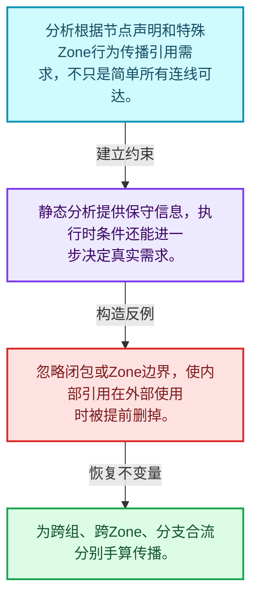
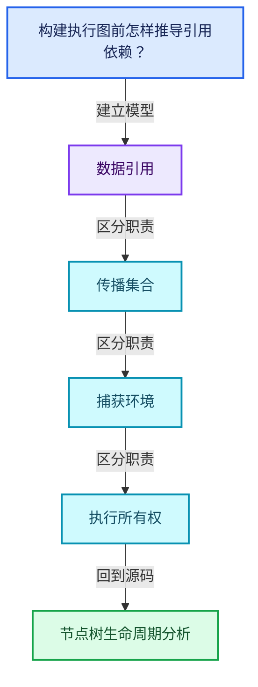
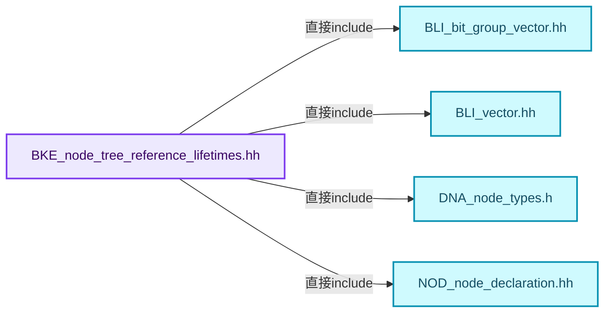
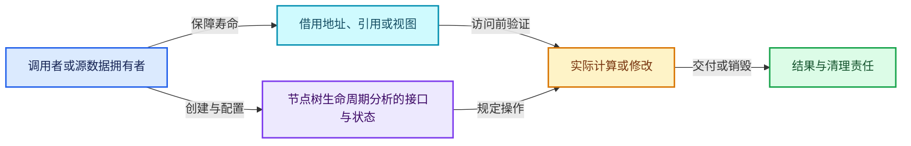
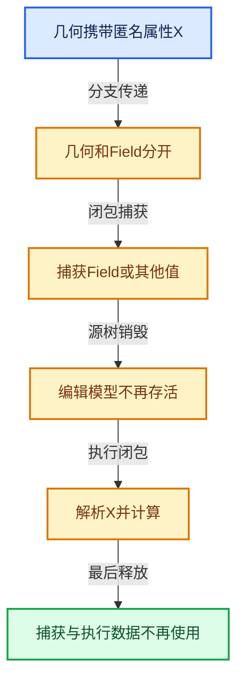

# 10-03 节点树生命周期分析

[方向导航](README.md) · [总目录](../README.md) · [覆盖索引](../%E6%BA%90%E7%A0%81%E7%89%88%E6%9C%AC%E4%B8%8E%E8%A6%86%E7%9B%96%E7%B4%A2%E5%BC%95.md)

> 阅读顺序：问题与数据模型 → 语法与类型 → 源码逐行 → 调用线索 → 历史与取舍 → 推演和练习。

- 基准 HEAD：`cbda6b96c26c0dee3c3b5cbb93960c4ac06a6b30`。
- 记录日期：2026-10-14。
- 教学示例状态：正文中的推演不是本机性能实测；已运行练习见验收报告。

## 一、从问题到设计

构建执行图前怎样推导引用依赖？

分析在节点关系上传播信息，实际使用条件还会影响需求；静态关系和执行期条件有边界。

本篇把语法、数据语义和系统取舍连接起来。表达式引用、承载数据与执行环境必须一起追踪，跨区域组合不能丢掉生命周期信息。

### 本篇独立模型与设计推理

分析根据节点声明和特殊Zone行为传播引用需求，不只是简单所有连线可达。

设计取舍：静态分析提供保守信息，执行时条件还能进一步决定真实需求。

最小反例：忽略闭包或Zone边界，使内部引用在外部使用时被提前删掉。

推导与处理：为跨组、跨Zone、分支合流分别手算传播。



### 源码范围与相邻篇章

| 文件 | 本篇逐行范围 | 基准SHA-256 |
|---|---|---|
| [source/blender/blenkernel/BKE_node_tree_reference_lifetimes.hh](../../../../../source/blender/blenkernel/BKE_node_tree_reference_lifetimes.hh) | L1—L118 | `e44432b0922a190bb2999d1221845c195f2a8f8e0b8de31efe569a205f77213a` |
| [source/blender/blenkernel/intern/node_tree_reference_lifetimes.cc](../../../../../source/blender/blenkernel/intern/node_tree_reference_lifetimes.cc) | L1—L1112 | `cfb45618248c158ed812532a78f3fb9b815f9d0d18f12b5279576502d8e6ad13` |

同一主讲文件可能分多篇覆盖；超出本篇范围的符号通过覆盖索引定位。空行与纯注释保留在源码摘录中，逐行表解释有效语句与语法边界；许可证头统一保留。

前篇：[GeometryNodesReferenceSet](02-GeometryNodesReferenceSet.md).

后篇：[引用传播与过滤](04-%E5%BC%95%E7%94%A8%E4%BC%A0%E6%92%AD%E4%B8%8E%E8%BF%87%E6%BB%A4.md).

## 二、类型、数据与阅读地图



这是概念依赖图，边表示阅读关系，不声称是运行时调用顺序。

### 直接编译依赖



箭头只表示头文件包含关系；完整调用线索见后面的符号定位表。

## 三、关键词、语法与类型角色

### 只读限定 const

const约束当前访问路径可做的修改。const指针、指向const的指针、const视图对象、const元素是不同位置的限定；其他别名可能仍可修改原对象。

具体检查：分别写T* const、const T*与const T* const，并画出不可修改的层次。

### 移动转换 std::move

std::move把表达式转换为可供移动重载选择的值类别，实际资源转移发生在被选中的构造或赋值中。对const对象move可能仍调用复制，对视图move也不会获得底层数据所有权。

具体检查：记录移动构造调用次数，不用变量名或std::move的出现次数替代测量。

### 异常边界 try与catch

try定义异常传播的局部边界。失败路径需要销毁已经成功构造的部分并释放相应存储；未构造的对象不能被析构。

具体检查：在第k次构造失败，列出已经存在的对象集合与待释放缓冲。

### 显式静态转换 static_cast

static_cast表达编译期允许的转换，不会自动验证运行时真实类型、指针寿命或索引边界。由void指针恢复T指针时，调用者仍须保证实际存储中确有合法T对象。

具体检查：标出转换前后的类型以及正确性依据来自哪里。

### 表示层转换 reinterpret_cast

reinterpret_cast不能自动开始任意对象的生命周期，也不能豁免对齐和别名规则。读这类代码需要追溯原始分配与实际构造操作。

具体检查：分别检查大小、对齐、生命周期和可访问类型，四项不能互相替代。

### 覆写检查 override

override要求函数确实覆盖基类虚函数，可捕获参数类型和const限定不匹配。它不改变基类规定的生命周期或线程约束。

具体检查：故意改变一个参数或const，观察编译器如何拒绝误写的新函数。

### 构造与new表达式

普通new可能分配并构造；placement new在给定地址构造，存储由其他机制提供。失败回滚应区分两类责任。

具体检查：追踪地址来自哪里、构造何时成功、由谁析构、由谁释放。

### 内部断言 assert

断言表达开发者预期成立的内部契约，发布构建可能关闭。它不能替代对不可信输入的完整错误处理，也不保证后续操作被运行时保护。

具体检查：对每条断言构造违反条件的输入，区分调用者错误与应向用户报告的错误。

### 受控访问 friend

friend授予指定函数或类访问非公开成员的权限，并不意味着继承，也不自动扩展到友元的派生类。

具体检查：解释执行器为何需要访问包装器的内部映射，同时检查边界是否仍清楚。

### 独占拥有 unique_ptr

unique_ptr通过移动转移拥有关系，默认删除策略必须与资源来源匹配。get返回借用指针，release交出责任而不销毁。

具体检查：区分move、get、release和reset后谁负责销毁。

### 联合体 union

联合体成员共享存储，需要由活动成员约定决定合法读取方式。结合enum或其他判别信息阅读，不能把所有成员都当作同时存在。

具体检查：检查叶节点与内部节点分别使用哪些联合成员。

### 类型别名 using

类型别名为已有类型建立名字，不创建运行期对象。它常把模板内部使用的类型统一暴露给泛型调用者。

具体检查：展开别名直到基础类型，区分类型别名和变量声明。

### 枚举与状态模型 enum

枚举把有限状态命名；enum class避免许多隐式整数转换。状态机正确性还依赖允许的转移，不能只看有哪些枚举项。

具体检查：列出每个状态的进入条件和离开条件，检查终止状态是否仍可能被调度。

## 四、真实源码与逐行讲解

源码块保持原行内容，原始行号由小节标题及逐行表给出。表中的调用定位是静态阅读辅助；重载、模板实例化、宏展开和虚调用需结合完整声明，不能仅凭词法出现证明动态调用。

### BKE_node_tree_reference_lifetimes.hh：L1—L37

<!-- source:source/blender/blenkernel/BKE_node_tree_reference_lifetimes.hh:1:37 -->

```cpp
/* SPDX-FileCopyrightText: 2024 Blender Authors
 *
 * SPDX-License-Identifier: GPL-2.0-or-later */

/** \file
 * \ingroup bke
 */

#pragma once

/**
 * Geometry nodes has the concept of anonymous attributes. These are attributes that are created by
 * some node with an internal name that is not exposed to the user. The only way to use this
 * attribute is to make a link in the node tree to the node that should use it. This explicitness
 * allows us to automatically determine when anonymous attributes are not needed anymore and should
 * be deleted (or not created in the first place).
 *
 * This file is used to determine the lifetimes of these anonymous attributes. The logic is fairly
 * straight forward to extend to other kinds of referenced data, but for now we only have anonymous
 * attributes.
 *
 * The lifetime analysis uses information provided in the node declaration and hardcoded behavior
 * for some special nodes like zones to determine the following things among others.
 * - Where are new references (like anonymous attributes) created?
 * - Which data sockets (like geometry) contain the referenced data?
 * - Which nodes have to propagate which referenced data to which outputs?
 *
 * This information is later used when evaluating geometry nodes to reduce the lifetime of
 * anonymous attributes automatically.
 */

#include "BLI_bit_group_vector.hh"
#include "BLI_vector.hh"

#include "DNA_node_types.h"

#include "NOD_node_declaration.hh"
```

| 原始行 | 语义、约束与检查 |
|---|---|
| L9 | 防止同一头文件在一个翻译单元中重复展开；不控制多个源文件之间的链接或对象寿命。 |
| L32 | 引入编译依赖 "BLI_bit_group_vector.hh"；这是声明可见性关系，不表示运行时一定调用该文件的所有接口。 |
| L33 | 引入编译依赖 "BLI_vector.hh"；这是声明可见性关系，不表示运行时一定调用该文件的所有接口。 |
| L35 | 引入编译依赖 "DNA_node_types.h"；这是声明可见性关系，不表示运行时一定调用该文件的所有接口。 |
| L37 | 引入编译依赖 "NOD_node_declaration.hh"；这是声明可见性关系，不表示运行时一定调用该文件的所有接口。 |

### BKE_node_tree_reference_lifetimes.hh：L38—L88

<!-- source:source/blender/blenkernel/BKE_node_tree_reference_lifetimes.hh:38:88 -->

```cpp

namespace blender::bke::node_tree_reference_lifetimes {

enum class ReferenceSetType {
  /**
   * Corresponds to geometry outputs that may contain attributes that are propagated from a group
   * input. In such cases, the caller may provide a set of attributes that should be propagated.
   */
  GroupOutputData,
  ClosureOutputData,
  /**
   * Field inputs may require attributes that need to be propagated from other geometry inputs to
   * the node that evaluates the field.
   */
  GroupInputReferenceSet,
  ClosureInputReferenceSet,
  /**
   * Locally created anonymous attributes (like with the Capture Attribute node) need to be
   * propagated to the nodes that use them or even to the group output.
   */
  LocalReferenceSet,
};

struct ReferenceSetInfo {
  ReferenceSetType type;
  union {
    /** Used for group interface sockets. */
    int index;
    /** Used for local and closure sockets. */
    const bNodeSocket *socket;
  };

  /**
   * Sockets that may contain the referenced data (e.g. the geometry output of a Capture Attribute
   * node).
   */
  Vector<const bNodeSocket *> potential_data_origins;

  ReferenceSetInfo(ReferenceSetType type, const int index) : type(type), index(index)
  {
    BLI_assert(
        ELEM(type, ReferenceSetType::GroupInputReferenceSet, ReferenceSetType::GroupOutputData));
  }

  ReferenceSetInfo(ReferenceSetType type, const bNodeSocket *socket) : type(type), socket(socket)
  {
    BLI_assert(ELEM(type,
                    ReferenceSetType::LocalReferenceSet,
                    ReferenceSetType::ClosureInputReferenceSet,
                    ReferenceSetType::ClosureOutputData));
  }
```

| 原始行 | 语义、约束与检查 |
|---|---|
| L39 | 把后续声明放入 blender::bke::node_tree_reference_lifetimes 命名空间，影响名称查找和符号归属，不创建运行时对象。 |
| L41 | 声明或定义类型 `enum class ReferenceSetType`。结合继承、访问权限和成员布局确认接口与拥有关系；前向声明本身没有完整对象布局。 |
| L46 | 本行是连续声明或表达式的一部分：`GroupOutputData,`。与本段前后行合读；逗号、括号和限定符决定它属于参数、初始化列表还是实际计算。 |
| L47 | 本行是连续声明或表达式的一部分：`ClosureOutputData,`。与本段前后行合读；逗号、括号和限定符决定它属于参数、初始化列表还是实际计算。 |
| L52 | 本行是连续声明或表达式的一部分：`GroupInputReferenceSet,`。与本段前后行合读；逗号、括号和限定符决定它属于参数、初始化列表还是实际计算。 |
| L53 | 本行是连续声明或表达式的一部分：`ClosureInputReferenceSet,`。与本段前后行合读；逗号、括号和限定符决定它属于参数、初始化列表还是实际计算。 |
| L58 | 本行是连续声明或表达式的一部分：`LocalReferenceSet,`。与本段前后行合读；逗号、括号和限定符决定它属于参数、初始化列表还是实际计算。 |
| L59 | 结束当前语法单元。局部自动对象在离开其作用域时按规则销毁；这不等于所有被引用的外部数据也被释放。 |
| L61 | 声明或定义类型 `struct ReferenceSetInfo`。结合继承、访问权限和成员布局确认接口与拥有关系；前向声明本身没有完整对象布局。 |
| L62 | 声明成员、局部对象或完成语句 `ReferenceSetType type`。若为指针或引用，它本身不说明拥有；若为值对象，其构造析构由所在作用域或外层对象管理。 |
| L63 | 声明或定义类型 `union`。结合继承、访问权限和成员布局确认接口与拥有关系；前向声明本身没有完整对象布局。 |
| L65 | 声明成员、局部对象或完成语句 `int index`。若为指针或引用，它本身不说明拥有；若为值对象，其构造析构由所在作用域或外层对象管理。 |
| L67 | 声明成员、局部对象或完成语句 `const bNodeSocket *socket`。若为指针或引用，它本身不说明拥有；若为值对象，其构造析构由所在作用域或外层对象管理。 |
| L68 | 结束当前语法单元。局部自动对象在离开其作用域时按规则销毁；这不等于所有被引用的外部数据也被释放。 |
| L74 | 声明成员、局部对象或完成语句 `Vector<const bNodeSocket *> potential_data_origins`。若为指针或引用，它本身不说明拥有；若为值对象，其构造析构由所在作用域或外层对象管理。 |
| L76 | 出现调用或函数声明 `ReferenceSetInfo`，对应表达式为 `ReferenceSetInfo(ReferenceSetType type, const int index) : type(type), index(index)`。参数求值、返回类型与重载需结合前后完整语句；静态文本引用不能证明动态目标。 |
| L77 | 连接上一行的声明或控制结构与其语句块；后续行在这个作用域中执行或声明。 |
| L78 | 断言约束 `BLI_assert(`。条件是后续访问的内部前置条件；发布构建可能不执行，不能把断言当作输入修复。 |
| L79 | 出现调用或函数声明 `ELEM`，对应表达式为 `ELEM(type, ReferenceSetType::GroupInputReferenceSet, ReferenceSetType::GroupOutputData));`。参数求值、返回类型与重载需结合前后完整语句；静态文本引用不能证明动态目标。 |
| L80 | 结束当前语法单元。局部自动对象在离开其作用域时按规则销毁；这不等于所有被引用的外部数据也被释放。 |
| L82 | 出现调用或函数声明 `ReferenceSetInfo`，对应表达式为 `ReferenceSetInfo(ReferenceSetType type, const bNodeSocket *socket) : type(type), socket(socket)`。参数求值、返回类型与重载需结合前后完整语句；静态文本引用不能证明动态目标。 |
| L83 | 连接上一行的声明或控制结构与其语句块；后续行在这个作用域中执行或声明。 |
| L84 | 断言约束 `BLI_assert(ELEM(type,`。条件是后续访问的内部前置条件；发布构建可能不执行，不能把断言当作输入修复。 |
| L85 | 本行是连续声明或表达式的一部分：`ReferenceSetType::LocalReferenceSet,`。与本段前后行合读；逗号、括号和限定符决定它属于参数、初始化列表还是实际计算。 |
| L86 | 本行是连续声明或表达式的一部分：`ReferenceSetType::ClosureInputReferenceSet,`。与本段前后行合读；逗号、括号和限定符决定它属于参数、初始化列表还是实际计算。 |
| L87 | 声明成员、局部对象或完成语句 `ReferenceSetType::ClosureOutputData))`。若为指针或引用，它本身不说明拥有；若为值对象，其构造析构由所在作用域或外层对象管理。 |
| L88 | 结束当前语法单元。局部自动对象在离开其作用域时按规则销毁；这不等于所有被引用的外部数据也被释放。 |

### BKE_node_tree_reference_lifetimes.hh：L89—L118

<!-- source:source/blender/blenkernel/BKE_node_tree_reference_lifetimes.hh:89:118 -->

```cpp

  friend std::ostream &operator<<(std::ostream &stream, const ReferenceSetInfo &info);
};

struct ReferenceLifetimesInfo {
  Vector<ReferenceSetInfo> reference_sets;

  /**
   * Has a bit for each socket and each reference set. If the bit is set, the corresponding
   * reference set should be propagated to that socket.
   */
  BitGroupVector<> required_data_by_socket;

  /** Field inputs that reference local data unavailable on the geometry they evaluate on. */
  Vector<const bNodeSocket *> sockets_with_missing_data;

  /**
   * Relations used for group nodes that use this group.
   */
  nodes::rl::RelationsInNode tree_relations;
};

bool analyse_reference_lifetimes(bNodeTree &tree);

/** The socket type allows storing references to data stored elsewhere. */
bool can_contain_reference(eNodeSocketDatatype socket_type);
/** The socket type allows storing data that may be referenced elsewhere. */
bool can_contain_referenced_data(eNodeSocketDatatype socket_type);

}  // namespace blender::bke::node_tree_reference_lifetimes
```

| 原始行 | 语义、约束与检查 |
|---|---|
| L90 | 运算符重载声明、定义或显式调用：`friend std::ostream &operator<<(std::ostream &stream, const ReferenceSetInfo &info);`。结合参数和返回类型判断是赋值、索引、比较还是转换；operator=声明中的等号不是在给名为operator的变量赋值。 |
| L91 | 结束当前语法单元。局部自动对象在离开其作用域时按规则销毁；这不等于所有被引用的外部数据也被释放。 |
| L93 | 声明或定义类型 `struct ReferenceLifetimesInfo`。结合继承、访问权限和成员布局确认接口与拥有关系；前向声明本身没有完整对象布局。 |
| L94 | 声明成员、局部对象或完成语句 `Vector<ReferenceSetInfo> reference_sets`。若为指针或引用，它本身不说明拥有；若为值对象，其构造析构由所在作用域或外层对象管理。 |
| L100 | 声明成员、局部对象或完成语句 `BitGroupVector<> required_data_by_socket`。若为指针或引用，它本身不说明拥有；若为值对象，其构造析构由所在作用域或外层对象管理。 |
| L103 | 声明成员、局部对象或完成语句 `Vector<const bNodeSocket *> sockets_with_missing_data`。若为指针或引用，它本身不说明拥有；若为值对象，其构造析构由所在作用域或外层对象管理。 |
| L108 | 声明成员、局部对象或完成语句 `nodes::rl::RelationsInNode tree_relations`。若为指针或引用，它本身不说明拥有；若为值对象，其构造析构由所在作用域或外层对象管理。 |
| L109 | 结束当前语法单元。局部自动对象在离开其作用域时按规则销毁；这不等于所有被引用的外部数据也被释放。 |
| L111 | 声明接口 `bool analyse_reference_lifetimes(bNodeTree &tree)`，本行没有对应函数体；返回类型、参数限定和const/noexcept共同组成调用契约，实际行为需继续定位实现。 |
| L114 | 声明接口 `bool can_contain_reference(eNodeSocketDatatype socket_type)`，本行没有对应函数体；返回类型、参数限定和const/noexcept共同组成调用契约，实际行为需继续定位实现。 |
| L116 | 声明接口 `bool can_contain_referenced_data(eNodeSocketDatatype socket_type)`，本行没有对应函数体；返回类型、参数限定和const/noexcept共同组成调用契约，实际行为需继续定位实现。 |
| L118 | 结束当前语法单元。局部自动对象在离开其作用域时按规则销毁；这不等于所有被引用的外部数据也被释放。 |

### node_tree_reference_lifetimes.cc：L1—L59

<!-- source:source/blender/blenkernel/intern/node_tree_reference_lifetimes.cc:1:59 -->

```cpp
/* SPDX-FileCopyrightText: 2024 Blender Foundation
 *
 * SPDX-License-Identifier: GPL-2.0-or-later */

/** \file
 * \ingroup bke
 */

#include <iostream>

#include <fmt/format.h>
#include <fmt/ranges.h>

#include "BKE_node_legacy_types.hh"
#include "BKE_node_runtime.hh"
#include "BKE_node_tree_dot_export.hh"
#include "BKE_node_tree_reference_lifetimes.hh"
#include "BKE_node_tree_zones.hh"

#include "BLI_bit_group_vector.hh"
#include "BLI_bit_span_ops.hh"

#include "NOD_node_declaration.hh"
#include "NOD_socket.hh"

#include "BLI_resource_scope.hh"

namespace blender::bke::node_tree_reference_lifetimes {

using bits::BitInt;
using nodes::NodeDeclaration;
namespace rl = nodes::rl;

std::ostream &operator<<(std::ostream &stream, const ReferenceSetInfo &info)
{
  switch (info.type) {
    case ReferenceSetType::GroupOutputData:
      stream << "Group Output Data: " << info.index;
      break;
    case ReferenceSetType::GroupInputReferenceSet:
      stream << "Group Input Reference: " << info.index;
      break;
    case ReferenceSetType::LocalReferenceSet:
      stream << "Local: " << info.socket->name;
      break;
    case ReferenceSetType::ClosureInputReferenceSet:
      stream << "Closure Input Reference: " << info.socket->name;
      break;
    case ReferenceSetType::ClosureOutputData:
      stream << "Closure Output Data: " << info.socket->name;
      break;
  }
  stream << " (";
  for (const bNodeSocket *socket : info.potential_data_origins) {
    stream << socket->name << ", ";
  }
  stream << ")";
  return stream;
}
```

| 原始行 | 语义、约束与检查 |
|---|---|
| L9 | 引入编译依赖 <iostream>；这是声明可见性关系，不表示运行时一定调用该文件的所有接口。 |
| L11 | 引入编译依赖 <fmt/format.h>；这是声明可见性关系，不表示运行时一定调用该文件的所有接口。 |
| L12 | 引入编译依赖 <fmt/ranges.h>；这是声明可见性关系，不表示运行时一定调用该文件的所有接口。 |
| L14 | 引入编译依赖 "BKE_node_legacy_types.hh"；这是声明可见性关系，不表示运行时一定调用该文件的所有接口。 |
| L15 | 引入编译依赖 "BKE_node_runtime.hh"；这是声明可见性关系，不表示运行时一定调用该文件的所有接口。 |
| L16 | 引入编译依赖 "BKE_node_tree_dot_export.hh"；这是声明可见性关系，不表示运行时一定调用该文件的所有接口。 |
| L17 | 引入编译依赖 "BKE_node_tree_reference_lifetimes.hh"；这是声明可见性关系，不表示运行时一定调用该文件的所有接口。 |
| L18 | 引入编译依赖 "BKE_node_tree_zones.hh"；这是声明可见性关系，不表示运行时一定调用该文件的所有接口。 |
| L20 | 引入编译依赖 "BLI_bit_group_vector.hh"；这是声明可见性关系，不表示运行时一定调用该文件的所有接口。 |
| L21 | 引入编译依赖 "BLI_bit_span_ops.hh"；这是声明可见性关系，不表示运行时一定调用该文件的所有接口。 |
| L23 | 引入编译依赖 "NOD_node_declaration.hh"；这是声明可见性关系，不表示运行时一定调用该文件的所有接口。 |
| L24 | 引入编译依赖 "NOD_socket.hh"；这是声明可见性关系，不表示运行时一定调用该文件的所有接口。 |
| L26 | 引入编译依赖 "BLI_resource_scope.hh"；这是声明可见性关系，不表示运行时一定调用该文件的所有接口。 |
| L28 | 把后续声明放入 blender::bke::node_tree_reference_lifetimes 命名空间，影响名称查找和符号归属，不创建运行时对象。 |
| L30 | 定义类型别名 `using bits::BitInt`，为模板接口或内部实现统一命名；本行不分配该类型对象。 |
| L31 | 定义类型别名 `using nodes::NodeDeclaration`，为模板接口或内部实现统一命名；本行不分配该类型对象。 |
| L32 | 把后续声明放入 rl = nodes::rl; 命名空间，影响名称查找和符号归属，不创建运行时对象。 |
| L34 | 运算符重载声明、定义或显式调用：`std::ostream &operator<<(std::ostream &stream, const ReferenceSetInfo &info)`。结合参数和返回类型判断是赋值、索引、比较还是转换；operator=声明中的等号不是在给名为operator的变量赋值。 |
| L35 | 连接上一行的声明或控制结构与其语句块；后续行在这个作用域中执行或声明。 |
| L36 | 按 switch (info.type) 选择状态处理路径；每个case的break、return或贯穿行为决定下一步。 |
| L37 | 进入枚举或判别值对应分支 case ReferenceSetType::GroupOutputData:；结合状态定义和后续更新判断允许的转移。 |
| L38 | 声明成员、局部对象或完成语句 `stream << "Group Output Data: " << info.index`。若为指针或引用，它本身不说明拥有；若为值对象，其构造析构由所在作用域或外层对象管理。 |
| L39 | 离开最近的循环或switch；不是离开整个函数，后续清理和提交代码可能仍会执行。 |
| L40 | 进入枚举或判别值对应分支 case ReferenceSetType::GroupInputReferenceSet:；结合状态定义和后续更新判断允许的转移。 |
| L41 | 声明成员、局部对象或完成语句 `stream << "Group Input Reference: " << info.index`。若为指针或引用，它本身不说明拥有；若为值对象，其构造析构由所在作用域或外层对象管理。 |
| L42 | 离开最近的循环或switch；不是离开整个函数，后续清理和提交代码可能仍会执行。 |
| L43 | 进入枚举或判别值对应分支 case ReferenceSetType::LocalReferenceSet:；结合状态定义和后续更新判断允许的转移。 |
| L44 | 声明成员、局部对象或完成语句 `stream << "Local: " << info.socket->name`。若为指针或引用，它本身不说明拥有；若为值对象，其构造析构由所在作用域或外层对象管理。 |
| L45 | 离开最近的循环或switch；不是离开整个函数，后续清理和提交代码可能仍会执行。 |
| L46 | 进入枚举或判别值对应分支 case ReferenceSetType::ClosureInputReferenceSet:；结合状态定义和后续更新判断允许的转移。 |
| L47 | 声明成员、局部对象或完成语句 `stream << "Closure Input Reference: " << info.socket->name`。若为指针或引用，它本身不说明拥有；若为值对象，其构造析构由所在作用域或外层对象管理。 |
| L48 | 离开最近的循环或switch；不是离开整个函数，后续清理和提交代码可能仍会执行。 |
| L49 | 进入枚举或判别值对应分支 case ReferenceSetType::ClosureOutputData:；结合状态定义和后续更新判断允许的转移。 |
| L50 | 声明成员、局部对象或完成语句 `stream << "Closure Output Data: " << info.socket->name`。若为指针或引用，它本身不说明拥有；若为值对象，其构造析构由所在作用域或外层对象管理。 |
| L51 | 离开最近的循环或switch；不是离开整个函数，后续清理和提交代码可能仍会执行。 |
| L52 | 结束当前语法单元。局部自动对象在离开其作用域时按规则销毁；这不等于所有被引用的外部数据也被释放。 |
| L53 | 声明成员、局部对象或完成语句 `stream << " ("`。若为指针或引用，它本身不说明拥有；若为值对象，其构造析构由所在作用域或外层对象管理。 |
| L54 | 按 `for (const bNodeSocket *socket : info.potential_data_origins)` 指定的范围或条件重复执行。对照循环变量与真实元素编号；循环内调用成本乘以实际迭代次数。 |
| L55 | 声明成员、局部对象或完成语句 `stream << socket->name << ", "`。若为指针或引用，它本身不说明拥有；若为值对象，其构造析构由所在作用域或外层对象管理。 |
| L56 | 结束当前语法单元。局部自动对象在离开其作用域时按规则销毁；这不等于所有被引用的外部数据也被释放。 |
| L57 | 声明成员、局部对象或完成语句 `stream << ")"`。若为指针或引用，它本身不说明拥有；若为值对象，其构造析构由所在作用域或外层对象管理。 |
| L58 | 返回表达式 `stream`。 |
| L59 | 结束当前语法单元。局部自动对象在离开其作用域时按规则销毁；这不等于所有被引用的外部数据也被释放。 |

### node_tree_reference_lifetimes.cc：L60—L113

<!-- source:source/blender/blenkernel/intern/node_tree_reference_lifetimes.cc:60:113 -->

```cpp

static bool socket_may_have_reference(const bNodeSocket &socket)
{
  return socket.may_be_field() || ELEM(socket.type, SOCK_BUNDLE, SOCK_CLOSURE, SOCK_GEOMETRY);
}

static bool or_into_each_other_masked(MutableBoundedBitSpan a,
                                      MutableBoundedBitSpan b,
                                      const BoundedBitSpan mask)
{
  if (bits::spans_equal_masked(a, b, mask)) {
    return false;
  }
  bits::inplace_or_masked(a, mask, b);
  bits::inplace_or_masked(b, mask, a);
  return true;
}

static bool or_into_each_other(MutableBoundedBitSpan a, MutableBoundedBitSpan b)
{
  if (bits::spans_equal(a, b)) {
    return false;
  }
  a |= b;
  b |= a;
  return true;
}

bool can_contain_reference(const eNodeSocketDatatype socket_type)
{
  return nodes::socket_type_supports_fields(socket_type) ||
         ELEM(socket_type, SOCK_GEOMETRY, SOCK_BUNDLE, SOCK_CLOSURE);
}

bool can_contain_referenced_data(const eNodeSocketDatatype socket_type)
{
  return ELEM(socket_type, SOCK_GEOMETRY, SOCK_BUNDLE, SOCK_CLOSURE);
}

static const bNodeTreeZone *get_zone_of_node_if_full(const bNodeTreeZones *zones,
                                                     const bNode &node)
{
  if (!zones) {
    return nullptr;
  }
  const bNodeTreeZone *zone = zones->get_zone_by_node(node.identifier);
  if (!zone) {
    return nullptr;
  }
  if (!zone->input_node_id || !zone->output_node_id) {
    return nullptr;
  }
  return zone;
}
```

本段语义重点：

- 分支证据 `bits::spans_equal_masked(a, b, mask))`：分别推演条件成立与不成立，核对相同出口处的状态。
- 分支证据 `bits::spans_equal(a, b))`：分别推演条件成立与不成立，核对相同出口处的状态。

| 原始行 | 语义、约束与检查 |
|---|---|
| L61 | 出现调用或函数声明 `socket_may_have_reference`，对应表达式为 `static bool socket_may_have_reference(const bNodeSocket &socket)`。参数求值、返回类型与重载需结合前后完整语句；静态文本引用不能证明动态目标。 |
| L62 | 连接上一行的声明或控制结构与其语句块；后续行在这个作用域中执行或声明。 |
| L63 | 返回表达式 `socket.may_be_field() &#124;&#124; ELEM(socket.type, SOCK_BUNDLE, SOCK_CLOSURE, SOCK_GEOMETRY)`。 |
| L64 | 结束当前语法单元。局部自动对象在离开其作用域时按规则销毁；这不等于所有被引用的外部数据也被释放。 |
| L66 | 出现调用或函数声明 `or_into_each_other_masked`，对应表达式为 `static bool or_into_each_other_masked(MutableBoundedBitSpan a,`。参数求值、返回类型与重载需结合前后完整语句；静态文本引用不能证明动态目标。 |
| L67 | 本行是连续声明或表达式的一部分：`MutableBoundedBitSpan b,`。与本段前后行合读；逗号、括号和限定符决定它属于参数、初始化列表还是实际计算。 |
| L68 | 本行是连续声明或表达式的一部分：`const BoundedBitSpan mask)`。与本段前后行合读；逗号、括号和限定符决定它属于参数、初始化列表还是实际计算。 |
| L69 | 连接上一行的声明或控制结构与其语句块；后续行在这个作用域中执行或声明。 |
| L70 | 判断 `bits::spans_equal_masked(a, b, mask)`，成立时进入本分支，否则继续后续路径。 |
| L71 | 返回表达式 `false`。这是本路径的布尔结果，具体成功、存在或状态含义由函数接口规定。 |
| L72 | 结束当前语法单元。局部自动对象在离开其作用域时按规则销毁；这不等于所有被引用的外部数据也被释放。 |
| L73 | 出现调用或函数声明 `bits::inplace_or_masked`，对应表达式为 `bits::inplace_or_masked(a, mask, b);`。参数求值、返回类型与重载需结合前后完整语句；静态文本引用不能证明动态目标。 |
| L74 | 出现调用或函数声明 `bits::inplace_or_masked`，对应表达式为 `bits::inplace_or_masked(b, mask, a);`。参数求值、返回类型与重载需结合前后完整语句；静态文本引用不能证明动态目标。 |
| L75 | 返回表达式 `true`。这是本路径的布尔结果，具体成功、存在或状态含义由函数接口规定。 |
| L76 | 结束当前语法单元。局部自动对象在离开其作用域时按规则销毁；这不等于所有被引用的外部数据也被释放。 |
| L78 | 出现调用或函数声明 `or_into_each_other`，对应表达式为 `static bool or_into_each_other(MutableBoundedBitSpan a, MutableBoundedBitSpan b)`。参数求值、返回类型与重载需结合前后完整语句；静态文本引用不能证明动态目标。 |
| L79 | 连接上一行的声明或控制结构与其语句块；后续行在这个作用域中执行或声明。 |
| L80 | 判断 `bits::spans_equal(a, b)`，成立时进入本分支，否则继续后续路径。 |
| L81 | 返回表达式 `false`。这是本路径的布尔结果，具体成功、存在或状态含义由函数接口规定。 |
| L82 | 结束当前语法单元。局部自动对象在离开其作用域时按规则销毁；这不等于所有被引用的外部数据也被释放。 |
| L83 | 复合更新 `a &#124;= b`：读取左侧现有值，与右侧按`&#124;=`对应操作组合后写回。检查数值边界、位掩码或共享状态保护；它不是新对象的构造。 |
| L84 | 复合更新 `b &#124;= a`：读取左侧现有值，与右侧按`&#124;=`对应操作组合后写回。检查数值边界、位掩码或共享状态保护；它不是新对象的构造。 |
| L85 | 返回表达式 `true`。这是本路径的布尔结果，具体成功、存在或状态含义由函数接口规定。 |
| L86 | 结束当前语法单元。局部自动对象在离开其作用域时按规则销毁；这不等于所有被引用的外部数据也被释放。 |
| L88 | 出现调用或函数声明 `can_contain_reference`，对应表达式为 `bool can_contain_reference(const eNodeSocketDatatype socket_type)`。参数求值、返回类型与重载需结合前后完整语句；静态文本引用不能证明动态目标。 |
| L89 | 连接上一行的声明或控制结构与其语句块；后续行在这个作用域中执行或声明。 |
| L90 | 返回表达式 `nodes::socket_type_supports_fields(socket_type) &#124;&#124;`。 |
| L91 | 出现调用或函数声明 `ELEM`，对应表达式为 `ELEM(socket_type, SOCK_GEOMETRY, SOCK_BUNDLE, SOCK_CLOSURE);`。参数求值、返回类型与重载需结合前后完整语句；静态文本引用不能证明动态目标。 |
| L92 | 结束当前语法单元。局部自动对象在离开其作用域时按规则销毁；这不等于所有被引用的外部数据也被释放。 |
| L94 | 出现调用或函数声明 `can_contain_referenced_data`，对应表达式为 `bool can_contain_referenced_data(const eNodeSocketDatatype socket_type)`。参数求值、返回类型与重载需结合前后完整语句；静态文本引用不能证明动态目标。 |
| L95 | 连接上一行的声明或控制结构与其语句块；后续行在这个作用域中执行或声明。 |
| L96 | 返回表达式 `ELEM(socket_type, SOCK_GEOMETRY, SOCK_BUNDLE, SOCK_CLOSURE)`。 |
| L97 | 结束当前语法单元。局部自动对象在离开其作用域时按规则销毁；这不等于所有被引用的外部数据也被释放。 |
| L99 | 出现调用或函数声明 `get_zone_of_node_if_full`，对应表达式为 `static const bNodeTreeZone *get_zone_of_node_if_full(const bNodeTreeZones *zones,`。参数求值、返回类型与重载需结合前后完整语句；静态文本引用不能证明动态目标。 |
| L100 | 本行是连续声明或表达式的一部分：`const bNode &node)`。与本段前后行合读；逗号、括号和限定符决定它属于参数、初始化列表还是实际计算。 |
| L101 | 连接上一行的声明或控制结构与其语句块；后续行在这个作用域中执行或声明。 |
| L102 | 判断 `!zones`，成立时进入本分支，否则继续后续路径。 |
| L103 | 返回表达式 `nullptr`。 |
| L104 | 结束当前语法单元。局部自动对象在离开其作用域时按规则销毁；这不等于所有被引用的外部数据也被释放。 |
| L105 | 把右侧 `zones->get_zone_by_node(node.identifier)` 用于初始化或更新左侧 `const bNodeTreeZone *zone`。声明初始化与已有对象赋值应按上下文区分；有资源的类型会调用相应特殊成员。 |
| L106 | 判断 `!zone`，成立时进入本分支，否则继续后续路径。 |
| L107 | 返回表达式 `nullptr`。 |
| L108 | 结束当前语法单元。局部自动对象在离开其作用域时按规则销毁；这不等于所有被引用的外部数据也被释放。 |
| L109 | 判断 `!zone->input_node_id &#124;&#124; !zone->output_node_id`，成立时进入本分支，否则继续后续路径。 |
| L110 | 返回表达式 `nullptr`。 |
| L111 | 结束当前语法单元。局部自动对象在离开其作用域时按规则销毁；这不等于所有被引用的外部数据也被释放。 |
| L112 | 返回表达式 `zone`。 |
| L113 | 结束当前语法单元。局部自动对象在离开其作用域时按规则销毁；这不等于所有被引用的外部数据也被释放。 |

### node_tree_reference_lifetimes.cc：L114—L236

<!-- source:source/blender/blenkernel/intern/node_tree_reference_lifetimes.cc:114:236 -->

```cpp

static Array<const rl::RelationsInNode *> prepare_relations_by_node(const bNodeTree &tree,
                                                                    ResourceScope &scope)
{
  Array<const rl::RelationsInNode *> relations_by_node(tree.all_nodes().size());
  for (const bNode *node : tree.all_nodes()) {
    const rl::RelationsInNode *node_relations = nullptr;
    switch (node->type_legacy) {
      case GEO_NODE_SIMULATION_INPUT:
      case GEO_NODE_SIMULATION_OUTPUT:
      case GEO_NODE_BAKE: {
        /* The relations of these nodes depend on field evaluation to avoid unnecessary
         * relations, but besides that they don't need special handling. */
        rl::RelationsInNode &relations = scope.construct<rl::RelationsInNode>();
        {
          /* Add eval relations. */
          int prev_geometry_index = -1;
          for (const int i : node->input_sockets().index_range()) {
            const bNodeSocket &socket = node->input_socket(i);
            if (socket.type == SOCK_GEOMETRY) {
              prev_geometry_index = i;
              continue;
            }
            if (prev_geometry_index == -1) {
              continue;
            }
            if (socket_may_have_reference(socket)) {
              relations.use_relations.append({i, prev_geometry_index});
            }
          }
        }
        {
          /* Add available relations. */
          int prev_geometry_index = -1;
          for (const int i : node->output_sockets().index_range()) {
            const bNodeSocket &socket = node->output_socket(i);
            if (socket.type == SOCK_GEOMETRY) {
              prev_geometry_index = i;
            }
            if (prev_geometry_index == -1) {
              continue;
            }
            if (socket_may_have_reference(socket)) {
              relations.available_relations.append({i, prev_geometry_index});
            }
          }
        }
        node_relations = &relations;
        break;
      }
      case GEO_NODE_REPEAT_INPUT:
      case GEO_NODE_REPEAT_OUTPUT: {
        rl::RelationsInNode &relations = scope.construct<rl::RelationsInNode>();
        for (const bNodeSocket *socket : node->output_sockets()) {
          if (can_contain_referenced_data(socket->type)) {
            for (const bNodeSocket *other_output : node->output_sockets()) {
              if (socket_may_have_reference(*other_output)) {
                relations.available_relations.append({other_output->index(), socket->index()});
              }
            }
          }
        }
        for (const bNodeSocket *socket : node->input_sockets()) {
          if (can_contain_referenced_data(socket->type)) {
            for (const bNodeSocket *other_input : node->input_sockets()) {
              if (socket_may_have_reference(*other_input)) {
                relations.use_relations.append({other_input->index(), socket->index()});
              }
            }
          }
        }
        /* Only create propagate and reference relations for the input node. The output node
         * needs special handling because attributes created inside of the zone are not directly
         * referenced on the outside. */
        if (node->type_legacy == GEO_NODE_REPEAT_INPUT) {
          const int input_items_start = 1;
          const int output_items_start = 1;
          const int items_num = node->output_sockets().size() - 1 - output_items_start;
          for (const int i : IndexRange(items_num)) {
            const int input_index = input_items_start + i;
            const int output_index = output_items_start + i;
            const bNodeSocket &input_socket = node->input_socket(input_index);
            if (can_contain_referenced_data(input_socket.type)) {
              relations.data_propagations.append({input_index, output_index});
            }
            else if (socket_may_have_reference(input_socket)) {
              relations.reference_propagations.append({input_index, output_index});
            }
          }
        }
        node_relations = &relations;
        break;
      }
      case NODE_REROUTE: {
        static const rl::RelationsInNode reroute_relations = []() {
          rl::RelationsInNode relations;
          relations.data_propagations.append({0, 0});
          relations.reference_propagations.append({0, 0});
          return relations;
        }();
        node_relations = &reroute_relations;
        break;
      }
      case NODE_GROUP:
      case NODE_CUSTOM_GROUP: {
        if (const bNodeTree *group = reinterpret_cast<const bNodeTree *>(node->id)) {
          if (group->runtime->reference_lifetimes_info) {
            node_relations = &group->runtime->reference_lifetimes_info->tree_relations;
          }
        }
        break;
      }
      default: {
        if (const NodeDeclaration *node_decl = node->declaration()) {
          node_relations = node_decl->reference_lifetime_relations();
        }
        break;
      }
    }
    relations_by_node[node->index()] = node_relations;
  }
  return relations_by_node;
}
```

本段语义重点：

- 分支证据 `socket.type == SOCK_GEOMETRY)`：分别推演条件成立与不成立，核对相同出口处的状态。
- 分支证据 `prev_geometry_index == -1)`：分别推演条件成立与不成立，核对相同出口处的状态。

| 原始行 | 语义、约束与检查 |
|---|---|
| L115 | 出现调用或函数声明 `prepare_relations_by_node`，对应表达式为 `static Array<const rl::RelationsInNode *> prepare_relations_by_node(const bNodeTree &tree,`。参数求值、返回类型与重载需结合前后完整语句；静态文本引用不能证明动态目标。 |
| L116 | 本行是连续声明或表达式的一部分：`ResourceScope &scope)`。与本段前后行合读；逗号、括号和限定符决定它属于参数、初始化列表还是实际计算。 |
| L117 | 连接上一行的声明或控制结构与其语句块；后续行在这个作用域中执行或声明。 |
| L118 | 出现调用或函数声明 `relations_by_node`，对应表达式为 `Array<const rl::RelationsInNode *> relations_by_node(tree.all_nodes().size());`。参数求值、返回类型与重载需结合前后完整语句；静态文本引用不能证明动态目标。 |
| L119 | 按 `for (const bNode *node : tree.all_nodes())` 指定的范围或条件重复执行。对照循环变量与真实元素编号；循环内调用成本乘以实际迭代次数。 |
| L120 | 把右侧 `nullptr` 用于初始化或更新左侧 `const rl::RelationsInNode *node_relations`。声明初始化与已有对象赋值应按上下文区分；有资源的类型会调用相应特殊成员。 |
| L121 | 按 switch (node->type_legacy) 选择状态处理路径；每个case的break、return或贯穿行为决定下一步。 |
| L122 | 进入枚举或判别值对应分支 case GEO_NODE_SIMULATION_INPUT:；结合状态定义和后续更新判断允许的转移。 |
| L123 | 进入枚举或判别值对应分支 case GEO_NODE_SIMULATION_OUTPUT:；结合状态定义和后续更新判断允许的转移。 |
| L124 | 进入枚举或判别值对应分支 case GEO_NODE_BAKE: {；结合状态定义和后续更新判断允许的转移。 |
| L127 | 把右侧 `scope.construct<rl::RelationsInNode>()` 用于初始化或更新左侧 `rl::RelationsInNode &relations`。声明初始化与已有对象赋值应按上下文区分；有资源的类型会调用相应特殊成员。 |
| L128 | 连接上一行的声明或控制结构与其语句块；后续行在这个作用域中执行或声明。 |
| L130 | 把右侧 `-1` 用于初始化或更新左侧 `int prev_geometry_index`。声明初始化与已有对象赋值应按上下文区分；有资源的类型会调用相应特殊成员。 |
| L131 | 按 `for (const int i : node->input_sockets().index_range())` 指定的范围或条件重复执行。对照循环变量与真实元素编号；循环内调用成本乘以实际迭代次数。 |
| L132 | 把右侧 `node->input_socket(i)` 用于初始化或更新左侧 `const bNodeSocket &socket`。声明初始化与已有对象赋值应按上下文区分；有资源的类型会调用相应特殊成员。 |
| L133 | 判断 `socket.type == SOCK_GEOMETRY`，成立时进入本分支，否则继续后续路径。 |
| L134 | 把右侧 `i` 用于初始化或更新左侧 `prev_geometry_index`。声明初始化与已有对象赋值应按上下文区分；有资源的类型会调用相应特殊成员。 |
| L135 | 结束本轮循环并进入下一轮；核对本轮已经取得的资源是否由作用域或显式代码清理。 |
| L136 | 结束当前语法单元。局部自动对象在离开其作用域时按规则销毁；这不等于所有被引用的外部数据也被释放。 |
| L137 | 判断 `prev_geometry_index == -1`，成立时进入本分支，否则继续后续路径。 |
| L138 | 结束本轮循环并进入下一轮；核对本轮已经取得的资源是否由作用域或显式代码清理。 |
| L139 | 结束当前语法单元。局部自动对象在离开其作用域时按规则销毁；这不等于所有被引用的外部数据也被释放。 |
| L140 | 判断 `socket_may_have_reference(socket)`，成立时进入本分支，否则继续后续路径。 |
| L141 | 出现调用或函数声明 `append`，对应表达式为 `relations.use_relations.append({i, prev_geometry_index});`。参数求值、返回类型与重载需结合前后完整语句；静态文本引用不能证明动态目标。 |
| L142 | 结束当前语法单元。局部自动对象在离开其作用域时按规则销毁；这不等于所有被引用的外部数据也被释放。 |
| L143 | 结束当前语法单元。局部自动对象在离开其作用域时按规则销毁；这不等于所有被引用的外部数据也被释放。 |
| L144 | 结束当前语法单元。局部自动对象在离开其作用域时按规则销毁；这不等于所有被引用的外部数据也被释放。 |
| L145 | 连接上一行的声明或控制结构与其语句块；后续行在这个作用域中执行或声明。 |
| L147 | 把右侧 `-1` 用于初始化或更新左侧 `int prev_geometry_index`。声明初始化与已有对象赋值应按上下文区分；有资源的类型会调用相应特殊成员。 |
| L148 | 按 `for (const int i : node->output_sockets().index_range())` 指定的范围或条件重复执行。对照循环变量与真实元素编号；循环内调用成本乘以实际迭代次数。 |
| L149 | 把右侧 `node->output_socket(i)` 用于初始化或更新左侧 `const bNodeSocket &socket`。声明初始化与已有对象赋值应按上下文区分；有资源的类型会调用相应特殊成员。 |
| L150 | 判断 `socket.type == SOCK_GEOMETRY`，成立时进入本分支，否则继续后续路径。 |
| L151 | 把右侧 `i` 用于初始化或更新左侧 `prev_geometry_index`。声明初始化与已有对象赋值应按上下文区分；有资源的类型会调用相应特殊成员。 |
| L152 | 结束当前语法单元。局部自动对象在离开其作用域时按规则销毁；这不等于所有被引用的外部数据也被释放。 |
| L153 | 判断 `prev_geometry_index == -1`，成立时进入本分支，否则继续后续路径。 |
| L154 | 结束本轮循环并进入下一轮；核对本轮已经取得的资源是否由作用域或显式代码清理。 |
| L155 | 结束当前语法单元。局部自动对象在离开其作用域时按规则销毁；这不等于所有被引用的外部数据也被释放。 |
| L156 | 判断 `socket_may_have_reference(socket)`，成立时进入本分支，否则继续后续路径。 |
| L157 | 出现调用或函数声明 `append`，对应表达式为 `relations.available_relations.append({i, prev_geometry_index});`。参数求值、返回类型与重载需结合前后完整语句；静态文本引用不能证明动态目标。 |
| L158 | 结束当前语法单元。局部自动对象在离开其作用域时按规则销毁；这不等于所有被引用的外部数据也被释放。 |
| L159 | 结束当前语法单元。局部自动对象在离开其作用域时按规则销毁；这不等于所有被引用的外部数据也被释放。 |
| L160 | 结束当前语法单元。局部自动对象在离开其作用域时按规则销毁；这不等于所有被引用的外部数据也被释放。 |
| L161 | 把右侧 `&relations` 用于初始化或更新左侧 `node_relations`。声明初始化与已有对象赋值应按上下文区分；有资源的类型会调用相应特殊成员。 |
| L162 | 离开最近的循环或switch；不是离开整个函数，后续清理和提交代码可能仍会执行。 |
| L163 | 结束当前语法单元。局部自动对象在离开其作用域时按规则销毁；这不等于所有被引用的外部数据也被释放。 |
| L164 | 进入枚举或判别值对应分支 case GEO_NODE_REPEAT_INPUT:；结合状态定义和后续更新判断允许的转移。 |
| L165 | 进入枚举或判别值对应分支 case GEO_NODE_REPEAT_OUTPUT: {；结合状态定义和后续更新判断允许的转移。 |
| L166 | 把右侧 `scope.construct<rl::RelationsInNode>()` 用于初始化或更新左侧 `rl::RelationsInNode &relations`。声明初始化与已有对象赋值应按上下文区分；有资源的类型会调用相应特殊成员。 |
| L167 | 按 `for (const bNodeSocket *socket : node->output_sockets())` 指定的范围或条件重复执行。对照循环变量与真实元素编号；循环内调用成本乘以实际迭代次数。 |
| L168 | 判断 `can_contain_referenced_data(socket->type)`，成立时进入本分支，否则继续后续路径。 |
| L169 | 按 `for (const bNodeSocket *other_output : node->output_sockets())` 指定的范围或条件重复执行。对照循环变量与真实元素编号；循环内调用成本乘以实际迭代次数。 |
| L170 | 判断 `socket_may_have_reference(*other_output)`，成立时进入本分支，否则继续后续路径。 |
| L171 | 出现调用或函数声明 `append`，对应表达式为 `relations.available_relations.append({other_output->index(), socket->index()});`。参数求值、返回类型与重载需结合前后完整语句；静态文本引用不能证明动态目标。 |
| L172 | 结束当前语法单元。局部自动对象在离开其作用域时按规则销毁；这不等于所有被引用的外部数据也被释放。 |
| L173 | 结束当前语法单元。局部自动对象在离开其作用域时按规则销毁；这不等于所有被引用的外部数据也被释放。 |
| L174 | 结束当前语法单元。局部自动对象在离开其作用域时按规则销毁；这不等于所有被引用的外部数据也被释放。 |
| L175 | 结束当前语法单元。局部自动对象在离开其作用域时按规则销毁；这不等于所有被引用的外部数据也被释放。 |
| L176 | 按 `for (const bNodeSocket *socket : node->input_sockets())` 指定的范围或条件重复执行。对照循环变量与真实元素编号；循环内调用成本乘以实际迭代次数。 |
| L177 | 判断 `can_contain_referenced_data(socket->type)`，成立时进入本分支，否则继续后续路径。 |
| L178 | 按 `for (const bNodeSocket *other_input : node->input_sockets())` 指定的范围或条件重复执行。对照循环变量与真实元素编号；循环内调用成本乘以实际迭代次数。 |
| L179 | 判断 `socket_may_have_reference(*other_input)`，成立时进入本分支，否则继续后续路径。 |
| L180 | 出现调用或函数声明 `append`，对应表达式为 `relations.use_relations.append({other_input->index(), socket->index()});`。参数求值、返回类型与重载需结合前后完整语句；静态文本引用不能证明动态目标。 |
| L181 | 结束当前语法单元。局部自动对象在离开其作用域时按规则销毁；这不等于所有被引用的外部数据也被释放。 |
| L182 | 结束当前语法单元。局部自动对象在离开其作用域时按规则销毁；这不等于所有被引用的外部数据也被释放。 |
| L183 | 结束当前语法单元。局部自动对象在离开其作用域时按规则销毁；这不等于所有被引用的外部数据也被释放。 |
| L184 | 结束当前语法单元。局部自动对象在离开其作用域时按规则销毁；这不等于所有被引用的外部数据也被释放。 |
| L188 | 判断 `node->type_legacy == GEO_NODE_REPEAT_INPUT`，成立时进入本分支，否则继续后续路径。 |
| L189 | 把右侧 `1` 用于初始化或更新左侧 `const int input_items_start`。声明初始化与已有对象赋值应按上下文区分；有资源的类型会调用相应特殊成员。 |
| L190 | 把右侧 `1` 用于初始化或更新左侧 `const int output_items_start`。声明初始化与已有对象赋值应按上下文区分；有资源的类型会调用相应特殊成员。 |
| L191 | 把右侧 `node->output_sockets().size() - 1 - output_items_start` 用于初始化或更新左侧 `const int items_num`。声明初始化与已有对象赋值应按上下文区分；有资源的类型会调用相应特殊成员。 |
| L192 | 按 `for (const int i : IndexRange(items_num))` 指定的范围或条件重复执行。对照循环变量与真实元素编号；循环内调用成本乘以实际迭代次数。 |
| L193 | 把右侧 `input_items_start + i` 用于初始化或更新左侧 `const int input_index`。声明初始化与已有对象赋值应按上下文区分；有资源的类型会调用相应特殊成员。 |
| L194 | 把右侧 `output_items_start + i` 用于初始化或更新左侧 `const int output_index`。声明初始化与已有对象赋值应按上下文区分；有资源的类型会调用相应特殊成员。 |
| L195 | 把右侧 `node->input_socket(input_index)` 用于初始化或更新左侧 `const bNodeSocket &input_socket`。声明初始化与已有对象赋值应按上下文区分；有资源的类型会调用相应特殊成员。 |
| L196 | 判断 `can_contain_referenced_data(input_socket.type)`，成立时进入本分支，否则继续后续路径。 |
| L197 | 出现调用或函数声明 `append`，对应表达式为 `relations.data_propagations.append({input_index, output_index});`。参数求值、返回类型与重载需结合前后完整语句；静态文本引用不能证明动态目标。 |
| L198 | 结束当前语法单元。局部自动对象在离开其作用域时按规则销毁；这不等于所有被引用的外部数据也被释放。 |
| L199 | 判断 `socket_may_have_reference(input_socket)`，成立时进入本分支，否则继续后续路径。 |
| L200 | 出现调用或函数声明 `append`，对应表达式为 `relations.reference_propagations.append({input_index, output_index});`。参数求值、返回类型与重载需结合前后完整语句；静态文本引用不能证明动态目标。 |
| L201 | 结束当前语法单元。局部自动对象在离开其作用域时按规则销毁；这不等于所有被引用的外部数据也被释放。 |
| L202 | 结束当前语法单元。局部自动对象在离开其作用域时按规则销毁；这不等于所有被引用的外部数据也被释放。 |
| L203 | 结束当前语法单元。局部自动对象在离开其作用域时按规则销毁；这不等于所有被引用的外部数据也被释放。 |
| L204 | 把右侧 `&relations` 用于初始化或更新左侧 `node_relations`。声明初始化与已有对象赋值应按上下文区分；有资源的类型会调用相应特殊成员。 |
| L205 | 离开最近的循环或switch；不是离开整个函数，后续清理和提交代码可能仍会执行。 |
| L206 | 结束当前语法单元。局部自动对象在离开其作用域时按规则销毁；这不等于所有被引用的外部数据也被释放。 |
| L207 | 进入枚举或判别值对应分支 case NODE_REROUTE: {；结合状态定义和后续更新判断允许的转移。 |
| L208 | 把右侧 `[]() {` 用于初始化或更新左侧 `static const rl::RelationsInNode reroute_relations`。声明初始化与已有对象赋值应按上下文区分；有资源的类型会调用相应特殊成员。 |
| L209 | 声明成员、局部对象或完成语句 `rl::RelationsInNode relations`。若为指针或引用，它本身不说明拥有；若为值对象，其构造析构由所在作用域或外层对象管理。 |
| L210 | 出现调用或函数声明 `append`，对应表达式为 `relations.data_propagations.append({0, 0});`。参数求值、返回类型与重载需结合前后完整语句；静态文本引用不能证明动态目标。 |
| L211 | 出现调用或函数声明 `append`，对应表达式为 `relations.reference_propagations.append({0, 0});`。参数求值、返回类型与重载需结合前后完整语句；静态文本引用不能证明动态目标。 |
| L212 | 返回表达式 `relations`。 |
| L213 | 声明成员、局部对象或完成语句 `}()`。若为指针或引用，它本身不说明拥有；若为值对象，其构造析构由所在作用域或外层对象管理。 |
| L214 | 把右侧 `&reroute_relations` 用于初始化或更新左侧 `node_relations`。声明初始化与已有对象赋值应按上下文区分；有资源的类型会调用相应特殊成员。 |
| L215 | 离开最近的循环或switch；不是离开整个函数，后续清理和提交代码可能仍会执行。 |
| L216 | 结束当前语法单元。局部自动对象在离开其作用域时按规则销毁；这不等于所有被引用的外部数据也被释放。 |
| L217 | 进入枚举或判别值对应分支 case NODE_GROUP:；结合状态定义和后续更新判断允许的转移。 |
| L218 | 进入枚举或判别值对应分支 case NODE_CUSTOM_GROUP: {；结合状态定义和后续更新判断允许的转移。 |
| L219 | 判断 `const bNodeTree *group = reinterpret_cast<const bNodeTree *>(node->id)`，成立时进入本分支，否则继续后续路径。 |
| L220 | 判断 `group->runtime->reference_lifetimes_info`，成立时进入本分支，否则继续后续路径。 |
| L221 | 把右侧 `&group->runtime->reference_lifetimes_info->tree_relations` 用于初始化或更新左侧 `node_relations`。声明初始化与已有对象赋值应按上下文区分；有资源的类型会调用相应特殊成员。 |
| L222 | 结束当前语法单元。局部自动对象在离开其作用域时按规则销毁；这不等于所有被引用的外部数据也被释放。 |
| L223 | 结束当前语法单元。局部自动对象在离开其作用域时按规则销毁；这不等于所有被引用的外部数据也被释放。 |
| L224 | 离开最近的循环或switch；不是离开整个函数，后续清理和提交代码可能仍会执行。 |
| L225 | 结束当前语法单元。局部自动对象在离开其作用域时按规则销毁；这不等于所有被引用的外部数据也被释放。 |
| L226 | 进入枚举或判别值对应分支 default: {；结合状态定义和后续更新判断允许的转移。 |
| L227 | 判断 `const NodeDeclaration *node_decl = node->declaration()`，成立时进入本分支，否则继续后续路径。 |
| L228 | 把右侧 `node_decl->reference_lifetime_relations()` 用于初始化或更新左侧 `node_relations`。声明初始化与已有对象赋值应按上下文区分；有资源的类型会调用相应特殊成员。 |
| L229 | 结束当前语法单元。局部自动对象在离开其作用域时按规则销毁；这不等于所有被引用的外部数据也被释放。 |
| L230 | 离开最近的循环或switch；不是离开整个函数，后续清理和提交代码可能仍会执行。 |
| L231 | 结束当前语法单元。局部自动对象在离开其作用域时按规则销毁；这不等于所有被引用的外部数据也被释放。 |
| L232 | 结束当前语法单元。局部自动对象在离开其作用域时按规则销毁；这不等于所有被引用的外部数据也被释放。 |
| L233 | 把右侧 `node_relations` 用于初始化或更新左侧 `relations_by_node[node->index()]`。声明初始化与已有对象赋值应按上下文区分；有资源的类型会调用相应特殊成员。 |
| L234 | 结束当前语法单元。局部自动对象在离开其作用域时按规则销毁；这不等于所有被引用的外部数据也被释放。 |
| L235 | 返回表达式 `relations_by_node`。 |
| L236 | 结束当前语法单元。局部自动对象在离开其作用域时按规则销毁；这不等于所有被引用的外部数据也被释放。 |

### node_tree_reference_lifetimes.cc：L237—L345

<!-- source:source/blender/blenkernel/intern/node_tree_reference_lifetimes.cc:237:345 -->

```cpp

static Vector<ReferenceSetInfo> find_reference_sets(
    const bNodeTree &tree,
    const Span<const rl::RelationsInNode *> &relations_by_node,
    Vector<int> &r_group_output_reference_sets,
    MultiValueMap<const bNodeTreeZone *, int> &r_output_set_sources_by_closure_zone)
{
  Vector<ReferenceSetInfo> reference_sets;
  const Span<const bNodeTreeInterfaceSocket *> interface_inputs = tree.interface_inputs();
  const Span<const bNodeTreeInterfaceSocket *> interface_outputs = tree.interface_outputs();

  /* Handle references coming from field inputs. */
  for (const int input_i : interface_inputs.index_range()) {
    const bNodeTreeInterfaceSocket &interface_input = *interface_inputs[input_i];
    const bNodeSocketType *stype = interface_input.socket_typeinfo();
    const eNodeSocketDatatype socket_type = stype ? stype->type : SOCK_CUSTOM;
    if (can_contain_reference(socket_type)) {
      reference_sets.append({ReferenceSetType::GroupInputReferenceSet, input_i});
    }
  }
  /* Handle references required by output geometries. */
  for (const int output_i : interface_outputs.index_range()) {
    const bNodeTreeInterfaceSocket &interface_output = *interface_outputs[output_i];
    const bNodeSocketType *stype = interface_output.socket_typeinfo();
    const eNodeSocketDatatype socket_type = stype ? stype->type : SOCK_CUSTOM;
    if (can_contain_referenced_data(socket_type)) {
      r_group_output_reference_sets.append(
          reference_sets.append_and_get_index({ReferenceSetType::GroupOutputData, output_i}));
    }
  }
  /* All references referenced by the sources found so far can exist on all geometry inputs. */
  for (const int input_i : interface_inputs.index_range()) {
    const bNodeTreeInterfaceSocket &interface_input = *interface_inputs[input_i];
    const bNodeSocketType *stype = interface_input.socket_typeinfo();
    const eNodeSocketDatatype socket_type = stype ? stype->type : SOCK_CUSTOM;
    if (can_contain_referenced_data(socket_type)) {
      for (const bNode *node : tree.group_input_nodes()) {
        const bNodeSocket &socket = node->output_socket(input_i);
        for (ReferenceSetInfo &source : reference_sets) {
          source.potential_data_origins.append(&socket);
        }
      }
    }
  }
  /* Handle references created by nodes in the current tree. */
  for (const bNode *node : tree.all_nodes()) {
    if (node->is_muted()) {
      continue;
    }
    if (const rl::RelationsInNode *relations = relations_by_node[node->index()]) {
      for (const rl::AvailableRelation &relation : relations->available_relations) {
        const bNodeSocket &data_socket = node->output_socket(relation.data_output);
        const bNodeSocket &reference_socket = node->output_socket(relation.reference_output);
        if (!reference_socket.is_available() || !data_socket.is_available()) {
          continue;
        }
        /* Keep references whose geometry output is unconnected as well, so evaluation sites can
         * report that the anonymous attribute cannot reach their geometry. */
        if (!reference_socket.is_directly_linked()) {
          continue;
        }
        reference_sets.append({ReferenceSetType::LocalReferenceSet, &reference_socket});
        reference_sets.last().potential_data_origins.append(&data_socket);
      }
    }
  }

  const bNodeTreeZones *zones = tree.zones();
  if (!zones) {
    return reference_sets;
  }
  for (const bNodeTreeZone *zone : zones->zones) {
    const bNode &input_node = *zone->input_node();
    const bNode &output_node = *zone->output_node();
    if (output_node.type_legacy != NODE_CLOSURE_OUTPUT) {
      continue;
    }
    const auto &storage = *static_cast<const NodeClosureOutput *>(output_node.storage);
    const int old_reference_sets_count = reference_sets.size();
    /* Handle references coming from field inputs in the closure. */
    for (const int input_i : IndexRange(storage.input_items.items_num)) {
      const bNodeSocket &socket = input_node.output_socket(input_i);
      if (can_contain_reference(socket.type)) {
        reference_sets.append({ReferenceSetType::ClosureInputReferenceSet, &socket});
      }
    }
    /* Handle references required by output geometries in the closure. */
    for (const int output_i : IndexRange(storage.output_items.items_num)) {
      const bNodeSocket &socket = output_node.input_socket(output_i);
      if (can_contain_referenced_data(socket.type)) {
        r_output_set_sources_by_closure_zone.add(
            zone,
            reference_sets.append_and_get_index({ReferenceSetType::ClosureOutputData, &socket}));
      }
    }
    /* All references referenced passed into this zone may exist on the geometry inputs. */
    MutableSpan<ReferenceSetInfo> new_reference_sets = reference_sets.as_mutable_span().drop_front(
        old_reference_sets_count);
    for (const int input_i : IndexRange(storage.input_items.items_num)) {
      const bNodeSocket &socket = input_node.output_socket(input_i);
      if (can_contain_referenced_data(socket.type)) {
        for (ReferenceSetInfo &source : new_reference_sets) {
          source.potential_data_origins.append(&socket);
        }
      }
    }
  }
  return reference_sets;
}
```

本段语义重点：

- 分支证据 `can_contain_reference(socket_type))`：分别推演条件成立与不成立，核对相同出口处的状态。
- 分支证据 `can_contain_referenced_data(socket_type))`：分别推演条件成立与不成立，核对相同出口处的状态。

| 原始行 | 语义、约束与检查 |
|---|---|
| L238 | 出现调用或函数声明 `find_reference_sets`，对应表达式为 `static Vector<ReferenceSetInfo> find_reference_sets(`。参数求值、返回类型与重载需结合前后完整语句；静态文本引用不能证明动态目标。 |
| L239 | 本行是连续声明或表达式的一部分：`const bNodeTree &tree,`。与本段前后行合读；逗号、括号和限定符决定它属于参数、初始化列表还是实际计算。 |
| L240 | 本行是连续声明或表达式的一部分：`const Span<const rl::RelationsInNode *> &relations_by_node,`。与本段前后行合读；逗号、括号和限定符决定它属于参数、初始化列表还是实际计算。 |
| L241 | 本行是连续声明或表达式的一部分：`Vector<int> &r_group_output_reference_sets,`。与本段前后行合读；逗号、括号和限定符决定它属于参数、初始化列表还是实际计算。 |
| L242 | 本行是连续声明或表达式的一部分：`MultiValueMap<const bNodeTreeZone *, int> &r_output_set_sources_by_closure_zone)`。与本段前后行合读；逗号、括号和限定符决定它属于参数、初始化列表还是实际计算。 |
| L243 | 连接上一行的声明或控制结构与其语句块；后续行在这个作用域中执行或声明。 |
| L244 | 声明成员、局部对象或完成语句 `Vector<ReferenceSetInfo> reference_sets`。若为指针或引用，它本身不说明拥有；若为值对象，其构造析构由所在作用域或外层对象管理。 |
| L245 | 把右侧 `tree.interface_inputs()` 用于初始化或更新左侧 `const Span<const bNodeTreeInterfaceSocket *> interface_inputs`。声明初始化与已有对象赋值应按上下文区分；有资源的类型会调用相应特殊成员。 |
| L246 | 把右侧 `tree.interface_outputs()` 用于初始化或更新左侧 `const Span<const bNodeTreeInterfaceSocket *> interface_outputs`。声明初始化与已有对象赋值应按上下文区分；有资源的类型会调用相应特殊成员。 |
| L249 | 按 `for (const int input_i : interface_inputs.index_range())` 指定的范围或条件重复执行。对照循环变量与真实元素编号；循环内调用成本乘以实际迭代次数。 |
| L250 | 把右侧 `*interface_inputs[input_i]` 用于初始化或更新左侧 `const bNodeTreeInterfaceSocket &interface_input`。声明初始化与已有对象赋值应按上下文区分；有资源的类型会调用相应特殊成员。 |
| L251 | 把右侧 `interface_input.socket_typeinfo()` 用于初始化或更新左侧 `const bNodeSocketType *stype`。声明初始化与已有对象赋值应按上下文区分；有资源的类型会调用相应特殊成员。 |
| L252 | 把右侧 `stype ? stype->type : SOCK_CUSTOM` 用于初始化或更新左侧 `const eNodeSocketDatatype socket_type`。声明初始化与已有对象赋值应按上下文区分；有资源的类型会调用相应特殊成员。 |
| L253 | 判断 `can_contain_reference(socket_type)`，成立时进入本分支，否则继续后续路径。 |
| L254 | 出现调用或函数声明 `append`，对应表达式为 `reference_sets.append({ReferenceSetType::GroupInputReferenceSet, input_i});`。参数求值、返回类型与重载需结合前后完整语句；静态文本引用不能证明动态目标。 |
| L255 | 结束当前语法单元。局部自动对象在离开其作用域时按规则销毁；这不等于所有被引用的外部数据也被释放。 |
| L256 | 结束当前语法单元。局部自动对象在离开其作用域时按规则销毁；这不等于所有被引用的外部数据也被释放。 |
| L258 | 按 `for (const int output_i : interface_outputs.index_range())` 指定的范围或条件重复执行。对照循环变量与真实元素编号；循环内调用成本乘以实际迭代次数。 |
| L259 | 把右侧 `*interface_outputs[output_i]` 用于初始化或更新左侧 `const bNodeTreeInterfaceSocket &interface_output`。声明初始化与已有对象赋值应按上下文区分；有资源的类型会调用相应特殊成员。 |
| L260 | 把右侧 `interface_output.socket_typeinfo()` 用于初始化或更新左侧 `const bNodeSocketType *stype`。声明初始化与已有对象赋值应按上下文区分；有资源的类型会调用相应特殊成员。 |
| L261 | 把右侧 `stype ? stype->type : SOCK_CUSTOM` 用于初始化或更新左侧 `const eNodeSocketDatatype socket_type`。声明初始化与已有对象赋值应按上下文区分；有资源的类型会调用相应特殊成员。 |
| L262 | 判断 `can_contain_referenced_data(socket_type)`，成立时进入本分支，否则继续后续路径。 |
| L263 | 出现调用或函数声明 `append`，对应表达式为 `r_group_output_reference_sets.append(`。参数求值、返回类型与重载需结合前后完整语句；静态文本引用不能证明动态目标。 |
| L264 | 出现调用或函数声明 `append_and_get_index`，对应表达式为 `reference_sets.append_and_get_index({ReferenceSetType::GroupOutputData, output_i}));`。参数求值、返回类型与重载需结合前后完整语句；静态文本引用不能证明动态目标。 |
| L265 | 结束当前语法单元。局部自动对象在离开其作用域时按规则销毁；这不等于所有被引用的外部数据也被释放。 |
| L266 | 结束当前语法单元。局部自动对象在离开其作用域时按规则销毁；这不等于所有被引用的外部数据也被释放。 |
| L268 | 按 `for (const int input_i : interface_inputs.index_range())` 指定的范围或条件重复执行。对照循环变量与真实元素编号；循环内调用成本乘以实际迭代次数。 |
| L269 | 把右侧 `*interface_inputs[input_i]` 用于初始化或更新左侧 `const bNodeTreeInterfaceSocket &interface_input`。声明初始化与已有对象赋值应按上下文区分；有资源的类型会调用相应特殊成员。 |
| L270 | 把右侧 `interface_input.socket_typeinfo()` 用于初始化或更新左侧 `const bNodeSocketType *stype`。声明初始化与已有对象赋值应按上下文区分；有资源的类型会调用相应特殊成员。 |
| L271 | 把右侧 `stype ? stype->type : SOCK_CUSTOM` 用于初始化或更新左侧 `const eNodeSocketDatatype socket_type`。声明初始化与已有对象赋值应按上下文区分；有资源的类型会调用相应特殊成员。 |
| L272 | 判断 `can_contain_referenced_data(socket_type)`，成立时进入本分支，否则继续后续路径。 |
| L273 | 按 `for (const bNode *node : tree.group_input_nodes())` 指定的范围或条件重复执行。对照循环变量与真实元素编号；循环内调用成本乘以实际迭代次数。 |
| L274 | 把右侧 `node->output_socket(input_i)` 用于初始化或更新左侧 `const bNodeSocket &socket`。声明初始化与已有对象赋值应按上下文区分；有资源的类型会调用相应特殊成员。 |
| L275 | 按 `for (ReferenceSetInfo &source : reference_sets)` 指定的范围或条件重复执行。对照循环变量与真实元素编号；循环内调用成本乘以实际迭代次数。 |
| L276 | 出现调用或函数声明 `append`，对应表达式为 `source.potential_data_origins.append(&socket);`。参数求值、返回类型与重载需结合前后完整语句；静态文本引用不能证明动态目标。 |
| L277 | 结束当前语法单元。局部自动对象在离开其作用域时按规则销毁；这不等于所有被引用的外部数据也被释放。 |
| L278 | 结束当前语法单元。局部自动对象在离开其作用域时按规则销毁；这不等于所有被引用的外部数据也被释放。 |
| L279 | 结束当前语法单元。局部自动对象在离开其作用域时按规则销毁；这不等于所有被引用的外部数据也被释放。 |
| L280 | 结束当前语法单元。局部自动对象在离开其作用域时按规则销毁；这不等于所有被引用的外部数据也被释放。 |
| L282 | 按 `for (const bNode *node : tree.all_nodes())` 指定的范围或条件重复执行。对照循环变量与真实元素编号；循环内调用成本乘以实际迭代次数。 |
| L283 | 判断 `node->is_muted()`，成立时进入本分支，否则继续后续路径。 |
| L284 | 结束本轮循环并进入下一轮；核对本轮已经取得的资源是否由作用域或显式代码清理。 |
| L285 | 结束当前语法单元。局部自动对象在离开其作用域时按规则销毁；这不等于所有被引用的外部数据也被释放。 |
| L286 | 判断 `const rl::RelationsInNode *relations = relations_by_node[node->index()]`，成立时进入本分支，否则继续后续路径。 |
| L287 | 按 `for (const rl::AvailableRelation &relation : relations->available_relations)` 指定的范围或条件重复执行。对照循环变量与真实元素编号；循环内调用成本乘以实际迭代次数。 |
| L288 | 把右侧 `node->output_socket(relation.data_output)` 用于初始化或更新左侧 `const bNodeSocket &data_socket`。声明初始化与已有对象赋值应按上下文区分；有资源的类型会调用相应特殊成员。 |
| L289 | 把右侧 `node->output_socket(relation.reference_output)` 用于初始化或更新左侧 `const bNodeSocket &reference_socket`。声明初始化与已有对象赋值应按上下文区分；有资源的类型会调用相应特殊成员。 |
| L290 | 判断 `!reference_socket.is_available() &#124;&#124; !data_socket.is_available()`，成立时进入本分支，否则继续后续路径。 |
| L291 | 结束本轮循环并进入下一轮；核对本轮已经取得的资源是否由作用域或显式代码清理。 |
| L292 | 结束当前语法单元。局部自动对象在离开其作用域时按规则销毁；这不等于所有被引用的外部数据也被释放。 |
| L295 | 判断 `!reference_socket.is_directly_linked()`，成立时进入本分支，否则继续后续路径。 |
| L296 | 结束本轮循环并进入下一轮；核对本轮已经取得的资源是否由作用域或显式代码清理。 |
| L297 | 结束当前语法单元。局部自动对象在离开其作用域时按规则销毁；这不等于所有被引用的外部数据也被释放。 |
| L298 | 出现调用或函数声明 `append`，对应表达式为 `reference_sets.append({ReferenceSetType::LocalReferenceSet, &reference_socket});`。参数求值、返回类型与重载需结合前后完整语句；静态文本引用不能证明动态目标。 |
| L299 | 出现调用或函数声明 `last`，对应表达式为 `reference_sets.last().potential_data_origins.append(&data_socket);`。参数求值、返回类型与重载需结合前后完整语句；静态文本引用不能证明动态目标。 |
| L300 | 结束当前语法单元。局部自动对象在离开其作用域时按规则销毁；这不等于所有被引用的外部数据也被释放。 |
| L301 | 结束当前语法单元。局部自动对象在离开其作用域时按规则销毁；这不等于所有被引用的外部数据也被释放。 |
| L302 | 结束当前语法单元。局部自动对象在离开其作用域时按规则销毁；这不等于所有被引用的外部数据也被释放。 |
| L304 | 把右侧 `tree.zones()` 用于初始化或更新左侧 `const bNodeTreeZones *zones`。声明初始化与已有对象赋值应按上下文区分；有资源的类型会调用相应特殊成员。 |
| L305 | 判断 `!zones`，成立时进入本分支，否则继续后续路径。 |
| L306 | 返回表达式 `reference_sets`。 |
| L307 | 结束当前语法单元。局部自动对象在离开其作用域时按规则销毁；这不等于所有被引用的外部数据也被释放。 |
| L308 | 按 `for (const bNodeTreeZone *zone : zones->zones)` 指定的范围或条件重复执行。对照循环变量与真实元素编号；循环内调用成本乘以实际迭代次数。 |
| L309 | 把右侧 `*zone->input_node()` 用于初始化或更新左侧 `const bNode &input_node`。声明初始化与已有对象赋值应按上下文区分；有资源的类型会调用相应特殊成员。 |
| L310 | 把右侧 `*zone->output_node()` 用于初始化或更新左侧 `const bNode &output_node`。声明初始化与已有对象赋值应按上下文区分；有资源的类型会调用相应特殊成员。 |
| L311 | 判断 `output_node.type_legacy != NODE_CLOSURE_OUTPUT`，成立时进入本分支，否则继续后续路径。 |
| L312 | 结束本轮循环并进入下一轮；核对本轮已经取得的资源是否由作用域或显式代码清理。 |
| L313 | 结束当前语法单元。局部自动对象在离开其作用域时按规则销毁；这不等于所有被引用的外部数据也被释放。 |
| L314 | 把右侧 `*static_cast<const NodeClosureOutput *>(output_node.storage)` 用于初始化或更新左侧 `const auto &storage`。声明初始化与已有对象赋值应按上下文区分；有资源的类型会调用相应特殊成员。 |
| L315 | 把右侧 `reference_sets.size()` 用于初始化或更新左侧 `const int old_reference_sets_count`。声明初始化与已有对象赋值应按上下文区分；有资源的类型会调用相应特殊成员。 |
| L317 | 按 `for (const int input_i : IndexRange(storage.input_items.items_num))` 指定的范围或条件重复执行。对照循环变量与真实元素编号；循环内调用成本乘以实际迭代次数。 |
| L318 | 把右侧 `input_node.output_socket(input_i)` 用于初始化或更新左侧 `const bNodeSocket &socket`。声明初始化与已有对象赋值应按上下文区分；有资源的类型会调用相应特殊成员。 |
| L319 | 判断 `can_contain_reference(socket.type)`，成立时进入本分支，否则继续后续路径。 |
| L320 | 出现调用或函数声明 `append`，对应表达式为 `reference_sets.append({ReferenceSetType::ClosureInputReferenceSet, &socket});`。参数求值、返回类型与重载需结合前后完整语句；静态文本引用不能证明动态目标。 |
| L321 | 结束当前语法单元。局部自动对象在离开其作用域时按规则销毁；这不等于所有被引用的外部数据也被释放。 |
| L322 | 结束当前语法单元。局部自动对象在离开其作用域时按规则销毁；这不等于所有被引用的外部数据也被释放。 |
| L324 | 按 `for (const int output_i : IndexRange(storage.output_items.items_num))` 指定的范围或条件重复执行。对照循环变量与真实元素编号；循环内调用成本乘以实际迭代次数。 |
| L325 | 把右侧 `output_node.input_socket(output_i)` 用于初始化或更新左侧 `const bNodeSocket &socket`。声明初始化与已有对象赋值应按上下文区分；有资源的类型会调用相应特殊成员。 |
| L326 | 判断 `can_contain_referenced_data(socket.type)`，成立时进入本分支，否则继续后续路径。 |
| L327 | 出现调用或函数声明 `add`，对应表达式为 `r_output_set_sources_by_closure_zone.add(`。参数求值、返回类型与重载需结合前后完整语句；静态文本引用不能证明动态目标。 |
| L328 | 本行是连续声明或表达式的一部分：`zone,`。与本段前后行合读；逗号、括号和限定符决定它属于参数、初始化列表还是实际计算。 |
| L329 | 出现调用或函数声明 `append_and_get_index`，对应表达式为 `reference_sets.append_and_get_index({ReferenceSetType::ClosureOutputData, &socket}));`。参数求值、返回类型与重载需结合前后完整语句；静态文本引用不能证明动态目标。 |
| L330 | 结束当前语法单元。局部自动对象在离开其作用域时按规则销毁；这不等于所有被引用的外部数据也被释放。 |
| L331 | 结束当前语法单元。局部自动对象在离开其作用域时按规则销毁；这不等于所有被引用的外部数据也被释放。 |
| L333 | 把右侧 `reference_sets.as_mutable_span().drop_front(` 用于初始化或更新左侧 `MutableSpan<ReferenceSetInfo> new_reference_sets`。声明初始化与已有对象赋值应按上下文区分；有资源的类型会调用相应特殊成员。 |
| L334 | 声明成员、局部对象或完成语句 `old_reference_sets_count)`。若为指针或引用，它本身不说明拥有；若为值对象，其构造析构由所在作用域或外层对象管理。 |
| L335 | 按 `for (const int input_i : IndexRange(storage.input_items.items_num))` 指定的范围或条件重复执行。对照循环变量与真实元素编号；循环内调用成本乘以实际迭代次数。 |
| L336 | 把右侧 `input_node.output_socket(input_i)` 用于初始化或更新左侧 `const bNodeSocket &socket`。声明初始化与已有对象赋值应按上下文区分；有资源的类型会调用相应特殊成员。 |
| L337 | 判断 `can_contain_referenced_data(socket.type)`，成立时进入本分支，否则继续后续路径。 |
| L338 | 按 `for (ReferenceSetInfo &source : new_reference_sets)` 指定的范围或条件重复执行。对照循环变量与真实元素编号；循环内调用成本乘以实际迭代次数。 |
| L339 | 出现调用或函数声明 `append`，对应表达式为 `source.potential_data_origins.append(&socket);`。参数求值、返回类型与重载需结合前后完整语句；静态文本引用不能证明动态目标。 |
| L340 | 结束当前语法单元。局部自动对象在离开其作用域时按规则销毁；这不等于所有被引用的外部数据也被释放。 |
| L341 | 结束当前语法单元。局部自动对象在离开其作用域时按规则销毁；这不等于所有被引用的外部数据也被释放。 |
| L342 | 结束当前语法单元。局部自动对象在离开其作用域时按规则销毁；这不等于所有被引用的外部数据也被释放。 |
| L343 | 结束当前语法单元。局部自动对象在离开其作用域时按规则销毁；这不等于所有被引用的外部数据也被释放。 |
| L344 | 返回表达式 `reference_sets`。 |
| L345 | 结束当前语法单元。局部自动对象在离开其作用域时按规则销毁；这不等于所有被引用的外部数据也被释放。 |

### node_tree_reference_lifetimes.cc：L346—L399

<!-- source:source/blender/blenkernel/intern/node_tree_reference_lifetimes.cc:346:399 -->

```cpp

static void set_initial_data_and_reference_bits(const bNodeTree &tree,
                                                const Span<ReferenceSetInfo> reference_sets,
                                                BitGroupVector<> &r_potential_data_by_socket,
                                                BitGroupVector<> &r_potential_reference_by_socket)
{
  for (const int reference_set_i : reference_sets.index_range()) {
    const ReferenceSetInfo &reference_set = reference_sets[reference_set_i];
    for (const bNodeSocket *socket : reference_set.potential_data_origins) {
      r_potential_data_by_socket[socket->index_in_tree()][reference_set_i].set();
    }
    switch (reference_set.type) {
      case ReferenceSetType::LocalReferenceSet:
      case ReferenceSetType::ClosureInputReferenceSet: {
        r_potential_reference_by_socket[reference_set.socket->index_in_tree()][reference_set_i]
            .set();
        break;
      }
      case ReferenceSetType::GroupInputReferenceSet: {
        for (const bNode *node : tree.group_input_nodes()) {
          const bNodeSocket &socket = node->output_socket(reference_set.index);
          r_potential_reference_by_socket[socket.index_in_tree()][reference_set_i].set();
        }
        break;
      }
      case ReferenceSetType::GroupOutputData:
      case ReferenceSetType::ClosureOutputData: {
        /* Nothing to do. */
        break;
      }
    }
  }
}

static BitVector<> get_references_coming_from_outside_zone(
    const bNodeTreeZone &zone, const Span<const BitGroupVector<> *> sources)
{
  BitVector<> found(sources.first()->group_size(), false);
  /* Gather references that are passed into the zone from the outside, either through the input
   * node or border links. */
  for (const bNodeSocket *socket : zone.input_node()->input_sockets()) {
    const int src = socket->index_in_tree();
    for (const BitGroupVector<> *source : sources) {
      found |= (*source)[src];
    }
  }
  for (const bNodeLink *link : zone.border_links) {
    const int src = link->fromsock->index_in_tree();
    for (const BitGroupVector<> *source : sources) {
      found |= (*source)[src];
    }
  }
  return found;
}
```

| 原始行 | 语义、约束与检查 |
|---|---|
| L347 | 出现调用或函数声明 `set_initial_data_and_reference_bits`，对应表达式为 `static void set_initial_data_and_reference_bits(const bNodeTree &tree,`。参数求值、返回类型与重载需结合前后完整语句；静态文本引用不能证明动态目标。 |
| L348 | 本行是连续声明或表达式的一部分：`const Span<ReferenceSetInfo> reference_sets,`。与本段前后行合读；逗号、括号和限定符决定它属于参数、初始化列表还是实际计算。 |
| L349 | 本行是连续声明或表达式的一部分：`BitGroupVector<> &r_potential_data_by_socket,`。与本段前后行合读；逗号、括号和限定符决定它属于参数、初始化列表还是实际计算。 |
| L350 | 本行是连续声明或表达式的一部分：`BitGroupVector<> &r_potential_reference_by_socket)`。与本段前后行合读；逗号、括号和限定符决定它属于参数、初始化列表还是实际计算。 |
| L351 | 连接上一行的声明或控制结构与其语句块；后续行在这个作用域中执行或声明。 |
| L352 | 按 `for (const int reference_set_i : reference_sets.index_range())` 指定的范围或条件重复执行。对照循环变量与真实元素编号；循环内调用成本乘以实际迭代次数。 |
| L353 | 把右侧 `reference_sets[reference_set_i]` 用于初始化或更新左侧 `const ReferenceSetInfo &reference_set`。声明初始化与已有对象赋值应按上下文区分；有资源的类型会调用相应特殊成员。 |
| L354 | 按 `for (const bNodeSocket *socket : reference_set.potential_data_origins)` 指定的范围或条件重复执行。对照循环变量与真实元素编号；循环内调用成本乘以实际迭代次数。 |
| L355 | 出现调用或函数声明 `index_in_tree`，对应表达式为 `r_potential_data_by_socket[socket->index_in_tree()][reference_set_i].set();`。参数求值、返回类型与重载需结合前后完整语句；静态文本引用不能证明动态目标。 |
| L356 | 结束当前语法单元。局部自动对象在离开其作用域时按规则销毁；这不等于所有被引用的外部数据也被释放。 |
| L357 | 按 switch (reference_set.type) 选择状态处理路径；每个case的break、return或贯穿行为决定下一步。 |
| L358 | 进入枚举或判别值对应分支 case ReferenceSetType::LocalReferenceSet:；结合状态定义和后续更新判断允许的转移。 |
| L359 | 进入枚举或判别值对应分支 case ReferenceSetType::ClosureInputReferenceSet: {；结合状态定义和后续更新判断允许的转移。 |
| L360 | 出现调用或函数声明 `index_in_tree`，对应表达式为 `r_potential_reference_by_socket[reference_set.socket->index_in_tree()][reference_set_i]`。参数求值、返回类型与重载需结合前后完整语句；静态文本引用不能证明动态目标。 |
| L361 | 出现调用或函数声明 `set`，对应表达式为 `.set();`。参数求值、返回类型与重载需结合前后完整语句；静态文本引用不能证明动态目标。 |
| L362 | 离开最近的循环或switch；不是离开整个函数，后续清理和提交代码可能仍会执行。 |
| L363 | 结束当前语法单元。局部自动对象在离开其作用域时按规则销毁；这不等于所有被引用的外部数据也被释放。 |
| L364 | 进入枚举或判别值对应分支 case ReferenceSetType::GroupInputReferenceSet: {；结合状态定义和后续更新判断允许的转移。 |
| L365 | 按 `for (const bNode *node : tree.group_input_nodes())` 指定的范围或条件重复执行。对照循环变量与真实元素编号；循环内调用成本乘以实际迭代次数。 |
| L366 | 把右侧 `node->output_socket(reference_set.index)` 用于初始化或更新左侧 `const bNodeSocket &socket`。声明初始化与已有对象赋值应按上下文区分；有资源的类型会调用相应特殊成员。 |
| L367 | 出现调用或函数声明 `index_in_tree`，对应表达式为 `r_potential_reference_by_socket[socket.index_in_tree()][reference_set_i].set();`。参数求值、返回类型与重载需结合前后完整语句；静态文本引用不能证明动态目标。 |
| L368 | 结束当前语法单元。局部自动对象在离开其作用域时按规则销毁；这不等于所有被引用的外部数据也被释放。 |
| L369 | 离开最近的循环或switch；不是离开整个函数，后续清理和提交代码可能仍会执行。 |
| L370 | 结束当前语法单元。局部自动对象在离开其作用域时按规则销毁；这不等于所有被引用的外部数据也被释放。 |
| L371 | 进入枚举或判别值对应分支 case ReferenceSetType::GroupOutputData:；结合状态定义和后续更新判断允许的转移。 |
| L372 | 进入枚举或判别值对应分支 case ReferenceSetType::ClosureOutputData: {；结合状态定义和后续更新判断允许的转移。 |
| L374 | 离开最近的循环或switch；不是离开整个函数，后续清理和提交代码可能仍会执行。 |
| L375 | 结束当前语法单元。局部自动对象在离开其作用域时按规则销毁；这不等于所有被引用的外部数据也被释放。 |
| L376 | 结束当前语法单元。局部自动对象在离开其作用域时按规则销毁；这不等于所有被引用的外部数据也被释放。 |
| L377 | 结束当前语法单元。局部自动对象在离开其作用域时按规则销毁；这不等于所有被引用的外部数据也被释放。 |
| L378 | 结束当前语法单元。局部自动对象在离开其作用域时按规则销毁；这不等于所有被引用的外部数据也被释放。 |
| L380 | 出现调用或函数声明 `get_references_coming_from_outside_zone`，对应表达式为 `static BitVector<> get_references_coming_from_outside_zone(`。参数求值、返回类型与重载需结合前后完整语句；静态文本引用不能证明动态目标。 |
| L381 | 本行是连续声明或表达式的一部分：`const bNodeTreeZone &zone, const Span<const BitGroupVector<> *> sources)`。与本段前后行合读；逗号、括号和限定符决定它属于参数、初始化列表还是实际计算。 |
| L382 | 连接上一行的声明或控制结构与其语句块；后续行在这个作用域中执行或声明。 |
| L383 | 出现调用或函数声明 `found`，对应表达式为 `BitVector<> found(sources.first()->group_size(), false);`。参数求值、返回类型与重载需结合前后完整语句；静态文本引用不能证明动态目标。 |
| L386 | 按 `for (const bNodeSocket *socket : zone.input_node()->input_sockets())` 指定的范围或条件重复执行。对照循环变量与真实元素编号；循环内调用成本乘以实际迭代次数。 |
| L387 | 把右侧 `socket->index_in_tree()` 用于初始化或更新左侧 `const int src`。声明初始化与已有对象赋值应按上下文区分；有资源的类型会调用相应特殊成员。 |
| L388 | 按 `for (const BitGroupVector<> *source : sources)` 指定的范围或条件重复执行。对照循环变量与真实元素编号；循环内调用成本乘以实际迭代次数。 |
| L389 | 复合更新 `found &#124;= (*source)[src]`：读取左侧现有值，与右侧按`&#124;=`对应操作组合后写回。检查数值边界、位掩码或共享状态保护；它不是新对象的构造。 |
| L390 | 结束当前语法单元。局部自动对象在离开其作用域时按规则销毁；这不等于所有被引用的外部数据也被释放。 |
| L391 | 结束当前语法单元。局部自动对象在离开其作用域时按规则销毁；这不等于所有被引用的外部数据也被释放。 |
| L392 | 按 `for (const bNodeLink *link : zone.border_links)` 指定的范围或条件重复执行。对照循环变量与真实元素编号；循环内调用成本乘以实际迭代次数。 |
| L393 | 把右侧 `link->fromsock->index_in_tree()` 用于初始化或更新左侧 `const int src`。声明初始化与已有对象赋值应按上下文区分；有资源的类型会调用相应特殊成员。 |
| L394 | 按 `for (const BitGroupVector<> *source : sources)` 指定的范围或条件重复执行。对照循环变量与真实元素编号；循环内调用成本乘以实际迭代次数。 |
| L395 | 复合更新 `found &#124;= (*source)[src]`：读取左侧现有值，与右侧按`&#124;=`对应操作组合后写回。检查数值边界、位掩码或共享状态保护；它不是新对象的构造。 |
| L396 | 结束当前语法单元。局部自动对象在离开其作用域时按规则销毁；这不等于所有被引用的外部数据也被释放。 |
| L397 | 结束当前语法单元。局部自动对象在离开其作用域时按规则销毁；这不等于所有被引用的外部数据也被释放。 |
| L398 | 返回表达式 `found`。 |
| L399 | 结束当前语法单元。局部自动对象在离开其作用域时按规则销毁；这不等于所有被引用的外部数据也被释放。 |

### node_tree_reference_lifetimes.cc：L400—L605

<!-- source:source/blender/blenkernel/intern/node_tree_reference_lifetimes.cc:400:605 -->

```cpp

/**
 * \return True when propagation needs to be done again.
 */
static bool pass_left_to_right(const bNodeTree &tree,
                               const Span<const rl::RelationsInNode *> &relations_by_node,
                               BitGroupVector<> &r_potential_data_by_socket,
                               BitGroupVector<> &r_potential_reference_by_socket)
{
  bool needs_extra_pass = false;
  const bNodeTreeZones *zones = tree.zones();
  for (const bNode *node : tree.toposort_left_to_right()) {
    for (const bNodeSocket *socket : node->input_sockets()) {
      if (!socket->is_available()) {
        continue;
      }
      const int dst_index = socket->index_in_tree();
      for (const bNodeLink *link : socket->directly_linked_links()) {
        if (!link->is_used()) {
          continue;
        }
        const int src_index = link->fromsock->index_in_tree();
        r_potential_data_by_socket[dst_index] |= r_potential_data_by_socket[src_index];
        r_potential_reference_by_socket[dst_index] |= r_potential_reference_by_socket[src_index];
      }
    }
    if (node->is_muted()) {
      for (const bNodeInternalLink &link : node->internal_links()) {
        const bNodeSocket &input_socket = *link.in;
        const bNodeSocket &output_socket = *link.out;
        if (!input_socket.is_available() || !output_socket.is_available()) {
          continue;
        }
        const int src_index = input_socket.index_in_tree();
        const int dst_index = output_socket.index_in_tree();
        r_potential_data_by_socket[dst_index] |= r_potential_data_by_socket[src_index];
        r_potential_reference_by_socket[dst_index] |= r_potential_reference_by_socket[src_index];
      }
      continue;
    }
    if (const rl::RelationsInNode *relations = relations_by_node[node->index()]) {
      /* Propagate references. */
      for (const rl::ReferencePropagation &relation : relations->reference_propagations) {
        const bNodeSocket &from_socket = node->input_socket(relation.from_input);
        const bNodeSocket &to_socket = node->output_socket(relation.to_output);
        if (!from_socket.is_available() || !to_socket.is_available()) {
          continue;
        }
        const int src_index = from_socket.index_in_tree();
        const int dst_index = to_socket.index_in_tree();
        r_potential_reference_by_socket[dst_index] |= r_potential_reference_by_socket[src_index];
      }
      /* Propagate data. */
      for (const rl::DataPropagation &relation : relations->data_propagations) {
        const bNodeSocket &from_socket = node->input_socket(relation.from_input);
        const bNodeSocket &to_socket = node->output_socket(relation.to_output);
        if (!from_socket.is_available() || !to_socket.is_available()) {
          continue;
        }
        const int src_index = from_socket.index_in_tree();
        const int dst_index = to_socket.index_in_tree();
        r_potential_data_by_socket[dst_index] |= r_potential_data_by_socket[src_index];
      }
    }
    switch (node->type_legacy) {
      /* This zone needs additional special handling because attributes from the input geometry
       * are propagated to the output node. */
      case GEO_NODE_FOREACH_GEOMETRY_ELEMENT_OUTPUT: {
        const bNodeTreeZone *zone = get_zone_of_node_if_full(zones, *node);
        if (!zone) {
          break;
        }
        const bNode *input_node = zone->input_node();
        const bNode *output_node = node;
        const auto *storage = static_cast<const NodeGeometryForeachGeometryElementOutput *>(
            node->storage);
        const int src_index = input_node->input_socket(0).index_in_tree();
        for (const bNodeSocket *output_socket : output_node->output_sockets()) {
          if (output_socket->type == SOCK_GEOMETRY) {
            const int dst_index = output_socket->index_in_tree();
            r_potential_data_by_socket[dst_index] |= r_potential_data_by_socket[src_index];
          }
        }

        /* Propagate references from the inside to the outside. Like in the repeat zone, new
         * references created in the zone stay local inside the zone and are not propagated to the
         * outside. Instead, the foreach-element output node creates new references. */
        const BitVector<> outside_references = get_references_coming_from_outside_zone(
            *zone, {&r_potential_data_by_socket, &r_potential_reference_by_socket});
        for (const int item_i : IndexRange(storage->generation_items.items_num)) {
          const int src_index =
              node->input_socket(storage->main_items.items_num + item_i).index_in_tree();
          const int dst_index =
              node->output_socket(1 + storage->main_items.items_num + item_i).index_in_tree();
          bits::inplace_or_masked(r_potential_data_by_socket[dst_index],
                                  outside_references,
                                  r_potential_data_by_socket[src_index]);
          bits::inplace_or_masked(r_potential_reference_by_socket[dst_index],
                                  outside_references,
                                  r_potential_reference_by_socket[src_index]);
        }
        break;
      }
      case NODE_CLOSURE_INPUT: {
        const bNodeTreeZone *zone = get_zone_of_node_if_full(zones, *node);
        if (!zone) {
          break;
        }
        const bNode &input_node = *zone->input_node();
        /* Data referenced by border links may also be passed into the closure as input. */
        const BitVector<> outside_references = get_references_coming_from_outside_zone(
            *zone, {&r_potential_data_by_socket, &r_potential_reference_by_socket});
        for (const int i : node->output_sockets().index_range()) {
          const int dst_index = input_node.output_socket(i).index_in_tree();
          r_potential_data_by_socket[dst_index] |= outside_references;
          r_potential_reference_by_socket[dst_index] |= outside_references;
        }
        break;
      }
      case NODE_CLOSURE_OUTPUT: {
        const bNodeTreeZone *zone = get_zone_of_node_if_full(zones, *node);
        if (!zone) {
          break;
        }
        const bNode &output_node = *zone->output_node();
        /* References passed through border links are referenced by the closure. */
        const BitVector<> passed_in_references = get_references_coming_from_outside_zone(
            *zone, {&r_potential_reference_by_socket});
        const BitVector<> passed_in_data = get_references_coming_from_outside_zone(
            *zone, {&r_potential_data_by_socket});
        const int dst_index = output_node.output_socket(0).index_in_tree();
        for ([[maybe_unused]] const int i : node->input_sockets().index_range()) {
          r_potential_data_by_socket[dst_index] |= passed_in_data;
          r_potential_reference_by_socket[dst_index] |= passed_in_references;
        }
        break;
      }
      case NODE_EVALUATE_CLOSURE: {
        BitVector<> potential_input_references(r_potential_reference_by_socket.group_size());
        BitVector<> potential_input_data(r_potential_data_by_socket.group_size());
        /* Gather all references and data from all inputs, including the once on the closure input.
         * The output may reference any of those. */
        for (const bNodeSocket *socket : node->input_sockets()) {
          const int src_index = socket->index_in_tree();
          potential_input_references |= r_potential_reference_by_socket[src_index];
          potential_input_data |= r_potential_data_by_socket[src_index];
        }
        for (const bNodeSocket *out_socket : node->output_sockets()) {
          const int dst_index = out_socket->index_in_tree();
          r_potential_reference_by_socket[dst_index] |= potential_input_references;
          r_potential_data_by_socket[dst_index] |= potential_input_data;
        }
        break;
      }
      case GEO_NODE_REPEAT_OUTPUT: {
        const bNodeTreeZone *zone = get_zone_of_node_if_full(zones, *node);
        if (!zone) {
          break;
        }
        const bNode &input_node = *zone->input_node();
        const bNode &output_node = *zone->output_node();
        const int items_num = output_node.output_sockets().size() - 1;

        /* Handle data propagation in the case when the iteration count is zero. */
        for (const int i : IndexRange(items_num)) {
          const int src_index = input_node.input_socket(i + 1).index_in_tree();
          const int dst_index = output_node.output_socket(i).index_in_tree();
          r_potential_data_by_socket[dst_index] |= r_potential_data_by_socket[src_index];
          r_potential_reference_by_socket[dst_index] |= r_potential_reference_by_socket[src_index];
        }

        const BitVector<> outside_references = get_references_coming_from_outside_zone(
            *zone, {&r_potential_data_by_socket, &r_potential_reference_by_socket});

        /* Propagate within output node. */
        for (const int i : IndexRange(items_num)) {
          const int src_index = output_node.input_socket(i).index_in_tree();
          const int dst_index = output_node.output_socket(i).index_in_tree();
          bits::inplace_or_masked(r_potential_data_by_socket[dst_index],
                                  outside_references,
                                  r_potential_data_by_socket[src_index]);
          bits::inplace_or_masked(r_potential_reference_by_socket[dst_index],
                                  outside_references,
                                  r_potential_reference_by_socket[src_index]);
        }

        /* Ensure that references and data on the input and output node are equal. Since this may
         * propagate information backwards, an additional pass can be necessary. */
        for (const int i : IndexRange(items_num)) {
          const bNodeSocket &body_input_socket = input_node.output_socket(i + 1);
          const bNodeSocket &body_output_socket = output_node.input_socket(i);
          const int in_index = body_output_socket.index_in_tree();
          const int out_index = body_input_socket.index_in_tree();
          needs_extra_pass |= or_into_each_other_masked(r_potential_data_by_socket[in_index],
                                                        r_potential_data_by_socket[out_index],
                                                        outside_references);
          needs_extra_pass |= or_into_each_other_masked(r_potential_reference_by_socket[in_index],
                                                        r_potential_reference_by_socket[out_index],
                                                        outside_references);
        }
        break;
      }
    }
  }
  return needs_extra_pass;
}
```

本段语义重点：

- 分支证据 `!socket->is_available())`：分别推演条件成立与不成立，核对相同出口处的状态。
- 分支证据 `!link->is_used())`：分别推演条件成立与不成立，核对相同出口处的状态。

| 原始行 | 语义、约束与检查 |
|---|---|
| L404 | 出现调用或函数声明 `pass_left_to_right`，对应表达式为 `static bool pass_left_to_right(const bNodeTree &tree,`。参数求值、返回类型与重载需结合前后完整语句；静态文本引用不能证明动态目标。 |
| L405 | 本行是连续声明或表达式的一部分：`const Span<const rl::RelationsInNode *> &relations_by_node,`。与本段前后行合读；逗号、括号和限定符决定它属于参数、初始化列表还是实际计算。 |
| L406 | 本行是连续声明或表达式的一部分：`BitGroupVector<> &r_potential_data_by_socket,`。与本段前后行合读；逗号、括号和限定符决定它属于参数、初始化列表还是实际计算。 |
| L407 | 本行是连续声明或表达式的一部分：`BitGroupVector<> &r_potential_reference_by_socket)`。与本段前后行合读；逗号、括号和限定符决定它属于参数、初始化列表还是实际计算。 |
| L408 | 连接上一行的声明或控制结构与其语句块；后续行在这个作用域中执行或声明。 |
| L409 | 把右侧 `false` 用于初始化或更新左侧 `bool needs_extra_pass`。声明初始化与已有对象赋值应按上下文区分；有资源的类型会调用相应特殊成员。 |
| L410 | 把右侧 `tree.zones()` 用于初始化或更新左侧 `const bNodeTreeZones *zones`。声明初始化与已有对象赋值应按上下文区分；有资源的类型会调用相应特殊成员。 |
| L411 | 按 `for (const bNode *node : tree.toposort_left_to_right())` 指定的范围或条件重复执行。对照循环变量与真实元素编号；循环内调用成本乘以实际迭代次数。 |
| L412 | 按 `for (const bNodeSocket *socket : node->input_sockets())` 指定的范围或条件重复执行。对照循环变量与真实元素编号；循环内调用成本乘以实际迭代次数。 |
| L413 | 判断 `!socket->is_available()`，成立时进入本分支，否则继续后续路径。 |
| L414 | 结束本轮循环并进入下一轮；核对本轮已经取得的资源是否由作用域或显式代码清理。 |
| L415 | 结束当前语法单元。局部自动对象在离开其作用域时按规则销毁；这不等于所有被引用的外部数据也被释放。 |
| L416 | 把右侧 `socket->index_in_tree()` 用于初始化或更新左侧 `const int dst_index`。声明初始化与已有对象赋值应按上下文区分；有资源的类型会调用相应特殊成员。 |
| L417 | 按 `for (const bNodeLink *link : socket->directly_linked_links())` 指定的范围或条件重复执行。对照循环变量与真实元素编号；循环内调用成本乘以实际迭代次数。 |
| L418 | 判断 `!link->is_used()`，成立时进入本分支，否则继续后续路径。 |
| L419 | 结束本轮循环并进入下一轮；核对本轮已经取得的资源是否由作用域或显式代码清理。 |
| L420 | 结束当前语法单元。局部自动对象在离开其作用域时按规则销毁；这不等于所有被引用的外部数据也被释放。 |
| L421 | 把右侧 `link->fromsock->index_in_tree()` 用于初始化或更新左侧 `const int src_index`。声明初始化与已有对象赋值应按上下文区分；有资源的类型会调用相应特殊成员。 |
| L422 | 复合更新 `r_potential_data_by_socket[dst_index] &#124;= r_potential_data_by_socket[src_index]`：读取左侧现有值，与右侧按`&#124;=`对应操作组合后写回。检查数值边界、位掩码或共享状态保护；它不是新对象的构造。 |
| L423 | 复合更新 `r_potential_reference_by_socket[dst_index] &#124;= r_potential_reference_by_socket[src_index]`：读取左侧现有值，与右侧按`&#124;=`对应操作组合后写回。检查数值边界、位掩码或共享状态保护；它不是新对象的构造。 |
| L424 | 结束当前语法单元。局部自动对象在离开其作用域时按规则销毁；这不等于所有被引用的外部数据也被释放。 |
| L425 | 结束当前语法单元。局部自动对象在离开其作用域时按规则销毁；这不等于所有被引用的外部数据也被释放。 |
| L426 | 判断 `node->is_muted()`，成立时进入本分支，否则继续后续路径。 |
| L427 | 按 `for (const bNodeInternalLink &link : node->internal_links())` 指定的范围或条件重复执行。对照循环变量与真实元素编号；循环内调用成本乘以实际迭代次数。 |
| L428 | 把右侧 `*link.in` 用于初始化或更新左侧 `const bNodeSocket &input_socket`。声明初始化与已有对象赋值应按上下文区分；有资源的类型会调用相应特殊成员。 |
| L429 | 把右侧 `*link.out` 用于初始化或更新左侧 `const bNodeSocket &output_socket`。声明初始化与已有对象赋值应按上下文区分；有资源的类型会调用相应特殊成员。 |
| L430 | 判断 `!input_socket.is_available() &#124;&#124; !output_socket.is_available()`，成立时进入本分支，否则继续后续路径。 |
| L431 | 结束本轮循环并进入下一轮；核对本轮已经取得的资源是否由作用域或显式代码清理。 |
| L432 | 结束当前语法单元。局部自动对象在离开其作用域时按规则销毁；这不等于所有被引用的外部数据也被释放。 |
| L433 | 把右侧 `input_socket.index_in_tree()` 用于初始化或更新左侧 `const int src_index`。声明初始化与已有对象赋值应按上下文区分；有资源的类型会调用相应特殊成员。 |
| L434 | 把右侧 `output_socket.index_in_tree()` 用于初始化或更新左侧 `const int dst_index`。声明初始化与已有对象赋值应按上下文区分；有资源的类型会调用相应特殊成员。 |
| L435 | 复合更新 `r_potential_data_by_socket[dst_index] &#124;= r_potential_data_by_socket[src_index]`：读取左侧现有值，与右侧按`&#124;=`对应操作组合后写回。检查数值边界、位掩码或共享状态保护；它不是新对象的构造。 |
| L436 | 复合更新 `r_potential_reference_by_socket[dst_index] &#124;= r_potential_reference_by_socket[src_index]`：读取左侧现有值，与右侧按`&#124;=`对应操作组合后写回。检查数值边界、位掩码或共享状态保护；它不是新对象的构造。 |
| L437 | 结束当前语法单元。局部自动对象在离开其作用域时按规则销毁；这不等于所有被引用的外部数据也被释放。 |
| L438 | 结束本轮循环并进入下一轮；核对本轮已经取得的资源是否由作用域或显式代码清理。 |
| L439 | 结束当前语法单元。局部自动对象在离开其作用域时按规则销毁；这不等于所有被引用的外部数据也被释放。 |
| L440 | 判断 `const rl::RelationsInNode *relations = relations_by_node[node->index()]`，成立时进入本分支，否则继续后续路径。 |
| L442 | 按 `for (const rl::ReferencePropagation &relation : relations->reference_propagations)` 指定的范围或条件重复执行。对照循环变量与真实元素编号；循环内调用成本乘以实际迭代次数。 |
| L443 | 把右侧 `node->input_socket(relation.from_input)` 用于初始化或更新左侧 `const bNodeSocket &from_socket`。声明初始化与已有对象赋值应按上下文区分；有资源的类型会调用相应特殊成员。 |
| L444 | 把右侧 `node->output_socket(relation.to_output)` 用于初始化或更新左侧 `const bNodeSocket &to_socket`。声明初始化与已有对象赋值应按上下文区分；有资源的类型会调用相应特殊成员。 |
| L445 | 判断 `!from_socket.is_available() &#124;&#124; !to_socket.is_available()`，成立时进入本分支，否则继续后续路径。 |
| L446 | 结束本轮循环并进入下一轮；核对本轮已经取得的资源是否由作用域或显式代码清理。 |
| L447 | 结束当前语法单元。局部自动对象在离开其作用域时按规则销毁；这不等于所有被引用的外部数据也被释放。 |
| L448 | 把右侧 `from_socket.index_in_tree()` 用于初始化或更新左侧 `const int src_index`。声明初始化与已有对象赋值应按上下文区分；有资源的类型会调用相应特殊成员。 |
| L449 | 把右侧 `to_socket.index_in_tree()` 用于初始化或更新左侧 `const int dst_index`。声明初始化与已有对象赋值应按上下文区分；有资源的类型会调用相应特殊成员。 |
| L450 | 复合更新 `r_potential_reference_by_socket[dst_index] &#124;= r_potential_reference_by_socket[src_index]`：读取左侧现有值，与右侧按`&#124;=`对应操作组合后写回。检查数值边界、位掩码或共享状态保护；它不是新对象的构造。 |
| L451 | 结束当前语法单元。局部自动对象在离开其作用域时按规则销毁；这不等于所有被引用的外部数据也被释放。 |
| L453 | 按 `for (const rl::DataPropagation &relation : relations->data_propagations)` 指定的范围或条件重复执行。对照循环变量与真实元素编号；循环内调用成本乘以实际迭代次数。 |
| L454 | 把右侧 `node->input_socket(relation.from_input)` 用于初始化或更新左侧 `const bNodeSocket &from_socket`。声明初始化与已有对象赋值应按上下文区分；有资源的类型会调用相应特殊成员。 |
| L455 | 把右侧 `node->output_socket(relation.to_output)` 用于初始化或更新左侧 `const bNodeSocket &to_socket`。声明初始化与已有对象赋值应按上下文区分；有资源的类型会调用相应特殊成员。 |
| L456 | 判断 `!from_socket.is_available() &#124;&#124; !to_socket.is_available()`，成立时进入本分支，否则继续后续路径。 |
| L457 | 结束本轮循环并进入下一轮；核对本轮已经取得的资源是否由作用域或显式代码清理。 |
| L458 | 结束当前语法单元。局部自动对象在离开其作用域时按规则销毁；这不等于所有被引用的外部数据也被释放。 |
| L459 | 把右侧 `from_socket.index_in_tree()` 用于初始化或更新左侧 `const int src_index`。声明初始化与已有对象赋值应按上下文区分；有资源的类型会调用相应特殊成员。 |
| L460 | 把右侧 `to_socket.index_in_tree()` 用于初始化或更新左侧 `const int dst_index`。声明初始化与已有对象赋值应按上下文区分；有资源的类型会调用相应特殊成员。 |
| L461 | 复合更新 `r_potential_data_by_socket[dst_index] &#124;= r_potential_data_by_socket[src_index]`：读取左侧现有值，与右侧按`&#124;=`对应操作组合后写回。检查数值边界、位掩码或共享状态保护；它不是新对象的构造。 |
| L462 | 结束当前语法单元。局部自动对象在离开其作用域时按规则销毁；这不等于所有被引用的外部数据也被释放。 |
| L463 | 结束当前语法单元。局部自动对象在离开其作用域时按规则销毁；这不等于所有被引用的外部数据也被释放。 |
| L464 | 按 switch (node->type_legacy) 选择状态处理路径；每个case的break、return或贯穿行为决定下一步。 |
| L467 | 进入枚举或判别值对应分支 case GEO_NODE_FOREACH_GEOMETRY_ELEMENT_OUTPUT: {；结合状态定义和后续更新判断允许的转移。 |
| L468 | 把右侧 `get_zone_of_node_if_full(zones, *node)` 用于初始化或更新左侧 `const bNodeTreeZone *zone`。声明初始化与已有对象赋值应按上下文区分；有资源的类型会调用相应特殊成员。 |
| L469 | 判断 `!zone`，成立时进入本分支，否则继续后续路径。 |
| L470 | 离开最近的循环或switch；不是离开整个函数，后续清理和提交代码可能仍会执行。 |
| L471 | 结束当前语法单元。局部自动对象在离开其作用域时按规则销毁；这不等于所有被引用的外部数据也被释放。 |
| L472 | 把右侧 `zone->input_node()` 用于初始化或更新左侧 `const bNode *input_node`。声明初始化与已有对象赋值应按上下文区分；有资源的类型会调用相应特殊成员。 |
| L473 | 把右侧 `node` 用于初始化或更新左侧 `const bNode *output_node`。声明初始化与已有对象赋值应按上下文区分；有资源的类型会调用相应特殊成员。 |
| L474 | 把右侧 `static_cast<const NodeGeometryForeachGeometryElementOutput *>(` 用于初始化或更新左侧 `const auto *storage`。声明初始化与已有对象赋值应按上下文区分；有资源的类型会调用相应特殊成员。 |
| L475 | 声明成员、局部对象或完成语句 `node->storage)`。若为指针或引用，它本身不说明拥有；若为值对象，其构造析构由所在作用域或外层对象管理。 |
| L476 | 把右侧 `input_node->input_socket(0).index_in_tree()` 用于初始化或更新左侧 `const int src_index`。声明初始化与已有对象赋值应按上下文区分；有资源的类型会调用相应特殊成员。 |
| L477 | 按 `for (const bNodeSocket *output_socket : output_node->output_sockets())` 指定的范围或条件重复执行。对照循环变量与真实元素编号；循环内调用成本乘以实际迭代次数。 |
| L478 | 判断 `output_socket->type == SOCK_GEOMETRY`，成立时进入本分支，否则继续后续路径。 |
| L479 | 把右侧 `output_socket->index_in_tree()` 用于初始化或更新左侧 `const int dst_index`。声明初始化与已有对象赋值应按上下文区分；有资源的类型会调用相应特殊成员。 |
| L480 | 复合更新 `r_potential_data_by_socket[dst_index] &#124;= r_potential_data_by_socket[src_index]`：读取左侧现有值，与右侧按`&#124;=`对应操作组合后写回。检查数值边界、位掩码或共享状态保护；它不是新对象的构造。 |
| L481 | 结束当前语法单元。局部自动对象在离开其作用域时按规则销毁；这不等于所有被引用的外部数据也被释放。 |
| L482 | 结束当前语法单元。局部自动对象在离开其作用域时按规则销毁；这不等于所有被引用的外部数据也被释放。 |
| L487 | 把右侧 `get_references_coming_from_outside_zone(` 用于初始化或更新左侧 `const BitVector<> outside_references`。声明初始化与已有对象赋值应按上下文区分；有资源的类型会调用相应特殊成员。 |
| L488 | 声明成员、局部对象或完成语句 `*zone, {&r_potential_data_by_socket, &r_potential_reference_by_socket})`。若为指针或引用，它本身不说明拥有；若为值对象，其构造析构由所在作用域或外层对象管理。 |
| L489 | 按 `for (const int item_i : IndexRange(storage->generation_items.items_num))` 指定的范围或条件重复执行。对照循环变量与真实元素编号；循环内调用成本乘以实际迭代次数。 |
| L490 | 把右侧 `` 用于初始化或更新左侧 `const int src_index`。声明初始化与已有对象赋值应按上下文区分；有资源的类型会调用相应特殊成员。 |
| L491 | 出现调用或函数声明 `input_socket`，对应表达式为 `node->input_socket(storage->main_items.items_num + item_i).index_in_tree();`。参数求值、返回类型与重载需结合前后完整语句；静态文本引用不能证明动态目标。 |
| L492 | 把右侧 `` 用于初始化或更新左侧 `const int dst_index`。声明初始化与已有对象赋值应按上下文区分；有资源的类型会调用相应特殊成员。 |
| L493 | 出现调用或函数声明 `output_socket`，对应表达式为 `node->output_socket(1 + storage->main_items.items_num + item_i).index_in_tree();`。参数求值、返回类型与重载需结合前后完整语句；静态文本引用不能证明动态目标。 |
| L494 | 出现调用或函数声明 `bits::inplace_or_masked`，对应表达式为 `bits::inplace_or_masked(r_potential_data_by_socket[dst_index],`。参数求值、返回类型与重载需结合前后完整语句；静态文本引用不能证明动态目标。 |
| L495 | 本行是连续声明或表达式的一部分：`outside_references,`。与本段前后行合读；逗号、括号和限定符决定它属于参数、初始化列表还是实际计算。 |
| L496 | 声明成员、局部对象或完成语句 `r_potential_data_by_socket[src_index])`。若为指针或引用，它本身不说明拥有；若为值对象，其构造析构由所在作用域或外层对象管理。 |
| L497 | 出现调用或函数声明 `bits::inplace_or_masked`，对应表达式为 `bits::inplace_or_masked(r_potential_reference_by_socket[dst_index],`。参数求值、返回类型与重载需结合前后完整语句；静态文本引用不能证明动态目标。 |
| L498 | 本行是连续声明或表达式的一部分：`outside_references,`。与本段前后行合读；逗号、括号和限定符决定它属于参数、初始化列表还是实际计算。 |
| L499 | 声明成员、局部对象或完成语句 `r_potential_reference_by_socket[src_index])`。若为指针或引用，它本身不说明拥有；若为值对象，其构造析构由所在作用域或外层对象管理。 |
| L500 | 结束当前语法单元。局部自动对象在离开其作用域时按规则销毁；这不等于所有被引用的外部数据也被释放。 |
| L501 | 离开最近的循环或switch；不是离开整个函数，后续清理和提交代码可能仍会执行。 |
| L502 | 结束当前语法单元。局部自动对象在离开其作用域时按规则销毁；这不等于所有被引用的外部数据也被释放。 |
| L503 | 进入枚举或判别值对应分支 case NODE_CLOSURE_INPUT: {；结合状态定义和后续更新判断允许的转移。 |
| L504 | 把右侧 `get_zone_of_node_if_full(zones, *node)` 用于初始化或更新左侧 `const bNodeTreeZone *zone`。声明初始化与已有对象赋值应按上下文区分；有资源的类型会调用相应特殊成员。 |
| L505 | 判断 `!zone`，成立时进入本分支，否则继续后续路径。 |
| L506 | 离开最近的循环或switch；不是离开整个函数，后续清理和提交代码可能仍会执行。 |
| L507 | 结束当前语法单元。局部自动对象在离开其作用域时按规则销毁；这不等于所有被引用的外部数据也被释放。 |
| L508 | 把右侧 `*zone->input_node()` 用于初始化或更新左侧 `const bNode &input_node`。声明初始化与已有对象赋值应按上下文区分；有资源的类型会调用相应特殊成员。 |
| L510 | 把右侧 `get_references_coming_from_outside_zone(` 用于初始化或更新左侧 `const BitVector<> outside_references`。声明初始化与已有对象赋值应按上下文区分；有资源的类型会调用相应特殊成员。 |
| L511 | 声明成员、局部对象或完成语句 `*zone, {&r_potential_data_by_socket, &r_potential_reference_by_socket})`。若为指针或引用，它本身不说明拥有；若为值对象，其构造析构由所在作用域或外层对象管理。 |
| L512 | 按 `for (const int i : node->output_sockets().index_range())` 指定的范围或条件重复执行。对照循环变量与真实元素编号；循环内调用成本乘以实际迭代次数。 |
| L513 | 把右侧 `input_node.output_socket(i).index_in_tree()` 用于初始化或更新左侧 `const int dst_index`。声明初始化与已有对象赋值应按上下文区分；有资源的类型会调用相应特殊成员。 |
| L514 | 复合更新 `r_potential_data_by_socket[dst_index] &#124;= outside_references`：读取左侧现有值，与右侧按`&#124;=`对应操作组合后写回。检查数值边界、位掩码或共享状态保护；它不是新对象的构造。 |
| L515 | 复合更新 `r_potential_reference_by_socket[dst_index] &#124;= outside_references`：读取左侧现有值，与右侧按`&#124;=`对应操作组合后写回。检查数值边界、位掩码或共享状态保护；它不是新对象的构造。 |
| L516 | 结束当前语法单元。局部自动对象在离开其作用域时按规则销毁；这不等于所有被引用的外部数据也被释放。 |
| L517 | 离开最近的循环或switch；不是离开整个函数，后续清理和提交代码可能仍会执行。 |
| L518 | 结束当前语法单元。局部自动对象在离开其作用域时按规则销毁；这不等于所有被引用的外部数据也被释放。 |
| L519 | 进入枚举或判别值对应分支 case NODE_CLOSURE_OUTPUT: {；结合状态定义和后续更新判断允许的转移。 |
| L520 | 把右侧 `get_zone_of_node_if_full(zones, *node)` 用于初始化或更新左侧 `const bNodeTreeZone *zone`。声明初始化与已有对象赋值应按上下文区分；有资源的类型会调用相应特殊成员。 |
| L521 | 判断 `!zone`，成立时进入本分支，否则继续后续路径。 |
| L522 | 离开最近的循环或switch；不是离开整个函数，后续清理和提交代码可能仍会执行。 |
| L523 | 结束当前语法单元。局部自动对象在离开其作用域时按规则销毁；这不等于所有被引用的外部数据也被释放。 |
| L524 | 把右侧 `*zone->output_node()` 用于初始化或更新左侧 `const bNode &output_node`。声明初始化与已有对象赋值应按上下文区分；有资源的类型会调用相应特殊成员。 |
| L526 | 把右侧 `get_references_coming_from_outside_zone(` 用于初始化或更新左侧 `const BitVector<> passed_in_references`。声明初始化与已有对象赋值应按上下文区分；有资源的类型会调用相应特殊成员。 |
| L527 | 声明成员、局部对象或完成语句 `*zone, {&r_potential_reference_by_socket})`。若为指针或引用，它本身不说明拥有；若为值对象，其构造析构由所在作用域或外层对象管理。 |
| L528 | 把右侧 `get_references_coming_from_outside_zone(` 用于初始化或更新左侧 `const BitVector<> passed_in_data`。声明初始化与已有对象赋值应按上下文区分；有资源的类型会调用相应特殊成员。 |
| L529 | 声明成员、局部对象或完成语句 `*zone, {&r_potential_data_by_socket})`。若为指针或引用，它本身不说明拥有；若为值对象，其构造析构由所在作用域或外层对象管理。 |
| L530 | 把右侧 `output_node.output_socket(0).index_in_tree()` 用于初始化或更新左侧 `const int dst_index`。声明初始化与已有对象赋值应按上下文区分；有资源的类型会调用相应特殊成员。 |
| L531 | 按 `for ([[maybe_unused]] const int i : node->input_sockets().index_range())` 指定的范围或条件重复执行。对照循环变量与真实元素编号；循环内调用成本乘以实际迭代次数。 |
| L532 | 复合更新 `r_potential_data_by_socket[dst_index] &#124;= passed_in_data`：读取左侧现有值，与右侧按`&#124;=`对应操作组合后写回。检查数值边界、位掩码或共享状态保护；它不是新对象的构造。 |
| L533 | 复合更新 `r_potential_reference_by_socket[dst_index] &#124;= passed_in_references`：读取左侧现有值，与右侧按`&#124;=`对应操作组合后写回。检查数值边界、位掩码或共享状态保护；它不是新对象的构造。 |
| L534 | 结束当前语法单元。局部自动对象在离开其作用域时按规则销毁；这不等于所有被引用的外部数据也被释放。 |
| L535 | 离开最近的循环或switch；不是离开整个函数，后续清理和提交代码可能仍会执行。 |
| L536 | 结束当前语法单元。局部自动对象在离开其作用域时按规则销毁；这不等于所有被引用的外部数据也被释放。 |
| L537 | 进入枚举或判别值对应分支 case NODE_EVALUATE_CLOSURE: {；结合状态定义和后续更新判断允许的转移。 |
| L538 | 出现调用或函数声明 `potential_input_references`，对应表达式为 `BitVector<> potential_input_references(r_potential_reference_by_socket.group_size());`。参数求值、返回类型与重载需结合前后完整语句；静态文本引用不能证明动态目标。 |
| L539 | 出现调用或函数声明 `potential_input_data`，对应表达式为 `BitVector<> potential_input_data(r_potential_data_by_socket.group_size());`。参数求值、返回类型与重载需结合前后完整语句；静态文本引用不能证明动态目标。 |
| L542 | 按 `for (const bNodeSocket *socket : node->input_sockets())` 指定的范围或条件重复执行。对照循环变量与真实元素编号；循环内调用成本乘以实际迭代次数。 |
| L543 | 把右侧 `socket->index_in_tree()` 用于初始化或更新左侧 `const int src_index`。声明初始化与已有对象赋值应按上下文区分；有资源的类型会调用相应特殊成员。 |
| L544 | 复合更新 `potential_input_references &#124;= r_potential_reference_by_socket[src_index]`：读取左侧现有值，与右侧按`&#124;=`对应操作组合后写回。检查数值边界、位掩码或共享状态保护；它不是新对象的构造。 |
| L545 | 复合更新 `potential_input_data &#124;= r_potential_data_by_socket[src_index]`：读取左侧现有值，与右侧按`&#124;=`对应操作组合后写回。检查数值边界、位掩码或共享状态保护；它不是新对象的构造。 |
| L546 | 结束当前语法单元。局部自动对象在离开其作用域时按规则销毁；这不等于所有被引用的外部数据也被释放。 |
| L547 | 按 `for (const bNodeSocket *out_socket : node->output_sockets())` 指定的范围或条件重复执行。对照循环变量与真实元素编号；循环内调用成本乘以实际迭代次数。 |
| L548 | 把右侧 `out_socket->index_in_tree()` 用于初始化或更新左侧 `const int dst_index`。声明初始化与已有对象赋值应按上下文区分；有资源的类型会调用相应特殊成员。 |
| L549 | 复合更新 `r_potential_reference_by_socket[dst_index] &#124;= potential_input_references`：读取左侧现有值，与右侧按`&#124;=`对应操作组合后写回。检查数值边界、位掩码或共享状态保护；它不是新对象的构造。 |
| L550 | 复合更新 `r_potential_data_by_socket[dst_index] &#124;= potential_input_data`：读取左侧现有值，与右侧按`&#124;=`对应操作组合后写回。检查数值边界、位掩码或共享状态保护；它不是新对象的构造。 |
| L551 | 结束当前语法单元。局部自动对象在离开其作用域时按规则销毁；这不等于所有被引用的外部数据也被释放。 |
| L552 | 离开最近的循环或switch；不是离开整个函数，后续清理和提交代码可能仍会执行。 |
| L553 | 结束当前语法单元。局部自动对象在离开其作用域时按规则销毁；这不等于所有被引用的外部数据也被释放。 |
| L554 | 进入枚举或判别值对应分支 case GEO_NODE_REPEAT_OUTPUT: {；结合状态定义和后续更新判断允许的转移。 |
| L555 | 把右侧 `get_zone_of_node_if_full(zones, *node)` 用于初始化或更新左侧 `const bNodeTreeZone *zone`。声明初始化与已有对象赋值应按上下文区分；有资源的类型会调用相应特殊成员。 |
| L556 | 判断 `!zone`，成立时进入本分支，否则继续后续路径。 |
| L557 | 离开最近的循环或switch；不是离开整个函数，后续清理和提交代码可能仍会执行。 |
| L558 | 结束当前语法单元。局部自动对象在离开其作用域时按规则销毁；这不等于所有被引用的外部数据也被释放。 |
| L559 | 把右侧 `*zone->input_node()` 用于初始化或更新左侧 `const bNode &input_node`。声明初始化与已有对象赋值应按上下文区分；有资源的类型会调用相应特殊成员。 |
| L560 | 把右侧 `*zone->output_node()` 用于初始化或更新左侧 `const bNode &output_node`。声明初始化与已有对象赋值应按上下文区分；有资源的类型会调用相应特殊成员。 |
| L561 | 把右侧 `output_node.output_sockets().size() - 1` 用于初始化或更新左侧 `const int items_num`。声明初始化与已有对象赋值应按上下文区分；有资源的类型会调用相应特殊成员。 |
| L564 | 按 `for (const int i : IndexRange(items_num))` 指定的范围或条件重复执行。对照循环变量与真实元素编号；循环内调用成本乘以实际迭代次数。 |
| L565 | 把右侧 `input_node.input_socket(i + 1).index_in_tree()` 用于初始化或更新左侧 `const int src_index`。声明初始化与已有对象赋值应按上下文区分；有资源的类型会调用相应特殊成员。 |
| L566 | 把右侧 `output_node.output_socket(i).index_in_tree()` 用于初始化或更新左侧 `const int dst_index`。声明初始化与已有对象赋值应按上下文区分；有资源的类型会调用相应特殊成员。 |
| L567 | 复合更新 `r_potential_data_by_socket[dst_index] &#124;= r_potential_data_by_socket[src_index]`：读取左侧现有值，与右侧按`&#124;=`对应操作组合后写回。检查数值边界、位掩码或共享状态保护；它不是新对象的构造。 |
| L568 | 复合更新 `r_potential_reference_by_socket[dst_index] &#124;= r_potential_reference_by_socket[src_index]`：读取左侧现有值，与右侧按`&#124;=`对应操作组合后写回。检查数值边界、位掩码或共享状态保护；它不是新对象的构造。 |
| L569 | 结束当前语法单元。局部自动对象在离开其作用域时按规则销毁；这不等于所有被引用的外部数据也被释放。 |
| L571 | 把右侧 `get_references_coming_from_outside_zone(` 用于初始化或更新左侧 `const BitVector<> outside_references`。声明初始化与已有对象赋值应按上下文区分；有资源的类型会调用相应特殊成员。 |
| L572 | 声明成员、局部对象或完成语句 `*zone, {&r_potential_data_by_socket, &r_potential_reference_by_socket})`。若为指针或引用，它本身不说明拥有；若为值对象，其构造析构由所在作用域或外层对象管理。 |
| L575 | 按 `for (const int i : IndexRange(items_num))` 指定的范围或条件重复执行。对照循环变量与真实元素编号；循环内调用成本乘以实际迭代次数。 |
| L576 | 把右侧 `output_node.input_socket(i).index_in_tree()` 用于初始化或更新左侧 `const int src_index`。声明初始化与已有对象赋值应按上下文区分；有资源的类型会调用相应特殊成员。 |
| L577 | 把右侧 `output_node.output_socket(i).index_in_tree()` 用于初始化或更新左侧 `const int dst_index`。声明初始化与已有对象赋值应按上下文区分；有资源的类型会调用相应特殊成员。 |
| L578 | 出现调用或函数声明 `bits::inplace_or_masked`，对应表达式为 `bits::inplace_or_masked(r_potential_data_by_socket[dst_index],`。参数求值、返回类型与重载需结合前后完整语句；静态文本引用不能证明动态目标。 |
| L579 | 本行是连续声明或表达式的一部分：`outside_references,`。与本段前后行合读；逗号、括号和限定符决定它属于参数、初始化列表还是实际计算。 |
| L580 | 声明成员、局部对象或完成语句 `r_potential_data_by_socket[src_index])`。若为指针或引用，它本身不说明拥有；若为值对象，其构造析构由所在作用域或外层对象管理。 |
| L581 | 出现调用或函数声明 `bits::inplace_or_masked`，对应表达式为 `bits::inplace_or_masked(r_potential_reference_by_socket[dst_index],`。参数求值、返回类型与重载需结合前后完整语句；静态文本引用不能证明动态目标。 |
| L582 | 本行是连续声明或表达式的一部分：`outside_references,`。与本段前后行合读；逗号、括号和限定符决定它属于参数、初始化列表还是实际计算。 |
| L583 | 声明成员、局部对象或完成语句 `r_potential_reference_by_socket[src_index])`。若为指针或引用，它本身不说明拥有；若为值对象，其构造析构由所在作用域或外层对象管理。 |
| L584 | 结束当前语法单元。局部自动对象在离开其作用域时按规则销毁；这不等于所有被引用的外部数据也被释放。 |
| L588 | 按 `for (const int i : IndexRange(items_num))` 指定的范围或条件重复执行。对照循环变量与真实元素编号；循环内调用成本乘以实际迭代次数。 |
| L589 | 把右侧 `input_node.output_socket(i + 1)` 用于初始化或更新左侧 `const bNodeSocket &body_input_socket`。声明初始化与已有对象赋值应按上下文区分；有资源的类型会调用相应特殊成员。 |
| L590 | 把右侧 `output_node.input_socket(i)` 用于初始化或更新左侧 `const bNodeSocket &body_output_socket`。声明初始化与已有对象赋值应按上下文区分；有资源的类型会调用相应特殊成员。 |
| L591 | 把右侧 `body_output_socket.index_in_tree()` 用于初始化或更新左侧 `const int in_index`。声明初始化与已有对象赋值应按上下文区分；有资源的类型会调用相应特殊成员。 |
| L592 | 把右侧 `body_input_socket.index_in_tree()` 用于初始化或更新左侧 `const int out_index`。声明初始化与已有对象赋值应按上下文区分；有资源的类型会调用相应特殊成员。 |
| L593 | 复合更新 `needs_extra_pass &#124;= or_into_each_other_masked(r_potential_data_by_socket[in_index],`：读取左侧现有值，与右侧按`&#124;=`对应操作组合后写回。检查数值边界、位掩码或共享状态保护；它不是新对象的构造。 |
| L594 | 本行是连续声明或表达式的一部分：`r_potential_data_by_socket[out_index],`。与本段前后行合读；逗号、括号和限定符决定它属于参数、初始化列表还是实际计算。 |
| L595 | 声明成员、局部对象或完成语句 `outside_references)`。若为指针或引用，它本身不说明拥有；若为值对象，其构造析构由所在作用域或外层对象管理。 |
| L596 | 复合更新 `needs_extra_pass &#124;= or_into_each_other_masked(r_potential_reference_by_socket[in_index],`：读取左侧现有值，与右侧按`&#124;=`对应操作组合后写回。检查数值边界、位掩码或共享状态保护；它不是新对象的构造。 |
| L597 | 本行是连续声明或表达式的一部分：`r_potential_reference_by_socket[out_index],`。与本段前后行合读；逗号、括号和限定符决定它属于参数、初始化列表还是实际计算。 |
| L598 | 声明成员、局部对象或完成语句 `outside_references)`。若为指针或引用，它本身不说明拥有；若为值对象，其构造析构由所在作用域或外层对象管理。 |
| L599 | 结束当前语法单元。局部自动对象在离开其作用域时按规则销毁；这不等于所有被引用的外部数据也被释放。 |
| L600 | 离开最近的循环或switch；不是离开整个函数，后续清理和提交代码可能仍会执行。 |
| L601 | 结束当前语法单元。局部自动对象在离开其作用域时按规则销毁；这不等于所有被引用的外部数据也被释放。 |
| L602 | 结束当前语法单元。局部自动对象在离开其作用域时按规则销毁；这不等于所有被引用的外部数据也被释放。 |
| L603 | 结束当前语法单元。局部自动对象在离开其作用域时按规则销毁；这不等于所有被引用的外部数据也被释放。 |
| L604 | 返回表达式 `needs_extra_pass`。 |
| L605 | 结束当前语法单元。局部自动对象在离开其作用域时按规则销毁；这不等于所有被引用的外部数据也被释放。 |

### node_tree_reference_lifetimes.cc：L606—L638

<!-- source:source/blender/blenkernel/intern/node_tree_reference_lifetimes.cc:606:638 -->

```cpp

static void prepare_required_data_for_group_outputs(
    const bNodeTree &tree,
    const Span<ReferenceSetInfo> reference_sets,
    const Span<int> group_output_set_sources,
    const BitGroupVector<> &potential_data_by_socket,
    const BitGroupVector<> &potential_reference_by_socket,
    BitGroupVector<> &r_required_data_by_socket)
{
  if (const bNode *group_output_node = tree.group_output_node()) {
    const Span<const bNodeSocket *> sockets = group_output_node->input_sockets().drop_back(1);
    for (const int reference_set_i : group_output_set_sources) {
      const ReferenceSetInfo &reference_set = reference_sets[reference_set_i];
      BLI_assert(reference_set.type == ReferenceSetType::GroupOutputData);
      const int index = sockets[reference_set.index]->index_in_tree();
      r_required_data_by_socket[index][reference_set_i].set();
    }
    BitVector<> potential_output_references(reference_sets.size(), false);
    for (const bNodeSocket *socket : sockets) {
      potential_output_references |= potential_reference_by_socket[socket->index_in_tree()];
    }
    for (const bNodeSocket *socket : sockets) {
      if (!can_contain_referenced_data(socket->type)) {
        continue;
      }
      const int index = socket->index_in_tree();
      r_required_data_by_socket[index] |= potential_output_references;
      /* Make sure that only available data is also required. This is enforced in the end anyway,
       * but may reduce some unnecessary work. */
      r_required_data_by_socket[index] &= potential_data_by_socket[index];
    }
  }
}
```

本段语义重点：

- 分支证据 `const bNode *group_output_node = tree.group_output_node())`：分别推演条件成立与不成立，核对相同出口处的状态。
- 分支证据 `!can_contain_referenced_data(socket->type))`：分别推演条件成立与不成立，核对相同出口处的状态。

| 原始行 | 语义、约束与检查 |
|---|---|
| L607 | 出现调用或函数声明 `prepare_required_data_for_group_outputs`，对应表达式为 `static void prepare_required_data_for_group_outputs(`。参数求值、返回类型与重载需结合前后完整语句；静态文本引用不能证明动态目标。 |
| L608 | 本行是连续声明或表达式的一部分：`const bNodeTree &tree,`。与本段前后行合读；逗号、括号和限定符决定它属于参数、初始化列表还是实际计算。 |
| L609 | 本行是连续声明或表达式的一部分：`const Span<ReferenceSetInfo> reference_sets,`。与本段前后行合读；逗号、括号和限定符决定它属于参数、初始化列表还是实际计算。 |
| L610 | 本行是连续声明或表达式的一部分：`const Span<int> group_output_set_sources,`。与本段前后行合读；逗号、括号和限定符决定它属于参数、初始化列表还是实际计算。 |
| L611 | 本行是连续声明或表达式的一部分：`const BitGroupVector<> &potential_data_by_socket,`。与本段前后行合读；逗号、括号和限定符决定它属于参数、初始化列表还是实际计算。 |
| L612 | 本行是连续声明或表达式的一部分：`const BitGroupVector<> &potential_reference_by_socket,`。与本段前后行合读；逗号、括号和限定符决定它属于参数、初始化列表还是实际计算。 |
| L613 | 本行是连续声明或表达式的一部分：`BitGroupVector<> &r_required_data_by_socket)`。与本段前后行合读；逗号、括号和限定符决定它属于参数、初始化列表还是实际计算。 |
| L614 | 连接上一行的声明或控制结构与其语句块；后续行在这个作用域中执行或声明。 |
| L615 | 判断 `const bNode *group_output_node = tree.group_output_node()`，成立时进入本分支，否则继续后续路径。 |
| L616 | 把右侧 `group_output_node->input_sockets().drop_back(1)` 用于初始化或更新左侧 `const Span<const bNodeSocket *> sockets`。声明初始化与已有对象赋值应按上下文区分；有资源的类型会调用相应特殊成员。 |
| L617 | 按 `for (const int reference_set_i : group_output_set_sources)` 指定的范围或条件重复执行。对照循环变量与真实元素编号；循环内调用成本乘以实际迭代次数。 |
| L618 | 把右侧 `reference_sets[reference_set_i]` 用于初始化或更新左侧 `const ReferenceSetInfo &reference_set`。声明初始化与已有对象赋值应按上下文区分；有资源的类型会调用相应特殊成员。 |
| L619 | 断言约束 `BLI_assert(reference_set.type == ReferenceSetType::GroupOutputData);`。条件是后续访问的内部前置条件；发布构建可能不执行，不能把断言当作输入修复。 |
| L620 | 把右侧 `sockets[reference_set.index]->index_in_tree()` 用于初始化或更新左侧 `const int index`。声明初始化与已有对象赋值应按上下文区分；有资源的类型会调用相应特殊成员。 |
| L621 | 出现调用或函数声明 `set`，对应表达式为 `r_required_data_by_socket[index][reference_set_i].set();`。参数求值、返回类型与重载需结合前后完整语句；静态文本引用不能证明动态目标。 |
| L622 | 结束当前语法单元。局部自动对象在离开其作用域时按规则销毁；这不等于所有被引用的外部数据也被释放。 |
| L623 | 出现调用或函数声明 `potential_output_references`，对应表达式为 `BitVector<> potential_output_references(reference_sets.size(), false);`。参数求值、返回类型与重载需结合前后完整语句；静态文本引用不能证明动态目标。 |
| L624 | 按 `for (const bNodeSocket *socket : sockets)` 指定的范围或条件重复执行。对照循环变量与真实元素编号；循环内调用成本乘以实际迭代次数。 |
| L625 | 复合更新 `potential_output_references &#124;= potential_reference_by_socket[socket->index_in_tree()]`：读取左侧现有值，与右侧按`&#124;=`对应操作组合后写回。检查数值边界、位掩码或共享状态保护；它不是新对象的构造。 |
| L626 | 结束当前语法单元。局部自动对象在离开其作用域时按规则销毁；这不等于所有被引用的外部数据也被释放。 |
| L627 | 按 `for (const bNodeSocket *socket : sockets)` 指定的范围或条件重复执行。对照循环变量与真实元素编号；循环内调用成本乘以实际迭代次数。 |
| L628 | 判断 `!can_contain_referenced_data(socket->type)`，成立时进入本分支，否则继续后续路径。 |
| L629 | 结束本轮循环并进入下一轮；核对本轮已经取得的资源是否由作用域或显式代码清理。 |
| L630 | 结束当前语法单元。局部自动对象在离开其作用域时按规则销毁；这不等于所有被引用的外部数据也被释放。 |
| L631 | 把右侧 `socket->index_in_tree()` 用于初始化或更新左侧 `const int index`。声明初始化与已有对象赋值应按上下文区分；有资源的类型会调用相应特殊成员。 |
| L632 | 复合更新 `r_required_data_by_socket[index] &#124;= potential_output_references`：读取左侧现有值，与右侧按`&#124;=`对应操作组合后写回。检查数值边界、位掩码或共享状态保护；它不是新对象的构造。 |
| L635 | 复合更新 `r_required_data_by_socket[index] &= potential_data_by_socket[index]`：读取左侧现有值，与右侧按`&=`对应操作组合后写回。检查数值边界、位掩码或共享状态保护；它不是新对象的构造。 |
| L636 | 结束当前语法单元。局部自动对象在离开其作用域时按规则销毁；这不等于所有被引用的外部数据也被释放。 |
| L637 | 结束当前语法单元。局部自动对象在离开其作用域时按规则销毁；这不等于所有被引用的外部数据也被释放。 |
| L638 | 结束当前语法单元。局部自动对象在离开其作用域时按规则销毁；这不等于所有被引用的外部数据也被释放。 |

### node_tree_reference_lifetimes.cc：L639—L682

<!-- source:source/blender/blenkernel/intern/node_tree_reference_lifetimes.cc:639:682 -->

```cpp

static void prepare_required_data_for_closure_outputs(
    const bNodeTree &tree,
    const Span<ReferenceSetInfo> reference_sets,
    MultiValueMap<const bNodeTreeZone *, int> &output_set_sources_by_closure_zone,
    const BitGroupVector<> &potential_data_by_socket,
    const BitGroupVector<> &potential_reference_by_socket,
    BitGroupVector<> &r_required_data_by_socket)
{
  const bNodeTreeZones *zones = tree.zones();
  if (!zones) {
    return;
  }
  for (const bNodeTreeZone *zone : zones->zones) {
    if (!zone->input_node_id || !zone->output_node_id) {
      continue;
    }
    const bNode &output_node = *zone->output_node();
    if (output_node.type_legacy != NODE_CLOSURE_OUTPUT) {
      continue;
    }
    const Span<int> closure_output_set_sources = output_set_sources_by_closure_zone.lookup(zone);
    for (const int reference_set_i : closure_output_set_sources) {
      const ReferenceSetInfo &reference_set = reference_sets[reference_set_i];
      BLI_assert(reference_set.type == ReferenceSetType::ClosureOutputData);
      r_required_data_by_socket[reference_set.socket->index_in_tree()][reference_set_i].set();
    }
    BitVector<> potential_output_references(reference_sets.size(), false);
    const Span<const bNodeSocket *> sockets = output_node.input_sockets().drop_back(1);
    for (const bNodeSocket *socket : sockets) {
      potential_output_references |= potential_reference_by_socket[socket->index_in_tree()];
    }
    for (const bNodeSocket *socket : sockets) {
      if (!can_contain_referenced_data(socket->type)) {
        continue;
      }
      const int index = socket->index_in_tree();
      r_required_data_by_socket[index] |= potential_output_references;
      /* Make sure that only available data is also required. This is enforced in the end anyway,
       * but may reduce some unnecessary work. */
      r_required_data_by_socket[index] &= potential_data_by_socket[index];
    }
  }
}
```

本段语义重点：

- 分支证据 `!zones)`：分别推演条件成立与不成立，核对相同出口处的状态。
- 分支证据 `!zone->input_node_id &#124;&#124; !zone->output_node_id)`：分别推演条件成立与不成立，核对相同出口处的状态。

| 原始行 | 语义、约束与检查 |
|---|---|
| L640 | 出现调用或函数声明 `prepare_required_data_for_closure_outputs`，对应表达式为 `static void prepare_required_data_for_closure_outputs(`。参数求值、返回类型与重载需结合前后完整语句；静态文本引用不能证明动态目标。 |
| L641 | 本行是连续声明或表达式的一部分：`const bNodeTree &tree,`。与本段前后行合读；逗号、括号和限定符决定它属于参数、初始化列表还是实际计算。 |
| L642 | 本行是连续声明或表达式的一部分：`const Span<ReferenceSetInfo> reference_sets,`。与本段前后行合读；逗号、括号和限定符决定它属于参数、初始化列表还是实际计算。 |
| L643 | 本行是连续声明或表达式的一部分：`MultiValueMap<const bNodeTreeZone *, int> &output_set_sources_by_closure_zone,`。与本段前后行合读；逗号、括号和限定符决定它属于参数、初始化列表还是实际计算。 |
| L644 | 本行是连续声明或表达式的一部分：`const BitGroupVector<> &potential_data_by_socket,`。与本段前后行合读；逗号、括号和限定符决定它属于参数、初始化列表还是实际计算。 |
| L645 | 本行是连续声明或表达式的一部分：`const BitGroupVector<> &potential_reference_by_socket,`。与本段前后行合读；逗号、括号和限定符决定它属于参数、初始化列表还是实际计算。 |
| L646 | 本行是连续声明或表达式的一部分：`BitGroupVector<> &r_required_data_by_socket)`。与本段前后行合读；逗号、括号和限定符决定它属于参数、初始化列表还是实际计算。 |
| L647 | 连接上一行的声明或控制结构与其语句块；后续行在这个作用域中执行或声明。 |
| L648 | 把右侧 `tree.zones()` 用于初始化或更新左侧 `const bNodeTreeZones *zones`。声明初始化与已有对象赋值应按上下文区分；有资源的类型会调用相应特殊成员。 |
| L649 | 判断 `!zones`，成立时进入本分支，否则继续后续路径。 |
| L650 | 结束当前函数，本路径不再执行后续语句；局部对象按作用域规则清理。 |
| L651 | 结束当前语法单元。局部自动对象在离开其作用域时按规则销毁；这不等于所有被引用的外部数据也被释放。 |
| L652 | 按 `for (const bNodeTreeZone *zone : zones->zones)` 指定的范围或条件重复执行。对照循环变量与真实元素编号；循环内调用成本乘以实际迭代次数。 |
| L653 | 判断 `!zone->input_node_id &#124;&#124; !zone->output_node_id`，成立时进入本分支，否则继续后续路径。 |
| L654 | 结束本轮循环并进入下一轮；核对本轮已经取得的资源是否由作用域或显式代码清理。 |
| L655 | 结束当前语法单元。局部自动对象在离开其作用域时按规则销毁；这不等于所有被引用的外部数据也被释放。 |
| L656 | 把右侧 `*zone->output_node()` 用于初始化或更新左侧 `const bNode &output_node`。声明初始化与已有对象赋值应按上下文区分；有资源的类型会调用相应特殊成员。 |
| L657 | 判断 `output_node.type_legacy != NODE_CLOSURE_OUTPUT`，成立时进入本分支，否则继续后续路径。 |
| L658 | 结束本轮循环并进入下一轮；核对本轮已经取得的资源是否由作用域或显式代码清理。 |
| L659 | 结束当前语法单元。局部自动对象在离开其作用域时按规则销毁；这不等于所有被引用的外部数据也被释放。 |
| L660 | 把右侧 `output_set_sources_by_closure_zone.lookup(zone)` 用于初始化或更新左侧 `const Span<int> closure_output_set_sources`。声明初始化与已有对象赋值应按上下文区分；有资源的类型会调用相应特殊成员。 |
| L661 | 按 `for (const int reference_set_i : closure_output_set_sources)` 指定的范围或条件重复执行。对照循环变量与真实元素编号；循环内调用成本乘以实际迭代次数。 |
| L662 | 把右侧 `reference_sets[reference_set_i]` 用于初始化或更新左侧 `const ReferenceSetInfo &reference_set`。声明初始化与已有对象赋值应按上下文区分；有资源的类型会调用相应特殊成员。 |
| L663 | 断言约束 `BLI_assert(reference_set.type == ReferenceSetType::ClosureOutputData);`。条件是后续访问的内部前置条件；发布构建可能不执行，不能把断言当作输入修复。 |
| L664 | 出现调用或函数声明 `index_in_tree`，对应表达式为 `r_required_data_by_socket[reference_set.socket->index_in_tree()][reference_set_i].set();`。参数求值、返回类型与重载需结合前后完整语句；静态文本引用不能证明动态目标。 |
| L665 | 结束当前语法单元。局部自动对象在离开其作用域时按规则销毁；这不等于所有被引用的外部数据也被释放。 |
| L666 | 出现调用或函数声明 `potential_output_references`，对应表达式为 `BitVector<> potential_output_references(reference_sets.size(), false);`。参数求值、返回类型与重载需结合前后完整语句；静态文本引用不能证明动态目标。 |
| L667 | 把右侧 `output_node.input_sockets().drop_back(1)` 用于初始化或更新左侧 `const Span<const bNodeSocket *> sockets`。声明初始化与已有对象赋值应按上下文区分；有资源的类型会调用相应特殊成员。 |
| L668 | 按 `for (const bNodeSocket *socket : sockets)` 指定的范围或条件重复执行。对照循环变量与真实元素编号；循环内调用成本乘以实际迭代次数。 |
| L669 | 复合更新 `potential_output_references &#124;= potential_reference_by_socket[socket->index_in_tree()]`：读取左侧现有值，与右侧按`&#124;=`对应操作组合后写回。检查数值边界、位掩码或共享状态保护；它不是新对象的构造。 |
| L670 | 结束当前语法单元。局部自动对象在离开其作用域时按规则销毁；这不等于所有被引用的外部数据也被释放。 |
| L671 | 按 `for (const bNodeSocket *socket : sockets)` 指定的范围或条件重复执行。对照循环变量与真实元素编号；循环内调用成本乘以实际迭代次数。 |
| L672 | 判断 `!can_contain_referenced_data(socket->type)`，成立时进入本分支，否则继续后续路径。 |
| L673 | 结束本轮循环并进入下一轮；核对本轮已经取得的资源是否由作用域或显式代码清理。 |
| L674 | 结束当前语法单元。局部自动对象在离开其作用域时按规则销毁；这不等于所有被引用的外部数据也被释放。 |
| L675 | 把右侧 `socket->index_in_tree()` 用于初始化或更新左侧 `const int index`。声明初始化与已有对象赋值应按上下文区分；有资源的类型会调用相应特殊成员。 |
| L676 | 复合更新 `r_required_data_by_socket[index] &#124;= potential_output_references`：读取左侧现有值，与右侧按`&#124;=`对应操作组合后写回。检查数值边界、位掩码或共享状态保护；它不是新对象的构造。 |
| L679 | 复合更新 `r_required_data_by_socket[index] &= potential_data_by_socket[index]`：读取左侧现有值，与右侧按`&=`对应操作组合后写回。检查数值边界、位掩码或共享状态保护；它不是新对象的构造。 |
| L680 | 结束当前语法单元。局部自动对象在离开其作用域时按规则销毁；这不等于所有被引用的外部数据也被释放。 |
| L681 | 结束当前语法单元。局部自动对象在离开其作用域时按规则销毁；这不等于所有被引用的外部数据也被释放。 |
| L682 | 结束当前语法单元。局部自动对象在离开其作用域时按规则销毁；这不等于所有被引用的外部数据也被释放。 |

### node_tree_reference_lifetimes.cc：L683—L844

<!-- source:source/blender/blenkernel/intern/node_tree_reference_lifetimes.cc:683:844 -->

```cpp

static void prepare_required_data_for_outputs(
    const bNodeTree &tree,
    const Span<ReferenceSetInfo> reference_sets,
    const Span<int> group_output_set_sources,
    MultiValueMap<const bNodeTreeZone *, int> &output_set_sources_by_closure_zone,
    const BitGroupVector<> &potential_data_by_socket,
    const BitGroupVector<> &potential_reference_by_socket,
    BitGroupVector<> &r_required_data_by_socket)
{
  prepare_required_data_for_group_outputs(tree,
                                          reference_sets,
                                          group_output_set_sources,
                                          potential_data_by_socket,
                                          potential_reference_by_socket,
                                          r_required_data_by_socket);
  prepare_required_data_for_closure_outputs(tree,
                                            reference_sets,
                                            output_set_sources_by_closure_zone,
                                            potential_data_by_socket,
                                            potential_reference_by_socket,
                                            r_required_data_by_socket);
}

static bool pass_right_to_left(const bNodeTree &tree,
                               const Span<const rl::RelationsInNode *> &relations_by_node,
                               const BitGroupVector<> &potential_reference_by_socket,
                               BitGroupVector<> &r_required_data_by_socket)
{
  bool needs_extra_pass = false;
  const bNodeTreeZones *zones = tree.zones();
  for (const bNode *node : tree.toposort_right_to_left()) {
    for (const bNodeSocket *socket : node->output_sockets()) {
      if (!socket->is_available()) {
        continue;
      }
      const int dst_index = socket->index_in_tree();
      for (const bNodeLink *link : socket->directly_linked_links()) {
        if (!link->is_used()) {
          continue;
        }
        const int src_index = link->tosock->index_in_tree();
        r_required_data_by_socket[dst_index] |= r_required_data_by_socket[src_index];
      }
    }
    if (node->is_muted()) {
      for (const bNodeInternalLink &link : node->internal_links()) {
        const bNodeSocket &input_socket = *link.in;
        const bNodeSocket &output_socket = *link.out;
        if (!input_socket.is_available() || !output_socket.is_available()) {
          continue;
        }
        const int dst_index = input_socket.index_in_tree();
        const int src_index = output_socket.index_in_tree();
        r_required_data_by_socket[dst_index] |= r_required_data_by_socket[src_index];
      }
      continue;
    }
    if (const rl::RelationsInNode *relations = relations_by_node[node->index()]) {
      for (const rl::DataPropagation &relation : relations->data_propagations) {
        const bNodeSocket &output_socket = node->output_socket(relation.to_output);
        const bNodeSocket &input_socket = node->input_socket(relation.from_input);
        if (!input_socket.is_available() || !output_socket.is_available()) {
          continue;
        }
        const int dst_index = input_socket.index_in_tree();
        const int src_index = output_socket.index_in_tree();
        r_required_data_by_socket[dst_index] |= r_required_data_by_socket[src_index];
      }
      for (const rl::UseRelation &relation : relations->use_relations) {
        const bNodeSocket &data_socket = node->input_socket(relation.data_input);
        const bNodeSocket &reference_socket = node->input_socket(relation.reference_input);
        if (!data_socket.is_available() || !reference_socket.is_available()) {
          continue;
        }
        r_required_data_by_socket[data_socket.index_in_tree()] |=
            potential_reference_by_socket[reference_socket.index_in_tree()];
      }
    }

    switch (node->type_legacy) {
      /* Propagate from the geometry outputs to the geometry input. */
      case GEO_NODE_FOREACH_GEOMETRY_ELEMENT_INPUT: {
        const bNodeTreeZone *zone = get_zone_of_node_if_full(zones, *node);
        if (!zone) {
          break;
        }
        const bNode *input_node = node;
        const bNode *output_node = zone->output_node();
        const int dst_index = input_node->input_socket(0).index_in_tree();
        for (const bNodeSocket *output_socket : output_node->output_sockets()) {
          if (output_socket->type == SOCK_GEOMETRY) {
            const int src_index = output_socket->index_in_tree();
            r_required_data_by_socket[dst_index] |= r_required_data_by_socket[src_index];
          }
        }
        break;
      }
      case GEO_NODE_FOREACH_GEOMETRY_ELEMENT_OUTPUT: {
        const bNode *output_node = node;
        const auto *storage = static_cast<NodeGeometryForeachGeometryElementOutput *>(
            output_node->storage);

        for (const int item_i : IndexRange(storage->generation_items.items_num)) {
          const int src_index =
              node->output_socket(1 + storage->main_items.items_num + item_i).index_in_tree();
          const int dst_index =
              node->input_socket(storage->main_items.items_num + item_i).index_in_tree();
          r_required_data_by_socket[dst_index] |= r_required_data_by_socket[src_index];
        }
        break;
      }
      case GEO_NODE_REPEAT_OUTPUT: {
        const bNodeTreeZone *zone = get_zone_of_node_if_full(zones, *node);
        if (!zone) {
          break;
        }
        /* Propagate within output node. */
        const int items_num = node->output_sockets().size() - 1;
        for (const int i : IndexRange(items_num)) {
          const int src_index = node->output_socket(i).index_in_tree();
          const int dst_index = node->input_socket(i).index_in_tree();
          r_required_data_by_socket[dst_index] |= r_required_data_by_socket[src_index];
        }
        break;
      }
      case GEO_NODE_REPEAT_INPUT: {
        const bNodeTreeZone *zone = get_zone_of_node_if_full(zones, *node);
        if (!zone) {
          break;
        }
        const bNode *input_node = node;
        const bNode *output_node = zone->output_node();
        const int items_num = output_node->output_sockets().size() - 1;
        for (const int i : IndexRange(items_num)) {
          const bNodeSocket &body_input_socket = input_node->output_socket(i + 1);
          const bNodeSocket &body_output_socket = output_node->input_socket(i);
          const int in_index = body_input_socket.index_in_tree();
          const int out_index = body_output_socket.index_in_tree();
          needs_extra_pass |= or_into_each_other(r_required_data_by_socket[in_index],
                                                 r_required_data_by_socket[out_index]);
        }
        break;
      }
      case NODE_CLOSURE_OUTPUT: {
        const bNodeTreeZone *zone = get_zone_of_node_if_full(zones, *node);
        if (!zone) {
          break;
        }
        /* Data that's required on the closure is also required on all inputs of the closure. */
        const bNodeSocket &output_socket = node->output_socket(0);
        const BoundedBitSpan required_data =
            r_required_data_by_socket[output_socket.index_in_tree()];
        for (const bNodeSocket *input_socket : node->input_sockets()) {
          r_required_data_by_socket[input_socket->index_in_tree()] |= required_data;
        }
        break;
      }
    }
  }
  return needs_extra_pass;
}
```

本段语义重点：

- 分支证据 `!socket->is_available())`：分别推演条件成立与不成立，核对相同出口处的状态。
- 分支证据 `!link->is_used())`：分别推演条件成立与不成立，核对相同出口处的状态。

| 原始行 | 语义、约束与检查 |
|---|---|
| L684 | 出现调用或函数声明 `prepare_required_data_for_outputs`，对应表达式为 `static void prepare_required_data_for_outputs(`。参数求值、返回类型与重载需结合前后完整语句；静态文本引用不能证明动态目标。 |
| L685 | 本行是连续声明或表达式的一部分：`const bNodeTree &tree,`。与本段前后行合读；逗号、括号和限定符决定它属于参数、初始化列表还是实际计算。 |
| L686 | 本行是连续声明或表达式的一部分：`const Span<ReferenceSetInfo> reference_sets,`。与本段前后行合读；逗号、括号和限定符决定它属于参数、初始化列表还是实际计算。 |
| L687 | 本行是连续声明或表达式的一部分：`const Span<int> group_output_set_sources,`。与本段前后行合读；逗号、括号和限定符决定它属于参数、初始化列表还是实际计算。 |
| L688 | 本行是连续声明或表达式的一部分：`MultiValueMap<const bNodeTreeZone *, int> &output_set_sources_by_closure_zone,`。与本段前后行合读；逗号、括号和限定符决定它属于参数、初始化列表还是实际计算。 |
| L689 | 本行是连续声明或表达式的一部分：`const BitGroupVector<> &potential_data_by_socket,`。与本段前后行合读；逗号、括号和限定符决定它属于参数、初始化列表还是实际计算。 |
| L690 | 本行是连续声明或表达式的一部分：`const BitGroupVector<> &potential_reference_by_socket,`。与本段前后行合读；逗号、括号和限定符决定它属于参数、初始化列表还是实际计算。 |
| L691 | 本行是连续声明或表达式的一部分：`BitGroupVector<> &r_required_data_by_socket)`。与本段前后行合读；逗号、括号和限定符决定它属于参数、初始化列表还是实际计算。 |
| L692 | 连接上一行的声明或控制结构与其语句块；后续行在这个作用域中执行或声明。 |
| L693 | 出现调用或函数声明 `prepare_required_data_for_group_outputs`，对应表达式为 `prepare_required_data_for_group_outputs(tree,`。参数求值、返回类型与重载需结合前后完整语句；静态文本引用不能证明动态目标。 |
| L694 | 本行是连续声明或表达式的一部分：`reference_sets,`。与本段前后行合读；逗号、括号和限定符决定它属于参数、初始化列表还是实际计算。 |
| L695 | 本行是连续声明或表达式的一部分：`group_output_set_sources,`。与本段前后行合读；逗号、括号和限定符决定它属于参数、初始化列表还是实际计算。 |
| L696 | 本行是连续声明或表达式的一部分：`potential_data_by_socket,`。与本段前后行合读；逗号、括号和限定符决定它属于参数、初始化列表还是实际计算。 |
| L697 | 本行是连续声明或表达式的一部分：`potential_reference_by_socket,`。与本段前后行合读；逗号、括号和限定符决定它属于参数、初始化列表还是实际计算。 |
| L698 | 声明成员、局部对象或完成语句 `r_required_data_by_socket)`。若为指针或引用，它本身不说明拥有；若为值对象，其构造析构由所在作用域或外层对象管理。 |
| L699 | 出现调用或函数声明 `prepare_required_data_for_closure_outputs`，对应表达式为 `prepare_required_data_for_closure_outputs(tree,`。参数求值、返回类型与重载需结合前后完整语句；静态文本引用不能证明动态目标。 |
| L700 | 本行是连续声明或表达式的一部分：`reference_sets,`。与本段前后行合读；逗号、括号和限定符决定它属于参数、初始化列表还是实际计算。 |
| L701 | 本行是连续声明或表达式的一部分：`output_set_sources_by_closure_zone,`。与本段前后行合读；逗号、括号和限定符决定它属于参数、初始化列表还是实际计算。 |
| L702 | 本行是连续声明或表达式的一部分：`potential_data_by_socket,`。与本段前后行合读；逗号、括号和限定符决定它属于参数、初始化列表还是实际计算。 |
| L703 | 本行是连续声明或表达式的一部分：`potential_reference_by_socket,`。与本段前后行合读；逗号、括号和限定符决定它属于参数、初始化列表还是实际计算。 |
| L704 | 声明成员、局部对象或完成语句 `r_required_data_by_socket)`。若为指针或引用，它本身不说明拥有；若为值对象，其构造析构由所在作用域或外层对象管理。 |
| L705 | 结束当前语法单元。局部自动对象在离开其作用域时按规则销毁；这不等于所有被引用的外部数据也被释放。 |
| L707 | 出现调用或函数声明 `pass_right_to_left`，对应表达式为 `static bool pass_right_to_left(const bNodeTree &tree,`。参数求值、返回类型与重载需结合前后完整语句；静态文本引用不能证明动态目标。 |
| L708 | 本行是连续声明或表达式的一部分：`const Span<const rl::RelationsInNode *> &relations_by_node,`。与本段前后行合读；逗号、括号和限定符决定它属于参数、初始化列表还是实际计算。 |
| L709 | 本行是连续声明或表达式的一部分：`const BitGroupVector<> &potential_reference_by_socket,`。与本段前后行合读；逗号、括号和限定符决定它属于参数、初始化列表还是实际计算。 |
| L710 | 本行是连续声明或表达式的一部分：`BitGroupVector<> &r_required_data_by_socket)`。与本段前后行合读；逗号、括号和限定符决定它属于参数、初始化列表还是实际计算。 |
| L711 | 连接上一行的声明或控制结构与其语句块；后续行在这个作用域中执行或声明。 |
| L712 | 把右侧 `false` 用于初始化或更新左侧 `bool needs_extra_pass`。声明初始化与已有对象赋值应按上下文区分；有资源的类型会调用相应特殊成员。 |
| L713 | 把右侧 `tree.zones()` 用于初始化或更新左侧 `const bNodeTreeZones *zones`。声明初始化与已有对象赋值应按上下文区分；有资源的类型会调用相应特殊成员。 |
| L714 | 按 `for (const bNode *node : tree.toposort_right_to_left())` 指定的范围或条件重复执行。对照循环变量与真实元素编号；循环内调用成本乘以实际迭代次数。 |
| L715 | 按 `for (const bNodeSocket *socket : node->output_sockets())` 指定的范围或条件重复执行。对照循环变量与真实元素编号；循环内调用成本乘以实际迭代次数。 |
| L716 | 判断 `!socket->is_available()`，成立时进入本分支，否则继续后续路径。 |
| L717 | 结束本轮循环并进入下一轮；核对本轮已经取得的资源是否由作用域或显式代码清理。 |
| L718 | 结束当前语法单元。局部自动对象在离开其作用域时按规则销毁；这不等于所有被引用的外部数据也被释放。 |
| L719 | 把右侧 `socket->index_in_tree()` 用于初始化或更新左侧 `const int dst_index`。声明初始化与已有对象赋值应按上下文区分；有资源的类型会调用相应特殊成员。 |
| L720 | 按 `for (const bNodeLink *link : socket->directly_linked_links())` 指定的范围或条件重复执行。对照循环变量与真实元素编号；循环内调用成本乘以实际迭代次数。 |
| L721 | 判断 `!link->is_used()`，成立时进入本分支，否则继续后续路径。 |
| L722 | 结束本轮循环并进入下一轮；核对本轮已经取得的资源是否由作用域或显式代码清理。 |
| L723 | 结束当前语法单元。局部自动对象在离开其作用域时按规则销毁；这不等于所有被引用的外部数据也被释放。 |
| L724 | 把右侧 `link->tosock->index_in_tree()` 用于初始化或更新左侧 `const int src_index`。声明初始化与已有对象赋值应按上下文区分；有资源的类型会调用相应特殊成员。 |
| L725 | 复合更新 `r_required_data_by_socket[dst_index] &#124;= r_required_data_by_socket[src_index]`：读取左侧现有值，与右侧按`&#124;=`对应操作组合后写回。检查数值边界、位掩码或共享状态保护；它不是新对象的构造。 |
| L726 | 结束当前语法单元。局部自动对象在离开其作用域时按规则销毁；这不等于所有被引用的外部数据也被释放。 |
| L727 | 结束当前语法单元。局部自动对象在离开其作用域时按规则销毁；这不等于所有被引用的外部数据也被释放。 |
| L728 | 判断 `node->is_muted()`，成立时进入本分支，否则继续后续路径。 |
| L729 | 按 `for (const bNodeInternalLink &link : node->internal_links())` 指定的范围或条件重复执行。对照循环变量与真实元素编号；循环内调用成本乘以实际迭代次数。 |
| L730 | 把右侧 `*link.in` 用于初始化或更新左侧 `const bNodeSocket &input_socket`。声明初始化与已有对象赋值应按上下文区分；有资源的类型会调用相应特殊成员。 |
| L731 | 把右侧 `*link.out` 用于初始化或更新左侧 `const bNodeSocket &output_socket`。声明初始化与已有对象赋值应按上下文区分；有资源的类型会调用相应特殊成员。 |
| L732 | 判断 `!input_socket.is_available() &#124;&#124; !output_socket.is_available()`，成立时进入本分支，否则继续后续路径。 |
| L733 | 结束本轮循环并进入下一轮；核对本轮已经取得的资源是否由作用域或显式代码清理。 |
| L734 | 结束当前语法单元。局部自动对象在离开其作用域时按规则销毁；这不等于所有被引用的外部数据也被释放。 |
| L735 | 把右侧 `input_socket.index_in_tree()` 用于初始化或更新左侧 `const int dst_index`。声明初始化与已有对象赋值应按上下文区分；有资源的类型会调用相应特殊成员。 |
| L736 | 把右侧 `output_socket.index_in_tree()` 用于初始化或更新左侧 `const int src_index`。声明初始化与已有对象赋值应按上下文区分；有资源的类型会调用相应特殊成员。 |
| L737 | 复合更新 `r_required_data_by_socket[dst_index] &#124;= r_required_data_by_socket[src_index]`：读取左侧现有值，与右侧按`&#124;=`对应操作组合后写回。检查数值边界、位掩码或共享状态保护；它不是新对象的构造。 |
| L738 | 结束当前语法单元。局部自动对象在离开其作用域时按规则销毁；这不等于所有被引用的外部数据也被释放。 |
| L739 | 结束本轮循环并进入下一轮；核对本轮已经取得的资源是否由作用域或显式代码清理。 |
| L740 | 结束当前语法单元。局部自动对象在离开其作用域时按规则销毁；这不等于所有被引用的外部数据也被释放。 |
| L741 | 判断 `const rl::RelationsInNode *relations = relations_by_node[node->index()]`，成立时进入本分支，否则继续后续路径。 |
| L742 | 按 `for (const rl::DataPropagation &relation : relations->data_propagations)` 指定的范围或条件重复执行。对照循环变量与真实元素编号；循环内调用成本乘以实际迭代次数。 |
| L743 | 把右侧 `node->output_socket(relation.to_output)` 用于初始化或更新左侧 `const bNodeSocket &output_socket`。声明初始化与已有对象赋值应按上下文区分；有资源的类型会调用相应特殊成员。 |
| L744 | 把右侧 `node->input_socket(relation.from_input)` 用于初始化或更新左侧 `const bNodeSocket &input_socket`。声明初始化与已有对象赋值应按上下文区分；有资源的类型会调用相应特殊成员。 |
| L745 | 判断 `!input_socket.is_available() &#124;&#124; !output_socket.is_available()`，成立时进入本分支，否则继续后续路径。 |
| L746 | 结束本轮循环并进入下一轮；核对本轮已经取得的资源是否由作用域或显式代码清理。 |
| L747 | 结束当前语法单元。局部自动对象在离开其作用域时按规则销毁；这不等于所有被引用的外部数据也被释放。 |
| L748 | 把右侧 `input_socket.index_in_tree()` 用于初始化或更新左侧 `const int dst_index`。声明初始化与已有对象赋值应按上下文区分；有资源的类型会调用相应特殊成员。 |
| L749 | 把右侧 `output_socket.index_in_tree()` 用于初始化或更新左侧 `const int src_index`。声明初始化与已有对象赋值应按上下文区分；有资源的类型会调用相应特殊成员。 |
| L750 | 复合更新 `r_required_data_by_socket[dst_index] &#124;= r_required_data_by_socket[src_index]`：读取左侧现有值，与右侧按`&#124;=`对应操作组合后写回。检查数值边界、位掩码或共享状态保护；它不是新对象的构造。 |
| L751 | 结束当前语法单元。局部自动对象在离开其作用域时按规则销毁；这不等于所有被引用的外部数据也被释放。 |
| L752 | 按 `for (const rl::UseRelation &relation : relations->use_relations)` 指定的范围或条件重复执行。对照循环变量与真实元素编号；循环内调用成本乘以实际迭代次数。 |
| L753 | 把右侧 `node->input_socket(relation.data_input)` 用于初始化或更新左侧 `const bNodeSocket &data_socket`。声明初始化与已有对象赋值应按上下文区分；有资源的类型会调用相应特殊成员。 |
| L754 | 把右侧 `node->input_socket(relation.reference_input)` 用于初始化或更新左侧 `const bNodeSocket &reference_socket`。声明初始化与已有对象赋值应按上下文区分；有资源的类型会调用相应特殊成员。 |
| L755 | 判断 `!data_socket.is_available() &#124;&#124; !reference_socket.is_available()`，成立时进入本分支，否则继续后续路径。 |
| L756 | 结束本轮循环并进入下一轮；核对本轮已经取得的资源是否由作用域或显式代码清理。 |
| L757 | 结束当前语法单元。局部自动对象在离开其作用域时按规则销毁；这不等于所有被引用的外部数据也被释放。 |
| L758 | 把右侧 `` 用于初始化或更新左侧 `r_required_data_by_socket[data_socket.index_in_tree()] &#124;`。声明初始化与已有对象赋值应按上下文区分；有资源的类型会调用相应特殊成员。 |
| L759 | 出现调用或函数声明 `index_in_tree`，对应表达式为 `potential_reference_by_socket[reference_socket.index_in_tree()];`。参数求值、返回类型与重载需结合前后完整语句；静态文本引用不能证明动态目标。 |
| L760 | 结束当前语法单元。局部自动对象在离开其作用域时按规则销毁；这不等于所有被引用的外部数据也被释放。 |
| L761 | 结束当前语法单元。局部自动对象在离开其作用域时按规则销毁；这不等于所有被引用的外部数据也被释放。 |
| L763 | 按 switch (node->type_legacy) 选择状态处理路径；每个case的break、return或贯穿行为决定下一步。 |
| L765 | 进入枚举或判别值对应分支 case GEO_NODE_FOREACH_GEOMETRY_ELEMENT_INPUT: {；结合状态定义和后续更新判断允许的转移。 |
| L766 | 把右侧 `get_zone_of_node_if_full(zones, *node)` 用于初始化或更新左侧 `const bNodeTreeZone *zone`。声明初始化与已有对象赋值应按上下文区分；有资源的类型会调用相应特殊成员。 |
| L767 | 判断 `!zone`，成立时进入本分支，否则继续后续路径。 |
| L768 | 离开最近的循环或switch；不是离开整个函数，后续清理和提交代码可能仍会执行。 |
| L769 | 结束当前语法单元。局部自动对象在离开其作用域时按规则销毁；这不等于所有被引用的外部数据也被释放。 |
| L770 | 把右侧 `node` 用于初始化或更新左侧 `const bNode *input_node`。声明初始化与已有对象赋值应按上下文区分；有资源的类型会调用相应特殊成员。 |
| L771 | 把右侧 `zone->output_node()` 用于初始化或更新左侧 `const bNode *output_node`。声明初始化与已有对象赋值应按上下文区分；有资源的类型会调用相应特殊成员。 |
| L772 | 把右侧 `input_node->input_socket(0).index_in_tree()` 用于初始化或更新左侧 `const int dst_index`。声明初始化与已有对象赋值应按上下文区分；有资源的类型会调用相应特殊成员。 |
| L773 | 按 `for (const bNodeSocket *output_socket : output_node->output_sockets())` 指定的范围或条件重复执行。对照循环变量与真实元素编号；循环内调用成本乘以实际迭代次数。 |
| L774 | 判断 `output_socket->type == SOCK_GEOMETRY`，成立时进入本分支，否则继续后续路径。 |
| L775 | 把右侧 `output_socket->index_in_tree()` 用于初始化或更新左侧 `const int src_index`。声明初始化与已有对象赋值应按上下文区分；有资源的类型会调用相应特殊成员。 |
| L776 | 复合更新 `r_required_data_by_socket[dst_index] &#124;= r_required_data_by_socket[src_index]`：读取左侧现有值，与右侧按`&#124;=`对应操作组合后写回。检查数值边界、位掩码或共享状态保护；它不是新对象的构造。 |
| L777 | 结束当前语法单元。局部自动对象在离开其作用域时按规则销毁；这不等于所有被引用的外部数据也被释放。 |
| L778 | 结束当前语法单元。局部自动对象在离开其作用域时按规则销毁；这不等于所有被引用的外部数据也被释放。 |
| L779 | 离开最近的循环或switch；不是离开整个函数，后续清理和提交代码可能仍会执行。 |
| L780 | 结束当前语法单元。局部自动对象在离开其作用域时按规则销毁；这不等于所有被引用的外部数据也被释放。 |
| L781 | 进入枚举或判别值对应分支 case GEO_NODE_FOREACH_GEOMETRY_ELEMENT_OUTPUT: {；结合状态定义和后续更新判断允许的转移。 |
| L782 | 把右侧 `node` 用于初始化或更新左侧 `const bNode *output_node`。声明初始化与已有对象赋值应按上下文区分；有资源的类型会调用相应特殊成员。 |
| L783 | 把右侧 `static_cast<NodeGeometryForeachGeometryElementOutput *>(` 用于初始化或更新左侧 `const auto *storage`。声明初始化与已有对象赋值应按上下文区分；有资源的类型会调用相应特殊成员。 |
| L784 | 声明成员、局部对象或完成语句 `output_node->storage)`。若为指针或引用，它本身不说明拥有；若为值对象，其构造析构由所在作用域或外层对象管理。 |
| L786 | 按 `for (const int item_i : IndexRange(storage->generation_items.items_num))` 指定的范围或条件重复执行。对照循环变量与真实元素编号；循环内调用成本乘以实际迭代次数。 |
| L787 | 把右侧 `` 用于初始化或更新左侧 `const int src_index`。声明初始化与已有对象赋值应按上下文区分；有资源的类型会调用相应特殊成员。 |
| L788 | 出现调用或函数声明 `output_socket`，对应表达式为 `node->output_socket(1 + storage->main_items.items_num + item_i).index_in_tree();`。参数求值、返回类型与重载需结合前后完整语句；静态文本引用不能证明动态目标。 |
| L789 | 把右侧 `` 用于初始化或更新左侧 `const int dst_index`。声明初始化与已有对象赋值应按上下文区分；有资源的类型会调用相应特殊成员。 |
| L790 | 出现调用或函数声明 `input_socket`，对应表达式为 `node->input_socket(storage->main_items.items_num + item_i).index_in_tree();`。参数求值、返回类型与重载需结合前后完整语句；静态文本引用不能证明动态目标。 |
| L791 | 复合更新 `r_required_data_by_socket[dst_index] &#124;= r_required_data_by_socket[src_index]`：读取左侧现有值，与右侧按`&#124;=`对应操作组合后写回。检查数值边界、位掩码或共享状态保护；它不是新对象的构造。 |
| L792 | 结束当前语法单元。局部自动对象在离开其作用域时按规则销毁；这不等于所有被引用的外部数据也被释放。 |
| L793 | 离开最近的循环或switch；不是离开整个函数，后续清理和提交代码可能仍会执行。 |
| L794 | 结束当前语法单元。局部自动对象在离开其作用域时按规则销毁；这不等于所有被引用的外部数据也被释放。 |
| L795 | 进入枚举或判别值对应分支 case GEO_NODE_REPEAT_OUTPUT: {；结合状态定义和后续更新判断允许的转移。 |
| L796 | 把右侧 `get_zone_of_node_if_full(zones, *node)` 用于初始化或更新左侧 `const bNodeTreeZone *zone`。声明初始化与已有对象赋值应按上下文区分；有资源的类型会调用相应特殊成员。 |
| L797 | 判断 `!zone`，成立时进入本分支，否则继续后续路径。 |
| L798 | 离开最近的循环或switch；不是离开整个函数，后续清理和提交代码可能仍会执行。 |
| L799 | 结束当前语法单元。局部自动对象在离开其作用域时按规则销毁；这不等于所有被引用的外部数据也被释放。 |
| L801 | 把右侧 `node->output_sockets().size() - 1` 用于初始化或更新左侧 `const int items_num`。声明初始化与已有对象赋值应按上下文区分；有资源的类型会调用相应特殊成员。 |
| L802 | 按 `for (const int i : IndexRange(items_num))` 指定的范围或条件重复执行。对照循环变量与真实元素编号；循环内调用成本乘以实际迭代次数。 |
| L803 | 把右侧 `node->output_socket(i).index_in_tree()` 用于初始化或更新左侧 `const int src_index`。声明初始化与已有对象赋值应按上下文区分；有资源的类型会调用相应特殊成员。 |
| L804 | 把右侧 `node->input_socket(i).index_in_tree()` 用于初始化或更新左侧 `const int dst_index`。声明初始化与已有对象赋值应按上下文区分；有资源的类型会调用相应特殊成员。 |
| L805 | 复合更新 `r_required_data_by_socket[dst_index] &#124;= r_required_data_by_socket[src_index]`：读取左侧现有值，与右侧按`&#124;=`对应操作组合后写回。检查数值边界、位掩码或共享状态保护；它不是新对象的构造。 |
| L806 | 结束当前语法单元。局部自动对象在离开其作用域时按规则销毁；这不等于所有被引用的外部数据也被释放。 |
| L807 | 离开最近的循环或switch；不是离开整个函数，后续清理和提交代码可能仍会执行。 |
| L808 | 结束当前语法单元。局部自动对象在离开其作用域时按规则销毁；这不等于所有被引用的外部数据也被释放。 |
| L809 | 进入枚举或判别值对应分支 case GEO_NODE_REPEAT_INPUT: {；结合状态定义和后续更新判断允许的转移。 |
| L810 | 把右侧 `get_zone_of_node_if_full(zones, *node)` 用于初始化或更新左侧 `const bNodeTreeZone *zone`。声明初始化与已有对象赋值应按上下文区分；有资源的类型会调用相应特殊成员。 |
| L811 | 判断 `!zone`，成立时进入本分支，否则继续后续路径。 |
| L812 | 离开最近的循环或switch；不是离开整个函数，后续清理和提交代码可能仍会执行。 |
| L813 | 结束当前语法单元。局部自动对象在离开其作用域时按规则销毁；这不等于所有被引用的外部数据也被释放。 |
| L814 | 把右侧 `node` 用于初始化或更新左侧 `const bNode *input_node`。声明初始化与已有对象赋值应按上下文区分；有资源的类型会调用相应特殊成员。 |
| L815 | 把右侧 `zone->output_node()` 用于初始化或更新左侧 `const bNode *output_node`。声明初始化与已有对象赋值应按上下文区分；有资源的类型会调用相应特殊成员。 |
| L816 | 把右侧 `output_node->output_sockets().size() - 1` 用于初始化或更新左侧 `const int items_num`。声明初始化与已有对象赋值应按上下文区分；有资源的类型会调用相应特殊成员。 |
| L817 | 按 `for (const int i : IndexRange(items_num))` 指定的范围或条件重复执行。对照循环变量与真实元素编号；循环内调用成本乘以实际迭代次数。 |
| L818 | 把右侧 `input_node->output_socket(i + 1)` 用于初始化或更新左侧 `const bNodeSocket &body_input_socket`。声明初始化与已有对象赋值应按上下文区分；有资源的类型会调用相应特殊成员。 |
| L819 | 把右侧 `output_node->input_socket(i)` 用于初始化或更新左侧 `const bNodeSocket &body_output_socket`。声明初始化与已有对象赋值应按上下文区分；有资源的类型会调用相应特殊成员。 |
| L820 | 把右侧 `body_input_socket.index_in_tree()` 用于初始化或更新左侧 `const int in_index`。声明初始化与已有对象赋值应按上下文区分；有资源的类型会调用相应特殊成员。 |
| L821 | 把右侧 `body_output_socket.index_in_tree()` 用于初始化或更新左侧 `const int out_index`。声明初始化与已有对象赋值应按上下文区分；有资源的类型会调用相应特殊成员。 |
| L822 | 复合更新 `needs_extra_pass &#124;= or_into_each_other(r_required_data_by_socket[in_index],`：读取左侧现有值，与右侧按`&#124;=`对应操作组合后写回。检查数值边界、位掩码或共享状态保护；它不是新对象的构造。 |
| L823 | 声明成员、局部对象或完成语句 `r_required_data_by_socket[out_index])`。若为指针或引用，它本身不说明拥有；若为值对象，其构造析构由所在作用域或外层对象管理。 |
| L824 | 结束当前语法单元。局部自动对象在离开其作用域时按规则销毁；这不等于所有被引用的外部数据也被释放。 |
| L825 | 离开最近的循环或switch；不是离开整个函数，后续清理和提交代码可能仍会执行。 |
| L826 | 结束当前语法单元。局部自动对象在离开其作用域时按规则销毁；这不等于所有被引用的外部数据也被释放。 |
| L827 | 进入枚举或判别值对应分支 case NODE_CLOSURE_OUTPUT: {；结合状态定义和后续更新判断允许的转移。 |
| L828 | 把右侧 `get_zone_of_node_if_full(zones, *node)` 用于初始化或更新左侧 `const bNodeTreeZone *zone`。声明初始化与已有对象赋值应按上下文区分；有资源的类型会调用相应特殊成员。 |
| L829 | 判断 `!zone`，成立时进入本分支，否则继续后续路径。 |
| L830 | 离开最近的循环或switch；不是离开整个函数，后续清理和提交代码可能仍会执行。 |
| L831 | 结束当前语法单元。局部自动对象在离开其作用域时按规则销毁；这不等于所有被引用的外部数据也被释放。 |
| L833 | 把右侧 `node->output_socket(0)` 用于初始化或更新左侧 `const bNodeSocket &output_socket`。声明初始化与已有对象赋值应按上下文区分；有资源的类型会调用相应特殊成员。 |
| L834 | 把右侧 `` 用于初始化或更新左侧 `const BoundedBitSpan required_data`。声明初始化与已有对象赋值应按上下文区分；有资源的类型会调用相应特殊成员。 |
| L835 | 出现调用或函数声明 `index_in_tree`，对应表达式为 `r_required_data_by_socket[output_socket.index_in_tree()];`。参数求值、返回类型与重载需结合前后完整语句；静态文本引用不能证明动态目标。 |
| L836 | 按 `for (const bNodeSocket *input_socket : node->input_sockets())` 指定的范围或条件重复执行。对照循环变量与真实元素编号；循环内调用成本乘以实际迭代次数。 |
| L837 | 复合更新 `r_required_data_by_socket[input_socket->index_in_tree()] &#124;= required_data`：读取左侧现有值，与右侧按`&#124;=`对应操作组合后写回。检查数值边界、位掩码或共享状态保护；它不是新对象的构造。 |
| L838 | 结束当前语法单元。局部自动对象在离开其作用域时按规则销毁；这不等于所有被引用的外部数据也被释放。 |
| L839 | 离开最近的循环或switch；不是离开整个函数，后续清理和提交代码可能仍会执行。 |
| L840 | 结束当前语法单元。局部自动对象在离开其作用域时按规则销毁；这不等于所有被引用的外部数据也被释放。 |
| L841 | 结束当前语法单元。局部自动对象在离开其作用域时按规则销毁；这不等于所有被引用的外部数据也被释放。 |
| L842 | 结束当前语法单元。局部自动对象在离开其作用域时按规则销毁；这不等于所有被引用的外部数据也被释放。 |
| L843 | 返回表达式 `needs_extra_pass`。 |
| L844 | 结束当前语法单元。局部自动对象在离开其作用域时按规则销毁；这不等于所有被引用的外部数据也被释放。 |

### node_tree_reference_lifetimes.cc：L845—L957

<!-- source:source/blender/blenkernel/intern/node_tree_reference_lifetimes.cc:845:957 -->

```cpp

class bNodeTreeBitGroupVectorOptions : public bNodeTreeToDotOptions {
 private:
  Vector<BitGroupVector<>> bit_groups_;

 public:
  bNodeTreeBitGroupVectorOptions(const Span<BitGroupVector<>> &bit_groups)
      : bit_groups_(bit_groups)
  {
  }

  std::string socket_name(const bNodeSocket &socket) const override
  {
    Vector<std::string> extra_data;
    for (const BitGroupVector<> &bit_group : bit_groups_) {
      const BoundedBitSpan bits = bit_group[socket.index_in_tree()];
      Vector<int> indices;
      bits::foreach_1_index(bits, [&](const int i) { indices.append(i); });
      extra_data.append(fmt::format("({})", fmt::join(indices, ",")));
    }
    return fmt::format("{} {}", socket.name, fmt::join(extra_data, " "));
  }
};

static rl::RelationsInNode get_tree_relations(
    const bNodeTree &tree,
    const Span<ReferenceSetInfo> reference_sets,
    const BitGroupVector<> &potential_data_by_socket,
    const BitGroupVector<> &potential_reference_by_socket,
    const BitGroupVector<> &required_data_by_socket)
{
  rl::RelationsInNode tree_relations;
  const bNode *group_output_node = tree.group_output_node();

  for (const int input_i : tree.interface_inputs().index_range()) {
    const bNodeTreeInterfaceSocket &interface_input = *tree.interface_inputs()[input_i];
    const eNodeSocketDatatype socket_type = interface_input.socket_typeinfo()->type;
    if (can_contain_referenced_data(socket_type)) {
      BitVector<> required_data(required_data_by_socket.group_size(), false);
      for (const bNode *input_node : tree.group_input_nodes()) {
        required_data |=
            required_data_by_socket[input_node->output_socket(input_i).index_in_tree()];
      }
      bits::foreach_1_index(required_data, [&](const int reference_set_i) {
        const ReferenceSetInfo &reference_set = reference_sets[reference_set_i];
        switch (reference_set.type) {
          case ReferenceSetType::GroupOutputData: {
            tree_relations.data_propagations.append_non_duplicates({input_i, reference_set.index});
            break;
          }
          case ReferenceSetType::GroupInputReferenceSet: {
            tree_relations.use_relations.append_non_duplicates({reference_set.index, input_i});
            break;
          }
          default:
            break;
        }
      });
    }
  }
  if (group_output_node) {
    for (const int output_i : tree.interface_outputs().index_range()) {
      const bNodeSocket &socket = group_output_node->input_socket(output_i);
      const eNodeSocketDatatype socket_type = socket.type;
      if (can_contain_reference(socket_type)) {
        const BoundedBitSpan potential_references =
            potential_reference_by_socket[socket.index_in_tree()];
        bits::foreach_1_index(potential_references, [&](const int reference_set_i) {
          const ReferenceSetInfo &reference_set = reference_sets[reference_set_i];
          switch (reference_set.type) {
            case ReferenceSetType::GroupInputReferenceSet: {
              tree_relations.reference_propagations.append_non_duplicates(
                  {reference_set.index, output_i});
              break;
            }
            default: {
              break;
            }
          }
        });
      }
      if (can_contain_referenced_data(socket_type)) {
        const BoundedBitSpan potential_data = potential_data_by_socket[socket.index_in_tree()];
        bits::foreach_1_index(potential_data, [&](const int reference_set_i) {
          const ReferenceSetInfo &reference_set = reference_sets[reference_set_i];
          switch (reference_set.type) {
            case ReferenceSetType::LocalReferenceSet: {
              for (const bNodeSocket *other_socket :
                   group_output_node->input_sockets().drop_back(1))
              {
                if (!can_contain_reference(other_socket->type)) {
                  continue;
                }
                const BoundedBitSpan potential_references =
                    potential_reference_by_socket[other_socket->index_in_tree()];
                if (potential_references[reference_set_i].test()) {
                  tree_relations.available_relations.append_non_duplicates(
                      {other_socket->index(), output_i});
                }
              }
              break;
            }
            default: {
              break;
            }
          }
        });
      }
    }
  }

  return tree_relations;
}
```

本段语义重点：

- 分支证据 `can_contain_referenced_data(socket_type))`：分别推演条件成立与不成立，核对相同出口处的状态。
- 分支证据 `group_output_node)`：分别推演条件成立与不成立，核对相同出口处的状态。

| 原始行 | 语义、约束与检查 |
|---|---|
| L846 | 声明或定义类型 `class bNodeTreeBitGroupVectorOptions : public bNodeTreeToDotOptions`。结合继承、访问权限和成员布局确认接口与拥有关系；前向声明本身没有完整对象布局。 |
| L847 | 切换成员访问权限为 private；它是编译期接口边界，不是线程同步或内存保护。 |
| L848 | 声明成员、局部对象或完成语句 `Vector<BitGroupVector<>> bit_groups_`。若为指针或引用，它本身不说明拥有；若为值对象，其构造析构由所在作用域或外层对象管理。 |
| L850 | 切换成员访问权限为 public；它是编译期接口边界，不是线程同步或内存保护。 |
| L851 | 出现调用或函数声明 `bNodeTreeBitGroupVectorOptions`，对应表达式为 `bNodeTreeBitGroupVectorOptions(const Span<BitGroupVector<>> &bit_groups)`。参数求值、返回类型与重载需结合前后完整语句；静态文本引用不能证明动态目标。 |
| L852 | 出现调用或函数声明 `bit_groups_`，对应表达式为 `: bit_groups_(bit_groups)`。参数求值、返回类型与重载需结合前后完整语句；静态文本引用不能证明动态目标。 |
| L853 | 连接上一行的声明或控制结构与其语句块；后续行在这个作用域中执行或声明。 |
| L854 | 结束当前语法单元。局部自动对象在离开其作用域时按规则销毁；这不等于所有被引用的外部数据也被释放。 |
| L856 | 出现调用或函数声明 `socket_name`，对应表达式为 `std::string socket_name(const bNodeSocket &socket) const override`。参数求值、返回类型与重载需结合前后完整语句；静态文本引用不能证明动态目标。 |
| L857 | 连接上一行的声明或控制结构与其语句块；后续行在这个作用域中执行或声明。 |
| L858 | 声明成员、局部对象或完成语句 `Vector<std::string> extra_data`。若为指针或引用，它本身不说明拥有；若为值对象，其构造析构由所在作用域或外层对象管理。 |
| L859 | 按 `for (const BitGroupVector<> &bit_group : bit_groups_)` 指定的范围或条件重复执行。对照循环变量与真实元素编号；循环内调用成本乘以实际迭代次数。 |
| L860 | 把右侧 `bit_group[socket.index_in_tree()]` 用于初始化或更新左侧 `const BoundedBitSpan bits`。声明初始化与已有对象赋值应按上下文区分；有资源的类型会调用相应特殊成员。 |
| L861 | 声明成员、局部对象或完成语句 `Vector<int> indices`。若为指针或引用，它本身不说明拥有；若为值对象，其构造析构由所在作用域或外层对象管理。 |
| L862 | 出现调用或函数声明 `bits::foreach_1_index`，对应表达式为 `bits::foreach_1_index(bits, [&](const int i) { indices.append(i); });`。参数求值、返回类型与重载需结合前后完整语句；静态文本引用不能证明动态目标。 |
| L863 | 出现调用或函数声明 `append`，对应表达式为 `extra_data.append(fmt::format("({})", fmt::join(indices, ",")));`。参数求值、返回类型与重载需结合前后完整语句；静态文本引用不能证明动态目标。 |
| L864 | 结束当前语法单元。局部自动对象在离开其作用域时按规则销毁；这不等于所有被引用的外部数据也被释放。 |
| L865 | 返回表达式 `fmt::format("{} {}", socket.name, fmt::join(extra_data, " "))`。 |
| L866 | 结束当前语法单元。局部自动对象在离开其作用域时按规则销毁；这不等于所有被引用的外部数据也被释放。 |
| L867 | 结束当前语法单元。局部自动对象在离开其作用域时按规则销毁；这不等于所有被引用的外部数据也被释放。 |
| L869 | 出现调用或函数声明 `get_tree_relations`，对应表达式为 `static rl::RelationsInNode get_tree_relations(`。参数求值、返回类型与重载需结合前后完整语句；静态文本引用不能证明动态目标。 |
| L870 | 本行是连续声明或表达式的一部分：`const bNodeTree &tree,`。与本段前后行合读；逗号、括号和限定符决定它属于参数、初始化列表还是实际计算。 |
| L871 | 本行是连续声明或表达式的一部分：`const Span<ReferenceSetInfo> reference_sets,`。与本段前后行合读；逗号、括号和限定符决定它属于参数、初始化列表还是实际计算。 |
| L872 | 本行是连续声明或表达式的一部分：`const BitGroupVector<> &potential_data_by_socket,`。与本段前后行合读；逗号、括号和限定符决定它属于参数、初始化列表还是实际计算。 |
| L873 | 本行是连续声明或表达式的一部分：`const BitGroupVector<> &potential_reference_by_socket,`。与本段前后行合读；逗号、括号和限定符决定它属于参数、初始化列表还是实际计算。 |
| L874 | 本行是连续声明或表达式的一部分：`const BitGroupVector<> &required_data_by_socket)`。与本段前后行合读；逗号、括号和限定符决定它属于参数、初始化列表还是实际计算。 |
| L875 | 连接上一行的声明或控制结构与其语句块；后续行在这个作用域中执行或声明。 |
| L876 | 声明成员、局部对象或完成语句 `rl::RelationsInNode tree_relations`。若为指针或引用，它本身不说明拥有；若为值对象，其构造析构由所在作用域或外层对象管理。 |
| L877 | 把右侧 `tree.group_output_node()` 用于初始化或更新左侧 `const bNode *group_output_node`。声明初始化与已有对象赋值应按上下文区分；有资源的类型会调用相应特殊成员。 |
| L879 | 按 `for (const int input_i : tree.interface_inputs().index_range())` 指定的范围或条件重复执行。对照循环变量与真实元素编号；循环内调用成本乘以实际迭代次数。 |
| L880 | 把右侧 `*tree.interface_inputs()[input_i]` 用于初始化或更新左侧 `const bNodeTreeInterfaceSocket &interface_input`。声明初始化与已有对象赋值应按上下文区分；有资源的类型会调用相应特殊成员。 |
| L881 | 把右侧 `interface_input.socket_typeinfo()->type` 用于初始化或更新左侧 `const eNodeSocketDatatype socket_type`。声明初始化与已有对象赋值应按上下文区分；有资源的类型会调用相应特殊成员。 |
| L882 | 判断 `can_contain_referenced_data(socket_type)`，成立时进入本分支，否则继续后续路径。 |
| L883 | 出现调用或函数声明 `required_data`，对应表达式为 `BitVector<> required_data(required_data_by_socket.group_size(), false);`。参数求值、返回类型与重载需结合前后完整语句；静态文本引用不能证明动态目标。 |
| L884 | 按 `for (const bNode *input_node : tree.group_input_nodes())` 指定的范围或条件重复执行。对照循环变量与真实元素编号；循环内调用成本乘以实际迭代次数。 |
| L885 | 把右侧 `` 用于初始化或更新左侧 `required_data &#124;`。声明初始化与已有对象赋值应按上下文区分；有资源的类型会调用相应特殊成员。 |
| L886 | 出现调用或函数声明 `output_socket`，对应表达式为 `required_data_by_socket[input_node->output_socket(input_i).index_in_tree()];`。参数求值、返回类型与重载需结合前后完整语句；静态文本引用不能证明动态目标。 |
| L887 | 结束当前语法单元。局部自动对象在离开其作用域时按规则销毁；这不等于所有被引用的外部数据也被释放。 |
| L888 | 出现调用或函数声明 `bits::foreach_1_index`，对应表达式为 `bits::foreach_1_index(required_data, [&](const int reference_set_i) {`。参数求值、返回类型与重载需结合前后完整语句；静态文本引用不能证明动态目标。 |
| L889 | 把右侧 `reference_sets[reference_set_i]` 用于初始化或更新左侧 `const ReferenceSetInfo &reference_set`。声明初始化与已有对象赋值应按上下文区分；有资源的类型会调用相应特殊成员。 |
| L890 | 按 switch (reference_set.type) 选择状态处理路径；每个case的break、return或贯穿行为决定下一步。 |
| L891 | 进入枚举或判别值对应分支 case ReferenceSetType::GroupOutputData: {；结合状态定义和后续更新判断允许的转移。 |
| L892 | 出现调用或函数声明 `append_non_duplicates`，对应表达式为 `tree_relations.data_propagations.append_non_duplicates({input_i, reference_set.index});`。参数求值、返回类型与重载需结合前后完整语句；静态文本引用不能证明动态目标。 |
| L893 | 离开最近的循环或switch；不是离开整个函数，后续清理和提交代码可能仍会执行。 |
| L894 | 结束当前语法单元。局部自动对象在离开其作用域时按规则销毁；这不等于所有被引用的外部数据也被释放。 |
| L895 | 进入枚举或判别值对应分支 case ReferenceSetType::GroupInputReferenceSet: {；结合状态定义和后续更新判断允许的转移。 |
| L896 | 出现调用或函数声明 `append_non_duplicates`，对应表达式为 `tree_relations.use_relations.append_non_duplicates({reference_set.index, input_i});`。参数求值、返回类型与重载需结合前后完整语句；静态文本引用不能证明动态目标。 |
| L897 | 离开最近的循环或switch；不是离开整个函数，后续清理和提交代码可能仍会执行。 |
| L898 | 结束当前语法单元。局部自动对象在离开其作用域时按规则销毁；这不等于所有被引用的外部数据也被释放。 |
| L899 | 进入枚举或判别值对应分支 default:；结合状态定义和后续更新判断允许的转移。 |
| L900 | 离开最近的循环或switch；不是离开整个函数，后续清理和提交代码可能仍会执行。 |
| L901 | 结束当前语法单元。局部自动对象在离开其作用域时按规则销毁；这不等于所有被引用的外部数据也被释放。 |
| L902 | 结束当前语法单元。局部自动对象在离开其作用域时按规则销毁；这不等于所有被引用的外部数据也被释放。 |
| L903 | 结束当前语法单元。局部自动对象在离开其作用域时按规则销毁；这不等于所有被引用的外部数据也被释放。 |
| L904 | 结束当前语法单元。局部自动对象在离开其作用域时按规则销毁；这不等于所有被引用的外部数据也被释放。 |
| L905 | 判断 `group_output_node`，成立时进入本分支，否则继续后续路径。 |
| L906 | 按 `for (const int output_i : tree.interface_outputs().index_range())` 指定的范围或条件重复执行。对照循环变量与真实元素编号；循环内调用成本乘以实际迭代次数。 |
| L907 | 把右侧 `group_output_node->input_socket(output_i)` 用于初始化或更新左侧 `const bNodeSocket &socket`。声明初始化与已有对象赋值应按上下文区分；有资源的类型会调用相应特殊成员。 |
| L908 | 把右侧 `socket.type` 用于初始化或更新左侧 `const eNodeSocketDatatype socket_type`。声明初始化与已有对象赋值应按上下文区分；有资源的类型会调用相应特殊成员。 |
| L909 | 判断 `can_contain_reference(socket_type)`，成立时进入本分支，否则继续后续路径。 |
| L910 | 把右侧 `` 用于初始化或更新左侧 `const BoundedBitSpan potential_references`。声明初始化与已有对象赋值应按上下文区分；有资源的类型会调用相应特殊成员。 |
| L911 | 出现调用或函数声明 `index_in_tree`，对应表达式为 `potential_reference_by_socket[socket.index_in_tree()];`。参数求值、返回类型与重载需结合前后完整语句；静态文本引用不能证明动态目标。 |
| L912 | 出现调用或函数声明 `bits::foreach_1_index`，对应表达式为 `bits::foreach_1_index(potential_references, [&](const int reference_set_i) {`。参数求值、返回类型与重载需结合前后完整语句；静态文本引用不能证明动态目标。 |
| L913 | 把右侧 `reference_sets[reference_set_i]` 用于初始化或更新左侧 `const ReferenceSetInfo &reference_set`。声明初始化与已有对象赋值应按上下文区分；有资源的类型会调用相应特殊成员。 |
| L914 | 按 switch (reference_set.type) 选择状态处理路径；每个case的break、return或贯穿行为决定下一步。 |
| L915 | 进入枚举或判别值对应分支 case ReferenceSetType::GroupInputReferenceSet: {；结合状态定义和后续更新判断允许的转移。 |
| L916 | 出现调用或函数声明 `append_non_duplicates`，对应表达式为 `tree_relations.reference_propagations.append_non_duplicates(`。参数求值、返回类型与重载需结合前后完整语句；静态文本引用不能证明动态目标。 |
| L917 | 声明成员、局部对象或完成语句 `{reference_set.index, output_i})`。若为指针或引用，它本身不说明拥有；若为值对象，其构造析构由所在作用域或外层对象管理。 |
| L918 | 离开最近的循环或switch；不是离开整个函数，后续清理和提交代码可能仍会执行。 |
| L919 | 结束当前语法单元。局部自动对象在离开其作用域时按规则销毁；这不等于所有被引用的外部数据也被释放。 |
| L920 | 进入枚举或判别值对应分支 default: {；结合状态定义和后续更新判断允许的转移。 |
| L921 | 离开最近的循环或switch；不是离开整个函数，后续清理和提交代码可能仍会执行。 |
| L922 | 结束当前语法单元。局部自动对象在离开其作用域时按规则销毁；这不等于所有被引用的外部数据也被释放。 |
| L923 | 结束当前语法单元。局部自动对象在离开其作用域时按规则销毁；这不等于所有被引用的外部数据也被释放。 |
| L924 | 结束当前语法单元。局部自动对象在离开其作用域时按规则销毁；这不等于所有被引用的外部数据也被释放。 |
| L925 | 结束当前语法单元。局部自动对象在离开其作用域时按规则销毁；这不等于所有被引用的外部数据也被释放。 |
| L926 | 判断 `can_contain_referenced_data(socket_type)`，成立时进入本分支，否则继续后续路径。 |
| L927 | 把右侧 `potential_data_by_socket[socket.index_in_tree()]` 用于初始化或更新左侧 `const BoundedBitSpan potential_data`。声明初始化与已有对象赋值应按上下文区分；有资源的类型会调用相应特殊成员。 |
| L928 | 出现调用或函数声明 `bits::foreach_1_index`，对应表达式为 `bits::foreach_1_index(potential_data, [&](const int reference_set_i) {`。参数求值、返回类型与重载需结合前后完整语句；静态文本引用不能证明动态目标。 |
| L929 | 把右侧 `reference_sets[reference_set_i]` 用于初始化或更新左侧 `const ReferenceSetInfo &reference_set`。声明初始化与已有对象赋值应按上下文区分；有资源的类型会调用相应特殊成员。 |
| L930 | 按 switch (reference_set.type) 选择状态处理路径；每个case的break、return或贯穿行为决定下一步。 |
| L931 | 进入枚举或判别值对应分支 case ReferenceSetType::LocalReferenceSet: {；结合状态定义和后续更新判断允许的转移。 |
| L932 | 按 `for (const bNodeSocket *other_socket :` 指定的范围或条件重复执行。对照循环变量与真实元素编号；循环内调用成本乘以实际迭代次数。 |
| L933 | 出现调用或函数声明 `input_sockets`，对应表达式为 `group_output_node->input_sockets().drop_back(1))`。参数求值、返回类型与重载需结合前后完整语句；静态文本引用不能证明动态目标。 |
| L934 | 连接上一行的声明或控制结构与其语句块；后续行在这个作用域中执行或声明。 |
| L935 | 判断 `!can_contain_reference(other_socket->type)`，成立时进入本分支，否则继续后续路径。 |
| L936 | 结束本轮循环并进入下一轮；核对本轮已经取得的资源是否由作用域或显式代码清理。 |
| L937 | 结束当前语法单元。局部自动对象在离开其作用域时按规则销毁；这不等于所有被引用的外部数据也被释放。 |
| L938 | 把右侧 `` 用于初始化或更新左侧 `const BoundedBitSpan potential_references`。声明初始化与已有对象赋值应按上下文区分；有资源的类型会调用相应特殊成员。 |
| L939 | 出现调用或函数声明 `index_in_tree`，对应表达式为 `potential_reference_by_socket[other_socket->index_in_tree()];`。参数求值、返回类型与重载需结合前后完整语句；静态文本引用不能证明动态目标。 |
| L940 | 判断 `potential_references[reference_set_i].test()`，成立时进入本分支，否则继续后续路径。 |
| L941 | 出现调用或函数声明 `append_non_duplicates`，对应表达式为 `tree_relations.available_relations.append_non_duplicates(`。参数求值、返回类型与重载需结合前后完整语句；静态文本引用不能证明动态目标。 |
| L942 | 出现调用或函数声明 `index`，对应表达式为 `{other_socket->index(), output_i});`。参数求值、返回类型与重载需结合前后完整语句；静态文本引用不能证明动态目标。 |
| L943 | 结束当前语法单元。局部自动对象在离开其作用域时按规则销毁；这不等于所有被引用的外部数据也被释放。 |
| L944 | 结束当前语法单元。局部自动对象在离开其作用域时按规则销毁；这不等于所有被引用的外部数据也被释放。 |
| L945 | 离开最近的循环或switch；不是离开整个函数，后续清理和提交代码可能仍会执行。 |
| L946 | 结束当前语法单元。局部自动对象在离开其作用域时按规则销毁；这不等于所有被引用的外部数据也被释放。 |
| L947 | 进入枚举或判别值对应分支 default: {；结合状态定义和后续更新判断允许的转移。 |
| L948 | 离开最近的循环或switch；不是离开整个函数，后续清理和提交代码可能仍会执行。 |
| L949 | 结束当前语法单元。局部自动对象在离开其作用域时按规则销毁；这不等于所有被引用的外部数据也被释放。 |
| L950 | 结束当前语法单元。局部自动对象在离开其作用域时按规则销毁；这不等于所有被引用的外部数据也被释放。 |
| L951 | 结束当前语法单元。局部自动对象在离开其作用域时按规则销毁；这不等于所有被引用的外部数据也被释放。 |
| L952 | 结束当前语法单元。局部自动对象在离开其作用域时按规则销毁；这不等于所有被引用的外部数据也被释放。 |
| L953 | 结束当前语法单元。局部自动对象在离开其作用域时按规则销毁；这不等于所有被引用的外部数据也被释放。 |
| L954 | 结束当前语法单元。局部自动对象在离开其作用域时按规则销毁；这不等于所有被引用的外部数据也被释放。 |
| L956 | 返回表达式 `tree_relations`。 |
| L957 | 结束当前语法单元。局部自动对象在离开其作用域时按规则销毁；这不等于所有被引用的外部数据也被释放。 |

### node_tree_reference_lifetimes.cc：L958—L983

<!-- source:source/blender/blenkernel/intern/node_tree_reference_lifetimes.cc:958:983 -->

```cpp

/**
 * After creating detecting the final propagate-relations, we can detect some input geometry that
 * looked like it was passed to the output actually is not. So we can update
 * #required_data_by_socket to never use the corresponding #ReferenceSetInfo.
 */
static void disable_unused_group_output_propagation(
    const Span<ReferenceSetInfo> reference_sets,
    const Span<rl::DataPropagation> &propagate_relations,
    BitGroupVector<> &required_data_by_socket)
{
  Vector<int> propagate_targets;
  for (const auto relation : propagate_relations) {
    propagate_targets.append(relation.to_output);
  }
  BitVector<> reference_sets_mask(reference_sets.size(), true);
  for (const int i : reference_sets.index_range()) {
    const ReferenceSetInfo &reference_set = reference_sets[i];
    if (reference_set.type == ReferenceSetType::GroupOutputData) {
      if (!propagate_targets.contains(reference_set.index)) {
        reference_sets_mask[i].reset();
      }
    }
  }
  required_data_by_socket.foreach_and(reference_sets_mask);
}
```

本段语义重点：

- 分支证据 `reference_set.type == ReferenceSetType::GroupOutputData)`：分别推演条件成立与不成立，核对相同出口处的状态。
- 分支证据 `!propagate_targets.contains(reference_set.index))`：分别推演条件成立与不成立，核对相同出口处的状态。

| 原始行 | 语义、约束与检查 |
|---|---|
| L964 | 出现调用或函数声明 `disable_unused_group_output_propagation`，对应表达式为 `static void disable_unused_group_output_propagation(`。参数求值、返回类型与重载需结合前后完整语句；静态文本引用不能证明动态目标。 |
| L965 | 本行是连续声明或表达式的一部分：`const Span<ReferenceSetInfo> reference_sets,`。与本段前后行合读；逗号、括号和限定符决定它属于参数、初始化列表还是实际计算。 |
| L966 | 本行是连续声明或表达式的一部分：`const Span<rl::DataPropagation> &propagate_relations,`。与本段前后行合读；逗号、括号和限定符决定它属于参数、初始化列表还是实际计算。 |
| L967 | 本行是连续声明或表达式的一部分：`BitGroupVector<> &required_data_by_socket)`。与本段前后行合读；逗号、括号和限定符决定它属于参数、初始化列表还是实际计算。 |
| L968 | 连接上一行的声明或控制结构与其语句块；后续行在这个作用域中执行或声明。 |
| L969 | 声明成员、局部对象或完成语句 `Vector<int> propagate_targets`。若为指针或引用，它本身不说明拥有；若为值对象，其构造析构由所在作用域或外层对象管理。 |
| L970 | 按 `for (const auto relation : propagate_relations)` 指定的范围或条件重复执行。对照循环变量与真实元素编号；循环内调用成本乘以实际迭代次数。 |
| L971 | 出现调用或函数声明 `append`，对应表达式为 `propagate_targets.append(relation.to_output);`。参数求值、返回类型与重载需结合前后完整语句；静态文本引用不能证明动态目标。 |
| L972 | 结束当前语法单元。局部自动对象在离开其作用域时按规则销毁；这不等于所有被引用的外部数据也被释放。 |
| L973 | 出现调用或函数声明 `reference_sets_mask`，对应表达式为 `BitVector<> reference_sets_mask(reference_sets.size(), true);`。参数求值、返回类型与重载需结合前后完整语句；静态文本引用不能证明动态目标。 |
| L974 | 按 `for (const int i : reference_sets.index_range())` 指定的范围或条件重复执行。对照循环变量与真实元素编号；循环内调用成本乘以实际迭代次数。 |
| L975 | 把右侧 `reference_sets[i]` 用于初始化或更新左侧 `const ReferenceSetInfo &reference_set`。声明初始化与已有对象赋值应按上下文区分；有资源的类型会调用相应特殊成员。 |
| L976 | 判断 `reference_set.type == ReferenceSetType::GroupOutputData`，成立时进入本分支，否则继续后续路径。 |
| L977 | 判断 `!propagate_targets.contains(reference_set.index)`，成立时进入本分支，否则继续后续路径。 |
| L978 | 出现调用或函数声明 `reset`，对应表达式为 `reference_sets_mask[i].reset();`。参数求值、返回类型与重载需结合前后完整语句；静态文本引用不能证明动态目标。 |
| L979 | 结束当前语法单元。局部自动对象在离开其作用域时按规则销毁；这不等于所有被引用的外部数据也被释放。 |
| L980 | 结束当前语法单元。局部自动对象在离开其作用域时按规则销毁；这不等于所有被引用的外部数据也被释放。 |
| L981 | 结束当前语法单元。局部自动对象在离开其作用域时按规则销毁；这不等于所有被引用的外部数据也被释放。 |
| L982 | 出现调用或函数声明 `foreach_and`，对应表达式为 `required_data_by_socket.foreach_and(reference_sets_mask);`。参数求值、返回类型与重载需结合前后完整语句；静态文本引用不能证明动态目标。 |
| L983 | 结束当前语法单元。局部自动对象在离开其作用域时按规则销毁；这不等于所有被引用的外部数据也被释放。 |

### node_tree_reference_lifetimes.cc：L984—L1089

<!-- source:source/blender/blenkernel/intern/node_tree_reference_lifetimes.cc:984:1089 -->

```cpp

static std::unique_ptr<ReferenceLifetimesInfo> make_reference_lifetimes_info(const bNodeTree &tree)
{
  tree.ensure_topology_cache();
  tree.ensure_interface_cache();
  if (tree.has_available_link_cycle()) {
    return {};
  }
  const bNodeTreeZones *zones = tree.zones();
  if (zones == nullptr) {
    return {};
  }

  std::unique_ptr<ReferenceLifetimesInfo> reference_lifetimes_info =
      std::make_unique<ReferenceLifetimesInfo>();

  ResourceScope scope;
  Array<const rl::RelationsInNode *> relations_by_node = prepare_relations_by_node(tree, scope);

  Vector<int> group_output_set_sources;
  MultiValueMap<const bNodeTreeZone *, int> output_set_sources_by_closure_zone;
  reference_lifetimes_info->reference_sets = find_reference_sets(
      tree, relations_by_node, group_output_set_sources, output_set_sources_by_closure_zone);
  const Span<ReferenceSetInfo> reference_sets = reference_lifetimes_info->reference_sets;

  const int sockets_num = tree.all_sockets().size();
  const int reference_sets_num = reference_sets.size();

  BitGroupVector<> potential_data_by_socket(sockets_num, reference_sets_num, false);
  BitGroupVector<> potential_reference_by_socket(sockets_num, reference_sets_num, false);
  set_initial_data_and_reference_bits(
      tree, reference_sets, potential_data_by_socket, potential_reference_by_socket);

  /* Propagate data and reference from left to right. This may need to be done multiple times
   * because there may be some back-links. */
  while (pass_left_to_right(
      tree, relations_by_node, potential_data_by_socket, potential_reference_by_socket))
  {
  }

  BitGroupVector<> required_data_by_socket(sockets_num, reference_sets_num, false);
  prepare_required_data_for_outputs(tree,
                                    reference_sets,
                                    group_output_set_sources,
                                    output_set_sources_by_closure_zone,
                                    potential_data_by_socket,
                                    potential_reference_by_socket,
                                    required_data_by_socket);

  while (pass_right_to_left(
      tree, relations_by_node, potential_reference_by_socket, required_data_by_socket))
  {
  }

  /* Check field evaluation sites before discarding unavailable data. Only local reference sets
   * can be checked here; group input references depend on the caller. */
  for (const bNode *node : tree.all_nodes()) {
    const rl::RelationsInNode *relations = relations_by_node[node->index()];
    if (!relations || node->is_muted()) {
      continue;
    }
    for (const rl::UseRelation &relation : relations->use_relations) {
      const bNodeSocket &field = node->input_socket(relation.reference_input);
      const bNodeSocket &geometry = node->input_socket(relation.data_input);
      if (!field.is_available() || !geometry.is_available()) {
        continue;
      }
      const BoundedBitSpan references = potential_reference_by_socket[field.index_in_tree()];
      const BoundedBitSpan data = potential_data_by_socket[geometry.index_in_tree()];
      bits::foreach_1_index(references, [&](const int set_i) {
        if (reference_sets[set_i].type == ReferenceSetType::LocalReferenceSet &&
            !data[set_i].test())
        {
          reference_lifetimes_info->sockets_with_missing_data.append_non_duplicates(&field);
        }
      });
    }
  }

  /* Make sure that all required data is also potentially available. */
  required_data_by_socket.all_bits() &= potential_data_by_socket.all_bits();

  reference_lifetimes_info->tree_relations = get_tree_relations(tree,
                                                                reference_sets,
                                                                potential_data_by_socket,
                                                                potential_reference_by_socket,
                                                                required_data_by_socket);
  disable_unused_group_output_propagation(
      reference_sets,
      reference_lifetimes_info->tree_relations.data_propagations,
      required_data_by_socket);

/* Only useful when debugging the reference lifetimes analysis. */
#if 0
  std::cout << "\n\n"
            << node_tree_to_dot(tree,
                                bNodeTreeBitGroupVectorOptions({potential_data_by_socket,
                                                                potential_reference_by_socket,
                                                                required_data_by_socket}))

            << "\n\n";
#endif

  reference_lifetimes_info->required_data_by_socket = std::move(required_data_by_socket);
  return reference_lifetimes_info;
}
```

本段语义重点：

- 分支证据 `tree.has_available_link_cycle())`：分别推演条件成立与不成立，核对相同出口处的状态。
- 分支证据 `zones == nullptr)`：分别推演条件成立与不成立，核对相同出口处的状态。

| 原始行 | 语义、约束与检查 |
|---|---|
| L985 | 出现调用或函数声明 `make_reference_lifetimes_info`，对应表达式为 `static std::unique_ptr<ReferenceLifetimesInfo> make_reference_lifetimes_info(const bNodeTree &tree)`。参数求值、返回类型与重载需结合前后完整语句；静态文本引用不能证明动态目标。 |
| L986 | 连接上一行的声明或控制结构与其语句块；后续行在这个作用域中执行或声明。 |
| L987 | 出现调用或函数声明 `ensure_topology_cache`，对应表达式为 `tree.ensure_topology_cache();`。参数求值、返回类型与重载需结合前后完整语句；静态文本引用不能证明动态目标。 |
| L988 | 出现调用或函数声明 `ensure_interface_cache`，对应表达式为 `tree.ensure_interface_cache();`。参数求值、返回类型与重载需结合前后完整语句；静态文本引用不能证明动态目标。 |
| L989 | 判断 `tree.has_available_link_cycle()`，成立时进入本分支，否则继续后续路径。 |
| L990 | 返回表达式 `{}`。 |
| L991 | 结束当前语法单元。局部自动对象在离开其作用域时按规则销毁；这不等于所有被引用的外部数据也被释放。 |
| L992 | 把右侧 `tree.zones()` 用于初始化或更新左侧 `const bNodeTreeZones *zones`。声明初始化与已有对象赋值应按上下文区分；有资源的类型会调用相应特殊成员。 |
| L993 | 判断 `zones == nullptr`，成立时进入本分支，否则继续后续路径。这里区分空地址与可用地址，但非空本身仍不能证明对象存活。 |
| L994 | 返回表达式 `{}`。 |
| L995 | 结束当前语法单元。局部自动对象在离开其作用域时按规则销毁；这不等于所有被引用的外部数据也被释放。 |
| L997 | 把右侧 `` 用于初始化或更新左侧 `std::unique_ptr<ReferenceLifetimesInfo> reference_lifetimes_info`。声明初始化与已有对象赋值应按上下文区分；有资源的类型会调用相应特殊成员。 |
| L998 | 出现调用或函数声明 `std::make_unique`，对应表达式为 `std::make_unique<ReferenceLifetimesInfo>();`。参数求值、返回类型与重载需结合前后完整语句；静态文本引用不能证明动态目标。 |
| L1000 | 声明成员、局部对象或完成语句 `ResourceScope scope`。若为指针或引用，它本身不说明拥有；若为值对象，其构造析构由所在作用域或外层对象管理。 |
| L1001 | 把右侧 `prepare_relations_by_node(tree, scope)` 用于初始化或更新左侧 `Array<const rl::RelationsInNode *> relations_by_node`。声明初始化与已有对象赋值应按上下文区分；有资源的类型会调用相应特殊成员。 |
| L1003 | 声明成员、局部对象或完成语句 `Vector<int> group_output_set_sources`。若为指针或引用，它本身不说明拥有；若为值对象，其构造析构由所在作用域或外层对象管理。 |
| L1004 | 声明成员、局部对象或完成语句 `MultiValueMap<const bNodeTreeZone *, int> output_set_sources_by_closure_zone`。若为指针或引用，它本身不说明拥有；若为值对象，其构造析构由所在作用域或外层对象管理。 |
| L1005 | 把右侧 `find_reference_sets(` 用于初始化或更新左侧 `reference_lifetimes_info->reference_sets`。声明初始化与已有对象赋值应按上下文区分；有资源的类型会调用相应特殊成员。 |
| L1006 | 声明成员、局部对象或完成语句 `tree, relations_by_node, group_output_set_sources, output_set_sources_by_closure_zone)`。若为指针或引用，它本身不说明拥有；若为值对象，其构造析构由所在作用域或外层对象管理。 |
| L1007 | 把右侧 `reference_lifetimes_info->reference_sets` 用于初始化或更新左侧 `const Span<ReferenceSetInfo> reference_sets`。声明初始化与已有对象赋值应按上下文区分；有资源的类型会调用相应特殊成员。 |
| L1009 | 把右侧 `tree.all_sockets().size()` 用于初始化或更新左侧 `const int sockets_num`。声明初始化与已有对象赋值应按上下文区分；有资源的类型会调用相应特殊成员。 |
| L1010 | 把右侧 `reference_sets.size()` 用于初始化或更新左侧 `const int reference_sets_num`。声明初始化与已有对象赋值应按上下文区分；有资源的类型会调用相应特殊成员。 |
| L1012 | 出现调用或函数声明 `potential_data_by_socket`，对应表达式为 `BitGroupVector<> potential_data_by_socket(sockets_num, reference_sets_num, false);`。参数求值、返回类型与重载需结合前后完整语句；静态文本引用不能证明动态目标。 |
| L1013 | 出现调用或函数声明 `potential_reference_by_socket`，对应表达式为 `BitGroupVector<> potential_reference_by_socket(sockets_num, reference_sets_num, false);`。参数求值、返回类型与重载需结合前后完整语句；静态文本引用不能证明动态目标。 |
| L1014 | 出现调用或函数声明 `set_initial_data_and_reference_bits`，对应表达式为 `set_initial_data_and_reference_bits(`。参数求值、返回类型与重载需结合前后完整语句；静态文本引用不能证明动态目标。 |
| L1015 | 声明成员、局部对象或完成语句 `tree, reference_sets, potential_data_by_socket, potential_reference_by_socket)`。若为指针或引用，它本身不说明拥有；若为值对象，其构造析构由所在作用域或外层对象管理。 |
| L1019 | 按 `while (pass_left_to_right(` 指定的范围或条件重复执行。对照循环变量与真实元素编号；循环内调用成本乘以实际迭代次数。 |
| L1020 | 本行是连续声明或表达式的一部分：`tree, relations_by_node, potential_data_by_socket, potential_reference_by_socket))`。与本段前后行合读；逗号、括号和限定符决定它属于参数、初始化列表还是实际计算。 |
| L1021 | 连接上一行的声明或控制结构与其语句块；后续行在这个作用域中执行或声明。 |
| L1022 | 结束当前语法单元。局部自动对象在离开其作用域时按规则销毁；这不等于所有被引用的外部数据也被释放。 |
| L1024 | 出现调用或函数声明 `required_data_by_socket`，对应表达式为 `BitGroupVector<> required_data_by_socket(sockets_num, reference_sets_num, false);`。参数求值、返回类型与重载需结合前后完整语句；静态文本引用不能证明动态目标。 |
| L1025 | 出现调用或函数声明 `prepare_required_data_for_outputs`，对应表达式为 `prepare_required_data_for_outputs(tree,`。参数求值、返回类型与重载需结合前后完整语句；静态文本引用不能证明动态目标。 |
| L1026 | 本行是连续声明或表达式的一部分：`reference_sets,`。与本段前后行合读；逗号、括号和限定符决定它属于参数、初始化列表还是实际计算。 |
| L1027 | 本行是连续声明或表达式的一部分：`group_output_set_sources,`。与本段前后行合读；逗号、括号和限定符决定它属于参数、初始化列表还是实际计算。 |
| L1028 | 本行是连续声明或表达式的一部分：`output_set_sources_by_closure_zone,`。与本段前后行合读；逗号、括号和限定符决定它属于参数、初始化列表还是实际计算。 |
| L1029 | 本行是连续声明或表达式的一部分：`potential_data_by_socket,`。与本段前后行合读；逗号、括号和限定符决定它属于参数、初始化列表还是实际计算。 |
| L1030 | 本行是连续声明或表达式的一部分：`potential_reference_by_socket,`。与本段前后行合读；逗号、括号和限定符决定它属于参数、初始化列表还是实际计算。 |
| L1031 | 声明成员、局部对象或完成语句 `required_data_by_socket)`。若为指针或引用，它本身不说明拥有；若为值对象，其构造析构由所在作用域或外层对象管理。 |
| L1033 | 按 `while (pass_right_to_left(` 指定的范围或条件重复执行。对照循环变量与真实元素编号；循环内调用成本乘以实际迭代次数。 |
| L1034 | 本行是连续声明或表达式的一部分：`tree, relations_by_node, potential_reference_by_socket, required_data_by_socket))`。与本段前后行合读；逗号、括号和限定符决定它属于参数、初始化列表还是实际计算。 |
| L1035 | 连接上一行的声明或控制结构与其语句块；后续行在这个作用域中执行或声明。 |
| L1036 | 结束当前语法单元。局部自动对象在离开其作用域时按规则销毁；这不等于所有被引用的外部数据也被释放。 |
| L1040 | 按 `for (const bNode *node : tree.all_nodes())` 指定的范围或条件重复执行。对照循环变量与真实元素编号；循环内调用成本乘以实际迭代次数。 |
| L1041 | 把右侧 `relations_by_node[node->index()]` 用于初始化或更新左侧 `const rl::RelationsInNode *relations`。声明初始化与已有对象赋值应按上下文区分；有资源的类型会调用相应特殊成员。 |
| L1042 | 判断 `!relations &#124;&#124; node->is_muted()`，成立时进入本分支，否则继续后续路径。 |
| L1043 | 结束本轮循环并进入下一轮；核对本轮已经取得的资源是否由作用域或显式代码清理。 |
| L1044 | 结束当前语法单元。局部自动对象在离开其作用域时按规则销毁；这不等于所有被引用的外部数据也被释放。 |
| L1045 | 按 `for (const rl::UseRelation &relation : relations->use_relations)` 指定的范围或条件重复执行。对照循环变量与真实元素编号；循环内调用成本乘以实际迭代次数。 |
| L1046 | 把右侧 `node->input_socket(relation.reference_input)` 用于初始化或更新左侧 `const bNodeSocket &field`。声明初始化与已有对象赋值应按上下文区分；有资源的类型会调用相应特殊成员。 |
| L1047 | 把右侧 `node->input_socket(relation.data_input)` 用于初始化或更新左侧 `const bNodeSocket &geometry`。声明初始化与已有对象赋值应按上下文区分；有资源的类型会调用相应特殊成员。 |
| L1048 | 判断 `!field.is_available() &#124;&#124; !geometry.is_available()`，成立时进入本分支，否则继续后续路径。 |
| L1049 | 结束本轮循环并进入下一轮；核对本轮已经取得的资源是否由作用域或显式代码清理。 |
| L1050 | 结束当前语法单元。局部自动对象在离开其作用域时按规则销毁；这不等于所有被引用的外部数据也被释放。 |
| L1051 | 把右侧 `potential_reference_by_socket[field.index_in_tree()]` 用于初始化或更新左侧 `const BoundedBitSpan references`。声明初始化与已有对象赋值应按上下文区分；有资源的类型会调用相应特殊成员。 |
| L1052 | 把右侧 `potential_data_by_socket[geometry.index_in_tree()]` 用于初始化或更新左侧 `const BoundedBitSpan data`。声明初始化与已有对象赋值应按上下文区分；有资源的类型会调用相应特殊成员。 |
| L1053 | 出现调用或函数声明 `bits::foreach_1_index`，对应表达式为 `bits::foreach_1_index(references, [&](const int set_i) {`。参数求值、返回类型与重载需结合前后完整语句；静态文本引用不能证明动态目标。 |
| L1054 | 判断 `reference_sets[set_i].type == ReferenceSetType::LocalReferenceSet &&`，成立时进入本分支，否则继续后续路径。 |
| L1055 | 出现调用或函数声明 `test`，对应表达式为 `!data[set_i].test())`。参数求值、返回类型与重载需结合前后完整语句；静态文本引用不能证明动态目标。 |
| L1056 | 连接上一行的声明或控制结构与其语句块；后续行在这个作用域中执行或声明。 |
| L1057 | 出现调用或函数声明 `append_non_duplicates`，对应表达式为 `reference_lifetimes_info->sockets_with_missing_data.append_non_duplicates(&field);`。参数求值、返回类型与重载需结合前后完整语句；静态文本引用不能证明动态目标。 |
| L1058 | 结束当前语法单元。局部自动对象在离开其作用域时按规则销毁；这不等于所有被引用的外部数据也被释放。 |
| L1059 | 结束当前语法单元。局部自动对象在离开其作用域时按规则销毁；这不等于所有被引用的外部数据也被释放。 |
| L1060 | 结束当前语法单元。局部自动对象在离开其作用域时按规则销毁；这不等于所有被引用的外部数据也被释放。 |
| L1061 | 结束当前语法单元。局部自动对象在离开其作用域时按规则销毁；这不等于所有被引用的外部数据也被释放。 |
| L1064 | 复合更新 `required_data_by_socket.all_bits() &= potential_data_by_socket.all_bits()`：读取左侧现有值，与右侧按`&=`对应操作组合后写回。检查数值边界、位掩码或共享状态保护；它不是新对象的构造。 |
| L1066 | 把右侧 `get_tree_relations(tree,` 用于初始化或更新左侧 `reference_lifetimes_info->tree_relations`。声明初始化与已有对象赋值应按上下文区分；有资源的类型会调用相应特殊成员。 |
| L1067 | 本行是连续声明或表达式的一部分：`reference_sets,`。与本段前后行合读；逗号、括号和限定符决定它属于参数、初始化列表还是实际计算。 |
| L1068 | 本行是连续声明或表达式的一部分：`potential_data_by_socket,`。与本段前后行合读；逗号、括号和限定符决定它属于参数、初始化列表还是实际计算。 |
| L1069 | 本行是连续声明或表达式的一部分：`potential_reference_by_socket,`。与本段前后行合读；逗号、括号和限定符决定它属于参数、初始化列表还是实际计算。 |
| L1070 | 声明成员、局部对象或完成语句 `required_data_by_socket)`。若为指针或引用，它本身不说明拥有；若为值对象，其构造析构由所在作用域或外层对象管理。 |
| L1071 | 出现调用或函数声明 `disable_unused_group_output_propagation`，对应表达式为 `disable_unused_group_output_propagation(`。参数求值、返回类型与重载需结合前后完整语句；静态文本引用不能证明动态目标。 |
| L1072 | 本行是连续声明或表达式的一部分：`reference_sets,`。与本段前后行合读；逗号、括号和限定符决定它属于参数、初始化列表还是实际计算。 |
| L1073 | 本行是连续声明或表达式的一部分：`reference_lifetimes_info->tree_relations.data_propagations,`。与本段前后行合读；逗号、括号和限定符决定它属于参数、初始化列表还是实际计算。 |
| L1074 | 声明成员、局部对象或完成语句 `required_data_by_socket)`。若为指针或引用，它本身不说明拥有；若为值对象，其构造析构由所在作用域或外层对象管理。 |
| L1077 | 预处理阶段处理 #if 0。它决定哪些代码进入编译，不是运行时分支；阅读行为时必须结合实际构建宏。 |
| L1078 | 本行是连续声明或表达式的一部分：`std::cout << "\n\n"`。与本段前后行合读；逗号、括号和限定符决定它属于参数、初始化列表还是实际计算。 |
| L1079 | 出现调用或函数声明 `node_tree_to_dot`，对应表达式为 `<< node_tree_to_dot(tree,`。参数求值、返回类型与重载需结合前后完整语句；静态文本引用不能证明动态目标。 |
| L1080 | 出现调用或函数声明 `bNodeTreeBitGroupVectorOptions`，对应表达式为 `bNodeTreeBitGroupVectorOptions({potential_data_by_socket,`。参数求值、返回类型与重载需结合前后完整语句；静态文本引用不能证明动态目标。 |
| L1081 | 本行是连续声明或表达式的一部分：`potential_reference_by_socket,`。与本段前后行合读；逗号、括号和限定符决定它属于参数、初始化列表还是实际计算。 |
| L1082 | 本行是连续声明或表达式的一部分：`required_data_by_socket}))`。与本段前后行合读；逗号、括号和限定符决定它属于参数、初始化列表还是实际计算。 |
| L1084 | 声明成员、局部对象或完成语句 `<< "\n\n"`。若为指针或引用，它本身不说明拥有；若为值对象，其构造析构由所在作用域或外层对象管理。 |
| L1085 | 预处理阶段处理 #endif。它决定哪些代码进入编译，不是运行时分支；阅读行为时必须结合实际构建宏。 |
| L1087 | 把右侧 `std::move(required_data_by_socket)` 用于初始化或更新左侧 `reference_lifetimes_info->required_data_by_socket`。声明初始化与已有对象赋值应按上下文区分；有资源的类型会调用相应特殊成员。 |
| L1088 | 返回表达式 `reference_lifetimes_info`。 |
| L1089 | 结束当前语法单元。局部自动对象在离开其作用域时按规则销毁；这不等于所有被引用的外部数据也被释放。 |

### node_tree_reference_lifetimes.cc：L1090—L1112

<!-- source:source/blender/blenkernel/intern/node_tree_reference_lifetimes.cc:1090:1112 -->

```cpp

bool analyse_reference_lifetimes(bNodeTree &tree)
{
  std::unique_ptr<ReferenceLifetimesInfo> reference_lifetimes_info = make_reference_lifetimes_info(
      tree);
  std::unique_ptr<ReferenceLifetimesInfo> &stored_reference_lifetimes_info =
      tree.runtime->reference_lifetimes_info;
  if (!reference_lifetimes_info) {
    if (!tree.runtime->reference_lifetimes_info) {
      return false;
    }
    stored_reference_lifetimes_info.reset();
    return true;
  }

  const bool interface_changed = stored_reference_lifetimes_info &&
                                 stored_reference_lifetimes_info->tree_relations !=
                                     reference_lifetimes_info->tree_relations;
  stored_reference_lifetimes_info = std::move(reference_lifetimes_info);
  return interface_changed;
}

}  // namespace blender::bke::node_tree_reference_lifetimes
```

本段语义重点：

- 分支证据 `!reference_lifetimes_info)`：分别推演条件成立与不成立，核对相同出口处的状态。
- 分支证据 `!tree.runtime->reference_lifetimes_info)`：分别推演条件成立与不成立，核对相同出口处的状态。

| 原始行 | 语义、约束与检查 |
|---|---|
| L1091 | 出现调用或函数声明 `analyse_reference_lifetimes`，对应表达式为 `bool analyse_reference_lifetimes(bNodeTree &tree)`。参数求值、返回类型与重载需结合前后完整语句；静态文本引用不能证明动态目标。 |
| L1092 | 连接上一行的声明或控制结构与其语句块；后续行在这个作用域中执行或声明。 |
| L1093 | 把右侧 `make_reference_lifetimes_info(` 用于初始化或更新左侧 `std::unique_ptr<ReferenceLifetimesInfo> reference_lifetimes_info`。声明初始化与已有对象赋值应按上下文区分；有资源的类型会调用相应特殊成员。 |
| L1094 | 声明成员、局部对象或完成语句 `tree)`。若为指针或引用，它本身不说明拥有；若为值对象，其构造析构由所在作用域或外层对象管理。 |
| L1095 | 把右侧 `` 用于初始化或更新左侧 `std::unique_ptr<ReferenceLifetimesInfo> &stored_reference_lifetimes_info`。声明初始化与已有对象赋值应按上下文区分；有资源的类型会调用相应特殊成员。 |
| L1096 | 声明成员、局部对象或完成语句 `tree.runtime->reference_lifetimes_info`。若为指针或引用，它本身不说明拥有；若为值对象，其构造析构由所在作用域或外层对象管理。 |
| L1097 | 判断 `!reference_lifetimes_info`，成立时进入本分支，否则继续后续路径。 |
| L1098 | 判断 `!tree.runtime->reference_lifetimes_info`，成立时进入本分支，否则继续后续路径。 |
| L1099 | 返回表达式 `false`。这是本路径的布尔结果，具体成功、存在或状态含义由函数接口规定。 |
| L1100 | 结束当前语法单元。局部自动对象在离开其作用域时按规则销毁；这不等于所有被引用的外部数据也被释放。 |
| L1101 | 出现调用或函数声明 `reset`，对应表达式为 `stored_reference_lifetimes_info.reset();`。参数求值、返回类型与重载需结合前后完整语句；静态文本引用不能证明动态目标。 |
| L1102 | 返回表达式 `true`。这是本路径的布尔结果，具体成功、存在或状态含义由函数接口规定。 |
| L1103 | 结束当前语法单元。局部自动对象在离开其作用域时按规则销毁；这不等于所有被引用的外部数据也被释放。 |
| L1105 | 把右侧 `stored_reference_lifetimes_info &&` 用于初始化或更新左侧 `const bool interface_changed`。声明初始化与已有对象赋值应按上下文区分；有资源的类型会调用相应特殊成员。 |
| L1106 | 本行是连续声明或表达式的一部分：`stored_reference_lifetimes_info->tree_relations !=`。与本段前后行合读；逗号、括号和限定符决定它属于参数、初始化列表还是实际计算。 |
| L1107 | 声明成员、局部对象或完成语句 `reference_lifetimes_info->tree_relations`。若为指针或引用，它本身不说明拥有；若为值对象，其构造析构由所在作用域或外层对象管理。 |
| L1108 | 把右侧 `std::move(reference_lifetimes_info)` 用于初始化或更新左侧 `stored_reference_lifetimes_info`。声明初始化与已有对象赋值应按上下文区分；有资源的类型会调用相应特殊成员。 |
| L1109 | 返回表达式 `interface_changed`。 |
| L1110 | 结束当前语法单元。局部自动对象在离开其作用域时按规则销毁；这不等于所有被引用的外部数据也被释放。 |
| L1112 | 结束当前语法单元。局部自动对象在离开其作用域时按规则销毁；这不等于所有被引用的外部数据也被释放。 |

## 五、接口定位、调用线索与生命周期

### 本篇声明与实现入口

| 源码位置 | 实际声明片段 |
|---|---|
| [BKE_node_tree_reference_lifetimes.hh:L41](../../../../../source/blender/blenkernel/BKE_node_tree_reference_lifetimes.hh#L41) | `enum class ReferenceSetType` |
| [BKE_node_tree_reference_lifetimes.hh:L61](../../../../../source/blender/blenkernel/BKE_node_tree_reference_lifetimes.hh#L61) | `struct ReferenceSetInfo` |
| [BKE_node_tree_reference_lifetimes.hh:L76](../../../../../source/blender/blenkernel/BKE_node_tree_reference_lifetimes.hh#L76) | `ReferenceSetInfo(ReferenceSetType type, const int index) : type(type), index(index)` |
| [BKE_node_tree_reference_lifetimes.hh:L79](../../../../../source/blender/blenkernel/BKE_node_tree_reference_lifetimes.hh#L79) | `ELEM(type, ReferenceSetType::GroupInputReferenceSet, ReferenceSetType::GroupOutputData));` |
| [BKE_node_tree_reference_lifetimes.hh:L82](../../../../../source/blender/blenkernel/BKE_node_tree_reference_lifetimes.hh#L82) | `ReferenceSetInfo(ReferenceSetType type, const bNodeSocket *socket) : type(type), socket(socket)` |
| [BKE_node_tree_reference_lifetimes.hh:L93](../../../../../source/blender/blenkernel/BKE_node_tree_reference_lifetimes.hh#L93) | `struct ReferenceLifetimesInfo` |
| [BKE_node_tree_reference_lifetimes.hh:L111](../../../../../source/blender/blenkernel/BKE_node_tree_reference_lifetimes.hh#L111) | `bool analyse_reference_lifetimes(bNodeTree &tree);` |
| [BKE_node_tree_reference_lifetimes.hh:L114](../../../../../source/blender/blenkernel/BKE_node_tree_reference_lifetimes.hh#L114) | `bool can_contain_reference(eNodeSocketDatatype socket_type);` |
| [BKE_node_tree_reference_lifetimes.hh:L116](../../../../../source/blender/blenkernel/BKE_node_tree_reference_lifetimes.hh#L116) | `bool can_contain_referenced_data(eNodeSocketDatatype socket_type);` |
| [node_tree_reference_lifetimes.cc:L61](../../../../../source/blender/blenkernel/intern/node_tree_reference_lifetimes.cc#L61) | `static bool socket_may_have_reference(const bNodeSocket &socket)` |
| [node_tree_reference_lifetimes.cc:L66](../../../../../source/blender/blenkernel/intern/node_tree_reference_lifetimes.cc#L66) | `static bool or_into_each_other_masked(MutableBoundedBitSpan a,` |
| [node_tree_reference_lifetimes.cc:L78](../../../../../source/blender/blenkernel/intern/node_tree_reference_lifetimes.cc#L78) | `static bool or_into_each_other(MutableBoundedBitSpan a, MutableBoundedBitSpan b)` |
| [node_tree_reference_lifetimes.cc:L88](../../../../../source/blender/blenkernel/intern/node_tree_reference_lifetimes.cc#L88) | `bool can_contain_reference(const eNodeSocketDatatype socket_type)` |
| [node_tree_reference_lifetimes.cc:L91](../../../../../source/blender/blenkernel/intern/node_tree_reference_lifetimes.cc#L91) | `ELEM(socket_type, SOCK_GEOMETRY, SOCK_BUNDLE, SOCK_CLOSURE);` |
| [node_tree_reference_lifetimes.cc:L94](../../../../../source/blender/blenkernel/intern/node_tree_reference_lifetimes.cc#L94) | `bool can_contain_referenced_data(const eNodeSocketDatatype socket_type)` |
| [node_tree_reference_lifetimes.cc:L99](../../../../../source/blender/blenkernel/intern/node_tree_reference_lifetimes.cc#L99) | `static const bNodeTreeZone *get_zone_of_node_if_full(const bNodeTreeZones *zones,` |
| [node_tree_reference_lifetimes.cc:L115](../../../../../source/blender/blenkernel/intern/node_tree_reference_lifetimes.cc#L115) | `static Array<const rl::RelationsInNode *> prepare_relations_by_node(const bNodeTree &tree,` |
| [node_tree_reference_lifetimes.cc:L118](../../../../../source/blender/blenkernel/intern/node_tree_reference_lifetimes.cc#L118) | `Array<const rl::RelationsInNode *> relations_by_node(tree.all_nodes().size());` |
| [node_tree_reference_lifetimes.cc:L199](../../../../../source/blender/blenkernel/intern/node_tree_reference_lifetimes.cc#L199) | `else if (socket_may_have_reference(input_socket))` |
| [node_tree_reference_lifetimes.cc:L238](../../../../../source/blender/blenkernel/intern/node_tree_reference_lifetimes.cc#L238) | `static Vector<ReferenceSetInfo> find_reference_sets(` |
| [node_tree_reference_lifetimes.cc:L347](../../../../../source/blender/blenkernel/intern/node_tree_reference_lifetimes.cc#L347) | `static void set_initial_data_and_reference_bits(const bNodeTree &tree,` |
| [node_tree_reference_lifetimes.cc:L380](../../../../../source/blender/blenkernel/intern/node_tree_reference_lifetimes.cc#L380) | `static BitVector<> get_references_coming_from_outside_zone(` |
| [node_tree_reference_lifetimes.cc:L383](../../../../../source/blender/blenkernel/intern/node_tree_reference_lifetimes.cc#L383) | `BitVector<> found(sources.first()->group_size(), false);` |
| [node_tree_reference_lifetimes.cc:L404](../../../../../source/blender/blenkernel/intern/node_tree_reference_lifetimes.cc#L404) | `static bool pass_left_to_right(const bNodeTree &tree,` |
| [node_tree_reference_lifetimes.cc:L538](../../../../../source/blender/blenkernel/intern/node_tree_reference_lifetimes.cc#L538) | `BitVector<> potential_input_references(r_potential_reference_by_socket.group_size());` |
| [node_tree_reference_lifetimes.cc:L539](../../../../../source/blender/blenkernel/intern/node_tree_reference_lifetimes.cc#L539) | `BitVector<> potential_input_data(r_potential_data_by_socket.group_size());` |
| [node_tree_reference_lifetimes.cc:L607](../../../../../source/blender/blenkernel/intern/node_tree_reference_lifetimes.cc#L607) | `static void prepare_required_data_for_group_outputs(` |
| [node_tree_reference_lifetimes.cc:L623](../../../../../source/blender/blenkernel/intern/node_tree_reference_lifetimes.cc#L623) | `BitVector<> potential_output_references(reference_sets.size(), false);` |
| [node_tree_reference_lifetimes.cc:L640](../../../../../source/blender/blenkernel/intern/node_tree_reference_lifetimes.cc#L640) | `static void prepare_required_data_for_closure_outputs(` |
| [node_tree_reference_lifetimes.cc:L666](../../../../../source/blender/blenkernel/intern/node_tree_reference_lifetimes.cc#L666) | `BitVector<> potential_output_references(reference_sets.size(), false);` |
| [node_tree_reference_lifetimes.cc:L684](../../../../../source/blender/blenkernel/intern/node_tree_reference_lifetimes.cc#L684) | `static void prepare_required_data_for_outputs(` |
| [node_tree_reference_lifetimes.cc:L707](../../../../../source/blender/blenkernel/intern/node_tree_reference_lifetimes.cc#L707) | `static bool pass_right_to_left(const bNodeTree &tree,` |
| [node_tree_reference_lifetimes.cc:L846](../../../../../source/blender/blenkernel/intern/node_tree_reference_lifetimes.cc#L846) | `class bNodeTreeBitGroupVectorOptions : public bNodeTreeToDotOptions` |
| [node_tree_reference_lifetimes.cc:L852](../../../../../source/blender/blenkernel/intern/node_tree_reference_lifetimes.cc#L852) | `: bit_groups_(bit_groups)` |
| [node_tree_reference_lifetimes.cc:L856](../../../../../source/blender/blenkernel/intern/node_tree_reference_lifetimes.cc#L856) | `std::string socket_name(const bNodeSocket &socket) const override` |
| [node_tree_reference_lifetimes.cc:L869](../../../../../source/blender/blenkernel/intern/node_tree_reference_lifetimes.cc#L869) | `static rl::RelationsInNode get_tree_relations(` |
| [node_tree_reference_lifetimes.cc:L883](../../../../../source/blender/blenkernel/intern/node_tree_reference_lifetimes.cc#L883) | `BitVector<> required_data(required_data_by_socket.group_size(), false);` |
| [node_tree_reference_lifetimes.cc:L964](../../../../../source/blender/blenkernel/intern/node_tree_reference_lifetimes.cc#L964) | `static void disable_unused_group_output_propagation(` |
| [node_tree_reference_lifetimes.cc:L973](../../../../../source/blender/blenkernel/intern/node_tree_reference_lifetimes.cc#L973) | `BitVector<> reference_sets_mask(reference_sets.size(), true);` |
| [node_tree_reference_lifetimes.cc:L985](../../../../../source/blender/blenkernel/intern/node_tree_reference_lifetimes.cc#L985) | `static std::unique_ptr<ReferenceLifetimesInfo> make_reference_lifetimes_info(const bNodeTree &tree)` |
| [node_tree_reference_lifetimes.cc:L1012](../../../../../source/blender/blenkernel/intern/node_tree_reference_lifetimes.cc#L1012) | `BitGroupVector<> potential_data_by_socket(sockets_num, reference_sets_num, false);` |
| [node_tree_reference_lifetimes.cc:L1013](../../../../../source/blender/blenkernel/intern/node_tree_reference_lifetimes.cc#L1013) | `BitGroupVector<> potential_reference_by_socket(sockets_num, reference_sets_num, false);` |
| [node_tree_reference_lifetimes.cc:L1024](../../../../../source/blender/blenkernel/intern/node_tree_reference_lifetimes.cc#L1024) | `BitGroupVector<> required_data_by_socket(sockets_num, reference_sets_num, false);` |
| [node_tree_reference_lifetimes.cc:L1079](../../../../../source/blender/blenkernel/intern/node_tree_reference_lifetimes.cc#L1079) | `<< node_tree_to_dot(tree,` |
| [node_tree_reference_lifetimes.cc:L1091](../../../../../source/blender/blenkernel/intern/node_tree_reference_lifetimes.cc#L1091) | `bool analyse_reference_lifetimes(bNodeTree &tree)` |

### 同名符号出现位置

以下表提供跨文件阅读入口，包含声明、调用或测试使用；没有经过完整C++名称解析，不把它命名为已证明的运行时调用图。

| 符号 | 位置 | 文本证据 |
|---|---|---|
| `ELEM` | [BKE_curves.hh:L1119](../../../../../source/blender/blenkernel/BKE_curves.hh#L1119) | `return ELEM(handle_types_left[index], BEZIER_HANDLE_VECTOR, BEZIER_HANDLE_FREE) &#124;&#124;` |
| `ELEM` | [BKE_curves.hh:L1120](../../../../../source/blender/blenkernel/BKE_curves.hh#L1120) | `ELEM(handle_types_right[index], BEZIER_HANDLE_VECTOR, BEZIER_HANDLE_FREE);` |
| `ELEM` | [BKE_geometry_fields.hh:L206](../../../../../source/blender/blenkernel/BKE_geometry_fields.hh#L206) | `BLI_assert(ELEM(this->domain_, AttrDomain::Layer, AttrDomain::Curve, AttrDomain::Point));` |
| `analyse_reference_lifetimes` | [node_tree_reference_lifetimes.cc:L1091](../../../../../source/blender/blenkernel/intern/node_tree_reference_lifetimes.cc#L1091) | `bool analyse_reference_lifetimes(bNodeTree &tree)` |
| `can_contain_reference` | [node_tree_reference_lifetimes.cc:L88](../../../../../source/blender/blenkernel/intern/node_tree_reference_lifetimes.cc#L88) | `bool can_contain_reference(const eNodeSocketDatatype socket_type)` |
| `can_contain_reference` | [node_tree_reference_lifetimes.cc:L253](../../../../../source/blender/blenkernel/intern/node_tree_reference_lifetimes.cc#L253) | `if (can_contain_reference(socket_type)) {` |
| `can_contain_reference` | [node_tree_reference_lifetimes.cc:L319](../../../../../source/blender/blenkernel/intern/node_tree_reference_lifetimes.cc#L319) | `if (can_contain_reference(socket.type)) {` |
| `can_contain_referenced_data` | [node_tree_reference_lifetimes.cc:L94](../../../../../source/blender/blenkernel/intern/node_tree_reference_lifetimes.cc#L94) | `bool can_contain_referenced_data(const eNodeSocketDatatype socket_type)` |
| `can_contain_referenced_data` | [node_tree_reference_lifetimes.cc:L168](../../../../../source/blender/blenkernel/intern/node_tree_reference_lifetimes.cc#L168) | `if (can_contain_referenced_data(socket->type)) {` |
| `can_contain_referenced_data` | [node_tree_reference_lifetimes.cc:L177](../../../../../source/blender/blenkernel/intern/node_tree_reference_lifetimes.cc#L177) | `if (can_contain_referenced_data(socket->type)) {` |
| `socket_name` | [FN_lazy_function_graph.hh:L303](../../../../../source/blender/functions/FN_lazy_function_graph.hh#L303) | `virtual std::string socket_name(const Socket &socket) const;` |
| `socket_name` | [lazy_function_graph.cc:L180](../../../../../source/blender/functions/intern/lazy_function_graph.cc#L180) | `std::string Graph::ToDotOptions::socket_name(const Socket &socket) const` |
| `socket_name` | [lazy_function_graph.cc:L216](../../../../../source/blender/functions/intern/lazy_function_graph.cc#L216) | `options.socket_name(*socket));` |

### 生命周期推理图



这是审查生命周期的通用模型。具体类是否拥有数据由本篇成员、构造、析构和调用者一起证明；任何箭头都不自动代表shared_ptr。

## 六、把代码放进具体数据中推演

本方向的共同数值模型如下。本篇的专门检查是：手算两分支节点图的引用传播。

| 步骤 | 数据或状态 | 为什么需要这一步 |
|---|---|---|
| Capture | 几何携带匿名属性X | Field持有访问X的需求 |
| 分支传递 | 几何和Field分开 | 仍需在汇合处对应 |
| 闭包捕获 | 捕获Field或其他值 | 环境寿命延长到调用结束 |
| 源树销毁 | 编辑模型不再存活 | 执行所需信息仍须有拥有者 |
| 执行闭包 | 解析X并计算 | 缺失几何数据不能凭Field补回 |
| 最后释放 | 捕获与执行数据不再使用 | 避免环状共享导致泄漏 |



图是教学推演模型；精确分支与状态更新以本篇摘录及调用契约为准。

### 本篇独立练习与参考思路

手算两分支节点图的引用传播。

参考思路：分析在节点关系上传播信息，实际使用条件还会影响需求；静态关系和执行期条件有边界。

将输入、预期结果和资源责任分成三张清单。先用最直接的实现给出可核对的答案，再替换成对应源码使用的表示；比较结果不变的条件，而不是只比较接口名字。

验收依据：所有被读取的引用仍有对应数据；源树结束后执行对象所需信息存活；强引用图无不必要循环。

## 七、复杂度、设计取舍与其他基础库

与C++ lambda、shared_ptr图和编译器活跃性分析比较：捕获环境保障寿命，引用集合保障所需数据传播，二者承担不同责任。

本篇的具体取舍：分析在节点关系上传播信息，实际使用条件还会影响需求；静态关系和执行期条件有边界。

| 观察维度 | 从源码取得证据的方法 | 本篇要避免的误判 |
|---|---|---|
| 时间 | 对循环次数、分派次数和重建频率分别计数 | 看到单次常数操作就断定整个操作序列是常数成本 |
| 内存 | 区分对象本体、容量存储、间接资源和共享控制块 | 用sizeof代替总内存 |
| 安全 | 沿构造、失败回滚、销毁与失效逐路径检查 | 把断言或非空指针当作完整安全证明 |
| 并发 | 逐字段确认锁、发布顺序和借用寿命 | 把引用计数线程安全等同数据读写线程安全 |

相关一手资料：

- [C++公开工作草案](https://eel.is/c++draft/)：持续更新的工作草案；语言与标准库语义以相应章节为准。
- [Blender依赖图设计](https://developer.blender.org/docs/features/core/depsgraph/)：包含历史设计背景，当前行为以本地源码为准。

资料用于核对契约和进一步阅读；这里没有声称外部库与Blender实现相同，也没有把上游性能数字当作本机实测。

## 八、历史提交与设计演化

### 2024-10-07 · Jacques Lucke

[Refactor: Geometry Nodes: improve lifetime analysis for anonymous attributes](https://projects.blender.org/blender/blender/commit/67c7485bfd95a60caa8d0c12edaaadb55d3519c0)

完整哈希：`67c7485bfd95a60caa8d0c12edaaadb55d3519c0`。提交标题与作者日期来自本地Git对象。

提交说明原文（历史证据，不能直接作为当前API说明）：

```text
Refactor: Geometry Nodes: improve lifetime analysis for anonymous attributes

This refactors the lifetime analysis of anonymous attributes in geometry nodes.
The refactor has a couple of goals:
* Use a better and simpler abstraction that can be used when building the
  lazy-function graph. We currently have a bunch of duplicate code to handle
  "field source" and "caller propagation" attributes. This is now unified so
  that one only has to worry about one kind of "reference sets".
* Make the abstraction compatible with handling bundles and closures in case we
  want to support them in the future. Both types can contain geometries and
  fields so they need to be taken into account when determining lifetimes.
* Make more parts independent of the concept of "anonymous attributes". In
  theory, there could be more kinds of referenced data whose lifetimes need to
  be managed. I don't have any concrete plans for adding any though.

At its core, deterministic anonymous attributes still work the same they have
been since they became deterministic [0]. Even the generated lazy-function graph
is still pretty much or even exactly the same as before.

The patch renames `AnonymousAttributeSet` to the more general
`GeometryNodesReferenceSet` which is more. This also makes more places
independent of the concept of anonymous attributes. Functionally, this still the
same though. It's only used in the internals of geometry nodes nowadays. Most
code just gets an `AttributeFilter` that is based on it.

[0]: https://archive.blender.org/developer/D16858

Pull Request: https://projects.blender.org/blender/blender/pulls/128667
```

阅读任务：先根据说明复述旧问题，提出一个自己的修复方案，再对照diff。结合本篇重点“构建执行图前怎样推导引用依赖？”判断方案改变的是表示、接口、生命周期还是调度。

### 2025-04-03 · Jacques Lucke

[Geometry Nodes: add Closures and Bundles behind experimental feature flag](https://projects.blender.org/blender/blender/commit/8ec9c62d3ea8d8f00a375c01e7533a080f7476c5)

完整哈希：`8ec9c62d3ea8d8f00a375c01e7533a080f7476c5`。提交标题与作者日期来自本地Git对象。

提交说明原文（历史证据，不能直接作为当前API说明）：

```text
Geometry Nodes: add Closures and Bundles behind experimental feature flag

This implements bundles and closures which are described in more detail in this
blog post: https://code.blender.org/2024/11/geometry-nodes-workshop-october-2024/

tl;dr:
* Bundles are containers that allow storing multiple socket values in a single
  value. Each value in the bundle is identified by a name. Bundles can be
  nested.
* Closures are functions that are created with the Closure Zone and can be
  evaluated with the Evaluate Closure node.

To use the patch, the `Bundle and Closure Nodes` experimental feature has to be
enabled. This is necessary, because these features are not fully done yet and
still need iterations to improve the workflow before they can be officially
released. These iterations are easier to do in `main` than in a separate branch
though. That's because this patch is quite large and somewhat prone to merge
conflicts. Also other work we want to do, depends on this.

This adds the following new nodes:
* Combine Bundle: can pack multiple values into one.
* Separate Bundle: extracts values from a bundle.
* Closure Zone: outputs a closure zone for use in the `Evaluate Closure` node.
* Evaluate Closure: evaluates the passed in closure.

Things that will be added soon after this lands:
* Fields in bundles and closures. The way this is done changes with #134811, so
  I rather implement this once both are in `main`.
* UI features for keeping sockets in sync (right now there are warnings only).

One bigger issue is the limited support for lazyness. For example, all inputs of
a Combine Bundle node will be evaluated, even if they are not all needed. The
same is true for all captured values of a closure. This is a deeper limitation
that needs to be resolved at some point. This will likely be done after an
initial version of this patch is done.

Pull Request: https://projects.blender.org/blender/blender/pulls/128340
```

阅读任务：先根据说明复述旧问题，提出一个自己的修复方案，再对照diff。结合本篇重点“构建执行图前怎样推导引用依赖？”判断方案改变的是表示、接口、生命周期还是调度。

## 九、反例、测试入口与掌握标准

需要实际构造的反例：

- 空输入或没有结果需求：确认接口允许的空状态与不允许访问的操作。
- 边界位置和退化结构：把长度为1、末尾位置、重复值或深链代入真实分支。
- 生命周期结束或修改之后：检查保存的指针、引用、结果视图是否仍有效。
- 与本篇核心不变量相冲突的输入：手算两分支节点图的引用传播。

### 可运行的教学参考程序

[reference_exercises.cc](../_tools/reference_exercises.cc)包含独立于Blender的C++20参考检查：视图、简化SmallVector、异常回滚、哈希碰撞与删除、偏移数组、拓扑映射、共享缓存、表达式、惰性分支、闭包和暴力最近邻。

参考程序有意省略生产实现的完整能力。例如SmallVector禁止复制移动容器，不支持只能移动的元素，并禁止append参数别名到自身元素；TinyMap固定8槽，不提供增长。程序通过不能替代Blender实现测试。实际运行结果、编译器与命令见验收报告。

掌握标准：离开源码解释“构建执行图前怎样推导引用依赖？”；独立完成上述练习；能指出一个会破坏数据引用相关约束的最小反例，并用具体代码行说明检查或修复应放在哪里。
