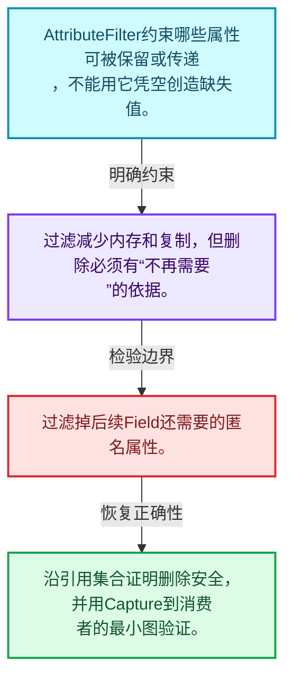
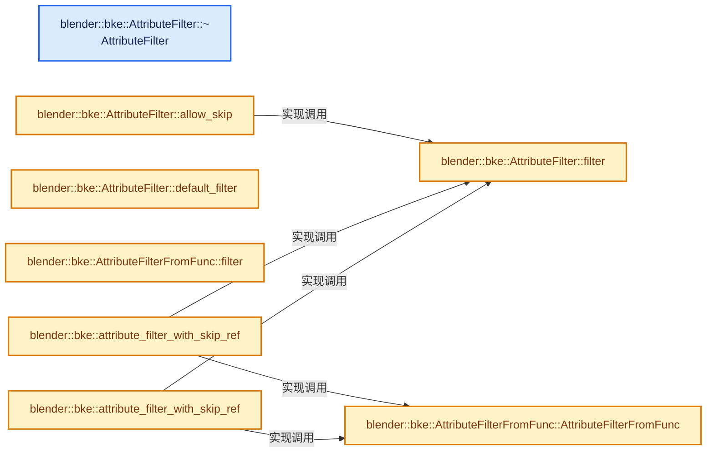
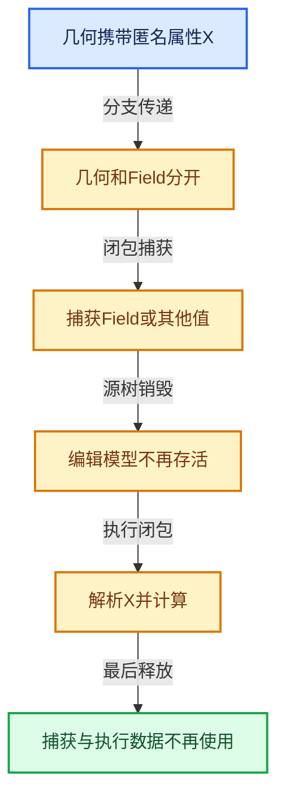

# 10-04 引用传播与过滤

[方向导航](README.md) · [总目录](../README.md) · [实现索引](../%E7%AC%A6%E5%8F%B7%E4%BE%9D%E8%B5%96%E4%B8%8E%E5%AE%9E%E7%8E%B0%E7%B4%A2%E5%BC%95.md)

## 从问题到实现

几何经过节点时如何保留必要数据？

过滤器只允许丢弃被证明不需要的属性；传播策略取决于节点声明与后续引用。

**数据模型**

AttributeFilter约束哪些属性可被保留或传递，不能用它凭空创造缺失值。

**设计取舍**

过滤减少内存和复制，但删除必须有“不再需要”的依据。

**最小反例**

过滤掉后续Field还需要的匿名属性。

**推导**

沿引用集合证明删除安全，并用Capture到消费者的最小图验证。

## 阅读地图与执行推演








图中的数值推演是本方向的教学模型；实际函数之间的调用边与概念分析边分别标注，不能把概念关系当作运行时调度顺序。

## 完整源码单元与就地讲解

中文讲解直接放在相关代码旁，复杂机制在代码下展开。原文折叠区保留基准行号；不需要在行号表和函数之间来回查找。类布局可分段展示，函数实现不按固定行数切开。

### 类型布局、声明与编译条件 · BKE_attribute_filter.hh L1—L34

<a id="t-d3ac5e37ea1d"></a>

<a id="t-0d6cdd8e20c3"></a>

<!-- annotated:b47ea19fd14eb7 -->

```cpp
/* SPDX-FileCopyrightText: 2023 Blender Authors
 *
 * SPDX-License-Identifier: GPL-2.0-or-later */

/** \file
 * \ingroup bke
 */

#pragma once

#include "BLI_string_ref.hh"

namespace blender::bke {

/**
 * Many geometry algorithms need to deal with attributes. For example, the Subdivide Curves code
 * has to properly interpolate attributes to the intermediate points. However, sometimes certain
 * attributes are not necessary after the operation anymore, so they can just be skipped for
 * optimization purposes. This is where #AttributeFilter comes in. It allows the caller to specify
 * which attributes should be processed and which should be ignored.
 *
 * \note It depends on the algorithm whether the output of the filter is followed exactly. For
 * example, some algorithm might not be able to propagate attributes on some domain, even if the
 * filter says that the attribute should be propagated.
 */
struct AttributeFilter {
 public:
  enum class Result {
    /** The algorithm is allowed to skip processing the attribute. */
    AllowSkip,
    /** The attribute should be processed/propagated if at all possible. */
    Process,
  };

```

<details>
<summary>核对原始源码：source/blender/blenkernel/BKE_attribute_filter.hh · L1—L34</summary>

<!-- original:b47ea19fd14eb7:source/blender/blenkernel/BKE_attribute_filter.hh:1:34 -->

```cpp
/* SPDX-FileCopyrightText: 2023 Blender Authors
 *
 * SPDX-License-Identifier: GPL-2.0-or-later */

/** \file
 * \ingroup bke
 */

#pragma once

#include "BLI_string_ref.hh"

namespace blender::bke {

/**
 * Many geometry algorithms need to deal with attributes. For example, the Subdivide Curves code
 * has to properly interpolate attributes to the intermediate points. However, sometimes certain
 * attributes are not necessary after the operation anymore, so they can just be skipped for
 * optimization purposes. This is where #AttributeFilter comes in. It allows the caller to specify
 * which attributes should be processed and which should be ignored.
 *
 * \note It depends on the algorithm whether the output of the filter is followed exactly. For
 * example, some algorithm might not be able to propagate attributes on some domain, even if the
 * filter says that the attribute should be propagated.
 */
struct AttributeFilter {
 public:
  enum class Result {
    /** The algorithm is allowed to skip processing the attribute. */
    AllowSkip,
    /** The attribute should be processed/propagated if at all possible. */
    Process,
  };

```

</details>

<a id="f-2f5e50b8ed2896d1"></a>

### `blender::bke::AttributeFilter::~AttributeFilter`

实现位置：[source/blender/blenkernel/BKE_attribute_filter.hh](../../../../../source/blender/blenkernel/BKE_attribute_filter.hh) · L35—L35。

**教学注释版**

<!-- annotated:16b82a601f798c -->

```cpp
  virtual ~AttributeFilter() = default;
```

<details>
<summary>核对原始源码：source/blender/blenkernel/BKE_attribute_filter.hh · L35—L35</summary>

<!-- original:16b82a601f798c:source/blender/blenkernel/BKE_attribute_filter.hh:35:35 -->

```cpp
  virtual ~AttributeFilter() = default;
```

</details>

**继续追踪实现**

本实现没有需要继续展开的显式调用；检查返回表达式、对象转换和调用者前置条件。

### 类型布局、声明与编译条件 · BKE_attribute_filter.hh L36—L40

<!-- annotated:ea477e71fd127a -->

```cpp

  /**
   * This function has different implementations in each derived class. By default, all attributes
   * should be processed.
   */
```

<details>
<summary>核对原始源码：source/blender/blenkernel/BKE_attribute_filter.hh · L36—L40</summary>

<!-- original:ea477e71fd127a:source/blender/blenkernel/BKE_attribute_filter.hh:36:40 -->

```cpp

  /**
   * This function has different implementations in each derived class. By default, all attributes
   * should be processed.
   */
```

</details>

<a id="f-236b3a1d5d2bc91f"></a>

### `blender::bke::AttributeFilter::filter`

实现位置：[source/blender/blenkernel/BKE_attribute_filter.hh](../../../../../source/blender/blenkernel/BKE_attribute_filter.hh) · L41—L44。

接口参数：

- `const StringRef`

**教学注释版**

<!-- annotated:019c056c0c5a56 -->

```cpp
  virtual Result filter(const StringRef /*name*/) const
  {
    return Result::Process;
  }
```

<details>
<summary>核对原始源码：source/blender/blenkernel/BKE_attribute_filter.hh · L41—L44</summary>

<!-- original:019c056c0c5a56:source/blender/blenkernel/BKE_attribute_filter.hh:41:44 -->

```cpp
  virtual Result filter(const StringRef /*name*/) const
  {
    return Result::Process;
  }
```

</details>

**结果出口**

- `return Result::Process;`

**继续追踪实现**

本实现没有需要继续展开的显式调用；检查返回表达式、对象转换和调用者前置条件。

### 类型布局、声明与编译条件 · BKE_attribute_filter.hh L45—L48

<!-- annotated:b6b07345b7eaf5 -->

```cpp

  /**
   * Utility to simplify the check for whether some attribute can be skipped.
   */
```

<details>
<summary>核对原始源码：source/blender/blenkernel/BKE_attribute_filter.hh · L45—L48</summary>

<!-- original:b6b07345b7eaf5:source/blender/blenkernel/BKE_attribute_filter.hh:45:48 -->

```cpp

  /**
   * Utility to simplify the check for whether some attribute can be skipped.
   */
```

</details>

<a id="f-58a977257551e818"></a>

### `blender::bke::AttributeFilter::allow_skip`

实现位置：[source/blender/blenkernel/BKE_attribute_filter.hh](../../../../../source/blender/blenkernel/BKE_attribute_filter.hh) · L49—L52。

接口参数：

- `const StringRef name`

**教学注释版**

<!-- annotated:48cf0750551f11 -->

```cpp
  bool allow_skip(const StringRef name) const
  {
    return this->filter(name) == Result::AllowSkip;
  }
```

<details>
<summary>核对原始源码：source/blender/blenkernel/BKE_attribute_filter.hh · L49—L52</summary>

<!-- original:48cf0750551f11:source/blender/blenkernel/BKE_attribute_filter.hh:49:52 -->

```cpp
  bool allow_skip(const StringRef name) const
  {
    return this->filter(name) == Result::AllowSkip;
  }
```

</details>

**结果出口**

- `return this->filter(name) == Result::AllowSkip;`

**继续追踪实现**

- `this->filter` → [blender::bke::AttributeFilter::filter · L41](04-%E5%BC%95%E7%94%A8%E4%BC%A0%E6%92%AD%E4%B8%8E%E8%BF%87%E6%BB%A4.md#f-236b3a1d5d2bc91f)。

<!-- annotated:264fad943e530e -->

```cpp

```

<details>
<summary>核对原始源码：source/blender/blenkernel/BKE_attribute_filter.hh · L53—L53</summary>

<!-- original:264fad943e530e:source/blender/blenkernel/BKE_attribute_filter.hh:53:53 -->

```cpp

```

</details>

<a id="f-a2b95eee7b748d9b"></a>

### `blender::bke::AttributeFilter::default_filter`

实现位置：[source/blender/blenkernel/BKE_attribute_filter.hh](../../../../../source/blender/blenkernel/BKE_attribute_filter.hh) · L54—L58。

**教学注释版**

<!-- annotated:899ad3eed495f7 -->

```cpp
  static const AttributeFilter &default_filter()
  {
    static AttributeFilter filter;
    return filter;
  }
```

<details>
<summary>核对原始源码：source/blender/blenkernel/BKE_attribute_filter.hh · L54—L58</summary>

<!-- original:899ad3eed495f7:source/blender/blenkernel/BKE_attribute_filter.hh:54:58 -->

```cpp
  static const AttributeFilter &default_filter()
  {
    static AttributeFilter filter;
    return filter;
  }
```

</details>

**结果出口**

- `return filter;`

**继续追踪实现**

本实现没有需要继续展开的显式调用；检查返回表达式、对象转换和调用者前置条件。

### 类型布局、声明与编译条件 · BKE_attribute_filter.hh L59—L61

<!-- annotated:e7e96b45d88b3c -->

```cpp
};

}  // namespace blender::bke
```

<details>
<summary>核对原始源码：source/blender/blenkernel/BKE_attribute_filter.hh · L59—L61</summary>

<!-- original:e7e96b45d88b3c:source/blender/blenkernel/BKE_attribute_filter.hh:59:61 -->

```cpp
};

}  // namespace blender::bke
```

</details>

### 类型布局、声明与编译条件 · BKE_attribute_filters.hh L1—L26

<a id="t-5f93292311db"></a>

`AttributeFilterFromFunc`在这里声明的数据成员：

- `Fn fn_`

<!-- annotated:6e5b570e5b9971 -->

```cpp
/* SPDX-FileCopyrightText: 2023 Blender Authors
 *
 * SPDX-License-Identifier: GPL-2.0-or-later */

/** \file
 * \ingroup bke
 */

#pragma once

#include "BKE_attribute_filter.hh"

#include "BLI_set.hh"

namespace blender::bke {

/**
 * Utility to create an #AttributeFilter from a lambda.
 */
template<typename Fn> struct AttributeFilterFromFunc : public AttributeFilter {
 private:
  Fn fn_;

  static_assert(std::is_invocable_r_v<Result, Fn, StringRef>);

 public:
```

<details>
<summary>核对原始源码：source/blender/blenkernel/BKE_attribute_filters.hh · L1—L26</summary>

<!-- original:6e5b570e5b9971:source/blender/blenkernel/BKE_attribute_filters.hh:1:26 -->

```cpp
/* SPDX-FileCopyrightText: 2023 Blender Authors
 *
 * SPDX-License-Identifier: GPL-2.0-or-later */

/** \file
 * \ingroup bke
 */

#pragma once

#include "BKE_attribute_filter.hh"

#include "BLI_set.hh"

namespace blender::bke {

/**
 * Utility to create an #AttributeFilter from a lambda.
 */
template<typename Fn> struct AttributeFilterFromFunc : public AttributeFilter {
 private:
  Fn fn_;

  static_assert(std::is_invocable_r_v<Result, Fn, StringRef>);

 public:
```

</details>

<a id="f-dadb3b089cb38419"></a>

### `blender::bke::AttributeFilterFromFunc::AttributeFilterFromFunc`

实现位置：[source/blender/blenkernel/BKE_attribute_filters.hh](../../../../../source/blender/blenkernel/BKE_attribute_filters.hh) · L27—L27。

接口参数：

- `Fn fn`

**教学注释版**

<!-- annotated:4a0fffb65a8819 -->

```cpp
  constexpr AttributeFilterFromFunc(Fn fn) : fn_(std::move(fn)) {}
```

<details>
<summary>核对原始源码：source/blender/blenkernel/BKE_attribute_filters.hh · L27—L27</summary>

<!-- original:4a0fffb65a8819:source/blender/blenkernel/BKE_attribute_filters.hh:27:27 -->

```cpp
  constexpr AttributeFilterFromFunc(Fn fn) : fn_(std::move(fn)) {}
```

</details>

**继续追踪实现**

本实现没有需要继续展开的显式调用；检查返回表达式、对象转换和调用者前置条件。

<!-- annotated:48062eecce6d16 -->

```cpp

```

<details>
<summary>核对原始源码：source/blender/blenkernel/BKE_attribute_filters.hh · L28—L28</summary>

<!-- original:48062eecce6d16:source/blender/blenkernel/BKE_attribute_filters.hh:28:28 -->

```cpp

```

</details>

<a id="f-2fa66ad469635949"></a>

### `blender::bke::AttributeFilterFromFunc::filter`

实现位置：[source/blender/blenkernel/BKE_attribute_filters.hh](../../../../../source/blender/blenkernel/BKE_attribute_filters.hh) · L29—L32。

接口参数：

- `const StringRef name`

**教学注释版**

<!-- annotated:b591f7466b6025 -->

```cpp
  Result filter(const StringRef name) const override
  {
    return fn_(name);
  }
```

<details>
<summary>核对原始源码：source/blender/blenkernel/BKE_attribute_filters.hh · L29—L32</summary>

<!-- original:b591f7466b6025:source/blender/blenkernel/BKE_attribute_filters.hh:29:32 -->

```cpp
  Result filter(const StringRef name) const override
  {
    return fn_(name);
  }
```

</details>

**结果出口**

- `return fn_(name);`

**继续追踪实现**

- `fn_` → [调用协议](../%E6%A8%A1%E6%9D%BF%E5%AE%8F%E4%B8%8E%E5%8A%A8%E6%80%81%E5%88%86%E6%B4%BE%E5%8D%8F%E8%AE%AE.md)：函数指针、局部可调用对象或未展开的宏；必须结合调用者环境。调用位置L31。

### 类型布局、声明与编译条件 · BKE_attribute_filters.hh L33—L38

<!-- annotated:55be1caacd3675 -->

```cpp
};

/**
 * Combines an existing #AttributeFilter and tags a few additional attributes that can/should be
 * skipped.
 */
```

<details>
<summary>核对原始源码：source/blender/blenkernel/BKE_attribute_filters.hh · L33—L38</summary>

<!-- original:55be1caacd3675:source/blender/blenkernel/BKE_attribute_filters.hh:33:38 -->

```cpp
};

/**
 * Combines an existing #AttributeFilter and tags a few additional attributes that can/should be
 * skipped.
 */
```

</details>

<a id="f-fb7ec97de265665e"></a>

### `blender::bke::attribute_filter_with_skip_ref`

实现位置：[source/blender/blenkernel/BKE_attribute_filters.hh](../../../../../source/blender/blenkernel/BKE_attribute_filters.hh) · L39—L48。

接口参数：

- `const AttributeFilter &filter`
- `const Span<StringRef> skip`

**教学注释版**

<!-- annotated:a30ee023fb09a2 -->

```cpp
inline auto attribute_filter_with_skip_ref(const AttributeFilter &filter,
                                           const Span<StringRef> skip)
{
  return AttributeFilterFromFunc([&filter, skip](const StringRef name) {
    if (skip.contains(name)) {
      return AttributeFilter::Result::AllowSkip;
    }
    return filter.filter(name);
  });
}
```

<details>
<summary>核对原始源码：source/blender/blenkernel/BKE_attribute_filters.hh · L39—L48</summary>

<!-- original:a30ee023fb09a2:source/blender/blenkernel/BKE_attribute_filters.hh:39:48 -->

```cpp
inline auto attribute_filter_with_skip_ref(const AttributeFilter &filter,
                                           const Span<StringRef> skip)
{
  return AttributeFilterFromFunc([&filter, skip](const StringRef name) {
    if (skip.contains(name)) {
      return AttributeFilter::Result::AllowSkip;
    }
    return filter.filter(name);
  });
}
```

</details>

**结果出口**

- `return AttributeFilterFromFunc([&filter, skip](const StringRef name) {`
- `return AttributeFilter::Result::AllowSkip;`
- `return filter.filter(name);`

**继续追踪实现**

- `AttributeFilterFromFunc` → [blender::bke::AttributeFilterFromFunc::AttributeFilterFromFunc · L27](04-%E5%BC%95%E7%94%A8%E4%BC%A0%E6%92%AD%E4%B8%8E%E8%BF%87%E6%BB%A4.md#f-dadb3b089cb38419)。
- `skip.contains` → [blender::Span::contains · L281](../01-%E5%9F%BA%E7%A1%80%E5%AE%B9%E5%99%A8%E4%B8%8E%E7%8E%B0%E4%BB%A3CPP/05-Span%E5%8F%AA%E8%AF%BB%E8%BF%9E%E7%BB%AD%E8%A7%86%E5%9B%BE.md#f-7caee498c984f2c0)。
- `filter.filter` → [blender::bke::AttributeFilter::filter · L41](04-%E5%BC%95%E7%94%A8%E4%BC%A0%E6%92%AD%E4%B8%8E%E8%BF%87%E6%BB%A4.md#f-236b3a1d5d2bc91f)。

### 类型布局、声明与编译条件 · BKE_attribute_filters.hh L49—L50

<!-- annotated:60fa9b357b91ed -->

```cpp

/** Same as above but with a #Set. */
```

<details>
<summary>核对原始源码：source/blender/blenkernel/BKE_attribute_filters.hh · L49—L50</summary>

<!-- original:60fa9b357b91ed:source/blender/blenkernel/BKE_attribute_filters.hh:49:50 -->

```cpp

/** Same as above but with a #Set. */
```

</details>

<a id="f-344bdf1375999376"></a>

### `blender::bke::attribute_filter_with_skip_ref`

实现位置：[source/blender/blenkernel/BKE_attribute_filters.hh](../../../../../source/blender/blenkernel/BKE_attribute_filters.hh) · L51—L60。

接口参数：

- `const AttributeFilter &filter`
- `const Set<StringT> &skip`

**教学注释版**

<!-- annotated:f479779eb4f41a -->

```cpp
template<typename StringT>
inline auto attribute_filter_with_skip_ref(const AttributeFilter &filter, const Set<StringT> &skip)
{
  return AttributeFilterFromFunc([&filter, &skip](const StringRef name) {
    // [讲解] skip.contains_as：查询活项数量或键是否存在。
    if (skip.contains_as(name)) {
      return AttributeFilter::Result::AllowSkip;
    }
    return filter.filter(name);
  });
}
```

<details>
<summary>核对原始源码：source/blender/blenkernel/BKE_attribute_filters.hh · L51—L60</summary>

<!-- original:f479779eb4f41a:source/blender/blenkernel/BKE_attribute_filters.hh:51:60 -->

```cpp
template<typename StringT>
inline auto attribute_filter_with_skip_ref(const AttributeFilter &filter, const Set<StringT> &skip)
{
  return AttributeFilterFromFunc([&filter, &skip](const StringRef name) {
    if (skip.contains_as(name)) {
      return AttributeFilter::Result::AllowSkip;
    }
    return filter.filter(name);
  });
}
```

</details>

**结果出口**

- `return AttributeFilterFromFunc([&filter, &skip](const StringRef name) {`
- `return AttributeFilter::Result::AllowSkip;`
- `return filter.filter(name);`

**继续追踪实现**

- `AttributeFilterFromFunc` → [blender::bke::AttributeFilterFromFunc::AttributeFilterFromFunc · L27](04-%E5%BC%95%E7%94%A8%E4%BC%A0%E6%92%AD%E4%B8%8E%E8%BF%87%E6%BB%A4.md#f-dadb3b089cb38419)。
- `skip.contains_as` → [blender::Set::contains_as · L314](../02-%E5%93%88%E5%B8%8C%E8%A1%A8%E4%B8%8E%E5%85%B3%E8%81%94%E6%95%B0%E6%8D%AE%E7%BB%93%E6%9E%84/08-Set%E4%B8%8E%E9%9B%86%E5%90%88%E8%AF%AD%E4%B9%89.md#f-cfb34e01adf42d3a)。
- `filter.filter` → [blender::bke::AttributeFilter::filter · L41](04-%E5%BC%95%E7%94%A8%E4%BC%A0%E6%92%AD%E4%B8%8E%E8%BF%87%E6%BB%A4.md#f-236b3a1d5d2bc91f)。

### 类型布局、声明与编译条件 · BKE_attribute_filters.hh L61—L65

<!-- annotated:fdb5f0b6d174ce -->

```cpp

/**
 * Creates a simple #AttributeFilter that skips allows the given attributes to be skipped, while
 * all others should be processed.
 */
```

<details>
<summary>核对原始源码：source/blender/blenkernel/BKE_attribute_filters.hh · L61—L65</summary>

<!-- original:fdb5f0b6d174ce:source/blender/blenkernel/BKE_attribute_filters.hh:61:65 -->

```cpp

/**
 * Creates a simple #AttributeFilter that skips allows the given attributes to be skipped, while
 * all others should be processed.
 */
```

</details>

<a id="f-daf63eca081bf88f"></a>

### `blender::bke::attribute_filter_from_skip_ref`

实现位置：[source/blender/blenkernel/BKE_attribute_filters.hh](../../../../../source/blender/blenkernel/BKE_attribute_filters.hh) · L66—L74。

接口参数：

- `const Span<StringRef> skip`

**教学注释版**

<!-- annotated:4319933887e62d -->

```cpp
inline auto attribute_filter_from_skip_ref(const Span<StringRef> skip)
{
  return AttributeFilterFromFunc([skip](const StringRef name) {
    if (skip.contains(name)) {
      return AttributeFilter::Result::AllowSkip;
    }
    return AttributeFilter::Result::Process;
  });
}
```

<details>
<summary>核对原始源码：source/blender/blenkernel/BKE_attribute_filters.hh · L66—L74</summary>

<!-- original:4319933887e62d:source/blender/blenkernel/BKE_attribute_filters.hh:66:74 -->

```cpp
inline auto attribute_filter_from_skip_ref(const Span<StringRef> skip)
{
  return AttributeFilterFromFunc([skip](const StringRef name) {
    if (skip.contains(name)) {
      return AttributeFilter::Result::AllowSkip;
    }
    return AttributeFilter::Result::Process;
  });
}
```

</details>

**结果出口**

- `return AttributeFilterFromFunc([skip](const StringRef name) {`
- `return AttributeFilter::Result::AllowSkip;`
- `return AttributeFilter::Result::Process;`

**继续追踪实现**

- `AttributeFilterFromFunc` → [blender::bke::AttributeFilterFromFunc::AttributeFilterFromFunc · L27](04-%E5%BC%95%E7%94%A8%E4%BC%A0%E6%92%AD%E4%B8%8E%E8%BF%87%E6%BB%A4.md#f-dadb3b089cb38419)。
- `skip.contains` → [blender::Span::contains · L281](../01-%E5%9F%BA%E7%A1%80%E5%AE%B9%E5%99%A8%E4%B8%8E%E7%8E%B0%E4%BB%A3CPP/05-Span%E5%8F%AA%E8%AF%BB%E8%BF%9E%E7%BB%AD%E8%A7%86%E5%9B%BE.md#f-7caee498c984f2c0)。

### 类型布局、声明与编译条件 · BKE_attribute_filters.hh L75—L76

<!-- annotated:537f8f69b3774b -->

```cpp

/** Same as above but with a #Set. */
```

<details>
<summary>核对原始源码：source/blender/blenkernel/BKE_attribute_filters.hh · L75—L76</summary>

<!-- original:537f8f69b3774b:source/blender/blenkernel/BKE_attribute_filters.hh:75:76 -->

```cpp

/** Same as above but with a #Set. */
```

</details>

<a id="f-cec0791774e42016"></a>

### `blender::bke::attribute_filter_from_skip_ref`

实现位置：[source/blender/blenkernel/BKE_attribute_filters.hh](../../../../../source/blender/blenkernel/BKE_attribute_filters.hh) · L77—L85。

接口参数：

- `const Set<StringT> &skip`

**教学注释版**

<!-- annotated:a2f14e984586ab -->

```cpp
template<typename StringT> inline auto attribute_filter_from_skip_ref(const Set<StringT> &skip)
{
  return AttributeFilterFromFunc([&skip](const StringRef name) {
    // [讲解] skip.contains_as：查询活项数量或键是否存在。
    if (skip.contains_as(name)) {
      return AttributeFilter::Result::AllowSkip;
    }
    return AttributeFilter::Result::Process;
  });
}
```

<details>
<summary>核对原始源码：source/blender/blenkernel/BKE_attribute_filters.hh · L77—L85</summary>

<!-- original:a2f14e984586ab:source/blender/blenkernel/BKE_attribute_filters.hh:77:85 -->

```cpp
template<typename StringT> inline auto attribute_filter_from_skip_ref(const Set<StringT> &skip)
{
  return AttributeFilterFromFunc([&skip](const StringRef name) {
    if (skip.contains_as(name)) {
      return AttributeFilter::Result::AllowSkip;
    }
    return AttributeFilter::Result::Process;
  });
}
```

</details>

**结果出口**

- `return AttributeFilterFromFunc([&skip](const StringRef name) {`
- `return AttributeFilter::Result::AllowSkip;`
- `return AttributeFilter::Result::Process;`

**继续追踪实现**

- `AttributeFilterFromFunc` → [blender::bke::AttributeFilterFromFunc::AttributeFilterFromFunc · L27](04-%E5%BC%95%E7%94%A8%E4%BC%A0%E6%92%AD%E4%B8%8E%E8%BF%87%E6%BB%A4.md#f-dadb3b089cb38419)。
- `skip.contains_as` → [blender::Set::contains_as · L314](../02-%E5%93%88%E5%B8%8C%E8%A1%A8%E4%B8%8E%E5%85%B3%E8%81%94%E6%95%B0%E6%8D%AE%E7%BB%93%E6%9E%84/08-Set%E4%B8%8E%E9%9B%86%E5%90%88%E8%AF%AD%E4%B9%89.md#f-cfb34e01adf42d3a)。

### 类型布局、声明与编译条件 · BKE_attribute_filters.hh L86—L87

<!-- annotated:14919c80a8ac99 -->

```cpp

}  // namespace blender::bke
```

<details>
<summary>核对原始源码：source/blender/blenkernel/BKE_attribute_filters.hh · L86—L87</summary>

<!-- original:14919c80a8ac99:source/blender/blenkernel/BKE_attribute_filters.hh:86:87 -->

```cpp

}  // namespace blender::bke
```

</details>

## 语法与相关类型

### 模板 template

模板把类型或常量作为生成实现的参数。读声明时先列出类型参数、非类型参数和默认值，再看使用者实际实例化了什么。模板声明本身不意味着每种T都支持其全部成员。

把T替换为int、string、只能移动的类型，分别检查每个被调用操作是否成立。

### 依赖名称 typename

typename既可引入类型模板参数，也可告诉编译器某个依赖名称是类型。它不创建运行时对象；解析期确认语法类别与实例化期检查具体类型是不同阶段。

区分typename T::value_type和T::size()，前者标记类型，后者是表达式。

### 常量求值 constexpr

constexpr声明允许相应实体参与常量求值，但constexpr函数仍可以在运行时执行。是否常量求值由调用场景和表达式合法性共同决定。

比较constexpr变量初始化和从运行时输入调用同一函数。

### 只读限定 const

const约束当前访问路径可做的修改。const指针、指向const的指针、const视图对象、const元素是不同位置的限定；其他别名可能仍可修改原对象。

分别写T* const、const T*与const T* const，并画出不可修改的层次。

### 移动转换 std::move

std::move把表达式转换为可供移动重载选择的值类别，实际资源转移发生在被选中的构造或赋值中。对const对象move可能仍调用复制，对视图move也不会获得底层数据所有权。

记录移动构造调用次数，不用变量名或std::move的出现次数替代测量。

### 异常边界 try与catch

try定义异常传播的局部边界。失败路径需要销毁已经成功构造的部分并释放相应存储；未构造的对象不能被析构。

在第k次构造失败，列出已经存在的对象集合与待释放缓冲。

### 运行时多态 virtual

虚调用根据实际动态类型选择实现；经基类指针销毁对象时通常需要相应虚析构契约。每元素虚调用和循环外一次分派有不同开销。

找出虚接口的实现类和调用频率，再讨论是否值得去虚拟化。

### 覆写检查 override

override要求函数确实覆盖基类虚函数，可捕获参数类型和const限定不匹配。它不改变基类规定的生命周期或线程约束。

故意改变一个参数或const，观察编译器如何拒绝误写的新函数。

### 枚举与状态模型 enum

枚举把有限状态命名；enum class避免许多隐式整数转换。状态机正确性还依赖允许的转移，不能只看有哪些枚举项。

列出每个状态的进入条件和离开条件，检查终止状态是否仍可能被调度。

## 实现练习与验证

列出几何输入到输出的引用保留集合。

参考推理：沿引用集合证明删除安全，并用Capture到消费者的最小图验证。

所有被读取的引用仍有对应数据；源树结束后执行对象所需信息存活；强引用图无不必要循环。

## 历史、跨库比较与证据

与C++ lambda、shared_ptr图和编译器活跃性分析比较：捕获环境保障寿命，引用集合保障所需数据传播，二者承担不同责任。

[历史提交索引](../%E5%8E%86%E5%8F%B2%E6%8F%90%E4%BA%A4%E4%B8%8E%E8%AE%BE%E8%AE%A1%E6%BC%94%E5%8C%96%E7%B4%A2%E5%BC%95.md) · [源码基准](../%E6%BA%90%E7%A0%81%E7%89%88%E6%9C%AC%E4%B8%8E%E8%A6%86%E7%9B%96%E7%B4%A2%E5%BC%95.md) · [验收报告](../%E9%AA%8C%E6%94%B6%E6%8A%A5%E5%91%8A.md)
