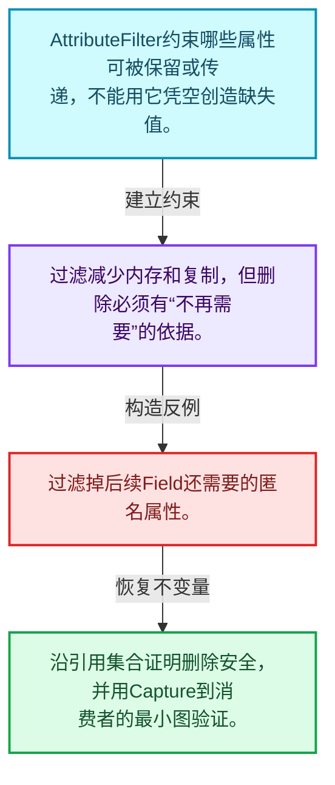
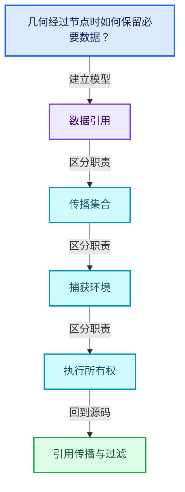
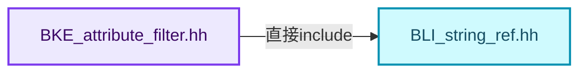
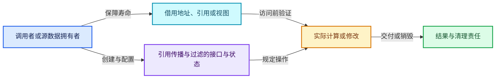
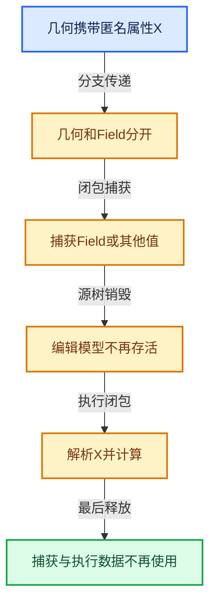

# 10-04 引用传播与过滤

[方向导航](README.md) · [总目录](../README.md) · [覆盖索引](../%E6%BA%90%E7%A0%81%E7%89%88%E6%9C%AC%E4%B8%8E%E8%A6%86%E7%9B%96%E7%B4%A2%E5%BC%95.md)

> 阅读顺序：问题与数据模型 → 语法与类型 → 源码逐行 → 调用线索 → 历史与取舍 → 推演和练习。

- 基准 HEAD：`cbda6b96c26c0dee3c3b5cbb93960c4ac06a6b30`。
- 记录日期：2026-10-14。
- 教学示例状态：正文中的推演不是本机性能实测；已运行练习见验收报告。

## 一、从问题到设计

几何经过节点时如何保留必要数据？

过滤器只允许丢弃被证明不需要的属性；传播策略取决于节点声明与后续引用。

本篇把语法、数据语义和系统取舍连接起来。表达式引用、承载数据与执行环境必须一起追踪，跨区域组合不能丢掉生命周期信息。

### 本篇独立模型与设计推理

AttributeFilter约束哪些属性可被保留或传递，不能用它凭空创造缺失值。

设计取舍：过滤减少内存和复制，但删除必须有“不再需要”的依据。

最小反例：过滤掉后续Field还需要的匿名属性。

推导与处理：沿引用集合证明删除安全，并用Capture到消费者的最小图验证。



### 源码范围与相邻篇章

| 文件 | 本篇逐行范围 | 基准SHA-256 |
|---|---|---|
| [source/blender/blenkernel/BKE_attribute_filter.hh](../../../../../source/blender/blenkernel/BKE_attribute_filter.hh) | L1—L61 | `849c4a5c815147b7b7ea531bc8e840c2a71d0384c61fe51d61786215ac762610` |
| [source/blender/blenkernel/BKE_attribute_filters.hh](../../../../../source/blender/blenkernel/BKE_attribute_filters.hh) | L1—L87 | `f7391a6b1347703a29a0d72bdc5fdf8b8ce4be88892e5700eb7953f25ee05fca` |

同一主讲文件可能分多篇覆盖；超出本篇范围的符号通过覆盖索引定位。空行与纯注释保留在源码摘录中，逐行表解释有效语句与语法边界；许可证头统一保留。

前篇：[节点树生命周期分析](03-%E8%8A%82%E7%82%B9%E6%A0%91%E7%94%9F%E5%91%BD%E5%91%A8%E6%9C%9F%E5%88%86%E6%9E%90.md).

后篇：[Bundle值组合](05-Bundle%E5%80%BC%E7%BB%84%E5%90%88.md).

## 二、类型、数据与阅读地图



这是概念依赖图，边表示阅读关系，不声称是运行时调用顺序。

### 直接编译依赖



箭头只表示头文件包含关系；完整调用线索见后面的符号定位表。

## 三、关键词、语法与类型角色

### 模板 template

模板把类型或常量作为生成实现的参数。读声明时先列出类型参数、非类型参数和默认值，再看使用者实际实例化了什么。模板声明本身不意味着每种T都支持其全部成员。

具体检查：把T替换为int、string、只能移动的类型，分别检查每个被调用操作是否成立。

### 依赖名称 typename

typename既可引入类型模板参数，也可告诉编译器某个依赖名称是类型。它不创建运行时对象；解析期确认语法类别与实例化期检查具体类型是不同阶段。

具体检查：区分typename T::value_type和T::size()，前者标记类型，后者是表达式。

### 常量求值 constexpr

constexpr声明允许相应实体参与常量求值，但constexpr函数仍可以在运行时执行。是否常量求值由调用场景和表达式合法性共同决定。

具体检查：比较constexpr变量初始化和从运行时输入调用同一函数。

### 只读限定 const

const约束当前访问路径可做的修改。const指针、指向const的指针、const视图对象、const元素是不同位置的限定；其他别名可能仍可修改原对象。

具体检查：分别写T* const、const T*与const T* const，并画出不可修改的层次。

### 移动转换 std::move

std::move把表达式转换为可供移动重载选择的值类别，实际资源转移发生在被选中的构造或赋值中。对const对象move可能仍调用复制，对视图move也不会获得底层数据所有权。

具体检查：记录移动构造调用次数，不用变量名或std::move的出现次数替代测量。

### 异常边界 try与catch

try定义异常传播的局部边界。失败路径需要销毁已经成功构造的部分并释放相应存储；未构造的对象不能被析构。

具体检查：在第k次构造失败，列出已经存在的对象集合与待释放缓冲。

### 运行时多态 virtual

虚调用根据实际动态类型选择实现；经基类指针销毁对象时通常需要相应虚析构契约。每元素虚调用和循环外一次分派有不同开销。

具体检查：找出虚接口的实现类和调用频率，再讨论是否值得去虚拟化。

### 覆写检查 override

override要求函数确实覆盖基类虚函数，可捕获参数类型和const限定不匹配。它不改变基类规定的生命周期或线程约束。

具体检查：故意改变一个参数或const，观察编译器如何拒绝误写的新函数。

### 枚举与状态模型 enum

枚举把有限状态命名；enum class避免许多隐式整数转换。状态机正确性还依赖允许的转移，不能只看有哪些枚举项。

具体检查：列出每个状态的进入条件和离开条件，检查终止状态是否仍可能被调度。

## 四、真实源码与逐行讲解

源码块保持原行内容，原始行号由小节标题及逐行表给出。表中的调用定位是静态阅读辅助；重载、模板实例化、宏展开和虚调用需结合完整声明，不能仅凭词法出现证明动态调用。

### BKE_attribute_filter.hh：L1—L61

<!-- source:source/blender/blenkernel/BKE_attribute_filter.hh:1:61 -->

```cpp
/* SPDX-FileCopyrightText: 2023 Blender Authors
 *
 * SPDX-License-Identifier: GPL-2.0-or-later */

/** \file
 * \ingroup bke
 */

#pragma once

#include "BLI_string_ref.hh"

namespace blender::bke {

/**
 * Many geometry algorithms need to deal with attributes. For example, the Subdivide Curves code
 * has to properly interpolate attributes to the intermediate points. However, sometimes certain
 * attributes are not necessary after the operation anymore, so they can just be skipped for
 * optimization purposes. This is where #AttributeFilter comes in. It allows the caller to specify
 * which attributes should be processed and which should be ignored.
 *
 * \note It depends on the algorithm whether the output of the filter is followed exactly. For
 * example, some algorithm might not be able to propagate attributes on some domain, even if the
 * filter says that the attribute should be propagated.
 */
struct AttributeFilter {
 public:
  enum class Result {
    /** The algorithm is allowed to skip processing the attribute. */
    AllowSkip,
    /** The attribute should be processed/propagated if at all possible. */
    Process,
  };

  virtual ~AttributeFilter() = default;

  /**
   * This function has different implementations in each derived class. By default, all attributes
   * should be processed.
   */
  virtual Result filter(const StringRef /*name*/) const
  {
    return Result::Process;
  }

  /**
   * Utility to simplify the check for whether some attribute can be skipped.
   */
  bool allow_skip(const StringRef name) const
  {
    return this->filter(name) == Result::AllowSkip;
  }

  static const AttributeFilter &default_filter()
  {
    static AttributeFilter filter;
    return filter;
  }
};

}  // namespace blender::bke
```

| 原始行 | 语义、约束与检查 |
|---|---|
| L9 | 防止同一头文件在一个翻译单元中重复展开；不控制多个源文件之间的链接或对象寿命。 |
| L11 | 引入编译依赖 "BLI_string_ref.hh"；这是声明可见性关系，不表示运行时一定调用该文件的所有接口。 |
| L13 | 把后续声明放入 blender::bke 命名空间，影响名称查找和符号归属，不创建运行时对象。 |
| L26 | 声明或定义类型 `struct AttributeFilter`。结合继承、访问权限和成员布局确认接口与拥有关系；前向声明本身没有完整对象布局。 |
| L27 | 切换成员访问权限为 public；它是编译期接口边界，不是线程同步或内存保护。 |
| L28 | 声明或定义类型 `enum class Result`。结合继承、访问权限和成员布局确认接口与拥有关系；前向声明本身没有完整对象布局。 |
| L30 | 本行是连续声明或表达式的一部分：`AllowSkip,`。与本段前后行合读；逗号、括号和限定符决定它属于参数、初始化列表还是实际计算。 |
| L32 | 本行是连续声明或表达式的一部分：`Process,`。与本段前后行合读；逗号、括号和限定符决定它属于参数、初始化列表还是实际计算。 |
| L33 | 结束当前语法单元。局部自动对象在离开其作用域时按规则销毁；这不等于所有被引用的外部数据也被释放。 |
| L35 | 显式采用编译器生成的特殊成员行为：`virtual ~AttributeFilter() = default;`。成员和基类的性质决定该操作是否可用、是否被删除及异常约定，不表示运行时给对象赋值为default。 |
| L41 | 出现调用或函数声明 `filter`，对应表达式为 `virtual Result filter(const StringRef ) const`。参数求值、返回类型与重载需结合前后完整语句；静态文本引用不能证明动态目标。 |
| L42 | 连接上一行的声明或控制结构与其语句块；后续行在这个作用域中执行或声明。 |
| L43 | 返回表达式 `Result::Process`。 |
| L44 | 结束当前语法单元。局部自动对象在离开其作用域时按规则销毁；这不等于所有被引用的外部数据也被释放。 |
| L49 | 出现调用或函数声明 `allow_skip`，对应表达式为 `bool allow_skip(const StringRef name) const`。参数求值、返回类型与重载需结合前后完整语句；静态文本引用不能证明动态目标。 |
| L50 | 连接上一行的声明或控制结构与其语句块；后续行在这个作用域中执行或声明。 |
| L51 | 返回表达式 `this->filter(name) == Result::AllowSkip`。 |
| L52 | 结束当前语法单元。局部自动对象在离开其作用域时按规则销毁；这不等于所有被引用的外部数据也被释放。 |
| L54 | 出现调用或函数声明 `default_filter`，对应表达式为 `static const AttributeFilter &default_filter()`。参数求值、返回类型与重载需结合前后完整语句；静态文本引用不能证明动态目标。 |
| L55 | 连接上一行的声明或控制结构与其语句块；后续行在这个作用域中执行或声明。 |
| L56 | 声明成员、局部对象或完成语句 `static AttributeFilter filter`。若为指针或引用，它本身不说明拥有；若为值对象，其构造析构由所在作用域或外层对象管理。 |
| L57 | 返回表达式 `filter`。 |
| L58 | 结束当前语法单元。局部自动对象在离开其作用域时按规则销毁；这不等于所有被引用的外部数据也被释放。 |
| L59 | 结束当前语法单元。局部自动对象在离开其作用域时按规则销毁；这不等于所有被引用的外部数据也被释放。 |
| L61 | 结束当前语法单元。局部自动对象在离开其作用域时按规则销毁；这不等于所有被引用的外部数据也被释放。 |

### BKE_attribute_filters.hh：L1—L48

<!-- source:source/blender/blenkernel/BKE_attribute_filters.hh:1:48 -->

```cpp
/* SPDX-FileCopyrightText: 2023 Blender Authors
 *
 * SPDX-License-Identifier: GPL-2.0-or-later */

/** \file
 * \ingroup bke
 */

#pragma once

#include "BKE_attribute_filter.hh"

#include "BLI_set.hh"

namespace blender::bke {

/**
 * Utility to create an #AttributeFilter from a lambda.
 */
template<typename Fn> struct AttributeFilterFromFunc : public AttributeFilter {
 private:
  Fn fn_;

  static_assert(std::is_invocable_r_v<Result, Fn, StringRef>);

 public:
  constexpr AttributeFilterFromFunc(Fn fn) : fn_(std::move(fn)) {}

  Result filter(const StringRef name) const override
  {
    return fn_(name);
  }
};

/**
 * Combines an existing #AttributeFilter and tags a few additional attributes that can/should be
 * skipped.
 */
inline auto attribute_filter_with_skip_ref(const AttributeFilter &filter,
                                           const Span<StringRef> skip)
{
  return AttributeFilterFromFunc([&filter, skip](const StringRef name) {
    if (skip.contains(name)) {
      return AttributeFilter::Result::AllowSkip;
    }
    return filter.filter(name);
  });
}
```

本段语义重点：

- 分支证据 `skip.contains(name))`：分别推演条件成立与不成立，核对相同出口处的状态。

| 原始行 | 语义、约束与检查 |
|---|---|
| L9 | 防止同一头文件在一个翻译单元中重复展开；不控制多个源文件之间的链接或对象寿命。 |
| L11 | 引入编译依赖 "BKE_attribute_filter.hh"；这是声明可见性关系，不表示运行时一定调用该文件的所有接口。 |
| L13 | 引入编译依赖 "BLI_set.hh"；这是声明可见性关系，不表示运行时一定调用该文件的所有接口。 |
| L15 | 把后续声明放入 blender::bke 命名空间，影响名称查找和符号归属，不创建运行时对象。 |
| L20 | 声明模板参数 `template<typename Fn> struct AttributeFilterFromFunc : public AttributeFilter {`。类型参数决定生成操作的类型，非类型参数可决定内嵌容量或编译期分支。 |
| L21 | 切换成员访问权限为 private；它是编译期接口边界，不是线程同步或内存保护。 |
| L22 | 声明成员、局部对象或完成语句 `Fn fn_`。若为指针或引用，它本身不说明拥有；若为值对象，其构造析构由所在作用域或外层对象管理。 |
| L24 | 在编译期检查 `static_assert(std::is_invocable_r_v<Result, Fn, StringRef>);`；条件失败导致编译错误，不存在运行时错误恢复路径。 |
| L26 | 切换成员访问权限为 public；它是编译期接口边界，不是线程同步或内存保护。 |
| L27 | 出现调用或函数声明 `AttributeFilterFromFunc`，对应表达式为 `constexpr AttributeFilterFromFunc(Fn fn) : fn_(std::move(fn)) {}`。参数求值、返回类型与重载需结合前后完整语句；静态文本引用不能证明动态目标。 |
| L29 | 出现调用或函数声明 `filter`，对应表达式为 `Result filter(const StringRef name) const override`。参数求值、返回类型与重载需结合前后完整语句；静态文本引用不能证明动态目标。 |
| L30 | 连接上一行的声明或控制结构与其语句块；后续行在这个作用域中执行或声明。 |
| L31 | 返回表达式 `fn_(name)`。 |
| L32 | 结束当前语法单元。局部自动对象在离开其作用域时按规则销毁；这不等于所有被引用的外部数据也被释放。 |
| L33 | 结束当前语法单元。局部自动对象在离开其作用域时按规则销毁；这不等于所有被引用的外部数据也被释放。 |
| L39 | 出现调用或函数声明 `attribute_filter_with_skip_ref`，对应表达式为 `inline auto attribute_filter_with_skip_ref(const AttributeFilter &filter,`。参数求值、返回类型与重载需结合前后完整语句；静态文本引用不能证明动态目标。 |
| L40 | 本行是连续声明或表达式的一部分：`const Span<StringRef> skip)`。与本段前后行合读；逗号、括号和限定符决定它属于参数、初始化列表还是实际计算。 |
| L41 | 连接上一行的声明或控制结构与其语句块；后续行在这个作用域中执行或声明。 |
| L42 | 返回表达式 `AttributeFilterFromFunc([&filter, skip](const StringRef name) {`。 |
| L43 | 判断 `skip.contains(name)`，成立时进入本分支，否则继续后续路径。 |
| L44 | 返回表达式 `AttributeFilter::Result::AllowSkip`。 |
| L45 | 结束当前语法单元。局部自动对象在离开其作用域时按规则销毁；这不等于所有被引用的外部数据也被释放。 |
| L46 | 返回表达式 `filter.filter(name)`。 |
| L47 | 结束当前语法单元。局部自动对象在离开其作用域时按规则销毁；这不等于所有被引用的外部数据也被释放。 |
| L48 | 结束当前语法单元。局部自动对象在离开其作用域时按规则销毁；这不等于所有被引用的外部数据也被释放。 |

### BKE_attribute_filters.hh：L49—L87

<!-- source:source/blender/blenkernel/BKE_attribute_filters.hh:49:87 -->

```cpp

/** Same as above but with a #Set. */
template<typename StringT>
inline auto attribute_filter_with_skip_ref(const AttributeFilter &filter, const Set<StringT> &skip)
{
  return AttributeFilterFromFunc([&filter, &skip](const StringRef name) {
    if (skip.contains_as(name)) {
      return AttributeFilter::Result::AllowSkip;
    }
    return filter.filter(name);
  });
}

/**
 * Creates a simple #AttributeFilter that skips allows the given attributes to be skipped, while
 * all others should be processed.
 */
inline auto attribute_filter_from_skip_ref(const Span<StringRef> skip)
{
  return AttributeFilterFromFunc([skip](const StringRef name) {
    if (skip.contains(name)) {
      return AttributeFilter::Result::AllowSkip;
    }
    return AttributeFilter::Result::Process;
  });
}

/** Same as above but with a #Set. */
template<typename StringT> inline auto attribute_filter_from_skip_ref(const Set<StringT> &skip)
{
  return AttributeFilterFromFunc([&skip](const StringRef name) {
    if (skip.contains_as(name)) {
      return AttributeFilter::Result::AllowSkip;
    }
    return AttributeFilter::Result::Process;
  });
}

}  // namespace blender::bke
```

本段语义重点：

- 分支证据 `skip.contains_as(name))`：分别推演条件成立与不成立，核对相同出口处的状态。
- 分支证据 `skip.contains(name))`：分别推演条件成立与不成立，核对相同出口处的状态。

| 原始行 | 语义、约束与检查 |
|---|---|
| L51 | 声明模板参数 `template<typename StringT>`。类型参数决定生成操作的类型，非类型参数可决定内嵌容量或编译期分支。 |
| L52 | 出现调用或函数声明 `attribute_filter_with_skip_ref`，对应表达式为 `inline auto attribute_filter_with_skip_ref(const AttributeFilter &filter, const Set<StringT> &skip)`。参数求值、返回类型与重载需结合前后完整语句；静态文本引用不能证明动态目标。 |
| L53 | 连接上一行的声明或控制结构与其语句块；后续行在这个作用域中执行或声明。 |
| L54 | 返回表达式 `AttributeFilterFromFunc([&filter, &skip](const StringRef name) {`。 |
| L55 | 判断 `skip.contains_as(name)`，成立时进入本分支，否则继续后续路径。 |
| L56 | 返回表达式 `AttributeFilter::Result::AllowSkip`。 |
| L57 | 结束当前语法单元。局部自动对象在离开其作用域时按规则销毁；这不等于所有被引用的外部数据也被释放。 |
| L58 | 返回表达式 `filter.filter(name)`。 |
| L59 | 结束当前语法单元。局部自动对象在离开其作用域时按规则销毁；这不等于所有被引用的外部数据也被释放。 |
| L60 | 结束当前语法单元。局部自动对象在离开其作用域时按规则销毁；这不等于所有被引用的外部数据也被释放。 |
| L66 | 出现调用或函数声明 `attribute_filter_from_skip_ref`，对应表达式为 `inline auto attribute_filter_from_skip_ref(const Span<StringRef> skip)`。参数求值、返回类型与重载需结合前后完整语句；静态文本引用不能证明动态目标。 |
| L67 | 连接上一行的声明或控制结构与其语句块；后续行在这个作用域中执行或声明。 |
| L68 | 返回表达式 `AttributeFilterFromFunc([skip](const StringRef name) {`。 |
| L69 | 判断 `skip.contains(name)`，成立时进入本分支，否则继续后续路径。 |
| L70 | 返回表达式 `AttributeFilter::Result::AllowSkip`。 |
| L71 | 结束当前语法单元。局部自动对象在离开其作用域时按规则销毁；这不等于所有被引用的外部数据也被释放。 |
| L72 | 返回表达式 `AttributeFilter::Result::Process`。 |
| L73 | 结束当前语法单元。局部自动对象在离开其作用域时按规则销毁；这不等于所有被引用的外部数据也被释放。 |
| L74 | 结束当前语法单元。局部自动对象在离开其作用域时按规则销毁；这不等于所有被引用的外部数据也被释放。 |
| L77 | 声明模板参数 `template<typename StringT> inline auto attribute_filter_from_skip_ref(const Set<StringT> &skip)`。类型参数决定生成操作的类型，非类型参数可决定内嵌容量或编译期分支。 |
| L78 | 连接上一行的声明或控制结构与其语句块；后续行在这个作用域中执行或声明。 |
| L79 | 返回表达式 `AttributeFilterFromFunc([&skip](const StringRef name) {`。 |
| L80 | 判断 `skip.contains_as(name)`，成立时进入本分支，否则继续后续路径。 |
| L81 | 返回表达式 `AttributeFilter::Result::AllowSkip`。 |
| L82 | 结束当前语法单元。局部自动对象在离开其作用域时按规则销毁；这不等于所有被引用的外部数据也被释放。 |
| L83 | 返回表达式 `AttributeFilter::Result::Process`。 |
| L84 | 结束当前语法单元。局部自动对象在离开其作用域时按规则销毁；这不等于所有被引用的外部数据也被释放。 |
| L85 | 结束当前语法单元。局部自动对象在离开其作用域时按规则销毁；这不等于所有被引用的外部数据也被释放。 |
| L87 | 结束当前语法单元。局部自动对象在离开其作用域时按规则销毁；这不等于所有被引用的外部数据也被释放。 |

## 五、接口定位、调用线索与生命周期

### 本篇声明与实现入口

| 源码位置 | 实际声明片段 |
|---|---|
| [BKE_attribute_filter.hh:L26](../../../../../source/blender/blenkernel/BKE_attribute_filter.hh#L26) | `struct AttributeFilter` |
| [BKE_attribute_filter.hh:L28](../../../../../source/blender/blenkernel/BKE_attribute_filter.hh#L28) | `enum class Result` |
| [BKE_attribute_filter.hh:L35](../../../../../source/blender/blenkernel/BKE_attribute_filter.hh#L35) | `virtual ~AttributeFilter() = default;` |
| [BKE_attribute_filter.hh:L41](../../../../../source/blender/blenkernel/BKE_attribute_filter.hh#L41) | `virtual Result filter(const StringRef /*name*/) const` |
| [BKE_attribute_filter.hh:L49](../../../../../source/blender/blenkernel/BKE_attribute_filter.hh#L49) | `bool allow_skip(const StringRef name) const` |
| [BKE_attribute_filter.hh:L54](../../../../../source/blender/blenkernel/BKE_attribute_filter.hh#L54) | `static const AttributeFilter &default_filter()` |
| [BKE_attribute_filters.hh:L20](../../../../../source/blender/blenkernel/BKE_attribute_filters.hh#L20) | `template<typename Fn> struct AttributeFilterFromFunc : public AttributeFilter` |
| [BKE_attribute_filters.hh:L27](../../../../../source/blender/blenkernel/BKE_attribute_filters.hh#L27) | `constexpr AttributeFilterFromFunc(Fn fn) : fn_(std::move(fn)) {}` |
| [BKE_attribute_filters.hh:L29](../../../../../source/blender/blenkernel/BKE_attribute_filters.hh#L29) | `Result filter(const StringRef name) const override` |
| [BKE_attribute_filters.hh:L39](../../../../../source/blender/blenkernel/BKE_attribute_filters.hh#L39) | `inline auto attribute_filter_with_skip_ref(const AttributeFilter &filter,` |
| [BKE_attribute_filters.hh:L52](../../../../../source/blender/blenkernel/BKE_attribute_filters.hh#L52) | `inline auto attribute_filter_with_skip_ref(const AttributeFilter &filter, const Set<StringT> &skip)` |
| [BKE_attribute_filters.hh:L66](../../../../../source/blender/blenkernel/BKE_attribute_filters.hh#L66) | `inline auto attribute_filter_from_skip_ref(const Span<StringRef> skip)` |
| [BKE_attribute_filters.hh:L77](../../../../../source/blender/blenkernel/BKE_attribute_filters.hh#L77) | `template<typename StringT> inline auto attribute_filter_from_skip_ref(const Set<StringT> &skip)` |

### 同名符号出现位置

以下表提供跨文件阅读入口，包含声明、调用或测试使用；没有经过完整C++名称解析，不把它命名为已证明的运行时调用图。

| 符号 | 位置 | 文本证据 |
|---|---|---|
| `filter` | [BKE_anonymous_attribute_id.hh:L31](../../../../../source/blender/blenkernel/BKE_anonymous_attribute_id.hh#L31) | `Result filter(const StringRef name) const override` |
| `filter` | [BKE_attribute_filters.hh:L29](../../../../../source/blender/blenkernel/BKE_attribute_filters.hh#L29) | `Result filter(const StringRef name) const override` |
| `filter` | [BKE_attribute_filters.hh:L46](../../../../../source/blender/blenkernel/BKE_attribute_filters.hh#L46) | `return filter.filter(name);` |

### 生命周期推理图



这是审查生命周期的通用模型。具体类是否拥有数据由本篇成员、构造、析构和调用者一起证明；任何箭头都不自动代表shared_ptr。

## 六、把代码放进具体数据中推演

本方向的共同数值模型如下。本篇的专门检查是：列出几何输入到输出的引用保留集合。

| 步骤 | 数据或状态 | 为什么需要这一步 |
|---|---|---|
| Capture | 几何携带匿名属性X | Field持有访问X的需求 |
| 分支传递 | 几何和Field分开 | 仍需在汇合处对应 |
| 闭包捕获 | 捕获Field或其他值 | 环境寿命延长到调用结束 |
| 源树销毁 | 编辑模型不再存活 | 执行所需信息仍须有拥有者 |
| 执行闭包 | 解析X并计算 | 缺失几何数据不能凭Field补回 |
| 最后释放 | 捕获与执行数据不再使用 | 避免环状共享导致泄漏 |



图是教学推演模型；精确分支与状态更新以本篇摘录及调用契约为准。

### 本篇独立练习与参考思路

列出几何输入到输出的引用保留集合。

参考思路：过滤器只允许丢弃被证明不需要的属性；传播策略取决于节点声明与后续引用。

将输入、预期结果和资源责任分成三张清单。先用最直接的实现给出可核对的答案，再替换成对应源码使用的表示；比较结果不变的条件，而不是只比较接口名字。

验收依据：所有被读取的引用仍有对应数据；源树结束后执行对象所需信息存活；强引用图无不必要循环。

## 七、复杂度、设计取舍与其他基础库

与C++ lambda、shared_ptr图和编译器活跃性分析比较：捕获环境保障寿命，引用集合保障所需数据传播，二者承担不同责任。

本篇的具体取舍：过滤器只允许丢弃被证明不需要的属性；传播策略取决于节点声明与后续引用。

| 观察维度 | 从源码取得证据的方法 | 本篇要避免的误判 |
|---|---|---|
| 时间 | 对循环次数、分派次数和重建频率分别计数 | 看到单次常数操作就断定整个操作序列是常数成本 |
| 内存 | 区分对象本体、容量存储、间接资源和共享控制块 | 用sizeof代替总内存 |
| 安全 | 沿构造、失败回滚、销毁与失效逐路径检查 | 把断言或非空指针当作完整安全证明 |
| 并发 | 逐字段确认锁、发布顺序和借用寿命 | 把引用计数线程安全等同数据读写线程安全 |

相关一手资料：

- [C++公开工作草案](https://eel.is/c++draft/)：持续更新的工作草案；语言与标准库语义以相应章节为准。
- [Blender依赖图设计](https://developer.blender.org/docs/features/core/depsgraph/)：包含历史设计背景，当前行为以本地源码为准。

资料用于核对契约和进一步阅读；这里没有声称外部库与Blender实现相同，也没有把上游性能数字当作本机实测。

## 八、历史提交与设计演化

本篇主要讲当前接口或辅助实现，方向导航给出相关架构演化提交；没有把不涉及本篇文件的提交硬写成该实现的引入证据。

## 九、反例、测试入口与掌握标准

需要实际构造的反例：

- 空输入或没有结果需求：确认接口允许的空状态与不允许访问的操作。
- 边界位置和退化结构：把长度为1、末尾位置、重复值或深链代入真实分支。
- 生命周期结束或修改之后：检查保存的指针、引用、结果视图是否仍有效。
- 与本篇核心不变量相冲突的输入：列出几何输入到输出的引用保留集合。

### 可运行的教学参考程序

[reference_exercises.cc](../_tools/reference_exercises.cc)包含独立于Blender的C++20参考检查：视图、简化SmallVector、异常回滚、哈希碰撞与删除、偏移数组、拓扑映射、共享缓存、表达式、惰性分支、闭包和暴力最近邻。

参考程序有意省略生产实现的完整能力。例如SmallVector禁止复制移动容器，不支持只能移动的元素，并禁止append参数别名到自身元素；TinyMap固定8槽，不提供增长。程序通过不能替代Blender实现测试。实际运行结果、编译器与命令见验收报告。

掌握标准：离开源码解释“几何经过节点时如何保留必要数据？”；独立完成上述练习；能指出一个会破坏数据引用相关约束的最小反例，并用具体代码行说明检查或修复应放在哪里。
