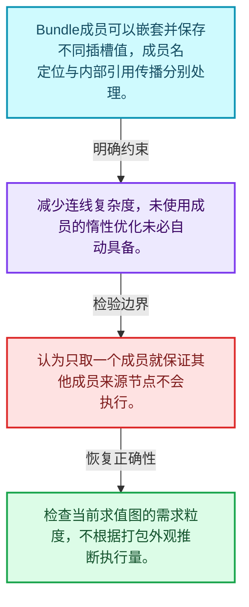
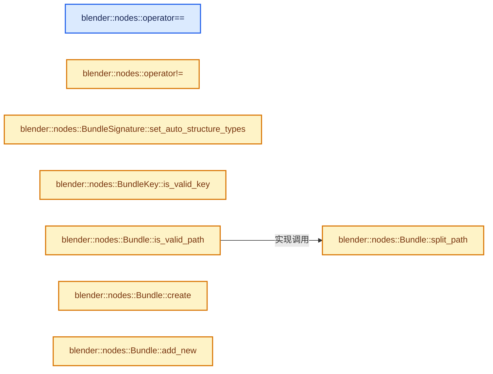
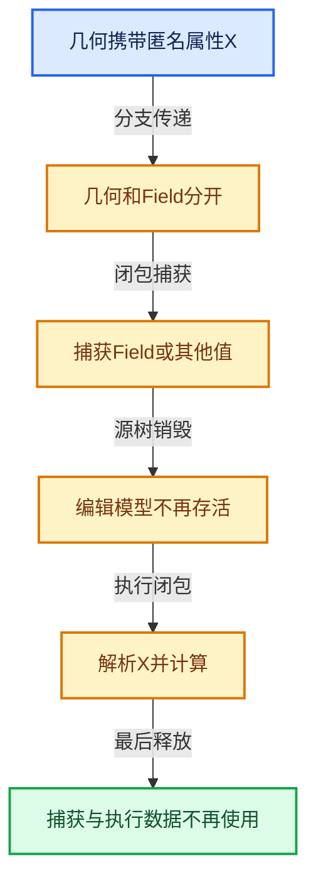

# 10-05 Bundle值组合

[方向导航](README.md) · [总目录](../README.md) · [实现索引](../00-课程指南/02-源码与提交索引/符号依赖与实现索引.md)

## 从问题到实现

多种插槽值怎样作为一个值传递？

命名成员组合简化连线但引入嵌套类型和引用传播；打包不自动消除未使用成员的计算。

**数据模型**

Bundle成员可以嵌套并保存不同插槽值，成员名定位与内部引用传播分别处理。

**设计取舍**

减少连线复杂度，未使用成员的惰性优化未必自动具备。

**最小反例**

认为只取一个成员就保证其他成员来源节点不会执行。

**推导**

检查当前求值图的需求粒度，不根据打包外观推断执行量。

## 阅读地图与执行推演








图中的数值推演是本方向的教学模型；实际函数之间的调用边与概念分析边分别标注，不能把概念关系当作运行时调度顺序。

## 完整源码单元与就地讲解

中文讲解直接放在相关代码旁，复杂机制在代码下展开。原文折叠区保留基准行号；不需要在行号表和函数之间来回查找。类布局可分段展示，函数实现不按固定行数切开。

### 类型布局、声明与编译条件 · geometry_nodes_bundle.cc L1—L20

<!-- annotated:f1101fecefbff1 -->

```cpp
/* SPDX-FileCopyrightText: 2025 Blender Authors
 *
 * SPDX-License-Identifier: GPL-2.0-or-later */

/** \file
 * \ingroup nodes
 */

#include <fmt/format.h>
#include <fmt/ranges.h>

#include "BKE_node_socket_value.hh"

#include "BKE_node_runtime.hh"

#include "NOD_geometry_nodes_bundle.hh"
#include "NOD_geometry_nodes_bundle_signature.hh"

namespace blender::nodes {

```

<details>
<summary>核对原始源码：source/blender/nodes/intern/geometry_nodes_bundle.cc · L1—L20</summary>

<!-- original:f1101fecefbff1:source/blender/nodes/intern/geometry_nodes_bundle.cc:1:20 -->

```cpp
/* SPDX-FileCopyrightText: 2025 Blender Authors
 *
 * SPDX-License-Identifier: GPL-2.0-or-later */

/** \file
 * \ingroup nodes
 */

#include <fmt/format.h>
#include <fmt/ranges.h>

#include "BKE_node_socket_value.hh"

#include "BKE_node_runtime.hh"

#include "NOD_geometry_nodes_bundle.hh"
#include "NOD_geometry_nodes_bundle_signature.hh"

namespace blender::nodes {

```

</details>

<a id="f-78ac855754d32747"></a>

### `blender::nodes::operator==`

实现位置：[source/blender/nodes/intern/geometry_nodes_bundle.cc](../../../../../source/blender/nodes/intern/geometry_nodes_bundle.cc) · L21—L24。

接口参数：

- `const BundleSignature &a`
- `const BundleSignature &b`

**教学注释版**

<!-- annotated:c9200422c41dda -->

```cpp
bool operator==(const BundleSignature &a, const BundleSignature &b)
{
  return a.items.as_span() == b.items.as_span();
}
```

<details>
<summary>核对原始源码：source/blender/nodes/intern/geometry_nodes_bundle.cc · L21—L24</summary>

<!-- original:c9200422c41dda:source/blender/nodes/intern/geometry_nodes_bundle.cc:21:24 -->

```cpp
bool operator==(const BundleSignature &a, const BundleSignature &b)
{
  return a.items.as_span() == b.items.as_span();
}
```

</details>

**结果出口**

- `return a.items.as_span() == b.items.as_span();`

**继续追踪实现**

- `a.items.as_span` → [调用协议](../00-课程指南/01-路线与规范/模板宏与动态分派协议.md)：接收对象类型依赖auto、返回值或模板实例；不按同名猜测目标。调用位置L23。
- `b.items.as_span` → [调用协议](../00-课程指南/01-路线与规范/模板宏与动态分派协议.md)：接收对象类型依赖auto、返回值或模板实例；不按同名猜测目标。调用位置L23。

<!-- annotated:29b8b26f04bc04 -->

```cpp

```

<details>
<summary>核对原始源码：source/blender/nodes/intern/geometry_nodes_bundle.cc · L25—L25</summary>

<!-- original:29b8b26f04bc04:source/blender/nodes/intern/geometry_nodes_bundle.cc:25:25 -->

```cpp

```

</details>

<a id="f-7b6e1ed6b2fad087"></a>

### `blender::nodes::operator!=`

实现位置：[source/blender/nodes/intern/geometry_nodes_bundle.cc](../../../../../source/blender/nodes/intern/geometry_nodes_bundle.cc) · L26—L29。

接口参数：

- `const BundleSignature &a`
- `const BundleSignature &b`

**教学注释版**

<!-- annotated:384e3cc405e822 -->

```cpp
bool operator!=(const BundleSignature &a, const BundleSignature &b)
{
  return !(a == b);
}
```

<details>
<summary>核对原始源码：source/blender/nodes/intern/geometry_nodes_bundle.cc · L26—L29</summary>

<!-- original:384e3cc405e822:source/blender/nodes/intern/geometry_nodes_bundle.cc:26:29 -->

```cpp
bool operator!=(const BundleSignature &a, const BundleSignature &b)
{
  return !(a == b);
}
```

</details>

**结果出口**

- `return !(a == b);`

**继续追踪实现**

本实现没有需要继续展开的显式调用；检查返回表达式、对象转换和调用者前置条件。

<!-- annotated:1af50a0badaf81 -->

```cpp

```

<details>
<summary>核对原始源码：source/blender/nodes/intern/geometry_nodes_bundle.cc · L30—L30</summary>

<!-- original:1af50a0badaf81:source/blender/nodes/intern/geometry_nodes_bundle.cc:30:30 -->

```cpp

```

</details>

<a id="f-04ad5ba574fdf901"></a>

### `blender::nodes::BundleSignature::set_auto_structure_types`

实现位置：[source/blender/nodes/intern/geometry_nodes_bundle.cc](../../../../../source/blender/nodes/intern/geometry_nodes_bundle.cc) · L31—L37。

**教学注释版**

<!-- annotated:509ab430ea1757 -->

```cpp
void BundleSignature::set_auto_structure_types()
{
  for (const BundleSignature::Item &item : this->items) {
    const_cast<BundleSignature::Item &>(item).structure_type =
        NodeSocketInterfaceStructureType::Auto;
  }
}
```

<details>
<summary>核对原始源码：source/blender/nodes/intern/geometry_nodes_bundle.cc · L31—L37</summary>

<!-- original:509ab430ea1757:source/blender/nodes/intern/geometry_nodes_bundle.cc:31:37 -->

```cpp
void BundleSignature::set_auto_structure_types()
{
  for (const BundleSignature::Item &item : this->items) {
    const_cast<BundleSignature::Item &>(item).structure_type =
        NodeSocketInterfaceStructureType::Auto;
  }
}
```

</details>

**继续追踪实现**

本实现没有需要继续展开的显式调用；检查返回表达式、对象转换和调用者前置条件。

<!-- annotated:b7a32cc01efc2c -->

```cpp

```

<details>
<summary>核对原始源码：source/blender/nodes/intern/geometry_nodes_bundle.cc · L38—L38</summary>

<!-- original:b7a32cc01efc2c:source/blender/nodes/intern/geometry_nodes_bundle.cc:38:38 -->

```cpp

```

</details>

<a id="f-1727e83d6c1766e1"></a>

### `blender::nodes::BundleKey::is_valid_key`

实现位置：[source/blender/nodes/intern/geometry_nodes_bundle.cc](../../../../../source/blender/nodes/intern/geometry_nodes_bundle.cc) · L39—L50。

接口参数：

- `const StringRef key`

**教学注释版**

<!-- annotated:0636535b2aef9c -->

```cpp
bool BundleKey::is_valid_key(const StringRef key)
{
  if (key.is_empty()) {
    return false;
  }
  if (key != key.trim()) {
    /* Keys must not have leading or trailing white-space. This simplifies potentially using these
     * keys in expressions later on (or even just have a comma separated list of keys). */
    return false;
  }
  return key.find_first_of(BundleKey::forbidden_key_chars) == StringRef::not_found;
}
```

<details>
<summary>核对原始源码：source/blender/nodes/intern/geometry_nodes_bundle.cc · L39—L50</summary>

<!-- original:0636535b2aef9c:source/blender/nodes/intern/geometry_nodes_bundle.cc:39:50 -->

```cpp
bool BundleKey::is_valid_key(const StringRef key)
{
  if (key.is_empty()) {
    return false;
  }
  if (key != key.trim()) {
    /* Keys must not have leading or trailing white-space. This simplifies potentially using these
     * keys in expressions later on (or even just have a comma separated list of keys). */
    return false;
  }
  return key.find_first_of(BundleKey::forbidden_key_chars) == StringRef::not_found;
}
```

</details>

**结果出口**

- `return false;`
- `return key.find_first_of(BundleKey::forbidden_key_chars) == StringRef::not_found;`

**继续追踪实现**

- `key.is_empty` → [blender::nodes::Bundle::is_empty · L483](../90-实现依赖专题/04-Nodes节点系统/NOD_geometry_nodes_bundle.hh.md#f-a112ec28493ab618)。
- `key.trim` → [调用协议](../00-课程指南/01-路线与规范/模板宏与动态分派协议.md)：由接收对象具体类型或运行时策略提供实现。调用位置L44。
- `key.find_first_of` → [blender::StringRefBase::find_first_of · L363](../01-基础容器与现代CPP/15-StringRef字符串视图.md#f-1f3c5f639269f8da)；[blender::StringRefBase::find_first_of · L369](../01-基础容器与现代CPP/15-StringRef字符串视图.md#f-d68ec25e99992ba5)。同名重载需按实参类型选择。

<!-- annotated:3b385b9620aba0 -->

```cpp

```

<details>
<summary>核对原始源码：source/blender/nodes/intern/geometry_nodes_bundle.cc · L51—L51</summary>

<!-- original:3b385b9620aba0:source/blender/nodes/intern/geometry_nodes_bundle.cc:51:51 -->

```cpp

```

</details>

<a id="f-de824016abdd7b56"></a>

### `blender::nodes::Bundle::is_valid_path`

实现位置：[source/blender/nodes/intern/geometry_nodes_bundle.cc](../../../../../source/blender/nodes/intern/geometry_nodes_bundle.cc) · L52—L55。

接口参数：

- `const StringRef path`

**教学注释版**

<!-- annotated:46507fd59ea331 -->

```cpp
bool Bundle::is_valid_path(const StringRef path)
{
  return split_path(path).has_value();
}
```

<details>
<summary>核对原始源码：source/blender/nodes/intern/geometry_nodes_bundle.cc · L52—L55</summary>

<!-- original:46507fd59ea331:source/blender/nodes/intern/geometry_nodes_bundle.cc:52:55 -->

```cpp
bool Bundle::is_valid_path(const StringRef path)
{
  return split_path(path).has_value();
}
```

</details>

**结果出口**

- `return split_path(path).has_value();`

**继续追踪实现**

- `split_path(path).has_value` → [调用协议](../00-课程指南/01-路线与规范/模板宏与动态分派协议.md)：接收对象类型依赖auto、返回值或模板实例；不按同名猜测目标。调用位置L54。
- `split_path` → [blender::nodes::Bundle::split_path · L57](05-Bundle值组合.md#f-6be8a5b6ff42af9a)。

<!-- annotated:fe50faba3cf153 -->

```cpp

```

<details>
<summary>核对原始源码：source/blender/nodes/intern/geometry_nodes_bundle.cc · L56—L56</summary>

<!-- original:fe50faba3cf153:source/blender/nodes/intern/geometry_nodes_bundle.cc:56:56 -->

```cpp

```

</details>

<a id="f-6be8a5b6ff42af9a"></a>

### `blender::nodes::Bundle::split_path`

实现位置：[source/blender/nodes/intern/geometry_nodes_bundle.cc](../../../../../source/blender/nodes/intern/geometry_nodes_bundle.cc) · L57—L86。

接口参数：

- `const StringRef path`

**教学注释版**

<!-- annotated:3c1830ad4e79d1 -->

```cpp
std::optional<Vector<BundleKey>> Bundle::split_path(const StringRef path)
{
  if (path.is_empty()) {
    return std::nullopt;
  }
  Vector<BundleKey> path_elems;
  StringRef remaining = path;
  while (!remaining.is_empty()) {
    const int sep = remaining.find_first_of('/');
    if (sep == StringRef::not_found) {
      const StringRef key_str = remaining;
      if (const std::optional<BundleKey> key = BundleKey::from_str(key_str)) {
        // [讲解] path_elems.append：在尾部建立新元素，必要时先扩大存储。
        path_elems.append(*key);
      }
      else {
        return std::nullopt;
      }
      break;
    }
    const StringRef key_str = remaining.substr(0, sep);
    if (const std::optional<BundleKey> key = BundleKey::from_str(key_str)) {
      path_elems.append(*key);
      remaining = remaining.substr(sep + 1);
    }
    else {
      return std::nullopt;
    }
  }
  return path_elems;
}
```

<details>
<summary>核对原始源码：source/blender/nodes/intern/geometry_nodes_bundle.cc · L57—L86</summary>

<!-- original:3c1830ad4e79d1:source/blender/nodes/intern/geometry_nodes_bundle.cc:57:86 -->

```cpp
std::optional<Vector<BundleKey>> Bundle::split_path(const StringRef path)
{
  if (path.is_empty()) {
    return std::nullopt;
  }
  Vector<BundleKey> path_elems;
  StringRef remaining = path;
  while (!remaining.is_empty()) {
    const int sep = remaining.find_first_of('/');
    if (sep == StringRef::not_found) {
      const StringRef key_str = remaining;
      if (const std::optional<BundleKey> key = BundleKey::from_str(key_str)) {
        path_elems.append(*key);
      }
      else {
        return std::nullopt;
      }
      break;
    }
    const StringRef key_str = remaining.substr(0, sep);
    if (const std::optional<BundleKey> key = BundleKey::from_str(key_str)) {
      path_elems.append(*key);
      remaining = remaining.substr(sep + 1);
    }
    else {
      return std::nullopt;
    }
  }
  return path_elems;
}
```

</details>

**沿实际写入检查状态**

- `remaining = remaining.substr(sep + 1);`

**结果出口**

- `return std::nullopt;`
- `return path_elems;`

**继续追踪实现**

- `path.is_empty` → [blender::nodes::Bundle::is_empty · L483](../90-实现依赖专题/04-Nodes节点系统/NOD_geometry_nodes_bundle.hh.md#f-a112ec28493ab618)。
- `remaining.is_empty` → [blender::nodes::Bundle::is_empty · L483](../90-实现依赖专题/04-Nodes节点系统/NOD_geometry_nodes_bundle.hh.md#f-a112ec28493ab618)。
- `remaining.find_first_of` → [blender::StringRefBase::find_first_of · L363](../01-基础容器与现代CPP/15-StringRef字符串视图.md#f-1f3c5f639269f8da)；[blender::StringRefBase::find_first_of · L369](../01-基础容器与现代CPP/15-StringRef字符串视图.md#f-d68ec25e99992ba5)。同名重载需按实参类型选择。
- `BundleKey::from_str` → [blender::nodes::BundleKey::from_str · L508](../90-实现依赖专题/04-Nodes节点系统/NOD_geometry_nodes_bundle.hh.md#f-db6a813acf972c45)。
- `path_elems.append` → [blender::Vector::append · L498](../01-基础容器与现代CPP/11-Vector插入删除与重排.md#f-5bde268a69e443ec)；[blender::Vector::append · L502](../01-基础容器与现代CPP/11-Vector插入删除与重排.md#f-591e0b15e6308532)。同名重载需按实参类型选择。
- `remaining.substr` → [调用协议](../00-课程指南/01-路线与规范/模板宏与动态分派协议.md)：由接收对象具体类型或运行时策略提供实现。调用位置L76。

<!-- annotated:b8d60b21cfab2d -->

```cpp

```

<details>
<summary>核对原始源码：source/blender/nodes/intern/geometry_nodes_bundle.cc · L87—L87</summary>

<!-- original:b8d60b21cfab2d:source/blender/nodes/intern/geometry_nodes_bundle.cc:87:87 -->

```cpp

```

</details>

<a id="f-e048ba1da7751af9"></a>

### `blender::nodes::Bundle::create`

实现位置：[source/blender/nodes/intern/geometry_nodes_bundle.cc](../../../../../source/blender/nodes/intern/geometry_nodes_bundle.cc) · L88—L91。

**教学注释版**

<!-- annotated:b3b7f92fd8a338 -->

```cpp
BundlePtr Bundle::create()
{
  return BundlePtr(MEM_new<Bundle>(__func__));
}
```

<details>
<summary>核对原始源码：source/blender/nodes/intern/geometry_nodes_bundle.cc · L88—L91</summary>

<!-- original:b3b7f92fd8a338:source/blender/nodes/intern/geometry_nodes_bundle.cc:88:91 -->

```cpp
BundlePtr Bundle::create()
{
  return BundlePtr(MEM_new<Bundle>(__func__));
}
```

</details>

**结果出口**

- `return BundlePtr(MEM_new<Bundle>(__func__));`

**继续追踪实现**

- `BundlePtr` → [调用协议](../00-课程指南/01-路线与规范/模板宏与动态分派协议.md)：函数指针、局部可调用对象或未展开的宏；必须结合调用者环境。调用位置L90。
- `MEM_new<Bundle>` → [MEM_new · L351](../90-实现依赖专题/07-Intern运行时与平台/guardedalloc/MEM_guardedalloc.h.md#f-115f9b6784f89912)。

<!-- annotated:2411ee1834cb5a -->

```cpp

```

<details>
<summary>核对原始源码：source/blender/nodes/intern/geometry_nodes_bundle.cc · L92—L92</summary>

<!-- original:2411ee1834cb5a:source/blender/nodes/intern/geometry_nodes_bundle.cc:92:92 -->

```cpp

```

</details>

<a id="f-024966f8ba4f7f41"></a>

### `blender::nodes::Bundle::add_new`

实现位置：[source/blender/nodes/intern/geometry_nodes_bundle.cc](../../../../../source/blender/nodes/intern/geometry_nodes_bundle.cc) · L93—L96。

接口参数：

- `const BundleKey key`
- `const BundleItemValue &value`

**教学注释版**

<!-- annotated:5d9fd3f59c405a -->

```cpp
void Bundle::add_new(const BundleKey key, const BundleItemValue &value)
{
  items_.add_new_as(key, value);
}
```

<details>
<summary>核对原始源码：source/blender/nodes/intern/geometry_nodes_bundle.cc · L93—L96</summary>

<!-- original:5d9fd3f59c405a:source/blender/nodes/intern/geometry_nodes_bundle.cc:93:96 -->

```cpp
void Bundle::add_new(const BundleKey key, const BundleItemValue &value)
{
  items_.add_new_as(key, value);
}
```

</details>

**继续追踪实现**

- `items_.add_new_as` → [调用协议](../00-课程指南/01-路线与规范/模板宏与动态分派协议.md)：接收对象类型依赖auto、返回值或模板实例；不按同名猜测目标。调用位置L95。

<!-- annotated:e71e348c3fb23b -->

```cpp

```

<details>
<summary>核对原始源码：source/blender/nodes/intern/geometry_nodes_bundle.cc · L97—L97</summary>

<!-- original:e71e348c3fb23b:source/blender/nodes/intern/geometry_nodes_bundle.cc:97:97 -->

```cpp

```

</details>

<a id="f-e23db06d4fd3b4f6"></a>

### `blender::nodes::Bundle::add_new`

实现位置：[source/blender/nodes/intern/geometry_nodes_bundle.cc](../../../../../source/blender/nodes/intern/geometry_nodes_bundle.cc) · L98—L101。

接口参数：

- `BundleKey key`
- `BundleItemValue &&value`

**教学注释版**

<!-- annotated:edf089d25d388a -->

```cpp
void Bundle::add_new(BundleKey key, BundleItemValue &&value)
{
  // [讲解] std::move：把表达式转换成可供移动重载选择的值类别；不保证真的移动，不结束源对象寿命，对const值可能选择复制。
  items_.add_new_as(key, std::move(value));
}
```

<details>
<summary>核对原始源码：source/blender/nodes/intern/geometry_nodes_bundle.cc · L98—L101</summary>

<!-- original:edf089d25d388a:source/blender/nodes/intern/geometry_nodes_bundle.cc:98:101 -->

```cpp
void Bundle::add_new(BundleKey key, BundleItemValue &&value)
{
  items_.add_new_as(key, std::move(value));
}
```

</details>

**继续追踪实现**

- `items_.add_new_as` → [调用协议](../00-课程指南/01-路线与规范/模板宏与动态分派协议.md)：接收对象类型依赖auto、返回值或模板实例；不按同名猜测目标。调用位置L100。
- `std::move` → [外部契约](https://eel.is/c++draft/utility.forward)：把表达式转换成可供移动重载选择的值类别；不保证真的移动，不结束源对象寿命，对const值可能选择复制。

<!-- annotated:ad8f39d4f1e92f -->

```cpp

```

<details>
<summary>核对原始源码：source/blender/nodes/intern/geometry_nodes_bundle.cc · L102—L102</summary>

<!-- original:ad8f39d4f1e92f:source/blender/nodes/intern/geometry_nodes_bundle.cc:102:102 -->

```cpp

```

</details>

<a id="f-149d390d8c299702"></a>

### `blender::nodes::Bundle::add_override`

实现位置：[source/blender/nodes/intern/geometry_nodes_bundle.cc](../../../../../source/blender/nodes/intern/geometry_nodes_bundle.cc) · L103—L107。

接口参数：

- `const BundleKey key`
- `const BundleItemValue &value`

**教学注释版**

<!-- annotated:dcc2b59200dae9 -->

```cpp
void Bundle::add_override(const BundleKey key, const BundleItemValue &value)
{
  this->remove(key);
  this->add_new(key, value);
}
```

<details>
<summary>核对原始源码：source/blender/nodes/intern/geometry_nodes_bundle.cc · L103—L107</summary>

<!-- original:dcc2b59200dae9:source/blender/nodes/intern/geometry_nodes_bundle.cc:103:107 -->

```cpp
void Bundle::add_override(const BundleKey key, const BundleItemValue &value)
{
  this->remove(key);
  this->add_new(key, value);
}
```

</details>

**继续追踪实现**

- `this->remove` → [blender::nodes::Bundle::remove · L293](05-Bundle值组合.md#f-f3474163d6d7aae9)。
- `this->add_new` → [blender::nodes::Bundle::add_new · L93](05-Bundle值组合.md#f-024966f8ba4f7f41)；[blender::nodes::Bundle::add_new · L98](05-Bundle值组合.md#f-e23db06d4fd3b4f6)。同名重载需按实参类型选择。

<!-- annotated:d0262f743b1d18 -->

```cpp

```

<details>
<summary>核对原始源码：source/blender/nodes/intern/geometry_nodes_bundle.cc · L108—L108</summary>

<!-- original:d0262f743b1d18:source/blender/nodes/intern/geometry_nodes_bundle.cc:108:108 -->

```cpp

```

</details>

<a id="f-1d3f8ed0f1d1c28b"></a>

### `blender::nodes::Bundle::add`

实现位置：[source/blender/nodes/intern/geometry_nodes_bundle.cc](../../../../../source/blender/nodes/intern/geometry_nodes_bundle.cc) · L109—L116。

接口参数：

- `const BundleKey key`
- `const BundleItemValue &value`

**教学注释版**

<!-- annotated:f6bfb88f0cd8bd -->

```cpp
bool Bundle::add(const BundleKey key, const BundleItemValue &value)
{
  if (this->contains(key)) {
    return false;
  }
  this->add_new(key, value);
  return true;
}
```

<details>
<summary>核对原始源码：source/blender/nodes/intern/geometry_nodes_bundle.cc · L109—L116</summary>

<!-- original:f6bfb88f0cd8bd:source/blender/nodes/intern/geometry_nodes_bundle.cc:109:116 -->

```cpp
bool Bundle::add(const BundleKey key, const BundleItemValue &value)
{
  if (this->contains(key)) {
    return false;
  }
  this->add_new(key, value);
  return true;
}
```

</details>

**结果出口**

- `return false;`
- `return true;`

**继续追踪实现**

- `this->contains` → [blender::nodes::Bundle::contains · L322](05-Bundle值组合.md#f-403242429d751adc)。
- `this->add_new` → [blender::nodes::Bundle::add_new · L93](05-Bundle值组合.md#f-024966f8ba4f7f41)；[blender::nodes::Bundle::add_new · L98](05-Bundle值组合.md#f-e23db06d4fd3b4f6)。同名重载需按实参类型选择。

<!-- annotated:93beeeb41aba1d -->

```cpp

```

<details>
<summary>核对原始源码：source/blender/nodes/intern/geometry_nodes_bundle.cc · L117—L117</summary>

<!-- original:93beeeb41aba1d:source/blender/nodes/intern/geometry_nodes_bundle.cc:117:117 -->

```cpp

```

</details>

<a id="f-102b881c74112c46"></a>

### `blender::nodes::Bundle::add`

实现位置：[source/blender/nodes/intern/geometry_nodes_bundle.cc](../../../../../source/blender/nodes/intern/geometry_nodes_bundle.cc) · L118—L125。

接口参数：

- `const BundleKey key`
- `BundleItemValue &&value`

**教学注释版**

<!-- annotated:5d7ef9fb657f65 -->

```cpp
bool Bundle::add(const BundleKey key, BundleItemValue &&value)
{
  if (this->contains(key)) {
    return false;
  }
  // [讲解] std::move：把表达式转换成可供移动重载选择的值类别；不保证真的移动，不结束源对象寿命，对const值可能选择复制。
  this->add_new(key, std::move(value));
  return true;
}
```

<details>
<summary>核对原始源码：source/blender/nodes/intern/geometry_nodes_bundle.cc · L118—L125</summary>

<!-- original:5d7ef9fb657f65:source/blender/nodes/intern/geometry_nodes_bundle.cc:118:125 -->

```cpp
bool Bundle::add(const BundleKey key, BundleItemValue &&value)
{
  if (this->contains(key)) {
    return false;
  }
  this->add_new(key, std::move(value));
  return true;
}
```

</details>

**结果出口**

- `return false;`
- `return true;`

**继续追踪实现**

- `this->contains` → [blender::nodes::Bundle::contains · L322](05-Bundle值组合.md#f-403242429d751adc)。
- `this->add_new` → [blender::nodes::Bundle::add_new · L93](05-Bundle值组合.md#f-024966f8ba4f7f41)；[blender::nodes::Bundle::add_new · L98](05-Bundle值组合.md#f-e23db06d4fd3b4f6)。同名重载需按实参类型选择。
- `std::move` → [外部契约](https://eel.is/c++draft/utility.forward)：把表达式转换成可供移动重载选择的值类别；不保证真的移动，不结束源对象寿命，对const值可能选择复制。

<!-- annotated:d36dc7cfbfb879 -->

```cpp

```

<details>
<summary>核对原始源码：source/blender/nodes/intern/geometry_nodes_bundle.cc · L126—L126</summary>

<!-- original:d36dc7cfbfb879:source/blender/nodes/intern/geometry_nodes_bundle.cc:126:126 -->

```cpp

```

</details>

<a id="f-f6537b8b0cdae4e2"></a>

### `blender::nodes::create_nested_bundle_item`

实现位置：[source/blender/nodes/intern/geometry_nodes_bundle.cc](../../../../../source/blender/nodes/intern/geometry_nodes_bundle.cc) · L127—L133。

**教学注释版**

<!-- annotated:a202c5110a1382 -->

```cpp
static BundleItemValue create_nested_bundle_item()
{
  static const bke::bNodeSocketType *bundle_socket_type = bke::node_socket_type_find_static(
      SOCK_BUNDLE);
  return {
      BundleItemSocketValue{bundle_socket_type, bke::SocketValueVariant::from(Bundle::create())}};
}
```

<details>
<summary>核对原始源码：source/blender/nodes/intern/geometry_nodes_bundle.cc · L127—L133</summary>

<!-- original:a202c5110a1382:source/blender/nodes/intern/geometry_nodes_bundle.cc:127:133 -->

```cpp
static BundleItemValue create_nested_bundle_item()
{
  static const bke::bNodeSocketType *bundle_socket_type = bke::node_socket_type_find_static(
      SOCK_BUNDLE);
  return {
      BundleItemSocketValue{bundle_socket_type, bke::SocketValueVariant::from(Bundle::create())}};
}
```

</details>

**结果出口**

- `return {`

**继续追踪实现**

- `bke::node_socket_type_find_static` → [blender::bke::node_socket_type_find_static · L2975](../90-实现依赖专题/02-BKE几何与数据/intern/node.cc.md#f-8082ced6587b7cd9)。
- `bke::SocketValueVariant::from` → [blender::bke::SocketValueVariant::from · L220](../90-实现依赖专题/02-BKE几何与数据/BKE_node_socket_value.hh.md#f-fa3c16e83ef6de45)。
- `Bundle::create` → [blender::nodes::Bundle::create · L88](05-Bundle值组合.md#f-e048ba1da7751af9)。

<!-- annotated:ec1f0a42174fe5 -->

```cpp

```

<details>
<summary>核对原始源码：source/blender/nodes/intern/geometry_nodes_bundle.cc · L134—L134</summary>

<!-- original:ec1f0a42174fe5:source/blender/nodes/intern/geometry_nodes_bundle.cc:134:134 -->

```cpp

```

</details>

<a id="f-2240ee34492834c7"></a>

### `blender::nodes::Bundle::add_path_override`

实现位置：[source/blender/nodes/intern/geometry_nodes_bundle.cc](../../../../../source/blender/nodes/intern/geometry_nodes_bundle.cc) · L135—L150。

接口参数：

- `const Span<BundleKey> path`
- `const BundleItemValue &value`

**教学注释版**

<!-- annotated:47107c7f98a73a -->

```cpp
void Bundle::add_path_override(const Span<BundleKey> path, const BundleItemValue &value)
{
  Bundle *current = this;
  // [讲解] path.drop_back：从两端裁去或选取一定数量元素形成新视图。
  for (const BundleKey path_elem : path.drop_back(1)) {
    BundleItemValue &item = current->items_.lookup_or_add_cb_as(
        path_elem, [&]() { return create_nested_bundle_item(); });
    BundlePtr *child_bundle_ptr = item.as_pointer<BundlePtr>();
    if (!child_bundle_ptr || !*child_bundle_ptr) {
      /* Override the items content with a new bundle. */
      item = create_nested_bundle_item();
      child_bundle_ptr = item.as_pointer<BundlePtr>();
    }
    current = &child_bundle_ptr->ensure_mutable_inplace();
  }
  // [讲解] path.last：按视图边界访问元素。
  current->items_.add_overwrite_as(path.last(), value);
}
```

<details>
<summary>核对原始源码：source/blender/nodes/intern/geometry_nodes_bundle.cc · L135—L150</summary>

<!-- original:47107c7f98a73a:source/blender/nodes/intern/geometry_nodes_bundle.cc:135:150 -->

```cpp
void Bundle::add_path_override(const Span<BundleKey> path, const BundleItemValue &value)
{
  Bundle *current = this;
  for (const BundleKey path_elem : path.drop_back(1)) {
    BundleItemValue &item = current->items_.lookup_or_add_cb_as(
        path_elem, [&]() { return create_nested_bundle_item(); });
    BundlePtr *child_bundle_ptr = item.as_pointer<BundlePtr>();
    if (!child_bundle_ptr || !*child_bundle_ptr) {
      /* Override the items content with a new bundle. */
      item = create_nested_bundle_item();
      child_bundle_ptr = item.as_pointer<BundlePtr>();
    }
    current = &child_bundle_ptr->ensure_mutable_inplace();
  }
  current->items_.add_overwrite_as(path.last(), value);
}
```

</details>

**沿实际写入检查状态**

- `item = create_nested_bundle_item();`
- `child_bundle_ptr = item.as_pointer<BundlePtr>();`
- `current = &child_bundle_ptr->ensure_mutable_inplace();`

**继续追踪实现**

- `path.drop_back` → [blender::Span::drop_back · L186](../01-基础容器与现代CPP/05-Span只读连续视图.md#f-fbabd5706815d493)。
- `current->items_.lookup_or_add_cb_as` → [调用协议](../00-课程指南/01-路线与规范/模板宏与动态分派协议.md)：接收对象类型依赖auto、返回值或模板实例；不按同名猜测目标。调用位置L139。
- `create_nested_bundle_item` → [blender::nodes::create_nested_bundle_item · L127](05-Bundle值组合.md#f-f6537b8b0cdae4e2)。
- `item.as_pointer<BundlePtr>` → [blender::nodes::BundleItemValue::as_pointer · L214](../90-实现依赖专题/04-Nodes节点系统/NOD_geometry_nodes_bundle.hh.md#f-f165f4b9fea6638b)；[blender::nodes::BundleItemValue::as_pointer · L218](../90-实现依赖专题/04-Nodes节点系统/NOD_geometry_nodes_bundle.hh.md#f-879002168837b5f6)。同名重载需按实参类型选择。
- `child_bundle_ptr->ensure_mutable_inplace` → [blender::ImplicitSharingPtr::ensure_mutable_inplace · L144](../06-隐式共享与缓存系统/03-Mixin与共享指针封装.md#f-d9e9b25281edf91a)。
- `current->items_.add_overwrite_as` → [调用协议](../00-课程指南/01-路线与规范/模板宏与动态分派协议.md)：接收对象类型依赖auto、返回值或模板实例；不按同名猜测目标。调用位置L149。
- `path.last` → [blender::Span::last · L329](../01-基础容器与现代CPP/05-Span只读连续视图.md#f-a92146c285596891)。

<!-- annotated:70845bb7c40a16 -->

```cpp

```

<details>
<summary>核对原始源码：source/blender/nodes/intern/geometry_nodes_bundle.cc · L151—L151</summary>

<!-- original:70845bb7c40a16:source/blender/nodes/intern/geometry_nodes_bundle.cc:151:151 -->

```cpp

```

</details>

<a id="f-6d54992a49f18ffe"></a>

### `blender::nodes::Bundle::add_path_override`

实现位置：[source/blender/nodes/intern/geometry_nodes_bundle.cc](../../../../../source/blender/nodes/intern/geometry_nodes_bundle.cc) · L152—L157。

接口参数：

- `const StringRef path`
- `const BundleItemValue &value`

**教学注释版**

<!-- annotated:142ae9ec9b7fc2 -->

```cpp
void Bundle::add_path_override(const StringRef path, const BundleItemValue &value)
{
  BLI_assert(is_valid_path(path));
  const Vector<BundleKey> path_elems = *split_path(path);
  this->add_path_override(path_elems, value);
}
```

<details>
<summary>核对原始源码：source/blender/nodes/intern/geometry_nodes_bundle.cc · L152—L157</summary>

<!-- original:142ae9ec9b7fc2:source/blender/nodes/intern/geometry_nodes_bundle.cc:152:157 -->

```cpp
void Bundle::add_path_override(const StringRef path, const BundleItemValue &value)
{
  BLI_assert(is_valid_path(path));
  const Vector<BundleKey> path_elems = *split_path(path);
  this->add_path_override(path_elems, value);
}
```

</details>

**继续追踪实现**

- `BLI_assert` → [BLI_assert · L48](../90-实现依赖专题/01-BLI基础库/BLI_assert.hh.md#m-57a88495704d)；[BLI_assert · L63](../90-实现依赖专题/01-BLI基础库/BLI_assert.hh.md#m-d07050020cb5)。宏定义由构建条件选择。
- `is_valid_path` → [blender::nodes::Bundle::is_valid_path · L52](05-Bundle值组合.md#f-de824016abdd7b56)。
- `split_path` → [blender::nodes::Bundle::split_path · L57](05-Bundle值组合.md#f-6be8a5b6ff42af9a)。
- `this->add_path_override` → [blender::nodes::Bundle::add_path_override · L135](05-Bundle值组合.md#f-2240ee34492834c7)；[blender::nodes::Bundle::add_path_override · L152](05-Bundle值组合.md#f-6d54992a49f18ffe)。同名重载需按实参类型选择。

<!-- annotated:507050bb8c7187 -->

```cpp

```

<details>
<summary>核对原始源码：source/blender/nodes/intern/geometry_nodes_bundle.cc · L158—L158</summary>

<!-- original:507050bb8c7187:source/blender/nodes/intern/geometry_nodes_bundle.cc:158:158 -->

```cpp

```

</details>

<a id="f-56c8a34efa5c4cde"></a>

### `blender::nodes::Bundle::add_path`

实现位置：[source/blender/nodes/intern/geometry_nodes_bundle.cc](../../../../../source/blender/nodes/intern/geometry_nodes_bundle.cc) · L159—L166。

接口参数：

- `StringRef path`
- `const BundleItemValue &value`

**教学注释版**

<!-- annotated:dd23713bd0d203 -->

```cpp
bool Bundle::add_path(StringRef path, const BundleItemValue &value)
{
  if (this->contains_path(path)) {
    return false;
  }
  this->add_path_new(path, value);
  return true;
}
```

<details>
<summary>核对原始源码：source/blender/nodes/intern/geometry_nodes_bundle.cc · L159—L166</summary>

<!-- original:dd23713bd0d203:source/blender/nodes/intern/geometry_nodes_bundle.cc:159:166 -->

```cpp
bool Bundle::add_path(StringRef path, const BundleItemValue &value)
{
  if (this->contains_path(path)) {
    return false;
  }
  this->add_path_new(path, value);
  return true;
}
```

</details>

**结果出口**

- `return false;`
- `return true;`

**继续追踪实现**

- `this->contains_path` → [blender::nodes::Bundle::contains_path · L327](05-Bundle值组合.md#f-3020ae8bbd7d0a6c)；[blender::nodes::Bundle::contains_path · L332](05-Bundle值组合.md#f-2249078481ea4fbe)。同名重载需按实参类型选择。
- `this->add_path_new` → [blender::nodes::Bundle::add_path_new · L168](05-Bundle值组合.md#f-33903a0d3ab1017d)。

<!-- annotated:959cd61ce75af8 -->

```cpp

```

<details>
<summary>核对原始源码：source/blender/nodes/intern/geometry_nodes_bundle.cc · L167—L167</summary>

<!-- original:959cd61ce75af8:source/blender/nodes/intern/geometry_nodes_bundle.cc:167:167 -->

```cpp

```

</details>

<a id="f-33903a0d3ab1017d"></a>

### `blender::nodes::Bundle::add_path_new`

实现位置：[source/blender/nodes/intern/geometry_nodes_bundle.cc](../../../../../source/blender/nodes/intern/geometry_nodes_bundle.cc) · L168—L172。

接口参数：

- `StringRef path`
- `const BundleItemValue &value`

**教学注释版**

<!-- annotated:c23489cf17398c -->

```cpp
void Bundle::add_path_new(StringRef path, const BundleItemValue &value)
{
  BLI_assert(!this->contains_path(path));
  this->add_path_override(path, value);
}
```

<details>
<summary>核对原始源码：source/blender/nodes/intern/geometry_nodes_bundle.cc · L168—L172</summary>

<!-- original:c23489cf17398c:source/blender/nodes/intern/geometry_nodes_bundle.cc:168:172 -->

```cpp
void Bundle::add_path_new(StringRef path, const BundleItemValue &value)
{
  BLI_assert(!this->contains_path(path));
  this->add_path_override(path, value);
}
```

</details>

**继续追踪实现**

- `BLI_assert` → [BLI_assert · L48](../90-实现依赖专题/01-BLI基础库/BLI_assert.hh.md#m-57a88495704d)；[BLI_assert · L63](../90-实现依赖专题/01-BLI基础库/BLI_assert.hh.md#m-d07050020cb5)。宏定义由构建条件选择。
- `this->contains_path` → [blender::nodes::Bundle::contains_path · L327](05-Bundle值组合.md#f-3020ae8bbd7d0a6c)；[blender::nodes::Bundle::contains_path · L332](05-Bundle值组合.md#f-2249078481ea4fbe)。同名重载需按实参类型选择。
- `this->add_path_override` → [blender::nodes::Bundle::add_path_override · L135](05-Bundle值组合.md#f-2240ee34492834c7)；[blender::nodes::Bundle::add_path_override · L152](05-Bundle值组合.md#f-6d54992a49f18ffe)。同名重载需按实参类型选择。

<!-- annotated:1627646bd91ae5 -->

```cpp

```

<details>
<summary>核对原始源码：source/blender/nodes/intern/geometry_nodes_bundle.cc · L173—L173</summary>

<!-- original:1627646bd91ae5:source/blender/nodes/intern/geometry_nodes_bundle.cc:173:173 -->

```cpp

```

</details>

<a id="f-719e06fb5f772fbb"></a>

### `blender::nodes::Bundle::ensure_nested_bundle`

实现位置：[source/blender/nodes/intern/geometry_nodes_bundle.cc](../../../../../source/blender/nodes/intern/geometry_nodes_bundle.cc) · L174—L184。

接口参数：

- `const StringRef path`

**教学注释版**

<!-- annotated:af103ee3c607b0 -->

```cpp
Bundle &Bundle::ensure_nested_bundle(const StringRef path)
{
  BundlePtr *bundle_ptr = this->lookup_path_for_write_ptr<BundlePtr>(path);
  if (bundle_ptr && *bundle_ptr) {
    return bundle_ptr->ensure_mutable_inplace();
  }
  BundlePtr new_bundle = Bundle::create();
  Bundle &new_bundle_ref = new_bundle.ensure_mutable_inplace();
  // [讲解] std::move：把表达式转换成可供移动重载选择的值类别；不保证真的移动，不结束源对象寿命，对const值可能选择复制。
  this->add_path_override(path, std::move(new_bundle));
  return new_bundle_ref;
}
```

<details>
<summary>核对原始源码：source/blender/nodes/intern/geometry_nodes_bundle.cc · L174—L184</summary>

<!-- original:af103ee3c607b0:source/blender/nodes/intern/geometry_nodes_bundle.cc:174:184 -->

```cpp
Bundle &Bundle::ensure_nested_bundle(const StringRef path)
{
  BundlePtr *bundle_ptr = this->lookup_path_for_write_ptr<BundlePtr>(path);
  if (bundle_ptr && *bundle_ptr) {
    return bundle_ptr->ensure_mutable_inplace();
  }
  BundlePtr new_bundle = Bundle::create();
  Bundle &new_bundle_ref = new_bundle.ensure_mutable_inplace();
  this->add_path_override(path, std::move(new_bundle));
  return new_bundle_ref;
}
```

</details>

**结果出口**

- `return bundle_ptr->ensure_mutable_inplace();`
- `return new_bundle_ref;`

**继续追踪实现**

- `this->lookup_path_for_write_ptr<BundlePtr>` → [blender::nodes::Bundle::lookup_path_for_write_ptr · L336](../90-实现依赖专题/04-Nodes节点系统/NOD_geometry_nodes_bundle.hh.md#f-73fd72c9c08ea640)；[blender::nodes::Bundle::lookup_path_for_write_ptr · L342](../90-实现依赖专题/04-Nodes节点系统/NOD_geometry_nodes_bundle.hh.md#f-76ebbff8af4308d9)。同名重载需按实参类型选择。
- `bundle_ptr->ensure_mutable_inplace` → [blender::ImplicitSharingPtr::ensure_mutable_inplace · L144](../06-隐式共享与缓存系统/03-Mixin与共享指针封装.md#f-d9e9b25281edf91a)。
- `Bundle::create` → [blender::nodes::Bundle::create · L88](05-Bundle值组合.md#f-e048ba1da7751af9)。
- `new_bundle.ensure_mutable_inplace` → [blender::ImplicitSharingPtr::ensure_mutable_inplace · L144](../06-隐式共享与缓存系统/03-Mixin与共享指针封装.md#f-d9e9b25281edf91a)。
- `this->add_path_override` → [blender::nodes::Bundle::add_path_override · L135](05-Bundle值组合.md#f-2240ee34492834c7)；[blender::nodes::Bundle::add_path_override · L152](05-Bundle值组合.md#f-6d54992a49f18ffe)。同名重载需按实参类型选择。
- `std::move` → [外部契约](https://eel.is/c++draft/utility.forward)：把表达式转换成可供移动重载选择的值类别；不保证真的移动，不结束源对象寿命，对const值可能选择复制。

<!-- annotated:9866c29615aa5d -->

```cpp

```

<details>
<summary>核对原始源码：source/blender/nodes/intern/geometry_nodes_bundle.cc · L185—L185</summary>

<!-- original:9866c29615aa5d:source/blender/nodes/intern/geometry_nodes_bundle.cc:185:185 -->

```cpp

```

</details>

<a id="f-ab104e20fea01b7b"></a>

### `blender::nodes::Bundle::lookup`

实现位置：[source/blender/nodes/intern/geometry_nodes_bundle.cc](../../../../../source/blender/nodes/intern/geometry_nodes_bundle.cc) · L186—L189。

接口参数：

- `const BundleKey key`

**教学注释版**

<!-- annotated:9ff9202c23abf8 -->

```cpp
const BundleItemValue *Bundle::lookup(const BundleKey key) const
{
  return items_.lookup_ptr_as(key);
}
```

<details>
<summary>核对原始源码：source/blender/nodes/intern/geometry_nodes_bundle.cc · L186—L189</summary>

<!-- original:9ff9202c23abf8:source/blender/nodes/intern/geometry_nodes_bundle.cc:186:189 -->

```cpp
const BundleItemValue *Bundle::lookup(const BundleKey key) const
{
  return items_.lookup_ptr_as(key);
}
```

</details>

**结果出口**

- `return items_.lookup_ptr_as(key);`

**继续追踪实现**

- `items_.lookup_ptr_as` → [调用协议](../00-课程指南/01-路线与规范/模板宏与动态分派协议.md)：接收对象类型依赖auto、返回值或模板实例；不按同名猜测目标。调用位置L188。

<!-- annotated:a244010f90b2ef -->

```cpp

```

<details>
<summary>核对原始源码：source/blender/nodes/intern/geometry_nodes_bundle.cc · L190—L190</summary>

<!-- original:a244010f90b2ef:source/blender/nodes/intern/geometry_nodes_bundle.cc:190:190 -->

```cpp

```

</details>

<a id="f-8c688818796b1bfd"></a>

### `blender::nodes::Bundle::lookup`

实现位置：[source/blender/nodes/intern/geometry_nodes_bundle.cc](../../../../../source/blender/nodes/intern/geometry_nodes_bundle.cc) · L191—L194。

接口参数：

- `const BundleKey key`

**教学注释版**

<!-- annotated:11145bc55289c0 -->

```cpp
BundleItemValue *Bundle::lookup(const BundleKey key)
{
  return items_.lookup_ptr_as(key);
}
```

<details>
<summary>核对原始源码：source/blender/nodes/intern/geometry_nodes_bundle.cc · L191—L194</summary>

<!-- original:11145bc55289c0:source/blender/nodes/intern/geometry_nodes_bundle.cc:191:194 -->

```cpp
BundleItemValue *Bundle::lookup(const BundleKey key)
{
  return items_.lookup_ptr_as(key);
}
```

</details>

**结果出口**

- `return items_.lookup_ptr_as(key);`

**继续追踪实现**

- `items_.lookup_ptr_as` → [调用协议](../00-课程指南/01-路线与规范/模板宏与动态分派协议.md)：接收对象类型依赖auto、返回值或模板实例；不按同名猜测目标。调用位置L193。

<!-- annotated:58be3277d70cba -->

```cpp

```

<details>
<summary>核对原始源码：source/blender/nodes/intern/geometry_nodes_bundle.cc · L195—L195</summary>

<!-- original:58be3277d70cba:source/blender/nodes/intern/geometry_nodes_bundle.cc:195:195 -->

```cpp

```

</details>

<a id="f-0db09ce658d6a12d"></a>

### `blender::nodes::Bundle::lookup_path`

实现位置：[source/blender/nodes/intern/geometry_nodes_bundle.cc](../../../../../source/blender/nodes/intern/geometry_nodes_bundle.cc) · L196—L212。

接口参数：

- `const Span<BundleKey> path`

**教学注释版**

<!-- annotated:7d9a32fa2f2e94 -->

```cpp
const BundleItemValue *Bundle::lookup_path(const Span<BundleKey> path) const
{
  // [讲解] path.is_empty：查询视图长度或生成对应有效索引区间。
  BLI_assert(!path.is_empty());
  const BundleKey first_elem = path[0];
  const BundleItemValue *item = this->lookup(first_elem);
  if (!item) {
    return nullptr;
  }
  // [讲解] path.size：查询视图长度或生成对应有效索引区间。
  if (path.size() == 1) {
    return item;
  }
  const BundlePtr child_bundle = item->as<BundlePtr>().value_or(nullptr);
  if (!child_bundle) {
    return nullptr;
  }
  // [讲解] path.drop_front：从两端裁去或选取一定数量元素形成新视图。
  return child_bundle->lookup_path(path.drop_front(1));
}
```

<details>
<summary>核对原始源码：source/blender/nodes/intern/geometry_nodes_bundle.cc · L196—L212</summary>

<!-- original:7d9a32fa2f2e94:source/blender/nodes/intern/geometry_nodes_bundle.cc:196:212 -->

```cpp
const BundleItemValue *Bundle::lookup_path(const Span<BundleKey> path) const
{
  BLI_assert(!path.is_empty());
  const BundleKey first_elem = path[0];
  const BundleItemValue *item = this->lookup(first_elem);
  if (!item) {
    return nullptr;
  }
  if (path.size() == 1) {
    return item;
  }
  const BundlePtr child_bundle = item->as<BundlePtr>().value_or(nullptr);
  if (!child_bundle) {
    return nullptr;
  }
  return child_bundle->lookup_path(path.drop_front(1));
}
```

</details>

**结果出口**

- `return nullptr;`
- `return item;`
- `return child_bundle->lookup_path(path.drop_front(1));`

**继续追踪实现**

- `BLI_assert` → [BLI_assert · L48](../90-实现依赖专题/01-BLI基础库/BLI_assert.hh.md#m-57a88495704d)；[BLI_assert · L63](../90-实现依赖专题/01-BLI基础库/BLI_assert.hh.md#m-d07050020cb5)。宏定义由构建条件选择。
- `path.is_empty` → [blender::Span::is_empty · L264](../01-基础容器与现代CPP/05-Span只读连续视图.md#f-8cc1d7ba8feb50e6)。
- `this->lookup` → [blender::nodes::Bundle::lookup · L186](05-Bundle值组合.md#f-ab104e20fea01b7b)；[blender::nodes::Bundle::lookup · L191](05-Bundle值组合.md#f-8c688818796b1bfd)。同名重载需按实参类型选择。
- `path.size` → [blender::Span::size · L256](../01-基础容器与现代CPP/05-Span只读连续视图.md#f-5f80fa006089c998)。
- `item->as<BundlePtr>().value_or` → [调用协议](../00-课程指南/01-路线与规范/模板宏与动态分派协议.md)：接收对象类型依赖auto、返回值或模板实例；不按同名猜测目标。调用位置L207。
- `item->as<BundlePtr>` → [blender::nodes::BundleItemValue::as · L261](../90-实现依赖专题/04-Nodes节点系统/NOD_geometry_nodes_bundle.hh.md#f-250bf8b6a94ed2b1)。
- `child_bundle->lookup_path` → [blender::nodes::Bundle::lookup_path · L196](05-Bundle值组合.md#f-0db09ce658d6a12d)；[blender::nodes::Bundle::lookup_path · L214](05-Bundle值组合.md#f-2765e91b5514bd71)。同名重载需按实参类型选择。
- `path.drop_front` → [blender::Span::drop_front · L175](../01-基础容器与现代CPP/05-Span只读连续视图.md#f-932897accbde3413)。

<!-- annotated:7348977edd33cf -->

```cpp

```

<details>
<summary>核对原始源码：source/blender/nodes/intern/geometry_nodes_bundle.cc · L213—L213</summary>

<!-- original:7348977edd33cf:source/blender/nodes/intern/geometry_nodes_bundle.cc:213:213 -->

```cpp

```

</details>

<a id="f-2765e91b5514bd71"></a>

### `blender::nodes::Bundle::lookup_path`

实现位置：[source/blender/nodes/intern/geometry_nodes_bundle.cc](../../../../../source/blender/nodes/intern/geometry_nodes_bundle.cc) · L214—L219。

接口参数：

- `const StringRef path`

**教学注释版**

<!-- annotated:33871e607ca05e -->

```cpp
const BundleItemValue *Bundle::lookup_path(const StringRef path) const
{
  BLI_assert(is_valid_path(path));
  const Vector<BundleKey> path_elems = *split_path(path);
  return this->lookup_path(path_elems);
}
```

<details>
<summary>核对原始源码：source/blender/nodes/intern/geometry_nodes_bundle.cc · L214—L219</summary>

<!-- original:33871e607ca05e:source/blender/nodes/intern/geometry_nodes_bundle.cc:214:219 -->

```cpp
const BundleItemValue *Bundle::lookup_path(const StringRef path) const
{
  BLI_assert(is_valid_path(path));
  const Vector<BundleKey> path_elems = *split_path(path);
  return this->lookup_path(path_elems);
}
```

</details>

**结果出口**

- `return this->lookup_path(path_elems);`

**继续追踪实现**

- `BLI_assert` → [BLI_assert · L48](../90-实现依赖专题/01-BLI基础库/BLI_assert.hh.md#m-57a88495704d)；[BLI_assert · L63](../90-实现依赖专题/01-BLI基础库/BLI_assert.hh.md#m-d07050020cb5)。宏定义由构建条件选择。
- `is_valid_path` → [blender::nodes::Bundle::is_valid_path · L52](05-Bundle值组合.md#f-de824016abdd7b56)。
- `split_path` → [blender::nodes::Bundle::split_path · L57](05-Bundle值组合.md#f-6be8a5b6ff42af9a)。
- `this->lookup_path` → [blender::nodes::Bundle::lookup_path · L196](05-Bundle值组合.md#f-0db09ce658d6a12d)；[blender::nodes::Bundle::lookup_path · L214](05-Bundle值组合.md#f-2765e91b5514bd71)。同名重载需按实参类型选择。

<!-- annotated:b87dce0ac0cf59 -->

```cpp

```

<details>
<summary>核对原始源码：source/blender/nodes/intern/geometry_nodes_bundle.cc · L220—L220</summary>

<!-- original:b87dce0ac0cf59:source/blender/nodes/intern/geometry_nodes_bundle.cc:220:220 -->

```cpp

```

</details>

<a id="f-bbf4231d04b83f66"></a>

### `blender::nodes::Bundle::lookup_path_for_write`

实现位置：[source/blender/nodes/intern/geometry_nodes_bundle.cc](../../../../../source/blender/nodes/intern/geometry_nodes_bundle.cc) · L221—L241。

接口参数：

- `Span<BundleKey> path`

**教学注释版**

<!-- annotated:3ec50cf91ff24f -->

```cpp
BundleItemValue *Bundle::lookup_path_for_write(Span<BundleKey> path)
{
  // [讲解] path.is_empty：查询视图长度或生成对应有效索引区间。
  BLI_assert(!path.is_empty());
  const BundleKey first_elem = path[0];
  BundleItemValue *item = this->lookup(first_elem);
  if (!item) {
    return nullptr;
  }
  // [讲解] path.size：查询视图长度或生成对应有效索引区间。
  if (path.size() == 1) {
    return item;
  }
  BundlePtr *child_bundle_ptr = item->as_pointer<BundlePtr>();
  if (!child_bundle_ptr) {
    return nullptr;
  }
  if (!*child_bundle_ptr) {
    return nullptr;
  }
  Bundle &child_bundle = child_bundle_ptr->ensure_mutable_inplace();
  // [讲解] path.drop_front：从两端裁去或选取一定数量元素形成新视图。
  return child_bundle.lookup_path_for_write(path.drop_front(1));
}
```

<details>
<summary>核对原始源码：source/blender/nodes/intern/geometry_nodes_bundle.cc · L221—L241</summary>

<!-- original:3ec50cf91ff24f:source/blender/nodes/intern/geometry_nodes_bundle.cc:221:241 -->

```cpp
BundleItemValue *Bundle::lookup_path_for_write(Span<BundleKey> path)
{
  BLI_assert(!path.is_empty());
  const BundleKey first_elem = path[0];
  BundleItemValue *item = this->lookup(first_elem);
  if (!item) {
    return nullptr;
  }
  if (path.size() == 1) {
    return item;
  }
  BundlePtr *child_bundle_ptr = item->as_pointer<BundlePtr>();
  if (!child_bundle_ptr) {
    return nullptr;
  }
  if (!*child_bundle_ptr) {
    return nullptr;
  }
  Bundle &child_bundle = child_bundle_ptr->ensure_mutable_inplace();
  return child_bundle.lookup_path_for_write(path.drop_front(1));
}
```

</details>

**结果出口**

- `return nullptr;`
- `return item;`
- `return child_bundle.lookup_path_for_write(path.drop_front(1));`

**继续追踪实现**

- `BLI_assert` → [BLI_assert · L48](../90-实现依赖专题/01-BLI基础库/BLI_assert.hh.md#m-57a88495704d)；[BLI_assert · L63](../90-实现依赖专题/01-BLI基础库/BLI_assert.hh.md#m-d07050020cb5)。宏定义由构建条件选择。
- `path.is_empty` → [blender::Span::is_empty · L264](../01-基础容器与现代CPP/05-Span只读连续视图.md#f-8cc1d7ba8feb50e6)。
- `this->lookup` → [blender::nodes::Bundle::lookup · L186](05-Bundle值组合.md#f-ab104e20fea01b7b)；[blender::nodes::Bundle::lookup · L191](05-Bundle值组合.md#f-8c688818796b1bfd)。同名重载需按实参类型选择。
- `path.size` → [blender::Span::size · L256](../01-基础容器与现代CPP/05-Span只读连续视图.md#f-5f80fa006089c998)。
- `item->as_pointer<BundlePtr>` → [blender::nodes::BundleItemValue::as_pointer · L214](../90-实现依赖专题/04-Nodes节点系统/NOD_geometry_nodes_bundle.hh.md#f-f165f4b9fea6638b)；[blender::nodes::BundleItemValue::as_pointer · L218](../90-实现依赖专题/04-Nodes节点系统/NOD_geometry_nodes_bundle.hh.md#f-879002168837b5f6)。同名重载需按实参类型选择。
- `child_bundle_ptr->ensure_mutable_inplace` → [blender::ImplicitSharingPtr::ensure_mutable_inplace · L144](../06-隐式共享与缓存系统/03-Mixin与共享指针封装.md#f-d9e9b25281edf91a)。
- `child_bundle.lookup_path_for_write` → [blender::nodes::Bundle::lookup_path_for_write · L221](05-Bundle值组合.md#f-bbf4231d04b83f66)；[blender::nodes::Bundle::lookup_path_for_write · L243](05-Bundle值组合.md#f-ddd6cfd6bbacec2f)。同名重载需按实参类型选择。
- `path.drop_front` → [blender::Span::drop_front · L175](../01-基础容器与现代CPP/05-Span只读连续视图.md#f-932897accbde3413)。

<!-- annotated:a24f30d7533c75 -->

```cpp

```

<details>
<summary>核对原始源码：source/blender/nodes/intern/geometry_nodes_bundle.cc · L242—L242</summary>

<!-- original:a24f30d7533c75:source/blender/nodes/intern/geometry_nodes_bundle.cc:242:242 -->

```cpp

```

</details>

<a id="f-ddd6cfd6bbacec2f"></a>

### `blender::nodes::Bundle::lookup_path_for_write`

实现位置：[source/blender/nodes/intern/geometry_nodes_bundle.cc](../../../../../source/blender/nodes/intern/geometry_nodes_bundle.cc) · L243—L248。

接口参数：

- `StringRef path`

**教学注释版**

<!-- annotated:120bc57080e7c3 -->

```cpp
BundleItemValue *Bundle::lookup_path_for_write(StringRef path)
{
  BLI_assert(is_valid_path(path));
  const Vector<BundleKey> path_elems = *split_path(path);
  return this->lookup_path_for_write(path_elems);
}
```

<details>
<summary>核对原始源码：source/blender/nodes/intern/geometry_nodes_bundle.cc · L243—L248</summary>

<!-- original:120bc57080e7c3:source/blender/nodes/intern/geometry_nodes_bundle.cc:243:248 -->

```cpp
BundleItemValue *Bundle::lookup_path_for_write(StringRef path)
{
  BLI_assert(is_valid_path(path));
  const Vector<BundleKey> path_elems = *split_path(path);
  return this->lookup_path_for_write(path_elems);
}
```

</details>

**结果出口**

- `return this->lookup_path_for_write(path_elems);`

**继续追踪实现**

- `BLI_assert` → [BLI_assert · L48](../90-实现依赖专题/01-BLI基础库/BLI_assert.hh.md#m-57a88495704d)；[BLI_assert · L63](../90-实现依赖专题/01-BLI基础库/BLI_assert.hh.md#m-d07050020cb5)。宏定义由构建条件选择。
- `is_valid_path` → [blender::nodes::Bundle::is_valid_path · L52](05-Bundle值组合.md#f-de824016abdd7b56)。
- `split_path` → [blender::nodes::Bundle::split_path · L57](05-Bundle值组合.md#f-6be8a5b6ff42af9a)。
- `this->lookup_path_for_write` → [blender::nodes::Bundle::lookup_path_for_write · L221](05-Bundle值组合.md#f-bbf4231d04b83f66)；[blender::nodes::Bundle::lookup_path_for_write · L243](05-Bundle值组合.md#f-ddd6cfd6bbacec2f)。同名重载需按实参类型选择。

<!-- annotated:2264eab386c404 -->

```cpp

```

<details>
<summary>核对原始源码：source/blender/nodes/intern/geometry_nodes_bundle.cc · L249—L249</summary>

<!-- original:2264eab386c404:source/blender/nodes/intern/geometry_nodes_bundle.cc:249:249 -->

```cpp

```

</details>

<a id="f-41500b6298f63f09"></a>

### `blender::nodes::Bundle::merge`

实现位置：[source/blender/nodes/intern/geometry_nodes_bundle.cc](../../../../../source/blender/nodes/intern/geometry_nodes_bundle.cc) · L250—L255。

接口参数：

- `const Bundle &other`

**教学注释版**

<!-- annotated:0f6eeb4a9a0231 -->

```cpp
void Bundle::merge(const Bundle &other)
{
  for (const auto &item : other.items_.items()) {
    this->add(item.key, item.value);
  }
}
```

<details>
<summary>核对原始源码：source/blender/nodes/intern/geometry_nodes_bundle.cc · L250—L255</summary>

<!-- original:0f6eeb4a9a0231:source/blender/nodes/intern/geometry_nodes_bundle.cc:250:255 -->

```cpp
void Bundle::merge(const Bundle &other)
{
  for (const auto &item : other.items_.items()) {
    this->add(item.key, item.value);
  }
}
```

</details>

**继续追踪实现**

- `other.items_.items` → [调用协议](../00-课程指南/01-路线与规范/模板宏与动态分派协议.md)：接收对象类型依赖auto、返回值或模板实例；不按同名猜测目标。调用位置L252。
- `this->add` → [blender::nodes::Bundle::add · L109](05-Bundle值组合.md#f-1d3f8ed0f1d1c28b)；[blender::nodes::Bundle::add · L118](05-Bundle值组合.md#f-102b881c74112c46)。同名重载需按实参类型选择。

<!-- annotated:813d85678865d0 -->

```cpp

```

<details>
<summary>核对原始源码：source/blender/nodes/intern/geometry_nodes_bundle.cc · L256—L256</summary>

<!-- original:813d85678865d0:source/blender/nodes/intern/geometry_nodes_bundle.cc:256:256 -->

```cpp

```

</details>

<a id="f-a5eaaa80ea2d3058"></a>

### `blender::nodes::Bundle::merge_override`

实现位置：[source/blender/nodes/intern/geometry_nodes_bundle.cc](../../../../../source/blender/nodes/intern/geometry_nodes_bundle.cc) · L257—L262。

接口参数：

- `const Bundle &other`

**教学注释版**

<!-- annotated:bf389285846e25 -->

```cpp
void Bundle::merge_override(const Bundle &other)
{
  for (const auto &item : other.items_.items()) {
    this->add_override(item.key, item.value);
  }
}
```

<details>
<summary>核对原始源码：source/blender/nodes/intern/geometry_nodes_bundle.cc · L257—L262</summary>

<!-- original:bf389285846e25:source/blender/nodes/intern/geometry_nodes_bundle.cc:257:262 -->

```cpp
void Bundle::merge_override(const Bundle &other)
{
  for (const auto &item : other.items_.items()) {
    this->add_override(item.key, item.value);
  }
}
```

</details>

**继续追踪实现**

- `other.items_.items` → [调用协议](../00-课程指南/01-路线与规范/模板宏与动态分派协议.md)：接收对象类型依赖auto、返回值或模板实例；不按同名猜测目标。调用位置L259。
- `this->add_override` → [blender::nodes::Bundle::add_override · L103](05-Bundle值组合.md#f-149d390d8c299702)。

<!-- annotated:f8ec4b9f33db07 -->

```cpp

```

<details>
<summary>核对原始源码：source/blender/nodes/intern/geometry_nodes_bundle.cc · L263—L263</summary>

<!-- original:f8ec4b9f33db07:source/blender/nodes/intern/geometry_nodes_bundle.cc:263:263 -->

```cpp

```

</details>

<a id="f-61947a2b69b1bf21"></a>

### `blender::nodes::Bundle::ensure_owns_direct_data`

实现位置：[source/blender/nodes/intern/geometry_nodes_bundle.cc](../../../../../source/blender/nodes/intern/geometry_nodes_bundle.cc) · L264—L271。

**教学注释版**

<!-- annotated:b6d81b244fc68f -->

```cpp
void Bundle::ensure_owns_direct_data()
{
  for (const auto &item : items_.items()) {
    if (auto *socket_value = std::get_if<BundleItemSocketValue>(&item.value.value)) {
      socket_value->value.ensure_owns_direct_data();
    }
  }
}
```

<details>
<summary>核对原始源码：source/blender/nodes/intern/geometry_nodes_bundle.cc · L264—L271</summary>

<!-- original:b6d81b244fc68f:source/blender/nodes/intern/geometry_nodes_bundle.cc:264:271 -->

```cpp
void Bundle::ensure_owns_direct_data()
{
  for (const auto &item : items_.items()) {
    if (auto *socket_value = std::get_if<BundleItemSocketValue>(&item.value.value)) {
      socket_value->value.ensure_owns_direct_data();
    }
  }
}
```

</details>

**继续追踪实现**

- `items_.items` → [调用协议](../00-课程指南/01-路线与规范/模板宏与动态分派协议.md)：接收对象类型依赖auto、返回值或模板实例；不按同名猜测目标。调用位置L266。
- `std::get_if<BundleItemSocketValue>` → [外部契约](https://eel.is/c++draft/)：这个边界按实际表达式及所属类型核对参数、返回值、寿命与失败行为。这里提供接口入口，不声称已解释该第三方版本的内部实现。
- `socket_value->value.ensure_owns_direct_data` → [调用协议](../00-课程指南/01-路线与规范/模板宏与动态分派协议.md)：接收对象类型依赖auto、返回值或模板实例；不按同名猜测目标。调用位置L268。

<!-- annotated:280cad772af138 -->

```cpp

```

<details>
<summary>核对原始源码：source/blender/nodes/intern/geometry_nodes_bundle.cc · L272—L272</summary>

<!-- original:280cad772af138:source/blender/nodes/intern/geometry_nodes_bundle.cc:272:272 -->

```cpp

```

</details>

<a id="f-02e9422d38864cbe"></a>

### `blender::nodes::Bundle::owns_direct_data`

实现位置：[source/blender/nodes/intern/geometry_nodes_bundle.cc](../../../../../source/blender/nodes/intern/geometry_nodes_bundle.cc) · L273—L283。

**教学注释版**

<!-- annotated:b5da7ff9ecd9b3 -->

```cpp
bool Bundle::owns_direct_data() const
{
  for (const auto &item : items_.items()) {
    if (const auto *socket_value = std::get_if<BundleItemSocketValue>(&item.value.value)) {
      if (!socket_value->value.owns_direct_data()) {
        return false;
      }
    }
  }
  return true;
}
```

<details>
<summary>核对原始源码：source/blender/nodes/intern/geometry_nodes_bundle.cc · L273—L283</summary>

<!-- original:b5da7ff9ecd9b3:source/blender/nodes/intern/geometry_nodes_bundle.cc:273:283 -->

```cpp
bool Bundle::owns_direct_data() const
{
  for (const auto &item : items_.items()) {
    if (const auto *socket_value = std::get_if<BundleItemSocketValue>(&item.value.value)) {
      if (!socket_value->value.owns_direct_data()) {
        return false;
      }
    }
  }
  return true;
}
```

</details>

**结果出口**

- `return false;`
- `return true;`

**继续追踪实现**

- `items_.items` → [调用协议](../00-课程指南/01-路线与规范/模板宏与动态分派协议.md)：接收对象类型依赖auto、返回值或模板实例；不按同名猜测目标。调用位置L275。
- `std::get_if<BundleItemSocketValue>` → [外部契约](https://eel.is/c++draft/)：这个边界按实际表达式及所属类型核对参数、返回值、寿命与失败行为。这里提供接口入口，不声称已解释该第三方版本的内部实现。
- `socket_value->value.owns_direct_data` → [调用协议](../00-课程指南/01-路线与规范/模板宏与动态分派协议.md)：接收对象类型依赖auto、返回值或模板实例；不按同名猜测目标。调用位置L277。

<!-- annotated:f869fecc047f49 -->

```cpp

```

<details>
<summary>核对原始源码：source/blender/nodes/intern/geometry_nodes_bundle.cc · L284—L284</summary>

<!-- original:f869fecc047f49:source/blender/nodes/intern/geometry_nodes_bundle.cc:284:284 -->

```cpp

```

</details>

<a id="f-355b4f3662c11be5"></a>

### `blender::nodes::Bundle::copy`

实现位置：[source/blender/nodes/intern/geometry_nodes_bundle.cc](../../../../../source/blender/nodes/intern/geometry_nodes_bundle.cc) · L285—L291。

**教学注释版**

<!-- annotated:a8348a158bc0fd -->

```cpp
BundlePtr Bundle::copy() const
{
  BundlePtr copy_ptr = Bundle::create();
  Bundle &copy = const_cast<Bundle &>(*copy_ptr);
  copy.items_ = items_;
  return copy_ptr;
}
```

<details>
<summary>核对原始源码：source/blender/nodes/intern/geometry_nodes_bundle.cc · L285—L291</summary>

<!-- original:a8348a158bc0fd:source/blender/nodes/intern/geometry_nodes_bundle.cc:285:291 -->

```cpp
BundlePtr Bundle::copy() const
{
  BundlePtr copy_ptr = Bundle::create();
  Bundle &copy = const_cast<Bundle &>(*copy_ptr);
  copy.items_ = items_;
  return copy_ptr;
}
```

</details>

**沿实际写入检查状态**

- `copy.items_ = items_;`

**结果出口**

- `return copy_ptr;`

**继续追踪实现**

- `Bundle::create` → [blender::nodes::Bundle::create · L88](05-Bundle值组合.md#f-e048ba1da7751af9)。

<!-- annotated:9c8007ae208f81 -->

```cpp

```

<details>
<summary>核对原始源码：source/blender/nodes/intern/geometry_nodes_bundle.cc · L292—L292</summary>

<!-- original:9c8007ae208f81:source/blender/nodes/intern/geometry_nodes_bundle.cc:292:292 -->

```cpp

```

</details>

<a id="f-f3474163d6d7aae9"></a>

### `blender::nodes::Bundle::remove`

实现位置：[source/blender/nodes/intern/geometry_nodes_bundle.cc](../../../../../source/blender/nodes/intern/geometry_nodes_bundle.cc) · L293—L296。

接口参数：

- `const BundleKey key`

**教学注释版**

<!-- annotated:4cf356e248f1c1 -->

```cpp
bool Bundle::remove(const BundleKey key)
{
  return items_.remove_as(key);
}
```

<details>
<summary>核对原始源码：source/blender/nodes/intern/geometry_nodes_bundle.cc · L293—L296</summary>

<!-- original:4cf356e248f1c1:source/blender/nodes/intern/geometry_nodes_bundle.cc:293:296 -->

```cpp
bool Bundle::remove(const BundleKey key)
{
  return items_.remove_as(key);
}
```

</details>

**结果出口**

- `return items_.remove_as(key);`

**继续追踪实现**

- `items_.remove_as` → [调用协议](../00-课程指南/01-路线与规范/模板宏与动态分派协议.md)：接收对象类型依赖auto、返回值或模板实例；不按同名猜测目标。调用位置L295。

<!-- annotated:b6e9d13a6d8fb0 -->

```cpp

```

<details>
<summary>核对原始源码：source/blender/nodes/intern/geometry_nodes_bundle.cc · L297—L297</summary>

<!-- original:b6e9d13a6d8fb0:source/blender/nodes/intern/geometry_nodes_bundle.cc:297:297 -->

```cpp

```

</details>

<a id="f-13ca3b25faf3ddd5"></a>

### `blender::nodes::Bundle::remove_path`

实现位置：[source/blender/nodes/intern/geometry_nodes_bundle.cc](../../../../../source/blender/nodes/intern/geometry_nodes_bundle.cc) · L298—L303。

接口参数：

- `const StringRef path`

**教学注释版**

<!-- annotated:10cf957e912751 -->

```cpp
bool Bundle::remove_path(const StringRef path)
{
  BLI_assert(is_valid_path(path));
  const Vector<BundleKey> path_elems = *split_path(path);
  return this->remove_path(path_elems);
}
```

<details>
<summary>核对原始源码：source/blender/nodes/intern/geometry_nodes_bundle.cc · L298—L303</summary>

<!-- original:10cf957e912751:source/blender/nodes/intern/geometry_nodes_bundle.cc:298:303 -->

```cpp
bool Bundle::remove_path(const StringRef path)
{
  BLI_assert(is_valid_path(path));
  const Vector<BundleKey> path_elems = *split_path(path);
  return this->remove_path(path_elems);
}
```

</details>

**结果出口**

- `return this->remove_path(path_elems);`

**继续追踪实现**

- `BLI_assert` → [BLI_assert · L48](../90-实现依赖专题/01-BLI基础库/BLI_assert.hh.md#m-57a88495704d)；[BLI_assert · L63](../90-实现依赖专题/01-BLI基础库/BLI_assert.hh.md#m-d07050020cb5)。宏定义由构建条件选择。
- `is_valid_path` → [blender::nodes::Bundle::is_valid_path · L52](05-Bundle值组合.md#f-de824016abdd7b56)。
- `split_path` → [blender::nodes::Bundle::split_path · L57](05-Bundle值组合.md#f-6be8a5b6ff42af9a)。
- `this->remove_path` → [blender::nodes::Bundle::remove_path · L298](05-Bundle值组合.md#f-13ca3b25faf3ddd5)；[blender::nodes::Bundle::remove_path · L305](05-Bundle值组合.md#f-9de74025976d6c7d)。同名重载需按实参类型选择。

<!-- annotated:66759922038dfd -->

```cpp

```

<details>
<summary>核对原始源码：source/blender/nodes/intern/geometry_nodes_bundle.cc · L304—L304</summary>

<!-- original:66759922038dfd:source/blender/nodes/intern/geometry_nodes_bundle.cc:304:304 -->

```cpp

```

</details>

<a id="f-9de74025976d6c7d"></a>

### `blender::nodes::Bundle::remove_path`

实现位置：[source/blender/nodes/intern/geometry_nodes_bundle.cc](../../../../../source/blender/nodes/intern/geometry_nodes_bundle.cc) · L305—L320。

接口参数：

- `const Span<BundleKey> path`

**教学注释版**

<!-- annotated:a4567ec0acd329 -->

```cpp
bool Bundle::remove_path(const Span<BundleKey> path)
{
  // [讲解] this->is_mutable：检查相应共享状态是否允许独占修改。
  BLI_assert(this->is_mutable());
  // [讲解] path.is_empty：查询视图长度或生成对应有效索引区间。
  BLI_assert(!path.is_empty());
  if (!this->contains_path(path)) {
    return false;
  }
  Bundle *current = this;
  // [讲解] path.drop_back：从两端裁去或选取一定数量元素形成新视图。
  for (const BundleKey path_elem : path.drop_back(1)) {
    BundleItemValue &item = current->items_.lookup_as(path_elem);
    BundlePtr *child_bundle_ptr = item.as_pointer<BundlePtr>();
    current = &child_bundle_ptr->ensure_mutable_inplace();
  }
  // [讲解] path.last：按视图边界访问元素。
  current->items_.remove_contained_as(path.last());
  return true;
}
```

<details>
<summary>核对原始源码：source/blender/nodes/intern/geometry_nodes_bundle.cc · L305—L320</summary>

<!-- original:a4567ec0acd329:source/blender/nodes/intern/geometry_nodes_bundle.cc:305:320 -->

```cpp
bool Bundle::remove_path(const Span<BundleKey> path)
{
  BLI_assert(this->is_mutable());
  BLI_assert(!path.is_empty());
  if (!this->contains_path(path)) {
    return false;
  }
  Bundle *current = this;
  for (const BundleKey path_elem : path.drop_back(1)) {
    BundleItemValue &item = current->items_.lookup_as(path_elem);
    BundlePtr *child_bundle_ptr = item.as_pointer<BundlePtr>();
    current = &child_bundle_ptr->ensure_mutable_inplace();
  }
  current->items_.remove_contained_as(path.last());
  return true;
}
```

</details>

**沿实际写入检查状态**

- `current = &child_bundle_ptr->ensure_mutable_inplace();`

**结果出口**

- `return false;`
- `return true;`

**继续追踪实现**

- `BLI_assert` → [BLI_assert · L48](../90-实现依赖专题/01-BLI基础库/BLI_assert.hh.md#m-57a88495704d)；[BLI_assert · L63](../90-实现依赖专题/01-BLI基础库/BLI_assert.hh.md#m-d07050020cb5)。宏定义由构建条件选择。
- `this->is_mutable` → [blender::ImplicitSharingInfo::is_mutable · L76](../06-隐式共享与缓存系统/01-所有权与写时复制.md#f-b4d31aba499caecb)。
- `path.is_empty` → [blender::Span::is_empty · L264](../01-基础容器与现代CPP/05-Span只读连续视图.md#f-8cc1d7ba8feb50e6)。
- `this->contains_path` → [blender::nodes::Bundle::contains_path · L327](05-Bundle值组合.md#f-3020ae8bbd7d0a6c)；[blender::nodes::Bundle::contains_path · L332](05-Bundle值组合.md#f-2249078481ea4fbe)。同名重载需按实参类型选择。
- `path.drop_back` → [blender::Span::drop_back · L186](../01-基础容器与现代CPP/05-Span只读连续视图.md#f-fbabd5706815d493)。
- `current->items_.lookup_as` → [调用协议](../00-课程指南/01-路线与规范/模板宏与动态分派协议.md)：接收对象类型依赖auto、返回值或模板实例；不按同名猜测目标。调用位置L314。
- `item.as_pointer<BundlePtr>` → [blender::nodes::BundleItemValue::as_pointer · L214](../90-实现依赖专题/04-Nodes节点系统/NOD_geometry_nodes_bundle.hh.md#f-f165f4b9fea6638b)；[blender::nodes::BundleItemValue::as_pointer · L218](../90-实现依赖专题/04-Nodes节点系统/NOD_geometry_nodes_bundle.hh.md#f-879002168837b5f6)。同名重载需按实参类型选择。
- `child_bundle_ptr->ensure_mutable_inplace` → [blender::ImplicitSharingPtr::ensure_mutable_inplace · L144](../06-隐式共享与缓存系统/03-Mixin与共享指针封装.md#f-d9e9b25281edf91a)。
- `current->items_.remove_contained_as` → [调用协议](../00-课程指南/01-路线与规范/模板宏与动态分派协议.md)：接收对象类型依赖auto、返回值或模板实例；不按同名猜测目标。调用位置L318。
- `path.last` → [blender::Span::last · L329](../01-基础容器与现代CPP/05-Span只读连续视图.md#f-a92146c285596891)。

<!-- annotated:7d1560bba75545 -->

```cpp

```

<details>
<summary>核对原始源码：source/blender/nodes/intern/geometry_nodes_bundle.cc · L321—L321</summary>

<!-- original:7d1560bba75545:source/blender/nodes/intern/geometry_nodes_bundle.cc:321:321 -->

```cpp

```

</details>

<a id="f-403242429d751adc"></a>

### `blender::nodes::Bundle::contains`

实现位置：[source/blender/nodes/intern/geometry_nodes_bundle.cc](../../../../../source/blender/nodes/intern/geometry_nodes_bundle.cc) · L322—L325。

接口参数：

- `const BundleKey key`

**教学注释版**

<!-- annotated:1c7e914aaa91cc -->

```cpp
bool Bundle::contains(const BundleKey key) const
{
  return items_.contains_as(key);
}
```

<details>
<summary>核对原始源码：source/blender/nodes/intern/geometry_nodes_bundle.cc · L322—L325</summary>

<!-- original:1c7e914aaa91cc:source/blender/nodes/intern/geometry_nodes_bundle.cc:322:325 -->

```cpp
bool Bundle::contains(const BundleKey key) const
{
  return items_.contains_as(key);
}
```

</details>

**结果出口**

- `return items_.contains_as(key);`

**继续追踪实现**

- `items_.contains_as` → [调用协议](../00-课程指南/01-路线与规范/模板宏与动态分派协议.md)：接收对象类型依赖auto、返回值或模板实例；不按同名猜测目标。调用位置L324。

<!-- annotated:d74c1caaaea5bc -->

```cpp

```

<details>
<summary>核对原始源码：source/blender/nodes/intern/geometry_nodes_bundle.cc · L326—L326</summary>

<!-- original:d74c1caaaea5bc:source/blender/nodes/intern/geometry_nodes_bundle.cc:326:326 -->

```cpp

```

</details>

<a id="f-3020ae8bbd7d0a6c"></a>

### `blender::nodes::Bundle::contains_path`

实现位置：[source/blender/nodes/intern/geometry_nodes_bundle.cc](../../../../../source/blender/nodes/intern/geometry_nodes_bundle.cc) · L327—L330。

接口参数：

- `const StringRef path`

**教学注释版**

<!-- annotated:b0aafc90a517cf -->

```cpp
bool Bundle::contains_path(const StringRef path) const
{
  return this->lookup_path(path) != nullptr;
}
```

<details>
<summary>核对原始源码：source/blender/nodes/intern/geometry_nodes_bundle.cc · L327—L330</summary>

<!-- original:b0aafc90a517cf:source/blender/nodes/intern/geometry_nodes_bundle.cc:327:330 -->

```cpp
bool Bundle::contains_path(const StringRef path) const
{
  return this->lookup_path(path) != nullptr;
}
```

</details>

**结果出口**

- `return this->lookup_path(path) != nullptr;`

**继续追踪实现**

- `this->lookup_path` → [blender::nodes::Bundle::lookup_path · L196](05-Bundle值组合.md#f-0db09ce658d6a12d)；[blender::nodes::Bundle::lookup_path · L214](05-Bundle值组合.md#f-2765e91b5514bd71)。同名重载需按实参类型选择。

<!-- annotated:8323e01d2ef0f2 -->

```cpp

```

<details>
<summary>核对原始源码：source/blender/nodes/intern/geometry_nodes_bundle.cc · L331—L331</summary>

<!-- original:8323e01d2ef0f2:source/blender/nodes/intern/geometry_nodes_bundle.cc:331:331 -->

```cpp

```

</details>

<a id="f-2249078481ea4fbe"></a>

### `blender::nodes::Bundle::contains_path`

实现位置：[source/blender/nodes/intern/geometry_nodes_bundle.cc](../../../../../source/blender/nodes/intern/geometry_nodes_bundle.cc) · L332—L335。

接口参数：

- `const Span<BundleKey> path`

**教学注释版**

<!-- annotated:50a6995ab9efe5 -->

```cpp
bool Bundle::contains_path(const Span<BundleKey> path) const
{
  return this->lookup_path(path) != nullptr;
}
```

<details>
<summary>核对原始源码：source/blender/nodes/intern/geometry_nodes_bundle.cc · L332—L335</summary>

<!-- original:50a6995ab9efe5:source/blender/nodes/intern/geometry_nodes_bundle.cc:332:335 -->

```cpp
bool Bundle::contains_path(const Span<BundleKey> path) const
{
  return this->lookup_path(path) != nullptr;
}
```

</details>

**结果出口**

- `return this->lookup_path(path) != nullptr;`

**继续追踪实现**

- `this->lookup_path` → [blender::nodes::Bundle::lookup_path · L196](05-Bundle值组合.md#f-0db09ce658d6a12d)；[blender::nodes::Bundle::lookup_path · L214](05-Bundle值组合.md#f-2765e91b5514bd71)。同名重载需按实参类型选择。

<!-- annotated:ccb8032b79599f -->

```cpp

```

<details>
<summary>核对原始源码：source/blender/nodes/intern/geometry_nodes_bundle.cc · L336—L336</summary>

<!-- original:ccb8032b79599f:source/blender/nodes/intern/geometry_nodes_bundle.cc:336:336 -->

```cpp

```

</details>

<a id="f-be98aa769e8e9e48"></a>

### `blender::nodes::Bundle::combine_path`

实现位置：[source/blender/nodes/intern/geometry_nodes_bundle.cc](../../../../../source/blender/nodes/intern/geometry_nodes_bundle.cc) · L337—L340。

接口参数：

- `const Span<StringRef> path`

**教学注释版**

<!-- annotated:985857d6a20675 -->

```cpp
std::string Bundle::combine_path(const Span<StringRef> path)
{
  return fmt::format("{}", fmt::join(path, "/"));
}
```

<details>
<summary>核对原始源码：source/blender/nodes/intern/geometry_nodes_bundle.cc · L337—L340</summary>

<!-- original:985857d6a20675:source/blender/nodes/intern/geometry_nodes_bundle.cc:337:340 -->

```cpp
std::string Bundle::combine_path(const Span<StringRef> path)
{
  return fmt::format("{}", fmt::join(path, "/"));
}
```

</details>

**结果出口**

- `return fmt::format("{}", fmt::join(path, "/"));`

**继续追踪实现**

- `fmt::format` → [外部契约](https://fmt.dev/latest/api/)：按fmt接口的格式字符串与参数类型契约使用，格式化不改变被格式化对象的拥有关系。
- `fmt::join` → [外部契约](https://fmt.dev/latest/api/)：按fmt接口的格式字符串与参数类型契约使用，格式化不改变被格式化对象的拥有关系。

<!-- annotated:886ff8eef7b311 -->

```cpp

```

<details>
<summary>核对原始源码：source/blender/nodes/intern/geometry_nodes_bundle.cc · L341—L341</summary>

<!-- original:886ff8eef7b311:source/blender/nodes/intern/geometry_nodes_bundle.cc:341:341 -->

```cpp

```

</details>

<a id="f-50fe26841466a915"></a>

### `blender::nodes::Bundle::combine_path`

实现位置：[source/blender/nodes/intern/geometry_nodes_bundle.cc](../../../../../source/blender/nodes/intern/geometry_nodes_bundle.cc) · L342—L345。

接口参数：

- `const Span<BundleKey> path`

**教学注释版**

<!-- annotated:55273415c7d2fc -->

```cpp
std::string Bundle::combine_path(const Span<BundleKey> path)
{
  return fmt::format("{}", fmt::join(path, "/"));
}
```

<details>
<summary>核对原始源码：source/blender/nodes/intern/geometry_nodes_bundle.cc · L342—L345</summary>

<!-- original:55273415c7d2fc:source/blender/nodes/intern/geometry_nodes_bundle.cc:342:345 -->

```cpp
std::string Bundle::combine_path(const Span<BundleKey> path)
{
  return fmt::format("{}", fmt::join(path, "/"));
}
```

</details>

**结果出口**

- `return fmt::format("{}", fmt::join(path, "/"));`

**继续追踪实现**

- `fmt::format` → [外部契约](https://fmt.dev/latest/api/)：按fmt接口的格式字符串与参数类型契约使用，格式化不改变被格式化对象的拥有关系。
- `fmt::join` → [外部契约](https://fmt.dev/latest/api/)：按fmt接口的格式字符串与参数类型契约使用，格式化不改变被格式化对象的拥有关系。

<!-- annotated:bffd4ab2563e87 -->

```cpp

```

<details>
<summary>核对原始源码：source/blender/nodes/intern/geometry_nodes_bundle.cc · L346—L346</summary>

<!-- original:bffd4ab2563e87:source/blender/nodes/intern/geometry_nodes_bundle.cc:346:346 -->

```cpp

```

</details>

<a id="f-6e414d87f6dd42ab"></a>

### `blender::nodes::Bundle::delete_self`

实现位置：[source/blender/nodes/intern/geometry_nodes_bundle.cc](../../../../../source/blender/nodes/intern/geometry_nodes_bundle.cc) · L347—L350。

**教学注释版**

<!-- annotated:9d03d10f7a148c -->

```cpp
void Bundle::delete_self()
{
  MEM_delete(this);
}
```

<details>
<summary>核对原始源码：source/blender/nodes/intern/geometry_nodes_bundle.cc · L347—L350</summary>

<!-- original:9d03d10f7a148c:source/blender/nodes/intern/geometry_nodes_bundle.cc:347:350 -->

```cpp
void Bundle::delete_self()
{
  MEM_delete(this);
}
```

</details>

**继续追踪实现**

- `MEM_delete` → [MEM_delete · L400](../90-实现依赖专题/07-Intern运行时与平台/guardedalloc/MEM_guardedalloc.h.md#f-9049ffdd1682887c)。

<!-- annotated:ad240826bedfd3 -->

```cpp

```

<details>
<summary>核对原始源码：source/blender/nodes/intern/geometry_nodes_bundle.cc · L351—L351</summary>

<!-- original:ad240826bedfd3:source/blender/nodes/intern/geometry_nodes_bundle.cc:351:351 -->

```cpp

```

</details>

<a id="f-7d77c2201c133e28"></a>

### `blender::nodes::Bundle::clear`

实现位置：[source/blender/nodes/intern/geometry_nodes_bundle.cc](../../../../../source/blender/nodes/intern/geometry_nodes_bundle.cc) · L352—L355。

**教学注释版**

<!-- annotated:87ba7a2fdc628c -->

```cpp
void Bundle::clear()
{
  items_.clear();
}
```

<details>
<summary>核对原始源码：source/blender/nodes/intern/geometry_nodes_bundle.cc · L352—L355</summary>

<!-- original:87ba7a2fdc628c:source/blender/nodes/intern/geometry_nodes_bundle.cc:352:355 -->

```cpp
void Bundle::clear()
{
  items_.clear();
}
```

</details>

**继续追踪实现**

- `items_.clear` → [调用协议](../00-课程指南/01-路线与规范/模板宏与动态分派协议.md)：接收对象类型依赖auto、返回值或模板实例；不按同名猜测目标。调用位置L354。

<!-- annotated:9cd403d1a3421d -->

```cpp

```

<details>
<summary>核对原始源码：source/blender/nodes/intern/geometry_nodes_bundle.cc · L356—L356</summary>

<!-- original:9cd403d1a3421d:source/blender/nodes/intern/geometry_nodes_bundle.cc:356:356 -->

```cpp

```

</details>

<a id="f-eca9354f24640657"></a>

### `blender::nodes::Bundle::type`

实现位置：[source/blender/nodes/intern/geometry_nodes_bundle.cc](../../../../../source/blender/nodes/intern/geometry_nodes_bundle.cc) · L357—L361。

**教学注释版**

<!-- annotated:76b8fad18f84c0 -->

```cpp
std::optional<StringRef> Bundle::type() const
{
  const std::string *type = this->lookup_ptr<std::string>(Bundle::type_item_name);
  return type ? std::optional<StringRef>(*type) : std::nullopt;
}
```

<details>
<summary>核对原始源码：source/blender/nodes/intern/geometry_nodes_bundle.cc · L357—L361</summary>

<!-- original:76b8fad18f84c0:source/blender/nodes/intern/geometry_nodes_bundle.cc:357:361 -->

```cpp
std::optional<StringRef> Bundle::type() const
{
  const std::string *type = this->lookup_ptr<std::string>(Bundle::type_item_name);
  return type ? std::optional<StringRef>(*type) : std::nullopt;
}
```

</details>

**结果出口**

- `return type ? std::optional<StringRef>(*type) : std::nullopt;`

**继续追踪实现**

- `this->lookup_ptr<std::string>` → [blender::nodes::Bundle::lookup_ptr · L312](../90-实现依赖专题/04-Nodes节点系统/NOD_geometry_nodes_bundle.hh.md#f-c72529922ed8c8e2)；[blender::nodes::Bundle::lookup_ptr · L330](../90-实现依赖专题/04-Nodes节点系统/NOD_geometry_nodes_bundle.hh.md#f-22e3c8af335ad24c)。同名重载需按实参类型选择。
- `std::optional<StringRef>` → [外部契约](https://eel.is/c++draft/)：这个边界按实际表达式及所属类型核对参数、返回值、寿命与失败行为。这里提供接口入口，不声称已解释该第三方版本的内部实现。

<!-- annotated:2c7a47819b9cbf -->

```cpp

```

<details>
<summary>核对原始源码：source/blender/nodes/intern/geometry_nodes_bundle.cc · L362—L362</summary>

<!-- original:2c7a47819b9cbf:source/blender/nodes/intern/geometry_nodes_bundle.cc:362:362 -->

```cpp

```

</details>

<a id="f-0296c589d741a526"></a>

### `blender::nodes::Bundle::count_memory`

实现位置：[source/blender/nodes/intern/geometry_nodes_bundle.cc](../../../../../source/blender/nodes/intern/geometry_nodes_bundle.cc) · L363—L370。

接口参数：

- `MemoryCounter &memory`

**教学注释版**

<!-- annotated:ef1b157e8f26ca -->

```cpp
void Bundle::count_memory(MemoryCounter &memory) const
{
  for (const auto &item : items_.items()) {
    if (const auto *socket_value = std::get_if<BundleItemSocketValue>(&item.value.value)) {
      socket_value->value.count_memory(memory);
    }
  }
}
```

<details>
<summary>核对原始源码：source/blender/nodes/intern/geometry_nodes_bundle.cc · L363—L370</summary>

<!-- original:ef1b157e8f26ca:source/blender/nodes/intern/geometry_nodes_bundle.cc:363:370 -->

```cpp
void Bundle::count_memory(MemoryCounter &memory) const
{
  for (const auto &item : items_.items()) {
    if (const auto *socket_value = std::get_if<BundleItemSocketValue>(&item.value.value)) {
      socket_value->value.count_memory(memory);
    }
  }
}
```

</details>

**继续追踪实现**

- `items_.items` → [调用协议](../00-课程指南/01-路线与规范/模板宏与动态分派协议.md)：接收对象类型依赖auto、返回值或模板实例；不按同名猜测目标。调用位置L365。
- `std::get_if<BundleItemSocketValue>` → [外部契约](https://eel.is/c++draft/)：这个边界按实际表达式及所属类型核对参数、返回值、寿命与失败行为。这里提供接口入口，不声称已解释该第三方版本的内部实现。
- `socket_value->value.count_memory` → [调用协议](../00-课程指南/01-路线与规范/模板宏与动态分派协议.md)：接收对象类型依赖auto、返回值或模板实例；不按同名猜测目标。调用位置L367。

<!-- annotated:4a40672c11e317 -->

```cpp

```

<details>
<summary>核对原始源码：source/blender/nodes/intern/geometry_nodes_bundle.cc · L371—L371</summary>

<!-- original:4a40672c11e317:source/blender/nodes/intern/geometry_nodes_bundle.cc:371:371 -->

```cpp

```

</details>

<a id="f-e5154ce9b63c8eab"></a>

### `blender::nodes::get_structure_type_for_bundle_signature`

实现位置：[source/blender/nodes/intern/geometry_nodes_bundle.cc](../../../../../source/blender/nodes/intern/geometry_nodes_bundle.cc) · L372—L384。

接口参数：

- `const bNodeSocket &socket`
- `const NodeSocketInterfaceStructureType stored_structure_type`
- `const bool allow_auto_structure_type`

**教学注释版**

<!-- annotated:f70e5b8a43690d -->

```cpp
NodeSocketInterfaceStructureType get_structure_type_for_bundle_signature(
    const bNodeSocket &socket,
    const NodeSocketInterfaceStructureType stored_structure_type,
    const bool allow_auto_structure_type)
{
  if (stored_structure_type != NodeSocketInterfaceStructureType::Auto) {
    return stored_structure_type;
  }
  if (allow_auto_structure_type) {
    return NodeSocketInterfaceStructureType::Auto;
  }
  return NodeSocketInterfaceStructureType(socket.runtime->inferred_structure_type);
}
```

<details>
<summary>核对原始源码：source/blender/nodes/intern/geometry_nodes_bundle.cc · L372—L384</summary>

<!-- original:f70e5b8a43690d:source/blender/nodes/intern/geometry_nodes_bundle.cc:372:384 -->

```cpp
NodeSocketInterfaceStructureType get_structure_type_for_bundle_signature(
    const bNodeSocket &socket,
    const NodeSocketInterfaceStructureType stored_structure_type,
    const bool allow_auto_structure_type)
{
  if (stored_structure_type != NodeSocketInterfaceStructureType::Auto) {
    return stored_structure_type;
  }
  if (allow_auto_structure_type) {
    return NodeSocketInterfaceStructureType::Auto;
  }
  return NodeSocketInterfaceStructureType(socket.runtime->inferred_structure_type);
}
```

</details>

**结果出口**

- `return stored_structure_type;`
- `return NodeSocketInterfaceStructureType::Auto;`
- `return NodeSocketInterfaceStructureType(socket.runtime->inferred_structure_type);`

**继续追踪实现**

- `NodeSocketInterfaceStructureType` → [blender::NodeSocketInterfaceStructureType](../90-实现依赖专题/08-其他Blender模块/makesdna/DNA_node_tree_interface_types.h.md#t-12228606b9f6)。

<!-- annotated:4d909ace7f09c9 -->

```cpp

```

<details>
<summary>核对原始源码：source/blender/nodes/intern/geometry_nodes_bundle.cc · L385—L385</summary>

<!-- original:4d909ace7f09c9:source/blender/nodes/intern/geometry_nodes_bundle.cc:385:385 -->

```cpp

```

</details>

<a id="f-0d7efec3fc8f7f9d"></a>

### `blender::nodes::BundleSignature::add`

实现位置：[source/blender/nodes/intern/geometry_nodes_bundle.cc](../../../../../source/blender/nodes/intern/geometry_nodes_bundle.cc) · L386—L391。

接口参数：

- `std::string key`
- `const eNodeSocketDatatype socket_type`

**教学注释版**

<!-- annotated:9802630b6cfb7a -->

```cpp
void BundleSignature::add(std::string key, const eNodeSocketDatatype socket_type)
{
  const bke::bNodeSocketType *stype = bke::node_socket_type_find_static(socket_type);
  BLI_assert(stype);
  // [讲解] std::move：把表达式转换成可供移动重载选择的值类别；不保证真的移动，不结束源对象寿命，对const值可能选择复制。
  items.add({std::move(key), stype});
}
```

<details>
<summary>核对原始源码：source/blender/nodes/intern/geometry_nodes_bundle.cc · L386—L391</summary>

<!-- original:9802630b6cfb7a:source/blender/nodes/intern/geometry_nodes_bundle.cc:386:391 -->

```cpp
void BundleSignature::add(std::string key, const eNodeSocketDatatype socket_type)
{
  const bke::bNodeSocketType *stype = bke::node_socket_type_find_static(socket_type);
  BLI_assert(stype);
  items.add({std::move(key), stype});
}
```

</details>

**继续追踪实现**

- `bke::node_socket_type_find_static` → [blender::bke::node_socket_type_find_static · L2975](../90-实现依赖专题/02-BKE几何与数据/intern/node.cc.md#f-8082ced6587b7cd9)。
- `BLI_assert` → [BLI_assert · L48](../90-实现依赖专题/01-BLI基础库/BLI_assert.hh.md#m-57a88495704d)；[BLI_assert · L63](../90-实现依赖专题/01-BLI基础库/BLI_assert.hh.md#m-d07050020cb5)。宏定义由构建条件选择。
- `items.add` → [调用协议](../00-课程指南/01-路线与规范/模板宏与动态分派协议.md)：接收对象类型依赖auto、返回值或模板实例；不按同名猜测目标。调用位置L390。
- `std::move` → [外部契约](https://eel.is/c++draft/utility.forward)：把表达式转换成可供移动重载选择的值类别；不保证真的移动，不结束源对象寿命，对const值可能选择复制。

<!-- annotated:24107231aafcb6 -->

```cpp

```

<details>
<summary>核对原始源码：source/blender/nodes/intern/geometry_nodes_bundle.cc · L392—L392</summary>

<!-- original:24107231aafcb6:source/blender/nodes/intern/geometry_nodes_bundle.cc:392:392 -->

```cpp

```

</details>

<a id="f-c6cb00725dc5145b"></a>

### `blender::nodes::BundleSignature::from_combine_bundle_node`

实现位置：[source/blender/nodes/intern/geometry_nodes_bundle.cc](../../../../../source/blender/nodes/intern/geometry_nodes_bundle.cc) · L393—L410。

接口参数：

- `const bNode &node`
- `const bool allow_auto_structure_type`

**教学注释版**

<!-- annotated:9e82e279864cbe -->

```cpp
BundleSignature BundleSignature::from_combine_bundle_node(const bNode &node,
                                                          const bool allow_auto_structure_type)
{
  BLI_assert(node.is_type("NodeCombineBundle"_ustr));
  const auto &storage = *static_cast<const NodeCombineBundle *>(node.storage);
  BundleSignature signature;
  for (const int i : IndexRange(storage.items_num)) {
    const NodeCombineBundleItem &item = storage.items[i];
    const bNodeSocket &socket = node.input_socket(i);
    if (const bke::bNodeSocketType *stype = bke::node_socket_type_find_static(item.socket_type)) {
      const NodeSocketInterfaceStructureType structure_type =
          get_structure_type_for_bundle_signature(
              socket, item.structure_type, allow_auto_structure_type);
      signature.items.add({item.name, stype, structure_type});
    }
  }
  return signature;
}
```

<details>
<summary>核对原始源码：source/blender/nodes/intern/geometry_nodes_bundle.cc · L393—L410</summary>

<!-- original:9e82e279864cbe:source/blender/nodes/intern/geometry_nodes_bundle.cc:393:410 -->

```cpp
BundleSignature BundleSignature::from_combine_bundle_node(const bNode &node,
                                                          const bool allow_auto_structure_type)
{
  BLI_assert(node.is_type("NodeCombineBundle"_ustr));
  const auto &storage = *static_cast<const NodeCombineBundle *>(node.storage);
  BundleSignature signature;
  for (const int i : IndexRange(storage.items_num)) {
    const NodeCombineBundleItem &item = storage.items[i];
    const bNodeSocket &socket = node.input_socket(i);
    if (const bke::bNodeSocketType *stype = bke::node_socket_type_find_static(item.socket_type)) {
      const NodeSocketInterfaceStructureType structure_type =
          get_structure_type_for_bundle_signature(
              socket, item.structure_type, allow_auto_structure_type);
      signature.items.add({item.name, stype, structure_type});
    }
  }
  return signature;
}
```

</details>

**结果出口**

- `return signature;`

**继续追踪实现**

- `BLI_assert` → [BLI_assert · L48](../90-实现依赖专题/01-BLI基础库/BLI_assert.hh.md#m-57a88495704d)；[BLI_assert · L63](../90-实现依赖专题/01-BLI基础库/BLI_assert.hh.md#m-d07050020cb5)。宏定义由构建条件选择。
- `node.is_type` → [blender::bNode::is_type · L931](../90-实现依赖专题/02-BKE几何与数据/BKE_node_runtime.hh.md#f-828d5e91e96da197)。
- `IndexRange` → [blender::IndexRange](../90-实现依赖专题/01-BLI基础库/BLI_index_range.hh.md#t-caa3466d6776)；[blender::gpu::shader::parser::IndexRange](../90-实现依赖专题/08-其他Blender模块/gpu/shader_tool/utils.hh.md#t-82d2bd4ea71c)；[blender::IndexRange](../90-实现依赖专题/08-其他Blender模块/makesdna/DNA_node_types.h.md#t-0448cc889d39)。
- `node.input_socket` → [blender::bNode::input_socket · L818](../90-实现依赖专题/02-BKE几何与数据/BKE_node_runtime.hh.md#f-00274c021929d3dc)；[blender::bNode::input_socket · L830](../90-实现依赖专题/02-BKE几何与数据/BKE_node_runtime.hh.md#f-e9c8cccac4999eb8)。同名重载需按实参类型选择。
- `bke::node_socket_type_find_static` → [blender::bke::node_socket_type_find_static · L2975](../90-实现依赖专题/02-BKE几何与数据/intern/node.cc.md#f-8082ced6587b7cd9)。
- `get_structure_type_for_bundle_signature` → [blender::nodes::get_structure_type_for_bundle_signature · L372](05-Bundle值组合.md#f-e5154ce9b63c8eab)。
- `signature.items.add` → [调用协议](../00-课程指南/01-路线与规范/模板宏与动态分派协议.md)：接收对象类型依赖auto、返回值或模板实例；不按同名猜测目标。调用位置L406。

<!-- annotated:fcac5ffdd12a23 -->

```cpp

```

<details>
<summary>核对原始源码：source/blender/nodes/intern/geometry_nodes_bundle.cc · L411—L411</summary>

<!-- original:fcac5ffdd12a23:source/blender/nodes/intern/geometry_nodes_bundle.cc:411:411 -->

```cpp

```

</details>

<a id="f-ca3d9628240a7177"></a>

### `blender::nodes::BundleSignature::from_separate_bundle_node`

实现位置：[source/blender/nodes/intern/geometry_nodes_bundle.cc](../../../../../source/blender/nodes/intern/geometry_nodes_bundle.cc) · L412—L429。

接口参数：

- `const bNode &node`
- `const bool allow_auto_structure_type`

**教学注释版**

<!-- annotated:85bf4e2e8f6b5d -->

```cpp
BundleSignature BundleSignature::from_separate_bundle_node(const bNode &node,
                                                           const bool allow_auto_structure_type)
{
  BLI_assert(node.is_type("NodeSeparateBundle"_ustr));
  const auto &storage = *static_cast<const NodeSeparateBundle *>(node.storage);
  BundleSignature signature;
  for (const int i : IndexRange(storage.items_num)) {
    const NodeSeparateBundleItem &item = storage.items[i];
    const bNodeSocket &socket = node.output_socket(i);
    if (const bke::bNodeSocketType *stype = bke::node_socket_type_find_static(item.socket_type)) {
      const NodeSocketInterfaceStructureType structure_type =
          get_structure_type_for_bundle_signature(
              socket, item.structure_type, allow_auto_structure_type);
      signature.items.add({item.name, stype, structure_type});
    }
  }
  return signature;
}
```

<details>
<summary>核对原始源码：source/blender/nodes/intern/geometry_nodes_bundle.cc · L412—L429</summary>

<!-- original:85bf4e2e8f6b5d:source/blender/nodes/intern/geometry_nodes_bundle.cc:412:429 -->

```cpp
BundleSignature BundleSignature::from_separate_bundle_node(const bNode &node,
                                                           const bool allow_auto_structure_type)
{
  BLI_assert(node.is_type("NodeSeparateBundle"_ustr));
  const auto &storage = *static_cast<const NodeSeparateBundle *>(node.storage);
  BundleSignature signature;
  for (const int i : IndexRange(storage.items_num)) {
    const NodeSeparateBundleItem &item = storage.items[i];
    const bNodeSocket &socket = node.output_socket(i);
    if (const bke::bNodeSocketType *stype = bke::node_socket_type_find_static(item.socket_type)) {
      const NodeSocketInterfaceStructureType structure_type =
          get_structure_type_for_bundle_signature(
              socket, item.structure_type, allow_auto_structure_type);
      signature.items.add({item.name, stype, structure_type});
    }
  }
  return signature;
}
```

</details>

**结果出口**

- `return signature;`

**继续追踪实现**

- `BLI_assert` → [BLI_assert · L48](../90-实现依赖专题/01-BLI基础库/BLI_assert.hh.md#m-57a88495704d)；[BLI_assert · L63](../90-实现依赖专题/01-BLI基础库/BLI_assert.hh.md#m-d07050020cb5)。宏定义由构建条件选择。
- `node.is_type` → [blender::bNode::is_type · L931](../90-实现依赖专题/02-BKE几何与数据/BKE_node_runtime.hh.md#f-828d5e91e96da197)。
- `IndexRange` → [blender::IndexRange](../90-实现依赖专题/01-BLI基础库/BLI_index_range.hh.md#t-caa3466d6776)；[blender::gpu::shader::parser::IndexRange](../90-实现依赖专题/08-其他Blender模块/gpu/shader_tool/utils.hh.md#t-82d2bd4ea71c)；[blender::IndexRange](../90-实现依赖专题/08-其他Blender模块/makesdna/DNA_node_types.h.md#t-0448cc889d39)。
- `node.output_socket` → [blender::bNode::output_socket · L824](../90-实现依赖专题/02-BKE几何与数据/BKE_node_runtime.hh.md#f-9e46f3a437215eb5)；[blender::bNode::output_socket · L836](../90-实现依赖专题/02-BKE几何与数据/BKE_node_runtime.hh.md#f-39021ff32ee7c409)。同名重载需按实参类型选择。
- `bke::node_socket_type_find_static` → [blender::bke::node_socket_type_find_static · L2975](../90-实现依赖专题/02-BKE几何与数据/intern/node.cc.md#f-8082ced6587b7cd9)。
- `get_structure_type_for_bundle_signature` → [blender::nodes::get_structure_type_for_bundle_signature · L372](05-Bundle值组合.md#f-e5154ce9b63c8eab)。
- `signature.items.add` → [调用协议](../00-课程指南/01-路线与规范/模板宏与动态分派协议.md)：接收对象类型依赖auto、返回值或模板实例；不按同名猜测目标。调用位置L425。

<!-- annotated:ce21eeb1b8328a -->

```cpp

```

<details>
<summary>核对原始源码：source/blender/nodes/intern/geometry_nodes_bundle.cc · L430—L430</summary>

<!-- original:ce21eeb1b8328a:source/blender/nodes/intern/geometry_nodes_bundle.cc:430:430 -->

```cpp

```

</details>

<a id="f-eed6cd3671d5cf6a"></a>

### `blender::nodes::LinkedBundleSignatures::has_type_definition`

实现位置：[source/blender/nodes/intern/geometry_nodes_bundle.cc](../../../../../source/blender/nodes/intern/geometry_nodes_bundle.cc) · L431—L439。

**教学注释版**

<!-- annotated:2ea76772816664 -->

```cpp
bool LinkedBundleSignatures::has_type_definition() const
{
  for (const Item &item : this->items) {
    if (item.is_signature_definition) {
      return true;
    }
  }
  return false;
}
```

<details>
<summary>核对原始源码：source/blender/nodes/intern/geometry_nodes_bundle.cc · L431—L439</summary>

<!-- original:2ea76772816664:source/blender/nodes/intern/geometry_nodes_bundle.cc:431:439 -->

```cpp
bool LinkedBundleSignatures::has_type_definition() const
{
  for (const Item &item : this->items) {
    if (item.is_signature_definition) {
      return true;
    }
  }
  return false;
}
```

</details>

**结果出口**

- `return true;`
- `return false;`

**继续追踪实现**

本实现没有需要继续展开的显式调用；检查返回表达式、对象转换和调用者前置条件。

<!-- annotated:4defa3dcdf83c2 -->

```cpp

```

<details>
<summary>核对原始源码：source/blender/nodes/intern/geometry_nodes_bundle.cc · L440—L440</summary>

<!-- original:4defa3dcdf83c2:source/blender/nodes/intern/geometry_nodes_bundle.cc:440:440 -->

```cpp

```

</details>

<a id="f-056c7112446c6477"></a>

### `blender::nodes::LinkedBundleSignatures::get_merged_signature`

实现位置：[source/blender/nodes/intern/geometry_nodes_bundle.cc](../../../../../source/blender/nodes/intern/geometry_nodes_bundle.cc) · L441—L459。

**教学注释版**

<!-- annotated:bc7c97e372375b -->

```cpp
std::optional<BundleSignature> LinkedBundleSignatures::get_merged_signature() const
{
  BundleSignature signature;
  for (const Item &src_signature : this->items) {
    for (const BundleSignature::Item &item : src_signature.signature.items) {
      if (!signature.items.add(item)) {
        const BundleSignature::Item &existing_item = *signature.items.lookup_key_ptr_as(item.key);
        if (item.type->type != existing_item.type->type) {
          return std::nullopt;
        }
        if (existing_item.structure_type != item.structure_type) {
          const_cast<BundleSignature::Item &>(existing_item).structure_type =
              NodeSocketInterfaceStructureType::Dynamic;
        }
      }
    }
  }
  return signature;
}
```

<details>
<summary>核对原始源码：source/blender/nodes/intern/geometry_nodes_bundle.cc · L441—L459</summary>

<!-- original:bc7c97e372375b:source/blender/nodes/intern/geometry_nodes_bundle.cc:441:459 -->

```cpp
std::optional<BundleSignature> LinkedBundleSignatures::get_merged_signature() const
{
  BundleSignature signature;
  for (const Item &src_signature : this->items) {
    for (const BundleSignature::Item &item : src_signature.signature.items) {
      if (!signature.items.add(item)) {
        const BundleSignature::Item &existing_item = *signature.items.lookup_key_ptr_as(item.key);
        if (item.type->type != existing_item.type->type) {
          return std::nullopt;
        }
        if (existing_item.structure_type != item.structure_type) {
          const_cast<BundleSignature::Item &>(existing_item).structure_type =
              NodeSocketInterfaceStructureType::Dynamic;
        }
      }
    }
  }
  return signature;
}
```

</details>

**结果出口**

- `return std::nullopt;`
- `return signature;`

**继续追踪实现**

- `signature.items.add` → [调用协议](../00-课程指南/01-路线与规范/模板宏与动态分派协议.md)：接收对象类型依赖auto、返回值或模板实例；不按同名猜测目标。调用位置L446。
- `signature.items.lookup_key_ptr_as` → [调用协议](../00-课程指南/01-路线与规范/模板宏与动态分派协议.md)：接收对象类型依赖auto、返回值或模板实例；不按同名猜测目标。调用位置L447。

<!-- annotated:92b1c814b28df3 -->

```cpp

```

<details>
<summary>核对原始源码：source/blender/nodes/intern/geometry_nodes_bundle.cc · L460—L460</summary>

<!-- original:92b1c814b28df3:source/blender/nodes/intern/geometry_nodes_bundle.cc:460:460 -->

```cpp

```

</details>

<a id="f-03f4da0be6c7917d"></a>

### `blender::nodes::foreach_nested_bundle_item_recursive`

实现位置：[source/blender/nodes/intern/geometry_nodes_bundle.cc](../../../../../source/blender/nodes/intern/geometry_nodes_bundle.cc) · L461—L481。

接口参数：

- `const Bundle &bundle`
- `const FunctionRef<void(Span<BundleKey>, const BundleItemValue &value)> fn`
- `Span<BundleKey>`
- `const BundleItemValue &value`
- `Vector<BundleKey> &r_path`

**教学注释版**

<!-- annotated:ff73642184dfeb -->

```cpp
static void foreach_nested_bundle_item_recursive(
    const Bundle &bundle,
    const FunctionRef<void(Span<BundleKey>, const BundleItemValue &value)> fn,
    Vector<BundleKey> &r_path)
{
  for (const auto &child_item : bundle.items()) {
    // [讲解] r_path.append：在尾部建立新元素，必要时先扩大存储。
    r_path.append(child_item.key);
    // [讲解] r_path.pop_last：取走最后一个值并移除末元素。
    BLI_SCOPED_DEFER([&]() { r_path.pop_last(); });

    if (const BundlePtr *child_bundle_ptr = child_item.value.as_pointer<BundlePtr>()) {
      if (*child_bundle_ptr) {
        const Bundle &child_bundle = **child_bundle_ptr;
        if (!child_bundle.type().has_value()) {
          foreach_nested_bundle_item_recursive(child_bundle, fn, r_path);
          continue;
        }
      }
    }
    fn(r_path, child_item.value);
  }
}
```

<details>
<summary>核对原始源码：source/blender/nodes/intern/geometry_nodes_bundle.cc · L461—L481</summary>

<!-- original:ff73642184dfeb:source/blender/nodes/intern/geometry_nodes_bundle.cc:461:481 -->

```cpp
static void foreach_nested_bundle_item_recursive(
    const Bundle &bundle,
    const FunctionRef<void(Span<BundleKey>, const BundleItemValue &value)> fn,
    Vector<BundleKey> &r_path)
{
  for (const auto &child_item : bundle.items()) {
    r_path.append(child_item.key);
    BLI_SCOPED_DEFER([&]() { r_path.pop_last(); });

    if (const BundlePtr *child_bundle_ptr = child_item.value.as_pointer<BundlePtr>()) {
      if (*child_bundle_ptr) {
        const Bundle &child_bundle = **child_bundle_ptr;
        if (!child_bundle.type().has_value()) {
          foreach_nested_bundle_item_recursive(child_bundle, fn, r_path);
          continue;
        }
      }
    }
    fn(r_path, child_item.value);
  }
}
```

</details>

**继续追踪实现**

- `bundle.items` → [blender::nodes::Bundle::items · L473](../90-实现依赖专题/04-Nodes节点系统/NOD_geometry_nodes_bundle.hh.md#f-616ba9c6736bfe47)；[blender::nodes::Bundle::items · L478](../90-实现依赖专题/04-Nodes节点系统/NOD_geometry_nodes_bundle.hh.md#f-3d168e026e1c4226)。同名重载需按实参类型选择。
- `r_path.append` → [blender::Vector::append · L498](../01-基础容器与现代CPP/11-Vector插入删除与重排.md#f-5bde268a69e443ec)；[blender::Vector::append · L502](../01-基础容器与现代CPP/11-Vector插入删除与重排.md#f-591e0b15e6308532)。同名重载需按实参类型选择。
- `BLI_SCOPED_DEFER` → [BLI_SCOPED_DEFER · L367](../90-实现依赖专题/01-BLI基础库/BLI_memory_utils.hh.md#m-f6328443021d)。宏定义由构建条件选择。
- `r_path.pop_last` → [blender::Vector::pop_last · L815](../01-基础容器与现代CPP/11-Vector插入删除与重排.md#f-e001e773e04130ce)。
- `child_item.value.as_pointer<BundlePtr>` → [调用协议](../00-课程指南/01-路线与规范/模板宏与动态分派协议.md)：接收对象类型依赖auto、返回值或模板实例；不按同名猜测目标。调用位置L470。
- `child_bundle.type().has_value` → [调用协议](../00-课程指南/01-路线与规范/模板宏与动态分派协议.md)：接收对象类型依赖auto、返回值或模板实例；不按同名猜测目标。调用位置L473。
- `child_bundle.type` → [blender::nodes::Bundle::type · L357](05-Bundle值组合.md#f-eca9354f24640657)。
- `foreach_nested_bundle_item_recursive` → [blender::nodes::foreach_nested_bundle_item_recursive · L461](05-Bundle值组合.md#f-03f4da0be6c7917d)。
- `fn` → [调用协议](../00-课程指南/01-路线与规范/模板宏与动态分派协议.md)：局部可调用对象，须结合其初始化与捕获环境。调用位置L479。

<!-- annotated:13a581f075035c -->

```cpp

```

<details>
<summary>核对原始源码：source/blender/nodes/intern/geometry_nodes_bundle.cc · L482—L482</summary>

<!-- original:13a581f075035c:source/blender/nodes/intern/geometry_nodes_bundle.cc:482:482 -->

```cpp

```

</details>

<a id="f-f419d75e748cb011"></a>

### `blender::nodes::foreach_nested_bundle_item`

实现位置：[source/blender/nodes/intern/geometry_nodes_bundle.cc](../../../../../source/blender/nodes/intern/geometry_nodes_bundle.cc) · L483—L489。

接口参数：

- `const Bundle &bundle`
- `const FunctionRef<void(Span<BundleKey>, const BundleItemValue &value)> fn`
- `Span<BundleKey>`
- `const BundleItemValue &value`

**教学注释版**

<!-- annotated:4ff03456f09ea0 -->

```cpp
void foreach_nested_bundle_item(
    const Bundle &bundle,
    const FunctionRef<void(Span<BundleKey>, const BundleItemValue &value)> fn)
{
  Vector<BundleKey> path;
  foreach_nested_bundle_item_recursive(bundle, fn, path);
}
```

<details>
<summary>核对原始源码：source/blender/nodes/intern/geometry_nodes_bundle.cc · L483—L489</summary>

<!-- original:4ff03456f09ea0:source/blender/nodes/intern/geometry_nodes_bundle.cc:483:489 -->

```cpp
void foreach_nested_bundle_item(
    const Bundle &bundle,
    const FunctionRef<void(Span<BundleKey>, const BundleItemValue &value)> fn)
{
  Vector<BundleKey> path;
  foreach_nested_bundle_item_recursive(bundle, fn, path);
}
```

</details>

**继续追踪实现**

- `foreach_nested_bundle_item_recursive` → [blender::nodes::foreach_nested_bundle_item_recursive · L461](05-Bundle值组合.md#f-03f4da0be6c7917d)。

<!-- annotated:92e4431555fd07 -->

```cpp

```

<details>
<summary>核对原始源码：source/blender/nodes/intern/geometry_nodes_bundle.cc · L490—L490</summary>

<!-- original:92e4431555fd07:source/blender/nodes/intern/geometry_nodes_bundle.cc:490:490 -->

```cpp

```

</details>

<a id="f-3b155c4fc63d3262"></a>

### `blender::nodes::gather_bundle_paths_by_bundle_type`

实现位置：[source/blender/nodes/intern/geometry_nodes_bundle.cc](../../../../../source/blender/nodes/intern/geometry_nodes_bundle.cc) · L491—L508。

接口参数：

- `const Bundle &bundle`
- `const FunctionRef<bool(StringRef type)> type_filter_fn`
- `StringRef type`

**教学注释版**

<!-- annotated:ad68b4ea8a4ccd -->

```cpp
Vector<std::string> gather_bundle_paths_by_bundle_type(
    const Bundle &bundle, const FunctionRef<bool(StringRef type)> type_filter_fn)
{
  Vector<std::string> paths;
  foreach_nested_bundle_item(
      bundle, [&](const Span<BundleKey> path, const BundleItemValue &value) {
        if (const BundlePtr *child_bundle_ptr = value.as_pointer<BundlePtr>()) {
          if (*child_bundle_ptr) {
            if (const std::optional<StringRef> type = (*child_bundle_ptr)->type()) {
              if (type_filter_fn(*type)) {
                // [讲解] paths.append：在尾部建立新元素，必要时先扩大存储。
                paths.append(Bundle::combine_path(path));
              }
            }
          }
        }
      });
  return paths;
}
```

<details>
<summary>核对原始源码：source/blender/nodes/intern/geometry_nodes_bundle.cc · L491—L508</summary>

<!-- original:ad68b4ea8a4ccd:source/blender/nodes/intern/geometry_nodes_bundle.cc:491:508 -->

```cpp
Vector<std::string> gather_bundle_paths_by_bundle_type(
    const Bundle &bundle, const FunctionRef<bool(StringRef type)> type_filter_fn)
{
  Vector<std::string> paths;
  foreach_nested_bundle_item(
      bundle, [&](const Span<BundleKey> path, const BundleItemValue &value) {
        if (const BundlePtr *child_bundle_ptr = value.as_pointer<BundlePtr>()) {
          if (*child_bundle_ptr) {
            if (const std::optional<StringRef> type = (*child_bundle_ptr)->type()) {
              if (type_filter_fn(*type)) {
                paths.append(Bundle::combine_path(path));
              }
            }
          }
        }
      });
  return paths;
}
```

</details>

**结果出口**

- `return paths;`

**继续追踪实现**

- `foreach_nested_bundle_item` → [blender::nodes::foreach_nested_bundle_item · L483](05-Bundle值组合.md#f-f419d75e748cb011)。
- `value.as_pointer<BundlePtr>` → [blender::nodes::BundleItemValue::as_pointer · L214](../90-实现依赖专题/04-Nodes节点系统/NOD_geometry_nodes_bundle.hh.md#f-f165f4b9fea6638b)；[blender::nodes::BundleItemValue::as_pointer · L218](../90-实现依赖专题/04-Nodes节点系统/NOD_geometry_nodes_bundle.hh.md#f-879002168837b5f6)。同名重载需按实参类型选择。
- `(*child_bundle_ptr)->type` → [调用协议](../00-课程指南/01-路线与规范/模板宏与动态分派协议.md)：接收对象类型依赖auto、返回值或模板实例；不按同名猜测目标。调用位置L499。
- `type_filter_fn` → [调用协议](../00-课程指南/01-路线与规范/模板宏与动态分派协议.md)：局部可调用对象，须结合其初始化与捕获环境。调用位置L500。
- `paths.append` → [blender::Vector::append · L498](../01-基础容器与现代CPP/11-Vector插入删除与重排.md#f-5bde268a69e443ec)；[blender::Vector::append · L502](../01-基础容器与现代CPP/11-Vector插入删除与重排.md#f-591e0b15e6308532)。同名重载需按实参类型选择。
- `Bundle::combine_path` → [blender::nodes::Bundle::combine_path · L337](05-Bundle值组合.md#f-be98aa769e8e9e48)；[blender::nodes::Bundle::combine_path · L342](05-Bundle值组合.md#f-50fe26841466a915)。同名重载需按实参类型选择。

<!-- annotated:63e7aed1e447de -->

```cpp

```

<details>
<summary>核对原始源码：source/blender/nodes/intern/geometry_nodes_bundle.cc · L509—L509</summary>

<!-- original:63e7aed1e447de:source/blender/nodes/intern/geometry_nodes_bundle.cc:509:509 -->

```cpp

```

</details>

<a id="f-900c50198894a302"></a>

### `blender::nodes::gather_bundle_paths_by_data_type`

实现位置：[source/blender/nodes/intern/geometry_nodes_bundle.cc](../../../../../source/blender/nodes/intern/geometry_nodes_bundle.cc) · L510—L523。

接口参数：

- `const Bundle &bundle`
- `const eNodeSocketDatatype data_type`

**教学注释版**

<!-- annotated:bedf0f6a3dd0c5 -->

```cpp
Vector<std::string> gather_bundle_paths_by_data_type(const Bundle &bundle,
                                                     const eNodeSocketDatatype data_type)
{
  Vector<std::string> paths;
  foreach_nested_bundle_item(
      bundle, [&](const Span<BundleKey> path, const BundleItemValue &value) {
        if (const auto *socket_value = std::get_if<BundleItemSocketValue>(&value.value)) {
          if (socket_value->type->type == data_type) {
            // [讲解] paths.append：在尾部建立新元素，必要时先扩大存储。
            paths.append(Bundle::combine_path(path));
          }
        }
      });
  return paths;
}
```

<details>
<summary>核对原始源码：source/blender/nodes/intern/geometry_nodes_bundle.cc · L510—L523</summary>

<!-- original:bedf0f6a3dd0c5:source/blender/nodes/intern/geometry_nodes_bundle.cc:510:523 -->

```cpp
Vector<std::string> gather_bundle_paths_by_data_type(const Bundle &bundle,
                                                     const eNodeSocketDatatype data_type)
{
  Vector<std::string> paths;
  foreach_nested_bundle_item(
      bundle, [&](const Span<BundleKey> path, const BundleItemValue &value) {
        if (const auto *socket_value = std::get_if<BundleItemSocketValue>(&value.value)) {
          if (socket_value->type->type == data_type) {
            paths.append(Bundle::combine_path(path));
          }
        }
      });
  return paths;
}
```

</details>

**结果出口**

- `return paths;`

**继续追踪实现**

- `foreach_nested_bundle_item` → [blender::nodes::foreach_nested_bundle_item · L483](05-Bundle值组合.md#f-f419d75e748cb011)。
- `std::get_if<BundleItemSocketValue>` → [外部契约](https://eel.is/c++draft/)：这个边界按实际表达式及所属类型核对参数、返回值、寿命与失败行为。这里提供接口入口，不声称已解释该第三方版本的内部实现。
- `paths.append` → [blender::Vector::append · L498](../01-基础容器与现代CPP/11-Vector插入删除与重排.md#f-5bde268a69e443ec)；[blender::Vector::append · L502](../01-基础容器与现代CPP/11-Vector插入删除与重排.md#f-591e0b15e6308532)。同名重载需按实参类型选择。
- `Bundle::combine_path` → [blender::nodes::Bundle::combine_path · L337](05-Bundle值组合.md#f-be98aa769e8e9e48)；[blender::nodes::Bundle::combine_path · L342](05-Bundle值组合.md#f-50fe26841466a915)。同名重载需按实参类型选择。

<!-- annotated:caa2a7fd28cead -->

```cpp

```

<details>
<summary>核对原始源码：source/blender/nodes/intern/geometry_nodes_bundle.cc · L524—L524</summary>

<!-- original:caa2a7fd28cead:source/blender/nodes/intern/geometry_nodes_bundle.cc:524:524 -->

```cpp

```

</details>

<a id="f-b9771cf43e2f0ba8"></a>

### `blender::nodes::BundleItemValue::as_socket_value`

实现位置：[source/blender/nodes/intern/geometry_nodes_bundle.cc](../../../../../source/blender/nodes/intern/geometry_nodes_bundle.cc) · L525—L537。

接口参数：

- `const bke::bNodeSocketType &dst_socket_type`

**教学注释版**

<!-- annotated:34cab40a7cb4d6 -->

```cpp
std::optional<bke::SocketValueVariant> BundleItemValue::as_socket_value(
    const bke::bNodeSocketType &dst_socket_type) const
{
  const BundleItemSocketValue *socket_value = std::get_if<BundleItemSocketValue>(&this->value);
  if (!socket_value) {
    return std::nullopt;
  }
  bke::SocketValueVariant copy = socket_value->value;
  if (!copy.try_convert(*dst_socket_type.base_cpp_type)) {
    return std::nullopt;
  }
  return copy;
}
```

<details>
<summary>核对原始源码：source/blender/nodes/intern/geometry_nodes_bundle.cc · L525—L537</summary>

<!-- original:34cab40a7cb4d6:source/blender/nodes/intern/geometry_nodes_bundle.cc:525:537 -->

```cpp
std::optional<bke::SocketValueVariant> BundleItemValue::as_socket_value(
    const bke::bNodeSocketType &dst_socket_type) const
{
  const BundleItemSocketValue *socket_value = std::get_if<BundleItemSocketValue>(&this->value);
  if (!socket_value) {
    return std::nullopt;
  }
  bke::SocketValueVariant copy = socket_value->value;
  if (!copy.try_convert(*dst_socket_type.base_cpp_type)) {
    return std::nullopt;
  }
  return copy;
}
```

</details>

**结果出口**

- `return std::nullopt;`
- `return copy;`

**继续追踪实现**

- `std::get_if<BundleItemSocketValue>` → [外部契约](https://eel.is/c++draft/)：这个边界按实际表达式及所属类型核对参数、返回值、寿命与失败行为。这里提供接口入口，不声称已解释该第三方版本的内部实现。
- `copy.try_convert` → [blender::bke::SocketValueVariant::try_convert · L235](../90-实现依赖专题/02-BKE几何与数据/BKE_node_socket_value.hh.md#f-dc6b18e59a681c72)；[blender::bke::SocketValueVariant::try_convert · L256](../90-实现依赖专题/02-BKE几何与数据/BKE_node_socket_value.hh.md#f-8b47ae436faf6028)。同名重载需按实参类型选择。

### 类型布局、声明与编译条件 · geometry_nodes_bundle.cc L538—L539

<!-- annotated:3524900ecee07a -->

```cpp

}  // namespace blender::nodes
```

<details>
<summary>核对原始源码：source/blender/nodes/intern/geometry_nodes_bundle.cc · L538—L539</summary>

<!-- original:3524900ecee07a:source/blender/nodes/intern/geometry_nodes_bundle.cc:538:539 -->

```cpp

}  // namespace blender::nodes
```

</details>

## 语法与相关类型

### 只读限定 const

const约束当前访问路径可做的修改。const指针、指向const的指针、const视图对象、const元素是不同位置的限定；其他别名可能仍可修改原对象。

分别写T* const、const T*与const T* const，并画出不可修改的层次。

### 移动转换 std::move

std::move把表达式转换为可供移动重载选择的值类别，实际资源转移发生在被选中的构造或赋值中。对const对象move可能仍调用复制，对视图move也不会获得底层数据所有权。

记录移动构造调用次数，不用变量名或std::move的出现次数替代测量。

### 异常边界 try与catch

try定义异常传播的局部边界。失败路径需要销毁已经成功构造的部分并释放相应存储；未构造的对象不能被析构。

在第k次构造失败，列出已经存在的对象集合与待释放缓冲。

### 显式静态转换 static_cast

static_cast表达编译期允许的转换，不会自动验证运行时真实类型、指针寿命或索引边界。由void指针恢复T指针时，调用者仍须保证实际存储中确有合法T对象。

标出转换前后的类型以及正确性依据来自哪里。

### 限定转换 const_cast

const_cast可以改变访问路径的限定，但不能让本来就是const的对象合法可写。常用于复用只读实现时，仍需检查底层对象是否实际可变。

对非const对象的const引用与真正const对象分别分析修改是否合法。

### 覆写检查 override

override要求函数确实覆盖基类虚函数，可捕获参数类型和const限定不匹配。它不改变基类规定的生命周期或线程约束。

故意改变一个参数或const，观察编译器如何拒绝误写的新函数。

### 可选值 optional

optional把不存在与存在的T区分开，T的构造和析构跟随engaged状态变化。访问前应由has_value或条件分支证明存在。

把空Field状态与合法常量零区分，不能用某个普通值代替不存在。

### 构造与new表达式

普通new可能分配并构造；placement new在给定地址构造，存储由其他机制提供。失败回滚应区分两类责任。

追踪地址来自哪里、构造何时成功、由谁析构、由谁释放。

### 内部断言 assert

断言表达开发者预期成立的内部契约，发布构建可能关闭。它不能替代对不可信输入的完整错误处理，也不保证后续操作被运行时保护。

对每条断言构造违反条件的输入，区分调用者错误与应向用户报告的错误。

### 类型别名 using

类型别名为已有类型建立名字，不创建运行期对象。它常把模板内部使用的类型统一暴露给泛型调用者。

展开别名直到基础类型，区分类型别名和变量声明。

## 实现练习与验证

组合标量、几何和Field，再仅取一个成员检查需求边界。

参考推理：检查当前求值图的需求粒度，不根据打包外观推断执行量。

所有被读取的引用仍有对应数据；源树结束后执行对象所需信息存活；强引用图无不必要循环。

## 历史、跨库比较与证据

与C++ lambda、shared_ptr图和编译器活跃性分析比较：捕获环境保障寿命，引用集合保障所需数据传播，二者承担不同责任。

[历史提交索引](../00-课程指南/02-源码与提交索引/历史提交与设计演化索引.md) · [源码基准](../00-课程指南/02-源码与提交索引/源码版本与覆盖索引.md) · [验收报告](../00-课程指南/03-验收报告/验收报告.md)
