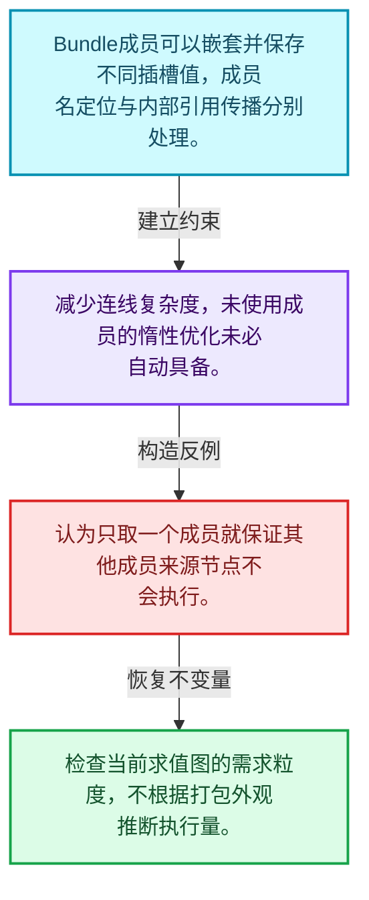
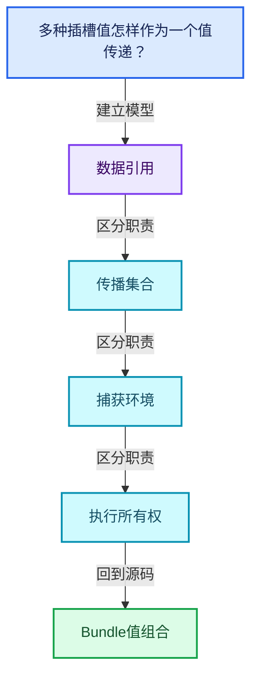
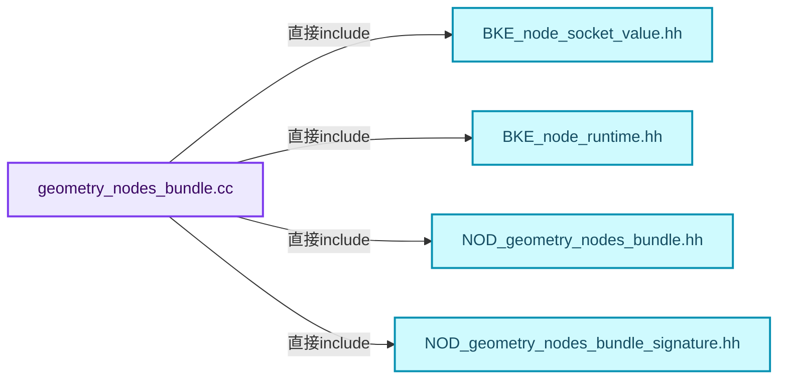
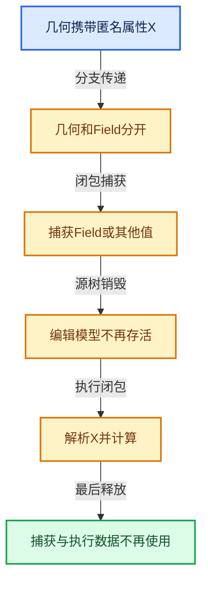

# 10-05 Bundle值组合

[方向导航](README.md) · [总目录](../README.md) · [覆盖索引](../%E6%BA%90%E7%A0%81%E7%89%88%E6%9C%AC%E4%B8%8E%E8%A6%86%E7%9B%96%E7%B4%A2%E5%BC%95.md)

> 阅读顺序：问题与数据模型 → 语法与类型 → 源码逐行 → 调用线索 → 历史与取舍 → 推演和练习。

- 基准 HEAD：`cbda6b96c26c0dee3c3b5cbb93960c4ac06a6b30`。
- 记录日期：2026-10-14。
- 教学示例状态：正文中的推演不是本机性能实测；已运行练习见验收报告。

## 一、从问题到设计

多种插槽值怎样作为一个值传递？

命名成员组合简化连线但引入嵌套类型和引用传播；打包不自动消除未使用成员的计算。

本篇把语法、数据语义和系统取舍连接起来。表达式引用、承载数据与执行环境必须一起追踪，跨区域组合不能丢掉生命周期信息。

### 本篇独立模型与设计推理

Bundle成员可以嵌套并保存不同插槽值，成员名定位与内部引用传播分别处理。

设计取舍：减少连线复杂度，未使用成员的惰性优化未必自动具备。

最小反例：认为只取一个成员就保证其他成员来源节点不会执行。

推导与处理：检查当前求值图的需求粒度，不根据打包外观推断执行量。



### 源码范围与相邻篇章

| 文件 | 本篇逐行范围 | 基准SHA-256 |
|---|---|---|
| [source/blender/nodes/intern/geometry_nodes_bundle.cc](../../../../../source/blender/nodes/intern/geometry_nodes_bundle.cc) | L1—L539 | `6eda77f28ff6e27a6ce01feac4e3443d6884f1caa39026519aad0d4862ef352d` |

同一主讲文件可能分多篇覆盖；超出本篇范围的符号通过覆盖索引定位。空行与纯注释保留在源码摘录中，逐行表解释有效语句与语法边界；许可证头统一保留。

前篇：[引用传播与过滤](04-%E5%BC%95%E7%94%A8%E4%BC%A0%E6%92%AD%E4%B8%8E%E8%BF%87%E6%BB%A4.md).

后篇：[Closure表示与捕获](06-Closure%E8%A1%A8%E7%A4%BA%E4%B8%8E%E6%8D%95%E8%8E%B7.md).

## 二、类型、数据与阅读地图



这是概念依赖图，边表示阅读关系，不声称是运行时调用顺序。

### 直接编译依赖



箭头只表示头文件包含关系；完整调用线索见后面的符号定位表。

## 三、关键词、语法与类型角色

### 只读限定 const

const约束当前访问路径可做的修改。const指针、指向const的指针、const视图对象、const元素是不同位置的限定；其他别名可能仍可修改原对象。

具体检查：分别写T* const、const T*与const T* const，并画出不可修改的层次。

### 移动转换 std::move

std::move把表达式转换为可供移动重载选择的值类别，实际资源转移发生在被选中的构造或赋值中。对const对象move可能仍调用复制，对视图move也不会获得底层数据所有权。

具体检查：记录移动构造调用次数，不用变量名或std::move的出现次数替代测量。

### 异常边界 try与catch

try定义异常传播的局部边界。失败路径需要销毁已经成功构造的部分并释放相应存储；未构造的对象不能被析构。

具体检查：在第k次构造失败，列出已经存在的对象集合与待释放缓冲。

### 显式静态转换 static_cast

static_cast表达编译期允许的转换，不会自动验证运行时真实类型、指针寿命或索引边界。由void指针恢复T指针时，调用者仍须保证实际存储中确有合法T对象。

具体检查：标出转换前后的类型以及正确性依据来自哪里。

### 限定转换 const_cast

const_cast可以改变访问路径的限定，但不能让本来就是const的对象合法可写。常用于复用只读实现时，仍需检查底层对象是否实际可变。

具体检查：对非const对象的const引用与真正const对象分别分析修改是否合法。

### 覆写检查 override

override要求函数确实覆盖基类虚函数，可捕获参数类型和const限定不匹配。它不改变基类规定的生命周期或线程约束。

具体检查：故意改变一个参数或const，观察编译器如何拒绝误写的新函数。

### 可选值 optional

optional把不存在与存在的T区分开，T的构造和析构跟随engaged状态变化。访问前应由has_value或条件分支证明存在。

具体检查：把空Field状态与合法常量零区分，不能用某个普通值代替不存在。

### 构造与new表达式

普通new可能分配并构造；placement new在给定地址构造，存储由其他机制提供。失败回滚应区分两类责任。

具体检查：追踪地址来自哪里、构造何时成功、由谁析构、由谁释放。

### 内部断言 assert

断言表达开发者预期成立的内部契约，发布构建可能关闭。它不能替代对不可信输入的完整错误处理，也不保证后续操作被运行时保护。

具体检查：对每条断言构造违反条件的输入，区分调用者错误与应向用户报告的错误。

### 类型别名 using

类型别名为已有类型建立名字，不创建运行期对象。它常把模板内部使用的类型统一暴露给泛型调用者。

具体检查：展开别名直到基础类型，区分类型别名和变量声明。

## 四、真实源码与逐行讲解

源码块保持原行内容，原始行号由小节标题及逐行表给出。表中的调用定位是静态阅读辅助；重载、模板实例化、宏展开和虚调用需结合完整声明，不能仅凭词法出现证明动态调用。

### geometry_nodes_bundle.cc：L1—L50

<!-- source:source/blender/nodes/intern/geometry_nodes_bundle.cc:1:50 -->

```cpp
/* SPDX-FileCopyrightText: 2025 Blender Authors
 *
 * SPDX-License-Identifier: GPL-2.0-or-later */

/** \file
 * \ingroup nodes
 */

#include <fmt/format.h>
#include <fmt/ranges.h>

#include "BKE_node_socket_value.hh"

#include "BKE_node_runtime.hh"

#include "NOD_geometry_nodes_bundle.hh"
#include "NOD_geometry_nodes_bundle_signature.hh"

namespace blender::nodes {

bool operator==(const BundleSignature &a, const BundleSignature &b)
{
  return a.items.as_span() == b.items.as_span();
}

bool operator!=(const BundleSignature &a, const BundleSignature &b)
{
  return !(a == b);
}

void BundleSignature::set_auto_structure_types()
{
  for (const BundleSignature::Item &item : this->items) {
    const_cast<BundleSignature::Item &>(item).structure_type =
        NodeSocketInterfaceStructureType::Auto;
  }
}

bool BundleKey::is_valid_key(const StringRef key)
{
  if (key.is_empty()) {
    return false;
  }
  if (key != key.trim()) {
    /* Keys must not have leading or trailing white-space. This simplifies potentially using these
     * keys in expressions later on (or even just have a comma separated list of keys). */
    return false;
  }
  return key.find_first_of(BundleKey::forbidden_key_chars) == StringRef::not_found;
}
```

本段语义重点：

- 分支证据 `key.is_empty())`：分别推演条件成立与不成立，核对相同出口处的状态。
- 分支证据 `key != key.trim())`：分别推演条件成立与不成立，核对相同出口处的状态。

| 原始行 | 语义、约束与检查 |
|---|---|
| L9 | 引入编译依赖 <fmt/format.h>；这是声明可见性关系，不表示运行时一定调用该文件的所有接口。 |
| L10 | 引入编译依赖 <fmt/ranges.h>；这是声明可见性关系，不表示运行时一定调用该文件的所有接口。 |
| L12 | 引入编译依赖 "BKE_node_socket_value.hh"；这是声明可见性关系，不表示运行时一定调用该文件的所有接口。 |
| L14 | 引入编译依赖 "BKE_node_runtime.hh"；这是声明可见性关系，不表示运行时一定调用该文件的所有接口。 |
| L16 | 引入编译依赖 "NOD_geometry_nodes_bundle.hh"；这是声明可见性关系，不表示运行时一定调用该文件的所有接口。 |
| L17 | 引入编译依赖 "NOD_geometry_nodes_bundle_signature.hh"；这是声明可见性关系，不表示运行时一定调用该文件的所有接口。 |
| L19 | 把后续声明放入 blender::nodes 命名空间，影响名称查找和符号归属，不创建运行时对象。 |
| L21 | 运算符重载声明、定义或显式调用：`bool operator==(const BundleSignature &a, const BundleSignature &b)`。结合参数和返回类型判断是赋值、索引、比较还是转换；operator=声明中的等号不是在给名为operator的变量赋值。 |
| L22 | 连接上一行的声明或控制结构与其语句块；后续行在这个作用域中执行或声明。 |
| L23 | 返回表达式 `a.items.as_span() == b.items.as_span()`。 |
| L24 | 结束当前语法单元。局部自动对象在离开其作用域时按规则销毁；这不等于所有被引用的外部数据也被释放。 |
| L26 | 运算符重载声明、定义或显式调用：`bool operator!=(const BundleSignature &a, const BundleSignature &b)`。结合参数和返回类型判断是赋值、索引、比较还是转换；operator=声明中的等号不是在给名为operator的变量赋值。 |
| L27 | 连接上一行的声明或控制结构与其语句块；后续行在这个作用域中执行或声明。 |
| L28 | 返回表达式 `!(a == b)`。 |
| L29 | 结束当前语法单元。局部自动对象在离开其作用域时按规则销毁；这不等于所有被引用的外部数据也被释放。 |
| L31 | 出现调用或函数声明 `BundleSignature::set_auto_structure_types`，对应表达式为 `void BundleSignature::set_auto_structure_types()`。参数求值、返回类型与重载需结合前后完整语句；静态文本引用不能证明动态目标。 |
| L32 | 连接上一行的声明或控制结构与其语句块；后续行在这个作用域中执行或声明。 |
| L33 | 按 `for (const BundleSignature::Item &item : this->items)` 指定的范围或条件重复执行。对照循环变量与真实元素编号；循环内调用成本乘以实际迭代次数。 |
| L34 | 把右侧 `` 用于初始化或更新左侧 `const_cast<BundleSignature::Item &>(item).structure_type`。声明初始化与已有对象赋值应按上下文区分；有资源的类型会调用相应特殊成员。 |
| L35 | 声明成员、局部对象或完成语句 `NodeSocketInterfaceStructureType::Auto`。若为指针或引用，它本身不说明拥有；若为值对象，其构造析构由所在作用域或外层对象管理。 |
| L36 | 结束当前语法单元。局部自动对象在离开其作用域时按规则销毁；这不等于所有被引用的外部数据也被释放。 |
| L37 | 结束当前语法单元。局部自动对象在离开其作用域时按规则销毁；这不等于所有被引用的外部数据也被释放。 |
| L39 | 出现调用或函数声明 `BundleKey::is_valid_key`，对应表达式为 `bool BundleKey::is_valid_key(const StringRef key)`。参数求值、返回类型与重载需结合前后完整语句；静态文本引用不能证明动态目标。 |
| L40 | 连接上一行的声明或控制结构与其语句块；后续行在这个作用域中执行或声明。 |
| L41 | 判断 `key.is_empty()`，成立时进入本分支，否则继续后续路径。 |
| L42 | 返回表达式 `false`。这是本路径的布尔结果，具体成功、存在或状态含义由函数接口规定。 |
| L43 | 结束当前语法单元。局部自动对象在离开其作用域时按规则销毁；这不等于所有被引用的外部数据也被释放。 |
| L44 | 判断 `key != key.trim()`，成立时进入本分支，否则继续后续路径。 |
| L47 | 返回表达式 `false`。这是本路径的布尔结果，具体成功、存在或状态含义由函数接口规定。 |
| L48 | 结束当前语法单元。局部自动对象在离开其作用域时按规则销毁；这不等于所有被引用的外部数据也被释放。 |
| L49 | 返回表达式 `key.find_first_of(BundleKey::forbidden_key_chars) == StringRef::not_found`。 |
| L50 | 结束当前语法单元。局部自动对象在离开其作用域时按规则销毁；这不等于所有被引用的外部数据也被释放。 |

### geometry_nodes_bundle.cc：L51—L96

<!-- source:source/blender/nodes/intern/geometry_nodes_bundle.cc:51:96 -->

```cpp

bool Bundle::is_valid_path(const StringRef path)
{
  return split_path(path).has_value();
}

std::optional<Vector<BundleKey>> Bundle::split_path(const StringRef path)
{
  if (path.is_empty()) {
    return std::nullopt;
  }
  Vector<BundleKey> path_elems;
  StringRef remaining = path;
  while (!remaining.is_empty()) {
    const int sep = remaining.find_first_of('/');
    if (sep == StringRef::not_found) {
      const StringRef key_str = remaining;
      if (const std::optional<BundleKey> key = BundleKey::from_str(key_str)) {
        path_elems.append(*key);
      }
      else {
        return std::nullopt;
      }
      break;
    }
    const StringRef key_str = remaining.substr(0, sep);
    if (const std::optional<BundleKey> key = BundleKey::from_str(key_str)) {
      path_elems.append(*key);
      remaining = remaining.substr(sep + 1);
    }
    else {
      return std::nullopt;
    }
  }
  return path_elems;
}

BundlePtr Bundle::create()
{
  return BundlePtr(MEM_new<Bundle>(__func__));
}

void Bundle::add_new(const BundleKey key, const BundleItemValue &value)
{
  items_.add_new_as(key, value);
}
```

本段语义重点：

- 分支证据 `path.is_empty())`：分别推演条件成立与不成立，核对相同出口处的状态。
- 分支证据 `!remaining.is_empty())`：分别推演条件成立与不成立，核对相同出口处的状态。

| 原始行 | 语义、约束与检查 |
|---|---|
| L52 | 出现调用或函数声明 `Bundle::is_valid_path`，对应表达式为 `bool Bundle::is_valid_path(const StringRef path)`。参数求值、返回类型与重载需结合前后完整语句；静态文本引用不能证明动态目标。 |
| L53 | 连接上一行的声明或控制结构与其语句块；后续行在这个作用域中执行或声明。 |
| L54 | 返回表达式 `split_path(path).has_value()`。 |
| L55 | 结束当前语法单元。局部自动对象在离开其作用域时按规则销毁；这不等于所有被引用的外部数据也被释放。 |
| L57 | 出现调用或函数声明 `Bundle::split_path`，对应表达式为 `std::optional<Vector<BundleKey>> Bundle::split_path(const StringRef path)`。参数求值、返回类型与重载需结合前后完整语句；静态文本引用不能证明动态目标。 |
| L58 | 连接上一行的声明或控制结构与其语句块；后续行在这个作用域中执行或声明。 |
| L59 | 判断 `path.is_empty()`，成立时进入本分支，否则继续后续路径。 |
| L60 | 返回表达式 `std::nullopt`。 |
| L61 | 结束当前语法单元。局部自动对象在离开其作用域时按规则销毁；这不等于所有被引用的外部数据也被释放。 |
| L62 | 声明成员、局部对象或完成语句 `Vector<BundleKey> path_elems`。若为指针或引用，它本身不说明拥有；若为值对象，其构造析构由所在作用域或外层对象管理。 |
| L63 | 把右侧 `path` 用于初始化或更新左侧 `StringRef remaining`。声明初始化与已有对象赋值应按上下文区分；有资源的类型会调用相应特殊成员。 |
| L64 | 按 `while (!remaining.is_empty())` 指定的范围或条件重复执行。对照循环变量与真实元素编号；循环内调用成本乘以实际迭代次数。 |
| L65 | 把右侧 `remaining.find_first_of('/')` 用于初始化或更新左侧 `const int sep`。声明初始化与已有对象赋值应按上下文区分；有资源的类型会调用相应特殊成员。 |
| L66 | 判断 `sep == StringRef::not_found`，成立时进入本分支，否则继续后续路径。 |
| L67 | 把右侧 `remaining` 用于初始化或更新左侧 `const StringRef key_str`。声明初始化与已有对象赋值应按上下文区分；有资源的类型会调用相应特殊成员。 |
| L68 | 判断 `const std::optional<BundleKey> key = BundleKey::from_str(key_str)`，成立时进入本分支，否则继续后续路径。 |
| L69 | 出现调用或函数声明 `append`，对应表达式为 `path_elems.append(*key);`。参数求值、返回类型与重载需结合前后完整语句；静态文本引用不能证明动态目标。 |
| L70 | 结束当前语法单元。局部自动对象在离开其作用域时按规则销毁；这不等于所有被引用的外部数据也被释放。 |
| L71 | 处理前一条件不成立的互补路径。比较两条路径最后是否恢复同一不变量，以及是否产生不同的资源责任。 |
| L72 | 返回表达式 `std::nullopt`。 |
| L73 | 结束当前语法单元。局部自动对象在离开其作用域时按规则销毁；这不等于所有被引用的外部数据也被释放。 |
| L74 | 离开最近的循环或switch；不是离开整个函数，后续清理和提交代码可能仍会执行。 |
| L75 | 结束当前语法单元。局部自动对象在离开其作用域时按规则销毁；这不等于所有被引用的外部数据也被释放。 |
| L76 | 把右侧 `remaining.substr(0, sep)` 用于初始化或更新左侧 `const StringRef key_str`。声明初始化与已有对象赋值应按上下文区分；有资源的类型会调用相应特殊成员。 |
| L77 | 判断 `const std::optional<BundleKey> key = BundleKey::from_str(key_str)`，成立时进入本分支，否则继续后续路径。 |
| L78 | 出现调用或函数声明 `append`，对应表达式为 `path_elems.append(*key);`。参数求值、返回类型与重载需结合前后完整语句；静态文本引用不能证明动态目标。 |
| L79 | 把右侧 `remaining.substr(sep + 1)` 用于初始化或更新左侧 `remaining`。声明初始化与已有对象赋值应按上下文区分；有资源的类型会调用相应特殊成员。 |
| L80 | 结束当前语法单元。局部自动对象在离开其作用域时按规则销毁；这不等于所有被引用的外部数据也被释放。 |
| L81 | 处理前一条件不成立的互补路径。比较两条路径最后是否恢复同一不变量，以及是否产生不同的资源责任。 |
| L82 | 返回表达式 `std::nullopt`。 |
| L83 | 结束当前语法单元。局部自动对象在离开其作用域时按规则销毁；这不等于所有被引用的外部数据也被释放。 |
| L84 | 结束当前语法单元。局部自动对象在离开其作用域时按规则销毁；这不等于所有被引用的外部数据也被释放。 |
| L85 | 返回表达式 `path_elems`。 |
| L86 | 结束当前语法单元。局部自动对象在离开其作用域时按规则销毁；这不等于所有被引用的外部数据也被释放。 |
| L88 | 出现调用或函数声明 `Bundle::create`，对应表达式为 `BundlePtr Bundle::create()`。参数求值、返回类型与重载需结合前后完整语句；静态文本引用不能证明动态目标。 |
| L89 | 连接上一行的声明或控制结构与其语句块；后续行在这个作用域中执行或声明。 |
| L90 | 返回表达式 `BundlePtr(MEM_new<Bundle>(__func__))`。 |
| L91 | 结束当前语法单元。局部自动对象在离开其作用域时按规则销毁；这不等于所有被引用的外部数据也被释放。 |
| L93 | 出现调用或函数声明 `Bundle::add_new`，对应表达式为 `void Bundle::add_new(const BundleKey key, const BundleItemValue &value)`。参数求值、返回类型与重载需结合前后完整语句；静态文本引用不能证明动态目标。 |
| L94 | 连接上一行的声明或控制结构与其语句块；后续行在这个作用域中执行或声明。 |
| L95 | 出现调用或函数声明 `add_new_as`，对应表达式为 `items_.add_new_as(key, value);`。参数求值、返回类型与重载需结合前后完整语句；静态文本引用不能证明动态目标。 |
| L96 | 结束当前语法单元。局部自动对象在离开其作用域时按规则销毁；这不等于所有被引用的外部数据也被释放。 |

### geometry_nodes_bundle.cc：L97—L150

<!-- source:source/blender/nodes/intern/geometry_nodes_bundle.cc:97:150 -->

```cpp

void Bundle::add_new(BundleKey key, BundleItemValue &&value)
{
  items_.add_new_as(key, std::move(value));
}

void Bundle::add_override(const BundleKey key, const BundleItemValue &value)
{
  this->remove(key);
  this->add_new(key, value);
}

bool Bundle::add(const BundleKey key, const BundleItemValue &value)
{
  if (this->contains(key)) {
    return false;
  }
  this->add_new(key, value);
  return true;
}

bool Bundle::add(const BundleKey key, BundleItemValue &&value)
{
  if (this->contains(key)) {
    return false;
  }
  this->add_new(key, std::move(value));
  return true;
}

static BundleItemValue create_nested_bundle_item()
{
  static const bke::bNodeSocketType *bundle_socket_type = bke::node_socket_type_find_static(
      SOCK_BUNDLE);
  return {
      BundleItemSocketValue{bundle_socket_type, bke::SocketValueVariant::from(Bundle::create())}};
}

void Bundle::add_path_override(const Span<BundleKey> path, const BundleItemValue &value)
{
  Bundle *current = this;
  for (const BundleKey path_elem : path.drop_back(1)) {
    BundleItemValue &item = current->items_.lookup_or_add_cb_as(
        path_elem, [&]() { return create_nested_bundle_item(); });
    BundlePtr *child_bundle_ptr = item.as_pointer<BundlePtr>();
    if (!child_bundle_ptr || !*child_bundle_ptr) {
      /* Override the items content with a new bundle. */
      item = create_nested_bundle_item();
      child_bundle_ptr = item.as_pointer<BundlePtr>();
    }
    current = &child_bundle_ptr->ensure_mutable_inplace();
  }
  current->items_.add_overwrite_as(path.last(), value);
}
```

本段语义重点：

- `lookup_or_add_cb`：合并查找和延迟创建；键已存在时应检查回调是否跳过。

| 原始行 | 语义、约束与检查 |
|---|---|
| L98 | 出现调用或函数声明 `Bundle::add_new`，对应表达式为 `void Bundle::add_new(BundleKey key, BundleItemValue &&value)`。参数求值、返回类型与重载需结合前后完整语句；静态文本引用不能证明动态目标。 |
| L99 | 连接上一行的声明或控制结构与其语句块；后续行在这个作用域中执行或声明。 |
| L100 | 出现调用或函数声明 `add_new_as`，对应表达式为 `items_.add_new_as(key, std::move(value));`。参数求值、返回类型与重载需结合前后完整语句；静态文本引用不能证明动态目标。 |
| L101 | 结束当前语法单元。局部自动对象在离开其作用域时按规则销毁；这不等于所有被引用的外部数据也被释放。 |
| L103 | 出现调用或函数声明 `Bundle::add_override`，对应表达式为 `void Bundle::add_override(const BundleKey key, const BundleItemValue &value)`。参数求值、返回类型与重载需结合前后完整语句；静态文本引用不能证明动态目标。 |
| L104 | 连接上一行的声明或控制结构与其语句块；后续行在这个作用域中执行或声明。 |
| L105 | 出现调用或函数声明 `remove`，对应表达式为 `this->remove(key);`。参数求值、返回类型与重载需结合前后完整语句；静态文本引用不能证明动态目标。 |
| L106 | 出现调用或函数声明 `add_new`，对应表达式为 `this->add_new(key, value);`。参数求值、返回类型与重载需结合前后完整语句；静态文本引用不能证明动态目标。 |
| L107 | 结束当前语法单元。局部自动对象在离开其作用域时按规则销毁；这不等于所有被引用的外部数据也被释放。 |
| L109 | 出现调用或函数声明 `Bundle::add`，对应表达式为 `bool Bundle::add(const BundleKey key, const BundleItemValue &value)`。参数求值、返回类型与重载需结合前后完整语句；静态文本引用不能证明动态目标。 |
| L110 | 连接上一行的声明或控制结构与其语句块；后续行在这个作用域中执行或声明。 |
| L111 | 判断 `this->contains(key)`，成立时进入本分支，否则继续后续路径。 |
| L112 | 返回表达式 `false`。这是本路径的布尔结果，具体成功、存在或状态含义由函数接口规定。 |
| L113 | 结束当前语法单元。局部自动对象在离开其作用域时按规则销毁；这不等于所有被引用的外部数据也被释放。 |
| L114 | 出现调用或函数声明 `add_new`，对应表达式为 `this->add_new(key, value);`。参数求值、返回类型与重载需结合前后完整语句；静态文本引用不能证明动态目标。 |
| L115 | 返回表达式 `true`。这是本路径的布尔结果，具体成功、存在或状态含义由函数接口规定。 |
| L116 | 结束当前语法单元。局部自动对象在离开其作用域时按规则销毁；这不等于所有被引用的外部数据也被释放。 |
| L118 | 出现调用或函数声明 `Bundle::add`，对应表达式为 `bool Bundle::add(const BundleKey key, BundleItemValue &&value)`。参数求值、返回类型与重载需结合前后完整语句；静态文本引用不能证明动态目标。 |
| L119 | 连接上一行的声明或控制结构与其语句块；后续行在这个作用域中执行或声明。 |
| L120 | 判断 `this->contains(key)`，成立时进入本分支，否则继续后续路径。 |
| L121 | 返回表达式 `false`。这是本路径的布尔结果，具体成功、存在或状态含义由函数接口规定。 |
| L122 | 结束当前语法单元。局部自动对象在离开其作用域时按规则销毁；这不等于所有被引用的外部数据也被释放。 |
| L123 | 出现调用或函数声明 `add_new`，对应表达式为 `this->add_new(key, std::move(value));`。参数求值、返回类型与重载需结合前后完整语句；静态文本引用不能证明动态目标。 |
| L124 | 返回表达式 `true`。这是本路径的布尔结果，具体成功、存在或状态含义由函数接口规定。 |
| L125 | 结束当前语法单元。局部自动对象在离开其作用域时按规则销毁；这不等于所有被引用的外部数据也被释放。 |
| L127 | 出现调用或函数声明 `create_nested_bundle_item`，对应表达式为 `static BundleItemValue create_nested_bundle_item()`。参数求值、返回类型与重载需结合前后完整语句；静态文本引用不能证明动态目标。 |
| L128 | 连接上一行的声明或控制结构与其语句块；后续行在这个作用域中执行或声明。 |
| L129 | 把右侧 `bke::node_socket_type_find_static(` 用于初始化或更新左侧 `static const bke::bNodeSocketType *bundle_socket_type`。声明初始化与已有对象赋值应按上下文区分；有资源的类型会调用相应特殊成员。 |
| L130 | 声明成员、局部对象或完成语句 `SOCK_BUNDLE)`。若为指针或引用，它本身不说明拥有；若为值对象，其构造析构由所在作用域或外层对象管理。 |
| L131 | 返回表达式 `{`。 |
| L132 | 出现调用或函数声明 `bke::SocketValueVariant::from`，对应表达式为 `BundleItemSocketValue{bundle_socket_type, bke::SocketValueVariant::from(Bundle::create())}};`。参数求值、返回类型与重载需结合前后完整语句；静态文本引用不能证明动态目标。 |
| L133 | 结束当前语法单元。局部自动对象在离开其作用域时按规则销毁；这不等于所有被引用的外部数据也被释放。 |
| L135 | 出现调用或函数声明 `Bundle::add_path_override`，对应表达式为 `void Bundle::add_path_override(const Span<BundleKey> path, const BundleItemValue &value)`。参数求值、返回类型与重载需结合前后完整语句；静态文本引用不能证明动态目标。 |
| L136 | 连接上一行的声明或控制结构与其语句块；后续行在这个作用域中执行或声明。 |
| L137 | 把右侧 `this` 用于初始化或更新左侧 `Bundle *current`。声明初始化与已有对象赋值应按上下文区分；有资源的类型会调用相应特殊成员。 |
| L138 | 按 `for (const BundleKey path_elem : path.drop_back(1))` 指定的范围或条件重复执行。对照循环变量与真实元素编号；循环内调用成本乘以实际迭代次数。 |
| L139 | 把右侧 `current->items_.lookup_or_add_cb_as(` 用于初始化或更新左侧 `BundleItemValue &item`。声明初始化与已有对象赋值应按上下文区分；有资源的类型会调用相应特殊成员。 |
| L140 | 出现调用或函数声明 `create_nested_bundle_item`，对应表达式为 `path_elem, [&]() { return create_nested_bundle_item(); });`。参数求值、返回类型与重载需结合前后完整语句；静态文本引用不能证明动态目标。 |
| L141 | 把右侧 `item.as_pointer<BundlePtr>()` 用于初始化或更新左侧 `BundlePtr *child_bundle_ptr`。声明初始化与已有对象赋值应按上下文区分；有资源的类型会调用相应特殊成员。 |
| L142 | 判断 `!child_bundle_ptr &#124;&#124; !*child_bundle_ptr`，成立时进入本分支，否则继续后续路径。 |
| L144 | 把右侧 `create_nested_bundle_item()` 用于初始化或更新左侧 `item`。声明初始化与已有对象赋值应按上下文区分；有资源的类型会调用相应特殊成员。 |
| L145 | 把右侧 `item.as_pointer<BundlePtr>()` 用于初始化或更新左侧 `child_bundle_ptr`。声明初始化与已有对象赋值应按上下文区分；有资源的类型会调用相应特殊成员。 |
| L146 | 结束当前语法单元。局部自动对象在离开其作用域时按规则销毁；这不等于所有被引用的外部数据也被释放。 |
| L147 | 把右侧 `&child_bundle_ptr->ensure_mutable_inplace()` 用于初始化或更新左侧 `current`。声明初始化与已有对象赋值应按上下文区分；有资源的类型会调用相应特殊成员。 |
| L148 | 结束当前语法单元。局部自动对象在离开其作用域时按规则销毁；这不等于所有被引用的外部数据也被释放。 |
| L149 | 出现调用或函数声明 `add_overwrite_as`，对应表达式为 `current->items_.add_overwrite_as(path.last(), value);`。参数求值、返回类型与重载需结合前后完整语句；静态文本引用不能证明动态目标。 |
| L150 | 结束当前语法单元。局部自动对象在离开其作用域时按规则销毁；这不等于所有被引用的外部数据也被释放。 |

### geometry_nodes_bundle.cc：L151—L194

<!-- source:source/blender/nodes/intern/geometry_nodes_bundle.cc:151:194 -->

```cpp

void Bundle::add_path_override(const StringRef path, const BundleItemValue &value)
{
  BLI_assert(is_valid_path(path));
  const Vector<BundleKey> path_elems = *split_path(path);
  this->add_path_override(path_elems, value);
}

bool Bundle::add_path(StringRef path, const BundleItemValue &value)
{
  if (this->contains_path(path)) {
    return false;
  }
  this->add_path_new(path, value);
  return true;
}

void Bundle::add_path_new(StringRef path, const BundleItemValue &value)
{
  BLI_assert(!this->contains_path(path));
  this->add_path_override(path, value);
}

Bundle &Bundle::ensure_nested_bundle(const StringRef path)
{
  BundlePtr *bundle_ptr = this->lookup_path_for_write_ptr<BundlePtr>(path);
  if (bundle_ptr && *bundle_ptr) {
    return bundle_ptr->ensure_mutable_inplace();
  }
  BundlePtr new_bundle = Bundle::create();
  Bundle &new_bundle_ref = new_bundle.ensure_mutable_inplace();
  this->add_path_override(path, std::move(new_bundle));
  return new_bundle_ref;
}

const BundleItemValue *Bundle::lookup(const BundleKey key) const
{
  return items_.lookup_ptr_as(key);
}

BundleItemValue *Bundle::lookup(const BundleKey key)
{
  return items_.lookup_ptr_as(key);
}
```

本段语义重点：

- 分支证据 `this->contains_path(path))`：分别推演条件成立与不成立，核对相同出口处的状态。
- 分支证据 `bundle_ptr && *bundle_ptr)`：分别推演条件成立与不成立，核对相同出口处的状态。

| 原始行 | 语义、约束与检查 |
|---|---|
| L152 | 出现调用或函数声明 `Bundle::add_path_override`，对应表达式为 `void Bundle::add_path_override(const StringRef path, const BundleItemValue &value)`。参数求值、返回类型与重载需结合前后完整语句；静态文本引用不能证明动态目标。 |
| L153 | 连接上一行的声明或控制结构与其语句块；后续行在这个作用域中执行或声明。 |
| L154 | 断言约束 `BLI_assert(is_valid_path(path));`。条件是后续访问的内部前置条件；发布构建可能不执行，不能把断言当作输入修复。 |
| L155 | 把右侧 `*split_path(path)` 用于初始化或更新左侧 `const Vector<BundleKey> path_elems`。声明初始化与已有对象赋值应按上下文区分；有资源的类型会调用相应特殊成员。 |
| L156 | 出现调用或函数声明 `add_path_override`，对应表达式为 `this->add_path_override(path_elems, value);`。参数求值、返回类型与重载需结合前后完整语句；静态文本引用不能证明动态目标。 |
| L157 | 结束当前语法单元。局部自动对象在离开其作用域时按规则销毁；这不等于所有被引用的外部数据也被释放。 |
| L159 | 出现调用或函数声明 `Bundle::add_path`，对应表达式为 `bool Bundle::add_path(StringRef path, const BundleItemValue &value)`。参数求值、返回类型与重载需结合前后完整语句；静态文本引用不能证明动态目标。 |
| L160 | 连接上一行的声明或控制结构与其语句块；后续行在这个作用域中执行或声明。 |
| L161 | 判断 `this->contains_path(path)`，成立时进入本分支，否则继续后续路径。 |
| L162 | 返回表达式 `false`。这是本路径的布尔结果，具体成功、存在或状态含义由函数接口规定。 |
| L163 | 结束当前语法单元。局部自动对象在离开其作用域时按规则销毁；这不等于所有被引用的外部数据也被释放。 |
| L164 | 出现调用或函数声明 `add_path_new`，对应表达式为 `this->add_path_new(path, value);`。参数求值、返回类型与重载需结合前后完整语句；静态文本引用不能证明动态目标。 |
| L165 | 返回表达式 `true`。这是本路径的布尔结果，具体成功、存在或状态含义由函数接口规定。 |
| L166 | 结束当前语法单元。局部自动对象在离开其作用域时按规则销毁；这不等于所有被引用的外部数据也被释放。 |
| L168 | 出现调用或函数声明 `Bundle::add_path_new`，对应表达式为 `void Bundle::add_path_new(StringRef path, const BundleItemValue &value)`。参数求值、返回类型与重载需结合前后完整语句；静态文本引用不能证明动态目标。 |
| L169 | 连接上一行的声明或控制结构与其语句块；后续行在这个作用域中执行或声明。 |
| L170 | 断言约束 `BLI_assert(!this->contains_path(path));`。条件是后续访问的内部前置条件；发布构建可能不执行，不能把断言当作输入修复。 |
| L171 | 出现调用或函数声明 `add_path_override`，对应表达式为 `this->add_path_override(path, value);`。参数求值、返回类型与重载需结合前后完整语句；静态文本引用不能证明动态目标。 |
| L172 | 结束当前语法单元。局部自动对象在离开其作用域时按规则销毁；这不等于所有被引用的外部数据也被释放。 |
| L174 | 出现调用或函数声明 `Bundle::ensure_nested_bundle`，对应表达式为 `Bundle &Bundle::ensure_nested_bundle(const StringRef path)`。参数求值、返回类型与重载需结合前后完整语句；静态文本引用不能证明动态目标。 |
| L175 | 连接上一行的声明或控制结构与其语句块；后续行在这个作用域中执行或声明。 |
| L176 | 把右侧 `this->lookup_path_for_write_ptr<BundlePtr>(path)` 用于初始化或更新左侧 `BundlePtr *bundle_ptr`。声明初始化与已有对象赋值应按上下文区分；有资源的类型会调用相应特殊成员。 |
| L177 | 判断 `bundle_ptr && *bundle_ptr`，成立时进入本分支，否则继续后续路径。 |
| L178 | 返回表达式 `bundle_ptr->ensure_mutable_inplace()`。结合函数声明检查返回值是否借用原存储，借用值不会自动延长其寿命。 |
| L179 | 结束当前语法单元。局部自动对象在离开其作用域时按规则销毁；这不等于所有被引用的外部数据也被释放。 |
| L180 | 把右侧 `Bundle::create()` 用于初始化或更新左侧 `BundlePtr new_bundle`。声明初始化与已有对象赋值应按上下文区分；有资源的类型会调用相应特殊成员。 |
| L181 | 把右侧 `new_bundle.ensure_mutable_inplace()` 用于初始化或更新左侧 `Bundle &new_bundle_ref`。声明初始化与已有对象赋值应按上下文区分；有资源的类型会调用相应特殊成员。 |
| L182 | 出现调用或函数声明 `add_path_override`，对应表达式为 `this->add_path_override(path, std::move(new_bundle));`。参数求值、返回类型与重载需结合前后完整语句；静态文本引用不能证明动态目标。 |
| L183 | 返回表达式 `new_bundle_ref`。 |
| L184 | 结束当前语法单元。局部自动对象在离开其作用域时按规则销毁；这不等于所有被引用的外部数据也被释放。 |
| L186 | 出现调用或函数声明 `Bundle::lookup`，对应表达式为 `const BundleItemValue *Bundle::lookup(const BundleKey key) const`。参数求值、返回类型与重载需结合前后完整语句；静态文本引用不能证明动态目标。 |
| L187 | 连接上一行的声明或控制结构与其语句块；后续行在这个作用域中执行或声明。 |
| L188 | 返回表达式 `items_.lookup_ptr_as(key)`。 |
| L189 | 结束当前语法单元。局部自动对象在离开其作用域时按规则销毁；这不等于所有被引用的外部数据也被释放。 |
| L191 | 出现调用或函数声明 `Bundle::lookup`，对应表达式为 `BundleItemValue *Bundle::lookup(const BundleKey key)`。参数求值、返回类型与重载需结合前后完整语句；静态文本引用不能证明动态目标。 |
| L192 | 连接上一行的声明或控制结构与其语句块；后续行在这个作用域中执行或声明。 |
| L193 | 返回表达式 `items_.lookup_ptr_as(key)`。 |
| L194 | 结束当前语法单元。局部自动对象在离开其作用域时按规则销毁；这不等于所有被引用的外部数据也被释放。 |

### geometry_nodes_bundle.cc：L195—L241

<!-- source:source/blender/nodes/intern/geometry_nodes_bundle.cc:195:241 -->

```cpp

const BundleItemValue *Bundle::lookup_path(const Span<BundleKey> path) const
{
  BLI_assert(!path.is_empty());
  const BundleKey first_elem = path[0];
  const BundleItemValue *item = this->lookup(first_elem);
  if (!item) {
    return nullptr;
  }
  if (path.size() == 1) {
    return item;
  }
  const BundlePtr child_bundle = item->as<BundlePtr>().value_or(nullptr);
  if (!child_bundle) {
    return nullptr;
  }
  return child_bundle->lookup_path(path.drop_front(1));
}

const BundleItemValue *Bundle::lookup_path(const StringRef path) const
{
  BLI_assert(is_valid_path(path));
  const Vector<BundleKey> path_elems = *split_path(path);
  return this->lookup_path(path_elems);
}

BundleItemValue *Bundle::lookup_path_for_write(Span<BundleKey> path)
{
  BLI_assert(!path.is_empty());
  const BundleKey first_elem = path[0];
  BundleItemValue *item = this->lookup(first_elem);
  if (!item) {
    return nullptr;
  }
  if (path.size() == 1) {
    return item;
  }
  BundlePtr *child_bundle_ptr = item->as_pointer<BundlePtr>();
  if (!child_bundle_ptr) {
    return nullptr;
  }
  if (!*child_bundle_ptr) {
    return nullptr;
  }
  Bundle &child_bundle = child_bundle_ptr->ensure_mutable_inplace();
  return child_bundle.lookup_path_for_write(path.drop_front(1));
}
```

本段语义重点：

- 分支证据 `!item)`：分别推演条件成立与不成立，核对相同出口处的状态。
- 分支证据 `path.size() == 1)`：分别推演条件成立与不成立，核对相同出口处的状态。

| 原始行 | 语义、约束与检查 |
|---|---|
| L196 | 出现调用或函数声明 `Bundle::lookup_path`，对应表达式为 `const BundleItemValue *Bundle::lookup_path(const Span<BundleKey> path) const`。参数求值、返回类型与重载需结合前后完整语句；静态文本引用不能证明动态目标。 |
| L197 | 连接上一行的声明或控制结构与其语句块；后续行在这个作用域中执行或声明。 |
| L198 | 断言约束 `BLI_assert(!path.is_empty());`。条件是后续访问的内部前置条件；发布构建可能不执行，不能把断言当作输入修复。 |
| L199 | 把右侧 `path[0]` 用于初始化或更新左侧 `const BundleKey first_elem`。声明初始化与已有对象赋值应按上下文区分；有资源的类型会调用相应特殊成员。 |
| L200 | 把右侧 `this->lookup(first_elem)` 用于初始化或更新左侧 `const BundleItemValue *item`。声明初始化与已有对象赋值应按上下文区分；有资源的类型会调用相应特殊成员。 |
| L201 | 判断 `!item`，成立时进入本分支，否则继续后续路径。 |
| L202 | 返回表达式 `nullptr`。 |
| L203 | 结束当前语法单元。局部自动对象在离开其作用域时按规则销毁；这不等于所有被引用的外部数据也被释放。 |
| L204 | 判断 `path.size() == 1`，成立时进入本分支，否则继续后续路径。该边界影响可访问元素或可用容量，两者要按各变量的定义区分。 |
| L205 | 返回表达式 `item`。 |
| L206 | 结束当前语法单元。局部自动对象在离开其作用域时按规则销毁；这不等于所有被引用的外部数据也被释放。 |
| L207 | 把右侧 `item->as<BundlePtr>().value_or(nullptr)` 用于初始化或更新左侧 `const BundlePtr child_bundle`。声明初始化与已有对象赋值应按上下文区分；有资源的类型会调用相应特殊成员。 |
| L208 | 判断 `!child_bundle`，成立时进入本分支，否则继续后续路径。 |
| L209 | 返回表达式 `nullptr`。 |
| L210 | 结束当前语法单元。局部自动对象在离开其作用域时按规则销毁；这不等于所有被引用的外部数据也被释放。 |
| L211 | 返回表达式 `child_bundle->lookup_path(path.drop_front(1))`。 |
| L212 | 结束当前语法单元。局部自动对象在离开其作用域时按规则销毁；这不等于所有被引用的外部数据也被释放。 |
| L214 | 出现调用或函数声明 `Bundle::lookup_path`，对应表达式为 `const BundleItemValue *Bundle::lookup_path(const StringRef path) const`。参数求值、返回类型与重载需结合前后完整语句；静态文本引用不能证明动态目标。 |
| L215 | 连接上一行的声明或控制结构与其语句块；后续行在这个作用域中执行或声明。 |
| L216 | 断言约束 `BLI_assert(is_valid_path(path));`。条件是后续访问的内部前置条件；发布构建可能不执行，不能把断言当作输入修复。 |
| L217 | 把右侧 `*split_path(path)` 用于初始化或更新左侧 `const Vector<BundleKey> path_elems`。声明初始化与已有对象赋值应按上下文区分；有资源的类型会调用相应特殊成员。 |
| L218 | 返回表达式 `this->lookup_path(path_elems)`。结合函数声明检查返回值是否借用原存储，借用值不会自动延长其寿命。 |
| L219 | 结束当前语法单元。局部自动对象在离开其作用域时按规则销毁；这不等于所有被引用的外部数据也被释放。 |
| L221 | 出现调用或函数声明 `Bundle::lookup_path_for_write`，对应表达式为 `BundleItemValue *Bundle::lookup_path_for_write(Span<BundleKey> path)`。参数求值、返回类型与重载需结合前后完整语句；静态文本引用不能证明动态目标。 |
| L222 | 连接上一行的声明或控制结构与其语句块；后续行在这个作用域中执行或声明。 |
| L223 | 断言约束 `BLI_assert(!path.is_empty());`。条件是后续访问的内部前置条件；发布构建可能不执行，不能把断言当作输入修复。 |
| L224 | 把右侧 `path[0]` 用于初始化或更新左侧 `const BundleKey first_elem`。声明初始化与已有对象赋值应按上下文区分；有资源的类型会调用相应特殊成员。 |
| L225 | 把右侧 `this->lookup(first_elem)` 用于初始化或更新左侧 `BundleItemValue *item`。声明初始化与已有对象赋值应按上下文区分；有资源的类型会调用相应特殊成员。 |
| L226 | 判断 `!item`，成立时进入本分支，否则继续后续路径。 |
| L227 | 返回表达式 `nullptr`。 |
| L228 | 结束当前语法单元。局部自动对象在离开其作用域时按规则销毁；这不等于所有被引用的外部数据也被释放。 |
| L229 | 判断 `path.size() == 1`，成立时进入本分支，否则继续后续路径。该边界影响可访问元素或可用容量，两者要按各变量的定义区分。 |
| L230 | 返回表达式 `item`。 |
| L231 | 结束当前语法单元。局部自动对象在离开其作用域时按规则销毁；这不等于所有被引用的外部数据也被释放。 |
| L232 | 把右侧 `item->as_pointer<BundlePtr>()` 用于初始化或更新左侧 `BundlePtr *child_bundle_ptr`。声明初始化与已有对象赋值应按上下文区分；有资源的类型会调用相应特殊成员。 |
| L233 | 判断 `!child_bundle_ptr`，成立时进入本分支，否则继续后续路径。 |
| L234 | 返回表达式 `nullptr`。 |
| L235 | 结束当前语法单元。局部自动对象在离开其作用域时按规则销毁；这不等于所有被引用的外部数据也被释放。 |
| L236 | 判断 `!*child_bundle_ptr`，成立时进入本分支，否则继续后续路径。 |
| L237 | 返回表达式 `nullptr`。结合函数声明检查返回值是否借用原存储，借用值不会自动延长其寿命。 |
| L238 | 结束当前语法单元。局部自动对象在离开其作用域时按规则销毁；这不等于所有被引用的外部数据也被释放。 |
| L239 | 把右侧 `child_bundle_ptr->ensure_mutable_inplace()` 用于初始化或更新左侧 `Bundle &child_bundle`。声明初始化与已有对象赋值应按上下文区分；有资源的类型会调用相应特殊成员。 |
| L240 | 返回表达式 `child_bundle.lookup_path_for_write(path.drop_front(1))`。结合函数声明检查返回值是否借用原存储，借用值不会自动延长其寿命。 |
| L241 | 结束当前语法单元。局部自动对象在离开其作用域时按规则销毁；这不等于所有被引用的外部数据也被释放。 |

### geometry_nodes_bundle.cc：L242—L291

<!-- source:source/blender/nodes/intern/geometry_nodes_bundle.cc:242:291 -->

```cpp

BundleItemValue *Bundle::lookup_path_for_write(StringRef path)
{
  BLI_assert(is_valid_path(path));
  const Vector<BundleKey> path_elems = *split_path(path);
  return this->lookup_path_for_write(path_elems);
}

void Bundle::merge(const Bundle &other)
{
  for (const auto &item : other.items_.items()) {
    this->add(item.key, item.value);
  }
}

void Bundle::merge_override(const Bundle &other)
{
  for (const auto &item : other.items_.items()) {
    this->add_override(item.key, item.value);
  }
}

void Bundle::ensure_owns_direct_data()
{
  for (const auto &item : items_.items()) {
    if (auto *socket_value = std::get_if<BundleItemSocketValue>(&item.value.value)) {
      socket_value->value.ensure_owns_direct_data();
    }
  }
}

bool Bundle::owns_direct_data() const
{
  for (const auto &item : items_.items()) {
    if (const auto *socket_value = std::get_if<BundleItemSocketValue>(&item.value.value)) {
      if (!socket_value->value.owns_direct_data()) {
        return false;
      }
    }
  }
  return true;
}

BundlePtr Bundle::copy() const
{
  BundlePtr copy_ptr = Bundle::create();
  Bundle &copy = const_cast<Bundle &>(*copy_ptr);
  copy.items_ = items_;
  return copy_ptr;
}
```

本段语义重点：

- 分支证据 `auto *socket_value = std::get_if<BundleItemSocketValue>(&item.value.value))`：分别推演条件成立与不成立，核对相同出口处的状态。
- 分支证据 `const auto *socket_value = std::get_if<BundleItemSocketValue>(&item.value.value))`：分别推演条件成立与不成立，核对相同出口处的状态。

| 原始行 | 语义、约束与检查 |
|---|---|
| L243 | 出现调用或函数声明 `Bundle::lookup_path_for_write`，对应表达式为 `BundleItemValue *Bundle::lookup_path_for_write(StringRef path)`。参数求值、返回类型与重载需结合前后完整语句；静态文本引用不能证明动态目标。 |
| L244 | 连接上一行的声明或控制结构与其语句块；后续行在这个作用域中执行或声明。 |
| L245 | 断言约束 `BLI_assert(is_valid_path(path));`。条件是后续访问的内部前置条件；发布构建可能不执行，不能把断言当作输入修复。 |
| L246 | 把右侧 `*split_path(path)` 用于初始化或更新左侧 `const Vector<BundleKey> path_elems`。声明初始化与已有对象赋值应按上下文区分；有资源的类型会调用相应特殊成员。 |
| L247 | 返回表达式 `this->lookup_path_for_write(path_elems)`。结合函数声明检查返回值是否借用原存储，借用值不会自动延长其寿命。 |
| L248 | 结束当前语法单元。局部自动对象在离开其作用域时按规则销毁；这不等于所有被引用的外部数据也被释放。 |
| L250 | 出现调用或函数声明 `Bundle::merge`，对应表达式为 `void Bundle::merge(const Bundle &other)`。参数求值、返回类型与重载需结合前后完整语句；静态文本引用不能证明动态目标。 |
| L251 | 连接上一行的声明或控制结构与其语句块；后续行在这个作用域中执行或声明。 |
| L252 | 按 `for (const auto &item : other.items_.items())` 指定的范围或条件重复执行。对照循环变量与真实元素编号；循环内调用成本乘以实际迭代次数。 |
| L253 | 出现调用或函数声明 `add`，对应表达式为 `this->add(item.key, item.value);`。参数求值、返回类型与重载需结合前后完整语句；静态文本引用不能证明动态目标。 |
| L254 | 结束当前语法单元。局部自动对象在离开其作用域时按规则销毁；这不等于所有被引用的外部数据也被释放。 |
| L255 | 结束当前语法单元。局部自动对象在离开其作用域时按规则销毁；这不等于所有被引用的外部数据也被释放。 |
| L257 | 出现调用或函数声明 `Bundle::merge_override`，对应表达式为 `void Bundle::merge_override(const Bundle &other)`。参数求值、返回类型与重载需结合前后完整语句；静态文本引用不能证明动态目标。 |
| L258 | 连接上一行的声明或控制结构与其语句块；后续行在这个作用域中执行或声明。 |
| L259 | 按 `for (const auto &item : other.items_.items())` 指定的范围或条件重复执行。对照循环变量与真实元素编号；循环内调用成本乘以实际迭代次数。 |
| L260 | 出现调用或函数声明 `add_override`，对应表达式为 `this->add_override(item.key, item.value);`。参数求值、返回类型与重载需结合前后完整语句；静态文本引用不能证明动态目标。 |
| L261 | 结束当前语法单元。局部自动对象在离开其作用域时按规则销毁；这不等于所有被引用的外部数据也被释放。 |
| L262 | 结束当前语法单元。局部自动对象在离开其作用域时按规则销毁；这不等于所有被引用的外部数据也被释放。 |
| L264 | 出现调用或函数声明 `Bundle::ensure_owns_direct_data`，对应表达式为 `void Bundle::ensure_owns_direct_data()`。参数求值、返回类型与重载需结合前后完整语句；静态文本引用不能证明动态目标。 |
| L265 | 连接上一行的声明或控制结构与其语句块；后续行在这个作用域中执行或声明。 |
| L266 | 按 `for (const auto &item : items_.items())` 指定的范围或条件重复执行。对照循环变量与真实元素编号；循环内调用成本乘以实际迭代次数。 |
| L267 | 判断 `auto *socket_value = std::get_if<BundleItemSocketValue>(&item.value.value)`，成立时进入本分支，否则继续后续路径。 |
| L268 | 出现调用或函数声明 `ensure_owns_direct_data`，对应表达式为 `socket_value->value.ensure_owns_direct_data();`。参数求值、返回类型与重载需结合前后完整语句；静态文本引用不能证明动态目标。 |
| L269 | 结束当前语法单元。局部自动对象在离开其作用域时按规则销毁；这不等于所有被引用的外部数据也被释放。 |
| L270 | 结束当前语法单元。局部自动对象在离开其作用域时按规则销毁；这不等于所有被引用的外部数据也被释放。 |
| L271 | 结束当前语法单元。局部自动对象在离开其作用域时按规则销毁；这不等于所有被引用的外部数据也被释放。 |
| L273 | 出现调用或函数声明 `Bundle::owns_direct_data`，对应表达式为 `bool Bundle::owns_direct_data() const`。参数求值、返回类型与重载需结合前后完整语句；静态文本引用不能证明动态目标。 |
| L274 | 连接上一行的声明或控制结构与其语句块；后续行在这个作用域中执行或声明。 |
| L275 | 按 `for (const auto &item : items_.items())` 指定的范围或条件重复执行。对照循环变量与真实元素编号；循环内调用成本乘以实际迭代次数。 |
| L276 | 判断 `const auto *socket_value = std::get_if<BundleItemSocketValue>(&item.value.value)`，成立时进入本分支，否则继续后续路径。 |
| L277 | 判断 `!socket_value->value.owns_direct_data()`，成立时进入本分支，否则继续后续路径。 |
| L278 | 返回表达式 `false`。这是本路径的布尔结果，具体成功、存在或状态含义由函数接口规定。 |
| L279 | 结束当前语法单元。局部自动对象在离开其作用域时按规则销毁；这不等于所有被引用的外部数据也被释放。 |
| L280 | 结束当前语法单元。局部自动对象在离开其作用域时按规则销毁；这不等于所有被引用的外部数据也被释放。 |
| L281 | 结束当前语法单元。局部自动对象在离开其作用域时按规则销毁；这不等于所有被引用的外部数据也被释放。 |
| L282 | 返回表达式 `true`。这是本路径的布尔结果，具体成功、存在或状态含义由函数接口规定。 |
| L283 | 结束当前语法单元。局部自动对象在离开其作用域时按规则销毁；这不等于所有被引用的外部数据也被释放。 |
| L285 | 出现调用或函数声明 `Bundle::copy`，对应表达式为 `BundlePtr Bundle::copy() const`。参数求值、返回类型与重载需结合前后完整语句；静态文本引用不能证明动态目标。 |
| L286 | 连接上一行的声明或控制结构与其语句块；后续行在这个作用域中执行或声明。 |
| L287 | 把右侧 `Bundle::create()` 用于初始化或更新左侧 `BundlePtr copy_ptr`。声明初始化与已有对象赋值应按上下文区分；有资源的类型会调用相应特殊成员。 |
| L288 | 把右侧 `const_cast<Bundle &>(*copy_ptr)` 用于初始化或更新左侧 `Bundle &copy`。声明初始化与已有对象赋值应按上下文区分；有资源的类型会调用相应特殊成员。 |
| L289 | 把右侧 `items_` 用于初始化或更新左侧 `copy.items_`。声明初始化与已有对象赋值应按上下文区分；有资源的类型会调用相应特殊成员。 |
| L290 | 返回表达式 `copy_ptr`。 |
| L291 | 结束当前语法单元。局部自动对象在离开其作用域时按规则销毁；这不等于所有被引用的外部数据也被释放。 |

### geometry_nodes_bundle.cc：L292—L340

<!-- source:source/blender/nodes/intern/geometry_nodes_bundle.cc:292:340 -->

```cpp

bool Bundle::remove(const BundleKey key)
{
  return items_.remove_as(key);
}

bool Bundle::remove_path(const StringRef path)
{
  BLI_assert(is_valid_path(path));
  const Vector<BundleKey> path_elems = *split_path(path);
  return this->remove_path(path_elems);
}

bool Bundle::remove_path(const Span<BundleKey> path)
{
  BLI_assert(this->is_mutable());
  BLI_assert(!path.is_empty());
  if (!this->contains_path(path)) {
    return false;
  }
  Bundle *current = this;
  for (const BundleKey path_elem : path.drop_back(1)) {
    BundleItemValue &item = current->items_.lookup_as(path_elem);
    BundlePtr *child_bundle_ptr = item.as_pointer<BundlePtr>();
    current = &child_bundle_ptr->ensure_mutable_inplace();
  }
  current->items_.remove_contained_as(path.last());
  return true;
}

bool Bundle::contains(const BundleKey key) const
{
  return items_.contains_as(key);
}

bool Bundle::contains_path(const StringRef path) const
{
  return this->lookup_path(path) != nullptr;
}

bool Bundle::contains_path(const Span<BundleKey> path) const
{
  return this->lookup_path(path) != nullptr;
}

std::string Bundle::combine_path(const Span<StringRef> path)
{
  return fmt::format("{}", fmt::join(path, "/"));
}
```

本段语义重点：

- `is_mutable`：检查可变访问所需的独占状态，不等价于任意线程可同时修改。

| 原始行 | 语义、约束与检查 |
|---|---|
| L293 | 出现调用或函数声明 `Bundle::remove`，对应表达式为 `bool Bundle::remove(const BundleKey key)`。参数求值、返回类型与重载需结合前后完整语句；静态文本引用不能证明动态目标。 |
| L294 | 连接上一行的声明或控制结构与其语句块；后续行在这个作用域中执行或声明。 |
| L295 | 返回表达式 `items_.remove_as(key)`。 |
| L296 | 结束当前语法单元。局部自动对象在离开其作用域时按规则销毁；这不等于所有被引用的外部数据也被释放。 |
| L298 | 出现调用或函数声明 `Bundle::remove_path`，对应表达式为 `bool Bundle::remove_path(const StringRef path)`。参数求值、返回类型与重载需结合前后完整语句；静态文本引用不能证明动态目标。 |
| L299 | 连接上一行的声明或控制结构与其语句块；后续行在这个作用域中执行或声明。 |
| L300 | 断言约束 `BLI_assert(is_valid_path(path));`。条件是后续访问的内部前置条件；发布构建可能不执行，不能把断言当作输入修复。 |
| L301 | 把右侧 `*split_path(path)` 用于初始化或更新左侧 `const Vector<BundleKey> path_elems`。声明初始化与已有对象赋值应按上下文区分；有资源的类型会调用相应特殊成员。 |
| L302 | 返回表达式 `this->remove_path(path_elems)`。结合函数声明检查返回值是否借用原存储，借用值不会自动延长其寿命。 |
| L303 | 结束当前语法单元。局部自动对象在离开其作用域时按规则销毁；这不等于所有被引用的外部数据也被释放。 |
| L305 | 出现调用或函数声明 `Bundle::remove_path`，对应表达式为 `bool Bundle::remove_path(const Span<BundleKey> path)`。参数求值、返回类型与重载需结合前后完整语句；静态文本引用不能证明动态目标。 |
| L306 | 连接上一行的声明或控制结构与其语句块；后续行在这个作用域中执行或声明。 |
| L307 | 本行使用 `is_mutable`：检查可变访问所需的独占状态，不等价于任意线程可同时修改。 |
| L308 | 断言约束 `BLI_assert(!path.is_empty());`。条件是后续访问的内部前置条件；发布构建可能不执行，不能把断言当作输入修复。 |
| L309 | 判断 `!this->contains_path(path)`，成立时进入本分支，否则继续后续路径。 |
| L310 | 返回表达式 `false`。这是本路径的布尔结果，具体成功、存在或状态含义由函数接口规定。 |
| L311 | 结束当前语法单元。局部自动对象在离开其作用域时按规则销毁；这不等于所有被引用的外部数据也被释放。 |
| L312 | 把右侧 `this` 用于初始化或更新左侧 `Bundle *current`。声明初始化与已有对象赋值应按上下文区分；有资源的类型会调用相应特殊成员。 |
| L313 | 按 `for (const BundleKey path_elem : path.drop_back(1))` 指定的范围或条件重复执行。对照循环变量与真实元素编号；循环内调用成本乘以实际迭代次数。 |
| L314 | 把右侧 `current->items_.lookup_as(path_elem)` 用于初始化或更新左侧 `BundleItemValue &item`。声明初始化与已有对象赋值应按上下文区分；有资源的类型会调用相应特殊成员。 |
| L315 | 把右侧 `item.as_pointer<BundlePtr>()` 用于初始化或更新左侧 `BundlePtr *child_bundle_ptr`。声明初始化与已有对象赋值应按上下文区分；有资源的类型会调用相应特殊成员。 |
| L316 | 把右侧 `&child_bundle_ptr->ensure_mutable_inplace()` 用于初始化或更新左侧 `current`。声明初始化与已有对象赋值应按上下文区分；有资源的类型会调用相应特殊成员。 |
| L317 | 结束当前语法单元。局部自动对象在离开其作用域时按规则销毁；这不等于所有被引用的外部数据也被释放。 |
| L318 | 出现调用或函数声明 `remove_contained_as`，对应表达式为 `current->items_.remove_contained_as(path.last());`。参数求值、返回类型与重载需结合前后完整语句；静态文本引用不能证明动态目标。 |
| L319 | 返回表达式 `true`。这是本路径的布尔结果，具体成功、存在或状态含义由函数接口规定。 |
| L320 | 结束当前语法单元。局部自动对象在离开其作用域时按规则销毁；这不等于所有被引用的外部数据也被释放。 |
| L322 | 出现调用或函数声明 `Bundle::contains`，对应表达式为 `bool Bundle::contains(const BundleKey key) const`。参数求值、返回类型与重载需结合前后完整语句；静态文本引用不能证明动态目标。 |
| L323 | 连接上一行的声明或控制结构与其语句块；后续行在这个作用域中执行或声明。 |
| L324 | 返回表达式 `items_.contains_as(key)`。 |
| L325 | 结束当前语法单元。局部自动对象在离开其作用域时按规则销毁；这不等于所有被引用的外部数据也被释放。 |
| L327 | 出现调用或函数声明 `Bundle::contains_path`，对应表达式为 `bool Bundle::contains_path(const StringRef path) const`。参数求值、返回类型与重载需结合前后完整语句；静态文本引用不能证明动态目标。 |
| L328 | 连接上一行的声明或控制结构与其语句块；后续行在这个作用域中执行或声明。 |
| L329 | 返回表达式 `this->lookup_path(path) != nullptr`。 |
| L330 | 结束当前语法单元。局部自动对象在离开其作用域时按规则销毁；这不等于所有被引用的外部数据也被释放。 |
| L332 | 出现调用或函数声明 `Bundle::contains_path`，对应表达式为 `bool Bundle::contains_path(const Span<BundleKey> path) const`。参数求值、返回类型与重载需结合前后完整语句；静态文本引用不能证明动态目标。 |
| L333 | 连接上一行的声明或控制结构与其语句块；后续行在这个作用域中执行或声明。 |
| L334 | 返回表达式 `this->lookup_path(path) != nullptr`。 |
| L335 | 结束当前语法单元。局部自动对象在离开其作用域时按规则销毁；这不等于所有被引用的外部数据也被释放。 |
| L337 | 出现调用或函数声明 `Bundle::combine_path`，对应表达式为 `std::string Bundle::combine_path(const Span<StringRef> path)`。参数求值、返回类型与重载需结合前后完整语句；静态文本引用不能证明动态目标。 |
| L338 | 连接上一行的声明或控制结构与其语句块；后续行在这个作用域中执行或声明。 |
| L339 | 返回表达式 `fmt::format("{}", fmt::join(path, "/"))`。 |
| L340 | 结束当前语法单元。局部自动对象在离开其作用域时按规则销毁；这不等于所有被引用的外部数据也被释放。 |

### geometry_nodes_bundle.cc：L341—L391

<!-- source:source/blender/nodes/intern/geometry_nodes_bundle.cc:341:391 -->

```cpp

std::string Bundle::combine_path(const Span<BundleKey> path)
{
  return fmt::format("{}", fmt::join(path, "/"));
}

void Bundle::delete_self()
{
  MEM_delete(this);
}

void Bundle::clear()
{
  items_.clear();
}

std::optional<StringRef> Bundle::type() const
{
  const std::string *type = this->lookup_ptr<std::string>(Bundle::type_item_name);
  return type ? std::optional<StringRef>(*type) : std::nullopt;
}

void Bundle::count_memory(MemoryCounter &memory) const
{
  for (const auto &item : items_.items()) {
    if (const auto *socket_value = std::get_if<BundleItemSocketValue>(&item.value.value)) {
      socket_value->value.count_memory(memory);
    }
  }
}

NodeSocketInterfaceStructureType get_structure_type_for_bundle_signature(
    const bNodeSocket &socket,
    const NodeSocketInterfaceStructureType stored_structure_type,
    const bool allow_auto_structure_type)
{
  if (stored_structure_type != NodeSocketInterfaceStructureType::Auto) {
    return stored_structure_type;
  }
  if (allow_auto_structure_type) {
    return NodeSocketInterfaceStructureType::Auto;
  }
  return NodeSocketInterfaceStructureType(socket.runtime->inferred_structure_type);
}

void BundleSignature::add(std::string key, const eNodeSocketDatatype socket_type)
{
  const bke::bNodeSocketType *stype = bke::node_socket_type_find_static(socket_type);
  BLI_assert(stype);
  items.add({std::move(key), stype});
}
```

本段语义重点：

- 分支证据 `const auto *socket_value = std::get_if<BundleItemSocketValue>(&item.value.value))`：分别推演条件成立与不成立，核对相同出口处的状态。
- 分支证据 `stored_structure_type != NodeSocketInterfaceStructureType::Auto)`：分别推演条件成立与不成立，核对相同出口处的状态。

| 原始行 | 语义、约束与检查 |
|---|---|
| L342 | 出现调用或函数声明 `Bundle::combine_path`，对应表达式为 `std::string Bundle::combine_path(const Span<BundleKey> path)`。参数求值、返回类型与重载需结合前后完整语句；静态文本引用不能证明动态目标。 |
| L343 | 连接上一行的声明或控制结构与其语句块；后续行在这个作用域中执行或声明。 |
| L344 | 返回表达式 `fmt::format("{}", fmt::join(path, "/"))`。 |
| L345 | 结束当前语法单元。局部自动对象在离开其作用域时按规则销毁；这不等于所有被引用的外部数据也被释放。 |
| L347 | 出现调用或函数声明 `Bundle::delete_self`，对应表达式为 `void Bundle::delete_self()`。参数求值、返回类型与重载需结合前后完整语句；静态文本引用不能证明动态目标。 |
| L348 | 连接上一行的声明或控制结构与其语句块；后续行在这个作用域中执行或声明。 |
| L349 | 出现调用或函数声明 `MEM_delete`，对应表达式为 `MEM_delete(this);`。参数求值、返回类型与重载需结合前后完整语句；静态文本引用不能证明动态目标。 |
| L350 | 结束当前语法单元。局部自动对象在离开其作用域时按规则销毁；这不等于所有被引用的外部数据也被释放。 |
| L352 | 出现调用或函数声明 `Bundle::clear`，对应表达式为 `void Bundle::clear()`。参数求值、返回类型与重载需结合前后完整语句；静态文本引用不能证明动态目标。 |
| L353 | 连接上一行的声明或控制结构与其语句块；后续行在这个作用域中执行或声明。 |
| L354 | 出现调用或函数声明 `clear`，对应表达式为 `items_.clear();`。参数求值、返回类型与重载需结合前后完整语句；静态文本引用不能证明动态目标。 |
| L355 | 结束当前语法单元。局部自动对象在离开其作用域时按规则销毁；这不等于所有被引用的外部数据也被释放。 |
| L357 | 出现调用或函数声明 `Bundle::type`，对应表达式为 `std::optional<StringRef> Bundle::type() const`。参数求值、返回类型与重载需结合前后完整语句；静态文本引用不能证明动态目标。 |
| L358 | 连接上一行的声明或控制结构与其语句块；后续行在这个作用域中执行或声明。 |
| L359 | 把右侧 `this->lookup_ptr<std::string>(Bundle::type_item_name)` 用于初始化或更新左侧 `const std::string *type`。声明初始化与已有对象赋值应按上下文区分；有资源的类型会调用相应特殊成员。 |
| L360 | 返回表达式 `type ? std::optional<StringRef>(*type) : std::nullopt`。结合函数声明检查返回值是否借用原存储，借用值不会自动延长其寿命。 |
| L361 | 结束当前语法单元。局部自动对象在离开其作用域时按规则销毁；这不等于所有被引用的外部数据也被释放。 |
| L363 | 出现调用或函数声明 `Bundle::count_memory`，对应表达式为 `void Bundle::count_memory(MemoryCounter &memory) const`。参数求值、返回类型与重载需结合前后完整语句；静态文本引用不能证明动态目标。 |
| L364 | 连接上一行的声明或控制结构与其语句块；后续行在这个作用域中执行或声明。 |
| L365 | 按 `for (const auto &item : items_.items())` 指定的范围或条件重复执行。对照循环变量与真实元素编号；循环内调用成本乘以实际迭代次数。 |
| L366 | 判断 `const auto *socket_value = std::get_if<BundleItemSocketValue>(&item.value.value)`，成立时进入本分支，否则继续后续路径。 |
| L367 | 出现调用或函数声明 `count_memory`，对应表达式为 `socket_value->value.count_memory(memory);`。参数求值、返回类型与重载需结合前后完整语句；静态文本引用不能证明动态目标。 |
| L368 | 结束当前语法单元。局部自动对象在离开其作用域时按规则销毁；这不等于所有被引用的外部数据也被释放。 |
| L369 | 结束当前语法单元。局部自动对象在离开其作用域时按规则销毁；这不等于所有被引用的外部数据也被释放。 |
| L370 | 结束当前语法单元。局部自动对象在离开其作用域时按规则销毁；这不等于所有被引用的外部数据也被释放。 |
| L372 | 出现调用或函数声明 `get_structure_type_for_bundle_signature`，对应表达式为 `NodeSocketInterfaceStructureType get_structure_type_for_bundle_signature(`。参数求值、返回类型与重载需结合前后完整语句；静态文本引用不能证明动态目标。 |
| L373 | 本行是连续声明或表达式的一部分：`const bNodeSocket &socket,`。与本段前后行合读；逗号、括号和限定符决定它属于参数、初始化列表还是实际计算。 |
| L374 | 本行是连续声明或表达式的一部分：`const NodeSocketInterfaceStructureType stored_structure_type,`。与本段前后行合读；逗号、括号和限定符决定它属于参数、初始化列表还是实际计算。 |
| L375 | 本行是连续声明或表达式的一部分：`const bool allow_auto_structure_type)`。与本段前后行合读；逗号、括号和限定符决定它属于参数、初始化列表还是实际计算。 |
| L376 | 连接上一行的声明或控制结构与其语句块；后续行在这个作用域中执行或声明。 |
| L377 | 判断 `stored_structure_type != NodeSocketInterfaceStructureType::Auto`，成立时进入本分支，否则继续后续路径。 |
| L378 | 返回表达式 `stored_structure_type`。 |
| L379 | 结束当前语法单元。局部自动对象在离开其作用域时按规则销毁；这不等于所有被引用的外部数据也被释放。 |
| L380 | 判断 `allow_auto_structure_type`，成立时进入本分支，否则继续后续路径。 |
| L381 | 返回表达式 `NodeSocketInterfaceStructureType::Auto`。 |
| L382 | 结束当前语法单元。局部自动对象在离开其作用域时按规则销毁；这不等于所有被引用的外部数据也被释放。 |
| L383 | 返回表达式 `NodeSocketInterfaceStructureType(socket.runtime->inferred_structure_type)`。 |
| L384 | 结束当前语法单元。局部自动对象在离开其作用域时按规则销毁；这不等于所有被引用的外部数据也被释放。 |
| L386 | 出现调用或函数声明 `BundleSignature::add`，对应表达式为 `void BundleSignature::add(std::string key, const eNodeSocketDatatype socket_type)`。参数求值、返回类型与重载需结合前后完整语句；静态文本引用不能证明动态目标。 |
| L387 | 连接上一行的声明或控制结构与其语句块；后续行在这个作用域中执行或声明。 |
| L388 | 把右侧 `bke::node_socket_type_find_static(socket_type)` 用于初始化或更新左侧 `const bke::bNodeSocketType *stype`。声明初始化与已有对象赋值应按上下文区分；有资源的类型会调用相应特殊成员。 |
| L389 | 断言约束 `BLI_assert(stype);`。条件是后续访问的内部前置条件；发布构建可能不执行，不能把断言当作输入修复。 |
| L390 | 出现调用或函数声明 `add`，对应表达式为 `items.add({std::move(key), stype});`。参数求值、返回类型与重载需结合前后完整语句；静态文本引用不能证明动态目标。 |
| L391 | 结束当前语法单元。局部自动对象在离开其作用域时按规则销毁；这不等于所有被引用的外部数据也被释放。 |

### geometry_nodes_bundle.cc：L392—L439

<!-- source:source/blender/nodes/intern/geometry_nodes_bundle.cc:392:439 -->

```cpp

BundleSignature BundleSignature::from_combine_bundle_node(const bNode &node,
                                                          const bool allow_auto_structure_type)
{
  BLI_assert(node.is_type("NodeCombineBundle"_ustr));
  const auto &storage = *static_cast<const NodeCombineBundle *>(node.storage);
  BundleSignature signature;
  for (const int i : IndexRange(storage.items_num)) {
    const NodeCombineBundleItem &item = storage.items[i];
    const bNodeSocket &socket = node.input_socket(i);
    if (const bke::bNodeSocketType *stype = bke::node_socket_type_find_static(item.socket_type)) {
      const NodeSocketInterfaceStructureType structure_type =
          get_structure_type_for_bundle_signature(
              socket, item.structure_type, allow_auto_structure_type);
      signature.items.add({item.name, stype, structure_type});
    }
  }
  return signature;
}

BundleSignature BundleSignature::from_separate_bundle_node(const bNode &node,
                                                           const bool allow_auto_structure_type)
{
  BLI_assert(node.is_type("NodeSeparateBundle"_ustr));
  const auto &storage = *static_cast<const NodeSeparateBundle *>(node.storage);
  BundleSignature signature;
  for (const int i : IndexRange(storage.items_num)) {
    const NodeSeparateBundleItem &item = storage.items[i];
    const bNodeSocket &socket = node.output_socket(i);
    if (const bke::bNodeSocketType *stype = bke::node_socket_type_find_static(item.socket_type)) {
      const NodeSocketInterfaceStructureType structure_type =
          get_structure_type_for_bundle_signature(
              socket, item.structure_type, allow_auto_structure_type);
      signature.items.add({item.name, stype, structure_type});
    }
  }
  return signature;
}

bool LinkedBundleSignatures::has_type_definition() const
{
  for (const Item &item : this->items) {
    if (item.is_signature_definition) {
      return true;
    }
  }
  return false;
}
```

本段语义重点：

- 分支证据 `const bke::bNodeSocketType *stype = bke::node_socket_type_find_static(item.socket_type))`：分别推演条件成立与不成立，核对相同出口处的状态。
- 分支证据 `const bke::bNodeSocketType *stype = bke::node_socket_type_find_static(item.socket_type))`：分别推演条件成立与不成立，核对相同出口处的状态。

| 原始行 | 语义、约束与检查 |
|---|---|
| L393 | 出现调用或函数声明 `BundleSignature::from_combine_bundle_node`，对应表达式为 `BundleSignature BundleSignature::from_combine_bundle_node(const bNode &node,`。参数求值、返回类型与重载需结合前后完整语句；静态文本引用不能证明动态目标。 |
| L394 | 本行是连续声明或表达式的一部分：`const bool allow_auto_structure_type)`。与本段前后行合读；逗号、括号和限定符决定它属于参数、初始化列表还是实际计算。 |
| L395 | 连接上一行的声明或控制结构与其语句块；后续行在这个作用域中执行或声明。 |
| L396 | 断言约束 `BLI_assert(node.is_type("NodeCombineBundle"_ustr));`。条件是后续访问的内部前置条件；发布构建可能不执行，不能把断言当作输入修复。 |
| L397 | 把右侧 `*static_cast<const NodeCombineBundle *>(node.storage)` 用于初始化或更新左侧 `const auto &storage`。声明初始化与已有对象赋值应按上下文区分；有资源的类型会调用相应特殊成员。 |
| L398 | 声明成员、局部对象或完成语句 `BundleSignature signature`。若为指针或引用，它本身不说明拥有；若为值对象，其构造析构由所在作用域或外层对象管理。 |
| L399 | 按 `for (const int i : IndexRange(storage.items_num))` 指定的范围或条件重复执行。对照循环变量与真实元素编号；循环内调用成本乘以实际迭代次数。 |
| L400 | 把右侧 `storage.items[i]` 用于初始化或更新左侧 `const NodeCombineBundleItem &item`。声明初始化与已有对象赋值应按上下文区分；有资源的类型会调用相应特殊成员。 |
| L401 | 把右侧 `node.input_socket(i)` 用于初始化或更新左侧 `const bNodeSocket &socket`。声明初始化与已有对象赋值应按上下文区分；有资源的类型会调用相应特殊成员。 |
| L402 | 判断 `const bke::bNodeSocketType *stype = bke::node_socket_type_find_static(item.socket_type)`，成立时进入本分支，否则继续后续路径。 |
| L403 | 把右侧 `` 用于初始化或更新左侧 `const NodeSocketInterfaceStructureType structure_type`。声明初始化与已有对象赋值应按上下文区分；有资源的类型会调用相应特殊成员。 |
| L404 | 出现调用或函数声明 `get_structure_type_for_bundle_signature`，对应表达式为 `get_structure_type_for_bundle_signature(`。参数求值、返回类型与重载需结合前后完整语句；静态文本引用不能证明动态目标。 |
| L405 | 声明成员、局部对象或完成语句 `socket, item.structure_type, allow_auto_structure_type)`。若为指针或引用，它本身不说明拥有；若为值对象，其构造析构由所在作用域或外层对象管理。 |
| L406 | 出现调用或函数声明 `add`，对应表达式为 `signature.items.add({item.name, stype, structure_type});`。参数求值、返回类型与重载需结合前后完整语句；静态文本引用不能证明动态目标。 |
| L407 | 结束当前语法单元。局部自动对象在离开其作用域时按规则销毁；这不等于所有被引用的外部数据也被释放。 |
| L408 | 结束当前语法单元。局部自动对象在离开其作用域时按规则销毁；这不等于所有被引用的外部数据也被释放。 |
| L409 | 返回表达式 `signature`。 |
| L410 | 结束当前语法单元。局部自动对象在离开其作用域时按规则销毁；这不等于所有被引用的外部数据也被释放。 |
| L412 | 出现调用或函数声明 `BundleSignature::from_separate_bundle_node`，对应表达式为 `BundleSignature BundleSignature::from_separate_bundle_node(const bNode &node,`。参数求值、返回类型与重载需结合前后完整语句；静态文本引用不能证明动态目标。 |
| L413 | 本行是连续声明或表达式的一部分：`const bool allow_auto_structure_type)`。与本段前后行合读；逗号、括号和限定符决定它属于参数、初始化列表还是实际计算。 |
| L414 | 连接上一行的声明或控制结构与其语句块；后续行在这个作用域中执行或声明。 |
| L415 | 断言约束 `BLI_assert(node.is_type("NodeSeparateBundle"_ustr));`。条件是后续访问的内部前置条件；发布构建可能不执行，不能把断言当作输入修复。 |
| L416 | 把右侧 `*static_cast<const NodeSeparateBundle *>(node.storage)` 用于初始化或更新左侧 `const auto &storage`。声明初始化与已有对象赋值应按上下文区分；有资源的类型会调用相应特殊成员。 |
| L417 | 声明成员、局部对象或完成语句 `BundleSignature signature`。若为指针或引用，它本身不说明拥有；若为值对象，其构造析构由所在作用域或外层对象管理。 |
| L418 | 按 `for (const int i : IndexRange(storage.items_num))` 指定的范围或条件重复执行。对照循环变量与真实元素编号；循环内调用成本乘以实际迭代次数。 |
| L419 | 把右侧 `storage.items[i]` 用于初始化或更新左侧 `const NodeSeparateBundleItem &item`。声明初始化与已有对象赋值应按上下文区分；有资源的类型会调用相应特殊成员。 |
| L420 | 把右侧 `node.output_socket(i)` 用于初始化或更新左侧 `const bNodeSocket &socket`。声明初始化与已有对象赋值应按上下文区分；有资源的类型会调用相应特殊成员。 |
| L421 | 判断 `const bke::bNodeSocketType *stype = bke::node_socket_type_find_static(item.socket_type)`，成立时进入本分支，否则继续后续路径。 |
| L422 | 把右侧 `` 用于初始化或更新左侧 `const NodeSocketInterfaceStructureType structure_type`。声明初始化与已有对象赋值应按上下文区分；有资源的类型会调用相应特殊成员。 |
| L423 | 出现调用或函数声明 `get_structure_type_for_bundle_signature`，对应表达式为 `get_structure_type_for_bundle_signature(`。参数求值、返回类型与重载需结合前后完整语句；静态文本引用不能证明动态目标。 |
| L424 | 声明成员、局部对象或完成语句 `socket, item.structure_type, allow_auto_structure_type)`。若为指针或引用，它本身不说明拥有；若为值对象，其构造析构由所在作用域或外层对象管理。 |
| L425 | 出现调用或函数声明 `add`，对应表达式为 `signature.items.add({item.name, stype, structure_type});`。参数求值、返回类型与重载需结合前后完整语句；静态文本引用不能证明动态目标。 |
| L426 | 结束当前语法单元。局部自动对象在离开其作用域时按规则销毁；这不等于所有被引用的外部数据也被释放。 |
| L427 | 结束当前语法单元。局部自动对象在离开其作用域时按规则销毁；这不等于所有被引用的外部数据也被释放。 |
| L428 | 返回表达式 `signature`。 |
| L429 | 结束当前语法单元。局部自动对象在离开其作用域时按规则销毁；这不等于所有被引用的外部数据也被释放。 |
| L431 | 出现调用或函数声明 `LinkedBundleSignatures::has_type_definition`，对应表达式为 `bool LinkedBundleSignatures::has_type_definition() const`。参数求值、返回类型与重载需结合前后完整语句；静态文本引用不能证明动态目标。 |
| L432 | 连接上一行的声明或控制结构与其语句块；后续行在这个作用域中执行或声明。 |
| L433 | 按 `for (const Item &item : this->items)` 指定的范围或条件重复执行。对照循环变量与真实元素编号；循环内调用成本乘以实际迭代次数。 |
| L434 | 判断 `item.is_signature_definition`，成立时进入本分支，否则继续后续路径。 |
| L435 | 返回表达式 `true`。这是本路径的布尔结果，具体成功、存在或状态含义由函数接口规定。 |
| L436 | 结束当前语法单元。局部自动对象在离开其作用域时按规则销毁；这不等于所有被引用的外部数据也被释放。 |
| L437 | 结束当前语法单元。局部自动对象在离开其作用域时按规则销毁；这不等于所有被引用的外部数据也被释放。 |
| L438 | 返回表达式 `false`。这是本路径的布尔结果，具体成功、存在或状态含义由函数接口规定。 |
| L439 | 结束当前语法单元。局部自动对象在离开其作用域时按规则销毁；这不等于所有被引用的外部数据也被释放。 |

### geometry_nodes_bundle.cc：L440—L489

<!-- source:source/blender/nodes/intern/geometry_nodes_bundle.cc:440:489 -->

```cpp

std::optional<BundleSignature> LinkedBundleSignatures::get_merged_signature() const
{
  BundleSignature signature;
  for (const Item &src_signature : this->items) {
    for (const BundleSignature::Item &item : src_signature.signature.items) {
      if (!signature.items.add(item)) {
        const BundleSignature::Item &existing_item = *signature.items.lookup_key_ptr_as(item.key);
        if (item.type->type != existing_item.type->type) {
          return std::nullopt;
        }
        if (existing_item.structure_type != item.structure_type) {
          const_cast<BundleSignature::Item &>(existing_item).structure_type =
              NodeSocketInterfaceStructureType::Dynamic;
        }
      }
    }
  }
  return signature;
}

static void foreach_nested_bundle_item_recursive(
    const Bundle &bundle,
    const FunctionRef<void(Span<BundleKey>, const BundleItemValue &value)> fn,
    Vector<BundleKey> &r_path)
{
  for (const auto &child_item : bundle.items()) {
    r_path.append(child_item.key);
    BLI_SCOPED_DEFER([&]() { r_path.pop_last(); });

    if (const BundlePtr *child_bundle_ptr = child_item.value.as_pointer<BundlePtr>()) {
      if (*child_bundle_ptr) {
        const Bundle &child_bundle = **child_bundle_ptr;
        if (!child_bundle.type().has_value()) {
          foreach_nested_bundle_item_recursive(child_bundle, fn, r_path);
          continue;
        }
      }
    }
    fn(r_path, child_item.value);
  }
}

void foreach_nested_bundle_item(
    const Bundle &bundle,
    const FunctionRef<void(Span<BundleKey>, const BundleItemValue &value)> fn)
{
  Vector<BundleKey> path;
  foreach_nested_bundle_item_recursive(bundle, fn, path);
}
```

本段语义重点：

- 分支证据 `!signature.items.add(item))`：分别推演条件成立与不成立，核对相同出口处的状态。
- 分支证据 `item.type->type != existing_item.type->type)`：分别推演条件成立与不成立，核对相同出口处的状态。

| 原始行 | 语义、约束与检查 |
|---|---|
| L441 | 出现调用或函数声明 `LinkedBundleSignatures::get_merged_signature`，对应表达式为 `std::optional<BundleSignature> LinkedBundleSignatures::get_merged_signature() const`。参数求值、返回类型与重载需结合前后完整语句；静态文本引用不能证明动态目标。 |
| L442 | 连接上一行的声明或控制结构与其语句块；后续行在这个作用域中执行或声明。 |
| L443 | 声明成员、局部对象或完成语句 `BundleSignature signature`。若为指针或引用，它本身不说明拥有；若为值对象，其构造析构由所在作用域或外层对象管理。 |
| L444 | 按 `for (const Item &src_signature : this->items)` 指定的范围或条件重复执行。对照循环变量与真实元素编号；循环内调用成本乘以实际迭代次数。 |
| L445 | 按 `for (const BundleSignature::Item &item : src_signature.signature.items)` 指定的范围或条件重复执行。对照循环变量与真实元素编号；循环内调用成本乘以实际迭代次数。 |
| L446 | 判断 `!signature.items.add(item)`，成立时进入本分支，否则继续后续路径。 |
| L447 | 把右侧 `*signature.items.lookup_key_ptr_as(item.key)` 用于初始化或更新左侧 `const BundleSignature::Item &existing_item`。声明初始化与已有对象赋值应按上下文区分；有资源的类型会调用相应特殊成员。 |
| L448 | 判断 `item.type->type != existing_item.type->type`，成立时进入本分支，否则继续后续路径。 |
| L449 | 返回表达式 `std::nullopt`。 |
| L450 | 结束当前语法单元。局部自动对象在离开其作用域时按规则销毁；这不等于所有被引用的外部数据也被释放。 |
| L451 | 判断 `existing_item.structure_type != item.structure_type`，成立时进入本分支，否则继续后续路径。 |
| L452 | 把右侧 `` 用于初始化或更新左侧 `const_cast<BundleSignature::Item &>(existing_item).structure_type`。声明初始化与已有对象赋值应按上下文区分；有资源的类型会调用相应特殊成员。 |
| L453 | 声明成员、局部对象或完成语句 `NodeSocketInterfaceStructureType::Dynamic`。若为指针或引用，它本身不说明拥有；若为值对象，其构造析构由所在作用域或外层对象管理。 |
| L454 | 结束当前语法单元。局部自动对象在离开其作用域时按规则销毁；这不等于所有被引用的外部数据也被释放。 |
| L455 | 结束当前语法单元。局部自动对象在离开其作用域时按规则销毁；这不等于所有被引用的外部数据也被释放。 |
| L456 | 结束当前语法单元。局部自动对象在离开其作用域时按规则销毁；这不等于所有被引用的外部数据也被释放。 |
| L457 | 结束当前语法单元。局部自动对象在离开其作用域时按规则销毁；这不等于所有被引用的外部数据也被释放。 |
| L458 | 返回表达式 `signature`。 |
| L459 | 结束当前语法单元。局部自动对象在离开其作用域时按规则销毁；这不等于所有被引用的外部数据也被释放。 |
| L461 | 出现调用或函数声明 `foreach_nested_bundle_item_recursive`，对应表达式为 `static void foreach_nested_bundle_item_recursive(`。参数求值、返回类型与重载需结合前后完整语句；静态文本引用不能证明动态目标。 |
| L462 | 本行是连续声明或表达式的一部分：`const Bundle &bundle,`。与本段前后行合读；逗号、括号和限定符决定它属于参数、初始化列表还是实际计算。 |
| L463 | 出现调用或函数声明 `void`，对应表达式为 `const FunctionRef<void(Span<BundleKey>, const BundleItemValue &value)> fn,`。参数求值、返回类型与重载需结合前后完整语句；静态文本引用不能证明动态目标。 |
| L464 | 本行是连续声明或表达式的一部分：`Vector<BundleKey> &r_path)`。与本段前后行合读；逗号、括号和限定符决定它属于参数、初始化列表还是实际计算。 |
| L465 | 连接上一行的声明或控制结构与其语句块；后续行在这个作用域中执行或声明。 |
| L466 | 按 `for (const auto &child_item : bundle.items())` 指定的范围或条件重复执行。对照循环变量与真实元素编号；循环内调用成本乘以实际迭代次数。 |
| L467 | 出现调用或函数声明 `append`，对应表达式为 `r_path.append(child_item.key);`。参数求值、返回类型与重载需结合前后完整语句；静态文本引用不能证明动态目标。 |
| L468 | 出现调用或函数声明 `BLI_SCOPED_DEFER`，对应表达式为 `BLI_SCOPED_DEFER([&]() { r_path.pop_last(); });`。参数求值、返回类型与重载需结合前后完整语句；静态文本引用不能证明动态目标。 |
| L470 | 判断 `const BundlePtr *child_bundle_ptr = child_item.value.as_pointer<BundlePtr>()`，成立时进入本分支，否则继续后续路径。 |
| L471 | 判断 `*child_bundle_ptr`，成立时进入本分支，否则继续后续路径。 |
| L472 | 把右侧 `**child_bundle_ptr` 用于初始化或更新左侧 `const Bundle &child_bundle`。声明初始化与已有对象赋值应按上下文区分；有资源的类型会调用相应特殊成员。 |
| L473 | 判断 `!child_bundle.type().has_value()`，成立时进入本分支，否则继续后续路径。 |
| L474 | 出现调用或函数声明 `foreach_nested_bundle_item_recursive`，对应表达式为 `foreach_nested_bundle_item_recursive(child_bundle, fn, r_path);`。参数求值、返回类型与重载需结合前后完整语句；静态文本引用不能证明动态目标。 |
| L475 | 结束本轮循环并进入下一轮；核对本轮已经取得的资源是否由作用域或显式代码清理。 |
| L476 | 结束当前语法单元。局部自动对象在离开其作用域时按规则销毁；这不等于所有被引用的外部数据也被释放。 |
| L477 | 结束当前语法单元。局部自动对象在离开其作用域时按规则销毁；这不等于所有被引用的外部数据也被释放。 |
| L478 | 结束当前语法单元。局部自动对象在离开其作用域时按规则销毁；这不等于所有被引用的外部数据也被释放。 |
| L479 | 出现调用或函数声明 `fn`，对应表达式为 `fn(r_path, child_item.value);`。参数求值、返回类型与重载需结合前后完整语句；静态文本引用不能证明动态目标。 |
| L480 | 结束当前语法单元。局部自动对象在离开其作用域时按规则销毁；这不等于所有被引用的外部数据也被释放。 |
| L481 | 结束当前语法单元。局部自动对象在离开其作用域时按规则销毁；这不等于所有被引用的外部数据也被释放。 |
| L483 | 出现调用或函数声明 `foreach_nested_bundle_item`，对应表达式为 `void foreach_nested_bundle_item(`。参数求值、返回类型与重载需结合前后完整语句；静态文本引用不能证明动态目标。 |
| L484 | 本行是连续声明或表达式的一部分：`const Bundle &bundle,`。与本段前后行合读；逗号、括号和限定符决定它属于参数、初始化列表还是实际计算。 |
| L485 | 出现调用或函数声明 `void`，对应表达式为 `const FunctionRef<void(Span<BundleKey>, const BundleItemValue &value)> fn)`。参数求值、返回类型与重载需结合前后完整语句；静态文本引用不能证明动态目标。 |
| L486 | 连接上一行的声明或控制结构与其语句块；后续行在这个作用域中执行或声明。 |
| L487 | 声明成员、局部对象或完成语句 `Vector<BundleKey> path`。若为指针或引用，它本身不说明拥有；若为值对象，其构造析构由所在作用域或外层对象管理。 |
| L488 | 出现调用或函数声明 `foreach_nested_bundle_item_recursive`，对应表达式为 `foreach_nested_bundle_item_recursive(bundle, fn, path);`。参数求值、返回类型与重载需结合前后完整语句；静态文本引用不能证明动态目标。 |
| L489 | 结束当前语法单元。局部自动对象在离开其作用域时按规则销毁；这不等于所有被引用的外部数据也被释放。 |

### geometry_nodes_bundle.cc：L490—L539

<!-- source:source/blender/nodes/intern/geometry_nodes_bundle.cc:490:539 -->

```cpp

Vector<std::string> gather_bundle_paths_by_bundle_type(
    const Bundle &bundle, const FunctionRef<bool(StringRef type)> type_filter_fn)
{
  Vector<std::string> paths;
  foreach_nested_bundle_item(
      bundle, [&](const Span<BundleKey> path, const BundleItemValue &value) {
        if (const BundlePtr *child_bundle_ptr = value.as_pointer<BundlePtr>()) {
          if (*child_bundle_ptr) {
            if (const std::optional<StringRef> type = (*child_bundle_ptr)->type()) {
              if (type_filter_fn(*type)) {
                paths.append(Bundle::combine_path(path));
              }
            }
          }
        }
      });
  return paths;
}

Vector<std::string> gather_bundle_paths_by_data_type(const Bundle &bundle,
                                                     const eNodeSocketDatatype data_type)
{
  Vector<std::string> paths;
  foreach_nested_bundle_item(
      bundle, [&](const Span<BundleKey> path, const BundleItemValue &value) {
        if (const auto *socket_value = std::get_if<BundleItemSocketValue>(&value.value)) {
          if (socket_value->type->type == data_type) {
            paths.append(Bundle::combine_path(path));
          }
        }
      });
  return paths;
}

std::optional<bke::SocketValueVariant> BundleItemValue::as_socket_value(
    const bke::bNodeSocketType &dst_socket_type) const
{
  const BundleItemSocketValue *socket_value = std::get_if<BundleItemSocketValue>(&this->value);
  if (!socket_value) {
    return std::nullopt;
  }
  bke::SocketValueVariant copy = socket_value->value;
  if (!copy.try_convert(*dst_socket_type.base_cpp_type)) {
    return std::nullopt;
  }
  return copy;
}

}  // namespace blender::nodes
```

本段语义重点：

- 分支证据 `const BundlePtr *child_bundle_ptr = value.as_pointer<BundlePtr>())`：分别推演条件成立与不成立，核对相同出口处的状态。
- 分支证据 `*child_bundle_ptr)`：分别推演条件成立与不成立，核对相同出口处的状态。

| 原始行 | 语义、约束与检查 |
|---|---|
| L491 | 出现调用或函数声明 `gather_bundle_paths_by_bundle_type`，对应表达式为 `Vector<std::string> gather_bundle_paths_by_bundle_type(`。参数求值、返回类型与重载需结合前后完整语句；静态文本引用不能证明动态目标。 |
| L492 | 出现调用或函数声明 `bool`，对应表达式为 `const Bundle &bundle, const FunctionRef<bool(StringRef type)> type_filter_fn)`。参数求值、返回类型与重载需结合前后完整语句；静态文本引用不能证明动态目标。 |
| L493 | 连接上一行的声明或控制结构与其语句块；后续行在这个作用域中执行或声明。 |
| L494 | 声明成员、局部对象或完成语句 `Vector<std::string> paths`。若为指针或引用，它本身不说明拥有；若为值对象，其构造析构由所在作用域或外层对象管理。 |
| L495 | 出现调用或函数声明 `foreach_nested_bundle_item`，对应表达式为 `foreach_nested_bundle_item(`。参数求值、返回类型与重载需结合前后完整语句；静态文本引用不能证明动态目标。 |
| L496 | 本行是连续声明或表达式的一部分：`bundle, [&](const Span<BundleKey> path, const BundleItemValue &value) {`。与本段前后行合读；逗号、括号和限定符决定它属于参数、初始化列表还是实际计算。 |
| L497 | 判断 `const BundlePtr *child_bundle_ptr = value.as_pointer<BundlePtr>()`，成立时进入本分支，否则继续后续路径。 |
| L498 | 判断 `*child_bundle_ptr`，成立时进入本分支，否则继续后续路径。 |
| L499 | 判断 `const std::optional<StringRef> type = (*child_bundle_ptr)->type()`，成立时进入本分支，否则继续后续路径。 |
| L500 | 判断 `type_filter_fn(*type)`，成立时进入本分支，否则继续后续路径。 |
| L501 | 出现调用或函数声明 `append`，对应表达式为 `paths.append(Bundle::combine_path(path));`。参数求值、返回类型与重载需结合前后完整语句；静态文本引用不能证明动态目标。 |
| L502 | 结束当前语法单元。局部自动对象在离开其作用域时按规则销毁；这不等于所有被引用的外部数据也被释放。 |
| L503 | 结束当前语法单元。局部自动对象在离开其作用域时按规则销毁；这不等于所有被引用的外部数据也被释放。 |
| L504 | 结束当前语法单元。局部自动对象在离开其作用域时按规则销毁；这不等于所有被引用的外部数据也被释放。 |
| L505 | 结束当前语法单元。局部自动对象在离开其作用域时按规则销毁；这不等于所有被引用的外部数据也被释放。 |
| L506 | 结束当前语法单元。局部自动对象在离开其作用域时按规则销毁；这不等于所有被引用的外部数据也被释放。 |
| L507 | 返回表达式 `paths`。 |
| L508 | 结束当前语法单元。局部自动对象在离开其作用域时按规则销毁；这不等于所有被引用的外部数据也被释放。 |
| L510 | 出现调用或函数声明 `gather_bundle_paths_by_data_type`，对应表达式为 `Vector<std::string> gather_bundle_paths_by_data_type(const Bundle &bundle,`。参数求值、返回类型与重载需结合前后完整语句；静态文本引用不能证明动态目标。 |
| L511 | 本行是连续声明或表达式的一部分：`const eNodeSocketDatatype data_type)`。与本段前后行合读；逗号、括号和限定符决定它属于参数、初始化列表还是实际计算。 |
| L512 | 连接上一行的声明或控制结构与其语句块；后续行在这个作用域中执行或声明。 |
| L513 | 声明成员、局部对象或完成语句 `Vector<std::string> paths`。若为指针或引用，它本身不说明拥有；若为值对象，其构造析构由所在作用域或外层对象管理。 |
| L514 | 出现调用或函数声明 `foreach_nested_bundle_item`，对应表达式为 `foreach_nested_bundle_item(`。参数求值、返回类型与重载需结合前后完整语句；静态文本引用不能证明动态目标。 |
| L515 | 本行是连续声明或表达式的一部分：`bundle, [&](const Span<BundleKey> path, const BundleItemValue &value) {`。与本段前后行合读；逗号、括号和限定符决定它属于参数、初始化列表还是实际计算。 |
| L516 | 判断 `const auto *socket_value = std::get_if<BundleItemSocketValue>(&value.value)`，成立时进入本分支，否则继续后续路径。 |
| L517 | 判断 `socket_value->type->type == data_type`，成立时进入本分支，否则继续后续路径。 |
| L518 | 出现调用或函数声明 `append`，对应表达式为 `paths.append(Bundle::combine_path(path));`。参数求值、返回类型与重载需结合前后完整语句；静态文本引用不能证明动态目标。 |
| L519 | 结束当前语法单元。局部自动对象在离开其作用域时按规则销毁；这不等于所有被引用的外部数据也被释放。 |
| L520 | 结束当前语法单元。局部自动对象在离开其作用域时按规则销毁；这不等于所有被引用的外部数据也被释放。 |
| L521 | 结束当前语法单元。局部自动对象在离开其作用域时按规则销毁；这不等于所有被引用的外部数据也被释放。 |
| L522 | 返回表达式 `paths`。 |
| L523 | 结束当前语法单元。局部自动对象在离开其作用域时按规则销毁；这不等于所有被引用的外部数据也被释放。 |
| L525 | 出现调用或函数声明 `BundleItemValue::as_socket_value`，对应表达式为 `std::optional<bke::SocketValueVariant> BundleItemValue::as_socket_value(`。参数求值、返回类型与重载需结合前后完整语句；静态文本引用不能证明动态目标。 |
| L526 | 本行是连续声明或表达式的一部分：`const bke::bNodeSocketType &dst_socket_type) const`。与本段前后行合读；逗号、括号和限定符决定它属于参数、初始化列表还是实际计算。 |
| L527 | 连接上一行的声明或控制结构与其语句块；后续行在这个作用域中执行或声明。 |
| L528 | 把右侧 `std::get_if<BundleItemSocketValue>(&this->value)` 用于初始化或更新左侧 `const BundleItemSocketValue *socket_value`。声明初始化与已有对象赋值应按上下文区分；有资源的类型会调用相应特殊成员。 |
| L529 | 判断 `!socket_value`，成立时进入本分支，否则继续后续路径。 |
| L530 | 返回表达式 `std::nullopt`。 |
| L531 | 结束当前语法单元。局部自动对象在离开其作用域时按规则销毁；这不等于所有被引用的外部数据也被释放。 |
| L532 | 把右侧 `socket_value->value` 用于初始化或更新左侧 `bke::SocketValueVariant copy`。声明初始化与已有对象赋值应按上下文区分；有资源的类型会调用相应特殊成员。 |
| L533 | 判断 `!copy.try_convert(*dst_socket_type.base_cpp_type)`，成立时进入本分支，否则继续后续路径。 |
| L534 | 返回表达式 `std::nullopt`。结合函数声明检查返回值是否借用原存储，借用值不会自动延长其寿命。 |
| L535 | 结束当前语法单元。局部自动对象在离开其作用域时按规则销毁；这不等于所有被引用的外部数据也被释放。 |
| L536 | 返回表达式 `copy`。 |
| L537 | 结束当前语法单元。局部自动对象在离开其作用域时按规则销毁；这不等于所有被引用的外部数据也被释放。 |
| L539 | 结束当前语法单元。局部自动对象在离开其作用域时按规则销毁；这不等于所有被引用的外部数据也被释放。 |

## 五、接口定位、调用线索与生命周期

### 本篇声明与实现入口

| 源码位置 | 实际声明片段 |
|---|---|
| [geometry_nodes_bundle.cc:L31](../../../../../source/blender/nodes/intern/geometry_nodes_bundle.cc#L31) | `void BundleSignature::set_auto_structure_types()` |
| [geometry_nodes_bundle.cc:L39](../../../../../source/blender/nodes/intern/geometry_nodes_bundle.cc#L39) | `bool BundleKey::is_valid_key(const StringRef key)` |
| [geometry_nodes_bundle.cc:L52](../../../../../source/blender/nodes/intern/geometry_nodes_bundle.cc#L52) | `bool Bundle::is_valid_path(const StringRef path)` |
| [geometry_nodes_bundle.cc:L57](../../../../../source/blender/nodes/intern/geometry_nodes_bundle.cc#L57) | `std::optional<Vector<BundleKey>> Bundle::split_path(const StringRef path)` |
| [geometry_nodes_bundle.cc:L88](../../../../../source/blender/nodes/intern/geometry_nodes_bundle.cc#L88) | `BundlePtr Bundle::create()` |
| [geometry_nodes_bundle.cc:L93](../../../../../source/blender/nodes/intern/geometry_nodes_bundle.cc#L93) | `void Bundle::add_new(const BundleKey key, const BundleItemValue &value)` |
| [geometry_nodes_bundle.cc:L98](../../../../../source/blender/nodes/intern/geometry_nodes_bundle.cc#L98) | `void Bundle::add_new(BundleKey key, BundleItemValue &&value)` |
| [geometry_nodes_bundle.cc:L103](../../../../../source/blender/nodes/intern/geometry_nodes_bundle.cc#L103) | `void Bundle::add_override(const BundleKey key, const BundleItemValue &value)` |
| [geometry_nodes_bundle.cc:L109](../../../../../source/blender/nodes/intern/geometry_nodes_bundle.cc#L109) | `bool Bundle::add(const BundleKey key, const BundleItemValue &value)` |
| [geometry_nodes_bundle.cc:L118](../../../../../source/blender/nodes/intern/geometry_nodes_bundle.cc#L118) | `bool Bundle::add(const BundleKey key, BundleItemValue &&value)` |
| [geometry_nodes_bundle.cc:L127](../../../../../source/blender/nodes/intern/geometry_nodes_bundle.cc#L127) | `static BundleItemValue create_nested_bundle_item()` |
| [geometry_nodes_bundle.cc:L135](../../../../../source/blender/nodes/intern/geometry_nodes_bundle.cc#L135) | `void Bundle::add_path_override(const Span<BundleKey> path, const BundleItemValue &value)` |
| [geometry_nodes_bundle.cc:L152](../../../../../source/blender/nodes/intern/geometry_nodes_bundle.cc#L152) | `void Bundle::add_path_override(const StringRef path, const BundleItemValue &value)` |
| [geometry_nodes_bundle.cc:L159](../../../../../source/blender/nodes/intern/geometry_nodes_bundle.cc#L159) | `bool Bundle::add_path(StringRef path, const BundleItemValue &value)` |
| [geometry_nodes_bundle.cc:L168](../../../../../source/blender/nodes/intern/geometry_nodes_bundle.cc#L168) | `void Bundle::add_path_new(StringRef path, const BundleItemValue &value)` |
| [geometry_nodes_bundle.cc:L174](../../../../../source/blender/nodes/intern/geometry_nodes_bundle.cc#L174) | `Bundle &Bundle::ensure_nested_bundle(const StringRef path)` |
| [geometry_nodes_bundle.cc:L186](../../../../../source/blender/nodes/intern/geometry_nodes_bundle.cc#L186) | `const BundleItemValue *Bundle::lookup(const BundleKey key) const` |
| [geometry_nodes_bundle.cc:L191](../../../../../source/blender/nodes/intern/geometry_nodes_bundle.cc#L191) | `BundleItemValue *Bundle::lookup(const BundleKey key)` |
| [geometry_nodes_bundle.cc:L196](../../../../../source/blender/nodes/intern/geometry_nodes_bundle.cc#L196) | `const BundleItemValue *Bundle::lookup_path(const Span<BundleKey> path) const` |
| [geometry_nodes_bundle.cc:L214](../../../../../source/blender/nodes/intern/geometry_nodes_bundle.cc#L214) | `const BundleItemValue *Bundle::lookup_path(const StringRef path) const` |
| [geometry_nodes_bundle.cc:L221](../../../../../source/blender/nodes/intern/geometry_nodes_bundle.cc#L221) | `BundleItemValue *Bundle::lookup_path_for_write(Span<BundleKey> path)` |
| [geometry_nodes_bundle.cc:L243](../../../../../source/blender/nodes/intern/geometry_nodes_bundle.cc#L243) | `BundleItemValue *Bundle::lookup_path_for_write(StringRef path)` |
| [geometry_nodes_bundle.cc:L250](../../../../../source/blender/nodes/intern/geometry_nodes_bundle.cc#L250) | `void Bundle::merge(const Bundle &other)` |
| [geometry_nodes_bundle.cc:L257](../../../../../source/blender/nodes/intern/geometry_nodes_bundle.cc#L257) | `void Bundle::merge_override(const Bundle &other)` |
| [geometry_nodes_bundle.cc:L264](../../../../../source/blender/nodes/intern/geometry_nodes_bundle.cc#L264) | `void Bundle::ensure_owns_direct_data()` |
| [geometry_nodes_bundle.cc:L273](../../../../../source/blender/nodes/intern/geometry_nodes_bundle.cc#L273) | `bool Bundle::owns_direct_data() const` |
| [geometry_nodes_bundle.cc:L285](../../../../../source/blender/nodes/intern/geometry_nodes_bundle.cc#L285) | `BundlePtr Bundle::copy() const` |
| [geometry_nodes_bundle.cc:L293](../../../../../source/blender/nodes/intern/geometry_nodes_bundle.cc#L293) | `bool Bundle::remove(const BundleKey key)` |
| [geometry_nodes_bundle.cc:L298](../../../../../source/blender/nodes/intern/geometry_nodes_bundle.cc#L298) | `bool Bundle::remove_path(const StringRef path)` |
| [geometry_nodes_bundle.cc:L305](../../../../../source/blender/nodes/intern/geometry_nodes_bundle.cc#L305) | `bool Bundle::remove_path(const Span<BundleKey> path)` |
| [geometry_nodes_bundle.cc:L322](../../../../../source/blender/nodes/intern/geometry_nodes_bundle.cc#L322) | `bool Bundle::contains(const BundleKey key) const` |
| [geometry_nodes_bundle.cc:L327](../../../../../source/blender/nodes/intern/geometry_nodes_bundle.cc#L327) | `bool Bundle::contains_path(const StringRef path) const` |
| [geometry_nodes_bundle.cc:L332](../../../../../source/blender/nodes/intern/geometry_nodes_bundle.cc#L332) | `bool Bundle::contains_path(const Span<BundleKey> path) const` |
| [geometry_nodes_bundle.cc:L337](../../../../../source/blender/nodes/intern/geometry_nodes_bundle.cc#L337) | `std::string Bundle::combine_path(const Span<StringRef> path)` |
| [geometry_nodes_bundle.cc:L342](../../../../../source/blender/nodes/intern/geometry_nodes_bundle.cc#L342) | `std::string Bundle::combine_path(const Span<BundleKey> path)` |
| [geometry_nodes_bundle.cc:L347](../../../../../source/blender/nodes/intern/geometry_nodes_bundle.cc#L347) | `void Bundle::delete_self()` |
| [geometry_nodes_bundle.cc:L349](../../../../../source/blender/nodes/intern/geometry_nodes_bundle.cc#L349) | `MEM_delete(this);` |
| [geometry_nodes_bundle.cc:L352](../../../../../source/blender/nodes/intern/geometry_nodes_bundle.cc#L352) | `void Bundle::clear()` |
| [geometry_nodes_bundle.cc:L357](../../../../../source/blender/nodes/intern/geometry_nodes_bundle.cc#L357) | `std::optional<StringRef> Bundle::type() const` |
| [geometry_nodes_bundle.cc:L363](../../../../../source/blender/nodes/intern/geometry_nodes_bundle.cc#L363) | `void Bundle::count_memory(MemoryCounter &memory) const` |
| [geometry_nodes_bundle.cc:L372](../../../../../source/blender/nodes/intern/geometry_nodes_bundle.cc#L372) | `NodeSocketInterfaceStructureType get_structure_type_for_bundle_signature(` |
| [geometry_nodes_bundle.cc:L386](../../../../../source/blender/nodes/intern/geometry_nodes_bundle.cc#L386) | `void BundleSignature::add(std::string key, const eNodeSocketDatatype socket_type)` |
| [geometry_nodes_bundle.cc:L393](../../../../../source/blender/nodes/intern/geometry_nodes_bundle.cc#L393) | `BundleSignature BundleSignature::from_combine_bundle_node(const bNode &node,` |
| [geometry_nodes_bundle.cc:L412](../../../../../source/blender/nodes/intern/geometry_nodes_bundle.cc#L412) | `BundleSignature BundleSignature::from_separate_bundle_node(const bNode &node,` |
| [geometry_nodes_bundle.cc:L431](../../../../../source/blender/nodes/intern/geometry_nodes_bundle.cc#L431) | `bool LinkedBundleSignatures::has_type_definition() const` |
| [geometry_nodes_bundle.cc:L441](../../../../../source/blender/nodes/intern/geometry_nodes_bundle.cc#L441) | `std::optional<BundleSignature> LinkedBundleSignatures::get_merged_signature() const` |
| [geometry_nodes_bundle.cc:L461](../../../../../source/blender/nodes/intern/geometry_nodes_bundle.cc#L461) | `static void foreach_nested_bundle_item_recursive(` |
| [geometry_nodes_bundle.cc:L468](../../../../../source/blender/nodes/intern/geometry_nodes_bundle.cc#L468) | `BLI_SCOPED_DEFER([&]() { r_path.pop_last(); });` |
| [geometry_nodes_bundle.cc:L483](../../../../../source/blender/nodes/intern/geometry_nodes_bundle.cc#L483) | `void foreach_nested_bundle_item(` |
| [geometry_nodes_bundle.cc:L491](../../../../../source/blender/nodes/intern/geometry_nodes_bundle.cc#L491) | `Vector<std::string> gather_bundle_paths_by_bundle_type(` |
| [geometry_nodes_bundle.cc:L510](../../../../../source/blender/nodes/intern/geometry_nodes_bundle.cc#L510) | `Vector<std::string> gather_bundle_paths_by_data_type(const Bundle &bundle,` |
| [geometry_nodes_bundle.cc:L525](../../../../../source/blender/nodes/intern/geometry_nodes_bundle.cc#L525) | `std::optional<bke::SocketValueVariant> BundleItemValue::as_socket_value(` |

### 同名符号出现位置

以下表提供跨文件阅读入口，包含声明、调用或测试使用；没有经过完整C++名称解析，不把它命名为已证明的运行时调用图。

| 符号 | 位置 | 文本证据 |
|---|---|---|
| `set_auto_structure_types` | [NOD_geometry_nodes_closure_signature.hh:L52](../../../../../source/blender/nodes/NOD_geometry_nodes_closure_signature.hh#L52) | `void set_auto_structure_types();` |
| `set_auto_structure_types` | [geometry_nodes_closure.cc:L38](../../../../../source/blender/nodes/intern/geometry_nodes_closure.cc#L38) | `void ClosureSignature::set_auto_structure_types()` |
| `create` | [BKE_geometry_set.hh:L93](../../../../../source/blender/blenkernel/BKE_geometry_set.hh#L93) | `static GeometryComponentPtr create(Type component_type);` |
| `create` | [geometry_set.cc:L41](../../../../../source/blender/blenkernel/intern/geometry_set.cc#L41) | `GeometryComponentPtr GeometryComponent::create(Type component_type)` |
| `create` | [geometry_set.cc:L124](../../../../../source/blender/blenkernel/intern/geometry_set.cc#L124) | `component_ptr = GeometryComponent::create(component_type);` |
| `add_new` | [mesh.cc:L1313](../../../../../source/blender/blenkernel/intern/mesh.cc#L1313) | `names.add_new(iter.name);` |
| `add_new` | [mesh.cc:L2045](../../../../../source/blender/blenkernel/intern/mesh.cc#L2045) | `r_data.add_new(i);` |
| `add_new` | [BLI_map.hh:L265](../../../../../source/blender/blenlib/BLI_map.hh#L265) | `void add_new(const Key &key, const Value &value)` |
| `add_override` | [BKE_attribute.hh:L793](../../../../../source/blender/blenkernel/BKE_attribute.hh#L793) | `bool add_override(const StringRef name,` |
| `add_override` | [geometry_fields.cc:L950](../../../../../source/blender/blenkernel/intern/geometry_fields.cc#L950) | `return attributes.add_override(id_to_create, domain, data_type, init);` |
| `add` | [BKE_attribute.hh:L769](../../../../../source/blender/blenkernel/BKE_attribute.hh#L769) | `bool add(const StringRef name,` |
| `add` | [BKE_attribute.hh:L783](../../../../../source/blender/blenkernel/BKE_attribute.hh#L783) | `return fn_->add(owner_, name, domain, data_type, initializer);` |
| `add` | [BKE_attribute.hh:L786](../../../../../source/blender/blenkernel/BKE_attribute.hh#L786) | `bool add(const StringRef name, const AttrDomain domain, const AttributeInit &initializer)` |
| `lookup` | [BKE_attribute.hh:L585](../../../../../source/blender/blenkernel/BKE_attribute.hh#L585) | `GAttributeReader lookup(const StringRef name) const` |
| `lookup` | [BKE_attribute.hh:L587](../../../../../source/blender/blenkernel/BKE_attribute.hh#L587) | `return fn_->lookup(owner_, name);` |
| `lookup` | [BKE_attribute.hh:L594](../../../../../source/blender/blenkernel/BKE_attribute.hh#L594) | `GAttributeReader lookup(StringRef name,` |
| `merge` | [geometry_set.cc:L188](../../../../../source/blender/blenkernel/intern/geometry_set.cc#L188) | `bounds = bounds::merge(bounds, pointcloud->bounds_min_max(use_radius));` |
| `merge` | [geometry_set.cc:L193](../../../../../source/blender/blenkernel/intern/geometry_set.cc#L193) | `bounds = bounds::merge(bounds, mesh->runtime->mesh_eval->bounds_min_max());` |
| `merge` | [geometry_set.cc:L196](../../../../../source/blender/blenkernel/intern/geometry_set.cc#L196) | `bounds = bounds::merge(bounds, mesh->bounds_min_max());` |
| `ensure_owns_direct_data` | [BKE_geometry_set.hh:L118](../../../../../source/blender/blenkernel/BKE_geometry_set.hh#L118) | `virtual void ensure_owns_direct_data() = 0;` |
| `ensure_owns_direct_data` | [BKE_geometry_set.hh:L249](../../../../../source/blender/blenkernel/BKE_geometry_set.hh#L249) | `void ensure_owns_direct_data();` |
| `ensure_owns_direct_data` | [BKE_geometry_set.hh:L532](../../../../../source/blender/blenkernel/BKE_geometry_set.hh#L532) | `void ensure_owns_direct_data() override;` |
| `owns_direct_data` | [BKE_geometry_set.hh:L117](../../../../../source/blender/blenkernel/BKE_geometry_set.hh#L117) | `virtual bool owns_direct_data() const = 0;` |
| `owns_direct_data` | [BKE_geometry_set.hh:L243](../../../../../source/blender/blenkernel/BKE_geometry_set.hh#L243) | `bool owns_direct_data() const;` |
| `owns_direct_data` | [BKE_geometry_set.hh:L531](../../../../../source/blender/blenkernel/BKE_geometry_set.hh#L531) | `bool owns_direct_data() const override;` |
| `copy` | [BKE_geometry_set.hh:L109](../../../../../source/blender/blenkernel/BKE_geometry_set.hh#L109) | `virtual GeometryComponentPtr copy() const = 0;` |
| `copy` | [BKE_geometry_set.hh:L504](../../../../../source/blender/blenkernel/BKE_geometry_set.hh#L504) | `GeometryComponentPtr copy() const override;` |
| `copy` | [BKE_geometry_set.hh:L562](../../../../../source/blender/blenkernel/BKE_geometry_set.hh#L562) | `GeometryComponentPtr copy() const override;` |
| `remove` | [BKE_attribute.hh:L809](../../../../../source/blender/blenkernel/BKE_attribute.hh#L809) | `if (!this->remove(name)) {` |
| `remove` | [BKE_attribute.hh:L1007](../../../../../source/blender/blenkernel/BKE_attribute.hh#L1007) | `bool remove(const StringRef name)` |
| `remove` | [BKE_attribute.hh:L1009](../../../../../source/blender/blenkernel/BKE_attribute.hh#L1009) | `return fn_->remove(owner_, name);` |

### 生命周期推理图


这是审查生命周期的通用模型。具体类是否拥有数据由本篇成员、构造、析构和调用者一起证明；任何箭头都不自动代表shared_ptr。

## 六、把代码放进具体数据中推演

本方向的共同数值模型如下。本篇的专门检查是：组合标量、几何和Field，再仅取一个成员检查需求边界。

| 步骤 | 数据或状态 | 为什么需要这一步 |
|---|---|---|
| Capture | 几何携带匿名属性X | Field持有访问X的需求 |
| 分支传递 | 几何和Field分开 | 仍需在汇合处对应 |
| 闭包捕获 | 捕获Field或其他值 | 环境寿命延长到调用结束 |
| 源树销毁 | 编辑模型不再存活 | 执行所需信息仍须有拥有者 |
| 执行闭包 | 解析X并计算 | 缺失几何数据不能凭Field补回 |
| 最后释放 | 捕获与执行数据不再使用 | 避免环状共享导致泄漏 |



图是教学推演模型；精确分支与状态更新以本篇摘录及调用契约为准。

### 本篇独立练习与参考思路

组合标量、几何和Field，再仅取一个成员检查需求边界。

参考思路：命名成员组合简化连线但引入嵌套类型和引用传播；打包不自动消除未使用成员的计算。

将输入、预期结果和资源责任分成三张清单。先用最直接的实现给出可核对的答案，再替换成对应源码使用的表示；比较结果不变的条件，而不是只比较接口名字。

验收依据：所有被读取的引用仍有对应数据；源树结束后执行对象所需信息存活；强引用图无不必要循环。

## 七、复杂度、设计取舍与其他基础库

与C++ lambda、shared_ptr图和编译器活跃性分析比较：捕获环境保障寿命，引用集合保障所需数据传播，二者承担不同责任。

本篇的具体取舍：命名成员组合简化连线但引入嵌套类型和引用传播；打包不自动消除未使用成员的计算。

| 观察维度 | 从源码取得证据的方法 | 本篇要避免的误判 |
|---|---|---|
| 时间 | 对循环次数、分派次数和重建频率分别计数 | 看到单次常数操作就断定整个操作序列是常数成本 |
| 内存 | 区分对象本体、容量存储、间接资源和共享控制块 | 用sizeof代替总内存 |
| 安全 | 沿构造、失败回滚、销毁与失效逐路径检查 | 把断言或非空指针当作完整安全证明 |
| 并发 | 逐字段确认锁、发布顺序和借用寿命 | 把引用计数线程安全等同数据读写线程安全 |

相关一手资料：

- [C++公开工作草案](https://eel.is/c++draft/)：持续更新的工作草案；语言与标准库语义以相应章节为准。
- [Blender依赖图设计](https://developer.blender.org/docs/features/core/depsgraph/)：包含历史设计背景，当前行为以本地源码为准。

资料用于核对契约和进一步阅读；这里没有声称外部库与Blender实现相同，也没有把上游性能数字当作本机实测。

## 八、历史提交与设计演化

### 2025-04-03 · Jacques Lucke

[Geometry Nodes: add Closures and Bundles behind experimental feature flag](https://projects.blender.org/blender/blender/commit/8ec9c62d3ea8d8f00a375c01e7533a080f7476c5)

完整哈希：`8ec9c62d3ea8d8f00a375c01e7533a080f7476c5`。提交标题与作者日期来自本地Git对象。

提交说明原文（历史证据，不能直接作为当前API说明）：

```text
Geometry Nodes: add Closures and Bundles behind experimental feature flag

This implements bundles and closures which are described in more detail in this
blog post: https://code.blender.org/2024/11/geometry-nodes-workshop-october-2024/

tl;dr:
* Bundles are containers that allow storing multiple socket values in a single
  value. Each value in the bundle is identified by a name. Bundles can be
  nested.
* Closures are functions that are created with the Closure Zone and can be
  evaluated with the Evaluate Closure node.

To use the patch, the `Bundle and Closure Nodes` experimental feature has to be
enabled. This is necessary, because these features are not fully done yet and
still need iterations to improve the workflow before they can be officially
released. These iterations are easier to do in `main` than in a separate branch
though. That's because this patch is quite large and somewhat prone to merge
conflicts. Also other work we want to do, depends on this.

This adds the following new nodes:
* Combine Bundle: can pack multiple values into one.
* Separate Bundle: extracts values from a bundle.
* Closure Zone: outputs a closure zone for use in the `Evaluate Closure` node.
* Evaluate Closure: evaluates the passed in closure.

Things that will be added soon after this lands:
* Fields in bundles and closures. The way this is done changes with #134811, so
  I rather implement this once both are in `main`.
* UI features for keeping sockets in sync (right now there are warnings only).

One bigger issue is the limited support for lazyness. For example, all inputs of
a Combine Bundle node will be evaluated, even if they are not all needed. The
same is true for all captured values of a closure. This is a deeper limitation
that needs to be resolved at some point. This will likely be done after an
initial version of this patch is done.

Pull Request: https://projects.blender.org/blender/blender/pulls/128340
```

阅读任务：先根据说明复述旧问题，提出一个自己的修复方案，再对照diff。结合本篇重点“多种插槽值怎样作为一个值传递？”判断方案改变的是表示、接口、生命周期还是调度。

## 九、反例、测试入口与掌握标准

需要实际构造的反例：

- 空输入或没有结果需求：确认接口允许的空状态与不允许访问的操作。
- 边界位置和退化结构：把长度为1、末尾位置、重复值或深链代入真实分支。
- 生命周期结束或修改之后：检查保存的指针、引用、结果视图是否仍有效。
- 与本篇核心不变量相冲突的输入：组合标量、几何和Field，再仅取一个成员检查需求边界。

### 可运行的教学参考程序

[reference_exercises.cc](../_tools/reference_exercises.cc)包含独立于Blender的C++20参考检查：视图、简化SmallVector、异常回滚、哈希碰撞与删除、偏移数组、拓扑映射、共享缓存、表达式、惰性分支、闭包和暴力最近邻。

参考程序有意省略生产实现的完整能力。例如SmallVector禁止复制移动容器，不支持只能移动的元素，并禁止append参数别名到自身元素；TinyMap固定8槽，不提供增长。程序通过不能替代Blender实现测试。实际运行结果、编译器与命令见验收报告。

掌握标准：离开源码解释“多种插槽值怎样作为一个值传递？”；独立完成上述练习；能指出一个会破坏数据引用相关约束的最小反例，并用具体代码行说明检查或修复应放在哪里。
