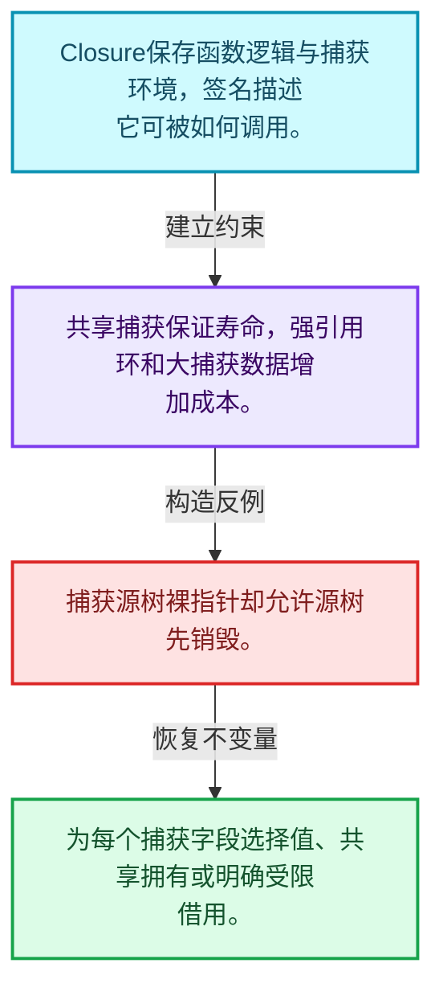
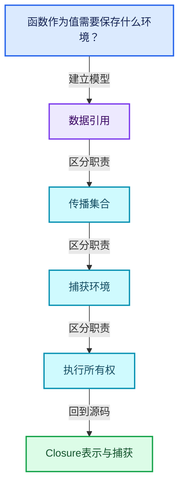
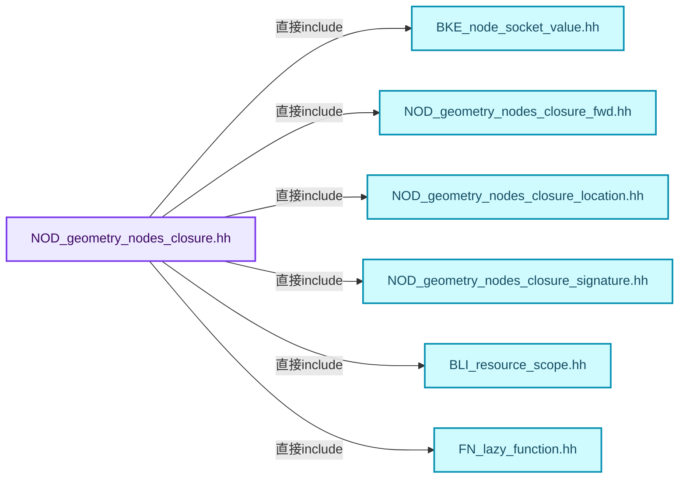
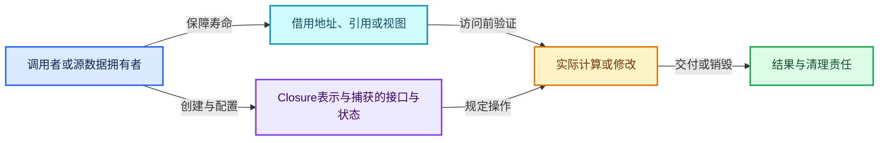
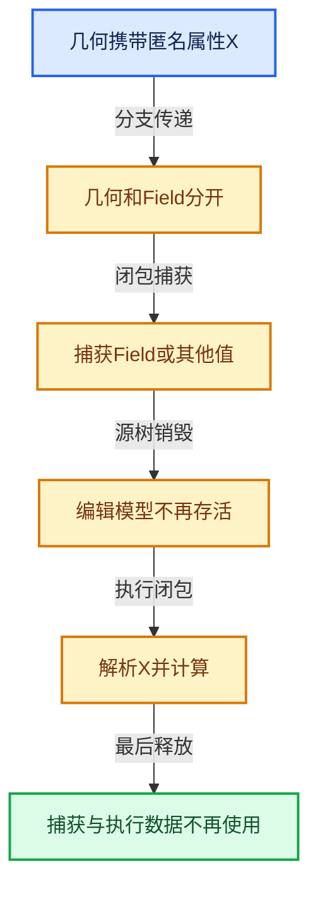

# 10-06 Closure表示与捕获

[方向导航](README.md) · [总目录](../README.md) · [覆盖索引](../%E6%BA%90%E7%A0%81%E7%89%88%E6%9C%AC%E4%B8%8E%E8%A6%86%E7%9B%96%E7%B4%A2%E5%BC%95.md)

> 阅读顺序：问题与数据模型 → 语法与类型 → 源码逐行 → 调用线索 → 历史与取舍 → 推演和练习。

- 基准 HEAD：`cbda6b96c26c0dee3c3b5cbb93960c4ac06a6b30`。
- 记录日期：2026-10-14。
- 教学示例状态：正文中的推演不是本机性能实测；已运行练习见验收报告。

## 一、从问题到设计

函数作为值需要保存什么环境？

闭包包含执行逻辑与捕获环境，捕获引用必须有寿命保障；签名描述可调用边界。

本篇把语法、数据语义和系统取舍连接起来。表达式引用、承载数据与执行环境必须一起追踪，跨区域组合不能丢掉生命周期信息。

### 本篇独立模型与设计推理

Closure保存函数逻辑与捕获环境，签名描述它可被如何调用。

设计取舍：共享捕获保证寿命，强引用环和大捕获数据增加成本。

最小反例：捕获源树裸指针却允许源树先销毁。

推导与处理：为每个捕获字段选择值、共享拥有或明确受限借用。



### 源码范围与相邻篇章

| 文件 | 本篇逐行范围 | 基准SHA-256 |
|---|---|---|
| [source/blender/nodes/NOD_geometry_nodes_closure.hh](../../../../../source/blender/nodes/NOD_geometry_nodes_closure.hh) | L1—L147 | `bec3e1ada4dd473db51966f8a5566611f0212234ec0238f6445ea0d89d387bf0` |
| [source/blender/nodes/NOD_geometry_nodes_closure_signature.hh](../../../../../source/blender/nodes/NOD_geometry_nodes_closure_signature.hh) | L1—L70 | `1f80c61d77853b275f94820a2601c2d30e73f133f0866f94a4011b367ebeb86d` |

同一主讲文件可能分多篇覆盖；超出本篇范围的符号通过覆盖索引定位。空行与纯注释保留在源码摘录中，逐行表解释有效语句与语法边界；许可证头统一保留。

前篇：[Bundle值组合](05-Bundle%E5%80%BC%E7%BB%84%E5%90%88.md).

后篇：[Closure求值与Zone](07-Closure%E6%B1%82%E5%80%BC%E4%B8%8EZone.md).

## 二、类型、数据与阅读地图



这是概念依赖图，边表示阅读关系，不声称是运行时调用顺序。

### 直接编译依赖



箭头只表示头文件包含关系；完整调用线索见后面的符号定位表。

## 三、关键词、语法与类型角色

### 只读限定 const

const约束当前访问路径可做的修改。const指针、指向const的指针、const视图对象、const元素是不同位置的限定；其他别名可能仍可修改原对象。

具体检查：分别写T* const、const T*与const T* const，并画出不可修改的层次。

### 移动转换 std::move

std::move把表达式转换为可供移动重载选择的值类别，实际资源转移发生在被选中的构造或赋值中。对const对象move可能仍调用复制，对视图move也不会获得底层数据所有权。

具体检查：记录移动构造调用次数，不用变量名或std::move的出现次数替代测量。

### 异常边界 try与catch

try定义异常传播的局部边界。失败路径需要销毁已经成功构造的部分并释放相应存储；未构造的对象不能被析构。

具体检查：在第k次构造失败，列出已经存在的对象集合与待释放缓冲。

### 覆写检查 override

override要求函数确实覆盖基类虚函数，可捕获参数类型和const限定不匹配。它不改变基类规定的生命周期或线程约束。

具体检查：故意改变一个参数或const，观察编译器如何拒绝误写的新函数。

### 可选值 optional

optional把不存在与存在的T区分开，T的构造和析构跟随engaged状态变化。访问前应由has_value或条件分支证明存在。

具体检查：把空Field状态与合法常量零区分，不能用某个普通值代替不存在。

### 受控访问 friend

friend授予指定函数或类访问非公开成员的权限，并不意味着继承，也不自动扩展到友元的派生类。

具体检查：解释执行器为何需要访问包装器的内部映射，同时检查边界是否仍清楚。

### 独占拥有 unique_ptr

unique_ptr通过移动转移拥有关系，默认删除策略必须与资源来源匹配。get返回借用指针，release交出责任而不销毁。

具体检查：区分move、get、release和reset后谁负责销毁。

### 共享拥有 shared_ptr

shared_ptr让控制块跟踪共享寿命，不自动使被指向对象的读写线程安全；循环拥有可能阻止销毁。

具体检查：画出强引用环并考虑是否应改变所有权方向或引入弱引用。

## 四、真实源码与逐行讲解

源码块保持原行内容，原始行号由小节标题及逐行表给出。表中的调用定位是静态阅读辅助；重载、模板实例化、宏展开和虚调用需结合完整声明，不能仅凭词法出现证明动态调用。

### NOD_geometry_nodes_closure.hh：L1—L45

<!-- source:source/blender/nodes/NOD_geometry_nodes_closure.hh:1:45 -->

```cpp
/* SPDX-FileCopyrightText: 2025 Blender Authors
 *
 * SPDX-License-Identifier: GPL-2.0-or-later */

/** \file
 * \ingroup nodes
 */

#pragma once

#include "BKE_node_socket_value.hh"

#include "NOD_geometry_nodes_closure_fwd.hh"
#include "NOD_geometry_nodes_closure_location.hh"
#include "NOD_geometry_nodes_closure_signature.hh"

#include "BLI_resource_scope.hh"

#include "FN_lazy_function.hh"

namespace blender::nodes {

/**
 * Describes the meaning of the various inputs and outputs of the lazy-function that's contained
 * in the closure.
 */
struct ClosureFunctionIndices {
  struct {
    IndexRange main;
    /** A boolean input for each output indicating whether that output is used. */
    IndexRange output_usages;
    /**
     * A #GeometryNodesReferenceSet input for a subset of the outputs. This is used to tell the
     * closure which attributes it has to propagate to the outputs.
     *
     * Main output index -> input `lf` socket index.
     */
    Map<int, int> output_data_reference_sets;
  } inputs;
  struct {
    IndexRange main;
    /** A boolean output for each input indicating whether that input is used. */
    IndexRange input_usages;
  } outputs;
};
```

| 原始行 | 语义、约束与检查 |
|---|---|
| L9 | 防止同一头文件在一个翻译单元中重复展开；不控制多个源文件之间的链接或对象寿命。 |
| L11 | 引入编译依赖 "BKE_node_socket_value.hh"；这是声明可见性关系，不表示运行时一定调用该文件的所有接口。 |
| L13 | 引入编译依赖 "NOD_geometry_nodes_closure_fwd.hh"；这是声明可见性关系，不表示运行时一定调用该文件的所有接口。 |
| L14 | 引入编译依赖 "NOD_geometry_nodes_closure_location.hh"；这是声明可见性关系，不表示运行时一定调用该文件的所有接口。 |
| L15 | 引入编译依赖 "NOD_geometry_nodes_closure_signature.hh"；这是声明可见性关系，不表示运行时一定调用该文件的所有接口。 |
| L17 | 引入编译依赖 "BLI_resource_scope.hh"；这是声明可见性关系，不表示运行时一定调用该文件的所有接口。 |
| L19 | 引入编译依赖 "FN_lazy_function.hh"；这是声明可见性关系，不表示运行时一定调用该文件的所有接口。 |
| L21 | 把后续声明放入 blender::nodes 命名空间，影响名称查找和符号归属，不创建运行时对象。 |
| L27 | 声明或定义类型 `struct ClosureFunctionIndices`。结合继承、访问权限和成员布局确认接口与拥有关系；前向声明本身没有完整对象布局。 |
| L28 | 声明或定义类型 `struct`。结合继承、访问权限和成员布局确认接口与拥有关系；前向声明本身没有完整对象布局。 |
| L29 | 声明成员、局部对象或完成语句 `IndexRange main`。若为指针或引用，它本身不说明拥有；若为值对象，其构造析构由所在作用域或外层对象管理。 |
| L31 | 声明成员、局部对象或完成语句 `IndexRange output_usages`。若为指针或引用，它本身不说明拥有；若为值对象，其构造析构由所在作用域或外层对象管理。 |
| L38 | 声明成员、局部对象或完成语句 `Map<int, int> output_data_reference_sets`。若为指针或引用，它本身不说明拥有；若为值对象，其构造析构由所在作用域或外层对象管理。 |
| L39 | 声明成员、局部对象或完成语句 `} inputs`。若为指针或引用，它本身不说明拥有；若为值对象，其构造析构由所在作用域或外层对象管理。 |
| L40 | 声明或定义类型 `struct`。结合继承、访问权限和成员布局确认接口与拥有关系；前向声明本身没有完整对象布局。 |
| L41 | 声明成员、局部对象或完成语句 `IndexRange main`。若为指针或引用，它本身不说明拥有；若为值对象，其构造析构由所在作用域或外层对象管理。 |
| L43 | 声明成员、局部对象或完成语句 `IndexRange input_usages`。若为指针或引用，它本身不说明拥有；若为值对象，其构造析构由所在作用域或外层对象管理。 |
| L44 | 声明成员、局部对象或完成语句 `} outputs`。若为指针或引用，它本身不说明拥有；若为值对象，其构造析构由所在作用域或外层对象管理。 |
| L45 | 结束当前语法单元。局部自动对象在离开其作用域时按规则销毁；这不等于所有被引用的外部数据也被释放。 |

### NOD_geometry_nodes_closure.hh：L46—L95

<!-- source:source/blender/nodes/NOD_geometry_nodes_closure.hh:46:95 -->

```cpp

/**
 * A closure is like a node group that is passed around as a value. It's typically evaluated using
 * the Evaluate Closure node.
 *
 * Internally, a closure is a lazy-function. So the inputs that are passed to the closure are
 * requested lazily. It's *not* yet supported to request the potentially captured values from the
 * Closure Zone lazily.
 */
class Closure : public ImplicitSharingMixin {
 private:
  std::shared_ptr<ClosureSignature> signature_;
  std::optional<ClosureSourceLocation> source_location_;
  std::shared_ptr<ClosureEvalLog> eval_log_;
  /**
   * When building complex lazy-functions, e.g. from Geometry Nodes, one often has to allocate
   * various additional resources (e.g. the lazy-functions for the individual nodes). Using
   * #ResourceScope provides a simple way to pass ownership of all these additional resources to
   * the Closure.
   */
  std::unique_ptr<ResourceScope> scope_;
  const fn::lazy_function::LazyFunction &function_;
  ClosureFunctionIndices indices_;
  Vector<bke::SocketValueVariant> default_input_values_;
  Vector<const bke::SocketValueVariant *> captured_values_;

 public:
  Closure(std::shared_ptr<ClosureSignature> signature,
          std::unique_ptr<ResourceScope> scope,
          const fn::lazy_function::LazyFunction &function,
          ClosureFunctionIndices indices,
          Vector<bke::SocketValueVariant> default_input_values,
          std::optional<ClosureSourceLocation> source_location,
          std::shared_ptr<ClosureEvalLog> eval_log,
          Vector<const bke::SocketValueVariant *> captured_values)
      : signature_(signature),
        source_location_(source_location),
        eval_log_(eval_log),
        scope_(std::move(scope)),
        function_(function),
        indices_(indices),
        default_input_values_(std::move(default_input_values)),
        captured_values_(std::move(captured_values))
  {
  }

  const ClosureSignature &signature() const
  {
    return *signature_;
  }
```

本段语义重点：

- `scope_`：求值或资源作用域，负责相应临时存储及清理。
- `indices_`：间接索引存储；区分数组内位置与指向的原始元素编号。

| 原始行 | 语义、约束与检查 |
|---|---|
| L55 | 声明或定义类型 `class Closure : public ImplicitSharingMixin`。结合继承、访问权限和成员布局确认接口与拥有关系；前向声明本身没有完整对象布局。 |
| L56 | 切换成员访问权限为 private；它是编译期接口边界，不是线程同步或内存保护。 |
| L57 | 声明成员、局部对象或完成语句 `std::shared_ptr<ClosureSignature> signature_`。若为指针或引用，它本身不说明拥有；若为值对象，其构造析构由所在作用域或外层对象管理。 |
| L58 | 声明成员、局部对象或完成语句 `std::optional<ClosureSourceLocation> source_location_`。若为指针或引用，它本身不说明拥有；若为值对象，其构造析构由所在作用域或外层对象管理。 |
| L59 | 声明成员、局部对象或完成语句 `std::shared_ptr<ClosureEvalLog> eval_log_`。若为指针或引用，它本身不说明拥有；若为值对象，其构造析构由所在作用域或外层对象管理。 |
| L66 | 本行涉及 `scope_`：求值或资源作用域，负责相应临时存储及清理。按此语义解读 `std::unique_ptr<ResourceScope> scope_`，不要把地址、数量或状态混用。 |
| L67 | 声明成员、局部对象或完成语句 `const fn::lazy_function::LazyFunction &function_`。若为指针或引用，它本身不说明拥有；若为值对象，其构造析构由所在作用域或外层对象管理。 |
| L68 | 本行涉及 `indices_`：间接索引存储；区分数组内位置与指向的原始元素编号。按此语义解读 `ClosureFunctionIndices indices_`，不要把地址、数量或状态混用。 |
| L69 | 声明成员、局部对象或完成语句 `Vector<bke::SocketValueVariant> default_input_values_`。若为指针或引用，它本身不说明拥有；若为值对象，其构造析构由所在作用域或外层对象管理。 |
| L70 | 声明成员、局部对象或完成语句 `Vector<const bke::SocketValueVariant *> captured_values_`。若为指针或引用，它本身不说明拥有；若为值对象，其构造析构由所在作用域或外层对象管理。 |
| L72 | 切换成员访问权限为 public；它是编译期接口边界，不是线程同步或内存保护。 |
| L73 | 出现调用或函数声明 `Closure`，对应表达式为 `Closure(std::shared_ptr<ClosureSignature> signature,`。参数求值、返回类型与重载需结合前后完整语句；静态文本引用不能证明动态目标。 |
| L74 | 本行是连续声明或表达式的一部分：`std::unique_ptr<ResourceScope> scope,`。与本段前后行合读；逗号、括号和限定符决定它属于参数、初始化列表还是实际计算。 |
| L75 | 本行是连续声明或表达式的一部分：`const fn::lazy_function::LazyFunction &function,`。与本段前后行合读；逗号、括号和限定符决定它属于参数、初始化列表还是实际计算。 |
| L76 | 本行是连续声明或表达式的一部分：`ClosureFunctionIndices indices,`。与本段前后行合读；逗号、括号和限定符决定它属于参数、初始化列表还是实际计算。 |
| L77 | 本行是连续声明或表达式的一部分：`Vector<bke::SocketValueVariant> default_input_values,`。与本段前后行合读；逗号、括号和限定符决定它属于参数、初始化列表还是实际计算。 |
| L78 | 本行是连续声明或表达式的一部分：`std::optional<ClosureSourceLocation> source_location,`。与本段前后行合读；逗号、括号和限定符决定它属于参数、初始化列表还是实际计算。 |
| L79 | 本行是连续声明或表达式的一部分：`std::shared_ptr<ClosureEvalLog> eval_log,`。与本段前后行合读；逗号、括号和限定符决定它属于参数、初始化列表还是实际计算。 |
| L80 | 本行是连续声明或表达式的一部分：`Vector<const bke::SocketValueVariant *> captured_values)`。与本段前后行合读；逗号、括号和限定符决定它属于参数、初始化列表还是实际计算。 |
| L81 | 出现调用或函数声明 `signature_`，对应表达式为 `: signature_(signature),`。参数求值、返回类型与重载需结合前后完整语句；静态文本引用不能证明动态目标。 |
| L82 | 出现调用或函数声明 `source_location_`，对应表达式为 `source_location_(source_location),`。参数求值、返回类型与重载需结合前后完整语句；静态文本引用不能证明动态目标。 |
| L83 | 出现调用或函数声明 `eval_log_`，对应表达式为 `eval_log_(eval_log),`。参数求值、返回类型与重载需结合前后完整语句；静态文本引用不能证明动态目标。 |
| L84 | 本行涉及 `scope_`：求值或资源作用域，负责相应临时存储及清理。按此语义解读 `scope_(std::move(scope)),`，不要把地址、数量或状态混用。 |
| L85 | 出现调用或函数声明 `function_`，对应表达式为 `function_(function),`。参数求值、返回类型与重载需结合前后完整语句；静态文本引用不能证明动态目标。 |
| L86 | 本行涉及 `indices_`：间接索引存储；区分数组内位置与指向的原始元素编号。按此语义解读 `indices_(indices),`，不要把地址、数量或状态混用。 |
| L87 | 出现调用或函数声明 `default_input_values_`，对应表达式为 `default_input_values_(std::move(default_input_values)),`。参数求值、返回类型与重载需结合前后完整语句；静态文本引用不能证明动态目标。 |
| L88 | 出现调用或函数声明 `captured_values_`，对应表达式为 `captured_values_(std::move(captured_values))`。参数求值、返回类型与重载需结合前后完整语句；静态文本引用不能证明动态目标。 |
| L89 | 连接上一行的声明或控制结构与其语句块；后续行在这个作用域中执行或声明。 |
| L90 | 结束当前语法单元。局部自动对象在离开其作用域时按规则销毁；这不等于所有被引用的外部数据也被释放。 |
| L92 | 出现调用或函数声明 `signature`，对应表达式为 `const ClosureSignature &signature() const`。参数求值、返回类型与重载需结合前后完整语句；静态文本引用不能证明动态目标。 |
| L93 | 连接上一行的声明或控制结构与其语句块；后续行在这个作用域中执行或声明。 |
| L94 | 返回表达式 `*signature_`。 |
| L95 | 结束当前语法单元。局部自动对象在离开其作用域时按规则销毁；这不等于所有被引用的外部数据也被释放。 |

### NOD_geometry_nodes_closure.hh：L96—L147

<!-- source:source/blender/nodes/NOD_geometry_nodes_closure.hh:96:147 -->

```cpp

  const ClosureFunctionIndices &indices() const
  {
    return indices_;
  }

  const fn::lazy_function::LazyFunction &function() const
  {
    return function_;
  }

  const std::optional<ClosureSourceLocation> &source_location() const
  {
    return source_location_;
  }

  const std::shared_ptr<ClosureEvalLog> &eval_log_ptr() const
  {
    return eval_log_;
  }

  const bke::SocketValueVariant &default_input_value(const int index) const
  {
    return default_input_values_[index];
  }

  Span<bke::SocketValueVariant> default_input_values() const
  {
    return default_input_values_;
  }

  Span<const bke::SocketValueVariant *> captured_values() const
  {
    return captured_values_;
  }

  void delete_self() override
  {
    MEM_delete(this);
  }

  void log_evaluation(const ClosureEvalLocation &location) const
  {
    if (!eval_log_) {
      return;
    }
    std::lock_guard lock{eval_log_->mutex};
    eval_log_->evaluations.append(location);
  }
};

}  // namespace blender::nodes
```

本段语义重点：

- `mutex`：保护相关缓存或节点状态的同步对象，保护范围以调用点为准。
- `indices_`：间接索引存储；区分数组内位置与指向的原始元素编号。

| 原始行 | 语义、约束与检查 |
|---|---|
| L97 | 出现调用或函数声明 `indices`，对应表达式为 `const ClosureFunctionIndices &indices() const`。参数求值、返回类型与重载需结合前后完整语句；静态文本引用不能证明动态目标。 |
| L98 | 连接上一行的声明或控制结构与其语句块；后续行在这个作用域中执行或声明。 |
| L99 | 返回表达式 `indices_`。 |
| L100 | 结束当前语法单元。局部自动对象在离开其作用域时按规则销毁；这不等于所有被引用的外部数据也被释放。 |
| L102 | 出现调用或函数声明 `function`，对应表达式为 `const fn::lazy_function::LazyFunction &function() const`。参数求值、返回类型与重载需结合前后完整语句；静态文本引用不能证明动态目标。 |
| L103 | 连接上一行的声明或控制结构与其语句块；后续行在这个作用域中执行或声明。 |
| L104 | 返回表达式 `function_`。 |
| L105 | 结束当前语法单元。局部自动对象在离开其作用域时按规则销毁；这不等于所有被引用的外部数据也被释放。 |
| L107 | 出现调用或函数声明 `source_location`，对应表达式为 `const std::optional<ClosureSourceLocation> &source_location() const`。参数求值、返回类型与重载需结合前后完整语句；静态文本引用不能证明动态目标。 |
| L108 | 连接上一行的声明或控制结构与其语句块；后续行在这个作用域中执行或声明。 |
| L109 | 返回表达式 `source_location_`。 |
| L110 | 结束当前语法单元。局部自动对象在离开其作用域时按规则销毁；这不等于所有被引用的外部数据也被释放。 |
| L112 | 出现调用或函数声明 `eval_log_ptr`，对应表达式为 `const std::shared_ptr<ClosureEvalLog> &eval_log_ptr() const`。参数求值、返回类型与重载需结合前后完整语句；静态文本引用不能证明动态目标。 |
| L113 | 连接上一行的声明或控制结构与其语句块；后续行在这个作用域中执行或声明。 |
| L114 | 返回表达式 `eval_log_`。 |
| L115 | 结束当前语法单元。局部自动对象在离开其作用域时按规则销毁；这不等于所有被引用的外部数据也被释放。 |
| L117 | 出现调用或函数声明 `default_input_value`，对应表达式为 `const bke::SocketValueVariant &default_input_value(const int index) const`。参数求值、返回类型与重载需结合前后完整语句；静态文本引用不能证明动态目标。 |
| L118 | 连接上一行的声明或控制结构与其语句块；后续行在这个作用域中执行或声明。 |
| L119 | 返回表达式 `default_input_values_[index]`。 |
| L120 | 结束当前语法单元。局部自动对象在离开其作用域时按规则销毁；这不等于所有被引用的外部数据也被释放。 |
| L122 | 出现调用或函数声明 `default_input_values`，对应表达式为 `Span<bke::SocketValueVariant> default_input_values() const`。参数求值、返回类型与重载需结合前后完整语句；静态文本引用不能证明动态目标。 |
| L123 | 连接上一行的声明或控制结构与其语句块；后续行在这个作用域中执行或声明。 |
| L124 | 返回表达式 `default_input_values_`。 |
| L125 | 结束当前语法单元。局部自动对象在离开其作用域时按规则销毁；这不等于所有被引用的外部数据也被释放。 |
| L127 | 出现调用或函数声明 `captured_values`，对应表达式为 `Span<const bke::SocketValueVariant *> captured_values() const`。参数求值、返回类型与重载需结合前后完整语句；静态文本引用不能证明动态目标。 |
| L128 | 连接上一行的声明或控制结构与其语句块；后续行在这个作用域中执行或声明。 |
| L129 | 返回表达式 `captured_values_`。 |
| L130 | 结束当前语法单元。局部自动对象在离开其作用域时按规则销毁；这不等于所有被引用的外部数据也被释放。 |
| L132 | 出现调用或函数声明 `delete_self`，对应表达式为 `void delete_self() override`。参数求值、返回类型与重载需结合前后完整语句；静态文本引用不能证明动态目标。 |
| L133 | 连接上一行的声明或控制结构与其语句块；后续行在这个作用域中执行或声明。 |
| L134 | 出现调用或函数声明 `MEM_delete`，对应表达式为 `MEM_delete(this);`。参数求值、返回类型与重载需结合前后完整语句；静态文本引用不能证明动态目标。 |
| L135 | 结束当前语法单元。局部自动对象在离开其作用域时按规则销毁；这不等于所有被引用的外部数据也被释放。 |
| L137 | 出现调用或函数声明 `log_evaluation`，对应表达式为 `void log_evaluation(const ClosureEvalLocation &location) const`。参数求值、返回类型与重载需结合前后完整语句；静态文本引用不能证明动态目标。 |
| L138 | 连接上一行的声明或控制结构与其语句块；后续行在这个作用域中执行或声明。 |
| L139 | 判断 `!eval_log_`，成立时进入本分支，否则继续后续路径。 |
| L140 | 结束当前函数，本路径不再执行后续语句；局部对象按作用域规则清理。 |
| L141 | 结束当前语法单元。局部自动对象在离开其作用域时按规则销毁；这不等于所有被引用的外部数据也被释放。 |
| L142 | 本行涉及 `mutex`：保护相关缓存或节点状态的同步对象，保护范围以调用点为准。按此语义解读 `std::lock_guard lock{eval_log_->mutex}`，不要把地址、数量或状态混用。 |
| L143 | 出现调用或函数声明 `append`，对应表达式为 `eval_log_->evaluations.append(location);`。参数求值、返回类型与重载需结合前后完整语句；静态文本引用不能证明动态目标。 |
| L144 | 结束当前语法单元。局部自动对象在离开其作用域时按规则销毁；这不等于所有被引用的外部数据也被释放。 |
| L145 | 结束当前语法单元。局部自动对象在离开其作用域时按规则销毁；这不等于所有被引用的外部数据也被释放。 |
| L147 | 结束当前语法单元。局部自动对象在离开其作用域时按规则销毁；这不等于所有被引用的外部数据也被释放。 |

### NOD_geometry_nodes_closure_signature.hh：L1—L47

<!-- source:source/blender/nodes/NOD_geometry_nodes_closure_signature.hh:1:47 -->

```cpp
/* SPDX-FileCopyrightText: 2025 Blender Authors
 *
 * SPDX-License-Identifier: GPL-2.0-or-later */

/** \file
 * \ingroup nodes
 */

#pragma once

#include "BKE_node.hh"

#include "BLI_vector_set.hh"

#include "NOD_node_in_compute_context.hh"

namespace blender::nodes {

/** Describes the names and types of the inputs and outputs of a closure. */
class ClosureSignature {
 public:
  struct Item {
    std::string key;
    const bke::bNodeSocketType *type = nullptr;
    NodeSocketInterfaceStructureType structure_type;

    friend bool operator==(const Item &a, const Item &b) = default;
  };

  struct ItemKeyGetter {
    std::string operator()(const Item &item)
    {
      return item.key;
    }
  };

  CustomIDVectorSet<Item, ItemKeyGetter> inputs;
  CustomIDVectorSet<Item, ItemKeyGetter> outputs;

  std::optional<int> find_input_index(StringRef key) const;
  std::optional<int> find_output_index(StringRef key) const;

  friend bool operator==(const ClosureSignature &a, const ClosureSignature &b);
  friend bool operator!=(const ClosureSignature &a, const ClosureSignature &b);

  static ClosureSignature from_closure_output_node(const bNode &node,
                                                   bool allow_auto_structure_type);
```

| 原始行 | 语义、约束与检查 |
|---|---|
| L9 | 防止同一头文件在一个翻译单元中重复展开；不控制多个源文件之间的链接或对象寿命。 |
| L11 | 引入编译依赖 "BKE_node.hh"；这是声明可见性关系，不表示运行时一定调用该文件的所有接口。 |
| L13 | 引入编译依赖 "BLI_vector_set.hh"；这是声明可见性关系，不表示运行时一定调用该文件的所有接口。 |
| L15 | 引入编译依赖 "NOD_node_in_compute_context.hh"；这是声明可见性关系，不表示运行时一定调用该文件的所有接口。 |
| L17 | 把后续声明放入 blender::nodes 命名空间，影响名称查找和符号归属，不创建运行时对象。 |
| L20 | 声明或定义类型 `class ClosureSignature`。结合继承、访问权限和成员布局确认接口与拥有关系；前向声明本身没有完整对象布局。 |
| L21 | 切换成员访问权限为 public；它是编译期接口边界，不是线程同步或内存保护。 |
| L22 | 声明或定义类型 `struct Item`。结合继承、访问权限和成员布局确认接口与拥有关系；前向声明本身没有完整对象布局。 |
| L23 | 声明成员、局部对象或完成语句 `std::string key`。若为指针或引用，它本身不说明拥有；若为值对象，其构造析构由所在作用域或外层对象管理。 |
| L24 | 把右侧 `nullptr` 用于初始化或更新左侧 `const bke::bNodeSocketType *type`。声明初始化与已有对象赋值应按上下文区分；有资源的类型会调用相应特殊成员。 |
| L25 | 声明成员、局部对象或完成语句 `NodeSocketInterfaceStructureType structure_type`。若为指针或引用，它本身不说明拥有；若为值对象，其构造析构由所在作用域或外层对象管理。 |
| L27 | 显式采用编译器生成的特殊成员行为：`friend bool operator==(const Item &a, const Item &b) = default;`。成员和基类的性质决定该操作是否可用、是否被删除及异常约定，不表示运行时给对象赋值为default。 |
| L28 | 结束当前语法单元。局部自动对象在离开其作用域时按规则销毁；这不等于所有被引用的外部数据也被释放。 |
| L30 | 声明或定义类型 `struct ItemKeyGetter`。结合继承、访问权限和成员布局确认接口与拥有关系；前向声明本身没有完整对象布局。 |
| L31 | 运算符重载声明、定义或显式调用：`std::string operator()(const Item &item)`。结合参数和返回类型判断是赋值、索引、比较还是转换；operator=声明中的等号不是在给名为operator的变量赋值。 |
| L32 | 连接上一行的声明或控制结构与其语句块；后续行在这个作用域中执行或声明。 |
| L33 | 返回表达式 `item.key`。 |
| L34 | 结束当前语法单元。局部自动对象在离开其作用域时按规则销毁；这不等于所有被引用的外部数据也被释放。 |
| L35 | 结束当前语法单元。局部自动对象在离开其作用域时按规则销毁；这不等于所有被引用的外部数据也被释放。 |
| L37 | 声明成员、局部对象或完成语句 `CustomIDVectorSet<Item, ItemKeyGetter> inputs`。若为指针或引用，它本身不说明拥有；若为值对象，其构造析构由所在作用域或外层对象管理。 |
| L38 | 声明成员、局部对象或完成语句 `CustomIDVectorSet<Item, ItemKeyGetter> outputs`。若为指针或引用，它本身不说明拥有；若为值对象，其构造析构由所在作用域或外层对象管理。 |
| L40 | 声明接口 `std::optional<int> find_input_index(StringRef key) const`，本行没有对应函数体；返回类型、参数限定和const/noexcept共同组成调用契约，实际行为需继续定位实现。 |
| L41 | 声明接口 `std::optional<int> find_output_index(StringRef key) const`，本行没有对应函数体；返回类型、参数限定和const/noexcept共同组成调用契约，实际行为需继续定位实现。 |
| L43 | 运算符重载声明、定义或显式调用：`friend bool operator==(const ClosureSignature &a, const ClosureSignature &b);`。结合参数和返回类型判断是赋值、索引、比较还是转换；operator=声明中的等号不是在给名为operator的变量赋值。 |
| L44 | 运算符重载声明、定义或显式调用：`friend bool operator!=(const ClosureSignature &a, const ClosureSignature &b);`。结合参数和返回类型判断是赋值、索引、比较还是转换；operator=声明中的等号不是在给名为operator的变量赋值。 |
| L46 | 出现调用或函数声明 `from_closure_output_node`，对应表达式为 `static ClosureSignature from_closure_output_node(const bNode &node,`。参数求值、返回类型与重载需结合前后完整语句；静态文本引用不能证明动态目标。 |
| L47 | 声明成员、局部对象或完成语句 `bool allow_auto_structure_type)`。若为指针或引用，它本身不说明拥有；若为值对象，其构造析构由所在作用域或外层对象管理。 |

### NOD_geometry_nodes_closure_signature.hh：L48—L70

<!-- source:source/blender/nodes/NOD_geometry_nodes_closure_signature.hh:48:70 -->

```cpp
  static ClosureSignature from_evaluate_closure_node(const bNode &node,
                                                     bool allow_auto_structure_type);
  static ClosureSignature from_closure_to_list_node(const bNode &node);

  void set_auto_structure_types();
};

/**
 * Multiple closure signatures that may be linked to a single node.
 */
struct LinkedClosureSignatures {
  struct Item {
    ClosureSignature signature;
    bool define_signature = false;
    SocketInContext socket;
  };
  Vector<Item> items;
  bool has_type_definition() const;

  std::optional<ClosureSignature> get_merged_signature() const;
};

}  // namespace blender::nodes
```

| 原始行 | 语义、约束与检查 |
|---|---|
| L48 | 出现调用或函数声明 `from_evaluate_closure_node`，对应表达式为 `static ClosureSignature from_evaluate_closure_node(const bNode &node,`。参数求值、返回类型与重载需结合前后完整语句；静态文本引用不能证明动态目标。 |
| L49 | 声明成员、局部对象或完成语句 `bool allow_auto_structure_type)`。若为指针或引用，它本身不说明拥有；若为值对象，其构造析构由所在作用域或外层对象管理。 |
| L50 | 声明接口 `static ClosureSignature from_closure_to_list_node(const bNode &node)`，本行没有对应函数体；返回类型、参数限定和const/noexcept共同组成调用契约，实际行为需继续定位实现。 |
| L52 | 声明接口 `void set_auto_structure_types()`，本行没有对应函数体；返回类型、参数限定和const/noexcept共同组成调用契约，实际行为需继续定位实现。 |
| L53 | 结束当前语法单元。局部自动对象在离开其作用域时按规则销毁；这不等于所有被引用的外部数据也被释放。 |
| L58 | 声明或定义类型 `struct LinkedClosureSignatures`。结合继承、访问权限和成员布局确认接口与拥有关系；前向声明本身没有完整对象布局。 |
| L59 | 声明或定义类型 `struct Item`。结合继承、访问权限和成员布局确认接口与拥有关系；前向声明本身没有完整对象布局。 |
| L60 | 声明成员、局部对象或完成语句 `ClosureSignature signature`。若为指针或引用，它本身不说明拥有；若为值对象，其构造析构由所在作用域或外层对象管理。 |
| L61 | 把右侧 `false` 用于初始化或更新左侧 `bool define_signature`。声明初始化与已有对象赋值应按上下文区分；有资源的类型会调用相应特殊成员。 |
| L62 | 声明成员、局部对象或完成语句 `SocketInContext socket`。若为指针或引用，它本身不说明拥有；若为值对象，其构造析构由所在作用域或外层对象管理。 |
| L63 | 结束当前语法单元。局部自动对象在离开其作用域时按规则销毁；这不等于所有被引用的外部数据也被释放。 |
| L64 | 声明成员、局部对象或完成语句 `Vector<Item> items`。若为指针或引用，它本身不说明拥有；若为值对象，其构造析构由所在作用域或外层对象管理。 |
| L65 | 声明接口 `bool has_type_definition() const`，本行没有对应函数体；返回类型、参数限定和const/noexcept共同组成调用契约，实际行为需继续定位实现。 |
| L67 | 声明接口 `std::optional<ClosureSignature> get_merged_signature() const`，本行没有对应函数体；返回类型、参数限定和const/noexcept共同组成调用契约，实际行为需继续定位实现。 |
| L68 | 结束当前语法单元。局部自动对象在离开其作用域时按规则销毁；这不等于所有被引用的外部数据也被释放。 |
| L70 | 结束当前语法单元。局部自动对象在离开其作用域时按规则销毁；这不等于所有被引用的外部数据也被释放。 |

## 五、接口定位、调用线索与生命周期

### 本篇声明与实现入口

| 源码位置 | 实际声明片段 |
|---|---|
| [NOD_geometry_nodes_closure.hh:L27](../../../../../source/blender/nodes/NOD_geometry_nodes_closure.hh#L27) | `struct ClosureFunctionIndices` |
| [NOD_geometry_nodes_closure.hh:L55](../../../../../source/blender/nodes/NOD_geometry_nodes_closure.hh#L55) | `class Closure : public ImplicitSharingMixin` |
| [NOD_geometry_nodes_closure.hh:L73](../../../../../source/blender/nodes/NOD_geometry_nodes_closure.hh#L73) | `Closure(std::shared_ptr<ClosureSignature> signature,` |
| [NOD_geometry_nodes_closure.hh:L81](../../../../../source/blender/nodes/NOD_geometry_nodes_closure.hh#L81) | `: signature_(signature),` |
| [NOD_geometry_nodes_closure.hh:L92](../../../../../source/blender/nodes/NOD_geometry_nodes_closure.hh#L92) | `const ClosureSignature &signature() const` |
| [NOD_geometry_nodes_closure.hh:L97](../../../../../source/blender/nodes/NOD_geometry_nodes_closure.hh#L97) | `const ClosureFunctionIndices &indices() const` |
| [NOD_geometry_nodes_closure.hh:L102](../../../../../source/blender/nodes/NOD_geometry_nodes_closure.hh#L102) | `const fn::lazy_function::LazyFunction &function() const` |
| [NOD_geometry_nodes_closure.hh:L107](../../../../../source/blender/nodes/NOD_geometry_nodes_closure.hh#L107) | `const std::optional<ClosureSourceLocation> &source_location() const` |
| [NOD_geometry_nodes_closure.hh:L112](../../../../../source/blender/nodes/NOD_geometry_nodes_closure.hh#L112) | `const std::shared_ptr<ClosureEvalLog> &eval_log_ptr() const` |
| [NOD_geometry_nodes_closure.hh:L117](../../../../../source/blender/nodes/NOD_geometry_nodes_closure.hh#L117) | `const bke::SocketValueVariant &default_input_value(const int index) const` |
| [NOD_geometry_nodes_closure.hh:L122](../../../../../source/blender/nodes/NOD_geometry_nodes_closure.hh#L122) | `Span<bke::SocketValueVariant> default_input_values() const` |
| [NOD_geometry_nodes_closure.hh:L127](../../../../../source/blender/nodes/NOD_geometry_nodes_closure.hh#L127) | `Span<const bke::SocketValueVariant *> captured_values() const` |
| [NOD_geometry_nodes_closure.hh:L132](../../../../../source/blender/nodes/NOD_geometry_nodes_closure.hh#L132) | `void delete_self() override` |
| [NOD_geometry_nodes_closure.hh:L134](../../../../../source/blender/nodes/NOD_geometry_nodes_closure.hh#L134) | `MEM_delete(this);` |
| [NOD_geometry_nodes_closure.hh:L137](../../../../../source/blender/nodes/NOD_geometry_nodes_closure.hh#L137) | `void log_evaluation(const ClosureEvalLocation &location) const` |
| [NOD_geometry_nodes_closure_signature.hh:L20](../../../../../source/blender/nodes/NOD_geometry_nodes_closure_signature.hh#L20) | `class ClosureSignature` |
| [NOD_geometry_nodes_closure_signature.hh:L22](../../../../../source/blender/nodes/NOD_geometry_nodes_closure_signature.hh#L22) | `struct Item` |
| [NOD_geometry_nodes_closure_signature.hh:L30](../../../../../source/blender/nodes/NOD_geometry_nodes_closure_signature.hh#L30) | `struct ItemKeyGetter` |
| [NOD_geometry_nodes_closure_signature.hh:L31](../../../../../source/blender/nodes/NOD_geometry_nodes_closure_signature.hh#L31) | `std::string operator()(const Item &item)` |
| [NOD_geometry_nodes_closure_signature.hh:L40](../../../../../source/blender/nodes/NOD_geometry_nodes_closure_signature.hh#L40) | `std::optional<int> find_input_index(StringRef key) const;` |
| [NOD_geometry_nodes_closure_signature.hh:L41](../../../../../source/blender/nodes/NOD_geometry_nodes_closure_signature.hh#L41) | `std::optional<int> find_output_index(StringRef key) const;` |
| [NOD_geometry_nodes_closure_signature.hh:L46](../../../../../source/blender/nodes/NOD_geometry_nodes_closure_signature.hh#L46) | `static ClosureSignature from_closure_output_node(const bNode &node,` |
| [NOD_geometry_nodes_closure_signature.hh:L48](../../../../../source/blender/nodes/NOD_geometry_nodes_closure_signature.hh#L48) | `static ClosureSignature from_evaluate_closure_node(const bNode &node,` |
| [NOD_geometry_nodes_closure_signature.hh:L50](../../../../../source/blender/nodes/NOD_geometry_nodes_closure_signature.hh#L50) | `static ClosureSignature from_closure_to_list_node(const bNode &node);` |
| [NOD_geometry_nodes_closure_signature.hh:L52](../../../../../source/blender/nodes/NOD_geometry_nodes_closure_signature.hh#L52) | `void set_auto_structure_types();` |
| [NOD_geometry_nodes_closure_signature.hh:L58](../../../../../source/blender/nodes/NOD_geometry_nodes_closure_signature.hh#L58) | `struct LinkedClosureSignatures` |
| [NOD_geometry_nodes_closure_signature.hh:L59](../../../../../source/blender/nodes/NOD_geometry_nodes_closure_signature.hh#L59) | `struct Item` |
| [NOD_geometry_nodes_closure_signature.hh:L65](../../../../../source/blender/nodes/NOD_geometry_nodes_closure_signature.hh#L65) | `bool has_type_definition() const;` |
| [NOD_geometry_nodes_closure_signature.hh:L67](../../../../../source/blender/nodes/NOD_geometry_nodes_closure_signature.hh#L67) | `std::optional<ClosureSignature> get_merged_signature() const;` |

### 同名符号出现位置

以下表提供跨文件阅读入口，包含声明、调用或测试使用；没有经过完整C++名称解析，不把它命名为已证明的运行时调用图。

| 符号 | 位置 | 文本证据 |
|---|---|---|
| `signature_` | [FN_multi_function_params.hh:L140](../../../../../source/blender/functions/FN_multi_function_params.hh#L140) | `: signature_(&signature), mask_(mask), min_array_size_(mask.min_array_size())` |
| `signature_` | [FN_multi_function_signature.hh:L97](../../../../../source/blender/functions/FN_multi_function_signature.hh#L97) | `: signature_(signature_to_build)` |
| `signature` | [FN_multi_function.hh:L89](../../../../../source/blender/functions/FN_multi_function.hh#L89) | `const Signature &signature() const` |
| `signature` | [FN_multi_function.hh:L144](../../../../../source/blender/functions/FN_multi_function.hh#L144) | `: ParamsBuilder(fn.signature(), *mask)` |
| `signature` | [geometry_nodes_closure_zone.cc:L447](../../../../../source/blender/nodes/intern/geometry_nodes_closure_zone.cc#L447) | `const ClosureSignature &signature = closure.signature();` |
| `indices` | [BLI_index_mask.hh:L1131](../../../../../source/blender/blenlib/BLI_index_mask.hh#L1131) | `Vector<T> indices(indices_num_);` |
| `indices` | [index_mask.cc:L106](../../../../../source/blender/blenlib/intern/index_mask.cc#L106) | `Array<int64_t> indices(mask.size());` |
| `indices` | [BLI_kdtree_test.cc:L66](../../../../../source/blender/blenlib/tests/BLI_kdtree_test.cc#L66) | `Vector<int> indices(points_num);` |
| `function` | [BLI_task.hh:L37](../../../../../source/blender/blenlib/BLI_task.hh#L37) | `function(value);` |
| `function` | [BLI_task.hh:L79](../../../../../source/blender/blenlib/BLI_task.hh#L79) | `function(range);` |
| `function` | [BLI_task.hh:L122](../../../../../source/blender/blenlib/BLI_task.hh#L122) | `function(aligned_range);` |
| `source_location` | [geometry_nodes_closure_zone.cc:L395](../../../../../source/blender/nodes/intern/geometry_nodes_closure_zone.cc#L395) | `eval_storage.closure ? eval_storage.closure->source_location() : std::nullopt;` |
| `default_input_value` | [geometry_nodes_closure_zone.cc:L592](../../../../../source/blender/nodes/intern/geometry_nodes_closure_zone.cc#L592) | `lf_to.set_default_value(&closure.default_input_value(*mapped_i));` |
| `default_input_value` | [geometry_nodes_closure_zone.cc:L647](../../../../../source/blender/nodes/intern/geometry_nodes_closure_zone.cc#L647) | `lf_closure_input.set_default_value(&closure.default_input_value(i));` |
| `default_input_value` | [geometry_nodes_closure_zone.cc:L825](../../../../../source/blender/nodes/intern/geometry_nodes_closure_zone.cc#L825) | `closure.default_input_value(main_input_i));` |
| `delete_self` | [BKE_geometry_set.hh:L125](../../../../../source/blender/blenkernel/BKE_geometry_set.hh#L125) | `void delete_self() override;` |
| `delete_self` | [geometry_set.cc:L96](../../../../../source/blender/blenkernel/intern/geometry_set.cc#L96) | `void GeometryComponent::delete_self()` |
| `delete_self` | [BLI_implicit_sharing.hh:L203](../../../../../source/blender/blenlib/BLI_implicit_sharing.hh#L203) | `this->delete_self();` |
| `MEM_delete` | [mesh.cc:L1499](../../../../../source/blender/blenkernel/intern/mesh.cc#L1499) | `MEM_delete(me_dst->mat);` |
| `MEM_delete` | [mesh.cc:L2175](../../../../../source/blender/blenkernel/intern/mesh.cc#L2175) | `MEM_delete(mselect_src);` |
| `MEM_delete` | [mesh.cc:L2178](../../../../../source/blender/blenkernel/intern/mesh.cc#L2178) | `MEM_delete(mselect_dst);` |
| `log_evaluation` | [geometry_nodes_closure_zone.cc:L384](../../../../../source/blender/nodes/intern/geometry_nodes_closure_zone.cc#L384) | `eval_storage.closure->log_evaluation(eval_location);` |
| `operator` | [BKE_attribute_storage.hh:L127](../../../../../source/blender/blenkernel/BKE_attribute_storage.hh#L127) | `StringRef operator()(const std::unique_ptr<Attribute> &value) const` |
| `operator` | [BLI_cpp_type.hh:L441](../../../../../source/blender/blenlib/BLI_cpp_type.hh#L441) | `fn.template operator()<T>();` |
| `operator` | [BLI_function_ref.hh:L147](../../../../../source/blender/blenlib/BLI_function_ref.hh#L147) | `Ret operator()(Params... params) const` |
| `find_input_index` | [geometry_nodes_closure.cc:L16](../../../../../source/blender/nodes/intern/geometry_nodes_closure.cc#L16) | `std::optional<int> ClosureSignature::find_input_index(const StringRef key) const` |
| `find_input_index` | [geometry_nodes_closure_zone.cc:L452](../../../../../source/blender/nodes/intern/geometry_nodes_closure_zone.cc#L452) | `if (const std::optional<int> i = signature.find_input_index(item.name)) {` |
| `find_input_index` | [geometry_nodes_closure_zone.cc:L556](../../../../../source/blender/nodes/intern/geometry_nodes_closure_zone.cc#L556) | `inputs_map[i] = closure_signature.find_input_index(node_storage.input_items.items[i].name);` |
| `find_output_index` | [geometry_nodes_closure.cc:L27](../../../../../source/blender/nodes/intern/geometry_nodes_closure.cc#L27) | `std::optional<int> ClosureSignature::find_output_index(const StringRef key) const` |
| `find_output_index` | [geometry_nodes_closure_zone.cc:L495](../../../../../source/blender/nodes/intern/geometry_nodes_closure_zone.cc#L495) | `if (const std::optional<int> i = signature.find_output_index(item.name)) {` |
| `find_output_index` | [geometry_nodes_closure_zone.cc:L560](../../../../../source/blender/nodes/intern/geometry_nodes_closure_zone.cc#L560) | `outputs_map[i] = closure_signature.find_output_index(` |

### 生命周期推理图



这是审查生命周期的通用模型。具体类是否拥有数据由本篇成员、构造、析构和调用者一起证明；任何箭头都不自动代表shared_ptr。

## 六、把代码放进具体数据中推演

本方向的共同数值模型如下。本篇的专门检查是：区分按值捕获、借用捕获和共享拥有捕获。

| 步骤 | 数据或状态 | 为什么需要这一步 |
|---|---|---|
| Capture | 几何携带匿名属性X | Field持有访问X的需求 |
| 分支传递 | 几何和Field分开 | 仍需在汇合处对应 |
| 闭包捕获 | 捕获Field或其他值 | 环境寿命延长到调用结束 |
| 源树销毁 | 编辑模型不再存活 | 执行所需信息仍须有拥有者 |
| 执行闭包 | 解析X并计算 | 缺失几何数据不能凭Field补回 |
| 最后释放 | 捕获与执行数据不再使用 | 避免环状共享导致泄漏 |



图是教学推演模型；精确分支与状态更新以本篇摘录及调用契约为准。

### 本篇独立练习与参考思路

区分按值捕获、借用捕获和共享拥有捕获。

参考思路：闭包包含执行逻辑与捕获环境，捕获引用必须有寿命保障；签名描述可调用边界。

将输入、预期结果和资源责任分成三张清单。先用最直接的实现给出可核对的答案，再替换成对应源码使用的表示；比较结果不变的条件，而不是只比较接口名字。

验收依据：所有被读取的引用仍有对应数据；源树结束后执行对象所需信息存活；强引用图无不必要循环。

## 七、复杂度、设计取舍与其他基础库

与C++ lambda、shared_ptr图和编译器活跃性分析比较：捕获环境保障寿命，引用集合保障所需数据传播，二者承担不同责任。

本篇的具体取舍：闭包包含执行逻辑与捕获环境，捕获引用必须有寿命保障；签名描述可调用边界。

| 观察维度 | 从源码取得证据的方法 | 本篇要避免的误判 |
|---|---|---|
| 时间 | 对循环次数、分派次数和重建频率分别计数 | 看到单次常数操作就断定整个操作序列是常数成本 |
| 内存 | 区分对象本体、容量存储、间接资源和共享控制块 | 用sizeof代替总内存 |
| 安全 | 沿构造、失败回滚、销毁与失效逐路径检查 | 把断言或非空指针当作完整安全证明 |
| 并发 | 逐字段确认锁、发布顺序和借用寿命 | 把引用计数线程安全等同数据读写线程安全 |

相关一手资料：

- [C++公开工作草案](https://eel.is/c++draft/)：持续更新的工作草案；语言与标准库语义以相应章节为准。
- [Blender依赖图设计](https://developer.blender.org/docs/features/core/depsgraph/)：包含历史设计背景，当前行为以本地源码为准。

资料用于核对契约和进一步阅读；这里没有声称外部库与Blender实现相同，也没有把上游性能数字当作本机实测。

## 八、历史提交与设计演化

### 2025-04-03 · Jacques Lucke

[Geometry Nodes: add Closures and Bundles behind experimental feature flag](https://projects.blender.org/blender/blender/commit/8ec9c62d3ea8d8f00a375c01e7533a080f7476c5)

完整哈希：`8ec9c62d3ea8d8f00a375c01e7533a080f7476c5`。提交标题与作者日期来自本地Git对象。

提交说明原文（历史证据，不能直接作为当前API说明）：

```text
Geometry Nodes: add Closures and Bundles behind experimental feature flag

This implements bundles and closures which are described in more detail in this
blog post: https://code.blender.org/2024/11/geometry-nodes-workshop-october-2024/

tl;dr:
* Bundles are containers that allow storing multiple socket values in a single
  value. Each value in the bundle is identified by a name. Bundles can be
  nested.
* Closures are functions that are created with the Closure Zone and can be
  evaluated with the Evaluate Closure node.

To use the patch, the `Bundle and Closure Nodes` experimental feature has to be
enabled. This is necessary, because these features are not fully done yet and
still need iterations to improve the workflow before they can be officially
released. These iterations are easier to do in `main` than in a separate branch
though. That's because this patch is quite large and somewhat prone to merge
conflicts. Also other work we want to do, depends on this.

This adds the following new nodes:
* Combine Bundle: can pack multiple values into one.
* Separate Bundle: extracts values from a bundle.
* Closure Zone: outputs a closure zone for use in the `Evaluate Closure` node.
* Evaluate Closure: evaluates the passed in closure.

Things that will be added soon after this lands:
* Fields in bundles and closures. The way this is done changes with #134811, so
  I rather implement this once both are in `main`.
* UI features for keeping sockets in sync (right now there are warnings only).

One bigger issue is the limited support for lazyness. For example, all inputs of
a Combine Bundle node will be evaluated, even if they are not all needed. The
same is true for all captured values of a closure. This is a deeper limitation
that needs to be resolved at some point. This will likely be done after an
initial version of this patch is done.

Pull Request: https://projects.blender.org/blender/blender/pulls/128340
```

阅读任务：先根据说明复述旧问题，提出一个自己的修复方案，再对照diff。结合本篇重点“函数作为值需要保存什么环境？”判断方案改变的是表示、接口、生命周期还是调度。

## 九、反例、测试入口与掌握标准

需要实际构造的反例：

- 空输入或没有结果需求：确认接口允许的空状态与不允许访问的操作。
- 边界位置和退化结构：把长度为1、末尾位置、重复值或深链代入真实分支。
- 生命周期结束或修改之后：检查保存的指针、引用、结果视图是否仍有效。
- 与本篇核心不变量相冲突的输入：区分按值捕获、借用捕获和共享拥有捕获。

### 可运行的教学参考程序

[reference_exercises.cc](../_tools/reference_exercises.cc)包含独立于Blender的C++20参考检查：视图、简化SmallVector、异常回滚、哈希碰撞与删除、偏移数组、拓扑映射、共享缓存、表达式、惰性分支、闭包和暴力最近邻。

参考程序有意省略生产实现的完整能力。例如SmallVector禁止复制移动容器，不支持只能移动的元素，并禁止append参数别名到自身元素；TinyMap固定8槽，不提供增长。程序通过不能替代Blender实现测试。实际运行结果、编译器与命令见验收报告。

掌握标准：离开源码解释“函数作为值需要保存什么环境？”；独立完成上述练习；能指出一个会破坏数据引用相关约束的最小反例，并用具体代码行说明检查或修复应放在哪里。
