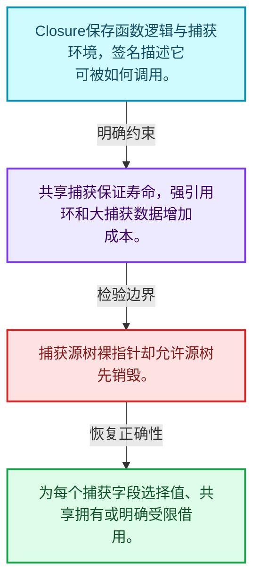
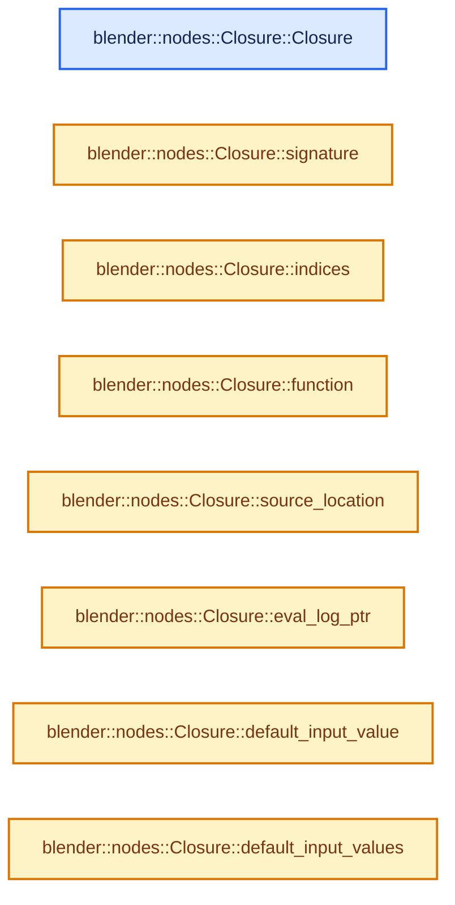
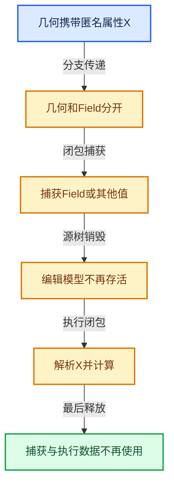

# 10-06 Closure表示与捕获

[方向导航](README.md) · [总目录](../README.md) · [实现索引](../00-课程指南/02-源码与提交索引/符号依赖与实现索引.md)

## 从问题到实现

函数作为值需要保存什么环境？

闭包包含执行逻辑与捕获环境，捕获引用必须有寿命保障；签名描述可调用边界。

**数据模型**

Closure保存函数逻辑与捕获环境，签名描述它可被如何调用。

**设计取舍**

共享捕获保证寿命，强引用环和大捕获数据增加成本。

**最小反例**

捕获源树裸指针却允许源树先销毁。

**推导**

为每个捕获字段选择值、共享拥有或明确受限借用。

## 阅读地图与执行推演








图中的数值推演是本方向的教学模型；实际函数之间的调用边与概念分析边分别标注，不能把概念关系当作运行时调度顺序。

## 完整源码单元与就地讲解

中文讲解直接放在相关代码旁，复杂机制在代码下展开。原文折叠区保留基准行号；不需要在行号表和函数之间来回查找。类布局可分段展示，函数实现不按固定行数切开。

### 类型布局、声明与编译条件 · NOD_geometry_nodes_closure.hh L1—L72

<a id="t-64d0b31fef4f"></a>

`ClosureFunctionIndices`在这里声明的数据成员：

- `struct {
    IndexRange main;
    /** A boolean input for each output indicating whether that output is used. */
    IndexRange output_usages;
    /**
     * A #GeometryNodesReferenceSet input for a subset of the outputs. This is used to tell the
     * closure which attributes it has to propagate to the outputs.
     *
     * Main output index -> input `lf` socket index.
     */
    Map<int, int> output_data_reference_sets;
  } inputs`
- `struct {
    IndexRange main;
    /** A boolean output for each input indicating whether that input is used. */
    IndexRange input_usages;
  } outputs`

<a id="t-1d6f683a75ec"></a>

`Closure`在这里声明的数据成员：

- `std::shared_ptr<ClosureSignature> signature_`
- `std::optional<ClosureSourceLocation> source_location_`
- `std::shared_ptr<ClosureEvalLog> eval_log_`
- `std::unique_ptr<ResourceScope> scope_`
- `fn::lazy_function::LazyFunction function_`
- `ClosureFunctionIndices indices_`
- `Vector<bke::SocketValueVariant> default_input_values_`
- `Vector<const bke::SocketValueVariant *> captured_values_`

<!-- annotated:214a8c8b19787a -->

```cpp
/* SPDX-FileCopyrightText: 2025 Blender Authors
 *
 * SPDX-License-Identifier: GPL-2.0-or-later */

/** \file
 * \ingroup nodes
 */

#pragma once

#include "BKE_node_socket_value.hh"

#include "NOD_geometry_nodes_closure_fwd.hh"
#include "NOD_geometry_nodes_closure_location.hh"
#include "NOD_geometry_nodes_closure_signature.hh"

#include "BLI_resource_scope.hh"

#include "FN_lazy_function.hh"

namespace blender::nodes {

/**
 * Describes the meaning of the various inputs and outputs of the lazy-function that's contained
 * in the closure.
 */
struct ClosureFunctionIndices {
  struct {
    IndexRange main;
    /** A boolean input for each output indicating whether that output is used. */
    IndexRange output_usages;
    /**
     * A #GeometryNodesReferenceSet input for a subset of the outputs. This is used to tell the
     * closure which attributes it has to propagate to the outputs.
     *
     * Main output index -> input `lf` socket index.
     */
    Map<int, int> output_data_reference_sets;
  } inputs;
  struct {
    IndexRange main;
    /** A boolean output for each input indicating whether that input is used. */
    IndexRange input_usages;
  } outputs;
};

/**
 * A closure is like a node group that is passed around as a value. It's typically evaluated using
 * the Evaluate Closure node.
 *
 * Internally, a closure is a lazy-function. So the inputs that are passed to the closure are
 * requested lazily. It's *not* yet supported to request the potentially captured values from the
 * Closure Zone lazily.
 */
class Closure : public ImplicitSharingMixin {
 private:
  std::shared_ptr<ClosureSignature> signature_;
  std::optional<ClosureSourceLocation> source_location_;
  std::shared_ptr<ClosureEvalLog> eval_log_;
  /**
   * When building complex lazy-functions, e.g. from Geometry Nodes, one often has to allocate
   * various additional resources (e.g. the lazy-functions for the individual nodes). Using
   * #ResourceScope provides a simple way to pass ownership of all these additional resources to
   * the Closure.
   */
  std::unique_ptr<ResourceScope> scope_;
  const fn::lazy_function::LazyFunction &function_;
  ClosureFunctionIndices indices_;
  Vector<bke::SocketValueVariant> default_input_values_;
  Vector<const bke::SocketValueVariant *> captured_values_;

 public:
```

<details>
<summary>核对原始源码：source/blender/nodes/NOD_geometry_nodes_closure.hh · L1—L72</summary>

<!-- original:214a8c8b19787a:source/blender/nodes/NOD_geometry_nodes_closure.hh:1:72 -->

```cpp
/* SPDX-FileCopyrightText: 2025 Blender Authors
 *
 * SPDX-License-Identifier: GPL-2.0-or-later */

/** \file
 * \ingroup nodes
 */

#pragma once

#include "BKE_node_socket_value.hh"

#include "NOD_geometry_nodes_closure_fwd.hh"
#include "NOD_geometry_nodes_closure_location.hh"
#include "NOD_geometry_nodes_closure_signature.hh"

#include "BLI_resource_scope.hh"

#include "FN_lazy_function.hh"

namespace blender::nodes {

/**
 * Describes the meaning of the various inputs and outputs of the lazy-function that's contained
 * in the closure.
 */
struct ClosureFunctionIndices {
  struct {
    IndexRange main;
    /** A boolean input for each output indicating whether that output is used. */
    IndexRange output_usages;
    /**
     * A #GeometryNodesReferenceSet input for a subset of the outputs. This is used to tell the
     * closure which attributes it has to propagate to the outputs.
     *
     * Main output index -> input `lf` socket index.
     */
    Map<int, int> output_data_reference_sets;
  } inputs;
  struct {
    IndexRange main;
    /** A boolean output for each input indicating whether that input is used. */
    IndexRange input_usages;
  } outputs;
};

/**
 * A closure is like a node group that is passed around as a value. It's typically evaluated using
 * the Evaluate Closure node.
 *
 * Internally, a closure is a lazy-function. So the inputs that are passed to the closure are
 * requested lazily. It's *not* yet supported to request the potentially captured values from the
 * Closure Zone lazily.
 */
class Closure : public ImplicitSharingMixin {
 private:
  std::shared_ptr<ClosureSignature> signature_;
  std::optional<ClosureSourceLocation> source_location_;
  std::shared_ptr<ClosureEvalLog> eval_log_;
  /**
   * When building complex lazy-functions, e.g. from Geometry Nodes, one often has to allocate
   * various additional resources (e.g. the lazy-functions for the individual nodes). Using
   * #ResourceScope provides a simple way to pass ownership of all these additional resources to
   * the Closure.
   */
  std::unique_ptr<ResourceScope> scope_;
  const fn::lazy_function::LazyFunction &function_;
  ClosureFunctionIndices indices_;
  Vector<bke::SocketValueVariant> default_input_values_;
  Vector<const bke::SocketValueVariant *> captured_values_;

 public:
```

</details>

<a id="f-5ca25804a1b4352a"></a>

### `blender::nodes::Closure::Closure`

实现位置：[source/blender/nodes/NOD_geometry_nodes_closure.hh](../../../../../source/blender/nodes/NOD_geometry_nodes_closure.hh) · L73—L90。

接口参数：

- `std::shared_ptr<ClosureSignature> signature`
- `std::unique_ptr<ResourceScope> scope`
- `const fn::lazy_function::LazyFunction &function`
- `ClosureFunctionIndices indices`
- `Vector<bke::SocketValueVariant> default_input_values`
- `std::optional<ClosureSourceLocation> source_location`
- `std::shared_ptr<ClosureEvalLog> eval_log`
- `Vector<const bke::SocketValueVariant *> captured_values`

**教学注释版**

<!-- annotated:dc4bea6377c735 -->

```cpp
  Closure(std::shared_ptr<ClosureSignature> signature,
          std::unique_ptr<ResourceScope> scope,
          const fn::lazy_function::LazyFunction &function,
          ClosureFunctionIndices indices,
          Vector<bke::SocketValueVariant> default_input_values,
          std::optional<ClosureSourceLocation> source_location,
          std::shared_ptr<ClosureEvalLog> eval_log,
          Vector<const bke::SocketValueVariant *> captured_values)
      : signature_(signature),
        source_location_(source_location),
        eval_log_(eval_log),
        scope_(std::move(scope)),
        function_(function),
        indices_(indices),
        default_input_values_(std::move(default_input_values)),
        captured_values_(std::move(captured_values))
  {
  }
```

<details>
<summary>核对原始源码：source/blender/nodes/NOD_geometry_nodes_closure.hh · L73—L90</summary>

<!-- original:dc4bea6377c735:source/blender/nodes/NOD_geometry_nodes_closure.hh:73:90 -->

```cpp
  Closure(std::shared_ptr<ClosureSignature> signature,
          std::unique_ptr<ResourceScope> scope,
          const fn::lazy_function::LazyFunction &function,
          ClosureFunctionIndices indices,
          Vector<bke::SocketValueVariant> default_input_values,
          std::optional<ClosureSourceLocation> source_location,
          std::shared_ptr<ClosureEvalLog> eval_log,
          Vector<const bke::SocketValueVariant *> captured_values)
      : signature_(signature),
        source_location_(source_location),
        eval_log_(eval_log),
        scope_(std::move(scope)),
        function_(function),
        indices_(indices),
        default_input_values_(std::move(default_input_values)),
        captured_values_(std::move(captured_values))
  {
  }
```

</details>

**继续追踪实现**

本实现没有需要继续展开的显式调用；检查返回表达式、对象转换和调用者前置条件。

<!-- annotated:da6467c5dee16f -->

```cpp

```

<details>
<summary>核对原始源码：source/blender/nodes/NOD_geometry_nodes_closure.hh · L91—L91</summary>

<!-- original:da6467c5dee16f:source/blender/nodes/NOD_geometry_nodes_closure.hh:91:91 -->

```cpp

```

</details>

<a id="f-8275667609078cdd"></a>

### `blender::nodes::Closure::signature`

实现位置：[source/blender/nodes/NOD_geometry_nodes_closure.hh](../../../../../source/blender/nodes/NOD_geometry_nodes_closure.hh) · L92—L95。

**教学注释版**

<!-- annotated:acfce90ec0d631 -->

```cpp
  const ClosureSignature &signature() const
  {
    return *signature_;
  }
```

<details>
<summary>核对原始源码：source/blender/nodes/NOD_geometry_nodes_closure.hh · L92—L95</summary>

<!-- original:acfce90ec0d631:source/blender/nodes/NOD_geometry_nodes_closure.hh:92:95 -->

```cpp
  const ClosureSignature &signature() const
  {
    return *signature_;
  }
```

</details>

**结果出口**

- `return *signature_;`

**继续追踪实现**

本实现没有需要继续展开的显式调用；检查返回表达式、对象转换和调用者前置条件。

<!-- annotated:8ea3bfee666e3a -->

```cpp

```

<details>
<summary>核对原始源码：source/blender/nodes/NOD_geometry_nodes_closure.hh · L96—L96</summary>

<!-- original:8ea3bfee666e3a:source/blender/nodes/NOD_geometry_nodes_closure.hh:96:96 -->

```cpp

```

</details>

<a id="f-bb9842155c0ea68e"></a>

### `blender::nodes::Closure::indices`

实现位置：[source/blender/nodes/NOD_geometry_nodes_closure.hh](../../../../../source/blender/nodes/NOD_geometry_nodes_closure.hh) · L97—L100。

**教学注释版**

<!-- annotated:cd86e8ed626c59 -->

```cpp
  const ClosureFunctionIndices &indices() const
  {
    return indices_;
  }
```

<details>
<summary>核对原始源码：source/blender/nodes/NOD_geometry_nodes_closure.hh · L97—L100</summary>

<!-- original:cd86e8ed626c59:source/blender/nodes/NOD_geometry_nodes_closure.hh:97:100 -->

```cpp
  const ClosureFunctionIndices &indices() const
  {
    return indices_;
  }
```

</details>

**结果出口**

- `return indices_;`

**继续追踪实现**

本实现没有需要继续展开的显式调用；检查返回表达式、对象转换和调用者前置条件。

<!-- annotated:7b1f3b0ff9b063 -->

```cpp

```

<details>
<summary>核对原始源码：source/blender/nodes/NOD_geometry_nodes_closure.hh · L101—L101</summary>

<!-- original:7b1f3b0ff9b063:source/blender/nodes/NOD_geometry_nodes_closure.hh:101:101 -->

```cpp

```

</details>

<a id="f-14cd9326f4df1021"></a>

### `blender::nodes::Closure::function`

实现位置：[source/blender/nodes/NOD_geometry_nodes_closure.hh](../../../../../source/blender/nodes/NOD_geometry_nodes_closure.hh) · L102—L105。

**教学注释版**

<!-- annotated:97bf70870754bf -->

```cpp
  const fn::lazy_function::LazyFunction &function() const
  {
    return function_;
  }
```

<details>
<summary>核对原始源码：source/blender/nodes/NOD_geometry_nodes_closure.hh · L102—L105</summary>

<!-- original:97bf70870754bf:source/blender/nodes/NOD_geometry_nodes_closure.hh:102:105 -->

```cpp
  const fn::lazy_function::LazyFunction &function() const
  {
    return function_;
  }
```

</details>

**结果出口**

- `return function_;`

**继续追踪实现**

本实现没有需要继续展开的显式调用；检查返回表达式、对象转换和调用者前置条件。

<!-- annotated:f84b44ed465043 -->

```cpp

```

<details>
<summary>核对原始源码：source/blender/nodes/NOD_geometry_nodes_closure.hh · L106—L106</summary>

<!-- original:f84b44ed465043:source/blender/nodes/NOD_geometry_nodes_closure.hh:106:106 -->

```cpp

```

</details>

<a id="f-10e3b4b9756058ca"></a>

### `blender::nodes::Closure::source_location`

实现位置：[source/blender/nodes/NOD_geometry_nodes_closure.hh](../../../../../source/blender/nodes/NOD_geometry_nodes_closure.hh) · L107—L110。

**教学注释版**

<!-- annotated:4316aab700e1ec -->

```cpp
  const std::optional<ClosureSourceLocation> &source_location() const
  {
    return source_location_;
  }
```

<details>
<summary>核对原始源码：source/blender/nodes/NOD_geometry_nodes_closure.hh · L107—L110</summary>

<!-- original:4316aab700e1ec:source/blender/nodes/NOD_geometry_nodes_closure.hh:107:110 -->

```cpp
  const std::optional<ClosureSourceLocation> &source_location() const
  {
    return source_location_;
  }
```

</details>

**结果出口**

- `return source_location_;`

**继续追踪实现**

本实现没有需要继续展开的显式调用；检查返回表达式、对象转换和调用者前置条件。

<!-- annotated:fe000033470112 -->

```cpp

```

<details>
<summary>核对原始源码：source/blender/nodes/NOD_geometry_nodes_closure.hh · L111—L111</summary>

<!-- original:fe000033470112:source/blender/nodes/NOD_geometry_nodes_closure.hh:111:111 -->

```cpp

```

</details>

<a id="f-3775e1185fb79a00"></a>

### `blender::nodes::Closure::eval_log_ptr`

实现位置：[source/blender/nodes/NOD_geometry_nodes_closure.hh](../../../../../source/blender/nodes/NOD_geometry_nodes_closure.hh) · L112—L115。

**教学注释版**

<!-- annotated:756f4c8e7455c4 -->

```cpp
  const std::shared_ptr<ClosureEvalLog> &eval_log_ptr() const
  {
    return eval_log_;
  }
```

<details>
<summary>核对原始源码：source/blender/nodes/NOD_geometry_nodes_closure.hh · L112—L115</summary>

<!-- original:756f4c8e7455c4:source/blender/nodes/NOD_geometry_nodes_closure.hh:112:115 -->

```cpp
  const std::shared_ptr<ClosureEvalLog> &eval_log_ptr() const
  {
    return eval_log_;
  }
```

</details>

**结果出口**

- `return eval_log_;`

**继续追踪实现**

本实现没有需要继续展开的显式调用；检查返回表达式、对象转换和调用者前置条件。

<!-- annotated:8f5a8726847278 -->

```cpp

```

<details>
<summary>核对原始源码：source/blender/nodes/NOD_geometry_nodes_closure.hh · L116—L116</summary>

<!-- original:8f5a8726847278:source/blender/nodes/NOD_geometry_nodes_closure.hh:116:116 -->

```cpp

```

</details>

<a id="f-3d4a74685d21bc9b"></a>

### `blender::nodes::Closure::default_input_value`

实现位置：[source/blender/nodes/NOD_geometry_nodes_closure.hh](../../../../../source/blender/nodes/NOD_geometry_nodes_closure.hh) · L117—L120。

接口参数：

- `const int index`

**教学注释版**

<!-- annotated:66196078ac64fa -->

```cpp
  const bke::SocketValueVariant &default_input_value(const int index) const
  {
    return default_input_values_[index];
  }
```

<details>
<summary>核对原始源码：source/blender/nodes/NOD_geometry_nodes_closure.hh · L117—L120</summary>

<!-- original:66196078ac64fa:source/blender/nodes/NOD_geometry_nodes_closure.hh:117:120 -->

```cpp
  const bke::SocketValueVariant &default_input_value(const int index) const
  {
    return default_input_values_[index];
  }
```

</details>

**结果出口**

- `return default_input_values_[index];`

**继续追踪实现**

本实现没有需要继续展开的显式调用；检查返回表达式、对象转换和调用者前置条件。

<!-- annotated:d111e3d778820b -->

```cpp

```

<details>
<summary>核对原始源码：source/blender/nodes/NOD_geometry_nodes_closure.hh · L121—L121</summary>

<!-- original:d111e3d778820b:source/blender/nodes/NOD_geometry_nodes_closure.hh:121:121 -->

```cpp

```

</details>

<a id="f-f23385651688fa55"></a>

### `blender::nodes::Closure::default_input_values`

实现位置：[source/blender/nodes/NOD_geometry_nodes_closure.hh](../../../../../source/blender/nodes/NOD_geometry_nodes_closure.hh) · L122—L125。

**教学注释版**

<!-- annotated:c94afa5cdd077e -->

```cpp
  Span<bke::SocketValueVariant> default_input_values() const
  {
    return default_input_values_;
  }
```

<details>
<summary>核对原始源码：source/blender/nodes/NOD_geometry_nodes_closure.hh · L122—L125</summary>

<!-- original:c94afa5cdd077e:source/blender/nodes/NOD_geometry_nodes_closure.hh:122:125 -->

```cpp
  Span<bke::SocketValueVariant> default_input_values() const
  {
    return default_input_values_;
  }
```

</details>

**结果出口**

- `return default_input_values_;`

**继续追踪实现**

本实现没有需要继续展开的显式调用；检查返回表达式、对象转换和调用者前置条件。

<!-- annotated:9e2efa0a72a02b -->

```cpp

```

<details>
<summary>核对原始源码：source/blender/nodes/NOD_geometry_nodes_closure.hh · L126—L126</summary>

<!-- original:9e2efa0a72a02b:source/blender/nodes/NOD_geometry_nodes_closure.hh:126:126 -->

```cpp

```

</details>

<a id="f-30bae2230fc08100"></a>

### `blender::nodes::Closure::captured_values`

实现位置：[source/blender/nodes/NOD_geometry_nodes_closure.hh](../../../../../source/blender/nodes/NOD_geometry_nodes_closure.hh) · L127—L130。

**教学注释版**

<!-- annotated:9399333f70e9f2 -->

```cpp
  Span<const bke::SocketValueVariant *> captured_values() const
  {
    return captured_values_;
  }
```

<details>
<summary>核对原始源码：source/blender/nodes/NOD_geometry_nodes_closure.hh · L127—L130</summary>

<!-- original:9399333f70e9f2:source/blender/nodes/NOD_geometry_nodes_closure.hh:127:130 -->

```cpp
  Span<const bke::SocketValueVariant *> captured_values() const
  {
    return captured_values_;
  }
```

</details>

**结果出口**

- `return captured_values_;`

**继续追踪实现**

本实现没有需要继续展开的显式调用；检查返回表达式、对象转换和调用者前置条件。

<!-- annotated:270355a69a2cff -->

```cpp

```

<details>
<summary>核对原始源码：source/blender/nodes/NOD_geometry_nodes_closure.hh · L131—L131</summary>

<!-- original:270355a69a2cff:source/blender/nodes/NOD_geometry_nodes_closure.hh:131:131 -->

```cpp

```

</details>

<a id="f-db30451bf2c4f81a"></a>

### `blender::nodes::Closure::delete_self`

实现位置：[source/blender/nodes/NOD_geometry_nodes_closure.hh](../../../../../source/blender/nodes/NOD_geometry_nodes_closure.hh) · L132—L135。

**教学注释版**

<!-- annotated:f0248c62cefe14 -->

```cpp
  void delete_self() override
  {
    MEM_delete(this);
  }
```

<details>
<summary>核对原始源码：source/blender/nodes/NOD_geometry_nodes_closure.hh · L132—L135</summary>

<!-- original:f0248c62cefe14:source/blender/nodes/NOD_geometry_nodes_closure.hh:132:135 -->

```cpp
  void delete_self() override
  {
    MEM_delete(this);
  }
```

</details>

**继续追踪实现**

- `MEM_delete` → [MEM_delete · L400](../90-实现依赖专题/07-Intern运行时与平台/guardedalloc/MEM_guardedalloc.h.md#f-9049ffdd1682887c)。

<!-- annotated:4d091af39c94c0 -->

```cpp

```

<details>
<summary>核对原始源码：source/blender/nodes/NOD_geometry_nodes_closure.hh · L136—L136</summary>

<!-- original:4d091af39c94c0:source/blender/nodes/NOD_geometry_nodes_closure.hh:136:136 -->

```cpp

```

</details>

<a id="f-07b64bd5a2c2adae"></a>

### `blender::nodes::Closure::log_evaluation`

实现位置：[source/blender/nodes/NOD_geometry_nodes_closure.hh](../../../../../source/blender/nodes/NOD_geometry_nodes_closure.hh) · L137—L144。

接口参数：

- `const ClosureEvalLocation &location`

**教学注释版**

<!-- annotated:4b964476b06029 -->

```cpp
  void log_evaluation(const ClosureEvalLocation &location) const
  {
    if (!eval_log_) {
      return;
    }
    std::lock_guard lock{eval_log_->mutex};
    eval_log_->evaluations.append(location);
  }
```

<details>
<summary>核对原始源码：source/blender/nodes/NOD_geometry_nodes_closure.hh · L137—L144</summary>

<!-- original:4b964476b06029:source/blender/nodes/NOD_geometry_nodes_closure.hh:137:144 -->

```cpp
  void log_evaluation(const ClosureEvalLocation &location) const
  {
    if (!eval_log_) {
      return;
    }
    std::lock_guard lock{eval_log_->mutex};
    eval_log_->evaluations.append(location);
  }
```

</details>

**继续追踪实现**

- `eval_log_->evaluations.append` → [调用协议](../00-课程指南/01-路线与规范/模板宏与动态分派协议.md)：接收对象类型依赖auto、返回值或模板实例；不按同名猜测目标。调用位置L143。

### 类型布局、声明与编译条件 · NOD_geometry_nodes_closure.hh L145—L147

<!-- annotated:7dcdef2a890495 -->

```cpp
};

}  // namespace blender::nodes
```

<details>
<summary>核对原始源码：source/blender/nodes/NOD_geometry_nodes_closure.hh · L145—L147</summary>

<!-- original:7dcdef2a890495:source/blender/nodes/NOD_geometry_nodes_closure.hh:145:147 -->

```cpp
};

}  // namespace blender::nodes
```

</details>

### 类型布局、声明与编译条件 · NOD_geometry_nodes_closure_signature.hh L1—L30

<a id="t-be03c7548063"></a>

<a id="t-f8884dff23a3"></a>

`Item`在这里声明的数据成员：

- `std::string key`
- `bke::bNodeSocketType type`
- `NodeSocketInterfaceStructureType structure_type`

<a id="t-bf9099f2300f"></a>

<!-- annotated:95349a1032566c -->

```cpp
/* SPDX-FileCopyrightText: 2025 Blender Authors
 *
 * SPDX-License-Identifier: GPL-2.0-or-later */

/** \file
 * \ingroup nodes
 */

#pragma once

#include "BKE_node.hh"

#include "BLI_vector_set.hh"

#include "NOD_node_in_compute_context.hh"

namespace blender::nodes {

/** Describes the names and types of the inputs and outputs of a closure. */
class ClosureSignature {
 public:
  struct Item {
    std::string key;
    const bke::bNodeSocketType *type = nullptr;
    NodeSocketInterfaceStructureType structure_type;

    friend bool operator==(const Item &a, const Item &b) = default;
  };

  struct ItemKeyGetter {
```

<details>
<summary>核对原始源码：source/blender/nodes/NOD_geometry_nodes_closure_signature.hh · L1—L30</summary>

<!-- original:95349a1032566c:source/blender/nodes/NOD_geometry_nodes_closure_signature.hh:1:30 -->

```cpp
/* SPDX-FileCopyrightText: 2025 Blender Authors
 *
 * SPDX-License-Identifier: GPL-2.0-or-later */

/** \file
 * \ingroup nodes
 */

#pragma once

#include "BKE_node.hh"

#include "BLI_vector_set.hh"

#include "NOD_node_in_compute_context.hh"

namespace blender::nodes {

/** Describes the names and types of the inputs and outputs of a closure. */
class ClosureSignature {
 public:
  struct Item {
    std::string key;
    const bke::bNodeSocketType *type = nullptr;
    NodeSocketInterfaceStructureType structure_type;

    friend bool operator==(const Item &a, const Item &b) = default;
  };

  struct ItemKeyGetter {
```

</details>

<a id="f-d42982a25736127a"></a>

### `blender::nodes::ClosureSignature::ItemKeyGetter::operator()`

实现位置：[source/blender/nodes/NOD_geometry_nodes_closure_signature.hh](../../../../../source/blender/nodes/NOD_geometry_nodes_closure_signature.hh) · L31—L34。

接口参数：

- `const Item &item`

**教学注释版**

<!-- annotated:aae94f72fd9802 -->

```cpp
    std::string operator()(const Item &item)
    {
      return item.key;
    }
```

<details>
<summary>核对原始源码：source/blender/nodes/NOD_geometry_nodes_closure_signature.hh · L31—L34</summary>

<!-- original:aae94f72fd9802:source/blender/nodes/NOD_geometry_nodes_closure_signature.hh:31:34 -->

```cpp
    std::string operator()(const Item &item)
    {
      return item.key;
    }
```

</details>

**结果出口**

- `return item.key;`

**继续追踪实现**

本实现没有需要继续展开的显式调用；检查返回表达式、对象转换和调用者前置条件。

### 类型布局、声明与编译条件 · NOD_geometry_nodes_closure_signature.hh L35—L70

<a id="t-cae114c6a8f8"></a>

`LinkedClosureSignatures`在这里声明的数据成员：

- `Vector<Item> items`
- `bool has_type_definition`
- `std::optional<ClosureSignature> get_merged_signature`

<a id="t-0fbfd2439d8a"></a>

`Item`在这里声明的数据成员：

- `ClosureSignature signature`
- `bool define_signature`
- `SocketInContext socket`

<!-- annotated:b55d3eb9f47dd3 -->

```cpp
  };

  CustomIDVectorSet<Item, ItemKeyGetter> inputs;
  CustomIDVectorSet<Item, ItemKeyGetter> outputs;

  std::optional<int> find_input_index(StringRef key) const;
  std::optional<int> find_output_index(StringRef key) const;

  friend bool operator==(const ClosureSignature &a, const ClosureSignature &b);
  friend bool operator!=(const ClosureSignature &a, const ClosureSignature &b);

  static ClosureSignature from_closure_output_node(const bNode &node,
                                                   bool allow_auto_structure_type);
  static ClosureSignature from_evaluate_closure_node(const bNode &node,
                                                     bool allow_auto_structure_type);
  static ClosureSignature from_closure_to_list_node(const bNode &node);

  void set_auto_structure_types();
};

/**
 * Multiple closure signatures that may be linked to a single node.
 */
struct LinkedClosureSignatures {
  struct Item {
    ClosureSignature signature;
    bool define_signature = false;
    SocketInContext socket;
  };
  Vector<Item> items;
  bool has_type_definition() const;

  std::optional<ClosureSignature> get_merged_signature() const;
};

}  // namespace blender::nodes
```

<details>
<summary>核对原始源码：source/blender/nodes/NOD_geometry_nodes_closure_signature.hh · L35—L70</summary>

<!-- original:b55d3eb9f47dd3:source/blender/nodes/NOD_geometry_nodes_closure_signature.hh:35:70 -->

```cpp
  };

  CustomIDVectorSet<Item, ItemKeyGetter> inputs;
  CustomIDVectorSet<Item, ItemKeyGetter> outputs;

  std::optional<int> find_input_index(StringRef key) const;
  std::optional<int> find_output_index(StringRef key) const;

  friend bool operator==(const ClosureSignature &a, const ClosureSignature &b);
  friend bool operator!=(const ClosureSignature &a, const ClosureSignature &b);

  static ClosureSignature from_closure_output_node(const bNode &node,
                                                   bool allow_auto_structure_type);
  static ClosureSignature from_evaluate_closure_node(const bNode &node,
                                                     bool allow_auto_structure_type);
  static ClosureSignature from_closure_to_list_node(const bNode &node);

  void set_auto_structure_types();
};

/**
 * Multiple closure signatures that may be linked to a single node.
 */
struct LinkedClosureSignatures {
  struct Item {
    ClosureSignature signature;
    bool define_signature = false;
    SocketInContext socket;
  };
  Vector<Item> items;
  bool has_type_definition() const;

  std::optional<ClosureSignature> get_merged_signature() const;
};

}  // namespace blender::nodes
```

</details>

## 语法与相关类型

### 只读限定 const

const约束当前访问路径可做的修改。const指针、指向const的指针、const视图对象、const元素是不同位置的限定；其他别名可能仍可修改原对象。

分别写T* const、const T*与const T* const，并画出不可修改的层次。

### 移动转换 std::move

std::move把表达式转换为可供移动重载选择的值类别，实际资源转移发生在被选中的构造或赋值中。对const对象move可能仍调用复制，对视图move也不会获得底层数据所有权。

记录移动构造调用次数，不用变量名或std::move的出现次数替代测量。

### 异常边界 try与catch

try定义异常传播的局部边界。失败路径需要销毁已经成功构造的部分并释放相应存储；未构造的对象不能被析构。

在第k次构造失败，列出已经存在的对象集合与待释放缓冲。

### 覆写检查 override

override要求函数确实覆盖基类虚函数，可捕获参数类型和const限定不匹配。它不改变基类规定的生命周期或线程约束。

故意改变一个参数或const，观察编译器如何拒绝误写的新函数。

### 可选值 optional

optional把不存在与存在的T区分开，T的构造和析构跟随engaged状态变化。访问前应由has_value或条件分支证明存在。

把空Field状态与合法常量零区分，不能用某个普通值代替不存在。

### 受控访问 friend

friend授予指定函数或类访问非公开成员的权限，并不意味着继承，也不自动扩展到友元的派生类。

解释执行器为何需要访问包装器的内部映射，同时检查边界是否仍清楚。

### 独占拥有 unique_ptr

unique_ptr通过移动转移拥有关系，默认删除策略必须与资源来源匹配。get返回借用指针，release交出责任而不销毁。

区分move、get、release和reset后谁负责销毁。

### 共享拥有 shared_ptr

shared_ptr让控制块跟踪共享寿命，不自动使被指向对象的读写线程安全；循环拥有可能阻止销毁。

画出强引用环并考虑是否应改变所有权方向或引入弱引用。

## 实现练习与验证

区分按值捕获、借用捕获和共享拥有捕获。

参考推理：为每个捕获字段选择值、共享拥有或明确受限借用。

所有被读取的引用仍有对应数据；源树结束后执行对象所需信息存活；强引用图无不必要循环。

## 历史、跨库比较与证据

与C++ lambda、shared_ptr图和编译器活跃性分析比较：捕获环境保障寿命，引用集合保障所需数据传播，二者承担不同责任。

[历史提交索引](../00-课程指南/02-源码与提交索引/历史提交与设计演化索引.md) · [源码基准](../00-课程指南/02-源码与提交索引/源码版本与覆盖索引.md) · [验收报告](../00-课程指南/03-验收报告/验收报告.md)
