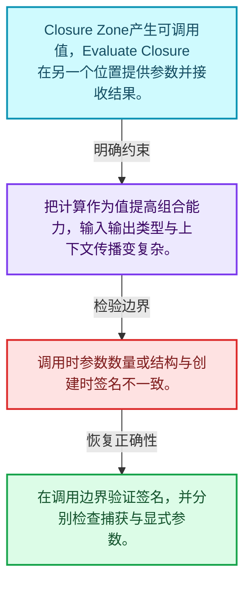
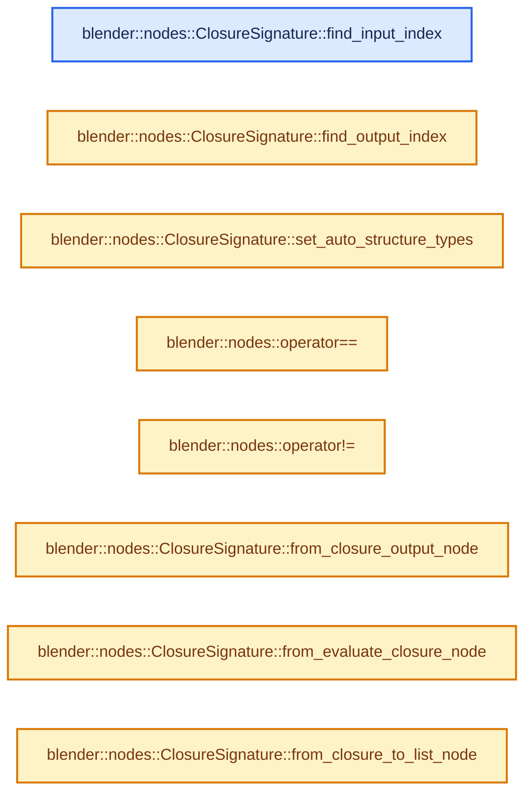
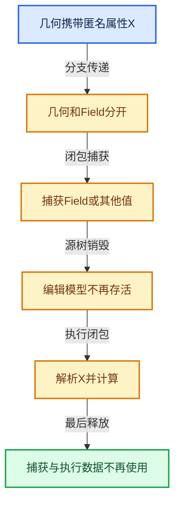

# 10-07 Closure求值与Zone

[方向导航](README.md) · [总目录](../README.md) · [实现索引](../%E7%AC%A6%E5%8F%B7%E4%BE%9D%E8%B5%96%E4%B8%8E%E5%AE%9E%E7%8E%B0%E7%B4%A2%E5%BC%95.md)

## 从问题到实现

Zone怎样生成可在其他位置调用的函数？

区域输入、捕获与输出需映射到调用签名；执行上下文和引用传播不能因跨区域而丢失。

**数据模型**

Closure Zone产生可调用值，Evaluate Closure在另一个位置提供参数并接收结果。

**设计取舍**

把计算作为值提高组合能力，输入输出类型与上下文传播变复杂。

**最小反例**

调用时参数数量或结构与创建时签名不一致。

**推导**

在调用边界验证签名，并分别检查捕获与显式参数。

## 阅读地图与执行推演








图中的数值推演是本方向的教学模型；实际函数之间的调用边与概念分析边分别标注，不能把概念关系当作运行时调度顺序。

## 完整源码单元与就地讲解

中文讲解直接放在相关代码旁，复杂机制在代码下展开。原文折叠区保留基准行号；不需要在行号表和函数之间来回查找。类布局可分段展示，函数实现不按固定行数切开。

### 类型布局、声明与编译条件 · geometry_nodes_closure.cc L1—L15

<!-- annotated:5df6ad5ceeac9e -->

```cpp
/* SPDX-FileCopyrightText: 2025 Blender Authors
 *
 * SPDX-License-Identifier: GPL-2.0-or-later */

/** \file
 * \ingroup nodes
 */

#include "BKE_node_runtime.hh"

#include "NOD_geometry_nodes_bundle_signature.hh"
#include "NOD_geometry_nodes_closure.hh"

namespace blender::nodes {

```

<details>
<summary>核对原始源码：source/blender/nodes/intern/geometry_nodes_closure.cc · L1—L15</summary>

<!-- original:5df6ad5ceeac9e:source/blender/nodes/intern/geometry_nodes_closure.cc:1:15 -->

```cpp
/* SPDX-FileCopyrightText: 2025 Blender Authors
 *
 * SPDX-License-Identifier: GPL-2.0-or-later */

/** \file
 * \ingroup nodes
 */

#include "BKE_node_runtime.hh"

#include "NOD_geometry_nodes_bundle_signature.hh"
#include "NOD_geometry_nodes_closure.hh"

namespace blender::nodes {

```

</details>

<a id="f-c39c1a59ec43e66a"></a>

### `blender::nodes::ClosureSignature::find_input_index`

实现位置：[source/blender/nodes/intern/geometry_nodes_closure.cc](../../../../../source/blender/nodes/intern/geometry_nodes_closure.cc) · L16—L25。

接口参数：

- `const StringRef key`

**教学注释版**

<!-- annotated:ac7c7aa30a016e -->

```cpp
std::optional<int> ClosureSignature::find_input_index(const StringRef key) const
{
  for (const int i : this->inputs.index_range()) {
    const Item &item = this->inputs[i];
    if (item.key == key) {
      return i;
    }
  }
  return std::nullopt;
}
```

<details>
<summary>核对原始源码：source/blender/nodes/intern/geometry_nodes_closure.cc · L16—L25</summary>

<!-- original:ac7c7aa30a016e:source/blender/nodes/intern/geometry_nodes_closure.cc:16:25 -->

```cpp
std::optional<int> ClosureSignature::find_input_index(const StringRef key) const
{
  for (const int i : this->inputs.index_range()) {
    const Item &item = this->inputs[i];
    if (item.key == key) {
      return i;
    }
  }
  return std::nullopt;
}
```

</details>

**结果出口**

- `return i;`
- `return std::nullopt;`

**继续追踪实现**

- `this->inputs.index_range` → [调用协议](../%E6%A8%A1%E6%9D%BF%E5%AE%8F%E4%B8%8E%E5%8A%A8%E6%80%81%E5%88%86%E6%B4%BE%E5%8D%8F%E8%AE%AE.md)：接收对象类型依赖auto、返回值或模板实例；不按同名猜测目标。调用位置L18。

<!-- annotated:62e83fd1dea067 -->

```cpp

```

<details>
<summary>核对原始源码：source/blender/nodes/intern/geometry_nodes_closure.cc · L26—L26</summary>

<!-- original:62e83fd1dea067:source/blender/nodes/intern/geometry_nodes_closure.cc:26:26 -->

```cpp

```

</details>

<a id="f-ac44dd834f32c9a1"></a>

### `blender::nodes::ClosureSignature::find_output_index`

实现位置：[source/blender/nodes/intern/geometry_nodes_closure.cc](../../../../../source/blender/nodes/intern/geometry_nodes_closure.cc) · L27—L36。

接口参数：

- `const StringRef key`

**教学注释版**

<!-- annotated:c07dced0477e74 -->

```cpp
std::optional<int> ClosureSignature::find_output_index(const StringRef key) const
{
  for (const int i : this->outputs.index_range()) {
    const Item &item = this->outputs[i];
    if (item.key == key) {
      return i;
    }
  }
  return std::nullopt;
}
```

<details>
<summary>核对原始源码：source/blender/nodes/intern/geometry_nodes_closure.cc · L27—L36</summary>

<!-- original:c07dced0477e74:source/blender/nodes/intern/geometry_nodes_closure.cc:27:36 -->

```cpp
std::optional<int> ClosureSignature::find_output_index(const StringRef key) const
{
  for (const int i : this->outputs.index_range()) {
    const Item &item = this->outputs[i];
    if (item.key == key) {
      return i;
    }
  }
  return std::nullopt;
}
```

</details>

**结果出口**

- `return i;`
- `return std::nullopt;`

**继续追踪实现**

- `this->outputs.index_range` → [调用协议](../%E6%A8%A1%E6%9D%BF%E5%AE%8F%E4%B8%8E%E5%8A%A8%E6%80%81%E5%88%86%E6%B4%BE%E5%8D%8F%E8%AE%AE.md)：接收对象类型依赖auto、返回值或模板实例；不按同名猜测目标。调用位置L29。

<!-- annotated:dad62855eacaf6 -->

```cpp

```

<details>
<summary>核对原始源码：source/blender/nodes/intern/geometry_nodes_closure.cc · L37—L37</summary>

<!-- original:dad62855eacaf6:source/blender/nodes/intern/geometry_nodes_closure.cc:37:37 -->

```cpp

```

</details>

<a id="f-b28078dc386f733a"></a>

### `blender::nodes::ClosureSignature::set_auto_structure_types`

实现位置：[source/blender/nodes/intern/geometry_nodes_closure.cc](../../../../../source/blender/nodes/intern/geometry_nodes_closure.cc) · L38—L46。

**教学注释版**

<!-- annotated:83e411cd74eaa2 -->

```cpp
void ClosureSignature::set_auto_structure_types()
{
  for (const Item &item : this->inputs) {
    const_cast<Item &>(item).structure_type = NodeSocketInterfaceStructureType::Auto;
  }
  for (const Item &item : this->outputs) {
    const_cast<Item &>(item).structure_type = NodeSocketInterfaceStructureType::Auto;
  }
}
```

<details>
<summary>核对原始源码：source/blender/nodes/intern/geometry_nodes_closure.cc · L38—L46</summary>

<!-- original:83e411cd74eaa2:source/blender/nodes/intern/geometry_nodes_closure.cc:38:46 -->

```cpp
void ClosureSignature::set_auto_structure_types()
{
  for (const Item &item : this->inputs) {
    const_cast<Item &>(item).structure_type = NodeSocketInterfaceStructureType::Auto;
  }
  for (const Item &item : this->outputs) {
    const_cast<Item &>(item).structure_type = NodeSocketInterfaceStructureType::Auto;
  }
}
```

</details>

**继续追踪实现**

本实现没有需要继续展开的显式调用；检查返回表达式、对象转换和调用者前置条件。

<!-- annotated:b97c6dda864284 -->

```cpp

```

<details>
<summary>核对原始源码：source/blender/nodes/intern/geometry_nodes_closure.cc · L47—L47</summary>

<!-- original:b97c6dda864284:source/blender/nodes/intern/geometry_nodes_closure.cc:47:47 -->

```cpp

```

</details>

<a id="f-3dd501fbdeb941a4"></a>

### `blender::nodes::operator==`

实现位置：[source/blender/nodes/intern/geometry_nodes_closure.cc](../../../../../source/blender/nodes/intern/geometry_nodes_closure.cc) · L48—L51。

接口参数：

- `const ClosureSignature &a`
- `const ClosureSignature &b`

**教学注释版**

<!-- annotated:d3773e1d1c7990 -->

```cpp
bool operator==(const ClosureSignature &a, const ClosureSignature &b)
{
  return a.inputs.as_span() == b.inputs.as_span() && a.outputs.as_span() == b.outputs.as_span();
}
```

<details>
<summary>核对原始源码：source/blender/nodes/intern/geometry_nodes_closure.cc · L48—L51</summary>

<!-- original:d3773e1d1c7990:source/blender/nodes/intern/geometry_nodes_closure.cc:48:51 -->

```cpp
bool operator==(const ClosureSignature &a, const ClosureSignature &b)
{
  return a.inputs.as_span() == b.inputs.as_span() && a.outputs.as_span() == b.outputs.as_span();
}
```

</details>

**结果出口**

- `return a.inputs.as_span() == b.inputs.as_span() && a.outputs.as_span() == b.outputs.as_span();`

**继续追踪实现**

- `a.inputs.as_span` → [调用协议](../%E6%A8%A1%E6%9D%BF%E5%AE%8F%E4%B8%8E%E5%8A%A8%E6%80%81%E5%88%86%E6%B4%BE%E5%8D%8F%E8%AE%AE.md)：接收对象类型依赖auto、返回值或模板实例；不按同名猜测目标。调用位置L50。
- `b.inputs.as_span` → [调用协议](../%E6%A8%A1%E6%9D%BF%E5%AE%8F%E4%B8%8E%E5%8A%A8%E6%80%81%E5%88%86%E6%B4%BE%E5%8D%8F%E8%AE%AE.md)：接收对象类型依赖auto、返回值或模板实例；不按同名猜测目标。调用位置L50。
- `a.outputs.as_span` → [调用协议](../%E6%A8%A1%E6%9D%BF%E5%AE%8F%E4%B8%8E%E5%8A%A8%E6%80%81%E5%88%86%E6%B4%BE%E5%8D%8F%E8%AE%AE.md)：接收对象类型依赖auto、返回值或模板实例；不按同名猜测目标。调用位置L50。
- `b.outputs.as_span` → [调用协议](../%E6%A8%A1%E6%9D%BF%E5%AE%8F%E4%B8%8E%E5%8A%A8%E6%80%81%E5%88%86%E6%B4%BE%E5%8D%8F%E8%AE%AE.md)：接收对象类型依赖auto、返回值或模板实例；不按同名猜测目标。调用位置L50。

<!-- annotated:4076716583bd8e -->

```cpp

```

<details>
<summary>核对原始源码：source/blender/nodes/intern/geometry_nodes_closure.cc · L52—L52</summary>

<!-- original:4076716583bd8e:source/blender/nodes/intern/geometry_nodes_closure.cc:52:52 -->

```cpp

```

</details>

<a id="f-92b16c1b8579dabe"></a>

### `blender::nodes::operator!=`

实现位置：[source/blender/nodes/intern/geometry_nodes_closure.cc](../../../../../source/blender/nodes/intern/geometry_nodes_closure.cc) · L53—L56。

接口参数：

- `const ClosureSignature &a`
- `const ClosureSignature &b`

**教学注释版**

<!-- annotated:5e957bd3cac998 -->

```cpp
bool operator!=(const ClosureSignature &a, const ClosureSignature &b)
{
  return !(a == b);
}
```

<details>
<summary>核对原始源码：source/blender/nodes/intern/geometry_nodes_closure.cc · L53—L56</summary>

<!-- original:5e957bd3cac998:source/blender/nodes/intern/geometry_nodes_closure.cc:53:56 -->

```cpp
bool operator!=(const ClosureSignature &a, const ClosureSignature &b)
{
  return !(a == b);
}
```

</details>

**结果出口**

- `return !(a == b);`

**继续追踪实现**

本实现没有需要继续展开的显式调用；检查返回表达式、对象转换和调用者前置条件。

<!-- annotated:5266802e34b3d0 -->

```cpp

```

<details>
<summary>核对原始源码：source/blender/nodes/intern/geometry_nodes_closure.cc · L57—L57</summary>

<!-- original:5266802e34b3d0:source/blender/nodes/intern/geometry_nodes_closure.cc:57:57 -->

```cpp

```

</details>

<a id="f-898cb96758ba047a"></a>

### `blender::nodes::ClosureSignature::from_closure_output_node`

实现位置：[source/blender/nodes/intern/geometry_nodes_closure.cc](../../../../../source/blender/nodes/intern/geometry_nodes_closure.cc) · L58—L91。

接口参数：

- `const bNode &node`
- `const bool allow_auto_structure_type`

**教学注释版**

<!-- annotated:783576b17f2fc8 -->

```cpp
ClosureSignature ClosureSignature::from_closure_output_node(const bNode &node,
                                                            const bool allow_auto_structure_type)
{
  BLI_assert(node.is_type("NodeClosureOutput"_ustr));
  const bNodeTree &tree = node.owner_tree();
  const bNode *input_node =
      bke::zone_type_by_node_type(node.type_legacy)->get_corresponding_input(tree, node);
  const auto &storage = *static_cast<const NodeClosureOutput *>(node.storage);
  nodes::ClosureSignature signature;
  if (input_node) {
    for (const int i : IndexRange(storage.input_items.items_num)) {
      const NodeClosureInputItem &item = storage.input_items.items[i];
      const bNodeSocket &socket = input_node->output_socket(i);
      if (const bke::bNodeSocketType *stype = bke::node_socket_type_find_static(item.socket_type))
      {
        const NodeSocketInterfaceStructureType structure_type =
            get_structure_type_for_bundle_signature(
                socket, item.structure_type, allow_auto_structure_type);
        signature.inputs.add({item.name, stype, structure_type});
      }
    }
  }
  for (const int i : IndexRange(storage.output_items.items_num)) {
    const NodeClosureOutputItem &item = storage.output_items.items[i];
    const bNodeSocket &socket = node.input_socket(i);
    if (const bke::bNodeSocketType *stype = bke::node_socket_type_find_static(item.socket_type)) {
      const NodeSocketInterfaceStructureType structure_type =
          get_structure_type_for_bundle_signature(
              socket, item.structure_type, allow_auto_structure_type);
      signature.outputs.add({item.name, stype, structure_type});
    }
  }
  return signature;
}
```

<details>
<summary>核对原始源码：source/blender/nodes/intern/geometry_nodes_closure.cc · L58—L91</summary>

<!-- original:783576b17f2fc8:source/blender/nodes/intern/geometry_nodes_closure.cc:58:91 -->

```cpp
ClosureSignature ClosureSignature::from_closure_output_node(const bNode &node,
                                                            const bool allow_auto_structure_type)
{
  BLI_assert(node.is_type("NodeClosureOutput"_ustr));
  const bNodeTree &tree = node.owner_tree();
  const bNode *input_node =
      bke::zone_type_by_node_type(node.type_legacy)->get_corresponding_input(tree, node);
  const auto &storage = *static_cast<const NodeClosureOutput *>(node.storage);
  nodes::ClosureSignature signature;
  if (input_node) {
    for (const int i : IndexRange(storage.input_items.items_num)) {
      const NodeClosureInputItem &item = storage.input_items.items[i];
      const bNodeSocket &socket = input_node->output_socket(i);
      if (const bke::bNodeSocketType *stype = bke::node_socket_type_find_static(item.socket_type))
      {
        const NodeSocketInterfaceStructureType structure_type =
            get_structure_type_for_bundle_signature(
                socket, item.structure_type, allow_auto_structure_type);
        signature.inputs.add({item.name, stype, structure_type});
      }
    }
  }
  for (const int i : IndexRange(storage.output_items.items_num)) {
    const NodeClosureOutputItem &item = storage.output_items.items[i];
    const bNodeSocket &socket = node.input_socket(i);
    if (const bke::bNodeSocketType *stype = bke::node_socket_type_find_static(item.socket_type)) {
      const NodeSocketInterfaceStructureType structure_type =
          get_structure_type_for_bundle_signature(
              socket, item.structure_type, allow_auto_structure_type);
      signature.outputs.add({item.name, stype, structure_type});
    }
  }
  return signature;
}
```

</details>

**结果出口**

- `return signature;`

**继续追踪实现**

- `BLI_assert` → [BLI_assert · L48](../01-%E5%9F%BA%E7%A1%80%E5%AE%B9%E5%99%A8%E4%B8%8E%E7%8E%B0%E4%BB%A3CPP/%E4%BE%9D%E8%B5%96-BLI_assert-cc98e8.md#m-57a88495704d)；[BLI_assert · L63](../01-%E5%9F%BA%E7%A1%80%E5%AE%B9%E5%99%A8%E4%B8%8E%E7%8E%B0%E4%BB%A3CPP/%E4%BE%9D%E8%B5%96-BLI_assert-cc98e8.md#m-d07050020cb5)。宏定义由构建条件选择。
- `node.is_type` → [blender::bNode::is_type · L931](../05-%E5%87%A0%E4%BD%95%E5%AD%98%E5%82%A8%E4%B8%8E%E6%8B%93%E6%89%91%E6%98%A0%E5%B0%84/%E4%BE%9D%E8%B5%96-BKE_node_runtime-ee561b.md#f-828d5e91e96da197)。
- `node.owner_tree` → [blender::bNode::owner_tree · L866](../05-%E5%87%A0%E4%BD%95%E5%AD%98%E5%82%A8%E4%B8%8E%E6%8B%93%E6%89%91%E6%98%A0%E5%B0%84/%E4%BE%9D%E8%B5%96-BKE_node_runtime-ee561b.md#f-7e471005a1325135)；[blender::bNode::owner_tree · L872](../05-%E5%87%A0%E4%BD%95%E5%AD%98%E5%82%A8%E4%B8%8E%E6%8B%93%E6%89%91%E6%98%A0%E5%B0%84/%E4%BE%9D%E8%B5%96-BKE_node_runtime-ee561b.md#f-641a1000c92d9a52)。同名重载需按实参类型选择。
- `bke::zone_type_by_node_type(node.type_legacy)->get_corresponding_input` → [调用协议](../%E6%A8%A1%E6%9D%BF%E5%AE%8F%E4%B8%8E%E5%8A%A8%E6%80%81%E5%88%86%E6%B4%BE%E5%8D%8F%E8%AE%AE.md)：接收对象类型依赖auto、返回值或模板实例；不按同名猜测目标。调用位置L64。
- `bke::zone_type_by_node_type` → [blender::bke::zone_type_by_node_type · L575](../05-%E5%87%A0%E4%BD%95%E5%AD%98%E5%82%A8%E4%B8%8E%E6%8B%93%E6%89%91%E6%98%A0%E5%B0%84/%E4%BE%9D%E8%B5%96-node_tree_zones-eecd0c.md#f-e15b3588965609cf)。
- `IndexRange` → [blender::IndexRange](../01-%E5%9F%BA%E7%A1%80%E5%AE%B9%E5%99%A8%E4%B8%8E%E7%8E%B0%E4%BB%A3CPP/%E4%BE%9D%E8%B5%96-BLI_index_range-7d7cc5.md#t-caa3466d6776)；[blender::gpu::shader::parser::IndexRange](../05-%E5%87%A0%E4%BD%95%E5%AD%98%E5%82%A8%E4%B8%8E%E6%8B%93%E6%89%91%E6%98%A0%E5%B0%84/%E4%BE%9D%E8%B5%96-utils-06433d.md#t-82d2bd4ea71c)；[blender::IndexRange](../05-%E5%87%A0%E4%BD%95%E5%AD%98%E5%82%A8%E4%B8%8E%E6%8B%93%E6%89%91%E6%98%A0%E5%B0%84/%E4%BE%9D%E8%B5%96-DNA_node_types-6708b9.md#t-0448cc889d39)。
- `input_node->output_socket` → [blender::bNode::output_socket · L824](../05-%E5%87%A0%E4%BD%95%E5%AD%98%E5%82%A8%E4%B8%8E%E6%8B%93%E6%89%91%E6%98%A0%E5%B0%84/%E4%BE%9D%E8%B5%96-BKE_node_runtime-ee561b.md#f-9e46f3a437215eb5)；[blender::bNode::output_socket · L836](../05-%E5%87%A0%E4%BD%95%E5%AD%98%E5%82%A8%E4%B8%8E%E6%8B%93%E6%89%91%E6%98%A0%E5%B0%84/%E4%BE%9D%E8%B5%96-BKE_node_runtime-ee561b.md#f-39021ff32ee7c409)。同名重载需按实参类型选择。
- `bke::node_socket_type_find_static` → [blender::bke::node_socket_type_find_static · L2975](../05-%E5%87%A0%E4%BD%95%E5%AD%98%E5%82%A8%E4%B8%8E%E6%8B%93%E6%89%91%E6%98%A0%E5%B0%84/%E4%BE%9D%E8%B5%96-node-89d753.md#f-8082ced6587b7cd9)。
- `get_structure_type_for_bundle_signature` → [blender::nodes::get_structure_type_for_bundle_signature · L372](05-Bundle%E5%80%BC%E7%BB%84%E5%90%88.md#f-e5154ce9b63c8eab)。
- `signature.inputs.add` → [调用协议](../%E6%A8%A1%E6%9D%BF%E5%AE%8F%E4%B8%8E%E5%8A%A8%E6%80%81%E5%88%86%E6%B4%BE%E5%8D%8F%E8%AE%AE.md)：接收对象类型依赖auto、返回值或模板实例；不按同名猜测目标。调用位置L76。
- `node.input_socket` → [blender::bNode::input_socket · L818](../05-%E5%87%A0%E4%BD%95%E5%AD%98%E5%82%A8%E4%B8%8E%E6%8B%93%E6%89%91%E6%98%A0%E5%B0%84/%E4%BE%9D%E8%B5%96-BKE_node_runtime-ee561b.md#f-00274c021929d3dc)；[blender::bNode::input_socket · L830](../05-%E5%87%A0%E4%BD%95%E5%AD%98%E5%82%A8%E4%B8%8E%E6%8B%93%E6%89%91%E6%98%A0%E5%B0%84/%E4%BE%9D%E8%B5%96-BKE_node_runtime-ee561b.md#f-e9c8cccac4999eb8)。同名重载需按实参类型选择。
- `signature.outputs.add` → [调用协议](../%E6%A8%A1%E6%9D%BF%E5%AE%8F%E4%B8%8E%E5%8A%A8%E6%80%81%E5%88%86%E6%B4%BE%E5%8D%8F%E8%AE%AE.md)：接收对象类型依赖auto、返回值或模板实例；不按同名猜测目标。调用位置L87。

<!-- annotated:80d89c5acf2e65 -->

```cpp

```

<details>
<summary>核对原始源码：source/blender/nodes/intern/geometry_nodes_closure.cc · L92—L92</summary>

<!-- original:80d89c5acf2e65:source/blender/nodes/intern/geometry_nodes_closure.cc:92:92 -->

```cpp

```

</details>

<a id="f-3b5defd90d7f6fb2"></a>

### `blender::nodes::ClosureSignature::from_evaluate_closure_node`

实现位置：[source/blender/nodes/intern/geometry_nodes_closure.cc](../../../../../source/blender/nodes/intern/geometry_nodes_closure.cc) · L93—L120。

接口参数：

- `const bNode &node`
- `const bool allow_auto_structure_type`

**教学注释版**

<!-- annotated:95f3ed81d49d0d -->

```cpp
ClosureSignature ClosureSignature::from_evaluate_closure_node(const bNode &node,
                                                              const bool allow_auto_structure_type)
{
  BLI_assert(node.is_type("NodeEvaluateClosure"_ustr));
  const auto &storage = *static_cast<const NodeEvaluateClosure *>(node.storage);
  nodes::ClosureSignature signature;
  for (const int i : IndexRange(storage.input_items.items_num)) {
    const NodeEvaluateClosureInputItem &item = storage.input_items.items[i];
    const bNodeSocket &socket = node.input_socket(i + 1);
    if (const bke::bNodeSocketType *stype = bke::node_socket_type_find_static(item.socket_type)) {
      const NodeSocketInterfaceStructureType structure_type =
          get_structure_type_for_bundle_signature(
              socket, item.structure_type, allow_auto_structure_type);
      signature.inputs.add({item.name, stype, structure_type});
    }
  }
  for (const int i : IndexRange(storage.output_items.items_num)) {
    const NodeEvaluateClosureOutputItem &item = storage.output_items.items[i];
    const bNodeSocket &socket = node.output_socket(i);
    if (const bke::bNodeSocketType *stype = bke::node_socket_type_find_static(item.socket_type)) {
      const NodeSocketInterfaceStructureType structure_type =
          get_structure_type_for_bundle_signature(
              socket, item.structure_type, allow_auto_structure_type);
      signature.outputs.add({item.name, stype, structure_type});
    }
  }
  return signature;
}
```

<details>
<summary>核对原始源码：source/blender/nodes/intern/geometry_nodes_closure.cc · L93—L120</summary>

<!-- original:95f3ed81d49d0d:source/blender/nodes/intern/geometry_nodes_closure.cc:93:120 -->

```cpp
ClosureSignature ClosureSignature::from_evaluate_closure_node(const bNode &node,
                                                              const bool allow_auto_structure_type)
{
  BLI_assert(node.is_type("NodeEvaluateClosure"_ustr));
  const auto &storage = *static_cast<const NodeEvaluateClosure *>(node.storage);
  nodes::ClosureSignature signature;
  for (const int i : IndexRange(storage.input_items.items_num)) {
    const NodeEvaluateClosureInputItem &item = storage.input_items.items[i];
    const bNodeSocket &socket = node.input_socket(i + 1);
    if (const bke::bNodeSocketType *stype = bke::node_socket_type_find_static(item.socket_type)) {
      const NodeSocketInterfaceStructureType structure_type =
          get_structure_type_for_bundle_signature(
              socket, item.structure_type, allow_auto_structure_type);
      signature.inputs.add({item.name, stype, structure_type});
    }
  }
  for (const int i : IndexRange(storage.output_items.items_num)) {
    const NodeEvaluateClosureOutputItem &item = storage.output_items.items[i];
    const bNodeSocket &socket = node.output_socket(i);
    if (const bke::bNodeSocketType *stype = bke::node_socket_type_find_static(item.socket_type)) {
      const NodeSocketInterfaceStructureType structure_type =
          get_structure_type_for_bundle_signature(
              socket, item.structure_type, allow_auto_structure_type);
      signature.outputs.add({item.name, stype, structure_type});
    }
  }
  return signature;
}
```

</details>

**结果出口**

- `return signature;`

**继续追踪实现**

- `BLI_assert` → [BLI_assert · L48](../01-%E5%9F%BA%E7%A1%80%E5%AE%B9%E5%99%A8%E4%B8%8E%E7%8E%B0%E4%BB%A3CPP/%E4%BE%9D%E8%B5%96-BLI_assert-cc98e8.md#m-57a88495704d)；[BLI_assert · L63](../01-%E5%9F%BA%E7%A1%80%E5%AE%B9%E5%99%A8%E4%B8%8E%E7%8E%B0%E4%BB%A3CPP/%E4%BE%9D%E8%B5%96-BLI_assert-cc98e8.md#m-d07050020cb5)。宏定义由构建条件选择。
- `node.is_type` → [blender::bNode::is_type · L931](../05-%E5%87%A0%E4%BD%95%E5%AD%98%E5%82%A8%E4%B8%8E%E6%8B%93%E6%89%91%E6%98%A0%E5%B0%84/%E4%BE%9D%E8%B5%96-BKE_node_runtime-ee561b.md#f-828d5e91e96da197)。
- `IndexRange` → [blender::IndexRange](../01-%E5%9F%BA%E7%A1%80%E5%AE%B9%E5%99%A8%E4%B8%8E%E7%8E%B0%E4%BB%A3CPP/%E4%BE%9D%E8%B5%96-BLI_index_range-7d7cc5.md#t-caa3466d6776)；[blender::gpu::shader::parser::IndexRange](../05-%E5%87%A0%E4%BD%95%E5%AD%98%E5%82%A8%E4%B8%8E%E6%8B%93%E6%89%91%E6%98%A0%E5%B0%84/%E4%BE%9D%E8%B5%96-utils-06433d.md#t-82d2bd4ea71c)；[blender::IndexRange](../05-%E5%87%A0%E4%BD%95%E5%AD%98%E5%82%A8%E4%B8%8E%E6%8B%93%E6%89%91%E6%98%A0%E5%B0%84/%E4%BE%9D%E8%B5%96-DNA_node_types-6708b9.md#t-0448cc889d39)。
- `node.input_socket` → [blender::bNode::input_socket · L818](../05-%E5%87%A0%E4%BD%95%E5%AD%98%E5%82%A8%E4%B8%8E%E6%8B%93%E6%89%91%E6%98%A0%E5%B0%84/%E4%BE%9D%E8%B5%96-BKE_node_runtime-ee561b.md#f-00274c021929d3dc)；[blender::bNode::input_socket · L830](../05-%E5%87%A0%E4%BD%95%E5%AD%98%E5%82%A8%E4%B8%8E%E6%8B%93%E6%89%91%E6%98%A0%E5%B0%84/%E4%BE%9D%E8%B5%96-BKE_node_runtime-ee561b.md#f-e9c8cccac4999eb8)。同名重载需按实参类型选择。
- `bke::node_socket_type_find_static` → [blender::bke::node_socket_type_find_static · L2975](../05-%E5%87%A0%E4%BD%95%E5%AD%98%E5%82%A8%E4%B8%8E%E6%8B%93%E6%89%91%E6%98%A0%E5%B0%84/%E4%BE%9D%E8%B5%96-node-89d753.md#f-8082ced6587b7cd9)。
- `get_structure_type_for_bundle_signature` → [blender::nodes::get_structure_type_for_bundle_signature · L372](05-Bundle%E5%80%BC%E7%BB%84%E5%90%88.md#f-e5154ce9b63c8eab)。
- `signature.inputs.add` → [调用协议](../%E6%A8%A1%E6%9D%BF%E5%AE%8F%E4%B8%8E%E5%8A%A8%E6%80%81%E5%88%86%E6%B4%BE%E5%8D%8F%E8%AE%AE.md)：接收对象类型依赖auto、返回值或模板实例；不按同名猜测目标。调用位置L106。
- `node.output_socket` → [blender::bNode::output_socket · L824](../05-%E5%87%A0%E4%BD%95%E5%AD%98%E5%82%A8%E4%B8%8E%E6%8B%93%E6%89%91%E6%98%A0%E5%B0%84/%E4%BE%9D%E8%B5%96-BKE_node_runtime-ee561b.md#f-9e46f3a437215eb5)；[blender::bNode::output_socket · L836](../05-%E5%87%A0%E4%BD%95%E5%AD%98%E5%82%A8%E4%B8%8E%E6%8B%93%E6%89%91%E6%98%A0%E5%B0%84/%E4%BE%9D%E8%B5%96-BKE_node_runtime-ee561b.md#f-39021ff32ee7c409)。同名重载需按实参类型选择。
- `signature.outputs.add` → [调用协议](../%E6%A8%A1%E6%9D%BF%E5%AE%8F%E4%B8%8E%E5%8A%A8%E6%80%81%E5%88%86%E6%B4%BE%E5%8D%8F%E8%AE%AE.md)：接收对象类型依赖auto、返回值或模板实例；不按同名猜测目标。调用位置L116。

<!-- annotated:e77f770f5810ee -->

```cpp

```

<details>
<summary>核对原始源码：source/blender/nodes/intern/geometry_nodes_closure.cc · L121—L121</summary>

<!-- original:e77f770f5810ee:source/blender/nodes/intern/geometry_nodes_closure.cc:121:121 -->

```cpp

```

</details>

<a id="f-8e8fb27c7b3490ac"></a>

### `blender::nodes::ClosureSignature::from_closure_to_list_node`

实现位置：[source/blender/nodes/intern/geometry_nodes_closure.cc](../../../../../source/blender/nodes/intern/geometry_nodes_closure.cc) · L122—L139。

接口参数：

- `const bNode &node`

**教学注释版**

<!-- annotated:87b3207f6e8fcf -->

```cpp
ClosureSignature ClosureSignature::from_closure_to_list_node(const bNode &node)
{
  BLI_assert(node.is_type("GeometryNodeClosureToList"_ustr));
  const auto &storage = *static_cast<const GeometryNodeClosureToList *>(node.storage);
  ClosureSignature signature;
  signature.inputs.add({.key = "Index",
                        .type = bke::node_socket_type_find("NodeSocketInt"),
                        .structure_type = NodeSocketInterfaceStructureType::Single});
  for (const int i : IndexRange(storage.items_num)) {
    const GeometryNodeClosureToListItem &item = storage.items[i];
    const auto type = eNodeSocketDatatype(item.socket_type);
    signature.outputs.add(
        {.key = item.name,
         .type = bke::node_socket_type_find_static(type),
         .structure_type = NodeSocketInterfaceStructureType(item.structure_type)});
  }
  return signature;
}
```

<details>
<summary>核对原始源码：source/blender/nodes/intern/geometry_nodes_closure.cc · L122—L139</summary>

<!-- original:87b3207f6e8fcf:source/blender/nodes/intern/geometry_nodes_closure.cc:122:139 -->

```cpp
ClosureSignature ClosureSignature::from_closure_to_list_node(const bNode &node)
{
  BLI_assert(node.is_type("GeometryNodeClosureToList"_ustr));
  const auto &storage = *static_cast<const GeometryNodeClosureToList *>(node.storage);
  ClosureSignature signature;
  signature.inputs.add({.key = "Index",
                        .type = bke::node_socket_type_find("NodeSocketInt"),
                        .structure_type = NodeSocketInterfaceStructureType::Single});
  for (const int i : IndexRange(storage.items_num)) {
    const GeometryNodeClosureToListItem &item = storage.items[i];
    const auto type = eNodeSocketDatatype(item.socket_type);
    signature.outputs.add(
        {.key = item.name,
         .type = bke::node_socket_type_find_static(type),
         .structure_type = NodeSocketInterfaceStructureType(item.structure_type)});
  }
  return signature;
}
```

</details>

**沿实际写入检查状态**

- `.type = bke::node_socket_type_find("NodeSocketInt"),`
- `.structure_type = NodeSocketInterfaceStructureType::Single});`
- `.type = bke::node_socket_type_find_static(type),`
- `.structure_type = NodeSocketInterfaceStructureType(item.structure_type)});`

**结果出口**

- `return signature;`

**继续追踪实现**

- `BLI_assert` → [BLI_assert · L48](../01-%E5%9F%BA%E7%A1%80%E5%AE%B9%E5%99%A8%E4%B8%8E%E7%8E%B0%E4%BB%A3CPP/%E4%BE%9D%E8%B5%96-BLI_assert-cc98e8.md#m-57a88495704d)；[BLI_assert · L63](../01-%E5%9F%BA%E7%A1%80%E5%AE%B9%E5%99%A8%E4%B8%8E%E7%8E%B0%E4%BB%A3CPP/%E4%BE%9D%E8%B5%96-BLI_assert-cc98e8.md#m-d07050020cb5)。宏定义由构建条件选择。
- `node.is_type` → [blender::bNode::is_type · L931](../05-%E5%87%A0%E4%BD%95%E5%AD%98%E5%82%A8%E4%B8%8E%E6%8B%93%E6%89%91%E6%98%A0%E5%B0%84/%E4%BE%9D%E8%B5%96-BKE_node_runtime-ee561b.md#f-828d5e91e96da197)。
- `signature.inputs.add` → [调用协议](../%E6%A8%A1%E6%9D%BF%E5%AE%8F%E4%B8%8E%E5%8A%A8%E6%80%81%E5%88%86%E6%B4%BE%E5%8D%8F%E8%AE%AE.md)：接收对象类型依赖auto、返回值或模板实例；不按同名猜测目标。调用位置L127。
- `bke::node_socket_type_find` → [blender::bke::node_socket_type_find · L2966](../05-%E5%87%A0%E4%BD%95%E5%AD%98%E5%82%A8%E4%B8%8E%E6%8B%93%E6%89%91%E6%98%A0%E5%B0%84/%E4%BE%9D%E8%B5%96-node-89d753.md#f-69979d36f9912943)。
- `IndexRange` → [blender::IndexRange](../01-%E5%9F%BA%E7%A1%80%E5%AE%B9%E5%99%A8%E4%B8%8E%E7%8E%B0%E4%BB%A3CPP/%E4%BE%9D%E8%B5%96-BLI_index_range-7d7cc5.md#t-caa3466d6776)；[blender::gpu::shader::parser::IndexRange](../05-%E5%87%A0%E4%BD%95%E5%AD%98%E5%82%A8%E4%B8%8E%E6%8B%93%E6%89%91%E6%98%A0%E5%B0%84/%E4%BE%9D%E8%B5%96-utils-06433d.md#t-82d2bd4ea71c)；[blender::IndexRange](../05-%E5%87%A0%E4%BD%95%E5%AD%98%E5%82%A8%E4%B8%8E%E6%8B%93%E6%89%91%E6%98%A0%E5%B0%84/%E4%BE%9D%E8%B5%96-DNA_node_types-6708b9.md#t-0448cc889d39)。
- `eNodeSocketDatatype` → [eNodeSocketDatatype](../05-%E5%87%A0%E4%BD%95%E5%AD%98%E5%82%A8%E4%B8%8E%E6%8B%93%E6%89%91%E6%98%A0%E5%B0%84/%E4%BE%9D%E8%B5%96-compositor-a4aa61.md#t-09b65f729b18)；[blender::eNodeSocketDatatype](../05-%E5%87%A0%E4%BD%95%E5%AD%98%E5%82%A8%E4%B8%8E%E6%8B%93%E6%89%91%E6%98%A0%E5%B0%84/%E4%BE%9D%E8%B5%96-DNA_node_types-6708b9.md#t-fdea02f95b31)。
- `signature.outputs.add` → [调用协议](../%E6%A8%A1%E6%9D%BF%E5%AE%8F%E4%B8%8E%E5%8A%A8%E6%80%81%E5%88%86%E6%B4%BE%E5%8D%8F%E8%AE%AE.md)：接收对象类型依赖auto、返回值或模板实例；不按同名猜测目标。调用位置L133。
- `bke::node_socket_type_find_static` → [blender::bke::node_socket_type_find_static · L2975](../05-%E5%87%A0%E4%BD%95%E5%AD%98%E5%82%A8%E4%B8%8E%E6%8B%93%E6%89%91%E6%98%A0%E5%B0%84/%E4%BE%9D%E8%B5%96-node-89d753.md#f-8082ced6587b7cd9)。
- `NodeSocketInterfaceStructureType` → [blender::NodeSocketInterfaceStructureType](../05-%E5%87%A0%E4%BD%95%E5%AD%98%E5%82%A8%E4%B8%8E%E6%8B%93%E6%89%91%E6%98%A0%E5%B0%84/%E4%BE%9D%E8%B5%96-DNA_node_tree_interface_types-ffa165.md#t-12228606b9f6)。

<!-- annotated:ee9ea67f2af21b -->

```cpp

```

<details>
<summary>核对原始源码：source/blender/nodes/intern/geometry_nodes_closure.cc · L140—L140</summary>

<!-- original:ee9ea67f2af21b:source/blender/nodes/intern/geometry_nodes_closure.cc:140:140 -->

```cpp

```

</details>

<a id="f-5558c1acc03e4885"></a>

### `blender::nodes::LinkedClosureSignatures::has_type_definition`

实现位置：[source/blender/nodes/intern/geometry_nodes_closure.cc](../../../../../source/blender/nodes/intern/geometry_nodes_closure.cc) · L141—L149。

**教学注释版**

<!-- annotated:35308f13905552 -->

```cpp
bool LinkedClosureSignatures::has_type_definition() const
{
  for (const Item &item : this->items) {
    if (item.define_signature) {
      return true;
    }
  }
  return false;
}
```

<details>
<summary>核对原始源码：source/blender/nodes/intern/geometry_nodes_closure.cc · L141—L149</summary>

<!-- original:35308f13905552:source/blender/nodes/intern/geometry_nodes_closure.cc:141:149 -->

```cpp
bool LinkedClosureSignatures::has_type_definition() const
{
  for (const Item &item : this->items) {
    if (item.define_signature) {
      return true;
    }
  }
  return false;
}
```

</details>

**结果出口**

- `return true;`
- `return false;`

**继续追踪实现**

本实现没有需要继续展开的显式调用；检查返回表达式、对象转换和调用者前置条件。

<!-- annotated:b1b9ebd2fa9a62 -->

```cpp

```

<details>
<summary>核对原始源码：source/blender/nodes/intern/geometry_nodes_closure.cc · L150—L150</summary>

<!-- original:b1b9ebd2fa9a62:source/blender/nodes/intern/geometry_nodes_closure.cc:150:150 -->

```cpp

```

</details>

<a id="f-adfb1bb5e7ce3f21"></a>

### `blender::nodes::LinkedClosureSignatures::get_merged_signature`

实现位置：[source/blender/nodes/intern/geometry_nodes_closure.cc](../../../../../source/blender/nodes/intern/geometry_nodes_closure.cc) · L151—L183。

**教学注释版**

<!-- annotated:2f4bb7d8753819 -->

```cpp
std::optional<ClosureSignature> LinkedClosureSignatures::get_merged_signature() const
{
  ClosureSignature signature;
  for (const Item &src_signature : this->items) {
    for (const ClosureSignature::Item &item : src_signature.signature.inputs) {
      if (!signature.inputs.add(item)) {
        const ClosureSignature::Item &existing_item = *signature.inputs.lookup_key_ptr_as(
            item.key);
        if (existing_item.type->type != item.type->type) {
          return std::nullopt;
        }
        if (existing_item.structure_type != item.structure_type) {
          const_cast<ClosureSignature::Item &>(existing_item).structure_type =
              NodeSocketInterfaceStructureType::Dynamic;
        }
      }
    }
    for (const ClosureSignature::Item &item : src_signature.signature.outputs) {
      if (!signature.outputs.add(item)) {
        const ClosureSignature::Item &existing_item = *signature.outputs.lookup_key_ptr_as(
            item.key);
        if (existing_item.type->type != item.type->type) {
          return std::nullopt;
        }
        if (existing_item.structure_type != item.structure_type) {
          const_cast<ClosureSignature::Item &>(existing_item).structure_type =
              NodeSocketInterfaceStructureType::Dynamic;
        }
      }
    }
  }
  return signature;
}
```

<details>
<summary>核对原始源码：source/blender/nodes/intern/geometry_nodes_closure.cc · L151—L183</summary>

<!-- original:2f4bb7d8753819:source/blender/nodes/intern/geometry_nodes_closure.cc:151:183 -->

```cpp
std::optional<ClosureSignature> LinkedClosureSignatures::get_merged_signature() const
{
  ClosureSignature signature;
  for (const Item &src_signature : this->items) {
    for (const ClosureSignature::Item &item : src_signature.signature.inputs) {
      if (!signature.inputs.add(item)) {
        const ClosureSignature::Item &existing_item = *signature.inputs.lookup_key_ptr_as(
            item.key);
        if (existing_item.type->type != item.type->type) {
          return std::nullopt;
        }
        if (existing_item.structure_type != item.structure_type) {
          const_cast<ClosureSignature::Item &>(existing_item).structure_type =
              NodeSocketInterfaceStructureType::Dynamic;
        }
      }
    }
    for (const ClosureSignature::Item &item : src_signature.signature.outputs) {
      if (!signature.outputs.add(item)) {
        const ClosureSignature::Item &existing_item = *signature.outputs.lookup_key_ptr_as(
            item.key);
        if (existing_item.type->type != item.type->type) {
          return std::nullopt;
        }
        if (existing_item.structure_type != item.structure_type) {
          const_cast<ClosureSignature::Item &>(existing_item).structure_type =
              NodeSocketInterfaceStructureType::Dynamic;
        }
      }
    }
  }
  return signature;
}
```

</details>

**结果出口**

- `return std::nullopt;`
- `return signature;`

**继续追踪实现**

- `signature.inputs.add` → [调用协议](../%E6%A8%A1%E6%9D%BF%E5%AE%8F%E4%B8%8E%E5%8A%A8%E6%80%81%E5%88%86%E6%B4%BE%E5%8D%8F%E8%AE%AE.md)：接收对象类型依赖auto、返回值或模板实例；不按同名猜测目标。调用位置L156。
- `signature.inputs.lookup_key_ptr_as` → [调用协议](../%E6%A8%A1%E6%9D%BF%E5%AE%8F%E4%B8%8E%E5%8A%A8%E6%80%81%E5%88%86%E6%B4%BE%E5%8D%8F%E8%AE%AE.md)：接收对象类型依赖auto、返回值或模板实例；不按同名猜测目标。调用位置L157。
- `signature.outputs.add` → [调用协议](../%E6%A8%A1%E6%9D%BF%E5%AE%8F%E4%B8%8E%E5%8A%A8%E6%80%81%E5%88%86%E6%B4%BE%E5%8D%8F%E8%AE%AE.md)：接收对象类型依赖auto、返回值或模板实例；不按同名猜测目标。调用位置L169。
- `signature.outputs.lookup_key_ptr_as` → [调用协议](../%E6%A8%A1%E6%9D%BF%E5%AE%8F%E4%B8%8E%E5%8A%A8%E6%80%81%E5%88%86%E6%B4%BE%E5%8D%8F%E8%AE%AE.md)：接收对象类型依赖auto、返回值或模板实例；不按同名猜测目标。调用位置L170。

### 类型布局、声明与编译条件 · geometry_nodes_closure.cc L184—L185

<!-- annotated:986f3053d09ac8 -->

```cpp

}  // namespace blender::nodes
```

<details>
<summary>核对原始源码：source/blender/nodes/intern/geometry_nodes_closure.cc · L184—L185</summary>

<!-- original:986f3053d09ac8:source/blender/nodes/intern/geometry_nodes_closure.cc:184:185 -->

```cpp

}  // namespace blender::nodes
```

</details>

### 类型布局、声明与编译条件 · geometry_nodes_closure_zone.cc L1—L50

<a id="t-a2199389fdf2"></a>

`ClosureIntermediateGraphSideEffectProvider`在这里声明的数据成员：

- `lf::FunctionNode body_node_`

<!-- annotated:2a375be3f576eb -->

```cpp
/* SPDX-FileCopyrightText: 2025 Blender Authors
 *
 * SPDX-License-Identifier: GPL-2.0-or-later */

/** \file
 * \ingroup nodes
 */

#include <fmt/format.h>

#include "NOD_geometry_nodes_closure_eval.hh"
#include "NOD_geometry_nodes_lazy_function.hh"

#include "BKE_compute_contexts.hh"
#include "BKE_geometry_nodes_reference_set.hh"
#include "BKE_node_runtime.hh"
#include "BKE_node_socket_value.hh"
#include "BKE_node_tree_reference_lifetimes.hh"

#include "NOD_geo_closure.hh"
#include "NOD_geometry_nodes_closure.hh"
#include "NOD_geometry_nodes_values.hh"

#include "DEG_depsgraph_query.hh"

#include "FN_lazy_function_execute.hh"

#include "BLI_string_utf8_symbols.hh"

namespace blender::nodes {

using bke::node_tree_reference_lifetimes::ReferenceSetInfo;
using bke::node_tree_reference_lifetimes::ReferenceSetType;

/**
 * Evaluating a closure lazy function creates a wrapper lazy function graph around it which handles
 * things like type conversion and missing inputs. This side effect provider is used to make sure
 * that if the closure itself contains a side-effect node (e.g. a viewer), the wrapper graph will
 * also have a side-effect node. Otherwise, the inner side-effect node will not be executed in some
 * cases.
 */
class ClosureIntermediateGraphSideEffectProvider : public lf::GraphExecutorSideEffectProvider {
 private:
  /**
   * The node that is wrapped and should be marked as having side effects if the closure
   * itself has side effects.
   */
  const lf::FunctionNode *body_node_;

 public:
```

<details>
<summary>核对原始源码：source/blender/nodes/intern/geometry_nodes_closure_zone.cc · L1—L50</summary>

<!-- original:2a375be3f576eb:source/blender/nodes/intern/geometry_nodes_closure_zone.cc:1:50 -->

```cpp
/* SPDX-FileCopyrightText: 2025 Blender Authors
 *
 * SPDX-License-Identifier: GPL-2.0-or-later */

/** \file
 * \ingroup nodes
 */

#include <fmt/format.h>

#include "NOD_geometry_nodes_closure_eval.hh"
#include "NOD_geometry_nodes_lazy_function.hh"

#include "BKE_compute_contexts.hh"
#include "BKE_geometry_nodes_reference_set.hh"
#include "BKE_node_runtime.hh"
#include "BKE_node_socket_value.hh"
#include "BKE_node_tree_reference_lifetimes.hh"

#include "NOD_geo_closure.hh"
#include "NOD_geometry_nodes_closure.hh"
#include "NOD_geometry_nodes_values.hh"

#include "DEG_depsgraph_query.hh"

#include "FN_lazy_function_execute.hh"

#include "BLI_string_utf8_symbols.hh"

namespace blender::nodes {

using bke::node_tree_reference_lifetimes::ReferenceSetInfo;
using bke::node_tree_reference_lifetimes::ReferenceSetType;

/**
 * Evaluating a closure lazy function creates a wrapper lazy function graph around it which handles
 * things like type conversion and missing inputs. This side effect provider is used to make sure
 * that if the closure itself contains a side-effect node (e.g. a viewer), the wrapper graph will
 * also have a side-effect node. Otherwise, the inner side-effect node will not be executed in some
 * cases.
 */
class ClosureIntermediateGraphSideEffectProvider : public lf::GraphExecutorSideEffectProvider {
 private:
  /**
   * The node that is wrapped and should be marked as having side effects if the closure
   * itself has side effects.
   */
  const lf::FunctionNode *body_node_;

 public:
```

</details>

<a id="f-67dd2251c0a62f7e"></a>

### `blender::nodes::ClosureIntermediateGraphSideEffectProvider::ClosureIntermediateGraphSideEffectProvider`

实现位置：[source/blender/nodes/intern/geometry_nodes_closure_zone.cc](../../../../../source/blender/nodes/intern/geometry_nodes_closure_zone.cc) · L51—L54。

接口参数：

- `const lf::FunctionNode &body_node`

**教学注释版**

<!-- annotated:907ab10268844d -->

```cpp
  ClosureIntermediateGraphSideEffectProvider(const lf::FunctionNode &body_node)
      : body_node_(&body_node)
  {
  }
```

<details>
<summary>核对原始源码：source/blender/nodes/intern/geometry_nodes_closure_zone.cc · L51—L54</summary>

<!-- original:907ab10268844d:source/blender/nodes/intern/geometry_nodes_closure_zone.cc:51:54 -->

```cpp
  ClosureIntermediateGraphSideEffectProvider(const lf::FunctionNode &body_node)
      : body_node_(&body_node)
  {
  }
```

</details>

**继续追踪实现**

本实现没有需要继续展开的显式调用；检查返回表达式、对象转换和调用者前置条件。

<!-- annotated:3c6303725213a9 -->

```cpp

```

<details>
<summary>核对原始源码：source/blender/nodes/intern/geometry_nodes_closure_zone.cc · L55—L55</summary>

<!-- original:3c6303725213a9:source/blender/nodes/intern/geometry_nodes_closure_zone.cc:55:55 -->

```cpp

```

</details>

<a id="f-03a7b830220440b0"></a>

### `blender::nodes::ClosureIntermediateGraphSideEffectProvider::get_nodes_with_side_effects`

实现位置：[source/blender/nodes/intern/geometry_nodes_closure_zone.cc](../../../../../source/blender/nodes/intern/geometry_nodes_closure_zone.cc) · L56—L72。

接口参数：

- `const lf::Context &context`

**教学注释版**

<!-- annotated:0d6a635ce15e08 -->

```cpp
  Vector<const lf::FunctionNode *> get_nodes_with_side_effects(
      const lf::Context &context) const override
  {
    const GeoNodesUserData &user_data = *dynamic_cast<GeoNodesUserData *>(context.user_data);
    const ComputeContextHash &context_hash = user_data.compute_context->hash();
    if (!user_data.call_data->side_effect_nodes) {
      /* There are no requested side effect nodes at all. */
      return {};
    }
    const Span<const lf::FunctionNode *> side_effect_nodes_in_closure =
        user_data.call_data->side_effect_nodes->nodes_by_context.lookup(context_hash);
    // [讲解] side_effect_nodes_in_closure.is_empty：查询视图长度或生成对应有效索引区间。
    if (side_effect_nodes_in_closure.is_empty()) {
      /* The closure does not have any side effect nodes, so the wrapper also does not have any. */
      return {};
    }
    return {body_node_};
  }
```

<details>
<summary>核对原始源码：source/blender/nodes/intern/geometry_nodes_closure_zone.cc · L56—L72</summary>

<!-- original:0d6a635ce15e08:source/blender/nodes/intern/geometry_nodes_closure_zone.cc:56:72 -->

```cpp
  Vector<const lf::FunctionNode *> get_nodes_with_side_effects(
      const lf::Context &context) const override
  {
    const GeoNodesUserData &user_data = *dynamic_cast<GeoNodesUserData *>(context.user_data);
    const ComputeContextHash &context_hash = user_data.compute_context->hash();
    if (!user_data.call_data->side_effect_nodes) {
      /* There are no requested side effect nodes at all. */
      return {};
    }
    const Span<const lf::FunctionNode *> side_effect_nodes_in_closure =
        user_data.call_data->side_effect_nodes->nodes_by_context.lookup(context_hash);
    if (side_effect_nodes_in_closure.is_empty()) {
      /* The closure does not have any side effect nodes, so the wrapper also does not have any. */
      return {};
    }
    return {body_node_};
  }
```

</details>

**结果出口**

- `return {};`
- `return {body_node_};`

**继续追踪实现**

- `user_data.compute_context->hash` → [调用协议](../%E6%A8%A1%E6%9D%BF%E5%AE%8F%E4%B8%8E%E5%8A%A8%E6%80%81%E5%88%86%E6%B4%BE%E5%8D%8F%E8%AE%AE.md)：接收对象类型依赖auto、返回值或模板实例；不按同名猜测目标。调用位置L60。
- `user_data.call_data->side_effect_nodes->nodes_by_context.lookup` → [调用协议](../%E6%A8%A1%E6%9D%BF%E5%AE%8F%E4%B8%8E%E5%8A%A8%E6%80%81%E5%88%86%E6%B4%BE%E5%8D%8F%E8%AE%AE.md)：接收对象类型依赖auto、返回值或模板实例；不按同名猜测目标。调用位置L66。
- `side_effect_nodes_in_closure.is_empty` → [blender::Span::is_empty · L264](../01-%E5%9F%BA%E7%A1%80%E5%AE%B9%E5%99%A8%E4%B8%8E%E7%8E%B0%E4%BB%A3CPP/05-Span%E5%8F%AA%E8%AF%BB%E8%BF%9E%E7%BB%AD%E8%A7%86%E5%9B%BE.md#f-8cc1d7ba8feb50e6)。

### 类型布局、声明与编译条件 · geometry_nodes_closure_zone.cc L73—L94

<a id="t-d466b23a1ac3"></a>

`LazyFunctionForClosureZone`在这里声明的数据成员：

- `bNodeTree btree_`
- `bke::bNodeTreeZone zone_`
- `bNode output_bnode_`
- `ZoneBuildInfo zone_info_`
- `ZoneBodyFunction body_fn_`
- `std::shared_ptr<ClosureSignature> closure_signature_`
- `std::weak_ptr<const GeometryNodesLazyFunctionGraphInfo> lf_graph_info_`

<!-- annotated:a6a1df413ca42b -->

```cpp
};

/**
 * A lazy function that internally has a lazy-function graph that mimics the "body" of the closure
 * zone.
 */
class LazyFunctionForClosureZone : public LazyFunction {
 private:
  const bNodeTree &btree_;
  const bke::bNodeTreeZone &zone_;
  const bNode &output_bnode_;
  const ZoneBuildInfo &zone_info_;
  const ZoneBodyFunction &body_fn_;
  std::shared_ptr<ClosureSignature> closure_signature_;
  /**
   * This is a weak_ptr because otherwise there is a cyclic dependency between the zone and the
   * node tree that contains it. The actual reference count is increased when the zone creates a
   * closure to be evaluated elsewhere.
   */
  std::weak_ptr<const GeometryNodesLazyFunctionGraphInfo> lf_graph_info_;

 public:
```

<details>
<summary>核对原始源码：source/blender/nodes/intern/geometry_nodes_closure_zone.cc · L73—L94</summary>

<!-- original:a6a1df413ca42b:source/blender/nodes/intern/geometry_nodes_closure_zone.cc:73:94 -->

```cpp
};

/**
 * A lazy function that internally has a lazy-function graph that mimics the "body" of the closure
 * zone.
 */
class LazyFunctionForClosureZone : public LazyFunction {
 private:
  const bNodeTree &btree_;
  const bke::bNodeTreeZone &zone_;
  const bNode &output_bnode_;
  const ZoneBuildInfo &zone_info_;
  const ZoneBodyFunction &body_fn_;
  std::shared_ptr<ClosureSignature> closure_signature_;
  /**
   * This is a weak_ptr because otherwise there is a cyclic dependency between the zone and the
   * node tree that contains it. The actual reference count is increased when the zone creates a
   * closure to be evaluated elsewhere.
   */
  std::weak_ptr<const GeometryNodesLazyFunctionGraphInfo> lf_graph_info_;

 public:
```

</details>

<a id="f-6223f966d4db7a38"></a>

### `blender::nodes::LazyFunctionForClosureZone::LazyFunctionForClosureZone`

实现位置：[source/blender/nodes/intern/geometry_nodes_closure_zone.cc](../../../../../source/blender/nodes/intern/geometry_nodes_closure_zone.cc) · L95—L146。

接口参数：

- `const bNodeTree &btree`
- `const bke::bNodeTreeZone &zone`
- `ZoneBuildInfo &zone_info`
- `const ZoneBodyFunction &body_fn`
- `std::shared_ptr<GeometryNodesLazyFunctionGraphInfo> &lf_graph_info`

**教学注释版**

<!-- annotated:7d2ef47babf10f -->

```cpp
  LazyFunctionForClosureZone(const bNodeTree &btree,
                             const bke::bNodeTreeZone &zone,
                             ZoneBuildInfo &zone_info,
                             const ZoneBodyFunction &body_fn,
                             std::shared_ptr<GeometryNodesLazyFunctionGraphInfo> &lf_graph_info)
      : btree_(btree),
        zone_(zone),
        output_bnode_(*zone.output_node()),
        zone_info_(zone_info),
        body_fn_(body_fn),
        lf_graph_info_(lf_graph_info)
  {
    debug_name_ = "Closure Zone";

    initialize_zone_wrapper(zone, zone_info, body_fn, false, inputs_, outputs_);
    for (const auto item : body_fn.indices.inputs.reference_sets.items()) {
      const ReferenceSetInfo &reference_set =
          btree.runtime->reference_lifetimes_info->reference_sets[item.key];
      if (reference_set.type == ReferenceSetType::ClosureInputReferenceSet) {
        BLI_assert(&reference_set.socket->owner_node() != zone_.input_node());
      }
      if (reference_set.type == ReferenceSetType::ClosureOutputData) {
        if (&reference_set.socket->owner_node() == zone_.output_node()) {
          /* This reference set comes from the caller of the closure and is not captured at the
           * place where the closure is created. */
          continue;
        }
      }
      zone_info.indices.inputs.reference_sets.add_new(
          item.key,
          inputs_.append_and_get_index_as("Reference Set",
                                          CPPType::get<bke::GeometryNodesReferenceSet>()));
    }

    /* All border links are used. */
    for (const int i : zone_.border_links.index_range()) {
      inputs_[zone_info.indices.inputs.border_links[i]].usage = lf::ValueUsage::Used;
    }

    const auto &storage = *static_cast<const NodeClosureOutput *>(output_bnode_.storage);

    // [讲解] std::make_shared<ClosureSignature>：构造由共享控制块管理的对象；共享寿命不自动使被指对象读写线程安全，强引用环需单独处理。
    closure_signature_ = std::make_shared<ClosureSignature>();

    for (const int i : IndexRange(storage.input_items.items_num)) {
      const bNodeSocket &bsocket = zone_.input_node()->output_socket(i);
      closure_signature_->inputs.add({bsocket.name, bsocket.typeinfo});
    }
    for (const int i : IndexRange(storage.output_items.items_num)) {
      const bNodeSocket &bsocket = zone_.output_node()->input_socket(i);
      closure_signature_->outputs.add({bsocket.name, bsocket.typeinfo});
    }
  }
```

<details>
<summary>核对原始源码：source/blender/nodes/intern/geometry_nodes_closure_zone.cc · L95—L146</summary>

<!-- original:7d2ef47babf10f:source/blender/nodes/intern/geometry_nodes_closure_zone.cc:95:146 -->

```cpp
  LazyFunctionForClosureZone(const bNodeTree &btree,
                             const bke::bNodeTreeZone &zone,
                             ZoneBuildInfo &zone_info,
                             const ZoneBodyFunction &body_fn,
                             std::shared_ptr<GeometryNodesLazyFunctionGraphInfo> &lf_graph_info)
      : btree_(btree),
        zone_(zone),
        output_bnode_(*zone.output_node()),
        zone_info_(zone_info),
        body_fn_(body_fn),
        lf_graph_info_(lf_graph_info)
  {
    debug_name_ = "Closure Zone";

    initialize_zone_wrapper(zone, zone_info, body_fn, false, inputs_, outputs_);
    for (const auto item : body_fn.indices.inputs.reference_sets.items()) {
      const ReferenceSetInfo &reference_set =
          btree.runtime->reference_lifetimes_info->reference_sets[item.key];
      if (reference_set.type == ReferenceSetType::ClosureInputReferenceSet) {
        BLI_assert(&reference_set.socket->owner_node() != zone_.input_node());
      }
      if (reference_set.type == ReferenceSetType::ClosureOutputData) {
        if (&reference_set.socket->owner_node() == zone_.output_node()) {
          /* This reference set comes from the caller of the closure and is not captured at the
           * place where the closure is created. */
          continue;
        }
      }
      zone_info.indices.inputs.reference_sets.add_new(
          item.key,
          inputs_.append_and_get_index_as("Reference Set",
                                          CPPType::get<bke::GeometryNodesReferenceSet>()));
    }

    /* All border links are used. */
    for (const int i : zone_.border_links.index_range()) {
      inputs_[zone_info.indices.inputs.border_links[i]].usage = lf::ValueUsage::Used;
    }

    const auto &storage = *static_cast<const NodeClosureOutput *>(output_bnode_.storage);

    closure_signature_ = std::make_shared<ClosureSignature>();

    for (const int i : IndexRange(storage.input_items.items_num)) {
      const bNodeSocket &bsocket = zone_.input_node()->output_socket(i);
      closure_signature_->inputs.add({bsocket.name, bsocket.typeinfo});
    }
    for (const int i : IndexRange(storage.output_items.items_num)) {
      const bNodeSocket &bsocket = zone_.output_node()->input_socket(i);
      closure_signature_->outputs.add({bsocket.name, bsocket.typeinfo});
    }
  }
```

</details>

**沿实际写入检查状态**

- `debug_name_ = "Closure Zone";`
- `inputs_[zone_info.indices.inputs.border_links[i]].usage = lf::ValueUsage::Used;`
- `closure_signature_ = std::make_shared<ClosureSignature>();`

**继续追踪实现**

- `initialize_zone_wrapper` → [blender::nodes::initialize_zone_wrapper · L1704](../09-LazyFunction%E4%B8%8E%E8%8A%82%E7%82%B9%E6%89%A7%E8%A1%8C%E6%9E%B6%E6%9E%84/10-%E6%99%AE%E9%80%9A%E8%8A%82%E7%82%B9%E4%B8%8E%E5%87%BD%E6%95%B0%E9%80%82%E9%85%8D.md#f-9102b80bb125a7b5)。
- `body_fn.indices.inputs.reference_sets.items` → [调用协议](../%E6%A8%A1%E6%9D%BF%E5%AE%8F%E4%B8%8E%E5%8A%A8%E6%80%81%E5%88%86%E6%B4%BE%E5%8D%8F%E8%AE%AE.md)：接收对象类型依赖auto、返回值或模板实例；不按同名猜测目标。调用位置L110。
- `BLI_assert` → [BLI_assert · L48](../01-%E5%9F%BA%E7%A1%80%E5%AE%B9%E5%99%A8%E4%B8%8E%E7%8E%B0%E4%BB%A3CPP/%E4%BE%9D%E8%B5%96-BLI_assert-cc98e8.md#m-57a88495704d)；[BLI_assert · L63](../01-%E5%9F%BA%E7%A1%80%E5%AE%B9%E5%99%A8%E4%B8%8E%E7%8E%B0%E4%BB%A3CPP/%E4%BE%9D%E8%B5%96-BLI_assert-cc98e8.md#m-d07050020cb5)。宏定义由构建条件选择。
- `reference_set.socket->owner_node` → [调用协议](../%E6%A8%A1%E6%9D%BF%E5%AE%8F%E4%B8%8E%E5%8A%A8%E6%80%81%E5%88%86%E6%B4%BE%E5%8D%8F%E8%AE%AE.md)：接收对象类型依赖auto、返回值或模板实例；不按同名猜测目标。调用位置L114。
- `zone_.input_node` → [blender::bke::bNodeTreeZone::input_node · L585](../05-%E5%87%A0%E4%BD%95%E5%AD%98%E5%82%A8%E4%B8%8E%E6%8B%93%E6%89%91%E6%98%A0%E5%B0%84/%E4%BE%9D%E8%B5%96-node_tree_zones-eecd0c.md#f-bbefd398fe5fd5b4)。
- `zone_.output_node` → [blender::bke::bNodeTreeZone::output_node · L593](../05-%E5%87%A0%E4%BD%95%E5%AD%98%E5%82%A8%E4%B8%8E%E6%8B%93%E6%89%91%E6%98%A0%E5%B0%84/%E4%BE%9D%E8%B5%96-node_tree_zones-eecd0c.md#f-512b761599384e03)。
- `zone_info.indices.inputs.reference_sets.add_new` → [调用协议](../%E6%A8%A1%E6%9D%BF%E5%AE%8F%E4%B8%8E%E5%8A%A8%E6%80%81%E5%88%86%E6%B4%BE%E5%8D%8F%E8%AE%AE.md)：接收对象类型依赖auto、返回值或模板实例；不按同名猜测目标。调用位置L123。
- `inputs_.append_and_get_index_as` → [调用协议](../%E6%A8%A1%E6%9D%BF%E5%AE%8F%E4%B8%8E%E5%8A%A8%E6%80%81%E5%88%86%E6%B4%BE%E5%8D%8F%E8%AE%AE.md)：接收对象类型依赖auto、返回值或模板实例；不按同名猜测目标。调用位置L125。
- `CPPType::get<bke::GeometryNodesReferenceSet>` → [blender::CPPType::get · L481](../03-%E5%86%85%E5%AD%98%E5%88%86%E9%85%8D%E4%B8%8E%E8%BF%90%E8%A1%8C%E6%97%B6%E7%B1%BB%E5%9E%8B/08-CPPType%E6%9E%84%E9%80%A0%E4%B8%8E%E6%9E%90%E6%9E%84.md#f-0cc10a3783d6abdb)。
- `zone_.border_links.index_range` → [调用协议](../%E6%A8%A1%E6%9D%BF%E5%AE%8F%E4%B8%8E%E5%8A%A8%E6%80%81%E5%88%86%E6%B4%BE%E5%8D%8F%E8%AE%AE.md)：接收对象类型依赖auto、返回值或模板实例；不按同名猜测目标。调用位置L130。
- `std::make_shared<ClosureSignature>` → [外部契约](https://eel.is/c++draft/util.smartptr.shared.create)：构造由共享控制块管理的对象；共享寿命不自动使被指对象读写线程安全，强引用环需单独处理。
- `IndexRange` → [blender::IndexRange](../01-%E5%9F%BA%E7%A1%80%E5%AE%B9%E5%99%A8%E4%B8%8E%E7%8E%B0%E4%BB%A3CPP/%E4%BE%9D%E8%B5%96-BLI_index_range-7d7cc5.md#t-caa3466d6776)；[blender::gpu::shader::parser::IndexRange](../05-%E5%87%A0%E4%BD%95%E5%AD%98%E5%82%A8%E4%B8%8E%E6%8B%93%E6%89%91%E6%98%A0%E5%B0%84/%E4%BE%9D%E8%B5%96-utils-06433d.md#t-82d2bd4ea71c)；[blender::IndexRange](../05-%E5%87%A0%E4%BD%95%E5%AD%98%E5%82%A8%E4%B8%8E%E6%8B%93%E6%89%91%E6%98%A0%E5%B0%84/%E4%BE%9D%E8%B5%96-DNA_node_types-6708b9.md#t-0448cc889d39)。
- `zone_.input_node()->output_socket` → [调用协议](../%E6%A8%A1%E6%9D%BF%E5%AE%8F%E4%B8%8E%E5%8A%A8%E6%80%81%E5%88%86%E6%B4%BE%E5%8D%8F%E8%AE%AE.md)：接收对象类型依赖auto、返回值或模板实例；不按同名猜测目标。调用位置L139。
- `closure_signature_->inputs.add` → [调用协议](../%E6%A8%A1%E6%9D%BF%E5%AE%8F%E4%B8%8E%E5%8A%A8%E6%80%81%E5%88%86%E6%B4%BE%E5%8D%8F%E8%AE%AE.md)：接收对象类型依赖auto、返回值或模板实例；不按同名猜测目标。调用位置L140。
- `zone_.output_node()->input_socket` → [调用协议](../%E6%A8%A1%E6%9D%BF%E5%AE%8F%E4%B8%8E%E5%8A%A8%E6%80%81%E5%88%86%E6%B4%BE%E5%8D%8F%E8%AE%AE.md)：接收对象类型依赖auto、返回值或模板实例；不按同名猜测目标。调用位置L143。
- `closure_signature_->outputs.add` → [调用协议](../%E6%A8%A1%E6%9D%BF%E5%AE%8F%E4%B8%8E%E5%8A%A8%E6%80%81%E5%88%86%E6%B4%BE%E5%8D%8F%E8%AE%AE.md)：接收对象类型依赖auto、返回值或模板实例；不按同名猜测目标。调用位置L144。

<!-- annotated:4002c3d60ab132 -->

```cpp

```

<details>
<summary>核对原始源码：source/blender/nodes/intern/geometry_nodes_closure_zone.cc · L147—L147</summary>

<!-- original:4002c3d60ab132:source/blender/nodes/intern/geometry_nodes_closure_zone.cc:147:147 -->

```cpp

```

</details>

<a id="f-42be48f1a5c97310"></a>

### `blender::nodes::LazyFunctionForClosureZone::execute_impl`

实现位置：[source/blender/nodes/intern/geometry_nodes_closure_zone.cc](../../../../../source/blender/nodes/intern/geometry_nodes_closure_zone.cc) · L148—L281。

接口参数：

- `lf::Params &params`
- `const lf::Context &context`

**教学注释版**

<!-- annotated:a8017672051440 -->

```cpp
  void execute_impl(lf::Params &params, const lf::Context &context) const override
  {
    auto &user_data = *static_cast<GeoNodesUserData *>(context.user_data);

    /* All border links are captured currently. */
    for (const int i : zone_.border_links.index_range()) {
      params.set_output(zone_info_.indices.outputs.border_link_usages[i], true);
    }

    const auto &storage = *static_cast<const NodeClosureOutput *>(output_bnode_.storage);

    // [讲解] std::make_unique<ResourceScope>：创建独占拥有的对象，拥有关系可移动，get返回的借用指针不自动延长寿命。
    std::unique_ptr<ResourceScope> closure_scope = std::make_unique<ResourceScope>();

    lf::Graph &lf_graph = closure_scope->construct<lf::Graph>("Closure Graph");
    lf::FunctionNode &lf_body_node = lf_graph.add_function(*body_fn_.function);
    ClosureFunctionIndices closure_indices;
    Vector<bke::SocketValueVariant> default_input_values;

    for (const int i : IndexRange(storage.input_items.items_num)) {
      const NodeClosureInputItem &item = storage.input_items.items[i];
      const bNodeSocket &bsocket = zone_.input_node()->output_socket(i);

      lf::GraphInputSocket &lf_graph_input = lf_graph.add_input(
          CPPType::get<bke::SocketValueVariant>(), item.name);
      lf_graph.add_link(lf_graph_input, lf_body_node.input(body_fn_.indices.inputs.main[i]));

      lf::GraphOutputSocket &lf_graph_input_usage = lf_graph.add_output(
          CPPType::get<bool>(), "Usage: " + StringRef(item.name));
      lf_graph.add_link(lf_body_node.output(body_fn_.indices.outputs.input_usages[i]),
                        lf_graph_input_usage);

      // [讲解] default_input_values.append：在尾部建立新元素，必要时先扩大存储。
      default_input_values.append(*bsocket.typeinfo->geometry_nodes_default_value);
    }
    closure_indices.inputs.main = lf_graph.graph_inputs().index_range().take_back(
        storage.input_items.items_num);
    closure_indices.outputs.input_usages = lf_graph.graph_outputs().index_range().take_back(
        storage.input_items.items_num);

    for (const int i : IndexRange(storage.output_items.items_num)) {
      const NodeClosureOutputItem &item = storage.output_items.items[i];

      lf::GraphOutputSocket &lf_graph_output = lf_graph.add_output(
          CPPType::get<bke::SocketValueVariant>(), item.name);
      lf_graph.add_link(lf_body_node.output(body_fn_.indices.outputs.main[i]), lf_graph_output);

      lf::GraphInputSocket &lf_graph_output_usage = lf_graph.add_input(
          CPPType::get<bool>(), "Usage: " + StringRef(item.name));
      lf_graph.add_link(lf_graph_output_usage,
                        lf_body_node.input(body_fn_.indices.inputs.output_usages[i]));
    }
    closure_indices.outputs.main = lf_graph.graph_outputs().index_range().take_back(
        storage.output_items.items_num);
    closure_indices.inputs.output_usages = lf_graph.graph_inputs().index_range().take_back(
        storage.output_items.items_num);

    Vector<const bke::SocketValueVariant *> captured_values;
    for (const int i : zone_.border_links.index_range()) {
      bke::SocketValueVariant *input_ptr = params.try_get_input_data_ptr<bke::SocketValueVariant>(
          zone_info_.indices.inputs.border_links[i]);
      bke::SocketValueVariant &stored_ptr = closure_scope->construct<bke::SocketValueVariant>(
          // [讲解] std::move：把表达式转换成可供移动重载选择的值类别；不保证真的移动，不结束源对象寿命，对const值可能选择复制。
          std::move(*input_ptr));
      /* The value is captured here and we need to make sure that it doesn't reference data which
       * may become dangling. */
      stored_ptr.ensure_owns_direct_data();
      captured_values.append(&stored_ptr);
      lf_body_node.input(body_fn_.indices.inputs.border_links[i]).set_default_value(&stored_ptr);
    }

    for (const auto &item : body_fn_.indices.inputs.reference_sets.items()) {
      const ReferenceSetInfo &reference_set =
          btree_.runtime->reference_lifetimes_info->reference_sets[item.key];
      if (reference_set.type == ReferenceSetType::ClosureOutputData) {
        const bNodeSocket &socket = *reference_set.socket;
        const bNode &node = socket.owner_node();
        if (&node == zone_.output_node()) {
          /* This reference set is passed in by the code that invokes the closure. */
          lf::GraphInputSocket &lf_graph_input = lf_graph.add_input(
              CPPType::get<bke::GeometryNodesReferenceSet>(),
              StringRef("Reference Set: ") + reference_set.socket->name);
          lf_graph.add_link(
              lf_graph_input,
              lf_body_node.input(body_fn_.indices.inputs.reference_sets.lookup(item.key)));
          closure_indices.inputs.output_data_reference_sets.add_new(reference_set.socket->index(),
                                                                    lf_graph_input.index());
          continue;
        }
      }

      auto &input_reference_set = *params.try_get_input_data_ptr<bke::GeometryNodesReferenceSet>(
          zone_info_.indices.inputs.reference_sets.lookup(item.key));
      auto &stored = closure_scope->construct<bke::GeometryNodesReferenceSet>(
          std::move(input_reference_set));
      lf_body_node.input(body_fn_.indices.inputs.reference_sets.lookup(item.key))
          .set_default_value(&stored);
    }

    const bNodeTree &btree_orig = *DEG_get_original(&btree_);
    if (btree_orig.runtime->logged_zone_graphs) {
      std::lock_guard lock{btree_orig.runtime->logged_zone_graphs->mutex};
      btree_orig.runtime->logged_zone_graphs->graph_by_zone_id.lookup_or_add_cb(
          output_bnode_.identifier, [&]() { return lf_graph.to_dot(); });
    }

    lf_graph.update_node_indices();

    /* This is expected to work when the closure is created. */
    std::shared_ptr<const GeometryNodesLazyFunctionGraphInfo> lf_graph_info =
        lf_graph_info_.lock();
    BLI_assert(lf_graph_info);
    /* The closure has to take ownership of its execution information. */
    closure_scope->add(std::move(lf_graph_info));

    const auto &side_effect_provider =
        closure_scope->construct<ClosureIntermediateGraphSideEffectProvider>(lf_body_node);
    lf::GraphExecutor &lf_graph_executor = closure_scope->construct<lf::GraphExecutor>(
        lf_graph, nullptr, &side_effect_provider, nullptr);
    ClosureSourceLocation source_location{
        &btree_,
        output_bnode_.identifier,
        user_data.compute_context->hash(),
    };
    ClosurePtr closure{MEM_new<Closure>(__func__,
                                        closure_signature_,
                                        std::move(closure_scope),
                                        lf_graph_executor,
                                        closure_indices,
                                        std::move(default_input_values),
                                        source_location,
                                        // [讲解] std::make_shared<ClosureEvalLog>：构造由共享控制块管理的对象；共享寿命不自动使被指对象读写线程安全，强引用环需单独处理。
                                        std::make_shared<ClosureEvalLog>(),
                                        std::move(captured_values))};

    params.set_output(zone_info_.indices.outputs.main[0],
                      bke::SocketValueVariant::from(std::move(closure)));
  }
```

<details>
<summary>核对原始源码：source/blender/nodes/intern/geometry_nodes_closure_zone.cc · L148—L281</summary>

<!-- original:a8017672051440:source/blender/nodes/intern/geometry_nodes_closure_zone.cc:148:281 -->

```cpp
  void execute_impl(lf::Params &params, const lf::Context &context) const override
  {
    auto &user_data = *static_cast<GeoNodesUserData *>(context.user_data);

    /* All border links are captured currently. */
    for (const int i : zone_.border_links.index_range()) {
      params.set_output(zone_info_.indices.outputs.border_link_usages[i], true);
    }

    const auto &storage = *static_cast<const NodeClosureOutput *>(output_bnode_.storage);

    std::unique_ptr<ResourceScope> closure_scope = std::make_unique<ResourceScope>();

    lf::Graph &lf_graph = closure_scope->construct<lf::Graph>("Closure Graph");
    lf::FunctionNode &lf_body_node = lf_graph.add_function(*body_fn_.function);
    ClosureFunctionIndices closure_indices;
    Vector<bke::SocketValueVariant> default_input_values;

    for (const int i : IndexRange(storage.input_items.items_num)) {
      const NodeClosureInputItem &item = storage.input_items.items[i];
      const bNodeSocket &bsocket = zone_.input_node()->output_socket(i);

      lf::GraphInputSocket &lf_graph_input = lf_graph.add_input(
          CPPType::get<bke::SocketValueVariant>(), item.name);
      lf_graph.add_link(lf_graph_input, lf_body_node.input(body_fn_.indices.inputs.main[i]));

      lf::GraphOutputSocket &lf_graph_input_usage = lf_graph.add_output(
          CPPType::get<bool>(), "Usage: " + StringRef(item.name));
      lf_graph.add_link(lf_body_node.output(body_fn_.indices.outputs.input_usages[i]),
                        lf_graph_input_usage);

      default_input_values.append(*bsocket.typeinfo->geometry_nodes_default_value);
    }
    closure_indices.inputs.main = lf_graph.graph_inputs().index_range().take_back(
        storage.input_items.items_num);
    closure_indices.outputs.input_usages = lf_graph.graph_outputs().index_range().take_back(
        storage.input_items.items_num);

    for (const int i : IndexRange(storage.output_items.items_num)) {
      const NodeClosureOutputItem &item = storage.output_items.items[i];

      lf::GraphOutputSocket &lf_graph_output = lf_graph.add_output(
          CPPType::get<bke::SocketValueVariant>(), item.name);
      lf_graph.add_link(lf_body_node.output(body_fn_.indices.outputs.main[i]), lf_graph_output);

      lf::GraphInputSocket &lf_graph_output_usage = lf_graph.add_input(
          CPPType::get<bool>(), "Usage: " + StringRef(item.name));
      lf_graph.add_link(lf_graph_output_usage,
                        lf_body_node.input(body_fn_.indices.inputs.output_usages[i]));
    }
    closure_indices.outputs.main = lf_graph.graph_outputs().index_range().take_back(
        storage.output_items.items_num);
    closure_indices.inputs.output_usages = lf_graph.graph_inputs().index_range().take_back(
        storage.output_items.items_num);

    Vector<const bke::SocketValueVariant *> captured_values;
    for (const int i : zone_.border_links.index_range()) {
      bke::SocketValueVariant *input_ptr = params.try_get_input_data_ptr<bke::SocketValueVariant>(
          zone_info_.indices.inputs.border_links[i]);
      bke::SocketValueVariant &stored_ptr = closure_scope->construct<bke::SocketValueVariant>(
          std::move(*input_ptr));
      /* The value is captured here and we need to make sure that it doesn't reference data which
       * may become dangling. */
      stored_ptr.ensure_owns_direct_data();
      captured_values.append(&stored_ptr);
      lf_body_node.input(body_fn_.indices.inputs.border_links[i]).set_default_value(&stored_ptr);
    }

    for (const auto &item : body_fn_.indices.inputs.reference_sets.items()) {
      const ReferenceSetInfo &reference_set =
          btree_.runtime->reference_lifetimes_info->reference_sets[item.key];
      if (reference_set.type == ReferenceSetType::ClosureOutputData) {
        const bNodeSocket &socket = *reference_set.socket;
        const bNode &node = socket.owner_node();
        if (&node == zone_.output_node()) {
          /* This reference set is passed in by the code that invokes the closure. */
          lf::GraphInputSocket &lf_graph_input = lf_graph.add_input(
              CPPType::get<bke::GeometryNodesReferenceSet>(),
              StringRef("Reference Set: ") + reference_set.socket->name);
          lf_graph.add_link(
              lf_graph_input,
              lf_body_node.input(body_fn_.indices.inputs.reference_sets.lookup(item.key)));
          closure_indices.inputs.output_data_reference_sets.add_new(reference_set.socket->index(),
                                                                    lf_graph_input.index());
          continue;
        }
      }

      auto &input_reference_set = *params.try_get_input_data_ptr<bke::GeometryNodesReferenceSet>(
          zone_info_.indices.inputs.reference_sets.lookup(item.key));
      auto &stored = closure_scope->construct<bke::GeometryNodesReferenceSet>(
          std::move(input_reference_set));
      lf_body_node.input(body_fn_.indices.inputs.reference_sets.lookup(item.key))
          .set_default_value(&stored);
    }

    const bNodeTree &btree_orig = *DEG_get_original(&btree_);
    if (btree_orig.runtime->logged_zone_graphs) {
      std::lock_guard lock{btree_orig.runtime->logged_zone_graphs->mutex};
      btree_orig.runtime->logged_zone_graphs->graph_by_zone_id.lookup_or_add_cb(
          output_bnode_.identifier, [&]() { return lf_graph.to_dot(); });
    }

    lf_graph.update_node_indices();

    /* This is expected to work when the closure is created. */
    std::shared_ptr<const GeometryNodesLazyFunctionGraphInfo> lf_graph_info =
        lf_graph_info_.lock();
    BLI_assert(lf_graph_info);
    /* The closure has to take ownership of its execution information. */
    closure_scope->add(std::move(lf_graph_info));

    const auto &side_effect_provider =
        closure_scope->construct<ClosureIntermediateGraphSideEffectProvider>(lf_body_node);
    lf::GraphExecutor &lf_graph_executor = closure_scope->construct<lf::GraphExecutor>(
        lf_graph, nullptr, &side_effect_provider, nullptr);
    ClosureSourceLocation source_location{
        &btree_,
        output_bnode_.identifier,
        user_data.compute_context->hash(),
    };
    ClosurePtr closure{MEM_new<Closure>(__func__,
                                        closure_signature_,
                                        std::move(closure_scope),
                                        lf_graph_executor,
                                        closure_indices,
                                        std::move(default_input_values),
                                        source_location,
                                        std::make_shared<ClosureEvalLog>(),
                                        std::move(captured_values))};

    params.set_output(zone_info_.indices.outputs.main[0],
                      bke::SocketValueVariant::from(std::move(closure)));
  }
```

</details>

**沿实际写入检查状态**

- `closure_indices.inputs.main = lf_graph.graph_inputs().index_range().take_back(`
- `closure_indices.outputs.input_usages = lf_graph.graph_outputs().index_range().take_back(`
- `closure_indices.outputs.main = lf_graph.graph_outputs().index_range().take_back(`
- `closure_indices.inputs.output_usages = lf_graph.graph_inputs().index_range().take_back(`

**继续追踪实现**

- `zone_.border_links.index_range` → [调用协议](../%E6%A8%A1%E6%9D%BF%E5%AE%8F%E4%B8%8E%E5%8A%A8%E6%80%81%E5%88%86%E6%B4%BE%E5%8D%8F%E8%AE%AE.md)：接收对象类型依赖auto、返回值或模板实例；不按同名猜测目标。调用位置L153。
- `params.set_output` → [blender::fn::lazy_function::Params::set_output · L440](../09-LazyFunction%E4%B8%8E%E8%8A%82%E7%82%B9%E6%89%A7%E8%A1%8C%E6%9E%B6%E6%9E%84/02-LazyFunction%E6%8E%A5%E5%8F%A3.md#f-993589d688de575d)。
- `std::make_unique<ResourceScope>` → [外部契约](https://eel.is/c++draft/unique.ptr.create)：创建独占拥有的对象，拥有关系可移动，get返回的借用指针不自动延长寿命。
- `closure_scope->construct<lf::Graph>` → [外部契约](https://eel.is/c++draft/)：这个边界按实际表达式及所属类型核对参数、返回值、寿命与失败行为。这里提供接口入口，不声称已解释该第三方版本的内部实现。
- `lf_graph.add_function` → [blender::fn::lazy_function::Graph::add_function · L48](../09-LazyFunction%E4%B8%8E%E8%8A%82%E7%82%B9%E6%89%A7%E8%A1%8C%E6%9E%B6%E6%9E%84/05-Graph%E4%B8%8ESocket.md#f-e3b1de312a10505f)。
- `IndexRange` → [blender::IndexRange](../01-%E5%9F%BA%E7%A1%80%E5%AE%B9%E5%99%A8%E4%B8%8E%E7%8E%B0%E4%BB%A3CPP/%E4%BE%9D%E8%B5%96-BLI_index_range-7d7cc5.md#t-caa3466d6776)；[blender::gpu::shader::parser::IndexRange](../05-%E5%87%A0%E4%BD%95%E5%AD%98%E5%82%A8%E4%B8%8E%E6%8B%93%E6%89%91%E6%98%A0%E5%B0%84/%E4%BE%9D%E8%B5%96-utils-06433d.md#t-82d2bd4ea71c)；[blender::IndexRange](../05-%E5%87%A0%E4%BD%95%E5%AD%98%E5%82%A8%E4%B8%8E%E6%8B%93%E6%89%91%E6%98%A0%E5%B0%84/%E4%BE%9D%E8%B5%96-DNA_node_types-6708b9.md#t-0448cc889d39)。
- `zone_.input_node()->output_socket` → [调用协议](../%E6%A8%A1%E6%9D%BF%E5%AE%8F%E4%B8%8E%E5%8A%A8%E6%80%81%E5%88%86%E6%B4%BE%E5%8D%8F%E8%AE%AE.md)：接收对象类型依赖auto、返回值或模板实例；不按同名猜测目标。调用位置L168。
- `zone_.input_node` → [blender::bke::bNodeTreeZone::input_node · L585](../05-%E5%87%A0%E4%BD%95%E5%AD%98%E5%82%A8%E4%B8%8E%E6%8B%93%E6%89%91%E6%98%A0%E5%B0%84/%E4%BE%9D%E8%B5%96-node_tree_zones-eecd0c.md#f-bbefd398fe5fd5b4)。
- `lf_graph.add_input` → [blender::fn::lazy_function::Graph::add_input · L77](../09-LazyFunction%E4%B8%8E%E8%8A%82%E7%82%B9%E6%89%A7%E8%A1%8C%E6%9E%B6%E6%9E%84/05-Graph%E4%B8%8ESocket.md#f-5ba24059cb7509d1)。
- `CPPType::get<bke::SocketValueVariant>` → [blender::CPPType::get · L481](../03-%E5%86%85%E5%AD%98%E5%88%86%E9%85%8D%E4%B8%8E%E8%BF%90%E8%A1%8C%E6%97%B6%E7%B1%BB%E5%9E%8B/08-CPPType%E6%9E%84%E9%80%A0%E4%B8%8E%E6%9E%90%E6%9E%84.md#f-0cc10a3783d6abdb)。
- `lf_graph.add_link` → [blender::fn::lazy_function::Graph::add_link · L103](../09-LazyFunction%E4%B8%8E%E8%8A%82%E7%82%B9%E6%89%A7%E8%A1%8C%E6%9E%B6%E6%9E%84/05-Graph%E4%B8%8ESocket.md#f-9f7e86fc6fe42046)。
- `lf_body_node.input` → [调用协议](../%E6%A8%A1%E6%9D%BF%E5%AE%8F%E4%B8%8E%E5%8A%A8%E6%80%81%E5%88%86%E6%B4%BE%E5%8D%8F%E8%AE%AE.md)：由接收对象具体类型或运行时策略提供实现。调用位置L172。
- `lf_graph.add_output` → [blender::fn::lazy_function::Graph::add_output · L90](../09-LazyFunction%E4%B8%8E%E8%8A%82%E7%82%B9%E6%89%A7%E8%A1%8C%E6%9E%B6%E6%9E%84/05-Graph%E4%B8%8ESocket.md#f-a3f7054aad76da4d)。
- `CPPType::get<bool>` → [blender::CPPType::get · L481](../03-%E5%86%85%E5%AD%98%E5%88%86%E9%85%8D%E4%B8%8E%E8%BF%90%E8%A1%8C%E6%97%B6%E7%B1%BB%E5%9E%8B/08-CPPType%E6%9E%84%E9%80%A0%E4%B8%8E%E6%9E%90%E6%9E%84.md#f-0cc10a3783d6abdb)。
- `StringRef` → [blender::StringRef::StringRef · L555](../01-%E5%9F%BA%E7%A1%80%E5%AE%B9%E5%99%A8%E4%B8%8E%E7%8E%B0%E4%BB%A3CPP/15-StringRef%E5%AD%97%E7%AC%A6%E4%B8%B2%E8%A7%86%E5%9B%BE.md#f-f6aca324a36faa7e)；[blender::StringRef::StringRef · L560](../01-%E5%9F%BA%E7%A1%80%E5%AE%B9%E5%99%A8%E4%B8%8E%E7%8E%B0%E4%BB%A3CPP/15-StringRef%E5%AD%97%E7%AC%A6%E4%B8%B2%E8%A7%86%E5%9B%BE.md#f-ab9714781ca51bac)；[blender::StringRef::StringRef · L565](../01-%E5%9F%BA%E7%A1%80%E5%AE%B9%E5%99%A8%E4%B8%8E%E7%8E%B0%E4%BB%A3CPP/15-StringRef%E5%AD%97%E7%AC%A6%E4%B8%B2%E8%A7%86%E5%9B%BE.md#f-95f0b483bbdd7739)；[blender::StringRef::StringRef · L570](../01-%E5%9F%BA%E7%A1%80%E5%AE%B9%E5%99%A8%E4%B8%8E%E7%8E%B0%E4%BB%A3CPP/15-StringRef%E5%AD%97%E7%AC%A6%E4%B8%B2%E8%A7%86%E5%9B%BE.md#f-808d05699cb33334)；[blender::StringRef::StringRef · L631](../01-%E5%9F%BA%E7%A1%80%E5%AE%B9%E5%99%A8%E4%B8%8E%E7%8E%B0%E4%BB%A3CPP/15-StringRef%E5%AD%97%E7%AC%A6%E4%B8%B2%E8%A7%86%E5%9B%BE.md#f-37788e5f3fa3b736)；[blender::StringRef::StringRef · L641](../01-%E5%9F%BA%E7%A1%80%E5%AE%B9%E5%99%A8%E4%B8%8E%E7%8E%B0%E4%BB%A3CPP/15-StringRef%E5%AD%97%E7%AC%A6%E4%B8%B2%E8%A7%86%E5%9B%BE.md#f-11abd0510fb6b926)；[blender::StringRef::StringRef · L646](../01-%E5%9F%BA%E7%A1%80%E5%AE%B9%E5%99%A8%E4%B8%8E%E7%8E%B0%E4%BB%A3CPP/15-StringRef%E5%AD%97%E7%AC%A6%E4%B8%B2%E8%A7%86%E5%9B%BE.md#f-8437dbd8a582eefd)；[blender::StringRef::StringRef · L651](../01-%E5%9F%BA%E7%A1%80%E5%AE%B9%E5%99%A8%E4%B8%8E%E7%8E%B0%E4%BB%A3CPP/15-StringRef%E5%AD%97%E7%AC%A6%E4%B8%B2%E8%A7%86%E5%9B%BE.md#f-70bcb338de0db978)。同名重载需按实参类型选择。
- `lf_body_node.output` → [调用协议](../%E6%A8%A1%E6%9D%BF%E5%AE%8F%E4%B8%8E%E5%8A%A8%E6%80%81%E5%88%86%E6%B4%BE%E5%8D%8F%E8%AE%AE.md)：由接收对象具体类型或运行时策略提供实现。调用位置L176。
- `default_input_values.append` → [blender::Vector::append · L498](../01-%E5%9F%BA%E7%A1%80%E5%AE%B9%E5%99%A8%E4%B8%8E%E7%8E%B0%E4%BB%A3CPP/11-Vector%E6%8F%92%E5%85%A5%E5%88%A0%E9%99%A4%E4%B8%8E%E9%87%8D%E6%8E%92.md#f-5bde268a69e443ec)；[blender::Vector::append · L502](../01-%E5%9F%BA%E7%A1%80%E5%AE%B9%E5%99%A8%E4%B8%8E%E7%8E%B0%E4%BB%A3CPP/11-Vector%E6%8F%92%E5%85%A5%E5%88%A0%E9%99%A4%E4%B8%8E%E9%87%8D%E6%8E%92.md#f-591e0b15e6308532)。同名重载需按实参类型选择。
- `lf_graph.graph_inputs().index_range().take_back` → [调用协议](../%E6%A8%A1%E6%9D%BF%E5%AE%8F%E4%B8%8E%E5%8A%A8%E6%80%81%E5%88%86%E6%B4%BE%E5%8D%8F%E8%AE%AE.md)：接收对象类型依赖auto、返回值或模板实例；不按同名猜测目标。调用位置L181。
- `lf_graph.graph_inputs().index_range` → [调用协议](../%E6%A8%A1%E6%9D%BF%E5%AE%8F%E4%B8%8E%E5%8A%A8%E6%80%81%E5%88%86%E6%B4%BE%E5%8D%8F%E8%AE%AE.md)：接收对象类型依赖auto、返回值或模板实例；不按同名猜测目标。调用位置L181。
- `lf_graph.graph_inputs` → [blender::fn::lazy_function::Graph::graph_inputs · L525](../09-LazyFunction%E4%B8%8E%E8%8A%82%E7%82%B9%E6%89%A7%E8%A1%8C%E6%9E%B6%E6%9E%84/05-Graph%E4%B8%8ESocket.md#f-01b6daedba5dcd59)；[blender::fn::lazy_function::Graph::graph_inputs · L535](../09-LazyFunction%E4%B8%8E%E8%8A%82%E7%82%B9%E6%89%A7%E8%A1%8C%E6%9E%B6%E6%9E%84/05-Graph%E4%B8%8ESocket.md#f-cffc8e1e6e821321)。同名重载需按实参类型选择。
- `lf_graph.graph_outputs().index_range().take_back` → [调用协议](../%E6%A8%A1%E6%9D%BF%E5%AE%8F%E4%B8%8E%E5%8A%A8%E6%80%81%E5%88%86%E6%B4%BE%E5%8D%8F%E8%AE%AE.md)：接收对象类型依赖auto、返回值或模板实例；不按同名猜测目标。调用位置L183。
- `lf_graph.graph_outputs().index_range` → [调用协议](../%E6%A8%A1%E6%9D%BF%E5%AE%8F%E4%B8%8E%E5%8A%A8%E6%80%81%E5%88%86%E6%B4%BE%E5%8D%8F%E8%AE%AE.md)：接收对象类型依赖auto、返回值或模板实例；不按同名猜测目标。调用位置L183。
- `lf_graph.graph_outputs` → [blender::fn::lazy_function::Graph::graph_outputs · L530](../09-LazyFunction%E4%B8%8E%E8%8A%82%E7%82%B9%E6%89%A7%E8%A1%8C%E6%9E%B6%E6%9E%84/05-Graph%E4%B8%8ESocket.md#f-0a034695f080c026)；[blender::fn::lazy_function::Graph::graph_outputs · L540](../09-LazyFunction%E4%B8%8E%E8%8A%82%E7%82%B9%E6%89%A7%E8%A1%8C%E6%9E%B6%E6%9E%84/05-Graph%E4%B8%8ESocket.md#f-e61b0b133304261c)。同名重载需按实参类型选择。
- `params.try_get_input_data_ptr<bke::SocketValueVariant>` → [blender::fn::lazy_function::Params::try_get_input_data_ptr · L366](../09-LazyFunction%E4%B8%8E%E8%8A%82%E7%82%B9%E6%89%A7%E8%A1%8C%E6%9E%B6%E6%9E%84/02-LazyFunction%E6%8E%A5%E5%8F%A3.md#f-9dc147b3722ce6e6)；[blender::fn::lazy_function::Params::try_get_input_data_ptr · L428](../09-LazyFunction%E4%B8%8E%E8%8A%82%E7%82%B9%E6%89%A7%E8%A1%8C%E6%9E%B6%E6%9E%84/02-LazyFunction%E6%8E%A5%E5%8F%A3.md#f-3751fbc263e091cc)。同名重载需按实参类型选择。
- `closure_scope->construct<bke::SocketValueVariant>` → [外部契约](https://eel.is/c++draft/)：这个边界按实际表达式及所属类型核对参数、返回值、寿命与失败行为。这里提供接口入口，不声称已解释该第三方版本的内部实现。
- `std::move` → [外部契约](https://eel.is/c++draft/utility.forward)：把表达式转换成可供移动重载选择的值类别；不保证真的移动，不结束源对象寿命，对const值可能选择复制。
- `stored_ptr.ensure_owns_direct_data` → [SocketValueVariant::ensure_owns_direct_data · L543](../05-%E5%87%A0%E4%BD%95%E5%AD%98%E5%82%A8%E4%B8%8E%E6%8B%93%E6%89%91%E6%98%A0%E5%B0%84/%E4%BE%9D%E8%B5%96-node_socket_value-841c72.md#f-2bfd70198d975fdc)。
- `captured_values.append` → [blender::Vector::append · L498](../01-%E5%9F%BA%E7%A1%80%E5%AE%B9%E5%99%A8%E4%B8%8E%E7%8E%B0%E4%BB%A3CPP/11-Vector%E6%8F%92%E5%85%A5%E5%88%A0%E9%99%A4%E4%B8%8E%E9%87%8D%E6%8E%92.md#f-5bde268a69e443ec)；[blender::Vector::append · L502](../01-%E5%9F%BA%E7%A1%80%E5%AE%B9%E5%99%A8%E4%B8%8E%E7%8E%B0%E4%BB%A3CPP/11-Vector%E6%8F%92%E5%85%A5%E5%88%A0%E9%99%A4%E4%B8%8E%E9%87%8D%E6%8E%92.md#f-591e0b15e6308532)。同名重载需按实参类型选择。
- `lf_body_node.input(body_fn_.indices.inputs.border_links[i]).set_default_value` → [调用协议](../%E6%A8%A1%E6%9D%BF%E5%AE%8F%E4%B8%8E%E5%8A%A8%E6%80%81%E5%88%86%E6%B4%BE%E5%8D%8F%E8%AE%AE.md)：接收对象类型依赖auto、返回值或模板实例；不按同名猜测目标。调用位置L213。
- `body_fn_.indices.inputs.reference_sets.items` → [调用协议](../%E6%A8%A1%E6%9D%BF%E5%AE%8F%E4%B8%8E%E5%8A%A8%E6%80%81%E5%88%86%E6%B4%BE%E5%8D%8F%E8%AE%AE.md)：接收对象类型依赖auto、返回值或模板实例；不按同名猜测目标。调用位置L216。
- `socket.owner_node` → [blender::bNodeSocket::owner_node · L1069](../05-%E5%87%A0%E4%BD%95%E5%AD%98%E5%82%A8%E4%B8%8E%E6%8B%93%E6%89%91%E6%98%A0%E5%B0%84/%E4%BE%9D%E8%B5%96-BKE_node_runtime-ee561b.md#f-e92f9934c26a08ec)；[blender::bNodeSocket::owner_node · L1159](../05-%E5%87%A0%E4%BD%95%E5%AD%98%E5%82%A8%E4%B8%8E%E6%8B%93%E6%89%91%E6%98%A0%E5%B0%84/%E4%BE%9D%E8%B5%96-BKE_node_runtime-ee561b.md#f-88477f32cb5dce90)。同名重载需按实参类型选择。
- `zone_.output_node` → [blender::bke::bNodeTreeZone::output_node · L593](../05-%E5%87%A0%E4%BD%95%E5%AD%98%E5%82%A8%E4%B8%8E%E6%8B%93%E6%89%91%E6%98%A0%E5%B0%84/%E4%BE%9D%E8%B5%96-node_tree_zones-eecd0c.md#f-512b761599384e03)。
- `CPPType::get<bke::GeometryNodesReferenceSet>` → [blender::CPPType::get · L481](../03-%E5%86%85%E5%AD%98%E5%88%86%E9%85%8D%E4%B8%8E%E8%BF%90%E8%A1%8C%E6%97%B6%E7%B1%BB%E5%9E%8B/08-CPPType%E6%9E%84%E9%80%A0%E4%B8%8E%E6%9E%90%E6%9E%84.md#f-0cc10a3783d6abdb)。
- `body_fn_.indices.inputs.reference_sets.lookup` → [调用协议](../%E6%A8%A1%E6%9D%BF%E5%AE%8F%E4%B8%8E%E5%8A%A8%E6%80%81%E5%88%86%E6%B4%BE%E5%8D%8F%E8%AE%AE.md)：接收对象类型依赖auto、返回值或模板实例；不按同名猜测目标。调用位置L229。
- `closure_indices.inputs.output_data_reference_sets.add_new` → [调用协议](../%E6%A8%A1%E6%9D%BF%E5%AE%8F%E4%B8%8E%E5%8A%A8%E6%80%81%E5%88%86%E6%B4%BE%E5%8D%8F%E8%AE%AE.md)：接收对象类型依赖auto、返回值或模板实例；不按同名猜测目标。调用位置L230。
- `reference_set.socket->index` → [调用协议](../%E6%A8%A1%E6%9D%BF%E5%AE%8F%E4%B8%8E%E5%8A%A8%E6%80%81%E5%88%86%E6%B4%BE%E5%8D%8F%E8%AE%AE.md)：接收对象类型依赖auto、返回值或模板实例；不按同名猜测目标。调用位置L230。
- `lf_graph_input.index` → [index · L103](../05-%E5%87%A0%E4%BD%95%E5%AD%98%E5%82%A8%E4%B8%8E%E6%8B%93%E6%89%91%E6%98%A0%E5%B0%84/%E4%BE%9D%E8%B5%96-gpu_shader_cxx_attribute-d75f56.md#m-a452734c9407)。宏定义由构建条件选择。
- `params.try_get_input_data_ptr<bke::GeometryNodesReferenceSet>` → [blender::fn::lazy_function::Params::try_get_input_data_ptr · L366](../09-LazyFunction%E4%B8%8E%E8%8A%82%E7%82%B9%E6%89%A7%E8%A1%8C%E6%9E%B6%E6%9E%84/02-LazyFunction%E6%8E%A5%E5%8F%A3.md#f-9dc147b3722ce6e6)；[blender::fn::lazy_function::Params::try_get_input_data_ptr · L428](../09-LazyFunction%E4%B8%8E%E8%8A%82%E7%82%B9%E6%89%A7%E8%A1%8C%E6%9E%B6%E6%9E%84/02-LazyFunction%E6%8E%A5%E5%8F%A3.md#f-3751fbc263e091cc)。同名重载需按实参类型选择。
- `zone_info_.indices.inputs.reference_sets.lookup` → [调用协议](../%E6%A8%A1%E6%9D%BF%E5%AE%8F%E4%B8%8E%E5%8A%A8%E6%80%81%E5%88%86%E6%B4%BE%E5%8D%8F%E8%AE%AE.md)：接收对象类型依赖auto、返回值或模板实例；不按同名猜测目标。调用位置L237。
- `closure_scope->construct<bke::GeometryNodesReferenceSet>` → [外部契约](https://eel.is/c++draft/)：这个边界按实际表达式及所属类型核对参数、返回值、寿命与失败行为。这里提供接口入口，不声称已解释该第三方版本的内部实现。
- `lf_body_node.input(body_fn_.indices.inputs.reference_sets.lookup(item.key)) .set_default_value` → [调用协议](../%E6%A8%A1%E6%9D%BF%E5%AE%8F%E4%B8%8E%E5%8A%A8%E6%80%81%E5%88%86%E6%B4%BE%E5%8D%8F%E8%AE%AE.md)：接收对象类型依赖auto、返回值或模板实例；不按同名猜测目标。调用位置L240。
- `DEG_get_original` → [blender::DEG_get_original · L128](../11-Depsgraph%E4%B8%8E%E5%B9%B6%E8%A1%8C%E4%BB%BB%E5%8A%A1%E7%B3%BB%E7%BB%9F/%E4%BE%9D%E8%B5%96-DEG_depsgraph_query-db0d31.md#f-79782eab82a92d86)；[blender::DEG_get_original · L134](../11-Depsgraph%E4%B8%8E%E5%B9%B6%E8%A1%8C%E4%BB%BB%E5%8A%A1%E7%B3%BB%E7%BB%9F/%E4%BE%9D%E8%B5%96-DEG_depsgraph_query-db0d31.md#f-c032f06e9ef8f0cb)。同名重载需按实参类型选择。
- `btree_orig.runtime->logged_zone_graphs->graph_by_zone_id.lookup_or_add_cb` → [调用协议](../%E6%A8%A1%E6%9D%BF%E5%AE%8F%E4%B8%8E%E5%8A%A8%E6%80%81%E5%88%86%E6%B4%BE%E5%8D%8F%E8%AE%AE.md)：接收对象类型依赖auto、返回值或模板实例；不按同名猜测目标。调用位置L247。
- `lf_graph.to_dot` → [blender::fn::lazy_function::Graph::to_dot · L196](../09-LazyFunction%E4%B8%8E%E8%8A%82%E7%82%B9%E6%89%A7%E8%A1%8C%E6%9E%B6%E6%9E%84/05-Graph%E4%B8%8ESocket.md#f-9edc6aed65c17d95)。
- `lf_graph.update_node_indices` → [blender::fn::lazy_function::Graph::update_node_indices · L119](../09-LazyFunction%E4%B8%8E%E8%8A%82%E7%82%B9%E6%89%A7%E8%A1%8C%E6%9E%B6%E6%9E%84/05-Graph%E4%B8%8ESocket.md#f-c4b2854250326c4e)。
- `lf_graph_info_.lock` → [外部契约](https://eel.is/c++draft/)：这个边界按实际表达式及所属类型核对参数、返回值、寿命与失败行为。这里提供接口入口，不声称已解释该第三方版本的内部实现。
- `BLI_assert` → [BLI_assert · L48](../01-%E5%9F%BA%E7%A1%80%E5%AE%B9%E5%99%A8%E4%B8%8E%E7%8E%B0%E4%BB%A3CPP/%E4%BE%9D%E8%B5%96-BLI_assert-cc98e8.md#m-57a88495704d)；[BLI_assert · L63](../01-%E5%9F%BA%E7%A1%80%E5%AE%B9%E5%99%A8%E4%B8%8E%E7%8E%B0%E4%BB%A3CPP/%E4%BE%9D%E8%B5%96-BLI_assert-cc98e8.md#m-d07050020cb5)。宏定义由构建条件选择。
- `closure_scope->add` → [外部契约](https://eel.is/c++draft/)：这个边界按实际表达式及所属类型核对参数、返回值、寿命与失败行为。这里提供接口入口，不声称已解释该第三方版本的内部实现。
- `closure_scope->construct<ClosureIntermediateGraphSideEffectProvider>` → [外部契约](https://eel.is/c++draft/)：这个边界按实际表达式及所属类型核对参数、返回值、寿命与失败行为。这里提供接口入口，不声称已解释该第三方版本的内部实现。
- `closure_scope->construct<lf::GraphExecutor>` → [外部契约](https://eel.is/c++draft/)：这个边界按实际表达式及所属类型核对参数、返回值、寿命与失败行为。这里提供接口入口，不声称已解释该第三方版本的内部实现。
- `user_data.compute_context->hash` → [调用协议](../%E6%A8%A1%E6%9D%BF%E5%AE%8F%E4%B8%8E%E5%8A%A8%E6%80%81%E5%88%86%E6%B4%BE%E5%8D%8F%E8%AE%AE.md)：接收对象类型依赖auto、返回值或模板实例；不按同名猜测目标。调用位置L267。
- `MEM_new<Closure>` → [MEM_new · L351](../03-%E5%86%85%E5%AD%98%E5%88%86%E9%85%8D%E4%B8%8E%E8%BF%90%E8%A1%8C%E6%97%B6%E7%B1%BB%E5%9E%8B/%E4%BE%9D%E8%B5%96-MEM_guardedalloc-b54eca.md#f-115f9b6784f89912)。
- `std::make_shared<ClosureEvalLog>` → [外部契约](https://eel.is/c++draft/util.smartptr.shared.create)：构造由共享控制块管理的对象；共享寿命不自动使被指对象读写线程安全，强引用环需单独处理。
- `bke::SocketValueVariant::from` → [blender::bke::SocketValueVariant::from · L220](../05-%E5%87%A0%E4%BD%95%E5%AD%98%E5%82%A8%E4%B8%8E%E6%8B%93%E6%89%91%E6%98%A0%E5%B0%84/%E4%BE%9D%E8%B5%96-BKE_node_socket_value-24f0e5.md#f-fa3c16e83ef6de45)。

### 类型布局、声明与编译条件 · geometry_nodes_closure_zone.cc L282—L304

<a id="t-29156a726d41"></a>

`EvaluateClosureEvalStorage`在这里声明的数据成员：

- `ResourceScope scope`
- `ClosurePtr closure`
- `lf::Graph graph`
- `std::optional<lf::GraphExecutor> graph_executor`
- `std::optional<ClosureIntermediateGraphSideEffectProvider> side_effect_provider`
- `void graph_executor_storage`

<a id="t-036491763dd8"></a>

`LazyFunctionForEvaluateClosureNode`在这里声明的数据成员：

- `bNodeTree btree_`
- `bNode bnode_`
- `EvaluateClosureFunctionIndices indices_`

<!-- annotated:f01cf9917a7dc0 -->

```cpp
};

struct EvaluateClosureEvalStorage {
  ResourceScope scope;
  ClosurePtr closure;
  lf::Graph graph;
  std::optional<lf::GraphExecutor> graph_executor;
  std::optional<ClosureIntermediateGraphSideEffectProvider> side_effect_provider;
  void *graph_executor_storage = nullptr;
};

/**
 * A lazy function that is used to evaluate a passed in closure. Internally that has to build
 * another lazy-function graph, which "fixes" different orderings of inputs/outputs, handles
 * missing sockets and type conversions.
 */
class LazyFunctionForEvaluateClosureNode : public LazyFunction {
 private:
  const bNodeTree &btree_;
  const bNode &bnode_;
  EvaluateClosureFunctionIndices indices_;

 public:
```

<details>
<summary>核对原始源码：source/blender/nodes/intern/geometry_nodes_closure_zone.cc · L282—L304</summary>

<!-- original:f01cf9917a7dc0:source/blender/nodes/intern/geometry_nodes_closure_zone.cc:282:304 -->

```cpp
};

struct EvaluateClosureEvalStorage {
  ResourceScope scope;
  ClosurePtr closure;
  lf::Graph graph;
  std::optional<lf::GraphExecutor> graph_executor;
  std::optional<ClosureIntermediateGraphSideEffectProvider> side_effect_provider;
  void *graph_executor_storage = nullptr;
};

/**
 * A lazy function that is used to evaluate a passed in closure. Internally that has to build
 * another lazy-function graph, which "fixes" different orderings of inputs/outputs, handles
 * missing sockets and type conversions.
 */
class LazyFunctionForEvaluateClosureNode : public LazyFunction {
 private:
  const bNodeTree &btree_;
  const bNode &bnode_;
  EvaluateClosureFunctionIndices indices_;

 public:
```

</details>

<a id="f-9198238aa22bbb10"></a>

### `blender::nodes::LazyFunctionForEvaluateClosureNode::LazyFunctionForEvaluateClosureNode`

实现位置：[source/blender/nodes/intern/geometry_nodes_closure_zone.cc](../../../../../source/blender/nodes/intern/geometry_nodes_closure_zone.cc) · L305—L332。

接口参数：

- `const bNode &bnode`

**教学注释版**

<!-- annotated:dcf7a14a3129a6 -->

```cpp
  LazyFunctionForEvaluateClosureNode(const bNode &bnode)
      : btree_(bnode.owner_tree()), bnode_(bnode)
  {
    debug_name_ = bnode.name;
    for (const int i : bnode.input_sockets().index_range().drop_back(1)) {
      const bNodeSocket &bsocket = bnode.input_socket(i);
      indices_.inputs.main.append(inputs_.append_and_get_index_as(
          bsocket.name, CPPType::get<bke::SocketValueVariant>(), lf::ValueUsage::Maybe));
      indices_.outputs.input_usages.append(
          outputs_.append_and_get_index_as("Usage", CPPType::get<bool>()));
    }
    /* The closure input is always used. */
    inputs_[indices_.inputs.main[0]].usage = lf::ValueUsage::Used;
    for (const int i : bnode.output_sockets().index_range().drop_back(1)) {
      const bNodeSocket &bsocket = bnode.output_socket(i);
      indices_.outputs.main.append(
          outputs_.append_and_get_index_as(bsocket.name, CPPType::get<bke::SocketValueVariant>()));
      indices_.inputs.output_usages.append(
          inputs_.append_and_get_index_as("Usage", CPPType::get<bool>(), lf::ValueUsage::Maybe));
      if (bke::node_tree_reference_lifetimes::can_contain_referenced_data(bsocket.type)) {
        const int input_i = inputs_.append_and_get_index_as(
            "Reference Set",
            CPPType::get<bke::GeometryNodesReferenceSet>(),
            lf::ValueUsage::Maybe);
        indices_.inputs.reference_set_by_output.add(i, input_i);
      }
    }
  }
```

<details>
<summary>核对原始源码：source/blender/nodes/intern/geometry_nodes_closure_zone.cc · L305—L332</summary>

<!-- original:dcf7a14a3129a6:source/blender/nodes/intern/geometry_nodes_closure_zone.cc:305:332 -->

```cpp
  LazyFunctionForEvaluateClosureNode(const bNode &bnode)
      : btree_(bnode.owner_tree()), bnode_(bnode)
  {
    debug_name_ = bnode.name;
    for (const int i : bnode.input_sockets().index_range().drop_back(1)) {
      const bNodeSocket &bsocket = bnode.input_socket(i);
      indices_.inputs.main.append(inputs_.append_and_get_index_as(
          bsocket.name, CPPType::get<bke::SocketValueVariant>(), lf::ValueUsage::Maybe));
      indices_.outputs.input_usages.append(
          outputs_.append_and_get_index_as("Usage", CPPType::get<bool>()));
    }
    /* The closure input is always used. */
    inputs_[indices_.inputs.main[0]].usage = lf::ValueUsage::Used;
    for (const int i : bnode.output_sockets().index_range().drop_back(1)) {
      const bNodeSocket &bsocket = bnode.output_socket(i);
      indices_.outputs.main.append(
          outputs_.append_and_get_index_as(bsocket.name, CPPType::get<bke::SocketValueVariant>()));
      indices_.inputs.output_usages.append(
          inputs_.append_and_get_index_as("Usage", CPPType::get<bool>(), lf::ValueUsage::Maybe));
      if (bke::node_tree_reference_lifetimes::can_contain_referenced_data(bsocket.type)) {
        const int input_i = inputs_.append_and_get_index_as(
            "Reference Set",
            CPPType::get<bke::GeometryNodesReferenceSet>(),
            lf::ValueUsage::Maybe);
        indices_.inputs.reference_set_by_output.add(i, input_i);
      }
    }
  }
```

</details>

**沿实际写入检查状态**

- `debug_name_ = bnode.name;`
- `inputs_[indices_.inputs.main[0]].usage = lf::ValueUsage::Used;`

**继续追踪实现**

- `bnode.input_sockets().index_range().drop_back` → [调用协议](../%E6%A8%A1%E6%9D%BF%E5%AE%8F%E4%B8%8E%E5%8A%A8%E6%80%81%E5%88%86%E6%B4%BE%E5%8D%8F%E8%AE%AE.md)：接收对象类型依赖auto、返回值或模板实例；不按同名猜测目标。调用位置L309。
- `bnode.input_sockets().index_range` → [调用协议](../%E6%A8%A1%E6%9D%BF%E5%AE%8F%E4%B8%8E%E5%8A%A8%E6%80%81%E5%88%86%E6%B4%BE%E5%8D%8F%E8%AE%AE.md)：接收对象类型依赖auto、返回值或模板实例；不按同名猜测目标。调用位置L309。
- `bnode.input_sockets` → [blender::bNode::input_sockets · L754](../05-%E5%87%A0%E4%BD%95%E5%AD%98%E5%82%A8%E4%B8%8E%E6%8B%93%E6%89%91%E6%98%A0%E5%B0%84/%E4%BE%9D%E8%B5%96-BKE_node_runtime-ee561b.md#f-82cd385c5c18b40d)；[blender::bNode::input_sockets · L766](../05-%E5%87%A0%E4%BD%95%E5%AD%98%E5%82%A8%E4%B8%8E%E6%8B%93%E6%89%91%E6%98%A0%E5%B0%84/%E4%BE%9D%E8%B5%96-BKE_node_runtime-ee561b.md#f-65ad84a029887502)。同名重载需按实参类型选择。
- `bnode.input_socket` → [blender::bNode::input_socket · L818](../05-%E5%87%A0%E4%BD%95%E5%AD%98%E5%82%A8%E4%B8%8E%E6%8B%93%E6%89%91%E6%98%A0%E5%B0%84/%E4%BE%9D%E8%B5%96-BKE_node_runtime-ee561b.md#f-00274c021929d3dc)；[blender::bNode::input_socket · L830](../05-%E5%87%A0%E4%BD%95%E5%AD%98%E5%82%A8%E4%B8%8E%E6%8B%93%E6%89%91%E6%98%A0%E5%B0%84/%E4%BE%9D%E8%B5%96-BKE_node_runtime-ee561b.md#f-e9c8cccac4999eb8)。同名重载需按实参类型选择。
- `indices_.inputs.main.append` → [调用协议](../%E6%A8%A1%E6%9D%BF%E5%AE%8F%E4%B8%8E%E5%8A%A8%E6%80%81%E5%88%86%E6%B4%BE%E5%8D%8F%E8%AE%AE.md)：接收对象类型依赖auto、返回值或模板实例；不按同名猜测目标。调用位置L311。
- `inputs_.append_and_get_index_as` → [调用协议](../%E6%A8%A1%E6%9D%BF%E5%AE%8F%E4%B8%8E%E5%8A%A8%E6%80%81%E5%88%86%E6%B4%BE%E5%8D%8F%E8%AE%AE.md)：接收对象类型依赖auto、返回值或模板实例；不按同名猜测目标。调用位置L311。
- `CPPType::get<bke::SocketValueVariant>` → [blender::CPPType::get · L481](../03-%E5%86%85%E5%AD%98%E5%88%86%E9%85%8D%E4%B8%8E%E8%BF%90%E8%A1%8C%E6%97%B6%E7%B1%BB%E5%9E%8B/08-CPPType%E6%9E%84%E9%80%A0%E4%B8%8E%E6%9E%90%E6%9E%84.md#f-0cc10a3783d6abdb)。
- `indices_.outputs.input_usages.append` → [调用协议](../%E6%A8%A1%E6%9D%BF%E5%AE%8F%E4%B8%8E%E5%8A%A8%E6%80%81%E5%88%86%E6%B4%BE%E5%8D%8F%E8%AE%AE.md)：接收对象类型依赖auto、返回值或模板实例；不按同名猜测目标。调用位置L313。
- `outputs_.append_and_get_index_as` → [调用协议](../%E6%A8%A1%E6%9D%BF%E5%AE%8F%E4%B8%8E%E5%8A%A8%E6%80%81%E5%88%86%E6%B4%BE%E5%8D%8F%E8%AE%AE.md)：接收对象类型依赖auto、返回值或模板实例；不按同名猜测目标。调用位置L314。
- `CPPType::get<bool>` → [blender::CPPType::get · L481](../03-%E5%86%85%E5%AD%98%E5%88%86%E9%85%8D%E4%B8%8E%E8%BF%90%E8%A1%8C%E6%97%B6%E7%B1%BB%E5%9E%8B/08-CPPType%E6%9E%84%E9%80%A0%E4%B8%8E%E6%9E%90%E6%9E%84.md#f-0cc10a3783d6abdb)。
- `bnode.output_sockets().index_range().drop_back` → [调用协议](../%E6%A8%A1%E6%9D%BF%E5%AE%8F%E4%B8%8E%E5%8A%A8%E6%80%81%E5%88%86%E6%B4%BE%E5%8D%8F%E8%AE%AE.md)：接收对象类型依赖auto、返回值或模板实例；不按同名猜测目标。调用位置L318。
- `bnode.output_sockets().index_range` → [调用协议](../%E6%A8%A1%E6%9D%BF%E5%AE%8F%E4%B8%8E%E5%8A%A8%E6%80%81%E5%88%86%E6%B4%BE%E5%8D%8F%E8%AE%AE.md)：接收对象类型依赖auto、返回值或模板实例；不按同名猜测目标。调用位置L318。
- `bnode.output_sockets` → [blender::bNode::output_sockets · L760](../05-%E5%87%A0%E4%BD%95%E5%AD%98%E5%82%A8%E4%B8%8E%E6%8B%93%E6%89%91%E6%98%A0%E5%B0%84/%E4%BE%9D%E8%B5%96-BKE_node_runtime-ee561b.md#f-40ec6d6aed2ab6fb)；[blender::bNode::output_sockets · L772](../05-%E5%87%A0%E4%BD%95%E5%AD%98%E5%82%A8%E4%B8%8E%E6%8B%93%E6%89%91%E6%98%A0%E5%B0%84/%E4%BE%9D%E8%B5%96-BKE_node_runtime-ee561b.md#f-ddbd8f42409bdcd1)。同名重载需按实参类型选择。
- `bnode.output_socket` → [blender::bNode::output_socket · L824](../05-%E5%87%A0%E4%BD%95%E5%AD%98%E5%82%A8%E4%B8%8E%E6%8B%93%E6%89%91%E6%98%A0%E5%B0%84/%E4%BE%9D%E8%B5%96-BKE_node_runtime-ee561b.md#f-9e46f3a437215eb5)；[blender::bNode::output_socket · L836](../05-%E5%87%A0%E4%BD%95%E5%AD%98%E5%82%A8%E4%B8%8E%E6%8B%93%E6%89%91%E6%98%A0%E5%B0%84/%E4%BE%9D%E8%B5%96-BKE_node_runtime-ee561b.md#f-39021ff32ee7c409)。同名重载需按实参类型选择。
- `indices_.outputs.main.append` → [调用协议](../%E6%A8%A1%E6%9D%BF%E5%AE%8F%E4%B8%8E%E5%8A%A8%E6%80%81%E5%88%86%E6%B4%BE%E5%8D%8F%E8%AE%AE.md)：接收对象类型依赖auto、返回值或模板实例；不按同名猜测目标。调用位置L320。
- `indices_.inputs.output_usages.append` → [调用协议](../%E6%A8%A1%E6%9D%BF%E5%AE%8F%E4%B8%8E%E5%8A%A8%E6%80%81%E5%88%86%E6%B4%BE%E5%8D%8F%E8%AE%AE.md)：接收对象类型依赖auto、返回值或模板实例；不按同名猜测目标。调用位置L322。
- `bke::node_tree_reference_lifetimes::can_contain_referenced_data` → [blender::bke::node_tree_reference_lifetimes::can_contain_referenced_data · L94](03-%E8%8A%82%E7%82%B9%E6%A0%91%E7%94%9F%E5%91%BD%E5%91%A8%E6%9C%9F%E5%88%86%E6%9E%90.md#f-53b4d34364082dc9)。
- `CPPType::get<bke::GeometryNodesReferenceSet>` → [blender::CPPType::get · L481](../03-%E5%86%85%E5%AD%98%E5%88%86%E9%85%8D%E4%B8%8E%E8%BF%90%E8%A1%8C%E6%97%B6%E7%B1%BB%E5%9E%8B/08-CPPType%E6%9E%84%E9%80%A0%E4%B8%8E%E6%9E%90%E6%9E%84.md#f-0cc10a3783d6abdb)。
- `indices_.inputs.reference_set_by_output.add` → [调用协议](../%E6%A8%A1%E6%9D%BF%E5%AE%8F%E4%B8%8E%E5%8A%A8%E6%80%81%E5%88%86%E6%B4%BE%E5%8D%8F%E8%AE%AE.md)：接收对象类型依赖auto、返回值或模板实例；不按同名猜测目标。调用位置L329。

<!-- annotated:d4aa6d82287b32 -->

```cpp

```

<details>
<summary>核对原始源码：source/blender/nodes/intern/geometry_nodes_closure_zone.cc · L333—L333</summary>

<!-- original:d4aa6d82287b32:source/blender/nodes/intern/geometry_nodes_closure_zone.cc:333:333 -->

```cpp

```

</details>

<a id="f-9c6ad042b40043f0"></a>

### `blender::nodes::LazyFunctionForEvaluateClosureNode::indices`

实现位置：[source/blender/nodes/intern/geometry_nodes_closure_zone.cc](../../../../../source/blender/nodes/intern/geometry_nodes_closure_zone.cc) · L334—L337。

**教学注释版**

<!-- annotated:c7163f1cf176c5 -->

```cpp
  EvaluateClosureFunctionIndices indices() const
  {
    return indices_;
  }
```

<details>
<summary>核对原始源码：source/blender/nodes/intern/geometry_nodes_closure_zone.cc · L334—L337</summary>

<!-- original:c7163f1cf176c5:source/blender/nodes/intern/geometry_nodes_closure_zone.cc:334:337 -->

```cpp
  EvaluateClosureFunctionIndices indices() const
  {
    return indices_;
  }
```

</details>

**结果出口**

- `return indices_;`

**继续追踪实现**

本实现没有需要继续展开的显式调用；检查返回表达式、对象转换和调用者前置条件。

<!-- annotated:ae6c09dea1cc0c -->

```cpp

```

<details>
<summary>核对原始源码：source/blender/nodes/intern/geometry_nodes_closure_zone.cc · L338—L338</summary>

<!-- original:ae6c09dea1cc0c:source/blender/nodes/intern/geometry_nodes_closure_zone.cc:338:338 -->

```cpp

```

</details>

<a id="f-79c4ab6f6fe54790"></a>

### `blender::nodes::LazyFunctionForEvaluateClosureNode::init_storage`

实现位置：[source/blender/nodes/intern/geometry_nodes_closure_zone.cc](../../../../../source/blender/nodes/intern/geometry_nodes_closure_zone.cc) · L339—L342。

接口参数：

- `LinearAllocator<> &allocator`

**教学注释版**

<!-- annotated:4d382e36b8d74b -->

```cpp
  void *init_storage(LinearAllocator<> &allocator) const override
  {
    return allocator.construct<EvaluateClosureEvalStorage>().release();
  }
```

<details>
<summary>核对原始源码：source/blender/nodes/intern/geometry_nodes_closure_zone.cc · L339—L342</summary>

<!-- original:4d382e36b8d74b:source/blender/nodes/intern/geometry_nodes_closure_zone.cc:339:342 -->

```cpp
  void *init_storage(LinearAllocator<> &allocator) const override
  {
    return allocator.construct<EvaluateClosureEvalStorage>().release();
  }
```

</details>

**结果出口**

- `return allocator.construct<EvaluateClosureEvalStorage>().release();`

**继续追踪实现**

- `allocator.construct<EvaluateClosureEvalStorage>().release` → [调用协议](../%E6%A8%A1%E6%9D%BF%E5%AE%8F%E4%B8%8E%E5%8A%A8%E6%80%81%E5%88%86%E6%B4%BE%E5%8D%8F%E8%AE%AE.md)：接收对象类型依赖auto、返回值或模板实例；不按同名猜测目标。调用位置L341。
- `allocator.construct<EvaluateClosureEvalStorage>` → [blender::LinearAllocator::construct · L135](../03-%E5%86%85%E5%AD%98%E5%88%86%E9%85%8D%E4%B8%8E%E8%BF%90%E8%A1%8C%E6%97%B6%E7%B1%BB%E5%9E%8B/02-LinearAllocator%E5%B8%83%E5%B1%80.md#f-437c16eedf07fa2a)。

<!-- annotated:b7aa53a3bdd1dd -->

```cpp

```

<details>
<summary>核对原始源码：source/blender/nodes/intern/geometry_nodes_closure_zone.cc · L343—L343</summary>

<!-- original:b7aa53a3bdd1dd:source/blender/nodes/intern/geometry_nodes_closure_zone.cc:343:343 -->

```cpp

```

</details>

<a id="f-f2b991866c06e245"></a>

### `blender::nodes::LazyFunctionForEvaluateClosureNode::destruct_storage`

实现位置：[source/blender/nodes/intern/geometry_nodes_closure_zone.cc](../../../../../source/blender/nodes/intern/geometry_nodes_closure_zone.cc) · L344—L351。

接口参数：

- `void *storage`

**教学注释版**

<!-- annotated:18c0000d5e6318 -->

```cpp
  void destruct_storage(void *storage) const override
  {
    auto *s = static_cast<EvaluateClosureEvalStorage *>(storage);
    if (s->graph_executor_storage) {
      s->graph_executor->destruct_storage(s->graph_executor_storage);
    }
    std::destroy_at(s);
  }
```

<details>
<summary>核对原始源码：source/blender/nodes/intern/geometry_nodes_closure_zone.cc · L344—L351</summary>

<!-- original:18c0000d5e6318:source/blender/nodes/intern/geometry_nodes_closure_zone.cc:344:351 -->

```cpp
  void destruct_storage(void *storage) const override
  {
    auto *s = static_cast<EvaluateClosureEvalStorage *>(storage);
    if (s->graph_executor_storage) {
      s->graph_executor->destruct_storage(s->graph_executor_storage);
    }
    std::destroy_at(s);
  }
```

</details>

**继续追踪实现**

- `s->graph_executor->destruct_storage` → [调用协议](../%E6%A8%A1%E6%9D%BF%E5%AE%8F%E4%B8%8E%E5%8A%A8%E6%80%81%E5%88%86%E6%B4%BE%E5%8D%8F%E8%AE%AE.md)：接收对象类型依赖auto、返回值或模板实例；不按同名猜测目标。调用位置L348。
- `std::destroy_at` → [外部契约](https://eel.is/c++draft/)：这个边界按实际表达式及所属类型核对参数、返回值、寿命与失败行为。这里提供接口入口，不声称已解释该第三方版本的内部实现。

<!-- annotated:f751da4d49c28d -->

```cpp

```

<details>
<summary>核对原始源码：source/blender/nodes/intern/geometry_nodes_closure_zone.cc · L352—L352</summary>

<!-- original:f751da4d49c28d:source/blender/nodes/intern/geometry_nodes_closure_zone.cc:352:352 -->

```cpp

```

</details>

<a id="f-25777200385dcdfa"></a>

### `blender::nodes::LazyFunctionForEvaluateClosureNode::execute_impl`

实现位置：[source/blender/nodes/intern/geometry_nodes_closure_zone.cc](../../../../../source/blender/nodes/intern/geometry_nodes_closure_zone.cc) · L353—L408。

接口参数：

- `lf::Params &params`
- `const lf::Context &context`

**教学注释版**

<!-- annotated:a300c51b461c6e -->

```cpp
  void execute_impl(lf::Params &params, const lf::Context &context) const override
  {
    const ScopedNodeTimer node_timer{context, bnode_};

    auto &user_data = *static_cast<GeoNodesUserData *>(context.user_data);
    auto &eval_storage = *static_cast<EvaluateClosureEvalStorage *>(context.storage);
    auto local_user_data = *static_cast<GeoNodesLocalUserData *>(context.local_user_data);

    if (!eval_storage.graph_executor) {
      eval_storage.closure = params.extract_input<bke::SocketValueVariant>(indices_.inputs.main[0])
                                 .extract<ClosurePtr>();
      if (eval_storage.closure) {
        if (user_data.is_stack_limit_reached()) {
          this->initialize_pass_through_graph(eval_storage);
          if (eval_log::NodeTreeLogger *tree_logger = local_user_data.try_get_tree_logger(
                  user_data))
          {
            tree_logger->node_warnings.append(
                *tree_logger->allocator,
                {bnode_.identifier,
                 {NodeWarningType::Error,
                  TIP_("Stack limit reached. Closure becomes pass-through.")}});
          }
        }
        else {
          this->generate_closure_compatibility_warnings(*eval_storage.closure, context);
          this->initialize_execution_graph(eval_storage);

          const bNodeTree &btree_orig = *DEG_get_original(&btree_);
          ClosureEvalLocation eval_location{
              btree_orig.id.session_uid, bnode_.identifier, user_data.compute_context->hash()};
          eval_storage.closure->log_evaluation(eval_location);
        }
      }
      else {
        /* If no closure is provided, the Evaluate Closure node behaves as if it was muted. So some
         * values may be passed through if there are internal links. */
        this->initialize_pass_through_graph(eval_storage);
      }
    }

    const std::optional<ClosureSourceLocation> closure_source_location =
        eval_storage.closure ? eval_storage.closure->source_location() : std::nullopt;

    bke::EvaluateClosureComputeContext closure_compute_context{
        user_data.compute_context, bnode_.identifier, &btree_, closure_source_location};
    GeoNodesUserData closure_user_data = user_data;
    closure_user_data.compute_context = &closure_compute_context;
    closure_user_data.verbose_log = should_log_verbose_in_context(user_data,
                                                                  closure_compute_context.hash());
    GeoNodesLocalUserData closure_local_user_data{closure_user_data};

    lf::Context eval_graph_context{
        eval_storage.graph_executor_storage, &closure_user_data, &closure_local_user_data};
    eval_storage.graph_executor->execute(params, eval_graph_context);
  }
```

<details>
<summary>核对原始源码：source/blender/nodes/intern/geometry_nodes_closure_zone.cc · L353—L408</summary>

<!-- original:a300c51b461c6e:source/blender/nodes/intern/geometry_nodes_closure_zone.cc:353:408 -->

```cpp
  void execute_impl(lf::Params &params, const lf::Context &context) const override
  {
    const ScopedNodeTimer node_timer{context, bnode_};

    auto &user_data = *static_cast<GeoNodesUserData *>(context.user_data);
    auto &eval_storage = *static_cast<EvaluateClosureEvalStorage *>(context.storage);
    auto local_user_data = *static_cast<GeoNodesLocalUserData *>(context.local_user_data);

    if (!eval_storage.graph_executor) {
      eval_storage.closure = params.extract_input<bke::SocketValueVariant>(indices_.inputs.main[0])
                                 .extract<ClosurePtr>();
      if (eval_storage.closure) {
        if (user_data.is_stack_limit_reached()) {
          this->initialize_pass_through_graph(eval_storage);
          if (eval_log::NodeTreeLogger *tree_logger = local_user_data.try_get_tree_logger(
                  user_data))
          {
            tree_logger->node_warnings.append(
                *tree_logger->allocator,
                {bnode_.identifier,
                 {NodeWarningType::Error,
                  TIP_("Stack limit reached. Closure becomes pass-through.")}});
          }
        }
        else {
          this->generate_closure_compatibility_warnings(*eval_storage.closure, context);
          this->initialize_execution_graph(eval_storage);

          const bNodeTree &btree_orig = *DEG_get_original(&btree_);
          ClosureEvalLocation eval_location{
              btree_orig.id.session_uid, bnode_.identifier, user_data.compute_context->hash()};
          eval_storage.closure->log_evaluation(eval_location);
        }
      }
      else {
        /* If no closure is provided, the Evaluate Closure node behaves as if it was muted. So some
         * values may be passed through if there are internal links. */
        this->initialize_pass_through_graph(eval_storage);
      }
    }

    const std::optional<ClosureSourceLocation> closure_source_location =
        eval_storage.closure ? eval_storage.closure->source_location() : std::nullopt;

    bke::EvaluateClosureComputeContext closure_compute_context{
        user_data.compute_context, bnode_.identifier, &btree_, closure_source_location};
    GeoNodesUserData closure_user_data = user_data;
    closure_user_data.compute_context = &closure_compute_context;
    closure_user_data.verbose_log = should_log_verbose_in_context(user_data,
                                                                  closure_compute_context.hash());
    GeoNodesLocalUserData closure_local_user_data{closure_user_data};

    lf::Context eval_graph_context{
        eval_storage.graph_executor_storage, &closure_user_data, &closure_local_user_data};
    eval_storage.graph_executor->execute(params, eval_graph_context);
  }
```

</details>

**沿实际写入检查状态**

- `eval_storage.closure = params.extract_input<bke::SocketValueVariant>(indices_.inputs.main[0])`
- `closure_user_data.compute_context = &closure_compute_context;`
- `closure_user_data.verbose_log = should_log_verbose_in_context(user_data,`

**继续追踪实现**

- `params.extract_input<bke::SocketValueVariant>(indices_.inputs.main[0]) .extract<ClosurePtr>` → [调用协议](../%E6%A8%A1%E6%9D%BF%E5%AE%8F%E4%B8%8E%E5%8A%A8%E6%80%81%E5%88%86%E6%B4%BE%E5%8D%8F%E8%AE%AE.md)：接收对象类型依赖auto、返回值或模板实例；不按同名猜测目标。调用位置L362。
- `params.extract_input<bke::SocketValueVariant>` → [blender::fn::lazy_function::Params::extract_input · L412](../09-LazyFunction%E4%B8%8E%E8%8A%82%E7%82%B9%E6%89%A7%E8%A1%8C%E6%9E%B6%E6%9E%84/02-LazyFunction%E6%8E%A5%E5%8F%A3.md#f-037bdbe54ffc8fdd)。
- `user_data.is_stack_limit_reached` → [调用协议](../%E6%A8%A1%E6%9D%BF%E5%AE%8F%E4%B8%8E%E5%8A%A8%E6%80%81%E5%88%86%E6%B4%BE%E5%8D%8F%E8%AE%AE.md)：接收对象类型依赖auto、返回值或模板实例；不按同名猜测目标。调用位置L365。
- `this->initialize_pass_through_graph` → [blender::nodes::LazyFunctionForEvaluateClosureNode::initialize_pass_through_graph · L698](07-Closure%E6%B1%82%E5%80%BC%E4%B8%8EZone.md#f-a8c8b494630313e1)。
- `local_user_data.try_get_tree_logger` → [调用协议](../%E6%A8%A1%E6%9D%BF%E5%AE%8F%E4%B8%8E%E5%8A%A8%E6%80%81%E5%88%86%E6%B4%BE%E5%8D%8F%E8%AE%AE.md)：接收对象类型依赖auto、返回值或模板实例；不按同名猜测目标。调用位置L367。
- `tree_logger->node_warnings.append` → [调用协议](../%E6%A8%A1%E6%9D%BF%E5%AE%8F%E4%B8%8E%E5%8A%A8%E6%80%81%E5%88%86%E6%B4%BE%E5%8D%8F%E8%AE%AE.md)：接收对象类型依赖auto、返回值或模板实例；不按同名猜测目标。调用位置L370。
- `TIP_` → [TIP_ · L50](../05-%E5%87%A0%E4%BD%95%E5%AD%98%E5%82%A8%E4%B8%8E%E6%8B%93%E6%89%91%E6%98%A0%E5%B0%84/%E4%BE%9D%E8%B5%96-BLT_translation-c89e58.md#m-42b98cfb3af1)。宏定义由构建条件选择。
- `this->generate_closure_compatibility_warnings` → [blender::nodes::LazyFunctionForEvaluateClosureNode::generate_closure_compatibility_warnings · L437](07-Closure%E6%B1%82%E5%80%BC%E4%B8%8EZone.md#f-17fc43baeca7c33d)。
- `this->initialize_execution_graph` → [blender::nodes::LazyFunctionForEvaluateClosureNode::initialize_execution_graph · L535](07-Closure%E6%B1%82%E5%80%BC%E4%B8%8EZone.md#f-aae59901b5675b45)。
- `DEG_get_original` → [blender::DEG_get_original · L128](../11-Depsgraph%E4%B8%8E%E5%B9%B6%E8%A1%8C%E4%BB%BB%E5%8A%A1%E7%B3%BB%E7%BB%9F/%E4%BE%9D%E8%B5%96-DEG_depsgraph_query-db0d31.md#f-79782eab82a92d86)；[blender::DEG_get_original · L134](../11-Depsgraph%E4%B8%8E%E5%B9%B6%E8%A1%8C%E4%BB%BB%E5%8A%A1%E7%B3%BB%E7%BB%9F/%E4%BE%9D%E8%B5%96-DEG_depsgraph_query-db0d31.md#f-c032f06e9ef8f0cb)。同名重载需按实参类型选择。
- `user_data.compute_context->hash` → [调用协议](../%E6%A8%A1%E6%9D%BF%E5%AE%8F%E4%B8%8E%E5%8A%A8%E6%80%81%E5%88%86%E6%B4%BE%E5%8D%8F%E8%AE%AE.md)：接收对象类型依赖auto、返回值或模板实例；不按同名猜测目标。调用位置L383。
- `eval_storage.closure->log_evaluation` → [调用协议](../%E6%A8%A1%E6%9D%BF%E5%AE%8F%E4%B8%8E%E5%8A%A8%E6%80%81%E5%88%86%E6%B4%BE%E5%8D%8F%E8%AE%AE.md)：接收对象类型依赖auto、返回值或模板实例；不按同名猜测目标。调用位置L384。
- `eval_storage.closure->source_location` → [调用协议](../%E6%A8%A1%E6%9D%BF%E5%AE%8F%E4%B8%8E%E5%8A%A8%E6%80%81%E5%88%86%E6%B4%BE%E5%8D%8F%E8%AE%AE.md)：接收对象类型依赖auto、返回值或模板实例；不按同名猜测目标。调用位置L395。
- `should_log_verbose_in_context` → [blender::nodes::should_log_verbose_in_context · L1122](../09-LazyFunction%E4%B8%8E%E8%8A%82%E7%82%B9%E6%89%A7%E8%A1%8C%E6%9E%B6%E6%9E%84/09-%E5%87%A0%E4%BD%95%E8%8A%82%E7%82%B9%E5%9B%BE%E6%9E%84%E5%BB%BA%E5%99%A8.md#f-836bece1420cf33c)。
- `closure_compute_context.hash` → [hash · L30](../01-%E5%9F%BA%E7%A1%80%E5%AE%B9%E5%99%A8%E4%B8%8E%E7%8E%B0%E4%BB%A3CPP/%E4%BE%9D%E8%B5%96-rand-171ca2.md#m-4c1cb45225d4)；[hash · L156](../01-%E5%9F%BA%E7%A1%80%E5%AE%B9%E5%99%A8%E4%B8%8E%E7%8E%B0%E4%BB%A3CPP/%E4%BE%9D%E8%B5%96-noise_c-07a312.md#m-058ce7ddf428)。宏定义由构建条件选择。
- `eval_storage.graph_executor->execute` → [调用协议](../%E6%A8%A1%E6%9D%BF%E5%AE%8F%E4%B8%8E%E5%8A%A8%E6%80%81%E5%88%86%E6%B4%BE%E5%8D%8F%E8%AE%AE.md)：接收对象类型依赖auto、返回值或模板实例；不按同名猜测目标。调用位置L407。

<!-- annotated:0c9deddd01dba0 -->

```cpp

```

<details>
<summary>核对原始源码：source/blender/nodes/intern/geometry_nodes_closure_zone.cc · L409—L409</summary>

<!-- original:0c9deddd01dba0:source/blender/nodes/intern/geometry_nodes_closure_zone.cc:409:409 -->

```cpp

```

</details>

<a id="f-d0bbf0aeccbca01b"></a>

### `blender::nodes::LazyFunctionForEvaluateClosureNode::is_recursive_call`

实现位置：[source/blender/nodes/intern/geometry_nodes_closure_zone.cc](../../../../../source/blender/nodes/intern/geometry_nodes_closure_zone.cc) · L410—L424。

接口参数：

- `const GeoNodesUserData &user_data`

**教学注释版**

<!-- annotated:06453e57c62d35 -->

```cpp
  bool is_recursive_call(const GeoNodesUserData &user_data) const
  {
    for (const ComputeContext *context = user_data.compute_context; context;
         context = context->parent())
    {
      if (const auto *closure_context = dynamic_cast<const bke::EvaluateClosureComputeContext *>(
              context))
      {
        if (closure_context->node() == &bnode_) {
          return true;
        }
      }
    }
    return false;
  }
```

<details>
<summary>核对原始源码：source/blender/nodes/intern/geometry_nodes_closure_zone.cc · L410—L424</summary>

<!-- original:06453e57c62d35:source/blender/nodes/intern/geometry_nodes_closure_zone.cc:410:424 -->

```cpp
  bool is_recursive_call(const GeoNodesUserData &user_data) const
  {
    for (const ComputeContext *context = user_data.compute_context; context;
         context = context->parent())
    {
      if (const auto *closure_context = dynamic_cast<const bke::EvaluateClosureComputeContext *>(
              context))
      {
        if (closure_context->node() == &bnode_) {
          return true;
        }
      }
    }
    return false;
  }
```

</details>

**沿实际写入检查状态**

- `context = context->parent())`

**结果出口**

- `return true;`
- `return false;`

**继续追踪实现**

- `context->parent` → [blender::ComputeContext::parent · L117](../01-%E5%9F%BA%E7%A1%80%E5%AE%B9%E5%99%A8%E4%B8%8E%E7%8E%B0%E4%BB%A3CPP/%E4%BE%9D%E8%B5%96-BLI_compute_context-ba44a7.md#f-6c97ea64470f3be0)。
- `closure_context->node` → [调用协议](../%E6%A8%A1%E6%9D%BF%E5%AE%8F%E4%B8%8E%E5%8A%A8%E6%80%81%E5%88%86%E6%B4%BE%E5%8D%8F%E8%AE%AE.md)：接收对象类型依赖auto、返回值或模板实例；不按同名猜测目标。调用位置L418。

<!-- annotated:e7a61cfa4a865b -->

```cpp

```

<details>
<summary>核对原始源码：source/blender/nodes/intern/geometry_nodes_closure_zone.cc · L425—L425</summary>

<!-- original:e7a61cfa4a865b:source/blender/nodes/intern/geometry_nodes_closure_zone.cc:425:425 -->

```cpp

```

</details>

<a id="f-8f1dff3f074ac6d2"></a>

### `blender::nodes::LazyFunctionForEvaluateClosureNode::set_default_outputs`

实现位置：[source/blender/nodes/intern/geometry_nodes_closure_zone.cc](../../../../../source/blender/nodes/intern/geometry_nodes_closure_zone.cc) · L426—L435。

接口参数：

- `lf::Params &params`

**教学注释版**

<!-- annotated:0cd020b4250cb1 -->

```cpp
  void set_default_outputs(lf::Params &params) const
  {
    for (const bNodeSocket *bsocket : bnode_.output_sockets().drop_back(1)) {
      const int index = bsocket->index();
      set_default_value_for_output_socket(params, indices_.outputs.main[index], *bsocket);
    }
    for (const bNodeSocket *bsocket : bnode_.input_sockets().drop_back(1)) {
      params.set_output(indices_.outputs.input_usages[bsocket->index()], false);
    }
  }
```

<details>
<summary>核对原始源码：source/blender/nodes/intern/geometry_nodes_closure_zone.cc · L426—L435</summary>

<!-- original:0cd020b4250cb1:source/blender/nodes/intern/geometry_nodes_closure_zone.cc:426:435 -->

```cpp
  void set_default_outputs(lf::Params &params) const
  {
    for (const bNodeSocket *bsocket : bnode_.output_sockets().drop_back(1)) {
      const int index = bsocket->index();
      set_default_value_for_output_socket(params, indices_.outputs.main[index], *bsocket);
    }
    for (const bNodeSocket *bsocket : bnode_.input_sockets().drop_back(1)) {
      params.set_output(indices_.outputs.input_usages[bsocket->index()], false);
    }
  }
```

</details>

**继续追踪实现**

- `bnode_.output_sockets().drop_back` → [调用协议](../%E6%A8%A1%E6%9D%BF%E5%AE%8F%E4%B8%8E%E5%8A%A8%E6%80%81%E5%88%86%E6%B4%BE%E5%8D%8F%E8%AE%AE.md)：接收对象类型依赖auto、返回值或模板实例；不按同名猜测目标。调用位置L428。
- `bnode_.output_sockets` → [blender::bNode::output_sockets · L760](../05-%E5%87%A0%E4%BD%95%E5%AD%98%E5%82%A8%E4%B8%8E%E6%8B%93%E6%89%91%E6%98%A0%E5%B0%84/%E4%BE%9D%E8%B5%96-BKE_node_runtime-ee561b.md#f-40ec6d6aed2ab6fb)；[blender::bNode::output_sockets · L772](../05-%E5%87%A0%E4%BD%95%E5%AD%98%E5%82%A8%E4%B8%8E%E6%8B%93%E6%89%91%E6%98%A0%E5%B0%84/%E4%BE%9D%E8%B5%96-BKE_node_runtime-ee561b.md#f-ddbd8f42409bdcd1)。同名重载需按实参类型选择。
- `bsocket->index` → [调用协议](../%E6%A8%A1%E6%9D%BF%E5%AE%8F%E4%B8%8E%E5%8A%A8%E6%80%81%E5%88%86%E6%B4%BE%E5%8D%8F%E8%AE%AE.md)：接收对象类型依赖auto、返回值或模板实例；不按同名猜测目标。调用位置L429。
- `set_default_value_for_output_socket` → [blender::nodes::set_default_value_for_output_socket · L395](../09-LazyFunction%E4%B8%8E%E8%8A%82%E7%82%B9%E6%89%A7%E8%A1%8C%E6%9E%B6%E6%9E%84/09-%E5%87%A0%E4%BD%95%E8%8A%82%E7%82%B9%E5%9B%BE%E6%9E%84%E5%BB%BA%E5%99%A8.md#f-11b53ecad0665b10)。
- `bnode_.input_sockets().drop_back` → [调用协议](../%E6%A8%A1%E6%9D%BF%E5%AE%8F%E4%B8%8E%E5%8A%A8%E6%80%81%E5%88%86%E6%B4%BE%E5%8D%8F%E8%AE%AE.md)：接收对象类型依赖auto、返回值或模板实例；不按同名猜测目标。调用位置L432。
- `bnode_.input_sockets` → [blender::bNode::input_sockets · L754](../05-%E5%87%A0%E4%BD%95%E5%AD%98%E5%82%A8%E4%B8%8E%E6%8B%93%E6%89%91%E6%98%A0%E5%B0%84/%E4%BE%9D%E8%B5%96-BKE_node_runtime-ee561b.md#f-82cd385c5c18b40d)；[blender::bNode::input_sockets · L766](../05-%E5%87%A0%E4%BD%95%E5%AD%98%E5%82%A8%E4%B8%8E%E6%8B%93%E6%89%91%E6%98%A0%E5%B0%84/%E4%BE%9D%E8%B5%96-BKE_node_runtime-ee561b.md#f-65ad84a029887502)。同名重载需按实参类型选择。
- `params.set_output` → [blender::fn::lazy_function::Params::set_output · L440](../09-LazyFunction%E4%B8%8E%E8%8A%82%E7%82%B9%E6%89%A7%E8%A1%8C%E6%9E%B6%E6%9E%84/02-LazyFunction%E6%8E%A5%E5%8F%A3.md#f-993589d688de575d)。

<!-- annotated:75c3b1c32ae979 -->

```cpp

```

<details>
<summary>核对原始源码：source/blender/nodes/intern/geometry_nodes_closure_zone.cc · L436—L436</summary>

<!-- original:75c3b1c32ae979:source/blender/nodes/intern/geometry_nodes_closure_zone.cc:436:436 -->

```cpp

```

</details>

<a id="f-17fc43baeca7c33d"></a>

### `blender::nodes::LazyFunctionForEvaluateClosureNode::generate_closure_compatibility_warnings`

实现位置：[source/blender/nodes/intern/geometry_nodes_closure_zone.cc](../../../../../source/blender/nodes/intern/geometry_nodes_closure_zone.cc) · L437—L533。

接口参数：

- `const Closure &closure`
- `const lf::Context &context`

**教学注释版**

<!-- annotated:a58ffdba043196 -->

```cpp
  void generate_closure_compatibility_warnings(const Closure &closure,
                                               const lf::Context &context) const
  {
    const auto &node_storage = *static_cast<const NodeEvaluateClosure *>(bnode_.storage);
    const auto &user_data = *static_cast<GeoNodesUserData *>(context.user_data);
    const auto &local_user_data = *static_cast<GeoNodesLocalUserData *>(context.local_user_data);
    eval_log::NodeTreeLogger *tree_logger = local_user_data.try_get_tree_logger(user_data);
    if (tree_logger == nullptr) {
      return;
    }
    const ClosureSignature &signature = closure.signature();
    for (const NodeEvaluateClosureInputItem &item :
         Span{node_storage.input_items.items, node_storage.input_items.items_num})
    {
      const bke::bNodeSocketType *item_type = bke::node_socket_type_find_static(item.socket_type);
      if (const std::optional<int> i = signature.find_input_index(item.name)) {
        const ClosureSignature::Item &closure_item = signature.inputs[*i];
        if (!btree_.typeinfo->validate_link(item.socket_type, closure_item.type->type)) {
          tree_logger->node_warnings.append(
              *tree_logger->allocator,
              {bnode_.identifier,
               {NodeWarningType::Error,
                fmt::format("{}: {} \"{}\" ({} " BLI_STR_UTF8_BLACK_RIGHT_POINTING_SMALL_TRIANGLE
                            " {})",
                            TIP_("Conversion not supported when evaluating closure"),
                            TIP_("Input"),
                            item.name,
                            TIP_(item_type->label),
                            TIP_(closure_item.type->label))}});
        }
        else if (item.socket_type != closure_item.type->type) {
          tree_logger->node_warnings.append(
              *tree_logger->allocator,
              {bnode_.identifier,
               {NodeWarningType::Info,
                fmt::format("{}: {} \"{}\" ({} " BLI_STR_UTF8_BLACK_RIGHT_POINTING_SMALL_TRIANGLE
                            " {})",
                            TIP_("Implicit type conversion when evaluating closure"),
                            TIP_("Input"),
                            item.name,
                            TIP_(item_type->label),
                            TIP_(closure_item.type->label))}});
        }
      }
      else {
        tree_logger->node_warnings.append(
            *tree_logger->allocator,
            {bnode_.identifier,
             {
                 NodeWarningType::Error,
                 fmt::format(fmt::runtime(TIP_("Closure does not have input: \"{}\"")), item.name),
             }});
      }
    }
    for (const NodeEvaluateClosureOutputItem &item :
         Span{node_storage.output_items.items, node_storage.output_items.items_num})
    {
      const bke::bNodeSocketType *item_type = bke::node_socket_type_find_static(item.socket_type);
      if (const std::optional<int> i = signature.find_output_index(item.name)) {
        const ClosureSignature::Item &closure_item = signature.outputs[*i];
        if (!btree_.typeinfo->validate_link(closure_item.type->type, item.socket_type)) {
          tree_logger->node_warnings.append(
              *tree_logger->allocator,
              {bnode_.identifier,
               {NodeWarningType::Error,
                fmt::format("{}: {} \"{}\" ({} " BLI_STR_UTF8_BLACK_RIGHT_POINTING_SMALL_TRIANGLE
                            " {})",
                            TIP_("Conversion not supported when evaluating closure"),
                            TIP_("Output"),
                            item.name,
                            TIP_(closure_item.type->label),
                            TIP_(item_type->label))}});
        }
        else if (item.socket_type != closure_item.type->type) {
          tree_logger->node_warnings.append(
              *tree_logger->allocator,
              {bnode_.identifier,
               {NodeWarningType::Info,
                fmt::format("{}: {} \"{}\" ({} " BLI_STR_UTF8_BLACK_RIGHT_POINTING_SMALL_TRIANGLE
                            " {})",
                            TIP_("Implicit type conversion when evaluating closure"),
                            TIP_("Output"),
                            item.name,
                            TIP_(closure_item.type->label),
                            TIP_(item_type->label))}});
        }
      }
      else {
        tree_logger->node_warnings.append(
            *tree_logger->allocator,
            {bnode_.identifier,
             {NodeWarningType::Error,
              fmt::format(fmt::runtime(TIP_("Closure does not have output: \"{}\"")),
                          item.name)}});
      }
    }
  }
```

<details>
<summary>核对原始源码：source/blender/nodes/intern/geometry_nodes_closure_zone.cc · L437—L533</summary>

<!-- original:a58ffdba043196:source/blender/nodes/intern/geometry_nodes_closure_zone.cc:437:533 -->

```cpp
  void generate_closure_compatibility_warnings(const Closure &closure,
                                               const lf::Context &context) const
  {
    const auto &node_storage = *static_cast<const NodeEvaluateClosure *>(bnode_.storage);
    const auto &user_data = *static_cast<GeoNodesUserData *>(context.user_data);
    const auto &local_user_data = *static_cast<GeoNodesLocalUserData *>(context.local_user_data);
    eval_log::NodeTreeLogger *tree_logger = local_user_data.try_get_tree_logger(user_data);
    if (tree_logger == nullptr) {
      return;
    }
    const ClosureSignature &signature = closure.signature();
    for (const NodeEvaluateClosureInputItem &item :
         Span{node_storage.input_items.items, node_storage.input_items.items_num})
    {
      const bke::bNodeSocketType *item_type = bke::node_socket_type_find_static(item.socket_type);
      if (const std::optional<int> i = signature.find_input_index(item.name)) {
        const ClosureSignature::Item &closure_item = signature.inputs[*i];
        if (!btree_.typeinfo->validate_link(item.socket_type, closure_item.type->type)) {
          tree_logger->node_warnings.append(
              *tree_logger->allocator,
              {bnode_.identifier,
               {NodeWarningType::Error,
                fmt::format("{}: {} \"{}\" ({} " BLI_STR_UTF8_BLACK_RIGHT_POINTING_SMALL_TRIANGLE
                            " {})",
                            TIP_("Conversion not supported when evaluating closure"),
                            TIP_("Input"),
                            item.name,
                            TIP_(item_type->label),
                            TIP_(closure_item.type->label))}});
        }
        else if (item.socket_type != closure_item.type->type) {
          tree_logger->node_warnings.append(
              *tree_logger->allocator,
              {bnode_.identifier,
               {NodeWarningType::Info,
                fmt::format("{}: {} \"{}\" ({} " BLI_STR_UTF8_BLACK_RIGHT_POINTING_SMALL_TRIANGLE
                            " {})",
                            TIP_("Implicit type conversion when evaluating closure"),
                            TIP_("Input"),
                            item.name,
                            TIP_(item_type->label),
                            TIP_(closure_item.type->label))}});
        }
      }
      else {
        tree_logger->node_warnings.append(
            *tree_logger->allocator,
            {bnode_.identifier,
             {
                 NodeWarningType::Error,
                 fmt::format(fmt::runtime(TIP_("Closure does not have input: \"{}\"")), item.name),
             }});
      }
    }
    for (const NodeEvaluateClosureOutputItem &item :
         Span{node_storage.output_items.items, node_storage.output_items.items_num})
    {
      const bke::bNodeSocketType *item_type = bke::node_socket_type_find_static(item.socket_type);
      if (const std::optional<int> i = signature.find_output_index(item.name)) {
        const ClosureSignature::Item &closure_item = signature.outputs[*i];
        if (!btree_.typeinfo->validate_link(closure_item.type->type, item.socket_type)) {
          tree_logger->node_warnings.append(
              *tree_logger->allocator,
              {bnode_.identifier,
               {NodeWarningType::Error,
                fmt::format("{}: {} \"{}\" ({} " BLI_STR_UTF8_BLACK_RIGHT_POINTING_SMALL_TRIANGLE
                            " {})",
                            TIP_("Conversion not supported when evaluating closure"),
                            TIP_("Output"),
                            item.name,
                            TIP_(closure_item.type->label),
                            TIP_(item_type->label))}});
        }
        else if (item.socket_type != closure_item.type->type) {
          tree_logger->node_warnings.append(
              *tree_logger->allocator,
              {bnode_.identifier,
               {NodeWarningType::Info,
                fmt::format("{}: {} \"{}\" ({} " BLI_STR_UTF8_BLACK_RIGHT_POINTING_SMALL_TRIANGLE
                            " {})",
                            TIP_("Implicit type conversion when evaluating closure"),
                            TIP_("Output"),
                            item.name,
                            TIP_(closure_item.type->label),
                            TIP_(item_type->label))}});
        }
      }
      else {
        tree_logger->node_warnings.append(
            *tree_logger->allocator,
            {bnode_.identifier,
             {NodeWarningType::Error,
              fmt::format(fmt::runtime(TIP_("Closure does not have output: \"{}\"")),
                          item.name)}});
      }
    }
  }
```

</details>

**继续追踪实现**

- `local_user_data.try_get_tree_logger` → [调用协议](../%E6%A8%A1%E6%9D%BF%E5%AE%8F%E4%B8%8E%E5%8A%A8%E6%80%81%E5%88%86%E6%B4%BE%E5%8D%8F%E8%AE%AE.md)：接收对象类型依赖auto、返回值或模板实例；不按同名猜测目标。调用位置L443。
- `closure.signature` → [blender::nodes::Closure::signature · L92](06-Closure%E8%A1%A8%E7%A4%BA%E4%B8%8E%E6%8D%95%E8%8E%B7.md#f-8275667609078cdd)。
- `bke::node_socket_type_find_static` → [blender::bke::node_socket_type_find_static · L2975](../05-%E5%87%A0%E4%BD%95%E5%AD%98%E5%82%A8%E4%B8%8E%E6%8B%93%E6%89%91%E6%98%A0%E5%B0%84/%E4%BE%9D%E8%B5%96-node-89d753.md#f-8082ced6587b7cd9)。
- `signature.find_input_index` → [blender::nodes::ClosureSignature::find_input_index · L16](07-Closure%E6%B1%82%E5%80%BC%E4%B8%8EZone.md#f-c39c1a59ec43e66a)。
- `btree_.typeinfo->validate_link` → [调用协议](../%E6%A8%A1%E6%9D%BF%E5%AE%8F%E4%B8%8E%E5%8A%A8%E6%80%81%E5%88%86%E6%B4%BE%E5%8D%8F%E8%AE%AE.md)：接收对象类型依赖auto、返回值或模板实例；不按同名猜测目标。调用位置L454。
- `tree_logger->node_warnings.append` → [调用协议](../%E6%A8%A1%E6%9D%BF%E5%AE%8F%E4%B8%8E%E5%8A%A8%E6%80%81%E5%88%86%E6%B4%BE%E5%8D%8F%E8%AE%AE.md)：接收对象类型依赖auto、返回值或模板实例；不按同名猜测目标。调用位置L455。
- `fmt::format` → [外部契约](https://fmt.dev/latest/api/)：按fmt接口的格式字符串与参数类型契约使用，格式化不改变被格式化对象的拥有关系。
- `TIP_` → [TIP_ · L50](../05-%E5%87%A0%E4%BD%95%E5%AD%98%E5%82%A8%E4%B8%8E%E6%8B%93%E6%89%91%E6%98%A0%E5%B0%84/%E4%BE%9D%E8%B5%96-BLT_translation-c89e58.md#m-42b98cfb3af1)。宏定义由构建条件选择。
- `fmt::runtime` → [外部契约](https://fmt.dev/latest/api/)：按fmt接口的格式字符串与参数类型契约使用，格式化不改变被格式化对象的拥有关系。
- `signature.find_output_index` → [blender::nodes::ClosureSignature::find_output_index · L27](07-Closure%E6%B1%82%E5%80%BC%E4%B8%8EZone.md#f-ac44dd834f32c9a1)。

<!-- annotated:dafc52e3252bba -->

```cpp

```

<details>
<summary>核对原始源码：source/blender/nodes/intern/geometry_nodes_closure_zone.cc · L534—L534</summary>

<!-- original:dafc52e3252bba:source/blender/nodes/intern/geometry_nodes_closure_zone.cc:534:534 -->

```cpp

```

</details>

<a id="f-aae59901b5675b45"></a>

### `blender::nodes::LazyFunctionForEvaluateClosureNode::initialize_execution_graph`

实现位置：[source/blender/nodes/intern/geometry_nodes_closure_zone.cc](../../../../../source/blender/nodes/intern/geometry_nodes_closure_zone.cc) · L535—L696。

接口参数：

- `EvaluateClosureEvalStorage &eval_storage`

**教学注释版**

<!-- annotated:373ad98a391e91 -->

```cpp
  void initialize_execution_graph(EvaluateClosureEvalStorage &eval_storage) const
  {
    const auto &node_storage = *static_cast<const NodeEvaluateClosure *>(bnode_.storage);

    lf::Graph &lf_graph = eval_storage.graph;

    for (const lf::Input &input : inputs_) {
      lf_graph.add_input(*input.type, input.debug_name);
    }
    for (const lf::Output &output : outputs_) {
      lf_graph.add_output(*output.type, output.debug_name);
    }
    const Span<lf::GraphInputSocket *> lf_graph_inputs = lf_graph.graph_inputs();
    const Span<lf::GraphOutputSocket *> lf_graph_outputs = lf_graph.graph_outputs();

    const Closure &closure = *eval_storage.closure;
    const ClosureSignature &closure_signature = closure.signature();
    const ClosureFunctionIndices &closure_indices = closure.indices();

    Array<std::optional<int>> inputs_map(node_storage.input_items.items_num);
    // [讲解] inputs_map.index_range：查询固定有效长度及其索引范围。
    for (const int i : inputs_map.index_range()) {
      inputs_map[i] = closure_signature.find_input_index(node_storage.input_items.items[i].name);
    }
    Array<std::optional<int>> outputs_map(node_storage.output_items.items_num);
    for (const int i : outputs_map.index_range()) {
      outputs_map[i] = closure_signature.find_output_index(
          node_storage.output_items.items[i].name);
    }

    lf::FunctionNode &lf_closure_node = lf_graph.add_function(closure.function());

    static constexpr bool static_true = true;
    static constexpr bool static_false = false;
    /* The closure input is always used. */
    lf_graph_outputs[indices_.outputs.input_usages[0]]->set_default_value(&static_true);

    for (const int input_item_i : IndexRange(node_storage.input_items.items_num)) {
      lf::GraphOutputSocket &lf_usage_output =
          *lf_graph_outputs[indices_.outputs.input_usages[input_item_i + 1]];
      if (const std::optional<int> mapped_i = inputs_map[input_item_i]) {
        const bke::bNodeSocketType &from_type = *bnode_.input_socket(input_item_i + 1).typeinfo;
        const bke::bNodeSocketType &to_type = *closure_signature.inputs[*mapped_i].type;
        lf::OutputSocket *lf_from = lf_graph_inputs[indices_.inputs.main[input_item_i + 1]];
        lf::InputSocket &lf_to = lf_closure_node.input(closure_indices.inputs.main[*mapped_i]);
        if (&from_type != &to_type) {
          if (const LazyFunction *conversion_fn = build_implicit_conversion_lazy_function(
                  from_type, to_type, eval_storage.scope))
          {
            /* The provided type when evaluating the closure may be different from what the closure
             * expects exactly, so do an implicit conversion. */
            lf::Node &conversion_node = lf_graph.add_function(*conversion_fn);
            lf_graph.add_link(*lf_from, conversion_node.input(0));
            lf_from = &conversion_node.output(0);
          }
          else {
            /* Use the default value if the provided input value is not compatible with what the
             * closure expects. */
            lf_to.set_default_value(&closure.default_input_value(*mapped_i));
            lf_usage_output.set_default_value(&static_false);
            continue;
          }
        }
        lf_graph.add_link(*lf_from, lf_to);
        lf_graph.add_link(lf_closure_node.output(closure_indices.outputs.input_usages[*mapped_i]),
                          lf_usage_output);
      }
      else {
        lf_usage_output.set_default_value(&static_false);
      }
    }

    for (const int output_item_i : IndexRange(node_storage.output_items.items_num)) {
      lf::GraphOutputSocket &lf_main_output =
          *lf_graph_outputs[indices_.outputs.main[output_item_i]];
      const bke::bNodeSocketType &main_output_type = *bnode_.output_socket(output_item_i).typeinfo;
      if (const std::optional<int> mapped_i = outputs_map[output_item_i]) {
        const bke::bNodeSocketType &closure_output_type =
            *closure_signature.outputs[*mapped_i].type;
        lf::OutputSocket *lf_from = &lf_closure_node.output(
            closure_indices.outputs.main[*mapped_i]);
        if (&closure_output_type != &main_output_type) {
          if (const LazyFunction *conversion_fn = build_implicit_conversion_lazy_function(
                  closure_output_type, main_output_type, eval_storage.scope))
          {
            /* Convert the type of the value coming out of the closure to the output socket type of
             * the evaluation. */
            lf::Node &conversion_node = lf_graph.add_function(*conversion_fn);
            lf_graph.add_link(*lf_from, conversion_node.input(0));
            lf_from = &conversion_node.output(0);
          }
          else {
            /* The socket types are not compatible, so use the default value. */
            lf_main_output.set_default_value(main_output_type.geometry_nodes_default_value);
            continue;
          }
        }
        /* Link the output of the closure to the output of the entire evaluation. */
        lf_graph.add_link(*lf_from, lf_main_output);
        lf_graph.add_link(*lf_graph_inputs[indices_.inputs.output_usages[output_item_i]],
                          lf_closure_node.input(closure_indices.inputs.output_usages[*mapped_i]));
      }
      else {
        lf_main_output.set_default_value(main_output_type.geometry_nodes_default_value);
      }
    }

    for (const int i : closure_indices.inputs.main.index_range()) {
      lf::InputSocket &lf_closure_input = lf_closure_node.input(closure_indices.inputs.main[i]);
      if (lf_closure_input.origin()) {
        /* Handled already. */
        continue;
      }
      lf_closure_input.set_default_value(&closure.default_input_value(i));
    }

    static const bke::GeometryNodesReferenceSet static_empty_reference_set;
    for (const int i : closure_indices.outputs.main.index_range()) {
      lf::OutputSocket &lf_closure_output = lf_closure_node.output(
          closure_indices.outputs.main[i]);
      if (const std::optional<int> lf_reference_set_input_i =
              closure_indices.inputs.output_data_reference_sets.lookup_try(i))
      {
        lf::InputSocket &lf_reference_set_input = lf_closure_node.input(*lf_reference_set_input_i);
        // [讲解] outputs_map.as_span：提供数组的借用访问入口。
        const int node_output_i = outputs_map.as_span().first_index_try(i);
        if (node_output_i == -1) {
          lf_reference_set_input.set_default_value(&static_empty_reference_set);
        }
        else {
          if (const std::optional<int> lf_evaluate_node_reference_set_input_i =
                  indices_.inputs.reference_set_by_output.lookup_try(node_output_i))
          {
            lf_graph.add_link(*lf_graph_inputs[*lf_evaluate_node_reference_set_input_i],
                              lf_reference_set_input);
          }
          else {
            lf_reference_set_input.set_default_value(&static_empty_reference_set);
          }
        }
      }
      if (!lf_closure_output.targets().is_empty()) {
        /* Handled already. */
        continue;
      }
      lf_closure_node.input(closure_indices.inputs.output_usages[i])
          .set_default_value(&static_false);
    }

    lf_graph.update_node_indices();
    eval_storage.side_effect_provider.emplace(lf_closure_node);
    eval_storage.graph_executor.emplace(
        lf_graph, nullptr, &*eval_storage.side_effect_provider, nullptr);
    eval_storage.graph_executor_storage = eval_storage.graph_executor->init_storage(
        eval_storage.scope.allocator());

    /* Log graph for debugging purposes. */
    const bNodeTree &btree_orig = *DEG_get_original(&btree_);
    if (btree_orig.runtime->logged_zone_graphs) {
      std::lock_guard lock{btree_orig.runtime->logged_zone_graphs->mutex};
      btree_orig.runtime->logged_zone_graphs->graph_by_zone_id.lookup_or_add_cb(
          bnode_.identifier, [&]() { return lf_graph.to_dot(); });
    }
  }
```

<details>
<summary>核对原始源码：source/blender/nodes/intern/geometry_nodes_closure_zone.cc · L535—L696</summary>

<!-- original:373ad98a391e91:source/blender/nodes/intern/geometry_nodes_closure_zone.cc:535:696 -->

```cpp
  void initialize_execution_graph(EvaluateClosureEvalStorage &eval_storage) const
  {
    const auto &node_storage = *static_cast<const NodeEvaluateClosure *>(bnode_.storage);

    lf::Graph &lf_graph = eval_storage.graph;

    for (const lf::Input &input : inputs_) {
      lf_graph.add_input(*input.type, input.debug_name);
    }
    for (const lf::Output &output : outputs_) {
      lf_graph.add_output(*output.type, output.debug_name);
    }
    const Span<lf::GraphInputSocket *> lf_graph_inputs = lf_graph.graph_inputs();
    const Span<lf::GraphOutputSocket *> lf_graph_outputs = lf_graph.graph_outputs();

    const Closure &closure = *eval_storage.closure;
    const ClosureSignature &closure_signature = closure.signature();
    const ClosureFunctionIndices &closure_indices = closure.indices();

    Array<std::optional<int>> inputs_map(node_storage.input_items.items_num);
    for (const int i : inputs_map.index_range()) {
      inputs_map[i] = closure_signature.find_input_index(node_storage.input_items.items[i].name);
    }
    Array<std::optional<int>> outputs_map(node_storage.output_items.items_num);
    for (const int i : outputs_map.index_range()) {
      outputs_map[i] = closure_signature.find_output_index(
          node_storage.output_items.items[i].name);
    }

    lf::FunctionNode &lf_closure_node = lf_graph.add_function(closure.function());

    static constexpr bool static_true = true;
    static constexpr bool static_false = false;
    /* The closure input is always used. */
    lf_graph_outputs[indices_.outputs.input_usages[0]]->set_default_value(&static_true);

    for (const int input_item_i : IndexRange(node_storage.input_items.items_num)) {
      lf::GraphOutputSocket &lf_usage_output =
          *lf_graph_outputs[indices_.outputs.input_usages[input_item_i + 1]];
      if (const std::optional<int> mapped_i = inputs_map[input_item_i]) {
        const bke::bNodeSocketType &from_type = *bnode_.input_socket(input_item_i + 1).typeinfo;
        const bke::bNodeSocketType &to_type = *closure_signature.inputs[*mapped_i].type;
        lf::OutputSocket *lf_from = lf_graph_inputs[indices_.inputs.main[input_item_i + 1]];
        lf::InputSocket &lf_to = lf_closure_node.input(closure_indices.inputs.main[*mapped_i]);
        if (&from_type != &to_type) {
          if (const LazyFunction *conversion_fn = build_implicit_conversion_lazy_function(
                  from_type, to_type, eval_storage.scope))
          {
            /* The provided type when evaluating the closure may be different from what the closure
             * expects exactly, so do an implicit conversion. */
            lf::Node &conversion_node = lf_graph.add_function(*conversion_fn);
            lf_graph.add_link(*lf_from, conversion_node.input(0));
            lf_from = &conversion_node.output(0);
          }
          else {
            /* Use the default value if the provided input value is not compatible with what the
             * closure expects. */
            lf_to.set_default_value(&closure.default_input_value(*mapped_i));
            lf_usage_output.set_default_value(&static_false);
            continue;
          }
        }
        lf_graph.add_link(*lf_from, lf_to);
        lf_graph.add_link(lf_closure_node.output(closure_indices.outputs.input_usages[*mapped_i]),
                          lf_usage_output);
      }
      else {
        lf_usage_output.set_default_value(&static_false);
      }
    }

    for (const int output_item_i : IndexRange(node_storage.output_items.items_num)) {
      lf::GraphOutputSocket &lf_main_output =
          *lf_graph_outputs[indices_.outputs.main[output_item_i]];
      const bke::bNodeSocketType &main_output_type = *bnode_.output_socket(output_item_i).typeinfo;
      if (const std::optional<int> mapped_i = outputs_map[output_item_i]) {
        const bke::bNodeSocketType &closure_output_type =
            *closure_signature.outputs[*mapped_i].type;
        lf::OutputSocket *lf_from = &lf_closure_node.output(
            closure_indices.outputs.main[*mapped_i]);
        if (&closure_output_type != &main_output_type) {
          if (const LazyFunction *conversion_fn = build_implicit_conversion_lazy_function(
                  closure_output_type, main_output_type, eval_storage.scope))
          {
            /* Convert the type of the value coming out of the closure to the output socket type of
             * the evaluation. */
            lf::Node &conversion_node = lf_graph.add_function(*conversion_fn);
            lf_graph.add_link(*lf_from, conversion_node.input(0));
            lf_from = &conversion_node.output(0);
          }
          else {
            /* The socket types are not compatible, so use the default value. */
            lf_main_output.set_default_value(main_output_type.geometry_nodes_default_value);
            continue;
          }
        }
        /* Link the output of the closure to the output of the entire evaluation. */
        lf_graph.add_link(*lf_from, lf_main_output);
        lf_graph.add_link(*lf_graph_inputs[indices_.inputs.output_usages[output_item_i]],
                          lf_closure_node.input(closure_indices.inputs.output_usages[*mapped_i]));
      }
      else {
        lf_main_output.set_default_value(main_output_type.geometry_nodes_default_value);
      }
    }

    for (const int i : closure_indices.inputs.main.index_range()) {
      lf::InputSocket &lf_closure_input = lf_closure_node.input(closure_indices.inputs.main[i]);
      if (lf_closure_input.origin()) {
        /* Handled already. */
        continue;
      }
      lf_closure_input.set_default_value(&closure.default_input_value(i));
    }

    static const bke::GeometryNodesReferenceSet static_empty_reference_set;
    for (const int i : closure_indices.outputs.main.index_range()) {
      lf::OutputSocket &lf_closure_output = lf_closure_node.output(
          closure_indices.outputs.main[i]);
      if (const std::optional<int> lf_reference_set_input_i =
              closure_indices.inputs.output_data_reference_sets.lookup_try(i))
      {
        lf::InputSocket &lf_reference_set_input = lf_closure_node.input(*lf_reference_set_input_i);
        const int node_output_i = outputs_map.as_span().first_index_try(i);
        if (node_output_i == -1) {
          lf_reference_set_input.set_default_value(&static_empty_reference_set);
        }
        else {
          if (const std::optional<int> lf_evaluate_node_reference_set_input_i =
                  indices_.inputs.reference_set_by_output.lookup_try(node_output_i))
          {
            lf_graph.add_link(*lf_graph_inputs[*lf_evaluate_node_reference_set_input_i],
                              lf_reference_set_input);
          }
          else {
            lf_reference_set_input.set_default_value(&static_empty_reference_set);
          }
        }
      }
      if (!lf_closure_output.targets().is_empty()) {
        /* Handled already. */
        continue;
      }
      lf_closure_node.input(closure_indices.inputs.output_usages[i])
          .set_default_value(&static_false);
    }

    lf_graph.update_node_indices();
    eval_storage.side_effect_provider.emplace(lf_closure_node);
    eval_storage.graph_executor.emplace(
        lf_graph, nullptr, &*eval_storage.side_effect_provider, nullptr);
    eval_storage.graph_executor_storage = eval_storage.graph_executor->init_storage(
        eval_storage.scope.allocator());

    /* Log graph for debugging purposes. */
    const bNodeTree &btree_orig = *DEG_get_original(&btree_);
    if (btree_orig.runtime->logged_zone_graphs) {
      std::lock_guard lock{btree_orig.runtime->logged_zone_graphs->mutex};
      btree_orig.runtime->logged_zone_graphs->graph_by_zone_id.lookup_or_add_cb(
          bnode_.identifier, [&]() { return lf_graph.to_dot(); });
    }
  }
```

</details>

**沿实际写入检查状态**

- `inputs_map[i] = closure_signature.find_input_index(node_storage.input_items.items[i].name);`
- `outputs_map[i] = closure_signature.find_output_index(`
- `lf_from = &conversion_node.output(0);`
- `eval_storage.graph_executor_storage = eval_storage.graph_executor->init_storage(`

**继续追踪实现**

- `lf_graph.add_input` → [blender::fn::lazy_function::Graph::add_input · L77](../09-LazyFunction%E4%B8%8E%E8%8A%82%E7%82%B9%E6%89%A7%E8%A1%8C%E6%9E%B6%E6%9E%84/05-Graph%E4%B8%8ESocket.md#f-5ba24059cb7509d1)。
- `lf_graph.add_output` → [blender::fn::lazy_function::Graph::add_output · L90](../09-LazyFunction%E4%B8%8E%E8%8A%82%E7%82%B9%E6%89%A7%E8%A1%8C%E6%9E%B6%E6%9E%84/05-Graph%E4%B8%8ESocket.md#f-a3f7054aad76da4d)。
- `lf_graph.graph_inputs` → [blender::fn::lazy_function::Graph::graph_inputs · L525](../09-LazyFunction%E4%B8%8E%E8%8A%82%E7%82%B9%E6%89%A7%E8%A1%8C%E6%9E%B6%E6%9E%84/05-Graph%E4%B8%8ESocket.md#f-01b6daedba5dcd59)；[blender::fn::lazy_function::Graph::graph_inputs · L535](../09-LazyFunction%E4%B8%8E%E8%8A%82%E7%82%B9%E6%89%A7%E8%A1%8C%E6%9E%B6%E6%9E%84/05-Graph%E4%B8%8ESocket.md#f-cffc8e1e6e821321)。同名重载需按实参类型选择。
- `lf_graph.graph_outputs` → [blender::fn::lazy_function::Graph::graph_outputs · L530](../09-LazyFunction%E4%B8%8E%E8%8A%82%E7%82%B9%E6%89%A7%E8%A1%8C%E6%9E%B6%E6%9E%84/05-Graph%E4%B8%8ESocket.md#f-0a034695f080c026)；[blender::fn::lazy_function::Graph::graph_outputs · L540](../09-LazyFunction%E4%B8%8E%E8%8A%82%E7%82%B9%E6%89%A7%E8%A1%8C%E6%9E%B6%E6%9E%84/05-Graph%E4%B8%8ESocket.md#f-e61b0b133304261c)。同名重载需按实参类型选择。
- `closure.signature` → [blender::nodes::Closure::signature · L92](06-Closure%E8%A1%A8%E7%A4%BA%E4%B8%8E%E6%8D%95%E8%8E%B7.md#f-8275667609078cdd)。
- `closure.indices` → [blender::nodes::Closure::indices · L97](06-Closure%E8%A1%A8%E7%A4%BA%E4%B8%8E%E6%8D%95%E8%8E%B7.md#f-bb9842155c0ea68e)。
- `inputs_map.index_range` → [blender::Array::index_range · L371](../01-%E5%9F%BA%E7%A1%80%E5%AE%B9%E5%99%A8%E4%B8%8E%E7%8E%B0%E4%BB%A3CPP/08-Array%E5%A4%8D%E5%88%B6%E7%A7%BB%E5%8A%A8%E4%B8%8E%E9%94%80%E6%AF%81.md#f-50a09e14742887a0)。
- `closure_signature.find_input_index` → [blender::nodes::ClosureSignature::find_input_index · L16](07-Closure%E6%B1%82%E5%80%BC%E4%B8%8EZone.md#f-c39c1a59ec43e66a)。
- `outputs_map.index_range` → [blender::Array::index_range · L371](../01-%E5%9F%BA%E7%A1%80%E5%AE%B9%E5%99%A8%E4%B8%8E%E7%8E%B0%E4%BB%A3CPP/08-Array%E5%A4%8D%E5%88%B6%E7%A7%BB%E5%8A%A8%E4%B8%8E%E9%94%80%E6%AF%81.md#f-50a09e14742887a0)。
- `closure_signature.find_output_index` → [blender::nodes::ClosureSignature::find_output_index · L27](07-Closure%E6%B1%82%E5%80%BC%E4%B8%8EZone.md#f-ac44dd834f32c9a1)。
- `lf_graph.add_function` → [blender::fn::lazy_function::Graph::add_function · L48](../09-LazyFunction%E4%B8%8E%E8%8A%82%E7%82%B9%E6%89%A7%E8%A1%8C%E6%9E%B6%E6%9E%84/05-Graph%E4%B8%8ESocket.md#f-e3b1de312a10505f)。
- `closure.function` → [blender::nodes::Closure::function · L102](06-Closure%E8%A1%A8%E7%A4%BA%E4%B8%8E%E6%8D%95%E8%8E%B7.md#f-14cd9326f4df1021)。
- `lf_graph_outputs[indices_.outputs.input_usages[0]]->set_default_value` → [调用协议](../%E6%A8%A1%E6%9D%BF%E5%AE%8F%E4%B8%8E%E5%8A%A8%E6%80%81%E5%88%86%E6%B4%BE%E5%8D%8F%E8%AE%AE.md)：接收对象类型依赖auto、返回值或模板实例；不按同名猜测目标。调用位置L569。
- `IndexRange` → [blender::IndexRange](../01-%E5%9F%BA%E7%A1%80%E5%AE%B9%E5%99%A8%E4%B8%8E%E7%8E%B0%E4%BB%A3CPP/%E4%BE%9D%E8%B5%96-BLI_index_range-7d7cc5.md#t-caa3466d6776)；[blender::gpu::shader::parser::IndexRange](../05-%E5%87%A0%E4%BD%95%E5%AD%98%E5%82%A8%E4%B8%8E%E6%8B%93%E6%89%91%E6%98%A0%E5%B0%84/%E4%BE%9D%E8%B5%96-utils-06433d.md#t-82d2bd4ea71c)；[blender::IndexRange](../05-%E5%87%A0%E4%BD%95%E5%AD%98%E5%82%A8%E4%B8%8E%E6%8B%93%E6%89%91%E6%98%A0%E5%B0%84/%E4%BE%9D%E8%B5%96-DNA_node_types-6708b9.md#t-0448cc889d39)。
- `bnode_.input_socket` → [blender::bNode::input_socket · L818](../05-%E5%87%A0%E4%BD%95%E5%AD%98%E5%82%A8%E4%B8%8E%E6%8B%93%E6%89%91%E6%98%A0%E5%B0%84/%E4%BE%9D%E8%B5%96-BKE_node_runtime-ee561b.md#f-00274c021929d3dc)；[blender::bNode::input_socket · L830](../05-%E5%87%A0%E4%BD%95%E5%AD%98%E5%82%A8%E4%B8%8E%E6%8B%93%E6%89%91%E6%98%A0%E5%B0%84/%E4%BE%9D%E8%B5%96-BKE_node_runtime-ee561b.md#f-e9c8cccac4999eb8)。同名重载需按实参类型选择。
- `lf_closure_node.input` → [调用协议](../%E6%A8%A1%E6%9D%BF%E5%AE%8F%E4%B8%8E%E5%8A%A8%E6%80%81%E5%88%86%E6%B4%BE%E5%8D%8F%E8%AE%AE.md)：由接收对象具体类型或运行时策略提供实现。调用位置L578。
- `build_implicit_conversion_lazy_function` → [blender::nodes::build_implicit_conversion_lazy_function · L602](../09-LazyFunction%E4%B8%8E%E8%8A%82%E7%82%B9%E6%89%A7%E8%A1%8C%E6%9E%B6%E6%9E%84/09-%E5%87%A0%E4%BD%95%E8%8A%82%E7%82%B9%E5%9B%BE%E6%9E%84%E5%BB%BA%E5%99%A8.md#f-ad350b59f3110f9f)。
- `lf_graph.add_link` → [blender::fn::lazy_function::Graph::add_link · L103](../09-LazyFunction%E4%B8%8E%E8%8A%82%E7%82%B9%E6%89%A7%E8%A1%8C%E6%9E%B6%E6%9E%84/05-Graph%E4%B8%8ESocket.md#f-9f7e86fc6fe42046)。
- `conversion_node.input` → [blender::fn::lazy_function::Node::input · L462](../09-LazyFunction%E4%B8%8E%E8%8A%82%E7%82%B9%E6%89%A7%E8%A1%8C%E6%9E%B6%E6%9E%84/05-Graph%E4%B8%8ESocket.md#f-f55de52ad7d47ca2)；[blender::fn::lazy_function::Node::input · L472](../09-LazyFunction%E4%B8%8E%E8%8A%82%E7%82%B9%E6%89%A7%E8%A1%8C%E6%9E%B6%E6%9E%84/05-Graph%E4%B8%8ESocket.md#f-f8695f9c02e31f5f)。同名重载需按实参类型选择。
- `conversion_node.output` → [blender::fn::lazy_function::Node::output · L467](../09-LazyFunction%E4%B8%8E%E8%8A%82%E7%82%B9%E6%89%A7%E8%A1%8C%E6%9E%B6%E6%9E%84/05-Graph%E4%B8%8ESocket.md#f-2fecb4e83f57c39c)；[blender::fn::lazy_function::Node::output · L477](../09-LazyFunction%E4%B8%8E%E8%8A%82%E7%82%B9%E6%89%A7%E8%A1%8C%E6%9E%B6%E6%9E%84/05-Graph%E4%B8%8ESocket.md#f-6688afdaa28f1ba7)。同名重载需按实参类型选择。
- `lf_to.set_default_value` → [blender::fn::lazy_function::InputSocket::set_default_value · L400](../09-LazyFunction%E4%B8%8E%E8%8A%82%E7%82%B9%E6%89%A7%E8%A1%8C%E6%9E%B6%E6%9E%84/05-Graph%E4%B8%8ESocket.md#f-4f92074b62d78dc7)。
- `closure.default_input_value` → [blender::nodes::Closure::default_input_value · L117](06-Closure%E8%A1%A8%E7%A4%BA%E4%B8%8E%E6%8D%95%E8%8E%B7.md#f-3d4a74685d21bc9b)。
- `lf_usage_output.set_default_value` → [调用协议](../%E6%A8%A1%E6%9D%BF%E5%AE%8F%E4%B8%8E%E5%8A%A8%E6%80%81%E5%88%86%E6%B4%BE%E5%8D%8F%E8%AE%AE.md)：由接收对象具体类型或运行时策略提供实现。调用位置L593。
- `lf_closure_node.output` → [调用协议](../%E6%A8%A1%E6%9D%BF%E5%AE%8F%E4%B8%8E%E5%8A%A8%E6%80%81%E5%88%86%E6%B4%BE%E5%8D%8F%E8%AE%AE.md)：由接收对象具体类型或运行时策略提供实现。调用位置L598。
- `bnode_.output_socket` → [blender::bNode::output_socket · L824](../05-%E5%87%A0%E4%BD%95%E5%AD%98%E5%82%A8%E4%B8%8E%E6%8B%93%E6%89%91%E6%98%A0%E5%B0%84/%E4%BE%9D%E8%B5%96-BKE_node_runtime-ee561b.md#f-9e46f3a437215eb5)；[blender::bNode::output_socket · L836](../05-%E5%87%A0%E4%BD%95%E5%AD%98%E5%82%A8%E4%B8%8E%E6%8B%93%E6%89%91%E6%98%A0%E5%B0%84/%E4%BE%9D%E8%B5%96-BKE_node_runtime-ee561b.md#f-39021ff32ee7c409)。同名重载需按实参类型选择。
- `lf_main_output.set_default_value` → [调用协议](../%E6%A8%A1%E6%9D%BF%E5%AE%8F%E4%B8%8E%E5%8A%A8%E6%80%81%E5%88%86%E6%B4%BE%E5%8D%8F%E8%AE%AE.md)：由接收对象具体类型或运行时策略提供实现。调用位置L627。
- `closure_indices.inputs.main.index_range` → [调用协议](../%E6%A8%A1%E6%9D%BF%E5%AE%8F%E4%B8%8E%E5%8A%A8%E6%80%81%E5%88%86%E6%B4%BE%E5%8D%8F%E8%AE%AE.md)：接收对象类型依赖auto、返回值或模板实例；不按同名猜测目标。调用位置L641。
- `lf_closure_input.origin` → [blender::fn::lazy_function::InputSocket::origin · L385](../09-LazyFunction%E4%B8%8E%E8%8A%82%E7%82%B9%E6%89%A7%E8%A1%8C%E6%9E%B6%E6%9E%84/05-Graph%E4%B8%8ESocket.md#f-23e348d006791199)；[blender::fn::lazy_function::InputSocket::origin · L390](../09-LazyFunction%E4%B8%8E%E8%8A%82%E7%82%B9%E6%89%A7%E8%A1%8C%E6%9E%B6%E6%9E%84/05-Graph%E4%B8%8ESocket.md#f-9a661684d09e4c1a)。同名重载需按实参类型选择。
- `lf_closure_input.set_default_value` → [blender::fn::lazy_function::InputSocket::set_default_value · L400](../09-LazyFunction%E4%B8%8E%E8%8A%82%E7%82%B9%E6%89%A7%E8%A1%8C%E6%9E%B6%E6%9E%84/05-Graph%E4%B8%8ESocket.md#f-4f92074b62d78dc7)。
- `closure_indices.outputs.main.index_range` → [调用协议](../%E6%A8%A1%E6%9D%BF%E5%AE%8F%E4%B8%8E%E5%8A%A8%E6%80%81%E5%88%86%E6%B4%BE%E5%8D%8F%E8%AE%AE.md)：接收对象类型依赖auto、返回值或模板实例；不按同名猜测目标。调用位置L651。
- `closure_indices.inputs.output_data_reference_sets.lookup_try` → [调用协议](../%E6%A8%A1%E6%9D%BF%E5%AE%8F%E4%B8%8E%E5%8A%A8%E6%80%81%E5%88%86%E6%B4%BE%E5%8D%8F%E8%AE%AE.md)：接收对象类型依赖auto、返回值或模板实例；不按同名猜测目标。调用位置L655。
- `outputs_map.as_span().first_index_try` → [调用协议](../%E6%A8%A1%E6%9D%BF%E5%AE%8F%E4%B8%8E%E5%8A%A8%E6%80%81%E5%88%86%E6%B4%BE%E5%8D%8F%E8%AE%AE.md)：接收对象类型依赖auto、返回值或模板实例；不按同名猜测目标。调用位置L658。
- `outputs_map.as_span` → [blender::Array::as_span · L254](../01-%E5%9F%BA%E7%A1%80%E5%AE%B9%E5%99%A8%E4%B8%8E%E7%8E%B0%E4%BB%A3CPP/08-Array%E5%A4%8D%E5%88%B6%E7%A7%BB%E5%8A%A8%E4%B8%8E%E9%94%80%E6%AF%81.md#f-05fc77056a242032)。
- `lf_reference_set_input.set_default_value` → [blender::fn::lazy_function::InputSocket::set_default_value · L400](../09-LazyFunction%E4%B8%8E%E8%8A%82%E7%82%B9%E6%89%A7%E8%A1%8C%E6%9E%B6%E6%9E%84/05-Graph%E4%B8%8ESocket.md#f-4f92074b62d78dc7)。
- `indices_.inputs.reference_set_by_output.lookup_try` → [调用协议](../%E6%A8%A1%E6%9D%BF%E5%AE%8F%E4%B8%8E%E5%8A%A8%E6%80%81%E5%88%86%E6%B4%BE%E5%8D%8F%E8%AE%AE.md)：接收对象类型依赖auto、返回值或模板实例；不按同名猜测目标。调用位置L664。
- `lf_closure_output.targets().is_empty` → [调用协议](../%E6%A8%A1%E6%9D%BF%E5%AE%8F%E4%B8%8E%E5%8A%A8%E6%80%81%E5%88%86%E6%B4%BE%E5%8D%8F%E8%AE%AE.md)：接收对象类型依赖auto、返回值或模板实例；不按同名猜测目标。调用位置L674。
- `lf_closure_output.targets` → [blender::fn::lazy_function::OutputSocket::targets · L411](../09-LazyFunction%E4%B8%8E%E8%8A%82%E7%82%B9%E6%89%A7%E8%A1%8C%E6%9E%B6%E6%9E%84/05-Graph%E4%B8%8ESocket.md#f-43dff0996f77e0b5)；[blender::fn::lazy_function::OutputSocket::targets · L416](../09-LazyFunction%E4%B8%8E%E8%8A%82%E7%82%B9%E6%89%A7%E8%A1%8C%E6%9E%B6%E6%9E%84/05-Graph%E4%B8%8ESocket.md#f-8a9f2a2113a28c18)。同名重载需按实参类型选择。
- `lf_closure_node.input(closure_indices.inputs.output_usages[i]) .set_default_value` → [调用协议](../%E6%A8%A1%E6%9D%BF%E5%AE%8F%E4%B8%8E%E5%8A%A8%E6%80%81%E5%88%86%E6%B4%BE%E5%8D%8F%E8%AE%AE.md)：接收对象类型依赖auto、返回值或模板实例；不按同名猜测目标。调用位置L678。
- `lf_graph.update_node_indices` → [blender::fn::lazy_function::Graph::update_node_indices · L119](../09-LazyFunction%E4%B8%8E%E8%8A%82%E7%82%B9%E6%89%A7%E8%A1%8C%E6%9E%B6%E6%9E%84/05-Graph%E4%B8%8ESocket.md#f-c4b2854250326c4e)。
- `eval_storage.side_effect_provider.emplace` → [调用协议](../%E6%A8%A1%E6%9D%BF%E5%AE%8F%E4%B8%8E%E5%8A%A8%E6%80%81%E5%88%86%E6%B4%BE%E5%8D%8F%E8%AE%AE.md)：接收对象类型依赖auto、返回值或模板实例；不按同名猜测目标。调用位置L683。
- `eval_storage.graph_executor.emplace` → [调用协议](../%E6%A8%A1%E6%9D%BF%E5%AE%8F%E4%B8%8E%E5%8A%A8%E6%80%81%E5%88%86%E6%B4%BE%E5%8D%8F%E8%AE%AE.md)：接收对象类型依赖auto、返回值或模板实例；不按同名猜测目标。调用位置L684。
- `eval_storage.graph_executor->init_storage` → [调用协议](../%E6%A8%A1%E6%9D%BF%E5%AE%8F%E4%B8%8E%E5%8A%A8%E6%80%81%E5%88%86%E6%B4%BE%E5%8D%8F%E8%AE%AE.md)：接收对象类型依赖auto、返回值或模板实例；不按同名猜测目标。调用位置L686。
- `eval_storage.scope.allocator` → [调用协议](../%E6%A8%A1%E6%9D%BF%E5%AE%8F%E4%B8%8E%E5%8A%A8%E6%80%81%E5%88%86%E6%B4%BE%E5%8D%8F%E8%AE%AE.md)：接收对象类型依赖auto、返回值或模板实例；不按同名猜测目标。调用位置L687。
- `DEG_get_original` → [blender::DEG_get_original · L128](../11-Depsgraph%E4%B8%8E%E5%B9%B6%E8%A1%8C%E4%BB%BB%E5%8A%A1%E7%B3%BB%E7%BB%9F/%E4%BE%9D%E8%B5%96-DEG_depsgraph_query-db0d31.md#f-79782eab82a92d86)；[blender::DEG_get_original · L134](../11-Depsgraph%E4%B8%8E%E5%B9%B6%E8%A1%8C%E4%BB%BB%E5%8A%A1%E7%B3%BB%E7%BB%9F/%E4%BE%9D%E8%B5%96-DEG_depsgraph_query-db0d31.md#f-c032f06e9ef8f0cb)。同名重载需按实参类型选择。
- `btree_orig.runtime->logged_zone_graphs->graph_by_zone_id.lookup_or_add_cb` → [调用协议](../%E6%A8%A1%E6%9D%BF%E5%AE%8F%E4%B8%8E%E5%8A%A8%E6%80%81%E5%88%86%E6%B4%BE%E5%8D%8F%E8%AE%AE.md)：接收对象类型依赖auto、返回值或模板实例；不按同名猜测目标。调用位置L693。
- `lf_graph.to_dot` → [blender::fn::lazy_function::Graph::to_dot · L196](../09-LazyFunction%E4%B8%8E%E8%8A%82%E7%82%B9%E6%89%A7%E8%A1%8C%E6%9E%B6%E6%9E%84/05-Graph%E4%B8%8ESocket.md#f-9edc6aed65c17d95)。

<!-- annotated:1b7b6f9f111744 -->

```cpp

```

<details>
<summary>核对原始源码：source/blender/nodes/intern/geometry_nodes_closure_zone.cc · L697—L697</summary>

<!-- original:1b7b6f9f111744:source/blender/nodes/intern/geometry_nodes_closure_zone.cc:697:697 -->

```cpp

```

</details>

<a id="f-a8c8b494630313e1"></a>

### `blender::nodes::LazyFunctionForEvaluateClosureNode::initialize_pass_through_graph`

实现位置：[source/blender/nodes/intern/geometry_nodes_closure_zone.cc](../../../../../source/blender/nodes/intern/geometry_nodes_closure_zone.cc) · L698—L756。

接口参数：

- `EvaluateClosureEvalStorage &eval_storage`

**教学注释版**

<!-- annotated:084aa141869a74 -->

```cpp
  void initialize_pass_through_graph(EvaluateClosureEvalStorage &eval_storage) const
  {
    const auto &node_storage = *static_cast<const NodeEvaluateClosure *>(bnode_.storage);
    lf::Graph &lf_graph = eval_storage.graph;
    for (const lf::Input &input : inputs_) {
      lf_graph.add_input(*input.type, input.debug_name);
    }
    for (const lf::Output &output : outputs_) {
      lf_graph.add_output(*output.type, output.debug_name);
    }
    const Span<lf::GraphInputSocket *> lf_graph_inputs = lf_graph.graph_inputs();
    const Span<lf::GraphOutputSocket *> lf_graph_outputs = lf_graph.graph_outputs();

    for (const int output_item_i : IndexRange(node_storage.output_items.items_num)) {
      const bNodeSocket &output_bsocket = bnode_.output_socket(output_item_i);
      const bNodeSocket *input_bsocket = evaluate_closure_node_internally_linked_input(
          output_bsocket);
      lf::GraphOutputSocket &lf_main_output =
          *lf_graph_outputs[indices_.outputs.main[output_item_i]];
      lf::GraphInputSocket &lf_usage_input =
          *lf_graph_inputs[indices_.inputs.output_usages[output_item_i]];
      const bke::bNodeSocketType &output_type = *output_bsocket.typeinfo;
      if (input_bsocket) {
        lf::OutputSocket &lf_main_input =
            *lf_graph_inputs[indices_.inputs.main[input_bsocket->index()]];
        lf::GraphOutputSocket &lf_usage_output =
            *lf_graph_outputs[indices_.outputs.input_usages[input_bsocket->index()]];
        const bke::bNodeSocketType &input_type = *input_bsocket->typeinfo;
        if (&input_type == &output_type) {
          lf_graph.add_link(lf_main_input, lf_main_output);
          lf_graph.add_link(lf_usage_input, lf_usage_output);
          continue;
        }
        if (const LazyFunction *conversion_fn = build_implicit_conversion_lazy_function(
                input_type, output_type, eval_storage.scope))
        {
          lf::Node &conversion_node = lf_graph.add_function(*conversion_fn);
          lf_graph.add_link(lf_main_input, conversion_node.input(0));
          lf_graph.add_link(conversion_node.output(0), lf_main_output);
          lf_graph.add_link(lf_usage_input, lf_usage_output);
          continue;
        }
      }
      lf_main_output.set_default_value(output_type.geometry_nodes_default_value);
    }

    static constexpr bool static_false = false;
    for (const int usage_i : indices_.outputs.input_usages) {
      lf::GraphOutputSocket &lf_usage_output = *lf_graph_outputs[usage_i];
      if (!lf_usage_output.origin()) {
        lf_usage_output.set_default_value(&static_false);
      }
    }

    lf_graph.update_node_indices();
    eval_storage.graph_executor.emplace(lf_graph, nullptr, nullptr, nullptr);
    eval_storage.graph_executor_storage = eval_storage.graph_executor->init_storage(
        eval_storage.scope.allocator());
  }
```

<details>
<summary>核对原始源码：source/blender/nodes/intern/geometry_nodes_closure_zone.cc · L698—L756</summary>

<!-- original:084aa141869a74:source/blender/nodes/intern/geometry_nodes_closure_zone.cc:698:756 -->

```cpp
  void initialize_pass_through_graph(EvaluateClosureEvalStorage &eval_storage) const
  {
    const auto &node_storage = *static_cast<const NodeEvaluateClosure *>(bnode_.storage);
    lf::Graph &lf_graph = eval_storage.graph;
    for (const lf::Input &input : inputs_) {
      lf_graph.add_input(*input.type, input.debug_name);
    }
    for (const lf::Output &output : outputs_) {
      lf_graph.add_output(*output.type, output.debug_name);
    }
    const Span<lf::GraphInputSocket *> lf_graph_inputs = lf_graph.graph_inputs();
    const Span<lf::GraphOutputSocket *> lf_graph_outputs = lf_graph.graph_outputs();

    for (const int output_item_i : IndexRange(node_storage.output_items.items_num)) {
      const bNodeSocket &output_bsocket = bnode_.output_socket(output_item_i);
      const bNodeSocket *input_bsocket = evaluate_closure_node_internally_linked_input(
          output_bsocket);
      lf::GraphOutputSocket &lf_main_output =
          *lf_graph_outputs[indices_.outputs.main[output_item_i]];
      lf::GraphInputSocket &lf_usage_input =
          *lf_graph_inputs[indices_.inputs.output_usages[output_item_i]];
      const bke::bNodeSocketType &output_type = *output_bsocket.typeinfo;
      if (input_bsocket) {
        lf::OutputSocket &lf_main_input =
            *lf_graph_inputs[indices_.inputs.main[input_bsocket->index()]];
        lf::GraphOutputSocket &lf_usage_output =
            *lf_graph_outputs[indices_.outputs.input_usages[input_bsocket->index()]];
        const bke::bNodeSocketType &input_type = *input_bsocket->typeinfo;
        if (&input_type == &output_type) {
          lf_graph.add_link(lf_main_input, lf_main_output);
          lf_graph.add_link(lf_usage_input, lf_usage_output);
          continue;
        }
        if (const LazyFunction *conversion_fn = build_implicit_conversion_lazy_function(
                input_type, output_type, eval_storage.scope))
        {
          lf::Node &conversion_node = lf_graph.add_function(*conversion_fn);
          lf_graph.add_link(lf_main_input, conversion_node.input(0));
          lf_graph.add_link(conversion_node.output(0), lf_main_output);
          lf_graph.add_link(lf_usage_input, lf_usage_output);
          continue;
        }
      }
      lf_main_output.set_default_value(output_type.geometry_nodes_default_value);
    }

    static constexpr bool static_false = false;
    for (const int usage_i : indices_.outputs.input_usages) {
      lf::GraphOutputSocket &lf_usage_output = *lf_graph_outputs[usage_i];
      if (!lf_usage_output.origin()) {
        lf_usage_output.set_default_value(&static_false);
      }
    }

    lf_graph.update_node_indices();
    eval_storage.graph_executor.emplace(lf_graph, nullptr, nullptr, nullptr);
    eval_storage.graph_executor_storage = eval_storage.graph_executor->init_storage(
        eval_storage.scope.allocator());
  }
```

</details>

**沿实际写入检查状态**

- `eval_storage.graph_executor_storage = eval_storage.graph_executor->init_storage(`

**继续追踪实现**

- `lf_graph.add_input` → [blender::fn::lazy_function::Graph::add_input · L77](../09-LazyFunction%E4%B8%8E%E8%8A%82%E7%82%B9%E6%89%A7%E8%A1%8C%E6%9E%B6%E6%9E%84/05-Graph%E4%B8%8ESocket.md#f-5ba24059cb7509d1)。
- `lf_graph.add_output` → [blender::fn::lazy_function::Graph::add_output · L90](../09-LazyFunction%E4%B8%8E%E8%8A%82%E7%82%B9%E6%89%A7%E8%A1%8C%E6%9E%B6%E6%9E%84/05-Graph%E4%B8%8ESocket.md#f-a3f7054aad76da4d)。
- `lf_graph.graph_inputs` → [blender::fn::lazy_function::Graph::graph_inputs · L525](../09-LazyFunction%E4%B8%8E%E8%8A%82%E7%82%B9%E6%89%A7%E8%A1%8C%E6%9E%B6%E6%9E%84/05-Graph%E4%B8%8ESocket.md#f-01b6daedba5dcd59)；[blender::fn::lazy_function::Graph::graph_inputs · L535](../09-LazyFunction%E4%B8%8E%E8%8A%82%E7%82%B9%E6%89%A7%E8%A1%8C%E6%9E%B6%E6%9E%84/05-Graph%E4%B8%8ESocket.md#f-cffc8e1e6e821321)。同名重载需按实参类型选择。
- `lf_graph.graph_outputs` → [blender::fn::lazy_function::Graph::graph_outputs · L530](../09-LazyFunction%E4%B8%8E%E8%8A%82%E7%82%B9%E6%89%A7%E8%A1%8C%E6%9E%B6%E6%9E%84/05-Graph%E4%B8%8ESocket.md#f-0a034695f080c026)；[blender::fn::lazy_function::Graph::graph_outputs · L540](../09-LazyFunction%E4%B8%8E%E8%8A%82%E7%82%B9%E6%89%A7%E8%A1%8C%E6%9E%B6%E6%9E%84/05-Graph%E4%B8%8ESocket.md#f-e61b0b133304261c)。同名重载需按实参类型选择。
- `IndexRange` → [blender::IndexRange](../01-%E5%9F%BA%E7%A1%80%E5%AE%B9%E5%99%A8%E4%B8%8E%E7%8E%B0%E4%BB%A3CPP/%E4%BE%9D%E8%B5%96-BLI_index_range-7d7cc5.md#t-caa3466d6776)；[blender::gpu::shader::parser::IndexRange](../05-%E5%87%A0%E4%BD%95%E5%AD%98%E5%82%A8%E4%B8%8E%E6%8B%93%E6%89%91%E6%98%A0%E5%B0%84/%E4%BE%9D%E8%B5%96-utils-06433d.md#t-82d2bd4ea71c)；[blender::IndexRange](../05-%E5%87%A0%E4%BD%95%E5%AD%98%E5%82%A8%E4%B8%8E%E6%8B%93%E6%89%91%E6%98%A0%E5%B0%84/%E4%BE%9D%E8%B5%96-DNA_node_types-6708b9.md#t-0448cc889d39)。
- `bnode_.output_socket` → [blender::bNode::output_socket · L824](../05-%E5%87%A0%E4%BD%95%E5%AD%98%E5%82%A8%E4%B8%8E%E6%8B%93%E6%89%91%E6%98%A0%E5%B0%84/%E4%BE%9D%E8%B5%96-BKE_node_runtime-ee561b.md#f-9e46f3a437215eb5)；[blender::bNode::output_socket · L836](../05-%E5%87%A0%E4%BD%95%E5%AD%98%E5%82%A8%E4%B8%8E%E6%8B%93%E6%89%91%E6%98%A0%E5%B0%84/%E4%BE%9D%E8%B5%96-BKE_node_runtime-ee561b.md#f-39021ff32ee7c409)。同名重载需按实参类型选择。
- `evaluate_closure_node_internally_linked_input` → [blender::nodes::evaluate_closure_node_internally_linked_input · L597](%E4%BE%9D%E8%B5%96-node_geo_evaluate_closure-58eb54.md#f-6554f26c20daaedd)。
- `input_bsocket->index` → [blender::bNodeSocket::index · L996](../05-%E5%87%A0%E4%BD%95%E5%AD%98%E5%82%A8%E4%B8%8E%E6%8B%93%E6%89%91%E6%98%A0%E5%B0%84/%E4%BE%9D%E8%B5%96-BKE_node_runtime-ee561b.md#f-9ca591f4923e916a)。
- `lf_graph.add_link` → [blender::fn::lazy_function::Graph::add_link · L103](../09-LazyFunction%E4%B8%8E%E8%8A%82%E7%82%B9%E6%89%A7%E8%A1%8C%E6%9E%B6%E6%9E%84/05-Graph%E4%B8%8ESocket.md#f-9f7e86fc6fe42046)。
- `build_implicit_conversion_lazy_function` → [blender::nodes::build_implicit_conversion_lazy_function · L602](../09-LazyFunction%E4%B8%8E%E8%8A%82%E7%82%B9%E6%89%A7%E8%A1%8C%E6%9E%B6%E6%9E%84/09-%E5%87%A0%E4%BD%95%E8%8A%82%E7%82%B9%E5%9B%BE%E6%9E%84%E5%BB%BA%E5%99%A8.md#f-ad350b59f3110f9f)。
- `lf_graph.add_function` → [blender::fn::lazy_function::Graph::add_function · L48](../09-LazyFunction%E4%B8%8E%E8%8A%82%E7%82%B9%E6%89%A7%E8%A1%8C%E6%9E%B6%E6%9E%84/05-Graph%E4%B8%8ESocket.md#f-e3b1de312a10505f)。
- `conversion_node.input` → [blender::fn::lazy_function::Node::input · L462](../09-LazyFunction%E4%B8%8E%E8%8A%82%E7%82%B9%E6%89%A7%E8%A1%8C%E6%9E%B6%E6%9E%84/05-Graph%E4%B8%8ESocket.md#f-f55de52ad7d47ca2)；[blender::fn::lazy_function::Node::input · L472](../09-LazyFunction%E4%B8%8E%E8%8A%82%E7%82%B9%E6%89%A7%E8%A1%8C%E6%9E%B6%E6%9E%84/05-Graph%E4%B8%8ESocket.md#f-f8695f9c02e31f5f)。同名重载需按实参类型选择。
- `conversion_node.output` → [blender::fn::lazy_function::Node::output · L467](../09-LazyFunction%E4%B8%8E%E8%8A%82%E7%82%B9%E6%89%A7%E8%A1%8C%E6%9E%B6%E6%9E%84/05-Graph%E4%B8%8ESocket.md#f-2fecb4e83f57c39c)；[blender::fn::lazy_function::Node::output · L477](../09-LazyFunction%E4%B8%8E%E8%8A%82%E7%82%B9%E6%89%A7%E8%A1%8C%E6%9E%B6%E6%9E%84/05-Graph%E4%B8%8ESocket.md#f-6688afdaa28f1ba7)。同名重载需按实参类型选择。
- `lf_main_output.set_default_value` → [调用协议](../%E6%A8%A1%E6%9D%BF%E5%AE%8F%E4%B8%8E%E5%8A%A8%E6%80%81%E5%88%86%E6%B4%BE%E5%8D%8F%E8%AE%AE.md)：由接收对象具体类型或运行时策略提供实现。调用位置L741。
- `lf_usage_output.origin` → [blender::fn::lazy_function::InputSocket::origin · L385](../09-LazyFunction%E4%B8%8E%E8%8A%82%E7%82%B9%E6%89%A7%E8%A1%8C%E6%9E%B6%E6%9E%84/05-Graph%E4%B8%8ESocket.md#f-23e348d006791199)；[blender::fn::lazy_function::InputSocket::origin · L390](../09-LazyFunction%E4%B8%8E%E8%8A%82%E7%82%B9%E6%89%A7%E8%A1%8C%E6%9E%B6%E6%9E%84/05-Graph%E4%B8%8ESocket.md#f-9a661684d09e4c1a)。同名重载需按实参类型选择。
- `lf_usage_output.set_default_value` → [调用协议](../%E6%A8%A1%E6%9D%BF%E5%AE%8F%E4%B8%8E%E5%8A%A8%E6%80%81%E5%88%86%E6%B4%BE%E5%8D%8F%E8%AE%AE.md)：由接收对象具体类型或运行时策略提供实现。调用位置L748。
- `lf_graph.update_node_indices` → [blender::fn::lazy_function::Graph::update_node_indices · L119](../09-LazyFunction%E4%B8%8E%E8%8A%82%E7%82%B9%E6%89%A7%E8%A1%8C%E6%9E%B6%E6%9E%84/05-Graph%E4%B8%8ESocket.md#f-c4b2854250326c4e)。
- `eval_storage.graph_executor.emplace` → [调用协议](../%E6%A8%A1%E6%9D%BF%E5%AE%8F%E4%B8%8E%E5%8A%A8%E6%80%81%E5%88%86%E6%B4%BE%E5%8D%8F%E8%AE%AE.md)：接收对象类型依赖auto、返回值或模板实例；不按同名猜测目标。调用位置L753。
- `eval_storage.graph_executor->init_storage` → [调用协议](../%E6%A8%A1%E6%9D%BF%E5%AE%8F%E4%B8%8E%E5%8A%A8%E6%80%81%E5%88%86%E6%B4%BE%E5%8D%8F%E8%AE%AE.md)：接收对象类型依赖auto、返回值或模板实例；不按同名猜测目标。调用位置L754。
- `eval_storage.scope.allocator` → [调用协议](../%E6%A8%A1%E6%9D%BF%E5%AE%8F%E4%B8%8E%E5%8A%A8%E6%80%81%E5%88%86%E6%B4%BE%E5%8D%8F%E8%AE%AE.md)：接收对象类型依赖auto、返回值或模板实例；不按同名猜测目标。调用位置L755。

### 类型布局、声明与编译条件 · geometry_nodes_closure_zone.cc L757—L758

<!-- annotated:0a9d01f27dbbd4 -->

```cpp
};

```

<details>
<summary>核对原始源码：source/blender/nodes/intern/geometry_nodes_closure_zone.cc · L757—L758</summary>

<!-- original:0a9d01f27dbbd4:source/blender/nodes/intern/geometry_nodes_closure_zone.cc:757:758 -->

```cpp
};

```

</details>

<a id="f-3b261dd8b9d8e496"></a>

### `blender::nodes::evaluate_closure_eagerly`

实现位置：[source/blender/nodes/intern/geometry_nodes_closure_zone.cc](../../../../../source/blender/nodes/intern/geometry_nodes_closure_zone.cc) · L759—L887。

接口参数：

- `const Closure &closure`
- `ClosureEagerEvalParams &params`

**教学注释版**

<!-- annotated:57ad42a19210a2 -->

```cpp
void evaluate_closure_eagerly(const Closure &closure, ClosureEagerEvalParams &params)
{
  const LazyFunction &fn = closure.function();
  const ClosureFunctionIndices &indices = closure.indices();
  const ClosureSignature &signature = closure.signature();
  const int fn_inputs_num = fn.inputs().size();
  const int fn_outputs_num = fn.outputs().size();

  ResourceScope scope;
  LinearAllocator<> &allocator = scope.allocator();

  GeoNodesLocalUserData local_user_data(*params.user_data);
  // [讲解] fn.init_storage：建立或清理一次执行所需状态。
  void *storage = fn.init_storage(allocator);
  lf::Context lf_context{storage, params.user_data, &local_user_data};

  Array<GMutablePointer> lf_input_values(fn_inputs_num);
  Array<GMutablePointer> lf_output_values(fn_outputs_num);
  Array<std::optional<lf::ValueUsage>> lf_input_usages(fn_inputs_num);
  Array<lf::ValueUsage> lf_output_usages(fn_outputs_num, lf::ValueUsage::Unused);
  Array<bool> lf_set_outputs(fn_outputs_num, false);

  Array<std::optional<int>> inputs_map(params.inputs.size());
  // [讲解] inputs_map.index_range：查询固定有效长度及其索引范围。
  for (const int i : inputs_map.index_range()) {
    inputs_map[i] = signature.find_input_index(params.inputs[i].key);
  }
  Array<std::optional<int>> outputs_map(params.outputs.size());
  for (const int i : outputs_map.index_range()) {
    outputs_map[i] = signature.find_output_index(params.outputs[i].key);
  }

  for (const int input_item_i : params.inputs.index_range()) {
    ClosureEagerEvalParams::InputItem &item = params.inputs[input_item_i];
    if (const std::optional<int> mapped_i = inputs_map[input_item_i]) {
      const bke::bNodeSocketType &from_type = *item.type;
      const bke::bNodeSocketType &to_type = *signature.inputs[*mapped_i].type;
      bke::SocketValueVariant input_value;
      if (std::optional<bke::SocketValueVariant> value = implicitly_convert_socket_value(
              from_type, item.value, to_type))
      {
        input_value = *value;
      }
      else {
        input_value = *to_type.geometry_nodes_default_value;
      }
      lf_input_values[indices.inputs.main[*mapped_i]] = {
          CPPType::get<bke::SocketValueVariant>(),
          // [讲解] std::move：把表达式转换成可供移动重载选择的值类别；不保证真的移动，不结束源对象寿命，对const值可能选择复制。
          allocator.construct<bke::SocketValueVariant>(std::move(input_value)).release()};
    }
    else {
      /* Provided input value is ignored. */
    }
  }
  for (const int output_item_i : params.outputs.index_range()) {
    if (const std::optional<int> mapped_i = outputs_map[output_item_i]) {
      /* Tell the closure that this output is used. */
      lf_input_values[indices.inputs.output_usages[*mapped_i]] = {
          CPPType::get<bool>(), allocator.construct<bool>(true).release()};
      lf_output_usages[indices.outputs.main[*mapped_i]] = lf::ValueUsage::Used;
    }
  }

  /* Set remaining main inputs to their default values. */
  for (const int main_input_i : indices.inputs.main.index_range()) {
    const int lf_input_i = indices.inputs.main[main_input_i];
    if (!lf_input_values[lf_input_i]) {
      auto value = allocator.construct<bke::SocketValueVariant>(
          closure.default_input_value(main_input_i));
      lf_input_values[lf_input_i] = value.release();
    }
    lf_output_values[indices.outputs.input_usages[main_input_i]] = allocator.allocate<bool>();
  }
  /* Set remaining output usages to false. */
  for (const int output_usage_i : indices.inputs.output_usages.index_range()) {
    const int lf_input_i = indices.inputs.output_usages[output_usage_i];
    if (!lf_input_values[lf_input_i]) {
      lf_input_values[lf_input_i] = {CPPType::get<bool>(),
                                     allocator.construct<bool>(false).release()};
    }
  }
  /** Set output data reference sets. */
  for (auto &&[main_output_i, lf_input_i] : indices.inputs.output_data_reference_sets.items()) {
    /* TODO: Propagate all attributes or let the caller decide. */
    auto value = allocator.construct<bke::GeometryNodesReferenceSet>();
    lf_input_values[lf_input_i] = {value.release()};
  }
  /** Set main outputs. */
  for (const int main_output_i : indices.outputs.main.index_range()) {
    lf_output_values[indices.outputs.main[main_output_i]] =
        allocator.allocate<bke::SocketValueVariant>();
  }

  lf::BasicParams lf_params{
      fn, lf_input_values, lf_output_values, lf_input_usages, lf_output_usages, lf_set_outputs};
  // [讲解] fn.execute：按已有输入和所需输出推进执行。
  fn.execute(lf_params, lf_context);
  // [讲解] fn.destruct_storage：建立或清理一次执行所需状态。
  fn.destruct_storage(storage);

  for (const int output_item_i : params.outputs.index_range()) {
    ClosureEagerEvalParams::OutputItem &item = params.outputs[output_item_i];
    if (const std::optional<int> mapped_i = outputs_map[output_item_i]) {
      const bke::bNodeSocketType &from_type = *signature.outputs[*mapped_i].type;
      const bke::bNodeSocketType &to_type = *item.type;
      if (std::optional<bke::SocketValueVariant> value = implicitly_convert_socket_value(
              from_type,
              *lf_output_values[indices.outputs.main[*mapped_i]].get<bke::SocketValueVariant>(),
              to_type))
      {
        new (item.value) bke::SocketValueVariant(std::move(*value));
      }
      else {
        new (item.value) bke::SocketValueVariant(*to_type.geometry_nodes_default_value);
      }
    }
    else {
      /* This output item is not computed by the closure, so set it to the default value. */
      construct_socket_default_value(*item.type, item.value);
    }
  }

  for (GMutablePointer value : lf_input_values) {
    if (value) {
      value.destruct();
    }
  }
  for (const int i : lf_output_values.index_range()) {
    if (lf_set_outputs[i]) {
      lf_output_values[i].destruct();
    }
  }
}
```

<details>
<summary>核对原始源码：source/blender/nodes/intern/geometry_nodes_closure_zone.cc · L759—L887</summary>

<!-- original:57ad42a19210a2:source/blender/nodes/intern/geometry_nodes_closure_zone.cc:759:887 -->

```cpp
void evaluate_closure_eagerly(const Closure &closure, ClosureEagerEvalParams &params)
{
  const LazyFunction &fn = closure.function();
  const ClosureFunctionIndices &indices = closure.indices();
  const ClosureSignature &signature = closure.signature();
  const int fn_inputs_num = fn.inputs().size();
  const int fn_outputs_num = fn.outputs().size();

  ResourceScope scope;
  LinearAllocator<> &allocator = scope.allocator();

  GeoNodesLocalUserData local_user_data(*params.user_data);
  void *storage = fn.init_storage(allocator);
  lf::Context lf_context{storage, params.user_data, &local_user_data};

  Array<GMutablePointer> lf_input_values(fn_inputs_num);
  Array<GMutablePointer> lf_output_values(fn_outputs_num);
  Array<std::optional<lf::ValueUsage>> lf_input_usages(fn_inputs_num);
  Array<lf::ValueUsage> lf_output_usages(fn_outputs_num, lf::ValueUsage::Unused);
  Array<bool> lf_set_outputs(fn_outputs_num, false);

  Array<std::optional<int>> inputs_map(params.inputs.size());
  for (const int i : inputs_map.index_range()) {
    inputs_map[i] = signature.find_input_index(params.inputs[i].key);
  }
  Array<std::optional<int>> outputs_map(params.outputs.size());
  for (const int i : outputs_map.index_range()) {
    outputs_map[i] = signature.find_output_index(params.outputs[i].key);
  }

  for (const int input_item_i : params.inputs.index_range()) {
    ClosureEagerEvalParams::InputItem &item = params.inputs[input_item_i];
    if (const std::optional<int> mapped_i = inputs_map[input_item_i]) {
      const bke::bNodeSocketType &from_type = *item.type;
      const bke::bNodeSocketType &to_type = *signature.inputs[*mapped_i].type;
      bke::SocketValueVariant input_value;
      if (std::optional<bke::SocketValueVariant> value = implicitly_convert_socket_value(
              from_type, item.value, to_type))
      {
        input_value = *value;
      }
      else {
        input_value = *to_type.geometry_nodes_default_value;
      }
      lf_input_values[indices.inputs.main[*mapped_i]] = {
          CPPType::get<bke::SocketValueVariant>(),
          allocator.construct<bke::SocketValueVariant>(std::move(input_value)).release()};
    }
    else {
      /* Provided input value is ignored. */
    }
  }
  for (const int output_item_i : params.outputs.index_range()) {
    if (const std::optional<int> mapped_i = outputs_map[output_item_i]) {
      /* Tell the closure that this output is used. */
      lf_input_values[indices.inputs.output_usages[*mapped_i]] = {
          CPPType::get<bool>(), allocator.construct<bool>(true).release()};
      lf_output_usages[indices.outputs.main[*mapped_i]] = lf::ValueUsage::Used;
    }
  }

  /* Set remaining main inputs to their default values. */
  for (const int main_input_i : indices.inputs.main.index_range()) {
    const int lf_input_i = indices.inputs.main[main_input_i];
    if (!lf_input_values[lf_input_i]) {
      auto value = allocator.construct<bke::SocketValueVariant>(
          closure.default_input_value(main_input_i));
      lf_input_values[lf_input_i] = value.release();
    }
    lf_output_values[indices.outputs.input_usages[main_input_i]] = allocator.allocate<bool>();
  }
  /* Set remaining output usages to false. */
  for (const int output_usage_i : indices.inputs.output_usages.index_range()) {
    const int lf_input_i = indices.inputs.output_usages[output_usage_i];
    if (!lf_input_values[lf_input_i]) {
      lf_input_values[lf_input_i] = {CPPType::get<bool>(),
                                     allocator.construct<bool>(false).release()};
    }
  }
  /** Set output data reference sets. */
  for (auto &&[main_output_i, lf_input_i] : indices.inputs.output_data_reference_sets.items()) {
    /* TODO: Propagate all attributes or let the caller decide. */
    auto value = allocator.construct<bke::GeometryNodesReferenceSet>();
    lf_input_values[lf_input_i] = {value.release()};
  }
  /** Set main outputs. */
  for (const int main_output_i : indices.outputs.main.index_range()) {
    lf_output_values[indices.outputs.main[main_output_i]] =
        allocator.allocate<bke::SocketValueVariant>();
  }

  lf::BasicParams lf_params{
      fn, lf_input_values, lf_output_values, lf_input_usages, lf_output_usages, lf_set_outputs};
  fn.execute(lf_params, lf_context);
  fn.destruct_storage(storage);

  for (const int output_item_i : params.outputs.index_range()) {
    ClosureEagerEvalParams::OutputItem &item = params.outputs[output_item_i];
    if (const std::optional<int> mapped_i = outputs_map[output_item_i]) {
      const bke::bNodeSocketType &from_type = *signature.outputs[*mapped_i].type;
      const bke::bNodeSocketType &to_type = *item.type;
      if (std::optional<bke::SocketValueVariant> value = implicitly_convert_socket_value(
              from_type,
              *lf_output_values[indices.outputs.main[*mapped_i]].get<bke::SocketValueVariant>(),
              to_type))
      {
        new (item.value) bke::SocketValueVariant(std::move(*value));
      }
      else {
        new (item.value) bke::SocketValueVariant(*to_type.geometry_nodes_default_value);
      }
    }
    else {
      /* This output item is not computed by the closure, so set it to the default value. */
      construct_socket_default_value(*item.type, item.value);
    }
  }

  for (GMutablePointer value : lf_input_values) {
    if (value) {
      value.destruct();
    }
  }
  for (const int i : lf_output_values.index_range()) {
    if (lf_set_outputs[i]) {
      lf_output_values[i].destruct();
    }
  }
}
```

</details>

**沿实际写入检查状态**

- `inputs_map[i] = signature.find_input_index(params.inputs[i].key);`
- `outputs_map[i] = signature.find_output_index(params.outputs[i].key);`
- `input_value = *value;`
- `input_value = *to_type.geometry_nodes_default_value;`
- `lf_input_values[lf_input_i] = value.release();`
- `lf_output_values[indices.outputs.input_usages[main_input_i]] = allocator.allocate<bool>();`
- `lf_input_values[lf_input_i] = {CPPType::get<bool>(),`
- `lf_input_values[lf_input_i] = {value.release()};`
- `lf_output_values[indices.outputs.main[main_output_i]] =`

**继续追踪实现**

- `closure.function` → [blender::nodes::Closure::function · L102](06-Closure%E8%A1%A8%E7%A4%BA%E4%B8%8E%E6%8D%95%E8%8E%B7.md#f-14cd9326f4df1021)。
- `closure.indices` → [blender::nodes::Closure::indices · L97](06-Closure%E8%A1%A8%E7%A4%BA%E4%B8%8E%E6%8D%95%E8%8E%B7.md#f-bb9842155c0ea68e)。
- `closure.signature` → [blender::nodes::Closure::signature · L92](06-Closure%E8%A1%A8%E7%A4%BA%E4%B8%8E%E6%8D%95%E8%8E%B7.md#f-8275667609078cdd)。
- `fn.inputs().size` → [调用协议](../%E6%A8%A1%E6%9D%BF%E5%AE%8F%E4%B8%8E%E5%8A%A8%E6%80%81%E5%88%86%E6%B4%BE%E5%8D%8F%E8%AE%AE.md)：接收对象类型依赖auto、返回值或模板实例；不按同名猜测目标。调用位置L764。
- `fn.inputs` → [blender::fn::lazy_function::LazyFunction::inputs · L331](../09-LazyFunction%E4%B8%8E%E8%8A%82%E7%82%B9%E6%89%A7%E8%A1%8C%E6%9E%B6%E6%9E%84/02-LazyFunction%E6%8E%A5%E5%8F%A3.md#f-bdcd40e6f47d0ad9)。
- `fn.outputs().size` → [调用协议](../%E6%A8%A1%E6%9D%BF%E5%AE%8F%E4%B8%8E%E5%8A%A8%E6%80%81%E5%88%86%E6%B4%BE%E5%8D%8F%E8%AE%AE.md)：接收对象类型依赖auto、返回值或模板实例；不按同名猜测目标。调用位置L765。
- `fn.outputs` → [blender::fn::lazy_function::LazyFunction::outputs · L336](../09-LazyFunction%E4%B8%8E%E8%8A%82%E7%82%B9%E6%89%A7%E8%A1%8C%E6%9E%B6%E6%9E%84/02-LazyFunction%E6%8E%A5%E5%8F%A3.md#f-8131802149321817)。
- `scope.allocator` → [blender::ResourceScope::allocator · L236](../03-%E5%86%85%E5%AD%98%E5%88%86%E9%85%8D%E4%B8%8E%E8%BF%90%E8%A1%8C%E6%97%B6%E7%B1%BB%E5%9E%8B/05-ResourceScope%E9%94%80%E6%AF%81%E8%B4%A3%E4%BB%BB.md#f-7ccba69e393aa150)。
- `fn.init_storage` → [blender::fn::lazy_function::LazyFunction::init_storage · L28](../09-LazyFunction%E4%B8%8E%E8%8A%82%E7%82%B9%E6%89%A7%E8%A1%8C%E6%9E%B6%E6%9E%84/02-LazyFunction%E6%8E%A5%E5%8F%A3.md#f-bd7a0cc9756b5fb3)。
- `params.inputs.size` → [调用协议](../%E6%A8%A1%E6%9D%BF%E5%AE%8F%E4%B8%8E%E5%8A%A8%E6%80%81%E5%88%86%E6%B4%BE%E5%8D%8F%E8%AE%AE.md)：接收对象类型依赖auto、返回值或模板实例；不按同名猜测目标。调用位置L780。
- `inputs_map.index_range` → [blender::Array::index_range · L371](../01-%E5%9F%BA%E7%A1%80%E5%AE%B9%E5%99%A8%E4%B8%8E%E7%8E%B0%E4%BB%A3CPP/08-Array%E5%A4%8D%E5%88%B6%E7%A7%BB%E5%8A%A8%E4%B8%8E%E9%94%80%E6%AF%81.md#f-50a09e14742887a0)。
- `signature.find_input_index` → [blender::nodes::ClosureSignature::find_input_index · L16](07-Closure%E6%B1%82%E5%80%BC%E4%B8%8EZone.md#f-c39c1a59ec43e66a)。
- `params.outputs.size` → [调用协议](../%E6%A8%A1%E6%9D%BF%E5%AE%8F%E4%B8%8E%E5%8A%A8%E6%80%81%E5%88%86%E6%B4%BE%E5%8D%8F%E8%AE%AE.md)：接收对象类型依赖auto、返回值或模板实例；不按同名猜测目标。调用位置L784。
- `outputs_map.index_range` → [blender::Array::index_range · L371](../01-%E5%9F%BA%E7%A1%80%E5%AE%B9%E5%99%A8%E4%B8%8E%E7%8E%B0%E4%BB%A3CPP/08-Array%E5%A4%8D%E5%88%B6%E7%A7%BB%E5%8A%A8%E4%B8%8E%E9%94%80%E6%AF%81.md#f-50a09e14742887a0)。
- `signature.find_output_index` → [blender::nodes::ClosureSignature::find_output_index · L27](07-Closure%E6%B1%82%E5%80%BC%E4%B8%8EZone.md#f-ac44dd834f32c9a1)。
- `params.inputs.index_range` → [调用协议](../%E6%A8%A1%E6%9D%BF%E5%AE%8F%E4%B8%8E%E5%8A%A8%E6%80%81%E5%88%86%E6%B4%BE%E5%8D%8F%E8%AE%AE.md)：接收对象类型依赖auto、返回值或模板实例；不按同名猜测目标。调用位置L789。
- `implicitly_convert_socket_value` → [blender::nodes::implicitly_convert_socket_value · L541](../09-LazyFunction%E4%B8%8E%E8%8A%82%E7%82%B9%E6%89%A7%E8%A1%8C%E6%9E%B6%E6%9E%84/09-%E5%87%A0%E4%BD%95%E8%8A%82%E7%82%B9%E5%9B%BE%E6%9E%84%E5%BB%BA%E5%99%A8.md#f-acd6da1b974cd95d)。
- `CPPType::get<bke::SocketValueVariant>` → [blender::CPPType::get · L481](../03-%E5%86%85%E5%AD%98%E5%88%86%E9%85%8D%E4%B8%8E%E8%BF%90%E8%A1%8C%E6%97%B6%E7%B1%BB%E5%9E%8B/08-CPPType%E6%9E%84%E9%80%A0%E4%B8%8E%E6%9E%90%E6%9E%84.md#f-0cc10a3783d6abdb)。
- `allocator.construct<bke::SocketValueVariant>(std::move(input_value)).release` → [调用协议](../%E6%A8%A1%E6%9D%BF%E5%AE%8F%E4%B8%8E%E5%8A%A8%E6%80%81%E5%88%86%E6%B4%BE%E5%8D%8F%E8%AE%AE.md)：接收对象类型依赖auto、返回值或模板实例；不按同名猜测目标。调用位置L805。
- `allocator.construct<bke::SocketValueVariant>` → [blender::LinearAllocator::construct · L135](../03-%E5%86%85%E5%AD%98%E5%88%86%E9%85%8D%E4%B8%8E%E8%BF%90%E8%A1%8C%E6%97%B6%E7%B1%BB%E5%9E%8B/02-LinearAllocator%E5%B8%83%E5%B1%80.md#f-437c16eedf07fa2a)。
- `std::move` → [外部契约](https://eel.is/c++draft/utility.forward)：把表达式转换成可供移动重载选择的值类别；不保证真的移动，不结束源对象寿命，对const值可能选择复制。
- `params.outputs.index_range` → [调用协议](../%E6%A8%A1%E6%9D%BF%E5%AE%8F%E4%B8%8E%E5%8A%A8%E6%80%81%E5%88%86%E6%B4%BE%E5%8D%8F%E8%AE%AE.md)：接收对象类型依赖auto、返回值或模板实例；不按同名猜测目标。调用位置L811。
- `CPPType::get<bool>` → [blender::CPPType::get · L481](../03-%E5%86%85%E5%AD%98%E5%88%86%E9%85%8D%E4%B8%8E%E8%BF%90%E8%A1%8C%E6%97%B6%E7%B1%BB%E5%9E%8B/08-CPPType%E6%9E%84%E9%80%A0%E4%B8%8E%E6%9E%90%E6%9E%84.md#f-0cc10a3783d6abdb)。
- `allocator.construct<bool>(true).release` → [调用协议](../%E6%A8%A1%E6%9D%BF%E5%AE%8F%E4%B8%8E%E5%8A%A8%E6%80%81%E5%88%86%E6%B4%BE%E5%8D%8F%E8%AE%AE.md)：接收对象类型依赖auto、返回值或模板实例；不按同名猜测目标。调用位置L815。
- `allocator.construct<bool>` → [blender::LinearAllocator::construct · L135](../03-%E5%86%85%E5%AD%98%E5%88%86%E9%85%8D%E4%B8%8E%E8%BF%90%E8%A1%8C%E6%97%B6%E7%B1%BB%E5%9E%8B/02-LinearAllocator%E5%B8%83%E5%B1%80.md#f-437c16eedf07fa2a)。
- `indices.inputs.main.index_range` → [调用协议](../%E6%A8%A1%E6%9D%BF%E5%AE%8F%E4%B8%8E%E5%8A%A8%E6%80%81%E5%88%86%E6%B4%BE%E5%8D%8F%E8%AE%AE.md)：接收对象类型依赖auto、返回值或模板实例；不按同名猜测目标。调用位置L821。
- `closure.default_input_value` → [blender::nodes::Closure::default_input_value · L117](06-Closure%E8%A1%A8%E7%A4%BA%E4%B8%8E%E6%8D%95%E8%8E%B7.md#f-3d4a74685d21bc9b)。
- `value.release` → [外部契约](https://eel.is/c++draft/)：这个边界按实际表达式及所属类型核对参数、返回值、寿命与失败行为。这里提供接口入口，不声称已解释该第三方版本的内部实现。
- `allocator.allocate<bool>` → [blender::LinearAllocator::allocate · L66](../03-%E5%86%85%E5%AD%98%E5%88%86%E9%85%8D%E4%B8%8E%E8%BF%90%E8%A1%8C%E6%97%B6%E7%B1%BB%E5%9E%8B/02-LinearAllocator%E5%B8%83%E5%B1%80.md#f-26209c6a21e04bc0)；[blender::LinearAllocator::allocate · L99](../03-%E5%86%85%E5%AD%98%E5%88%86%E9%85%8D%E4%B8%8E%E8%BF%90%E8%A1%8C%E6%97%B6%E7%B1%BB%E5%9E%8B/02-LinearAllocator%E5%B8%83%E5%B1%80.md#f-b34ac68f2e3d66f1)；[blender::LinearAllocator::allocate · L105](../03-%E5%86%85%E5%AD%98%E5%88%86%E9%85%8D%E4%B8%8E%E8%BF%90%E8%A1%8C%E6%97%B6%E7%B1%BB%E5%9E%8B/02-LinearAllocator%E5%B8%83%E5%B1%80.md#f-96480f78749ba1c7)。同名重载需按实参类型选择。
- `indices.inputs.output_usages.index_range` → [调用协议](../%E6%A8%A1%E6%9D%BF%E5%AE%8F%E4%B8%8E%E5%8A%A8%E6%80%81%E5%88%86%E6%B4%BE%E5%8D%8F%E8%AE%AE.md)：接收对象类型依赖auto、返回值或模板实例；不按同名猜测目标。调用位置L831。
- `allocator.construct<bool>(false).release` → [调用协议](../%E6%A8%A1%E6%9D%BF%E5%AE%8F%E4%B8%8E%E5%8A%A8%E6%80%81%E5%88%86%E6%B4%BE%E5%8D%8F%E8%AE%AE.md)：接收对象类型依赖auto、返回值或模板实例；不按同名猜测目标。调用位置L835。
- `indices.inputs.output_data_reference_sets.items` → [调用协议](../%E6%A8%A1%E6%9D%BF%E5%AE%8F%E4%B8%8E%E5%8A%A8%E6%80%81%E5%88%86%E6%B4%BE%E5%8D%8F%E8%AE%AE.md)：接收对象类型依赖auto、返回值或模板实例；不按同名猜测目标。调用位置L839。
- `allocator.construct<bke::GeometryNodesReferenceSet>` → [blender::LinearAllocator::construct · L135](../03-%E5%86%85%E5%AD%98%E5%88%86%E9%85%8D%E4%B8%8E%E8%BF%90%E8%A1%8C%E6%97%B6%E7%B1%BB%E5%9E%8B/02-LinearAllocator%E5%B8%83%E5%B1%80.md#f-437c16eedf07fa2a)。
- `indices.outputs.main.index_range` → [调用协议](../%E6%A8%A1%E6%9D%BF%E5%AE%8F%E4%B8%8E%E5%8A%A8%E6%80%81%E5%88%86%E6%B4%BE%E5%8D%8F%E8%AE%AE.md)：接收对象类型依赖auto、返回值或模板实例；不按同名猜测目标。调用位置L845。
- `allocator.allocate<bke::SocketValueVariant>` → [blender::LinearAllocator::allocate · L66](../03-%E5%86%85%E5%AD%98%E5%88%86%E9%85%8D%E4%B8%8E%E8%BF%90%E8%A1%8C%E6%97%B6%E7%B1%BB%E5%9E%8B/02-LinearAllocator%E5%B8%83%E5%B1%80.md#f-26209c6a21e04bc0)；[blender::LinearAllocator::allocate · L99](../03-%E5%86%85%E5%AD%98%E5%88%86%E9%85%8D%E4%B8%8E%E8%BF%90%E8%A1%8C%E6%97%B6%E7%B1%BB%E5%9E%8B/02-LinearAllocator%E5%B8%83%E5%B1%80.md#f-b34ac68f2e3d66f1)；[blender::LinearAllocator::allocate · L105](../03-%E5%86%85%E5%AD%98%E5%88%86%E9%85%8D%E4%B8%8E%E8%BF%90%E8%A1%8C%E6%97%B6%E7%B1%BB%E5%9E%8B/02-LinearAllocator%E5%B8%83%E5%B1%80.md#f-96480f78749ba1c7)。同名重载需按实参类型选择。
- `fn.execute` → [blender::fn::lazy_function::LazyFunction::execute · L341](../09-LazyFunction%E4%B8%8E%E8%8A%82%E7%82%B9%E6%89%A7%E8%A1%8C%E6%9E%B6%E6%9E%84/02-LazyFunction%E6%8E%A5%E5%8F%A3.md#f-1d443709054d33d8)。
- `fn.destruct_storage` → [blender::fn::lazy_function::LazyFunction::destruct_storage · L33](../09-LazyFunction%E4%B8%8E%E8%8A%82%E7%82%B9%E6%89%A7%E8%A1%8C%E6%9E%B6%E6%9E%84/02-LazyFunction%E6%8E%A5%E5%8F%A3.md#f-5cbebb5d2dfbeff5)。
- `lf_output_values[indices.outputs.main[*mapped_i]].get<bke::SocketValueVariant>` → [调用协议](../%E6%A8%A1%E6%9D%BF%E5%AE%8F%E4%B8%8E%E5%8A%A8%E6%80%81%E5%88%86%E6%B4%BE%E5%8D%8F%E8%AE%AE.md)：接收对象类型依赖auto、返回值或模板实例；不按同名猜测目标。调用位置L862。
- `construct_socket_default_value` → [blender::nodes::construct_socket_default_value · L389](../09-LazyFunction%E4%B8%8E%E8%8A%82%E7%82%B9%E6%89%A7%E8%A1%8C%E6%9E%B6%E6%9E%84/09-%E5%87%A0%E4%BD%95%E8%8A%82%E7%82%B9%E5%9B%BE%E6%9E%84%E5%BB%BA%E5%99%A8.md#f-a59784ddc99b0d2c)。
- `value.destruct` → [外部契约](https://eel.is/c++draft/)：这个边界按实际表达式及所属类型核对参数、返回值、寿命与失败行为。这里提供接口入口，不声称已解释该第三方版本的内部实现。
- `lf_output_values.index_range` → [blender::Array::index_range · L371](../01-%E5%9F%BA%E7%A1%80%E5%AE%B9%E5%99%A8%E4%B8%8E%E7%8E%B0%E4%BB%A3CPP/08-Array%E5%A4%8D%E5%88%B6%E7%A7%BB%E5%8A%A8%E4%B8%8E%E9%94%80%E6%AF%81.md#f-50a09e14742887a0)。
- `lf_output_values[i].destruct` → [调用协议](../%E6%A8%A1%E6%9D%BF%E5%AE%8F%E4%B8%8E%E5%8A%A8%E6%80%81%E5%88%86%E6%B4%BE%E5%8D%8F%E8%AE%AE.md)：接收对象类型依赖auto、返回值或模板实例；不按同名猜测目标。调用位置L884。

<!-- annotated:38114d334d890d -->

```cpp

```

<details>
<summary>核对原始源码：source/blender/nodes/intern/geometry_nodes_closure_zone.cc · L888—L888</summary>

<!-- original:38114d334d890d:source/blender/nodes/intern/geometry_nodes_closure_zone.cc:888:888 -->

```cpp

```

</details>

<a id="f-b94e17d0b5d3767f"></a>

### `blender::nodes::build_closure_zone_lazy_function`

实现位置：[source/blender/nodes/intern/geometry_nodes_closure_zone.cc](../../../../../source/blender/nodes/intern/geometry_nodes_closure_zone.cc) · L889—L899。

接口参数：

- `ResourceScope &scope`
- `const bNodeTree &btree`
- `const bke::bNodeTreeZone &zone`
- `ZoneBuildInfo &zone_info`
- `const ZoneBodyFunction &body_fn`
- `std::shared_ptr<GeometryNodesLazyFunctionGraphInfo> &lf_graph_info`

**教学注释版**

<!-- annotated:50128fdbe8873f -->

```cpp
LazyFunction &build_closure_zone_lazy_function(
    ResourceScope &scope,
    const bNodeTree &btree,
    const bke::bNodeTreeZone &zone,
    ZoneBuildInfo &zone_info,
    const ZoneBodyFunction &body_fn,
    std::shared_ptr<GeometryNodesLazyFunctionGraphInfo> &lf_graph_info)
{
  return scope.construct<LazyFunctionForClosureZone>(
      btree, zone, zone_info, body_fn, lf_graph_info);
}
```

<details>
<summary>核对原始源码：source/blender/nodes/intern/geometry_nodes_closure_zone.cc · L889—L899</summary>

<!-- original:50128fdbe8873f:source/blender/nodes/intern/geometry_nodes_closure_zone.cc:889:899 -->

```cpp
LazyFunction &build_closure_zone_lazy_function(
    ResourceScope &scope,
    const bNodeTree &btree,
    const bke::bNodeTreeZone &zone,
    ZoneBuildInfo &zone_info,
    const ZoneBodyFunction &body_fn,
    std::shared_ptr<GeometryNodesLazyFunctionGraphInfo> &lf_graph_info)
{
  return scope.construct<LazyFunctionForClosureZone>(
      btree, zone, zone_info, body_fn, lf_graph_info);
}
```

</details>

**结果出口**

- `return scope.construct<LazyFunctionForClosureZone>(`

**继续追踪实现**

- `scope.construct<LazyFunctionForClosureZone>` → [blender::ResourceScope::construct · L219](../03-%E5%86%85%E5%AD%98%E5%88%86%E9%85%8D%E4%B8%8E%E8%BF%90%E8%A1%8C%E6%97%B6%E7%B1%BB%E5%9E%8B/05-ResourceScope%E9%94%80%E6%AF%81%E8%B4%A3%E4%BB%BB.md#f-5b24624bb64539d5)。

<!-- annotated:da5e991fbd9e77 -->

```cpp

```

<details>
<summary>核对原始源码：source/blender/nodes/intern/geometry_nodes_closure_zone.cc · L900—L900</summary>

<!-- original:da5e991fbd9e77:source/blender/nodes/intern/geometry_nodes_closure_zone.cc:900:900 -->

```cpp

```

</details>

<a id="f-2cf2d672751790f1"></a>

### `blender::nodes::build_evaluate_closure_node_lazy_function`

实现位置：[source/blender/nodes/intern/geometry_nodes_closure_zone.cc](../../../../../source/blender/nodes/intern/geometry_nodes_closure_zone.cc) · L901—L909。

接口参数：

- `ResourceScope &scope`
- `const bNode &bnode`

**教学注释版**

<!-- annotated:e87ed3b7b13e0e -->

```cpp
EvaluateClosureFunction build_evaluate_closure_node_lazy_function(ResourceScope &scope,
                                                                  const bNode &bnode)
{
  EvaluateClosureFunction info;
  auto &fn = scope.construct<LazyFunctionForEvaluateClosureNode>(bnode);
  info.lazy_function = &fn;
  info.indices = fn.indices();
  return info;
}
```

<details>
<summary>核对原始源码：source/blender/nodes/intern/geometry_nodes_closure_zone.cc · L901—L909</summary>

<!-- original:e87ed3b7b13e0e:source/blender/nodes/intern/geometry_nodes_closure_zone.cc:901:909 -->

```cpp
EvaluateClosureFunction build_evaluate_closure_node_lazy_function(ResourceScope &scope,
                                                                  const bNode &bnode)
{
  EvaluateClosureFunction info;
  auto &fn = scope.construct<LazyFunctionForEvaluateClosureNode>(bnode);
  info.lazy_function = &fn;
  info.indices = fn.indices();
  return info;
}
```

</details>

**沿实际写入检查状态**

- `info.lazy_function = &fn;`
- `info.indices = fn.indices();`

**结果出口**

- `return info;`

**继续追踪实现**

- `scope.construct<LazyFunctionForEvaluateClosureNode>` → [blender::ResourceScope::construct · L219](../03-%E5%86%85%E5%AD%98%E5%88%86%E9%85%8D%E4%B8%8E%E8%BF%90%E8%A1%8C%E6%97%B6%E7%B1%BB%E5%9E%8B/05-ResourceScope%E9%94%80%E6%AF%81%E8%B4%A3%E4%BB%BB.md#f-5b24624bb64539d5)。
- `fn.indices` → [调用协议](../%E6%A8%A1%E6%9D%BF%E5%AE%8F%E4%B8%8E%E5%8A%A8%E6%80%81%E5%88%86%E6%B4%BE%E5%8D%8F%E8%AE%AE.md)：接收对象类型依赖auto、返回值或模板实例；不按同名猜测目标。调用位置L907。

### 类型布局、声明与编译条件 · geometry_nodes_closure_zone.cc L910—L911

<!-- annotated:9aef6c7e9c1483 -->

```cpp

}  // namespace blender::nodes
```

<details>
<summary>核对原始源码：source/blender/nodes/intern/geometry_nodes_closure_zone.cc · L910—L911</summary>

<!-- original:9aef6c7e9c1483:source/blender/nodes/intern/geometry_nodes_closure_zone.cc:910:911 -->

```cpp

}  // namespace blender::nodes
```

</details>

## 语法与相关类型

### 常量求值 constexpr

constexpr声明允许相应实体参与常量求值，但constexpr函数仍可以在运行时执行。是否常量求值由调用场景和表达式合法性共同决定。

比较constexpr变量初始化和从运行时输入调用同一函数。

### 只读限定 const

const约束当前访问路径可做的修改。const指针、指向const的指针、const视图对象、const元素是不同位置的限定；其他别名可能仍可修改原对象。

分别写T* const、const T*与const T* const，并画出不可修改的层次。

### 移动转换 std::move

std::move把表达式转换为可供移动重载选择的值类别，实际资源转移发生在被选中的构造或赋值中。对const对象move可能仍调用复制，对视图move也不会获得底层数据所有权。

记录移动构造调用次数，不用变量名或std::move的出现次数替代测量。

### 异常边界 try与catch

try定义异常传播的局部边界。失败路径需要销毁已经成功构造的部分并释放相应存储；未构造的对象不能被析构。

在第k次构造失败，列出已经存在的对象集合与待释放缓冲。

### 显式静态转换 static_cast

static_cast表达编译期允许的转换，不会自动验证运行时真实类型、指针寿命或索引边界。由void指针恢复T指针时，调用者仍须保证实际存储中确有合法T对象。

标出转换前后的类型以及正确性依据来自哪里。

### 限定转换 const_cast

const_cast可以改变访问路径的限定，但不能让本来就是const的对象合法可写。常用于复用只读实现时，仍需检查底层对象是否实际可变。

对非const对象的const引用与真正const对象分别分析修改是否合法。

### 覆写检查 override

override要求函数确实覆盖基类虚函数，可捕获参数类型和const限定不匹配。它不改变基类规定的生命周期或线程约束。

故意改变一个参数或const，观察编译器如何拒绝误写的新函数。

### 可选值 optional

optional把不存在与存在的T区分开，T的构造和析构跟随engaged状态变化。访问前应由has_value或条件分支证明存在。

把空Field状态与合法常量零区分，不能用某个普通值代替不存在。

### 构造与new表达式

普通new可能分配并构造；placement new在给定地址构造，存储由其他机制提供。失败回滚应区分两类责任。

追踪地址来自哪里、构造何时成功、由谁析构、由谁释放。

### 内部断言 assert

断言表达开发者预期成立的内部契约，发布构建可能关闭。它不能替代对不可信输入的完整错误处理，也不保证后续操作被运行时保护。

对每条断言构造违反条件的输入，区分调用者错误与应向用户报告的错误。

### 独占拥有 unique_ptr

unique_ptr通过移动转移拥有关系，默认删除策略必须与资源来源匹配。get返回借用指针，release交出责任而不销毁。

区分move、get、release和reset后谁负责销毁。

### 共享拥有 shared_ptr

shared_ptr让控制块跟踪共享寿命，不自动使被指向对象的读写线程安全；循环拥有可能阻止销毁。

画出强引用环并考虑是否应改变所有权方向或引入弱引用。

### 类型别名 using

类型别名为已有类型建立名字，不创建运行期对象。它常把模板内部使用的类型统一暴露给泛型调用者。

展开别名直到基础类型，区分类型别名和变量声明。

## 实现练习与验证

构造带捕获Scale的变换闭包并调用两次。

参考推理：在调用边界验证签名，并分别检查捕获与显式参数。

所有被读取的引用仍有对应数据；源树结束后执行对象所需信息存活；强引用图无不必要循环。

## 历史、跨库比较与证据

与C++ lambda、shared_ptr图和编译器活跃性分析比较：捕获环境保障寿命，引用集合保障所需数据传播，二者承担不同责任。

[历史提交索引](../%E5%8E%86%E5%8F%B2%E6%8F%90%E4%BA%A4%E4%B8%8E%E8%AE%BE%E8%AE%A1%E6%BC%94%E5%8C%96%E7%B4%A2%E5%BC%95.md) · [源码基准](../%E6%BA%90%E7%A0%81%E7%89%88%E6%9C%AC%E4%B8%8E%E8%A6%86%E7%9B%96%E7%B4%A2%E5%BC%95.md) · [验收报告](../%E9%AA%8C%E6%94%B6%E6%8A%A5%E5%91%8A.md)
