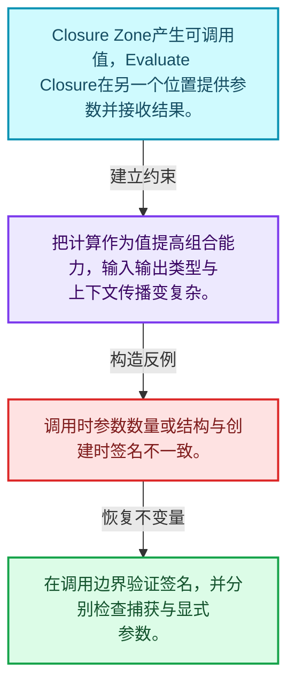
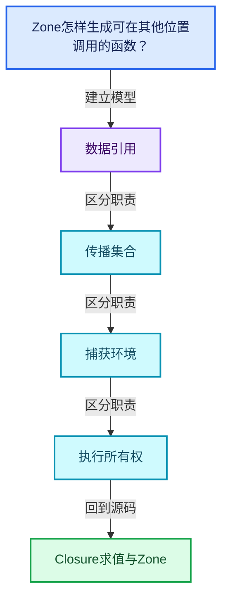
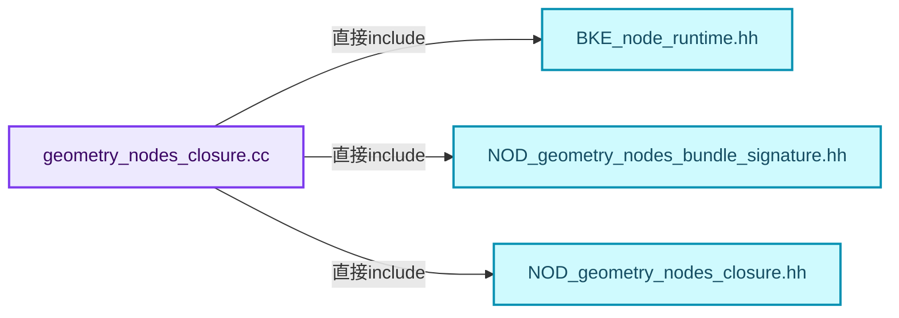
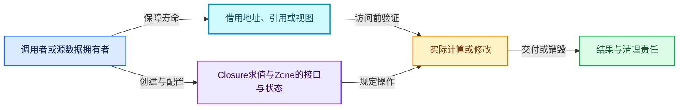
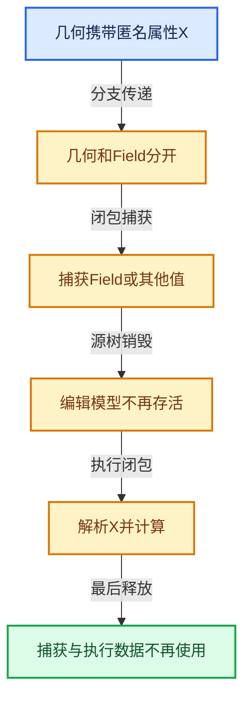

# 10-07 Closure求值与Zone

[方向导航](README.md) · [总目录](../README.md) · [覆盖索引](../%E6%BA%90%E7%A0%81%E7%89%88%E6%9C%AC%E4%B8%8E%E8%A6%86%E7%9B%96%E7%B4%A2%E5%BC%95.md)

> 阅读顺序：问题与数据模型 → 语法与类型 → 源码逐行 → 调用线索 → 历史与取舍 → 推演和练习。

- 基准 HEAD：`cbda6b96c26c0dee3c3b5cbb93960c4ac06a6b30`。
- 记录日期：2026-10-14。
- 教学示例状态：正文中的推演不是本机性能实测；已运行练习见验收报告。

## 一、从问题到设计

Zone怎样生成可在其他位置调用的函数？

区域输入、捕获与输出需映射到调用签名；执行上下文和引用传播不能因跨区域而丢失。

本篇把语法、数据语义和系统取舍连接起来。表达式引用、承载数据与执行环境必须一起追踪，跨区域组合不能丢掉生命周期信息。

### 本篇独立模型与设计推理

Closure Zone产生可调用值，Evaluate Closure在另一个位置提供参数并接收结果。

设计取舍：把计算作为值提高组合能力，输入输出类型与上下文传播变复杂。

最小反例：调用时参数数量或结构与创建时签名不一致。

推导与处理：在调用边界验证签名，并分别检查捕获与显式参数。



### 源码范围与相邻篇章

| 文件 | 本篇逐行范围 | 基准SHA-256 |
|---|---|---|
| [source/blender/nodes/intern/geometry_nodes_closure.cc](../../../../../source/blender/nodes/intern/geometry_nodes_closure.cc) | L1—L185 | `c34b7c787d05945e13b353abb4070dfe45a34995bd0d4c38d6e663b45596f7e4` |
| [source/blender/nodes/intern/geometry_nodes_closure_zone.cc](../../../../../source/blender/nodes/intern/geometry_nodes_closure_zone.cc) | L1—L911 | `e1fd9c4bfb462c8669bb90306e53db580a42262e6a69828b1e3b24886d384356` |

同一主讲文件可能分多篇覆盖；超出本篇范围的符号通过覆盖索引定位。空行与纯注释保留在源码摘录中，逐行表解释有效语句与语法边界；许可证头统一保留。

前篇：[Closure表示与捕获](06-Closure%E8%A1%A8%E7%A4%BA%E4%B8%8E%E6%8D%95%E8%8E%B7.md).

后篇：[执行图所有权与演化](08-%E6%89%A7%E8%A1%8C%E5%9B%BE%E6%89%80%E6%9C%89%E6%9D%83%E4%B8%8E%E6%BC%94%E5%8C%96.md).

## 二、类型、数据与阅读地图



这是概念依赖图，边表示阅读关系，不声称是运行时调用顺序。

### 直接编译依赖



箭头只表示头文件包含关系；完整调用线索见后面的符号定位表。

## 三、关键词、语法与类型角色

### 常量求值 constexpr

constexpr声明允许相应实体参与常量求值，但constexpr函数仍可以在运行时执行。是否常量求值由调用场景和表达式合法性共同决定。

具体检查：比较constexpr变量初始化和从运行时输入调用同一函数。

### 只读限定 const

const约束当前访问路径可做的修改。const指针、指向const的指针、const视图对象、const元素是不同位置的限定；其他别名可能仍可修改原对象。

具体检查：分别写T* const、const T*与const T* const，并画出不可修改的层次。

### 移动转换 std::move

std::move把表达式转换为可供移动重载选择的值类别，实际资源转移发生在被选中的构造或赋值中。对const对象move可能仍调用复制，对视图move也不会获得底层数据所有权。

具体检查：记录移动构造调用次数，不用变量名或std::move的出现次数替代测量。

### 异常边界 try与catch

try定义异常传播的局部边界。失败路径需要销毁已经成功构造的部分并释放相应存储；未构造的对象不能被析构。

具体检查：在第k次构造失败，列出已经存在的对象集合与待释放缓冲。

### 显式静态转换 static_cast

static_cast表达编译期允许的转换，不会自动验证运行时真实类型、指针寿命或索引边界。由void指针恢复T指针时，调用者仍须保证实际存储中确有合法T对象。

具体检查：标出转换前后的类型以及正确性依据来自哪里。

### 限定转换 const_cast

const_cast可以改变访问路径的限定，但不能让本来就是const的对象合法可写。常用于复用只读实现时，仍需检查底层对象是否实际可变。

具体检查：对非const对象的const引用与真正const对象分别分析修改是否合法。

### 覆写检查 override

override要求函数确实覆盖基类虚函数，可捕获参数类型和const限定不匹配。它不改变基类规定的生命周期或线程约束。

具体检查：故意改变一个参数或const，观察编译器如何拒绝误写的新函数。

### 可选值 optional

optional把不存在与存在的T区分开，T的构造和析构跟随engaged状态变化。访问前应由has_value或条件分支证明存在。

具体检查：把空Field状态与合法常量零区分，不能用某个普通值代替不存在。

### 构造与new表达式

普通new可能分配并构造；placement new在给定地址构造，存储由其他机制提供。失败回滚应区分两类责任。

具体检查：追踪地址来自哪里、构造何时成功、由谁析构、由谁释放。

### 内部断言 assert

断言表达开发者预期成立的内部契约，发布构建可能关闭。它不能替代对不可信输入的完整错误处理，也不保证后续操作被运行时保护。

具体检查：对每条断言构造违反条件的输入，区分调用者错误与应向用户报告的错误。

### 独占拥有 unique_ptr

unique_ptr通过移动转移拥有关系，默认删除策略必须与资源来源匹配。get返回借用指针，release交出责任而不销毁。

具体检查：区分move、get、release和reset后谁负责销毁。

### 共享拥有 shared_ptr

shared_ptr让控制块跟踪共享寿命，不自动使被指向对象的读写线程安全；循环拥有可能阻止销毁。

具体检查：画出强引用环并考虑是否应改变所有权方向或引入弱引用。

### 类型别名 using

类型别名为已有类型建立名字，不创建运行期对象。它常把模板内部使用的类型统一暴露给泛型调用者。

具体检查：展开别名直到基础类型，区分类型别名和变量声明。

## 四、真实源码与逐行讲解

源码块保持原行内容，原始行号由小节标题及逐行表给出。表中的调用定位是静态阅读辅助；重载、模板实例化、宏展开和虚调用需结合完整声明，不能仅凭词法出现证明动态调用。

### geometry_nodes_closure.cc：L1—L46

<!-- source:source/blender/nodes/intern/geometry_nodes_closure.cc:1:46 -->

```cpp
/* SPDX-FileCopyrightText: 2025 Blender Authors
 *
 * SPDX-License-Identifier: GPL-2.0-or-later */

/** \file
 * \ingroup nodes
 */

#include "BKE_node_runtime.hh"

#include "NOD_geometry_nodes_bundle_signature.hh"
#include "NOD_geometry_nodes_closure.hh"

namespace blender::nodes {

std::optional<int> ClosureSignature::find_input_index(const StringRef key) const
{
  for (const int i : this->inputs.index_range()) {
    const Item &item = this->inputs[i];
    if (item.key == key) {
      return i;
    }
  }
  return std::nullopt;
}

std::optional<int> ClosureSignature::find_output_index(const StringRef key) const
{
  for (const int i : this->outputs.index_range()) {
    const Item &item = this->outputs[i];
    if (item.key == key) {
      return i;
    }
  }
  return std::nullopt;
}

void ClosureSignature::set_auto_structure_types()
{
  for (const Item &item : this->inputs) {
    const_cast<Item &>(item).structure_type = NodeSocketInterfaceStructureType::Auto;
  }
  for (const Item &item : this->outputs) {
    const_cast<Item &>(item).structure_type = NodeSocketInterfaceStructureType::Auto;
  }
}
```

本段语义重点：

- 分支证据 `item.key == key)`：分别推演条件成立与不成立，核对相同出口处的状态。
- 分支证据 `item.key == key)`：分别推演条件成立与不成立，核对相同出口处的状态。

| 原始行 | 语义、约束与检查 |
|---|---|
| L9 | 引入编译依赖 "BKE_node_runtime.hh"；这是声明可见性关系，不表示运行时一定调用该文件的所有接口。 |
| L11 | 引入编译依赖 "NOD_geometry_nodes_bundle_signature.hh"；这是声明可见性关系，不表示运行时一定调用该文件的所有接口。 |
| L12 | 引入编译依赖 "NOD_geometry_nodes_closure.hh"；这是声明可见性关系，不表示运行时一定调用该文件的所有接口。 |
| L14 | 把后续声明放入 blender::nodes 命名空间，影响名称查找和符号归属，不创建运行时对象。 |
| L16 | 出现调用或函数声明 `ClosureSignature::find_input_index`，对应表达式为 `std::optional<int> ClosureSignature::find_input_index(const StringRef key) const`。参数求值、返回类型与重载需结合前后完整语句；静态文本引用不能证明动态目标。 |
| L17 | 连接上一行的声明或控制结构与其语句块；后续行在这个作用域中执行或声明。 |
| L18 | 按 `for (const int i : this->inputs.index_range())` 指定的范围或条件重复执行。对照循环变量与真实元素编号；循环内调用成本乘以实际迭代次数。 |
| L19 | 把右侧 `this->inputs[i]` 用于初始化或更新左侧 `const Item &item`。声明初始化与已有对象赋值应按上下文区分；有资源的类型会调用相应特殊成员。 |
| L20 | 判断 `item.key == key`，成立时进入本分支，否则继续后续路径。 |
| L21 | 返回表达式 `i`。 |
| L22 | 结束当前语法单元。局部自动对象在离开其作用域时按规则销毁；这不等于所有被引用的外部数据也被释放。 |
| L23 | 结束当前语法单元。局部自动对象在离开其作用域时按规则销毁；这不等于所有被引用的外部数据也被释放。 |
| L24 | 返回表达式 `std::nullopt`。 |
| L25 | 结束当前语法单元。局部自动对象在离开其作用域时按规则销毁；这不等于所有被引用的外部数据也被释放。 |
| L27 | 出现调用或函数声明 `ClosureSignature::find_output_index`，对应表达式为 `std::optional<int> ClosureSignature::find_output_index(const StringRef key) const`。参数求值、返回类型与重载需结合前后完整语句；静态文本引用不能证明动态目标。 |
| L28 | 连接上一行的声明或控制结构与其语句块；后续行在这个作用域中执行或声明。 |
| L29 | 按 `for (const int i : this->outputs.index_range())` 指定的范围或条件重复执行。对照循环变量与真实元素编号；循环内调用成本乘以实际迭代次数。 |
| L30 | 把右侧 `this->outputs[i]` 用于初始化或更新左侧 `const Item &item`。声明初始化与已有对象赋值应按上下文区分；有资源的类型会调用相应特殊成员。 |
| L31 | 判断 `item.key == key`，成立时进入本分支，否则继续后续路径。 |
| L32 | 返回表达式 `i`。 |
| L33 | 结束当前语法单元。局部自动对象在离开其作用域时按规则销毁；这不等于所有被引用的外部数据也被释放。 |
| L34 | 结束当前语法单元。局部自动对象在离开其作用域时按规则销毁；这不等于所有被引用的外部数据也被释放。 |
| L35 | 返回表达式 `std::nullopt`。 |
| L36 | 结束当前语法单元。局部自动对象在离开其作用域时按规则销毁；这不等于所有被引用的外部数据也被释放。 |
| L38 | 出现调用或函数声明 `ClosureSignature::set_auto_structure_types`，对应表达式为 `void ClosureSignature::set_auto_structure_types()`。参数求值、返回类型与重载需结合前后完整语句；静态文本引用不能证明动态目标。 |
| L39 | 连接上一行的声明或控制结构与其语句块；后续行在这个作用域中执行或声明。 |
| L40 | 按 `for (const Item &item : this->inputs)` 指定的范围或条件重复执行。对照循环变量与真实元素编号；循环内调用成本乘以实际迭代次数。 |
| L41 | 把右侧 `NodeSocketInterfaceStructureType::Auto` 用于初始化或更新左侧 `const_cast<Item &>(item).structure_type`。声明初始化与已有对象赋值应按上下文区分；有资源的类型会调用相应特殊成员。 |
| L42 | 结束当前语法单元。局部自动对象在离开其作用域时按规则销毁；这不等于所有被引用的外部数据也被释放。 |
| L43 | 按 `for (const Item &item : this->outputs)` 指定的范围或条件重复执行。对照循环变量与真实元素编号；循环内调用成本乘以实际迭代次数。 |
| L44 | 把右侧 `NodeSocketInterfaceStructureType::Auto` 用于初始化或更新左侧 `const_cast<Item &>(item).structure_type`。声明初始化与已有对象赋值应按上下文区分；有资源的类型会调用相应特殊成员。 |
| L45 | 结束当前语法单元。局部自动对象在离开其作用域时按规则销毁；这不等于所有被引用的外部数据也被释放。 |
| L46 | 结束当前语法单元。局部自动对象在离开其作用域时按规则销毁；这不等于所有被引用的外部数据也被释放。 |

### geometry_nodes_closure.cc：L47—L91

<!-- source:source/blender/nodes/intern/geometry_nodes_closure.cc:47:91 -->

```cpp

bool operator==(const ClosureSignature &a, const ClosureSignature &b)
{
  return a.inputs.as_span() == b.inputs.as_span() && a.outputs.as_span() == b.outputs.as_span();
}

bool operator!=(const ClosureSignature &a, const ClosureSignature &b)
{
  return !(a == b);
}

ClosureSignature ClosureSignature::from_closure_output_node(const bNode &node,
                                                            const bool allow_auto_structure_type)
{
  BLI_assert(node.is_type("NodeClosureOutput"_ustr));
  const bNodeTree &tree = node.owner_tree();
  const bNode *input_node =
      bke::zone_type_by_node_type(node.type_legacy)->get_corresponding_input(tree, node);
  const auto &storage = *static_cast<const NodeClosureOutput *>(node.storage);
  nodes::ClosureSignature signature;
  if (input_node) {
    for (const int i : IndexRange(storage.input_items.items_num)) {
      const NodeClosureInputItem &item = storage.input_items.items[i];
      const bNodeSocket &socket = input_node->output_socket(i);
      if (const bke::bNodeSocketType *stype = bke::node_socket_type_find_static(item.socket_type))
      {
        const NodeSocketInterfaceStructureType structure_type =
            get_structure_type_for_bundle_signature(
                socket, item.structure_type, allow_auto_structure_type);
        signature.inputs.add({item.name, stype, structure_type});
      }
    }
  }
  for (const int i : IndexRange(storage.output_items.items_num)) {
    const NodeClosureOutputItem &item = storage.output_items.items[i];
    const bNodeSocket &socket = node.input_socket(i);
    if (const bke::bNodeSocketType *stype = bke::node_socket_type_find_static(item.socket_type)) {
      const NodeSocketInterfaceStructureType structure_type =
          get_structure_type_for_bundle_signature(
              socket, item.structure_type, allow_auto_structure_type);
      signature.outputs.add({item.name, stype, structure_type});
    }
  }
  return signature;
}
```

本段语义重点：

- 分支证据 `input_node)`：分别推演条件成立与不成立，核对相同出口处的状态。
- 分支证据 `const bke::bNodeSocketType *stype = bke::node_socket_type_find_static(item.socket_type))`：分别推演条件成立与不成立，核对相同出口处的状态。

| 原始行 | 语义、约束与检查 |
|---|---|
| L48 | 运算符重载声明、定义或显式调用：`bool operator==(const ClosureSignature &a, const ClosureSignature &b)`。结合参数和返回类型判断是赋值、索引、比较还是转换；operator=声明中的等号不是在给名为operator的变量赋值。 |
| L49 | 连接上一行的声明或控制结构与其语句块；后续行在这个作用域中执行或声明。 |
| L50 | 返回表达式 `a.inputs.as_span() == b.inputs.as_span() && a.outputs.as_span() == b.outputs.as_span()`。 |
| L51 | 结束当前语法单元。局部自动对象在离开其作用域时按规则销毁；这不等于所有被引用的外部数据也被释放。 |
| L53 | 运算符重载声明、定义或显式调用：`bool operator!=(const ClosureSignature &a, const ClosureSignature &b)`。结合参数和返回类型判断是赋值、索引、比较还是转换；operator=声明中的等号不是在给名为operator的变量赋值。 |
| L54 | 连接上一行的声明或控制结构与其语句块；后续行在这个作用域中执行或声明。 |
| L55 | 返回表达式 `!(a == b)`。 |
| L56 | 结束当前语法单元。局部自动对象在离开其作用域时按规则销毁；这不等于所有被引用的外部数据也被释放。 |
| L58 | 出现调用或函数声明 `ClosureSignature::from_closure_output_node`，对应表达式为 `ClosureSignature ClosureSignature::from_closure_output_node(const bNode &node,`。参数求值、返回类型与重载需结合前后完整语句；静态文本引用不能证明动态目标。 |
| L59 | 本行是连续声明或表达式的一部分：`const bool allow_auto_structure_type)`。与本段前后行合读；逗号、括号和限定符决定它属于参数、初始化列表还是实际计算。 |
| L60 | 连接上一行的声明或控制结构与其语句块；后续行在这个作用域中执行或声明。 |
| L61 | 断言约束 `BLI_assert(node.is_type("NodeClosureOutput"_ustr));`。条件是后续访问的内部前置条件；发布构建可能不执行，不能把断言当作输入修复。 |
| L62 | 把右侧 `node.owner_tree()` 用于初始化或更新左侧 `const bNodeTree &tree`。声明初始化与已有对象赋值应按上下文区分；有资源的类型会调用相应特殊成员。 |
| L63 | 把右侧 `` 用于初始化或更新左侧 `const bNode *input_node`。声明初始化与已有对象赋值应按上下文区分；有资源的类型会调用相应特殊成员。 |
| L64 | 出现调用或函数声明 `bke::zone_type_by_node_type`，对应表达式为 `bke::zone_type_by_node_type(node.type_legacy)->get_corresponding_input(tree, node);`。参数求值、返回类型与重载需结合前后完整语句；静态文本引用不能证明动态目标。 |
| L65 | 把右侧 `*static_cast<const NodeClosureOutput *>(node.storage)` 用于初始化或更新左侧 `const auto &storage`。声明初始化与已有对象赋值应按上下文区分；有资源的类型会调用相应特殊成员。 |
| L66 | 声明成员、局部对象或完成语句 `nodes::ClosureSignature signature`。若为指针或引用，它本身不说明拥有；若为值对象，其构造析构由所在作用域或外层对象管理。 |
| L67 | 判断 `input_node`，成立时进入本分支，否则继续后续路径。 |
| L68 | 按 `for (const int i : IndexRange(storage.input_items.items_num))` 指定的范围或条件重复执行。对照循环变量与真实元素编号；循环内调用成本乘以实际迭代次数。 |
| L69 | 把右侧 `storage.input_items.items[i]` 用于初始化或更新左侧 `const NodeClosureInputItem &item`。声明初始化与已有对象赋值应按上下文区分；有资源的类型会调用相应特殊成员。 |
| L70 | 把右侧 `input_node->output_socket(i)` 用于初始化或更新左侧 `const bNodeSocket &socket`。声明初始化与已有对象赋值应按上下文区分；有资源的类型会调用相应特殊成员。 |
| L71 | 判断 `const bke::bNodeSocketType *stype = bke::node_socket_type_find_static(item.socket_type)`，成立时进入本分支，否则继续后续路径。 |
| L72 | 连接上一行的声明或控制结构与其语句块；后续行在这个作用域中执行或声明。 |
| L73 | 把右侧 `` 用于初始化或更新左侧 `const NodeSocketInterfaceStructureType structure_type`。声明初始化与已有对象赋值应按上下文区分；有资源的类型会调用相应特殊成员。 |
| L74 | 出现调用或函数声明 `get_structure_type_for_bundle_signature`，对应表达式为 `get_structure_type_for_bundle_signature(`。参数求值、返回类型与重载需结合前后完整语句；静态文本引用不能证明动态目标。 |
| L75 | 声明成员、局部对象或完成语句 `socket, item.structure_type, allow_auto_structure_type)`。若为指针或引用，它本身不说明拥有；若为值对象，其构造析构由所在作用域或外层对象管理。 |
| L76 | 出现调用或函数声明 `add`，对应表达式为 `signature.inputs.add({item.name, stype, structure_type});`。参数求值、返回类型与重载需结合前后完整语句；静态文本引用不能证明动态目标。 |
| L77 | 结束当前语法单元。局部自动对象在离开其作用域时按规则销毁；这不等于所有被引用的外部数据也被释放。 |
| L78 | 结束当前语法单元。局部自动对象在离开其作用域时按规则销毁；这不等于所有被引用的外部数据也被释放。 |
| L79 | 结束当前语法单元。局部自动对象在离开其作用域时按规则销毁；这不等于所有被引用的外部数据也被释放。 |
| L80 | 按 `for (const int i : IndexRange(storage.output_items.items_num))` 指定的范围或条件重复执行。对照循环变量与真实元素编号；循环内调用成本乘以实际迭代次数。 |
| L81 | 把右侧 `storage.output_items.items[i]` 用于初始化或更新左侧 `const NodeClosureOutputItem &item`。声明初始化与已有对象赋值应按上下文区分；有资源的类型会调用相应特殊成员。 |
| L82 | 把右侧 `node.input_socket(i)` 用于初始化或更新左侧 `const bNodeSocket &socket`。声明初始化与已有对象赋值应按上下文区分；有资源的类型会调用相应特殊成员。 |
| L83 | 判断 `const bke::bNodeSocketType *stype = bke::node_socket_type_find_static(item.socket_type)`，成立时进入本分支，否则继续后续路径。 |
| L84 | 把右侧 `` 用于初始化或更新左侧 `const NodeSocketInterfaceStructureType structure_type`。声明初始化与已有对象赋值应按上下文区分；有资源的类型会调用相应特殊成员。 |
| L85 | 出现调用或函数声明 `get_structure_type_for_bundle_signature`，对应表达式为 `get_structure_type_for_bundle_signature(`。参数求值、返回类型与重载需结合前后完整语句；静态文本引用不能证明动态目标。 |
| L86 | 声明成员、局部对象或完成语句 `socket, item.structure_type, allow_auto_structure_type)`。若为指针或引用，它本身不说明拥有；若为值对象，其构造析构由所在作用域或外层对象管理。 |
| L87 | 出现调用或函数声明 `add`，对应表达式为 `signature.outputs.add({item.name, stype, structure_type});`。参数求值、返回类型与重载需结合前后完整语句；静态文本引用不能证明动态目标。 |
| L88 | 结束当前语法单元。局部自动对象在离开其作用域时按规则销毁；这不等于所有被引用的外部数据也被释放。 |
| L89 | 结束当前语法单元。局部自动对象在离开其作用域时按规则销毁；这不等于所有被引用的外部数据也被释放。 |
| L90 | 返回表达式 `signature`。 |
| L91 | 结束当前语法单元。局部自动对象在离开其作用域时按规则销毁；这不等于所有被引用的外部数据也被释放。 |

### geometry_nodes_closure.cc：L92—L139

<!-- source:source/blender/nodes/intern/geometry_nodes_closure.cc:92:139 -->

```cpp

ClosureSignature ClosureSignature::from_evaluate_closure_node(const bNode &node,
                                                              const bool allow_auto_structure_type)
{
  BLI_assert(node.is_type("NodeEvaluateClosure"_ustr));
  const auto &storage = *static_cast<const NodeEvaluateClosure *>(node.storage);
  nodes::ClosureSignature signature;
  for (const int i : IndexRange(storage.input_items.items_num)) {
    const NodeEvaluateClosureInputItem &item = storage.input_items.items[i];
    const bNodeSocket &socket = node.input_socket(i + 1);
    if (const bke::bNodeSocketType *stype = bke::node_socket_type_find_static(item.socket_type)) {
      const NodeSocketInterfaceStructureType structure_type =
          get_structure_type_for_bundle_signature(
              socket, item.structure_type, allow_auto_structure_type);
      signature.inputs.add({item.name, stype, structure_type});
    }
  }
  for (const int i : IndexRange(storage.output_items.items_num)) {
    const NodeEvaluateClosureOutputItem &item = storage.output_items.items[i];
    const bNodeSocket &socket = node.output_socket(i);
    if (const bke::bNodeSocketType *stype = bke::node_socket_type_find_static(item.socket_type)) {
      const NodeSocketInterfaceStructureType structure_type =
          get_structure_type_for_bundle_signature(
              socket, item.structure_type, allow_auto_structure_type);
      signature.outputs.add({item.name, stype, structure_type});
    }
  }
  return signature;
}

ClosureSignature ClosureSignature::from_closure_to_list_node(const bNode &node)
{
  BLI_assert(node.is_type("GeometryNodeClosureToList"_ustr));
  const auto &storage = *static_cast<const GeometryNodeClosureToList *>(node.storage);
  ClosureSignature signature;
  signature.inputs.add({.key = "Index",
                        .type = bke::node_socket_type_find("NodeSocketInt"),
                        .structure_type = NodeSocketInterfaceStructureType::Single});
  for (const int i : IndexRange(storage.items_num)) {
    const GeometryNodeClosureToListItem &item = storage.items[i];
    const auto type = eNodeSocketDatatype(item.socket_type);
    signature.outputs.add(
        {.key = item.name,
         .type = bke::node_socket_type_find_static(type),
         .structure_type = NodeSocketInterfaceStructureType(item.structure_type)});
  }
  return signature;
}
```

本段语义重点：

- 分支证据 `const bke::bNodeSocketType *stype = bke::node_socket_type_find_static(item.socket_type))`：分别推演条件成立与不成立，核对相同出口处的状态。
- 分支证据 `const bke::bNodeSocketType *stype = bke::node_socket_type_find_static(item.socket_type))`：分别推演条件成立与不成立，核对相同出口处的状态。

| 原始行 | 语义、约束与检查 |
|---|---|
| L93 | 出现调用或函数声明 `ClosureSignature::from_evaluate_closure_node`，对应表达式为 `ClosureSignature ClosureSignature::from_evaluate_closure_node(const bNode &node,`。参数求值、返回类型与重载需结合前后完整语句；静态文本引用不能证明动态目标。 |
| L94 | 本行是连续声明或表达式的一部分：`const bool allow_auto_structure_type)`。与本段前后行合读；逗号、括号和限定符决定它属于参数、初始化列表还是实际计算。 |
| L95 | 连接上一行的声明或控制结构与其语句块；后续行在这个作用域中执行或声明。 |
| L96 | 断言约束 `BLI_assert(node.is_type("NodeEvaluateClosure"_ustr));`。条件是后续访问的内部前置条件；发布构建可能不执行，不能把断言当作输入修复。 |
| L97 | 把右侧 `*static_cast<const NodeEvaluateClosure *>(node.storage)` 用于初始化或更新左侧 `const auto &storage`。声明初始化与已有对象赋值应按上下文区分；有资源的类型会调用相应特殊成员。 |
| L98 | 声明成员、局部对象或完成语句 `nodes::ClosureSignature signature`。若为指针或引用，它本身不说明拥有；若为值对象，其构造析构由所在作用域或外层对象管理。 |
| L99 | 按 `for (const int i : IndexRange(storage.input_items.items_num))` 指定的范围或条件重复执行。对照循环变量与真实元素编号；循环内调用成本乘以实际迭代次数。 |
| L100 | 把右侧 `storage.input_items.items[i]` 用于初始化或更新左侧 `const NodeEvaluateClosureInputItem &item`。声明初始化与已有对象赋值应按上下文区分；有资源的类型会调用相应特殊成员。 |
| L101 | 把右侧 `node.input_socket(i + 1)` 用于初始化或更新左侧 `const bNodeSocket &socket`。声明初始化与已有对象赋值应按上下文区分；有资源的类型会调用相应特殊成员。 |
| L102 | 判断 `const bke::bNodeSocketType *stype = bke::node_socket_type_find_static(item.socket_type)`，成立时进入本分支，否则继续后续路径。 |
| L103 | 把右侧 `` 用于初始化或更新左侧 `const NodeSocketInterfaceStructureType structure_type`。声明初始化与已有对象赋值应按上下文区分；有资源的类型会调用相应特殊成员。 |
| L104 | 出现调用或函数声明 `get_structure_type_for_bundle_signature`，对应表达式为 `get_structure_type_for_bundle_signature(`。参数求值、返回类型与重载需结合前后完整语句；静态文本引用不能证明动态目标。 |
| L105 | 声明成员、局部对象或完成语句 `socket, item.structure_type, allow_auto_structure_type)`。若为指针或引用，它本身不说明拥有；若为值对象，其构造析构由所在作用域或外层对象管理。 |
| L106 | 出现调用或函数声明 `add`，对应表达式为 `signature.inputs.add({item.name, stype, structure_type});`。参数求值、返回类型与重载需结合前后完整语句；静态文本引用不能证明动态目标。 |
| L107 | 结束当前语法单元。局部自动对象在离开其作用域时按规则销毁；这不等于所有被引用的外部数据也被释放。 |
| L108 | 结束当前语法单元。局部自动对象在离开其作用域时按规则销毁；这不等于所有被引用的外部数据也被释放。 |
| L109 | 按 `for (const int i : IndexRange(storage.output_items.items_num))` 指定的范围或条件重复执行。对照循环变量与真实元素编号；循环内调用成本乘以实际迭代次数。 |
| L110 | 把右侧 `storage.output_items.items[i]` 用于初始化或更新左侧 `const NodeEvaluateClosureOutputItem &item`。声明初始化与已有对象赋值应按上下文区分；有资源的类型会调用相应特殊成员。 |
| L111 | 把右侧 `node.output_socket(i)` 用于初始化或更新左侧 `const bNodeSocket &socket`。声明初始化与已有对象赋值应按上下文区分；有资源的类型会调用相应特殊成员。 |
| L112 | 判断 `const bke::bNodeSocketType *stype = bke::node_socket_type_find_static(item.socket_type)`，成立时进入本分支，否则继续后续路径。 |
| L113 | 把右侧 `` 用于初始化或更新左侧 `const NodeSocketInterfaceStructureType structure_type`。声明初始化与已有对象赋值应按上下文区分；有资源的类型会调用相应特殊成员。 |
| L114 | 出现调用或函数声明 `get_structure_type_for_bundle_signature`，对应表达式为 `get_structure_type_for_bundle_signature(`。参数求值、返回类型与重载需结合前后完整语句；静态文本引用不能证明动态目标。 |
| L115 | 声明成员、局部对象或完成语句 `socket, item.structure_type, allow_auto_structure_type)`。若为指针或引用，它本身不说明拥有；若为值对象，其构造析构由所在作用域或外层对象管理。 |
| L116 | 出现调用或函数声明 `add`，对应表达式为 `signature.outputs.add({item.name, stype, structure_type});`。参数求值、返回类型与重载需结合前后完整语句；静态文本引用不能证明动态目标。 |
| L117 | 结束当前语法单元。局部自动对象在离开其作用域时按规则销毁；这不等于所有被引用的外部数据也被释放。 |
| L118 | 结束当前语法单元。局部自动对象在离开其作用域时按规则销毁；这不等于所有被引用的外部数据也被释放。 |
| L119 | 返回表达式 `signature`。 |
| L120 | 结束当前语法单元。局部自动对象在离开其作用域时按规则销毁；这不等于所有被引用的外部数据也被释放。 |
| L122 | 出现调用或函数声明 `ClosureSignature::from_closure_to_list_node`，对应表达式为 `ClosureSignature ClosureSignature::from_closure_to_list_node(const bNode &node)`。参数求值、返回类型与重载需结合前后完整语句；静态文本引用不能证明动态目标。 |
| L123 | 连接上一行的声明或控制结构与其语句块；后续行在这个作用域中执行或声明。 |
| L124 | 断言约束 `BLI_assert(node.is_type("GeometryNodeClosureToList"_ustr));`。条件是后续访问的内部前置条件；发布构建可能不执行，不能把断言当作输入修复。 |
| L125 | 把右侧 `*static_cast<const GeometryNodeClosureToList *>(node.storage)` 用于初始化或更新左侧 `const auto &storage`。声明初始化与已有对象赋值应按上下文区分；有资源的类型会调用相应特殊成员。 |
| L126 | 声明成员、局部对象或完成语句 `ClosureSignature signature`。若为指针或引用，它本身不说明拥有；若为值对象，其构造析构由所在作用域或外层对象管理。 |
| L127 | 把右侧 `"Index",` 用于初始化或更新左侧 `signature.inputs.add({.key`。声明初始化与已有对象赋值应按上下文区分；有资源的类型会调用相应特殊成员。 |
| L128 | 把右侧 `bke::node_socket_type_find("NodeSocketInt"),` 用于初始化或更新左侧 `.type`。声明初始化与已有对象赋值应按上下文区分；有资源的类型会调用相应特殊成员。 |
| L129 | 把右侧 `NodeSocketInterfaceStructureType::Single})` 用于初始化或更新左侧 `.structure_type`。声明初始化与已有对象赋值应按上下文区分；有资源的类型会调用相应特殊成员。 |
| L130 | 按 `for (const int i : IndexRange(storage.items_num))` 指定的范围或条件重复执行。对照循环变量与真实元素编号；循环内调用成本乘以实际迭代次数。 |
| L131 | 把右侧 `storage.items[i]` 用于初始化或更新左侧 `const GeometryNodeClosureToListItem &item`。声明初始化与已有对象赋值应按上下文区分；有资源的类型会调用相应特殊成员。 |
| L132 | 把右侧 `eNodeSocketDatatype(item.socket_type)` 用于初始化或更新左侧 `const auto type`。声明初始化与已有对象赋值应按上下文区分；有资源的类型会调用相应特殊成员。 |
| L133 | 出现调用或函数声明 `add`，对应表达式为 `signature.outputs.add(`。参数求值、返回类型与重载需结合前后完整语句；静态文本引用不能证明动态目标。 |
| L134 | 把右侧 `item.name,` 用于初始化或更新左侧 `{.key`。声明初始化与已有对象赋值应按上下文区分；有资源的类型会调用相应特殊成员。 |
| L135 | 把右侧 `bke::node_socket_type_find_static(type),` 用于初始化或更新左侧 `.type`。声明初始化与已有对象赋值应按上下文区分；有资源的类型会调用相应特殊成员。 |
| L136 | 把右侧 `NodeSocketInterfaceStructureType(item.structure_type)})` 用于初始化或更新左侧 `.structure_type`。声明初始化与已有对象赋值应按上下文区分；有资源的类型会调用相应特殊成员。 |
| L137 | 结束当前语法单元。局部自动对象在离开其作用域时按规则销毁；这不等于所有被引用的外部数据也被释放。 |
| L138 | 返回表达式 `signature`。 |
| L139 | 结束当前语法单元。局部自动对象在离开其作用域时按规则销毁；这不等于所有被引用的外部数据也被释放。 |

### geometry_nodes_closure.cc：L140—L185

<!-- source:source/blender/nodes/intern/geometry_nodes_closure.cc:140:185 -->

```cpp

bool LinkedClosureSignatures::has_type_definition() const
{
  for (const Item &item : this->items) {
    if (item.define_signature) {
      return true;
    }
  }
  return false;
}

std::optional<ClosureSignature> LinkedClosureSignatures::get_merged_signature() const
{
  ClosureSignature signature;
  for (const Item &src_signature : this->items) {
    for (const ClosureSignature::Item &item : src_signature.signature.inputs) {
      if (!signature.inputs.add(item)) {
        const ClosureSignature::Item &existing_item = *signature.inputs.lookup_key_ptr_as(
            item.key);
        if (existing_item.type->type != item.type->type) {
          return std::nullopt;
        }
        if (existing_item.structure_type != item.structure_type) {
          const_cast<ClosureSignature::Item &>(existing_item).structure_type =
              NodeSocketInterfaceStructureType::Dynamic;
        }
      }
    }
    for (const ClosureSignature::Item &item : src_signature.signature.outputs) {
      if (!signature.outputs.add(item)) {
        const ClosureSignature::Item &existing_item = *signature.outputs.lookup_key_ptr_as(
            item.key);
        if (existing_item.type->type != item.type->type) {
          return std::nullopt;
        }
        if (existing_item.structure_type != item.structure_type) {
          const_cast<ClosureSignature::Item &>(existing_item).structure_type =
              NodeSocketInterfaceStructureType::Dynamic;
        }
      }
    }
  }
  return signature;
}

}  // namespace blender::nodes
```

本段语义重点：

- 分支证据 `item.define_signature)`：分别推演条件成立与不成立，核对相同出口处的状态。
- 分支证据 `!signature.inputs.add(item))`：分别推演条件成立与不成立，核对相同出口处的状态。

| 原始行 | 语义、约束与检查 |
|---|---|
| L141 | 出现调用或函数声明 `LinkedClosureSignatures::has_type_definition`，对应表达式为 `bool LinkedClosureSignatures::has_type_definition() const`。参数求值、返回类型与重载需结合前后完整语句；静态文本引用不能证明动态目标。 |
| L142 | 连接上一行的声明或控制结构与其语句块；后续行在这个作用域中执行或声明。 |
| L143 | 按 `for (const Item &item : this->items)` 指定的范围或条件重复执行。对照循环变量与真实元素编号；循环内调用成本乘以实际迭代次数。 |
| L144 | 判断 `item.define_signature`，成立时进入本分支，否则继续后续路径。 |
| L145 | 返回表达式 `true`。这是本路径的布尔结果，具体成功、存在或状态含义由函数接口规定。 |
| L146 | 结束当前语法单元。局部自动对象在离开其作用域时按规则销毁；这不等于所有被引用的外部数据也被释放。 |
| L147 | 结束当前语法单元。局部自动对象在离开其作用域时按规则销毁；这不等于所有被引用的外部数据也被释放。 |
| L148 | 返回表达式 `false`。这是本路径的布尔结果，具体成功、存在或状态含义由函数接口规定。 |
| L149 | 结束当前语法单元。局部自动对象在离开其作用域时按规则销毁；这不等于所有被引用的外部数据也被释放。 |
| L151 | 出现调用或函数声明 `LinkedClosureSignatures::get_merged_signature`，对应表达式为 `std::optional<ClosureSignature> LinkedClosureSignatures::get_merged_signature() const`。参数求值、返回类型与重载需结合前后完整语句；静态文本引用不能证明动态目标。 |
| L152 | 连接上一行的声明或控制结构与其语句块；后续行在这个作用域中执行或声明。 |
| L153 | 声明成员、局部对象或完成语句 `ClosureSignature signature`。若为指针或引用，它本身不说明拥有；若为值对象，其构造析构由所在作用域或外层对象管理。 |
| L154 | 按 `for (const Item &src_signature : this->items)` 指定的范围或条件重复执行。对照循环变量与真实元素编号；循环内调用成本乘以实际迭代次数。 |
| L155 | 按 `for (const ClosureSignature::Item &item : src_signature.signature.inputs)` 指定的范围或条件重复执行。对照循环变量与真实元素编号；循环内调用成本乘以实际迭代次数。 |
| L156 | 判断 `!signature.inputs.add(item)`，成立时进入本分支，否则继续后续路径。 |
| L157 | 把右侧 `*signature.inputs.lookup_key_ptr_as(` 用于初始化或更新左侧 `const ClosureSignature::Item &existing_item`。声明初始化与已有对象赋值应按上下文区分；有资源的类型会调用相应特殊成员。 |
| L158 | 声明成员、局部对象或完成语句 `item.key)`。若为指针或引用，它本身不说明拥有；若为值对象，其构造析构由所在作用域或外层对象管理。 |
| L159 | 判断 `existing_item.type->type != item.type->type`，成立时进入本分支，否则继续后续路径。 |
| L160 | 返回表达式 `std::nullopt`。 |
| L161 | 结束当前语法单元。局部自动对象在离开其作用域时按规则销毁；这不等于所有被引用的外部数据也被释放。 |
| L162 | 判断 `existing_item.structure_type != item.structure_type`，成立时进入本分支，否则继续后续路径。 |
| L163 | 把右侧 `` 用于初始化或更新左侧 `const_cast<ClosureSignature::Item &>(existing_item).structure_type`。声明初始化与已有对象赋值应按上下文区分；有资源的类型会调用相应特殊成员。 |
| L164 | 声明成员、局部对象或完成语句 `NodeSocketInterfaceStructureType::Dynamic`。若为指针或引用，它本身不说明拥有；若为值对象，其构造析构由所在作用域或外层对象管理。 |
| L165 | 结束当前语法单元。局部自动对象在离开其作用域时按规则销毁；这不等于所有被引用的外部数据也被释放。 |
| L166 | 结束当前语法单元。局部自动对象在离开其作用域时按规则销毁；这不等于所有被引用的外部数据也被释放。 |
| L167 | 结束当前语法单元。局部自动对象在离开其作用域时按规则销毁；这不等于所有被引用的外部数据也被释放。 |
| L168 | 按 `for (const ClosureSignature::Item &item : src_signature.signature.outputs)` 指定的范围或条件重复执行。对照循环变量与真实元素编号；循环内调用成本乘以实际迭代次数。 |
| L169 | 判断 `!signature.outputs.add(item)`，成立时进入本分支，否则继续后续路径。 |
| L170 | 把右侧 `*signature.outputs.lookup_key_ptr_as(` 用于初始化或更新左侧 `const ClosureSignature::Item &existing_item`。声明初始化与已有对象赋值应按上下文区分；有资源的类型会调用相应特殊成员。 |
| L171 | 声明成员、局部对象或完成语句 `item.key)`。若为指针或引用，它本身不说明拥有；若为值对象，其构造析构由所在作用域或外层对象管理。 |
| L172 | 判断 `existing_item.type->type != item.type->type`，成立时进入本分支，否则继续后续路径。 |
| L173 | 返回表达式 `std::nullopt`。 |
| L174 | 结束当前语法单元。局部自动对象在离开其作用域时按规则销毁；这不等于所有被引用的外部数据也被释放。 |
| L175 | 判断 `existing_item.structure_type != item.structure_type`，成立时进入本分支，否则继续后续路径。 |
| L176 | 把右侧 `` 用于初始化或更新左侧 `const_cast<ClosureSignature::Item &>(existing_item).structure_type`。声明初始化与已有对象赋值应按上下文区分；有资源的类型会调用相应特殊成员。 |
| L177 | 声明成员、局部对象或完成语句 `NodeSocketInterfaceStructureType::Dynamic`。若为指针或引用，它本身不说明拥有；若为值对象，其构造析构由所在作用域或外层对象管理。 |
| L178 | 结束当前语法单元。局部自动对象在离开其作用域时按规则销毁；这不等于所有被引用的外部数据也被释放。 |
| L179 | 结束当前语法单元。局部自动对象在离开其作用域时按规则销毁；这不等于所有被引用的外部数据也被释放。 |
| L180 | 结束当前语法单元。局部自动对象在离开其作用域时按规则销毁；这不等于所有被引用的外部数据也被释放。 |
| L181 | 结束当前语法单元。局部自动对象在离开其作用域时按规则销毁；这不等于所有被引用的外部数据也被释放。 |
| L182 | 返回表达式 `signature`。 |
| L183 | 结束当前语法单元。局部自动对象在离开其作用域时按规则销毁；这不等于所有被引用的外部数据也被释放。 |
| L185 | 结束当前语法单元。局部自动对象在离开其作用域时按规则销毁；这不等于所有被引用的外部数据也被释放。 |

### geometry_nodes_closure_zone.cc：L1—L48

<!-- source:source/blender/nodes/intern/geometry_nodes_closure_zone.cc:1:48 -->

```cpp
/* SPDX-FileCopyrightText: 2025 Blender Authors
 *
 * SPDX-License-Identifier: GPL-2.0-or-later */

/** \file
 * \ingroup nodes
 */

#include <fmt/format.h>

#include "NOD_geometry_nodes_closure_eval.hh"
#include "NOD_geometry_nodes_lazy_function.hh"

#include "BKE_compute_contexts.hh"
#include "BKE_geometry_nodes_reference_set.hh"
#include "BKE_node_runtime.hh"
#include "BKE_node_socket_value.hh"
#include "BKE_node_tree_reference_lifetimes.hh"

#include "NOD_geo_closure.hh"
#include "NOD_geometry_nodes_closure.hh"
#include "NOD_geometry_nodes_values.hh"

#include "DEG_depsgraph_query.hh"

#include "FN_lazy_function_execute.hh"

#include "BLI_string_utf8_symbols.hh"

namespace blender::nodes {

using bke::node_tree_reference_lifetimes::ReferenceSetInfo;
using bke::node_tree_reference_lifetimes::ReferenceSetType;

/**
 * Evaluating a closure lazy function creates a wrapper lazy function graph around it which handles
 * things like type conversion and missing inputs. This side effect provider is used to make sure
 * that if the closure itself contains a side-effect node (e.g. a viewer), the wrapper graph will
 * also have a side-effect node. Otherwise, the inner side-effect node will not be executed in some
 * cases.
 */
class ClosureIntermediateGraphSideEffectProvider : public lf::GraphExecutorSideEffectProvider {
 private:
  /**
   * The node that is wrapped and should be marked as having side effects if the closure
   * itself has side effects.
   */
  const lf::FunctionNode *body_node_;
```

| 原始行 | 语义、约束与检查 |
|---|---|
| L9 | 引入编译依赖 <fmt/format.h>；这是声明可见性关系，不表示运行时一定调用该文件的所有接口。 |
| L11 | 引入编译依赖 "NOD_geometry_nodes_closure_eval.hh"；这是声明可见性关系，不表示运行时一定调用该文件的所有接口。 |
| L12 | 引入编译依赖 "NOD_geometry_nodes_lazy_function.hh"；这是声明可见性关系，不表示运行时一定调用该文件的所有接口。 |
| L14 | 引入编译依赖 "BKE_compute_contexts.hh"；这是声明可见性关系，不表示运行时一定调用该文件的所有接口。 |
| L15 | 引入编译依赖 "BKE_geometry_nodes_reference_set.hh"；这是声明可见性关系，不表示运行时一定调用该文件的所有接口。 |
| L16 | 引入编译依赖 "BKE_node_runtime.hh"；这是声明可见性关系，不表示运行时一定调用该文件的所有接口。 |
| L17 | 引入编译依赖 "BKE_node_socket_value.hh"；这是声明可见性关系，不表示运行时一定调用该文件的所有接口。 |
| L18 | 引入编译依赖 "BKE_node_tree_reference_lifetimes.hh"；这是声明可见性关系，不表示运行时一定调用该文件的所有接口。 |
| L20 | 引入编译依赖 "NOD_geo_closure.hh"；这是声明可见性关系，不表示运行时一定调用该文件的所有接口。 |
| L21 | 引入编译依赖 "NOD_geometry_nodes_closure.hh"；这是声明可见性关系，不表示运行时一定调用该文件的所有接口。 |
| L22 | 引入编译依赖 "NOD_geometry_nodes_values.hh"；这是声明可见性关系，不表示运行时一定调用该文件的所有接口。 |
| L24 | 引入编译依赖 "DEG_depsgraph_query.hh"；这是声明可见性关系，不表示运行时一定调用该文件的所有接口。 |
| L26 | 引入编译依赖 "FN_lazy_function_execute.hh"；这是声明可见性关系，不表示运行时一定调用该文件的所有接口。 |
| L28 | 引入编译依赖 "BLI_string_utf8_symbols.hh"；这是声明可见性关系，不表示运行时一定调用该文件的所有接口。 |
| L30 | 把后续声明放入 blender::nodes 命名空间，影响名称查找和符号归属，不创建运行时对象。 |
| L32 | 定义类型别名 `using bke::node_tree_reference_lifetimes::ReferenceSetInfo`，为模板接口或内部实现统一命名；本行不分配该类型对象。 |
| L33 | 定义类型别名 `using bke::node_tree_reference_lifetimes::ReferenceSetType`，为模板接口或内部实现统一命名；本行不分配该类型对象。 |
| L42 | 声明或定义类型 `class ClosureIntermediateGraphSideEffectProvider : public lf::GraphExecutorSideEffectProvider`。结合继承、访问权限和成员布局确认接口与拥有关系；前向声明本身没有完整对象布局。 |
| L43 | 切换成员访问权限为 private；它是编译期接口边界，不是线程同步或内存保护。 |
| L48 | 声明成员、局部对象或完成语句 `const lf::FunctionNode *body_node_`。若为指针或引用，它本身不说明拥有；若为值对象，其构造析构由所在作用域或外层对象管理。 |

### geometry_nodes_closure_zone.cc：L49—L94

<!-- source:source/blender/nodes/intern/geometry_nodes_closure_zone.cc:49:94 -->

```cpp

 public:
  ClosureIntermediateGraphSideEffectProvider(const lf::FunctionNode &body_node)
      : body_node_(&body_node)
  {
  }

  Vector<const lf::FunctionNode *> get_nodes_with_side_effects(
      const lf::Context &context) const override
  {
    const GeoNodesUserData &user_data = *dynamic_cast<GeoNodesUserData *>(context.user_data);
    const ComputeContextHash &context_hash = user_data.compute_context->hash();
    if (!user_data.call_data->side_effect_nodes) {
      /* There are no requested side effect nodes at all. */
      return {};
    }
    const Span<const lf::FunctionNode *> side_effect_nodes_in_closure =
        user_data.call_data->side_effect_nodes->nodes_by_context.lookup(context_hash);
    if (side_effect_nodes_in_closure.is_empty()) {
      /* The closure does not have any side effect nodes, so the wrapper also does not have any. */
      return {};
    }
    return {body_node_};
  }
};

/**
 * A lazy function that internally has a lazy-function graph that mimics the "body" of the closure
 * zone.
 */
class LazyFunctionForClosureZone : public LazyFunction {
 private:
  const bNodeTree &btree_;
  const bke::bNodeTreeZone &zone_;
  const bNode &output_bnode_;
  const ZoneBuildInfo &zone_info_;
  const ZoneBodyFunction &body_fn_;
  std::shared_ptr<ClosureSignature> closure_signature_;
  /**
   * This is a weak_ptr because otherwise there is a cyclic dependency between the zone and the
   * node tree that contains it. The actual reference count is increased when the zone creates a
   * closure to be evaluated elsewhere.
   */
  std::weak_ptr<const GeometryNodesLazyFunctionGraphInfo> lf_graph_info_;

 public:
```

本段语义重点：

- 分支证据 `!user_data.call_data->side_effect_nodes)`：分别推演条件成立与不成立，核对相同出口处的状态。
- 分支证据 `side_effect_nodes_in_closure.is_empty())`：分别推演条件成立与不成立，核对相同出口处的状态。

| 原始行 | 语义、约束与检查 |
|---|---|
| L50 | 切换成员访问权限为 public；它是编译期接口边界，不是线程同步或内存保护。 |
| L51 | 出现调用或函数声明 `ClosureIntermediateGraphSideEffectProvider`，对应表达式为 `ClosureIntermediateGraphSideEffectProvider(const lf::FunctionNode &body_node)`。参数求值、返回类型与重载需结合前后完整语句；静态文本引用不能证明动态目标。 |
| L52 | 出现调用或函数声明 `body_node_`，对应表达式为 `: body_node_(&body_node)`。参数求值、返回类型与重载需结合前后完整语句；静态文本引用不能证明动态目标。 |
| L53 | 连接上一行的声明或控制结构与其语句块；后续行在这个作用域中执行或声明。 |
| L54 | 结束当前语法单元。局部自动对象在离开其作用域时按规则销毁；这不等于所有被引用的外部数据也被释放。 |
| L56 | 出现调用或函数声明 `get_nodes_with_side_effects`，对应表达式为 `Vector<const lf::FunctionNode *> get_nodes_with_side_effects(`。参数求值、返回类型与重载需结合前后完整语句；静态文本引用不能证明动态目标。 |
| L57 | 本行是连续声明或表达式的一部分：`const lf::Context &context) const override`。与本段前后行合读；逗号、括号和限定符决定它属于参数、初始化列表还是实际计算。 |
| L58 | 连接上一行的声明或控制结构与其语句块；后续行在这个作用域中执行或声明。 |
| L59 | 把右侧 `*dynamic_cast<GeoNodesUserData *>(context.user_data)` 用于初始化或更新左侧 `const GeoNodesUserData &user_data`。声明初始化与已有对象赋值应按上下文区分；有资源的类型会调用相应特殊成员。 |
| L60 | 把右侧 `user_data.compute_context->hash()` 用于初始化或更新左侧 `const ComputeContextHash &context_hash`。声明初始化与已有对象赋值应按上下文区分；有资源的类型会调用相应特殊成员。 |
| L61 | 判断 `!user_data.call_data->side_effect_nodes`，成立时进入本分支，否则继续后续路径。 |
| L63 | 返回表达式 `{}`。 |
| L64 | 结束当前语法单元。局部自动对象在离开其作用域时按规则销毁；这不等于所有被引用的外部数据也被释放。 |
| L65 | 把右侧 `` 用于初始化或更新左侧 `const Span<const lf::FunctionNode *> side_effect_nodes_in_closure`。声明初始化与已有对象赋值应按上下文区分；有资源的类型会调用相应特殊成员。 |
| L66 | 出现调用或函数声明 `lookup`，对应表达式为 `user_data.call_data->side_effect_nodes->nodes_by_context.lookup(context_hash);`。参数求值、返回类型与重载需结合前后完整语句；静态文本引用不能证明动态目标。 |
| L67 | 判断 `side_effect_nodes_in_closure.is_empty()`，成立时进入本分支，否则继续后续路径。 |
| L69 | 返回表达式 `{}`。 |
| L70 | 结束当前语法单元。局部自动对象在离开其作用域时按规则销毁；这不等于所有被引用的外部数据也被释放。 |
| L71 | 返回表达式 `{body_node_}`。 |
| L72 | 结束当前语法单元。局部自动对象在离开其作用域时按规则销毁；这不等于所有被引用的外部数据也被释放。 |
| L73 | 结束当前语法单元。局部自动对象在离开其作用域时按规则销毁；这不等于所有被引用的外部数据也被释放。 |
| L79 | 声明或定义类型 `class LazyFunctionForClosureZone : public LazyFunction`。结合继承、访问权限和成员布局确认接口与拥有关系；前向声明本身没有完整对象布局。 |
| L80 | 切换成员访问权限为 private；它是编译期接口边界，不是线程同步或内存保护。 |
| L81 | 声明成员、局部对象或完成语句 `const bNodeTree &btree_`。若为指针或引用，它本身不说明拥有；若为值对象，其构造析构由所在作用域或外层对象管理。 |
| L82 | 声明成员、局部对象或完成语句 `const bke::bNodeTreeZone &zone_`。若为指针或引用，它本身不说明拥有；若为值对象，其构造析构由所在作用域或外层对象管理。 |
| L83 | 声明成员、局部对象或完成语句 `const bNode &output_bnode_`。若为指针或引用，它本身不说明拥有；若为值对象，其构造析构由所在作用域或外层对象管理。 |
| L84 | 声明成员、局部对象或完成语句 `const ZoneBuildInfo &zone_info_`。若为指针或引用，它本身不说明拥有；若为值对象，其构造析构由所在作用域或外层对象管理。 |
| L85 | 声明成员、局部对象或完成语句 `const ZoneBodyFunction &body_fn_`。若为指针或引用，它本身不说明拥有；若为值对象，其构造析构由所在作用域或外层对象管理。 |
| L86 | 声明成员、局部对象或完成语句 `std::shared_ptr<ClosureSignature> closure_signature_`。若为指针或引用，它本身不说明拥有；若为值对象，其构造析构由所在作用域或外层对象管理。 |
| L92 | 声明成员、局部对象或完成语句 `std::weak_ptr<const GeometryNodesLazyFunctionGraphInfo> lf_graph_info_`。若为指针或引用，它本身不说明拥有；若为值对象，其构造析构由所在作用域或外层对象管理。 |
| L94 | 切换成员访问权限为 public；它是编译期接口边界，不是线程同步或内存保护。 |

### geometry_nodes_closure_zone.cc：L95—L146

<!-- source:source/blender/nodes/intern/geometry_nodes_closure_zone.cc:95:146 -->

```cpp
  LazyFunctionForClosureZone(const bNodeTree &btree,
                             const bke::bNodeTreeZone &zone,
                             ZoneBuildInfo &zone_info,
                             const ZoneBodyFunction &body_fn,
                             std::shared_ptr<GeometryNodesLazyFunctionGraphInfo> &lf_graph_info)
      : btree_(btree),
        zone_(zone),
        output_bnode_(*zone.output_node()),
        zone_info_(zone_info),
        body_fn_(body_fn),
        lf_graph_info_(lf_graph_info)
  {
    debug_name_ = "Closure Zone";

    initialize_zone_wrapper(zone, zone_info, body_fn, false, inputs_, outputs_);
    for (const auto item : body_fn.indices.inputs.reference_sets.items()) {
      const ReferenceSetInfo &reference_set =
          btree.runtime->reference_lifetimes_info->reference_sets[item.key];
      if (reference_set.type == ReferenceSetType::ClosureInputReferenceSet) {
        BLI_assert(&reference_set.socket->owner_node() != zone_.input_node());
      }
      if (reference_set.type == ReferenceSetType::ClosureOutputData) {
        if (&reference_set.socket->owner_node() == zone_.output_node()) {
          /* This reference set comes from the caller of the closure and is not captured at the
           * place where the closure is created. */
          continue;
        }
      }
      zone_info.indices.inputs.reference_sets.add_new(
          item.key,
          inputs_.append_and_get_index_as("Reference Set",
                                          CPPType::get<bke::GeometryNodesReferenceSet>()));
    }

    /* All border links are used. */
    for (const int i : zone_.border_links.index_range()) {
      inputs_[zone_info.indices.inputs.border_links[i]].usage = lf::ValueUsage::Used;
    }

    const auto &storage = *static_cast<const NodeClosureOutput *>(output_bnode_.storage);

    closure_signature_ = std::make_shared<ClosureSignature>();

    for (const int i : IndexRange(storage.input_items.items_num)) {
      const bNodeSocket &bsocket = zone_.input_node()->output_socket(i);
      closure_signature_->inputs.add({bsocket.name, bsocket.typeinfo});
    }
    for (const int i : IndexRange(storage.output_items.items_num)) {
      const bNodeSocket &bsocket = zone_.output_node()->input_socket(i);
      closure_signature_->outputs.add({bsocket.name, bsocket.typeinfo});
    }
  }
```

本段语义重点：

- `usage`：值使用需求，Maybe、Used与Unused各有不同含义。

| 原始行 | 语义、约束与检查 |
|---|---|
| L95 | 出现调用或函数声明 `LazyFunctionForClosureZone`，对应表达式为 `LazyFunctionForClosureZone(const bNodeTree &btree,`。参数求值、返回类型与重载需结合前后完整语句；静态文本引用不能证明动态目标。 |
| L96 | 本行是连续声明或表达式的一部分：`const bke::bNodeTreeZone &zone,`。与本段前后行合读；逗号、括号和限定符决定它属于参数、初始化列表还是实际计算。 |
| L97 | 本行是连续声明或表达式的一部分：`ZoneBuildInfo &zone_info,`。与本段前后行合读；逗号、括号和限定符决定它属于参数、初始化列表还是实际计算。 |
| L98 | 本行是连续声明或表达式的一部分：`const ZoneBodyFunction &body_fn,`。与本段前后行合读；逗号、括号和限定符决定它属于参数、初始化列表还是实际计算。 |
| L99 | 本行是连续声明或表达式的一部分：`std::shared_ptr<GeometryNodesLazyFunctionGraphInfo> &lf_graph_info)`。与本段前后行合读；逗号、括号和限定符决定它属于参数、初始化列表还是实际计算。 |
| L100 | 出现调用或函数声明 `btree_`，对应表达式为 `: btree_(btree),`。参数求值、返回类型与重载需结合前后完整语句；静态文本引用不能证明动态目标。 |
| L101 | 出现调用或函数声明 `zone_`，对应表达式为 `zone_(zone),`。参数求值、返回类型与重载需结合前后完整语句；静态文本引用不能证明动态目标。 |
| L102 | 出现调用或函数声明 `output_bnode_`，对应表达式为 `output_bnode_(*zone.output_node()),`。参数求值、返回类型与重载需结合前后完整语句；静态文本引用不能证明动态目标。 |
| L103 | 出现调用或函数声明 `zone_info_`，对应表达式为 `zone_info_(zone_info),`。参数求值、返回类型与重载需结合前后完整语句；静态文本引用不能证明动态目标。 |
| L104 | 出现调用或函数声明 `body_fn_`，对应表达式为 `body_fn_(body_fn),`。参数求值、返回类型与重载需结合前后完整语句；静态文本引用不能证明动态目标。 |
| L105 | 出现调用或函数声明 `lf_graph_info_`，对应表达式为 `lf_graph_info_(lf_graph_info)`。参数求值、返回类型与重载需结合前后完整语句；静态文本引用不能证明动态目标。 |
| L106 | 连接上一行的声明或控制结构与其语句块；后续行在这个作用域中执行或声明。 |
| L107 | 把右侧 `"Closure Zone"` 用于初始化或更新左侧 `debug_name_`。声明初始化与已有对象赋值应按上下文区分；有资源的类型会调用相应特殊成员。 |
| L109 | 出现调用或函数声明 `initialize_zone_wrapper`，对应表达式为 `initialize_zone_wrapper(zone, zone_info, body_fn, false, inputs_, outputs_);`。参数求值、返回类型与重载需结合前后完整语句；静态文本引用不能证明动态目标。 |
| L110 | 按 `for (const auto item : body_fn.indices.inputs.reference_sets.items())` 指定的范围或条件重复执行。对照循环变量与真实元素编号；循环内调用成本乘以实际迭代次数。 |
| L111 | 把右侧 `` 用于初始化或更新左侧 `const ReferenceSetInfo &reference_set`。声明初始化与已有对象赋值应按上下文区分；有资源的类型会调用相应特殊成员。 |
| L112 | 声明成员、局部对象或完成语句 `btree.runtime->reference_lifetimes_info->reference_sets[item.key]`。若为指针或引用，它本身不说明拥有；若为值对象，其构造析构由所在作用域或外层对象管理。 |
| L113 | 判断 `reference_set.type == ReferenceSetType::ClosureInputReferenceSet`，成立时进入本分支，否则继续后续路径。 |
| L114 | 断言约束 `BLI_assert(&reference_set.socket->owner_node() != zone_.input_node());`。条件是后续访问的内部前置条件；发布构建可能不执行，不能把断言当作输入修复。 |
| L115 | 结束当前语法单元。局部自动对象在离开其作用域时按规则销毁；这不等于所有被引用的外部数据也被释放。 |
| L116 | 判断 `reference_set.type == ReferenceSetType::ClosureOutputData`，成立时进入本分支，否则继续后续路径。 |
| L117 | 判断 `&reference_set.socket->owner_node() == zone_.output_node()`，成立时进入本分支，否则继续后续路径。 |
| L120 | 结束本轮循环并进入下一轮；核对本轮已经取得的资源是否由作用域或显式代码清理。 |
| L121 | 结束当前语法单元。局部自动对象在离开其作用域时按规则销毁；这不等于所有被引用的外部数据也被释放。 |
| L122 | 结束当前语法单元。局部自动对象在离开其作用域时按规则销毁；这不等于所有被引用的外部数据也被释放。 |
| L123 | 出现调用或函数声明 `add_new`，对应表达式为 `zone_info.indices.inputs.reference_sets.add_new(`。参数求值、返回类型与重载需结合前后完整语句；静态文本引用不能证明动态目标。 |
| L124 | 本行是连续声明或表达式的一部分：`item.key,`。与本段前后行合读；逗号、括号和限定符决定它属于参数、初始化列表还是实际计算。 |
| L125 | 出现调用或函数声明 `append_and_get_index_as`，对应表达式为 `inputs_.append_and_get_index_as("Reference Set",`。参数求值、返回类型与重载需结合前后完整语句；静态文本引用不能证明动态目标。 |
| L126 | 出现调用或函数声明 `CPPType::get`，对应表达式为 `CPPType::get<bke::GeometryNodesReferenceSet>()));`。参数求值、返回类型与重载需结合前后完整语句；静态文本引用不能证明动态目标。 |
| L127 | 结束当前语法单元。局部自动对象在离开其作用域时按规则销毁；这不等于所有被引用的外部数据也被释放。 |
| L130 | 按 `for (const int i : zone_.border_links.index_range())` 指定的范围或条件重复执行。对照循环变量与真实元素编号；循环内调用成本乘以实际迭代次数。 |
| L131 | 建立或更新 `usage`：值使用需求，Maybe、Used与Unused各有不同含义。本行的具体值关系为 `inputs_[zone_info.indices.inputs.border_links[i]].usage = lf::ValueUsage::Used`；对照更新前后相应范围或状态是否一致。 |
| L132 | 结束当前语法单元。局部自动对象在离开其作用域时按规则销毁；这不等于所有被引用的外部数据也被释放。 |
| L134 | 把右侧 `*static_cast<const NodeClosureOutput *>(output_bnode_.storage)` 用于初始化或更新左侧 `const auto &storage`。声明初始化与已有对象赋值应按上下文区分；有资源的类型会调用相应特殊成员。 |
| L136 | 把右侧 `std::make_shared<ClosureSignature>()` 用于初始化或更新左侧 `closure_signature_`。声明初始化与已有对象赋值应按上下文区分；有资源的类型会调用相应特殊成员。 |
| L138 | 按 `for (const int i : IndexRange(storage.input_items.items_num))` 指定的范围或条件重复执行。对照循环变量与真实元素编号；循环内调用成本乘以实际迭代次数。 |
| L139 | 把右侧 `zone_.input_node()->output_socket(i)` 用于初始化或更新左侧 `const bNodeSocket &bsocket`。声明初始化与已有对象赋值应按上下文区分；有资源的类型会调用相应特殊成员。 |
| L140 | 出现调用或函数声明 `add`，对应表达式为 `closure_signature_->inputs.add({bsocket.name, bsocket.typeinfo});`。参数求值、返回类型与重载需结合前后完整语句；静态文本引用不能证明动态目标。 |
| L141 | 结束当前语法单元。局部自动对象在离开其作用域时按规则销毁；这不等于所有被引用的外部数据也被释放。 |
| L142 | 按 `for (const int i : IndexRange(storage.output_items.items_num))` 指定的范围或条件重复执行。对照循环变量与真实元素编号；循环内调用成本乘以实际迭代次数。 |
| L143 | 把右侧 `zone_.output_node()->input_socket(i)` 用于初始化或更新左侧 `const bNodeSocket &bsocket`。声明初始化与已有对象赋值应按上下文区分；有资源的类型会调用相应特殊成员。 |
| L144 | 出现调用或函数声明 `add`，对应表达式为 `closure_signature_->outputs.add({bsocket.name, bsocket.typeinfo});`。参数求值、返回类型与重载需结合前后完整语句；静态文本引用不能证明动态目标。 |
| L145 | 结束当前语法单元。局部自动对象在离开其作用域时按规则销毁；这不等于所有被引用的外部数据也被释放。 |
| L146 | 结束当前语法单元。局部自动对象在离开其作用域时按规则销毁；这不等于所有被引用的外部数据也被释放。 |

### geometry_nodes_closure_zone.cc：L147—L281

<!-- source:source/blender/nodes/intern/geometry_nodes_closure_zone.cc:147:281 -->

```cpp

  void execute_impl(lf::Params &params, const lf::Context &context) const override
  {
    auto &user_data = *static_cast<GeoNodesUserData *>(context.user_data);

    /* All border links are captured currently. */
    for (const int i : zone_.border_links.index_range()) {
      params.set_output(zone_info_.indices.outputs.border_link_usages[i], true);
    }

    const auto &storage = *static_cast<const NodeClosureOutput *>(output_bnode_.storage);

    std::unique_ptr<ResourceScope> closure_scope = std::make_unique<ResourceScope>();

    lf::Graph &lf_graph = closure_scope->construct<lf::Graph>("Closure Graph");
    lf::FunctionNode &lf_body_node = lf_graph.add_function(*body_fn_.function);
    ClosureFunctionIndices closure_indices;
    Vector<bke::SocketValueVariant> default_input_values;

    for (const int i : IndexRange(storage.input_items.items_num)) {
      const NodeClosureInputItem &item = storage.input_items.items[i];
      const bNodeSocket &bsocket = zone_.input_node()->output_socket(i);

      lf::GraphInputSocket &lf_graph_input = lf_graph.add_input(
          CPPType::get<bke::SocketValueVariant>(), item.name);
      lf_graph.add_link(lf_graph_input, lf_body_node.input(body_fn_.indices.inputs.main[i]));

      lf::GraphOutputSocket &lf_graph_input_usage = lf_graph.add_output(
          CPPType::get<bool>(), "Usage: " + StringRef(item.name));
      lf_graph.add_link(lf_body_node.output(body_fn_.indices.outputs.input_usages[i]),
                        lf_graph_input_usage);

      default_input_values.append(*bsocket.typeinfo->geometry_nodes_default_value);
    }
    closure_indices.inputs.main = lf_graph.graph_inputs().index_range().take_back(
        storage.input_items.items_num);
    closure_indices.outputs.input_usages = lf_graph.graph_outputs().index_range().take_back(
        storage.input_items.items_num);

    for (const int i : IndexRange(storage.output_items.items_num)) {
      const NodeClosureOutputItem &item = storage.output_items.items[i];

      lf::GraphOutputSocket &lf_graph_output = lf_graph.add_output(
          CPPType::get<bke::SocketValueVariant>(), item.name);
      lf_graph.add_link(lf_body_node.output(body_fn_.indices.outputs.main[i]), lf_graph_output);

      lf::GraphInputSocket &lf_graph_output_usage = lf_graph.add_input(
          CPPType::get<bool>(), "Usage: " + StringRef(item.name));
      lf_graph.add_link(lf_graph_output_usage,
                        lf_body_node.input(body_fn_.indices.inputs.output_usages[i]));
    }
    closure_indices.outputs.main = lf_graph.graph_outputs().index_range().take_back(
        storage.output_items.items_num);
    closure_indices.inputs.output_usages = lf_graph.graph_inputs().index_range().take_back(
        storage.output_items.items_num);

    Vector<const bke::SocketValueVariant *> captured_values;
    for (const int i : zone_.border_links.index_range()) {
      bke::SocketValueVariant *input_ptr = params.try_get_input_data_ptr<bke::SocketValueVariant>(
          zone_info_.indices.inputs.border_links[i]);
      bke::SocketValueVariant &stored_ptr = closure_scope->construct<bke::SocketValueVariant>(
          std::move(*input_ptr));
      /* The value is captured here and we need to make sure that it doesn't reference data which
       * may become dangling. */
      stored_ptr.ensure_owns_direct_data();
      captured_values.append(&stored_ptr);
      lf_body_node.input(body_fn_.indices.inputs.border_links[i]).set_default_value(&stored_ptr);
    }

    for (const auto &item : body_fn_.indices.inputs.reference_sets.items()) {
      const ReferenceSetInfo &reference_set =
          btree_.runtime->reference_lifetimes_info->reference_sets[item.key];
      if (reference_set.type == ReferenceSetType::ClosureOutputData) {
        const bNodeSocket &socket = *reference_set.socket;
        const bNode &node = socket.owner_node();
        if (&node == zone_.output_node()) {
          /* This reference set is passed in by the code that invokes the closure. */
          lf::GraphInputSocket &lf_graph_input = lf_graph.add_input(
              CPPType::get<bke::GeometryNodesReferenceSet>(),
              StringRef("Reference Set: ") + reference_set.socket->name);
          lf_graph.add_link(
              lf_graph_input,
              lf_body_node.input(body_fn_.indices.inputs.reference_sets.lookup(item.key)));
          closure_indices.inputs.output_data_reference_sets.add_new(reference_set.socket->index(),
                                                                    lf_graph_input.index());
          continue;
        }
      }

      auto &input_reference_set = *params.try_get_input_data_ptr<bke::GeometryNodesReferenceSet>(
          zone_info_.indices.inputs.reference_sets.lookup(item.key));
      auto &stored = closure_scope->construct<bke::GeometryNodesReferenceSet>(
          std::move(input_reference_set));
      lf_body_node.input(body_fn_.indices.inputs.reference_sets.lookup(item.key))
          .set_default_value(&stored);
    }

    const bNodeTree &btree_orig = *DEG_get_original(&btree_);
    if (btree_orig.runtime->logged_zone_graphs) {
      std::lock_guard lock{btree_orig.runtime->logged_zone_graphs->mutex};
      btree_orig.runtime->logged_zone_graphs->graph_by_zone_id.lookup_or_add_cb(
          output_bnode_.identifier, [&]() { return lf_graph.to_dot(); });
    }

    lf_graph.update_node_indices();

    /* This is expected to work when the closure is created. */
    std::shared_ptr<const GeometryNodesLazyFunctionGraphInfo> lf_graph_info =
        lf_graph_info_.lock();
    BLI_assert(lf_graph_info);
    /* The closure has to take ownership of its execution information. */
    closure_scope->add(std::move(lf_graph_info));

    const auto &side_effect_provider =
        closure_scope->construct<ClosureIntermediateGraphSideEffectProvider>(lf_body_node);
    lf::GraphExecutor &lf_graph_executor = closure_scope->construct<lf::GraphExecutor>(
        lf_graph, nullptr, &side_effect_provider, nullptr);
    ClosureSourceLocation source_location{
        &btree_,
        output_bnode_.identifier,
        user_data.compute_context->hash(),
    };
    ClosurePtr closure{MEM_new<Closure>(__func__,
                                        closure_signature_,
                                        std::move(closure_scope),
                                        lf_graph_executor,
                                        closure_indices,
                                        std::move(default_input_values),
                                        source_location,
                                        std::make_shared<ClosureEvalLog>(),
                                        std::move(captured_values))};

    params.set_output(zone_info_.indices.outputs.main[0],
                      bke::SocketValueVariant::from(std::move(closure)));
  }
```

本段语义重点：

- `lookup_or_add_cb`：合并查找和延迟创建；键已存在时应检查回调是否跳过。
- `set_output`：向输出位置发布值；输出是否已构造、是否已经设置由调用约定限制。
- `try_get_input`：尝试读取已可用输入；未就绪与合法空值应使用接口约定区分。
- `mutex`：保护相关缓存或节点状态的同步对象，保护范围以调用点为准。

| 原始行 | 语义、约束与检查 |
|---|---|
| L148 | 出现调用或函数声明 `execute_impl`，对应表达式为 `void execute_impl(lf::Params &params, const lf::Context &context) const override`。参数求值、返回类型与重载需结合前后完整语句；静态文本引用不能证明动态目标。 |
| L149 | 连接上一行的声明或控制结构与其语句块；后续行在这个作用域中执行或声明。 |
| L150 | 把右侧 `*static_cast<GeoNodesUserData *>(context.user_data)` 用于初始化或更新左侧 `auto &user_data`。声明初始化与已有对象赋值应按上下文区分；有资源的类型会调用相应特殊成员。 |
| L153 | 按 `for (const int i : zone_.border_links.index_range())` 指定的范围或条件重复执行。对照循环变量与真实元素编号；循环内调用成本乘以实际迭代次数。 |
| L154 | 本行使用 `set_output`：向输出位置发布值；输出是否已构造、是否已经设置由调用约定限制。 |
| L155 | 结束当前语法单元。局部自动对象在离开其作用域时按规则销毁；这不等于所有被引用的外部数据也被释放。 |
| L157 | 把右侧 `*static_cast<const NodeClosureOutput *>(output_bnode_.storage)` 用于初始化或更新左侧 `const auto &storage`。声明初始化与已有对象赋值应按上下文区分；有资源的类型会调用相应特殊成员。 |
| L159 | 把右侧 `std::make_unique<ResourceScope>()` 用于初始化或更新左侧 `std::unique_ptr<ResourceScope> closure_scope`。声明初始化与已有对象赋值应按上下文区分；有资源的类型会调用相应特殊成员。 |
| L161 | 把右侧 `closure_scope->construct<lf::Graph>("Closure Graph")` 用于初始化或更新左侧 `lf::Graph &lf_graph`。声明初始化与已有对象赋值应按上下文区分；有资源的类型会调用相应特殊成员。 |
| L162 | 把右侧 `lf_graph.add_function(*body_fn_.function)` 用于初始化或更新左侧 `lf::FunctionNode &lf_body_node`。声明初始化与已有对象赋值应按上下文区分；有资源的类型会调用相应特殊成员。 |
| L163 | 声明成员、局部对象或完成语句 `ClosureFunctionIndices closure_indices`。若为指针或引用，它本身不说明拥有；若为值对象，其构造析构由所在作用域或外层对象管理。 |
| L164 | 声明成员、局部对象或完成语句 `Vector<bke::SocketValueVariant> default_input_values`。若为指针或引用，它本身不说明拥有；若为值对象，其构造析构由所在作用域或外层对象管理。 |
| L166 | 按 `for (const int i : IndexRange(storage.input_items.items_num))` 指定的范围或条件重复执行。对照循环变量与真实元素编号；循环内调用成本乘以实际迭代次数。 |
| L167 | 把右侧 `storage.input_items.items[i]` 用于初始化或更新左侧 `const NodeClosureInputItem &item`。声明初始化与已有对象赋值应按上下文区分；有资源的类型会调用相应特殊成员。 |
| L168 | 把右侧 `zone_.input_node()->output_socket(i)` 用于初始化或更新左侧 `const bNodeSocket &bsocket`。声明初始化与已有对象赋值应按上下文区分；有资源的类型会调用相应特殊成员。 |
| L170 | 把右侧 `lf_graph.add_input(` 用于初始化或更新左侧 `lf::GraphInputSocket &lf_graph_input`。声明初始化与已有对象赋值应按上下文区分；有资源的类型会调用相应特殊成员。 |
| L171 | 出现调用或函数声明 `CPPType::get`，对应表达式为 `CPPType::get<bke::SocketValueVariant>(), item.name);`。参数求值、返回类型与重载需结合前后完整语句；静态文本引用不能证明动态目标。 |
| L172 | 出现调用或函数声明 `add_link`，对应表达式为 `lf_graph.add_link(lf_graph_input, lf_body_node.input(body_fn_.indices.inputs.main[i]));`。参数求值、返回类型与重载需结合前后完整语句；静态文本引用不能证明动态目标。 |
| L174 | 把右侧 `lf_graph.add_output(` 用于初始化或更新左侧 `lf::GraphOutputSocket &lf_graph_input_usage`。声明初始化与已有对象赋值应按上下文区分；有资源的类型会调用相应特殊成员。 |
| L175 | 出现调用或函数声明 `CPPType::get`，对应表达式为 `CPPType::get<bool>(), "Usage: " + StringRef(item.name));`。参数求值、返回类型与重载需结合前后完整语句；静态文本引用不能证明动态目标。 |
| L176 | 出现调用或函数声明 `add_link`，对应表达式为 `lf_graph.add_link(lf_body_node.output(body_fn_.indices.outputs.input_usages[i]),`。参数求值、返回类型与重载需结合前后完整语句；静态文本引用不能证明动态目标。 |
| L177 | 声明成员、局部对象或完成语句 `lf_graph_input_usage)`。若为指针或引用，它本身不说明拥有；若为值对象，其构造析构由所在作用域或外层对象管理。 |
| L179 | 出现调用或函数声明 `append`，对应表达式为 `default_input_values.append(*bsocket.typeinfo->geometry_nodes_default_value);`。参数求值、返回类型与重载需结合前后完整语句；静态文本引用不能证明动态目标。 |
| L180 | 结束当前语法单元。局部自动对象在离开其作用域时按规则销毁；这不等于所有被引用的外部数据也被释放。 |
| L181 | 把右侧 `lf_graph.graph_inputs().index_range().take_back(` 用于初始化或更新左侧 `closure_indices.inputs.main`。声明初始化与已有对象赋值应按上下文区分；有资源的类型会调用相应特殊成员。 |
| L182 | 声明成员、局部对象或完成语句 `storage.input_items.items_num)`。若为指针或引用，它本身不说明拥有；若为值对象，其构造析构由所在作用域或外层对象管理。 |
| L183 | 把右侧 `lf_graph.graph_outputs().index_range().take_back(` 用于初始化或更新左侧 `closure_indices.outputs.input_usages`。声明初始化与已有对象赋值应按上下文区分；有资源的类型会调用相应特殊成员。 |
| L184 | 声明成员、局部对象或完成语句 `storage.input_items.items_num)`。若为指针或引用，它本身不说明拥有；若为值对象，其构造析构由所在作用域或外层对象管理。 |
| L186 | 按 `for (const int i : IndexRange(storage.output_items.items_num))` 指定的范围或条件重复执行。对照循环变量与真实元素编号；循环内调用成本乘以实际迭代次数。 |
| L187 | 把右侧 `storage.output_items.items[i]` 用于初始化或更新左侧 `const NodeClosureOutputItem &item`。声明初始化与已有对象赋值应按上下文区分；有资源的类型会调用相应特殊成员。 |
| L189 | 把右侧 `lf_graph.add_output(` 用于初始化或更新左侧 `lf::GraphOutputSocket &lf_graph_output`。声明初始化与已有对象赋值应按上下文区分；有资源的类型会调用相应特殊成员。 |
| L190 | 出现调用或函数声明 `CPPType::get`，对应表达式为 `CPPType::get<bke::SocketValueVariant>(), item.name);`。参数求值、返回类型与重载需结合前后完整语句；静态文本引用不能证明动态目标。 |
| L191 | 出现调用或函数声明 `add_link`，对应表达式为 `lf_graph.add_link(lf_body_node.output(body_fn_.indices.outputs.main[i]), lf_graph_output);`。参数求值、返回类型与重载需结合前后完整语句；静态文本引用不能证明动态目标。 |
| L193 | 把右侧 `lf_graph.add_input(` 用于初始化或更新左侧 `lf::GraphInputSocket &lf_graph_output_usage`。声明初始化与已有对象赋值应按上下文区分；有资源的类型会调用相应特殊成员。 |
| L194 | 出现调用或函数声明 `CPPType::get`，对应表达式为 `CPPType::get<bool>(), "Usage: " + StringRef(item.name));`。参数求值、返回类型与重载需结合前后完整语句；静态文本引用不能证明动态目标。 |
| L195 | 出现调用或函数声明 `add_link`，对应表达式为 `lf_graph.add_link(lf_graph_output_usage,`。参数求值、返回类型与重载需结合前后完整语句；静态文本引用不能证明动态目标。 |
| L196 | 出现调用或函数声明 `input`，对应表达式为 `lf_body_node.input(body_fn_.indices.inputs.output_usages[i]));`。参数求值、返回类型与重载需结合前后完整语句；静态文本引用不能证明动态目标。 |
| L197 | 结束当前语法单元。局部自动对象在离开其作用域时按规则销毁；这不等于所有被引用的外部数据也被释放。 |
| L198 | 把右侧 `lf_graph.graph_outputs().index_range().take_back(` 用于初始化或更新左侧 `closure_indices.outputs.main`。声明初始化与已有对象赋值应按上下文区分；有资源的类型会调用相应特殊成员。 |
| L199 | 声明成员、局部对象或完成语句 `storage.output_items.items_num)`。若为指针或引用，它本身不说明拥有；若为值对象，其构造析构由所在作用域或外层对象管理。 |
| L200 | 把右侧 `lf_graph.graph_inputs().index_range().take_back(` 用于初始化或更新左侧 `closure_indices.inputs.output_usages`。声明初始化与已有对象赋值应按上下文区分；有资源的类型会调用相应特殊成员。 |
| L201 | 声明成员、局部对象或完成语句 `storage.output_items.items_num)`。若为指针或引用，它本身不说明拥有；若为值对象，其构造析构由所在作用域或外层对象管理。 |
| L203 | 声明成员、局部对象或完成语句 `Vector<const bke::SocketValueVariant *> captured_values`。若为指针或引用，它本身不说明拥有；若为值对象，其构造析构由所在作用域或外层对象管理。 |
| L204 | 按 `for (const int i : zone_.border_links.index_range())` 指定的范围或条件重复执行。对照循环变量与真实元素编号；循环内调用成本乘以实际迭代次数。 |
| L205 | 把右侧 `params.try_get_input_data_ptr<bke::SocketValueVariant>(` 用于初始化或更新左侧 `bke::SocketValueVariant *input_ptr`。声明初始化与已有对象赋值应按上下文区分；有资源的类型会调用相应特殊成员。 |
| L206 | 声明成员、局部对象或完成语句 `zone_info_.indices.inputs.border_links[i])`。若为指针或引用，它本身不说明拥有；若为值对象，其构造析构由所在作用域或外层对象管理。 |
| L207 | 把右侧 `closure_scope->construct<bke::SocketValueVariant>(` 用于初始化或更新左侧 `bke::SocketValueVariant &stored_ptr`。声明初始化与已有对象赋值应按上下文区分；有资源的类型会调用相应特殊成员。 |
| L208 | 出现调用或函数声明 `std::move`，对应表达式为 `std::move(*input_ptr));`。参数求值、返回类型与重载需结合前后完整语句；静态文本引用不能证明动态目标。 |
| L211 | 出现调用或函数声明 `ensure_owns_direct_data`，对应表达式为 `stored_ptr.ensure_owns_direct_data();`。参数求值、返回类型与重载需结合前后完整语句；静态文本引用不能证明动态目标。 |
| L212 | 出现调用或函数声明 `append`，对应表达式为 `captured_values.append(&stored_ptr);`。参数求值、返回类型与重载需结合前后完整语句；静态文本引用不能证明动态目标。 |
| L213 | 出现调用或函数声明 `input`，对应表达式为 `lf_body_node.input(body_fn_.indices.inputs.border_links[i]).set_default_value(&stored_ptr);`。参数求值、返回类型与重载需结合前后完整语句；静态文本引用不能证明动态目标。 |
| L214 | 结束当前语法单元。局部自动对象在离开其作用域时按规则销毁；这不等于所有被引用的外部数据也被释放。 |
| L216 | 按 `for (const auto &item : body_fn_.indices.inputs.reference_sets.items())` 指定的范围或条件重复执行。对照循环变量与真实元素编号；循环内调用成本乘以实际迭代次数。 |
| L217 | 把右侧 `` 用于初始化或更新左侧 `const ReferenceSetInfo &reference_set`。声明初始化与已有对象赋值应按上下文区分；有资源的类型会调用相应特殊成员。 |
| L218 | 声明成员、局部对象或完成语句 `btree_.runtime->reference_lifetimes_info->reference_sets[item.key]`。若为指针或引用，它本身不说明拥有；若为值对象，其构造析构由所在作用域或外层对象管理。 |
| L219 | 判断 `reference_set.type == ReferenceSetType::ClosureOutputData`，成立时进入本分支，否则继续后续路径。 |
| L220 | 把右侧 `*reference_set.socket` 用于初始化或更新左侧 `const bNodeSocket &socket`。声明初始化与已有对象赋值应按上下文区分；有资源的类型会调用相应特殊成员。 |
| L221 | 把右侧 `socket.owner_node()` 用于初始化或更新左侧 `const bNode &node`。声明初始化与已有对象赋值应按上下文区分；有资源的类型会调用相应特殊成员。 |
| L222 | 判断 `&node == zone_.output_node()`，成立时进入本分支，否则继续后续路径。 |
| L224 | 把右侧 `lf_graph.add_input(` 用于初始化或更新左侧 `lf::GraphInputSocket &lf_graph_input`。声明初始化与已有对象赋值应按上下文区分；有资源的类型会调用相应特殊成员。 |
| L225 | 出现调用或函数声明 `CPPType::get`，对应表达式为 `CPPType::get<bke::GeometryNodesReferenceSet>(),`。参数求值、返回类型与重载需结合前后完整语句；静态文本引用不能证明动态目标。 |
| L226 | 出现调用或函数声明 `StringRef`，对应表达式为 `StringRef("Reference Set: ") + reference_set.socket->name);`。参数求值、返回类型与重载需结合前后完整语句；静态文本引用不能证明动态目标。 |
| L227 | 出现调用或函数声明 `add_link`，对应表达式为 `lf_graph.add_link(`。参数求值、返回类型与重载需结合前后完整语句；静态文本引用不能证明动态目标。 |
| L228 | 本行是连续声明或表达式的一部分：`lf_graph_input,`。与本段前后行合读；逗号、括号和限定符决定它属于参数、初始化列表还是实际计算。 |
| L229 | 出现调用或函数声明 `input`，对应表达式为 `lf_body_node.input(body_fn_.indices.inputs.reference_sets.lookup(item.key)));`。参数求值、返回类型与重载需结合前后完整语句；静态文本引用不能证明动态目标。 |
| L230 | 出现调用或函数声明 `add_new`，对应表达式为 `closure_indices.inputs.output_data_reference_sets.add_new(reference_set.socket->index(),`。参数求值、返回类型与重载需结合前后完整语句；静态文本引用不能证明动态目标。 |
| L231 | 出现调用或函数声明 `index`，对应表达式为 `lf_graph_input.index());`。参数求值、返回类型与重载需结合前后完整语句；静态文本引用不能证明动态目标。 |
| L232 | 结束本轮循环并进入下一轮；核对本轮已经取得的资源是否由作用域或显式代码清理。 |
| L233 | 结束当前语法单元。局部自动对象在离开其作用域时按规则销毁；这不等于所有被引用的外部数据也被释放。 |
| L234 | 结束当前语法单元。局部自动对象在离开其作用域时按规则销毁；这不等于所有被引用的外部数据也被释放。 |
| L236 | 把右侧 `*params.try_get_input_data_ptr<bke::GeometryNodesReferenceSet>(` 用于初始化或更新左侧 `auto &input_reference_set`。声明初始化与已有对象赋值应按上下文区分；有资源的类型会调用相应特殊成员。 |
| L237 | 出现调用或函数声明 `lookup`，对应表达式为 `zone_info_.indices.inputs.reference_sets.lookup(item.key));`。参数求值、返回类型与重载需结合前后完整语句；静态文本引用不能证明动态目标。 |
| L238 | 把右侧 `closure_scope->construct<bke::GeometryNodesReferenceSet>(` 用于初始化或更新左侧 `auto &stored`。声明初始化与已有对象赋值应按上下文区分；有资源的类型会调用相应特殊成员。 |
| L239 | 出现调用或函数声明 `std::move`，对应表达式为 `std::move(input_reference_set));`。参数求值、返回类型与重载需结合前后完整语句；静态文本引用不能证明动态目标。 |
| L240 | 出现调用或函数声明 `input`，对应表达式为 `lf_body_node.input(body_fn_.indices.inputs.reference_sets.lookup(item.key))`。参数求值、返回类型与重载需结合前后完整语句；静态文本引用不能证明动态目标。 |
| L241 | 出现调用或函数声明 `set_default_value`，对应表达式为 `.set_default_value(&stored);`。参数求值、返回类型与重载需结合前后完整语句；静态文本引用不能证明动态目标。 |
| L242 | 结束当前语法单元。局部自动对象在离开其作用域时按规则销毁；这不等于所有被引用的外部数据也被释放。 |
| L244 | 把右侧 `*DEG_get_original(&btree_)` 用于初始化或更新左侧 `const bNodeTree &btree_orig`。声明初始化与已有对象赋值应按上下文区分；有资源的类型会调用相应特殊成员。 |
| L245 | 判断 `btree_orig.runtime->logged_zone_graphs`，成立时进入本分支，否则继续后续路径。 |
| L246 | 本行涉及 `mutex`：保护相关缓存或节点状态的同步对象，保护范围以调用点为准。按此语义解读 `std::lock_guard lock{btree_orig.runtime->logged_zone_graphs->mutex}`，不要把地址、数量或状态混用。 |
| L247 | 本行使用 `lookup_or_add_cb`：合并查找和延迟创建；键已存在时应检查回调是否跳过。 |
| L248 | 出现调用或函数声明 `to_dot`，对应表达式为 `output_bnode_.identifier, [&]() { return lf_graph.to_dot(); });`。参数求值、返回类型与重载需结合前后完整语句；静态文本引用不能证明动态目标。 |
| L249 | 结束当前语法单元。局部自动对象在离开其作用域时按规则销毁；这不等于所有被引用的外部数据也被释放。 |
| L251 | 出现调用或函数声明 `update_node_indices`，对应表达式为 `lf_graph.update_node_indices();`。参数求值、返回类型与重载需结合前后完整语句；静态文本引用不能证明动态目标。 |
| L254 | 把右侧 `` 用于初始化或更新左侧 `std::shared_ptr<const GeometryNodesLazyFunctionGraphInfo> lf_graph_info`。声明初始化与已有对象赋值应按上下文区分；有资源的类型会调用相应特殊成员。 |
| L255 | 出现调用或函数声明 `lock`，对应表达式为 `lf_graph_info_.lock();`。参数求值、返回类型与重载需结合前后完整语句；静态文本引用不能证明动态目标。 |
| L256 | 断言约束 `BLI_assert(lf_graph_info);`。条件是后续访问的内部前置条件；发布构建可能不执行，不能把断言当作输入修复。 |
| L258 | 出现调用或函数声明 `add`，对应表达式为 `closure_scope->add(std::move(lf_graph_info));`。参数求值、返回类型与重载需结合前后完整语句；静态文本引用不能证明动态目标。 |
| L260 | 把右侧 `` 用于初始化或更新左侧 `const auto &side_effect_provider`。声明初始化与已有对象赋值应按上下文区分；有资源的类型会调用相应特殊成员。 |
| L261 | 出现调用或函数声明 `construct`，对应表达式为 `closure_scope->construct<ClosureIntermediateGraphSideEffectProvider>(lf_body_node);`。参数求值、返回类型与重载需结合前后完整语句；静态文本引用不能证明动态目标。 |
| L262 | 把右侧 `closure_scope->construct<lf::GraphExecutor>(` 用于初始化或更新左侧 `lf::GraphExecutor &lf_graph_executor`。声明初始化与已有对象赋值应按上下文区分；有资源的类型会调用相应特殊成员。 |
| L263 | 声明成员、局部对象或完成语句 `lf_graph, nullptr, &side_effect_provider, nullptr)`。若为指针或引用，它本身不说明拥有；若为值对象，其构造析构由所在作用域或外层对象管理。 |
| L264 | 本行是连续声明或表达式的一部分：`ClosureSourceLocation source_location{`。与本段前后行合读；逗号、括号和限定符决定它属于参数、初始化列表还是实际计算。 |
| L265 | 本行是连续声明或表达式的一部分：`&btree_,`。与本段前后行合读；逗号、括号和限定符决定它属于参数、初始化列表还是实际计算。 |
| L266 | 本行是连续声明或表达式的一部分：`output_bnode_.identifier,`。与本段前后行合读；逗号、括号和限定符决定它属于参数、初始化列表还是实际计算。 |
| L267 | 出现调用或函数声明 `hash`，对应表达式为 `user_data.compute_context->hash(),`。参数求值、返回类型与重载需结合前后完整语句；静态文本引用不能证明动态目标。 |
| L268 | 结束当前语法单元。局部自动对象在离开其作用域时按规则销毁；这不等于所有被引用的外部数据也被释放。 |
| L269 | 出现调用或函数声明 `MEM_new`，对应表达式为 `ClosurePtr closure{MEM_new<Closure>(__func__,`。参数求值、返回类型与重载需结合前后完整语句；静态文本引用不能证明动态目标。 |
| L270 | 本行是连续声明或表达式的一部分：`closure_signature_,`。与本段前后行合读；逗号、括号和限定符决定它属于参数、初始化列表还是实际计算。 |
| L271 | 出现调用或函数声明 `std::move`，对应表达式为 `std::move(closure_scope),`。参数求值、返回类型与重载需结合前后完整语句；静态文本引用不能证明动态目标。 |
| L272 | 本行是连续声明或表达式的一部分：`lf_graph_executor,`。与本段前后行合读；逗号、括号和限定符决定它属于参数、初始化列表还是实际计算。 |
| L273 | 本行是连续声明或表达式的一部分：`closure_indices,`。与本段前后行合读；逗号、括号和限定符决定它属于参数、初始化列表还是实际计算。 |
| L274 | 出现调用或函数声明 `std::move`，对应表达式为 `std::move(default_input_values),`。参数求值、返回类型与重载需结合前后完整语句；静态文本引用不能证明动态目标。 |
| L275 | 本行是连续声明或表达式的一部分：`source_location,`。与本段前后行合读；逗号、括号和限定符决定它属于参数、初始化列表还是实际计算。 |
| L276 | 出现调用或函数声明 `std::make_shared`，对应表达式为 `std::make_shared<ClosureEvalLog>(),`。参数求值、返回类型与重载需结合前后完整语句；静态文本引用不能证明动态目标。 |
| L277 | 出现调用或函数声明 `std::move`，对应表达式为 `std::move(captured_values))};`。参数求值、返回类型与重载需结合前后完整语句；静态文本引用不能证明动态目标。 |
| L279 | 本行使用 `set_output`：向输出位置发布值；输出是否已构造、是否已经设置由调用约定限制。 |
| L280 | 出现调用或函数声明 `bke::SocketValueVariant::from`，对应表达式为 `bke::SocketValueVariant::from(std::move(closure)));`。参数求值、返回类型与重载需结合前后完整语句；静态文本引用不能证明动态目标。 |
| L281 | 结束当前语法单元。局部自动对象在离开其作用域时按规则销毁；这不等于所有被引用的外部数据也被释放。 |

### geometry_nodes_closure_zone.cc：L282—L332

<!-- source:source/blender/nodes/intern/geometry_nodes_closure_zone.cc:282:332 -->

```cpp
};

struct EvaluateClosureEvalStorage {
  ResourceScope scope;
  ClosurePtr closure;
  lf::Graph graph;
  std::optional<lf::GraphExecutor> graph_executor;
  std::optional<ClosureIntermediateGraphSideEffectProvider> side_effect_provider;
  void *graph_executor_storage = nullptr;
};

/**
 * A lazy function that is used to evaluate a passed in closure. Internally that has to build
 * another lazy-function graph, which "fixes" different orderings of inputs/outputs, handles
 * missing sockets and type conversions.
 */
class LazyFunctionForEvaluateClosureNode : public LazyFunction {
 private:
  const bNodeTree &btree_;
  const bNode &bnode_;
  EvaluateClosureFunctionIndices indices_;

 public:
  LazyFunctionForEvaluateClosureNode(const bNode &bnode)
      : btree_(bnode.owner_tree()), bnode_(bnode)
  {
    debug_name_ = bnode.name;
    for (const int i : bnode.input_sockets().index_range().drop_back(1)) {
      const bNodeSocket &bsocket = bnode.input_socket(i);
      indices_.inputs.main.append(inputs_.append_and_get_index_as(
          bsocket.name, CPPType::get<bke::SocketValueVariant>(), lf::ValueUsage::Maybe));
      indices_.outputs.input_usages.append(
          outputs_.append_and_get_index_as("Usage", CPPType::get<bool>()));
    }
    /* The closure input is always used. */
    inputs_[indices_.inputs.main[0]].usage = lf::ValueUsage::Used;
    for (const int i : bnode.output_sockets().index_range().drop_back(1)) {
      const bNodeSocket &bsocket = bnode.output_socket(i);
      indices_.outputs.main.append(
          outputs_.append_and_get_index_as(bsocket.name, CPPType::get<bke::SocketValueVariant>()));
      indices_.inputs.output_usages.append(
          inputs_.append_and_get_index_as("Usage", CPPType::get<bool>(), lf::ValueUsage::Maybe));
      if (bke::node_tree_reference_lifetimes::can_contain_referenced_data(bsocket.type)) {
        const int input_i = inputs_.append_and_get_index_as(
            "Reference Set",
            CPPType::get<bke::GeometryNodesReferenceSet>(),
            lf::ValueUsage::Maybe);
        indices_.inputs.reference_set_by_output.add(i, input_i);
      }
    }
  }
```

本段语义重点：

- `usage`：值使用需求，Maybe、Used与Unused各有不同含义。
- `indices_`：间接索引存储；区分数组内位置与指向的原始元素编号。

| 原始行 | 语义、约束与检查 |
|---|---|
| L282 | 结束当前语法单元。局部自动对象在离开其作用域时按规则销毁；这不等于所有被引用的外部数据也被释放。 |
| L284 | 声明或定义类型 `struct EvaluateClosureEvalStorage`。结合继承、访问权限和成员布局确认接口与拥有关系；前向声明本身没有完整对象布局。 |
| L285 | 声明成员、局部对象或完成语句 `ResourceScope scope`。若为指针或引用，它本身不说明拥有；若为值对象，其构造析构由所在作用域或外层对象管理。 |
| L286 | 声明成员、局部对象或完成语句 `ClosurePtr closure`。若为指针或引用，它本身不说明拥有；若为值对象，其构造析构由所在作用域或外层对象管理。 |
| L287 | 声明成员、局部对象或完成语句 `lf::Graph graph`。若为指针或引用，它本身不说明拥有；若为值对象，其构造析构由所在作用域或外层对象管理。 |
| L288 | 声明成员、局部对象或完成语句 `std::optional<lf::GraphExecutor> graph_executor`。若为指针或引用，它本身不说明拥有；若为值对象，其构造析构由所在作用域或外层对象管理。 |
| L289 | 声明成员、局部对象或完成语句 `std::optional<ClosureIntermediateGraphSideEffectProvider> side_effect_provider`。若为指针或引用，它本身不说明拥有；若为值对象，其构造析构由所在作用域或外层对象管理。 |
| L290 | 把右侧 `nullptr` 用于初始化或更新左侧 `void *graph_executor_storage`。声明初始化与已有对象赋值应按上下文区分；有资源的类型会调用相应特殊成员。 |
| L291 | 结束当前语法单元。局部自动对象在离开其作用域时按规则销毁；这不等于所有被引用的外部数据也被释放。 |
| L298 | 声明或定义类型 `class LazyFunctionForEvaluateClosureNode : public LazyFunction`。结合继承、访问权限和成员布局确认接口与拥有关系；前向声明本身没有完整对象布局。 |
| L299 | 切换成员访问权限为 private；它是编译期接口边界，不是线程同步或内存保护。 |
| L300 | 声明成员、局部对象或完成语句 `const bNodeTree &btree_`。若为指针或引用，它本身不说明拥有；若为值对象，其构造析构由所在作用域或外层对象管理。 |
| L301 | 声明成员、局部对象或完成语句 `const bNode &bnode_`。若为指针或引用，它本身不说明拥有；若为值对象，其构造析构由所在作用域或外层对象管理。 |
| L302 | 本行涉及 `indices_`：间接索引存储；区分数组内位置与指向的原始元素编号。按此语义解读 `EvaluateClosureFunctionIndices indices_`，不要把地址、数量或状态混用。 |
| L304 | 切换成员访问权限为 public；它是编译期接口边界，不是线程同步或内存保护。 |
| L305 | 出现调用或函数声明 `LazyFunctionForEvaluateClosureNode`，对应表达式为 `LazyFunctionForEvaluateClosureNode(const bNode &bnode)`。参数求值、返回类型与重载需结合前后完整语句；静态文本引用不能证明动态目标。 |
| L306 | 出现调用或函数声明 `btree_`，对应表达式为 `: btree_(bnode.owner_tree()), bnode_(bnode)`。参数求值、返回类型与重载需结合前后完整语句；静态文本引用不能证明动态目标。 |
| L307 | 连接上一行的声明或控制结构与其语句块；后续行在这个作用域中执行或声明。 |
| L308 | 把右侧 `bnode.name` 用于初始化或更新左侧 `debug_name_`。声明初始化与已有对象赋值应按上下文区分；有资源的类型会调用相应特殊成员。 |
| L309 | 按 `for (const int i : bnode.input_sockets().index_range().drop_back(1))` 指定的范围或条件重复执行。对照循环变量与真实元素编号；循环内调用成本乘以实际迭代次数。 |
| L310 | 把右侧 `bnode.input_socket(i)` 用于初始化或更新左侧 `const bNodeSocket &bsocket`。声明初始化与已有对象赋值应按上下文区分；有资源的类型会调用相应特殊成员。 |
| L311 | 本行涉及 `indices_`：间接索引存储；区分数组内位置与指向的原始元素编号。按此语义解读 `indices_.inputs.main.append(inputs_.append_and_get_index_as(`，不要把地址、数量或状态混用。 |
| L312 | 出现调用或函数声明 `CPPType::get`，对应表达式为 `bsocket.name, CPPType::get<bke::SocketValueVariant>(), lf::ValueUsage::Maybe));`。参数求值、返回类型与重载需结合前后完整语句；静态文本引用不能证明动态目标。 |
| L313 | 本行涉及 `indices_`：间接索引存储；区分数组内位置与指向的原始元素编号。按此语义解读 `indices_.outputs.input_usages.append(`，不要把地址、数量或状态混用。 |
| L314 | 出现调用或函数声明 `append_and_get_index_as`，对应表达式为 `outputs_.append_and_get_index_as("Usage", CPPType::get<bool>()));`。参数求值、返回类型与重载需结合前后完整语句；静态文本引用不能证明动态目标。 |
| L315 | 结束当前语法单元。局部自动对象在离开其作用域时按规则销毁；这不等于所有被引用的外部数据也被释放。 |
| L317 | 建立或更新 `usage`：值使用需求，Maybe、Used与Unused各有不同含义。本行的具体值关系为 `inputs_[indices_.inputs.main[0]].usage = lf::ValueUsage::Used`；对照更新前后相应范围或状态是否一致。 |
| L318 | 按 `for (const int i : bnode.output_sockets().index_range().drop_back(1))` 指定的范围或条件重复执行。对照循环变量与真实元素编号；循环内调用成本乘以实际迭代次数。 |
| L319 | 把右侧 `bnode.output_socket(i)` 用于初始化或更新左侧 `const bNodeSocket &bsocket`。声明初始化与已有对象赋值应按上下文区分；有资源的类型会调用相应特殊成员。 |
| L320 | 本行涉及 `indices_`：间接索引存储；区分数组内位置与指向的原始元素编号。按此语义解读 `indices_.outputs.main.append(`，不要把地址、数量或状态混用。 |
| L321 | 出现调用或函数声明 `append_and_get_index_as`，对应表达式为 `outputs_.append_and_get_index_as(bsocket.name, CPPType::get<bke::SocketValueVariant>()));`。参数求值、返回类型与重载需结合前后完整语句；静态文本引用不能证明动态目标。 |
| L322 | 本行涉及 `indices_`：间接索引存储；区分数组内位置与指向的原始元素编号。按此语义解读 `indices_.inputs.output_usages.append(`，不要把地址、数量或状态混用。 |
| L323 | 出现调用或函数声明 `append_and_get_index_as`，对应表达式为 `inputs_.append_and_get_index_as("Usage", CPPType::get<bool>(), lf::ValueUsage::Maybe));`。参数求值、返回类型与重载需结合前后完整语句；静态文本引用不能证明动态目标。 |
| L324 | 判断 `bke::node_tree_reference_lifetimes::can_contain_referenced_data(bsocket.type)`，成立时进入本分支，否则继续后续路径。 |
| L325 | 把右侧 `inputs_.append_and_get_index_as(` 用于初始化或更新左侧 `const int input_i`。声明初始化与已有对象赋值应按上下文区分；有资源的类型会调用相应特殊成员。 |
| L326 | 本行是连续声明或表达式的一部分：`"Reference Set",`。与本段前后行合读；逗号、括号和限定符决定它属于参数、初始化列表还是实际计算。 |
| L327 | 出现调用或函数声明 `CPPType::get`，对应表达式为 `CPPType::get<bke::GeometryNodesReferenceSet>(),`。参数求值、返回类型与重载需结合前后完整语句；静态文本引用不能证明动态目标。 |
| L328 | 声明成员、局部对象或完成语句 `lf::ValueUsage::Maybe)`。若为指针或引用，它本身不说明拥有；若为值对象，其构造析构由所在作用域或外层对象管理。 |
| L329 | 本行涉及 `indices_`：间接索引存储；区分数组内位置与指向的原始元素编号。按此语义解读 `indices_.inputs.reference_set_by_output.add(i, input_i)`，不要把地址、数量或状态混用。 |
| L330 | 结束当前语法单元。局部自动对象在离开其作用域时按规则销毁；这不等于所有被引用的外部数据也被释放。 |
| L331 | 结束当前语法单元。局部自动对象在离开其作用域时按规则销毁；这不等于所有被引用的外部数据也被释放。 |
| L332 | 结束当前语法单元。局部自动对象在离开其作用域时按规则销毁；这不等于所有被引用的外部数据也被释放。 |

### geometry_nodes_closure_zone.cc：L333—L408

<!-- source:source/blender/nodes/intern/geometry_nodes_closure_zone.cc:333:408 -->

```cpp

  EvaluateClosureFunctionIndices indices() const
  {
    return indices_;
  }

  void *init_storage(LinearAllocator<> &allocator) const override
  {
    return allocator.construct<EvaluateClosureEvalStorage>().release();
  }

  void destruct_storage(void *storage) const override
  {
    auto *s = static_cast<EvaluateClosureEvalStorage *>(storage);
    if (s->graph_executor_storage) {
      s->graph_executor->destruct_storage(s->graph_executor_storage);
    }
    std::destroy_at(s);
  }

  void execute_impl(lf::Params &params, const lf::Context &context) const override
  {
    const ScopedNodeTimer node_timer{context, bnode_};

    auto &user_data = *static_cast<GeoNodesUserData *>(context.user_data);
    auto &eval_storage = *static_cast<EvaluateClosureEvalStorage *>(context.storage);
    auto local_user_data = *static_cast<GeoNodesLocalUserData *>(context.local_user_data);

    if (!eval_storage.graph_executor) {
      eval_storage.closure = params.extract_input<bke::SocketValueVariant>(indices_.inputs.main[0])
                                 .extract<ClosurePtr>();
      if (eval_storage.closure) {
        if (user_data.is_stack_limit_reached()) {
          this->initialize_pass_through_graph(eval_storage);
          if (eval_log::NodeTreeLogger *tree_logger = local_user_data.try_get_tree_logger(
                  user_data))
          {
            tree_logger->node_warnings.append(
                *tree_logger->allocator,
                {bnode_.identifier,
                 {NodeWarningType::Error,
                  TIP_("Stack limit reached. Closure becomes pass-through.")}});
          }
        }
        else {
          this->generate_closure_compatibility_warnings(*eval_storage.closure, context);
          this->initialize_execution_graph(eval_storage);

          const bNodeTree &btree_orig = *DEG_get_original(&btree_);
          ClosureEvalLocation eval_location{
              btree_orig.id.session_uid, bnode_.identifier, user_data.compute_context->hash()};
          eval_storage.closure->log_evaluation(eval_location);
        }
      }
      else {
        /* If no closure is provided, the Evaluate Closure node behaves as if it was muted. So some
         * values may be passed through if there are internal links. */
        this->initialize_pass_through_graph(eval_storage);
      }
    }

    const std::optional<ClosureSourceLocation> closure_source_location =
        eval_storage.closure ? eval_storage.closure->source_location() : std::nullopt;

    bke::EvaluateClosureComputeContext closure_compute_context{
        user_data.compute_context, bnode_.identifier, &btree_, closure_source_location};
    GeoNodesUserData closure_user_data = user_data;
    closure_user_data.compute_context = &closure_compute_context;
    closure_user_data.verbose_log = should_log_verbose_in_context(user_data,
                                                                  closure_compute_context.hash());
    GeoNodesLocalUserData closure_local_user_data{closure_user_data};

    lf::Context eval_graph_context{
        eval_storage.graph_executor_storage, &closure_user_data, &closure_local_user_data};
    eval_storage.graph_executor->execute(params, eval_graph_context);
  }
```

本段语义重点：

- `extract_input`：提取输入值，可能转移其资源；重复读取的合法性取决于接口契约。
- `indices_`：间接索引存储；区分数组内位置与指向的原始元素编号。

| 原始行 | 语义、约束与检查 |
|---|---|
| L334 | 出现调用或函数声明 `indices`，对应表达式为 `EvaluateClosureFunctionIndices indices() const`。参数求值、返回类型与重载需结合前后完整语句；静态文本引用不能证明动态目标。 |
| L335 | 连接上一行的声明或控制结构与其语句块；后续行在这个作用域中执行或声明。 |
| L336 | 返回表达式 `indices_`。 |
| L337 | 结束当前语法单元。局部自动对象在离开其作用域时按规则销毁；这不等于所有被引用的外部数据也被释放。 |
| L339 | 出现调用或函数声明 `init_storage`，对应表达式为 `void *init_storage(LinearAllocator<> &allocator) const override`。参数求值、返回类型与重载需结合前后完整语句；静态文本引用不能证明动态目标。 |
| L340 | 连接上一行的声明或控制结构与其语句块；后续行在这个作用域中执行或声明。 |
| L341 | 返回表达式 `allocator.construct<EvaluateClosureEvalStorage>().release()`。 |
| L342 | 结束当前语法单元。局部自动对象在离开其作用域时按规则销毁；这不等于所有被引用的外部数据也被释放。 |
| L344 | 出现调用或函数声明 `destruct_storage`，对应表达式为 `void destruct_storage(void *storage) const override`。参数求值、返回类型与重载需结合前后完整语句；静态文本引用不能证明动态目标。 |
| L345 | 连接上一行的声明或控制结构与其语句块；后续行在这个作用域中执行或声明。 |
| L346 | 把右侧 `static_cast<EvaluateClosureEvalStorage *>(storage)` 用于初始化或更新左侧 `auto *s`。声明初始化与已有对象赋值应按上下文区分；有资源的类型会调用相应特殊成员。 |
| L347 | 判断 `s->graph_executor_storage`，成立时进入本分支，否则继续后续路径。 |
| L348 | 出现调用或函数声明 `destruct_storage`，对应表达式为 `s->graph_executor->destruct_storage(s->graph_executor_storage);`。参数求值、返回类型与重载需结合前后完整语句；静态文本引用不能证明动态目标。 |
| L349 | 结束当前语法单元。局部自动对象在离开其作用域时按规则销毁；这不等于所有被引用的外部数据也被释放。 |
| L350 | 出现调用或函数声明 `std::destroy_at`，对应表达式为 `std::destroy_at(s);`。参数求值、返回类型与重载需结合前后完整语句；静态文本引用不能证明动态目标。 |
| L351 | 结束当前语法单元。局部自动对象在离开其作用域时按规则销毁；这不等于所有被引用的外部数据也被释放。 |
| L353 | 出现调用或函数声明 `execute_impl`，对应表达式为 `void execute_impl(lf::Params &params, const lf::Context &context) const override`。参数求值、返回类型与重载需结合前后完整语句；静态文本引用不能证明动态目标。 |
| L354 | 连接上一行的声明或控制结构与其语句块；后续行在这个作用域中执行或声明。 |
| L355 | 声明成员、局部对象或完成语句 `const ScopedNodeTimer node_timer{context, bnode_}`。若为指针或引用，它本身不说明拥有；若为值对象，其构造析构由所在作用域或外层对象管理。 |
| L357 | 把右侧 `*static_cast<GeoNodesUserData *>(context.user_data)` 用于初始化或更新左侧 `auto &user_data`。声明初始化与已有对象赋值应按上下文区分；有资源的类型会调用相应特殊成员。 |
| L358 | 把右侧 `*static_cast<EvaluateClosureEvalStorage *>(context.storage)` 用于初始化或更新左侧 `auto &eval_storage`。声明初始化与已有对象赋值应按上下文区分；有资源的类型会调用相应特殊成员。 |
| L359 | 把右侧 `*static_cast<GeoNodesLocalUserData *>(context.local_user_data)` 用于初始化或更新左侧 `auto local_user_data`。声明初始化与已有对象赋值应按上下文区分；有资源的类型会调用相应特殊成员。 |
| L361 | 判断 `!eval_storage.graph_executor`，成立时进入本分支，否则继续后续路径。 |
| L362 | 本行使用 `extract_input`：提取输入值，可能转移其资源；重复读取的合法性取决于接口契约。 |
| L363 | 出现调用或函数声明 `extract`，对应表达式为 `.extract<ClosurePtr>();`。参数求值、返回类型与重载需结合前后完整语句；静态文本引用不能证明动态目标。 |
| L364 | 判断 `eval_storage.closure`，成立时进入本分支，否则继续后续路径。 |
| L365 | 判断 `user_data.is_stack_limit_reached()`，成立时进入本分支，否则继续后续路径。 |
| L366 | 出现调用或函数声明 `initialize_pass_through_graph`，对应表达式为 `this->initialize_pass_through_graph(eval_storage);`。参数求值、返回类型与重载需结合前后完整语句；静态文本引用不能证明动态目标。 |
| L367 | 判断 `eval_log::NodeTreeLogger *tree_logger = local_user_data.try_get_tree_logger(`，成立时进入本分支，否则继续后续路径。 |
| L368 | 本行是连续声明或表达式的一部分：`user_data))`。与本段前后行合读；逗号、括号和限定符决定它属于参数、初始化列表还是实际计算。 |
| L369 | 连接上一行的声明或控制结构与其语句块；后续行在这个作用域中执行或声明。 |
| L370 | 出现调用或函数声明 `append`，对应表达式为 `tree_logger->node_warnings.append(`。参数求值、返回类型与重载需结合前后完整语句；静态文本引用不能证明动态目标。 |
| L371 | 本行是连续声明或表达式的一部分：`*tree_logger->allocator,`。与本段前后行合读；逗号、括号和限定符决定它属于参数、初始化列表还是实际计算。 |
| L372 | 本行是连续声明或表达式的一部分：`{bnode_.identifier,`。与本段前后行合读；逗号、括号和限定符决定它属于参数、初始化列表还是实际计算。 |
| L373 | 本行是连续声明或表达式的一部分：`{NodeWarningType::Error,`。与本段前后行合读；逗号、括号和限定符决定它属于参数、初始化列表还是实际计算。 |
| L374 | 出现调用或函数声明 `TIP_`，对应表达式为 `TIP_("Stack limit reached. Closure becomes pass-through.")}});`。参数求值、返回类型与重载需结合前后完整语句；静态文本引用不能证明动态目标。 |
| L375 | 结束当前语法单元。局部自动对象在离开其作用域时按规则销毁；这不等于所有被引用的外部数据也被释放。 |
| L376 | 结束当前语法单元。局部自动对象在离开其作用域时按规则销毁；这不等于所有被引用的外部数据也被释放。 |
| L377 | 处理前一条件不成立的互补路径。比较两条路径最后是否恢复同一不变量，以及是否产生不同的资源责任。 |
| L378 | 出现调用或函数声明 `generate_closure_compatibility_warnings`，对应表达式为 `this->generate_closure_compatibility_warnings(*eval_storage.closure, context);`。参数求值、返回类型与重载需结合前后完整语句；静态文本引用不能证明动态目标。 |
| L379 | 出现调用或函数声明 `initialize_execution_graph`，对应表达式为 `this->initialize_execution_graph(eval_storage);`。参数求值、返回类型与重载需结合前后完整语句；静态文本引用不能证明动态目标。 |
| L381 | 把右侧 `*DEG_get_original(&btree_)` 用于初始化或更新左侧 `const bNodeTree &btree_orig`。声明初始化与已有对象赋值应按上下文区分；有资源的类型会调用相应特殊成员。 |
| L382 | 本行是连续声明或表达式的一部分：`ClosureEvalLocation eval_location{`。与本段前后行合读；逗号、括号和限定符决定它属于参数、初始化列表还是实际计算。 |
| L383 | 出现调用或函数声明 `hash`，对应表达式为 `btree_orig.id.session_uid, bnode_.identifier, user_data.compute_context->hash()};`。参数求值、返回类型与重载需结合前后完整语句；静态文本引用不能证明动态目标。 |
| L384 | 出现调用或函数声明 `log_evaluation`，对应表达式为 `eval_storage.closure->log_evaluation(eval_location);`。参数求值、返回类型与重载需结合前后完整语句；静态文本引用不能证明动态目标。 |
| L385 | 结束当前语法单元。局部自动对象在离开其作用域时按规则销毁；这不等于所有被引用的外部数据也被释放。 |
| L386 | 结束当前语法单元。局部自动对象在离开其作用域时按规则销毁；这不等于所有被引用的外部数据也被释放。 |
| L387 | 处理前一条件不成立的互补路径。比较两条路径最后是否恢复同一不变量，以及是否产生不同的资源责任。 |
| L390 | 出现调用或函数声明 `initialize_pass_through_graph`，对应表达式为 `this->initialize_pass_through_graph(eval_storage);`。参数求值、返回类型与重载需结合前后完整语句；静态文本引用不能证明动态目标。 |
| L391 | 结束当前语法单元。局部自动对象在离开其作用域时按规则销毁；这不等于所有被引用的外部数据也被释放。 |
| L392 | 结束当前语法单元。局部自动对象在离开其作用域时按规则销毁；这不等于所有被引用的外部数据也被释放。 |
| L394 | 把右侧 `` 用于初始化或更新左侧 `const std::optional<ClosureSourceLocation> closure_source_location`。声明初始化与已有对象赋值应按上下文区分；有资源的类型会调用相应特殊成员。 |
| L395 | 出现调用或函数声明 `source_location`，对应表达式为 `eval_storage.closure ? eval_storage.closure->source_location() : std::nullopt;`。参数求值、返回类型与重载需结合前后完整语句；静态文本引用不能证明动态目标。 |
| L397 | 本行是连续声明或表达式的一部分：`bke::EvaluateClosureComputeContext closure_compute_context{`。与本段前后行合读；逗号、括号和限定符决定它属于参数、初始化列表还是实际计算。 |
| L398 | 声明成员、局部对象或完成语句 `user_data.compute_context, bnode_.identifier, &btree_, closure_source_location}`。若为指针或引用，它本身不说明拥有；若为值对象，其构造析构由所在作用域或外层对象管理。 |
| L399 | 把右侧 `user_data` 用于初始化或更新左侧 `GeoNodesUserData closure_user_data`。声明初始化与已有对象赋值应按上下文区分；有资源的类型会调用相应特殊成员。 |
| L400 | 把右侧 `&closure_compute_context` 用于初始化或更新左侧 `closure_user_data.compute_context`。声明初始化与已有对象赋值应按上下文区分；有资源的类型会调用相应特殊成员。 |
| L401 | 把右侧 `should_log_verbose_in_context(user_data,` 用于初始化或更新左侧 `closure_user_data.verbose_log`。声明初始化与已有对象赋值应按上下文区分；有资源的类型会调用相应特殊成员。 |
| L402 | 出现调用或函数声明 `hash`，对应表达式为 `closure_compute_context.hash());`。参数求值、返回类型与重载需结合前后完整语句；静态文本引用不能证明动态目标。 |
| L403 | 声明成员、局部对象或完成语句 `GeoNodesLocalUserData closure_local_user_data{closure_user_data}`。若为指针或引用，它本身不说明拥有；若为值对象，其构造析构由所在作用域或外层对象管理。 |
| L405 | 本行是连续声明或表达式的一部分：`lf::Context eval_graph_context{`。与本段前后行合读；逗号、括号和限定符决定它属于参数、初始化列表还是实际计算。 |
| L406 | 声明成员、局部对象或完成语句 `eval_storage.graph_executor_storage, &closure_user_data, &closure_local_user_data}`。若为指针或引用，它本身不说明拥有；若为值对象，其构造析构由所在作用域或外层对象管理。 |
| L407 | 出现调用或函数声明 `execute`，对应表达式为 `eval_storage.graph_executor->execute(params, eval_graph_context);`。参数求值、返回类型与重载需结合前后完整语句；静态文本引用不能证明动态目标。 |
| L408 | 结束当前语法单元。局部自动对象在离开其作用域时按规则销毁；这不等于所有被引用的外部数据也被释放。 |

### geometry_nodes_closure_zone.cc：L409—L435

<!-- source:source/blender/nodes/intern/geometry_nodes_closure_zone.cc:409:435 -->

```cpp

  bool is_recursive_call(const GeoNodesUserData &user_data) const
  {
    for (const ComputeContext *context = user_data.compute_context; context;
         context = context->parent())
    {
      if (const auto *closure_context = dynamic_cast<const bke::EvaluateClosureComputeContext *>(
              context))
      {
        if (closure_context->node() == &bnode_) {
          return true;
        }
      }
    }
    return false;
  }

  void set_default_outputs(lf::Params &params) const
  {
    for (const bNodeSocket *bsocket : bnode_.output_sockets().drop_back(1)) {
      const int index = bsocket->index();
      set_default_value_for_output_socket(params, indices_.outputs.main[index], *bsocket);
    }
    for (const bNodeSocket *bsocket : bnode_.input_sockets().drop_back(1)) {
      params.set_output(indices_.outputs.input_usages[bsocket->index()], false);
    }
  }
```

本段语义重点：

- `set_output`：向输出位置发布值；输出是否已构造、是否已经设置由调用约定限制。
- `indices_`：间接索引存储；区分数组内位置与指向的原始元素编号。

| 原始行 | 语义、约束与检查 |
|---|---|
| L410 | 出现调用或函数声明 `is_recursive_call`，对应表达式为 `bool is_recursive_call(const GeoNodesUserData &user_data) const`。参数求值、返回类型与重载需结合前后完整语句；静态文本引用不能证明动态目标。 |
| L411 | 连接上一行的声明或控制结构与其语句块；后续行在这个作用域中执行或声明。 |
| L412 | 按 `for (const ComputeContext *context = user_data.compute_context; context;` 指定的范围或条件重复执行。对照循环变量与真实元素编号；循环内调用成本乘以实际迭代次数。 |
| L413 | 把右侧 `context->parent())` 用于初始化或更新左侧 `context`。声明初始化与已有对象赋值应按上下文区分；有资源的类型会调用相应特殊成员。 |
| L414 | 连接上一行的声明或控制结构与其语句块；后续行在这个作用域中执行或声明。 |
| L415 | 判断 `const auto *closure_context = dynamic_cast<const bke::EvaluateClosureComputeContext *>(`，成立时进入本分支，否则继续后续路径。 |
| L416 | 本行是连续声明或表达式的一部分：`context))`。与本段前后行合读；逗号、括号和限定符决定它属于参数、初始化列表还是实际计算。 |
| L417 | 连接上一行的声明或控制结构与其语句块；后续行在这个作用域中执行或声明。 |
| L418 | 判断 `closure_context->node() == &bnode_`，成立时进入本分支，否则继续后续路径。 |
| L419 | 返回表达式 `true`。这是本路径的布尔结果，具体成功、存在或状态含义由函数接口规定。 |
| L420 | 结束当前语法单元。局部自动对象在离开其作用域时按规则销毁；这不等于所有被引用的外部数据也被释放。 |
| L421 | 结束当前语法单元。局部自动对象在离开其作用域时按规则销毁；这不等于所有被引用的外部数据也被释放。 |
| L422 | 结束当前语法单元。局部自动对象在离开其作用域时按规则销毁；这不等于所有被引用的外部数据也被释放。 |
| L423 | 返回表达式 `false`。这是本路径的布尔结果，具体成功、存在或状态含义由函数接口规定。 |
| L424 | 结束当前语法单元。局部自动对象在离开其作用域时按规则销毁；这不等于所有被引用的外部数据也被释放。 |
| L426 | 出现调用或函数声明 `set_default_outputs`，对应表达式为 `void set_default_outputs(lf::Params &params) const`。参数求值、返回类型与重载需结合前后完整语句；静态文本引用不能证明动态目标。 |
| L427 | 连接上一行的声明或控制结构与其语句块；后续行在这个作用域中执行或声明。 |
| L428 | 按 `for (const bNodeSocket *bsocket : bnode_.output_sockets().drop_back(1))` 指定的范围或条件重复执行。对照循环变量与真实元素编号；循环内调用成本乘以实际迭代次数。 |
| L429 | 把右侧 `bsocket->index()` 用于初始化或更新左侧 `const int index`。声明初始化与已有对象赋值应按上下文区分；有资源的类型会调用相应特殊成员。 |
| L430 | 本行涉及 `indices_`：间接索引存储；区分数组内位置与指向的原始元素编号。按此语义解读 `set_default_value_for_output_socket(params, indices_.outputs.main[index], *bsocket)`，不要把地址、数量或状态混用。 |
| L431 | 结束当前语法单元。局部自动对象在离开其作用域时按规则销毁；这不等于所有被引用的外部数据也被释放。 |
| L432 | 按 `for (const bNodeSocket *bsocket : bnode_.input_sockets().drop_back(1))` 指定的范围或条件重复执行。对照循环变量与真实元素编号；循环内调用成本乘以实际迭代次数。 |
| L433 | 本行使用 `set_output`：向输出位置发布值；输出是否已构造、是否已经设置由调用约定限制。 |
| L434 | 结束当前语法单元。局部自动对象在离开其作用域时按规则销毁；这不等于所有被引用的外部数据也被释放。 |
| L435 | 结束当前语法单元。局部自动对象在离开其作用域时按规则销毁；这不等于所有被引用的外部数据也被释放。 |

### geometry_nodes_closure_zone.cc：L436—L533

<!-- source:source/blender/nodes/intern/geometry_nodes_closure_zone.cc:436:533 -->

```cpp

  void generate_closure_compatibility_warnings(const Closure &closure,
                                               const lf::Context &context) const
  {
    const auto &node_storage = *static_cast<const NodeEvaluateClosure *>(bnode_.storage);
    const auto &user_data = *static_cast<GeoNodesUserData *>(context.user_data);
    const auto &local_user_data = *static_cast<GeoNodesLocalUserData *>(context.local_user_data);
    eval_log::NodeTreeLogger *tree_logger = local_user_data.try_get_tree_logger(user_data);
    if (tree_logger == nullptr) {
      return;
    }
    const ClosureSignature &signature = closure.signature();
    for (const NodeEvaluateClosureInputItem &item :
         Span{node_storage.input_items.items, node_storage.input_items.items_num})
    {
      const bke::bNodeSocketType *item_type = bke::node_socket_type_find_static(item.socket_type);
      if (const std::optional<int> i = signature.find_input_index(item.name)) {
        const ClosureSignature::Item &closure_item = signature.inputs[*i];
        if (!btree_.typeinfo->validate_link(item.socket_type, closure_item.type->type)) {
          tree_logger->node_warnings.append(
              *tree_logger->allocator,
              {bnode_.identifier,
               {NodeWarningType::Error,
                fmt::format("{}: {} \"{}\" ({} " BLI_STR_UTF8_BLACK_RIGHT_POINTING_SMALL_TRIANGLE
                            " {})",
                            TIP_("Conversion not supported when evaluating closure"),
                            TIP_("Input"),
                            item.name,
                            TIP_(item_type->label),
                            TIP_(closure_item.type->label))}});
        }
        else if (item.socket_type != closure_item.type->type) {
          tree_logger->node_warnings.append(
              *tree_logger->allocator,
              {bnode_.identifier,
               {NodeWarningType::Info,
                fmt::format("{}: {} \"{}\" ({} " BLI_STR_UTF8_BLACK_RIGHT_POINTING_SMALL_TRIANGLE
                            " {})",
                            TIP_("Implicit type conversion when evaluating closure"),
                            TIP_("Input"),
                            item.name,
                            TIP_(item_type->label),
                            TIP_(closure_item.type->label))}});
        }
      }
      else {
        tree_logger->node_warnings.append(
            *tree_logger->allocator,
            {bnode_.identifier,
             {
                 NodeWarningType::Error,
                 fmt::format(fmt::runtime(TIP_("Closure does not have input: \"{}\"")), item.name),
             }});
      }
    }
    for (const NodeEvaluateClosureOutputItem &item :
         Span{node_storage.output_items.items, node_storage.output_items.items_num})
    {
      const bke::bNodeSocketType *item_type = bke::node_socket_type_find_static(item.socket_type);
      if (const std::optional<int> i = signature.find_output_index(item.name)) {
        const ClosureSignature::Item &closure_item = signature.outputs[*i];
        if (!btree_.typeinfo->validate_link(closure_item.type->type, item.socket_type)) {
          tree_logger->node_warnings.append(
              *tree_logger->allocator,
              {bnode_.identifier,
               {NodeWarningType::Error,
                fmt::format("{}: {} \"{}\" ({} " BLI_STR_UTF8_BLACK_RIGHT_POINTING_SMALL_TRIANGLE
                            " {})",
                            TIP_("Conversion not supported when evaluating closure"),
                            TIP_("Output"),
                            item.name,
                            TIP_(closure_item.type->label),
                            TIP_(item_type->label))}});
        }
        else if (item.socket_type != closure_item.type->type) {
          tree_logger->node_warnings.append(
              *tree_logger->allocator,
              {bnode_.identifier,
               {NodeWarningType::Info,
                fmt::format("{}: {} \"{}\" ({} " BLI_STR_UTF8_BLACK_RIGHT_POINTING_SMALL_TRIANGLE
                            " {})",
                            TIP_("Implicit type conversion when evaluating closure"),
                            TIP_("Output"),
                            item.name,
                            TIP_(closure_item.type->label),
                            TIP_(item_type->label))}});
        }
      }
      else {
        tree_logger->node_warnings.append(
            *tree_logger->allocator,
            {bnode_.identifier,
             {NodeWarningType::Error,
              fmt::format(fmt::runtime(TIP_("Closure does not have output: \"{}\"")),
                          item.name)}});
      }
    }
  }
```

本段语义重点：

- 分支证据 `tree_logger == nullptr)`：分别推演条件成立与不成立，核对相同出口处的状态。
- 分支证据 `const std::optional<int> i = signature.find_input_index(item.name))`：分别推演条件成立与不成立，核对相同出口处的状态。

| 原始行 | 语义、约束与检查 |
|---|---|
| L437 | 出现调用或函数声明 `generate_closure_compatibility_warnings`，对应表达式为 `void generate_closure_compatibility_warnings(const Closure &closure,`。参数求值、返回类型与重载需结合前后完整语句；静态文本引用不能证明动态目标。 |
| L438 | 本行是连续声明或表达式的一部分：`const lf::Context &context) const`。与本段前后行合读；逗号、括号和限定符决定它属于参数、初始化列表还是实际计算。 |
| L439 | 连接上一行的声明或控制结构与其语句块；后续行在这个作用域中执行或声明。 |
| L440 | 把右侧 `*static_cast<const NodeEvaluateClosure *>(bnode_.storage)` 用于初始化或更新左侧 `const auto &node_storage`。声明初始化与已有对象赋值应按上下文区分；有资源的类型会调用相应特殊成员。 |
| L441 | 把右侧 `*static_cast<GeoNodesUserData *>(context.user_data)` 用于初始化或更新左侧 `const auto &user_data`。声明初始化与已有对象赋值应按上下文区分；有资源的类型会调用相应特殊成员。 |
| L442 | 把右侧 `*static_cast<GeoNodesLocalUserData *>(context.local_user_data)` 用于初始化或更新左侧 `const auto &local_user_data`。声明初始化与已有对象赋值应按上下文区分；有资源的类型会调用相应特殊成员。 |
| L443 | 把右侧 `local_user_data.try_get_tree_logger(user_data)` 用于初始化或更新左侧 `eval_log::NodeTreeLogger *tree_logger`。声明初始化与已有对象赋值应按上下文区分；有资源的类型会调用相应特殊成员。 |
| L444 | 判断 `tree_logger == nullptr`，成立时进入本分支，否则继续后续路径。这里区分空地址与可用地址，但非空本身仍不能证明对象存活。 |
| L445 | 结束当前函数，本路径不再执行后续语句；局部对象按作用域规则清理。 |
| L446 | 结束当前语法单元。局部自动对象在离开其作用域时按规则销毁；这不等于所有被引用的外部数据也被释放。 |
| L447 | 把右侧 `closure.signature()` 用于初始化或更新左侧 `const ClosureSignature &signature`。声明初始化与已有对象赋值应按上下文区分；有资源的类型会调用相应特殊成员。 |
| L448 | 按 `for (const NodeEvaluateClosureInputItem &item :` 指定的范围或条件重复执行。对照循环变量与真实元素编号；循环内调用成本乘以实际迭代次数。 |
| L449 | 本行是连续声明或表达式的一部分：`Span{node_storage.input_items.items, node_storage.input_items.items_num})`。与本段前后行合读；逗号、括号和限定符决定它属于参数、初始化列表还是实际计算。 |
| L450 | 连接上一行的声明或控制结构与其语句块；后续行在这个作用域中执行或声明。 |
| L451 | 把右侧 `bke::node_socket_type_find_static(item.socket_type)` 用于初始化或更新左侧 `const bke::bNodeSocketType *item_type`。声明初始化与已有对象赋值应按上下文区分；有资源的类型会调用相应特殊成员。 |
| L452 | 判断 `const std::optional<int> i = signature.find_input_index(item.name)`，成立时进入本分支，否则继续后续路径。 |
| L453 | 把右侧 `signature.inputs[*i]` 用于初始化或更新左侧 `const ClosureSignature::Item &closure_item`。声明初始化与已有对象赋值应按上下文区分；有资源的类型会调用相应特殊成员。 |
| L454 | 判断 `!btree_.typeinfo->validate_link(item.socket_type, closure_item.type->type)`，成立时进入本分支，否则继续后续路径。 |
| L455 | 出现调用或函数声明 `append`，对应表达式为 `tree_logger->node_warnings.append(`。参数求值、返回类型与重载需结合前后完整语句；静态文本引用不能证明动态目标。 |
| L456 | 本行是连续声明或表达式的一部分：`*tree_logger->allocator,`。与本段前后行合读；逗号、括号和限定符决定它属于参数、初始化列表还是实际计算。 |
| L457 | 本行是连续声明或表达式的一部分：`{bnode_.identifier,`。与本段前后行合读；逗号、括号和限定符决定它属于参数、初始化列表还是实际计算。 |
| L458 | 本行是连续声明或表达式的一部分：`{NodeWarningType::Error,`。与本段前后行合读；逗号、括号和限定符决定它属于参数、初始化列表还是实际计算。 |
| L459 | 出现调用或函数声明 `fmt::format`，对应表达式为 `fmt::format("{}: {} \"{}\" ({} " BLI_STR_UTF8_BLACK_RIGHT_POINTING_SMALL_TRIANGLE`。参数求值、返回类型与重载需结合前后完整语句；静态文本引用不能证明动态目标。 |
| L460 | 本行是连续声明或表达式的一部分：`" {})",`。与本段前后行合读；逗号、括号和限定符决定它属于参数、初始化列表还是实际计算。 |
| L461 | 出现调用或函数声明 `TIP_`，对应表达式为 `TIP_("Conversion not supported when evaluating closure"),`。参数求值、返回类型与重载需结合前后完整语句；静态文本引用不能证明动态目标。 |
| L462 | 出现调用或函数声明 `TIP_`，对应表达式为 `TIP_("Input"),`。参数求值、返回类型与重载需结合前后完整语句；静态文本引用不能证明动态目标。 |
| L463 | 本行是连续声明或表达式的一部分：`item.name,`。与本段前后行合读；逗号、括号和限定符决定它属于参数、初始化列表还是实际计算。 |
| L464 | 出现调用或函数声明 `TIP_`，对应表达式为 `TIP_(item_type->label),`。参数求值、返回类型与重载需结合前后完整语句；静态文本引用不能证明动态目标。 |
| L465 | 出现调用或函数声明 `TIP_`，对应表达式为 `TIP_(closure_item.type->label))}});`。参数求值、返回类型与重载需结合前后完整语句；静态文本引用不能证明动态目标。 |
| L466 | 结束当前语法单元。局部自动对象在离开其作用域时按规则销毁；这不等于所有被引用的外部数据也被释放。 |
| L467 | 判断 `item.socket_type != closure_item.type->type`，成立时进入本分支，否则继续后续路径。 |
| L468 | 出现调用或函数声明 `append`，对应表达式为 `tree_logger->node_warnings.append(`。参数求值、返回类型与重载需结合前后完整语句；静态文本引用不能证明动态目标。 |
| L469 | 本行是连续声明或表达式的一部分：`*tree_logger->allocator,`。与本段前后行合读；逗号、括号和限定符决定它属于参数、初始化列表还是实际计算。 |
| L470 | 本行是连续声明或表达式的一部分：`{bnode_.identifier,`。与本段前后行合读；逗号、括号和限定符决定它属于参数、初始化列表还是实际计算。 |
| L471 | 本行是连续声明或表达式的一部分：`{NodeWarningType::Info,`。与本段前后行合读；逗号、括号和限定符决定它属于参数、初始化列表还是实际计算。 |
| L472 | 出现调用或函数声明 `fmt::format`，对应表达式为 `fmt::format("{}: {} \"{}\" ({} " BLI_STR_UTF8_BLACK_RIGHT_POINTING_SMALL_TRIANGLE`。参数求值、返回类型与重载需结合前后完整语句；静态文本引用不能证明动态目标。 |
| L473 | 本行是连续声明或表达式的一部分：`" {})",`。与本段前后行合读；逗号、括号和限定符决定它属于参数、初始化列表还是实际计算。 |
| L474 | 出现调用或函数声明 `TIP_`，对应表达式为 `TIP_("Implicit type conversion when evaluating closure"),`。参数求值、返回类型与重载需结合前后完整语句；静态文本引用不能证明动态目标。 |
| L475 | 出现调用或函数声明 `TIP_`，对应表达式为 `TIP_("Input"),`。参数求值、返回类型与重载需结合前后完整语句；静态文本引用不能证明动态目标。 |
| L476 | 本行是连续声明或表达式的一部分：`item.name,`。与本段前后行合读；逗号、括号和限定符决定它属于参数、初始化列表还是实际计算。 |
| L477 | 出现调用或函数声明 `TIP_`，对应表达式为 `TIP_(item_type->label),`。参数求值、返回类型与重载需结合前后完整语句；静态文本引用不能证明动态目标。 |
| L478 | 出现调用或函数声明 `TIP_`，对应表达式为 `TIP_(closure_item.type->label))}});`。参数求值、返回类型与重载需结合前后完整语句；静态文本引用不能证明动态目标。 |
| L479 | 结束当前语法单元。局部自动对象在离开其作用域时按规则销毁；这不等于所有被引用的外部数据也被释放。 |
| L480 | 结束当前语法单元。局部自动对象在离开其作用域时按规则销毁；这不等于所有被引用的外部数据也被释放。 |
| L481 | 处理前一条件不成立的互补路径。比较两条路径最后是否恢复同一不变量，以及是否产生不同的资源责任。 |
| L482 | 出现调用或函数声明 `append`，对应表达式为 `tree_logger->node_warnings.append(`。参数求值、返回类型与重载需结合前后完整语句；静态文本引用不能证明动态目标。 |
| L483 | 本行是连续声明或表达式的一部分：`*tree_logger->allocator,`。与本段前后行合读；逗号、括号和限定符决定它属于参数、初始化列表还是实际计算。 |
| L484 | 本行是连续声明或表达式的一部分：`{bnode_.identifier,`。与本段前后行合读；逗号、括号和限定符决定它属于参数、初始化列表还是实际计算。 |
| L485 | 连接上一行的声明或控制结构与其语句块；后续行在这个作用域中执行或声明。 |
| L486 | 本行是连续声明或表达式的一部分：`NodeWarningType::Error,`。与本段前后行合读；逗号、括号和限定符决定它属于参数、初始化列表还是实际计算。 |
| L487 | 出现调用或函数声明 `fmt::format`，对应表达式为 `fmt::format(fmt::runtime(TIP_("Closure does not have input: \"{}\"")), item.name),`。参数求值、返回类型与重载需结合前后完整语句；静态文本引用不能证明动态目标。 |
| L488 | 声明成员、局部对象或完成语句 `}})`。若为指针或引用，它本身不说明拥有；若为值对象，其构造析构由所在作用域或外层对象管理。 |
| L489 | 结束当前语法单元。局部自动对象在离开其作用域时按规则销毁；这不等于所有被引用的外部数据也被释放。 |
| L490 | 结束当前语法单元。局部自动对象在离开其作用域时按规则销毁；这不等于所有被引用的外部数据也被释放。 |
| L491 | 按 `for (const NodeEvaluateClosureOutputItem &item :` 指定的范围或条件重复执行。对照循环变量与真实元素编号；循环内调用成本乘以实际迭代次数。 |
| L492 | 本行是连续声明或表达式的一部分：`Span{node_storage.output_items.items, node_storage.output_items.items_num})`。与本段前后行合读；逗号、括号和限定符决定它属于参数、初始化列表还是实际计算。 |
| L493 | 连接上一行的声明或控制结构与其语句块；后续行在这个作用域中执行或声明。 |
| L494 | 把右侧 `bke::node_socket_type_find_static(item.socket_type)` 用于初始化或更新左侧 `const bke::bNodeSocketType *item_type`。声明初始化与已有对象赋值应按上下文区分；有资源的类型会调用相应特殊成员。 |
| L495 | 判断 `const std::optional<int> i = signature.find_output_index(item.name)`，成立时进入本分支，否则继续后续路径。 |
| L496 | 把右侧 `signature.outputs[*i]` 用于初始化或更新左侧 `const ClosureSignature::Item &closure_item`。声明初始化与已有对象赋值应按上下文区分；有资源的类型会调用相应特殊成员。 |
| L497 | 判断 `!btree_.typeinfo->validate_link(closure_item.type->type, item.socket_type)`，成立时进入本分支，否则继续后续路径。 |
| L498 | 出现调用或函数声明 `append`，对应表达式为 `tree_logger->node_warnings.append(`。参数求值、返回类型与重载需结合前后完整语句；静态文本引用不能证明动态目标。 |
| L499 | 本行是连续声明或表达式的一部分：`*tree_logger->allocator,`。与本段前后行合读；逗号、括号和限定符决定它属于参数、初始化列表还是实际计算。 |
| L500 | 本行是连续声明或表达式的一部分：`{bnode_.identifier,`。与本段前后行合读；逗号、括号和限定符决定它属于参数、初始化列表还是实际计算。 |
| L501 | 本行是连续声明或表达式的一部分：`{NodeWarningType::Error,`。与本段前后行合读；逗号、括号和限定符决定它属于参数、初始化列表还是实际计算。 |
| L502 | 出现调用或函数声明 `fmt::format`，对应表达式为 `fmt::format("{}: {} \"{}\" ({} " BLI_STR_UTF8_BLACK_RIGHT_POINTING_SMALL_TRIANGLE`。参数求值、返回类型与重载需结合前后完整语句；静态文本引用不能证明动态目标。 |
| L503 | 本行是连续声明或表达式的一部分：`" {})",`。与本段前后行合读；逗号、括号和限定符决定它属于参数、初始化列表还是实际计算。 |
| L504 | 出现调用或函数声明 `TIP_`，对应表达式为 `TIP_("Conversion not supported when evaluating closure"),`。参数求值、返回类型与重载需结合前后完整语句；静态文本引用不能证明动态目标。 |
| L505 | 出现调用或函数声明 `TIP_`，对应表达式为 `TIP_("Output"),`。参数求值、返回类型与重载需结合前后完整语句；静态文本引用不能证明动态目标。 |
| L506 | 本行是连续声明或表达式的一部分：`item.name,`。与本段前后行合读；逗号、括号和限定符决定它属于参数、初始化列表还是实际计算。 |
| L507 | 出现调用或函数声明 `TIP_`，对应表达式为 `TIP_(closure_item.type->label),`。参数求值、返回类型与重载需结合前后完整语句；静态文本引用不能证明动态目标。 |
| L508 | 出现调用或函数声明 `TIP_`，对应表达式为 `TIP_(item_type->label))}});`。参数求值、返回类型与重载需结合前后完整语句；静态文本引用不能证明动态目标。 |
| L509 | 结束当前语法单元。局部自动对象在离开其作用域时按规则销毁；这不等于所有被引用的外部数据也被释放。 |
| L510 | 判断 `item.socket_type != closure_item.type->type`，成立时进入本分支，否则继续后续路径。 |
| L511 | 出现调用或函数声明 `append`，对应表达式为 `tree_logger->node_warnings.append(`。参数求值、返回类型与重载需结合前后完整语句；静态文本引用不能证明动态目标。 |
| L512 | 本行是连续声明或表达式的一部分：`*tree_logger->allocator,`。与本段前后行合读；逗号、括号和限定符决定它属于参数、初始化列表还是实际计算。 |
| L513 | 本行是连续声明或表达式的一部分：`{bnode_.identifier,`。与本段前后行合读；逗号、括号和限定符决定它属于参数、初始化列表还是实际计算。 |
| L514 | 本行是连续声明或表达式的一部分：`{NodeWarningType::Info,`。与本段前后行合读；逗号、括号和限定符决定它属于参数、初始化列表还是实际计算。 |
| L515 | 出现调用或函数声明 `fmt::format`，对应表达式为 `fmt::format("{}: {} \"{}\" ({} " BLI_STR_UTF8_BLACK_RIGHT_POINTING_SMALL_TRIANGLE`。参数求值、返回类型与重载需结合前后完整语句；静态文本引用不能证明动态目标。 |
| L516 | 本行是连续声明或表达式的一部分：`" {})",`。与本段前后行合读；逗号、括号和限定符决定它属于参数、初始化列表还是实际计算。 |
| L517 | 出现调用或函数声明 `TIP_`，对应表达式为 `TIP_("Implicit type conversion when evaluating closure"),`。参数求值、返回类型与重载需结合前后完整语句；静态文本引用不能证明动态目标。 |
| L518 | 出现调用或函数声明 `TIP_`，对应表达式为 `TIP_("Output"),`。参数求值、返回类型与重载需结合前后完整语句；静态文本引用不能证明动态目标。 |
| L519 | 本行是连续声明或表达式的一部分：`item.name,`。与本段前后行合读；逗号、括号和限定符决定它属于参数、初始化列表还是实际计算。 |
| L520 | 出现调用或函数声明 `TIP_`，对应表达式为 `TIP_(closure_item.type->label),`。参数求值、返回类型与重载需结合前后完整语句；静态文本引用不能证明动态目标。 |
| L521 | 出现调用或函数声明 `TIP_`，对应表达式为 `TIP_(item_type->label))}});`。参数求值、返回类型与重载需结合前后完整语句；静态文本引用不能证明动态目标。 |
| L522 | 结束当前语法单元。局部自动对象在离开其作用域时按规则销毁；这不等于所有被引用的外部数据也被释放。 |
| L523 | 结束当前语法单元。局部自动对象在离开其作用域时按规则销毁；这不等于所有被引用的外部数据也被释放。 |
| L524 | 处理前一条件不成立的互补路径。比较两条路径最后是否恢复同一不变量，以及是否产生不同的资源责任。 |
| L525 | 出现调用或函数声明 `append`，对应表达式为 `tree_logger->node_warnings.append(`。参数求值、返回类型与重载需结合前后完整语句；静态文本引用不能证明动态目标。 |
| L526 | 本行是连续声明或表达式的一部分：`*tree_logger->allocator,`。与本段前后行合读；逗号、括号和限定符决定它属于参数、初始化列表还是实际计算。 |
| L527 | 本行是连续声明或表达式的一部分：`{bnode_.identifier,`。与本段前后行合读；逗号、括号和限定符决定它属于参数、初始化列表还是实际计算。 |
| L528 | 本行是连续声明或表达式的一部分：`{NodeWarningType::Error,`。与本段前后行合读；逗号、括号和限定符决定它属于参数、初始化列表还是实际计算。 |
| L529 | 出现调用或函数声明 `fmt::format`，对应表达式为 `fmt::format(fmt::runtime(TIP_("Closure does not have output: \"{}\"")),`。参数求值、返回类型与重载需结合前后完整语句；静态文本引用不能证明动态目标。 |
| L530 | 声明成员、局部对象或完成语句 `item.name)}})`。若为指针或引用，它本身不说明拥有；若为值对象，其构造析构由所在作用域或外层对象管理。 |
| L531 | 结束当前语法单元。局部自动对象在离开其作用域时按规则销毁；这不等于所有被引用的外部数据也被释放。 |
| L532 | 结束当前语法单元。局部自动对象在离开其作用域时按规则销毁；这不等于所有被引用的外部数据也被释放。 |
| L533 | 结束当前语法单元。局部自动对象在离开其作用域时按规则销毁；这不等于所有被引用的外部数据也被释放。 |

### geometry_nodes_closure_zone.cc：L534—L696

<!-- source:source/blender/nodes/intern/geometry_nodes_closure_zone.cc:534:696 -->

```cpp

  void initialize_execution_graph(EvaluateClosureEvalStorage &eval_storage) const
  {
    const auto &node_storage = *static_cast<const NodeEvaluateClosure *>(bnode_.storage);

    lf::Graph &lf_graph = eval_storage.graph;

    for (const lf::Input &input : inputs_) {
      lf_graph.add_input(*input.type, input.debug_name);
    }
    for (const lf::Output &output : outputs_) {
      lf_graph.add_output(*output.type, output.debug_name);
    }
    const Span<lf::GraphInputSocket *> lf_graph_inputs = lf_graph.graph_inputs();
    const Span<lf::GraphOutputSocket *> lf_graph_outputs = lf_graph.graph_outputs();

    const Closure &closure = *eval_storage.closure;
    const ClosureSignature &closure_signature = closure.signature();
    const ClosureFunctionIndices &closure_indices = closure.indices();

    Array<std::optional<int>> inputs_map(node_storage.input_items.items_num);
    for (const int i : inputs_map.index_range()) {
      inputs_map[i] = closure_signature.find_input_index(node_storage.input_items.items[i].name);
    }
    Array<std::optional<int>> outputs_map(node_storage.output_items.items_num);
    for (const int i : outputs_map.index_range()) {
      outputs_map[i] = closure_signature.find_output_index(
          node_storage.output_items.items[i].name);
    }

    lf::FunctionNode &lf_closure_node = lf_graph.add_function(closure.function());

    static constexpr bool static_true = true;
    static constexpr bool static_false = false;
    /* The closure input is always used. */
    lf_graph_outputs[indices_.outputs.input_usages[0]]->set_default_value(&static_true);

    for (const int input_item_i : IndexRange(node_storage.input_items.items_num)) {
      lf::GraphOutputSocket &lf_usage_output =
          *lf_graph_outputs[indices_.outputs.input_usages[input_item_i + 1]];
      if (const std::optional<int> mapped_i = inputs_map[input_item_i]) {
        const bke::bNodeSocketType &from_type = *bnode_.input_socket(input_item_i + 1).typeinfo;
        const bke::bNodeSocketType &to_type = *closure_signature.inputs[*mapped_i].type;
        lf::OutputSocket *lf_from = lf_graph_inputs[indices_.inputs.main[input_item_i + 1]];
        lf::InputSocket &lf_to = lf_closure_node.input(closure_indices.inputs.main[*mapped_i]);
        if (&from_type != &to_type) {
          if (const LazyFunction *conversion_fn = build_implicit_conversion_lazy_function(
                  from_type, to_type, eval_storage.scope))
          {
            /* The provided type when evaluating the closure may be different from what the closure
             * expects exactly, so do an implicit conversion. */
            lf::Node &conversion_node = lf_graph.add_function(*conversion_fn);
            lf_graph.add_link(*lf_from, conversion_node.input(0));
            lf_from = &conversion_node.output(0);
          }
          else {
            /* Use the default value if the provided input value is not compatible with what the
             * closure expects. */
            lf_to.set_default_value(&closure.default_input_value(*mapped_i));
            lf_usage_output.set_default_value(&static_false);
            continue;
          }
        }
        lf_graph.add_link(*lf_from, lf_to);
        lf_graph.add_link(lf_closure_node.output(closure_indices.outputs.input_usages[*mapped_i]),
                          lf_usage_output);
      }
      else {
        lf_usage_output.set_default_value(&static_false);
      }
    }

    for (const int output_item_i : IndexRange(node_storage.output_items.items_num)) {
      lf::GraphOutputSocket &lf_main_output =
          *lf_graph_outputs[indices_.outputs.main[output_item_i]];
      const bke::bNodeSocketType &main_output_type = *bnode_.output_socket(output_item_i).typeinfo;
      if (const std::optional<int> mapped_i = outputs_map[output_item_i]) {
        const bke::bNodeSocketType &closure_output_type =
            *closure_signature.outputs[*mapped_i].type;
        lf::OutputSocket *lf_from = &lf_closure_node.output(
            closure_indices.outputs.main[*mapped_i]);
        if (&closure_output_type != &main_output_type) {
          if (const LazyFunction *conversion_fn = build_implicit_conversion_lazy_function(
                  closure_output_type, main_output_type, eval_storage.scope))
          {
            /* Convert the type of the value coming out of the closure to the output socket type of
             * the evaluation. */
            lf::Node &conversion_node = lf_graph.add_function(*conversion_fn);
            lf_graph.add_link(*lf_from, conversion_node.input(0));
            lf_from = &conversion_node.output(0);
          }
          else {
            /* The socket types are not compatible, so use the default value. */
            lf_main_output.set_default_value(main_output_type.geometry_nodes_default_value);
            continue;
          }
        }
        /* Link the output of the closure to the output of the entire evaluation. */
        lf_graph.add_link(*lf_from, lf_main_output);
        lf_graph.add_link(*lf_graph_inputs[indices_.inputs.output_usages[output_item_i]],
                          lf_closure_node.input(closure_indices.inputs.output_usages[*mapped_i]));
      }
      else {
        lf_main_output.set_default_value(main_output_type.geometry_nodes_default_value);
      }
    }

    for (const int i : closure_indices.inputs.main.index_range()) {
      lf::InputSocket &lf_closure_input = lf_closure_node.input(closure_indices.inputs.main[i]);
      if (lf_closure_input.origin()) {
        /* Handled already. */
        continue;
      }
      lf_closure_input.set_default_value(&closure.default_input_value(i));
    }

    static const bke::GeometryNodesReferenceSet static_empty_reference_set;
    for (const int i : closure_indices.outputs.main.index_range()) {
      lf::OutputSocket &lf_closure_output = lf_closure_node.output(
          closure_indices.outputs.main[i]);
      if (const std::optional<int> lf_reference_set_input_i =
              closure_indices.inputs.output_data_reference_sets.lookup_try(i))
      {
        lf::InputSocket &lf_reference_set_input = lf_closure_node.input(*lf_reference_set_input_i);
        const int node_output_i = outputs_map.as_span().first_index_try(i);
        if (node_output_i == -1) {
          lf_reference_set_input.set_default_value(&static_empty_reference_set);
        }
        else {
          if (const std::optional<int> lf_evaluate_node_reference_set_input_i =
                  indices_.inputs.reference_set_by_output.lookup_try(node_output_i))
          {
            lf_graph.add_link(*lf_graph_inputs[*lf_evaluate_node_reference_set_input_i],
                              lf_reference_set_input);
          }
          else {
            lf_reference_set_input.set_default_value(&static_empty_reference_set);
          }
        }
      }
      if (!lf_closure_output.targets().is_empty()) {
        /* Handled already. */
        continue;
      }
      lf_closure_node.input(closure_indices.inputs.output_usages[i])
          .set_default_value(&static_false);
    }

    lf_graph.update_node_indices();
    eval_storage.side_effect_provider.emplace(lf_closure_node);
    eval_storage.graph_executor.emplace(
        lf_graph, nullptr, &*eval_storage.side_effect_provider, nullptr);
    eval_storage.graph_executor_storage = eval_storage.graph_executor->init_storage(
        eval_storage.scope.allocator());

    /* Log graph for debugging purposes. */
    const bNodeTree &btree_orig = *DEG_get_original(&btree_);
    if (btree_orig.runtime->logged_zone_graphs) {
      std::lock_guard lock{btree_orig.runtime->logged_zone_graphs->mutex};
      btree_orig.runtime->logged_zone_graphs->graph_by_zone_id.lookup_or_add_cb(
          bnode_.identifier, [&]() { return lf_graph.to_dot(); });
    }
  }
```

本段语义重点：

- `lookup_or_add_cb`：合并查找和延迟创建；键已存在时应检查回调是否跳过。
- `mutex`：保护相关缓存或节点状态的同步对象，保护范围以调用点为准。
- `indices_`：间接索引存储；区分数组内位置与指向的原始元素编号。

| 原始行 | 语义、约束与检查 |
|---|---|
| L535 | 出现调用或函数声明 `initialize_execution_graph`，对应表达式为 `void initialize_execution_graph(EvaluateClosureEvalStorage &eval_storage) const`。参数求值、返回类型与重载需结合前后完整语句；静态文本引用不能证明动态目标。 |
| L536 | 连接上一行的声明或控制结构与其语句块；后续行在这个作用域中执行或声明。 |
| L537 | 把右侧 `*static_cast<const NodeEvaluateClosure *>(bnode_.storage)` 用于初始化或更新左侧 `const auto &node_storage`。声明初始化与已有对象赋值应按上下文区分；有资源的类型会调用相应特殊成员。 |
| L539 | 把右侧 `eval_storage.graph` 用于初始化或更新左侧 `lf::Graph &lf_graph`。声明初始化与已有对象赋值应按上下文区分；有资源的类型会调用相应特殊成员。 |
| L541 | 按 `for (const lf::Input &input : inputs_)` 指定的范围或条件重复执行。对照循环变量与真实元素编号；循环内调用成本乘以实际迭代次数。 |
| L542 | 出现调用或函数声明 `add_input`，对应表达式为 `lf_graph.add_input(*input.type, input.debug_name);`。参数求值、返回类型与重载需结合前后完整语句；静态文本引用不能证明动态目标。 |
| L543 | 结束当前语法单元。局部自动对象在离开其作用域时按规则销毁；这不等于所有被引用的外部数据也被释放。 |
| L544 | 按 `for (const lf::Output &output : outputs_)` 指定的范围或条件重复执行。对照循环变量与真实元素编号；循环内调用成本乘以实际迭代次数。 |
| L545 | 出现调用或函数声明 `add_output`，对应表达式为 `lf_graph.add_output(*output.type, output.debug_name);`。参数求值、返回类型与重载需结合前后完整语句；静态文本引用不能证明动态目标。 |
| L546 | 结束当前语法单元。局部自动对象在离开其作用域时按规则销毁；这不等于所有被引用的外部数据也被释放。 |
| L547 | 把右侧 `lf_graph.graph_inputs()` 用于初始化或更新左侧 `const Span<lf::GraphInputSocket *> lf_graph_inputs`。声明初始化与已有对象赋值应按上下文区分；有资源的类型会调用相应特殊成员。 |
| L548 | 把右侧 `lf_graph.graph_outputs()` 用于初始化或更新左侧 `const Span<lf::GraphOutputSocket *> lf_graph_outputs`。声明初始化与已有对象赋值应按上下文区分；有资源的类型会调用相应特殊成员。 |
| L550 | 把右侧 `*eval_storage.closure` 用于初始化或更新左侧 `const Closure &closure`。声明初始化与已有对象赋值应按上下文区分；有资源的类型会调用相应特殊成员。 |
| L551 | 把右侧 `closure.signature()` 用于初始化或更新左侧 `const ClosureSignature &closure_signature`。声明初始化与已有对象赋值应按上下文区分；有资源的类型会调用相应特殊成员。 |
| L552 | 把右侧 `closure.indices()` 用于初始化或更新左侧 `const ClosureFunctionIndices &closure_indices`。声明初始化与已有对象赋值应按上下文区分；有资源的类型会调用相应特殊成员。 |
| L554 | 出现调用或函数声明 `inputs_map`，对应表达式为 `Array<std::optional<int>> inputs_map(node_storage.input_items.items_num);`。参数求值、返回类型与重载需结合前后完整语句；静态文本引用不能证明动态目标。 |
| L555 | 按 `for (const int i : inputs_map.index_range())` 指定的范围或条件重复执行。对照循环变量与真实元素编号；循环内调用成本乘以实际迭代次数。 |
| L556 | 把右侧 `closure_signature.find_input_index(node_storage.input_items.items[i].name)` 用于初始化或更新左侧 `inputs_map[i]`。声明初始化与已有对象赋值应按上下文区分；有资源的类型会调用相应特殊成员。 |
| L557 | 结束当前语法单元。局部自动对象在离开其作用域时按规则销毁；这不等于所有被引用的外部数据也被释放。 |
| L558 | 出现调用或函数声明 `outputs_map`，对应表达式为 `Array<std::optional<int>> outputs_map(node_storage.output_items.items_num);`。参数求值、返回类型与重载需结合前后完整语句；静态文本引用不能证明动态目标。 |
| L559 | 按 `for (const int i : outputs_map.index_range())` 指定的范围或条件重复执行。对照循环变量与真实元素编号；循环内调用成本乘以实际迭代次数。 |
| L560 | 把右侧 `closure_signature.find_output_index(` 用于初始化或更新左侧 `outputs_map[i]`。声明初始化与已有对象赋值应按上下文区分；有资源的类型会调用相应特殊成员。 |
| L561 | 声明成员、局部对象或完成语句 `node_storage.output_items.items[i].name)`。若为指针或引用，它本身不说明拥有；若为值对象，其构造析构由所在作用域或外层对象管理。 |
| L562 | 结束当前语法单元。局部自动对象在离开其作用域时按规则销毁；这不等于所有被引用的外部数据也被释放。 |
| L564 | 把右侧 `lf_graph.add_function(closure.function())` 用于初始化或更新左侧 `lf::FunctionNode &lf_closure_node`。声明初始化与已有对象赋值应按上下文区分；有资源的类型会调用相应特殊成员。 |
| L566 | 把右侧 `true` 用于初始化或更新左侧 `static constexpr bool static_true`。声明初始化与已有对象赋值应按上下文区分；有资源的类型会调用相应特殊成员。 |
| L567 | 把右侧 `false` 用于初始化或更新左侧 `static constexpr bool static_false`。声明初始化与已有对象赋值应按上下文区分；有资源的类型会调用相应特殊成员。 |
| L569 | 本行涉及 `indices_`：间接索引存储；区分数组内位置与指向的原始元素编号。按此语义解读 `lf_graph_outputs[indices_.outputs.input_usages[0]]->set_default_value(&static_true)`，不要把地址、数量或状态混用。 |
| L571 | 按 `for (const int input_item_i : IndexRange(node_storage.input_items.items_num))` 指定的范围或条件重复执行。对照循环变量与真实元素编号；循环内调用成本乘以实际迭代次数。 |
| L572 | 把右侧 `` 用于初始化或更新左侧 `lf::GraphOutputSocket &lf_usage_output`。声明初始化与已有对象赋值应按上下文区分；有资源的类型会调用相应特殊成员。 |
| L573 | 本行涉及 `indices_`：间接索引存储；区分数组内位置与指向的原始元素编号。按此语义解读 `*lf_graph_outputs[indices_.outputs.input_usages[input_item_i + 1]]`，不要把地址、数量或状态混用。 |
| L574 | 判断 `const std::optional<int> mapped_i = inputs_map[input_item_i]`，成立时进入本分支，否则继续后续路径。 |
| L575 | 把右侧 `*bnode_.input_socket(input_item_i + 1).typeinfo` 用于初始化或更新左侧 `const bke::bNodeSocketType &from_type`。声明初始化与已有对象赋值应按上下文区分；有资源的类型会调用相应特殊成员。 |
| L576 | 把右侧 `*closure_signature.inputs[*mapped_i].type` 用于初始化或更新左侧 `const bke::bNodeSocketType &to_type`。声明初始化与已有对象赋值应按上下文区分；有资源的类型会调用相应特殊成员。 |
| L577 | 建立或更新 `indices_`：间接索引存储；区分数组内位置与指向的原始元素编号。本行的具体值关系为 `lf::OutputSocket *lf_from = lf_graph_inputs[indices_.inputs.main[input_item_i + 1]]`；对照更新前后相应范围或状态是否一致。 |
| L578 | 把右侧 `lf_closure_node.input(closure_indices.inputs.main[*mapped_i])` 用于初始化或更新左侧 `lf::InputSocket &lf_to`。声明初始化与已有对象赋值应按上下文区分；有资源的类型会调用相应特殊成员。 |
| L579 | 判断 `&from_type != &to_type`，成立时进入本分支，否则继续后续路径。 |
| L580 | 判断 `const LazyFunction *conversion_fn = build_implicit_conversion_lazy_function(`，成立时进入本分支，否则继续后续路径。 |
| L581 | 本行是连续声明或表达式的一部分：`from_type, to_type, eval_storage.scope))`。与本段前后行合读；逗号、括号和限定符决定它属于参数、初始化列表还是实际计算。 |
| L582 | 连接上一行的声明或控制结构与其语句块；后续行在这个作用域中执行或声明。 |
| L585 | 把右侧 `lf_graph.add_function(*conversion_fn)` 用于初始化或更新左侧 `lf::Node &conversion_node`。声明初始化与已有对象赋值应按上下文区分；有资源的类型会调用相应特殊成员。 |
| L586 | 出现调用或函数声明 `add_link`，对应表达式为 `lf_graph.add_link(*lf_from, conversion_node.input(0));`。参数求值、返回类型与重载需结合前后完整语句；静态文本引用不能证明动态目标。 |
| L587 | 把右侧 `&conversion_node.output(0)` 用于初始化或更新左侧 `lf_from`。声明初始化与已有对象赋值应按上下文区分；有资源的类型会调用相应特殊成员。 |
| L588 | 结束当前语法单元。局部自动对象在离开其作用域时按规则销毁；这不等于所有被引用的外部数据也被释放。 |
| L589 | 处理前一条件不成立的互补路径。比较两条路径最后是否恢复同一不变量，以及是否产生不同的资源责任。 |
| L592 | 出现调用或函数声明 `set_default_value`，对应表达式为 `lf_to.set_default_value(&closure.default_input_value(*mapped_i));`。参数求值、返回类型与重载需结合前后完整语句；静态文本引用不能证明动态目标。 |
| L593 | 出现调用或函数声明 `set_default_value`，对应表达式为 `lf_usage_output.set_default_value(&static_false);`。参数求值、返回类型与重载需结合前后完整语句；静态文本引用不能证明动态目标。 |
| L594 | 结束本轮循环并进入下一轮；核对本轮已经取得的资源是否由作用域或显式代码清理。 |
| L595 | 结束当前语法单元。局部自动对象在离开其作用域时按规则销毁；这不等于所有被引用的外部数据也被释放。 |
| L596 | 结束当前语法单元。局部自动对象在离开其作用域时按规则销毁；这不等于所有被引用的外部数据也被释放。 |
| L597 | 出现调用或函数声明 `add_link`，对应表达式为 `lf_graph.add_link(*lf_from, lf_to);`。参数求值、返回类型与重载需结合前后完整语句；静态文本引用不能证明动态目标。 |
| L598 | 出现调用或函数声明 `add_link`，对应表达式为 `lf_graph.add_link(lf_closure_node.output(closure_indices.outputs.input_usages[*mapped_i]),`。参数求值、返回类型与重载需结合前后完整语句；静态文本引用不能证明动态目标。 |
| L599 | 声明成员、局部对象或完成语句 `lf_usage_output)`。若为指针或引用，它本身不说明拥有；若为值对象，其构造析构由所在作用域或外层对象管理。 |
| L600 | 结束当前语法单元。局部自动对象在离开其作用域时按规则销毁；这不等于所有被引用的外部数据也被释放。 |
| L601 | 处理前一条件不成立的互补路径。比较两条路径最后是否恢复同一不变量，以及是否产生不同的资源责任。 |
| L602 | 出现调用或函数声明 `set_default_value`，对应表达式为 `lf_usage_output.set_default_value(&static_false);`。参数求值、返回类型与重载需结合前后完整语句；静态文本引用不能证明动态目标。 |
| L603 | 结束当前语法单元。局部自动对象在离开其作用域时按规则销毁；这不等于所有被引用的外部数据也被释放。 |
| L604 | 结束当前语法单元。局部自动对象在离开其作用域时按规则销毁；这不等于所有被引用的外部数据也被释放。 |
| L606 | 按 `for (const int output_item_i : IndexRange(node_storage.output_items.items_num))` 指定的范围或条件重复执行。对照循环变量与真实元素编号；循环内调用成本乘以实际迭代次数。 |
| L607 | 把右侧 `` 用于初始化或更新左侧 `lf::GraphOutputSocket &lf_main_output`。声明初始化与已有对象赋值应按上下文区分；有资源的类型会调用相应特殊成员。 |
| L608 | 本行涉及 `indices_`：间接索引存储；区分数组内位置与指向的原始元素编号。按此语义解读 `*lf_graph_outputs[indices_.outputs.main[output_item_i]]`，不要把地址、数量或状态混用。 |
| L609 | 把右侧 `*bnode_.output_socket(output_item_i).typeinfo` 用于初始化或更新左侧 `const bke::bNodeSocketType &main_output_type`。声明初始化与已有对象赋值应按上下文区分；有资源的类型会调用相应特殊成员。 |
| L610 | 判断 `const std::optional<int> mapped_i = outputs_map[output_item_i]`，成立时进入本分支，否则继续后续路径。 |
| L611 | 把右侧 `` 用于初始化或更新左侧 `const bke::bNodeSocketType &closure_output_type`。声明初始化与已有对象赋值应按上下文区分；有资源的类型会调用相应特殊成员。 |
| L612 | 声明成员、局部对象或完成语句 `*closure_signature.outputs[*mapped_i].type`。若为指针或引用，它本身不说明拥有；若为值对象，其构造析构由所在作用域或外层对象管理。 |
| L613 | 把右侧 `&lf_closure_node.output(` 用于初始化或更新左侧 `lf::OutputSocket *lf_from`。声明初始化与已有对象赋值应按上下文区分；有资源的类型会调用相应特殊成员。 |
| L614 | 声明成员、局部对象或完成语句 `closure_indices.outputs.main[*mapped_i])`。若为指针或引用，它本身不说明拥有；若为值对象，其构造析构由所在作用域或外层对象管理。 |
| L615 | 判断 `&closure_output_type != &main_output_type`，成立时进入本分支，否则继续后续路径。 |
| L616 | 判断 `const LazyFunction *conversion_fn = build_implicit_conversion_lazy_function(`，成立时进入本分支，否则继续后续路径。 |
| L617 | 本行是连续声明或表达式的一部分：`closure_output_type, main_output_type, eval_storage.scope))`。与本段前后行合读；逗号、括号和限定符决定它属于参数、初始化列表还是实际计算。 |
| L618 | 连接上一行的声明或控制结构与其语句块；后续行在这个作用域中执行或声明。 |
| L621 | 把右侧 `lf_graph.add_function(*conversion_fn)` 用于初始化或更新左侧 `lf::Node &conversion_node`。声明初始化与已有对象赋值应按上下文区分；有资源的类型会调用相应特殊成员。 |
| L622 | 出现调用或函数声明 `add_link`，对应表达式为 `lf_graph.add_link(*lf_from, conversion_node.input(0));`。参数求值、返回类型与重载需结合前后完整语句；静态文本引用不能证明动态目标。 |
| L623 | 把右侧 `&conversion_node.output(0)` 用于初始化或更新左侧 `lf_from`。声明初始化与已有对象赋值应按上下文区分；有资源的类型会调用相应特殊成员。 |
| L624 | 结束当前语法单元。局部自动对象在离开其作用域时按规则销毁；这不等于所有被引用的外部数据也被释放。 |
| L625 | 处理前一条件不成立的互补路径。比较两条路径最后是否恢复同一不变量，以及是否产生不同的资源责任。 |
| L627 | 出现调用或函数声明 `set_default_value`，对应表达式为 `lf_main_output.set_default_value(main_output_type.geometry_nodes_default_value);`。参数求值、返回类型与重载需结合前后完整语句；静态文本引用不能证明动态目标。 |
| L628 | 结束本轮循环并进入下一轮；核对本轮已经取得的资源是否由作用域或显式代码清理。 |
| L629 | 结束当前语法单元。局部自动对象在离开其作用域时按规则销毁；这不等于所有被引用的外部数据也被释放。 |
| L630 | 结束当前语法单元。局部自动对象在离开其作用域时按规则销毁；这不等于所有被引用的外部数据也被释放。 |
| L632 | 出现调用或函数声明 `add_link`，对应表达式为 `lf_graph.add_link(*lf_from, lf_main_output);`。参数求值、返回类型与重载需结合前后完整语句；静态文本引用不能证明动态目标。 |
| L633 | 本行涉及 `indices_`：间接索引存储；区分数组内位置与指向的原始元素编号。按此语义解读 `lf_graph.add_link(*lf_graph_inputs[indices_.inputs.output_usages[output_item_i]],`，不要把地址、数量或状态混用。 |
| L634 | 出现调用或函数声明 `input`，对应表达式为 `lf_closure_node.input(closure_indices.inputs.output_usages[*mapped_i]));`。参数求值、返回类型与重载需结合前后完整语句；静态文本引用不能证明动态目标。 |
| L635 | 结束当前语法单元。局部自动对象在离开其作用域时按规则销毁；这不等于所有被引用的外部数据也被释放。 |
| L636 | 处理前一条件不成立的互补路径。比较两条路径最后是否恢复同一不变量，以及是否产生不同的资源责任。 |
| L637 | 出现调用或函数声明 `set_default_value`，对应表达式为 `lf_main_output.set_default_value(main_output_type.geometry_nodes_default_value);`。参数求值、返回类型与重载需结合前后完整语句；静态文本引用不能证明动态目标。 |
| L638 | 结束当前语法单元。局部自动对象在离开其作用域时按规则销毁；这不等于所有被引用的外部数据也被释放。 |
| L639 | 结束当前语法单元。局部自动对象在离开其作用域时按规则销毁；这不等于所有被引用的外部数据也被释放。 |
| L641 | 按 `for (const int i : closure_indices.inputs.main.index_range())` 指定的范围或条件重复执行。对照循环变量与真实元素编号；循环内调用成本乘以实际迭代次数。 |
| L642 | 把右侧 `lf_closure_node.input(closure_indices.inputs.main[i])` 用于初始化或更新左侧 `lf::InputSocket &lf_closure_input`。声明初始化与已有对象赋值应按上下文区分；有资源的类型会调用相应特殊成员。 |
| L643 | 判断 `lf_closure_input.origin()`，成立时进入本分支，否则继续后续路径。 |
| L645 | 结束本轮循环并进入下一轮；核对本轮已经取得的资源是否由作用域或显式代码清理。 |
| L646 | 结束当前语法单元。局部自动对象在离开其作用域时按规则销毁；这不等于所有被引用的外部数据也被释放。 |
| L647 | 出现调用或函数声明 `set_default_value`，对应表达式为 `lf_closure_input.set_default_value(&closure.default_input_value(i));`。参数求值、返回类型与重载需结合前后完整语句；静态文本引用不能证明动态目标。 |
| L648 | 结束当前语法单元。局部自动对象在离开其作用域时按规则销毁；这不等于所有被引用的外部数据也被释放。 |
| L650 | 声明成员、局部对象或完成语句 `static const bke::GeometryNodesReferenceSet static_empty_reference_set`。若为指针或引用，它本身不说明拥有；若为值对象，其构造析构由所在作用域或外层对象管理。 |
| L651 | 按 `for (const int i : closure_indices.outputs.main.index_range())` 指定的范围或条件重复执行。对照循环变量与真实元素编号；循环内调用成本乘以实际迭代次数。 |
| L652 | 把右侧 `lf_closure_node.output(` 用于初始化或更新左侧 `lf::OutputSocket &lf_closure_output`。声明初始化与已有对象赋值应按上下文区分；有资源的类型会调用相应特殊成员。 |
| L653 | 声明成员、局部对象或完成语句 `closure_indices.outputs.main[i])`。若为指针或引用，它本身不说明拥有；若为值对象，其构造析构由所在作用域或外层对象管理。 |
| L654 | 判断 `const std::optional<int> lf_reference_set_input_i =`，成立时进入本分支，否则继续后续路径。 |
| L655 | 出现调用或函数声明 `lookup_try`，对应表达式为 `closure_indices.inputs.output_data_reference_sets.lookup_try(i))`。参数求值、返回类型与重载需结合前后完整语句；静态文本引用不能证明动态目标。 |
| L656 | 连接上一行的声明或控制结构与其语句块；后续行在这个作用域中执行或声明。 |
| L657 | 把右侧 `lf_closure_node.input(*lf_reference_set_input_i)` 用于初始化或更新左侧 `lf::InputSocket &lf_reference_set_input`。声明初始化与已有对象赋值应按上下文区分；有资源的类型会调用相应特殊成员。 |
| L658 | 把右侧 `outputs_map.as_span().first_index_try(i)` 用于初始化或更新左侧 `const int node_output_i`。声明初始化与已有对象赋值应按上下文区分；有资源的类型会调用相应特殊成员。 |
| L659 | 判断 `node_output_i == -1`，成立时进入本分支，否则继续后续路径。 |
| L660 | 出现调用或函数声明 `set_default_value`，对应表达式为 `lf_reference_set_input.set_default_value(&static_empty_reference_set);`。参数求值、返回类型与重载需结合前后完整语句；静态文本引用不能证明动态目标。 |
| L661 | 结束当前语法单元。局部自动对象在离开其作用域时按规则销毁；这不等于所有被引用的外部数据也被释放。 |
| L662 | 处理前一条件不成立的互补路径。比较两条路径最后是否恢复同一不变量，以及是否产生不同的资源责任。 |
| L663 | 判断 `const std::optional<int> lf_evaluate_node_reference_set_input_i =`，成立时进入本分支，否则继续后续路径。 |
| L664 | 本行涉及 `indices_`：间接索引存储；区分数组内位置与指向的原始元素编号。按此语义解读 `indices_.inputs.reference_set_by_output.lookup_try(node_output_i))`，不要把地址、数量或状态混用。 |
| L665 | 连接上一行的声明或控制结构与其语句块；后续行在这个作用域中执行或声明。 |
| L666 | 出现调用或函数声明 `add_link`，对应表达式为 `lf_graph.add_link(*lf_graph_inputs[*lf_evaluate_node_reference_set_input_i],`。参数求值、返回类型与重载需结合前后完整语句；静态文本引用不能证明动态目标。 |
| L667 | 声明成员、局部对象或完成语句 `lf_reference_set_input)`。若为指针或引用，它本身不说明拥有；若为值对象，其构造析构由所在作用域或外层对象管理。 |
| L668 | 结束当前语法单元。局部自动对象在离开其作用域时按规则销毁；这不等于所有被引用的外部数据也被释放。 |
| L669 | 处理前一条件不成立的互补路径。比较两条路径最后是否恢复同一不变量，以及是否产生不同的资源责任。 |
| L670 | 出现调用或函数声明 `set_default_value`，对应表达式为 `lf_reference_set_input.set_default_value(&static_empty_reference_set);`。参数求值、返回类型与重载需结合前后完整语句；静态文本引用不能证明动态目标。 |
| L671 | 结束当前语法单元。局部自动对象在离开其作用域时按规则销毁；这不等于所有被引用的外部数据也被释放。 |
| L672 | 结束当前语法单元。局部自动对象在离开其作用域时按规则销毁；这不等于所有被引用的外部数据也被释放。 |
| L673 | 结束当前语法单元。局部自动对象在离开其作用域时按规则销毁；这不等于所有被引用的外部数据也被释放。 |
| L674 | 判断 `!lf_closure_output.targets().is_empty()`，成立时进入本分支，否则继续后续路径。 |
| L676 | 结束本轮循环并进入下一轮；核对本轮已经取得的资源是否由作用域或显式代码清理。 |
| L677 | 结束当前语法单元。局部自动对象在离开其作用域时按规则销毁；这不等于所有被引用的外部数据也被释放。 |
| L678 | 出现调用或函数声明 `input`，对应表达式为 `lf_closure_node.input(closure_indices.inputs.output_usages[i])`。参数求值、返回类型与重载需结合前后完整语句；静态文本引用不能证明动态目标。 |
| L679 | 出现调用或函数声明 `set_default_value`，对应表达式为 `.set_default_value(&static_false);`。参数求值、返回类型与重载需结合前后完整语句；静态文本引用不能证明动态目标。 |
| L680 | 结束当前语法单元。局部自动对象在离开其作用域时按规则销毁；这不等于所有被引用的外部数据也被释放。 |
| L682 | 出现调用或函数声明 `update_node_indices`，对应表达式为 `lf_graph.update_node_indices();`。参数求值、返回类型与重载需结合前后完整语句；静态文本引用不能证明动态目标。 |
| L683 | 出现调用或函数声明 `emplace`，对应表达式为 `eval_storage.side_effect_provider.emplace(lf_closure_node);`。参数求值、返回类型与重载需结合前后完整语句；静态文本引用不能证明动态目标。 |
| L684 | 出现调用或函数声明 `emplace`，对应表达式为 `eval_storage.graph_executor.emplace(`。参数求值、返回类型与重载需结合前后完整语句；静态文本引用不能证明动态目标。 |
| L685 | 声明成员、局部对象或完成语句 `lf_graph, nullptr, &*eval_storage.side_effect_provider, nullptr)`。若为指针或引用，它本身不说明拥有；若为值对象，其构造析构由所在作用域或外层对象管理。 |
| L686 | 把右侧 `eval_storage.graph_executor->init_storage(` 用于初始化或更新左侧 `eval_storage.graph_executor_storage`。声明初始化与已有对象赋值应按上下文区分；有资源的类型会调用相应特殊成员。 |
| L687 | 出现调用或函数声明 `allocator`，对应表达式为 `eval_storage.scope.allocator());`。参数求值、返回类型与重载需结合前后完整语句；静态文本引用不能证明动态目标。 |
| L690 | 把右侧 `*DEG_get_original(&btree_)` 用于初始化或更新左侧 `const bNodeTree &btree_orig`。声明初始化与已有对象赋值应按上下文区分；有资源的类型会调用相应特殊成员。 |
| L691 | 判断 `btree_orig.runtime->logged_zone_graphs`，成立时进入本分支，否则继续后续路径。 |
| L692 | 本行涉及 `mutex`：保护相关缓存或节点状态的同步对象，保护范围以调用点为准。按此语义解读 `std::lock_guard lock{btree_orig.runtime->logged_zone_graphs->mutex}`，不要把地址、数量或状态混用。 |
| L693 | 本行使用 `lookup_or_add_cb`：合并查找和延迟创建；键已存在时应检查回调是否跳过。 |
| L694 | 出现调用或函数声明 `to_dot`，对应表达式为 `bnode_.identifier, [&]() { return lf_graph.to_dot(); });`。参数求值、返回类型与重载需结合前后完整语句；静态文本引用不能证明动态目标。 |
| L695 | 结束当前语法单元。局部自动对象在离开其作用域时按规则销毁；这不等于所有被引用的外部数据也被释放。 |
| L696 | 结束当前语法单元。局部自动对象在离开其作用域时按规则销毁；这不等于所有被引用的外部数据也被释放。 |

### geometry_nodes_closure_zone.cc：L697—L756

<!-- source:source/blender/nodes/intern/geometry_nodes_closure_zone.cc:697:756 -->

```cpp

  void initialize_pass_through_graph(EvaluateClosureEvalStorage &eval_storage) const
  {
    const auto &node_storage = *static_cast<const NodeEvaluateClosure *>(bnode_.storage);
    lf::Graph &lf_graph = eval_storage.graph;
    for (const lf::Input &input : inputs_) {
      lf_graph.add_input(*input.type, input.debug_name);
    }
    for (const lf::Output &output : outputs_) {
      lf_graph.add_output(*output.type, output.debug_name);
    }
    const Span<lf::GraphInputSocket *> lf_graph_inputs = lf_graph.graph_inputs();
    const Span<lf::GraphOutputSocket *> lf_graph_outputs = lf_graph.graph_outputs();

    for (const int output_item_i : IndexRange(node_storage.output_items.items_num)) {
      const bNodeSocket &output_bsocket = bnode_.output_socket(output_item_i);
      const bNodeSocket *input_bsocket = evaluate_closure_node_internally_linked_input(
          output_bsocket);
      lf::GraphOutputSocket &lf_main_output =
          *lf_graph_outputs[indices_.outputs.main[output_item_i]];
      lf::GraphInputSocket &lf_usage_input =
          *lf_graph_inputs[indices_.inputs.output_usages[output_item_i]];
      const bke::bNodeSocketType &output_type = *output_bsocket.typeinfo;
      if (input_bsocket) {
        lf::OutputSocket &lf_main_input =
            *lf_graph_inputs[indices_.inputs.main[input_bsocket->index()]];
        lf::GraphOutputSocket &lf_usage_output =
            *lf_graph_outputs[indices_.outputs.input_usages[input_bsocket->index()]];
        const bke::bNodeSocketType &input_type = *input_bsocket->typeinfo;
        if (&input_type == &output_type) {
          lf_graph.add_link(lf_main_input, lf_main_output);
          lf_graph.add_link(lf_usage_input, lf_usage_output);
          continue;
        }
        if (const LazyFunction *conversion_fn = build_implicit_conversion_lazy_function(
                input_type, output_type, eval_storage.scope))
        {
          lf::Node &conversion_node = lf_graph.add_function(*conversion_fn);
          lf_graph.add_link(lf_main_input, conversion_node.input(0));
          lf_graph.add_link(conversion_node.output(0), lf_main_output);
          lf_graph.add_link(lf_usage_input, lf_usage_output);
          continue;
        }
      }
      lf_main_output.set_default_value(output_type.geometry_nodes_default_value);
    }

    static constexpr bool static_false = false;
    for (const int usage_i : indices_.outputs.input_usages) {
      lf::GraphOutputSocket &lf_usage_output = *lf_graph_outputs[usage_i];
      if (!lf_usage_output.origin()) {
        lf_usage_output.set_default_value(&static_false);
      }
    }

    lf_graph.update_node_indices();
    eval_storage.graph_executor.emplace(lf_graph, nullptr, nullptr, nullptr);
    eval_storage.graph_executor_storage = eval_storage.graph_executor->init_storage(
        eval_storage.scope.allocator());
  }
```

本段语义重点：

- `indices_`：间接索引存储；区分数组内位置与指向的原始元素编号。

| 原始行 | 语义、约束与检查 |
|---|---|
| L698 | 出现调用或函数声明 `initialize_pass_through_graph`，对应表达式为 `void initialize_pass_through_graph(EvaluateClosureEvalStorage &eval_storage) const`。参数求值、返回类型与重载需结合前后完整语句；静态文本引用不能证明动态目标。 |
| L699 | 连接上一行的声明或控制结构与其语句块；后续行在这个作用域中执行或声明。 |
| L700 | 把右侧 `*static_cast<const NodeEvaluateClosure *>(bnode_.storage)` 用于初始化或更新左侧 `const auto &node_storage`。声明初始化与已有对象赋值应按上下文区分；有资源的类型会调用相应特殊成员。 |
| L701 | 把右侧 `eval_storage.graph` 用于初始化或更新左侧 `lf::Graph &lf_graph`。声明初始化与已有对象赋值应按上下文区分；有资源的类型会调用相应特殊成员。 |
| L702 | 按 `for (const lf::Input &input : inputs_)` 指定的范围或条件重复执行。对照循环变量与真实元素编号；循环内调用成本乘以实际迭代次数。 |
| L703 | 出现调用或函数声明 `add_input`，对应表达式为 `lf_graph.add_input(*input.type, input.debug_name);`。参数求值、返回类型与重载需结合前后完整语句；静态文本引用不能证明动态目标。 |
| L704 | 结束当前语法单元。局部自动对象在离开其作用域时按规则销毁；这不等于所有被引用的外部数据也被释放。 |
| L705 | 按 `for (const lf::Output &output : outputs_)` 指定的范围或条件重复执行。对照循环变量与真实元素编号；循环内调用成本乘以实际迭代次数。 |
| L706 | 出现调用或函数声明 `add_output`，对应表达式为 `lf_graph.add_output(*output.type, output.debug_name);`。参数求值、返回类型与重载需结合前后完整语句；静态文本引用不能证明动态目标。 |
| L707 | 结束当前语法单元。局部自动对象在离开其作用域时按规则销毁；这不等于所有被引用的外部数据也被释放。 |
| L708 | 把右侧 `lf_graph.graph_inputs()` 用于初始化或更新左侧 `const Span<lf::GraphInputSocket *> lf_graph_inputs`。声明初始化与已有对象赋值应按上下文区分；有资源的类型会调用相应特殊成员。 |
| L709 | 把右侧 `lf_graph.graph_outputs()` 用于初始化或更新左侧 `const Span<lf::GraphOutputSocket *> lf_graph_outputs`。声明初始化与已有对象赋值应按上下文区分；有资源的类型会调用相应特殊成员。 |
| L711 | 按 `for (const int output_item_i : IndexRange(node_storage.output_items.items_num))` 指定的范围或条件重复执行。对照循环变量与真实元素编号；循环内调用成本乘以实际迭代次数。 |
| L712 | 把右侧 `bnode_.output_socket(output_item_i)` 用于初始化或更新左侧 `const bNodeSocket &output_bsocket`。声明初始化与已有对象赋值应按上下文区分；有资源的类型会调用相应特殊成员。 |
| L713 | 把右侧 `evaluate_closure_node_internally_linked_input(` 用于初始化或更新左侧 `const bNodeSocket *input_bsocket`。声明初始化与已有对象赋值应按上下文区分；有资源的类型会调用相应特殊成员。 |
| L714 | 声明成员、局部对象或完成语句 `output_bsocket)`。若为指针或引用，它本身不说明拥有；若为值对象，其构造析构由所在作用域或外层对象管理。 |
| L715 | 把右侧 `` 用于初始化或更新左侧 `lf::GraphOutputSocket &lf_main_output`。声明初始化与已有对象赋值应按上下文区分；有资源的类型会调用相应特殊成员。 |
| L716 | 本行涉及 `indices_`：间接索引存储；区分数组内位置与指向的原始元素编号。按此语义解读 `*lf_graph_outputs[indices_.outputs.main[output_item_i]]`，不要把地址、数量或状态混用。 |
| L717 | 把右侧 `` 用于初始化或更新左侧 `lf::GraphInputSocket &lf_usage_input`。声明初始化与已有对象赋值应按上下文区分；有资源的类型会调用相应特殊成员。 |
| L718 | 本行涉及 `indices_`：间接索引存储；区分数组内位置与指向的原始元素编号。按此语义解读 `*lf_graph_inputs[indices_.inputs.output_usages[output_item_i]]`，不要把地址、数量或状态混用。 |
| L719 | 把右侧 `*output_bsocket.typeinfo` 用于初始化或更新左侧 `const bke::bNodeSocketType &output_type`。声明初始化与已有对象赋值应按上下文区分；有资源的类型会调用相应特殊成员。 |
| L720 | 判断 `input_bsocket`，成立时进入本分支，否则继续后续路径。 |
| L721 | 把右侧 `` 用于初始化或更新左侧 `lf::OutputSocket &lf_main_input`。声明初始化与已有对象赋值应按上下文区分；有资源的类型会调用相应特殊成员。 |
| L722 | 本行涉及 `indices_`：间接索引存储；区分数组内位置与指向的原始元素编号。按此语义解读 `*lf_graph_inputs[indices_.inputs.main[input_bsocket->index()]]`，不要把地址、数量或状态混用。 |
| L723 | 把右侧 `` 用于初始化或更新左侧 `lf::GraphOutputSocket &lf_usage_output`。声明初始化与已有对象赋值应按上下文区分；有资源的类型会调用相应特殊成员。 |
| L724 | 本行涉及 `indices_`：间接索引存储；区分数组内位置与指向的原始元素编号。按此语义解读 `*lf_graph_outputs[indices_.outputs.input_usages[input_bsocket->index()]]`，不要把地址、数量或状态混用。 |
| L725 | 把右侧 `*input_bsocket->typeinfo` 用于初始化或更新左侧 `const bke::bNodeSocketType &input_type`。声明初始化与已有对象赋值应按上下文区分；有资源的类型会调用相应特殊成员。 |
| L726 | 判断 `&input_type == &output_type`，成立时进入本分支，否则继续后续路径。 |
| L727 | 出现调用或函数声明 `add_link`，对应表达式为 `lf_graph.add_link(lf_main_input, lf_main_output);`。参数求值、返回类型与重载需结合前后完整语句；静态文本引用不能证明动态目标。 |
| L728 | 出现调用或函数声明 `add_link`，对应表达式为 `lf_graph.add_link(lf_usage_input, lf_usage_output);`。参数求值、返回类型与重载需结合前后完整语句；静态文本引用不能证明动态目标。 |
| L729 | 结束本轮循环并进入下一轮；核对本轮已经取得的资源是否由作用域或显式代码清理。 |
| L730 | 结束当前语法单元。局部自动对象在离开其作用域时按规则销毁；这不等于所有被引用的外部数据也被释放。 |
| L731 | 判断 `const LazyFunction *conversion_fn = build_implicit_conversion_lazy_function(`，成立时进入本分支，否则继续后续路径。 |
| L732 | 本行是连续声明或表达式的一部分：`input_type, output_type, eval_storage.scope))`。与本段前后行合读；逗号、括号和限定符决定它属于参数、初始化列表还是实际计算。 |
| L733 | 连接上一行的声明或控制结构与其语句块；后续行在这个作用域中执行或声明。 |
| L734 | 把右侧 `lf_graph.add_function(*conversion_fn)` 用于初始化或更新左侧 `lf::Node &conversion_node`。声明初始化与已有对象赋值应按上下文区分；有资源的类型会调用相应特殊成员。 |
| L735 | 出现调用或函数声明 `add_link`，对应表达式为 `lf_graph.add_link(lf_main_input, conversion_node.input(0));`。参数求值、返回类型与重载需结合前后完整语句；静态文本引用不能证明动态目标。 |
| L736 | 出现调用或函数声明 `add_link`，对应表达式为 `lf_graph.add_link(conversion_node.output(0), lf_main_output);`。参数求值、返回类型与重载需结合前后完整语句；静态文本引用不能证明动态目标。 |
| L737 | 出现调用或函数声明 `add_link`，对应表达式为 `lf_graph.add_link(lf_usage_input, lf_usage_output);`。参数求值、返回类型与重载需结合前后完整语句；静态文本引用不能证明动态目标。 |
| L738 | 结束本轮循环并进入下一轮；核对本轮已经取得的资源是否由作用域或显式代码清理。 |
| L739 | 结束当前语法单元。局部自动对象在离开其作用域时按规则销毁；这不等于所有被引用的外部数据也被释放。 |
| L740 | 结束当前语法单元。局部自动对象在离开其作用域时按规则销毁；这不等于所有被引用的外部数据也被释放。 |
| L741 | 出现调用或函数声明 `set_default_value`，对应表达式为 `lf_main_output.set_default_value(output_type.geometry_nodes_default_value);`。参数求值、返回类型与重载需结合前后完整语句；静态文本引用不能证明动态目标。 |
| L742 | 结束当前语法单元。局部自动对象在离开其作用域时按规则销毁；这不等于所有被引用的外部数据也被释放。 |
| L744 | 把右侧 `false` 用于初始化或更新左侧 `static constexpr bool static_false`。声明初始化与已有对象赋值应按上下文区分；有资源的类型会调用相应特殊成员。 |
| L745 | 按 `for (const int usage_i : indices_.outputs.input_usages)` 指定的范围或条件重复执行。对照循环变量与真实元素编号；循环内调用成本乘以实际迭代次数。 |
| L746 | 把右侧 `*lf_graph_outputs[usage_i]` 用于初始化或更新左侧 `lf::GraphOutputSocket &lf_usage_output`。声明初始化与已有对象赋值应按上下文区分；有资源的类型会调用相应特殊成员。 |
| L747 | 判断 `!lf_usage_output.origin()`，成立时进入本分支，否则继续后续路径。此处处理需求状态；不要把未知需求直接当作不需要。 |
| L748 | 出现调用或函数声明 `set_default_value`，对应表达式为 `lf_usage_output.set_default_value(&static_false);`。参数求值、返回类型与重载需结合前后完整语句；静态文本引用不能证明动态目标。 |
| L749 | 结束当前语法单元。局部自动对象在离开其作用域时按规则销毁；这不等于所有被引用的外部数据也被释放。 |
| L750 | 结束当前语法单元。局部自动对象在离开其作用域时按规则销毁；这不等于所有被引用的外部数据也被释放。 |
| L752 | 出现调用或函数声明 `update_node_indices`，对应表达式为 `lf_graph.update_node_indices();`。参数求值、返回类型与重载需结合前后完整语句；静态文本引用不能证明动态目标。 |
| L753 | 出现调用或函数声明 `emplace`，对应表达式为 `eval_storage.graph_executor.emplace(lf_graph, nullptr, nullptr, nullptr);`。参数求值、返回类型与重载需结合前后完整语句；静态文本引用不能证明动态目标。 |
| L754 | 把右侧 `eval_storage.graph_executor->init_storage(` 用于初始化或更新左侧 `eval_storage.graph_executor_storage`。声明初始化与已有对象赋值应按上下文区分；有资源的类型会调用相应特殊成员。 |
| L755 | 出现调用或函数声明 `allocator`，对应表达式为 `eval_storage.scope.allocator());`。参数求值、返回类型与重载需结合前后完整语句；静态文本引用不能证明动态目标。 |
| L756 | 结束当前语法单元。局部自动对象在离开其作用域时按规则销毁；这不等于所有被引用的外部数据也被释放。 |

### geometry_nodes_closure_zone.cc：L757—L887

<!-- source:source/blender/nodes/intern/geometry_nodes_closure_zone.cc:757:887 -->

```cpp
};

void evaluate_closure_eagerly(const Closure &closure, ClosureEagerEvalParams &params)
{
  const LazyFunction &fn = closure.function();
  const ClosureFunctionIndices &indices = closure.indices();
  const ClosureSignature &signature = closure.signature();
  const int fn_inputs_num = fn.inputs().size();
  const int fn_outputs_num = fn.outputs().size();

  ResourceScope scope;
  LinearAllocator<> &allocator = scope.allocator();

  GeoNodesLocalUserData local_user_data(*params.user_data);
  void *storage = fn.init_storage(allocator);
  lf::Context lf_context{storage, params.user_data, &local_user_data};

  Array<GMutablePointer> lf_input_values(fn_inputs_num);
  Array<GMutablePointer> lf_output_values(fn_outputs_num);
  Array<std::optional<lf::ValueUsage>> lf_input_usages(fn_inputs_num);
  Array<lf::ValueUsage> lf_output_usages(fn_outputs_num, lf::ValueUsage::Unused);
  Array<bool> lf_set_outputs(fn_outputs_num, false);

  Array<std::optional<int>> inputs_map(params.inputs.size());
  for (const int i : inputs_map.index_range()) {
    inputs_map[i] = signature.find_input_index(params.inputs[i].key);
  }
  Array<std::optional<int>> outputs_map(params.outputs.size());
  for (const int i : outputs_map.index_range()) {
    outputs_map[i] = signature.find_output_index(params.outputs[i].key);
  }

  for (const int input_item_i : params.inputs.index_range()) {
    ClosureEagerEvalParams::InputItem &item = params.inputs[input_item_i];
    if (const std::optional<int> mapped_i = inputs_map[input_item_i]) {
      const bke::bNodeSocketType &from_type = *item.type;
      const bke::bNodeSocketType &to_type = *signature.inputs[*mapped_i].type;
      bke::SocketValueVariant input_value;
      if (std::optional<bke::SocketValueVariant> value = implicitly_convert_socket_value(
              from_type, item.value, to_type))
      {
        input_value = *value;
      }
      else {
        input_value = *to_type.geometry_nodes_default_value;
      }
      lf_input_values[indices.inputs.main[*mapped_i]] = {
          CPPType::get<bke::SocketValueVariant>(),
          allocator.construct<bke::SocketValueVariant>(std::move(input_value)).release()};
    }
    else {
      /* Provided input value is ignored. */
    }
  }
  for (const int output_item_i : params.outputs.index_range()) {
    if (const std::optional<int> mapped_i = outputs_map[output_item_i]) {
      /* Tell the closure that this output is used. */
      lf_input_values[indices.inputs.output_usages[*mapped_i]] = {
          CPPType::get<bool>(), allocator.construct<bool>(true).release()};
      lf_output_usages[indices.outputs.main[*mapped_i]] = lf::ValueUsage::Used;
    }
  }

  /* Set remaining main inputs to their default values. */
  for (const int main_input_i : indices.inputs.main.index_range()) {
    const int lf_input_i = indices.inputs.main[main_input_i];
    if (!lf_input_values[lf_input_i]) {
      auto value = allocator.construct<bke::SocketValueVariant>(
          closure.default_input_value(main_input_i));
      lf_input_values[lf_input_i] = value.release();
    }
    lf_output_values[indices.outputs.input_usages[main_input_i]] = allocator.allocate<bool>();
  }
  /* Set remaining output usages to false. */
  for (const int output_usage_i : indices.inputs.output_usages.index_range()) {
    const int lf_input_i = indices.inputs.output_usages[output_usage_i];
    if (!lf_input_values[lf_input_i]) {
      lf_input_values[lf_input_i] = {CPPType::get<bool>(),
                                     allocator.construct<bool>(false).release()};
    }
  }
  /** Set output data reference sets. */
  for (auto &&[main_output_i, lf_input_i] : indices.inputs.output_data_reference_sets.items()) {
    /* TODO: Propagate all attributes or let the caller decide. */
    auto value = allocator.construct<bke::GeometryNodesReferenceSet>();
    lf_input_values[lf_input_i] = {value.release()};
  }
  /** Set main outputs. */
  for (const int main_output_i : indices.outputs.main.index_range()) {
    lf_output_values[indices.outputs.main[main_output_i]] =
        allocator.allocate<bke::SocketValueVariant>();
  }

  lf::BasicParams lf_params{
      fn, lf_input_values, lf_output_values, lf_input_usages, lf_output_usages, lf_set_outputs};
  fn.execute(lf_params, lf_context);
  fn.destruct_storage(storage);

  for (const int output_item_i : params.outputs.index_range()) {
    ClosureEagerEvalParams::OutputItem &item = params.outputs[output_item_i];
    if (const std::optional<int> mapped_i = outputs_map[output_item_i]) {
      const bke::bNodeSocketType &from_type = *signature.outputs[*mapped_i].type;
      const bke::bNodeSocketType &to_type = *item.type;
      if (std::optional<bke::SocketValueVariant> value = implicitly_convert_socket_value(
              from_type,
              *lf_output_values[indices.outputs.main[*mapped_i]].get<bke::SocketValueVariant>(),
              to_type))
      {
        new (item.value) bke::SocketValueVariant(std::move(*value));
      }
      else {
        new (item.value) bke::SocketValueVariant(*to_type.geometry_nodes_default_value);
      }
    }
    else {
      /* This output item is not computed by the closure, so set it to the default value. */
      construct_socket_default_value(*item.type, item.value);
    }
  }

  for (GMutablePointer value : lf_input_values) {
    if (value) {
      value.destruct();
    }
  }
  for (const int i : lf_output_values.index_range()) {
    if (lf_set_outputs[i]) {
      lf_output_values[i].destruct();
    }
  }
}
```

本段语义重点：

- `set_output`：向输出位置发布值；输出是否已构造、是否已经设置由调用约定限制。

| 原始行 | 语义、约束与检查 |
|---|---|
| L757 | 结束当前语法单元。局部自动对象在离开其作用域时按规则销毁；这不等于所有被引用的外部数据也被释放。 |
| L759 | 出现调用或函数声明 `evaluate_closure_eagerly`，对应表达式为 `void evaluate_closure_eagerly(const Closure &closure, ClosureEagerEvalParams &params)`。参数求值、返回类型与重载需结合前后完整语句；静态文本引用不能证明动态目标。 |
| L760 | 连接上一行的声明或控制结构与其语句块；后续行在这个作用域中执行或声明。 |
| L761 | 把右侧 `closure.function()` 用于初始化或更新左侧 `const LazyFunction &fn`。声明初始化与已有对象赋值应按上下文区分；有资源的类型会调用相应特殊成员。 |
| L762 | 把右侧 `closure.indices()` 用于初始化或更新左侧 `const ClosureFunctionIndices &indices`。声明初始化与已有对象赋值应按上下文区分；有资源的类型会调用相应特殊成员。 |
| L763 | 把右侧 `closure.signature()` 用于初始化或更新左侧 `const ClosureSignature &signature`。声明初始化与已有对象赋值应按上下文区分；有资源的类型会调用相应特殊成员。 |
| L764 | 把右侧 `fn.inputs().size()` 用于初始化或更新左侧 `const int fn_inputs_num`。声明初始化与已有对象赋值应按上下文区分；有资源的类型会调用相应特殊成员。 |
| L765 | 把右侧 `fn.outputs().size()` 用于初始化或更新左侧 `const int fn_outputs_num`。声明初始化与已有对象赋值应按上下文区分；有资源的类型会调用相应特殊成员。 |
| L767 | 声明成员、局部对象或完成语句 `ResourceScope scope`。若为指针或引用，它本身不说明拥有；若为值对象，其构造析构由所在作用域或外层对象管理。 |
| L768 | 把右侧 `scope.allocator()` 用于初始化或更新左侧 `LinearAllocator<> &allocator`。声明初始化与已有对象赋值应按上下文区分；有资源的类型会调用相应特殊成员。 |
| L770 | 出现调用或函数声明 `local_user_data`，对应表达式为 `GeoNodesLocalUserData local_user_data(*params.user_data);`。参数求值、返回类型与重载需结合前后完整语句；静态文本引用不能证明动态目标。 |
| L771 | 把右侧 `fn.init_storage(allocator)` 用于初始化或更新左侧 `void *storage`。声明初始化与已有对象赋值应按上下文区分；有资源的类型会调用相应特殊成员。 |
| L772 | 声明成员、局部对象或完成语句 `lf::Context lf_context{storage, params.user_data, &local_user_data}`。若为指针或引用，它本身不说明拥有；若为值对象，其构造析构由所在作用域或外层对象管理。 |
| L774 | 出现调用或函数声明 `lf_input_values`，对应表达式为 `Array<GMutablePointer> lf_input_values(fn_inputs_num);`。参数求值、返回类型与重载需结合前后完整语句；静态文本引用不能证明动态目标。 |
| L775 | 出现调用或函数声明 `lf_output_values`，对应表达式为 `Array<GMutablePointer> lf_output_values(fn_outputs_num);`。参数求值、返回类型与重载需结合前后完整语句；静态文本引用不能证明动态目标。 |
| L776 | 出现调用或函数声明 `lf_input_usages`，对应表达式为 `Array<std::optional<lf::ValueUsage>> lf_input_usages(fn_inputs_num);`。参数求值、返回类型与重载需结合前后完整语句；静态文本引用不能证明动态目标。 |
| L777 | 出现调用或函数声明 `lf_output_usages`，对应表达式为 `Array<lf::ValueUsage> lf_output_usages(fn_outputs_num, lf::ValueUsage::Unused);`。参数求值、返回类型与重载需结合前后完整语句；静态文本引用不能证明动态目标。 |
| L778 | 出现调用或函数声明 `lf_set_outputs`，对应表达式为 `Array<bool> lf_set_outputs(fn_outputs_num, false);`。参数求值、返回类型与重载需结合前后完整语句；静态文本引用不能证明动态目标。 |
| L780 | 出现调用或函数声明 `inputs_map`，对应表达式为 `Array<std::optional<int>> inputs_map(params.inputs.size());`。参数求值、返回类型与重载需结合前后完整语句；静态文本引用不能证明动态目标。 |
| L781 | 按 `for (const int i : inputs_map.index_range())` 指定的范围或条件重复执行。对照循环变量与真实元素编号；循环内调用成本乘以实际迭代次数。 |
| L782 | 把右侧 `signature.find_input_index(params.inputs[i].key)` 用于初始化或更新左侧 `inputs_map[i]`。声明初始化与已有对象赋值应按上下文区分；有资源的类型会调用相应特殊成员。 |
| L783 | 结束当前语法单元。局部自动对象在离开其作用域时按规则销毁；这不等于所有被引用的外部数据也被释放。 |
| L784 | 出现调用或函数声明 `outputs_map`，对应表达式为 `Array<std::optional<int>> outputs_map(params.outputs.size());`。参数求值、返回类型与重载需结合前后完整语句；静态文本引用不能证明动态目标。 |
| L785 | 按 `for (const int i : outputs_map.index_range())` 指定的范围或条件重复执行。对照循环变量与真实元素编号；循环内调用成本乘以实际迭代次数。 |
| L786 | 把右侧 `signature.find_output_index(params.outputs[i].key)` 用于初始化或更新左侧 `outputs_map[i]`。声明初始化与已有对象赋值应按上下文区分；有资源的类型会调用相应特殊成员。 |
| L787 | 结束当前语法单元。局部自动对象在离开其作用域时按规则销毁；这不等于所有被引用的外部数据也被释放。 |
| L789 | 按 `for (const int input_item_i : params.inputs.index_range())` 指定的范围或条件重复执行。对照循环变量与真实元素编号；循环内调用成本乘以实际迭代次数。 |
| L790 | 把右侧 `params.inputs[input_item_i]` 用于初始化或更新左侧 `ClosureEagerEvalParams::InputItem &item`。声明初始化与已有对象赋值应按上下文区分；有资源的类型会调用相应特殊成员。 |
| L791 | 判断 `const std::optional<int> mapped_i = inputs_map[input_item_i]`，成立时进入本分支，否则继续后续路径。 |
| L792 | 把右侧 `*item.type` 用于初始化或更新左侧 `const bke::bNodeSocketType &from_type`。声明初始化与已有对象赋值应按上下文区分；有资源的类型会调用相应特殊成员。 |
| L793 | 把右侧 `*signature.inputs[*mapped_i].type` 用于初始化或更新左侧 `const bke::bNodeSocketType &to_type`。声明初始化与已有对象赋值应按上下文区分；有资源的类型会调用相应特殊成员。 |
| L794 | 声明成员、局部对象或完成语句 `bke::SocketValueVariant input_value`。若为指针或引用，它本身不说明拥有；若为值对象，其构造析构由所在作用域或外层对象管理。 |
| L795 | 判断 `std::optional<bke::SocketValueVariant> value = implicitly_convert_socket_value(`，成立时进入本分支，否则继续后续路径。 |
| L796 | 本行是连续声明或表达式的一部分：`from_type, item.value, to_type))`。与本段前后行合读；逗号、括号和限定符决定它属于参数、初始化列表还是实际计算。 |
| L797 | 连接上一行的声明或控制结构与其语句块；后续行在这个作用域中执行或声明。 |
| L798 | 把右侧 `*value` 用于初始化或更新左侧 `input_value`。声明初始化与已有对象赋值应按上下文区分；有资源的类型会调用相应特殊成员。 |
| L799 | 结束当前语法单元。局部自动对象在离开其作用域时按规则销毁；这不等于所有被引用的外部数据也被释放。 |
| L800 | 处理前一条件不成立的互补路径。比较两条路径最后是否恢复同一不变量，以及是否产生不同的资源责任。 |
| L801 | 把右侧 `*to_type.geometry_nodes_default_value` 用于初始化或更新左侧 `input_value`。声明初始化与已有对象赋值应按上下文区分；有资源的类型会调用相应特殊成员。 |
| L802 | 结束当前语法单元。局部自动对象在离开其作用域时按规则销毁；这不等于所有被引用的外部数据也被释放。 |
| L803 | 把右侧 `{` 用于初始化或更新左侧 `lf_input_values[indices.inputs.main[*mapped_i]]`。声明初始化与已有对象赋值应按上下文区分；有资源的类型会调用相应特殊成员。 |
| L804 | 出现调用或函数声明 `CPPType::get`，对应表达式为 `CPPType::get<bke::SocketValueVariant>(),`。参数求值、返回类型与重载需结合前后完整语句；静态文本引用不能证明动态目标。 |
| L805 | 出现调用或函数声明 `construct`，对应表达式为 `allocator.construct<bke::SocketValueVariant>(std::move(input_value)).release()};`。参数求值、返回类型与重载需结合前后完整语句；静态文本引用不能证明动态目标。 |
| L806 | 结束当前语法单元。局部自动对象在离开其作用域时按规则销毁；这不等于所有被引用的外部数据也被释放。 |
| L807 | 处理前一条件不成立的互补路径。比较两条路径最后是否恢复同一不变量，以及是否产生不同的资源责任。 |
| L809 | 结束当前语法单元。局部自动对象在离开其作用域时按规则销毁；这不等于所有被引用的外部数据也被释放。 |
| L810 | 结束当前语法单元。局部自动对象在离开其作用域时按规则销毁；这不等于所有被引用的外部数据也被释放。 |
| L811 | 按 `for (const int output_item_i : params.outputs.index_range())` 指定的范围或条件重复执行。对照循环变量与真实元素编号；循环内调用成本乘以实际迭代次数。 |
| L812 | 判断 `const std::optional<int> mapped_i = outputs_map[output_item_i]`，成立时进入本分支，否则继续后续路径。 |
| L814 | 把右侧 `{` 用于初始化或更新左侧 `lf_input_values[indices.inputs.output_usages[*mapped_i]]`。声明初始化与已有对象赋值应按上下文区分；有资源的类型会调用相应特殊成员。 |
| L815 | 出现调用或函数声明 `CPPType::get`，对应表达式为 `CPPType::get<bool>(), allocator.construct<bool>(true).release()};`。参数求值、返回类型与重载需结合前后完整语句；静态文本引用不能证明动态目标。 |
| L816 | 把右侧 `lf::ValueUsage::Used` 用于初始化或更新左侧 `lf_output_usages[indices.outputs.main[*mapped_i]]`。声明初始化与已有对象赋值应按上下文区分；有资源的类型会调用相应特殊成员。 |
| L817 | 结束当前语法单元。局部自动对象在离开其作用域时按规则销毁；这不等于所有被引用的外部数据也被释放。 |
| L818 | 结束当前语法单元。局部自动对象在离开其作用域时按规则销毁；这不等于所有被引用的外部数据也被释放。 |
| L821 | 按 `for (const int main_input_i : indices.inputs.main.index_range())` 指定的范围或条件重复执行。对照循环变量与真实元素编号；循环内调用成本乘以实际迭代次数。 |
| L822 | 把右侧 `indices.inputs.main[main_input_i]` 用于初始化或更新左侧 `const int lf_input_i`。声明初始化与已有对象赋值应按上下文区分；有资源的类型会调用相应特殊成员。 |
| L823 | 判断 `!lf_input_values[lf_input_i]`，成立时进入本分支，否则继续后续路径。 |
| L824 | 把右侧 `allocator.construct<bke::SocketValueVariant>(` 用于初始化或更新左侧 `auto value`。声明初始化与已有对象赋值应按上下文区分；有资源的类型会调用相应特殊成员。 |
| L825 | 出现调用或函数声明 `default_input_value`，对应表达式为 `closure.default_input_value(main_input_i));`。参数求值、返回类型与重载需结合前后完整语句；静态文本引用不能证明动态目标。 |
| L826 | 把右侧 `value.release()` 用于初始化或更新左侧 `lf_input_values[lf_input_i]`。声明初始化与已有对象赋值应按上下文区分；有资源的类型会调用相应特殊成员。 |
| L827 | 结束当前语法单元。局部自动对象在离开其作用域时按规则销毁；这不等于所有被引用的外部数据也被释放。 |
| L828 | 把右侧 `allocator.allocate<bool>()` 用于初始化或更新左侧 `lf_output_values[indices.outputs.input_usages[main_input_i]]`。声明初始化与已有对象赋值应按上下文区分；有资源的类型会调用相应特殊成员。 |
| L829 | 结束当前语法单元。局部自动对象在离开其作用域时按规则销毁；这不等于所有被引用的外部数据也被释放。 |
| L831 | 按 `for (const int output_usage_i : indices.inputs.output_usages.index_range())` 指定的范围或条件重复执行。对照循环变量与真实元素编号；循环内调用成本乘以实际迭代次数。 |
| L832 | 把右侧 `indices.inputs.output_usages[output_usage_i]` 用于初始化或更新左侧 `const int lf_input_i`。声明初始化与已有对象赋值应按上下文区分；有资源的类型会调用相应特殊成员。 |
| L833 | 判断 `!lf_input_values[lf_input_i]`，成立时进入本分支，否则继续后续路径。 |
| L834 | 把右侧 `{CPPType::get<bool>(),` 用于初始化或更新左侧 `lf_input_values[lf_input_i]`。声明初始化与已有对象赋值应按上下文区分；有资源的类型会调用相应特殊成员。 |
| L835 | 出现调用或函数声明 `construct`，对应表达式为 `allocator.construct<bool>(false).release()};`。参数求值、返回类型与重载需结合前后完整语句；静态文本引用不能证明动态目标。 |
| L836 | 结束当前语法单元。局部自动对象在离开其作用域时按规则销毁；这不等于所有被引用的外部数据也被释放。 |
| L837 | 结束当前语法单元。局部自动对象在离开其作用域时按规则销毁；这不等于所有被引用的外部数据也被释放。 |
| L839 | 按 `for (auto &&[main_output_i, lf_input_i] : indices.inputs.output_data_reference_sets.items())` 指定的范围或条件重复执行。对照循环变量与真实元素编号；循环内调用成本乘以实际迭代次数。 |
| L841 | 把右侧 `allocator.construct<bke::GeometryNodesReferenceSet>()` 用于初始化或更新左侧 `auto value`。声明初始化与已有对象赋值应按上下文区分；有资源的类型会调用相应特殊成员。 |
| L842 | 把右侧 `{value.release()}` 用于初始化或更新左侧 `lf_input_values[lf_input_i]`。声明初始化与已有对象赋值应按上下文区分；有资源的类型会调用相应特殊成员。 |
| L843 | 结束当前语法单元。局部自动对象在离开其作用域时按规则销毁；这不等于所有被引用的外部数据也被释放。 |
| L845 | 按 `for (const int main_output_i : indices.outputs.main.index_range())` 指定的范围或条件重复执行。对照循环变量与真实元素编号；循环内调用成本乘以实际迭代次数。 |
| L846 | 把右侧 `` 用于初始化或更新左侧 `lf_output_values[indices.outputs.main[main_output_i]]`。声明初始化与已有对象赋值应按上下文区分；有资源的类型会调用相应特殊成员。 |
| L847 | 出现调用或函数声明 `allocate`，对应表达式为 `allocator.allocate<bke::SocketValueVariant>();`。参数求值、返回类型与重载需结合前后完整语句；静态文本引用不能证明动态目标。 |
| L848 | 结束当前语法单元。局部自动对象在离开其作用域时按规则销毁；这不等于所有被引用的外部数据也被释放。 |
| L850 | 本行是连续声明或表达式的一部分：`lf::BasicParams lf_params{`。与本段前后行合读；逗号、括号和限定符决定它属于参数、初始化列表还是实际计算。 |
| L851 | 声明成员、局部对象或完成语句 `fn, lf_input_values, lf_output_values, lf_input_usages, lf_output_usages, lf_set_outputs}`。若为指针或引用，它本身不说明拥有；若为值对象，其构造析构由所在作用域或外层对象管理。 |
| L852 | 出现调用或函数声明 `execute`，对应表达式为 `fn.execute(lf_params, lf_context);`。参数求值、返回类型与重载需结合前后完整语句；静态文本引用不能证明动态目标。 |
| L853 | 出现调用或函数声明 `destruct_storage`，对应表达式为 `fn.destruct_storage(storage);`。参数求值、返回类型与重载需结合前后完整语句；静态文本引用不能证明动态目标。 |
| L855 | 按 `for (const int output_item_i : params.outputs.index_range())` 指定的范围或条件重复执行。对照循环变量与真实元素编号；循环内调用成本乘以实际迭代次数。 |
| L856 | 把右侧 `params.outputs[output_item_i]` 用于初始化或更新左侧 `ClosureEagerEvalParams::OutputItem &item`。声明初始化与已有对象赋值应按上下文区分；有资源的类型会调用相应特殊成员。 |
| L857 | 判断 `const std::optional<int> mapped_i = outputs_map[output_item_i]`，成立时进入本分支，否则继续后续路径。 |
| L858 | 把右侧 `*signature.outputs[*mapped_i].type` 用于初始化或更新左侧 `const bke::bNodeSocketType &from_type`。声明初始化与已有对象赋值应按上下文区分；有资源的类型会调用相应特殊成员。 |
| L859 | 把右侧 `*item.type` 用于初始化或更新左侧 `const bke::bNodeSocketType &to_type`。声明初始化与已有对象赋值应按上下文区分；有资源的类型会调用相应特殊成员。 |
| L860 | 判断 `std::optional<bke::SocketValueVariant> value = implicitly_convert_socket_value(`，成立时进入本分支，否则继续后续路径。 |
| L861 | 本行是连续声明或表达式的一部分：`from_type,`。与本段前后行合读；逗号、括号和限定符决定它属于参数、初始化列表还是实际计算。 |
| L862 | 出现调用或函数声明 `get`，对应表达式为 `*lf_output_values[indices.outputs.main[*mapped_i]].get<bke::SocketValueVariant>(),`。参数求值、返回类型与重载需结合前后完整语句；静态文本引用不能证明动态目标。 |
| L863 | 本行是连续声明或表达式的一部分：`to_type))`。与本段前后行合读；逗号、括号和限定符决定它属于参数、初始化列表还是实际计算。 |
| L864 | 连接上一行的声明或控制结构与其语句块；后续行在这个作用域中执行或声明。 |
| L865 | 出现调用或函数声明 `new`，对应表达式为 `new (item.value) bke::SocketValueVariant(std::move(*value));`。参数求值、返回类型与重载需结合前后完整语句；静态文本引用不能证明动态目标。 |
| L866 | 结束当前语法单元。局部自动对象在离开其作用域时按规则销毁；这不等于所有被引用的外部数据也被释放。 |
| L867 | 处理前一条件不成立的互补路径。比较两条路径最后是否恢复同一不变量，以及是否产生不同的资源责任。 |
| L868 | 出现调用或函数声明 `new`，对应表达式为 `new (item.value) bke::SocketValueVariant(*to_type.geometry_nodes_default_value);`。参数求值、返回类型与重载需结合前后完整语句；静态文本引用不能证明动态目标。 |
| L869 | 结束当前语法单元。局部自动对象在离开其作用域时按规则销毁；这不等于所有被引用的外部数据也被释放。 |
| L870 | 结束当前语法单元。局部自动对象在离开其作用域时按规则销毁；这不等于所有被引用的外部数据也被释放。 |
| L871 | 处理前一条件不成立的互补路径。比较两条路径最后是否恢复同一不变量，以及是否产生不同的资源责任。 |
| L873 | 出现调用或函数声明 `construct_socket_default_value`，对应表达式为 `construct_socket_default_value(*item.type, item.value);`。参数求值、返回类型与重载需结合前后完整语句；静态文本引用不能证明动态目标。 |
| L874 | 结束当前语法单元。局部自动对象在离开其作用域时按规则销毁；这不等于所有被引用的外部数据也被释放。 |
| L875 | 结束当前语法单元。局部自动对象在离开其作用域时按规则销毁；这不等于所有被引用的外部数据也被释放。 |
| L877 | 按 `for (GMutablePointer value : lf_input_values)` 指定的范围或条件重复执行。对照循环变量与真实元素编号；循环内调用成本乘以实际迭代次数。 |
| L878 | 判断 `value`，成立时进入本分支，否则继续后续路径。 |
| L879 | 出现调用或函数声明 `destruct`，对应表达式为 `value.destruct();`。参数求值、返回类型与重载需结合前后完整语句；静态文本引用不能证明动态目标。 |
| L880 | 结束当前语法单元。局部自动对象在离开其作用域时按规则销毁；这不等于所有被引用的外部数据也被释放。 |
| L881 | 结束当前语法单元。局部自动对象在离开其作用域时按规则销毁；这不等于所有被引用的外部数据也被释放。 |
| L882 | 按 `for (const int i : lf_output_values.index_range())` 指定的范围或条件重复执行。对照循环变量与真实元素编号；循环内调用成本乘以实际迭代次数。 |
| L883 | 判断 `lf_set_outputs[i]`，成立时进入本分支，否则继续后续路径。 |
| L884 | 出现调用或函数声明 `destruct`，对应表达式为 `lf_output_values[i].destruct();`。参数求值、返回类型与重载需结合前后完整语句；静态文本引用不能证明动态目标。 |
| L885 | 结束当前语法单元。局部自动对象在离开其作用域时按规则销毁；这不等于所有被引用的外部数据也被释放。 |
| L886 | 结束当前语法单元。局部自动对象在离开其作用域时按规则销毁；这不等于所有被引用的外部数据也被释放。 |
| L887 | 结束当前语法单元。局部自动对象在离开其作用域时按规则销毁；这不等于所有被引用的外部数据也被释放。 |

### geometry_nodes_closure_zone.cc：L888—L911

<!-- source:source/blender/nodes/intern/geometry_nodes_closure_zone.cc:888:911 -->

```cpp

LazyFunction &build_closure_zone_lazy_function(
    ResourceScope &scope,
    const bNodeTree &btree,
    const bke::bNodeTreeZone &zone,
    ZoneBuildInfo &zone_info,
    const ZoneBodyFunction &body_fn,
    std::shared_ptr<GeometryNodesLazyFunctionGraphInfo> &lf_graph_info)
{
  return scope.construct<LazyFunctionForClosureZone>(
      btree, zone, zone_info, body_fn, lf_graph_info);
}

EvaluateClosureFunction build_evaluate_closure_node_lazy_function(ResourceScope &scope,
                                                                  const bNode &bnode)
{
  EvaluateClosureFunction info;
  auto &fn = scope.construct<LazyFunctionForEvaluateClosureNode>(bnode);
  info.lazy_function = &fn;
  info.indices = fn.indices();
  return info;
}

}  // namespace blender::nodes
```

| 原始行 | 语义、约束与检查 |
|---|---|
| L889 | 出现调用或函数声明 `build_closure_zone_lazy_function`，对应表达式为 `LazyFunction &build_closure_zone_lazy_function(`。参数求值、返回类型与重载需结合前后完整语句；静态文本引用不能证明动态目标。 |
| L890 | 本行是连续声明或表达式的一部分：`ResourceScope &scope,`。与本段前后行合读；逗号、括号和限定符决定它属于参数、初始化列表还是实际计算。 |
| L891 | 本行是连续声明或表达式的一部分：`const bNodeTree &btree,`。与本段前后行合读；逗号、括号和限定符决定它属于参数、初始化列表还是实际计算。 |
| L892 | 本行是连续声明或表达式的一部分：`const bke::bNodeTreeZone &zone,`。与本段前后行合读；逗号、括号和限定符决定它属于参数、初始化列表还是实际计算。 |
| L893 | 本行是连续声明或表达式的一部分：`ZoneBuildInfo &zone_info,`。与本段前后行合读；逗号、括号和限定符决定它属于参数、初始化列表还是实际计算。 |
| L894 | 本行是连续声明或表达式的一部分：`const ZoneBodyFunction &body_fn,`。与本段前后行合读；逗号、括号和限定符决定它属于参数、初始化列表还是实际计算。 |
| L895 | 本行是连续声明或表达式的一部分：`std::shared_ptr<GeometryNodesLazyFunctionGraphInfo> &lf_graph_info)`。与本段前后行合读；逗号、括号和限定符决定它属于参数、初始化列表还是实际计算。 |
| L896 | 连接上一行的声明或控制结构与其语句块；后续行在这个作用域中执行或声明。 |
| L897 | 返回表达式 `scope.construct<LazyFunctionForClosureZone>(`。 |
| L898 | 声明成员、局部对象或完成语句 `btree, zone, zone_info, body_fn, lf_graph_info)`。若为指针或引用，它本身不说明拥有；若为值对象，其构造析构由所在作用域或外层对象管理。 |
| L899 | 结束当前语法单元。局部自动对象在离开其作用域时按规则销毁；这不等于所有被引用的外部数据也被释放。 |
| L901 | 出现调用或函数声明 `build_evaluate_closure_node_lazy_function`，对应表达式为 `EvaluateClosureFunction build_evaluate_closure_node_lazy_function(ResourceScope &scope,`。参数求值、返回类型与重载需结合前后完整语句；静态文本引用不能证明动态目标。 |
| L902 | 本行是连续声明或表达式的一部分：`const bNode &bnode)`。与本段前后行合读；逗号、括号和限定符决定它属于参数、初始化列表还是实际计算。 |
| L903 | 连接上一行的声明或控制结构与其语句块；后续行在这个作用域中执行或声明。 |
| L904 | 声明成员、局部对象或完成语句 `EvaluateClosureFunction info`。若为指针或引用，它本身不说明拥有；若为值对象，其构造析构由所在作用域或外层对象管理。 |
| L905 | 把右侧 `scope.construct<LazyFunctionForEvaluateClosureNode>(bnode)` 用于初始化或更新左侧 `auto &fn`。声明初始化与已有对象赋值应按上下文区分；有资源的类型会调用相应特殊成员。 |
| L906 | 把右侧 `&fn` 用于初始化或更新左侧 `info.lazy_function`。声明初始化与已有对象赋值应按上下文区分；有资源的类型会调用相应特殊成员。 |
| L907 | 把右侧 `fn.indices()` 用于初始化或更新左侧 `info.indices`。声明初始化与已有对象赋值应按上下文区分；有资源的类型会调用相应特殊成员。 |
| L908 | 返回表达式 `info`。 |
| L909 | 结束当前语法单元。局部自动对象在离开其作用域时按规则销毁；这不等于所有被引用的外部数据也被释放。 |
| L911 | 结束当前语法单元。局部自动对象在离开其作用域时按规则销毁；这不等于所有被引用的外部数据也被释放。 |

## 五、接口定位、调用线索与生命周期

### 本篇声明与实现入口

| 源码位置 | 实际声明片段 |
|---|---|
| [geometry_nodes_closure.cc:L16](../../../../../source/blender/nodes/intern/geometry_nodes_closure.cc#L16) | `std::optional<int> ClosureSignature::find_input_index(const StringRef key) const` |
| [geometry_nodes_closure.cc:L27](../../../../../source/blender/nodes/intern/geometry_nodes_closure.cc#L27) | `std::optional<int> ClosureSignature::find_output_index(const StringRef key) const` |
| [geometry_nodes_closure.cc:L38](../../../../../source/blender/nodes/intern/geometry_nodes_closure.cc#L38) | `void ClosureSignature::set_auto_structure_types()` |
| [geometry_nodes_closure.cc:L58](../../../../../source/blender/nodes/intern/geometry_nodes_closure.cc#L58) | `ClosureSignature ClosureSignature::from_closure_output_node(const bNode &node,` |
| [geometry_nodes_closure.cc:L93](../../../../../source/blender/nodes/intern/geometry_nodes_closure.cc#L93) | `ClosureSignature ClosureSignature::from_evaluate_closure_node(const bNode &node,` |
| [geometry_nodes_closure.cc:L122](../../../../../source/blender/nodes/intern/geometry_nodes_closure.cc#L122) | `ClosureSignature ClosureSignature::from_closure_to_list_node(const bNode &node)` |
| [geometry_nodes_closure.cc:L141](../../../../../source/blender/nodes/intern/geometry_nodes_closure.cc#L141) | `bool LinkedClosureSignatures::has_type_definition() const` |
| [geometry_nodes_closure.cc:L151](../../../../../source/blender/nodes/intern/geometry_nodes_closure.cc#L151) | `std::optional<ClosureSignature> LinkedClosureSignatures::get_merged_signature() const` |
| [geometry_nodes_closure_zone.cc:L42](../../../../../source/blender/nodes/intern/geometry_nodes_closure_zone.cc#L42) | `class ClosureIntermediateGraphSideEffectProvider : public lf::GraphExecutorSideEffectProvider` |
| [geometry_nodes_closure_zone.cc:L51](../../../../../source/blender/nodes/intern/geometry_nodes_closure_zone.cc#L51) | `ClosureIntermediateGraphSideEffectProvider(const lf::FunctionNode &body_node)` |
| [geometry_nodes_closure_zone.cc:L52](../../../../../source/blender/nodes/intern/geometry_nodes_closure_zone.cc#L52) | `: body_node_(&body_node)` |
| [geometry_nodes_closure_zone.cc:L56](../../../../../source/blender/nodes/intern/geometry_nodes_closure_zone.cc#L56) | `Vector<const lf::FunctionNode *> get_nodes_with_side_effects(` |
| [geometry_nodes_closure_zone.cc:L79](../../../../../source/blender/nodes/intern/geometry_nodes_closure_zone.cc#L79) | `class LazyFunctionForClosureZone : public LazyFunction` |
| [geometry_nodes_closure_zone.cc:L95](../../../../../source/blender/nodes/intern/geometry_nodes_closure_zone.cc#L95) | `LazyFunctionForClosureZone(const bNodeTree &btree,` |
| [geometry_nodes_closure_zone.cc:L100](../../../../../source/blender/nodes/intern/geometry_nodes_closure_zone.cc#L100) | `: btree_(btree),` |
| [geometry_nodes_closure_zone.cc:L148](../../../../../source/blender/nodes/intern/geometry_nodes_closure_zone.cc#L148) | `void execute_impl(lf::Params &params, const lf::Context &context) const override` |
| [geometry_nodes_closure_zone.cc:L226](../../../../../source/blender/nodes/intern/geometry_nodes_closure_zone.cc#L226) | `StringRef("Reference Set: ") + reference_set.socket->name);` |
| [geometry_nodes_closure_zone.cc:L284](../../../../../source/blender/nodes/intern/geometry_nodes_closure_zone.cc#L284) | `struct EvaluateClosureEvalStorage` |
| [geometry_nodes_closure_zone.cc:L298](../../../../../source/blender/nodes/intern/geometry_nodes_closure_zone.cc#L298) | `class LazyFunctionForEvaluateClosureNode : public LazyFunction` |
| [geometry_nodes_closure_zone.cc:L305](../../../../../source/blender/nodes/intern/geometry_nodes_closure_zone.cc#L305) | `LazyFunctionForEvaluateClosureNode(const bNode &bnode)` |
| [geometry_nodes_closure_zone.cc:L306](../../../../../source/blender/nodes/intern/geometry_nodes_closure_zone.cc#L306) | `: btree_(bnode.owner_tree()), bnode_(bnode)` |
| [geometry_nodes_closure_zone.cc:L334](../../../../../source/blender/nodes/intern/geometry_nodes_closure_zone.cc#L334) | `EvaluateClosureFunctionIndices indices() const` |
| [geometry_nodes_closure_zone.cc:L339](../../../../../source/blender/nodes/intern/geometry_nodes_closure_zone.cc#L339) | `void *init_storage(LinearAllocator<> &allocator) const override` |
| [geometry_nodes_closure_zone.cc:L344](../../../../../source/blender/nodes/intern/geometry_nodes_closure_zone.cc#L344) | `void destruct_storage(void *storage) const override` |
| [geometry_nodes_closure_zone.cc:L353](../../../../../source/blender/nodes/intern/geometry_nodes_closure_zone.cc#L353) | `void execute_impl(lf::Params &params, const lf::Context &context) const override` |
| [geometry_nodes_closure_zone.cc:L374](../../../../../source/blender/nodes/intern/geometry_nodes_closure_zone.cc#L374) | `TIP_("Stack limit reached. Closure becomes pass-through.")}});` |
| [geometry_nodes_closure_zone.cc:L410](../../../../../source/blender/nodes/intern/geometry_nodes_closure_zone.cc#L410) | `bool is_recursive_call(const GeoNodesUserData &user_data) const` |
| [geometry_nodes_closure_zone.cc:L426](../../../../../source/blender/nodes/intern/geometry_nodes_closure_zone.cc#L426) | `void set_default_outputs(lf::Params &params) const` |
| [geometry_nodes_closure_zone.cc:L437](../../../../../source/blender/nodes/intern/geometry_nodes_closure_zone.cc#L437) | `void generate_closure_compatibility_warnings(const Closure &closure,` |
| [geometry_nodes_closure_zone.cc:L461](../../../../../source/blender/nodes/intern/geometry_nodes_closure_zone.cc#L461) | `TIP_("Conversion not supported when evaluating closure"),` |
| [geometry_nodes_closure_zone.cc:L462](../../../../../source/blender/nodes/intern/geometry_nodes_closure_zone.cc#L462) | `TIP_("Input"),` |
| [geometry_nodes_closure_zone.cc:L464](../../../../../source/blender/nodes/intern/geometry_nodes_closure_zone.cc#L464) | `TIP_(item_type->label),` |
| [geometry_nodes_closure_zone.cc:L465](../../../../../source/blender/nodes/intern/geometry_nodes_closure_zone.cc#L465) | `TIP_(closure_item.type->label))}});` |
| [geometry_nodes_closure_zone.cc:L467](../../../../../source/blender/nodes/intern/geometry_nodes_closure_zone.cc#L467) | `else if (item.socket_type != closure_item.type->type)` |
| [geometry_nodes_closure_zone.cc:L474](../../../../../source/blender/nodes/intern/geometry_nodes_closure_zone.cc#L474) | `TIP_("Implicit type conversion when evaluating closure"),` |
| [geometry_nodes_closure_zone.cc:L475](../../../../../source/blender/nodes/intern/geometry_nodes_closure_zone.cc#L475) | `TIP_("Input"),` |
| [geometry_nodes_closure_zone.cc:L477](../../../../../source/blender/nodes/intern/geometry_nodes_closure_zone.cc#L477) | `TIP_(item_type->label),` |
| [geometry_nodes_closure_zone.cc:L478](../../../../../source/blender/nodes/intern/geometry_nodes_closure_zone.cc#L478) | `TIP_(closure_item.type->label))}});` |
| [geometry_nodes_closure_zone.cc:L504](../../../../../source/blender/nodes/intern/geometry_nodes_closure_zone.cc#L504) | `TIP_("Conversion not supported when evaluating closure"),` |
| [geometry_nodes_closure_zone.cc:L505](../../../../../source/blender/nodes/intern/geometry_nodes_closure_zone.cc#L505) | `TIP_("Output"),` |
| [geometry_nodes_closure_zone.cc:L507](../../../../../source/blender/nodes/intern/geometry_nodes_closure_zone.cc#L507) | `TIP_(closure_item.type->label),` |
| [geometry_nodes_closure_zone.cc:L508](../../../../../source/blender/nodes/intern/geometry_nodes_closure_zone.cc#L508) | `TIP_(item_type->label))}});` |
| [geometry_nodes_closure_zone.cc:L510](../../../../../source/blender/nodes/intern/geometry_nodes_closure_zone.cc#L510) | `else if (item.socket_type != closure_item.type->type)` |
| [geometry_nodes_closure_zone.cc:L517](../../../../../source/blender/nodes/intern/geometry_nodes_closure_zone.cc#L517) | `TIP_("Implicit type conversion when evaluating closure"),` |
| [geometry_nodes_closure_zone.cc:L518](../../../../../source/blender/nodes/intern/geometry_nodes_closure_zone.cc#L518) | `TIP_("Output"),` |
| [geometry_nodes_closure_zone.cc:L520](../../../../../source/blender/nodes/intern/geometry_nodes_closure_zone.cc#L520) | `TIP_(closure_item.type->label),` |
| [geometry_nodes_closure_zone.cc:L521](../../../../../source/blender/nodes/intern/geometry_nodes_closure_zone.cc#L521) | `TIP_(item_type->label))}});` |
| [geometry_nodes_closure_zone.cc:L535](../../../../../source/blender/nodes/intern/geometry_nodes_closure_zone.cc#L535) | `void initialize_execution_graph(EvaluateClosureEvalStorage &eval_storage) const` |
| [geometry_nodes_closure_zone.cc:L554](../../../../../source/blender/nodes/intern/geometry_nodes_closure_zone.cc#L554) | `Array<std::optional<int>> inputs_map(node_storage.input_items.items_num);` |
| [geometry_nodes_closure_zone.cc:L558](../../../../../source/blender/nodes/intern/geometry_nodes_closure_zone.cc#L558) | `Array<std::optional<int>> outputs_map(node_storage.output_items.items_num);` |
| [geometry_nodes_closure_zone.cc:L698](../../../../../source/blender/nodes/intern/geometry_nodes_closure_zone.cc#L698) | `void initialize_pass_through_graph(EvaluateClosureEvalStorage &eval_storage) const` |
| [geometry_nodes_closure_zone.cc:L759](../../../../../source/blender/nodes/intern/geometry_nodes_closure_zone.cc#L759) | `void evaluate_closure_eagerly(const Closure &closure, ClosureEagerEvalParams &params)` |
| [geometry_nodes_closure_zone.cc:L770](../../../../../source/blender/nodes/intern/geometry_nodes_closure_zone.cc#L770) | `GeoNodesLocalUserData local_user_data(*params.user_data);` |
| [geometry_nodes_closure_zone.cc:L774](../../../../../source/blender/nodes/intern/geometry_nodes_closure_zone.cc#L774) | `Array<GMutablePointer> lf_input_values(fn_inputs_num);` |
| [geometry_nodes_closure_zone.cc:L775](../../../../../source/blender/nodes/intern/geometry_nodes_closure_zone.cc#L775) | `Array<GMutablePointer> lf_output_values(fn_outputs_num);` |
| [geometry_nodes_closure_zone.cc:L776](../../../../../source/blender/nodes/intern/geometry_nodes_closure_zone.cc#L776) | `Array<std::optional<lf::ValueUsage>> lf_input_usages(fn_inputs_num);` |
| [geometry_nodes_closure_zone.cc:L777](../../../../../source/blender/nodes/intern/geometry_nodes_closure_zone.cc#L777) | `Array<lf::ValueUsage> lf_output_usages(fn_outputs_num, lf::ValueUsage::Unused);` |
| [geometry_nodes_closure_zone.cc:L778](../../../../../source/blender/nodes/intern/geometry_nodes_closure_zone.cc#L778) | `Array<bool> lf_set_outputs(fn_outputs_num, false);` |
| [geometry_nodes_closure_zone.cc:L780](../../../../../source/blender/nodes/intern/geometry_nodes_closure_zone.cc#L780) | `Array<std::optional<int>> inputs_map(params.inputs.size());` |
| [geometry_nodes_closure_zone.cc:L784](../../../../../source/blender/nodes/intern/geometry_nodes_closure_zone.cc#L784) | `Array<std::optional<int>> outputs_map(params.outputs.size());` |
| [geometry_nodes_closure_zone.cc:L889](../../../../../source/blender/nodes/intern/geometry_nodes_closure_zone.cc#L889) | `LazyFunction &build_closure_zone_lazy_function(` |
| [geometry_nodes_closure_zone.cc:L901](../../../../../source/blender/nodes/intern/geometry_nodes_closure_zone.cc#L901) | `EvaluateClosureFunction build_evaluate_closure_node_lazy_function(ResourceScope &scope,` |

### 同名符号出现位置

以下表提供跨文件阅读入口，包含声明、调用或测试使用；没有经过完整C++名称解析，不把它命名为已证明的运行时调用图。

| 符号 | 位置 | 文本证据 |
|---|---|---|
| `find_input_index` | [NOD_geometry_nodes_closure_signature.hh:L40](../../../../../source/blender/nodes/NOD_geometry_nodes_closure_signature.hh#L40) | `std::optional<int> find_input_index(StringRef key) const;` |
| `find_input_index` | [geometry_nodes_closure_zone.cc:L452](../../../../../source/blender/nodes/intern/geometry_nodes_closure_zone.cc#L452) | `if (const std::optional<int> i = signature.find_input_index(item.name)) {` |
| `find_input_index` | [geometry_nodes_closure_zone.cc:L556](../../../../../source/blender/nodes/intern/geometry_nodes_closure_zone.cc#L556) | `inputs_map[i] = closure_signature.find_input_index(node_storage.input_items.items[i].name);` |
| `find_output_index` | [NOD_geometry_nodes_closure_signature.hh:L41](../../../../../source/blender/nodes/NOD_geometry_nodes_closure_signature.hh#L41) | `std::optional<int> find_output_index(StringRef key) const;` |
| `find_output_index` | [geometry_nodes_closure_zone.cc:L495](../../../../../source/blender/nodes/intern/geometry_nodes_closure_zone.cc#L495) | `if (const std::optional<int> i = signature.find_output_index(item.name)) {` |
| `find_output_index` | [geometry_nodes_closure_zone.cc:L560](../../../../../source/blender/nodes/intern/geometry_nodes_closure_zone.cc#L560) | `outputs_map[i] = closure_signature.find_output_index(` |
| `set_auto_structure_types` | [NOD_geometry_nodes_closure_signature.hh:L52](../../../../../source/blender/nodes/NOD_geometry_nodes_closure_signature.hh#L52) | `void set_auto_structure_types();` |
| `set_auto_structure_types` | [geometry_nodes_bundle.cc:L31](../../../../../source/blender/nodes/intern/geometry_nodes_bundle.cc#L31) | `void BundleSignature::set_auto_structure_types()` |
| `from_closure_output_node` | [NOD_geometry_nodes_closure_signature.hh:L46](../../../../../source/blender/nodes/NOD_geometry_nodes_closure_signature.hh#L46) | `static ClosureSignature from_closure_output_node(const bNode &node,` |
| `from_evaluate_closure_node` | [NOD_geometry_nodes_closure_signature.hh:L48](../../../../../source/blender/nodes/NOD_geometry_nodes_closure_signature.hh#L48) | `static ClosureSignature from_evaluate_closure_node(const bNode &node,` |
| `from_closure_to_list_node` | [NOD_geometry_nodes_closure_signature.hh:L50](../../../../../source/blender/nodes/NOD_geometry_nodes_closure_signature.hh#L50) | `static ClosureSignature from_closure_to_list_node(const bNode &node);` |
| `has_type_definition` | [NOD_geometry_nodes_closure_signature.hh:L65](../../../../../source/blender/nodes/NOD_geometry_nodes_closure_signature.hh#L65) | `bool has_type_definition() const;` |
| `has_type_definition` | [geometry_nodes_bundle.cc:L431](../../../../../source/blender/nodes/intern/geometry_nodes_bundle.cc#L431) | `bool LinkedBundleSignatures::has_type_definition() const` |
| `get_merged_signature` | [NOD_geometry_nodes_closure_signature.hh:L67](../../../../../source/blender/nodes/NOD_geometry_nodes_closure_signature.hh#L67) | `std::optional<ClosureSignature> get_merged_signature() const;` |
| `get_merged_signature` | [geometry_nodes_bundle.cc:L441](../../../../../source/blender/nodes/intern/geometry_nodes_bundle.cc#L441) | `std::optional<BundleSignature> LinkedBundleSignatures::get_merged_signature() const` |
| `get_nodes_with_side_effects` | [FN_lazy_function_graph_executor.hh:L70](../../../../../source/blender/functions/FN_lazy_function_graph_executor.hh#L70) | `virtual Vector<const FunctionNode *> get_nodes_with_side_effects(const Context &context) const;` |
| `get_nodes_with_side_effects` | [lazy_function_graph_executor.cc:L124](../../../../../source/blender/functions/intern/lazy_function_graph_executor.cc#L124) | `Vector<const FunctionNode *> GraphExecutorSideEffectProvider::get_nodes_with_side_effects(` |
| `get_nodes_with_side_effects` | [lazy_function_graph_executor_generic.hh:L417](../../../../../source/blender/functions/intern/lazy_function_graph_executor_generic.hh#L417) | `side_effect_nodes = self_.side_effect_provider_->get_nodes_with_side_effects(context);` |
| `btree_` | [geometry_nodes_lazy_function.cc:L2025](../../../../../source/blender/nodes/intern/geometry_nodes_lazy_function.cc#L2025) | `: btree_(*lf_graph_info->tree),` |
| `execute_impl` | [FN_lazy_function.hh:L324](../../../../../source/blender/functions/FN_lazy_function.hh#L324) | `virtual void execute_impl(Params &params, const Context &context) const = 0;` |
| `execute_impl` | [FN_lazy_function.hh:L346](../../../../../source/blender/functions/FN_lazy_function.hh#L346) | `this->execute_impl(params, context);` |
| `execute_impl` | [FN_lazy_function_graph_executor.hh:L152](../../../../../source/blender/functions/FN_lazy_function_graph_executor.hh#L152) | `void execute_impl(Params &params, const Context &context) const override;` |
| `StringRef` | [geometry_fields.cc:L595](../../../../../source/blender/blenkernel/intern/geometry_fields.cc#L595) | `auto layer_is_selected = [selection_name = StringRef(layer_name_),` |
| `StringRef` | [BLI_string_ref.hh:L167](../../../../../source/blender/blenlib/BLI_string_ref.hh#L167) | `constexpr StringRef();` |
| `StringRef` | [BLI_string_ref.hh:L168](../../../../../source/blender/blenlib/BLI_string_ref.hh#L168) | `constexpr StringRef(StringRefNull other);` |
| `indices` | [BLI_index_mask.hh:L1131](../../../../../source/blender/blenlib/BLI_index_mask.hh#L1131) | `Vector<T> indices(indices_num_);` |
| `indices` | [index_mask.cc:L106](../../../../../source/blender/blenlib/intern/index_mask.cc#L106) | `Array<int64_t> indices(mask.size());` |
| `indices` | [BLI_kdtree_test.cc:L66](../../../../../source/blender/blenlib/tests/BLI_kdtree_test.cc#L66) | `Vector<int> indices(points_num);` |
| `init_storage` | [FN_lazy_function.hh:L273](../../../../../source/blender/functions/FN_lazy_function.hh#L273) | `virtual void *init_storage(LinearAllocator<> &allocator) const;` |
| `init_storage` | [FN_lazy_function_execute.hh:L119](../../../../../source/blender/functions/FN_lazy_function_execute.hh#L119) | `Context context(fn.init_storage(allocator), user_data, local_user_data);` |
| `init_storage` | [FN_lazy_function_graph_executor.hh:L145](../../../../../source/blender/functions/FN_lazy_function_graph_executor.hh#L145) | `void *init_storage(LinearAllocator<> &allocator) const override;` |

### 生命周期推理图



这是审查生命周期的通用模型。具体类是否拥有数据由本篇成员、构造、析构和调用者一起证明；任何箭头都不自动代表shared_ptr。

## 六、把代码放进具体数据中推演

本方向的共同数值模型如下。本篇的专门检查是：构造带捕获Scale的变换闭包并调用两次。

| 步骤 | 数据或状态 | 为什么需要这一步 |
|---|---|---|
| Capture | 几何携带匿名属性X | Field持有访问X的需求 |
| 分支传递 | 几何和Field分开 | 仍需在汇合处对应 |
| 闭包捕获 | 捕获Field或其他值 | 环境寿命延长到调用结束 |
| 源树销毁 | 编辑模型不再存活 | 执行所需信息仍须有拥有者 |
| 执行闭包 | 解析X并计算 | 缺失几何数据不能凭Field补回 |
| 最后释放 | 捕获与执行数据不再使用 | 避免环状共享导致泄漏 |



图是教学推演模型；精确分支与状态更新以本篇摘录及调用契约为准。

### 本篇独立练习与参考思路

构造带捕获Scale的变换闭包并调用两次。

参考思路：区域输入、捕获与输出需映射到调用签名；执行上下文和引用传播不能因跨区域而丢失。

将输入、预期结果和资源责任分成三张清单。先用最直接的实现给出可核对的答案，再替换成对应源码使用的表示；比较结果不变的条件，而不是只比较接口名字。

验收依据：所有被读取的引用仍有对应数据；源树结束后执行对象所需信息存活；强引用图无不必要循环。

## 七、复杂度、设计取舍与其他基础库

与C++ lambda、shared_ptr图和编译器活跃性分析比较：捕获环境保障寿命，引用集合保障所需数据传播，二者承担不同责任。

本篇的具体取舍：区域输入、捕获与输出需映射到调用签名；执行上下文和引用传播不能因跨区域而丢失。

| 观察维度 | 从源码取得证据的方法 | 本篇要避免的误判 |
|---|---|---|
| 时间 | 对循环次数、分派次数和重建频率分别计数 | 看到单次常数操作就断定整个操作序列是常数成本 |
| 内存 | 区分对象本体、容量存储、间接资源和共享控制块 | 用sizeof代替总内存 |
| 安全 | 沿构造、失败回滚、销毁与失效逐路径检查 | 把断言或非空指针当作完整安全证明 |
| 并发 | 逐字段确认锁、发布顺序和借用寿命 | 把引用计数线程安全等同数据读写线程安全 |

相关一手资料：

- [C++公开工作草案](https://eel.is/c++draft/)：持续更新的工作草案；语言与标准库语义以相应章节为准。
- [Blender依赖图设计](https://developer.blender.org/docs/features/core/depsgraph/)：包含历史设计背景，当前行为以本地源码为准。

资料用于核对契约和进一步阅读；这里没有声称外部库与Blender实现相同，也没有把上游性能数字当作本机实测。

## 八、历史提交与设计演化

### 2025-04-03 · Jacques Lucke

[Geometry Nodes: add Closures and Bundles behind experimental feature flag](https://projects.blender.org/blender/blender/commit/8ec9c62d3ea8d8f00a375c01e7533a080f7476c5)

完整哈希：`8ec9c62d3ea8d8f00a375c01e7533a080f7476c5`。提交标题与作者日期来自本地Git对象。

提交说明原文（历史证据，不能直接作为当前API说明）：

```text
Geometry Nodes: add Closures and Bundles behind experimental feature flag

This implements bundles and closures which are described in more detail in this
blog post: https://code.blender.org/2024/11/geometry-nodes-workshop-october-2024/

tl;dr:
* Bundles are containers that allow storing multiple socket values in a single
  value. Each value in the bundle is identified by a name. Bundles can be
  nested.
* Closures are functions that are created with the Closure Zone and can be
  evaluated with the Evaluate Closure node.

To use the patch, the `Bundle and Closure Nodes` experimental feature has to be
enabled. This is necessary, because these features are not fully done yet and
still need iterations to improve the workflow before they can be officially
released. These iterations are easier to do in `main` than in a separate branch
though. That's because this patch is quite large and somewhat prone to merge
conflicts. Also other work we want to do, depends on this.

This adds the following new nodes:
* Combine Bundle: can pack multiple values into one.
* Separate Bundle: extracts values from a bundle.
* Closure Zone: outputs a closure zone for use in the `Evaluate Closure` node.
* Evaluate Closure: evaluates the passed in closure.

Things that will be added soon after this lands:
* Fields in bundles and closures. The way this is done changes with #134811, so
  I rather implement this once both are in `main`.
* UI features for keeping sockets in sync (right now there are warnings only).

One bigger issue is the limited support for lazyness. For example, all inputs of
a Combine Bundle node will be evaluated, even if they are not all needed. The
same is true for all captured values of a closure. This is a deeper limitation
that needs to be resolved at some point. This will likely be done after an
initial version of this patch is done.

Pull Request: https://projects.blender.org/blender/blender/pulls/128340
```

阅读任务：先根据说明复述旧问题，提出一个自己的修复方案，再对照diff。结合本篇重点“Zone怎样生成可在其他位置调用的函数？”判断方案改变的是表示、接口、生命周期还是调度。

### 2025-12-02 · Jacques Lucke

[Refactor: Geometry Nodes: make evaluation graph independent of original node tree](https://projects.blender.org/blender/blender/commit/bb00826a7eab059423e2885edbd29c9140d7028b)

完整哈希：`bb00826a7eab059423e2885edbd29c9140d7028b`。提交标题与作者日期来自本地Git对象。

提交说明原文（历史证据，不能直接作为当前API说明）：

```text
Refactor: Geometry Nodes: make evaluation graph independent of original node tree

Currently, one can easily run into crashes when closures/fields reference node
data and the source node tree is freed (by the depsgraph). While this should
never happen currently, one can easily run into this when using #145849 with
fields and closures being stored on bundles in geometries.  This patch makes the
evaluation data independent of the node tree it is built from. So when the node
tree is freed, its evaluation data can still be used.

At its core, this works by making another copy of the node tree that is owned by
the evaluation data. The node tree as well as the evaluation data use
`std::shared_ptr` so that fields and closures can take ownership of them. While
this additional copy is not ideal, it seems like the most practical solution.
Other solutions would require significantly more refactoring because there are
lots of places that reference node tree data.

Fortunately, node-tree copying hasn't really been a bottleneck yet and is still
optimizable (e.g. with #149545). So overall, that does not seem too bad given
the benefit of allowing workflows like in #150852.

Unfortunately, this can only really be tested with #145849, so for now the tests
are just checking whether we break existing setups. With #145849 we can also add
new regression tests that specifically test what this patch implements.

While I tested this patch a fair amount, there is still a certain amount of risk
that I didn't find all places that need to be updated. It should hopefully be
fairly straight forward to fix other cases when they come up.

Pull Request: https://projects.blender.org/blender/blender/pulls/150915
```

阅读任务：先根据说明复述旧问题，提出一个自己的修复方案，再对照diff。结合本篇重点“Zone怎样生成可在其他位置调用的函数？”判断方案改变的是表示、接口、生命周期还是调度。

## 九、反例、测试入口与掌握标准

需要实际构造的反例：

- 空输入或没有结果需求：确认接口允许的空状态与不允许访问的操作。
- 边界位置和退化结构：把长度为1、末尾位置、重复值或深链代入真实分支。
- 生命周期结束或修改之后：检查保存的指针、引用、结果视图是否仍有效。
- 与本篇核心不变量相冲突的输入：构造带捕获Scale的变换闭包并调用两次。

### 可运行的教学参考程序

[reference_exercises.cc](../_tools/reference_exercises.cc)包含独立于Blender的C++20参考检查：视图、简化SmallVector、异常回滚、哈希碰撞与删除、偏移数组、拓扑映射、共享缓存、表达式、惰性分支、闭包和暴力最近邻。

参考程序有意省略生产实现的完整能力。例如SmallVector禁止复制移动容器，不支持只能移动的元素，并禁止append参数别名到自身元素；TinyMap固定8槽，不提供增长。程序通过不能替代Blender实现测试。实际运行结果、编译器与命令见验收报告。

掌握标准：离开源码解释“Zone怎样生成可在其他位置调用的函数？”；独立完成上述练习；能指出一个会破坏数据引用相关约束的最小反例，并用具体代码行说明检查或修复应放在哪里。
