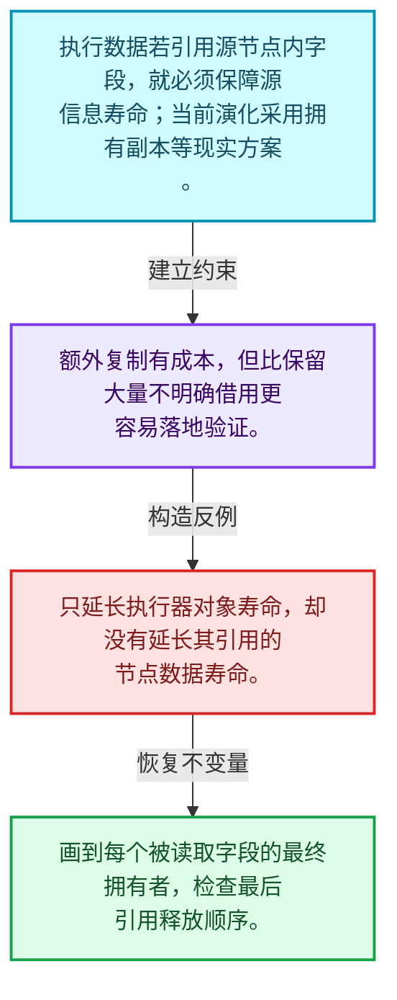
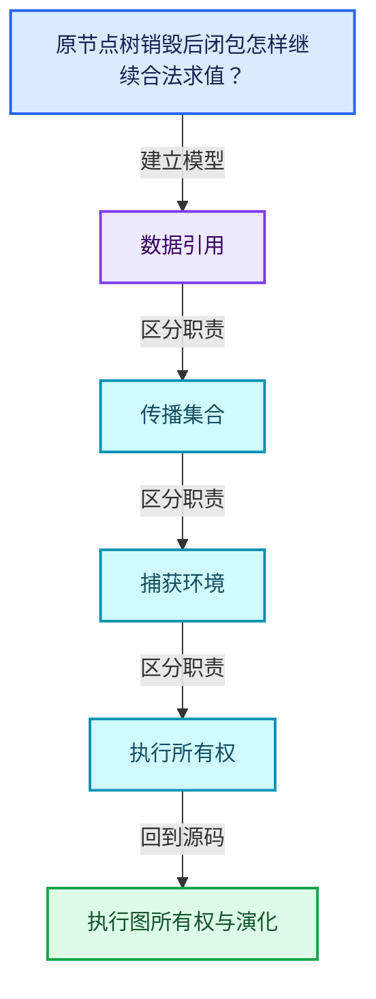
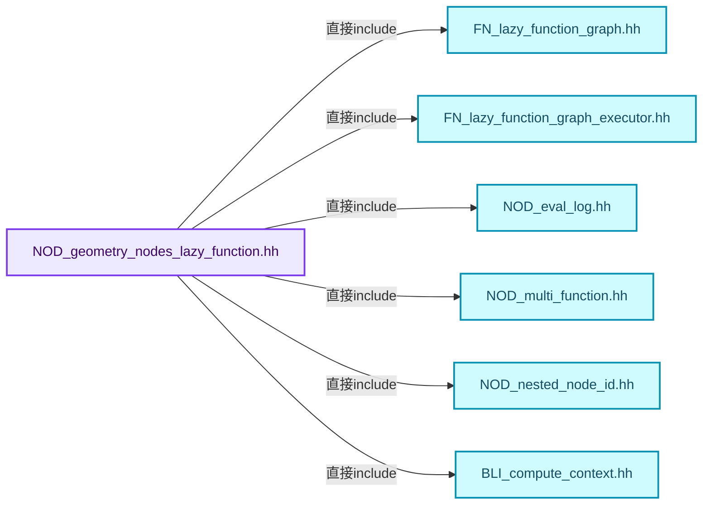
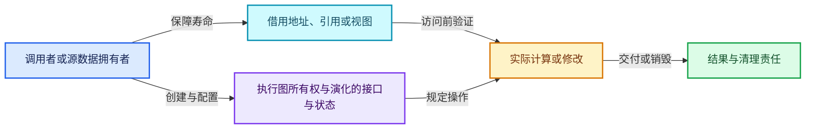
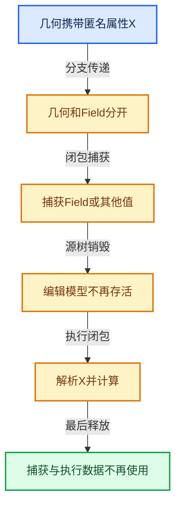

# 10-08 执行图所有权与演化

[方向导航](README.md) · [总目录](../README.md) · [覆盖索引](../%E6%BA%90%E7%A0%81%E7%89%88%E6%9C%AC%E4%B8%8E%E8%A6%86%E7%9B%96%E7%B4%A2%E5%BC%95.md)

> 阅读顺序：问题与数据模型 → 语法与类型 → 源码逐行 → 调用线索 → 历史与取舍 → 推演和练习。

- 基准 HEAD：`cbda6b96c26c0dee3c3b5cbb93960c4ac06a6b30`。
- 记录日期：2026-10-14。
- 教学示例状态：正文中的推演不是本机性能实测；已运行练习见验收报告。

## 一、从问题到设计

原节点树销毁后闭包怎样继续合法求值？

执行数据必须拥有它引用的源信息，实际方案可能用额外复制换取明确所有权。

本篇把语法、数据语义和系统取舍连接起来。表达式引用、承载数据与执行环境必须一起追踪，跨区域组合不能丢掉生命周期信息。

### 本篇独立模型与设计推理

执行数据若引用源节点内字段，就必须保障源信息寿命；当前演化采用拥有副本等现实方案。

设计取舍：额外复制有成本，但比保留大量不明确借用更容易落地验证。

最小反例：只延长执行器对象寿命，却没有延长其引用的节点数据寿命。

推导与处理：画到每个被读取字段的最终拥有者，检查最后引用释放顺序。



### 源码范围与相邻篇章

| 文件 | 本篇逐行范围 | 基准SHA-256 |
|---|---|---|
| [source/blender/nodes/NOD_geometry_nodes_lazy_function.hh](../../../../../source/blender/nodes/NOD_geometry_nodes_lazy_function.hh) | L1—L691 | `2050af971ef9ab9be4546d423ee73f3ed7ff54c8175bddc9c89330b24561b6c1` |
| [source/blender/nodes/NOD_geometry_nodes_closure_eval.hh](../../../../../source/blender/nodes/NOD_geometry_nodes_closure_eval.hh) | L1—L44 | `63da2585c955b8f0d2eb8697a5542e9eb8c9d5cb79b9bc5aea717066c4d07d0e` |

同一主讲文件可能分多篇覆盖；超出本篇范围的符号通过覆盖索引定位。空行与纯注释保留在源码摘录中，逐行表解释有效语句与语法边界；许可证头统一保留。

前篇：[Closure求值与Zone](07-Closure%E6%B1%82%E5%80%BC%E4%B8%8EZone.md).

## 二、类型、数据与阅读地图



这是概念依赖图，边表示阅读关系，不声称是运行时调用顺序。

### 直接编译依赖



箭头只表示头文件包含关系；完整调用线索见后面的符号定位表。

## 三、关键词、语法与类型角色

### 约束 requires

requires表达式或requires子句限制模板参与重载的条件。它提供编译期可用性检查，不是运行时if，不能指望输入到达程序后再被这一机制验证。

具体检查：构造满足和不满足约束的两个类型，观察候选被排除而不是在函数内返回错误。

### 常量求值 constexpr

constexpr声明允许相应实体参与常量求值，但constexpr函数仍可以在运行时执行。是否常量求值由调用场景和表达式合法性共同决定。

具体检查：比较constexpr变量初始化和从运行时输入调用同一函数。

### 只读限定 const

const约束当前访问路径可做的修改。const指针、指向const的指针、const视图对象、const元素是不同位置的限定；其他别名可能仍可修改原对象。

具体检查：分别写T* const、const T*与const T* const，并画出不可修改的层次。

### 异常边界 try与catch

try定义异常传播的局部边界。失败路径需要销毁已经成功构造的部分并释放相应存储；未构造的对象不能被析构。

具体检查：在第k次构造失败，列出已经存在的对象集合与待释放缓冲。

### 显式静态转换 static_cast

static_cast表达编译期允许的转换，不会自动验证运行时真实类型、指针寿命或索引边界。由void指针恢复T指针时，调用者仍须保证实际存储中确有合法T对象。

具体检查：标出转换前后的类型以及正确性依据来自哪里。

### 运行时多态 virtual

虚调用根据实际动态类型选择实现；经基类指针销毁对象时通常需要相应虚析构契约。每元素虚调用和循环外一次分派有不同开销。

具体检查：找出虚接口的实现类和调用频率，再讨论是否值得去虚拟化。

### 覆写检查 override

override要求函数确实覆盖基类虚函数，可捕获参数类型和const限定不匹配。它不改变基类规定的生命周期或线程约束。

具体检查：故意改变一个参数或const，观察编译器如何拒绝误写的新函数。

### 可选值 optional

optional把不存在与存在的T区分开，T的构造和析构跟随engaged状态变化。访问前应由has_value或条件分支证明存在。

具体检查：把空Field状态与合法常量零区分，不能用某个普通值代替不存在。

### 判别联合 variant

variant在若干候选类型中保存一个活动值，通过判别信息选择操作。它能把不同表示集中在值类型中，但各分支的复制移动成本不同。

具体检查：列出活动分支及每种分支实际拥有或借用的数据。

### 构造与new表达式

普通new可能分配并构造；placement new在给定地址构造，存储由其他机制提供。失败回滚应区分两类责任。

具体检查：追踪地址来自哪里、构造何时成功、由谁析构、由谁释放。

### 独占拥有 unique_ptr

unique_ptr通过移动转移拥有关系，默认删除策略必须与资源来源匹配。get返回借用指针，release交出责任而不销毁。

具体检查：区分move、get、release和reset后谁负责销毁。

### 共享拥有 shared_ptr

shared_ptr让控制块跟踪共享寿命，不自动使被指向对象的读写线程安全；循环拥有可能阻止销毁。

具体检查：画出强引用环并考虑是否应改变所有权方向或引入弱引用。

### 类型别名 using

类型别名为已有类型建立名字，不创建运行期对象。它常把模板内部使用的类型统一暴露给泛型调用者。

具体检查：展开别名直到基础类型，区分类型别名和变量声明。

### 枚举与状态模型 enum

枚举把有限状态命名；enum class避免许多隐式整数转换。状态机正确性还依赖允许的转移，不能只看有哪些枚举项。

具体检查：列出每个状态的进入条件和离开条件，检查终止状态是否仍可能被调度。

### 拥有型可调用包装 function

std::function保存可调用目标并提供统一调用接口，复制能力与目标要求有关；FunctionRef仅借用，二者不能无条件互换。

具体检查：比较同步回调与长期保存任务对拥有关系的不同要求。

## 四、真实源码与逐行讲解

源码块保持原行内容，原始行号由小节标题及逐行表给出。表中的调用定位是静态阅读辅助；重载、模板实例化、宏展开和虚调用需结合完整声明，不能仅凭词法出现证明动态调用。

### NOD_geometry_nodes_lazy_function.hh：L1—L47

<!-- source:source/blender/nodes/NOD_geometry_nodes_lazy_function.hh:1:47 -->

```cpp
/* SPDX-FileCopyrightText: 2023 Blender Authors
 *
 * SPDX-License-Identifier: GPL-2.0-or-later */

/** \file
 * \ingroup nodes
 */

#pragma once

/**
 * For evaluation, geometry node groups are converted to a lazy-function graph. The generated graph
 * is cached per node group, so it only has to be generated once after a change.
 *
 * Node groups are *not* inlined into the lazy-function graph. This could be added in the future as
 * it might improve performance in some cases, but generally does not seem necessary. Inlining node
 * groups also has disadvantages like making per-node-group caches less useful, resulting in more
 * overhead.
 *
 * Instead, group nodes are just like all other nodes in the lazy-function graph. What makes them
 * special is that they reference the lazy-function graph of the group they reference.
 *
 * During lazy-function graph generation, a mapping between the #bNodeTree and
 * #lazy_function::Graph is build that can be used when evaluating the graph (e.g. for logging).
 */

#include <variant>

#include "FN_lazy_function_graph.hh"
#include "FN_lazy_function_graph_executor.hh"

#include "NOD_eval_log.hh"
#include "NOD_multi_function.hh"
#include "NOD_nested_node_id.hh"

#include "BLI_compute_context.hh"
#include "BLI_math_quaternion_types.hh"
#include "BLI_multi_value_map.hh"

#include "BKE_bake_values.hh"
#include "BKE_node_tree_zones.hh"

namespace blender {

struct Depsgraph;
struct Object;
struct Scene;
```

| 原始行 | 语义、约束与检查 |
|---|---|
| L9 | 防止同一头文件在一个翻译单元中重复展开；不控制多个源文件之间的链接或对象寿命。 |
| L27 | 引入编译依赖 <variant>；这是声明可见性关系，不表示运行时一定调用该文件的所有接口。 |
| L29 | 引入编译依赖 "FN_lazy_function_graph.hh"；这是声明可见性关系，不表示运行时一定调用该文件的所有接口。 |
| L30 | 引入编译依赖 "FN_lazy_function_graph_executor.hh"；这是声明可见性关系，不表示运行时一定调用该文件的所有接口。 |
| L32 | 引入编译依赖 "NOD_eval_log.hh"；这是声明可见性关系，不表示运行时一定调用该文件的所有接口。 |
| L33 | 引入编译依赖 "NOD_multi_function.hh"；这是声明可见性关系，不表示运行时一定调用该文件的所有接口。 |
| L34 | 引入编译依赖 "NOD_nested_node_id.hh"；这是声明可见性关系，不表示运行时一定调用该文件的所有接口。 |
| L36 | 引入编译依赖 "BLI_compute_context.hh"；这是声明可见性关系，不表示运行时一定调用该文件的所有接口。 |
| L37 | 引入编译依赖 "BLI_math_quaternion_types.hh"；这是声明可见性关系，不表示运行时一定调用该文件的所有接口。 |
| L38 | 引入编译依赖 "BLI_multi_value_map.hh"；这是声明可见性关系，不表示运行时一定调用该文件的所有接口。 |
| L40 | 引入编译依赖 "BKE_bake_values.hh"；这是声明可见性关系，不表示运行时一定调用该文件的所有接口。 |
| L41 | 引入编译依赖 "BKE_node_tree_zones.hh"；这是声明可见性关系，不表示运行时一定调用该文件的所有接口。 |
| L43 | 把后续声明放入 blender 命名空间，影响名称查找和符号归属，不创建运行时对象。 |
| L45 | 声明或定义类型 `struct Depsgraph`。结合继承、访问权限和成员布局确认接口与拥有关系；前向声明本身没有完整对象布局。 |
| L46 | 声明或定义类型 `struct Object`。结合继承、访问权限和成员布局确认接口与拥有关系；前向声明本身没有完整对象布局。 |
| L47 | 声明或定义类型 `struct Scene`。结合继承、访问权限和成员布局确认接口与拥有关系；前向声明本身没有完整对象布局。 |

### NOD_geometry_nodes_lazy_function.hh：L48—L97

<!-- source:source/blender/nodes/NOD_geometry_nodes_lazy_function.hh:48:97 -->

```cpp

namespace nodes {

using lf::LazyFunction;
using mf::MultiFunction;
using ReferenceSetIndex = int;

/** The structs in here describe the different possible behaviors of a simulation input node. */
namespace sim_input {

/**
 * The data is just passed through the node. Data that is incompatible with simulations (like
 * anonymous attributes), is removed though.
 */
struct PassThrough {};

/**
 * The input is not evaluated, instead the values provided here are output by the node.
 */
struct UseCache {
  float delta_time;
  bke::bake::BakeValues values;
};

using Behavior = std::variant<PassThrough, UseCache>;

}  // namespace sim_input

/** The structs in here describe the different possible behaviors of a simulation output node. */
namespace sim_output {

/**
 * Output the data that comes from the corresponding simulation input node, ignoring the nodes in
 * the zone.
 */
struct PassThrough {};

/**
 * Computes the simulation step and calls the given function to cache the new simulation state.
 * The new simulation state is the output of the node.
 */
struct StoreNewState {
  std::function<void(bke::bake::BakeValues values)> store_fn;
};

/**
 * The inputs are not evaluated, instead the given cached items are output directly.
 */
struct ReadSingle {
  bke::bake::BakeValues values;
```

| 原始行 | 语义、约束与检查 |
|---|---|
| L49 | 把后续声明放入 nodes 命名空间，影响名称查找和符号归属，不创建运行时对象。 |
| L51 | 定义类型别名 `using lf::LazyFunction`，为模板接口或内部实现统一命名；本行不分配该类型对象。 |
| L52 | 定义类型别名 `using mf::MultiFunction`，为模板接口或内部实现统一命名；本行不分配该类型对象。 |
| L53 | 定义类型别名 `using ReferenceSetIndex = int`，为模板接口或内部实现统一命名；本行不分配该类型对象。 |
| L56 | 把后续声明放入 sim_input 命名空间，影响名称查找和符号归属，不创建运行时对象。 |
| L62 | 声明或定义类型 `struct PassThrough {}`。结合继承、访问权限和成员布局确认接口与拥有关系；前向声明本身没有完整对象布局。 |
| L67 | 声明或定义类型 `struct UseCache`。结合继承、访问权限和成员布局确认接口与拥有关系；前向声明本身没有完整对象布局。 |
| L68 | 声明成员、局部对象或完成语句 `float delta_time`。若为指针或引用，它本身不说明拥有；若为值对象，其构造析构由所在作用域或外层对象管理。 |
| L69 | 声明成员、局部对象或完成语句 `bke::bake::BakeValues values`。若为指针或引用，它本身不说明拥有；若为值对象，其构造析构由所在作用域或外层对象管理。 |
| L70 | 结束当前语法单元。局部自动对象在离开其作用域时按规则销毁；这不等于所有被引用的外部数据也被释放。 |
| L72 | 定义类型别名 `using Behavior = std::variant<PassThrough, UseCache>`，为模板接口或内部实现统一命名；本行不分配该类型对象。 |
| L74 | 结束当前语法单元。局部自动对象在离开其作用域时按规则销毁；这不等于所有被引用的外部数据也被释放。 |
| L77 | 把后续声明放入 sim_output 命名空间，影响名称查找和符号归属，不创建运行时对象。 |
| L83 | 声明或定义类型 `struct PassThrough {}`。结合继承、访问权限和成员布局确认接口与拥有关系；前向声明本身没有完整对象布局。 |
| L89 | 声明或定义类型 `struct StoreNewState`。结合继承、访问权限和成员布局确认接口与拥有关系；前向声明本身没有完整对象布局。 |
| L90 | 出现调用或函数声明 `void`，对应表达式为 `std::function<void(bke::bake::BakeValues values)> store_fn;`。参数求值、返回类型与重载需结合前后完整语句；静态文本引用不能证明动态目标。 |
| L91 | 结束当前语法单元。局部自动对象在离开其作用域时按规则销毁；这不等于所有被引用的外部数据也被释放。 |
| L96 | 声明或定义类型 `struct ReadSingle`。结合继承、访问权限和成员布局确认接口与拥有关系；前向声明本身没有完整对象布局。 |
| L97 | 声明成员、局部对象或完成语句 `bke::bake::BakeValues values`。若为指针或引用，它本身不说明拥有；若为值对象，其构造析构由所在作用域或外层对象管理。 |

### NOD_geometry_nodes_lazy_function.hh：L98—L145

<!-- source:source/blender/nodes/NOD_geometry_nodes_lazy_function.hh:98:145 -->

```cpp
};

/**
 * The inputs are not evaluated, instead of a mix of the two given states is output.
 */
struct ReadInterpolated {
  /** Factor between 0 and 1 that determines the influence of the two simulation states. */
  float mix_factor;
  bke::bake::BakeValues prev_values;
  bke::bake::BakeValues next_values;
};

/**
 * Used when there was some issue loading the baked data from disk.
 */
struct ReadError {
  std::string message;
};

using Behavior = std::variant<PassThrough, StoreNewState, ReadSingle, ReadInterpolated, ReadError>;

}  // namespace sim_output

/** Controls the behavior of one simulation zone. */
struct SimulationZoneBehavior {
  sim_input::Behavior input;
  sim_output::Behavior output;
  bke::bake::BakeDataBlockMap *data_block_map = nullptr;
};

class GeoNodesSimulationParams {
 public:
  /**
   * Get the expected behavior for the simulation zone with the given id (see #bNestedNodeRef).
   * It's possible that this method called multiple times for the same id. In this case, the same
   * pointer should be returned in each call.
   */
  virtual SimulationZoneBehavior *get(const int zone_id) const = 0;
};

struct BakeNodeBehavior {
  /** The set of possible behaviors are the same for both of these nodes currently. */
  sim_output::Behavior behavior;
  bke::bake::BakeDataBlockMap *data_block_map = nullptr;
};

class GeoNodesBakeParams {
 public:
```

| 原始行 | 语义、约束与检查 |
|---|---|
| L98 | 结束当前语法单元。局部自动对象在离开其作用域时按规则销毁；这不等于所有被引用的外部数据也被释放。 |
| L103 | 声明或定义类型 `struct ReadInterpolated`。结合继承、访问权限和成员布局确认接口与拥有关系；前向声明本身没有完整对象布局。 |
| L105 | 声明成员、局部对象或完成语句 `float mix_factor`。若为指针或引用，它本身不说明拥有；若为值对象，其构造析构由所在作用域或外层对象管理。 |
| L106 | 声明成员、局部对象或完成语句 `bke::bake::BakeValues prev_values`。若为指针或引用，它本身不说明拥有；若为值对象，其构造析构由所在作用域或外层对象管理。 |
| L107 | 声明成员、局部对象或完成语句 `bke::bake::BakeValues next_values`。若为指针或引用，它本身不说明拥有；若为值对象，其构造析构由所在作用域或外层对象管理。 |
| L108 | 结束当前语法单元。局部自动对象在离开其作用域时按规则销毁；这不等于所有被引用的外部数据也被释放。 |
| L113 | 声明或定义类型 `struct ReadError`。结合继承、访问权限和成员布局确认接口与拥有关系；前向声明本身没有完整对象布局。 |
| L114 | 声明成员、局部对象或完成语句 `std::string message`。若为指针或引用，它本身不说明拥有；若为值对象，其构造析构由所在作用域或外层对象管理。 |
| L115 | 结束当前语法单元。局部自动对象在离开其作用域时按规则销毁；这不等于所有被引用的外部数据也被释放。 |
| L117 | 定义类型别名 `using Behavior = std::variant<PassThrough, StoreNewState, ReadSingle, ReadInterpolated, ReadError>`，为模板接口或内部实现统一命名；本行不分配该类型对象。 |
| L119 | 结束当前语法单元。局部自动对象在离开其作用域时按规则销毁；这不等于所有被引用的外部数据也被释放。 |
| L122 | 声明或定义类型 `struct SimulationZoneBehavior`。结合继承、访问权限和成员布局确认接口与拥有关系；前向声明本身没有完整对象布局。 |
| L123 | 声明成员、局部对象或完成语句 `sim_input::Behavior input`。若为指针或引用，它本身不说明拥有；若为值对象，其构造析构由所在作用域或外层对象管理。 |
| L124 | 声明成员、局部对象或完成语句 `sim_output::Behavior output`。若为指针或引用，它本身不说明拥有；若为值对象，其构造析构由所在作用域或外层对象管理。 |
| L125 | 把右侧 `nullptr` 用于初始化或更新左侧 `bke::bake::BakeDataBlockMap *data_block_map`。声明初始化与已有对象赋值应按上下文区分；有资源的类型会调用相应特殊成员。 |
| L126 | 结束当前语法单元。局部自动对象在离开其作用域时按规则销毁；这不等于所有被引用的外部数据也被释放。 |
| L128 | 声明或定义类型 `class GeoNodesSimulationParams`。结合继承、访问权限和成员布局确认接口与拥有关系；前向声明本身没有完整对象布局。 |
| L129 | 切换成员访问权限为 public；它是编译期接口边界，不是线程同步或内存保护。 |
| L135 | 纯虚接口声明：`virtual SimulationZoneBehavior *get(const int zone_id) const = 0;`。等号零标记抽象接口，需要按继承约定提供覆写；不表示执行函数并把结果设为零。 |
| L136 | 结束当前语法单元。局部自动对象在离开其作用域时按规则销毁；这不等于所有被引用的外部数据也被释放。 |
| L138 | 声明或定义类型 `struct BakeNodeBehavior`。结合继承、访问权限和成员布局确认接口与拥有关系；前向声明本身没有完整对象布局。 |
| L140 | 声明成员、局部对象或完成语句 `sim_output::Behavior behavior`。若为指针或引用，它本身不说明拥有；若为值对象，其构造析构由所在作用域或外层对象管理。 |
| L141 | 把右侧 `nullptr` 用于初始化或更新左侧 `bke::bake::BakeDataBlockMap *data_block_map`。声明初始化与已有对象赋值应按上下文区分；有资源的类型会调用相应特殊成员。 |
| L142 | 结束当前语法单元。局部自动对象在离开其作用域时按规则销毁；这不等于所有被引用的外部数据也被释放。 |
| L144 | 声明或定义类型 `class GeoNodesBakeParams`。结合继承、访问权限和成员布局确认接口与拥有关系；前向声明本身没有完整对象布局。 |
| L145 | 切换成员访问权限为 public；它是编译期接口边界，不是线程同步或内存保护。 |

### NOD_geometry_nodes_lazy_function.hh：L146—L192

<!-- source:source/blender/nodes/NOD_geometry_nodes_lazy_function.hh:146:192 -->

```cpp
  virtual BakeNodeBehavior *get(const int id) const = 0;
};

struct GeoNodesSideEffectNodes {
  MultiValueMap<ComputeContextHash, const lf::FunctionNode *> nodes_by_context;
  /**
   * The repeat/foreach zone is identified by the compute context of the parent and the identifier
   * of the repeat output node.
   */
  MultiValueMap<std::pair<ComputeContextHash, int32_t>, int> iterations_by_iteration_zone;
};

/**
 * Data that is passed into geometry nodes evaluation from the modifier.
 */
struct GeoNodesModifierData {
  /** Object that is currently evaluated. */
  const Object *self_object = nullptr;
  /** Depsgraph that is evaluating the modifier. */
  Depsgraph *depsgraph = nullptr;
};

struct GeoNodesOperatorDepsgraphs {
  /** Current evaluated depsgraph from the viewport. Shouldn't be null. */
  const Depsgraph *active = nullptr;
  /**
   * Depsgraph containing IDs referenced by the node tree and the node tree itself and from node
   * group inputs (the redo panel).
   */
  Depsgraph *extra = nullptr;

  ~GeoNodesOperatorDepsgraphs();

  /**
   * The evaluated data-block might be in the scene's active depsgraph, in that case we should use
   * it directly. Otherwise retrieve it from the extra depsgraph that was built for all other
   * data-blocks. Return null if it isn't found, generally geometry nodes can handle null ID
   * pointers.
   */
  const ID *get_evaluated_id(const ID &id_orig) const;
};

struct GeoNodesOperatorData {
  eObjectMode mode;
  /** The object currently effected by the operator. */
  const Object *self_object_orig = nullptr;
  const GeoNodesOperatorDepsgraphs *depsgraphs = nullptr;
```

| 原始行 | 语义、约束与检查 |
|---|---|
| L146 | 纯虚接口声明：`virtual BakeNodeBehavior *get(const int id) const = 0;`。等号零标记抽象接口，需要按继承约定提供覆写；不表示执行函数并把结果设为零。 |
| L147 | 结束当前语法单元。局部自动对象在离开其作用域时按规则销毁；这不等于所有被引用的外部数据也被释放。 |
| L149 | 声明或定义类型 `struct GeoNodesSideEffectNodes`。结合继承、访问权限和成员布局确认接口与拥有关系；前向声明本身没有完整对象布局。 |
| L150 | 声明成员、局部对象或完成语句 `MultiValueMap<ComputeContextHash, const lf::FunctionNode *> nodes_by_context`。若为指针或引用，它本身不说明拥有；若为值对象，其构造析构由所在作用域或外层对象管理。 |
| L155 | 声明成员、局部对象或完成语句 `MultiValueMap<std::pair<ComputeContextHash, int32_t>, int> iterations_by_iteration_zone`。若为指针或引用，它本身不说明拥有；若为值对象，其构造析构由所在作用域或外层对象管理。 |
| L156 | 结束当前语法单元。局部自动对象在离开其作用域时按规则销毁；这不等于所有被引用的外部数据也被释放。 |
| L161 | 声明或定义类型 `struct GeoNodesModifierData`。结合继承、访问权限和成员布局确认接口与拥有关系；前向声明本身没有完整对象布局。 |
| L163 | 把右侧 `nullptr` 用于初始化或更新左侧 `const Object *self_object`。声明初始化与已有对象赋值应按上下文区分；有资源的类型会调用相应特殊成员。 |
| L165 | 把右侧 `nullptr` 用于初始化或更新左侧 `Depsgraph *depsgraph`。声明初始化与已有对象赋值应按上下文区分；有资源的类型会调用相应特殊成员。 |
| L166 | 结束当前语法单元。局部自动对象在离开其作用域时按规则销毁；这不等于所有被引用的外部数据也被释放。 |
| L168 | 声明或定义类型 `struct GeoNodesOperatorDepsgraphs`。结合继承、访问权限和成员布局确认接口与拥有关系；前向声明本身没有完整对象布局。 |
| L170 | 把右侧 `nullptr` 用于初始化或更新左侧 `const Depsgraph *active`。声明初始化与已有对象赋值应按上下文区分；有资源的类型会调用相应特殊成员。 |
| L175 | 把右侧 `nullptr` 用于初始化或更新左侧 `Depsgraph *extra`。声明初始化与已有对象赋值应按上下文区分；有资源的类型会调用相应特殊成员。 |
| L177 | 涉及析构接口或显式析构：`~GeoNodesOperatorDepsgraphs();`。检查目标对象已成功构造，且资源不会在另一条清理路径再次销毁。 |
| L185 | 声明接口 `const ID *get_evaluated_id(const ID &id_orig) const`，本行没有对应函数体；返回类型、参数限定和const/noexcept共同组成调用契约，实际行为需继续定位实现。 |
| L186 | 结束当前语法单元。局部自动对象在离开其作用域时按规则销毁；这不等于所有被引用的外部数据也被释放。 |
| L188 | 声明或定义类型 `struct GeoNodesOperatorData`。结合继承、访问权限和成员布局确认接口与拥有关系；前向声明本身没有完整对象布局。 |
| L189 | 声明成员、局部对象或完成语句 `eObjectMode mode`。若为指针或引用，它本身不说明拥有；若为值对象，其构造析构由所在作用域或外层对象管理。 |
| L191 | 把右侧 `nullptr` 用于初始化或更新左侧 `const Object *self_object_orig`。声明初始化与已有对象赋值应按上下文区分；有资源的类型会调用相应特殊成员。 |
| L192 | 把右侧 `nullptr` 用于初始化或更新左侧 `const GeoNodesOperatorDepsgraphs *depsgraphs`。声明初始化与已有对象赋值应按上下文区分；有资源的类型会调用相应特殊成员。 |

### NOD_geometry_nodes_lazy_function.hh：L193—L236

<!-- source:source/blender/nodes/NOD_geometry_nodes_lazy_function.hh:193:236 -->

```cpp
  /**
   * Map from names of data-block node group input RNA properties to original data-blocks.
   */
  const Map<std::string, ID *> *input_ids = {};
  Scene *scene_orig = nullptr;
  int2 mouse_position;
  int2 region_size;

  float3 cursor_position;
  math::Quaternion cursor_rotation;

  float4x4 viewport_winmat;
  float4x4 viewport_viewmat;
  bool viewport_is_perspective;

  int active_point_index = -1;
  int active_edge_index = -1;
  int active_face_index = -1;
  int active_layer_index = -1;
};

struct GeoNodesCallData {
  /**
   * Top-level node tree of the current evaluation.
   */
  const bNodeTree *root_ntree = nullptr;
  /**
   * Optional logger that keeps track of data generated during evaluation to allow for better
   * debugging afterwards.
   */
  eval_log::NodesEvalLog *eval_log = nullptr;
  /**
   * Optional injected behavior for simulations.
   */
  GeoNodesSimulationParams *simulation_params = nullptr;
  /**
   * Optional injected behavior for bake nodes.
   */
  GeoNodesBakeParams *bake_params = nullptr;
  /**
   * Some nodes should be executed even when their output is not used (e.g. active viewer nodes and
   * the node groups they are contained in).
   */
  const GeoNodesSideEffectNodes *side_effect_nodes = nullptr;
```

| 原始行 | 语义、约束与检查 |
|---|---|
| L196 | 把右侧 `{}` 用于初始化或更新左侧 `const Map<std::string, ID *> *input_ids`。声明初始化与已有对象赋值应按上下文区分；有资源的类型会调用相应特殊成员。 |
| L197 | 把右侧 `nullptr` 用于初始化或更新左侧 `Scene *scene_orig`。声明初始化与已有对象赋值应按上下文区分；有资源的类型会调用相应特殊成员。 |
| L198 | 声明成员、局部对象或完成语句 `int2 mouse_position`。若为指针或引用，它本身不说明拥有；若为值对象，其构造析构由所在作用域或外层对象管理。 |
| L199 | 声明成员、局部对象或完成语句 `int2 region_size`。若为指针或引用，它本身不说明拥有；若为值对象，其构造析构由所在作用域或外层对象管理。 |
| L201 | 声明成员、局部对象或完成语句 `float3 cursor_position`。若为指针或引用，它本身不说明拥有；若为值对象，其构造析构由所在作用域或外层对象管理。 |
| L202 | 声明成员、局部对象或完成语句 `math::Quaternion cursor_rotation`。若为指针或引用，它本身不说明拥有；若为值对象，其构造析构由所在作用域或外层对象管理。 |
| L204 | 声明成员、局部对象或完成语句 `float4x4 viewport_winmat`。若为指针或引用，它本身不说明拥有；若为值对象，其构造析构由所在作用域或外层对象管理。 |
| L205 | 声明成员、局部对象或完成语句 `float4x4 viewport_viewmat`。若为指针或引用，它本身不说明拥有；若为值对象，其构造析构由所在作用域或外层对象管理。 |
| L206 | 声明成员、局部对象或完成语句 `bool viewport_is_perspective`。若为指针或引用，它本身不说明拥有；若为值对象，其构造析构由所在作用域或外层对象管理。 |
| L208 | 把右侧 `-1` 用于初始化或更新左侧 `int active_point_index`。声明初始化与已有对象赋值应按上下文区分；有资源的类型会调用相应特殊成员。 |
| L209 | 把右侧 `-1` 用于初始化或更新左侧 `int active_edge_index`。声明初始化与已有对象赋值应按上下文区分；有资源的类型会调用相应特殊成员。 |
| L210 | 把右侧 `-1` 用于初始化或更新左侧 `int active_face_index`。声明初始化与已有对象赋值应按上下文区分；有资源的类型会调用相应特殊成员。 |
| L211 | 把右侧 `-1` 用于初始化或更新左侧 `int active_layer_index`。声明初始化与已有对象赋值应按上下文区分；有资源的类型会调用相应特殊成员。 |
| L212 | 结束当前语法单元。局部自动对象在离开其作用域时按规则销毁；这不等于所有被引用的外部数据也被释放。 |
| L214 | 声明或定义类型 `struct GeoNodesCallData`。结合继承、访问权限和成员布局确认接口与拥有关系；前向声明本身没有完整对象布局。 |
| L218 | 把右侧 `nullptr` 用于初始化或更新左侧 `const bNodeTree *root_ntree`。声明初始化与已有对象赋值应按上下文区分；有资源的类型会调用相应特殊成员。 |
| L223 | 把右侧 `nullptr` 用于初始化或更新左侧 `eval_log::NodesEvalLog *eval_log`。声明初始化与已有对象赋值应按上下文区分；有资源的类型会调用相应特殊成员。 |
| L227 | 把右侧 `nullptr` 用于初始化或更新左侧 `GeoNodesSimulationParams *simulation_params`。声明初始化与已有对象赋值应按上下文区分；有资源的类型会调用相应特殊成员。 |
| L231 | 把右侧 `nullptr` 用于初始化或更新左侧 `GeoNodesBakeParams *bake_params`。声明初始化与已有对象赋值应按上下文区分；有资源的类型会调用相应特殊成员。 |
| L236 | 把右侧 `nullptr` 用于初始化或更新左侧 `const GeoNodesSideEffectNodes *side_effect_nodes`。声明初始化与已有对象赋值应按上下文区分；有资源的类型会调用相应特殊成员。 |

### NOD_geometry_nodes_lazy_function.hh：L237—L280

<!-- source:source/blender/nodes/NOD_geometry_nodes_lazy_function.hh:237:280 -->

```cpp
  /**
   * Controls in which compute contexts we want to log information like socket values. Logging them
   * in all contexts has significant overhead. In the majority of cases, the logged values are
   * freed without being looked at anyway.
   *
   * If this is null, it is assumed that all compute contexts should be logged.
   */
  const Set<ComputeContextHash> *verbose_log_contexts = nullptr;

  /**
   * Data from the modifier that is being evaluated.
   */
  GeoNodesModifierData *modifier_data = nullptr;
  /**
   * Data from execution as operator in 3D viewport.
   */
  GeoNodesOperatorData *operator_data = nullptr;

  /**
   * Stack limit at which Geometry Nodes should stop the evaluation. This is a preventative measure
   * to avoid crashes caused by running out of stack space.
   */
  int call_depth_limit = 100;

  /**
   * Self object has slightly different semantics depending on how geometry nodes is called.
   * Therefore, it is not stored directly in the global data.
   */
  const Object *self_object() const;
};

/**
 * Custom user data that can be passed to every geometry nodes related evaluation.
 */
struct GeoNodesUserData : public fn::UserData {
  /**
   * Data provided by the root caller of geometry nodes.
   */
  const GeoNodesCallData *call_data = nullptr;
  /**
   * Current compute context. This is different depending in the (nested) node group that is being
   * evaluated.
   */
  const ComputeContext *compute_context = nullptr;
```

| 原始行 | 语义、约束与检查 |
|---|---|
| L244 | 把右侧 `nullptr` 用于初始化或更新左侧 `const Set<ComputeContextHash> *verbose_log_contexts`。声明初始化与已有对象赋值应按上下文区分；有资源的类型会调用相应特殊成员。 |
| L249 | 把右侧 `nullptr` 用于初始化或更新左侧 `GeoNodesModifierData *modifier_data`。声明初始化与已有对象赋值应按上下文区分；有资源的类型会调用相应特殊成员。 |
| L253 | 把右侧 `nullptr` 用于初始化或更新左侧 `GeoNodesOperatorData *operator_data`。声明初始化与已有对象赋值应按上下文区分；有资源的类型会调用相应特殊成员。 |
| L259 | 把右侧 `100` 用于初始化或更新左侧 `int call_depth_limit`。声明初始化与已有对象赋值应按上下文区分；有资源的类型会调用相应特殊成员。 |
| L265 | 声明接口 `const Object *self_object() const`，本行没有对应函数体；返回类型、参数限定和const/noexcept共同组成调用契约，实际行为需继续定位实现。 |
| L266 | 结束当前语法单元。局部自动对象在离开其作用域时按规则销毁；这不等于所有被引用的外部数据也被释放。 |
| L271 | 声明或定义类型 `struct GeoNodesUserData : public fn::UserData`。结合继承、访问权限和成员布局确认接口与拥有关系；前向声明本身没有完整对象布局。 |
| L275 | 把右侧 `nullptr` 用于初始化或更新左侧 `const GeoNodesCallData *call_data`。声明初始化与已有对象赋值应按上下文区分；有资源的类型会调用相应特殊成员。 |
| L280 | 把右侧 `nullptr` 用于初始化或更新左侧 `const ComputeContext *compute_context`。声明初始化与已有对象赋值应按上下文区分；有资源的类型会调用相应特殊成员。 |

### NOD_geometry_nodes_lazy_function.hh：L281—L323

<!-- source:source/blender/nodes/NOD_geometry_nodes_lazy_function.hh:281:323 -->

```cpp
  /**
   * Log "more" data in the current compute context. If true, the user is likely looking at nodes
   * in this context and expects detailed inspection information. If false, only necessary data
   * like warnings should be logged but not e.g. socket values.
   *
   * Child contexts might use logging again even if the current compute context does not.
   */
  bool verbose_log = true;

  destruct_ptr<fn::LocalUserData> get_local(LinearAllocator<> &allocator) override;

  bool is_stack_limit_reached() const
  {
    return this->compute_context->parents_num() >= this->call_data->call_depth_limit;
  }
};

struct GeoNodesLocalUserData : public fn::LocalUserData {
 private:
  /**
   * Thread-local logger for the current node tree in the current compute context. It is only
   * instantiated when it is actually used and then cached for the current thread.
   */
  mutable std::optional<eval_log::NodeTreeLogger *> tree_logger_;

 public:
  GeoNodesLocalUserData(GeoNodesUserData & /*user_data*/) {}

  /**
   * Get the current tree logger. This method is not thread-safe, each thread is supposed to have
   * a separate logger.
   */
  eval_log::NodeTreeLogger *try_get_tree_logger(const GeoNodesUserData &user_data) const
  {
    if (!tree_logger_.has_value()) {
      this->ensure_tree_logger(user_data);
    }
    return *tree_logger_;
  }

 private:
  void ensure_tree_logger(const GeoNodesUserData &user_data) const;
};
```

本段语义重点：

- 分支证据 `!tree_logger_.has_value())`：分别推演条件成立与不成立，核对相同出口处的状态。

| 原始行 | 语义、约束与检查 |
|---|---|
| L288 | 把右侧 `true` 用于初始化或更新左侧 `bool verbose_log`。声明初始化与已有对象赋值应按上下文区分；有资源的类型会调用相应特殊成员。 |
| L290 | 出现调用或函数声明 `get_local`，对应表达式为 `destruct_ptr<fn::LocalUserData> get_local(LinearAllocator<> &allocator) override;`。参数求值、返回类型与重载需结合前后完整语句；静态文本引用不能证明动态目标。 |
| L292 | 出现调用或函数声明 `is_stack_limit_reached`，对应表达式为 `bool is_stack_limit_reached() const`。参数求值、返回类型与重载需结合前后完整语句；静态文本引用不能证明动态目标。 |
| L293 | 连接上一行的声明或控制结构与其语句块；后续行在这个作用域中执行或声明。 |
| L294 | 返回表达式 `this->compute_context->parents_num() >= this->call_data->call_depth_limit`。 |
| L295 | 结束当前语法单元。局部自动对象在离开其作用域时按规则销毁；这不等于所有被引用的外部数据也被释放。 |
| L296 | 结束当前语法单元。局部自动对象在离开其作用域时按规则销毁；这不等于所有被引用的外部数据也被释放。 |
| L298 | 声明或定义类型 `struct GeoNodesLocalUserData : public fn::LocalUserData`。结合继承、访问权限和成员布局确认接口与拥有关系；前向声明本身没有完整对象布局。 |
| L299 | 切换成员访问权限为 private；它是编译期接口边界，不是线程同步或内存保护。 |
| L304 | 声明成员、局部对象或完成语句 `mutable std::optional<eval_log::NodeTreeLogger *> tree_logger_`。若为指针或引用，它本身不说明拥有；若为值对象，其构造析构由所在作用域或外层对象管理。 |
| L306 | 切换成员访问权限为 public；它是编译期接口边界，不是线程同步或内存保护。 |
| L307 | 出现调用或函数声明 `GeoNodesLocalUserData`，对应表达式为 `GeoNodesLocalUserData(GeoNodesUserData & ) {}`。参数求值、返回类型与重载需结合前后完整语句；静态文本引用不能证明动态目标。 |
| L313 | 出现调用或函数声明 `try_get_tree_logger`，对应表达式为 `eval_log::NodeTreeLogger *try_get_tree_logger(const GeoNodesUserData &user_data) const`。参数求值、返回类型与重载需结合前后完整语句；静态文本引用不能证明动态目标。 |
| L314 | 连接上一行的声明或控制结构与其语句块；后续行在这个作用域中执行或声明。 |
| L315 | 判断 `!tree_logger_.has_value()`，成立时进入本分支，否则继续后续路径。 |
| L316 | 出现调用或函数声明 `ensure_tree_logger`，对应表达式为 `this->ensure_tree_logger(user_data);`。参数求值、返回类型与重载需结合前后完整语句；静态文本引用不能证明动态目标。 |
| L317 | 结束当前语法单元。局部自动对象在离开其作用域时按规则销毁；这不等于所有被引用的外部数据也被释放。 |
| L318 | 返回表达式 `*tree_logger_`。 |
| L319 | 结束当前语法单元。局部自动对象在离开其作用域时按规则销毁；这不等于所有被引用的外部数据也被释放。 |
| L321 | 切换成员访问权限为 private；它是编译期接口边界，不是线程同步或内存保护。 |
| L322 | 声明接口 `void ensure_tree_logger(const GeoNodesUserData &user_data) const`，本行没有对应函数体；返回类型、参数限定和const/noexcept共同组成调用契约，实际行为需继续定位实现。 |
| L323 | 结束当前语法单元。局部自动对象在离开其作用域时按规则销毁；这不等于所有被引用的外部数据也被释放。 |

### NOD_geometry_nodes_lazy_function.hh：L324—L371

<!-- source:source/blender/nodes/NOD_geometry_nodes_lazy_function.hh:324:371 -->

```cpp

/**
 * In the general case, this is #DynamicSocket. That means that to determine if a node group will
 * use a particular input, it has to be partially executed.
 *
 * In other cases, it's not necessary to look into the node group to determine if an input is
 * necessary.
 */
enum class InputUsageHintType {
  /** The input socket is never used. */
  Never,
  /** The input socket is used when a subset of the outputs is used. */
  DependsOnOutput,
  /** Can't determine statically if the input is used, check the corresponding output socket. */
  DynamicSocket,
};

struct InputUsageHint {
  InputUsageHintType type = InputUsageHintType::DependsOnOutput;
  /** Used in depends-on-output mode. */
  Vector<int> output_dependencies;
};

/**
 * Contains the mapping between the #bNodeTree and the corresponding lazy-function graph.
 * This is *not* a one-to-one mapping.
 */
struct GeometryNodeLazyFunctionGraphMapping {
  /**
   * This is an optimization to avoid partially evaluating a node group just to figure out which
   * inputs are needed.
   */
  Vector<InputUsageHint> group_input_usage_hints;
  /**
   * A mapping used for logging intermediate values.
   */
  MultiValueMap<const lf::Socket *, const bNodeSocket *> bsockets_by_lf_socket_map;
  /**
   * Mappings for some special node types. Generally, this mapping does not exist for all node
   * types, so better have more specialized mappings for now. The key is the identifier if a node.
   */
  Map<int, const lf::FunctionNode *> group_node_map;
  Map<int, const lf::FunctionNode *> possible_side_effect_node_map;
  /** Key is the identifier of the zone output node. */
  Map<int, const lf::FunctionNode *> zone_node_map;

  /* Indexed by #bNodeSocket::index_in_all_outputs. */
  Array<int> lf_input_index_for_output_bsocket_usage;
```

| 原始行 | 语义、约束与检查 |
|---|---|
| L332 | 声明或定义类型 `enum class InputUsageHintType`。结合继承、访问权限和成员布局确认接口与拥有关系；前向声明本身没有完整对象布局。 |
| L334 | 本行是连续声明或表达式的一部分：`Never,`。与本段前后行合读；逗号、括号和限定符决定它属于参数、初始化列表还是实际计算。 |
| L336 | 本行是连续声明或表达式的一部分：`DependsOnOutput,`。与本段前后行合读；逗号、括号和限定符决定它属于参数、初始化列表还是实际计算。 |
| L338 | 本行是连续声明或表达式的一部分：`DynamicSocket,`。与本段前后行合读；逗号、括号和限定符决定它属于参数、初始化列表还是实际计算。 |
| L339 | 结束当前语法单元。局部自动对象在离开其作用域时按规则销毁；这不等于所有被引用的外部数据也被释放。 |
| L341 | 声明或定义类型 `struct InputUsageHint`。结合继承、访问权限和成员布局确认接口与拥有关系；前向声明本身没有完整对象布局。 |
| L342 | 把右侧 `InputUsageHintType::DependsOnOutput` 用于初始化或更新左侧 `InputUsageHintType type`。声明初始化与已有对象赋值应按上下文区分；有资源的类型会调用相应特殊成员。 |
| L344 | 声明成员、局部对象或完成语句 `Vector<int> output_dependencies`。若为指针或引用，它本身不说明拥有；若为值对象，其构造析构由所在作用域或外层对象管理。 |
| L345 | 结束当前语法单元。局部自动对象在离开其作用域时按规则销毁；这不等于所有被引用的外部数据也被释放。 |
| L351 | 声明或定义类型 `struct GeometryNodeLazyFunctionGraphMapping`。结合继承、访问权限和成员布局确认接口与拥有关系；前向声明本身没有完整对象布局。 |
| L356 | 声明成员、局部对象或完成语句 `Vector<InputUsageHint> group_input_usage_hints`。若为指针或引用，它本身不说明拥有；若为值对象，其构造析构由所在作用域或外层对象管理。 |
| L360 | 声明成员、局部对象或完成语句 `MultiValueMap<const lf::Socket *, const bNodeSocket *> bsockets_by_lf_socket_map`。若为指针或引用，它本身不说明拥有；若为值对象，其构造析构由所在作用域或外层对象管理。 |
| L365 | 声明成员、局部对象或完成语句 `Map<int, const lf::FunctionNode *> group_node_map`。若为指针或引用，它本身不说明拥有；若为值对象，其构造析构由所在作用域或外层对象管理。 |
| L366 | 声明成员、局部对象或完成语句 `Map<int, const lf::FunctionNode *> possible_side_effect_node_map`。若为指针或引用，它本身不说明拥有；若为值对象，其构造析构由所在作用域或外层对象管理。 |
| L368 | 声明成员、局部对象或完成语句 `Map<int, const lf::FunctionNode *> zone_node_map`。若为指针或引用，它本身不说明拥有；若为值对象，其构造析构由所在作用域或外层对象管理。 |
| L371 | 声明成员、局部对象或完成语句 `Array<int> lf_input_index_for_output_bsocket_usage`。若为指针或引用，它本身不说明拥有；若为值对象，其构造析构由所在作用域或外层对象管理。 |

### NOD_geometry_nodes_lazy_function.hh：L372—L420

<!-- source:source/blender/nodes/NOD_geometry_nodes_lazy_function.hh:372:420 -->

```cpp
  /* Indexed by #bNodeSocket::index_in_all_outputs. */
  Array<int> lf_input_index_for_reference_set_for_output;
  /* Indexed by #bNodeSocket::index_in_tree. */
  Array<int> lf_index_by_bsocket;
};

/**
 * Contains the information that is necessary to execute a geometry node tree.
 */
struct GeometryNodesGroupFunction {
  /**
   * The lazy-function that does what the node group does. Its inputs and outputs are described
   * below.
   */
  const LazyFunction *function = nullptr;

  struct {
    /**
     * Main input values that come out of the Group Input node.
     */
    IndexRange main;
    /**
     * A boolean for every group output that indicates whether that output is needed. It's ok if
     * those are set to true even when an output is not used, but the other way around will lead to
     * bugs. The node group uses those values to compute the lifetimes of anonymous attributes.
     */
    IndexRange output_usages;
    /**
     * Some node groups can propagate attributes from a geometry input to a geometry output. In
     * those cases, the caller of the node group has to decide which anonymous attributes have to
     * be kept alive on the geometry because the caller requires them.
     */
    struct {
      IndexRange range;
      Vector<int> geometry_outputs;
    } references_to_propagate;
  } inputs;

  struct {
    /**
     * Main output values that are passed into the Group Output node.
     */
    IndexRange main;
    /**
     * A boolean for every group input that indicates whether this input will be used. Oftentimes
     * this can be determined without actually computing much. This is used to compute anonymous
     * attribute lifetimes.
     */
    IndexRange input_usages;
```

| 原始行 | 语义、约束与检查 |
|---|---|
| L373 | 声明成员、局部对象或完成语句 `Array<int> lf_input_index_for_reference_set_for_output`。若为指针或引用，它本身不说明拥有；若为值对象，其构造析构由所在作用域或外层对象管理。 |
| L375 | 声明成员、局部对象或完成语句 `Array<int> lf_index_by_bsocket`。若为指针或引用，它本身不说明拥有；若为值对象，其构造析构由所在作用域或外层对象管理。 |
| L376 | 结束当前语法单元。局部自动对象在离开其作用域时按规则销毁；这不等于所有被引用的外部数据也被释放。 |
| L381 | 声明或定义类型 `struct GeometryNodesGroupFunction`。结合继承、访问权限和成员布局确认接口与拥有关系；前向声明本身没有完整对象布局。 |
| L386 | 把右侧 `nullptr` 用于初始化或更新左侧 `const LazyFunction *function`。声明初始化与已有对象赋值应按上下文区分；有资源的类型会调用相应特殊成员。 |
| L388 | 声明或定义类型 `struct`。结合继承、访问权限和成员布局确认接口与拥有关系；前向声明本身没有完整对象布局。 |
| L392 | 声明成员、局部对象或完成语句 `IndexRange main`。若为指针或引用，它本身不说明拥有；若为值对象，其构造析构由所在作用域或外层对象管理。 |
| L398 | 声明成员、局部对象或完成语句 `IndexRange output_usages`。若为指针或引用，它本身不说明拥有；若为值对象，其构造析构由所在作用域或外层对象管理。 |
| L404 | 声明或定义类型 `struct`。结合继承、访问权限和成员布局确认接口与拥有关系；前向声明本身没有完整对象布局。 |
| L405 | 声明成员、局部对象或完成语句 `IndexRange range`。若为指针或引用，它本身不说明拥有；若为值对象，其构造析构由所在作用域或外层对象管理。 |
| L406 | 声明成员、局部对象或完成语句 `Vector<int> geometry_outputs`。若为指针或引用，它本身不说明拥有；若为值对象，其构造析构由所在作用域或外层对象管理。 |
| L407 | 声明成员、局部对象或完成语句 `} references_to_propagate`。若为指针或引用，它本身不说明拥有；若为值对象，其构造析构由所在作用域或外层对象管理。 |
| L408 | 声明成员、局部对象或完成语句 `} inputs`。若为指针或引用，它本身不说明拥有；若为值对象，其构造析构由所在作用域或外层对象管理。 |
| L410 | 声明或定义类型 `struct`。结合继承、访问权限和成员布局确认接口与拥有关系；前向声明本身没有完整对象布局。 |
| L414 | 声明成员、局部对象或完成语句 `IndexRange main`。若为指针或引用，它本身不说明拥有；若为值对象，其构造析构由所在作用域或外层对象管理。 |
| L420 | 声明成员、局部对象或完成语句 `IndexRange input_usages`。若为指针或引用，它本身不说明拥有；若为值对象，其构造析构由所在作用域或外层对象管理。 |

### NOD_geometry_nodes_lazy_function.hh：L421—L467

<!-- source:source/blender/nodes/NOD_geometry_nodes_lazy_function.hh:421:467 -->

```cpp
  } outputs;
};

/**
 * Data that is cached for every #bNodeTree.
 */
struct GeometryNodesLazyFunctionGraphInfo {
  /**
   * Contains resources that need to be freed when the graph is not needed anymore.
   */
  ResourceScope scope;
  /**
   * Owned copy of the tree to evaluate. This allows the original tree to be freed without making
   * the execution graph invalid. This is very common because many changes to a node tree trigger a
   * new depsgraph-copy but not a new evaluation (since the output has not changed).
   *
   * Without an extra copy, one could not output fields/closures to other objects without having
   * those become dangling on trivial tree changes.
   */
  std::shared_ptr<const bNodeTree> tree;
  /**
   * Session UID of the original tree in Main that this is based on. Used to map evaluated data
   * back to the original tree later on.
   */
  uint32_t original_tree_session_uid;

  GeometryNodesGroupFunction function;
  /**
   * The actual lazy-function graph.
   */
  lf::Graph graph;
  Map<int, const lf::Graph *> debug_zone_body_graphs;
  /**
   * Mappings between the lazy-function graph and the #bNodeTree.
   */
  GeometryNodeLazyFunctionGraphMapping mapping;
  /**
   * Approximate number of nodes in the graph if all sub-graphs were inlined.
   * This can be used as a simple heuristic for the complexity of the node group.
   */
  int num_inline_nodes_approximate = 0;

  GeometryNodesLazyFunctionGraphInfo(const char *debug_name);
};

std::unique_ptr<LazyFunction> get_simulation_output_lazy_function(
    const bNode &node, GeometryNodesLazyFunctionGraphInfo &own_lf_graph_info);
```

| 原始行 | 语义、约束与检查 |
|---|---|
| L421 | 声明成员、局部对象或完成语句 `} outputs`。若为指针或引用，它本身不说明拥有；若为值对象，其构造析构由所在作用域或外层对象管理。 |
| L422 | 结束当前语法单元。局部自动对象在离开其作用域时按规则销毁；这不等于所有被引用的外部数据也被释放。 |
| L427 | 声明或定义类型 `struct GeometryNodesLazyFunctionGraphInfo`。结合继承、访问权限和成员布局确认接口与拥有关系；前向声明本身没有完整对象布局。 |
| L431 | 声明成员、局部对象或完成语句 `ResourceScope scope`。若为指针或引用，它本身不说明拥有；若为值对象，其构造析构由所在作用域或外层对象管理。 |
| L440 | 声明成员、局部对象或完成语句 `std::shared_ptr<const bNodeTree> tree`。若为指针或引用，它本身不说明拥有；若为值对象，其构造析构由所在作用域或外层对象管理。 |
| L445 | 声明成员、局部对象或完成语句 `uint32_t original_tree_session_uid`。若为指针或引用，它本身不说明拥有；若为值对象，其构造析构由所在作用域或外层对象管理。 |
| L447 | 声明成员、局部对象或完成语句 `GeometryNodesGroupFunction function`。若为指针或引用，它本身不说明拥有；若为值对象，其构造析构由所在作用域或外层对象管理。 |
| L451 | 声明成员、局部对象或完成语句 `lf::Graph graph`。若为指针或引用，它本身不说明拥有；若为值对象，其构造析构由所在作用域或外层对象管理。 |
| L452 | 声明成员、局部对象或完成语句 `Map<int, const lf::Graph *> debug_zone_body_graphs`。若为指针或引用，它本身不说明拥有；若为值对象，其构造析构由所在作用域或外层对象管理。 |
| L456 | 声明成员、局部对象或完成语句 `GeometryNodeLazyFunctionGraphMapping mapping`。若为指针或引用，它本身不说明拥有；若为值对象，其构造析构由所在作用域或外层对象管理。 |
| L461 | 把右侧 `0` 用于初始化或更新左侧 `int num_inline_nodes_approximate`。声明初始化与已有对象赋值应按上下文区分；有资源的类型会调用相应特殊成员。 |
| L463 | 出现调用或函数声明 `GeometryNodesLazyFunctionGraphInfo`，对应表达式为 `GeometryNodesLazyFunctionGraphInfo(const char *debug_name);`。参数求值、返回类型与重载需结合前后完整语句；静态文本引用不能证明动态目标。 |
| L464 | 结束当前语法单元。局部自动对象在离开其作用域时按规则销毁；这不等于所有被引用的外部数据也被释放。 |
| L466 | 出现调用或函数声明 `get_simulation_output_lazy_function`，对应表达式为 `std::unique_ptr<LazyFunction> get_simulation_output_lazy_function(`。参数求值、返回类型与重载需结合前后完整语句；静态文本引用不能证明动态目标。 |
| L467 | 声明成员、局部对象或完成语句 `const bNode &node, GeometryNodesLazyFunctionGraphInfo &own_lf_graph_info)`。若为指针或引用，它本身不说明拥有；若为值对象，其构造析构由所在作用域或外层对象管理。 |

### NOD_geometry_nodes_lazy_function.hh：L468—L516

<!-- source:source/blender/nodes/NOD_geometry_nodes_lazy_function.hh:468:516 -->

```cpp
std::unique_ptr<LazyFunction> get_simulation_input_lazy_function(
    const bNodeTree &node_tree,
    const bNode &node,
    GeometryNodesLazyFunctionGraphInfo &own_lf_graph_info);
std::unique_ptr<LazyFunction> get_switch_node_lazy_function(const bNode &node);
std::unique_ptr<LazyFunction> get_index_switch_node_lazy_function(
    const bNode &node, GeometryNodesLazyFunctionGraphInfo &lf_graph_info);
std::unique_ptr<LazyFunction> get_bake_lazy_function(
    const bNode &node, GeometryNodesLazyFunctionGraphInfo &own_lf_graph_info);
std::unique_ptr<LazyFunction> get_menu_switch_node_lazy_function(
    const bNode &node, GeometryNodesLazyFunctionGraphInfo &lf_graph_info);
std::unique_ptr<LazyFunction> get_menu_switch_node_boolean_outputs_lazy_function(
    const bNode &node, GeometryNodesLazyFunctionGraphInfo &lf_graph_info);
std::unique_ptr<LazyFunction> get_menu_switch_node_socket_usage_lazy_function(const bNode &node);
std::unique_ptr<LazyFunction> get_warning_node_lazy_function(const bNode &node);
std::unique_ptr<LazyFunction> get_enable_output_node_lazy_function(
    const bNode &node, GeometryNodesLazyFunctionGraphInfo &own_lf_graph_info);

/**
 * Outputs the default value of each output socket that has not been output yet. This needs the
 * #bNode because otherwise the default values for the outputs are not known. The lazy-function
 * parameters do not differentiate between e.g. float and vector sockets. The #SocketValueVariant
 * type is used for both.
 */
void set_default_remaining_node_outputs(lf::Params &params, const bNode &node);
void set_default_value_for_output_socket(lf::Params &params,
                                         const int lf_index,
                                         const bNodeSocket &bsocket);
void construct_socket_default_value(const bke::bNodeSocketType &stype, void *r_value);

std::string make_anonymous_attribute_socket_inspection_string(const bNodeSocket &socket);
std::string make_anonymous_attribute_socket_inspection_string(StringRef node_name,
                                                              StringRef socket_name);

std::optional<FoundNestedNodeID> find_nested_node_id(const GeoNodesUserData &user_data,
                                                     const int node_id);

/**
 * Main function that converts a #bNodeTree into a lazy-function graph. If the graph has been
 * generated already, nothing is done. Under some circumstances a valid graph cannot be created. In
 * those cases null is returned.
 */
const std::shared_ptr<const GeometryNodesLazyFunctionGraphInfo> &
ensure_geometry_nodes_lazy_function_graph(const bNodeTree &btree);

/**
 * In compute contexts that should not be logged verbosely, still log slow nodes.
 */
constexpr auto node_timer_log_threshold = std::chrono::microseconds(100);
```

| 原始行 | 语义、约束与检查 |
|---|---|
| L468 | 出现调用或函数声明 `get_simulation_input_lazy_function`，对应表达式为 `std::unique_ptr<LazyFunction> get_simulation_input_lazy_function(`。参数求值、返回类型与重载需结合前后完整语句；静态文本引用不能证明动态目标。 |
| L469 | 本行是连续声明或表达式的一部分：`const bNodeTree &node_tree,`。与本段前后行合读；逗号、括号和限定符决定它属于参数、初始化列表还是实际计算。 |
| L470 | 本行是连续声明或表达式的一部分：`const bNode &node,`。与本段前后行合读；逗号、括号和限定符决定它属于参数、初始化列表还是实际计算。 |
| L471 | 声明成员、局部对象或完成语句 `GeometryNodesLazyFunctionGraphInfo &own_lf_graph_info)`。若为指针或引用，它本身不说明拥有；若为值对象，其构造析构由所在作用域或外层对象管理。 |
| L472 | 出现调用或函数声明 `get_switch_node_lazy_function`，对应表达式为 `std::unique_ptr<LazyFunction> get_switch_node_lazy_function(const bNode &node);`。参数求值、返回类型与重载需结合前后完整语句；静态文本引用不能证明动态目标。 |
| L473 | 出现调用或函数声明 `get_index_switch_node_lazy_function`，对应表达式为 `std::unique_ptr<LazyFunction> get_index_switch_node_lazy_function(`。参数求值、返回类型与重载需结合前后完整语句；静态文本引用不能证明动态目标。 |
| L474 | 声明成员、局部对象或完成语句 `const bNode &node, GeometryNodesLazyFunctionGraphInfo &lf_graph_info)`。若为指针或引用，它本身不说明拥有；若为值对象，其构造析构由所在作用域或外层对象管理。 |
| L475 | 出现调用或函数声明 `get_bake_lazy_function`，对应表达式为 `std::unique_ptr<LazyFunction> get_bake_lazy_function(`。参数求值、返回类型与重载需结合前后完整语句；静态文本引用不能证明动态目标。 |
| L476 | 声明成员、局部对象或完成语句 `const bNode &node, GeometryNodesLazyFunctionGraphInfo &own_lf_graph_info)`。若为指针或引用，它本身不说明拥有；若为值对象，其构造析构由所在作用域或外层对象管理。 |
| L477 | 出现调用或函数声明 `get_menu_switch_node_lazy_function`，对应表达式为 `std::unique_ptr<LazyFunction> get_menu_switch_node_lazy_function(`。参数求值、返回类型与重载需结合前后完整语句；静态文本引用不能证明动态目标。 |
| L478 | 声明成员、局部对象或完成语句 `const bNode &node, GeometryNodesLazyFunctionGraphInfo &lf_graph_info)`。若为指针或引用，它本身不说明拥有；若为值对象，其构造析构由所在作用域或外层对象管理。 |
| L479 | 出现调用或函数声明 `get_menu_switch_node_boolean_outputs_lazy_function`，对应表达式为 `std::unique_ptr<LazyFunction> get_menu_switch_node_boolean_outputs_lazy_function(`。参数求值、返回类型与重载需结合前后完整语句；静态文本引用不能证明动态目标。 |
| L480 | 声明成员、局部对象或完成语句 `const bNode &node, GeometryNodesLazyFunctionGraphInfo &lf_graph_info)`。若为指针或引用，它本身不说明拥有；若为值对象，其构造析构由所在作用域或外层对象管理。 |
| L481 | 出现调用或函数声明 `get_menu_switch_node_socket_usage_lazy_function`，对应表达式为 `std::unique_ptr<LazyFunction> get_menu_switch_node_socket_usage_lazy_function(const bNode &node);`。参数求值、返回类型与重载需结合前后完整语句；静态文本引用不能证明动态目标。 |
| L482 | 出现调用或函数声明 `get_warning_node_lazy_function`，对应表达式为 `std::unique_ptr<LazyFunction> get_warning_node_lazy_function(const bNode &node);`。参数求值、返回类型与重载需结合前后完整语句；静态文本引用不能证明动态目标。 |
| L483 | 出现调用或函数声明 `get_enable_output_node_lazy_function`，对应表达式为 `std::unique_ptr<LazyFunction> get_enable_output_node_lazy_function(`。参数求值、返回类型与重载需结合前后完整语句；静态文本引用不能证明动态目标。 |
| L484 | 声明成员、局部对象或完成语句 `const bNode &node, GeometryNodesLazyFunctionGraphInfo &own_lf_graph_info)`。若为指针或引用，它本身不说明拥有；若为值对象，其构造析构由所在作用域或外层对象管理。 |
| L492 | 声明接口 `void set_default_remaining_node_outputs(lf::Params &params, const bNode &node)`，本行没有对应函数体；返回类型、参数限定和const/noexcept共同组成调用契约，实际行为需继续定位实现。 |
| L493 | 出现调用或函数声明 `set_default_value_for_output_socket`，对应表达式为 `void set_default_value_for_output_socket(lf::Params &params,`。参数求值、返回类型与重载需结合前后完整语句；静态文本引用不能证明动态目标。 |
| L494 | 本行是连续声明或表达式的一部分：`const int lf_index,`。与本段前后行合读；逗号、括号和限定符决定它属于参数、初始化列表还是实际计算。 |
| L495 | 声明成员、局部对象或完成语句 `const bNodeSocket &bsocket)`。若为指针或引用，它本身不说明拥有；若为值对象，其构造析构由所在作用域或外层对象管理。 |
| L496 | 声明接口 `void construct_socket_default_value(const bke::bNodeSocketType &stype, void *r_value)`，本行没有对应函数体；返回类型、参数限定和const/noexcept共同组成调用契约，实际行为需继续定位实现。 |
| L498 | 出现调用或函数声明 `make_anonymous_attribute_socket_inspection_string`，对应表达式为 `std::string make_anonymous_attribute_socket_inspection_string(const bNodeSocket &socket);`。参数求值、返回类型与重载需结合前后完整语句；静态文本引用不能证明动态目标。 |
| L499 | 出现调用或函数声明 `make_anonymous_attribute_socket_inspection_string`，对应表达式为 `std::string make_anonymous_attribute_socket_inspection_string(StringRef node_name,`。参数求值、返回类型与重载需结合前后完整语句；静态文本引用不能证明动态目标。 |
| L500 | 声明成员、局部对象或完成语句 `StringRef socket_name)`。若为指针或引用，它本身不说明拥有；若为值对象，其构造析构由所在作用域或外层对象管理。 |
| L502 | 出现调用或函数声明 `find_nested_node_id`，对应表达式为 `std::optional<FoundNestedNodeID> find_nested_node_id(const GeoNodesUserData &user_data,`。参数求值、返回类型与重载需结合前后完整语句；静态文本引用不能证明动态目标。 |
| L503 | 声明成员、局部对象或完成语句 `const int node_id)`。若为指针或引用，它本身不说明拥有；若为值对象，其构造析构由所在作用域或外层对象管理。 |
| L510 | 本行是连续声明或表达式的一部分：`const std::shared_ptr<const GeometryNodesLazyFunctionGraphInfo> &`。与本段前后行合读；逗号、括号和限定符决定它属于参数、初始化列表还是实际计算。 |
| L511 | 出现调用或函数声明 `ensure_geometry_nodes_lazy_function_graph`，对应表达式为 `ensure_geometry_nodes_lazy_function_graph(const bNodeTree &btree);`。参数求值、返回类型与重载需结合前后完整语句；静态文本引用不能证明动态目标。 |
| L516 | 把右侧 `std::chrono::microseconds(100)` 用于初始化或更新左侧 `constexpr auto node_timer_log_threshold`。声明初始化与已有对象赋值应按上下文区分；有资源的类型会调用相应特殊成员。 |

### NOD_geometry_nodes_lazy_function.hh：L517—L560

<!-- source:source/blender/nodes/NOD_geometry_nodes_lazy_function.hh:517:560 -->

```cpp

/**
 * Utility to measure the time that is spend in a specific compute context during geometry nodes
 * evaluation.
 */
class ScopedComputeContextTimer {
 private:
  lf::Context &context_;
  eval_log::TimePoint start_;

 public:
  ScopedComputeContextTimer(lf::Context &entered_context) : context_(entered_context)
  {
    start_ = eval_log::Clock::now();
  }

  ~ScopedComputeContextTimer()
  {
    const eval_log::TimePoint end = eval_log::Clock::now();
    auto &user_data = static_cast<GeoNodesUserData &>(*context_.user_data);
    auto &local_user_data = static_cast<GeoNodesLocalUserData &>(*context_.local_user_data);
    const std::chrono::duration duration = end - start_;
    if (user_data.verbose_log || duration > node_timer_log_threshold) {
      if (eval_log::NodeTreeLogger *tree_logger = local_user_data.try_get_tree_logger(user_data)) {
        tree_logger->execution_time += duration;
      }
    }
  }
};

/**
 * Utility to measure the time that is spend in a specific node during geometry nodes evaluation.
 */
class ScopedNodeTimer {
 private:
  const lf::Context &context_;
  const bNode &node_;
  eval_log::TimePoint start_;

 public:
  ScopedNodeTimer(const lf::Context &context, const bNode &node) : context_(context), node_(node)
  {
    start_ = eval_log::Clock::now();
  }
```

本段语义重点：

- `context_`：求值环境字段；FieldEvaluator以引用借用，其他类须按实际成员类型确认拥有关系。

| 原始行 | 语义、约束与检查 |
|---|---|
| L522 | 声明或定义类型 `class ScopedComputeContextTimer`。结合继承、访问权限和成员布局确认接口与拥有关系；前向声明本身没有完整对象布局。 |
| L523 | 切换成员访问权限为 private；它是编译期接口边界，不是线程同步或内存保护。 |
| L524 | 本行涉及 `context_`：求值环境字段；FieldEvaluator以引用借用，其他类须按实际成员类型确认拥有关系。按此语义解读 `lf::Context &context_`，不要把地址、数量或状态混用。 |
| L525 | 声明成员、局部对象或完成语句 `eval_log::TimePoint start_`。若为指针或引用，它本身不说明拥有；若为值对象，其构造析构由所在作用域或外层对象管理。 |
| L527 | 切换成员访问权限为 public；它是编译期接口边界，不是线程同步或内存保护。 |
| L528 | 本行涉及 `context_`：求值环境字段；FieldEvaluator以引用借用，其他类须按实际成员类型确认拥有关系。按此语义解读 `ScopedComputeContextTimer(lf::Context &entered_context) : context_(entered_context)`，不要把地址、数量或状态混用。 |
| L529 | 连接上一行的声明或控制结构与其语句块；后续行在这个作用域中执行或声明。 |
| L530 | 把右侧 `eval_log::Clock::now()` 用于初始化或更新左侧 `start_`。声明初始化与已有对象赋值应按上下文区分；有资源的类型会调用相应特殊成员。 |
| L531 | 结束当前语法单元。局部自动对象在离开其作用域时按规则销毁；这不等于所有被引用的外部数据也被释放。 |
| L533 | 涉及析构接口或显式析构：`~ScopedComputeContextTimer()`。检查目标对象已成功构造，且资源不会在另一条清理路径再次销毁。 |
| L534 | 连接上一行的声明或控制结构与其语句块；后续行在这个作用域中执行或声明。 |
| L535 | 把右侧 `eval_log::Clock::now()` 用于初始化或更新左侧 `const eval_log::TimePoint end`。声明初始化与已有对象赋值应按上下文区分；有资源的类型会调用相应特殊成员。 |
| L536 | 建立或更新 `context_`：求值环境字段；FieldEvaluator以引用借用，其他类须按实际成员类型确认拥有关系。本行的具体值关系为 `auto &user_data = static_cast<GeoNodesUserData &>(*context_.user_data)`；对照更新前后相应范围或状态是否一致。 |
| L537 | 建立或更新 `context_`：求值环境字段；FieldEvaluator以引用借用，其他类须按实际成员类型确认拥有关系。本行的具体值关系为 `auto &local_user_data = static_cast<GeoNodesLocalUserData &>(*context_.local_user_data)`；对照更新前后相应范围或状态是否一致。 |
| L538 | 把右侧 `end - start_` 用于初始化或更新左侧 `const std::chrono::duration duration`。声明初始化与已有对象赋值应按上下文区分；有资源的类型会调用相应特殊成员。 |
| L539 | 判断 `user_data.verbose_log &#124;&#124; duration > node_timer_log_threshold`，成立时进入本分支，否则继续后续路径。 |
| L540 | 判断 `eval_log::NodeTreeLogger *tree_logger = local_user_data.try_get_tree_logger(user_data)`，成立时进入本分支，否则继续后续路径。 |
| L541 | 复合更新 `tree_logger->execution_time += duration`：读取左侧现有值，与右侧按`+=`对应操作组合后写回。检查数值边界、位掩码或共享状态保护；它不是新对象的构造。 |
| L542 | 结束当前语法单元。局部自动对象在离开其作用域时按规则销毁；这不等于所有被引用的外部数据也被释放。 |
| L543 | 结束当前语法单元。局部自动对象在离开其作用域时按规则销毁；这不等于所有被引用的外部数据也被释放。 |
| L544 | 结束当前语法单元。局部自动对象在离开其作用域时按规则销毁；这不等于所有被引用的外部数据也被释放。 |
| L545 | 结束当前语法单元。局部自动对象在离开其作用域时按规则销毁；这不等于所有被引用的外部数据也被释放。 |
| L550 | 声明或定义类型 `class ScopedNodeTimer`。结合继承、访问权限和成员布局确认接口与拥有关系；前向声明本身没有完整对象布局。 |
| L551 | 切换成员访问权限为 private；它是编译期接口边界，不是线程同步或内存保护。 |
| L552 | 本行涉及 `context_`：求值环境字段；FieldEvaluator以引用借用，其他类须按实际成员类型确认拥有关系。按此语义解读 `const lf::Context &context_`，不要把地址、数量或状态混用。 |
| L553 | 声明成员、局部对象或完成语句 `const bNode &node_`。若为指针或引用，它本身不说明拥有；若为值对象，其构造析构由所在作用域或外层对象管理。 |
| L554 | 声明成员、局部对象或完成语句 `eval_log::TimePoint start_`。若为指针或引用，它本身不说明拥有；若为值对象，其构造析构由所在作用域或外层对象管理。 |
| L556 | 切换成员访问权限为 public；它是编译期接口边界，不是线程同步或内存保护。 |
| L557 | 本行涉及 `context_`：求值环境字段；FieldEvaluator以引用借用，其他类须按实际成员类型确认拥有关系。按此语义解读 `ScopedNodeTimer(const lf::Context &context, const bNode &node) : context_(context), node_(node)`，不要把地址、数量或状态混用。 |
| L558 | 连接上一行的声明或控制结构与其语句块；后续行在这个作用域中执行或声明。 |
| L559 | 把右侧 `eval_log::Clock::now()` 用于初始化或更新左侧 `start_`。声明初始化与已有对象赋值应按上下文区分；有资源的类型会调用相应特殊成员。 |
| L560 | 结束当前语法单元。局部自动对象在离开其作用域时按规则销毁；这不等于所有被引用的外部数据也被释放。 |

### NOD_geometry_nodes_lazy_function.hh：L561—L607

<!-- source:source/blender/nodes/NOD_geometry_nodes_lazy_function.hh:561:607 -->

```cpp

  ~ScopedNodeTimer()
  {
    const eval_log::TimePoint end = eval_log::Clock::now();
    auto &user_data = static_cast<GeoNodesUserData &>(*context_.user_data);
    auto &local_user_data = static_cast<GeoNodesLocalUserData &>(*context_.local_user_data);
    const std::chrono::duration duration = end - start_;
    if (user_data.verbose_log || duration > node_timer_log_threshold) {
      if (eval_log::NodeTreeLogger *tree_logger = local_user_data.try_get_tree_logger(user_data)) {
        tree_logger->node_execution_times.append(*tree_logger->allocator,
                                                 {node_.identifier, start_, end});
      }
    }
  }
};

bool should_log_verbose_in_context(const GeoNodesUserData &user_data,
                                   const ComputeContextHash hash);

/**
 * Computes the logical or of the inputs and supports short-circuit evaluation (i.e. if the first
 * input is true already, the other inputs are not checked).
 */
class LazyFunctionForLogicalOr : public lf::LazyFunction {
 public:
  LazyFunctionForLogicalOr(const int inputs_num);

  void execute_impl(lf::Params &params, const lf::Context &context) const override;
};

struct ZoneFunctionIndices {
  struct {
    Vector<int> main;
    Vector<int> border_links;
    Vector<int> output_usages;
    Map<ReferenceSetIndex, int> reference_sets;
  } inputs;
  struct {
    Vector<int> main;
    Vector<int> border_link_usages;
    Vector<int> input_usages;
  } outputs;
};

struct ZoneBuildInfo {
  /** The lazy function that contains the zone. */
  const LazyFunction *lazy_function = nullptr;
```

本段语义重点：

- `context_`：求值环境字段；FieldEvaluator以引用借用，其他类须按实际成员类型确认拥有关系。

| 原始行 | 语义、约束与检查 |
|---|---|
| L562 | 涉及析构接口或显式析构：`~ScopedNodeTimer()`。检查目标对象已成功构造，且资源不会在另一条清理路径再次销毁。 |
| L563 | 连接上一行的声明或控制结构与其语句块；后续行在这个作用域中执行或声明。 |
| L564 | 把右侧 `eval_log::Clock::now()` 用于初始化或更新左侧 `const eval_log::TimePoint end`。声明初始化与已有对象赋值应按上下文区分；有资源的类型会调用相应特殊成员。 |
| L565 | 建立或更新 `context_`：求值环境字段；FieldEvaluator以引用借用，其他类须按实际成员类型确认拥有关系。本行的具体值关系为 `auto &user_data = static_cast<GeoNodesUserData &>(*context_.user_data)`；对照更新前后相应范围或状态是否一致。 |
| L566 | 建立或更新 `context_`：求值环境字段；FieldEvaluator以引用借用，其他类须按实际成员类型确认拥有关系。本行的具体值关系为 `auto &local_user_data = static_cast<GeoNodesLocalUserData &>(*context_.local_user_data)`；对照更新前后相应范围或状态是否一致。 |
| L567 | 把右侧 `end - start_` 用于初始化或更新左侧 `const std::chrono::duration duration`。声明初始化与已有对象赋值应按上下文区分；有资源的类型会调用相应特殊成员。 |
| L568 | 判断 `user_data.verbose_log &#124;&#124; duration > node_timer_log_threshold`，成立时进入本分支，否则继续后续路径。 |
| L569 | 判断 `eval_log::NodeTreeLogger *tree_logger = local_user_data.try_get_tree_logger(user_data)`，成立时进入本分支，否则继续后续路径。 |
| L570 | 出现调用或函数声明 `append`，对应表达式为 `tree_logger->node_execution_times.append(*tree_logger->allocator,`。参数求值、返回类型与重载需结合前后完整语句；静态文本引用不能证明动态目标。 |
| L571 | 声明成员、局部对象或完成语句 `{node_.identifier, start_, end})`。若为指针或引用，它本身不说明拥有；若为值对象，其构造析构由所在作用域或外层对象管理。 |
| L572 | 结束当前语法单元。局部自动对象在离开其作用域时按规则销毁；这不等于所有被引用的外部数据也被释放。 |
| L573 | 结束当前语法单元。局部自动对象在离开其作用域时按规则销毁；这不等于所有被引用的外部数据也被释放。 |
| L574 | 结束当前语法单元。局部自动对象在离开其作用域时按规则销毁；这不等于所有被引用的外部数据也被释放。 |
| L575 | 结束当前语法单元。局部自动对象在离开其作用域时按规则销毁；这不等于所有被引用的外部数据也被释放。 |
| L577 | 出现调用或函数声明 `should_log_verbose_in_context`，对应表达式为 `bool should_log_verbose_in_context(const GeoNodesUserData &user_data,`。参数求值、返回类型与重载需结合前后完整语句；静态文本引用不能证明动态目标。 |
| L578 | 声明成员、局部对象或完成语句 `const ComputeContextHash hash)`。若为指针或引用，它本身不说明拥有；若为值对象，其构造析构由所在作用域或外层对象管理。 |
| L584 | 声明或定义类型 `class LazyFunctionForLogicalOr : public lf::LazyFunction`。结合继承、访问权限和成员布局确认接口与拥有关系；前向声明本身没有完整对象布局。 |
| L585 | 切换成员访问权限为 public；它是编译期接口边界，不是线程同步或内存保护。 |
| L586 | 出现调用或函数声明 `LazyFunctionForLogicalOr`，对应表达式为 `LazyFunctionForLogicalOr(const int inputs_num);`。参数求值、返回类型与重载需结合前后完整语句；静态文本引用不能证明动态目标。 |
| L588 | 声明接口 `void execute_impl(lf::Params &params, const lf::Context &context) const override`，本行没有对应函数体；返回类型、参数限定和const/noexcept共同组成调用契约，实际行为需继续定位实现。 |
| L589 | 结束当前语法单元。局部自动对象在离开其作用域时按规则销毁；这不等于所有被引用的外部数据也被释放。 |
| L591 | 声明或定义类型 `struct ZoneFunctionIndices`。结合继承、访问权限和成员布局确认接口与拥有关系；前向声明本身没有完整对象布局。 |
| L592 | 声明或定义类型 `struct`。结合继承、访问权限和成员布局确认接口与拥有关系；前向声明本身没有完整对象布局。 |
| L593 | 声明成员、局部对象或完成语句 `Vector<int> main`。若为指针或引用，它本身不说明拥有；若为值对象，其构造析构由所在作用域或外层对象管理。 |
| L594 | 声明成员、局部对象或完成语句 `Vector<int> border_links`。若为指针或引用，它本身不说明拥有；若为值对象，其构造析构由所在作用域或外层对象管理。 |
| L595 | 声明成员、局部对象或完成语句 `Vector<int> output_usages`。若为指针或引用，它本身不说明拥有；若为值对象，其构造析构由所在作用域或外层对象管理。 |
| L596 | 声明成员、局部对象或完成语句 `Map<ReferenceSetIndex, int> reference_sets`。若为指针或引用，它本身不说明拥有；若为值对象，其构造析构由所在作用域或外层对象管理。 |
| L597 | 声明成员、局部对象或完成语句 `} inputs`。若为指针或引用，它本身不说明拥有；若为值对象，其构造析构由所在作用域或外层对象管理。 |
| L598 | 声明或定义类型 `struct`。结合继承、访问权限和成员布局确认接口与拥有关系；前向声明本身没有完整对象布局。 |
| L599 | 声明成员、局部对象或完成语句 `Vector<int> main`。若为指针或引用，它本身不说明拥有；若为值对象，其构造析构由所在作用域或外层对象管理。 |
| L600 | 声明成员、局部对象或完成语句 `Vector<int> border_link_usages`。若为指针或引用，它本身不说明拥有；若为值对象，其构造析构由所在作用域或外层对象管理。 |
| L601 | 声明成员、局部对象或完成语句 `Vector<int> input_usages`。若为指针或引用，它本身不说明拥有；若为值对象，其构造析构由所在作用域或外层对象管理。 |
| L602 | 声明成员、局部对象或完成语句 `} outputs`。若为指针或引用，它本身不说明拥有；若为值对象，其构造析构由所在作用域或外层对象管理。 |
| L603 | 结束当前语法单元。局部自动对象在离开其作用域时按规则销毁；这不等于所有被引用的外部数据也被释放。 |
| L605 | 声明或定义类型 `struct ZoneBuildInfo`。结合继承、访问权限和成员布局确认接口与拥有关系；前向声明本身没有完整对象布局。 |
| L607 | 把右侧 `nullptr` 用于初始化或更新左侧 `const LazyFunction *lazy_function`。声明初始化与已有对象赋值应按上下文区分；有资源的类型会调用相应特殊成员。 |

### NOD_geometry_nodes_lazy_function.hh：L608—L656

<!-- source:source/blender/nodes/NOD_geometry_nodes_lazy_function.hh:608:656 -->

```cpp

  /** Information about what the various inputs and outputs of the lazy-function are. */
  ZoneFunctionIndices indices;
};

/**
 * Contains the lazy-function for the "body" of a zone. It contains all the nodes inside of the
 * zone. The "body" function is wrapped by another lazy-function which represents the zone as a
 * hole. The wrapper function might invoke the zone body multiple times (like for repeat zones).
 */
struct ZoneBodyFunction {
  const LazyFunction *function = nullptr;
  ZoneFunctionIndices indices;
};

LazyFunction &build_repeat_zone_lazy_function(ResourceScope &scope,
                                              const bNodeTree &btree,
                                              const bke::bNodeTreeZone &zone,
                                              ZoneBuildInfo &zone_info,
                                              const ZoneBodyFunction &body_fn);

LazyFunction &build_foreach_geometry_element_zone_lazy_function(ResourceScope &scope,
                                                                const bNodeTree &btree,
                                                                const bke::bNodeTreeZone &zone,
                                                                ZoneBuildInfo &zone_info,
                                                                const ZoneBodyFunction &body_fn);

LazyFunction &build_closure_zone_lazy_function(
    ResourceScope &scope,
    const bNodeTree &btree,
    const bke::bNodeTreeZone &zone,
    ZoneBuildInfo &zone_info,
    const ZoneBodyFunction &body_fn,
    std::shared_ptr<GeometryNodesLazyFunctionGraphInfo> &lf_graph_info);

struct EvaluateClosureFunctionIndices {
  struct {
    Vector<int> main;
    Vector<int> output_usages;
    Map<int, int> reference_set_by_output;
  } inputs;
  struct {
    Vector<int> main;
    Vector<int> input_usages;
  } outputs;
};

struct EvaluateClosureFunction {
  const LazyFunction *lazy_function = nullptr;
```

| 原始行 | 语义、约束与检查 |
|---|---|
| L610 | 声明成员、局部对象或完成语句 `ZoneFunctionIndices indices`。若为指针或引用，它本身不说明拥有；若为值对象，其构造析构由所在作用域或外层对象管理。 |
| L611 | 结束当前语法单元。局部自动对象在离开其作用域时按规则销毁；这不等于所有被引用的外部数据也被释放。 |
| L618 | 声明或定义类型 `struct ZoneBodyFunction`。结合继承、访问权限和成员布局确认接口与拥有关系；前向声明本身没有完整对象布局。 |
| L619 | 把右侧 `nullptr` 用于初始化或更新左侧 `const LazyFunction *function`。声明初始化与已有对象赋值应按上下文区分；有资源的类型会调用相应特殊成员。 |
| L620 | 声明成员、局部对象或完成语句 `ZoneFunctionIndices indices`。若为指针或引用，它本身不说明拥有；若为值对象，其构造析构由所在作用域或外层对象管理。 |
| L621 | 结束当前语法单元。局部自动对象在离开其作用域时按规则销毁；这不等于所有被引用的外部数据也被释放。 |
| L623 | 出现调用或函数声明 `build_repeat_zone_lazy_function`，对应表达式为 `LazyFunction &build_repeat_zone_lazy_function(ResourceScope &scope,`。参数求值、返回类型与重载需结合前后完整语句；静态文本引用不能证明动态目标。 |
| L624 | 本行是连续声明或表达式的一部分：`const bNodeTree &btree,`。与本段前后行合读；逗号、括号和限定符决定它属于参数、初始化列表还是实际计算。 |
| L625 | 本行是连续声明或表达式的一部分：`const bke::bNodeTreeZone &zone,`。与本段前后行合读；逗号、括号和限定符决定它属于参数、初始化列表还是实际计算。 |
| L626 | 本行是连续声明或表达式的一部分：`ZoneBuildInfo &zone_info,`。与本段前后行合读；逗号、括号和限定符决定它属于参数、初始化列表还是实际计算。 |
| L627 | 声明成员、局部对象或完成语句 `const ZoneBodyFunction &body_fn)`。若为指针或引用，它本身不说明拥有；若为值对象，其构造析构由所在作用域或外层对象管理。 |
| L629 | 出现调用或函数声明 `build_foreach_geometry_element_zone_lazy_function`，对应表达式为 `LazyFunction &build_foreach_geometry_element_zone_lazy_function(ResourceScope &scope,`。参数求值、返回类型与重载需结合前后完整语句；静态文本引用不能证明动态目标。 |
| L630 | 本行是连续声明或表达式的一部分：`const bNodeTree &btree,`。与本段前后行合读；逗号、括号和限定符决定它属于参数、初始化列表还是实际计算。 |
| L631 | 本行是连续声明或表达式的一部分：`const bke::bNodeTreeZone &zone,`。与本段前后行合读；逗号、括号和限定符决定它属于参数、初始化列表还是实际计算。 |
| L632 | 本行是连续声明或表达式的一部分：`ZoneBuildInfo &zone_info,`。与本段前后行合读；逗号、括号和限定符决定它属于参数、初始化列表还是实际计算。 |
| L633 | 声明成员、局部对象或完成语句 `const ZoneBodyFunction &body_fn)`。若为指针或引用，它本身不说明拥有；若为值对象，其构造析构由所在作用域或外层对象管理。 |
| L635 | 出现调用或函数声明 `build_closure_zone_lazy_function`，对应表达式为 `LazyFunction &build_closure_zone_lazy_function(`。参数求值、返回类型与重载需结合前后完整语句；静态文本引用不能证明动态目标。 |
| L636 | 本行是连续声明或表达式的一部分：`ResourceScope &scope,`。与本段前后行合读；逗号、括号和限定符决定它属于参数、初始化列表还是实际计算。 |
| L637 | 本行是连续声明或表达式的一部分：`const bNodeTree &btree,`。与本段前后行合读；逗号、括号和限定符决定它属于参数、初始化列表还是实际计算。 |
| L638 | 本行是连续声明或表达式的一部分：`const bke::bNodeTreeZone &zone,`。与本段前后行合读；逗号、括号和限定符决定它属于参数、初始化列表还是实际计算。 |
| L639 | 本行是连续声明或表达式的一部分：`ZoneBuildInfo &zone_info,`。与本段前后行合读；逗号、括号和限定符决定它属于参数、初始化列表还是实际计算。 |
| L640 | 本行是连续声明或表达式的一部分：`const ZoneBodyFunction &body_fn,`。与本段前后行合读；逗号、括号和限定符决定它属于参数、初始化列表还是实际计算。 |
| L641 | 声明成员、局部对象或完成语句 `std::shared_ptr<GeometryNodesLazyFunctionGraphInfo> &lf_graph_info)`。若为指针或引用，它本身不说明拥有；若为值对象，其构造析构由所在作用域或外层对象管理。 |
| L643 | 声明或定义类型 `struct EvaluateClosureFunctionIndices`。结合继承、访问权限和成员布局确认接口与拥有关系；前向声明本身没有完整对象布局。 |
| L644 | 声明或定义类型 `struct`。结合继承、访问权限和成员布局确认接口与拥有关系；前向声明本身没有完整对象布局。 |
| L645 | 声明成员、局部对象或完成语句 `Vector<int> main`。若为指针或引用，它本身不说明拥有；若为值对象，其构造析构由所在作用域或外层对象管理。 |
| L646 | 声明成员、局部对象或完成语句 `Vector<int> output_usages`。若为指针或引用，它本身不说明拥有；若为值对象，其构造析构由所在作用域或外层对象管理。 |
| L647 | 声明成员、局部对象或完成语句 `Map<int, int> reference_set_by_output`。若为指针或引用，它本身不说明拥有；若为值对象，其构造析构由所在作用域或外层对象管理。 |
| L648 | 声明成员、局部对象或完成语句 `} inputs`。若为指针或引用，它本身不说明拥有；若为值对象，其构造析构由所在作用域或外层对象管理。 |
| L649 | 声明或定义类型 `struct`。结合继承、访问权限和成员布局确认接口与拥有关系；前向声明本身没有完整对象布局。 |
| L650 | 声明成员、局部对象或完成语句 `Vector<int> main`。若为指针或引用，它本身不说明拥有；若为值对象，其构造析构由所在作用域或外层对象管理。 |
| L651 | 声明成员、局部对象或完成语句 `Vector<int> input_usages`。若为指针或引用，它本身不说明拥有；若为值对象，其构造析构由所在作用域或外层对象管理。 |
| L652 | 声明成员、局部对象或完成语句 `} outputs`。若为指针或引用，它本身不说明拥有；若为值对象，其构造析构由所在作用域或外层对象管理。 |
| L653 | 结束当前语法单元。局部自动对象在离开其作用域时按规则销毁；这不等于所有被引用的外部数据也被释放。 |
| L655 | 声明或定义类型 `struct EvaluateClosureFunction`。结合继承、访问权限和成员布局确认接口与拥有关系；前向声明本身没有完整对象布局。 |
| L656 | 把右侧 `nullptr` 用于初始化或更新左侧 `const LazyFunction *lazy_function`。声明初始化与已有对象赋值应按上下文区分；有资源的类型会调用相应特殊成员。 |

### NOD_geometry_nodes_lazy_function.hh：L657—L691

<!-- source:source/blender/nodes/NOD_geometry_nodes_lazy_function.hh:657:691 -->

```cpp
  EvaluateClosureFunctionIndices indices;
};

EvaluateClosureFunction build_evaluate_closure_node_lazy_function(ResourceScope &scope,
                                                                  const bNode &bnode);

void initialize_zone_wrapper(const bke::bNodeTreeZone &zone,
                             ZoneBuildInfo &zone_info,
                             const ZoneBodyFunction &body_fn,
                             bool expose_all_reference_sets,
                             Vector<lf::Input> &r_inputs,
                             Vector<lf::Output> &r_outputs);

std::string zone_wrapper_input_name(const ZoneBuildInfo &zone_info,
                                    const bke::bNodeTreeZone &zone,
                                    const Span<lf::Input> inputs,
                                    const int lf_socket_i);

std::string zone_wrapper_output_name(const ZoneBuildInfo &zone_info,
                                     const bke::bNodeTreeZone &zone,
                                     const Span<lf::Output> outputs,
                                     const int lf_socket_i);

/**
 * Report an error from a multi-function evaluation within a Geometry Nodes evaluation.
 *
 * NOTE: Currently, this the error is only actually reported under limited circumstances. It's
 * still safe to call this function from any multi-function though.
 */
void report_from_multi_function(const mf::Context &context,
                                NodeWarningType type,
                                std::string message);

}  // namespace nodes
}  // namespace blender
```

| 原始行 | 语义、约束与检查 |
|---|---|
| L657 | 声明成员、局部对象或完成语句 `EvaluateClosureFunctionIndices indices`。若为指针或引用，它本身不说明拥有；若为值对象，其构造析构由所在作用域或外层对象管理。 |
| L658 | 结束当前语法单元。局部自动对象在离开其作用域时按规则销毁；这不等于所有被引用的外部数据也被释放。 |
| L660 | 出现调用或函数声明 `build_evaluate_closure_node_lazy_function`，对应表达式为 `EvaluateClosureFunction build_evaluate_closure_node_lazy_function(ResourceScope &scope,`。参数求值、返回类型与重载需结合前后完整语句；静态文本引用不能证明动态目标。 |
| L661 | 声明成员、局部对象或完成语句 `const bNode &bnode)`。若为指针或引用，它本身不说明拥有；若为值对象，其构造析构由所在作用域或外层对象管理。 |
| L663 | 出现调用或函数声明 `initialize_zone_wrapper`，对应表达式为 `void initialize_zone_wrapper(const bke::bNodeTreeZone &zone,`。参数求值、返回类型与重载需结合前后完整语句；静态文本引用不能证明动态目标。 |
| L664 | 本行是连续声明或表达式的一部分：`ZoneBuildInfo &zone_info,`。与本段前后行合读；逗号、括号和限定符决定它属于参数、初始化列表还是实际计算。 |
| L665 | 本行是连续声明或表达式的一部分：`const ZoneBodyFunction &body_fn,`。与本段前后行合读；逗号、括号和限定符决定它属于参数、初始化列表还是实际计算。 |
| L666 | 本行是连续声明或表达式的一部分：`bool expose_all_reference_sets,`。与本段前后行合读；逗号、括号和限定符决定它属于参数、初始化列表还是实际计算。 |
| L667 | 本行是连续声明或表达式的一部分：`Vector<lf::Input> &r_inputs,`。与本段前后行合读；逗号、括号和限定符决定它属于参数、初始化列表还是实际计算。 |
| L668 | 声明成员、局部对象或完成语句 `Vector<lf::Output> &r_outputs)`。若为指针或引用，它本身不说明拥有；若为值对象，其构造析构由所在作用域或外层对象管理。 |
| L670 | 出现调用或函数声明 `zone_wrapper_input_name`，对应表达式为 `std::string zone_wrapper_input_name(const ZoneBuildInfo &zone_info,`。参数求值、返回类型与重载需结合前后完整语句；静态文本引用不能证明动态目标。 |
| L671 | 本行是连续声明或表达式的一部分：`const bke::bNodeTreeZone &zone,`。与本段前后行合读；逗号、括号和限定符决定它属于参数、初始化列表还是实际计算。 |
| L672 | 本行是连续声明或表达式的一部分：`const Span<lf::Input> inputs,`。与本段前后行合读；逗号、括号和限定符决定它属于参数、初始化列表还是实际计算。 |
| L673 | 声明成员、局部对象或完成语句 `const int lf_socket_i)`。若为指针或引用，它本身不说明拥有；若为值对象，其构造析构由所在作用域或外层对象管理。 |
| L675 | 出现调用或函数声明 `zone_wrapper_output_name`，对应表达式为 `std::string zone_wrapper_output_name(const ZoneBuildInfo &zone_info,`。参数求值、返回类型与重载需结合前后完整语句；静态文本引用不能证明动态目标。 |
| L676 | 本行是连续声明或表达式的一部分：`const bke::bNodeTreeZone &zone,`。与本段前后行合读；逗号、括号和限定符决定它属于参数、初始化列表还是实际计算。 |
| L677 | 本行是连续声明或表达式的一部分：`const Span<lf::Output> outputs,`。与本段前后行合读；逗号、括号和限定符决定它属于参数、初始化列表还是实际计算。 |
| L678 | 声明成员、局部对象或完成语句 `const int lf_socket_i)`。若为指针或引用，它本身不说明拥有；若为值对象，其构造析构由所在作用域或外层对象管理。 |
| L686 | 出现调用或函数声明 `report_from_multi_function`，对应表达式为 `void report_from_multi_function(const mf::Context &context,`。参数求值、返回类型与重载需结合前后完整语句；静态文本引用不能证明动态目标。 |
| L687 | 本行是连续声明或表达式的一部分：`NodeWarningType type,`。与本段前后行合读；逗号、括号和限定符决定它属于参数、初始化列表还是实际计算。 |
| L688 | 声明成员、局部对象或完成语句 `std::string message)`。若为指针或引用，它本身不说明拥有；若为值对象，其构造析构由所在作用域或外层对象管理。 |
| L690 | 结束当前语法单元。局部自动对象在离开其作用域时按规则销毁；这不等于所有被引用的外部数据也被释放。 |
| L691 | 结束当前语法单元。局部自动对象在离开其作用域时按规则销毁；这不等于所有被引用的外部数据也被释放。 |

### NOD_geometry_nodes_closure_eval.hh：L1—L44

<!-- source:source/blender/nodes/NOD_geometry_nodes_closure_eval.hh:1:44 -->

```cpp
/* SPDX-FileCopyrightText: 2025 Blender Foundation
 *
 * SPDX-License-Identifier: GPL-2.0-or-later */

/** \file
 * \ingroup nodes
 */

#pragma once

#include "NOD_geometry_nodes_closure.hh"

#include "NOD_geometry_nodes_lazy_function.hh"

#include "BKE_node_socket_value.hh"

namespace blender::nodes {

struct ClosureEagerEvalParams {
  struct InputItem {
    std::string key;
    const bke::bNodeSocketType *type = nullptr;
    /** This may be moved from. */
    bke::SocketValueVariant value;
  };

  struct OutputItem {
    std::string key;
    const bke::bNodeSocketType *type = nullptr;
    /**
     * Where the output value should be stored. This is expected to point to uninitialized memory
     * when it's passed into #evaluate_closure_eagerly which will then construct the value inplace.
     */
    bke::SocketValueVariant *value = nullptr;
  };

  Vector<InputItem> inputs;
  Vector<OutputItem> outputs;
  GeoNodesUserData *user_data = nullptr;
};

void evaluate_closure_eagerly(const Closure &closure, ClosureEagerEvalParams &params);

}  // namespace blender::nodes
```

| 原始行 | 语义、约束与检查 |
|---|---|
| L9 | 防止同一头文件在一个翻译单元中重复展开；不控制多个源文件之间的链接或对象寿命。 |
| L11 | 引入编译依赖 "NOD_geometry_nodes_closure.hh"；这是声明可见性关系，不表示运行时一定调用该文件的所有接口。 |
| L13 | 引入编译依赖 "NOD_geometry_nodes_lazy_function.hh"；这是声明可见性关系，不表示运行时一定调用该文件的所有接口。 |
| L15 | 引入编译依赖 "BKE_node_socket_value.hh"；这是声明可见性关系，不表示运行时一定调用该文件的所有接口。 |
| L17 | 把后续声明放入 blender::nodes 命名空间，影响名称查找和符号归属，不创建运行时对象。 |
| L19 | 声明或定义类型 `struct ClosureEagerEvalParams`。结合继承、访问权限和成员布局确认接口与拥有关系；前向声明本身没有完整对象布局。 |
| L20 | 声明或定义类型 `struct InputItem`。结合继承、访问权限和成员布局确认接口与拥有关系；前向声明本身没有完整对象布局。 |
| L21 | 声明成员、局部对象或完成语句 `std::string key`。若为指针或引用，它本身不说明拥有；若为值对象，其构造析构由所在作用域或外层对象管理。 |
| L22 | 把右侧 `nullptr` 用于初始化或更新左侧 `const bke::bNodeSocketType *type`。声明初始化与已有对象赋值应按上下文区分；有资源的类型会调用相应特殊成员。 |
| L24 | 声明成员、局部对象或完成语句 `bke::SocketValueVariant value`。若为指针或引用，它本身不说明拥有；若为值对象，其构造析构由所在作用域或外层对象管理。 |
| L25 | 结束当前语法单元。局部自动对象在离开其作用域时按规则销毁；这不等于所有被引用的外部数据也被释放。 |
| L27 | 声明或定义类型 `struct OutputItem`。结合继承、访问权限和成员布局确认接口与拥有关系；前向声明本身没有完整对象布局。 |
| L28 | 声明成员、局部对象或完成语句 `std::string key`。若为指针或引用，它本身不说明拥有；若为值对象，其构造析构由所在作用域或外层对象管理。 |
| L29 | 把右侧 `nullptr` 用于初始化或更新左侧 `const bke::bNodeSocketType *type`。声明初始化与已有对象赋值应按上下文区分；有资源的类型会调用相应特殊成员。 |
| L34 | 把右侧 `nullptr` 用于初始化或更新左侧 `bke::SocketValueVariant *value`。声明初始化与已有对象赋值应按上下文区分；有资源的类型会调用相应特殊成员。 |
| L35 | 结束当前语法单元。局部自动对象在离开其作用域时按规则销毁；这不等于所有被引用的外部数据也被释放。 |
| L37 | 声明成员、局部对象或完成语句 `Vector<InputItem> inputs`。若为指针或引用，它本身不说明拥有；若为值对象，其构造析构由所在作用域或外层对象管理。 |
| L38 | 声明成员、局部对象或完成语句 `Vector<OutputItem> outputs`。若为指针或引用，它本身不说明拥有；若为值对象，其构造析构由所在作用域或外层对象管理。 |
| L39 | 把右侧 `nullptr` 用于初始化或更新左侧 `GeoNodesUserData *user_data`。声明初始化与已有对象赋值应按上下文区分；有资源的类型会调用相应特殊成员。 |
| L40 | 结束当前语法单元。局部自动对象在离开其作用域时按规则销毁；这不等于所有被引用的外部数据也被释放。 |
| L42 | 声明接口 `void evaluate_closure_eagerly(const Closure &closure, ClosureEagerEvalParams &params)`，本行没有对应函数体；返回类型、参数限定和const/noexcept共同组成调用契约，实际行为需继续定位实现。 |
| L44 | 结束当前语法单元。局部自动对象在离开其作用域时按规则销毁；这不等于所有被引用的外部数据也被释放。 |

## 五、接口定位、调用线索与生命周期

### 本篇声明与实现入口

| 源码位置 | 实际声明片段 |
|---|---|
| [NOD_geometry_nodes_lazy_function.hh:L45](../../../../../source/blender/nodes/NOD_geometry_nodes_lazy_function.hh#L45) | `struct Depsgraph;` |
| [NOD_geometry_nodes_lazy_function.hh:L46](../../../../../source/blender/nodes/NOD_geometry_nodes_lazy_function.hh#L46) | `struct Object;` |
| [NOD_geometry_nodes_lazy_function.hh:L47](../../../../../source/blender/nodes/NOD_geometry_nodes_lazy_function.hh#L47) | `struct Scene;` |
| [NOD_geometry_nodes_lazy_function.hh:L62](../../../../../source/blender/nodes/NOD_geometry_nodes_lazy_function.hh#L62) | `struct PassThrough {};` |
| [NOD_geometry_nodes_lazy_function.hh:L67](../../../../../source/blender/nodes/NOD_geometry_nodes_lazy_function.hh#L67) | `struct UseCache` |
| [NOD_geometry_nodes_lazy_function.hh:L83](../../../../../source/blender/nodes/NOD_geometry_nodes_lazy_function.hh#L83) | `struct PassThrough {};` |
| [NOD_geometry_nodes_lazy_function.hh:L89](../../../../../source/blender/nodes/NOD_geometry_nodes_lazy_function.hh#L89) | `struct StoreNewState` |
| [NOD_geometry_nodes_lazy_function.hh:L96](../../../../../source/blender/nodes/NOD_geometry_nodes_lazy_function.hh#L96) | `struct ReadSingle` |
| [NOD_geometry_nodes_lazy_function.hh:L103](../../../../../source/blender/nodes/NOD_geometry_nodes_lazy_function.hh#L103) | `struct ReadInterpolated` |
| [NOD_geometry_nodes_lazy_function.hh:L113](../../../../../source/blender/nodes/NOD_geometry_nodes_lazy_function.hh#L113) | `struct ReadError` |
| [NOD_geometry_nodes_lazy_function.hh:L122](../../../../../source/blender/nodes/NOD_geometry_nodes_lazy_function.hh#L122) | `struct SimulationZoneBehavior` |
| [NOD_geometry_nodes_lazy_function.hh:L128](../../../../../source/blender/nodes/NOD_geometry_nodes_lazy_function.hh#L128) | `class GeoNodesSimulationParams` |
| [NOD_geometry_nodes_lazy_function.hh:L135](../../../../../source/blender/nodes/NOD_geometry_nodes_lazy_function.hh#L135) | `virtual SimulationZoneBehavior *get(const int zone_id) const = 0;` |
| [NOD_geometry_nodes_lazy_function.hh:L138](../../../../../source/blender/nodes/NOD_geometry_nodes_lazy_function.hh#L138) | `struct BakeNodeBehavior` |
| [NOD_geometry_nodes_lazy_function.hh:L144](../../../../../source/blender/nodes/NOD_geometry_nodes_lazy_function.hh#L144) | `class GeoNodesBakeParams` |
| [NOD_geometry_nodes_lazy_function.hh:L146](../../../../../source/blender/nodes/NOD_geometry_nodes_lazy_function.hh#L146) | `virtual BakeNodeBehavior *get(const int id) const = 0;` |
| [NOD_geometry_nodes_lazy_function.hh:L149](../../../../../source/blender/nodes/NOD_geometry_nodes_lazy_function.hh#L149) | `struct GeoNodesSideEffectNodes` |
| [NOD_geometry_nodes_lazy_function.hh:L161](../../../../../source/blender/nodes/NOD_geometry_nodes_lazy_function.hh#L161) | `struct GeoNodesModifierData` |
| [NOD_geometry_nodes_lazy_function.hh:L168](../../../../../source/blender/nodes/NOD_geometry_nodes_lazy_function.hh#L168) | `struct GeoNodesOperatorDepsgraphs` |
| [NOD_geometry_nodes_lazy_function.hh:L185](../../../../../source/blender/nodes/NOD_geometry_nodes_lazy_function.hh#L185) | `const ID *get_evaluated_id(const ID &id_orig) const;` |
| [NOD_geometry_nodes_lazy_function.hh:L188](../../../../../source/blender/nodes/NOD_geometry_nodes_lazy_function.hh#L188) | `struct GeoNodesOperatorData` |
| [NOD_geometry_nodes_lazy_function.hh:L214](../../../../../source/blender/nodes/NOD_geometry_nodes_lazy_function.hh#L214) | `struct GeoNodesCallData` |
| [NOD_geometry_nodes_lazy_function.hh:L265](../../../../../source/blender/nodes/NOD_geometry_nodes_lazy_function.hh#L265) | `const Object *self_object() const;` |
| [NOD_geometry_nodes_lazy_function.hh:L271](../../../../../source/blender/nodes/NOD_geometry_nodes_lazy_function.hh#L271) | `struct GeoNodesUserData : public fn::UserData` |
| [NOD_geometry_nodes_lazy_function.hh:L290](../../../../../source/blender/nodes/NOD_geometry_nodes_lazy_function.hh#L290) | `destruct_ptr<fn::LocalUserData> get_local(LinearAllocator<> &allocator) override;` |
| [NOD_geometry_nodes_lazy_function.hh:L292](../../../../../source/blender/nodes/NOD_geometry_nodes_lazy_function.hh#L292) | `bool is_stack_limit_reached() const` |
| [NOD_geometry_nodes_lazy_function.hh:L298](../../../../../source/blender/nodes/NOD_geometry_nodes_lazy_function.hh#L298) | `struct GeoNodesLocalUserData : public fn::LocalUserData` |
| [NOD_geometry_nodes_lazy_function.hh:L307](../../../../../source/blender/nodes/NOD_geometry_nodes_lazy_function.hh#L307) | `GeoNodesLocalUserData(GeoNodesUserData & /*user_data*/) {}` |
| [NOD_geometry_nodes_lazy_function.hh:L313](../../../../../source/blender/nodes/NOD_geometry_nodes_lazy_function.hh#L313) | `eval_log::NodeTreeLogger *try_get_tree_logger(const GeoNodesUserData &user_data) const` |
| [NOD_geometry_nodes_lazy_function.hh:L322](../../../../../source/blender/nodes/NOD_geometry_nodes_lazy_function.hh#L322) | `void ensure_tree_logger(const GeoNodesUserData &user_data) const;` |
| [NOD_geometry_nodes_lazy_function.hh:L332](../../../../../source/blender/nodes/NOD_geometry_nodes_lazy_function.hh#L332) | `enum class InputUsageHintType` |
| [NOD_geometry_nodes_lazy_function.hh:L341](../../../../../source/blender/nodes/NOD_geometry_nodes_lazy_function.hh#L341) | `struct InputUsageHint` |
| [NOD_geometry_nodes_lazy_function.hh:L351](../../../../../source/blender/nodes/NOD_geometry_nodes_lazy_function.hh#L351) | `struct GeometryNodeLazyFunctionGraphMapping` |
| [NOD_geometry_nodes_lazy_function.hh:L381](../../../../../source/blender/nodes/NOD_geometry_nodes_lazy_function.hh#L381) | `struct GeometryNodesGroupFunction` |
| [NOD_geometry_nodes_lazy_function.hh:L427](../../../../../source/blender/nodes/NOD_geometry_nodes_lazy_function.hh#L427) | `struct GeometryNodesLazyFunctionGraphInfo` |
| [NOD_geometry_nodes_lazy_function.hh:L463](../../../../../source/blender/nodes/NOD_geometry_nodes_lazy_function.hh#L463) | `GeometryNodesLazyFunctionGraphInfo(const char *debug_name);` |
| [NOD_geometry_nodes_lazy_function.hh:L466](../../../../../source/blender/nodes/NOD_geometry_nodes_lazy_function.hh#L466) | `std::unique_ptr<LazyFunction> get_simulation_output_lazy_function(` |
| [NOD_geometry_nodes_lazy_function.hh:L468](../../../../../source/blender/nodes/NOD_geometry_nodes_lazy_function.hh#L468) | `std::unique_ptr<LazyFunction> get_simulation_input_lazy_function(` |
| [NOD_geometry_nodes_lazy_function.hh:L472](../../../../../source/blender/nodes/NOD_geometry_nodes_lazy_function.hh#L472) | `std::unique_ptr<LazyFunction> get_switch_node_lazy_function(const bNode &node);` |
| [NOD_geometry_nodes_lazy_function.hh:L473](../../../../../source/blender/nodes/NOD_geometry_nodes_lazy_function.hh#L473) | `std::unique_ptr<LazyFunction> get_index_switch_node_lazy_function(` |
| [NOD_geometry_nodes_lazy_function.hh:L475](../../../../../source/blender/nodes/NOD_geometry_nodes_lazy_function.hh#L475) | `std::unique_ptr<LazyFunction> get_bake_lazy_function(` |
| [NOD_geometry_nodes_lazy_function.hh:L477](../../../../../source/blender/nodes/NOD_geometry_nodes_lazy_function.hh#L477) | `std::unique_ptr<LazyFunction> get_menu_switch_node_lazy_function(` |
| [NOD_geometry_nodes_lazy_function.hh:L479](../../../../../source/blender/nodes/NOD_geometry_nodes_lazy_function.hh#L479) | `std::unique_ptr<LazyFunction> get_menu_switch_node_boolean_outputs_lazy_function(` |
| [NOD_geometry_nodes_lazy_function.hh:L481](../../../../../source/blender/nodes/NOD_geometry_nodes_lazy_function.hh#L481) | `std::unique_ptr<LazyFunction> get_menu_switch_node_socket_usage_lazy_function(const bNode &node);` |
| [NOD_geometry_nodes_lazy_function.hh:L482](../../../../../source/blender/nodes/NOD_geometry_nodes_lazy_function.hh#L482) | `std::unique_ptr<LazyFunction> get_warning_node_lazy_function(const bNode &node);` |
| [NOD_geometry_nodes_lazy_function.hh:L483](../../../../../source/blender/nodes/NOD_geometry_nodes_lazy_function.hh#L483) | `std::unique_ptr<LazyFunction> get_enable_output_node_lazy_function(` |
| [NOD_geometry_nodes_lazy_function.hh:L492](../../../../../source/blender/nodes/NOD_geometry_nodes_lazy_function.hh#L492) | `void set_default_remaining_node_outputs(lf::Params &params, const bNode &node);` |
| [NOD_geometry_nodes_lazy_function.hh:L493](../../../../../source/blender/nodes/NOD_geometry_nodes_lazy_function.hh#L493) | `void set_default_value_for_output_socket(lf::Params &params,` |
| [NOD_geometry_nodes_lazy_function.hh:L496](../../../../../source/blender/nodes/NOD_geometry_nodes_lazy_function.hh#L496) | `void construct_socket_default_value(const bke::bNodeSocketType &stype, void *r_value);` |
| [NOD_geometry_nodes_lazy_function.hh:L498](../../../../../source/blender/nodes/NOD_geometry_nodes_lazy_function.hh#L498) | `std::string make_anonymous_attribute_socket_inspection_string(const bNodeSocket &socket);` |
| [NOD_geometry_nodes_lazy_function.hh:L499](../../../../../source/blender/nodes/NOD_geometry_nodes_lazy_function.hh#L499) | `std::string make_anonymous_attribute_socket_inspection_string(StringRef node_name,` |
| [NOD_geometry_nodes_lazy_function.hh:L502](../../../../../source/blender/nodes/NOD_geometry_nodes_lazy_function.hh#L502) | `std::optional<FoundNestedNodeID> find_nested_node_id(const GeoNodesUserData &user_data,` |
| [NOD_geometry_nodes_lazy_function.hh:L522](../../../../../source/blender/nodes/NOD_geometry_nodes_lazy_function.hh#L522) | `class ScopedComputeContextTimer` |
| [NOD_geometry_nodes_lazy_function.hh:L528](../../../../../source/blender/nodes/NOD_geometry_nodes_lazy_function.hh#L528) | `ScopedComputeContextTimer(lf::Context &entered_context) : context_(entered_context)` |
| [NOD_geometry_nodes_lazy_function.hh:L550](../../../../../source/blender/nodes/NOD_geometry_nodes_lazy_function.hh#L550) | `class ScopedNodeTimer` |
| [NOD_geometry_nodes_lazy_function.hh:L557](../../../../../source/blender/nodes/NOD_geometry_nodes_lazy_function.hh#L557) | `ScopedNodeTimer(const lf::Context &context, const bNode &node) : context_(context), node_(node)` |
| [NOD_geometry_nodes_lazy_function.hh:L577](../../../../../source/blender/nodes/NOD_geometry_nodes_lazy_function.hh#L577) | `bool should_log_verbose_in_context(const GeoNodesUserData &user_data,` |
| [NOD_geometry_nodes_lazy_function.hh:L584](../../../../../source/blender/nodes/NOD_geometry_nodes_lazy_function.hh#L584) | `class LazyFunctionForLogicalOr : public lf::LazyFunction` |
| [NOD_geometry_nodes_lazy_function.hh:L586](../../../../../source/blender/nodes/NOD_geometry_nodes_lazy_function.hh#L586) | `LazyFunctionForLogicalOr(const int inputs_num);` |
| [NOD_geometry_nodes_lazy_function.hh:L588](../../../../../source/blender/nodes/NOD_geometry_nodes_lazy_function.hh#L588) | `void execute_impl(lf::Params &params, const lf::Context &context) const override;` |
| [NOD_geometry_nodes_lazy_function.hh:L591](../../../../../source/blender/nodes/NOD_geometry_nodes_lazy_function.hh#L591) | `struct ZoneFunctionIndices` |
| [NOD_geometry_nodes_lazy_function.hh:L605](../../../../../source/blender/nodes/NOD_geometry_nodes_lazy_function.hh#L605) | `struct ZoneBuildInfo` |
| [NOD_geometry_nodes_lazy_function.hh:L618](../../../../../source/blender/nodes/NOD_geometry_nodes_lazy_function.hh#L618) | `struct ZoneBodyFunction` |
| [NOD_geometry_nodes_lazy_function.hh:L623](../../../../../source/blender/nodes/NOD_geometry_nodes_lazy_function.hh#L623) | `LazyFunction &build_repeat_zone_lazy_function(ResourceScope &scope,` |
| [NOD_geometry_nodes_lazy_function.hh:L629](../../../../../source/blender/nodes/NOD_geometry_nodes_lazy_function.hh#L629) | `LazyFunction &build_foreach_geometry_element_zone_lazy_function(ResourceScope &scope,` |
| [NOD_geometry_nodes_lazy_function.hh:L635](../../../../../source/blender/nodes/NOD_geometry_nodes_lazy_function.hh#L635) | `LazyFunction &build_closure_zone_lazy_function(` |
| [NOD_geometry_nodes_lazy_function.hh:L643](../../../../../source/blender/nodes/NOD_geometry_nodes_lazy_function.hh#L643) | `struct EvaluateClosureFunctionIndices` |
| [NOD_geometry_nodes_lazy_function.hh:L655](../../../../../source/blender/nodes/NOD_geometry_nodes_lazy_function.hh#L655) | `struct EvaluateClosureFunction` |
| [NOD_geometry_nodes_lazy_function.hh:L660](../../../../../source/blender/nodes/NOD_geometry_nodes_lazy_function.hh#L660) | `EvaluateClosureFunction build_evaluate_closure_node_lazy_function(ResourceScope &scope,` |
| [NOD_geometry_nodes_lazy_function.hh:L663](../../../../../source/blender/nodes/NOD_geometry_nodes_lazy_function.hh#L663) | `void initialize_zone_wrapper(const bke::bNodeTreeZone &zone,` |
| [NOD_geometry_nodes_lazy_function.hh:L670](../../../../../source/blender/nodes/NOD_geometry_nodes_lazy_function.hh#L670) | `std::string zone_wrapper_input_name(const ZoneBuildInfo &zone_info,` |
| [NOD_geometry_nodes_lazy_function.hh:L675](../../../../../source/blender/nodes/NOD_geometry_nodes_lazy_function.hh#L675) | `std::string zone_wrapper_output_name(const ZoneBuildInfo &zone_info,` |
| [NOD_geometry_nodes_lazy_function.hh:L686](../../../../../source/blender/nodes/NOD_geometry_nodes_lazy_function.hh#L686) | `void report_from_multi_function(const mf::Context &context,` |
| [NOD_geometry_nodes_closure_eval.hh:L19](../../../../../source/blender/nodes/NOD_geometry_nodes_closure_eval.hh#L19) | `struct ClosureEagerEvalParams` |
| [NOD_geometry_nodes_closure_eval.hh:L20](../../../../../source/blender/nodes/NOD_geometry_nodes_closure_eval.hh#L20) | `struct InputItem` |
| [NOD_geometry_nodes_closure_eval.hh:L27](../../../../../source/blender/nodes/NOD_geometry_nodes_closure_eval.hh#L27) | `struct OutputItem` |
| [NOD_geometry_nodes_closure_eval.hh:L42](../../../../../source/blender/nodes/NOD_geometry_nodes_closure_eval.hh#L42) | `void evaluate_closure_eagerly(const Closure &closure, ClosureEagerEvalParams &params);` |

### 同名符号出现位置

以下表提供跨文件阅读入口，包含声明、调用或测试使用；没有经过完整C++名称解析，不把它命名为已证明的运行时调用图。

| 符号 | 位置 | 文本证据 |
|---|---|---|
| `get` | [BKE_attribute.hh:L425](../../../../../source/blender/blenkernel/BKE_attribute.hh#L425) | `GAttributeReader get() const` |
| `get` | [BKE_attribute.hh:L431](../../../../../source/blender/blenkernel/BKE_attribute.hh#L431) | `GAttributeReader get(std::optional<AttrDomain> domain, std::optional<AttrType> data_type) const;` |
| `get` | [BKE_attribute.hh:L433](../../../../../source/blender/blenkernel/BKE_attribute.hh#L433) | `GAttributeReader get(const AttrDomain domain) const` |
| `get_evaluated_id` | [geometry_nodes_lazy_function.cc:L4381](../../../../../source/blender/nodes/intern/geometry_nodes_lazy_function.cc#L4381) | `const ID *GeoNodesOperatorDepsgraphs::get_evaluated_id(const ID &id_orig) const` |
| `self_object` | [geometry_nodes_lazy_function.cc:L300](../../../../../source/blender/nodes/intern/geometry_nodes_lazy_function.cc#L300) | `return bke::hash_to_anonymous_attribute_name(user_data.call_data->self_object()->id.name,` |
| `self_object` | [geometry_nodes_lazy_function.cc:L839](../../../../../source/blender/nodes/intern/geometry_nodes_lazy_function.cc#L839) | `const Object *self_object = user_data.call_data->self_object();` |
| `self_object` | [geometry_nodes_lazy_function.cc:L4399](../../../../../source/blender/nodes/intern/geometry_nodes_lazy_function.cc#L4399) | `const Object *GeoNodesCallData::self_object() const` |
| `get_local` | [FN_user_data.hh:L39](../../../../../source/blender/functions/FN_user_data.hh#L39) | `virtual destruct_ptr<LocalUserData> get_local(LinearAllocator<> &allocator);` |
| `get_local` | [lazy_function_graph_executor_generic.hh:L1343](../../../../../source/blender/functions/intern/lazy_function_graph_executor_generic.hh#L1343) | `local_storage.local_user_data = context_->user_data->get_local(local_storage.allocator);` |
| `get_local` | [geometry_nodes_lazy_function.cc:L4344](../../../../../source/blender/nodes/intern/geometry_nodes_lazy_function.cc#L4344) | `destruct_ptr<fn::LocalUserData> GeoNodesUserData::get_local(LinearAllocator<> &allocator)` |
| `is_stack_limit_reached` | [geometry_nodes_closure_zone.cc:L365](../../../../../source/blender/nodes/intern/geometry_nodes_closure_zone.cc#L365) | `if (user_data.is_stack_limit_reached()) {` |
| `is_stack_limit_reached` | [geometry_nodes_lazy_function.cc:L1192](../../../../../source/blender/nodes/intern/geometry_nodes_lazy_function.cc#L1192) | `if (user_data->is_stack_limit_reached()) {` |
| `try_get_tree_logger` | [node_geo_switch.cc:L171](../../../../../source/blender/nodes/geometry/nodes/node_geo_switch.cc#L171) | `if (eval_log::NodeTreeLogger *tree_logger = local_user_data.try_get_tree_logger(user_data)) {` |
| `try_get_tree_logger` | [geometry_nodes_closure_zone.cc:L367](../../../../../source/blender/nodes/intern/geometry_nodes_closure_zone.cc#L367) | `if (eval_log::NodeTreeLogger *tree_logger = local_user_data.try_get_tree_logger(` |
| `try_get_tree_logger` | [geometry_nodes_closure_zone.cc:L443](../../../../../source/blender/nodes/intern/geometry_nodes_closure_zone.cc#L443) | `eval_log::NodeTreeLogger *tree_logger = local_user_data.try_get_tree_logger(user_data);` |
| `ensure_tree_logger` | [geometry_nodes_lazy_function.cc:L4349](../../../../../source/blender/nodes/intern/geometry_nodes_lazy_function.cc#L4349) | `void GeoNodesLocalUserData::ensure_tree_logger(const GeoNodesUserData &user_data) const` |
| `GeometryNodesLazyFunctionGraphInfo` | [geometry_nodes_lazy_function.cc:L4260](../../../../../source/blender/nodes/intern/geometry_nodes_lazy_function.cc#L4260) | `GeometryNodesLazyFunctionGraphInfo::GeometryNodesLazyFunctionGraphInfo(const char *debug_name)` |
| `get_simulation_output_lazy_function` | [geometry_nodes_lazy_function.cc:L3431](../../../../../source/blender/nodes/intern/geometry_nodes_lazy_function.cc#L3431) | `std::unique_ptr<LazyFunction> lazy_function = get_simulation_output_lazy_function(` |
| `get_simulation_input_lazy_function` | [geometry_nodes_lazy_function.cc:L3406](../../../../../source/blender/nodes/intern/geometry_nodes_lazy_function.cc#L3406) | `std::unique_ptr<LazyFunction> lazy_function = get_simulation_input_lazy_function(` |
| `get_switch_node_lazy_function` | [node_geo_switch.cc:L332](../../../../../source/blender/nodes/geometry/nodes/node_geo_switch.cc#L332) | `std::unique_ptr<LazyFunction> get_switch_node_lazy_function(const bNode &node)` |
| `get_switch_node_lazy_function` | [geometry_nodes_lazy_function.cc:L3494](../../../../../source/blender/nodes/intern/geometry_nodes_lazy_function.cc#L3494) | `std::unique_ptr<LazyFunction> lazy_function = get_switch_node_lazy_function(bnode);` |
| `get_index_switch_node_lazy_function` | [geometry_nodes_lazy_function.cc:L3572](../../../../../source/blender/nodes/intern/geometry_nodes_lazy_function.cc#L3572) | `std::unique_ptr<LazyFunction> lazy_function = get_index_switch_node_lazy_function(` |
| `get_bake_lazy_function` | [geometry_nodes_lazy_function.cc:L3458](../../../../../source/blender/nodes/intern/geometry_nodes_lazy_function.cc#L3458) | `std::unique_ptr<LazyFunction> lazy_function = get_bake_lazy_function(bnode, *lf_graph_info_);` |
| `get_menu_switch_node_lazy_function` | [node_geo_menu_switch.cc:L674](../../../../../source/blender/nodes/geometry/nodes/node_geo_menu_switch.cc#L674) | `std::unique_ptr<LazyFunction> get_menu_switch_node_lazy_function(` |
| `get_menu_switch_node_lazy_function` | [geometry_nodes_lazy_function.cc:L3655](../../../../../source/blender/nodes/intern/geometry_nodes_lazy_function.cc#L3655) | `std::unique_ptr<LazyFunction> value_fn = get_menu_switch_node_lazy_function(bnode,` |
| `get_menu_switch_node_boolean_outputs_lazy_function` | [node_geo_menu_switch.cc:L682](../../../../../source/blender/nodes/geometry/nodes/node_geo_menu_switch.cc#L682) | `std::unique_ptr<LazyFunction> get_menu_switch_node_boolean_outputs_lazy_function(` |
| `get_menu_switch_node_boolean_outputs_lazy_function` | [geometry_nodes_lazy_function.cc:L3657](../../../../../source/blender/nodes/intern/geometry_nodes_lazy_function.cc#L3657) | `std::unique_ptr<LazyFunction> bools_fn = get_menu_switch_node_boolean_outputs_lazy_function(` |
| `get_menu_switch_node_socket_usage_lazy_function` | [node_geo_menu_switch.cc:L690](../../../../../source/blender/nodes/geometry/nodes/node_geo_menu_switch.cc#L690) | `std::unique_ptr<LazyFunction> get_menu_switch_node_socket_usage_lazy_function(const bNode &node)` |
| `get_menu_switch_node_socket_usage_lazy_function` | [geometry_nodes_lazy_function.cc:L3702](../../../../../source/blender/nodes/intern/geometry_nodes_lazy_function.cc#L3702) | `get_menu_switch_node_socket_usage_lazy_function(bnode);` |
| `get_warning_node_lazy_function` | [geometry_nodes_lazy_function.cc:L3617](../../../../../source/blender/nodes/intern/geometry_nodes_lazy_function.cc#L3617) | `auto lazy_function_ptr = get_warning_node_lazy_function(bnode);` |

### 生命周期推理图



这是审查生命周期的通用模型。具体类是否拥有数据由本篇成员、构造、析构和调用者一起证明；任何箭头都不自动代表shared_ptr。

## 六、把代码放进具体数据中推演

本方向的共同数值模型如下。本篇的专门检查是：创建闭包后销毁原始构建对象，验证环境仍有效且不存在所有权环。

| 步骤 | 数据或状态 | 为什么需要这一步 |
|---|---|---|
| Capture | 几何携带匿名属性X | Field持有访问X的需求 |
| 分支传递 | 几何和Field分开 | 仍需在汇合处对应 |
| 闭包捕获 | 捕获Field或其他值 | 环境寿命延长到调用结束 |
| 源树销毁 | 编辑模型不再存活 | 执行所需信息仍须有拥有者 |
| 执行闭包 | 解析X并计算 | 缺失几何数据不能凭Field补回 |
| 最后释放 | 捕获与执行数据不再使用 | 避免环状共享导致泄漏 |



图是教学推演模型；精确分支与状态更新以本篇摘录及调用契约为准。

### 本篇独立练习与参考思路

创建闭包后销毁原始构建对象，验证环境仍有效且不存在所有权环。

参考思路：执行数据必须拥有它引用的源信息，实际方案可能用额外复制换取明确所有权。

将输入、预期结果和资源责任分成三张清单。先用最直接的实现给出可核对的答案，再替换成对应源码使用的表示；比较结果不变的条件，而不是只比较接口名字。

验收依据：所有被读取的引用仍有对应数据；源树结束后执行对象所需信息存活；强引用图无不必要循环。

## 七、复杂度、设计取舍与其他基础库

与C++ lambda、shared_ptr图和编译器活跃性分析比较：捕获环境保障寿命，引用集合保障所需数据传播，二者承担不同责任。

本篇的具体取舍：执行数据必须拥有它引用的源信息，实际方案可能用额外复制换取明确所有权。

| 观察维度 | 从源码取得证据的方法 | 本篇要避免的误判 |
|---|---|---|
| 时间 | 对循环次数、分派次数和重建频率分别计数 | 看到单次常数操作就断定整个操作序列是常数成本 |
| 内存 | 区分对象本体、容量存储、间接资源和共享控制块 | 用sizeof代替总内存 |
| 安全 | 沿构造、失败回滚、销毁与失效逐路径检查 | 把断言或非空指针当作完整安全证明 |
| 并发 | 逐字段确认锁、发布顺序和借用寿命 | 把引用计数线程安全等同数据读写线程安全 |

相关一手资料：

- [C++公开工作草案](https://eel.is/c++draft/)：持续更新的工作草案；语言与标准库语义以相应章节为准。
- [Blender依赖图设计](https://developer.blender.org/docs/features/core/depsgraph/)：包含历史设计背景，当前行为以本地源码为准。

资料用于核对契约和进一步阅读；这里没有声称外部库与Blender实现相同，也没有把上游性能数字当作本机实测。

## 八、历史提交与设计演化

### 2024-10-07 · Jacques Lucke

[Refactor: Geometry Nodes: improve lifetime analysis for anonymous attributes](https://projects.blender.org/blender/blender/commit/67c7485bfd95a60caa8d0c12edaaadb55d3519c0)

完整哈希：`67c7485bfd95a60caa8d0c12edaaadb55d3519c0`。提交标题与作者日期来自本地Git对象。

提交说明原文（历史证据，不能直接作为当前API说明）：

```text
Refactor: Geometry Nodes: improve lifetime analysis for anonymous attributes

This refactors the lifetime analysis of anonymous attributes in geometry nodes.
The refactor has a couple of goals:
* Use a better and simpler abstraction that can be used when building the
  lazy-function graph. We currently have a bunch of duplicate code to handle
  "field source" and "caller propagation" attributes. This is now unified so
  that one only has to worry about one kind of "reference sets".
* Make the abstraction compatible with handling bundles and closures in case we
  want to support them in the future. Both types can contain geometries and
  fields so they need to be taken into account when determining lifetimes.
* Make more parts independent of the concept of "anonymous attributes". In
  theory, there could be more kinds of referenced data whose lifetimes need to
  be managed. I don't have any concrete plans for adding any though.

At its core, deterministic anonymous attributes still work the same they have
been since they became deterministic [0]. Even the generated lazy-function graph
is still pretty much or even exactly the same as before.

The patch renames `AnonymousAttributeSet` to the more general
`GeometryNodesReferenceSet` which is more. This also makes more places
independent of the concept of anonymous attributes. Functionally, this still the
same though. It's only used in the internals of geometry nodes nowadays. Most
code just gets an `AttributeFilter` that is based on it.

[0]: https://archive.blender.org/developer/D16858

Pull Request: https://projects.blender.org/blender/blender/pulls/128667
```

阅读任务：先根据说明复述旧问题，提出一个自己的修复方案，再对照diff。结合本篇重点“原节点树销毁后闭包怎样继续合法求值？”判断方案改变的是表示、接口、生命周期还是调度。

### 2025-04-03 · Jacques Lucke

[Geometry Nodes: add Closures and Bundles behind experimental feature flag](https://projects.blender.org/blender/blender/commit/8ec9c62d3ea8d8f00a375c01e7533a080f7476c5)

完整哈希：`8ec9c62d3ea8d8f00a375c01e7533a080f7476c5`。提交标题与作者日期来自本地Git对象。

提交说明原文（历史证据，不能直接作为当前API说明）：

```text
Geometry Nodes: add Closures and Bundles behind experimental feature flag

This implements bundles and closures which are described in more detail in this
blog post: https://code.blender.org/2024/11/geometry-nodes-workshop-october-2024/

tl;dr:
* Bundles are containers that allow storing multiple socket values in a single
  value. Each value in the bundle is identified by a name. Bundles can be
  nested.
* Closures are functions that are created with the Closure Zone and can be
  evaluated with the Evaluate Closure node.

To use the patch, the `Bundle and Closure Nodes` experimental feature has to be
enabled. This is necessary, because these features are not fully done yet and
still need iterations to improve the workflow before they can be officially
released. These iterations are easier to do in `main` than in a separate branch
though. That's because this patch is quite large and somewhat prone to merge
conflicts. Also other work we want to do, depends on this.

This adds the following new nodes:
* Combine Bundle: can pack multiple values into one.
* Separate Bundle: extracts values from a bundle.
* Closure Zone: outputs a closure zone for use in the `Evaluate Closure` node.
* Evaluate Closure: evaluates the passed in closure.

Things that will be added soon after this lands:
* Fields in bundles and closures. The way this is done changes with #134811, so
  I rather implement this once both are in `main`.
* UI features for keeping sockets in sync (right now there are warnings only).

One bigger issue is the limited support for lazyness. For example, all inputs of
a Combine Bundle node will be evaluated, even if they are not all needed. The
same is true for all captured values of a closure. This is a deeper limitation
that needs to be resolved at some point. This will likely be done after an
initial version of this patch is done.

Pull Request: https://projects.blender.org/blender/blender/pulls/128340
```

阅读任务：先根据说明复述旧问题，提出一个自己的修复方案，再对照diff。结合本篇重点“原节点树销毁后闭包怎样继续合法求值？”判断方案改变的是表示、接口、生命周期还是调度。

### 2025-12-02 · Jacques Lucke

[Refactor: Geometry Nodes: make evaluation graph independent of original node tree](https://projects.blender.org/blender/blender/commit/bb00826a7eab059423e2885edbd29c9140d7028b)

完整哈希：`bb00826a7eab059423e2885edbd29c9140d7028b`。提交标题与作者日期来自本地Git对象。

提交说明原文（历史证据，不能直接作为当前API说明）：

```text
Refactor: Geometry Nodes: make evaluation graph independent of original node tree

Currently, one can easily run into crashes when closures/fields reference node
data and the source node tree is freed (by the depsgraph). While this should
never happen currently, one can easily run into this when using #145849 with
fields and closures being stored on bundles in geometries.  This patch makes the
evaluation data independent of the node tree it is built from. So when the node
tree is freed, its evaluation data can still be used.

At its core, this works by making another copy of the node tree that is owned by
the evaluation data. The node tree as well as the evaluation data use
`std::shared_ptr` so that fields and closures can take ownership of them. While
this additional copy is not ideal, it seems like the most practical solution.
Other solutions would require significantly more refactoring because there are
lots of places that reference node tree data.

Fortunately, node-tree copying hasn't really been a bottleneck yet and is still
optimizable (e.g. with #149545). So overall, that does not seem too bad given
the benefit of allowing workflows like in #150852.

Unfortunately, this can only really be tested with #145849, so for now the tests
are just checking whether we break existing setups. With #145849 we can also add
new regression tests that specifically test what this patch implements.

While I tested this patch a fair amount, there is still a certain amount of risk
that I didn't find all places that need to be updated. It should hopefully be
fairly straight forward to fix other cases when they come up.

Pull Request: https://projects.blender.org/blender/blender/pulls/150915
```

阅读任务：先根据说明复述旧问题，提出一个自己的修复方案，再对照diff。结合本篇重点“原节点树销毁后闭包怎样继续合法求值？”判断方案改变的是表示、接口、生命周期还是调度。

## 九、反例、测试入口与掌握标准

需要实际构造的反例：

- 空输入或没有结果需求：确认接口允许的空状态与不允许访问的操作。
- 边界位置和退化结构：把长度为1、末尾位置、重复值或深链代入真实分支。
- 生命周期结束或修改之后：检查保存的指针、引用、结果视图是否仍有效。
- 与本篇核心不变量相冲突的输入：创建闭包后销毁原始构建对象，验证环境仍有效且不存在所有权环。

### 可运行的教学参考程序

[reference_exercises.cc](../_tools/reference_exercises.cc)包含独立于Blender的C++20参考检查：视图、简化SmallVector、异常回滚、哈希碰撞与删除、偏移数组、拓扑映射、共享缓存、表达式、惰性分支、闭包和暴力最近邻。

参考程序有意省略生产实现的完整能力。例如SmallVector禁止复制移动容器，不支持只能移动的元素，并禁止append参数别名到自身元素；TinyMap固定8槽，不提供增长。程序通过不能替代Blender实现测试。实际运行结果、编译器与命令见验收报告。

掌握标准：离开源码解释“原节点树销毁后闭包怎样继续合法求值？”；独立完成上述练习；能指出一个会破坏数据引用相关约束的最小反例，并用具体代码行说明检查或修复应放在哪里。
