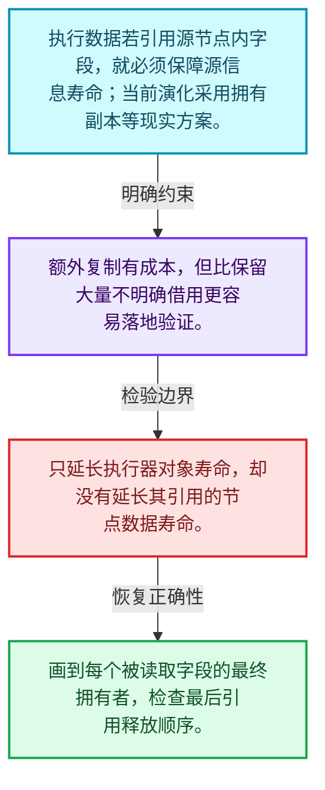
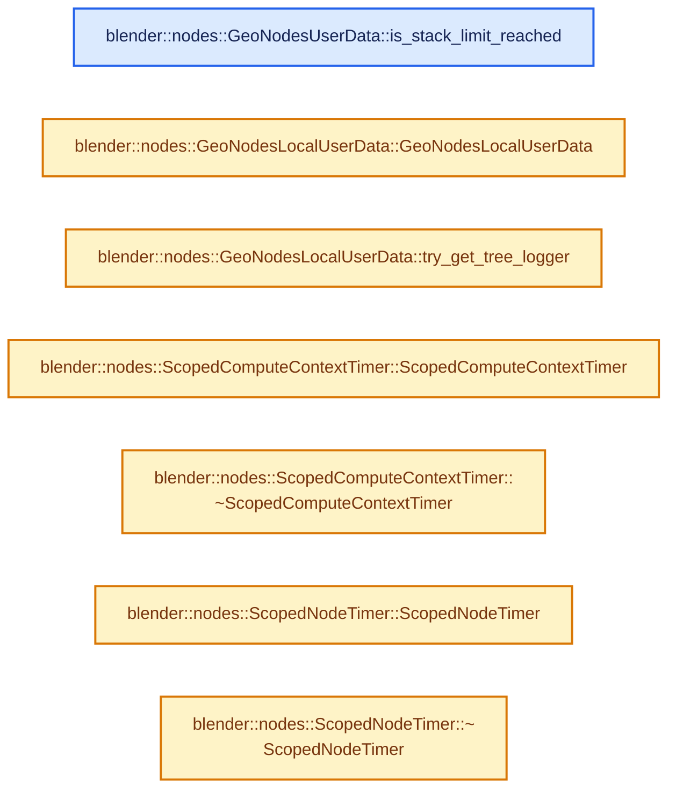
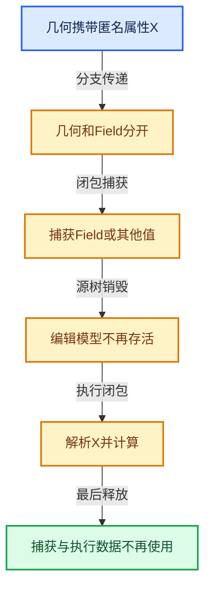

# 10-08 执行图所有权与演化

[方向导航](README.md) · [总目录](../README.md) · [实现索引](../%E7%AC%A6%E5%8F%B7%E4%BE%9D%E8%B5%96%E4%B8%8E%E5%AE%9E%E7%8E%B0%E7%B4%A2%E5%BC%95.md)

## 从问题到实现

原节点树销毁后闭包怎样继续合法求值？

执行数据必须拥有它引用的源信息，实际方案可能用额外复制换取明确所有权。

**数据模型**

执行数据若引用源节点内字段，就必须保障源信息寿命；当前演化采用拥有副本等现实方案。

**设计取舍**

额外复制有成本，但比保留大量不明确借用更容易落地验证。

**最小反例**

只延长执行器对象寿命，却没有延长其引用的节点数据寿命。

**推导**

画到每个被读取字段的最终拥有者，检查最后引用释放顺序。

## 阅读地图与执行推演








图中的数值推演是本方向的教学模型；实际函数之间的调用边与概念分析边分别标注，不能把概念关系当作运行时调度顺序。

## 完整源码单元与就地讲解

中文讲解直接放在相关代码旁，复杂机制在代码下展开。原文折叠区保留基准行号；不需要在行号表和函数之间来回查找。类布局可分段展示，函数实现不按固定行数切开。

### 类型布局、声明与编译条件 · NOD_geometry_nodes_closure_eval.hh L1—L44

<a id="t-a18aab04d807"></a>

`ClosureEagerEvalParams`在这里声明的数据成员：

- `Vector<InputItem> inputs`
- `Vector<OutputItem> outputs`
- `GeoNodesUserData user_data`

<a id="t-7c3c79a61e8b"></a>

`InputItem`在这里声明的数据成员：

- `std::string key`
- `bke::bNodeSocketType type`
- `bke::SocketValueVariant value`

<a id="t-ceb537ba4bf0"></a>

`OutputItem`在这里声明的数据成员：

- `std::string key`
- `bke::bNodeSocketType type`
- `bke::SocketValueVariant value`

<!-- annotated:8f1ca8df5bff42 -->

```cpp
/* SPDX-FileCopyrightText: 2025 Blender Foundation
 *
 * SPDX-License-Identifier: GPL-2.0-or-later */

/** \file
 * \ingroup nodes
 */

#pragma once

#include "NOD_geometry_nodes_closure.hh"

#include "NOD_geometry_nodes_lazy_function.hh"

#include "BKE_node_socket_value.hh"

namespace blender::nodes {

struct ClosureEagerEvalParams {
  struct InputItem {
    std::string key;
    const bke::bNodeSocketType *type = nullptr;
    /** This may be moved from. */
    bke::SocketValueVariant value;
  };

  struct OutputItem {
    std::string key;
    const bke::bNodeSocketType *type = nullptr;
    /**
     * Where the output value should be stored. This is expected to point to uninitialized memory
     * when it's passed into #evaluate_closure_eagerly which will then construct the value inplace.
     */
    bke::SocketValueVariant *value = nullptr;
  };

  Vector<InputItem> inputs;
  Vector<OutputItem> outputs;
  GeoNodesUserData *user_data = nullptr;
};

void evaluate_closure_eagerly(const Closure &closure, ClosureEagerEvalParams &params);

}  // namespace blender::nodes
```

<details>
<summary>核对原始源码：source/blender/nodes/NOD_geometry_nodes_closure_eval.hh · L1—L44</summary>

<!-- original:8f1ca8df5bff42:source/blender/nodes/NOD_geometry_nodes_closure_eval.hh:1:44 -->

```cpp
/* SPDX-FileCopyrightText: 2025 Blender Foundation
 *
 * SPDX-License-Identifier: GPL-2.0-or-later */

/** \file
 * \ingroup nodes
 */

#pragma once

#include "NOD_geometry_nodes_closure.hh"

#include "NOD_geometry_nodes_lazy_function.hh"

#include "BKE_node_socket_value.hh"

namespace blender::nodes {

struct ClosureEagerEvalParams {
  struct InputItem {
    std::string key;
    const bke::bNodeSocketType *type = nullptr;
    /** This may be moved from. */
    bke::SocketValueVariant value;
  };

  struct OutputItem {
    std::string key;
    const bke::bNodeSocketType *type = nullptr;
    /**
     * Where the output value should be stored. This is expected to point to uninitialized memory
     * when it's passed into #evaluate_closure_eagerly which will then construct the value inplace.
     */
    bke::SocketValueVariant *value = nullptr;
  };

  Vector<InputItem> inputs;
  Vector<OutputItem> outputs;
  GeoNodesUserData *user_data = nullptr;
};

void evaluate_closure_eagerly(const Closure &closure, ClosureEagerEvalParams &params);

}  // namespace blender::nodes
```

</details>

### 类型布局、声明与编译条件 · NOD_geometry_nodes_lazy_function.hh L1—L291

<a id="t-7fac49954d70"></a>

<a id="t-7c3009c77b70"></a>

<a id="t-3a2241296b36"></a>

<a id="t-babb330df084"></a>

<a id="t-cd140098581f"></a>

`UseCache`在这里声明的数据成员：

- `float delta_time`
- `bke::bake::BakeValues values`

<a id="t-3e0d2be660f3"></a>

<a id="t-f8aa3fcad082"></a>

`StoreNewState`在这里声明的数据成员：

- `std::function<void(bke::bake::BakeValues values)> store_fn`

<a id="t-4ea960f574e1"></a>

`ReadSingle`在这里声明的数据成员：

- `bke::bake::BakeValues values`

<a id="t-87e9b16ed2f7"></a>

`ReadInterpolated`在这里声明的数据成员：

- `float mix_factor`
- `bke::bake::BakeValues prev_values`
- `bke::bake::BakeValues next_values`

<a id="t-9c6c50d2a2fe"></a>

`ReadError`在这里声明的数据成员：

- `std::string message`

<a id="t-9e0cd058b94c"></a>

`SimulationZoneBehavior`在这里声明的数据成员：

- `sim_input::Behavior input`
- `sim_output::Behavior output`
- `bke::bake::BakeDataBlockMap data_block_map`

<a id="t-0daab5af2c64"></a>

`GeoNodesSimulationParams`在这里声明的数据成员：

- `SimulationZoneBehavior get`

<a id="t-9fb16a856f81"></a>

`BakeNodeBehavior`在这里声明的数据成员：

- `sim_output::Behavior behavior`
- `bke::bake::BakeDataBlockMap data_block_map`

<a id="t-9a55cc484ddc"></a>

`GeoNodesBakeParams`在这里声明的数据成员：

- `BakeNodeBehavior get`

<a id="t-638de6e7676d"></a>

`GeoNodesSideEffectNodes`在这里声明的数据成员：

- `MultiValueMap<ComputeContextHash, const lf::FunctionNode *> nodes_by_context`
- `MultiValueMap<std::pair<ComputeContextHash, int32_t>, int> iterations_by_iteration_zone`

<a id="t-8fe6c8a00f2d"></a>

`GeoNodesModifierData`在这里声明的数据成员：

- `Object self_object`
- `Depsgraph depsgraph`

<a id="t-0ea0fdebcee9"></a>

`GeoNodesOperatorDepsgraphs`在这里声明的数据成员：

- `Depsgraph active`
- `Depsgraph extra`
- `ID get_evaluated_id`

<a id="t-be9fe62c8777"></a>

`GeoNodesOperatorData`在这里声明的数据成员：

- `eObjectMode mode`
- `Object self_object_orig`
- `GeoNodesOperatorDepsgraphs depsgraphs`
- `Map<std::string, ID *> input_ids`
- `Scene scene_orig`
- `int2 mouse_position`
- `int2 region_size`
- `float3 cursor_position`
- `math::Quaternion cursor_rotation`
- `float4x4 viewport_winmat`
- `float4x4 viewport_viewmat`
- `bool viewport_is_perspective`
- `int active_point_index`
- `int active_edge_index`
- `int active_face_index`
- `int active_layer_index`

<a id="t-19dd214ed894"></a>

`GeoNodesCallData`在这里声明的数据成员：

- `bNodeTree root_ntree`
- `eval_log::NodesEvalLog eval_log`
- `GeoNodesSimulationParams simulation_params`
- `GeoNodesBakeParams bake_params`
- `GeoNodesSideEffectNodes side_effect_nodes`
- `Set<ComputeContextHash> verbose_log_contexts`
- `GeoNodesModifierData modifier_data`
- `GeoNodesOperatorData operator_data`
- `int call_depth_limit`
- `Object self_object`

<a id="t-cb1c86b9f7a2"></a>

`GeoNodesUserData`在这里声明的数据成员：

- `GeoNodesCallData call_data`
- `ComputeContext compute_context`
- `bool verbose_log`
- `destruct_ptr<fn::LocalUserData> get_local`

<!-- annotated:d1eb0797adb710 -->

```cpp
/* SPDX-FileCopyrightText: 2023 Blender Authors
 *
 * SPDX-License-Identifier: GPL-2.0-or-later */

/** \file
 * \ingroup nodes
 */

#pragma once

/**
 * For evaluation, geometry node groups are converted to a lazy-function graph. The generated graph
 * is cached per node group, so it only has to be generated once after a change.
 *
 * Node groups are *not* inlined into the lazy-function graph. This could be added in the future as
 * it might improve performance in some cases, but generally does not seem necessary. Inlining node
 * groups also has disadvantages like making per-node-group caches less useful, resulting in more
 * overhead.
 *
 * Instead, group nodes are just like all other nodes in the lazy-function graph. What makes them
 * special is that they reference the lazy-function graph of the group they reference.
 *
 * During lazy-function graph generation, a mapping between the #bNodeTree and
 * #lazy_function::Graph is build that can be used when evaluating the graph (e.g. for logging).
 */

#include <variant>

#include "FN_lazy_function_graph.hh"
#include "FN_lazy_function_graph_executor.hh"

#include "NOD_eval_log.hh"
#include "NOD_multi_function.hh"
#include "NOD_nested_node_id.hh"

#include "BLI_compute_context.hh"
#include "BLI_math_quaternion_types.hh"
#include "BLI_multi_value_map.hh"

#include "BKE_bake_values.hh"
#include "BKE_node_tree_zones.hh"

namespace blender {

struct Depsgraph;
struct Object;
struct Scene;

namespace nodes {

using lf::LazyFunction;
using mf::MultiFunction;
using ReferenceSetIndex = int;

/** The structs in here describe the different possible behaviors of a simulation input node. */
namespace sim_input {

/**
 * The data is just passed through the node. Data that is incompatible with simulations (like
 * anonymous attributes), is removed though.
 */
struct PassThrough {};

/**
 * The input is not evaluated, instead the values provided here are output by the node.
 */
struct UseCache {
  float delta_time;
  bke::bake::BakeValues values;
};

using Behavior = std::variant<PassThrough, UseCache>;

}  // namespace sim_input

/** The structs in here describe the different possible behaviors of a simulation output node. */
namespace sim_output {

/**
 * Output the data that comes from the corresponding simulation input node, ignoring the nodes in
 * the zone.
 */
struct PassThrough {};

/**
 * Computes the simulation step and calls the given function to cache the new simulation state.
 * The new simulation state is the output of the node.
 */
struct StoreNewState {
  std::function<void(bke::bake::BakeValues values)> store_fn;
};

/**
 * The inputs are not evaluated, instead the given cached items are output directly.
 */
struct ReadSingle {
  bke::bake::BakeValues values;
};

/**
 * The inputs are not evaluated, instead of a mix of the two given states is output.
 */
struct ReadInterpolated {
  /** Factor between 0 and 1 that determines the influence of the two simulation states. */
  float mix_factor;
  bke::bake::BakeValues prev_values;
  bke::bake::BakeValues next_values;
};

/**
 * Used when there was some issue loading the baked data from disk.
 */
struct ReadError {
  std::string message;
};

using Behavior = std::variant<PassThrough, StoreNewState, ReadSingle, ReadInterpolated, ReadError>;

}  // namespace sim_output

/** Controls the behavior of one simulation zone. */
struct SimulationZoneBehavior {
  sim_input::Behavior input;
  sim_output::Behavior output;
  bke::bake::BakeDataBlockMap *data_block_map = nullptr;
};

class GeoNodesSimulationParams {
 public:
  /**
   * Get the expected behavior for the simulation zone with the given id (see #bNestedNodeRef).
   * It's possible that this method called multiple times for the same id. In this case, the same
   * pointer should be returned in each call.
   */
  virtual SimulationZoneBehavior *get(const int zone_id) const = 0;
};

struct BakeNodeBehavior {
  /** The set of possible behaviors are the same for both of these nodes currently. */
  sim_output::Behavior behavior;
  bke::bake::BakeDataBlockMap *data_block_map = nullptr;
};

class GeoNodesBakeParams {
 public:
  virtual BakeNodeBehavior *get(const int id) const = 0;
};

struct GeoNodesSideEffectNodes {
  MultiValueMap<ComputeContextHash, const lf::FunctionNode *> nodes_by_context;
  /**
   * The repeat/foreach zone is identified by the compute context of the parent and the identifier
   * of the repeat output node.
   */
  MultiValueMap<std::pair<ComputeContextHash, int32_t>, int> iterations_by_iteration_zone;
};

/**
 * Data that is passed into geometry nodes evaluation from the modifier.
 */
struct GeoNodesModifierData {
  /** Object that is currently evaluated. */
  const Object *self_object = nullptr;
  /** Depsgraph that is evaluating the modifier. */
  Depsgraph *depsgraph = nullptr;
};

struct GeoNodesOperatorDepsgraphs {
  /** Current evaluated depsgraph from the viewport. Shouldn't be null. */
  const Depsgraph *active = nullptr;
  /**
   * Depsgraph containing IDs referenced by the node tree and the node tree itself and from node
   * group inputs (the redo panel).
   */
  Depsgraph *extra = nullptr;

  ~GeoNodesOperatorDepsgraphs();

  /**
   * The evaluated data-block might be in the scene's active depsgraph, in that case we should use
   * it directly. Otherwise retrieve it from the extra depsgraph that was built for all other
   * data-blocks. Return null if it isn't found, generally geometry nodes can handle null ID
   * pointers.
   */
  const ID *get_evaluated_id(const ID &id_orig) const;
};

struct GeoNodesOperatorData {
  eObjectMode mode;
  /** The object currently effected by the operator. */
  const Object *self_object_orig = nullptr;
  const GeoNodesOperatorDepsgraphs *depsgraphs = nullptr;
  /**
   * Map from names of data-block node group input RNA properties to original data-blocks.
   */
  const Map<std::string, ID *> *input_ids = {};
  Scene *scene_orig = nullptr;
  int2 mouse_position;
  int2 region_size;

  float3 cursor_position;
  math::Quaternion cursor_rotation;

  float4x4 viewport_winmat;
  float4x4 viewport_viewmat;
  bool viewport_is_perspective;

  int active_point_index = -1;
  int active_edge_index = -1;
  int active_face_index = -1;
  int active_layer_index = -1;
};

struct GeoNodesCallData {
  /**
   * Top-level node tree of the current evaluation.
   */
  const bNodeTree *root_ntree = nullptr;
  /**
   * Optional logger that keeps track of data generated during evaluation to allow for better
   * debugging afterwards.
   */
  eval_log::NodesEvalLog *eval_log = nullptr;
  /**
   * Optional injected behavior for simulations.
   */
  GeoNodesSimulationParams *simulation_params = nullptr;
  /**
   * Optional injected behavior for bake nodes.
   */
  GeoNodesBakeParams *bake_params = nullptr;
  /**
   * Some nodes should be executed even when their output is not used (e.g. active viewer nodes and
   * the node groups they are contained in).
   */
  const GeoNodesSideEffectNodes *side_effect_nodes = nullptr;
  /**
   * Controls in which compute contexts we want to log information like socket values. Logging them
   * in all contexts has significant overhead. In the majority of cases, the logged values are
   * freed without being looked at anyway.
   *
   * If this is null, it is assumed that all compute contexts should be logged.
   */
  const Set<ComputeContextHash> *verbose_log_contexts = nullptr;

  /**
   * Data from the modifier that is being evaluated.
   */
  GeoNodesModifierData *modifier_data = nullptr;
  /**
   * Data from execution as operator in 3D viewport.
   */
  GeoNodesOperatorData *operator_data = nullptr;

  /**
   * Stack limit at which Geometry Nodes should stop the evaluation. This is a preventative measure
   * to avoid crashes caused by running out of stack space.
   */
  int call_depth_limit = 100;

  /**
   * Self object has slightly different semantics depending on how geometry nodes is called.
   * Therefore, it is not stored directly in the global data.
   */
  const Object *self_object() const;
};

/**
 * Custom user data that can be passed to every geometry nodes related evaluation.
 */
struct GeoNodesUserData : public fn::UserData {
  /**
   * Data provided by the root caller of geometry nodes.
   */
  const GeoNodesCallData *call_data = nullptr;
  /**
   * Current compute context. This is different depending in the (nested) node group that is being
   * evaluated.
   */
  const ComputeContext *compute_context = nullptr;
  /**
   * Log "more" data in the current compute context. If true, the user is likely looking at nodes
   * in this context and expects detailed inspection information. If false, only necessary data
   * like warnings should be logged but not e.g. socket values.
   *
   * Child contexts might use logging again even if the current compute context does not.
   */
  bool verbose_log = true;

  destruct_ptr<fn::LocalUserData> get_local(LinearAllocator<> &allocator) override;

```

<details>
<summary>核对原始源码：source/blender/nodes/NOD_geometry_nodes_lazy_function.hh · L1—L291</summary>

<!-- original:d1eb0797adb710:source/blender/nodes/NOD_geometry_nodes_lazy_function.hh:1:291 -->

```cpp
/* SPDX-FileCopyrightText: 2023 Blender Authors
 *
 * SPDX-License-Identifier: GPL-2.0-or-later */

/** \file
 * \ingroup nodes
 */

#pragma once

/**
 * For evaluation, geometry node groups are converted to a lazy-function graph. The generated graph
 * is cached per node group, so it only has to be generated once after a change.
 *
 * Node groups are *not* inlined into the lazy-function graph. This could be added in the future as
 * it might improve performance in some cases, but generally does not seem necessary. Inlining node
 * groups also has disadvantages like making per-node-group caches less useful, resulting in more
 * overhead.
 *
 * Instead, group nodes are just like all other nodes in the lazy-function graph. What makes them
 * special is that they reference the lazy-function graph of the group they reference.
 *
 * During lazy-function graph generation, a mapping between the #bNodeTree and
 * #lazy_function::Graph is build that can be used when evaluating the graph (e.g. for logging).
 */

#include <variant>

#include "FN_lazy_function_graph.hh"
#include "FN_lazy_function_graph_executor.hh"

#include "NOD_eval_log.hh"
#include "NOD_multi_function.hh"
#include "NOD_nested_node_id.hh"

#include "BLI_compute_context.hh"
#include "BLI_math_quaternion_types.hh"
#include "BLI_multi_value_map.hh"

#include "BKE_bake_values.hh"
#include "BKE_node_tree_zones.hh"

namespace blender {

struct Depsgraph;
struct Object;
struct Scene;

namespace nodes {

using lf::LazyFunction;
using mf::MultiFunction;
using ReferenceSetIndex = int;

/** The structs in here describe the different possible behaviors of a simulation input node. */
namespace sim_input {

/**
 * The data is just passed through the node. Data that is incompatible with simulations (like
 * anonymous attributes), is removed though.
 */
struct PassThrough {};

/**
 * The input is not evaluated, instead the values provided here are output by the node.
 */
struct UseCache {
  float delta_time;
  bke::bake::BakeValues values;
};

using Behavior = std::variant<PassThrough, UseCache>;

}  // namespace sim_input

/** The structs in here describe the different possible behaviors of a simulation output node. */
namespace sim_output {

/**
 * Output the data that comes from the corresponding simulation input node, ignoring the nodes in
 * the zone.
 */
struct PassThrough {};

/**
 * Computes the simulation step and calls the given function to cache the new simulation state.
 * The new simulation state is the output of the node.
 */
struct StoreNewState {
  std::function<void(bke::bake::BakeValues values)> store_fn;
};

/**
 * The inputs are not evaluated, instead the given cached items are output directly.
 */
struct ReadSingle {
  bke::bake::BakeValues values;
};

/**
 * The inputs are not evaluated, instead of a mix of the two given states is output.
 */
struct ReadInterpolated {
  /** Factor between 0 and 1 that determines the influence of the two simulation states. */
  float mix_factor;
  bke::bake::BakeValues prev_values;
  bke::bake::BakeValues next_values;
};

/**
 * Used when there was some issue loading the baked data from disk.
 */
struct ReadError {
  std::string message;
};

using Behavior = std::variant<PassThrough, StoreNewState, ReadSingle, ReadInterpolated, ReadError>;

}  // namespace sim_output

/** Controls the behavior of one simulation zone. */
struct SimulationZoneBehavior {
  sim_input::Behavior input;
  sim_output::Behavior output;
  bke::bake::BakeDataBlockMap *data_block_map = nullptr;
};

class GeoNodesSimulationParams {
 public:
  /**
   * Get the expected behavior for the simulation zone with the given id (see #bNestedNodeRef).
   * It's possible that this method called multiple times for the same id. In this case, the same
   * pointer should be returned in each call.
   */
  virtual SimulationZoneBehavior *get(const int zone_id) const = 0;
};

struct BakeNodeBehavior {
  /** The set of possible behaviors are the same for both of these nodes currently. */
  sim_output::Behavior behavior;
  bke::bake::BakeDataBlockMap *data_block_map = nullptr;
};

class GeoNodesBakeParams {
 public:
  virtual BakeNodeBehavior *get(const int id) const = 0;
};

struct GeoNodesSideEffectNodes {
  MultiValueMap<ComputeContextHash, const lf::FunctionNode *> nodes_by_context;
  /**
   * The repeat/foreach zone is identified by the compute context of the parent and the identifier
   * of the repeat output node.
   */
  MultiValueMap<std::pair<ComputeContextHash, int32_t>, int> iterations_by_iteration_zone;
};

/**
 * Data that is passed into geometry nodes evaluation from the modifier.
 */
struct GeoNodesModifierData {
  /** Object that is currently evaluated. */
  const Object *self_object = nullptr;
  /** Depsgraph that is evaluating the modifier. */
  Depsgraph *depsgraph = nullptr;
};

struct GeoNodesOperatorDepsgraphs {
  /** Current evaluated depsgraph from the viewport. Shouldn't be null. */
  const Depsgraph *active = nullptr;
  /**
   * Depsgraph containing IDs referenced by the node tree and the node tree itself and from node
   * group inputs (the redo panel).
   */
  Depsgraph *extra = nullptr;

  ~GeoNodesOperatorDepsgraphs();

  /**
   * The evaluated data-block might be in the scene's active depsgraph, in that case we should use
   * it directly. Otherwise retrieve it from the extra depsgraph that was built for all other
   * data-blocks. Return null if it isn't found, generally geometry nodes can handle null ID
   * pointers.
   */
  const ID *get_evaluated_id(const ID &id_orig) const;
};

struct GeoNodesOperatorData {
  eObjectMode mode;
  /** The object currently effected by the operator. */
  const Object *self_object_orig = nullptr;
  const GeoNodesOperatorDepsgraphs *depsgraphs = nullptr;
  /**
   * Map from names of data-block node group input RNA properties to original data-blocks.
   */
  const Map<std::string, ID *> *input_ids = {};
  Scene *scene_orig = nullptr;
  int2 mouse_position;
  int2 region_size;

  float3 cursor_position;
  math::Quaternion cursor_rotation;

  float4x4 viewport_winmat;
  float4x4 viewport_viewmat;
  bool viewport_is_perspective;

  int active_point_index = -1;
  int active_edge_index = -1;
  int active_face_index = -1;
  int active_layer_index = -1;
};

struct GeoNodesCallData {
  /**
   * Top-level node tree of the current evaluation.
   */
  const bNodeTree *root_ntree = nullptr;
  /**
   * Optional logger that keeps track of data generated during evaluation to allow for better
   * debugging afterwards.
   */
  eval_log::NodesEvalLog *eval_log = nullptr;
  /**
   * Optional injected behavior for simulations.
   */
  GeoNodesSimulationParams *simulation_params = nullptr;
  /**
   * Optional injected behavior for bake nodes.
   */
  GeoNodesBakeParams *bake_params = nullptr;
  /**
   * Some nodes should be executed even when their output is not used (e.g. active viewer nodes and
   * the node groups they are contained in).
   */
  const GeoNodesSideEffectNodes *side_effect_nodes = nullptr;
  /**
   * Controls in which compute contexts we want to log information like socket values. Logging them
   * in all contexts has significant overhead. In the majority of cases, the logged values are
   * freed without being looked at anyway.
   *
   * If this is null, it is assumed that all compute contexts should be logged.
   */
  const Set<ComputeContextHash> *verbose_log_contexts = nullptr;

  /**
   * Data from the modifier that is being evaluated.
   */
  GeoNodesModifierData *modifier_data = nullptr;
  /**
   * Data from execution as operator in 3D viewport.
   */
  GeoNodesOperatorData *operator_data = nullptr;

  /**
   * Stack limit at which Geometry Nodes should stop the evaluation. This is a preventative measure
   * to avoid crashes caused by running out of stack space.
   */
  int call_depth_limit = 100;

  /**
   * Self object has slightly different semantics depending on how geometry nodes is called.
   * Therefore, it is not stored directly in the global data.
   */
  const Object *self_object() const;
};

/**
 * Custom user data that can be passed to every geometry nodes related evaluation.
 */
struct GeoNodesUserData : public fn::UserData {
  /**
   * Data provided by the root caller of geometry nodes.
   */
  const GeoNodesCallData *call_data = nullptr;
  /**
   * Current compute context. This is different depending in the (nested) node group that is being
   * evaluated.
   */
  const ComputeContext *compute_context = nullptr;
  /**
   * Log "more" data in the current compute context. If true, the user is likely looking at nodes
   * in this context and expects detailed inspection information. If false, only necessary data
   * like warnings should be logged but not e.g. socket values.
   *
   * Child contexts might use logging again even if the current compute context does not.
   */
  bool verbose_log = true;

  destruct_ptr<fn::LocalUserData> get_local(LinearAllocator<> &allocator) override;

```

</details>

<a id="f-f8dcea562cd0e5f3"></a>

### `blender::nodes::GeoNodesUserData::is_stack_limit_reached`

实现位置：[source/blender/nodes/NOD_geometry_nodes_lazy_function.hh](../../../../../source/blender/nodes/NOD_geometry_nodes_lazy_function.hh) · L292—L295。

**教学注释版**

<!-- annotated:339d773574ec9a -->

```cpp
  bool is_stack_limit_reached() const
  {
    return this->compute_context->parents_num() >= this->call_data->call_depth_limit;
  }
```

<details>
<summary>核对原始源码：source/blender/nodes/NOD_geometry_nodes_lazy_function.hh · L292—L295</summary>

<!-- original:339d773574ec9a:source/blender/nodes/NOD_geometry_nodes_lazy_function.hh:292:295 -->

```cpp
  bool is_stack_limit_reached() const
  {
    return this->compute_context->parents_num() >= this->call_data->call_depth_limit;
  }
```

</details>

**结果出口**

- `return this->compute_context->parents_num() >= this->call_data->call_depth_limit;`

**继续追踪实现**

- `this->compute_context->parents_num` → [调用协议](../%E6%A8%A1%E6%9D%BF%E5%AE%8F%E4%B8%8E%E5%8A%A8%E6%80%81%E5%88%86%E6%B4%BE%E5%8D%8F%E8%AE%AE.md)：接收对象类型依赖auto、返回值或模板实例；不按同名猜测目标。调用位置L294。

### 类型布局、声明与编译条件 · NOD_geometry_nodes_lazy_function.hh L296—L306

<a id="t-4315925c6da6"></a>

`GeoNodesLocalUserData`在这里声明的数据成员：

- `std::optional<eval_log::NodeTreeLogger *> tree_logger_`

<!-- annotated:da9af243222498 -->

```cpp
};

struct GeoNodesLocalUserData : public fn::LocalUserData {
 private:
  /**
   * Thread-local logger for the current node tree in the current compute context. It is only
   * instantiated when it is actually used and then cached for the current thread.
   */
  mutable std::optional<eval_log::NodeTreeLogger *> tree_logger_;

 public:
```

<details>
<summary>核对原始源码：source/blender/nodes/NOD_geometry_nodes_lazy_function.hh · L296—L306</summary>

<!-- original:da9af243222498:source/blender/nodes/NOD_geometry_nodes_lazy_function.hh:296:306 -->

```cpp
};

struct GeoNodesLocalUserData : public fn::LocalUserData {
 private:
  /**
   * Thread-local logger for the current node tree in the current compute context. It is only
   * instantiated when it is actually used and then cached for the current thread.
   */
  mutable std::optional<eval_log::NodeTreeLogger *> tree_logger_;

 public:
```

</details>

<a id="f-a5c9d0bc2dbc3d22"></a>

### `blender::nodes::GeoNodesLocalUserData::GeoNodesLocalUserData`

实现位置：[source/blender/nodes/NOD_geometry_nodes_lazy_function.hh](../../../../../source/blender/nodes/NOD_geometry_nodes_lazy_function.hh) · L307—L307。

接口参数：

- `GeoNodesUserData &`

**教学注释版**

<!-- annotated:45f020b713fbc7 -->

```cpp
  GeoNodesLocalUserData(GeoNodesUserData & /*user_data*/) {}
```

<details>
<summary>核对原始源码：source/blender/nodes/NOD_geometry_nodes_lazy_function.hh · L307—L307</summary>

<!-- original:45f020b713fbc7:source/blender/nodes/NOD_geometry_nodes_lazy_function.hh:307:307 -->

```cpp
  GeoNodesLocalUserData(GeoNodesUserData & /*user_data*/) {}
```

</details>

**继续追踪实现**

本实现没有需要继续展开的显式调用；检查返回表达式、对象转换和调用者前置条件。

### 类型布局、声明与编译条件 · NOD_geometry_nodes_lazy_function.hh L308—L312

<!-- annotated:54d566fbf5eb65 -->

```cpp

  /**
   * Get the current tree logger. This method is not thread-safe, each thread is supposed to have
   * a separate logger.
   */
```

<details>
<summary>核对原始源码：source/blender/nodes/NOD_geometry_nodes_lazy_function.hh · L308—L312</summary>

<!-- original:54d566fbf5eb65:source/blender/nodes/NOD_geometry_nodes_lazy_function.hh:308:312 -->

```cpp

  /**
   * Get the current tree logger. This method is not thread-safe, each thread is supposed to have
   * a separate logger.
   */
```

</details>

<a id="f-5e8d7f157d7814da"></a>

### `blender::nodes::GeoNodesLocalUserData::try_get_tree_logger`

实现位置：[source/blender/nodes/NOD_geometry_nodes_lazy_function.hh](../../../../../source/blender/nodes/NOD_geometry_nodes_lazy_function.hh) · L313—L319。

接口参数：

- `const GeoNodesUserData &user_data`

**教学注释版**

<!-- annotated:a7a7a68e7e8955 -->

```cpp
  eval_log::NodeTreeLogger *try_get_tree_logger(const GeoNodesUserData &user_data) const
  {
    if (!tree_logger_.has_value()) {
      this->ensure_tree_logger(user_data);
    }
    return *tree_logger_;
  }
```

<details>
<summary>核对原始源码：source/blender/nodes/NOD_geometry_nodes_lazy_function.hh · L313—L319</summary>

<!-- original:a7a7a68e7e8955:source/blender/nodes/NOD_geometry_nodes_lazy_function.hh:313:319 -->

```cpp
  eval_log::NodeTreeLogger *try_get_tree_logger(const GeoNodesUserData &user_data) const
  {
    if (!tree_logger_.has_value()) {
      this->ensure_tree_logger(user_data);
    }
    return *tree_logger_;
  }
```

</details>

**结果出口**

- `return *tree_logger_;`

**继续追踪实现**

- `tree_logger_.has_value` → [外部契约](https://eel.is/c++draft/)：这个边界按实际表达式及所属类型核对参数、返回值、寿命与失败行为。这里提供接口入口，不声称已解释该第三方版本的内部实现。
- `this->ensure_tree_logger` → [blender::nodes::GeoNodesLocalUserData::ensure_tree_logger · L4349](../09-LazyFunction%E4%B8%8E%E8%8A%82%E7%82%B9%E6%89%A7%E8%A1%8C%E6%9E%B6%E6%9E%84/12-%E5%B5%8C%E5%A5%97%E5%9B%BE%E5%89%AF%E4%BD%9C%E7%94%A8%E6%97%A5%E5%BF%97%E4%B8%8E%E6%B5%8B%E8%AF%95.md#f-b4389642d0c66dcd)。

### 类型布局、声明与编译条件 · NOD_geometry_nodes_lazy_function.hh L320—L527

<a id="t-c968141ff7b2"></a>

<a id="t-c75fffbe1321"></a>

`InputUsageHint`在这里声明的数据成员：

- `InputUsageHintType type`
- `Vector<int> output_dependencies`

<a id="t-ddb379ad341f"></a>

`GeometryNodeLazyFunctionGraphMapping`在这里声明的数据成员：

- `Vector<InputUsageHint> group_input_usage_hints`
- `MultiValueMap<const lf::Socket *, const bNodeSocket *> bsockets_by_lf_socket_map`
- `Map<int, const lf::FunctionNode *> group_node_map`
- `Map<int, const lf::FunctionNode *> possible_side_effect_node_map`
- `Map<int, const lf::FunctionNode *> zone_node_map`
- `Array<int> lf_input_index_for_output_bsocket_usage`
- `Array<int> lf_input_index_for_reference_set_for_output`
- `Array<int> lf_index_by_bsocket`

<a id="t-6395fce096ea"></a>

`GeometryNodesGroupFunction`在这里声明的数据成员：

- `LazyFunction function`
- `struct {
    /**
     * Main input values that come out of the Group Input node.
     */
    IndexRange main;
    /**
     * A boolean for every group output that indicates whether that output is needed. It's ok if
     * those are set to true even when an output is not used, but the other way around will lead to
     * bugs. The node group uses those values to compute the lifetimes of anonymous attributes.
     */
    IndexRange output_usages;
    /**
     * Some node groups can propagate attributes from a geometry input to a geometry output. In
     * those cases, the caller of the node group has to decide which anonymous attributes have to
     * be kept alive on the geometry because the caller requires them.
     */
    struct {
      IndexRange range;
      Vector<int> geometry_outputs;
    } references_to_propagate;
  } inputs`
- `struct {
    /**
     * Main output values that are passed into the Group Output node.
     */
    IndexRange main;
    /**
     * A boolean for every group input that indicates whether this input will be used. Oftentimes
     * this can be determined without actually computing much. This is used to compute anonymous
     * attribute lifetimes.
     */
    IndexRange input_usages;
  } outputs`

<a id="t-812b532bb315"></a>

`GeometryNodesLazyFunctionGraphInfo`在这里声明的数据成员：

- `ResourceScope scope`
- `std::shared_ptr<const bNodeTree> tree`
- `uint32_t original_tree_session_uid`
- `GeometryNodesGroupFunction function`
- `lf::Graph graph`
- `Map<int, const lf::Graph *> debug_zone_body_graphs`
- `GeometryNodeLazyFunctionGraphMapping mapping`
- `int num_inline_nodes_approximate`

<a id="t-4ee66f1c1084"></a>

`ScopedComputeContextTimer`在这里声明的数据成员：

- `lf::Context context_`
- `eval_log::TimePoint start_`

<!-- annotated:d468afb8b87acd -->

```cpp

 private:
  void ensure_tree_logger(const GeoNodesUserData &user_data) const;
};

/**
 * In the general case, this is #DynamicSocket. That means that to determine if a node group will
 * use a particular input, it has to be partially executed.
 *
 * In other cases, it's not necessary to look into the node group to determine if an input is
 * necessary.
 */
enum class InputUsageHintType {
  /** The input socket is never used. */
  Never,
  /** The input socket is used when a subset of the outputs is used. */
  DependsOnOutput,
  /** Can't determine statically if the input is used, check the corresponding output socket. */
  DynamicSocket,
};

struct InputUsageHint {
  InputUsageHintType type = InputUsageHintType::DependsOnOutput;
  /** Used in depends-on-output mode. */
  Vector<int> output_dependencies;
};

/**
 * Contains the mapping between the #bNodeTree and the corresponding lazy-function graph.
 * This is *not* a one-to-one mapping.
 */
struct GeometryNodeLazyFunctionGraphMapping {
  /**
   * This is an optimization to avoid partially evaluating a node group just to figure out which
   * inputs are needed.
   */
  Vector<InputUsageHint> group_input_usage_hints;
  /**
   * A mapping used for logging intermediate values.
   */
  MultiValueMap<const lf::Socket *, const bNodeSocket *> bsockets_by_lf_socket_map;
  /**
   * Mappings for some special node types. Generally, this mapping does not exist for all node
   * types, so better have more specialized mappings for now. The key is the identifier if a node.
   */
  Map<int, const lf::FunctionNode *> group_node_map;
  Map<int, const lf::FunctionNode *> possible_side_effect_node_map;
  /** Key is the identifier of the zone output node. */
  Map<int, const lf::FunctionNode *> zone_node_map;

  /* Indexed by #bNodeSocket::index_in_all_outputs. */
  Array<int> lf_input_index_for_output_bsocket_usage;
  /* Indexed by #bNodeSocket::index_in_all_outputs. */
  Array<int> lf_input_index_for_reference_set_for_output;
  /* Indexed by #bNodeSocket::index_in_tree. */
  Array<int> lf_index_by_bsocket;
};

/**
 * Contains the information that is necessary to execute a geometry node tree.
 */
struct GeometryNodesGroupFunction {
  /**
   * The lazy-function that does what the node group does. Its inputs and outputs are described
   * below.
   */
  const LazyFunction *function = nullptr;

  struct {
    /**
     * Main input values that come out of the Group Input node.
     */
    IndexRange main;
    /**
     * A boolean for every group output that indicates whether that output is needed. It's ok if
     * those are set to true even when an output is not used, but the other way around will lead to
     * bugs. The node group uses those values to compute the lifetimes of anonymous attributes.
     */
    IndexRange output_usages;
    /**
     * Some node groups can propagate attributes from a geometry input to a geometry output. In
     * those cases, the caller of the node group has to decide which anonymous attributes have to
     * be kept alive on the geometry because the caller requires them.
     */
    struct {
      IndexRange range;
      Vector<int> geometry_outputs;
    } references_to_propagate;
  } inputs;

  struct {
    /**
     * Main output values that are passed into the Group Output node.
     */
    IndexRange main;
    /**
     * A boolean for every group input that indicates whether this input will be used. Oftentimes
     * this can be determined without actually computing much. This is used to compute anonymous
     * attribute lifetimes.
     */
    IndexRange input_usages;
  } outputs;
};

/**
 * Data that is cached for every #bNodeTree.
 */
struct GeometryNodesLazyFunctionGraphInfo {
  /**
   * Contains resources that need to be freed when the graph is not needed anymore.
   */
  ResourceScope scope;
  /**
   * Owned copy of the tree to evaluate. This allows the original tree to be freed without making
   * the execution graph invalid. This is very common because many changes to a node tree trigger a
   * new depsgraph-copy but not a new evaluation (since the output has not changed).
   *
   * Without an extra copy, one could not output fields/closures to other objects without having
   * those become dangling on trivial tree changes.
   */
  std::shared_ptr<const bNodeTree> tree;
  /**
   * Session UID of the original tree in Main that this is based on. Used to map evaluated data
   * back to the original tree later on.
   */
  uint32_t original_tree_session_uid;

  GeometryNodesGroupFunction function;
  /**
   * The actual lazy-function graph.
   */
  lf::Graph graph;
  Map<int, const lf::Graph *> debug_zone_body_graphs;
  /**
   * Mappings between the lazy-function graph and the #bNodeTree.
   */
  GeometryNodeLazyFunctionGraphMapping mapping;
  /**
   * Approximate number of nodes in the graph if all sub-graphs were inlined.
   * This can be used as a simple heuristic for the complexity of the node group.
   */
  int num_inline_nodes_approximate = 0;

  GeometryNodesLazyFunctionGraphInfo(const char *debug_name);
};

std::unique_ptr<LazyFunction> get_simulation_output_lazy_function(
    const bNode &node, GeometryNodesLazyFunctionGraphInfo &own_lf_graph_info);
std::unique_ptr<LazyFunction> get_simulation_input_lazy_function(
    const bNodeTree &node_tree,
    const bNode &node,
    GeometryNodesLazyFunctionGraphInfo &own_lf_graph_info);
std::unique_ptr<LazyFunction> get_switch_node_lazy_function(const bNode &node);
std::unique_ptr<LazyFunction> get_index_switch_node_lazy_function(
    const bNode &node, GeometryNodesLazyFunctionGraphInfo &lf_graph_info);
std::unique_ptr<LazyFunction> get_bake_lazy_function(
    const bNode &node, GeometryNodesLazyFunctionGraphInfo &own_lf_graph_info);
std::unique_ptr<LazyFunction> get_menu_switch_node_lazy_function(
    const bNode &node, GeometryNodesLazyFunctionGraphInfo &lf_graph_info);
std::unique_ptr<LazyFunction> get_menu_switch_node_boolean_outputs_lazy_function(
    const bNode &node, GeometryNodesLazyFunctionGraphInfo &lf_graph_info);
std::unique_ptr<LazyFunction> get_menu_switch_node_socket_usage_lazy_function(const bNode &node);
std::unique_ptr<LazyFunction> get_warning_node_lazy_function(const bNode &node);
std::unique_ptr<LazyFunction> get_enable_output_node_lazy_function(
    const bNode &node, GeometryNodesLazyFunctionGraphInfo &own_lf_graph_info);

/**
 * Outputs the default value of each output socket that has not been output yet. This needs the
 * #bNode because otherwise the default values for the outputs are not known. The lazy-function
 * parameters do not differentiate between e.g. float and vector sockets. The #SocketValueVariant
 * type is used for both.
 */
void set_default_remaining_node_outputs(lf::Params &params, const bNode &node);
void set_default_value_for_output_socket(lf::Params &params,
                                         const int lf_index,
                                         const bNodeSocket &bsocket);
void construct_socket_default_value(const bke::bNodeSocketType &stype, void *r_value);

std::string make_anonymous_attribute_socket_inspection_string(const bNodeSocket &socket);
std::string make_anonymous_attribute_socket_inspection_string(StringRef node_name,
                                                              StringRef socket_name);

std::optional<FoundNestedNodeID> find_nested_node_id(const GeoNodesUserData &user_data,
                                                     const int node_id);

/**
 * Main function that converts a #bNodeTree into a lazy-function graph. If the graph has been
 * generated already, nothing is done. Under some circumstances a valid graph cannot be created. In
 * those cases null is returned.
 */
const std::shared_ptr<const GeometryNodesLazyFunctionGraphInfo> &
ensure_geometry_nodes_lazy_function_graph(const bNodeTree &btree);

/**
 * In compute contexts that should not be logged verbosely, still log slow nodes.
 */
constexpr auto node_timer_log_threshold = std::chrono::microseconds(100);

/**
 * Utility to measure the time that is spend in a specific compute context during geometry nodes
 * evaluation.
 */
class ScopedComputeContextTimer {
 private:
  lf::Context &context_;
  eval_log::TimePoint start_;

 public:
```

<details>
<summary>核对原始源码：source/blender/nodes/NOD_geometry_nodes_lazy_function.hh · L320—L527</summary>

<!-- original:d468afb8b87acd:source/blender/nodes/NOD_geometry_nodes_lazy_function.hh:320:527 -->

```cpp

 private:
  void ensure_tree_logger(const GeoNodesUserData &user_data) const;
};

/**
 * In the general case, this is #DynamicSocket. That means that to determine if a node group will
 * use a particular input, it has to be partially executed.
 *
 * In other cases, it's not necessary to look into the node group to determine if an input is
 * necessary.
 */
enum class InputUsageHintType {
  /** The input socket is never used. */
  Never,
  /** The input socket is used when a subset of the outputs is used. */
  DependsOnOutput,
  /** Can't determine statically if the input is used, check the corresponding output socket. */
  DynamicSocket,
};

struct InputUsageHint {
  InputUsageHintType type = InputUsageHintType::DependsOnOutput;
  /** Used in depends-on-output mode. */
  Vector<int> output_dependencies;
};

/**
 * Contains the mapping between the #bNodeTree and the corresponding lazy-function graph.
 * This is *not* a one-to-one mapping.
 */
struct GeometryNodeLazyFunctionGraphMapping {
  /**
   * This is an optimization to avoid partially evaluating a node group just to figure out which
   * inputs are needed.
   */
  Vector<InputUsageHint> group_input_usage_hints;
  /**
   * A mapping used for logging intermediate values.
   */
  MultiValueMap<const lf::Socket *, const bNodeSocket *> bsockets_by_lf_socket_map;
  /**
   * Mappings for some special node types. Generally, this mapping does not exist for all node
   * types, so better have more specialized mappings for now. The key is the identifier if a node.
   */
  Map<int, const lf::FunctionNode *> group_node_map;
  Map<int, const lf::FunctionNode *> possible_side_effect_node_map;
  /** Key is the identifier of the zone output node. */
  Map<int, const lf::FunctionNode *> zone_node_map;

  /* Indexed by #bNodeSocket::index_in_all_outputs. */
  Array<int> lf_input_index_for_output_bsocket_usage;
  /* Indexed by #bNodeSocket::index_in_all_outputs. */
  Array<int> lf_input_index_for_reference_set_for_output;
  /* Indexed by #bNodeSocket::index_in_tree. */
  Array<int> lf_index_by_bsocket;
};

/**
 * Contains the information that is necessary to execute a geometry node tree.
 */
struct GeometryNodesGroupFunction {
  /**
   * The lazy-function that does what the node group does. Its inputs and outputs are described
   * below.
   */
  const LazyFunction *function = nullptr;

  struct {
    /**
     * Main input values that come out of the Group Input node.
     */
    IndexRange main;
    /**
     * A boolean for every group output that indicates whether that output is needed. It's ok if
     * those are set to true even when an output is not used, but the other way around will lead to
     * bugs. The node group uses those values to compute the lifetimes of anonymous attributes.
     */
    IndexRange output_usages;
    /**
     * Some node groups can propagate attributes from a geometry input to a geometry output. In
     * those cases, the caller of the node group has to decide which anonymous attributes have to
     * be kept alive on the geometry because the caller requires them.
     */
    struct {
      IndexRange range;
      Vector<int> geometry_outputs;
    } references_to_propagate;
  } inputs;

  struct {
    /**
     * Main output values that are passed into the Group Output node.
     */
    IndexRange main;
    /**
     * A boolean for every group input that indicates whether this input will be used. Oftentimes
     * this can be determined without actually computing much. This is used to compute anonymous
     * attribute lifetimes.
     */
    IndexRange input_usages;
  } outputs;
};

/**
 * Data that is cached for every #bNodeTree.
 */
struct GeometryNodesLazyFunctionGraphInfo {
  /**
   * Contains resources that need to be freed when the graph is not needed anymore.
   */
  ResourceScope scope;
  /**
   * Owned copy of the tree to evaluate. This allows the original tree to be freed without making
   * the execution graph invalid. This is very common because many changes to a node tree trigger a
   * new depsgraph-copy but not a new evaluation (since the output has not changed).
   *
   * Without an extra copy, one could not output fields/closures to other objects without having
   * those become dangling on trivial tree changes.
   */
  std::shared_ptr<const bNodeTree> tree;
  /**
   * Session UID of the original tree in Main that this is based on. Used to map evaluated data
   * back to the original tree later on.
   */
  uint32_t original_tree_session_uid;

  GeometryNodesGroupFunction function;
  /**
   * The actual lazy-function graph.
   */
  lf::Graph graph;
  Map<int, const lf::Graph *> debug_zone_body_graphs;
  /**
   * Mappings between the lazy-function graph and the #bNodeTree.
   */
  GeometryNodeLazyFunctionGraphMapping mapping;
  /**
   * Approximate number of nodes in the graph if all sub-graphs were inlined.
   * This can be used as a simple heuristic for the complexity of the node group.
   */
  int num_inline_nodes_approximate = 0;

  GeometryNodesLazyFunctionGraphInfo(const char *debug_name);
};

std::unique_ptr<LazyFunction> get_simulation_output_lazy_function(
    const bNode &node, GeometryNodesLazyFunctionGraphInfo &own_lf_graph_info);
std::unique_ptr<LazyFunction> get_simulation_input_lazy_function(
    const bNodeTree &node_tree,
    const bNode &node,
    GeometryNodesLazyFunctionGraphInfo &own_lf_graph_info);
std::unique_ptr<LazyFunction> get_switch_node_lazy_function(const bNode &node);
std::unique_ptr<LazyFunction> get_index_switch_node_lazy_function(
    const bNode &node, GeometryNodesLazyFunctionGraphInfo &lf_graph_info);
std::unique_ptr<LazyFunction> get_bake_lazy_function(
    const bNode &node, GeometryNodesLazyFunctionGraphInfo &own_lf_graph_info);
std::unique_ptr<LazyFunction> get_menu_switch_node_lazy_function(
    const bNode &node, GeometryNodesLazyFunctionGraphInfo &lf_graph_info);
std::unique_ptr<LazyFunction> get_menu_switch_node_boolean_outputs_lazy_function(
    const bNode &node, GeometryNodesLazyFunctionGraphInfo &lf_graph_info);
std::unique_ptr<LazyFunction> get_menu_switch_node_socket_usage_lazy_function(const bNode &node);
std::unique_ptr<LazyFunction> get_warning_node_lazy_function(const bNode &node);
std::unique_ptr<LazyFunction> get_enable_output_node_lazy_function(
    const bNode &node, GeometryNodesLazyFunctionGraphInfo &own_lf_graph_info);

/**
 * Outputs the default value of each output socket that has not been output yet. This needs the
 * #bNode because otherwise the default values for the outputs are not known. The lazy-function
 * parameters do not differentiate between e.g. float and vector sockets. The #SocketValueVariant
 * type is used for both.
 */
void set_default_remaining_node_outputs(lf::Params &params, const bNode &node);
void set_default_value_for_output_socket(lf::Params &params,
                                         const int lf_index,
                                         const bNodeSocket &bsocket);
void construct_socket_default_value(const bke::bNodeSocketType &stype, void *r_value);

std::string make_anonymous_attribute_socket_inspection_string(const bNodeSocket &socket);
std::string make_anonymous_attribute_socket_inspection_string(StringRef node_name,
                                                              StringRef socket_name);

std::optional<FoundNestedNodeID> find_nested_node_id(const GeoNodesUserData &user_data,
                                                     const int node_id);

/**
 * Main function that converts a #bNodeTree into a lazy-function graph. If the graph has been
 * generated already, nothing is done. Under some circumstances a valid graph cannot be created. In
 * those cases null is returned.
 */
const std::shared_ptr<const GeometryNodesLazyFunctionGraphInfo> &
ensure_geometry_nodes_lazy_function_graph(const bNodeTree &btree);

/**
 * In compute contexts that should not be logged verbosely, still log slow nodes.
 */
constexpr auto node_timer_log_threshold = std::chrono::microseconds(100);

/**
 * Utility to measure the time that is spend in a specific compute context during geometry nodes
 * evaluation.
 */
class ScopedComputeContextTimer {
 private:
  lf::Context &context_;
  eval_log::TimePoint start_;

 public:
```

</details>

<a id="f-42f7010a051db0df"></a>

### `blender::nodes::ScopedComputeContextTimer::ScopedComputeContextTimer`

实现位置：[source/blender/nodes/NOD_geometry_nodes_lazy_function.hh](../../../../../source/blender/nodes/NOD_geometry_nodes_lazy_function.hh) · L528—L531。

接口参数：

- `lf::Context &entered_context`

**教学注释版**

<!-- annotated:33c4eb246e2359 -->

```cpp
  ScopedComputeContextTimer(lf::Context &entered_context) : context_(entered_context)
  {
    start_ = eval_log::Clock::now();
  }
```

<details>
<summary>核对原始源码：source/blender/nodes/NOD_geometry_nodes_lazy_function.hh · L528—L531</summary>

<!-- original:33c4eb246e2359:source/blender/nodes/NOD_geometry_nodes_lazy_function.hh:528:531 -->

```cpp
  ScopedComputeContextTimer(lf::Context &entered_context) : context_(entered_context)
  {
    start_ = eval_log::Clock::now();
  }
```

</details>

**沿实际写入检查状态**

- `start_ = eval_log::Clock::now();`

**继续追踪实现**

- `eval_log::Clock::now` → [调用协议](../%E6%A8%A1%E6%9D%BF%E5%AE%8F%E4%B8%8E%E5%8A%A8%E6%80%81%E5%88%86%E6%B4%BE%E5%8D%8F%E8%AE%AE.md)：函数指针、局部可调用对象或未展开的宏；必须结合调用者环境。调用位置L530。

<!-- annotated:8dad62b5e56470 -->

```cpp

```

<details>
<summary>核对原始源码：source/blender/nodes/NOD_geometry_nodes_lazy_function.hh · L532—L532</summary>

<!-- original:8dad62b5e56470:source/blender/nodes/NOD_geometry_nodes_lazy_function.hh:532:532 -->

```cpp

```

</details>

<a id="f-ee32d0a0e5bd06f8"></a>

### `blender::nodes::ScopedComputeContextTimer::~ScopedComputeContextTimer`

实现位置：[source/blender/nodes/NOD_geometry_nodes_lazy_function.hh](../../../../../source/blender/nodes/NOD_geometry_nodes_lazy_function.hh) · L533—L544。

**教学注释版**

<!-- annotated:d83a490b603b9c -->

```cpp
  ~ScopedComputeContextTimer()
  {
    const eval_log::TimePoint end = eval_log::Clock::now();
    auto &user_data = static_cast<GeoNodesUserData &>(*context_.user_data);
    auto &local_user_data = static_cast<GeoNodesLocalUserData &>(*context_.local_user_data);
    const std::chrono::duration duration = end - start_;
    if (user_data.verbose_log || duration > node_timer_log_threshold) {
      if (eval_log::NodeTreeLogger *tree_logger = local_user_data.try_get_tree_logger(user_data)) {
        tree_logger->execution_time += duration;
      }
    }
  }
```

<details>
<summary>核对原始源码：source/blender/nodes/NOD_geometry_nodes_lazy_function.hh · L533—L544</summary>

<!-- original:d83a490b603b9c:source/blender/nodes/NOD_geometry_nodes_lazy_function.hh:533:544 -->

```cpp
  ~ScopedComputeContextTimer()
  {
    const eval_log::TimePoint end = eval_log::Clock::now();
    auto &user_data = static_cast<GeoNodesUserData &>(*context_.user_data);
    auto &local_user_data = static_cast<GeoNodesLocalUserData &>(*context_.local_user_data);
    const std::chrono::duration duration = end - start_;
    if (user_data.verbose_log || duration > node_timer_log_threshold) {
      if (eval_log::NodeTreeLogger *tree_logger = local_user_data.try_get_tree_logger(user_data)) {
        tree_logger->execution_time += duration;
      }
    }
  }
```

</details>

**沿实际写入检查状态**

- `tree_logger->execution_time += duration;`

**继续追踪实现**

- `eval_log::Clock::now` → [调用协议](../%E6%A8%A1%E6%9D%BF%E5%AE%8F%E4%B8%8E%E5%8A%A8%E6%80%81%E5%88%86%E6%B4%BE%E5%8D%8F%E8%AE%AE.md)：函数指针、局部可调用对象或未展开的宏；必须结合调用者环境。调用位置L535。
- `local_user_data.try_get_tree_logger` → [调用协议](../%E6%A8%A1%E6%9D%BF%E5%AE%8F%E4%B8%8E%E5%8A%A8%E6%80%81%E5%88%86%E6%B4%BE%E5%8D%8F%E8%AE%AE.md)：接收对象类型依赖auto、返回值或模板实例；不按同名猜测目标。调用位置L540。

### 类型布局、声明与编译条件 · NOD_geometry_nodes_lazy_function.hh L545—L556

<a id="t-ae711c80210b"></a>

`ScopedNodeTimer`在这里声明的数据成员：

- `lf::Context context_`
- `bNode node_`
- `eval_log::TimePoint start_`

<!-- annotated:0c695c528906ae -->

```cpp
};

/**
 * Utility to measure the time that is spend in a specific node during geometry nodes evaluation.
 */
class ScopedNodeTimer {
 private:
  const lf::Context &context_;
  const bNode &node_;
  eval_log::TimePoint start_;

 public:
```

<details>
<summary>核对原始源码：source/blender/nodes/NOD_geometry_nodes_lazy_function.hh · L545—L556</summary>

<!-- original:0c695c528906ae:source/blender/nodes/NOD_geometry_nodes_lazy_function.hh:545:556 -->

```cpp
};

/**
 * Utility to measure the time that is spend in a specific node during geometry nodes evaluation.
 */
class ScopedNodeTimer {
 private:
  const lf::Context &context_;
  const bNode &node_;
  eval_log::TimePoint start_;

 public:
```

</details>

<a id="f-7665db78b9661277"></a>

### `blender::nodes::ScopedNodeTimer::ScopedNodeTimer`

实现位置：[source/blender/nodes/NOD_geometry_nodes_lazy_function.hh](../../../../../source/blender/nodes/NOD_geometry_nodes_lazy_function.hh) · L557—L560。

接口参数：

- `const lf::Context &context`
- `const bNode &node`

**教学注释版**

<!-- annotated:82bfa6fc600e54 -->

```cpp
  ScopedNodeTimer(const lf::Context &context, const bNode &node) : context_(context), node_(node)
  {
    start_ = eval_log::Clock::now();
  }
```

<details>
<summary>核对原始源码：source/blender/nodes/NOD_geometry_nodes_lazy_function.hh · L557—L560</summary>

<!-- original:82bfa6fc600e54:source/blender/nodes/NOD_geometry_nodes_lazy_function.hh:557:560 -->

```cpp
  ScopedNodeTimer(const lf::Context &context, const bNode &node) : context_(context), node_(node)
  {
    start_ = eval_log::Clock::now();
  }
```

</details>

**沿实际写入检查状态**

- `start_ = eval_log::Clock::now();`

**继续追踪实现**

- `eval_log::Clock::now` → [调用协议](../%E6%A8%A1%E6%9D%BF%E5%AE%8F%E4%B8%8E%E5%8A%A8%E6%80%81%E5%88%86%E6%B4%BE%E5%8D%8F%E8%AE%AE.md)：函数指针、局部可调用对象或未展开的宏；必须结合调用者环境。调用位置L559。

<!-- annotated:19b9a199c0dd7f -->

```cpp

```

<details>
<summary>核对原始源码：source/blender/nodes/NOD_geometry_nodes_lazy_function.hh · L561—L561</summary>

<!-- original:19b9a199c0dd7f:source/blender/nodes/NOD_geometry_nodes_lazy_function.hh:561:561 -->

```cpp

```

</details>

<a id="f-2e5b050a6576ff55"></a>

### `blender::nodes::ScopedNodeTimer::~ScopedNodeTimer`

实现位置：[source/blender/nodes/NOD_geometry_nodes_lazy_function.hh](../../../../../source/blender/nodes/NOD_geometry_nodes_lazy_function.hh) · L562—L574。

**教学注释版**

<!-- annotated:d1691bdca547d4 -->

```cpp
  ~ScopedNodeTimer()
  {
    const eval_log::TimePoint end = eval_log::Clock::now();
    auto &user_data = static_cast<GeoNodesUserData &>(*context_.user_data);
    auto &local_user_data = static_cast<GeoNodesLocalUserData &>(*context_.local_user_data);
    const std::chrono::duration duration = end - start_;
    if (user_data.verbose_log || duration > node_timer_log_threshold) {
      if (eval_log::NodeTreeLogger *tree_logger = local_user_data.try_get_tree_logger(user_data)) {
        tree_logger->node_execution_times.append(*tree_logger->allocator,
                                                 {node_.identifier, start_, end});
      }
    }
  }
```

<details>
<summary>核对原始源码：source/blender/nodes/NOD_geometry_nodes_lazy_function.hh · L562—L574</summary>

<!-- original:d1691bdca547d4:source/blender/nodes/NOD_geometry_nodes_lazy_function.hh:562:574 -->

```cpp
  ~ScopedNodeTimer()
  {
    const eval_log::TimePoint end = eval_log::Clock::now();
    auto &user_data = static_cast<GeoNodesUserData &>(*context_.user_data);
    auto &local_user_data = static_cast<GeoNodesLocalUserData &>(*context_.local_user_data);
    const std::chrono::duration duration = end - start_;
    if (user_data.verbose_log || duration > node_timer_log_threshold) {
      if (eval_log::NodeTreeLogger *tree_logger = local_user_data.try_get_tree_logger(user_data)) {
        tree_logger->node_execution_times.append(*tree_logger->allocator,
                                                 {node_.identifier, start_, end});
      }
    }
  }
```

</details>

**继续追踪实现**

- `eval_log::Clock::now` → [调用协议](../%E6%A8%A1%E6%9D%BF%E5%AE%8F%E4%B8%8E%E5%8A%A8%E6%80%81%E5%88%86%E6%B4%BE%E5%8D%8F%E8%AE%AE.md)：函数指针、局部可调用对象或未展开的宏；必须结合调用者环境。调用位置L564。
- `local_user_data.try_get_tree_logger` → [调用协议](../%E6%A8%A1%E6%9D%BF%E5%AE%8F%E4%B8%8E%E5%8A%A8%E6%80%81%E5%88%86%E6%B4%BE%E5%8D%8F%E8%AE%AE.md)：接收对象类型依赖auto、返回值或模板实例；不按同名猜测目标。调用位置L569。
- `tree_logger->node_execution_times.append` → [调用协议](../%E6%A8%A1%E6%9D%BF%E5%AE%8F%E4%B8%8E%E5%8A%A8%E6%80%81%E5%88%86%E6%B4%BE%E5%8D%8F%E8%AE%AE.md)：接收对象类型依赖auto、返回值或模板实例；不按同名猜测目标。调用位置L570。

### 类型布局、声明与编译条件 · NOD_geometry_nodes_lazy_function.hh L575—L691

<a id="t-b1296630afbf"></a>

`LazyFunctionForLogicalOr`在这里声明的数据成员：

- `void execute_impl`

<a id="t-6ae5f3755d27"></a>

`ZoneFunctionIndices`在这里声明的数据成员：

- `struct {
    Vector<int> main;
    Vector<int> border_links;
    Vector<int> output_usages;
    Map<ReferenceSetIndex, int> reference_sets;
  } inputs`
- `struct {
    Vector<int> main;
    Vector<int> border_link_usages;
    Vector<int> input_usages;
  } outputs`

<a id="t-9e1edaf26a62"></a>

`ZoneBuildInfo`在这里声明的数据成员：

- `LazyFunction lazy_function`
- `ZoneFunctionIndices indices`

<a id="t-380b4182e1df"></a>

`ZoneBodyFunction`在这里声明的数据成员：

- `LazyFunction function`
- `ZoneFunctionIndices indices`

<a id="t-226a40e540b1"></a>

`EvaluateClosureFunctionIndices`在这里声明的数据成员：

- `struct {
    Vector<int> main;
    Vector<int> output_usages;
    Map<int, int> reference_set_by_output;
  } inputs`
- `struct {
    Vector<int> main;
    Vector<int> input_usages;
  } outputs`

<a id="t-0c8641fa8afc"></a>

`EvaluateClosureFunction`在这里声明的数据成员：

- `LazyFunction lazy_function`
- `EvaluateClosureFunctionIndices indices`

<!-- annotated:92ec27d66040b5 -->

```cpp
};

bool should_log_verbose_in_context(const GeoNodesUserData &user_data,
                                   const ComputeContextHash hash);

/**
 * Computes the logical or of the inputs and supports short-circuit evaluation (i.e. if the first
 * input is true already, the other inputs are not checked).
 */
class LazyFunctionForLogicalOr : public lf::LazyFunction {
 public:
  LazyFunctionForLogicalOr(const int inputs_num);

  void execute_impl(lf::Params &params, const lf::Context &context) const override;
};

struct ZoneFunctionIndices {
  struct {
    Vector<int> main;
    Vector<int> border_links;
    Vector<int> output_usages;
    Map<ReferenceSetIndex, int> reference_sets;
  } inputs;
  struct {
    Vector<int> main;
    Vector<int> border_link_usages;
    Vector<int> input_usages;
  } outputs;
};

struct ZoneBuildInfo {
  /** The lazy function that contains the zone. */
  const LazyFunction *lazy_function = nullptr;

  /** Information about what the various inputs and outputs of the lazy-function are. */
  ZoneFunctionIndices indices;
};

/**
 * Contains the lazy-function for the "body" of a zone. It contains all the nodes inside of the
 * zone. The "body" function is wrapped by another lazy-function which represents the zone as a
 * hole. The wrapper function might invoke the zone body multiple times (like for repeat zones).
 */
struct ZoneBodyFunction {
  const LazyFunction *function = nullptr;
  ZoneFunctionIndices indices;
};

LazyFunction &build_repeat_zone_lazy_function(ResourceScope &scope,
                                              const bNodeTree &btree,
                                              const bke::bNodeTreeZone &zone,
                                              ZoneBuildInfo &zone_info,
                                              const ZoneBodyFunction &body_fn);

LazyFunction &build_foreach_geometry_element_zone_lazy_function(ResourceScope &scope,
                                                                const bNodeTree &btree,
                                                                const bke::bNodeTreeZone &zone,
                                                                ZoneBuildInfo &zone_info,
                                                                const ZoneBodyFunction &body_fn);

LazyFunction &build_closure_zone_lazy_function(
    ResourceScope &scope,
    const bNodeTree &btree,
    const bke::bNodeTreeZone &zone,
    ZoneBuildInfo &zone_info,
    const ZoneBodyFunction &body_fn,
    std::shared_ptr<GeometryNodesLazyFunctionGraphInfo> &lf_graph_info);

struct EvaluateClosureFunctionIndices {
  struct {
    Vector<int> main;
    Vector<int> output_usages;
    Map<int, int> reference_set_by_output;
  } inputs;
  struct {
    Vector<int> main;
    Vector<int> input_usages;
  } outputs;
};

struct EvaluateClosureFunction {
  const LazyFunction *lazy_function = nullptr;
  EvaluateClosureFunctionIndices indices;
};

EvaluateClosureFunction build_evaluate_closure_node_lazy_function(ResourceScope &scope,
                                                                  const bNode &bnode);

void initialize_zone_wrapper(const bke::bNodeTreeZone &zone,
                             ZoneBuildInfo &zone_info,
                             const ZoneBodyFunction &body_fn,
                             bool expose_all_reference_sets,
                             Vector<lf::Input> &r_inputs,
                             Vector<lf::Output> &r_outputs);

std::string zone_wrapper_input_name(const ZoneBuildInfo &zone_info,
                                    const bke::bNodeTreeZone &zone,
                                    const Span<lf::Input> inputs,
                                    const int lf_socket_i);

std::string zone_wrapper_output_name(const ZoneBuildInfo &zone_info,
                                     const bke::bNodeTreeZone &zone,
                                     const Span<lf::Output> outputs,
                                     const int lf_socket_i);

/**
 * Report an error from a multi-function evaluation within a Geometry Nodes evaluation.
 *
 * NOTE: Currently, this the error is only actually reported under limited circumstances. It's
 * still safe to call this function from any multi-function though.
 */
void report_from_multi_function(const mf::Context &context,
                                NodeWarningType type,
                                std::string message);

}  // namespace nodes
}  // namespace blender
```

<details>
<summary>核对原始源码：source/blender/nodes/NOD_geometry_nodes_lazy_function.hh · L575—L691</summary>

<!-- original:92ec27d66040b5:source/blender/nodes/NOD_geometry_nodes_lazy_function.hh:575:691 -->

```cpp
};

bool should_log_verbose_in_context(const GeoNodesUserData &user_data,
                                   const ComputeContextHash hash);

/**
 * Computes the logical or of the inputs and supports short-circuit evaluation (i.e. if the first
 * input is true already, the other inputs are not checked).
 */
class LazyFunctionForLogicalOr : public lf::LazyFunction {
 public:
  LazyFunctionForLogicalOr(const int inputs_num);

  void execute_impl(lf::Params &params, const lf::Context &context) const override;
};

struct ZoneFunctionIndices {
  struct {
    Vector<int> main;
    Vector<int> border_links;
    Vector<int> output_usages;
    Map<ReferenceSetIndex, int> reference_sets;
  } inputs;
  struct {
    Vector<int> main;
    Vector<int> border_link_usages;
    Vector<int> input_usages;
  } outputs;
};

struct ZoneBuildInfo {
  /** The lazy function that contains the zone. */
  const LazyFunction *lazy_function = nullptr;

  /** Information about what the various inputs and outputs of the lazy-function are. */
  ZoneFunctionIndices indices;
};

/**
 * Contains the lazy-function for the "body" of a zone. It contains all the nodes inside of the
 * zone. The "body" function is wrapped by another lazy-function which represents the zone as a
 * hole. The wrapper function might invoke the zone body multiple times (like for repeat zones).
 */
struct ZoneBodyFunction {
  const LazyFunction *function = nullptr;
  ZoneFunctionIndices indices;
};

LazyFunction &build_repeat_zone_lazy_function(ResourceScope &scope,
                                              const bNodeTree &btree,
                                              const bke::bNodeTreeZone &zone,
                                              ZoneBuildInfo &zone_info,
                                              const ZoneBodyFunction &body_fn);

LazyFunction &build_foreach_geometry_element_zone_lazy_function(ResourceScope &scope,
                                                                const bNodeTree &btree,
                                                                const bke::bNodeTreeZone &zone,
                                                                ZoneBuildInfo &zone_info,
                                                                const ZoneBodyFunction &body_fn);

LazyFunction &build_closure_zone_lazy_function(
    ResourceScope &scope,
    const bNodeTree &btree,
    const bke::bNodeTreeZone &zone,
    ZoneBuildInfo &zone_info,
    const ZoneBodyFunction &body_fn,
    std::shared_ptr<GeometryNodesLazyFunctionGraphInfo> &lf_graph_info);

struct EvaluateClosureFunctionIndices {
  struct {
    Vector<int> main;
    Vector<int> output_usages;
    Map<int, int> reference_set_by_output;
  } inputs;
  struct {
    Vector<int> main;
    Vector<int> input_usages;
  } outputs;
};

struct EvaluateClosureFunction {
  const LazyFunction *lazy_function = nullptr;
  EvaluateClosureFunctionIndices indices;
};

EvaluateClosureFunction build_evaluate_closure_node_lazy_function(ResourceScope &scope,
                                                                  const bNode &bnode);

void initialize_zone_wrapper(const bke::bNodeTreeZone &zone,
                             ZoneBuildInfo &zone_info,
                             const ZoneBodyFunction &body_fn,
                             bool expose_all_reference_sets,
                             Vector<lf::Input> &r_inputs,
                             Vector<lf::Output> &r_outputs);

std::string zone_wrapper_input_name(const ZoneBuildInfo &zone_info,
                                    const bke::bNodeTreeZone &zone,
                                    const Span<lf::Input> inputs,
                                    const int lf_socket_i);

std::string zone_wrapper_output_name(const ZoneBuildInfo &zone_info,
                                     const bke::bNodeTreeZone &zone,
                                     const Span<lf::Output> outputs,
                                     const int lf_socket_i);

/**
 * Report an error from a multi-function evaluation within a Geometry Nodes evaluation.
 *
 * NOTE: Currently, this the error is only actually reported under limited circumstances. It's
 * still safe to call this function from any multi-function though.
 */
void report_from_multi_function(const mf::Context &context,
                                NodeWarningType type,
                                std::string message);

}  // namespace nodes
}  // namespace blender
```

</details>

## 语法与相关类型

### 约束 requires

requires表达式或requires子句限制模板参与重载的条件。它提供编译期可用性检查，不是运行时if，不能指望输入到达程序后再被这一机制验证。

构造满足和不满足约束的两个类型，观察候选被排除而不是在函数内返回错误。

### 常量求值 constexpr

constexpr声明允许相应实体参与常量求值，但constexpr函数仍可以在运行时执行。是否常量求值由调用场景和表达式合法性共同决定。

比较constexpr变量初始化和从运行时输入调用同一函数。

### 只读限定 const

const约束当前访问路径可做的修改。const指针、指向const的指针、const视图对象、const元素是不同位置的限定；其他别名可能仍可修改原对象。

分别写T* const、const T*与const T* const，并画出不可修改的层次。

### 异常边界 try与catch

try定义异常传播的局部边界。失败路径需要销毁已经成功构造的部分并释放相应存储；未构造的对象不能被析构。

在第k次构造失败，列出已经存在的对象集合与待释放缓冲。

### 显式静态转换 static_cast

static_cast表达编译期允许的转换，不会自动验证运行时真实类型、指针寿命或索引边界。由void指针恢复T指针时，调用者仍须保证实际存储中确有合法T对象。

标出转换前后的类型以及正确性依据来自哪里。

### 运行时多态 virtual

虚调用根据实际动态类型选择实现；经基类指针销毁对象时通常需要相应虚析构契约。每元素虚调用和循环外一次分派有不同开销。

找出虚接口的实现类和调用频率，再讨论是否值得去虚拟化。

### 覆写检查 override

override要求函数确实覆盖基类虚函数，可捕获参数类型和const限定不匹配。它不改变基类规定的生命周期或线程约束。

故意改变一个参数或const，观察编译器如何拒绝误写的新函数。

### 可选值 optional

optional把不存在与存在的T区分开，T的构造和析构跟随engaged状态变化。访问前应由has_value或条件分支证明存在。

把空Field状态与合法常量零区分，不能用某个普通值代替不存在。

### 判别联合 variant

variant在若干候选类型中保存一个活动值，通过判别信息选择操作。它能把不同表示集中在值类型中，但各分支的复制移动成本不同。

列出活动分支及每种分支实际拥有或借用的数据。

### 构造与new表达式

普通new可能分配并构造；placement new在给定地址构造，存储由其他机制提供。失败回滚应区分两类责任。

追踪地址来自哪里、构造何时成功、由谁析构、由谁释放。

### 独占拥有 unique_ptr

unique_ptr通过移动转移拥有关系，默认删除策略必须与资源来源匹配。get返回借用指针，release交出责任而不销毁。

区分move、get、release和reset后谁负责销毁。

### 共享拥有 shared_ptr

shared_ptr让控制块跟踪共享寿命，不自动使被指向对象的读写线程安全；循环拥有可能阻止销毁。

画出强引用环并考虑是否应改变所有权方向或引入弱引用。

### 类型别名 using

类型别名为已有类型建立名字，不创建运行期对象。它常把模板内部使用的类型统一暴露给泛型调用者。

展开别名直到基础类型，区分类型别名和变量声明。

### 枚举与状态模型 enum

枚举把有限状态命名；enum class避免许多隐式整数转换。状态机正确性还依赖允许的转移，不能只看有哪些枚举项。

列出每个状态的进入条件和离开条件，检查终止状态是否仍可能被调度。

### 拥有型可调用包装 function

std::function保存可调用目标并提供统一调用接口，复制能力与目标要求有关；FunctionRef仅借用，二者不能无条件互换。

比较同步回调与长期保存任务对拥有关系的不同要求。

## 实现练习与验证

创建闭包后销毁原始构建对象，验证环境仍有效且不存在所有权环。

参考推理：画到每个被读取字段的最终拥有者，检查最后引用释放顺序。

所有被读取的引用仍有对应数据；源树结束后执行对象所需信息存活；强引用图无不必要循环。

## 历史、跨库比较与证据

与C++ lambda、shared_ptr图和编译器活跃性分析比较：捕获环境保障寿命，引用集合保障所需数据传播，二者承担不同责任。

[历史提交索引](../%E5%8E%86%E5%8F%B2%E6%8F%90%E4%BA%A4%E4%B8%8E%E8%AE%BE%E8%AE%A1%E6%BC%94%E5%8C%96%E7%B4%A2%E5%BC%95.md) · [源码基准](../%E6%BA%90%E7%A0%81%E7%89%88%E6%9C%AC%E4%B8%8E%E8%A6%86%E7%9B%96%E7%B4%A2%E5%BC%95.md) · [验收报告](../%E9%AA%8C%E6%94%B6%E6%8A%A5%E5%91%8A.md)
