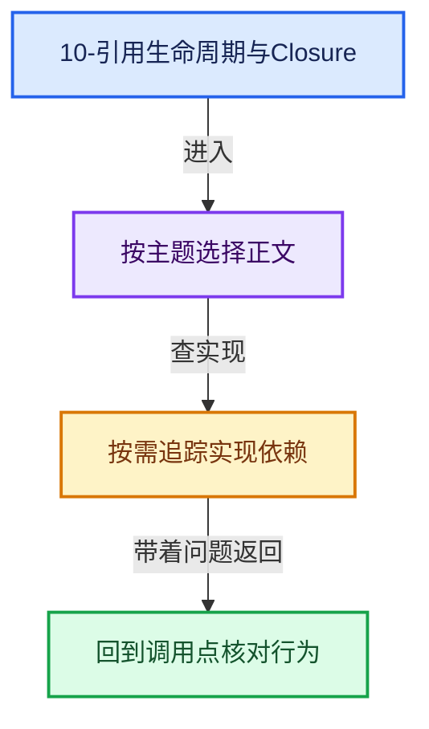
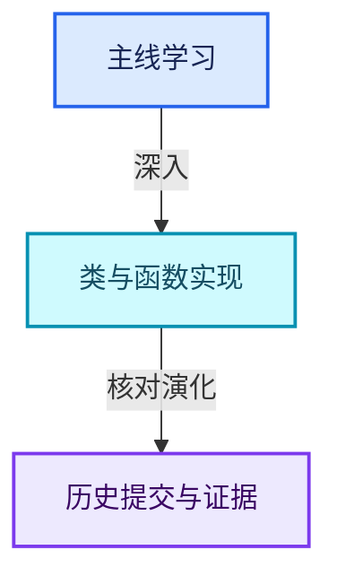

# 10-引用生命周期与Closure

[总入口](../README.md) · [几何节点专题](../13-几何节点专题/README.md) · [实现依赖](../90-实现依赖专题/README.md)

## 阅读顺序

- [10-01 匿名属性与引用问题](01-匿名属性与引用问题.md)
- [10-02 GeometryNodesReferenceSet](02-GeometryNodesReferenceSet.md)
- [10-03 节点树生命周期分析](03-节点树生命周期分析.md)
- [10-04 引用传播与过滤](04-引用传播与过滤.md)
- [10-05 Bundle值组合](05-Bundle值组合.md)
- [10-06 Closure表示与捕获](06-Closure表示与捕获.md)
- [10-07 Closure求值与Zone](07-Closure求值与Zone.md)
- [10-08 执行图所有权与演化](08-执行图所有权与演化.md)

