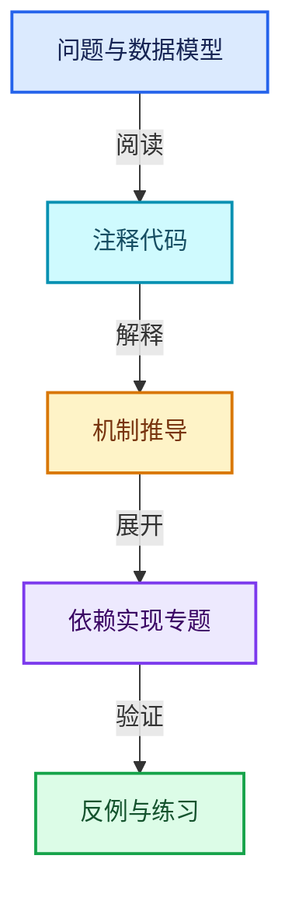
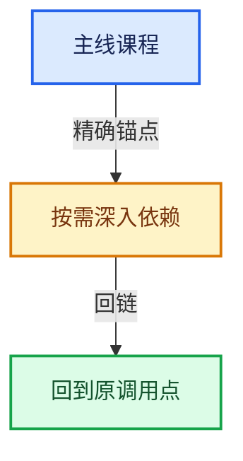

# 10-引用生命周期与Closure

[总目录](../README.md) · [实现索引](../%E7%AC%A6%E5%8F%B7%E4%BE%9D%E8%B5%96%E4%B8%8E%E5%AE%9E%E7%8E%B0%E7%B4%A2%E5%BC%95.md)

## 主线课程

- [10-01 匿名属性与引用问题](01-%E5%8C%BF%E5%90%8D%E5%B1%9E%E6%80%A7%E4%B8%8E%E5%BC%95%E7%94%A8%E9%97%AE%E9%A2%98.md)
- [10-02 GeometryNodesReferenceSet](02-GeometryNodesReferenceSet.md)
- [10-03 节点树生命周期分析](03-%E8%8A%82%E7%82%B9%E6%A0%91%E7%94%9F%E5%91%BD%E5%91%A8%E6%9C%9F%E5%88%86%E6%9E%90.md)
- [10-04 引用传播与过滤](04-%E5%BC%95%E7%94%A8%E4%BC%A0%E6%92%AD%E4%B8%8E%E8%BF%87%E6%BB%A4.md)
- [10-05 Bundle值组合](05-Bundle%E5%80%BC%E7%BB%84%E5%90%88.md)
- [10-06 Closure表示与捕获](06-Closure%E8%A1%A8%E7%A4%BA%E4%B8%8E%E6%8D%95%E8%8E%B7.md)
- [10-07 Closure求值与Zone](07-Closure%E6%B1%82%E5%80%BC%E4%B8%8EZone.md)
- [10-08 执行图所有权与演化](08-%E6%89%A7%E8%A1%8C%E5%9B%BE%E6%89%80%E6%9C%89%E6%9D%83%E4%B8%8E%E6%BC%94%E5%8C%96.md)

## 共享实现专题

- [source/blender/blenkernel/BKE_anonymous_attribute_make.hh](%E4%BE%9D%E8%B5%96-BKE_anonymous_attribute_make-27a67d.md)
- [source/blender/blenkernel/intern/asset_weak_reference.cc](%E4%BE%9D%E8%B5%96-asset_weak_reference-948455.md)
- [source/blender/blenkernel/intern/preferences.cc](%E4%BE%9D%E8%B5%96-preferences-70091b.md)
- [source/blender/nodes/NOD_bundle_type.hh](%E4%BE%9D%E8%B5%96-NOD_bundle_type-22e0c3.md)
- [source/blender/nodes/NOD_geometry_nodes_bundle.hh](%E4%BE%9D%E8%B5%96-NOD_geometry_nodes_bundle-f07f4e.md)
- [source/blender/nodes/geometry/include/NOD_geo_bundle.hh](%E4%BE%9D%E8%B5%96-NOD_geo_bundle-244ebc.md)
- [source/blender/nodes/geometry/include/NOD_geo_closure.hh](%E4%BE%9D%E8%B5%96-NOD_geo_closure-e5c7ca.md)
- [source/blender/nodes/geometry/include/NOD_geo_closure_to_list.hh](%E4%BE%9D%E8%B5%96-NOD_geo_closure_to_list-2acad3.md)
- [source/blender/nodes/geometry/nodes/node_geo_closure.cc](%E4%BE%9D%E8%B5%96-node_geo_closure-f2c759.md)
- [source/blender/nodes/geometry/nodes/node_geo_closure_to_list.cc](%E4%BE%9D%E8%B5%96-node_geo_closure_to_list-19d68f.md)
- [source/blender/nodes/geometry/nodes/node_geo_combine_bundle.cc](%E4%BE%9D%E8%B5%96-node_geo_combine_bundle-d57c83.md)
- [source/blender/nodes/geometry/nodes/node_geo_evaluate_closure.cc](%E4%BE%9D%E8%B5%96-node_geo_evaluate_closure-58eb54.md)
- [source/blender/nodes/geometry/nodes/node_geo_separate_bundle.cc](%E4%BE%9D%E8%B5%96-node_geo_separate_bundle-331630.md)
- [source/blender/nodes/intern/bundle_type.cc](%E4%BE%9D%E8%B5%96-bundle_type-056e02.md)

## 几何节点扩展专题

- [GN-13 CaptureAttribute匿名属性引用与清理](%E6%89%A9%E5%B1%9501-CaptureAttribute%E5%8C%BF%E5%90%8D%E5%B1%9E%E6%80%A7%E5%BC%95%E7%94%A8%E4%B8%8E%E6%B8%85%E7%90%86.md)
- [GN-18 Simulation状态协议缓存与时间步](%E6%89%A9%E5%B1%9502-Simulation%E7%8A%B6%E6%80%81%E5%8D%8F%E8%AE%AE%E7%BC%93%E5%AD%98%E4%B8%8E%E6%97%B6%E9%97%B4%E6%AD%A5.md)
- [GN-19 Repeat与Foreach执行状态及上下文身份](%E6%89%A9%E5%B1%9503-Repeat%E4%B8%8EForeach%E6%89%A7%E8%A1%8C%E7%8A%B6%E6%80%81%E5%8F%8A%E4%B8%8A%E4%B8%8B%E6%96%87%E8%BA%AB%E4%BB%BD.md)
- [GN-20 Closure可传递程序捕获与调用边界](%E6%89%A9%E5%B1%9504-Closure%E5%8F%AF%E4%BC%A0%E9%80%92%E7%A8%8B%E5%BA%8F%E6%8D%95%E8%8E%B7%E4%B8%8E%E8%B0%83%E7%94%A8%E8%BE%B9%E7%95%8C.md)
- [GN-21 Bundle嵌套值路径查找与写时复制](%E6%89%A9%E5%B1%9505-Bundle%E5%B5%8C%E5%A5%97%E5%80%BC%E8%B7%AF%E5%BE%84%E6%9F%A5%E6%89%BE%E4%B8%8E%E5%86%99%E6%97%B6%E5%A4%8D%E5%88%B6.md)
