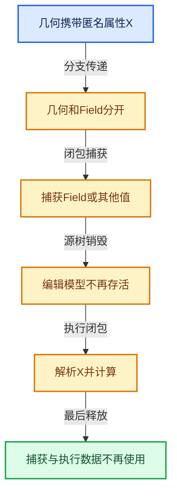

# 10-引用生命周期与Closure

[总目录](../README.md)

表达式引用、承载数据与执行环境必须一起追踪，跨区域组合不能丢掉生命周期信息。

## 前置知识与阅读层次

- [06-隐式共享与缓存系统](../06-%E9%9A%90%E5%BC%8F%E5%85%B1%E4%BA%AB%E4%B8%8E%E7%BC%93%E5%AD%98%E7%B3%BB%E7%BB%9F/README.md)
- [08-Field表达式与求值](../08-Field%E8%A1%A8%E8%BE%BE%E5%BC%8F%E4%B8%8E%E6%B1%82%E5%80%BC/README.md)
- [09-LazyFunction与节点执行架构](../09-LazyFunction%E4%B8%8E%E8%8A%82%E7%82%B9%E6%89%A7%E8%A1%8C%E6%9E%B6%E6%9E%84/README.md)

初读抓住数据模型，复读逐行检查，再完成反例和独立实现。方向间允许按实际问题回查，不要求机械线性阅读。

## 正文与源码范围

| 顺序 | 文档 | 主讲文件与范围 |
|---|---|---|
| 10-01 | [匿名属性与引用问题](01-%E5%8C%BF%E5%90%8D%E5%B1%9E%E6%80%A7%E4%B8%8E%E5%BC%95%E7%94%A8%E9%97%AE%E9%A2%98.md) | BKE_anonymous_attribute_id.hh:L1—L40 |
| 10-02 | [GeometryNodesReferenceSet](02-GeometryNodesReferenceSet.md) | BKE_geometry_nodes_reference_set.hh:L1—L31 |
| 10-03 | [节点树生命周期分析](03-%E8%8A%82%E7%82%B9%E6%A0%91%E7%94%9F%E5%91%BD%E5%91%A8%E6%9C%9F%E5%88%86%E6%9E%90.md) | BKE_node_tree_reference_lifetimes.hh:L1—L118；node_tree_reference_lifetimes.cc:L1—L1112 |
| 10-04 | [引用传播与过滤](04-%E5%BC%95%E7%94%A8%E4%BC%A0%E6%92%AD%E4%B8%8E%E8%BF%87%E6%BB%A4.md) | BKE_attribute_filter.hh:L1—L61；BKE_attribute_filters.hh:L1—L87 |
| 10-05 | [Bundle值组合](05-Bundle%E5%80%BC%E7%BB%84%E5%90%88.md) | geometry_nodes_bundle.cc:L1—L539 |
| 10-06 | [Closure表示与捕获](06-Closure%E8%A1%A8%E7%A4%BA%E4%B8%8E%E6%8D%95%E8%8E%B7.md) | NOD_geometry_nodes_closure.hh:L1—L147；NOD_geometry_nodes_closure_signature.hh:L1—L70 |
| 10-07 | [Closure求值与Zone](07-Closure%E6%B1%82%E5%80%BC%E4%B8%8EZone.md) | geometry_nodes_closure.cc:L1—L185；geometry_nodes_closure_zone.cc:L1—L911 |
| 10-08 | [执行图所有权与演化](08-%E6%89%A7%E8%A1%8C%E5%9B%BE%E6%89%80%E6%9C%89%E6%9D%83%E4%B8%8E%E6%BC%94%E5%8C%96.md) | NOD_geometry_nodes_lazy_function.hh:L1—L691；NOD_geometry_nodes_closure_eval.hh:L1—L44 |

## 本方向的数据模型

## 状态推演

## 历史入口

- [Refactor: Geometry Nodes: improve lifetime analysis for anonymous attributes](https://projects.blender.org/blender/blender/commit/67c7485bfd95a60caa8d0c12edaaadb55d3519c0) · Jacques Lucke · 2024-10-07
- [Geometry Nodes: add Closures and Bundles behind experimental feature flag](https://projects.blender.org/blender/blender/commit/8ec9c62d3ea8d8f00a375c01e7533a080f7476c5) · Jacques Lucke · 2025-04-03
- [Refactor: Geometry Nodes: make evaluation graph independent of original node tree](https://projects.blender.org/blender/blender/commit/bb00826a7eab059423e2885edbd29c9140d7028b) · Jacques Lucke · 2025-12-02

## 跨库比较与验收

与C++ lambda、shared_ptr图和编译器活跃性分析比较：捕获环境保障寿命，引用集合保障所需数据传播，二者承担不同责任。

所有被读取的引用仍有对应数据；源树结束后执行对象所需信息存活；强引用图无不必要循环。

正文和源码区间已建立；自动检查结果见根目录验收报告。阅读者的掌握程度以独立练习与反例推理为准。
