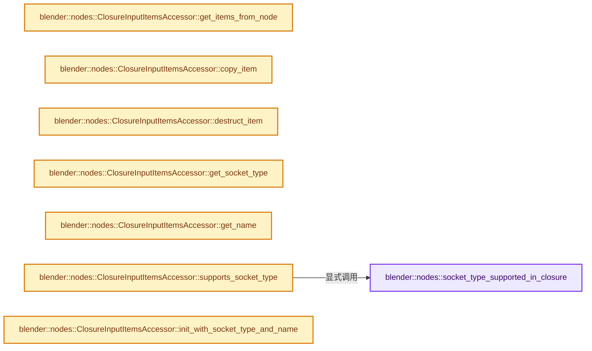

# 实现依赖专题：source/blender/nodes/geometry/include/NOD_geo_closure.hh

[方向导航](README.md) · [符号索引](../%E7%AC%A6%E5%8F%B7%E4%BE%9D%E8%B5%96%E4%B8%8E%E5%AE%9E%E7%8E%B0%E7%B4%A2%E5%BC%95.md)

本专题从正文实际调用进入，集中保存共享实现。函数有稳定锚点，可从调用处直接跳到对应完整函数；递归与互相调用通过回链组织。

## 本文件的实现关系




## 完整成员与函数实现

<a id="f-a117a83f5d0a76a1"></a>

### `blender::nodes::socket_type_supported_in_closure`

实现位置：[source/blender/nodes/geometry/include/NOD_geo_closure.hh](../../../../../source/blender/nodes/geometry/include/NOD_geo_closure.hh) · L15—L19。

接口参数：

- `const eNodeSocketDatatype socket_type`
- `const int ntree_type`

**教学注释版**

<!-- annotated:112bd8242d47b0 -->

```cpp
inline bool socket_type_supported_in_closure(const eNodeSocketDatatype socket_type,
                                             const int ntree_type)
{
  return bke::node_tree_type_supports_socket_type_static(ntree_type, socket_type);
}
```

<details>
<summary>核对原始源码：source/blender/nodes/geometry/include/NOD_geo_closure.hh · L15—L19</summary>

<!-- original:112bd8242d47b0:source/blender/nodes/geometry/include/NOD_geo_closure.hh:15:19 -->

```cpp
inline bool socket_type_supported_in_closure(const eNodeSocketDatatype socket_type,
                                             const int ntree_type)
{
  return bke::node_tree_type_supports_socket_type_static(ntree_type, socket_type);
}
```

</details>

**结果出口**

- `return bke::node_tree_type_supports_socket_type_static(ntree_type, socket_type);`

**继续追踪实现**

- `bke::node_tree_type_supports_socket_type_static` → [blender::bke::node_tree_type_supports_socket_type_static · L6295](../05-%E5%87%A0%E4%BD%95%E5%AD%98%E5%82%A8%E4%B8%8E%E6%8B%93%E6%89%91%E6%98%A0%E5%B0%84/%E4%BE%9D%E8%B5%96-node-89d753.md#f-f2bd64dc6bed02ca)。

<a id="f-81cfe82f985d2413"></a>

### `blender::nodes::ClosureInputItemsAccessor::get_items_from_node`

实现位置：[source/blender/nodes/geometry/include/NOD_geo_closure.hh](../../../../../source/blender/nodes/geometry/include/NOD_geo_closure.hh) · L41—L47。

接口参数：

- `bNode &node`

**教学注释版**

<!-- annotated:82890dbda36fc3 -->

```cpp
  static socket_items::SocketItemsRef<ItemT> get_items_from_node(bNode &node)
  {
    auto *storage = static_cast<NodeClosureOutput *>(node.storage);
    return {&storage->input_items.items,
            &storage->input_items.items_num,
            &storage->input_items.active_index};
  }
```

<details>
<summary>核对原始源码：source/blender/nodes/geometry/include/NOD_geo_closure.hh · L41—L47</summary>

<!-- original:82890dbda36fc3:source/blender/nodes/geometry/include/NOD_geo_closure.hh:41:47 -->

```cpp
  static socket_items::SocketItemsRef<ItemT> get_items_from_node(bNode &node)
  {
    auto *storage = static_cast<NodeClosureOutput *>(node.storage);
    return {&storage->input_items.items,
            &storage->input_items.items_num,
            &storage->input_items.active_index};
  }
```

</details>

**结果出口**

- `return {&storage->input_items.items,`

**继续追踪实现**

本实现没有需要继续展开的显式调用；检查返回表达式、对象转换和调用者前置条件。

<a id="f-9de86c42a23749b1"></a>

### `blender::nodes::ClosureInputItemsAccessor::copy_item`

实现位置：[source/blender/nodes/geometry/include/NOD_geo_closure.hh](../../../../../source/blender/nodes/geometry/include/NOD_geo_closure.hh) · L49—L53。

接口参数：

- `const ItemT &src`
- `ItemT &dst`

**教学注释版**

<!-- annotated:5339246bd0f8e9 -->

```cpp
  static void copy_item(const ItemT &src, ItemT &dst)
  {
    dst = src;
    dst.name = BLI_strdup_null(dst.name);
  }
```

<details>
<summary>核对原始源码：source/blender/nodes/geometry/include/NOD_geo_closure.hh · L49—L53</summary>

<!-- original:5339246bd0f8e9:source/blender/nodes/geometry/include/NOD_geo_closure.hh:49:53 -->

```cpp
  static void copy_item(const ItemT &src, ItemT &dst)
  {
    dst = src;
    dst.name = BLI_strdup_null(dst.name);
  }
```

</details>

**沿实际写入检查状态**

- `dst = src;`
- `dst.name = BLI_strdup_null(dst.name);`

**继续追踪实现**

- `BLI_strdup_null` → [blender::BLI_strdup_null · L48](../01-%E5%9F%BA%E7%A1%80%E5%AE%B9%E5%99%A8%E4%B8%8E%E7%8E%B0%E4%BB%A3CPP/%E4%BE%9D%E8%B5%96-string-1d986f.md#f-c1cd7c6336fe3fe0)。

<a id="f-7885a02415e196e5"></a>

### `blender::nodes::ClosureInputItemsAccessor::destruct_item`

实现位置：[source/blender/nodes/geometry/include/NOD_geo_closure.hh](../../../../../source/blender/nodes/geometry/include/NOD_geo_closure.hh) · L55—L58。

接口参数：

- `ItemT *item`

**教学注释版**

<!-- annotated:890658b7bbae71 -->

```cpp
  static void destruct_item(ItemT *item)
  {
    MEM_SAFE_DELETE(item->name);
  }
```

<details>
<summary>核对原始源码：source/blender/nodes/geometry/include/NOD_geo_closure.hh · L55—L58</summary>

<!-- original:890658b7bbae71:source/blender/nodes/geometry/include/NOD_geo_closure.hh:55:58 -->

```cpp
  static void destruct_item(ItemT *item)
  {
    MEM_SAFE_DELETE(item->name);
  }
```

</details>

**继续追踪实现**

- `MEM_SAFE_DELETE` → [MEM_SAFE_DELETE · L436](../03-%E5%86%85%E5%AD%98%E5%88%86%E9%85%8D%E4%B8%8E%E8%BF%90%E8%A1%8C%E6%97%B6%E7%B1%BB%E5%9E%8B/%E4%BE%9D%E8%B5%96-MEM_guardedalloc-b54eca.md#m-eadb3bc5b902)。宏定义由构建条件选择。

<a id="f-63d79b046320cdf6"></a>

### `blender::nodes::ClosureInputItemsAccessor::get_socket_type`

实现位置：[source/blender/nodes/geometry/include/NOD_geo_closure.hh](../../../../../source/blender/nodes/geometry/include/NOD_geo_closure.hh) · L63—L66。

接口参数：

- `const ItemT &item`

**教学注释版**

<!-- annotated:98ac76c871e70f -->

```cpp
  static eNodeSocketDatatype get_socket_type(const ItemT &item)
  {
    return item.socket_type;
  }
```

<details>
<summary>核对原始源码：source/blender/nodes/geometry/include/NOD_geo_closure.hh · L63—L66</summary>

<!-- original:98ac76c871e70f:source/blender/nodes/geometry/include/NOD_geo_closure.hh:63:66 -->

```cpp
  static eNodeSocketDatatype get_socket_type(const ItemT &item)
  {
    return item.socket_type;
  }
```

</details>

**结果出口**

- `return item.socket_type;`

**继续追踪实现**

本实现没有需要继续展开的显式调用；检查返回表达式、对象转换和调用者前置条件。

<a id="f-6fa2a8e8e258b75d"></a>

### `blender::nodes::ClosureInputItemsAccessor::get_name`

实现位置：[source/blender/nodes/geometry/include/NOD_geo_closure.hh](../../../../../source/blender/nodes/geometry/include/NOD_geo_closure.hh) · L68—L71。

接口参数：

- `ItemT &item`

**教学注释版**

<!-- annotated:24ea89e6201cd5 -->

```cpp
  static char **get_name(ItemT &item)
  {
    return &item.name;
  }
```

<details>
<summary>核对原始源码：source/blender/nodes/geometry/include/NOD_geo_closure.hh · L68—L71</summary>

<!-- original:24ea89e6201cd5:source/blender/nodes/geometry/include/NOD_geo_closure.hh:68:71 -->

```cpp
  static char **get_name(ItemT &item)
  {
    return &item.name;
  }
```

</details>

**结果出口**

- `return &item.name;`

**继续追踪实现**

本实现没有需要继续展开的显式调用；检查返回表达式、对象转换和调用者前置条件。

<a id="f-dbf19153a71dede0"></a>

### `blender::nodes::ClosureInputItemsAccessor::supports_socket_type`

实现位置：[source/blender/nodes/geometry/include/NOD_geo_closure.hh](../../../../../source/blender/nodes/geometry/include/NOD_geo_closure.hh) · L73—L76。

接口参数：

- `const eNodeSocketDatatype socket_type`
- `const int ntree_type`

**教学注释版**

<!-- annotated:89edec425c33af -->

```cpp
  static bool supports_socket_type(const eNodeSocketDatatype socket_type, const int ntree_type)
  {
    return socket_type_supported_in_closure(socket_type, ntree_type);
  }
```

<details>
<summary>核对原始源码：source/blender/nodes/geometry/include/NOD_geo_closure.hh · L73—L76</summary>

<!-- original:89edec425c33af:source/blender/nodes/geometry/include/NOD_geo_closure.hh:73:76 -->

```cpp
  static bool supports_socket_type(const eNodeSocketDatatype socket_type, const int ntree_type)
  {
    return socket_type_supported_in_closure(socket_type, ntree_type);
  }
```

</details>

**结果出口**

- `return socket_type_supported_in_closure(socket_type, ntree_type);`

**继续追踪实现**

- `socket_type_supported_in_closure` → [blender::nodes::socket_type_supported_in_closure · L15](%E4%BE%9D%E8%B5%96-NOD_geo_closure-e5c7ca.md#f-a117a83f5d0a76a1)。

<a id="f-739e8288456ef6f5"></a>

### `blender::nodes::ClosureInputItemsAccessor::init_with_socket_type_and_name`

实现位置：[source/blender/nodes/geometry/include/NOD_geo_closure.hh](../../../../../source/blender/nodes/geometry/include/NOD_geo_closure.hh) · L78—L87。

接口参数：

- `bNode &node`
- `ItemT &item`
- `const eNodeSocketDatatype socket_type`
- `const char *name`

**教学注释版**

<!-- annotated:3d19f9a21e269e -->

```cpp
  static void init_with_socket_type_and_name(bNode &node,
                                             ItemT &item,
                                             const eNodeSocketDatatype socket_type,
                                             const char *name)
  {
    auto *storage = static_cast<NodeClosureOutput *>(node.storage);
    item.socket_type = socket_type;
    item.identifier = storage->input_items.next_identifier++;
    socket_items::set_item_name_and_make_unique<ClosureInputItemsAccessor>(node, item, name);
  }
```

<details>
<summary>核对原始源码：source/blender/nodes/geometry/include/NOD_geo_closure.hh · L78—L87</summary>

<!-- original:3d19f9a21e269e:source/blender/nodes/geometry/include/NOD_geo_closure.hh:78:87 -->

```cpp
  static void init_with_socket_type_and_name(bNode &node,
                                             ItemT &item,
                                             const eNodeSocketDatatype socket_type,
                                             const char *name)
  {
    auto *storage = static_cast<NodeClosureOutput *>(node.storage);
    item.socket_type = socket_type;
    item.identifier = storage->input_items.next_identifier++;
    socket_items::set_item_name_and_make_unique<ClosureInputItemsAccessor>(node, item, name);
  }
```

</details>

**沿实际写入检查状态**

- `item.socket_type = socket_type;`
- `item.identifier = storage->input_items.next_identifier++;`

**继续追踪实现**

- `socket_items::set_item_name_and_make_unique<ClosureInputItemsAccessor>` → [blender::nodes::socket_items::set_item_name_and_make_unique · L148](../09-LazyFunction%E4%B8%8E%E8%8A%82%E7%82%B9%E6%89%A7%E8%A1%8C%E6%9E%B6%E6%9E%84/%E4%BE%9D%E8%B5%96-NOD_socket_items-d21cfb.md#f-7e7af1c01522f9dc)。

<a id="f-3eaad318e8ff0a08"></a>

### `blender::nodes::ClosureInputItemsAccessor::socket_identifier_for_item`

实现位置：[source/blender/nodes/geometry/include/NOD_geo_closure.hh](../../../../../source/blender/nodes/geometry/include/NOD_geo_closure.hh) · L89—L92。

接口参数：

- `const ItemT &item`

**教学注释版**

<!-- annotated:d48b02bb9b1ed4 -->

```cpp
  static std::string socket_identifier_for_item(const ItemT &item)
  {
    return "Item_" + std::to_string(item.identifier);
  }
```

<details>
<summary>核对原始源码：source/blender/nodes/geometry/include/NOD_geo_closure.hh · L89—L92</summary>

<!-- original:d48b02bb9b1ed4:source/blender/nodes/geometry/include/NOD_geo_closure.hh:89:92 -->

```cpp
  static std::string socket_identifier_for_item(const ItemT &item)
  {
    return "Item_" + std::to_string(item.identifier);
  }
```

</details>

**结果出口**

- `return "Item_" + std::to_string(item.identifier);`

**继续追踪实现**

- `std::to_string` → [外部契约](https://eel.is/c++draft/)：这个边界按实际表达式及所属类型核对参数、返回值、寿命与失败行为。这里提供接口入口，不声称已解释该第三方版本的内部实现。

<a id="f-741633ed0fe86dcc"></a>

### `blender::nodes::ClosureOutputItemsAccessor::get_items_from_node`

实现位置：[source/blender/nodes/geometry/include/NOD_geo_closure.hh](../../../../../source/blender/nodes/geometry/include/NOD_geo_closure.hh) · L115—L121。

接口参数：

- `bNode &node`

**教学注释版**

<!-- annotated:a7e7ae88b44447 -->

```cpp
  static socket_items::SocketItemsRef<ItemT> get_items_from_node(bNode &node)
  {
    auto *storage = static_cast<NodeClosureOutput *>(node.storage);
    return {&storage->output_items.items,
            &storage->output_items.items_num,
            &storage->output_items.active_index};
  }
```

<details>
<summary>核对原始源码：source/blender/nodes/geometry/include/NOD_geo_closure.hh · L115—L121</summary>

<!-- original:a7e7ae88b44447:source/blender/nodes/geometry/include/NOD_geo_closure.hh:115:121 -->

```cpp
  static socket_items::SocketItemsRef<ItemT> get_items_from_node(bNode &node)
  {
    auto *storage = static_cast<NodeClosureOutput *>(node.storage);
    return {&storage->output_items.items,
            &storage->output_items.items_num,
            &storage->output_items.active_index};
  }
```

</details>

**结果出口**

- `return {&storage->output_items.items,`

**继续追踪实现**

本实现没有需要继续展开的显式调用；检查返回表达式、对象转换和调用者前置条件。

<a id="f-932ddc7e31701bf4"></a>

### `blender::nodes::ClosureOutputItemsAccessor::copy_item`

实现位置：[source/blender/nodes/geometry/include/NOD_geo_closure.hh](../../../../../source/blender/nodes/geometry/include/NOD_geo_closure.hh) · L123—L127。

接口参数：

- `const ItemT &src`
- `ItemT &dst`

**教学注释版**

<!-- annotated:718801f54f21c2 -->

```cpp
  static void copy_item(const ItemT &src, ItemT &dst)
  {
    dst = src;
    dst.name = BLI_strdup_null(dst.name);
  }
```

<details>
<summary>核对原始源码：source/blender/nodes/geometry/include/NOD_geo_closure.hh · L123—L127</summary>

<!-- original:718801f54f21c2:source/blender/nodes/geometry/include/NOD_geo_closure.hh:123:127 -->

```cpp
  static void copy_item(const ItemT &src, ItemT &dst)
  {
    dst = src;
    dst.name = BLI_strdup_null(dst.name);
  }
```

</details>

**沿实际写入检查状态**

- `dst = src;`
- `dst.name = BLI_strdup_null(dst.name);`

**继续追踪实现**

- `BLI_strdup_null` → [blender::BLI_strdup_null · L48](../01-%E5%9F%BA%E7%A1%80%E5%AE%B9%E5%99%A8%E4%B8%8E%E7%8E%B0%E4%BB%A3CPP/%E4%BE%9D%E8%B5%96-string-1d986f.md#f-c1cd7c6336fe3fe0)。

<a id="f-6b711cec9e07bb08"></a>

### `blender::nodes::ClosureOutputItemsAccessor::destruct_item`

实现位置：[source/blender/nodes/geometry/include/NOD_geo_closure.hh](../../../../../source/blender/nodes/geometry/include/NOD_geo_closure.hh) · L129—L132。

接口参数：

- `ItemT *item`

**教学注释版**

<!-- annotated:c359c33716bf05 -->

```cpp
  static void destruct_item(ItemT *item)
  {
    MEM_SAFE_DELETE(item->name);
  }
```

<details>
<summary>核对原始源码：source/blender/nodes/geometry/include/NOD_geo_closure.hh · L129—L132</summary>

<!-- original:c359c33716bf05:source/blender/nodes/geometry/include/NOD_geo_closure.hh:129:132 -->

```cpp
  static void destruct_item(ItemT *item)
  {
    MEM_SAFE_DELETE(item->name);
  }
```

</details>

**继续追踪实现**

- `MEM_SAFE_DELETE` → [MEM_SAFE_DELETE · L436](../03-%E5%86%85%E5%AD%98%E5%88%86%E9%85%8D%E4%B8%8E%E8%BF%90%E8%A1%8C%E6%97%B6%E7%B1%BB%E5%9E%8B/%E4%BE%9D%E8%B5%96-MEM_guardedalloc-b54eca.md#m-eadb3bc5b902)。宏定义由构建条件选择。

<a id="f-cdcd610233e3547e"></a>

### `blender::nodes::ClosureOutputItemsAccessor::get_socket_type`

实现位置：[source/blender/nodes/geometry/include/NOD_geo_closure.hh](../../../../../source/blender/nodes/geometry/include/NOD_geo_closure.hh) · L137—L140。

接口参数：

- `const ItemT &item`

**教学注释版**

<!-- annotated:90f8a2df2c8d0c -->

```cpp
  static eNodeSocketDatatype get_socket_type(const ItemT &item)
  {
    return item.socket_type;
  }
```

<details>
<summary>核对原始源码：source/blender/nodes/geometry/include/NOD_geo_closure.hh · L137—L140</summary>

<!-- original:90f8a2df2c8d0c:source/blender/nodes/geometry/include/NOD_geo_closure.hh:137:140 -->

```cpp
  static eNodeSocketDatatype get_socket_type(const ItemT &item)
  {
    return item.socket_type;
  }
```

</details>

**结果出口**

- `return item.socket_type;`

**继续追踪实现**

本实现没有需要继续展开的显式调用；检查返回表达式、对象转换和调用者前置条件。

<a id="f-7dde78906512f31c"></a>

### `blender::nodes::ClosureOutputItemsAccessor::get_name`

实现位置：[source/blender/nodes/geometry/include/NOD_geo_closure.hh](../../../../../source/blender/nodes/geometry/include/NOD_geo_closure.hh) · L142—L145。

接口参数：

- `ItemT &item`

**教学注释版**

<!-- annotated:8dc3c67a64e489 -->

```cpp
  static char **get_name(ItemT &item)
  {
    return &item.name;
  }
```

<details>
<summary>核对原始源码：source/blender/nodes/geometry/include/NOD_geo_closure.hh · L142—L145</summary>

<!-- original:8dc3c67a64e489:source/blender/nodes/geometry/include/NOD_geo_closure.hh:142:145 -->

```cpp
  static char **get_name(ItemT &item)
  {
    return &item.name;
  }
```

</details>

**结果出口**

- `return &item.name;`

**继续追踪实现**

本实现没有需要继续展开的显式调用；检查返回表达式、对象转换和调用者前置条件。

<a id="f-ccf693a552f5d795"></a>

### `blender::nodes::ClosureOutputItemsAccessor::supports_socket_type`

实现位置：[source/blender/nodes/geometry/include/NOD_geo_closure.hh](../../../../../source/blender/nodes/geometry/include/NOD_geo_closure.hh) · L147—L150。

接口参数：

- `const eNodeSocketDatatype socket_type`
- `const int ntree_type`

**教学注释版**

<!-- annotated:6bd19299cbd48c -->

```cpp
  static bool supports_socket_type(const eNodeSocketDatatype socket_type, const int ntree_type)
  {
    return socket_type_supported_in_closure(socket_type, ntree_type);
  }
```

<details>
<summary>核对原始源码：source/blender/nodes/geometry/include/NOD_geo_closure.hh · L147—L150</summary>

<!-- original:6bd19299cbd48c:source/blender/nodes/geometry/include/NOD_geo_closure.hh:147:150 -->

```cpp
  static bool supports_socket_type(const eNodeSocketDatatype socket_type, const int ntree_type)
  {
    return socket_type_supported_in_closure(socket_type, ntree_type);
  }
```

</details>

**结果出口**

- `return socket_type_supported_in_closure(socket_type, ntree_type);`

**继续追踪实现**

- `socket_type_supported_in_closure` → [blender::nodes::socket_type_supported_in_closure · L15](%E4%BE%9D%E8%B5%96-NOD_geo_closure-e5c7ca.md#f-a117a83f5d0a76a1)。

<a id="f-8efbc5e428c91157"></a>

### `blender::nodes::ClosureOutputItemsAccessor::init_with_socket_type_and_name`

实现位置：[source/blender/nodes/geometry/include/NOD_geo_closure.hh](../../../../../source/blender/nodes/geometry/include/NOD_geo_closure.hh) · L152—L161。

接口参数：

- `bNode &node`
- `ItemT &item`
- `const eNodeSocketDatatype socket_type`
- `const char *name`

**教学注释版**

<!-- annotated:6f40c28e27c66d -->

```cpp
  static void init_with_socket_type_and_name(bNode &node,
                                             ItemT &item,
                                             const eNodeSocketDatatype socket_type,
                                             const char *name)
  {
    auto *storage = static_cast<NodeClosureOutput *>(node.storage);
    item.socket_type = socket_type;
    item.identifier = storage->output_items.next_identifier++;
    socket_items::set_item_name_and_make_unique<ClosureOutputItemsAccessor>(node, item, name);
  }
```

<details>
<summary>核对原始源码：source/blender/nodes/geometry/include/NOD_geo_closure.hh · L152—L161</summary>

<!-- original:6f40c28e27c66d:source/blender/nodes/geometry/include/NOD_geo_closure.hh:152:161 -->

```cpp
  static void init_with_socket_type_and_name(bNode &node,
                                             ItemT &item,
                                             const eNodeSocketDatatype socket_type,
                                             const char *name)
  {
    auto *storage = static_cast<NodeClosureOutput *>(node.storage);
    item.socket_type = socket_type;
    item.identifier = storage->output_items.next_identifier++;
    socket_items::set_item_name_and_make_unique<ClosureOutputItemsAccessor>(node, item, name);
  }
```

</details>

**沿实际写入检查状态**

- `item.socket_type = socket_type;`
- `item.identifier = storage->output_items.next_identifier++;`

**继续追踪实现**

- `socket_items::set_item_name_and_make_unique<ClosureOutputItemsAccessor>` → [blender::nodes::socket_items::set_item_name_and_make_unique · L148](../09-LazyFunction%E4%B8%8E%E8%8A%82%E7%82%B9%E6%89%A7%E8%A1%8C%E6%9E%B6%E6%9E%84/%E4%BE%9D%E8%B5%96-NOD_socket_items-d21cfb.md#f-7e7af1c01522f9dc)。

<a id="f-e8cbc97f766db87b"></a>

### `blender::nodes::ClosureOutputItemsAccessor::socket_identifier_for_item`

实现位置：[source/blender/nodes/geometry/include/NOD_geo_closure.hh](../../../../../source/blender/nodes/geometry/include/NOD_geo_closure.hh) · L163—L166。

接口参数：

- `const ItemT &item`

**教学注释版**

<!-- annotated:3da60149b04eaf -->

```cpp
  static std::string socket_identifier_for_item(const ItemT &item)
  {
    return "Item_" + std::to_string(item.identifier);
  }
```

<details>
<summary>核对原始源码：source/blender/nodes/geometry/include/NOD_geo_closure.hh · L163—L166</summary>

<!-- original:3da60149b04eaf:source/blender/nodes/geometry/include/NOD_geo_closure.hh:163:166 -->

```cpp
  static std::string socket_identifier_for_item(const ItemT &item)
  {
    return "Item_" + std::to_string(item.identifier);
  }
```

</details>

**结果出口**

- `return "Item_" + std::to_string(item.identifier);`

**继续追踪实现**

- `std::to_string` → [外部契约](https://eel.is/c++draft/)：这个边界按实际表达式及所属类型核对参数、返回值、寿命与失败行为。这里提供接口入口，不声称已解释该第三方版本的内部实现。

<a id="f-63859ce4e73466e4"></a>

### `blender::nodes::EvaluateClosureInputItemsAccessor::get_items_from_node`

实现位置：[source/blender/nodes/geometry/include/NOD_geo_closure.hh](../../../../../source/blender/nodes/geometry/include/NOD_geo_closure.hh) · L189—L195。

接口参数：

- `bNode &node`

**教学注释版**

<!-- annotated:9d174620b93972 -->

```cpp
  static socket_items::SocketItemsRef<ItemT> get_items_from_node(bNode &node)
  {
    auto *storage = static_cast<NodeEvaluateClosure *>(node.storage);
    return {&storage->input_items.items,
            &storage->input_items.items_num,
            &storage->input_items.active_index};
  }
```

<details>
<summary>核对原始源码：source/blender/nodes/geometry/include/NOD_geo_closure.hh · L189—L195</summary>

<!-- original:9d174620b93972:source/blender/nodes/geometry/include/NOD_geo_closure.hh:189:195 -->

```cpp
  static socket_items::SocketItemsRef<ItemT> get_items_from_node(bNode &node)
  {
    auto *storage = static_cast<NodeEvaluateClosure *>(node.storage);
    return {&storage->input_items.items,
            &storage->input_items.items_num,
            &storage->input_items.active_index};
  }
```

</details>

**结果出口**

- `return {&storage->input_items.items,`

**继续追踪实现**

本实现没有需要继续展开的显式调用；检查返回表达式、对象转换和调用者前置条件。

<a id="f-b830b7214d4eb609"></a>

### `blender::nodes::EvaluateClosureInputItemsAccessor::copy_item`

实现位置：[source/blender/nodes/geometry/include/NOD_geo_closure.hh](../../../../../source/blender/nodes/geometry/include/NOD_geo_closure.hh) · L197—L201。

接口参数：

- `const ItemT &src`
- `ItemT &dst`

**教学注释版**

<!-- annotated:6e8442053fd4be -->

```cpp
  static void copy_item(const ItemT &src, ItemT &dst)
  {
    dst = src;
    dst.name = BLI_strdup_null(dst.name);
  }
```

<details>
<summary>核对原始源码：source/blender/nodes/geometry/include/NOD_geo_closure.hh · L197—L201</summary>

<!-- original:6e8442053fd4be:source/blender/nodes/geometry/include/NOD_geo_closure.hh:197:201 -->

```cpp
  static void copy_item(const ItemT &src, ItemT &dst)
  {
    dst = src;
    dst.name = BLI_strdup_null(dst.name);
  }
```

</details>

**沿实际写入检查状态**

- `dst = src;`
- `dst.name = BLI_strdup_null(dst.name);`

**继续追踪实现**

- `BLI_strdup_null` → [blender::BLI_strdup_null · L48](../01-%E5%9F%BA%E7%A1%80%E5%AE%B9%E5%99%A8%E4%B8%8E%E7%8E%B0%E4%BB%A3CPP/%E4%BE%9D%E8%B5%96-string-1d986f.md#f-c1cd7c6336fe3fe0)。

<a id="f-a9cd2629cd58eb36"></a>

### `blender::nodes::EvaluateClosureInputItemsAccessor::destruct_item`

实现位置：[source/blender/nodes/geometry/include/NOD_geo_closure.hh](../../../../../source/blender/nodes/geometry/include/NOD_geo_closure.hh) · L203—L206。

接口参数：

- `ItemT *item`

**教学注释版**

<!-- annotated:c0184bc89dc2da -->

```cpp
  static void destruct_item(ItemT *item)
  {
    MEM_SAFE_DELETE(item->name);
  }
```

<details>
<summary>核对原始源码：source/blender/nodes/geometry/include/NOD_geo_closure.hh · L203—L206</summary>

<!-- original:c0184bc89dc2da:source/blender/nodes/geometry/include/NOD_geo_closure.hh:203:206 -->

```cpp
  static void destruct_item(ItemT *item)
  {
    MEM_SAFE_DELETE(item->name);
  }
```

</details>

**继续追踪实现**

- `MEM_SAFE_DELETE` → [MEM_SAFE_DELETE · L436](../03-%E5%86%85%E5%AD%98%E5%88%86%E9%85%8D%E4%B8%8E%E8%BF%90%E8%A1%8C%E6%97%B6%E7%B1%BB%E5%9E%8B/%E4%BE%9D%E8%B5%96-MEM_guardedalloc-b54eca.md#m-eadb3bc5b902)。宏定义由构建条件选择。

<a id="f-0722897c29b1f3e5"></a>

### `blender::nodes::EvaluateClosureInputItemsAccessor::get_socket_type`

实现位置：[source/blender/nodes/geometry/include/NOD_geo_closure.hh](../../../../../source/blender/nodes/geometry/include/NOD_geo_closure.hh) · L211—L214。

接口参数：

- `const ItemT &item`

**教学注释版**

<!-- annotated:1a4e9e7c83065a -->

```cpp
  static eNodeSocketDatatype get_socket_type(const ItemT &item)
  {
    return item.socket_type;
  }
```

<details>
<summary>核对原始源码：source/blender/nodes/geometry/include/NOD_geo_closure.hh · L211—L214</summary>

<!-- original:1a4e9e7c83065a:source/blender/nodes/geometry/include/NOD_geo_closure.hh:211:214 -->

```cpp
  static eNodeSocketDatatype get_socket_type(const ItemT &item)
  {
    return item.socket_type;
  }
```

</details>

**结果出口**

- `return item.socket_type;`

**继续追踪实现**

本实现没有需要继续展开的显式调用；检查返回表达式、对象转换和调用者前置条件。

<a id="f-79e660f8cf14a06b"></a>

### `blender::nodes::EvaluateClosureInputItemsAccessor::get_name`

实现位置：[source/blender/nodes/geometry/include/NOD_geo_closure.hh](../../../../../source/blender/nodes/geometry/include/NOD_geo_closure.hh) · L216—L219。

接口参数：

- `ItemT &item`

**教学注释版**

<!-- annotated:2a161f13ce3557 -->

```cpp
  static char **get_name(ItemT &item)
  {
    return &item.name;
  }
```

<details>
<summary>核对原始源码：source/blender/nodes/geometry/include/NOD_geo_closure.hh · L216—L219</summary>

<!-- original:2a161f13ce3557:source/blender/nodes/geometry/include/NOD_geo_closure.hh:216:219 -->

```cpp
  static char **get_name(ItemT &item)
  {
    return &item.name;
  }
```

</details>

**结果出口**

- `return &item.name;`

**继续追踪实现**

本实现没有需要继续展开的显式调用；检查返回表达式、对象转换和调用者前置条件。

<a id="f-bb82f0c28e62a7bf"></a>

### `blender::nodes::EvaluateClosureInputItemsAccessor::supports_socket_type`

实现位置：[source/blender/nodes/geometry/include/NOD_geo_closure.hh](../../../../../source/blender/nodes/geometry/include/NOD_geo_closure.hh) · L221—L224。

接口参数：

- `const eNodeSocketDatatype socket_type`
- `const int ntree_type`

**教学注释版**

<!-- annotated:6e2a2b20ba4784 -->

```cpp
  static bool supports_socket_type(const eNodeSocketDatatype socket_type, const int ntree_type)
  {
    return socket_type_supported_in_closure(socket_type, ntree_type);
  }
```

<details>
<summary>核对原始源码：source/blender/nodes/geometry/include/NOD_geo_closure.hh · L221—L224</summary>

<!-- original:6e2a2b20ba4784:source/blender/nodes/geometry/include/NOD_geo_closure.hh:221:224 -->

```cpp
  static bool supports_socket_type(const eNodeSocketDatatype socket_type, const int ntree_type)
  {
    return socket_type_supported_in_closure(socket_type, ntree_type);
  }
```

</details>

**结果出口**

- `return socket_type_supported_in_closure(socket_type, ntree_type);`

**继续追踪实现**

- `socket_type_supported_in_closure` → [blender::nodes::socket_type_supported_in_closure · L15](%E4%BE%9D%E8%B5%96-NOD_geo_closure-e5c7ca.md#f-a117a83f5d0a76a1)。

<a id="f-9f87ac8093e74069"></a>

### `blender::nodes::EvaluateClosureInputItemsAccessor::init_with_socket_type_and_name`

实现位置：[source/blender/nodes/geometry/include/NOD_geo_closure.hh](../../../../../source/blender/nodes/geometry/include/NOD_geo_closure.hh) · L226—L236。

接口参数：

- `bNode &node`
- `ItemT &item`
- `const eNodeSocketDatatype socket_type`
- `const char *name`

**教学注释版**

<!-- annotated:82927b45f02466 -->

```cpp
  static void init_with_socket_type_and_name(bNode &node,
                                             ItemT &item,
                                             const eNodeSocketDatatype socket_type,
                                             const char *name)
  {
    auto *storage = static_cast<NodeEvaluateClosure *>(node.storage);
    item.socket_type = socket_type;
    item.identifier = storage->input_items.next_identifier++;
    socket_items::set_item_name_and_make_unique<EvaluateClosureInputItemsAccessor>(
        node, item, name);
  }
```

<details>
<summary>核对原始源码：source/blender/nodes/geometry/include/NOD_geo_closure.hh · L226—L236</summary>

<!-- original:82927b45f02466:source/blender/nodes/geometry/include/NOD_geo_closure.hh:226:236 -->

```cpp
  static void init_with_socket_type_and_name(bNode &node,
                                             ItemT &item,
                                             const eNodeSocketDatatype socket_type,
                                             const char *name)
  {
    auto *storage = static_cast<NodeEvaluateClosure *>(node.storage);
    item.socket_type = socket_type;
    item.identifier = storage->input_items.next_identifier++;
    socket_items::set_item_name_and_make_unique<EvaluateClosureInputItemsAccessor>(
        node, item, name);
  }
```

</details>

**沿实际写入检查状态**

- `item.socket_type = socket_type;`
- `item.identifier = storage->input_items.next_identifier++;`

**继续追踪实现**

- `socket_items::set_item_name_and_make_unique<EvaluateClosureInputItemsAccessor>` → [blender::nodes::socket_items::set_item_name_and_make_unique · L148](../09-LazyFunction%E4%B8%8E%E8%8A%82%E7%82%B9%E6%89%A7%E8%A1%8C%E6%9E%B6%E6%9E%84/%E4%BE%9D%E8%B5%96-NOD_socket_items-d21cfb.md#f-7e7af1c01522f9dc)。

<a id="f-9c286485026c6071"></a>

### `blender::nodes::EvaluateClosureInputItemsAccessor::socket_identifier_for_item`

实现位置：[source/blender/nodes/geometry/include/NOD_geo_closure.hh](../../../../../source/blender/nodes/geometry/include/NOD_geo_closure.hh) · L238—L241。

接口参数：

- `const ItemT &item`

**教学注释版**

<!-- annotated:8ea8b0625e3926 -->

```cpp
  static std::string socket_identifier_for_item(const ItemT &item)
  {
    return "Item_" + std::to_string(item.identifier);
  }
```

<details>
<summary>核对原始源码：source/blender/nodes/geometry/include/NOD_geo_closure.hh · L238—L241</summary>

<!-- original:8ea8b0625e3926:source/blender/nodes/geometry/include/NOD_geo_closure.hh:238:241 -->

```cpp
  static std::string socket_identifier_for_item(const ItemT &item)
  {
    return "Item_" + std::to_string(item.identifier);
  }
```

</details>

**结果出口**

- `return "Item_" + std::to_string(item.identifier);`

**继续追踪实现**

- `std::to_string` → [外部契约](https://eel.is/c++draft/)：这个边界按实际表达式及所属类型核对参数、返回值、寿命与失败行为。这里提供接口入口，不声称已解释该第三方版本的内部实现。

<a id="f-df9ac7fb721bd6cf"></a>

### `blender::nodes::EvaluateClosureOutputItemsAccessor::get_items_from_node`

实现位置：[source/blender/nodes/geometry/include/NOD_geo_closure.hh](../../../../../source/blender/nodes/geometry/include/NOD_geo_closure.hh) · L264—L270。

接口参数：

- `bNode &node`

**教学注释版**

<!-- annotated:45225f13fcc181 -->

```cpp
  static socket_items::SocketItemsRef<ItemT> get_items_from_node(bNode &node)
  {
    auto *storage = static_cast<NodeEvaluateClosure *>(node.storage);
    return {&storage->output_items.items,
            &storage->output_items.items_num,
            &storage->output_items.active_index};
  }
```

<details>
<summary>核对原始源码：source/blender/nodes/geometry/include/NOD_geo_closure.hh · L264—L270</summary>

<!-- original:45225f13fcc181:source/blender/nodes/geometry/include/NOD_geo_closure.hh:264:270 -->

```cpp
  static socket_items::SocketItemsRef<ItemT> get_items_from_node(bNode &node)
  {
    auto *storage = static_cast<NodeEvaluateClosure *>(node.storage);
    return {&storage->output_items.items,
            &storage->output_items.items_num,
            &storage->output_items.active_index};
  }
```

</details>

**结果出口**

- `return {&storage->output_items.items,`

**继续追踪实现**

本实现没有需要继续展开的显式调用；检查返回表达式、对象转换和调用者前置条件。

<a id="f-45bf4f42d524529f"></a>

### `blender::nodes::EvaluateClosureOutputItemsAccessor::copy_item`

实现位置：[source/blender/nodes/geometry/include/NOD_geo_closure.hh](../../../../../source/blender/nodes/geometry/include/NOD_geo_closure.hh) · L272—L276。

接口参数：

- `const ItemT &src`
- `ItemT &dst`

**教学注释版**

<!-- annotated:14fa8298f7c7cd -->

```cpp
  static void copy_item(const ItemT &src, ItemT &dst)
  {
    dst = src;
    dst.name = BLI_strdup_null(dst.name);
  }
```

<details>
<summary>核对原始源码：source/blender/nodes/geometry/include/NOD_geo_closure.hh · L272—L276</summary>

<!-- original:14fa8298f7c7cd:source/blender/nodes/geometry/include/NOD_geo_closure.hh:272:276 -->

```cpp
  static void copy_item(const ItemT &src, ItemT &dst)
  {
    dst = src;
    dst.name = BLI_strdup_null(dst.name);
  }
```

</details>

**沿实际写入检查状态**

- `dst = src;`
- `dst.name = BLI_strdup_null(dst.name);`

**继续追踪实现**

- `BLI_strdup_null` → [blender::BLI_strdup_null · L48](../01-%E5%9F%BA%E7%A1%80%E5%AE%B9%E5%99%A8%E4%B8%8E%E7%8E%B0%E4%BB%A3CPP/%E4%BE%9D%E8%B5%96-string-1d986f.md#f-c1cd7c6336fe3fe0)。

<a id="f-c3afa14041070855"></a>

### `blender::nodes::EvaluateClosureOutputItemsAccessor::destruct_item`

实现位置：[source/blender/nodes/geometry/include/NOD_geo_closure.hh](../../../../../source/blender/nodes/geometry/include/NOD_geo_closure.hh) · L278—L281。

接口参数：

- `ItemT *item`

**教学注释版**

<!-- annotated:b0cff54c52c402 -->

```cpp
  static void destruct_item(ItemT *item)
  {
    MEM_SAFE_DELETE(item->name);
  }
```

<details>
<summary>核对原始源码：source/blender/nodes/geometry/include/NOD_geo_closure.hh · L278—L281</summary>

<!-- original:b0cff54c52c402:source/blender/nodes/geometry/include/NOD_geo_closure.hh:278:281 -->

```cpp
  static void destruct_item(ItemT *item)
  {
    MEM_SAFE_DELETE(item->name);
  }
```

</details>

**继续追踪实现**

- `MEM_SAFE_DELETE` → [MEM_SAFE_DELETE · L436](../03-%E5%86%85%E5%AD%98%E5%88%86%E9%85%8D%E4%B8%8E%E8%BF%90%E8%A1%8C%E6%97%B6%E7%B1%BB%E5%9E%8B/%E4%BE%9D%E8%B5%96-MEM_guardedalloc-b54eca.md#m-eadb3bc5b902)。宏定义由构建条件选择。

<a id="f-d8032617c76731db"></a>

### `blender::nodes::EvaluateClosureOutputItemsAccessor::get_socket_type`

实现位置：[source/blender/nodes/geometry/include/NOD_geo_closure.hh](../../../../../source/blender/nodes/geometry/include/NOD_geo_closure.hh) · L286—L289。

接口参数：

- `const ItemT &item`

**教学注释版**

<!-- annotated:79cdf5b194f6de -->

```cpp
  static eNodeSocketDatatype get_socket_type(const ItemT &item)
  {
    return item.socket_type;
  }
```

<details>
<summary>核对原始源码：source/blender/nodes/geometry/include/NOD_geo_closure.hh · L286—L289</summary>

<!-- original:79cdf5b194f6de:source/blender/nodes/geometry/include/NOD_geo_closure.hh:286:289 -->

```cpp
  static eNodeSocketDatatype get_socket_type(const ItemT &item)
  {
    return item.socket_type;
  }
```

</details>

**结果出口**

- `return item.socket_type;`

**继续追踪实现**

本实现没有需要继续展开的显式调用；检查返回表达式、对象转换和调用者前置条件。

<a id="f-139b8eee19a7b7be"></a>

### `blender::nodes::EvaluateClosureOutputItemsAccessor::get_name`

实现位置：[source/blender/nodes/geometry/include/NOD_geo_closure.hh](../../../../../source/blender/nodes/geometry/include/NOD_geo_closure.hh) · L291—L294。

接口参数：

- `ItemT &item`

**教学注释版**

<!-- annotated:8ba8a6e8c1bbab -->

```cpp
  static char **get_name(ItemT &item)
  {
    return &item.name;
  }
```

<details>
<summary>核对原始源码：source/blender/nodes/geometry/include/NOD_geo_closure.hh · L291—L294</summary>

<!-- original:8ba8a6e8c1bbab:source/blender/nodes/geometry/include/NOD_geo_closure.hh:291:294 -->

```cpp
  static char **get_name(ItemT &item)
  {
    return &item.name;
  }
```

</details>

**结果出口**

- `return &item.name;`

**继续追踪实现**

本实现没有需要继续展开的显式调用；检查返回表达式、对象转换和调用者前置条件。

<a id="f-7c0a6ed1338e257b"></a>

### `blender::nodes::EvaluateClosureOutputItemsAccessor::supports_socket_type`

实现位置：[source/blender/nodes/geometry/include/NOD_geo_closure.hh](../../../../../source/blender/nodes/geometry/include/NOD_geo_closure.hh) · L296—L299。

接口参数：

- `const eNodeSocketDatatype socket_type`
- `const int ntree_type`

**教学注释版**

<!-- annotated:016ccdd45ed198 -->

```cpp
  static bool supports_socket_type(const eNodeSocketDatatype socket_type, const int ntree_type)
  {
    return socket_type_supported_in_closure(socket_type, ntree_type);
  }
```

<details>
<summary>核对原始源码：source/blender/nodes/geometry/include/NOD_geo_closure.hh · L296—L299</summary>

<!-- original:016ccdd45ed198:source/blender/nodes/geometry/include/NOD_geo_closure.hh:296:299 -->

```cpp
  static bool supports_socket_type(const eNodeSocketDatatype socket_type, const int ntree_type)
  {
    return socket_type_supported_in_closure(socket_type, ntree_type);
  }
```

</details>

**结果出口**

- `return socket_type_supported_in_closure(socket_type, ntree_type);`

**继续追踪实现**

- `socket_type_supported_in_closure` → [blender::nodes::socket_type_supported_in_closure · L15](%E4%BE%9D%E8%B5%96-NOD_geo_closure-e5c7ca.md#f-a117a83f5d0a76a1)。

<a id="f-ab29865d92181e93"></a>

### `blender::nodes::EvaluateClosureOutputItemsAccessor::init_with_socket_type_and_name`

实现位置：[source/blender/nodes/geometry/include/NOD_geo_closure.hh](../../../../../source/blender/nodes/geometry/include/NOD_geo_closure.hh) · L301—L311。

接口参数：

- `bNode &node`
- `ItemT &item`
- `const eNodeSocketDatatype socket_type`
- `const char *name`

**教学注释版**

<!-- annotated:46618292ddd117 -->

```cpp
  static void init_with_socket_type_and_name(bNode &node,
                                             ItemT &item,
                                             const eNodeSocketDatatype socket_type,
                                             const char *name)
  {
    auto *storage = static_cast<NodeEvaluateClosure *>(node.storage);
    item.socket_type = socket_type;
    item.identifier = storage->output_items.next_identifier++;
    socket_items::set_item_name_and_make_unique<EvaluateClosureOutputItemsAccessor>(
        node, item, name);
  }
```

<details>
<summary>核对原始源码：source/blender/nodes/geometry/include/NOD_geo_closure.hh · L301—L311</summary>

<!-- original:46618292ddd117:source/blender/nodes/geometry/include/NOD_geo_closure.hh:301:311 -->

```cpp
  static void init_with_socket_type_and_name(bNode &node,
                                             ItemT &item,
                                             const eNodeSocketDatatype socket_type,
                                             const char *name)
  {
    auto *storage = static_cast<NodeEvaluateClosure *>(node.storage);
    item.socket_type = socket_type;
    item.identifier = storage->output_items.next_identifier++;
    socket_items::set_item_name_and_make_unique<EvaluateClosureOutputItemsAccessor>(
        node, item, name);
  }
```

</details>

**沿实际写入检查状态**

- `item.socket_type = socket_type;`
- `item.identifier = storage->output_items.next_identifier++;`

**继续追踪实现**

- `socket_items::set_item_name_and_make_unique<EvaluateClosureOutputItemsAccessor>` → [blender::nodes::socket_items::set_item_name_and_make_unique · L148](../09-LazyFunction%E4%B8%8E%E8%8A%82%E7%82%B9%E6%89%A7%E8%A1%8C%E6%9E%B6%E6%9E%84/%E4%BE%9D%E8%B5%96-NOD_socket_items-d21cfb.md#f-7e7af1c01522f9dc)。

<a id="f-cd734a7e36a565bd"></a>

### `blender::nodes::EvaluateClosureOutputItemsAccessor::socket_identifier_for_item`

实现位置：[source/blender/nodes/geometry/include/NOD_geo_closure.hh](../../../../../source/blender/nodes/geometry/include/NOD_geo_closure.hh) · L313—L316。

接口参数：

- `const ItemT &item`

**教学注释版**

<!-- annotated:fe4e929b2b50dc -->

```cpp
  static std::string socket_identifier_for_item(const ItemT &item)
  {
    return "Item_" + std::to_string(item.identifier);
  }
```

<details>
<summary>核对原始源码：source/blender/nodes/geometry/include/NOD_geo_closure.hh · L313—L316</summary>

<!-- original:fe4e929b2b50dc:source/blender/nodes/geometry/include/NOD_geo_closure.hh:313:316 -->

```cpp
  static std::string socket_identifier_for_item(const ItemT &item)
  {
    return "Item_" + std::to_string(item.identifier);
  }
```

</details>

**结果出口**

- `return "Item_" + std::to_string(item.identifier);`

**继续追踪实现**

- `std::to_string` → [外部契约](https://eel.is/c++draft/)：这个边界按实际表达式及所属类型核对参数、返回值、寿命与失败行为。这里提供接口入口，不声称已解释该第三方版本的内部实现。
