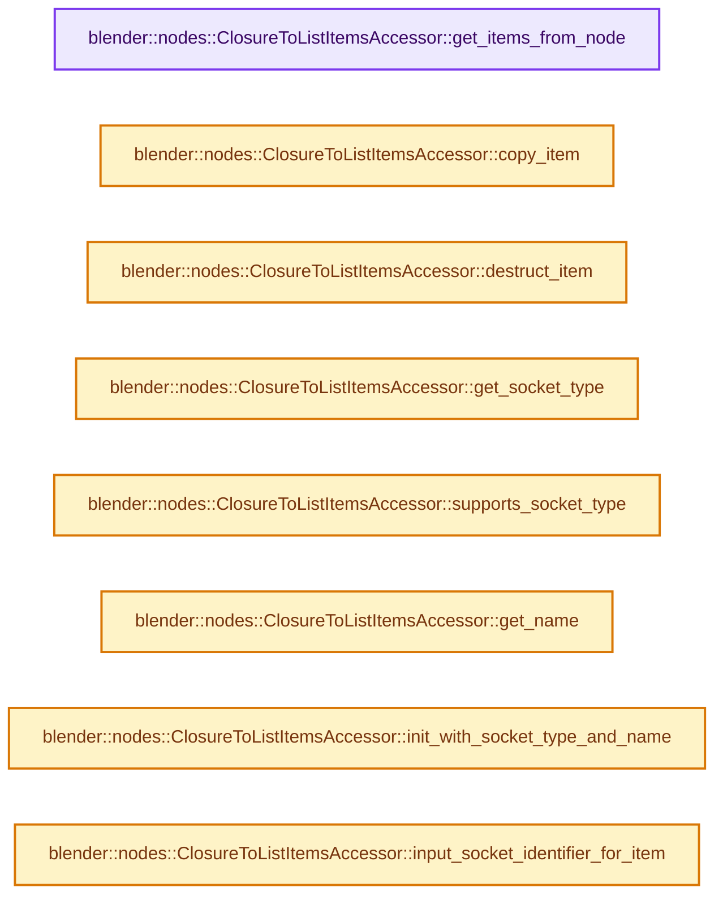
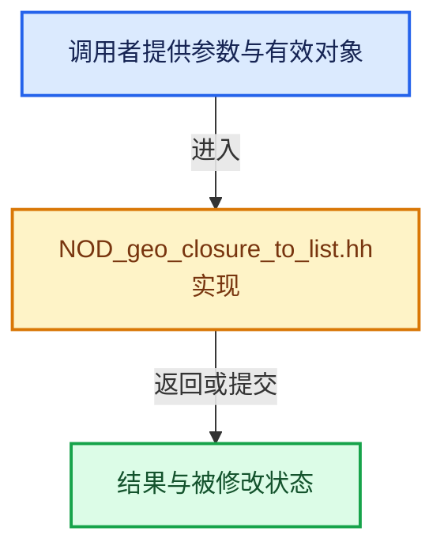

# 实现依赖专题：source/blender/nodes/geometry/include/NOD_geo_closure_to_list.hh

[方向导航](README.md) · [符号索引](../%E7%AC%A6%E5%8F%B7%E4%BE%9D%E8%B5%96%E4%B8%8E%E5%AE%9E%E7%8E%B0%E7%B4%A2%E5%BC%95.md)

本专题从正文实际调用进入，集中保存共享实现。函数有稳定锚点，可从调用处直接跳到对应完整函数；递归与互相调用通过回链组织。

## 本文件的实现关系






## 完整成员与函数实现

<a id="f-e3c98034ea103873"></a>

### `blender::nodes::ClosureToListItemsAccessor::get_items_from_node`

实现位置：[source/blender/nodes/geometry/include/NOD_geo_closure_to_list.hh](../../../../../source/blender/nodes/geometry/include/NOD_geo_closure_to_list.hh) · L38—L43。

接口参数：

- `bNode &node`

**教学注释版**

<!-- annotated:563856af350352 -->

```cpp
  static socket_items::SocketItemsRef<GeometryNodeClosureToListItem> get_items_from_node(
      bNode &node)
  {
    auto &storage = *static_cast<GeometryNodeClosureToList *>(node.storage);
    return {&storage.items, &storage.items_num, &storage.active_index};
  }
```

<details>
<summary>核对原始源码：source/blender/nodes/geometry/include/NOD_geo_closure_to_list.hh · L38—L43</summary>

<!-- original:563856af350352:source/blender/nodes/geometry/include/NOD_geo_closure_to_list.hh:38:43 -->

```cpp
  static socket_items::SocketItemsRef<GeometryNodeClosureToListItem> get_items_from_node(
      bNode &node)
  {
    auto &storage = *static_cast<GeometryNodeClosureToList *>(node.storage);
    return {&storage.items, &storage.items_num, &storage.active_index};
  }
```

</details>

**结果出口**

- `return {&storage.items, &storage.items_num, &storage.active_index};`

**继续追踪实现**

本实现没有需要继续展开的显式调用；检查返回表达式、对象转换和调用者前置条件。

<a id="f-db1c6345be4124ee"></a>

### `blender::nodes::ClosureToListItemsAccessor::copy_item`

实现位置：[source/blender/nodes/geometry/include/NOD_geo_closure_to_list.hh](../../../../../source/blender/nodes/geometry/include/NOD_geo_closure_to_list.hh) · L45—L50。

接口参数：

- `const GeometryNodeClosureToListItem &src`
- `GeometryNodeClosureToListItem &dst`

**教学注释版**

<!-- annotated:ff446513c013f2 -->

```cpp
  static void copy_item(const GeometryNodeClosureToListItem &src,
                        GeometryNodeClosureToListItem &dst)
  {
    dst = src;
    dst.name = BLI_strdup_null(dst.name);
  }
```

<details>
<summary>核对原始源码：source/blender/nodes/geometry/include/NOD_geo_closure_to_list.hh · L45—L50</summary>

<!-- original:ff446513c013f2:source/blender/nodes/geometry/include/NOD_geo_closure_to_list.hh:45:50 -->

```cpp
  static void copy_item(const GeometryNodeClosureToListItem &src,
                        GeometryNodeClosureToListItem &dst)
  {
    dst = src;
    dst.name = BLI_strdup_null(dst.name);
  }
```

</details>

**沿实际写入检查状态**

- `dst = src;`
- `dst.name = BLI_strdup_null(dst.name);`

**继续追踪实现**

- `BLI_strdup_null` → [blender::BLI_strdup_null · L48](../01-%E5%9F%BA%E7%A1%80%E5%AE%B9%E5%99%A8%E4%B8%8E%E7%8E%B0%E4%BB%A3CPP/%E4%BE%9D%E8%B5%96-string-1d986f.md#f-c1cd7c6336fe3fe0)。

<a id="f-2bc97e4755ff84b3"></a>

### `blender::nodes::ClosureToListItemsAccessor::destruct_item`

实现位置：[source/blender/nodes/geometry/include/NOD_geo_closure_to_list.hh](../../../../../source/blender/nodes/geometry/include/NOD_geo_closure_to_list.hh) · L52—L55。

接口参数：

- `GeometryNodeClosureToListItem *item`

**教学注释版**

<!-- annotated:75446088a3292c -->

```cpp
  static void destruct_item(GeometryNodeClosureToListItem *item)
  {
    MEM_SAFE_DELETE(item->name);
  }
```

<details>
<summary>核对原始源码：source/blender/nodes/geometry/include/NOD_geo_closure_to_list.hh · L52—L55</summary>

<!-- original:75446088a3292c:source/blender/nodes/geometry/include/NOD_geo_closure_to_list.hh:52:55 -->

```cpp
  static void destruct_item(GeometryNodeClosureToListItem *item)
  {
    MEM_SAFE_DELETE(item->name);
  }
```

</details>

**继续追踪实现**

- `MEM_SAFE_DELETE` → [MEM_SAFE_DELETE · L436](../03-%E5%86%85%E5%AD%98%E5%88%86%E9%85%8D%E4%B8%8E%E8%BF%90%E8%A1%8C%E6%97%B6%E7%B1%BB%E5%9E%8B/%E4%BE%9D%E8%B5%96-MEM_guardedalloc-b54eca.md#m-eadb3bc5b902)。宏定义由构建条件选择。

<a id="f-67a54d46b6d1558a"></a>

### `blender::nodes::ClosureToListItemsAccessor::get_socket_type`

实现位置：[source/blender/nodes/geometry/include/NOD_geo_closure_to_list.hh](../../../../../source/blender/nodes/geometry/include/NOD_geo_closure_to_list.hh) · L60—L63。

接口参数：

- `const ItemT &item`

**教学注释版**

<!-- annotated:7c7671836c3ff1 -->

```cpp
  static eNodeSocketDatatype get_socket_type(const ItemT &item)
  {
    return eNodeSocketDatatype(item.socket_type);
  }
```

<details>
<summary>核对原始源码：source/blender/nodes/geometry/include/NOD_geo_closure_to_list.hh · L60—L63</summary>

<!-- original:7c7671836c3ff1:source/blender/nodes/geometry/include/NOD_geo_closure_to_list.hh:60:63 -->

```cpp
  static eNodeSocketDatatype get_socket_type(const ItemT &item)
  {
    return eNodeSocketDatatype(item.socket_type);
  }
```

</details>

**结果出口**

- `return eNodeSocketDatatype(item.socket_type);`

**继续追踪实现**

- `eNodeSocketDatatype` → [eNodeSocketDatatype](../05-%E5%87%A0%E4%BD%95%E5%AD%98%E5%82%A8%E4%B8%8E%E6%8B%93%E6%89%91%E6%98%A0%E5%B0%84/%E4%BE%9D%E8%B5%96-compositor-a4aa61.md#t-09b65f729b18)；[blender::eNodeSocketDatatype](../05-%E5%87%A0%E4%BD%95%E5%AD%98%E5%82%A8%E4%B8%8E%E6%8B%93%E6%89%91%E6%98%A0%E5%B0%84/%E4%BE%9D%E8%B5%96-DNA_node_types-6708b9.md#t-fdea02f95b31)。

<a id="f-841ca18b8aa0276e"></a>

### `blender::nodes::ClosureToListItemsAccessor::supports_socket_type`

实现位置：[source/blender/nodes/geometry/include/NOD_geo_closure_to_list.hh](../../../../../source/blender/nodes/geometry/include/NOD_geo_closure_to_list.hh) · L65—L68。

接口参数：

- `const eNodeSocketDatatype socket_type`
- `const int ntree_type`

**教学注释版**

<!-- annotated:66ed9fef513e59 -->

```cpp
  static bool supports_socket_type(const eNodeSocketDatatype socket_type, const int ntree_type)
  {
    return bke::node_tree_type_supports_socket_type_static(ntree_type, socket_type);
  }
```

<details>
<summary>核对原始源码：source/blender/nodes/geometry/include/NOD_geo_closure_to_list.hh · L65—L68</summary>

<!-- original:66ed9fef513e59:source/blender/nodes/geometry/include/NOD_geo_closure_to_list.hh:65:68 -->

```cpp
  static bool supports_socket_type(const eNodeSocketDatatype socket_type, const int ntree_type)
  {
    return bke::node_tree_type_supports_socket_type_static(ntree_type, socket_type);
  }
```

</details>

**结果出口**

- `return bke::node_tree_type_supports_socket_type_static(ntree_type, socket_type);`

**继续追踪实现**

- `bke::node_tree_type_supports_socket_type_static` → [blender::bke::node_tree_type_supports_socket_type_static · L6295](../05-%E5%87%A0%E4%BD%95%E5%AD%98%E5%82%A8%E4%B8%8E%E6%8B%93%E6%89%91%E6%98%A0%E5%B0%84/%E4%BE%9D%E8%B5%96-node-89d753.md#f-f2bd64dc6bed02ca)。

<a id="f-3274b764c16018f3"></a>

### `blender::nodes::ClosureToListItemsAccessor::get_name`

实现位置：[source/blender/nodes/geometry/include/NOD_geo_closure_to_list.hh](../../../../../source/blender/nodes/geometry/include/NOD_geo_closure_to_list.hh) · L70—L73。

接口参数：

- `GeometryNodeClosureToListItem &item`

**教学注释版**

<!-- annotated:6edc2ad62f3af5 -->

```cpp
  static char **get_name(GeometryNodeClosureToListItem &item)
  {
    return &item.name;
  }
```

<details>
<summary>核对原始源码：source/blender/nodes/geometry/include/NOD_geo_closure_to_list.hh · L70—L73</summary>

<!-- original:6edc2ad62f3af5:source/blender/nodes/geometry/include/NOD_geo_closure_to_list.hh:70:73 -->

```cpp
  static char **get_name(GeometryNodeClosureToListItem &item)
  {
    return &item.name;
  }
```

</details>

**结果出口**

- `return &item.name;`

**继续追踪实现**

本实现没有需要继续展开的显式调用；检查返回表达式、对象转换和调用者前置条件。

<a id="f-8765e4f7d781c6c3"></a>

### `blender::nodes::ClosureToListItemsAccessor::init_with_socket_type_and_name`

实现位置：[source/blender/nodes/geometry/include/NOD_geo_closure_to_list.hh](../../../../../source/blender/nodes/geometry/include/NOD_geo_closure_to_list.hh) · L75—L85。

接口参数：

- `bNode &node`
- `GeometryNodeClosureToListItem &item`
- `const eNodeSocketDatatype socket_type`
- `const char *name`

**教学注释版**

<!-- annotated:c1ac4f06e36995 -->

```cpp
  static void init_with_socket_type_and_name(bNode &node,
                                             GeometryNodeClosureToListItem &item,
                                             const eNodeSocketDatatype socket_type,
                                             const char *name)
  {
    auto *storage = static_cast<GeometryNodeClosureToList *>(node.storage);
    item.socket_type = socket_type;
    item.identifier = storage->next_identifier++;
    item.structure_type = NodeSocketInterfaceStructureType::Single;
    socket_items::set_item_name_and_make_unique<ClosureToListItemsAccessor>(node, item, name);
  }
```

<details>
<summary>核对原始源码：source/blender/nodes/geometry/include/NOD_geo_closure_to_list.hh · L75—L85</summary>

<!-- original:c1ac4f06e36995:source/blender/nodes/geometry/include/NOD_geo_closure_to_list.hh:75:85 -->

```cpp
  static void init_with_socket_type_and_name(bNode &node,
                                             GeometryNodeClosureToListItem &item,
                                             const eNodeSocketDatatype socket_type,
                                             const char *name)
  {
    auto *storage = static_cast<GeometryNodeClosureToList *>(node.storage);
    item.socket_type = socket_type;
    item.identifier = storage->next_identifier++;
    item.structure_type = NodeSocketInterfaceStructureType::Single;
    socket_items::set_item_name_and_make_unique<ClosureToListItemsAccessor>(node, item, name);
  }
```

</details>

**沿实际写入检查状态**

- `item.socket_type = socket_type;`
- `item.identifier = storage->next_identifier++;`
- `item.structure_type = NodeSocketInterfaceStructureType::Single;`

**继续追踪实现**

- `socket_items::set_item_name_and_make_unique<ClosureToListItemsAccessor>` → [blender::nodes::socket_items::set_item_name_and_make_unique · L148](../09-LazyFunction%E4%B8%8E%E8%8A%82%E7%82%B9%E6%89%A7%E8%A1%8C%E6%9E%B6%E6%9E%84/%E4%BE%9D%E8%B5%96-NOD_socket_items-d21cfb.md#f-7e7af1c01522f9dc)。

<a id="f-c8753523f05c3e7f"></a>

### `blender::nodes::ClosureToListItemsAccessor::input_socket_identifier_for_item`

实现位置：[source/blender/nodes/geometry/include/NOD_geo_closure_to_list.hh](../../../../../source/blender/nodes/geometry/include/NOD_geo_closure_to_list.hh) · L87—L91。

接口参数：

- `const GeometryNodeClosureToListItem &`

**教学注释版**

<!-- annotated:094ccc64dddc13 -->

```cpp
  static std::string input_socket_identifier_for_item(
      const GeometryNodeClosureToListItem & /*item*/)
  {
    return {};
  }
```

<details>
<summary>核对原始源码：source/blender/nodes/geometry/include/NOD_geo_closure_to_list.hh · L87—L91</summary>

<!-- original:094ccc64dddc13:source/blender/nodes/geometry/include/NOD_geo_closure_to_list.hh:87:91 -->

```cpp
  static std::string input_socket_identifier_for_item(
      const GeometryNodeClosureToListItem & /*item*/)
  {
    return {};
  }
```

</details>

**结果出口**

- `return {};`

**继续追踪实现**

本实现没有需要继续展开的显式调用；检查返回表达式、对象转换和调用者前置条件。

<a id="f-1d70b05218c7721e"></a>

### `blender::nodes::ClosureToListItemsAccessor::output_socket_identifier_for_item`

实现位置：[source/blender/nodes/geometry/include/NOD_geo_closure_to_list.hh](../../../../../source/blender/nodes/geometry/include/NOD_geo_closure_to_list.hh) · L92—L95。

接口参数：

- `const GeometryNodeClosureToListItem &item`

**教学注释版**

<!-- annotated:0cd3492035548f -->

```cpp
  static std::string output_socket_identifier_for_item(const GeometryNodeClosureToListItem &item)
  {
    return "List_" + std::to_string(item.identifier);
  }
```

<details>
<summary>核对原始源码：source/blender/nodes/geometry/include/NOD_geo_closure_to_list.hh · L92—L95</summary>

<!-- original:0cd3492035548f:source/blender/nodes/geometry/include/NOD_geo_closure_to_list.hh:92:95 -->

```cpp
  static std::string output_socket_identifier_for_item(const GeometryNodeClosureToListItem &item)
  {
    return "List_" + std::to_string(item.identifier);
  }
```

</details>

**结果出口**

- `return "List_" + std::to_string(item.identifier);`

**继续追踪实现**

- `std::to_string` → [外部契约](https://eel.is/c++draft/)：这个边界按实际表达式及所属类型核对参数、返回值、寿命与失败行为。这里提供接口入口，不声称已解释该第三方版本的内部实现。
