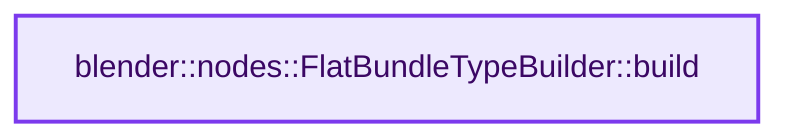
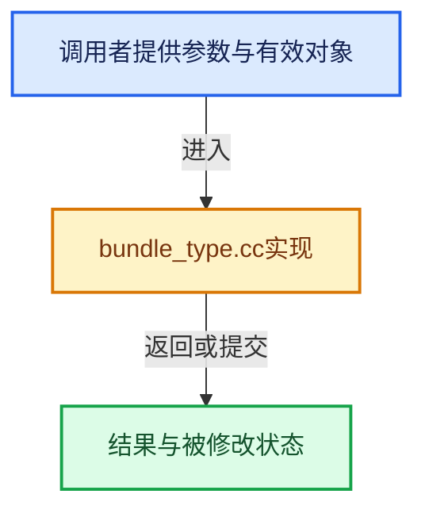

# 实现依赖专题：source/blender/nodes/intern/bundle_type.cc

[方向导航](README.md) · [符号索引](../%E7%AC%A6%E5%8F%B7%E4%BE%9D%E8%B5%96%E4%B8%8E%E5%AE%9E%E7%8E%B0%E7%B4%A2%E5%BC%95.md)

本专题从正文实际调用进入，集中保存共享实现。函数有稳定锚点，可从调用处直接跳到对应完整函数；递归与互相调用通过回链组织。

## 本文件的实现关系






## 完整成员与函数实现

<a id="f-abd35119451170b2"></a>

### `blender::nodes::FlatBundleTypeBuilder::build`

实现位置：[source/blender/nodes/intern/bundle_type.cc](../../../../../source/blender/nodes/intern/bundle_type.cc) · L33—L36。

**教学注释版**

<!-- annotated:b6c790f6eacde0 -->

```cpp
FlatBundleTypePtr FlatBundleTypeBuilder::build()
{
  // [讲解] std::make_shared<const FlatBundleType>：构造由共享控制块管理的对象；共享寿命不自动使被指对象读写线程安全，强引用环需单独处理。
  return std::make_shared<const FlatBundleType>(std::move(name_), std::move(decls_));
}
```

<details>
<summary>核对原始源码：source/blender/nodes/intern/bundle_type.cc · L33—L36</summary>

<!-- original:b6c790f6eacde0:source/blender/nodes/intern/bundle_type.cc:33:36 -->

```cpp
FlatBundleTypePtr FlatBundleTypeBuilder::build()
{
  return std::make_shared<const FlatBundleType>(std::move(name_), std::move(decls_));
}
```

</details>

**结果出口**

- `return std::make_shared<const FlatBundleType>(std::move(name_), std::move(decls_));`

**继续追踪实现**

- `std::make_shared<const FlatBundleType>` → [外部契约](https://eel.is/c++draft/util.smartptr.shared.create)：构造由共享控制块管理的对象；共享寿命不自动使被指对象读写线程安全，强引用环需单独处理。
- `std::move` → [外部契约](https://eel.is/c++draft/utility.forward)：把表达式转换成可供移动重载选择的值类别；不保证真的移动，不结束源对象寿命，对const值可能选择复制。
