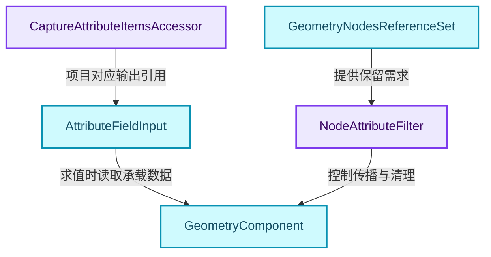
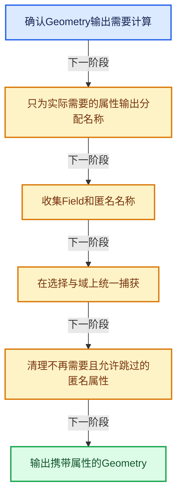
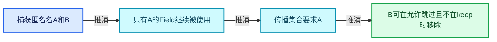
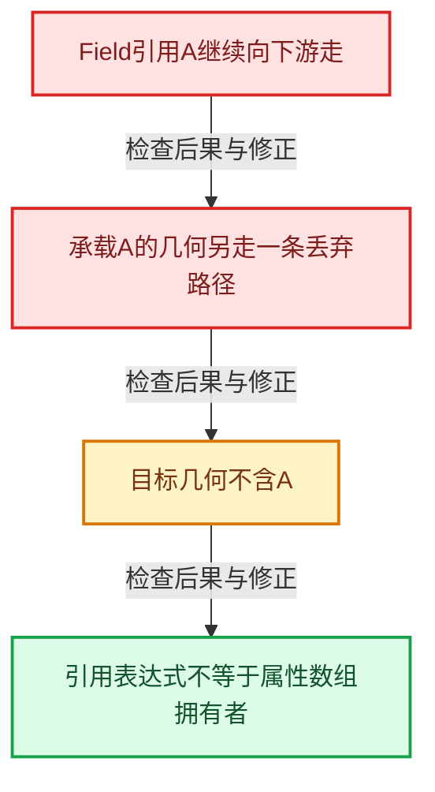

# GN-13 CaptureAttribute匿名属性引用与清理

[几何节点学习地图](../%E5%87%A0%E4%BD%95%E8%8A%82%E7%82%B9%E6%89%A9%E5%B1%95%E5%AD%A6%E4%B9%A0%E5%9C%B0%E5%9B%BE.md) · [方向导航](README.md) · [全局实现索引](../%E7%AC%A6%E5%8F%B7%E4%BE%9D%E8%B5%96%E4%B8%8E%E5%AE%9E%E7%8E%B0%E7%B4%A2%E5%BC%95.md)

基准：`cbda6b96c26c0dee3c3b5cbb93960c4ac06a6b30`；文件哈希及连续摘录区间记录在[新增专题证据](../_evidence/geometry-extension.json)。本篇围绕所选函数解释核心机制，辅助依赖明确列出已定位实现与尚需类型确认的边界，不宣称相关整个文件已全文复核。

## 先回答一个具体问题

匿名属性输出为什么不能脱离Geometry输出使用？什么时候可以把匿名属性删掉？

## 相关类与数据的职责

- **`CaptureAttributeItemsAccessor`**：为动态项目生成稳定输入输出identifier。 定义入口：[source/blender/nodes/geometry/include/NOD_geo_capture_attribute.hh · L15](../../../../../source/blender/nodes/geometry/include/NOD_geo_capture_attribute.hh)。
- **`GeometryNodesReferenceSet`**：携带仍需传播的匿名属性名称集合。 定义入口：[source/blender/blenkernel/BKE_geometry_nodes_reference_set.hh · L21](../../../../../source/blender/blenkernel/BKE_geometry_nodes_reference_set.hh)。
- **`NodeAttributeFilter`**：根据引用集合决定某个属性能否跳过。 定义入口：[source/blender/nodes/NOD_geometry_exec.hh · L70](../../../../../source/blender/nodes/NOD_geometry_exec.hh)。
- **`AttributeFieldInput`**：输出读取匿名属性的Field引用。 定义入口：[source/blender/blenkernel/BKE_geometry_fields.hh · L309](../../../../../source/blender/blenkernel/BKE_geometry_fields.hh)。
- **`GeometryComponent`**：实际保存被捕获的属性数组。 定义入口：[source/blender/blenkernel/BKE_geometry_set.hh · L69](../../../../../source/blender/blenkernel/BKE_geometry_set.hh)。



上图箭头文字区分拥有、借用、调用和数据依赖。连线不表示这些类型存在同名继承关系；只有源码明确声明的继承才按继承理解。

## 设计推导与扩展知识

### 推导1

匿名属性的名称不要求用户手工管理，但仍需要一个稳定身份连接Field引用和属性数组。节点按输出需求取得可选名称，没有需求的项目跳过，从而避免无用捕获。

### 推导2

只有属性Field被用而Geometry承载路径丢失时，节点无法保证目标上下文中有那份属性。源码明确提示属性输出不能脱离Geometry输出使用，并设置剩余默认输出。

### 推导3

clean_unused_attributes同时检查匿名名称、当前keep集合和attribute_filter.allow_skip。普通命名属性不会被这段匿名清理逻辑删除；本轮刚创建且还要输出的名称也必须保留。

### 推导4

清理分两阶段：遍历收集unused_ids，遍历结束后remove。边遍历属性容器边修改结构容易破坏迭代器，先收集再删除是明确的结构修改协议。

### 推导5

GeometryNodesReferenceSet用shared_ptr<Set<string>>使按值传递便宜，空集合的表示也很小。共享指针本身不表示随意修改共享Set是线程安全的；生产者与合并器仍要遵守不可变传播或独立写入协议。

## 实际处理阶段



这张图概括本篇所讨论的主路径；等待输入、构建失败与不同策略的分支以下方完整代码为准，不能把概括图当作每次都会执行的无条件顺序。

## 教学注释代码与分段机制

<a id="f-1fdf66dd3e447ed1"></a>

### `blender::nodes::node_geo_attribute_capture_cc::clean_unused_attributes` · L117—L143

三个过滤条件之后才收集名称；remove发生在foreach结束之后。

实现位置：[source/blender/nodes/geometry/nodes/node_geo_attribute_capture.cc](../../../../../source/blender/nodes/geometry/nodes/node_geo_attribute_capture.cc)。

**教学注释版**

<!-- annotated:4656224b941511 -->

```cpp
static void clean_unused_attributes(const AttributeFilter &attribute_filter,
                                    const VectorSet<std::string> &keep,
                                    GeometryComponent &component)
{
  std::optional<MutableAttributeAccessor> attributes = component.attributes_for_write();
  if (!attributes.has_value()) {
    return;
  }

  Vector<std::string> unused_ids;
  attributes->foreach_attribute([&](const bke::AttributeIter &iter) {
    if (!bke::attribute_name_is_anonymous(iter.name)) {
      return;
    }
    // [讲解] 本轮仍要输出的匿名属性即使可跳过也不能在这里清掉。
    if (keep.contains(iter.name)) {
      return;
    }
    if (!attribute_filter.allow_skip(iter.name)) {
      return;
    }
    // [讲解] 先记录待删名称；不要在遍历属性集合时直接修改结构。
    unused_ids.append(iter.name);
  });

  for (const std::string &unused_id : unused_ids) {
    // [讲解] 属性遍历已结束，现在才按收集名称删除。
    attributes->remove(unused_id);
  }
}
```

<details>
<summary>核对原始源码：source/blender/nodes/geometry/nodes/node_geo_attribute_capture.cc · L117—L143</summary>

<!-- original:4656224b941511:source/blender/nodes/geometry/nodes/node_geo_attribute_capture.cc:117:143 -->

```cpp
static void clean_unused_attributes(const AttributeFilter &attribute_filter,
                                    const VectorSet<std::string> &keep,
                                    GeometryComponent &component)
{
  std::optional<MutableAttributeAccessor> attributes = component.attributes_for_write();
  if (!attributes.has_value()) {
    return;
  }

  Vector<std::string> unused_ids;
  attributes->foreach_attribute([&](const bke::AttributeIter &iter) {
    if (!bke::attribute_name_is_anonymous(iter.name)) {
      return;
    }
    if (keep.contains(iter.name)) {
      return;
    }
    if (!attribute_filter.allow_skip(iter.name)) {
      return;
    }
    unused_ids.append(iter.name);
  });

  for (const std::string &unused_id : unused_ids) {
    attributes->remove(unused_id);
  }
}
```

</details>

<details>
<summary>实现依赖入口与尚需类型确认的调用</summary>

本函数未纳入旧结构调用闭包；以上源码保留实际调用表达式，相关成员须按接收者类型继续定位。下方类关系入口提供对应定义。

</details>

<a id="f-5b58eff2e0273e19"></a>

### `blender::nodes::node_geo_attribute_capture_cc::node_geo_exec` · L145—L227

需求驱动的可选名称、selection输出、fields为空快捷路径和组件遍历分别核对。

实现位置：[source/blender/nodes/geometry/nodes/node_geo_attribute_capture.cc](../../../../../source/blender/nodes/geometry/nodes/node_geo_attribute_capture.cc)。

**教学注释版**

<!-- annotated:aa76f24e02d277 -->

```cpp
static void node_geo_exec(GeoNodeExecParams params)
{
  GeometrySet geometry_set = params.extract_input<GeometrySet>("Geometry"_ustr);

  if (!params.output_is_required("Geometry"_ustr)) {
    params.error_message_add(
        NodeWarningType::Info,
        TIP_("The attribute output cannot be used without the geometry output"));
    params.set_default_remaining_outputs();
    return;
  }

  const NodeGeometryAttributeCapture &storage = node_storage(params.node());
  const AttrDomain domain = AttrDomain(storage.domain);
  const Field<bool> selection = params.extract_input<Field<bool>>("Selection"_ustr);

  Vector<GField> fields;
  VectorSet<std::string> out_attribute_names;
  for (const NodeGeometryAttributeCaptureItem &item :
       Span{storage.capture_items, storage.capture_items_num})
  {
    const std::string input_identifier =
        CaptureAttributeItemsAccessor::input_socket_identifier_for_item(item);
    const std::string output_identifier =
        CaptureAttributeItemsAccessor::output_socket_identifier_for_item(item);
    std::optional<std::string> attribute_id = params.get_output_anonymous_attribute_id_if_needed(
        UString(output_identifier));
    if (!attribute_id) {
      continue;
    }
    fields.append(params.extract_input<GField>(UString(input_identifier)));
    out_attribute_names.add_new(std::move(*attribute_id));
  }

  {
    std::optional<std::string> selection_attribute_id =
        params.get_output_anonymous_attribute_id_if_needed("Selection"_ustr);
    if (selection_attribute_id) {
      fields.append(selection);
      out_attribute_names.add_new(std::move(*selection_attribute_id));
    }
  }

  if (fields.is_empty()) {
    params.set_output("Geometry"_ustr, geometry_set);
    params.set_default_remaining_outputs();
    return;
  }

  const Array<StringRef> out_attribute_name_refs = out_attribute_names.as_span();

  const auto capture_on = [&](GeometryComponent &component) {
    bke::try_capture_fields_on_geometry(
        component, out_attribute_name_refs, domain, selection, fields);
    /* Changing of the anonymous attributes may require removing attributes that are no longer
     * needed. */
    clean_unused_attributes(
        params.get_attribute_filter("Geometry"_ustr), out_attribute_names, component);
  };

  /* Run on the instances component separately to only affect the top level of instances. */
  // [讲解] 实例域走顶层实例专用路径，与普通几何域遍历分开。
  if (domain == AttrDomain::Instance) {
    if (geometry_set.has_instances()) {
      capture_on(geometry_set.get_component_for_write(GeometryComponent::Type::Instance));
    }
  }
  else {
    static const Array<GeometryComponent::Type> types = {GeometryComponent::Type::Mesh,
                                                         GeometryComponent::Type::PointCloud,
                                                         GeometryComponent::Type::Curve,
                                                         GeometryComponent::Type::GreasePencil};

    geometry::foreach_real_geometry(geometry_set, [&](GeometrySet &geometry_set) {
      for (const GeometryComponent::Type type : types) {
        if (geometry_set.has(type)) {
          capture_on(geometry_set.get_component_for_write(type));
        }
      }
    });
  }

  params.set_output("Geometry"_ustr, geometry_set);
}
```

<details>
<summary>核对原始源码：source/blender/nodes/geometry/nodes/node_geo_attribute_capture.cc · L145—L227</summary>

<!-- original:aa76f24e02d277:source/blender/nodes/geometry/nodes/node_geo_attribute_capture.cc:145:227 -->

```cpp
static void node_geo_exec(GeoNodeExecParams params)
{
  GeometrySet geometry_set = params.extract_input<GeometrySet>("Geometry"_ustr);

  if (!params.output_is_required("Geometry"_ustr)) {
    params.error_message_add(
        NodeWarningType::Info,
        TIP_("The attribute output cannot be used without the geometry output"));
    params.set_default_remaining_outputs();
    return;
  }

  const NodeGeometryAttributeCapture &storage = node_storage(params.node());
  const AttrDomain domain = AttrDomain(storage.domain);
  const Field<bool> selection = params.extract_input<Field<bool>>("Selection"_ustr);

  Vector<GField> fields;
  VectorSet<std::string> out_attribute_names;
  for (const NodeGeometryAttributeCaptureItem &item :
       Span{storage.capture_items, storage.capture_items_num})
  {
    const std::string input_identifier =
        CaptureAttributeItemsAccessor::input_socket_identifier_for_item(item);
    const std::string output_identifier =
        CaptureAttributeItemsAccessor::output_socket_identifier_for_item(item);
    std::optional<std::string> attribute_id = params.get_output_anonymous_attribute_id_if_needed(
        UString(output_identifier));
    if (!attribute_id) {
      continue;
    }
    fields.append(params.extract_input<GField>(UString(input_identifier)));
    out_attribute_names.add_new(std::move(*attribute_id));
  }

  {
    std::optional<std::string> selection_attribute_id =
        params.get_output_anonymous_attribute_id_if_needed("Selection"_ustr);
    if (selection_attribute_id) {
      fields.append(selection);
      out_attribute_names.add_new(std::move(*selection_attribute_id));
    }
  }

  if (fields.is_empty()) {
    params.set_output("Geometry"_ustr, geometry_set);
    params.set_default_remaining_outputs();
    return;
  }

  const Array<StringRef> out_attribute_name_refs = out_attribute_names.as_span();

  const auto capture_on = [&](GeometryComponent &component) {
    bke::try_capture_fields_on_geometry(
        component, out_attribute_name_refs, domain, selection, fields);
    /* Changing of the anonymous attributes may require removing attributes that are no longer
     * needed. */
    clean_unused_attributes(
        params.get_attribute_filter("Geometry"_ustr), out_attribute_names, component);
  };

  /* Run on the instances component separately to only affect the top level of instances. */
  if (domain == AttrDomain::Instance) {
    if (geometry_set.has_instances()) {
      capture_on(geometry_set.get_component_for_write(GeometryComponent::Type::Instance));
    }
  }
  else {
    static const Array<GeometryComponent::Type> types = {GeometryComponent::Type::Mesh,
                                                         GeometryComponent::Type::PointCloud,
                                                         GeometryComponent::Type::Curve,
                                                         GeometryComponent::Type::GreasePencil};

    geometry::foreach_real_geometry(geometry_set, [&](GeometrySet &geometry_set) {
      for (const GeometryComponent::Type type : types) {
        if (geometry_set.has(type)) {
          capture_on(geometry_set.get_component_for_write(type));
        }
      }
    });
  }

  params.set_output("Geometry"_ustr, geometry_set);
}
```

</details>

<details>
<summary>实现依赖入口与尚需类型确认的调用</summary>

本函数未纳入旧结构调用闭包；以上源码保留实际调用表达式，相关成员须按接收者类型继续定位。下方类关系入口提供对应定义。

</details>

## 支撑类型的完整声明

### `GeometryNodesReferenceSet`

对照上方职责阅读成员：哪些成员拥有资源，哪些只是索引、引用或指针。成员声明体现布局；其中函数仍应按实际调用进入相应实现。

<!-- annotated:3332a87c3e1cfa -->

```cpp
class GeometryNodesReferenceSet {
 public:
  /**
   * This uses `std::shared_ptr` because attributes sets are passed around by value during geometry
   * nodes evaluation, and this makes it very small if there is no name. Also it makes copying very
   * cheap.
   */
  std::shared_ptr<Set<std::string>> names;
};
```

<details>
<summary>核对原始源码：source/blender/blenkernel/BKE_geometry_nodes_reference_set.hh · L21—L29</summary>

<!-- original:3332a87c3e1cfa:source/blender/blenkernel/BKE_geometry_nodes_reference_set.hh:21:29 -->

```cpp
class GeometryNodesReferenceSet {
 public:
  /**
   * This uses `std::shared_ptr` because attributes sets are passed around by value during geometry
   * nodes evaluation, and this makes it very small if there is no name. Also it makes copying very
   * cheap.
   */
  std::shared_ptr<Set<std::string>> names;
};
```

</details>

## 用小数据走一遍

1. 捕获匿名名A和B。
2. 只有A的Field继续被使用。
3. 传播集合要求A。
4. B可在允许跳过且不在keep时移除。



这是明确输入条件下的教学推演，不是本地性能实测。对源码的验证应同时检查数值、对象寿命、输出需求和数据是否存在。

## 反例与边界

- Field引用A继续向下游走。
- 承载A的几何另走一条丢弃路径。
- 目标几何不含A。
- 引用表达式不等于属性数组拥有者。



## 历史提交阅读

本地历史阅读样本：**Jacques Lucke**，2026-05-22T23:42:11+02:00。

`3871d9d9f351c025e3a8cef99d1bc5139be0ac6f`

提交标题：Refactor: Geometry Nodes: improve naming for reference lifetimes in declaration

[所选文件的真实diff](../_evidence/geometry-history/GN-13.patch)。这是本地历史中匹配作者的近期样本，不冒称该系统的最初引入提交。阅读时先找变更前后的不变量，再检查新增分支与测试；本篇当前源码说明不混用历史签名。

## 独立实现与验收

解释keep和attribute_filter为何不能互相替代。

<details>
<summary>参考思路</summary>

keep保护当前节点刚产生且要输出的名称，filter表达下游传播需求；必须结合两者，避免过早删掉当前输出或保留全部历史垃圾。

</details>

验收时保留一个能击穿错误设计的反例，再对照实际符号重走调用链。教学练习未在完整Blender中运行；本轮独立运行的模型验证另见新增专题验收报告。

## 继续阅读

- [GN-12 属性捕获求值暂存与提交协议](../05-%E5%87%A0%E4%BD%95%E5%AD%98%E5%82%A8%E4%B8%8E%E6%8B%93%E6%89%91%E6%98%A0%E5%B0%84/%E6%89%A9%E5%B1%9502-%E5%B1%9E%E6%80%A7%E6%8D%95%E8%8E%B7%E6%B1%82%E5%80%BC%E6%9A%82%E5%AD%98%E4%B8%8E%E6%8F%90%E4%BA%A4%E5%8D%8F%E8%AE%AE.md)
- [GN-14 Instances引用表句柄与变换数组](../05-%E5%87%A0%E4%BD%95%E5%AD%98%E5%82%A8%E4%B8%8E%E6%8B%93%E6%89%91%E6%98%A0%E5%B0%84/%E6%89%A9%E5%B1%9503-Instances%E5%BC%95%E7%94%A8%E8%A1%A8%E5%8F%A5%E6%9F%84%E4%B8%8E%E5%8F%98%E6%8D%A2%E6%95%B0%E7%BB%84.md)
- [GN-18 Simulation状态协议缓存与时间步](%E6%89%A9%E5%B1%9502-Simulation%E7%8A%B6%E6%80%81%E5%8D%8F%E8%AE%AE%E7%BC%93%E5%AD%98%E4%B8%8E%E6%97%B6%E9%97%B4%E6%AD%A5.md)
- [GN-19 Repeat与Foreach执行状态及上下文身份](%E6%89%A9%E5%B1%9503-Repeat%E4%B8%8EForeach%E6%89%A7%E8%A1%8C%E7%8A%B6%E6%80%81%E5%8F%8A%E4%B8%8A%E4%B8%8B%E6%96%87%E8%BA%AB%E4%BB%BD.md)
- [GN-20 Closure可传递程序捕获与调用边界](%E6%89%A9%E5%B1%9504-Closure%E5%8F%AF%E4%BC%A0%E9%80%92%E7%A8%8B%E5%BA%8F%E6%8D%95%E8%8E%B7%E4%B8%8E%E8%B0%83%E7%94%A8%E8%BE%B9%E7%95%8C.md)
- [GN-21 Bundle嵌套值路径查找与写时复制](%E6%89%A9%E5%B1%9505-Bundle%E5%B5%8C%E5%A5%97%E5%80%BC%E8%B7%AF%E5%BE%84%E6%9F%A5%E6%89%BE%E4%B8%8E%E5%86%99%E6%97%B6%E5%A4%8D%E5%88%B6.md)
