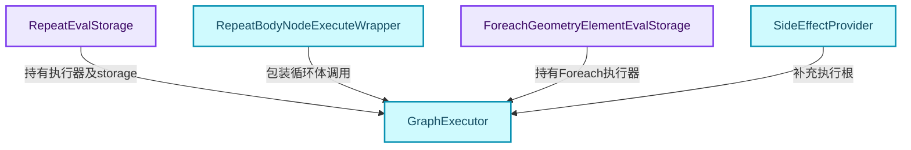
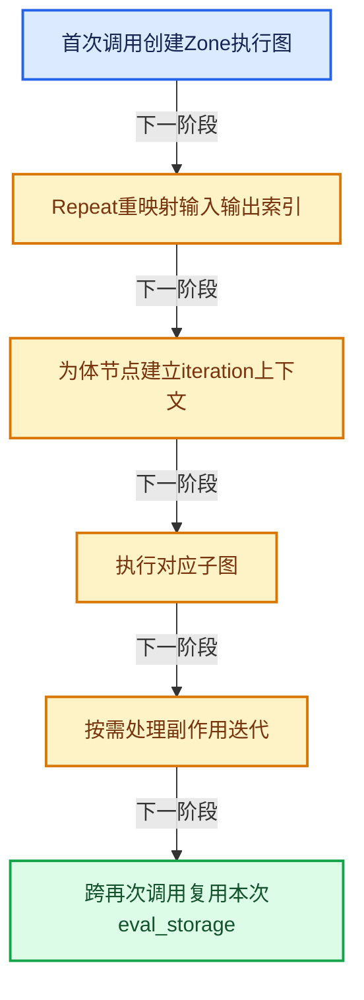
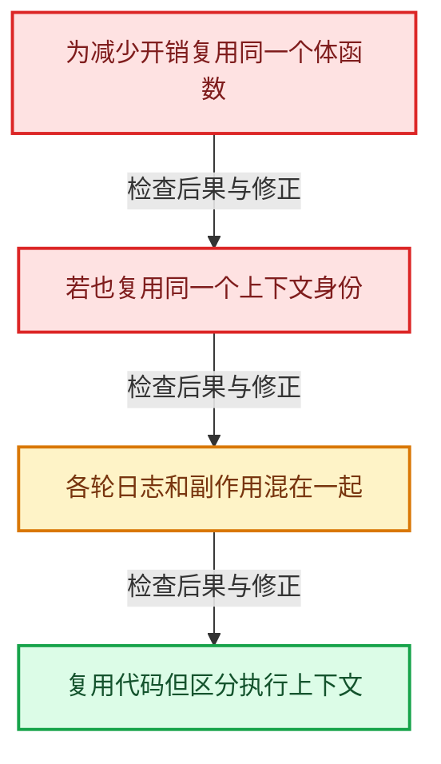

# GN-19 Repeat与Foreach执行状态及上下文身份

[几何节点学习地图](../%E5%87%A0%E4%BD%95%E8%8A%82%E7%82%B9%E6%89%A9%E5%B1%95%E5%AD%A6%E4%B9%A0%E5%9C%B0%E5%9B%BE.md) · [方向导航](README.md) · [全局实现索引](../%E7%AC%A6%E5%8F%B7%E4%BE%9D%E8%B5%96%E4%B8%8E%E5%AE%9E%E7%8E%B0%E7%B4%A2%E5%BC%95.md)

基准：`cbda6b96c26c0dee3c3b5cbb93960c4ac06a6b30`；文件哈希及连续摘录区间记录在[新增专题证据](../_evidence/geometry-extension.json)。本篇围绕所选函数解释核心机制，辅助依赖明确列出已定位实现与尚需类型确认的边界，不宣称相关整个文件已全文复核。

## 先回答一个具体问题

重复执行同一个节点体，怎样区分每次日志、状态和副作用？Repeat与Foreach有什么架构差异？

## 相关类与数据的职责

- **`RepeatEvalStorage`**：保存一次Repeat求值的图、索引映射和执行器状态。 定义入口：[source/blender/nodes/intern/geometry_nodes_repeat_zone.cc · L98](../../../../../source/blender/nodes/intern/geometry_nodes_repeat_zone.cc)。
- **`RepeatBodyNodeExecuteWrapper`**：为循环体建立带iteration的ComputeContext。 定义入口：[source/blender/nodes/intern/geometry_nodes_repeat_zone.cc · L35](../../../../../source/blender/nodes/intern/geometry_nodes_repeat_zone.cc)。
- **`ForeachGeometryElementEvalStorage`**：保存组件、总迭代数与生成结果相关状态。 定义入口：[source/blender/nodes/intern/geometry_nodes_foreach_geometry_element_zone.cc · L211](../../../../../source/blender/nodes/intern/geometry_nodes_foreach_geometry_element_zone.cc)。
- **`GraphExecutor`**：执行构建后的Zone子图。 定义入口：[source/blender/functions/FN_lazy_function_graph_executor.hh · L91](../../../../../source/blender/functions/FN_lazy_function_graph_executor.hh)。
- **`SideEffectProvider`**：指出哪些迭代必须因副作用而执行。



上图箭头文字区分拥有、借用、调用和数据依赖。连线不表示这些类型存在同名继承关系；只有源码明确声明的继承才按继承理解。

## 设计推导与扩展知识

### 推导1

Repeat的状态在迭代之间传递，Foreach按几何元素准备组件与迭代任务，并归并输出。两者都复用LazyFunction与GraphExecutor，但不能把它们的结果合并和数据依赖图画成完全相同。

### 推导2

Repeat第一次execute_impl时创建graph_executor；随后通过RemappedParams把Zone外部接口映射到内部执行图。索引映射显式化避免要求内部布局与编辑插槽一致。

### 推导3

RepeatBodyNodeExecuteWrapper识别当前体节点的iteration，再构造RepeatZoneComputeContext。相同节点体在第0与第1轮有不同上下文身份，日志和副作用才能定位到正确轮次。

### 推导4

wrapper里的body_compute_context和UserData位于栈上，只在fn.execute的同步调用范围内借用。若以后把调用改成异步捕获这些地址，必须重新设计寿命，不能机械挪到任务队列。

### 推导5

Foreach初始化后检查total_iterations_num为0且主几何非空时提示迭代域无元素。这区别了“没有输入几何”与“此域没有可迭代元素”，更有助于诊断错误域设置。

### 推导6

副作用提供者把必要迭代加入需求根。结果输出未被使用不意味着带Viewer或其他副作用的体一定可以裁掉；按需执行必须保留明确副作用通道。

## 实际处理阶段



这张图概括本篇所讨论的主路径；等待输入、构建失败与不同策略的分支以下方完整代码为准，不能把概括图当作每次都会执行的无条件顺序。

## 教学注释代码与分段机制

<a id="f-6c24a7231a022657"></a>

### `blender::nodes::RepeatBodyNodeExecuteWrapper::execute_node` · L40—L64

iteration由体节点映射取得；非体节点直接执行，体节点才建立Repeat上下文。

实现位置：[source/blender/nodes/intern/geometry_nodes_repeat_zone.cc](../../../../../source/blender/nodes/intern/geometry_nodes_repeat_zone.cc)。

**教学注释版**

<!-- annotated:90056ae9a79113 -->

```cpp
  void execute_node(const lf::FunctionNode &node,
                    lf::Params &params,
                    const lf::Context &context) const override
  {
    GeoNodesUserData &user_data = *static_cast<GeoNodesUserData *>(context.user_data);
    // [讲解] 体节点映射确定当前迭代身份；不是仅按同一个节点identifier记日志。
    const int iteration = lf_body_nodes_->index_of_try(const_cast<lf::FunctionNode *>(&node));
    const LazyFunction &fn = node.function();
    if (iteration == -1) {
      /* The node is not a loop body node, just execute it normally. */
      fn.execute(params, context);
      return;
    }

    /* Setup context for the loop body evaluation. */
    bke::RepeatZoneComputeContext body_compute_context{
        user_data.compute_context, *repeat_output_bnode_, iteration};
    GeoNodesUserData body_user_data = user_data;
    // [讲解] 借用本次同步调用栈上的迭代上下文；异步化时需要重新处理寿命。
    body_user_data.compute_context = &body_compute_context;
    body_user_data.verbose_log = should_log_verbose_in_context(user_data,
                                                               body_compute_context.hash());

    GeoNodesLocalUserData body_local_user_data{body_user_data};
    lf::Context body_context{context.storage, &body_user_data, &body_local_user_data};
    fn.execute(params, body_context);
  }
```

<details>
<summary>核对原始源码：source/blender/nodes/intern/geometry_nodes_repeat_zone.cc · L40—L64</summary>

<!-- original:90056ae9a79113:source/blender/nodes/intern/geometry_nodes_repeat_zone.cc:40:64 -->

```cpp
  void execute_node(const lf::FunctionNode &node,
                    lf::Params &params,
                    const lf::Context &context) const override
  {
    GeoNodesUserData &user_data = *static_cast<GeoNodesUserData *>(context.user_data);
    const int iteration = lf_body_nodes_->index_of_try(const_cast<lf::FunctionNode *>(&node));
    const LazyFunction &fn = node.function();
    if (iteration == -1) {
      /* The node is not a loop body node, just execute it normally. */
      fn.execute(params, context);
      return;
    }

    /* Setup context for the loop body evaluation. */
    bke::RepeatZoneComputeContext body_compute_context{
        user_data.compute_context, *repeat_output_bnode_, iteration};
    GeoNodesUserData body_user_data = user_data;
    body_user_data.compute_context = &body_compute_context;
    body_user_data.verbose_log = should_log_verbose_in_context(user_data,
                                                               body_compute_context.hash());

    GeoNodesLocalUserData body_local_user_data{body_user_data};
    lf::Context body_context{context.storage, &body_user_data, &body_local_user_data};
    fn.execute(params, body_context);
  }
```

</details>

<details>
<summary>实现依赖入口与尚需类型确认的调用</summary>

本函数未纳入旧结构调用闭包；以上源码保留实际调用表达式，相关成员须按接收者类型继续定位。下方类关系入口提供对应定义。

</details>

<a id="f-76e732d2e630e3be"></a>

### `blender::nodes::LazyFunctionForRepeatZone::execute_impl` · L153—L185

首次图初始化与后续RemappedParams执行分开，storage属于本次求值。

实现位置：[source/blender/nodes/intern/geometry_nodes_repeat_zone.cc](../../../../../source/blender/nodes/intern/geometry_nodes_repeat_zone.cc)。

**教学注释版**

<!-- annotated:6139f3dca9c63d -->

```cpp
  void execute_impl(lf::Params &params, const lf::Context &context) const override
  {
    const ScopedNodeTimer node_timer{context, repeat_output_bnode_};

    auto &user_data = *static_cast<GeoNodesUserData *>(context.user_data);
    auto &local_user_data = *static_cast<GeoNodesLocalUserData *>(context.local_user_data);

    const NodeGeometryRepeatOutput &node_storage = *static_cast<const NodeGeometryRepeatOutput *>(
        repeat_output_bnode_.storage);
    RepeatEvalStorage &eval_storage = *static_cast<RepeatEvalStorage *>(context.storage);

    const int iterations_usage_index = zone_info_.indices.outputs.input_usages[0];
    if (!params.output_was_set(iterations_usage_index)) {
      /* The iterations input is always used. */
      params.set_output(iterations_usage_index, true);
    }

    // [讲解] 本次求值第一次进入时建立执行器；之后可以复用storage继续推进。
    if (!eval_storage.graph_executor) {
      /* Create the execution graph in the first evaluation. */
      this->initialize_execution_graph(
          params, eval_storage, node_storage, user_data, local_user_data);
    }

    /* Execute the graph for the repeat zone. */
    lf::RemappedParams eval_graph_params{*eval_storage.graph_executor,
                                         params,
                                         eval_storage.input_index_map,
                                         eval_storage.output_index_map,
                                         eval_storage.multi_threading_enabled};
    lf::Context eval_graph_context{
        eval_storage.graph_executor_storage, context.user_data, context.local_user_data};
    eval_storage.graph_executor->execute(eval_graph_params, eval_graph_context);
  }
```

<details>
<summary>核对原始源码：source/blender/nodes/intern/geometry_nodes_repeat_zone.cc · L153—L185</summary>

<!-- original:6139f3dca9c63d:source/blender/nodes/intern/geometry_nodes_repeat_zone.cc:153:185 -->

```cpp
  void execute_impl(lf::Params &params, const lf::Context &context) const override
  {
    const ScopedNodeTimer node_timer{context, repeat_output_bnode_};

    auto &user_data = *static_cast<GeoNodesUserData *>(context.user_data);
    auto &local_user_data = *static_cast<GeoNodesLocalUserData *>(context.local_user_data);

    const NodeGeometryRepeatOutput &node_storage = *static_cast<const NodeGeometryRepeatOutput *>(
        repeat_output_bnode_.storage);
    RepeatEvalStorage &eval_storage = *static_cast<RepeatEvalStorage *>(context.storage);

    const int iterations_usage_index = zone_info_.indices.outputs.input_usages[0];
    if (!params.output_was_set(iterations_usage_index)) {
      /* The iterations input is always used. */
      params.set_output(iterations_usage_index, true);
    }

    if (!eval_storage.graph_executor) {
      /* Create the execution graph in the first evaluation. */
      this->initialize_execution_graph(
          params, eval_storage, node_storage, user_data, local_user_data);
    }

    /* Execute the graph for the repeat zone. */
    lf::RemappedParams eval_graph_params{*eval_storage.graph_executor,
                                         params,
                                         eval_storage.input_index_map,
                                         eval_storage.output_index_map,
                                         eval_storage.multi_threading_enabled};
    lf::Context eval_graph_context{
        eval_storage.graph_executor_storage, context.user_data, context.local_user_data};
    eval_storage.graph_executor->execute(eval_graph_params, eval_graph_context);
  }
```

</details>

<details>
<summary>实现依赖入口与尚需类型确认的调用</summary>

本函数未纳入旧结构调用闭包；以上源码保留实际调用表达式，相关成员须按接收者类型继续定位。下方类关系入口提供对应定义。

</details>

<a id="f-569dfb4b9a37ba7b"></a>

### `blender::nodes::LazyFunctionForForeachGeometryElementZone::execute_impl` · L330—L363

Foreach初始化和空迭代域提示之后执行graph_executor。

实现位置：[source/blender/nodes/intern/geometry_nodes_foreach_geometry_element_zone.cc](../../../../../source/blender/nodes/intern/geometry_nodes_foreach_geometry_element_zone.cc)。

**教学注释版**

<!-- annotated:4d520f0cba7f20 -->

```cpp
  void execute_impl(lf::Params &params, const lf::Context &context) const override
  {
    const ScopedNodeTimer node_timer{context, output_bnode_};

    auto &user_data = *static_cast<GeoNodesUserData *>(context.user_data);
    auto &local_user_data = *static_cast<GeoNodesLocalUserData *>(context.local_user_data);

    const auto &node_storage = *static_cast<const NodeGeometryForeachGeometryElementOutput *>(
        output_bnode_.storage);
    auto &eval_storage = *static_cast<ForeachGeometryElementEvalStorage *>(context.storage);
    eval_log::NodeTreeLogger *tree_logger = local_user_data.try_get_tree_logger(user_data);

    // [讲解] 本次求值第一次进入时建立执行器；之后可以复用storage继续推进。
    if (!eval_storage.graph_executor) {
      /* Create the execution graph in the first evaluation. */
      this->initialize_execution_graph(params, eval_storage, node_storage);

      if (tree_logger) {
        if (eval_storage.total_iterations_num == 0) {
          if (!eval_storage.main_geometry.is_empty()) {
            tree_logger->node_warnings.append(
                *tree_logger->allocator,
                {zone_.input_node()->identifier,
                 {NodeWarningType::Info,
                  N_("Input geometry has no elements in the iteration domain.")}});
          }
        }
      }
    }

    lf::Context eval_graph_context{
        eval_storage.graph_executor_storage, context.user_data, context.local_user_data};

    eval_storage.graph_executor->execute(params, eval_graph_context);
  }
```

<details>
<summary>核对原始源码：source/blender/nodes/intern/geometry_nodes_foreach_geometry_element_zone.cc · L330—L363</summary>

<!-- original:4d520f0cba7f20:source/blender/nodes/intern/geometry_nodes_foreach_geometry_element_zone.cc:330:363 -->

```cpp
  void execute_impl(lf::Params &params, const lf::Context &context) const override
  {
    const ScopedNodeTimer node_timer{context, output_bnode_};

    auto &user_data = *static_cast<GeoNodesUserData *>(context.user_data);
    auto &local_user_data = *static_cast<GeoNodesLocalUserData *>(context.local_user_data);

    const auto &node_storage = *static_cast<const NodeGeometryForeachGeometryElementOutput *>(
        output_bnode_.storage);
    auto &eval_storage = *static_cast<ForeachGeometryElementEvalStorage *>(context.storage);
    eval_log::NodeTreeLogger *tree_logger = local_user_data.try_get_tree_logger(user_data);

    if (!eval_storage.graph_executor) {
      /* Create the execution graph in the first evaluation. */
      this->initialize_execution_graph(params, eval_storage, node_storage);

      if (tree_logger) {
        if (eval_storage.total_iterations_num == 0) {
          if (!eval_storage.main_geometry.is_empty()) {
            tree_logger->node_warnings.append(
                *tree_logger->allocator,
                {zone_.input_node()->identifier,
                 {NodeWarningType::Info,
                  N_("Input geometry has no elements in the iteration domain.")}});
          }
        }
      }
    }

    lf::Context eval_graph_context{
        eval_storage.graph_executor_storage, context.user_data, context.local_user_data};

    eval_storage.graph_executor->execute(params, eval_graph_context);
  }
```

</details>

<details>
<summary>实现依赖入口与尚需类型确认的调用</summary>

本函数未纳入旧结构调用闭包；以上源码保留实际调用表达式，相关成员须按接收者类型继续定位。下方类关系入口提供对应定义。

</details>

## 用小数据走一遍

1. 同一节点体被Repeat执行3轮。
2. 上下文分别包含iteration 0、1、2。
3. 日志按上下文分组。
4. 不能只用节点identifier作为日志键。


这是明确输入条件下的教学推演，不是本地性能实测。对源码的验证应同时检查数值、对象寿命、输出需求和数据是否存在。

## 反例与边界

- 为减少开销复用同一个体函数。
- 若也复用同一个上下文身份。
- 各轮日志和副作用混在一起。
- 复用代码但区分执行上下文。



## 历史提交阅读

本地历史阅读样本：**Jacques Lucke**，2026-09-03T22:24:57+02:00。

`f05d3fbf34f7052f9abba1be5169a12f44ac1371`

提交标题：Refactor: Geometry Nodes: generalize SocketValueVariant

[所选文件的真实diff](../_evidence/geometry-history/GN-19.patch)。这是本地历史中匹配作者的近期样本，不冒称该系统的最初引入提交。阅读时先找变更前后的不变量，再检查新增分支与测试；本篇当前源码说明不混用历史签名。

## 独立实现与验收

为Repeat与Foreach各画一张数据依赖图，标出状态跨轮边与结果归并边。

<details>
<summary>参考思路</summary>

Repeat通常有前轮输出到后轮输入的状态边；Foreach需按其输入定义和输出生成协议分析，不能直接假设所有情况都独立并行。

</details>

验收时保留一个能击穿错误设计的反例，再对照实际符号重走调用链。教学练习未在完整Blender中运行；本轮独立运行的模型验证另见新增专题验收报告。

## 继续阅读

- [GN-13 CaptureAttribute匿名属性引用与清理](%E6%89%A9%E5%B1%9501-CaptureAttribute%E5%8C%BF%E5%90%8D%E5%B1%9E%E6%80%A7%E5%BC%95%E7%94%A8%E4%B8%8E%E6%B8%85%E7%90%86.md)
- [GN-18 Simulation状态协议缓存与时间步](%E6%89%A9%E5%B1%9502-Simulation%E7%8A%B6%E6%80%81%E5%8D%8F%E8%AE%AE%E7%BC%93%E5%AD%98%E4%B8%8E%E6%97%B6%E9%97%B4%E6%AD%A5.md)
- [GN-20 Closure可传递程序捕获与调用边界](%E6%89%A9%E5%B1%9504-Closure%E5%8F%AF%E4%BC%A0%E9%80%92%E7%A8%8B%E5%BA%8F%E6%8D%95%E8%8E%B7%E4%B8%8E%E8%B0%83%E7%94%A8%E8%BE%B9%E7%95%8C.md)
- [GN-21 Bundle嵌套值路径查找与写时复制](%E6%89%A9%E5%B1%9505-Bundle%E5%B5%8C%E5%A5%97%E5%80%BC%E8%B7%AF%E5%BE%84%E6%9F%A5%E6%89%BE%E4%B8%8E%E5%86%99%E6%97%B6%E5%A4%8D%E5%88%B6.md)
