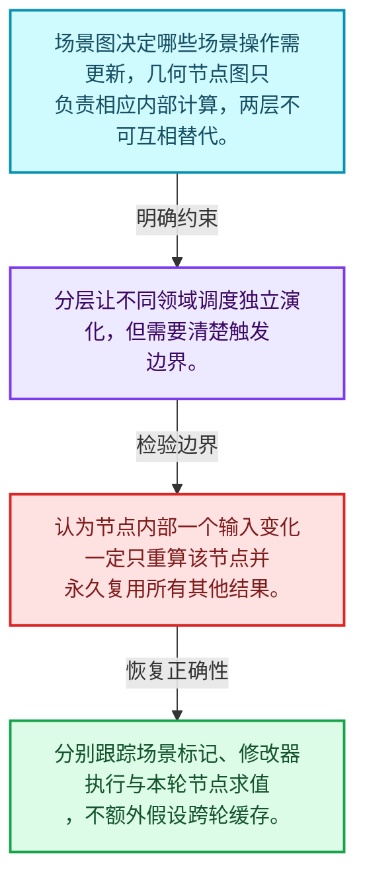
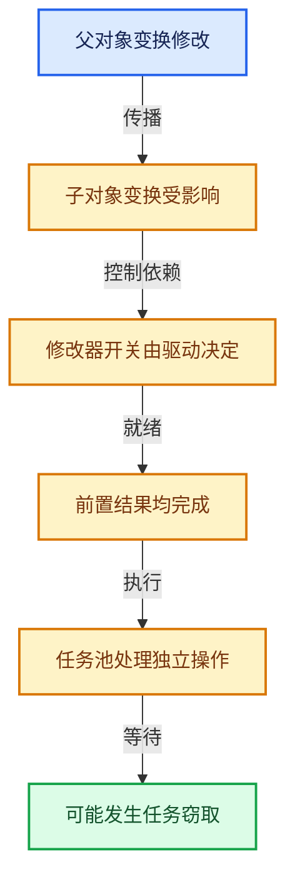

# 11-01 场景更新总体架构

[方向导航](README.md) · [总目录](../README.md) · [实现索引](../%E7%AC%A6%E5%8F%B7%E4%BE%9D%E8%B5%96%E4%B8%8E%E5%AE%9E%E7%8E%B0%E7%B4%A2%E5%BC%95.md)

## 从问题到实现

场景数据变化怎样转成计算更新？

依赖图连接计算关系，源数据与求值数据有所区分；它与几何节点内部执行图处于不同层。

**数据模型**

场景图决定哪些场景操作需更新，几何节点图只负责相应内部计算，两层不可互相替代。

**设计取舍**

分层让不同领域调度独立演化，但需要清楚触发边界。

**最小反例**

认为节点内部一个输入变化一定只重算该节点并永久复用所有其他结果。

**推导**

分别跟踪场景标记、修改器执行与本轮节点求值，不额外假设跨轮缓存。

## 阅读地图与执行推演






图中的数值推演是本方向的教学模型；实际函数之间的调用边与概念分析边分别标注，不能把概念关系当作运行时调度顺序。

## 完整源码单元与就地讲解

中文讲解直接放在相关代码旁，复杂机制在代码下展开。原文折叠区保留基准行号；不需要在行号表和函数之间来回查找。类布局可分段展示，函数实现不按固定行数切开。

### 类型布局、声明与编译条件 · depsgraph.hh L1—L206

<a id="t-54bcfadc1ca3"></a>

<a id="t-7bd662ea91f5"></a>

<a id="t-375d97e406ff"></a>

<a id="t-d9274b6d95e6"></a>

<a id="t-00ccb167564e"></a>

<a id="t-ea7adf66ff99"></a>

<a id="t-1e6fe0d85415"></a>

<a id="t-e888a028de6b"></a>

<a id="t-f75ab7cd4626"></a>

`Depsgraph`在这里声明的数据成员：

- `TimeSourceNode add_time_source`
- `TimeSourceNode find_time_source`
- `void tag_time_source`
- `IDNode find_id_node`
- `IDNode add_id_node`
- `void clear_id_nodes`
- `Relation add_new_relation`
- `Relation check_nodes_connected`
- `void add_entry_tag`
- `void clear_all_nodes`
- `ID get_cow_id`
- `LinearAllocator<> build_allocator`
- `Map<const ID *, IDNode *> id_hash`
- `IDDepsNodes id_nodes`
- `TimeSourceNode time_source`
- `bool has_animated_visibility`
- `bool need_update_relations`
- `bool need_update_nodes_visibility`
- `bool need_tag_id_on_graph_visibility_update`
- `bool need_tag_id_on_graph_visibility_time_update`
- `char id_type_updated`
- `char id_type_updated_backup`
- `char id_type_exist`
- `Set<OperationNode *> entry_tags`
- `OperationNodes operations`
- `SpinLock lock`
- `Main bmain`
- `Scene scene`
- `ViewLayer view_layer`
- `eEvaluationMode mode`
- `float frame`
- `float ctime`
- `Scene scene_cow`
- `bool is_active`
- `bool use_visibility_optimization`
- `DepsgraphDebug debug`
- `bool is_evaluating`
- `bool is_render_pipeline_depsgraph`
- `bool use_editors_update`
- `Map<const ID *, ListBaseT<EffectorRelation> *> physics_relations_effector`
- `Map<const ID *, ListBaseT<CollisionRelation> *> physics_relations_collision`
- `light_linking::Cache light_linking_cache`
- `uint64_t update_count`
- `DepsgraphEvaluateSyncWriteback sync_writeback`
- `Vector<std::function<void()>> sync_writeback_callbacks`
- `Mutex sync_writeback_callbacks_mutex`
- `MEM_CXX_CLASS_ALLOC_FUNCS "`

<!-- annotated:1df72baa953c94 -->

```cpp
/* SPDX-FileCopyrightText: 2013 Blender Authors
 *
 * SPDX-License-Identifier: GPL-2.0-or-later */

/** \file
 * \ingroup depsgraph
 *
 * Data-types for internal use in the Depsgraph
 *
 * All of these data-types are only really used within the "core" depsgraph.
 * In particular, node types declared here form the structure of operations
 * in the graph.
 */

#pragma once

#include <cstdlib>
#include <functional>

#include "MEM_guardedalloc.h"

#include "DNA_ID.h" /* for ID_Type and INDEX_ID_MAX */

#include "BLI_linear_allocator.hh"
#include "BLI_mutex.hh"
#include "BLI_set.hh"
#include "BLI_threads.hh" /* for SpinLock */

#include "DEG_depsgraph.hh"
#include "DEG_depsgraph_physics.hh"

#include "intern/debug/deg_debug.h"
#include "intern/depsgraph_light_linking.hh"

namespace blender {

struct ID;
struct Scene;
struct ViewLayer;

namespace deg {

struct IDNode;
struct Node;
struct OperationNode;
struct Relation;
struct TimeSourceNode;

/* Dependency Graph object */
struct Depsgraph {
  using OperationNodes = Vector<OperationNode *>;
  using IDDepsNodes = Vector<IDNode *>;

  Depsgraph(Main *bmain, Scene *scene, ViewLayer *view_layer, eEvaluationMode mode);
  ~Depsgraph();

  TimeSourceNode *add_time_source();
  TimeSourceNode *find_time_source() const;
  void tag_time_source();

  IDNode *find_id_node(const ID *id) const;
  IDNode *add_id_node(ID *id, ID *id_cow_hint = nullptr);
  void clear_id_nodes();

  /** Add new relationship between two nodes. */
  Relation *add_new_relation(Node *from, Node *to, const char *description, int flags = 0);

  /* Check whether two nodes are connected by relation with given
   * description. Description might be nullptr to check ANY relation between
   * given nodes. */
  Relation *check_nodes_connected(const Node *from, const Node *to, const char *description);

  /* Tag a specific node as needing updates. */
  void add_entry_tag(OperationNode *node);

  /* Clear storage used by all nodes. */
  void clear_all_nodes();

  /* Copy-on-Write Functionality ........ */

  /* For given original ID get ID which is created by copy-on-evaluation system. */
  ID *get_cow_id(const ID *id_orig) const;

  /* Core Graph Functionality ........... */

  /**
   * Used to decrease the cost of allocating many small structs when building the graph. This is a
   * viable strategy because the graph is rebuilt from scratch rather than changed in-place.
   */
  LinearAllocator<> build_allocator;

  /* <ID : IDNode> mapping from ID blocks to nodes representing these
   * blocks, used for quick lookups. */
  Map<const ID *, IDNode *> id_hash;

  /* Ordered list of ID nodes, order matches ID allocation order.
   * Used for faster iteration, especially for areas which are critical to
   * keep exact order of iteration. */
  IDDepsNodes id_nodes;

  /* Top-level time source node. */
  TimeSourceNode *time_source;

  /* The graph contains data-blocks whose visibility depends on evaluation (driven or animated). */
  bool has_animated_visibility;

  /* Indicates whether relations needs to be updated. */
  bool need_update_relations;

  /* Indicates whether indirect effect of nodes on a directly visible ones needs to be updated. */
  bool need_update_nodes_visibility;

  /* Indicated whether IDs in this graph are to be tagged as if they first appear visible, with
   * an optional tag for their animation (time) update. */
  bool need_tag_id_on_graph_visibility_update;
  bool need_tag_id_on_graph_visibility_time_update;

  /* Indicates which ID types were updated. */
  char id_type_updated[INDEX_ID_MAX];
  /* Accumulate id type updates from multiple update passes. */
  char id_type_updated_backup[INDEX_ID_MAX];

  /* Indicates type of IDs present in the depsgraph. */
  char id_type_exist[INDEX_ID_MAX];

  /* Quick-Access Temp Data ............. */

  /* Nodes which have been tagged as "directly modified". */
  Set<OperationNode *> entry_tags;

  /* Convenience Data ................... */

  /* XXX: should be collected after building (if actually needed?) */
  /* All operation nodes, sorted in order of single-thread traversal order. */
  OperationNodes operations;

  /* Spin lock for threading-critical operations.
   * Mainly used by graph evaluation. */
  SpinLock lock;

  /* Main, scene, layer, mode this dependency graph is built for. */
  Main *bmain;
  Scene *scene;
  ViewLayer *view_layer;
  eEvaluationMode mode;

  /* Time at which dependency graph is being or was last evaluated.
   * frame is the value before, and ctime the value after time remapping. */
  float frame;
  float ctime;

  /* Evaluated version of datablocks we access a lot.
   * Stored here to save us form doing hash lookup. */
  Scene *scene_cow;

  /* Active dependency graph is a dependency graph which is used by the
   * currently active window. When dependency graph is active, it is allowed
   * for evaluation functions to write animation f-curve result, drivers
   * result and other selective things (object matrix?) to original object.
   *
   * This way we simplify operators, which don't need to worry about where
   * to read stuff from. */
  bool is_active;

  /* Optimize out evaluation of operations which affect hidden objects or disabled modifiers. */
  bool use_visibility_optimization;

  DepsgraphDebug debug;

  bool is_evaluating;

  /* Is set to truth for dependency graph which are used for post-processing (compositor and
   * sequencer).
   * Such dependency graph needs all view layers (so render pipeline can access names), but it
   * does not need any bases. */
  bool is_render_pipeline_depsgraph;

  /* Notify editors about changes to IDs in this depsgraph. */
  bool use_editors_update;

  /* Cached list of colliders/effectors for collections and the scene
   * created along with relations, for fast lookup during evaluation. */
  Map<const ID *, ListBaseT<EffectorRelation> *> *physics_relations_effector;
  Map<const ID *, ListBaseT<CollisionRelation> *>
      *physics_relations_collision[DEG_PHYSICS_COLLISION_NUM];

  light_linking::Cache light_linking_cache;

  /* The number of times this graph has been evaluated. */
  uint64_t update_count;

  /* If this mode does not allow writing back to original data any callbacks will be discarded. */
  DepsgraphEvaluateSyncWriteback sync_writeback;
  /**
   * Stores functions that can be called after depsgraph evaluation to writeback some changes to
   * original data. Also see `DEG_depsgraph_writeback_sync.hh`.
   */
  Vector<std::function<void()>> sync_writeback_callbacks;
  /** Needs to be locked when adding a writeback callback during evaluation. */
  Mutex sync_writeback_callbacks_mutex;

  MEM_CXX_CLASS_ALLOC_FUNCS("Depsgraph");
};

}  // namespace deg
}  // namespace blender
```

<details>
<summary>核对原始源码：source/blender/depsgraph/intern/depsgraph.hh · L1—L206</summary>

<!-- original:1df72baa953c94:source/blender/depsgraph/intern/depsgraph.hh:1:206 -->

```cpp
/* SPDX-FileCopyrightText: 2013 Blender Authors
 *
 * SPDX-License-Identifier: GPL-2.0-or-later */

/** \file
 * \ingroup depsgraph
 *
 * Data-types for internal use in the Depsgraph
 *
 * All of these data-types are only really used within the "core" depsgraph.
 * In particular, node types declared here form the structure of operations
 * in the graph.
 */

#pragma once

#include <cstdlib>
#include <functional>

#include "MEM_guardedalloc.h"

#include "DNA_ID.h" /* for ID_Type and INDEX_ID_MAX */

#include "BLI_linear_allocator.hh"
#include "BLI_mutex.hh"
#include "BLI_set.hh"
#include "BLI_threads.hh" /* for SpinLock */

#include "DEG_depsgraph.hh"
#include "DEG_depsgraph_physics.hh"

#include "intern/debug/deg_debug.h"
#include "intern/depsgraph_light_linking.hh"

namespace blender {

struct ID;
struct Scene;
struct ViewLayer;

namespace deg {

struct IDNode;
struct Node;
struct OperationNode;
struct Relation;
struct TimeSourceNode;

/* Dependency Graph object */
struct Depsgraph {
  using OperationNodes = Vector<OperationNode *>;
  using IDDepsNodes = Vector<IDNode *>;

  Depsgraph(Main *bmain, Scene *scene, ViewLayer *view_layer, eEvaluationMode mode);
  ~Depsgraph();

  TimeSourceNode *add_time_source();
  TimeSourceNode *find_time_source() const;
  void tag_time_source();

  IDNode *find_id_node(const ID *id) const;
  IDNode *add_id_node(ID *id, ID *id_cow_hint = nullptr);
  void clear_id_nodes();

  /** Add new relationship between two nodes. */
  Relation *add_new_relation(Node *from, Node *to, const char *description, int flags = 0);

  /* Check whether two nodes are connected by relation with given
   * description. Description might be nullptr to check ANY relation between
   * given nodes. */
  Relation *check_nodes_connected(const Node *from, const Node *to, const char *description);

  /* Tag a specific node as needing updates. */
  void add_entry_tag(OperationNode *node);

  /* Clear storage used by all nodes. */
  void clear_all_nodes();

  /* Copy-on-Write Functionality ........ */

  /* For given original ID get ID which is created by copy-on-evaluation system. */
  ID *get_cow_id(const ID *id_orig) const;

  /* Core Graph Functionality ........... */

  /**
   * Used to decrease the cost of allocating many small structs when building the graph. This is a
   * viable strategy because the graph is rebuilt from scratch rather than changed in-place.
   */
  LinearAllocator<> build_allocator;

  /* <ID : IDNode> mapping from ID blocks to nodes representing these
   * blocks, used for quick lookups. */
  Map<const ID *, IDNode *> id_hash;

  /* Ordered list of ID nodes, order matches ID allocation order.
   * Used for faster iteration, especially for areas which are critical to
   * keep exact order of iteration. */
  IDDepsNodes id_nodes;

  /* Top-level time source node. */
  TimeSourceNode *time_source;

  /* The graph contains data-blocks whose visibility depends on evaluation (driven or animated). */
  bool has_animated_visibility;

  /* Indicates whether relations needs to be updated. */
  bool need_update_relations;

  /* Indicates whether indirect effect of nodes on a directly visible ones needs to be updated. */
  bool need_update_nodes_visibility;

  /* Indicated whether IDs in this graph are to be tagged as if they first appear visible, with
   * an optional tag for their animation (time) update. */
  bool need_tag_id_on_graph_visibility_update;
  bool need_tag_id_on_graph_visibility_time_update;

  /* Indicates which ID types were updated. */
  char id_type_updated[INDEX_ID_MAX];
  /* Accumulate id type updates from multiple update passes. */
  char id_type_updated_backup[INDEX_ID_MAX];

  /* Indicates type of IDs present in the depsgraph. */
  char id_type_exist[INDEX_ID_MAX];

  /* Quick-Access Temp Data ............. */

  /* Nodes which have been tagged as "directly modified". */
  Set<OperationNode *> entry_tags;

  /* Convenience Data ................... */

  /* XXX: should be collected after building (if actually needed?) */
  /* All operation nodes, sorted in order of single-thread traversal order. */
  OperationNodes operations;

  /* Spin lock for threading-critical operations.
   * Mainly used by graph evaluation. */
  SpinLock lock;

  /* Main, scene, layer, mode this dependency graph is built for. */
  Main *bmain;
  Scene *scene;
  ViewLayer *view_layer;
  eEvaluationMode mode;

  /* Time at which dependency graph is being or was last evaluated.
   * frame is the value before, and ctime the value after time remapping. */
  float frame;
  float ctime;

  /* Evaluated version of datablocks we access a lot.
   * Stored here to save us form doing hash lookup. */
  Scene *scene_cow;

  /* Active dependency graph is a dependency graph which is used by the
   * currently active window. When dependency graph is active, it is allowed
   * for evaluation functions to write animation f-curve result, drivers
   * result and other selective things (object matrix?) to original object.
   *
   * This way we simplify operators, which don't need to worry about where
   * to read stuff from. */
  bool is_active;

  /* Optimize out evaluation of operations which affect hidden objects or disabled modifiers. */
  bool use_visibility_optimization;

  DepsgraphDebug debug;

  bool is_evaluating;

  /* Is set to truth for dependency graph which are used for post-processing (compositor and
   * sequencer).
   * Such dependency graph needs all view layers (so render pipeline can access names), but it
   * does not need any bases. */
  bool is_render_pipeline_depsgraph;

  /* Notify editors about changes to IDs in this depsgraph. */
  bool use_editors_update;

  /* Cached list of colliders/effectors for collections and the scene
   * created along with relations, for fast lookup during evaluation. */
  Map<const ID *, ListBaseT<EffectorRelation> *> *physics_relations_effector;
  Map<const ID *, ListBaseT<CollisionRelation> *>
      *physics_relations_collision[DEG_PHYSICS_COLLISION_NUM];

  light_linking::Cache light_linking_cache;

  /* The number of times this graph has been evaluated. */
  uint64_t update_count;

  /* If this mode does not allow writing back to original data any callbacks will be discarded. */
  DepsgraphEvaluateSyncWriteback sync_writeback;
  /**
   * Stores functions that can be called after depsgraph evaluation to writeback some changes to
   * original data. Also see `DEG_depsgraph_writeback_sync.hh`.
   */
  Vector<std::function<void()>> sync_writeback_callbacks;
  /** Needs to be locked when adding a writeback callback during evaluation. */
  Mutex sync_writeback_callbacks_mutex;

  MEM_CXX_CLASS_ALLOC_FUNCS("Depsgraph");
};

}  // namespace deg
}  // namespace blender
```

</details>

### 类型布局、声明与编译条件 · depsgraph_relation.hh L1—L35

<a id="t-2ca2d917cc1b"></a>

<a id="t-76e4f339d0c0"></a>

<a id="t-02dcdf76f4b8"></a>

<!-- annotated:06f75322e318c2 -->

```cpp
/* SPDX-FileCopyrightText: 2020 Blender Authors
 *
 * SPDX-License-Identifier: GPL-2.0-or-later */

/** \file
 * \ingroup depsgraph
 */

#pragma once

namespace blender::deg {

struct Node;

/* Settings/Tags on Relationship.
 * NOTE: Is a bitmask, allowing accumulation. */
enum RelationFlag {
  /* "cyclic" link - when detecting cycles, this relationship was the one
   * which triggers a cyclic relationship to exist in the graph. */
  RELATION_FLAG_CYCLIC = (1 << 0),
  /* Update flush will not go through this relation. */
  RELATION_FLAG_NO_FLUSH = (1 << 1),
  /* Only flush along the relation is update comes from a node which was
   * affected by user input. */
  RELATION_FLAG_FLUSH_USER_EDIT_ONLY = (1 << 2),
  /* The relation can not be killed by the cyclic dependencies solver. */
  RELATION_FLAG_GODMODE = (1 << 4),
  /* Relation will check existence before being added. */
  RELATION_CHECK_BEFORE_ADD = (1 << 5),
  /* The relation does not participate in visibility checks. */
  RELATION_NO_VISIBILITY_CHANGE = (1 << 6),
};

/* B depends on A (A -> B) */
struct Relation {
```

<details>
<summary>核对原始源码：source/blender/depsgraph/intern/depsgraph_relation.hh · L1—L35</summary>

<!-- original:06f75322e318c2:source/blender/depsgraph/intern/depsgraph_relation.hh:1:35 -->

```cpp
/* SPDX-FileCopyrightText: 2020 Blender Authors
 *
 * SPDX-License-Identifier: GPL-2.0-or-later */

/** \file
 * \ingroup depsgraph
 */

#pragma once

namespace blender::deg {

struct Node;

/* Settings/Tags on Relationship.
 * NOTE: Is a bitmask, allowing accumulation. */
enum RelationFlag {
  /* "cyclic" link - when detecting cycles, this relationship was the one
   * which triggers a cyclic relationship to exist in the graph. */
  RELATION_FLAG_CYCLIC = (1 << 0),
  /* Update flush will not go through this relation. */
  RELATION_FLAG_NO_FLUSH = (1 << 1),
  /* Only flush along the relation is update comes from a node which was
   * affected by user input. */
  RELATION_FLAG_FLUSH_USER_EDIT_ONLY = (1 << 2),
  /* The relation can not be killed by the cyclic dependencies solver. */
  RELATION_FLAG_GODMODE = (1 << 4),
  /* Relation will check existence before being added. */
  RELATION_CHECK_BEFORE_ADD = (1 << 5),
  /* The relation does not participate in visibility checks. */
  RELATION_NO_VISIBILITY_CHANGE = (1 << 6),
};

/* B depends on A (A -> B) */
struct Relation {
```

</details>

<a id="f-c6fb4e168b3d2cc8"></a>

### `blender::deg::Relation::Relation`

实现位置：[source/blender/depsgraph/intern/depsgraph_relation.hh](../../../../../source/blender/depsgraph/intern/depsgraph_relation.hh) · L36—L38。

接口参数：

- `Node *from`
- `Node *to`
- `const char *description`

**教学注释版**

<!-- annotated:28ec84f73d6d92 -->

```cpp
  Relation(Node *from, Node *to, const char *description) : from(from), to(to), name(description)
  {
  }
```

<details>
<summary>核对原始源码：source/blender/depsgraph/intern/depsgraph_relation.hh · L36—L38</summary>

<!-- original:28ec84f73d6d92:source/blender/depsgraph/intern/depsgraph_relation.hh:36:38 -->

```cpp
  Relation(Node *from, Node *to, const char *description) : from(from), to(to), name(description)
  {
  }
```

</details>

**继续追踪实现**

本实现没有需要继续展开的显式调用；检查返回表达式、对象转换和调用者前置条件。

### 类型布局、声明与编译条件 · depsgraph_relation.hh L39—L51

<!-- annotated:b612e0612c9d05 -->

```cpp

  void unlink();

  /* the nodes in the relationship (since this is shared between the nodes) */
  Node *from; /* A */
  Node *to;   /* B */

  /* relationship attributes */
  const char *name; /* label for debugging */
  int flag = 0;     /* Bitmask of RelationFlag. */
};

}  // namespace blender::deg
```

<details>
<summary>核对原始源码：source/blender/depsgraph/intern/depsgraph_relation.hh · L39—L51</summary>

<!-- original:b612e0612c9d05:source/blender/depsgraph/intern/depsgraph_relation.hh:39:51 -->

```cpp

  void unlink();

  /* the nodes in the relationship (since this is shared between the nodes) */
  Node *from; /* A */
  Node *to;   /* B */

  /* relationship attributes */
  const char *name; /* label for debugging */
  int flag = 0;     /* Bitmask of RelationFlag. */
};

}  // namespace blender::deg
```

</details>

## 语法与相关类型

### 只读限定 const

const约束当前访问路径可做的修改。const指针、指向const的指针、const视图对象、const元素是不同位置的限定；其他别名可能仍可修改原对象。

分别写T* const、const T*与const T* const，并画出不可修改的层次。

### 异常边界 try与catch

try定义异常传播的局部边界。失败路径需要销毁已经成功构造的部分并释放相应存储；未构造的对象不能被析构。

在第k次构造失败，列出已经存在的对象集合与待释放缓冲。

### 构造与new表达式

普通new可能分配并构造；placement new在给定地址构造，存储由其他机制提供。失败回滚应区分两类责任。

追踪地址来自哪里、构造何时成功、由谁析构、由谁释放。

### 类型别名 using

类型别名为已有类型建立名字，不创建运行期对象。它常把模板内部使用的类型统一暴露给泛型调用者。

展开别名直到基础类型，区分类型别名和变量声明。

### 枚举与状态模型 enum

枚举把有限状态命名；enum class避免许多隐式整数转换。状态机正确性还依赖允许的转移，不能只看有哪些枚举项。

列出每个状态的进入条件和离开条件，检查终止状态是否仍可能被调度。

### 拥有型可调用包装 function

std::function保存可调用目标并提供统一调用接口，复制能力与目标要求有关；FunctionRef仅借用，二者不能无条件互换。

比较同步回调与长期保存任务对拥有关系的不同要求。

## 实现练习与验证

构造父子对象和修改器依赖，画出更新传播方向。

参考推理：分别跟踪场景标记、修改器执行与本轮节点求值，不额外假设跨轮缓存。

依赖结果先于消费者可见；禁用节点仍保留必要控制计算；没有同时持有锁的循环等待。

## 历史、跨库比较与证据

与构建系统依赖图、oneTBB任务与几何节点图比较：场景更新需要处理源变化和可见性，具体图执行还受领域语义影响。

[历史提交索引](../%E5%8E%86%E5%8F%B2%E6%8F%90%E4%BA%A4%E4%B8%8E%E8%AE%BE%E8%AE%A1%E6%BC%94%E5%8C%96%E7%B4%A2%E5%BC%95.md) · [源码基准](../%E6%BA%90%E7%A0%81%E7%89%88%E6%9C%AC%E4%B8%8E%E8%A6%86%E7%9B%96%E7%B4%A2%E5%BC%95.md) · [验收报告](../%E9%AA%8C%E6%94%B6%E6%8A%A5%E5%91%8A.md)
