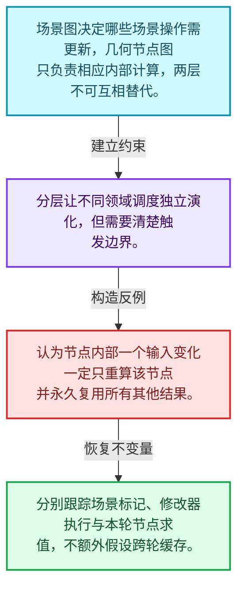
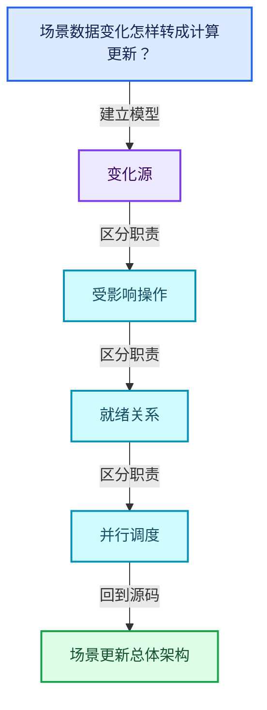
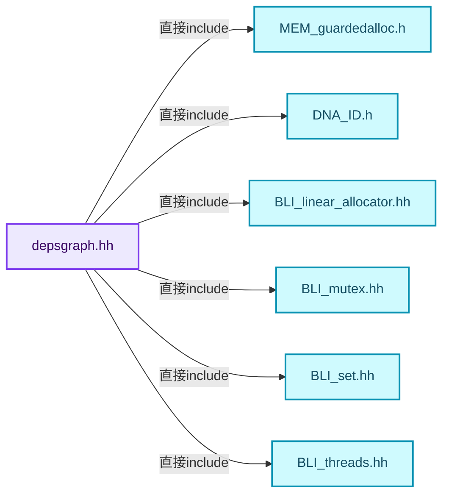
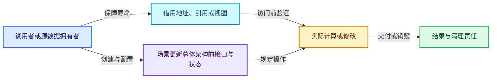
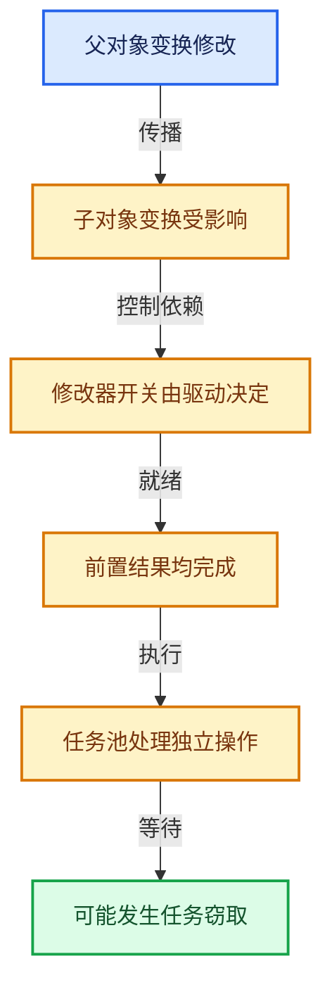

# 11-01 场景更新总体架构

[方向导航](README.md) · [总目录](../README.md) · [覆盖索引](../%E6%BA%90%E7%A0%81%E7%89%88%E6%9C%AC%E4%B8%8E%E8%A6%86%E7%9B%96%E7%B4%A2%E5%BC%95.md)

> 阅读顺序：问题与数据模型 → 语法与类型 → 源码逐行 → 调用线索 → 历史与取舍 → 推演和练习。

- 基准 HEAD：`cbda6b96c26c0dee3c3b5cbb93960c4ac06a6b30`。
- 记录日期：2026-10-14。
- 教学示例状态：正文中的推演不是本机性能实测；已运行练习见验收报告。

## 一、从问题到设计

场景数据变化怎样转成计算更新？

依赖图连接计算关系，源数据与求值数据有所区分；它与几何节点内部执行图处于不同层。

本篇把语法、数据语义和系统取舍连接起来。标记更新、判断需求、依赖满足和任务执行是分开的阶段。

### 本篇独立模型与设计推理

场景图决定哪些场景操作需更新，几何节点图只负责相应内部计算，两层不可互相替代。

设计取舍：分层让不同领域调度独立演化，但需要清楚触发边界。

最小反例：认为节点内部一个输入变化一定只重算该节点并永久复用所有其他结果。

推导与处理：分别跟踪场景标记、修改器执行与本轮节点求值，不额外假设跨轮缓存。



### 源码范围与相邻篇章

| 文件 | 本篇逐行范围 | 基准SHA-256 |
|---|---|---|
| [source/blender/depsgraph/intern/depsgraph.hh](../../../../../source/blender/depsgraph/intern/depsgraph.hh) | L1—L206 | `22b8364b5f7d2228a2a2320286cf62b0c5354f4eeb366e4ebcb60cb502e4ad7b` |
| [source/blender/depsgraph/intern/depsgraph_relation.hh](../../../../../source/blender/depsgraph/intern/depsgraph_relation.hh) | L1—L51 | `9167c989e1a30b9c2a119ef0dfd9e87bca8ac20fda71b62fc41fa16433a27cdf` |

同一主讲文件可能分多篇覆盖；超出本篇范围的符号通过覆盖索引定位。空行与纯注释保留在源码摘录中，逐行表解释有效语句与语法边界；许可证头统一保留。

后篇：[ID组件与操作节点](02-ID%E7%BB%84%E4%BB%B6%E4%B8%8E%E6%93%8D%E4%BD%9C%E8%8A%82%E7%82%B9.md).

## 二、类型、数据与阅读地图



这是概念依赖图，边表示阅读关系，不声称是运行时调用顺序。

### 直接编译依赖



箭头只表示头文件包含关系；完整调用线索见后面的符号定位表。

## 三、关键词、语法与类型角色

### 只读限定 const

const约束当前访问路径可做的修改。const指针、指向const的指针、const视图对象、const元素是不同位置的限定；其他别名可能仍可修改原对象。

具体检查：分别写T* const、const T*与const T* const，并画出不可修改的层次。

### 异常边界 try与catch

try定义异常传播的局部边界。失败路径需要销毁已经成功构造的部分并释放相应存储；未构造的对象不能被析构。

具体检查：在第k次构造失败，列出已经存在的对象集合与待释放缓冲。

### 构造与new表达式

普通new可能分配并构造；placement new在给定地址构造，存储由其他机制提供。失败回滚应区分两类责任。

具体检查：追踪地址来自哪里、构造何时成功、由谁析构、由谁释放。

### 类型别名 using

类型别名为已有类型建立名字，不创建运行期对象。它常把模板内部使用的类型统一暴露给泛型调用者。

具体检查：展开别名直到基础类型，区分类型别名和变量声明。

### 枚举与状态模型 enum

枚举把有限状态命名；enum class避免许多隐式整数转换。状态机正确性还依赖允许的转移，不能只看有哪些枚举项。

具体检查：列出每个状态的进入条件和离开条件，检查终止状态是否仍可能被调度。

### 拥有型可调用包装 function

std::function保存可调用目标并提供统一调用接口，复制能力与目标要求有关；FunctionRef仅借用，二者不能无条件互换。

具体检查：比较同步回调与长期保存任务对拥有关系的不同要求。

## 四、真实源码与逐行讲解

源码块保持原行内容，原始行号由小节标题及逐行表给出。表中的调用定位是静态阅读辅助；重载、模板实例化、宏展开和虚调用需结合完整声明，不能仅凭词法出现证明动态调用。

### depsgraph.hh：L1—L47

<!-- source:source/blender/depsgraph/intern/depsgraph.hh:1:47 -->

```cpp
/* SPDX-FileCopyrightText: 2013 Blender Authors
 *
 * SPDX-License-Identifier: GPL-2.0-or-later */

/** \file
 * \ingroup depsgraph
 *
 * Data-types for internal use in the Depsgraph
 *
 * All of these data-types are only really used within the "core" depsgraph.
 * In particular, node types declared here form the structure of operations
 * in the graph.
 */

#pragma once

#include <cstdlib>
#include <functional>

#include "MEM_guardedalloc.h"

#include "DNA_ID.h" /* for ID_Type and INDEX_ID_MAX */

#include "BLI_linear_allocator.hh"
#include "BLI_mutex.hh"
#include "BLI_set.hh"
#include "BLI_threads.hh" /* for SpinLock */

#include "DEG_depsgraph.hh"
#include "DEG_depsgraph_physics.hh"

#include "intern/debug/deg_debug.h"
#include "intern/depsgraph_light_linking.hh"

namespace blender {

struct ID;
struct Scene;
struct ViewLayer;

namespace deg {

struct IDNode;
struct Node;
struct OperationNode;
struct Relation;
struct TimeSourceNode;
```

| 原始行 | 语义、约束与检查 |
|---|---|
| L15 | 防止同一头文件在一个翻译单元中重复展开；不控制多个源文件之间的链接或对象寿命。 |
| L17 | 引入编译依赖 <cstdlib>；这是声明可见性关系，不表示运行时一定调用该文件的所有接口。 |
| L18 | 引入编译依赖 <functional>；这是声明可见性关系，不表示运行时一定调用该文件的所有接口。 |
| L20 | 引入编译依赖 "MEM_guardedalloc.h"；这是声明可见性关系，不表示运行时一定调用该文件的所有接口。 |
| L22 | 引入编译依赖 "DNA_ID.h"；这是声明可见性关系，不表示运行时一定调用该文件的所有接口。 |
| L24 | 引入编译依赖 "BLI_linear_allocator.hh"；这是声明可见性关系，不表示运行时一定调用该文件的所有接口。 |
| L25 | 引入编译依赖 "BLI_mutex.hh"；这是声明可见性关系，不表示运行时一定调用该文件的所有接口。 |
| L26 | 引入编译依赖 "BLI_set.hh"；这是声明可见性关系，不表示运行时一定调用该文件的所有接口。 |
| L27 | 引入编译依赖 "BLI_threads.hh"；这是声明可见性关系，不表示运行时一定调用该文件的所有接口。 |
| L29 | 引入编译依赖 "DEG_depsgraph.hh"；这是声明可见性关系，不表示运行时一定调用该文件的所有接口。 |
| L30 | 引入编译依赖 "DEG_depsgraph_physics.hh"；这是声明可见性关系，不表示运行时一定调用该文件的所有接口。 |
| L32 | 引入编译依赖 "intern/debug/deg_debug.h"；这是声明可见性关系，不表示运行时一定调用该文件的所有接口。 |
| L33 | 引入编译依赖 "intern/depsgraph_light_linking.hh"；这是声明可见性关系，不表示运行时一定调用该文件的所有接口。 |
| L35 | 把后续声明放入 blender 命名空间，影响名称查找和符号归属，不创建运行时对象。 |
| L37 | 声明或定义类型 `struct ID`。结合继承、访问权限和成员布局确认接口与拥有关系；前向声明本身没有完整对象布局。 |
| L38 | 声明或定义类型 `struct Scene`。结合继承、访问权限和成员布局确认接口与拥有关系；前向声明本身没有完整对象布局。 |
| L39 | 声明或定义类型 `struct ViewLayer`。结合继承、访问权限和成员布局确认接口与拥有关系；前向声明本身没有完整对象布局。 |
| L41 | 把后续声明放入 deg 命名空间，影响名称查找和符号归属，不创建运行时对象。 |
| L43 | 声明或定义类型 `struct IDNode`。结合继承、访问权限和成员布局确认接口与拥有关系；前向声明本身没有完整对象布局。 |
| L44 | 声明或定义类型 `struct Node`。结合继承、访问权限和成员布局确认接口与拥有关系；前向声明本身没有完整对象布局。 |
| L45 | 声明或定义类型 `struct OperationNode`。结合继承、访问权限和成员布局确认接口与拥有关系；前向声明本身没有完整对象布局。 |
| L46 | 声明或定义类型 `struct Relation`。结合继承、访问权限和成员布局确认接口与拥有关系；前向声明本身没有完整对象布局。 |
| L47 | 声明或定义类型 `struct TimeSourceNode`。结合继承、访问权限和成员布局确认接口与拥有关系；前向声明本身没有完整对象布局。 |

### depsgraph.hh：L48—L94

<!-- source:source/blender/depsgraph/intern/depsgraph.hh:48:94 -->

```cpp

/* Dependency Graph object */
struct Depsgraph {
  using OperationNodes = Vector<OperationNode *>;
  using IDDepsNodes = Vector<IDNode *>;

  Depsgraph(Main *bmain, Scene *scene, ViewLayer *view_layer, eEvaluationMode mode);
  ~Depsgraph();

  TimeSourceNode *add_time_source();
  TimeSourceNode *find_time_source() const;
  void tag_time_source();

  IDNode *find_id_node(const ID *id) const;
  IDNode *add_id_node(ID *id, ID *id_cow_hint = nullptr);
  void clear_id_nodes();

  /** Add new relationship between two nodes. */
  Relation *add_new_relation(Node *from, Node *to, const char *description, int flags = 0);

  /* Check whether two nodes are connected by relation with given
   * description. Description might be nullptr to check ANY relation between
   * given nodes. */
  Relation *check_nodes_connected(const Node *from, const Node *to, const char *description);

  /* Tag a specific node as needing updates. */
  void add_entry_tag(OperationNode *node);

  /* Clear storage used by all nodes. */
  void clear_all_nodes();

  /* Copy-on-Write Functionality ........ */

  /* For given original ID get ID which is created by copy-on-evaluation system. */
  ID *get_cow_id(const ID *id_orig) const;

  /* Core Graph Functionality ........... */

  /**
   * Used to decrease the cost of allocating many small structs when building the graph. This is a
   * viable strategy because the graph is rebuilt from scratch rather than changed in-place.
   */
  LinearAllocator<> build_allocator;

  /* <ID : IDNode> mapping from ID blocks to nodes representing these
   * blocks, used for quick lookups. */
  Map<const ID *, IDNode *> id_hash;
```

| 原始行 | 语义、约束与检查 |
|---|---|
| L50 | 声明或定义类型 `struct Depsgraph`。结合继承、访问权限和成员布局确认接口与拥有关系；前向声明本身没有完整对象布局。 |
| L51 | 定义类型别名 `using OperationNodes = Vector<OperationNode *>`，为模板接口或内部实现统一命名；本行不分配该类型对象。 |
| L52 | 定义类型别名 `using IDDepsNodes = Vector<IDNode *>`，为模板接口或内部实现统一命名；本行不分配该类型对象。 |
| L54 | 出现调用或函数声明 `Depsgraph`，对应表达式为 `Depsgraph(Main *bmain, Scene *scene, ViewLayer *view_layer, eEvaluationMode mode);`。参数求值、返回类型与重载需结合前后完整语句；静态文本引用不能证明动态目标。 |
| L55 | 涉及析构接口或显式析构：`~Depsgraph();`。检查目标对象已成功构造，且资源不会在另一条清理路径再次销毁。 |
| L57 | 出现调用或函数声明 `add_time_source`，对应表达式为 `TimeSourceNode *add_time_source();`。参数求值、返回类型与重载需结合前后完整语句；静态文本引用不能证明动态目标。 |
| L58 | 声明接口 `TimeSourceNode *find_time_source() const`，本行没有对应函数体；返回类型、参数限定和const/noexcept共同组成调用契约，实际行为需继续定位实现。 |
| L59 | 声明接口 `void tag_time_source()`，本行没有对应函数体；返回类型、参数限定和const/noexcept共同组成调用契约，实际行为需继续定位实现。 |
| L61 | 声明接口 `IDNode *find_id_node(const ID *id) const`，本行没有对应函数体；返回类型、参数限定和const/noexcept共同组成调用契约，实际行为需继续定位实现。 |
| L62 | 把右侧 `nullptr)` 用于初始化或更新左侧 `IDNode *add_id_node(ID *id, ID *id_cow_hint`。声明初始化与已有对象赋值应按上下文区分；有资源的类型会调用相应特殊成员。 |
| L63 | 声明接口 `void clear_id_nodes()`，本行没有对应函数体；返回类型、参数限定和const/noexcept共同组成调用契约，实际行为需继续定位实现。 |
| L66 | 把右侧 `0)` 用于初始化或更新左侧 `Relation *add_new_relation(Node *from, Node *to, const char *description, int flags`。声明初始化与已有对象赋值应按上下文区分；有资源的类型会调用相应特殊成员。 |
| L71 | 出现调用或函数声明 `check_nodes_connected`，对应表达式为 `Relation *check_nodes_connected(const Node *from, const Node *to, const char *description);`。参数求值、返回类型与重载需结合前后完整语句；静态文本引用不能证明动态目标。 |
| L74 | 声明接口 `void add_entry_tag(OperationNode *node)`，本行没有对应函数体；返回类型、参数限定和const/noexcept共同组成调用契约，实际行为需继续定位实现。 |
| L77 | 声明接口 `void clear_all_nodes()`，本行没有对应函数体；返回类型、参数限定和const/noexcept共同组成调用契约，实际行为需继续定位实现。 |
| L82 | 声明接口 `ID *get_cow_id(const ID *id_orig) const`，本行没有对应函数体；返回类型、参数限定和const/noexcept共同组成调用契约，实际行为需继续定位实现。 |
| L90 | 声明成员、局部对象或完成语句 `LinearAllocator<> build_allocator`。若为指针或引用，它本身不说明拥有；若为值对象，其构造析构由所在作用域或外层对象管理。 |
| L94 | 声明成员、局部对象或完成语句 `Map<const ID *, IDNode *> id_hash`。若为指针或引用，它本身不说明拥有；若为值对象，其构造析构由所在作用域或外层对象管理。 |

### depsgraph.hh：L95—L142

<!-- source:source/blender/depsgraph/intern/depsgraph.hh:95:142 -->

```cpp

  /* Ordered list of ID nodes, order matches ID allocation order.
   * Used for faster iteration, especially for areas which are critical to
   * keep exact order of iteration. */
  IDDepsNodes id_nodes;

  /* Top-level time source node. */
  TimeSourceNode *time_source;

  /* The graph contains data-blocks whose visibility depends on evaluation (driven or animated). */
  bool has_animated_visibility;

  /* Indicates whether relations needs to be updated. */
  bool need_update_relations;

  /* Indicates whether indirect effect of nodes on a directly visible ones needs to be updated. */
  bool need_update_nodes_visibility;

  /* Indicated whether IDs in this graph are to be tagged as if they first appear visible, with
   * an optional tag for their animation (time) update. */
  bool need_tag_id_on_graph_visibility_update;
  bool need_tag_id_on_graph_visibility_time_update;

  /* Indicates which ID types were updated. */
  char id_type_updated[INDEX_ID_MAX];
  /* Accumulate id type updates from multiple update passes. */
  char id_type_updated_backup[INDEX_ID_MAX];

  /* Indicates type of IDs present in the depsgraph. */
  char id_type_exist[INDEX_ID_MAX];

  /* Quick-Access Temp Data ............. */

  /* Nodes which have been tagged as "directly modified". */
  Set<OperationNode *> entry_tags;

  /* Convenience Data ................... */

  /* XXX: should be collected after building (if actually needed?) */
  /* All operation nodes, sorted in order of single-thread traversal order. */
  OperationNodes operations;

  /* Spin lock for threading-critical operations.
   * Mainly used by graph evaluation. */
  SpinLock lock;

  /* Main, scene, layer, mode this dependency graph is built for. */
  Main *bmain;
```

| 原始行 | 语义、约束与检查 |
|---|---|
| L99 | 声明成员、局部对象或完成语句 `IDDepsNodes id_nodes`。若为指针或引用，它本身不说明拥有；若为值对象，其构造析构由所在作用域或外层对象管理。 |
| L102 | 声明成员、局部对象或完成语句 `TimeSourceNode *time_source`。若为指针或引用，它本身不说明拥有；若为值对象，其构造析构由所在作用域或外层对象管理。 |
| L105 | 声明成员、局部对象或完成语句 `bool has_animated_visibility`。若为指针或引用，它本身不说明拥有；若为值对象，其构造析构由所在作用域或外层对象管理。 |
| L108 | 声明成员、局部对象或完成语句 `bool need_update_relations`。若为指针或引用，它本身不说明拥有；若为值对象，其构造析构由所在作用域或外层对象管理。 |
| L111 | 声明成员、局部对象或完成语句 `bool need_update_nodes_visibility`。若为指针或引用，它本身不说明拥有；若为值对象，其构造析构由所在作用域或外层对象管理。 |
| L115 | 声明成员、局部对象或完成语句 `bool need_tag_id_on_graph_visibility_update`。若为指针或引用，它本身不说明拥有；若为值对象，其构造析构由所在作用域或外层对象管理。 |
| L116 | 声明成员、局部对象或完成语句 `bool need_tag_id_on_graph_visibility_time_update`。若为指针或引用，它本身不说明拥有；若为值对象，其构造析构由所在作用域或外层对象管理。 |
| L119 | 声明成员、局部对象或完成语句 `char id_type_updated[INDEX_ID_MAX]`。若为指针或引用，它本身不说明拥有；若为值对象，其构造析构由所在作用域或外层对象管理。 |
| L121 | 声明成员、局部对象或完成语句 `char id_type_updated_backup[INDEX_ID_MAX]`。若为指针或引用，它本身不说明拥有；若为值对象，其构造析构由所在作用域或外层对象管理。 |
| L124 | 声明成员、局部对象或完成语句 `char id_type_exist[INDEX_ID_MAX]`。若为指针或引用，它本身不说明拥有；若为值对象，其构造析构由所在作用域或外层对象管理。 |
| L129 | 声明成员、局部对象或完成语句 `Set<OperationNode *> entry_tags`。若为指针或引用，它本身不说明拥有；若为值对象，其构造析构由所在作用域或外层对象管理。 |
| L135 | 声明成员、局部对象或完成语句 `OperationNodes operations`。若为指针或引用，它本身不说明拥有；若为值对象，其构造析构由所在作用域或外层对象管理。 |
| L139 | 声明成员、局部对象或完成语句 `SpinLock lock`。若为指针或引用，它本身不说明拥有；若为值对象，其构造析构由所在作用域或外层对象管理。 |
| L142 | 声明成员、局部对象或完成语句 `Main *bmain`。若为指针或引用，它本身不说明拥有；若为值对象，其构造析构由所在作用域或外层对象管理。 |

### depsgraph.hh：L143—L206

<!-- source:source/blender/depsgraph/intern/depsgraph.hh:143:206 -->

```cpp
  Scene *scene;
  ViewLayer *view_layer;
  eEvaluationMode mode;

  /* Time at which dependency graph is being or was last evaluated.
   * frame is the value before, and ctime the value after time remapping. */
  float frame;
  float ctime;

  /* Evaluated version of datablocks we access a lot.
   * Stored here to save us form doing hash lookup. */
  Scene *scene_cow;

  /* Active dependency graph is a dependency graph which is used by the
   * currently active window. When dependency graph is active, it is allowed
   * for evaluation functions to write animation f-curve result, drivers
   * result and other selective things (object matrix?) to original object.
   *
   * This way we simplify operators, which don't need to worry about where
   * to read stuff from. */
  bool is_active;

  /* Optimize out evaluation of operations which affect hidden objects or disabled modifiers. */
  bool use_visibility_optimization;

  DepsgraphDebug debug;

  bool is_evaluating;

  /* Is set to truth for dependency graph which are used for post-processing (compositor and
   * sequencer).
   * Such dependency graph needs all view layers (so render pipeline can access names), but it
   * does not need any bases. */
  bool is_render_pipeline_depsgraph;

  /* Notify editors about changes to IDs in this depsgraph. */
  bool use_editors_update;

  /* Cached list of colliders/effectors for collections and the scene
   * created along with relations, for fast lookup during evaluation. */
  Map<const ID *, ListBaseT<EffectorRelation> *> *physics_relations_effector;
  Map<const ID *, ListBaseT<CollisionRelation> *>
      *physics_relations_collision[DEG_PHYSICS_COLLISION_NUM];

  light_linking::Cache light_linking_cache;

  /* The number of times this graph has been evaluated. */
  uint64_t update_count;

  /* If this mode does not allow writing back to original data any callbacks will be discarded. */
  DepsgraphEvaluateSyncWriteback sync_writeback;
  /**
   * Stores functions that can be called after depsgraph evaluation to writeback some changes to
   * original data. Also see `DEG_depsgraph_writeback_sync.hh`.
   */
  Vector<std::function<void()>> sync_writeback_callbacks;
  /** Needs to be locked when adding a writeback callback during evaluation. */
  Mutex sync_writeback_callbacks_mutex;

  MEM_CXX_CLASS_ALLOC_FUNCS("Depsgraph");
};

}  // namespace deg
}  // namespace blender
```

| 原始行 | 语义、约束与检查 |
|---|---|
| L143 | 声明成员、局部对象或完成语句 `Scene *scene`。若为指针或引用，它本身不说明拥有；若为值对象，其构造析构由所在作用域或外层对象管理。 |
| L144 | 声明成员、局部对象或完成语句 `ViewLayer *view_layer`。若为指针或引用，它本身不说明拥有；若为值对象，其构造析构由所在作用域或外层对象管理。 |
| L145 | 声明成员、局部对象或完成语句 `eEvaluationMode mode`。若为指针或引用，它本身不说明拥有；若为值对象，其构造析构由所在作用域或外层对象管理。 |
| L149 | 声明成员、局部对象或完成语句 `float frame`。若为指针或引用，它本身不说明拥有；若为值对象，其构造析构由所在作用域或外层对象管理。 |
| L150 | 声明成员、局部对象或完成语句 `float ctime`。若为指针或引用，它本身不说明拥有；若为值对象，其构造析构由所在作用域或外层对象管理。 |
| L154 | 声明成员、局部对象或完成语句 `Scene *scene_cow`。若为指针或引用，它本身不说明拥有；若为值对象，其构造析构由所在作用域或外层对象管理。 |
| L163 | 声明成员、局部对象或完成语句 `bool is_active`。若为指针或引用，它本身不说明拥有；若为值对象，其构造析构由所在作用域或外层对象管理。 |
| L166 | 声明成员、局部对象或完成语句 `bool use_visibility_optimization`。若为指针或引用，它本身不说明拥有；若为值对象，其构造析构由所在作用域或外层对象管理。 |
| L168 | 声明成员、局部对象或完成语句 `DepsgraphDebug debug`。若为指针或引用，它本身不说明拥有；若为值对象，其构造析构由所在作用域或外层对象管理。 |
| L170 | 声明成员、局部对象或完成语句 `bool is_evaluating`。若为指针或引用，它本身不说明拥有；若为值对象，其构造析构由所在作用域或外层对象管理。 |
| L176 | 声明成员、局部对象或完成语句 `bool is_render_pipeline_depsgraph`。若为指针或引用，它本身不说明拥有；若为值对象，其构造析构由所在作用域或外层对象管理。 |
| L179 | 声明成员、局部对象或完成语句 `bool use_editors_update`。若为指针或引用，它本身不说明拥有；若为值对象，其构造析构由所在作用域或外层对象管理。 |
| L183 | 声明成员、局部对象或完成语句 `Map<const ID *, ListBaseT<EffectorRelation> *> *physics_relations_effector`。若为指针或引用，它本身不说明拥有；若为值对象，其构造析构由所在作用域或外层对象管理。 |
| L184 | 本行是连续声明或表达式的一部分：`Map<const ID *, ListBaseT<CollisionRelation> *>`。与本段前后行合读；逗号、括号和限定符决定它属于参数、初始化列表还是实际计算。 |
| L185 | 声明成员、局部对象或完成语句 `*physics_relations_collision[DEG_PHYSICS_COLLISION_NUM]`。若为指针或引用，它本身不说明拥有；若为值对象，其构造析构由所在作用域或外层对象管理。 |
| L187 | 声明成员、局部对象或完成语句 `light_linking::Cache light_linking_cache`。若为指针或引用，它本身不说明拥有；若为值对象，其构造析构由所在作用域或外层对象管理。 |
| L190 | 声明成员、局部对象或完成语句 `uint64_t update_count`。若为指针或引用，它本身不说明拥有；若为值对象，其构造析构由所在作用域或外层对象管理。 |
| L193 | 声明成员、局部对象或完成语句 `DepsgraphEvaluateSyncWriteback sync_writeback`。若为指针或引用，它本身不说明拥有；若为值对象，其构造析构由所在作用域或外层对象管理。 |
| L198 | 出现调用或函数声明 `void`，对应表达式为 `Vector<std::function<void()>> sync_writeback_callbacks;`。参数求值、返回类型与重载需结合前后完整语句；静态文本引用不能证明动态目标。 |
| L200 | 声明成员、局部对象或完成语句 `Mutex sync_writeback_callbacks_mutex`。若为指针或引用，它本身不说明拥有；若为值对象，其构造析构由所在作用域或外层对象管理。 |
| L202 | 出现调用或函数声明 `MEM_CXX_CLASS_ALLOC_FUNCS`，对应表达式为 `MEM_CXX_CLASS_ALLOC_FUNCS("Depsgraph");`。参数求值、返回类型与重载需结合前后完整语句；静态文本引用不能证明动态目标。 |
| L203 | 结束当前语法单元。局部自动对象在离开其作用域时按规则销毁；这不等于所有被引用的外部数据也被释放。 |
| L205 | 结束当前语法单元。局部自动对象在离开其作用域时按规则销毁；这不等于所有被引用的外部数据也被释放。 |
| L206 | 结束当前语法单元。局部自动对象在离开其作用域时按规则销毁；这不等于所有被引用的外部数据也被释放。 |

### depsgraph_relation.hh：L1—L51

<!-- source:source/blender/depsgraph/intern/depsgraph_relation.hh:1:51 -->

```cpp
/* SPDX-FileCopyrightText: 2020 Blender Authors
 *
 * SPDX-License-Identifier: GPL-2.0-or-later */

/** \file
 * \ingroup depsgraph
 */

#pragma once

namespace blender::deg {

struct Node;

/* Settings/Tags on Relationship.
 * NOTE: Is a bitmask, allowing accumulation. */
enum RelationFlag {
  /* "cyclic" link - when detecting cycles, this relationship was the one
   * which triggers a cyclic relationship to exist in the graph. */
  RELATION_FLAG_CYCLIC = (1 << 0),
  /* Update flush will not go through this relation. */
  RELATION_FLAG_NO_FLUSH = (1 << 1),
  /* Only flush along the relation is update comes from a node which was
   * affected by user input. */
  RELATION_FLAG_FLUSH_USER_EDIT_ONLY = (1 << 2),
  /* The relation can not be killed by the cyclic dependencies solver. */
  RELATION_FLAG_GODMODE = (1 << 4),
  /* Relation will check existence before being added. */
  RELATION_CHECK_BEFORE_ADD = (1 << 5),
  /* The relation does not participate in visibility checks. */
  RELATION_NO_VISIBILITY_CHANGE = (1 << 6),
};

/* B depends on A (A -> B) */
struct Relation {
  Relation(Node *from, Node *to, const char *description) : from(from), to(to), name(description)
  {
  }

  void unlink();

  /* the nodes in the relationship (since this is shared between the nodes) */
  Node *from; /* A */
  Node *to;   /* B */

  /* relationship attributes */
  const char *name; /* label for debugging */
  int flag = 0;     /* Bitmask of RelationFlag. */
};

}  // namespace blender::deg
```

| 原始行 | 语义、约束与检查 |
|---|---|
| L9 | 防止同一头文件在一个翻译单元中重复展开；不控制多个源文件之间的链接或对象寿命。 |
| L11 | 把后续声明放入 blender::deg 命名空间，影响名称查找和符号归属，不创建运行时对象。 |
| L13 | 声明或定义类型 `struct Node`。结合继承、访问权限和成员布局确认接口与拥有关系；前向声明本身没有完整对象布局。 |
| L17 | 声明或定义类型 `enum RelationFlag`。结合继承、访问权限和成员布局确认接口与拥有关系；前向声明本身没有完整对象布局。 |
| L20 | 把右侧 `(1 << 0),` 用于初始化或更新左侧 `RELATION_FLAG_CYCLIC`。声明初始化与已有对象赋值应按上下文区分；有资源的类型会调用相应特殊成员。 |
| L22 | 把右侧 `(1 << 1),` 用于初始化或更新左侧 `RELATION_FLAG_NO_FLUSH`。声明初始化与已有对象赋值应按上下文区分；有资源的类型会调用相应特殊成员。 |
| L25 | 把右侧 `(1 << 2),` 用于初始化或更新左侧 `RELATION_FLAG_FLUSH_USER_EDIT_ONLY`。声明初始化与已有对象赋值应按上下文区分；有资源的类型会调用相应特殊成员。 |
| L27 | 把右侧 `(1 << 4),` 用于初始化或更新左侧 `RELATION_FLAG_GODMODE`。声明初始化与已有对象赋值应按上下文区分；有资源的类型会调用相应特殊成员。 |
| L29 | 把右侧 `(1 << 5),` 用于初始化或更新左侧 `RELATION_CHECK_BEFORE_ADD`。声明初始化与已有对象赋值应按上下文区分；有资源的类型会调用相应特殊成员。 |
| L31 | 把右侧 `(1 << 6),` 用于初始化或更新左侧 `RELATION_NO_VISIBILITY_CHANGE`。声明初始化与已有对象赋值应按上下文区分；有资源的类型会调用相应特殊成员。 |
| L32 | 结束当前语法单元。局部自动对象在离开其作用域时按规则销毁；这不等于所有被引用的外部数据也被释放。 |
| L35 | 声明或定义类型 `struct Relation`。结合继承、访问权限和成员布局确认接口与拥有关系；前向声明本身没有完整对象布局。 |
| L36 | 出现调用或函数声明 `Relation`，对应表达式为 `Relation(Node *from, Node *to, const char *description) : from(from), to(to), name(description)`。参数求值、返回类型与重载需结合前后完整语句；静态文本引用不能证明动态目标。 |
| L37 | 连接上一行的声明或控制结构与其语句块；后续行在这个作用域中执行或声明。 |
| L38 | 结束当前语法单元。局部自动对象在离开其作用域时按规则销毁；这不等于所有被引用的外部数据也被释放。 |
| L40 | 声明接口 `void unlink()`，本行没有对应函数体；返回类型、参数限定和const/noexcept共同组成调用契约，实际行为需继续定位实现。 |
| L43 | 声明成员、局部对象或完成语句 `Node *from`。若为指针或引用，它本身不说明拥有；若为值对象，其构造析构由所在作用域或外层对象管理。 |
| L44 | 声明成员、局部对象或完成语句 `Node *to`。若为指针或引用，它本身不说明拥有；若为值对象，其构造析构由所在作用域或外层对象管理。 |
| L47 | 声明成员、局部对象或完成语句 `const char *name`。若为指针或引用，它本身不说明拥有；若为值对象，其构造析构由所在作用域或外层对象管理。 |
| L48 | 把右侧 `0` 用于初始化或更新左侧 `int flag`。声明初始化与已有对象赋值应按上下文区分；有资源的类型会调用相应特殊成员。 |
| L49 | 结束当前语法单元。局部自动对象在离开其作用域时按规则销毁；这不等于所有被引用的外部数据也被释放。 |
| L51 | 结束当前语法单元。局部自动对象在离开其作用域时按规则销毁；这不等于所有被引用的外部数据也被释放。 |

## 五、接口定位、调用线索与生命周期

### 本篇声明与实现入口

| 源码位置 | 实际声明片段 |
|---|---|
| [depsgraph.hh:L37](../../../../../source/blender/depsgraph/intern/depsgraph.hh#L37) | `struct ID;` |
| [depsgraph.hh:L38](../../../../../source/blender/depsgraph/intern/depsgraph.hh#L38) | `struct Scene;` |
| [depsgraph.hh:L39](../../../../../source/blender/depsgraph/intern/depsgraph.hh#L39) | `struct ViewLayer;` |
| [depsgraph.hh:L43](../../../../../source/blender/depsgraph/intern/depsgraph.hh#L43) | `struct IDNode;` |
| [depsgraph.hh:L44](../../../../../source/blender/depsgraph/intern/depsgraph.hh#L44) | `struct Node;` |
| [depsgraph.hh:L45](../../../../../source/blender/depsgraph/intern/depsgraph.hh#L45) | `struct OperationNode;` |
| [depsgraph.hh:L46](../../../../../source/blender/depsgraph/intern/depsgraph.hh#L46) | `struct Relation;` |
| [depsgraph.hh:L47](../../../../../source/blender/depsgraph/intern/depsgraph.hh#L47) | `struct TimeSourceNode;` |
| [depsgraph.hh:L50](../../../../../source/blender/depsgraph/intern/depsgraph.hh#L50) | `struct Depsgraph` |
| [depsgraph.hh:L54](../../../../../source/blender/depsgraph/intern/depsgraph.hh#L54) | `Depsgraph(Main *bmain, Scene *scene, ViewLayer *view_layer, eEvaluationMode mode);` |
| [depsgraph.hh:L57](../../../../../source/blender/depsgraph/intern/depsgraph.hh#L57) | `TimeSourceNode *add_time_source();` |
| [depsgraph.hh:L58](../../../../../source/blender/depsgraph/intern/depsgraph.hh#L58) | `TimeSourceNode *find_time_source() const;` |
| [depsgraph.hh:L59](../../../../../source/blender/depsgraph/intern/depsgraph.hh#L59) | `void tag_time_source();` |
| [depsgraph.hh:L61](../../../../../source/blender/depsgraph/intern/depsgraph.hh#L61) | `IDNode *find_id_node(const ID *id) const;` |
| [depsgraph.hh:L62](../../../../../source/blender/depsgraph/intern/depsgraph.hh#L62) | `IDNode *add_id_node(ID *id, ID *id_cow_hint = nullptr);` |
| [depsgraph.hh:L63](../../../../../source/blender/depsgraph/intern/depsgraph.hh#L63) | `void clear_id_nodes();` |
| [depsgraph.hh:L66](../../../../../source/blender/depsgraph/intern/depsgraph.hh#L66) | `Relation *add_new_relation(Node *from, Node *to, const char *description, int flags = 0);` |
| [depsgraph.hh:L71](../../../../../source/blender/depsgraph/intern/depsgraph.hh#L71) | `Relation *check_nodes_connected(const Node *from, const Node *to, const char *description);` |
| [depsgraph.hh:L74](../../../../../source/blender/depsgraph/intern/depsgraph.hh#L74) | `void add_entry_tag(OperationNode *node);` |
| [depsgraph.hh:L77](../../../../../source/blender/depsgraph/intern/depsgraph.hh#L77) | `void clear_all_nodes();` |
| [depsgraph.hh:L82](../../../../../source/blender/depsgraph/intern/depsgraph.hh#L82) | `ID *get_cow_id(const ID *id_orig) const;` |
| [depsgraph.hh:L202](../../../../../source/blender/depsgraph/intern/depsgraph.hh#L202) | `MEM_CXX_CLASS_ALLOC_FUNCS("Depsgraph");` |
| [depsgraph_relation.hh:L13](../../../../../source/blender/depsgraph/intern/depsgraph_relation.hh#L13) | `struct Node;` |
| [depsgraph_relation.hh:L35](../../../../../source/blender/depsgraph/intern/depsgraph_relation.hh#L35) | `struct Relation` |
| [depsgraph_relation.hh:L36](../../../../../source/blender/depsgraph/intern/depsgraph_relation.hh#L36) | `Relation(Node *from, Node *to, const char *description) : from(from), to(to), name(description)` |
| [depsgraph_relation.hh:L40](../../../../../source/blender/depsgraph/intern/depsgraph_relation.hh#L40) | `void unlink();` |

### 同名符号出现位置

以下表提供跨文件阅读入口，包含声明、调用或测试使用；没有经过完整C++名称解析，不把它命名为已证明的运行时调用图。

| 符号 | 位置 | 文本证据 |
|---|---|---|
| `add_time_source` | [deg_builder_nodes.cc:L213](../../../../../source/blender/depsgraph/intern/builder/deg_builder_nodes.cc#L213) | `TimeSourceNode *DepsgraphNodeBuilder::add_time_source()` |
| `add_time_source` | [deg_builder_nodes.cc:L215](../../../../../source/blender/depsgraph/intern/builder/deg_builder_nodes.cc#L215) | `return graph_->add_time_source();` |
| `add_time_source` | [deg_builder_nodes.h:L108](../../../../../source/blender/depsgraph/intern/builder/deg_builder_nodes.h#L108) | `TimeSourceNode *add_time_source();` |
| `find_id_node` | [deg_builder_nodes.cc:L208](../../../../../source/blender/depsgraph/intern/builder/deg_builder_nodes.cc#L208) | `IDNode *DepsgraphNodeBuilder::find_id_node(const ID *id)` |
| `find_id_node` | [deg_builder_nodes.cc:L210](../../../../../source/blender/depsgraph/intern/builder/deg_builder_nodes.cc#L210) | `return graph_->find_id_node(id);` |
| `find_id_node` | [deg_builder_nodes.cc:L232](../../../../../source/blender/depsgraph/intern/builder/deg_builder_nodes.cc#L232) | `IDNode *id_node = find_id_node(id);` |
| `add_id_node` | [deg_builder_nodes.cc:L145](../../../../../source/blender/depsgraph/intern/builder/deg_builder_nodes.cc#L145) | `IDNode *DepsgraphNodeBuilder::add_id_node(ID *id)` |
| `add_id_node` | [deg_builder_nodes.cc:L164](../../../../../source/blender/depsgraph/intern/builder/deg_builder_nodes.cc#L164) | `id_node = graph_->add_id_node(id, id_cow);` |
| `add_id_node` | [deg_builder_nodes.cc:L222](../../../../../source/blender/depsgraph/intern/builder/deg_builder_nodes.cc#L222) | `IDNode *id_node = add_id_node(id);` |
| `add_new_relation` | [deg_builder_relations.cc:L376](../../../../../source/blender/depsgraph/intern/builder/deg_builder_relations.cc#L376) | `return graph_->add_new_relation(timesrc, node_to, description, flags);` |
| `add_new_relation` | [deg_builder_relations.cc:L404](../../../../../source/blender/depsgraph/intern/builder/deg_builder_relations.cc#L404) | `return graph_->add_new_relation(node_from, node_to, description, flags);` |
| `add_new_relation` | [deg_builder_relations.cc:L1696](../../../../../source/blender/depsgraph/intern/builder/deg_builder_relations.cc#L1696) | `graph_->add_new_relation(` |
| `clear_all_nodes` | [deg_builder_nodes.cc:L411](../../../../../source/blender/depsgraph/intern/builder/deg_builder_nodes.cc#L411) | `graph_->clear_all_nodes();` |
| `get_cow_id` | [deg_builder_nodes.cc:L355](../../../../../source/blender/depsgraph/intern/builder/deg_builder_nodes.cc#L355) | `ID *DepsgraphNodeBuilder::get_cow_id(const ID *id_orig) const` |
| `get_cow_id` | [deg_builder_nodes.cc:L357](../../../../../source/blender/depsgraph/intern/builder/deg_builder_nodes.cc#L357) | `return graph_->get_cow_id(id_orig);` |
| `get_cow_id` | [deg_builder_nodes.cc:L1255](../../../../../source/blender/depsgraph/intern/builder/deg_builder_nodes.cc#L1255) | `ID *id_cow = get_cow_id(id);` |
| `MEM_CXX_CLASS_ALLOC_FUNCS` | [BLI_implicit_sharing.hh:L222](../../../../../source/blender/blenlib/BLI_implicit_sharing.hh#L222) | `MEM_CXX_CLASS_ALLOC_FUNCS("ImplicitSharedValue");` |
| `MEM_CXX_CLASS_ALLOC_FUNCS` | [task_graph.cc:L31](../../../../../source/blender/blenlib/intern/task_graph.cc#L31) | `MEM_CXX_CLASS_ALLOC_FUNCS("task_graph:TaskGraph")` |
| `MEM_CXX_CLASS_ALLOC_FUNCS` | [task_graph.cc:L95](../../../../../source/blender/blenlib/intern/task_graph.cc#L95) | `MEM_CXX_CLASS_ALLOC_FUNCS("task_graph:TaskNode")` |

### 生命周期推理图



这是审查生命周期的通用模型。具体类是否拥有数据由本篇成员、构造、析构和调用者一起证明；任何箭头都不自动代表shared_ptr。

## 六、把代码放进具体数据中推演

本方向的共同数值模型如下。本篇的专门检查是：构造父子对象和修改器依赖，画出更新传播方向。

| 步骤 | 数据或状态 | 为什么需要这一步 |
|---|---|---|
| 变化 | 父对象变换修改 | 只记录相关源变化 |
| 传播 | 子对象变换受影响 | 标记不等于立即运行 |
| 控制依赖 | 修改器开关由驱动决定 | 需要先更新控制状态 |
| 就绪 | 前置结果均完成 | 操作才能加入可运行集合 |
| 执行 | 任务池处理独立操作 | 小任务不一定从并行获益 |
| 等待 | 可能发生任务窃取 | 检查嵌套锁与外部运行时约束 |



图是教学推演模型；精确分支与状态更新以本篇摘录及调用契约为准。

### 本篇独立练习与参考思路

构造父子对象和修改器依赖，画出更新传播方向。

参考思路：依赖图连接计算关系，源数据与求值数据有所区分；它与几何节点内部执行图处于不同层。

将输入、预期结果和资源责任分成三张清单。先用最直接的实现给出可核对的答案，再替换成对应源码使用的表示；比较结果不变的条件，而不是只比较接口名字。

验收依据：依赖结果先于消费者可见；禁用节点仍保留必要控制计算；没有同时持有锁的循环等待。

## 七、复杂度、设计取舍与其他基础库

与构建系统依赖图、oneTBB任务与几何节点图比较：场景更新需要处理源变化和可见性，具体图执行还受领域语义影响。

本篇的具体取舍：依赖图连接计算关系，源数据与求值数据有所区分；它与几何节点内部执行图处于不同层。

| 观察维度 | 从源码取得证据的方法 | 本篇要避免的误判 |
|---|---|---|
| 时间 | 对循环次数、分派次数和重建频率分别计数 | 看到单次常数操作就断定整个操作序列是常数成本 |
| 内存 | 区分对象本体、容量存储、间接资源和共享控制块 | 用sizeof代替总内存 |
| 安全 | 沿构造、失败回滚、销毁与失效逐路径检查 | 把断言或非空指针当作完整安全证明 |
| 并发 | 逐字段确认锁、发布顺序和借用寿命 | 把引用计数线程安全等同数据读写线程安全 |

相关一手资料：

- [C++公开工作草案](https://eel.is/c++draft/)：持续更新的工作草案；语言与标准库语义以相应章节为准。
- [oneTBB官方文档](https://uxlfoundation.github.io/oneTBB/)：在线入口；实现细节以实际依赖版本为准。

资料用于核对契约和进一步阅读；这里没有声称外部库与Blender实现相同，也没有把上游性能数字当作本机实测。

## 八、历史提交与设计演化

本篇主要讲当前接口或辅助实现，方向导航给出相关架构演化提交；没有把不涉及本篇文件的提交硬写成该实现的引入证据。

## 九、反例、测试入口与掌握标准

需要实际构造的反例：

- 空输入或没有结果需求：确认接口允许的空状态与不允许访问的操作。
- 边界位置和退化结构：把长度为1、末尾位置、重复值或深链代入真实分支。
- 生命周期结束或修改之后：检查保存的指针、引用、结果视图是否仍有效。
- 与本篇核心不变量相冲突的输入：构造父子对象和修改器依赖，画出更新传播方向。

### 可运行的教学参考程序

[reference_exercises.cc](../_tools/reference_exercises.cc)包含独立于Blender的C++20参考检查：视图、简化SmallVector、异常回滚、哈希碰撞与删除、偏移数组、拓扑映射、共享缓存、表达式、惰性分支、闭包和暴力最近邻。

参考程序有意省略生产实现的完整能力。例如SmallVector禁止复制移动容器，不支持只能移动的元素，并禁止append参数别名到自身元素；TinyMap固定8槽，不提供增长。程序通过不能替代Blender实现测试。实际运行结果、编译器与命令见验收报告。

掌握标准：离开源码解释“场景数据变化怎样转成计算更新？”；独立完成上述练习；能指出一个会破坏变化源相关约束的最小反例，并用具体代码行说明检查或修复应放在哪里。
