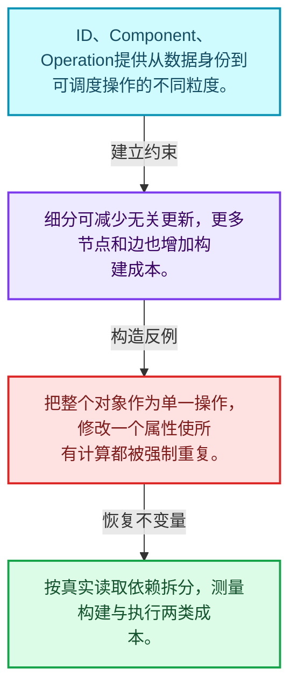
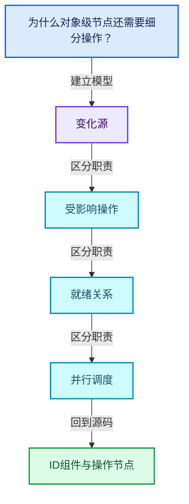
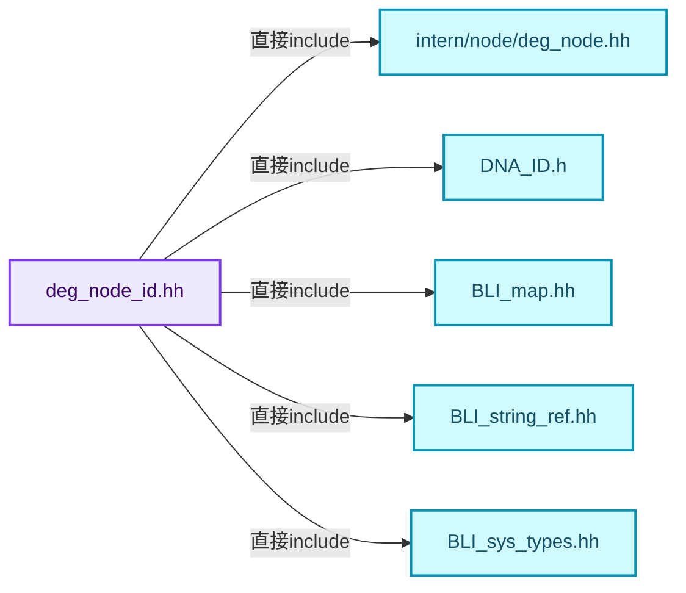
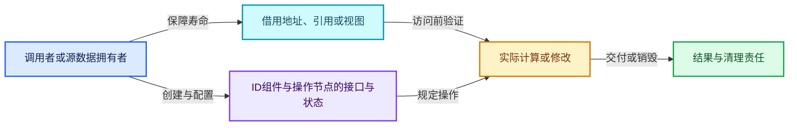
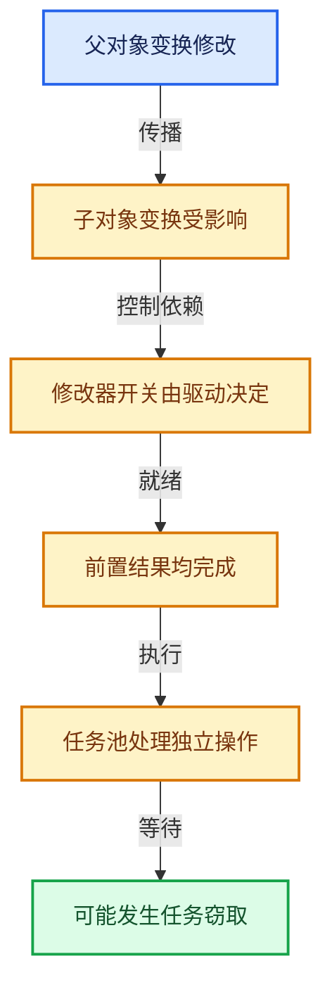

# 11-02 ID组件与操作节点

[方向导航](README.md) · [总目录](../README.md) · [覆盖索引](../%E6%BA%90%E7%A0%81%E7%89%88%E6%9C%AC%E4%B8%8E%E8%A6%86%E7%9B%96%E7%B4%A2%E5%BC%95.md)

> 阅读顺序：问题与数据模型 → 语法与类型 → 源码逐行 → 调用线索 → 历史与取舍 → 推演和练习。

- 基准 HEAD：`cbda6b96c26c0dee3c3b5cbb93960c4ac06a6b30`。
- 记录日期：2026-10-14。
- 教学示例状态：正文中的推演不是本机性能实测；已运行练习见验收报告。

## 一、从问题到设计

为什么对象级节点还需要细分操作？

ID归属、组件职责和可调度操作提供不同粒度；过粗依赖会造成多余更新，过细增加管理成本。

本篇把语法、数据语义和系统取舍连接起来。标记更新、判断需求、依赖满足和任务执行是分开的阶段。

### 本篇独立模型与设计推理

ID、Component、Operation提供从数据身份到可调度操作的不同粒度。

设计取舍：细分可减少无关更新，更多节点和边也增加构建成本。

最小反例：把整个对象作为单一操作，修改一个属性使所有计算都被强制重复。

推导与处理：按真实读取依赖拆分，测量构建与执行两类成本。



### 源码范围与相邻篇章

| 文件 | 本篇逐行范围 | 基准SHA-256 |
|---|---|---|
| [source/blender/depsgraph/intern/node/deg_node_id.hh](../../../../../source/blender/depsgraph/intern/node/deg_node_id.hh) | L1—L140 | `ac54558aff62b8ead7b5b29099e851ee23836e7df2db490012d9654113c65b68` |
| [source/blender/depsgraph/intern/node/deg_node_component.hh](../../../../../source/blender/depsgraph/intern/node/deg_node_component.hh) | L1—L264 | `180d5923c5b327db756d9cc413ac7fc4940aaa6b92f92253cbcc813558f99b3d` |
| [source/blender/depsgraph/intern/node/deg_node_operation.hh](../../../../../source/blender/depsgraph/intern/node/deg_node_operation.hh) | L1—L310 | `be806beb10f17d65e67bc3af5633a06af61422c3f847a80e3dce560875ec7950` |

同一主讲文件可能分多篇覆盖；超出本篇范围的符号通过覆盖索引定位。空行与纯注释保留在源码摘录中，逐行表解释有效语句与语法边界；许可证头统一保留。

前篇：[场景更新总体架构](01-%E5%9C%BA%E6%99%AF%E6%9B%B4%E6%96%B0%E6%80%BB%E4%BD%93%E6%9E%B6%E6%9E%84.md).

后篇：[节点构建器](03-%E8%8A%82%E7%82%B9%E6%9E%84%E5%BB%BA%E5%99%A8.md).

## 二、类型、数据与阅读地图



这是概念依赖图，边表示阅读关系，不声称是运行时调用顺序。

### 直接编译依赖



箭头只表示头文件包含关系；完整调用线索见后面的符号定位表。

## 三、关键词、语法与类型角色

### 只读限定 const

const约束当前访问路径可做的修改。const指针、指向const的指针、const视图对象、const元素是不同位置的限定；其他别名可能仍可修改原对象。

具体检查：分别写T* const、const T*与const T* const，并画出不可修改的层次。

### 异常边界 try与catch

try定义异常传播的局部边界。失败路径需要销毁已经成功构造的部分并释放相应存储；未构造的对象不能被析构。

具体检查：在第k次构造失败，列出已经存在的对象集合与待释放缓冲。

### 运行时多态 virtual

虚调用根据实际动态类型选择实现；经基类指针销毁对象时通常需要相应虚析构契约。每元素虚调用和循环外一次分派有不同开销。

具体检查：找出虚接口的实现类和调用频率，再讨论是否值得去虚拟化。

### 覆写检查 override

override要求函数确实覆盖基类虚函数，可捕获参数类型和const限定不匹配。它不改变基类规定的生命周期或线程约束。

具体检查：故意改变一个参数或const，观察编译器如何拒绝误写的新函数。

### 构造与new表达式

普通new可能分配并构造；placement new在给定地址构造，存储由其他机制提供。失败回滚应区分两类责任。

具体检查：追踪地址来自哪里、构造何时成功、由谁析构、由谁释放。

### 内部断言 assert

断言表达开发者预期成立的内部契约，发布构建可能关闭。它不能替代对不可信输入的完整错误处理，也不保证后续操作被运行时保护。

具体检查：对每条断言构造违反条件的输入，区分调用者错误与应向用户报告的错误。

### 受控访问 friend

friend授予指定函数或类访问非公开成员的权限，并不意味着继承，也不自动扩展到友元的派生类。

具体检查：解释执行器为何需要访问包装器的内部映射，同时检查边界是否仍清楚。

### 类型别名 using

类型别名为已有类型建立名字，不创建运行期对象。它常把模板内部使用的类型统一暴露给泛型调用者。

具体检查：展开别名直到基础类型，区分类型别名和变量声明。

### 枚举与状态模型 enum

枚举把有限状态命名；enum class避免许多隐式整数转换。状态机正确性还依赖允许的转移，不能只看有哪些枚举项。

具体检查：列出每个状态的进入条件和离开条件，检查终止状态是否仍可能被调度。

### 拥有型可调用包装 function

std::function保存可调用目标并提供统一调用接口，复制能力与目标要求有关；FunctionRef仅借用，二者不能无条件互换。

具体检查：比较同步回调与长期保存任务对拥有关系的不同要求。

## 四、真实源码与逐行讲解

源码块保持原行内容，原始行号由小节标题及逐行表给出。表中的调用定位是静态阅读辅助；重载、模板实例化、宏展开和虚调用需结合完整声明，不能仅凭词法出现证明动态调用。

### deg_node_id.hh：L1—L49

<!-- source:source/blender/depsgraph/intern/node/deg_node_id.hh:1:49 -->

```cpp
/* SPDX-FileCopyrightText: 2013 Blender Authors
 *
 * SPDX-License-Identifier: GPL-2.0-or-later */

/** \file
 * \ingroup depsgraph
 */

#pragma once

#include "intern/node/deg_node.hh"

#include "DNA_ID.h"

#include "BLI_map.hh"
#include "BLI_string_ref.hh"
#include "BLI_sys_types.hh"

namespace blender::deg {

struct ComponentNode;

using IDComponentsMask = uint64_t;

/* NOTE: We use max comparison to mark an id node that is linked more than once
 * So keep this enum ordered accordingly. */
enum eDepsNode_LinkedState_Type {
  /* Generic indirectly linked id node. */
  DEG_ID_LINKED_INDIRECTLY = 0,
  /* Id node present in the set (background) only. */
  DEG_ID_LINKED_VIA_SET = 1,
  /* Id node directly linked via the SceneLayer. */
  DEG_ID_LINKED_DIRECTLY = 2,
};
const char *linkedStateAsString(eDepsNode_LinkedState_Type linked_state);

/* ID-Block Reference */
struct IDNode : public Node {
  struct ComponentIDKey {

    NodeType type;
    StringRef name;

    ComponentIDKey(NodeType type, StringRef name = "") : type(type), name(name) {}
    friend bool operator==(const ComponentIDKey &a, const ComponentIDKey &b) = default;
    uint64_t hash() const
    {
      return get_default_hash(type, name);
    }
```

| 原始行 | 语义、约束与检查 |
|---|---|
| L9 | 防止同一头文件在一个翻译单元中重复展开；不控制多个源文件之间的链接或对象寿命。 |
| L11 | 引入编译依赖 "intern/node/deg_node.hh"；这是声明可见性关系，不表示运行时一定调用该文件的所有接口。 |
| L13 | 引入编译依赖 "DNA_ID.h"；这是声明可见性关系，不表示运行时一定调用该文件的所有接口。 |
| L15 | 引入编译依赖 "BLI_map.hh"；这是声明可见性关系，不表示运行时一定调用该文件的所有接口。 |
| L16 | 引入编译依赖 "BLI_string_ref.hh"；这是声明可见性关系，不表示运行时一定调用该文件的所有接口。 |
| L17 | 引入编译依赖 "BLI_sys_types.hh"；这是声明可见性关系，不表示运行时一定调用该文件的所有接口。 |
| L19 | 把后续声明放入 blender::deg 命名空间，影响名称查找和符号归属，不创建运行时对象。 |
| L21 | 声明或定义类型 `struct ComponentNode`。结合继承、访问权限和成员布局确认接口与拥有关系；前向声明本身没有完整对象布局。 |
| L23 | 定义类型别名 `using IDComponentsMask = uint64_t`，为模板接口或内部实现统一命名；本行不分配该类型对象。 |
| L27 | 声明或定义类型 `enum eDepsNode_LinkedState_Type`。结合继承、访问权限和成员布局确认接口与拥有关系；前向声明本身没有完整对象布局。 |
| L29 | 把右侧 `0,` 用于初始化或更新左侧 `DEG_ID_LINKED_INDIRECTLY`。声明初始化与已有对象赋值应按上下文区分；有资源的类型会调用相应特殊成员。 |
| L31 | 把右侧 `1,` 用于初始化或更新左侧 `DEG_ID_LINKED_VIA_SET`。声明初始化与已有对象赋值应按上下文区分；有资源的类型会调用相应特殊成员。 |
| L33 | 把右侧 `2,` 用于初始化或更新左侧 `DEG_ID_LINKED_DIRECTLY`。声明初始化与已有对象赋值应按上下文区分；有资源的类型会调用相应特殊成员。 |
| L34 | 结束当前语法单元。局部自动对象在离开其作用域时按规则销毁；这不等于所有被引用的外部数据也被释放。 |
| L35 | 声明接口 `const char *linkedStateAsString(eDepsNode_LinkedState_Type linked_state)`，本行没有对应函数体；返回类型、参数限定和const/noexcept共同组成调用契约，实际行为需继续定位实现。 |
| L38 | 声明或定义类型 `struct IDNode : public Node`。结合继承、访问权限和成员布局确认接口与拥有关系；前向声明本身没有完整对象布局。 |
| L39 | 声明或定义类型 `struct ComponentIDKey`。结合继承、访问权限和成员布局确认接口与拥有关系；前向声明本身没有完整对象布局。 |
| L41 | 声明成员、局部对象或完成语句 `NodeType type`。若为指针或引用，它本身不说明拥有；若为值对象，其构造析构由所在作用域或外层对象管理。 |
| L42 | 声明成员、局部对象或完成语句 `StringRef name`。若为指针或引用，它本身不说明拥有；若为值对象，其构造析构由所在作用域或外层对象管理。 |
| L44 | 把右侧 `"") : type(type), name(name) {}` 用于初始化或更新左侧 `ComponentIDKey(NodeType type, StringRef name`。声明初始化与已有对象赋值应按上下文区分；有资源的类型会调用相应特殊成员。 |
| L45 | 显式采用编译器生成的特殊成员行为：`friend bool operator==(const ComponentIDKey &a, const ComponentIDKey &b) = default;`。成员和基类的性质决定该操作是否可用、是否被删除及异常约定，不表示运行时给对象赋值为default。 |
| L46 | 出现调用或函数声明 `hash`，对应表达式为 `uint64_t hash() const`。参数求值、返回类型与重载需结合前后完整语句；静态文本引用不能证明动态目标。 |
| L47 | 连接上一行的声明或控制结构与其语句块；后续行在这个作用域中执行或声明。 |
| L48 | 返回表达式 `get_default_hash(type, name)`。 |
| L49 | 结束当前语法单元。局部自动对象在离开其作用域时按规则销毁；这不等于所有被引用的外部数据也被释放。 |

### deg_node_id.hh：L50—L97

<!-- source:source/blender/depsgraph/intern/node/deg_node_id.hh:50:97 -->

```cpp
  };

  /** Initialize 'id' node - from pointer data given. */
  void init(const ID *id, const char *subdata) override;
  void init_copy_on_write(ID *id_cow_hint = nullptr);
  ~IDNode() override;
  void destroy();

  std::string identifier() const override;

  ComponentNode *find_component(NodeType type, StringRef name = "") const;
  ComponentNode *add_component(NodeType type, StringRef name = "");

  void tag_update(Depsgraph *graph, eUpdateSource source) override;

  void finalize_build(Depsgraph *graph);

  IDComponentsMask get_visible_components_mask() const;

  /* Type of the ID stored separately, so it's possible to perform check whether evaluated copy is
   * needed without de-referencing the id_cow (which is not safe when ID is NOT covered by
   * copy-on-evaluation and has been deleted from the main database.) */
  ID_Type id_type;

  /* ID Block referenced. */
  ID *id_orig;

  /* Session-wide UUID of the id_orig.
   * Is used on relations update to map evaluated state from old nodes to the new ones, without
   * relying on pointers (which are not guaranteed to be unique) and without dereferencing id_orig
   * which could be "stale" pointer. */
  uint id_orig_session_uid;

  /* Evaluated data-block.
   * Will be covered by the copy-on-evaluation system if the ID Type needs it. */
  ID *id_cow;

  /* Hash to make it faster to look up components. */
  Map<ComponentIDKey, ComponentNode *> components;

  /* Additional flags needed for scene evaluation.
   * TODO(sergey): Only needed for until really granular updates
   * of all the entities. */
  uint32_t eval_flags;
  uint32_t previous_eval_flags;

  /* Extra customdata mask which needs to be evaluated for the mesh object. */
  DEGCustomDataMeshMasks customdata_masks;
```

| 原始行 | 语义、约束与检查 |
|---|---|
| L50 | 结束当前语法单元。局部自动对象在离开其作用域时按规则销毁；这不等于所有被引用的外部数据也被释放。 |
| L53 | 声明接口 `void init(const ID *id, const char *subdata) override`，本行没有对应函数体；返回类型、参数限定和const/noexcept共同组成调用契约，实际行为需继续定位实现。 |
| L54 | 把右侧 `nullptr)` 用于初始化或更新左侧 `void init_copy_on_write(ID *id_cow_hint`。声明初始化与已有对象赋值应按上下文区分；有资源的类型会调用相应特殊成员。 |
| L55 | 涉及析构接口或显式析构：`~IDNode() override;`。检查目标对象已成功构造，且资源不会在另一条清理路径再次销毁。 |
| L56 | 声明接口 `void destroy()`，本行没有对应函数体；返回类型、参数限定和const/noexcept共同组成调用契约，实际行为需继续定位实现。 |
| L58 | 声明接口 `std::string identifier() const override`，本行没有对应函数体；返回类型、参数限定和const/noexcept共同组成调用契约，实际行为需继续定位实现。 |
| L60 | 把右侧 `"") const` 用于初始化或更新左侧 `ComponentNode *find_component(NodeType type, StringRef name`。声明初始化与已有对象赋值应按上下文区分；有资源的类型会调用相应特殊成员。 |
| L61 | 把右侧 `"")` 用于初始化或更新左侧 `ComponentNode *add_component(NodeType type, StringRef name`。声明初始化与已有对象赋值应按上下文区分；有资源的类型会调用相应特殊成员。 |
| L63 | 声明接口 `void tag_update(Depsgraph *graph, eUpdateSource source) override`，本行没有对应函数体；返回类型、参数限定和const/noexcept共同组成调用契约，实际行为需继续定位实现。 |
| L65 | 声明接口 `void finalize_build(Depsgraph *graph)`，本行没有对应函数体；返回类型、参数限定和const/noexcept共同组成调用契约，实际行为需继续定位实现。 |
| L67 | 声明接口 `IDComponentsMask get_visible_components_mask() const`，本行没有对应函数体；返回类型、参数限定和const/noexcept共同组成调用契约，实际行为需继续定位实现。 |
| L72 | 声明成员、局部对象或完成语句 `ID_Type id_type`。若为指针或引用，它本身不说明拥有；若为值对象，其构造析构由所在作用域或外层对象管理。 |
| L75 | 声明成员、局部对象或完成语句 `ID *id_orig`。若为指针或引用，它本身不说明拥有；若为值对象，其构造析构由所在作用域或外层对象管理。 |
| L81 | 声明成员、局部对象或完成语句 `uint id_orig_session_uid`。若为指针或引用，它本身不说明拥有；若为值对象，其构造析构由所在作用域或外层对象管理。 |
| L85 | 声明成员、局部对象或完成语句 `ID *id_cow`。若为指针或引用，它本身不说明拥有；若为值对象，其构造析构由所在作用域或外层对象管理。 |
| L88 | 声明成员、局部对象或完成语句 `Map<ComponentIDKey, ComponentNode *> components`。若为指针或引用，它本身不说明拥有；若为值对象，其构造析构由所在作用域或外层对象管理。 |
| L93 | 声明成员、局部对象或完成语句 `uint32_t eval_flags`。若为指针或引用，它本身不说明拥有；若为值对象，其构造析构由所在作用域或外层对象管理。 |
| L94 | 声明成员、局部对象或完成语句 `uint32_t previous_eval_flags`。若为指针或引用，它本身不说明拥有；若为值对象，其构造析构由所在作用域或外层对象管理。 |
| L97 | 声明成员、局部对象或完成语句 `DEGCustomDataMeshMasks customdata_masks`。若为指针或引用，它本身不说明拥有；若为值对象，其构造析构由所在作用域或外层对象管理。 |

### deg_node_id.hh：L98—L140

<!-- source:source/blender/depsgraph/intern/node/deg_node_id.hh:98:140 -->

```cpp
  DEGCustomDataMeshMasks previous_customdata_masks;

  eDepsNode_LinkedState_Type linked_state;

  /* Indicates the data-block is to be considered visible in the evaluated scene.
   *
   * This flag is set during dependency graph build where check for an actual visibility might not
   * be available yet due to driven or animated restriction flags. So it is more of an intent or,
   * in other words, plausibility of the data-block to be visible. */
  bool is_visible_on_build;

  /* Evaluated state of whether evaluation considered this data-block "enabled".
   *
   * For objects this is derived from the base restriction flags, which might be animated or
   * driven. It is set to `BASE_ENABLED_<VIEWPORT, RENDER>` (depending on the graph mode) after
   * the object's flags from layer were evaluated.
   *
   * For other data-types is currently always true. */
  bool is_enabled_on_eval;

  /* For the collection type of ID, denotes whether collection was fully
   * recursed into. */
  bool is_collection_fully_expanded;

  /* Is used to figure out whether object came to the dependency graph via a base. */
  bool has_base;

  /* Accumulated flag from operation. Is initialized and used during updates flush. */
  bool is_user_modified;

  /* Copy-on-Write component has been explicitly tagged for update. */
  bool is_cow_explicitly_tagged;

  /* Accumulate recalc flags from multiple update passes. */
  int id_cow_recalc_backup;

  IDComponentsMask visible_components_mask;
  IDComponentsMask previously_visible_components_mask;

  DEG_DEPSNODE_DECLARE;
};

}  // namespace blender::deg
```

| 原始行 | 语义、约束与检查 |
|---|---|
| L98 | 声明成员、局部对象或完成语句 `DEGCustomDataMeshMasks previous_customdata_masks`。若为指针或引用，它本身不说明拥有；若为值对象，其构造析构由所在作用域或外层对象管理。 |
| L100 | 声明成员、局部对象或完成语句 `eDepsNode_LinkedState_Type linked_state`。若为指针或引用，它本身不说明拥有；若为值对象，其构造析构由所在作用域或外层对象管理。 |
| L107 | 声明成员、局部对象或完成语句 `bool is_visible_on_build`。若为指针或引用，它本身不说明拥有；若为值对象，其构造析构由所在作用域或外层对象管理。 |
| L116 | 声明成员、局部对象或完成语句 `bool is_enabled_on_eval`。若为指针或引用，它本身不说明拥有；若为值对象，其构造析构由所在作用域或外层对象管理。 |
| L120 | 声明成员、局部对象或完成语句 `bool is_collection_fully_expanded`。若为指针或引用，它本身不说明拥有；若为值对象，其构造析构由所在作用域或外层对象管理。 |
| L123 | 声明成员、局部对象或完成语句 `bool has_base`。若为指针或引用，它本身不说明拥有；若为值对象，其构造析构由所在作用域或外层对象管理。 |
| L126 | 声明成员、局部对象或完成语句 `bool is_user_modified`。若为指针或引用，它本身不说明拥有；若为值对象，其构造析构由所在作用域或外层对象管理。 |
| L129 | 声明成员、局部对象或完成语句 `bool is_cow_explicitly_tagged`。若为指针或引用，它本身不说明拥有；若为值对象，其构造析构由所在作用域或外层对象管理。 |
| L132 | 声明成员、局部对象或完成语句 `int id_cow_recalc_backup`。若为指针或引用，它本身不说明拥有；若为值对象，其构造析构由所在作用域或外层对象管理。 |
| L134 | 声明成员、局部对象或完成语句 `IDComponentsMask visible_components_mask`。若为指针或引用，它本身不说明拥有；若为值对象，其构造析构由所在作用域或外层对象管理。 |
| L135 | 声明成员、局部对象或完成语句 `IDComponentsMask previously_visible_components_mask`。若为指针或引用，它本身不说明拥有；若为值对象，其构造析构由所在作用域或外层对象管理。 |
| L137 | 声明成员、局部对象或完成语句 `DEG_DEPSNODE_DECLARE`。若为指针或引用，它本身不说明拥有；若为值对象，其构造析构由所在作用域或外层对象管理。 |
| L138 | 结束当前语法单元。局部自动对象在离开其作用域时按规则销毁；这不等于所有被引用的外部数据也被释放。 |
| L140 | 结束当前语法单元。局部自动对象在离开其作用域时按规则销毁；这不等于所有被引用的外部数据也被释放。 |

### deg_node_component.hh：L1—L48

<!-- source:source/blender/depsgraph/intern/node/deg_node_component.hh:1:48 -->

```cpp
/* SPDX-FileCopyrightText: 2013 Blender Authors
 *
 * SPDX-License-Identifier: GPL-2.0-or-later */

/** \file
 * \ingroup depsgraph
 */

#pragma once

#include "BLI_span.hh"
#include "BLI_string_ref.hh"
#include "intern/eval/deg_eval_copy_on_write.h"
#include "intern/node/deg_node.hh"
#include "intern/node/deg_node_id.hh"
#include "intern/node/deg_node_operation.hh"

#include "BLI_map.hh"
#include "BLI_vector.hh"

namespace blender {

struct ID;
struct bPoseChannel;

namespace deg {

struct Depsgraph;
struct IDNode;
struct OperationNode;

/* ID Component - Base type for all components */
struct ComponentNode : public Node {
  /* Key used to look up operations within a component */
  struct OperationIDKey {
    OperationCode opcode = OperationCode::OPERATION;
    int name_tag = -1;
    StringRef name = "";

    OperationIDKey() = default;
    OperationIDKey(const OperationCode opcode) : opcode(opcode) {}
    OperationIDKey(const OperationCode opcode, const StringRef name, const int name_tag)
        : opcode(opcode), name_tag(name_tag), name(name)
    {
    }

    std::string identifier() const;
    friend bool operator==(const OperationIDKey &a, const OperationIDKey &b) = default;
```

| 原始行 | 语义、约束与检查 |
|---|---|
| L9 | 防止同一头文件在一个翻译单元中重复展开；不控制多个源文件之间的链接或对象寿命。 |
| L11 | 引入编译依赖 "BLI_span.hh"；这是声明可见性关系，不表示运行时一定调用该文件的所有接口。 |
| L12 | 引入编译依赖 "BLI_string_ref.hh"；这是声明可见性关系，不表示运行时一定调用该文件的所有接口。 |
| L13 | 引入编译依赖 "intern/eval/deg_eval_copy_on_write.h"；这是声明可见性关系，不表示运行时一定调用该文件的所有接口。 |
| L14 | 引入编译依赖 "intern/node/deg_node.hh"；这是声明可见性关系，不表示运行时一定调用该文件的所有接口。 |
| L15 | 引入编译依赖 "intern/node/deg_node_id.hh"；这是声明可见性关系，不表示运行时一定调用该文件的所有接口。 |
| L16 | 引入编译依赖 "intern/node/deg_node_operation.hh"；这是声明可见性关系，不表示运行时一定调用该文件的所有接口。 |
| L18 | 引入编译依赖 "BLI_map.hh"；这是声明可见性关系，不表示运行时一定调用该文件的所有接口。 |
| L19 | 引入编译依赖 "BLI_vector.hh"；这是声明可见性关系，不表示运行时一定调用该文件的所有接口。 |
| L21 | 把后续声明放入 blender 命名空间，影响名称查找和符号归属，不创建运行时对象。 |
| L23 | 声明或定义类型 `struct ID`。结合继承、访问权限和成员布局确认接口与拥有关系；前向声明本身没有完整对象布局。 |
| L24 | 声明或定义类型 `struct bPoseChannel`。结合继承、访问权限和成员布局确认接口与拥有关系；前向声明本身没有完整对象布局。 |
| L26 | 把后续声明放入 deg 命名空间，影响名称查找和符号归属，不创建运行时对象。 |
| L28 | 声明或定义类型 `struct Depsgraph`。结合继承、访问权限和成员布局确认接口与拥有关系；前向声明本身没有完整对象布局。 |
| L29 | 声明或定义类型 `struct IDNode`。结合继承、访问权限和成员布局确认接口与拥有关系；前向声明本身没有完整对象布局。 |
| L30 | 声明或定义类型 `struct OperationNode`。结合继承、访问权限和成员布局确认接口与拥有关系；前向声明本身没有完整对象布局。 |
| L33 | 声明或定义类型 `struct ComponentNode : public Node`。结合继承、访问权限和成员布局确认接口与拥有关系；前向声明本身没有完整对象布局。 |
| L35 | 声明或定义类型 `struct OperationIDKey`。结合继承、访问权限和成员布局确认接口与拥有关系；前向声明本身没有完整对象布局。 |
| L36 | 把右侧 `OperationCode::OPERATION` 用于初始化或更新左侧 `OperationCode opcode`。声明初始化与已有对象赋值应按上下文区分；有资源的类型会调用相应特殊成员。 |
| L37 | 把右侧 `-1` 用于初始化或更新左侧 `int name_tag`。声明初始化与已有对象赋值应按上下文区分；有资源的类型会调用相应特殊成员。 |
| L38 | 把右侧 `""` 用于初始化或更新左侧 `StringRef name`。声明初始化与已有对象赋值应按上下文区分；有资源的类型会调用相应特殊成员。 |
| L40 | 显式采用编译器生成的特殊成员行为：`OperationIDKey() = default;`。成员和基类的性质决定该操作是否可用、是否被删除及异常约定，不表示运行时给对象赋值为default。 |
| L41 | 出现调用或函数声明 `OperationIDKey`，对应表达式为 `OperationIDKey(const OperationCode opcode) : opcode(opcode) {}`。参数求值、返回类型与重载需结合前后完整语句；静态文本引用不能证明动态目标。 |
| L42 | 出现调用或函数声明 `OperationIDKey`，对应表达式为 `OperationIDKey(const OperationCode opcode, const StringRef name, const int name_tag)`。参数求值、返回类型与重载需结合前后完整语句；静态文本引用不能证明动态目标。 |
| L43 | 出现调用或函数声明 `opcode`，对应表达式为 `: opcode(opcode), name_tag(name_tag), name(name)`。参数求值、返回类型与重载需结合前后完整语句；静态文本引用不能证明动态目标。 |
| L44 | 连接上一行的声明或控制结构与其语句块；后续行在这个作用域中执行或声明。 |
| L45 | 结束当前语法单元。局部自动对象在离开其作用域时按规则销毁；这不等于所有被引用的外部数据也被释放。 |
| L47 | 声明接口 `std::string identifier() const`，本行没有对应函数体；返回类型、参数限定和const/noexcept共同组成调用契约，实际行为需继续定位实现。 |
| L48 | 显式采用编译器生成的特殊成员行为：`friend bool operator==(const OperationIDKey &a, const OperationIDKey &b) = default;`。成员和基类的性质决定该操作是否可用、是否被删除及异常约定，不表示运行时给对象赋值为default。 |

### deg_node_component.hh：L49—L100

<!-- source:source/blender/depsgraph/intern/node/deg_node_component.hh:49:100 -->

```cpp
    uint64_t hash() const
    {
      return get_default_hash(opcode, name_tag, name);
    }
  };

  /* Typedef for container of operations */
  ComponentNode();
  ~ComponentNode() override;

  /** Initialize 'component' node - from pointer data given. */
  void init(const ID *id, const char *subdata) override;

  std::string identifier() const override;

  /* Find an existing operation, if requested operation does not exist nullptr will be returned.
   * See #add_operation for the meaning and examples of #name and #name_tag.
   */
  OperationNode *find_operation(OperationIDKey key) const;
  OperationNode *find_operation(OperationCode opcode,
                                StringRef name = "",
                                int name_tag = -1) const;

  /* Find an existing operation, will throw an assert() if it does not exist.
   * See #add_operation for the meaning and examples of #name and #name_tag. */
  OperationNode *get_operation(OperationIDKey key) const;
  OperationNode *get_operation(OperationCode opcode, StringRef name = "", int name_tag = -1) const;

  /* Check operation exists and return it. */
  bool has_operation(OperationIDKey key) const;
  bool has_operation(OperationCode opcode, StringRef name = "", int name_tag = -1) const;

  /**
   * Create a new node for representing an operation and add this to graph
   *
   * \warning If an existing node is found, it will be modified. This helps
   * when node may have been partially created earlier (e.g. parent ref before
   * parent item is added)
   *
   * \param opcode: The operation to perform.
   * \param name: An optional identifier for operation. It will be used to tell operation nodes
   *              with the same code apart. For example, parameter operation code will have name
   *              set to the corresponding custom property name
   * \param name_tag: An optional integer tag for the name. Is an additional way to tell operations
   *                  apart. For example, RNA path to an array property will have the same opcode
   *                  of PARAMETERS, name corresponding to the property name, and name tag
   *                  corresponding to the array index within the property.
   */
  OperationNode *add_operation(const DepsEvalOperationCb &op,
                               OperationCode opcode,
                               const StringRef name = "",
                               int name_tag = -1);
```

| 原始行 | 语义、约束与检查 |
|---|---|
| L49 | 出现调用或函数声明 `hash`，对应表达式为 `uint64_t hash() const`。参数求值、返回类型与重载需结合前后完整语句；静态文本引用不能证明动态目标。 |
| L50 | 连接上一行的声明或控制结构与其语句块；后续行在这个作用域中执行或声明。 |
| L51 | 返回表达式 `get_default_hash(opcode, name_tag, name)`。 |
| L52 | 结束当前语法单元。局部自动对象在离开其作用域时按规则销毁；这不等于所有被引用的外部数据也被释放。 |
| L53 | 结束当前语法单元。局部自动对象在离开其作用域时按规则销毁；这不等于所有被引用的外部数据也被释放。 |
| L56 | 出现调用或函数声明 `ComponentNode`，对应表达式为 `ComponentNode();`。参数求值、返回类型与重载需结合前后完整语句；静态文本引用不能证明动态目标。 |
| L57 | 涉及析构接口或显式析构：`~ComponentNode() override;`。检查目标对象已成功构造，且资源不会在另一条清理路径再次销毁。 |
| L60 | 声明接口 `void init(const ID *id, const char *subdata) override`，本行没有对应函数体；返回类型、参数限定和const/noexcept共同组成调用契约，实际行为需继续定位实现。 |
| L62 | 声明接口 `std::string identifier() const override`，本行没有对应函数体；返回类型、参数限定和const/noexcept共同组成调用契约，实际行为需继续定位实现。 |
| L67 | 声明接口 `OperationNode *find_operation(OperationIDKey key) const`，本行没有对应函数体；返回类型、参数限定和const/noexcept共同组成调用契约，实际行为需继续定位实现。 |
| L68 | 出现调用或函数声明 `find_operation`，对应表达式为 `OperationNode *find_operation(OperationCode opcode,`。参数求值、返回类型与重载需结合前后完整语句；静态文本引用不能证明动态目标。 |
| L69 | 把右侧 `"",` 用于初始化或更新左侧 `StringRef name`。声明初始化与已有对象赋值应按上下文区分；有资源的类型会调用相应特殊成员。 |
| L70 | 把右侧 `-1) const` 用于初始化或更新左侧 `int name_tag`。声明初始化与已有对象赋值应按上下文区分；有资源的类型会调用相应特殊成员。 |
| L74 | 声明接口 `OperationNode *get_operation(OperationIDKey key) const`，本行没有对应函数体；返回类型、参数限定和const/noexcept共同组成调用契约，实际行为需继续定位实现。 |
| L75 | 把右侧 `"", int name_tag = -1) const` 用于初始化或更新左侧 `OperationNode *get_operation(OperationCode opcode, StringRef name`。声明初始化与已有对象赋值应按上下文区分；有资源的类型会调用相应特殊成员。 |
| L78 | 声明接口 `bool has_operation(OperationIDKey key) const`，本行没有对应函数体；返回类型、参数限定和const/noexcept共同组成调用契约，实际行为需继续定位实现。 |
| L79 | 把右侧 `"", int name_tag = -1) const` 用于初始化或更新左侧 `bool has_operation(OperationCode opcode, StringRef name`。声明初始化与已有对象赋值应按上下文区分；有资源的类型会调用相应特殊成员。 |
| L97 | 出现调用或函数声明 `add_operation`，对应表达式为 `OperationNode *add_operation(const DepsEvalOperationCb &op,`。参数求值、返回类型与重载需结合前后完整语句；静态文本引用不能证明动态目标。 |
| L98 | 本行是连续声明或表达式的一部分：`OperationCode opcode,`。与本段前后行合读；逗号、括号和限定符决定它属于参数、初始化列表还是实际计算。 |
| L99 | 把右侧 `"",` 用于初始化或更新左侧 `const StringRef name`。声明初始化与已有对象赋值应按上下文区分；有资源的类型会调用相应特殊成员。 |
| L100 | 把右侧 `-1)` 用于初始化或更新左侧 `int name_tag`。声明初始化与已有对象赋值应按上下文区分；有资源的类型会调用相应特殊成员。 |

### deg_node_component.hh：L101—L148

<!-- source:source/blender/depsgraph/intern/node/deg_node_component.hh:101:148 -->

```cpp

  /* Entry/exit operations management.
   *
   * Use those instead of direct set since this will perform sanity checks. */
  void set_entry_operation(OperationNode *op_node);
  void set_exit_operation(OperationNode *op_node);

  void clear_operations();

  void tag_update(Depsgraph *graph, eUpdateSource source) override;

  OperationNode *get_entry_operation() override;
  OperationNode *get_exit_operation() override;

  void finalize_build(Depsgraph *graph);

  IDNode *owner;

  /* ** Inner nodes for this component ** */

  /* Operations stored as a hash map, for faster build.
   * This hash map will be freed when graph is fully built. */
  Map<ComponentNode::OperationIDKey, OperationNode *> *operations_map;

  /* This is a "normal" list of operations, used by evaluation
   * and other routines after construction. */
  Vector<OperationNode *> operations;

  OperationNode *entry_operation;
  OperationNode *exit_operation;

  virtual bool depends_on_cow()
  {
    return true;
  }

  /* Denotes whether copy-on-eval component is to be tagged when this component
   * is tagged for update. */
  virtual bool need_tag_cow_before_update(const IDRecalcFlag /*tag*/)
  {
    return true;
  }

  /* The component has (possibly indirect) effect on a data-block whose node has
   * is_visible_on_build set to true.
   *
   * This field is ensured to be up-to-date prior to `IDNode::finalize_build()`. */
  bool possibly_affects_visible_id;
```

| 原始行 | 语义、约束与检查 |
|---|---|
| L105 | 声明接口 `void set_entry_operation(OperationNode *op_node)`，本行没有对应函数体；返回类型、参数限定和const/noexcept共同组成调用契约，实际行为需继续定位实现。 |
| L106 | 声明接口 `void set_exit_operation(OperationNode *op_node)`，本行没有对应函数体；返回类型、参数限定和const/noexcept共同组成调用契约，实际行为需继续定位实现。 |
| L108 | 声明接口 `void clear_operations()`，本行没有对应函数体；返回类型、参数限定和const/noexcept共同组成调用契约，实际行为需继续定位实现。 |
| L110 | 声明接口 `void tag_update(Depsgraph *graph, eUpdateSource source) override`，本行没有对应函数体；返回类型、参数限定和const/noexcept共同组成调用契约，实际行为需继续定位实现。 |
| L112 | 出现调用或函数声明 `get_entry_operation`，对应表达式为 `OperationNode *get_entry_operation() override;`。参数求值、返回类型与重载需结合前后完整语句；静态文本引用不能证明动态目标。 |
| L113 | 出现调用或函数声明 `get_exit_operation`，对应表达式为 `OperationNode *get_exit_operation() override;`。参数求值、返回类型与重载需结合前后完整语句；静态文本引用不能证明动态目标。 |
| L115 | 声明接口 `void finalize_build(Depsgraph *graph)`，本行没有对应函数体；返回类型、参数限定和const/noexcept共同组成调用契约，实际行为需继续定位实现。 |
| L117 | 声明成员、局部对象或完成语句 `IDNode *owner`。若为指针或引用，它本身不说明拥有；若为值对象，其构造析构由所在作用域或外层对象管理。 |
| L123 | 声明成员、局部对象或完成语句 `Map<ComponentNode::OperationIDKey, OperationNode *> *operations_map`。若为指针或引用，它本身不说明拥有；若为值对象，其构造析构由所在作用域或外层对象管理。 |
| L127 | 声明成员、局部对象或完成语句 `Vector<OperationNode *> operations`。若为指针或引用，它本身不说明拥有；若为值对象，其构造析构由所在作用域或外层对象管理。 |
| L129 | 声明成员、局部对象或完成语句 `OperationNode *entry_operation`。若为指针或引用，它本身不说明拥有；若为值对象，其构造析构由所在作用域或外层对象管理。 |
| L130 | 声明成员、局部对象或完成语句 `OperationNode *exit_operation`。若为指针或引用，它本身不说明拥有；若为值对象，其构造析构由所在作用域或外层对象管理。 |
| L132 | 出现调用或函数声明 `depends_on_cow`，对应表达式为 `virtual bool depends_on_cow()`。参数求值、返回类型与重载需结合前后完整语句；静态文本引用不能证明动态目标。 |
| L133 | 连接上一行的声明或控制结构与其语句块；后续行在这个作用域中执行或声明。 |
| L134 | 返回表达式 `true`。这是本路径的布尔结果，具体成功、存在或状态含义由函数接口规定。 |
| L135 | 结束当前语法单元。局部自动对象在离开其作用域时按规则销毁；这不等于所有被引用的外部数据也被释放。 |
| L139 | 出现调用或函数声明 `need_tag_cow_before_update`，对应表达式为 `virtual bool need_tag_cow_before_update(const IDRecalcFlag )`。参数求值、返回类型与重载需结合前后完整语句；静态文本引用不能证明动态目标。 |
| L140 | 连接上一行的声明或控制结构与其语句块；后续行在这个作用域中执行或声明。 |
| L141 | 返回表达式 `true`。这是本路径的布尔结果，具体成功、存在或状态含义由函数接口规定。 |
| L142 | 结束当前语法单元。局部自动对象在离开其作用域时按规则销毁；这不等于所有被引用的外部数据也被释放。 |
| L148 | 声明成员、局部对象或完成语句 `bool possibly_affects_visible_id`。若为指针或引用，它本身不说明拥有；若为值对象，其构造析构由所在作用域或外层对象管理。 |

### deg_node_component.hh：L149—L196

<!-- source:source/blender/depsgraph/intern/node/deg_node_component.hh:149:196 -->

```cpp

  /* Denotes whether this component actually affects (possibly indirectly) on a directly visible
   * object. Includes possibly run-time visibility update of ID nodes.
   *
   * NOTE: Is only reliable after `deg_graph_flush_visibility()`. */
  bool affects_visible_id;

  /* Accumulated flag from operations. Is initialized and used during updates flush. */
  bool is_user_modified;
};

/* ---------------------------------------- */

#define DEG_COMPONENT_NODE_DEFINE_TYPEINFO(NodeType, type_, type_name_, id_recalc_tag) \
  const Node::TypeInfo NodeType::typeinfo = Node::TypeInfo(type_, type_name_, id_recalc_tag)

#define DEG_COMPONENT_NODE_DECLARE DEG_DEPSNODE_DECLARE

#define DEG_COMPONENT_NODE_DEFINE(name, NAME, id_recalc_tag) \
  DEG_COMPONENT_NODE_DEFINE_TYPEINFO( \
      name##ComponentNode, NodeType::NAME, #name " Component", id_recalc_tag); \
  static DepsNodeFactoryImpl<name##ComponentNode> DNTI_##NAME

#define DEG_COMPONENT_NODE_DECLARE_GENERIC(name) \
  struct name##ComponentNode : public ComponentNode { \
    DEG_COMPONENT_NODE_DECLARE; \
  }

#define DEG_COMPONENT_NODE_DECLARE_NO_COW_TAG_ON_UPDATE(name) \
  struct name##ComponentNode : public ComponentNode { \
    DEG_COMPONENT_NODE_DECLARE; \
    virtual bool need_tag_cow_before_update(const IDRecalcFlag /*tag*/) \
    { \
      return false; \
    } \
  }

#define DEG_COMPONENT_NODE_DECLARE_NO_COW(name) \
  struct name##ComponentNode : public ComponentNode { \
    DEG_COMPONENT_NODE_DECLARE; \
    virtual bool depends_on_cow() \
    { \
      return false; \
    } \
  }

DEG_COMPONENT_NODE_DECLARE_GENERIC(Animation);
DEG_COMPONENT_NODE_DECLARE_NO_COW_TAG_ON_UPDATE(BatchCache);
```

| 原始行 | 语义、约束与检查 |
|---|---|
| L154 | 声明成员、局部对象或完成语句 `bool affects_visible_id`。若为指针或引用，它本身不说明拥有；若为值对象，其构造析构由所在作用域或外层对象管理。 |
| L157 | 声明成员、局部对象或完成语句 `bool is_user_modified`。若为指针或引用，它本身不说明拥有；若为值对象，其构造析构由所在作用域或外层对象管理。 |
| L158 | 结束当前语法单元。局部自动对象在离开其作用域时按规则销毁；这不等于所有被引用的外部数据也被释放。 |
| L162 | 预处理阶段处理 #define DEG_COMPONENT_NODE_DEFINE_TYPEINFO(NodeType, type_, type_name_, id_recalc_tag) \。它决定哪些代码进入编译，不是运行时分支；阅读行为时必须结合实际构建宏。 |
| L163 | 把右侧 `Node::TypeInfo(type_, type_name_, id_recalc_tag)` 用于初始化或更新左侧 `const Node::TypeInfo NodeType::typeinfo`。声明初始化与已有对象赋值应按上下文区分；有资源的类型会调用相应特殊成员。 |
| L165 | 预处理阶段处理 #define DEG_COMPONENT_NODE_DECLARE DEG_DEPSNODE_DECLARE。它决定哪些代码进入编译，不是运行时分支；阅读行为时必须结合实际构建宏。 |
| L167 | 预处理阶段处理 #define DEG_COMPONENT_NODE_DEFINE(name, NAME, id_recalc_tag) \。它决定哪些代码进入编译，不是运行时分支；阅读行为时必须结合实际构建宏。 |
| L168 | 出现调用或函数声明 `DEG_COMPONENT_NODE_DEFINE_TYPEINFO`，对应表达式为 `DEG_COMPONENT_NODE_DEFINE_TYPEINFO( \`。参数求值、返回类型与重载需结合前后完整语句；静态文本引用不能证明动态目标。 |
| L169 | 本行是连续声明或表达式的一部分：`name##ComponentNode, NodeType::NAME, #name " Component", id_recalc_tag); \`。与本段前后行合读；逗号、括号和限定符决定它属于参数、初始化列表还是实际计算。 |
| L170 | 本行是连续声明或表达式的一部分：`static DepsNodeFactoryImpl<name##ComponentNode> DNTI_##NAME`。与本段前后行合读；逗号、括号和限定符决定它属于参数、初始化列表还是实际计算。 |
| L172 | 预处理阶段处理 #define DEG_COMPONENT_NODE_DECLARE_GENERIC(name) \。它决定哪些代码进入编译，不是运行时分支；阅读行为时必须结合实际构建宏。 |
| L173 | 声明或定义类型 `struct name##ComponentNode : public ComponentNode { \`。结合继承、访问权限和成员布局确认接口与拥有关系；前向声明本身没有完整对象布局。 |
| L174 | 本行是连续声明或表达式的一部分：`DEG_COMPONENT_NODE_DECLARE; \`。与本段前后行合读；逗号、括号和限定符决定它属于参数、初始化列表还是实际计算。 |
| L175 | 结束当前语法单元。局部自动对象在离开其作用域时按规则销毁；这不等于所有被引用的外部数据也被释放。 |
| L177 | 预处理阶段处理 #define DEG_COMPONENT_NODE_DECLARE_NO_COW_TAG_ON_UPDATE(name) \。它决定哪些代码进入编译，不是运行时分支；阅读行为时必须结合实际构建宏。 |
| L178 | 声明或定义类型 `struct name##ComponentNode : public ComponentNode { \`。结合继承、访问权限和成员布局确认接口与拥有关系；前向声明本身没有完整对象布局。 |
| L179 | 本行是连续声明或表达式的一部分：`DEG_COMPONENT_NODE_DECLARE; \`。与本段前后行合读；逗号、括号和限定符决定它属于参数、初始化列表还是实际计算。 |
| L180 | 出现调用或函数声明 `need_tag_cow_before_update`，对应表达式为 `virtual bool need_tag_cow_before_update(const IDRecalcFlag ) \`。参数求值、返回类型与重载需结合前后完整语句；静态文本引用不能证明动态目标。 |
| L181 | 本行是连续声明或表达式的一部分：`{ \`。与本段前后行合读；逗号、括号和限定符决定它属于参数、初始化列表还是实际计算。 |
| L182 | 返回表达式 `false; \`。 |
| L183 | 本行是连续声明或表达式的一部分：`} \`。与本段前后行合读；逗号、括号和限定符决定它属于参数、初始化列表还是实际计算。 |
| L184 | 结束当前语法单元。局部自动对象在离开其作用域时按规则销毁；这不等于所有被引用的外部数据也被释放。 |
| L186 | 预处理阶段处理 #define DEG_COMPONENT_NODE_DECLARE_NO_COW(name) \。它决定哪些代码进入编译，不是运行时分支；阅读行为时必须结合实际构建宏。 |
| L187 | 声明或定义类型 `struct name##ComponentNode : public ComponentNode { \`。结合继承、访问权限和成员布局确认接口与拥有关系；前向声明本身没有完整对象布局。 |
| L188 | 本行是连续声明或表达式的一部分：`DEG_COMPONENT_NODE_DECLARE; \`。与本段前后行合读；逗号、括号和限定符决定它属于参数、初始化列表还是实际计算。 |
| L189 | 出现调用或函数声明 `depends_on_cow`，对应表达式为 `virtual bool depends_on_cow() \`。参数求值、返回类型与重载需结合前后完整语句；静态文本引用不能证明动态目标。 |
| L190 | 本行是连续声明或表达式的一部分：`{ \`。与本段前后行合读；逗号、括号和限定符决定它属于参数、初始化列表还是实际计算。 |
| L191 | 返回表达式 `false; \`。 |
| L192 | 本行是连续声明或表达式的一部分：`} \`。与本段前后行合读；逗号、括号和限定符决定它属于参数、初始化列表还是实际计算。 |
| L193 | 结束当前语法单元。局部自动对象在离开其作用域时按规则销毁；这不等于所有被引用的外部数据也被释放。 |
| L195 | 出现调用或函数声明 `DEG_COMPONENT_NODE_DECLARE_GENERIC`，对应表达式为 `DEG_COMPONENT_NODE_DECLARE_GENERIC(Animation);`。参数求值、返回类型与重载需结合前后完整语句；静态文本引用不能证明动态目标。 |
| L196 | 出现调用或函数声明 `DEG_COMPONENT_NODE_DECLARE_NO_COW_TAG_ON_UPDATE`，对应表达式为 `DEG_COMPONENT_NODE_DECLARE_NO_COW_TAG_ON_UPDATE(BatchCache);`。参数求值、返回类型与重载需结合前后完整语句；静态文本引用不能证明动态目标。 |

### deg_node_component.hh：L197—L244

<!-- source:source/blender/depsgraph/intern/node/deg_node_component.hh:197:244 -->

```cpp
DEG_COMPONENT_NODE_DECLARE_GENERIC(Cache);
DEG_COMPONENT_NODE_DECLARE_GENERIC(CopyOnWrite);
DEG_COMPONENT_NODE_DECLARE_GENERIC(Geometry);
DEG_COMPONENT_NODE_DECLARE_GENERIC(ImageAnimation);
DEG_COMPONENT_NODE_DECLARE_GENERIC(LayerCollections);
DEG_COMPONENT_NODE_DECLARE_GENERIC(Particles);
DEG_COMPONENT_NODE_DECLARE_GENERIC(ParticleSettings);
DEG_COMPONENT_NODE_DECLARE_GENERIC(Pose);
DEG_COMPONENT_NODE_DECLARE_GENERIC(PointCache);
DEG_COMPONENT_NODE_DECLARE_GENERIC(Sequencer);
DEG_COMPONENT_NODE_DECLARE_GENERIC(Compositor);
DEG_COMPONENT_NODE_DECLARE_NO_COW_TAG_ON_UPDATE(Shading);
DEG_COMPONENT_NODE_DECLARE_GENERIC(ShadingParameters);
DEG_COMPONENT_NODE_DECLARE_GENERIC(Transform);
DEG_COMPONENT_NODE_DECLARE_NO_COW_TAG_ON_UPDATE(ObjectFromLayer);
DEG_COMPONENT_NODE_DECLARE_NO_COW_TAG_ON_UPDATE(Hierarchy);
DEG_COMPONENT_NODE_DECLARE_GENERIC(Instancing);
DEG_COMPONENT_NODE_DECLARE_GENERIC(Synchronization);
DEG_COMPONENT_NODE_DECLARE_GENERIC(Armature);
DEG_COMPONENT_NODE_DECLARE_GENERIC(GenericDatablock);
DEG_COMPONENT_NODE_DECLARE_GENERIC(Scene);
DEG_COMPONENT_NODE_DECLARE_NO_COW_TAG_ON_UPDATE(Visibility);
DEG_COMPONENT_NODE_DECLARE_GENERIC(Simulation);
DEG_COMPONENT_NODE_DECLARE_GENERIC(NTreeOutput);
DEG_COMPONENT_NODE_DECLARE_GENERIC(NTreeGeometryPreprocess);

/* Bone Component */
struct BoneComponentNode : public ComponentNode {
  /** Initialize 'bone component' node - from pointer data given. */
  void init(const ID *id, const char *subdata) override;

  struct bPoseChannel *pchan; /* the bone that this component represents */

  DEG_COMPONENT_NODE_DECLARE;
};

/* Eventually we would not tag parameters in all cases.
 * Support for this each ID needs to be added on an individual basis. */
struct ParametersComponentNode : public ComponentNode {
  bool need_tag_cow_before_update(const IDRecalcFlag /*tag*/) override
  {
    if (ID_TYPE_SUPPORTS_PARAMS_WITHOUT_COW(owner->id_type)) {
      /* Disabled as this is not true for newly added objects, needs investigation. */
      // BLI_assert(deg_eval_copy_is_expanded(owner->id_cow));
      return false;
    }
    return true;
  }
```

本段语义重点：

- 分支证据 `ID_TYPE_SUPPORTS_PARAMS_WITHOUT_COW(owner->id_type))`：分别推演条件成立与不成立，核对相同出口处的状态。

| 原始行 | 语义、约束与检查 |
|---|---|
| L197 | 出现调用或函数声明 `DEG_COMPONENT_NODE_DECLARE_GENERIC`，对应表达式为 `DEG_COMPONENT_NODE_DECLARE_GENERIC(Cache);`。参数求值、返回类型与重载需结合前后完整语句；静态文本引用不能证明动态目标。 |
| L198 | 出现调用或函数声明 `DEG_COMPONENT_NODE_DECLARE_GENERIC`，对应表达式为 `DEG_COMPONENT_NODE_DECLARE_GENERIC(CopyOnWrite);`。参数求值、返回类型与重载需结合前后完整语句；静态文本引用不能证明动态目标。 |
| L199 | 出现调用或函数声明 `DEG_COMPONENT_NODE_DECLARE_GENERIC`，对应表达式为 `DEG_COMPONENT_NODE_DECLARE_GENERIC(Geometry);`。参数求值、返回类型与重载需结合前后完整语句；静态文本引用不能证明动态目标。 |
| L200 | 出现调用或函数声明 `DEG_COMPONENT_NODE_DECLARE_GENERIC`，对应表达式为 `DEG_COMPONENT_NODE_DECLARE_GENERIC(ImageAnimation);`。参数求值、返回类型与重载需结合前后完整语句；静态文本引用不能证明动态目标。 |
| L201 | 出现调用或函数声明 `DEG_COMPONENT_NODE_DECLARE_GENERIC`，对应表达式为 `DEG_COMPONENT_NODE_DECLARE_GENERIC(LayerCollections);`。参数求值、返回类型与重载需结合前后完整语句；静态文本引用不能证明动态目标。 |
| L202 | 出现调用或函数声明 `DEG_COMPONENT_NODE_DECLARE_GENERIC`，对应表达式为 `DEG_COMPONENT_NODE_DECLARE_GENERIC(Particles);`。参数求值、返回类型与重载需结合前后完整语句；静态文本引用不能证明动态目标。 |
| L203 | 出现调用或函数声明 `DEG_COMPONENT_NODE_DECLARE_GENERIC`，对应表达式为 `DEG_COMPONENT_NODE_DECLARE_GENERIC(ParticleSettings);`。参数求值、返回类型与重载需结合前后完整语句；静态文本引用不能证明动态目标。 |
| L204 | 出现调用或函数声明 `DEG_COMPONENT_NODE_DECLARE_GENERIC`，对应表达式为 `DEG_COMPONENT_NODE_DECLARE_GENERIC(Pose);`。参数求值、返回类型与重载需结合前后完整语句；静态文本引用不能证明动态目标。 |
| L205 | 出现调用或函数声明 `DEG_COMPONENT_NODE_DECLARE_GENERIC`，对应表达式为 `DEG_COMPONENT_NODE_DECLARE_GENERIC(PointCache);`。参数求值、返回类型与重载需结合前后完整语句；静态文本引用不能证明动态目标。 |
| L206 | 出现调用或函数声明 `DEG_COMPONENT_NODE_DECLARE_GENERIC`，对应表达式为 `DEG_COMPONENT_NODE_DECLARE_GENERIC(Sequencer);`。参数求值、返回类型与重载需结合前后完整语句；静态文本引用不能证明动态目标。 |
| L207 | 出现调用或函数声明 `DEG_COMPONENT_NODE_DECLARE_GENERIC`，对应表达式为 `DEG_COMPONENT_NODE_DECLARE_GENERIC(Compositor);`。参数求值、返回类型与重载需结合前后完整语句；静态文本引用不能证明动态目标。 |
| L208 | 出现调用或函数声明 `DEG_COMPONENT_NODE_DECLARE_NO_COW_TAG_ON_UPDATE`，对应表达式为 `DEG_COMPONENT_NODE_DECLARE_NO_COW_TAG_ON_UPDATE(Shading);`。参数求值、返回类型与重载需结合前后完整语句；静态文本引用不能证明动态目标。 |
| L209 | 出现调用或函数声明 `DEG_COMPONENT_NODE_DECLARE_GENERIC`，对应表达式为 `DEG_COMPONENT_NODE_DECLARE_GENERIC(ShadingParameters);`。参数求值、返回类型与重载需结合前后完整语句；静态文本引用不能证明动态目标。 |
| L210 | 出现调用或函数声明 `DEG_COMPONENT_NODE_DECLARE_GENERIC`，对应表达式为 `DEG_COMPONENT_NODE_DECLARE_GENERIC(Transform);`。参数求值、返回类型与重载需结合前后完整语句；静态文本引用不能证明动态目标。 |
| L211 | 出现调用或函数声明 `DEG_COMPONENT_NODE_DECLARE_NO_COW_TAG_ON_UPDATE`，对应表达式为 `DEG_COMPONENT_NODE_DECLARE_NO_COW_TAG_ON_UPDATE(ObjectFromLayer);`。参数求值、返回类型与重载需结合前后完整语句；静态文本引用不能证明动态目标。 |
| L212 | 出现调用或函数声明 `DEG_COMPONENT_NODE_DECLARE_NO_COW_TAG_ON_UPDATE`，对应表达式为 `DEG_COMPONENT_NODE_DECLARE_NO_COW_TAG_ON_UPDATE(Hierarchy);`。参数求值、返回类型与重载需结合前后完整语句；静态文本引用不能证明动态目标。 |
| L213 | 出现调用或函数声明 `DEG_COMPONENT_NODE_DECLARE_GENERIC`，对应表达式为 `DEG_COMPONENT_NODE_DECLARE_GENERIC(Instancing);`。参数求值、返回类型与重载需结合前后完整语句；静态文本引用不能证明动态目标。 |
| L214 | 出现调用或函数声明 `DEG_COMPONENT_NODE_DECLARE_GENERIC`，对应表达式为 `DEG_COMPONENT_NODE_DECLARE_GENERIC(Synchronization);`。参数求值、返回类型与重载需结合前后完整语句；静态文本引用不能证明动态目标。 |
| L215 | 出现调用或函数声明 `DEG_COMPONENT_NODE_DECLARE_GENERIC`，对应表达式为 `DEG_COMPONENT_NODE_DECLARE_GENERIC(Armature);`。参数求值、返回类型与重载需结合前后完整语句；静态文本引用不能证明动态目标。 |
| L216 | 出现调用或函数声明 `DEG_COMPONENT_NODE_DECLARE_GENERIC`，对应表达式为 `DEG_COMPONENT_NODE_DECLARE_GENERIC(GenericDatablock);`。参数求值、返回类型与重载需结合前后完整语句；静态文本引用不能证明动态目标。 |
| L217 | 出现调用或函数声明 `DEG_COMPONENT_NODE_DECLARE_GENERIC`，对应表达式为 `DEG_COMPONENT_NODE_DECLARE_GENERIC(Scene);`。参数求值、返回类型与重载需结合前后完整语句；静态文本引用不能证明动态目标。 |
| L218 | 出现调用或函数声明 `DEG_COMPONENT_NODE_DECLARE_NO_COW_TAG_ON_UPDATE`，对应表达式为 `DEG_COMPONENT_NODE_DECLARE_NO_COW_TAG_ON_UPDATE(Visibility);`。参数求值、返回类型与重载需结合前后完整语句；静态文本引用不能证明动态目标。 |
| L219 | 出现调用或函数声明 `DEG_COMPONENT_NODE_DECLARE_GENERIC`，对应表达式为 `DEG_COMPONENT_NODE_DECLARE_GENERIC(Simulation);`。参数求值、返回类型与重载需结合前后完整语句；静态文本引用不能证明动态目标。 |
| L220 | 出现调用或函数声明 `DEG_COMPONENT_NODE_DECLARE_GENERIC`，对应表达式为 `DEG_COMPONENT_NODE_DECLARE_GENERIC(NTreeOutput);`。参数求值、返回类型与重载需结合前后完整语句；静态文本引用不能证明动态目标。 |
| L221 | 出现调用或函数声明 `DEG_COMPONENT_NODE_DECLARE_GENERIC`，对应表达式为 `DEG_COMPONENT_NODE_DECLARE_GENERIC(NTreeGeometryPreprocess);`。参数求值、返回类型与重载需结合前后完整语句；静态文本引用不能证明动态目标。 |
| L224 | 声明或定义类型 `struct BoneComponentNode : public ComponentNode`。结合继承、访问权限和成员布局确认接口与拥有关系；前向声明本身没有完整对象布局。 |
| L226 | 声明接口 `void init(const ID *id, const char *subdata) override`，本行没有对应函数体；返回类型、参数限定和const/noexcept共同组成调用契约，实际行为需继续定位实现。 |
| L228 | 声明或定义类型 `struct bPoseChannel *pchan`。结合继承、访问权限和成员布局确认接口与拥有关系；前向声明本身没有完整对象布局。 |
| L230 | 声明成员、局部对象或完成语句 `DEG_COMPONENT_NODE_DECLARE`。若为指针或引用，它本身不说明拥有；若为值对象，其构造析构由所在作用域或外层对象管理。 |
| L231 | 结束当前语法单元。局部自动对象在离开其作用域时按规则销毁；这不等于所有被引用的外部数据也被释放。 |
| L235 | 声明或定义类型 `struct ParametersComponentNode : public ComponentNode`。结合继承、访问权限和成员布局确认接口与拥有关系；前向声明本身没有完整对象布局。 |
| L236 | 出现调用或函数声明 `need_tag_cow_before_update`，对应表达式为 `bool need_tag_cow_before_update(const IDRecalcFlag ) override`。参数求值、返回类型与重载需结合前后完整语句；静态文本引用不能证明动态目标。 |
| L237 | 连接上一行的声明或控制结构与其语句块；后续行在这个作用域中执行或声明。 |
| L238 | 判断 `ID_TYPE_SUPPORTS_PARAMS_WITHOUT_COW(owner->id_type)`，成立时进入本分支，否则继续后续路径。 |
| L241 | 返回表达式 `false`。这是本路径的布尔结果，具体成功、存在或状态含义由函数接口规定。 |
| L242 | 结束当前语法单元。局部自动对象在离开其作用域时按规则销毁；这不等于所有被引用的外部数据也被释放。 |
| L243 | 返回表达式 `true`。这是本路径的布尔结果，具体成功、存在或状态含义由函数接口规定。 |
| L244 | 结束当前语法单元。局部自动对象在离开其作用域时按规则销毁；这不等于所有被引用的外部数据也被释放。 |

### deg_node_component.hh：L245—L264

<!-- source:source/blender/depsgraph/intern/node/deg_node_component.hh:245:264 -->

```cpp

  DEG_COMPONENT_NODE_DECLARE;
};

/* Audio component. */
struct AudioComponentNode : public ComponentNode {
  bool need_tag_cow_before_update(const IDRecalcFlag tag) override
  {
    /* Frame change doesn't require a copy of the scene, doing so can be a heavy operation
     * especially when the collection contains many objects, see #104798. */
    return (tag != ID_RECALC_FRAME_CHANGE);
  }

  DEG_COMPONENT_NODE_DECLARE;
};

void deg_register_component_depsnodes();

}  // namespace deg
}  // namespace blender
```

| 原始行 | 语义、约束与检查 |
|---|---|
| L246 | 声明成员、局部对象或完成语句 `DEG_COMPONENT_NODE_DECLARE`。若为指针或引用，它本身不说明拥有；若为值对象，其构造析构由所在作用域或外层对象管理。 |
| L247 | 结束当前语法单元。局部自动对象在离开其作用域时按规则销毁；这不等于所有被引用的外部数据也被释放。 |
| L250 | 声明或定义类型 `struct AudioComponentNode : public ComponentNode`。结合继承、访问权限和成员布局确认接口与拥有关系；前向声明本身没有完整对象布局。 |
| L251 | 出现调用或函数声明 `need_tag_cow_before_update`，对应表达式为 `bool need_tag_cow_before_update(const IDRecalcFlag tag) override`。参数求值、返回类型与重载需结合前后完整语句；静态文本引用不能证明动态目标。 |
| L252 | 连接上一行的声明或控制结构与其语句块；后续行在这个作用域中执行或声明。 |
| L255 | 返回表达式 `(tag != ID_RECALC_FRAME_CHANGE)`。 |
| L256 | 结束当前语法单元。局部自动对象在离开其作用域时按规则销毁；这不等于所有被引用的外部数据也被释放。 |
| L258 | 声明成员、局部对象或完成语句 `DEG_COMPONENT_NODE_DECLARE`。若为指针或引用，它本身不说明拥有；若为值对象，其构造析构由所在作用域或外层对象管理。 |
| L259 | 结束当前语法单元。局部自动对象在离开其作用域时按规则销毁；这不等于所有被引用的外部数据也被释放。 |
| L261 | 声明接口 `void deg_register_component_depsnodes()`，本行没有对应函数体；返回类型、参数限定和const/noexcept共同组成调用契约，实际行为需继续定位实现。 |
| L263 | 结束当前语法单元。局部自动对象在离开其作用域时按规则销毁；这不等于所有被引用的外部数据也被释放。 |
| L264 | 结束当前语法单元。局部自动对象在离开其作用域时按规则销毁；这不等于所有被引用的外部数据也被释放。 |

### deg_node_operation.hh：L1—L28

<!-- source:source/blender/depsgraph/intern/node/deg_node_operation.hh:1:28 -->

```cpp
/* SPDX-FileCopyrightText: 2013 Blender Authors
 *
 * SPDX-License-Identifier: GPL-2.0-or-later */

/** \file
 * \ingroup depsgraph
 */

#pragma once

#include <functional>
#include <string>

#include "intern/node/deg_node.hh"

#include "intern/depsgraph_type.hh"

namespace blender {

struct Depsgraph;

namespace deg {

struct ComponentNode;

/* Evaluation Operation for atomic operation */
/* XXX: move this to another header that can be exposed? */
using DepsEvalOperationCb = std::function<void(blender::Depsgraph *)>;
```

| 原始行 | 语义、约束与检查 |
|---|---|
| L9 | 防止同一头文件在一个翻译单元中重复展开；不控制多个源文件之间的链接或对象寿命。 |
| L11 | 引入编译依赖 <functional>；这是声明可见性关系，不表示运行时一定调用该文件的所有接口。 |
| L12 | 引入编译依赖 <string>；这是声明可见性关系，不表示运行时一定调用该文件的所有接口。 |
| L14 | 引入编译依赖 "intern/node/deg_node.hh"；这是声明可见性关系，不表示运行时一定调用该文件的所有接口。 |
| L16 | 引入编译依赖 "intern/depsgraph_type.hh"；这是声明可见性关系，不表示运行时一定调用该文件的所有接口。 |
| L18 | 把后续声明放入 blender 命名空间，影响名称查找和符号归属，不创建运行时对象。 |
| L20 | 声明或定义类型 `struct Depsgraph`。结合继承、访问权限和成员布局确认接口与拥有关系；前向声明本身没有完整对象布局。 |
| L22 | 把后续声明放入 deg 命名空间，影响名称查找和符号归属，不创建运行时对象。 |
| L24 | 声明或定义类型 `struct ComponentNode`。结合继承、访问权限和成员布局确认接口与拥有关系；前向声明本身没有完整对象布局。 |
| L28 | 定义类型别名 `using DepsEvalOperationCb = std::function<void(blender::Depsgraph *)>`，为模板接口或内部实现统一命名；本行不分配该类型对象。 |

### deg_node_operation.hh：L29—L221

<!-- source:source/blender/depsgraph/intern/node/deg_node_operation.hh:29:221 -->

```cpp

/* Identifiers for common operations (as an enum). */
enum class OperationCode {
  /* Generic Operations. -------------------------------------------------- */

  /* Placeholder for operations which don't need special mention */
  OPERATION = 0,

  /* Generic parameters evaluation. --------------------------------------- */
  ID_PROPERTY,
  PARAMETERS_ENTRY,
  PARAMETERS_EVAL,
  PARAMETERS_EXIT,
  VISIBILITY,

  /* Hierarchy. ----------------------------------------------------------- */
  HIERARCHY,

  /* Animation, Drivers, etc. --------------------------------------------- */
  /* NLA + Action */
  ANIMATION_ENTRY,
  ANIMATION_EVAL,
  ANIMATION_EXIT,
  /* Driver */
  DRIVER,
  /* Writes to RNA properties to ensure implicitly-shared data is un-shared. */
  DRIVER_UNSHARE,

  /* Scene related. ------------------------------------------------------- */
  SCENE_EVAL,
  AUDIO_ENTRY,
  AUDIO_VOLUME,

  /* Object related. ------------------------------------------------------ */
  OBJECT_FROM_LAYER_ENTRY,
  OBJECT_BASE_FLAGS,
  OBJECT_FROM_LAYER_EXIT,
  DIMENSIONS,

  /* Transform. ----------------------------------------------------------- */
  /* Transform entry point. */
  TRANSFORM_INIT,
  /* Local transforms only */
  TRANSFORM_LOCAL,
  /* Parenting */
  TRANSFORM_PARENT,
  /* Constraints */
  TRANSFORM_CONSTRAINTS,
  /* Handle object-level updates, mainly proxies hacks and recalc flags. */
  TRANSFORM_EVAL,
  /* Initializes transformation for simulation.
   * For example, ensures point cache is properly reset before doing rigid
   * body simulation. */
  TRANSFORM_SIMULATION_INIT,
  /* Transform exit point */
  TRANSFORM_FINAL,

  /* Rigid body. ---------------------------------------------------------- */
  /* Perform Simulation */
  RIGIDBODY_REBUILD,
  RIGIDBODY_SIM,
  /* Copy results to object */
  RIGIDBODY_TRANSFORM_COPY,

  /* Geometry. ------------------------------------------------------------ */

  /* Initialize evaluation of the geometry. Is an entry operation of geometry
   * component. */
  GEOMETRY_EVAL_INIT,
  /* Modifier. */
  MODIFIER,
  /* Evaluate the whole geometry, including modifiers. */
  GEOMETRY_EVAL,
  /* Evaluation of geometry is completely done. */
  GEOMETRY_EVAL_DONE,
  /* Evaluation of a shape key.
   * NOTE: Currently only for object data data-blocks. */
  GEOMETRY_SHAPEKEY,

  /* Object data. --------------------------------------------------------- */
  LIGHT_PROBE_EVAL,
  SPEAKER_EVAL,
  SOUND_EVAL,
  ARMATURE_EVAL,

  /* Pose. ---------------------------------------------------------------- */
  /* Init pose, clear flags, etc. */
  POSE_INIT,
  /* Initialize IK solver related pose stuff. */
  POSE_INIT_IK,
  /* Pose is evaluated, and runtime data can be freed. */
  POSE_CLEANUP,
  /* Pose has been fully evaluated and ready to be used by others. */
  POSE_DONE,
  /* IK/Spline Solvers */
  POSE_IK_SOLVER,
  POSE_SPLINE_IK_SOLVER,

  /* Bone. ---------------------------------------------------------------- */
  /* Bone local transforms - entry point */
  BONE_LOCAL,
  /* Pose-space conversion (includes parent + rest-pose). */
  BONE_POSE_PARENT,
  /* Constraints */
  BONE_CONSTRAINTS,
  /* Bone transforms are ready
   *
   * - "READY"  This (internal, noop) is used to signal that all pre-IK
   *            operations are done. Its role is to help mediate situations
   *            where cyclic relations may otherwise form (i.e. one bone in
   *            chain targeting another in same chain),
   *
   * - "DONE"   This noop is used to signal that the bone's final pose
   *            transform can be read by others. */
  /* TODO: deform mats could get calculated in the final_transform ops... */
  BONE_READY,
  BONE_DONE,
  /* B-Bone segment shape computation (after DONE) */
  BONE_SEGMENTS,
  /* Getting the visibility doesn't need evaluation of the pose. */
  BONE_VISIBILITY,

  /* Particle System. ----------------------------------------------------- */
  PARTICLE_SYSTEM_INIT,
  PARTICLE_SYSTEM_EVAL,
  PARTICLE_SYSTEM_DONE,

  /* Particle Settings. --------------------------------------------------- */
  PARTICLE_SETTINGS_INIT,
  PARTICLE_SETTINGS_EVAL,
  PARTICLE_SETTINGS_RESET,

  /* Point Cache. --------------------------------------------------------- */
  POINT_CACHE_RESET,

  /* File cache. ---------------------------------------------------------- */
  FILE_CACHE_UPDATE,

  /* Collections. --------------------------------------------------------- */
  VIEW_LAYER_EVAL,

  /* Copy on Write. ------------------------------------------------------- */
  COPY_ON_EVAL,

  /* Shading. ------------------------------------------------------------- */
  SHADING,
  SHADING_DONE,
  MATERIAL_UPDATE,
  LIGHT_UPDATE,
  WORLD_UPDATE,

  /* Light linking. ------------------------------------------------------- */
  LIGHT_LINKING_UPDATE,

  /* Node Tree. ----------------------------------------------------------- */
  NTREE_OUTPUT,
  NTREE_GEOMETRY_PREPROCESS,

  /* Batch caches. -------------------------------------------------------- */
  GEOMETRY_SELECT_UPDATE,

  /* Masks. --------------------------------------------------------------- */
  MASK_ANIMATION,
  MASK_EVAL,

  /* Movie clips. --------------------------------------------------------- */
  MOVIECLIP_EVAL,

  /* Images. -------------------------------------------------------------- */
  IMAGE_ANIMATION,

  /* Synchronization. ----------------------------------------------------- */
  SYNCHRONIZE_TO_ORIGINAL,

  /* Generic data-block --------------------------------------------------- */
  GENERIC_DATABLOCK_UPDATE,

  /* Sequencer. ----------------------------------------------------------- */

  SEQUENCES_EVAL,

  /* Compositor. ---------------------------------------------------------- */
  COMPOSITOR_EVAL,

  /* instancing system. --------------------------------------------------- */

  /* Operation on an instancer object. Relations from instanced objects go here. */
  INSTANCER,

  /* Operation on an object which is being instanced. */
  INSTANCE,
  INSTANCE_GEOMETRY,
};
```

| 原始行 | 语义、约束与检查 |
|---|---|
| L31 | 声明或定义类型 `enum class OperationCode`。结合继承、访问权限和成员布局确认接口与拥有关系；前向声明本身没有完整对象布局。 |
| L35 | 把右侧 `0,` 用于初始化或更新左侧 `OPERATION`。声明初始化与已有对象赋值应按上下文区分；有资源的类型会调用相应特殊成员。 |
| L38 | 本行是连续声明或表达式的一部分：`ID_PROPERTY,`。与本段前后行合读；逗号、括号和限定符决定它属于参数、初始化列表还是实际计算。 |
| L39 | 本行是连续声明或表达式的一部分：`PARAMETERS_ENTRY,`。与本段前后行合读；逗号、括号和限定符决定它属于参数、初始化列表还是实际计算。 |
| L40 | 本行是连续声明或表达式的一部分：`PARAMETERS_EVAL,`。与本段前后行合读；逗号、括号和限定符决定它属于参数、初始化列表还是实际计算。 |
| L41 | 本行是连续声明或表达式的一部分：`PARAMETERS_EXIT,`。与本段前后行合读；逗号、括号和限定符决定它属于参数、初始化列表还是实际计算。 |
| L42 | 本行是连续声明或表达式的一部分：`VISIBILITY,`。与本段前后行合读；逗号、括号和限定符决定它属于参数、初始化列表还是实际计算。 |
| L45 | 本行是连续声明或表达式的一部分：`HIERARCHY,`。与本段前后行合读；逗号、括号和限定符决定它属于参数、初始化列表还是实际计算。 |
| L49 | 本行是连续声明或表达式的一部分：`ANIMATION_ENTRY,`。与本段前后行合读；逗号、括号和限定符决定它属于参数、初始化列表还是实际计算。 |
| L50 | 本行是连续声明或表达式的一部分：`ANIMATION_EVAL,`。与本段前后行合读；逗号、括号和限定符决定它属于参数、初始化列表还是实际计算。 |
| L51 | 本行是连续声明或表达式的一部分：`ANIMATION_EXIT,`。与本段前后行合读；逗号、括号和限定符决定它属于参数、初始化列表还是实际计算。 |
| L53 | 本行是连续声明或表达式的一部分：`DRIVER,`。与本段前后行合读；逗号、括号和限定符决定它属于参数、初始化列表还是实际计算。 |
| L55 | 本行是连续声明或表达式的一部分：`DRIVER_UNSHARE,`。与本段前后行合读；逗号、括号和限定符决定它属于参数、初始化列表还是实际计算。 |
| L58 | 本行是连续声明或表达式的一部分：`SCENE_EVAL,`。与本段前后行合读；逗号、括号和限定符决定它属于参数、初始化列表还是实际计算。 |
| L59 | 本行是连续声明或表达式的一部分：`AUDIO_ENTRY,`。与本段前后行合读；逗号、括号和限定符决定它属于参数、初始化列表还是实际计算。 |
| L60 | 本行是连续声明或表达式的一部分：`AUDIO_VOLUME,`。与本段前后行合读；逗号、括号和限定符决定它属于参数、初始化列表还是实际计算。 |
| L63 | 本行是连续声明或表达式的一部分：`OBJECT_FROM_LAYER_ENTRY,`。与本段前后行合读；逗号、括号和限定符决定它属于参数、初始化列表还是实际计算。 |
| L64 | 本行是连续声明或表达式的一部分：`OBJECT_BASE_FLAGS,`。与本段前后行合读；逗号、括号和限定符决定它属于参数、初始化列表还是实际计算。 |
| L65 | 本行是连续声明或表达式的一部分：`OBJECT_FROM_LAYER_EXIT,`。与本段前后行合读；逗号、括号和限定符决定它属于参数、初始化列表还是实际计算。 |
| L66 | 本行是连续声明或表达式的一部分：`DIMENSIONS,`。与本段前后行合读；逗号、括号和限定符决定它属于参数、初始化列表还是实际计算。 |
| L70 | 本行是连续声明或表达式的一部分：`TRANSFORM_INIT,`。与本段前后行合读；逗号、括号和限定符决定它属于参数、初始化列表还是实际计算。 |
| L72 | 本行是连续声明或表达式的一部分：`TRANSFORM_LOCAL,`。与本段前后行合读；逗号、括号和限定符决定它属于参数、初始化列表还是实际计算。 |
| L74 | 本行是连续声明或表达式的一部分：`TRANSFORM_PARENT,`。与本段前后行合读；逗号、括号和限定符决定它属于参数、初始化列表还是实际计算。 |
| L76 | 本行是连续声明或表达式的一部分：`TRANSFORM_CONSTRAINTS,`。与本段前后行合读；逗号、括号和限定符决定它属于参数、初始化列表还是实际计算。 |
| L78 | 本行是连续声明或表达式的一部分：`TRANSFORM_EVAL,`。与本段前后行合读；逗号、括号和限定符决定它属于参数、初始化列表还是实际计算。 |
| L82 | 本行是连续声明或表达式的一部分：`TRANSFORM_SIMULATION_INIT,`。与本段前后行合读；逗号、括号和限定符决定它属于参数、初始化列表还是实际计算。 |
| L84 | 本行是连续声明或表达式的一部分：`TRANSFORM_FINAL,`。与本段前后行合读；逗号、括号和限定符决定它属于参数、初始化列表还是实际计算。 |
| L88 | 本行是连续声明或表达式的一部分：`RIGIDBODY_REBUILD,`。与本段前后行合读；逗号、括号和限定符决定它属于参数、初始化列表还是实际计算。 |
| L89 | 本行是连续声明或表达式的一部分：`RIGIDBODY_SIM,`。与本段前后行合读；逗号、括号和限定符决定它属于参数、初始化列表还是实际计算。 |
| L91 | 本行是连续声明或表达式的一部分：`RIGIDBODY_TRANSFORM_COPY,`。与本段前后行合读；逗号、括号和限定符决定它属于参数、初始化列表还是实际计算。 |
| L97 | 本行是连续声明或表达式的一部分：`GEOMETRY_EVAL_INIT,`。与本段前后行合读；逗号、括号和限定符决定它属于参数、初始化列表还是实际计算。 |
| L99 | 本行是连续声明或表达式的一部分：`MODIFIER,`。与本段前后行合读；逗号、括号和限定符决定它属于参数、初始化列表还是实际计算。 |
| L101 | 本行是连续声明或表达式的一部分：`GEOMETRY_EVAL,`。与本段前后行合读；逗号、括号和限定符决定它属于参数、初始化列表还是实际计算。 |
| L103 | 本行是连续声明或表达式的一部分：`GEOMETRY_EVAL_DONE,`。与本段前后行合读；逗号、括号和限定符决定它属于参数、初始化列表还是实际计算。 |
| L106 | 本行是连续声明或表达式的一部分：`GEOMETRY_SHAPEKEY,`。与本段前后行合读；逗号、括号和限定符决定它属于参数、初始化列表还是实际计算。 |
| L109 | 本行是连续声明或表达式的一部分：`LIGHT_PROBE_EVAL,`。与本段前后行合读；逗号、括号和限定符决定它属于参数、初始化列表还是实际计算。 |
| L110 | 本行是连续声明或表达式的一部分：`SPEAKER_EVAL,`。与本段前后行合读；逗号、括号和限定符决定它属于参数、初始化列表还是实际计算。 |
| L111 | 本行是连续声明或表达式的一部分：`SOUND_EVAL,`。与本段前后行合读；逗号、括号和限定符决定它属于参数、初始化列表还是实际计算。 |
| L112 | 本行是连续声明或表达式的一部分：`ARMATURE_EVAL,`。与本段前后行合读；逗号、括号和限定符决定它属于参数、初始化列表还是实际计算。 |
| L116 | 本行是连续声明或表达式的一部分：`POSE_INIT,`。与本段前后行合读；逗号、括号和限定符决定它属于参数、初始化列表还是实际计算。 |
| L118 | 本行是连续声明或表达式的一部分：`POSE_INIT_IK,`。与本段前后行合读；逗号、括号和限定符决定它属于参数、初始化列表还是实际计算。 |
| L120 | 本行是连续声明或表达式的一部分：`POSE_CLEANUP,`。与本段前后行合读；逗号、括号和限定符决定它属于参数、初始化列表还是实际计算。 |
| L122 | 本行是连续声明或表达式的一部分：`POSE_DONE,`。与本段前后行合读；逗号、括号和限定符决定它属于参数、初始化列表还是实际计算。 |
| L124 | 本行是连续声明或表达式的一部分：`POSE_IK_SOLVER,`。与本段前后行合读；逗号、括号和限定符决定它属于参数、初始化列表还是实际计算。 |
| L125 | 本行是连续声明或表达式的一部分：`POSE_SPLINE_IK_SOLVER,`。与本段前后行合读；逗号、括号和限定符决定它属于参数、初始化列表还是实际计算。 |
| L129 | 本行是连续声明或表达式的一部分：`BONE_LOCAL,`。与本段前后行合读；逗号、括号和限定符决定它属于参数、初始化列表还是实际计算。 |
| L131 | 本行是连续声明或表达式的一部分：`BONE_POSE_PARENT,`。与本段前后行合读；逗号、括号和限定符决定它属于参数、初始化列表还是实际计算。 |
| L133 | 本行是连续声明或表达式的一部分：`BONE_CONSTRAINTS,`。与本段前后行合读；逗号、括号和限定符决定它属于参数、初始化列表还是实际计算。 |
| L144 | 本行是连续声明或表达式的一部分：`BONE_READY,`。与本段前后行合读；逗号、括号和限定符决定它属于参数、初始化列表还是实际计算。 |
| L145 | 本行是连续声明或表达式的一部分：`BONE_DONE,`。与本段前后行合读；逗号、括号和限定符决定它属于参数、初始化列表还是实际计算。 |
| L147 | 本行是连续声明或表达式的一部分：`BONE_SEGMENTS,`。与本段前后行合读；逗号、括号和限定符决定它属于参数、初始化列表还是实际计算。 |
| L149 | 本行是连续声明或表达式的一部分：`BONE_VISIBILITY,`。与本段前后行合读；逗号、括号和限定符决定它属于参数、初始化列表还是实际计算。 |
| L152 | 本行是连续声明或表达式的一部分：`PARTICLE_SYSTEM_INIT,`。与本段前后行合读；逗号、括号和限定符决定它属于参数、初始化列表还是实际计算。 |
| L153 | 本行是连续声明或表达式的一部分：`PARTICLE_SYSTEM_EVAL,`。与本段前后行合读；逗号、括号和限定符决定它属于参数、初始化列表还是实际计算。 |
| L154 | 本行是连续声明或表达式的一部分：`PARTICLE_SYSTEM_DONE,`。与本段前后行合读；逗号、括号和限定符决定它属于参数、初始化列表还是实际计算。 |
| L157 | 本行是连续声明或表达式的一部分：`PARTICLE_SETTINGS_INIT,`。与本段前后行合读；逗号、括号和限定符决定它属于参数、初始化列表还是实际计算。 |
| L158 | 本行是连续声明或表达式的一部分：`PARTICLE_SETTINGS_EVAL,`。与本段前后行合读；逗号、括号和限定符决定它属于参数、初始化列表还是实际计算。 |
| L159 | 本行是连续声明或表达式的一部分：`PARTICLE_SETTINGS_RESET,`。与本段前后行合读；逗号、括号和限定符决定它属于参数、初始化列表还是实际计算。 |
| L162 | 本行是连续声明或表达式的一部分：`POINT_CACHE_RESET,`。与本段前后行合读；逗号、括号和限定符决定它属于参数、初始化列表还是实际计算。 |
| L165 | 本行是连续声明或表达式的一部分：`FILE_CACHE_UPDATE,`。与本段前后行合读；逗号、括号和限定符决定它属于参数、初始化列表还是实际计算。 |
| L168 | 本行是连续声明或表达式的一部分：`VIEW_LAYER_EVAL,`。与本段前后行合读；逗号、括号和限定符决定它属于参数、初始化列表还是实际计算。 |
| L171 | 本行是连续声明或表达式的一部分：`COPY_ON_EVAL,`。与本段前后行合读；逗号、括号和限定符决定它属于参数、初始化列表还是实际计算。 |
| L174 | 本行是连续声明或表达式的一部分：`SHADING,`。与本段前后行合读；逗号、括号和限定符决定它属于参数、初始化列表还是实际计算。 |
| L175 | 本行是连续声明或表达式的一部分：`SHADING_DONE,`。与本段前后行合读；逗号、括号和限定符决定它属于参数、初始化列表还是实际计算。 |
| L176 | 本行是连续声明或表达式的一部分：`MATERIAL_UPDATE,`。与本段前后行合读；逗号、括号和限定符决定它属于参数、初始化列表还是实际计算。 |
| L177 | 本行是连续声明或表达式的一部分：`LIGHT_UPDATE,`。与本段前后行合读；逗号、括号和限定符决定它属于参数、初始化列表还是实际计算。 |
| L178 | 本行是连续声明或表达式的一部分：`WORLD_UPDATE,`。与本段前后行合读；逗号、括号和限定符决定它属于参数、初始化列表还是实际计算。 |
| L181 | 本行是连续声明或表达式的一部分：`LIGHT_LINKING_UPDATE,`。与本段前后行合读；逗号、括号和限定符决定它属于参数、初始化列表还是实际计算。 |
| L184 | 本行是连续声明或表达式的一部分：`NTREE_OUTPUT,`。与本段前后行合读；逗号、括号和限定符决定它属于参数、初始化列表还是实际计算。 |
| L185 | 本行是连续声明或表达式的一部分：`NTREE_GEOMETRY_PREPROCESS,`。与本段前后行合读；逗号、括号和限定符决定它属于参数、初始化列表还是实际计算。 |
| L188 | 本行是连续声明或表达式的一部分：`GEOMETRY_SELECT_UPDATE,`。与本段前后行合读；逗号、括号和限定符决定它属于参数、初始化列表还是实际计算。 |
| L191 | 本行是连续声明或表达式的一部分：`MASK_ANIMATION,`。与本段前后行合读；逗号、括号和限定符决定它属于参数、初始化列表还是实际计算。 |
| L192 | 本行是连续声明或表达式的一部分：`MASK_EVAL,`。与本段前后行合读；逗号、括号和限定符决定它属于参数、初始化列表还是实际计算。 |
| L195 | 本行是连续声明或表达式的一部分：`MOVIECLIP_EVAL,`。与本段前后行合读；逗号、括号和限定符决定它属于参数、初始化列表还是实际计算。 |
| L198 | 本行是连续声明或表达式的一部分：`IMAGE_ANIMATION,`。与本段前后行合读；逗号、括号和限定符决定它属于参数、初始化列表还是实际计算。 |
| L201 | 本行是连续声明或表达式的一部分：`SYNCHRONIZE_TO_ORIGINAL,`。与本段前后行合读；逗号、括号和限定符决定它属于参数、初始化列表还是实际计算。 |
| L204 | 本行是连续声明或表达式的一部分：`GENERIC_DATABLOCK_UPDATE,`。与本段前后行合读；逗号、括号和限定符决定它属于参数、初始化列表还是实际计算。 |
| L208 | 本行是连续声明或表达式的一部分：`SEQUENCES_EVAL,`。与本段前后行合读；逗号、括号和限定符决定它属于参数、初始化列表还是实际计算。 |
| L211 | 本行是连续声明或表达式的一部分：`COMPOSITOR_EVAL,`。与本段前后行合读；逗号、括号和限定符决定它属于参数、初始化列表还是实际计算。 |
| L216 | 本行是连续声明或表达式的一部分：`INSTANCER,`。与本段前后行合读；逗号、括号和限定符决定它属于参数、初始化列表还是实际计算。 |
| L219 | 本行是连续声明或表达式的一部分：`INSTANCE,`。与本段前后行合读；逗号、括号和限定符决定它属于参数、初始化列表还是实际计算。 |
| L220 | 本行是连续声明或表达式的一部分：`INSTANCE_GEOMETRY,`。与本段前后行合读；逗号、括号和限定符决定它属于参数、初始化列表还是实际计算。 |
| L221 | 结束当前语法单元。局部自动对象在离开其作用域时按规则销毁；这不等于所有被引用的外部数据也被释放。 |

### deg_node_operation.hh：L222—L267

<!-- source:source/blender/depsgraph/intern/node/deg_node_operation.hh:222:267 -->

```cpp
const char *operationCodeAsString(OperationCode opcode);

/* Flags for Depsgraph Nodes.
 * NOTE: IS a bit shifts to allow usage as an accumulated. bitmask.
 */
enum OperationFlag {
  /* Node needs to be updated. */
  DEPSOP_FLAG_NEEDS_UPDATE = (1 << 0),

  /* Node was directly modified, causing need for update. */
  DEPSOP_FLAG_DIRECTLY_MODIFIED = (1 << 1),

  /* Node was updated due to user input. */
  DEPSOP_FLAG_USER_MODIFIED = (1 << 2),

  /* Node may not be removed, even when it has no evaluation callback and no outgoing relations.
   * This is for NO-OP nodes that are purely used to indicate a relation between components/IDs,
   * and not for connecting to an operation. */
  DEPSOP_FLAG_PINNED = (1 << 3),

  /* The operation directly or indirectly affects ID node visibility. */
  DEPSOP_FLAG_AFFECTS_VISIBILITY = (1 << 4),

  /* Evaluation of the node is temporarily disabled. */
  DEPSOP_FLAG_MUTE = (1 << 5),

  /* Set of flags which gets flushed along the relations. */
  DEPSOP_FLAG_FLUSH = (DEPSOP_FLAG_USER_MODIFIED),

  /* Set of flags which get cleared upon evaluation. */
  DEPSOP_FLAG_CLEAR_ON_EVAL = (DEPSOP_FLAG_DIRECTLY_MODIFIED | DEPSOP_FLAG_NEEDS_UPDATE |
                               DEPSOP_FLAG_USER_MODIFIED),
};

/* Atomic Operation - Base type for all operations */
struct OperationNode : public Node {
  OperationNode();

  std::string identifier() const override;
  /**
   * Full node identifier, including owner name.
   * used for logging and debug prints.
   */
  std::string full_identifier() const;

  void tag_update(Depsgraph *graph, eUpdateSource source) override;
```

| 原始行 | 语义、约束与检查 |
|---|---|
| L222 | 声明接口 `const char *operationCodeAsString(OperationCode opcode)`，本行没有对应函数体；返回类型、参数限定和const/noexcept共同组成调用契约，实际行为需继续定位实现。 |
| L227 | 声明或定义类型 `enum OperationFlag`。结合继承、访问权限和成员布局确认接口与拥有关系；前向声明本身没有完整对象布局。 |
| L229 | 把右侧 `(1 << 0),` 用于初始化或更新左侧 `DEPSOP_FLAG_NEEDS_UPDATE`。声明初始化与已有对象赋值应按上下文区分；有资源的类型会调用相应特殊成员。 |
| L232 | 把右侧 `(1 << 1),` 用于初始化或更新左侧 `DEPSOP_FLAG_DIRECTLY_MODIFIED`。声明初始化与已有对象赋值应按上下文区分；有资源的类型会调用相应特殊成员。 |
| L235 | 把右侧 `(1 << 2),` 用于初始化或更新左侧 `DEPSOP_FLAG_USER_MODIFIED`。声明初始化与已有对象赋值应按上下文区分；有资源的类型会调用相应特殊成员。 |
| L240 | 把右侧 `(1 << 3),` 用于初始化或更新左侧 `DEPSOP_FLAG_PINNED`。声明初始化与已有对象赋值应按上下文区分；有资源的类型会调用相应特殊成员。 |
| L243 | 把右侧 `(1 << 4),` 用于初始化或更新左侧 `DEPSOP_FLAG_AFFECTS_VISIBILITY`。声明初始化与已有对象赋值应按上下文区分；有资源的类型会调用相应特殊成员。 |
| L246 | 把右侧 `(1 << 5),` 用于初始化或更新左侧 `DEPSOP_FLAG_MUTE`。声明初始化与已有对象赋值应按上下文区分；有资源的类型会调用相应特殊成员。 |
| L249 | 把右侧 `(DEPSOP_FLAG_USER_MODIFIED),` 用于初始化或更新左侧 `DEPSOP_FLAG_FLUSH`。声明初始化与已有对象赋值应按上下文区分；有资源的类型会调用相应特殊成员。 |
| L252 | 把右侧 `(DEPSOP_FLAG_DIRECTLY_MODIFIED &#124; DEPSOP_FLAG_NEEDS_UPDATE &#124;` 用于初始化或更新左侧 `DEPSOP_FLAG_CLEAR_ON_EVAL`。声明初始化与已有对象赋值应按上下文区分；有资源的类型会调用相应特殊成员。 |
| L253 | 本行是连续声明或表达式的一部分：`DEPSOP_FLAG_USER_MODIFIED),`。与本段前后行合读；逗号、括号和限定符决定它属于参数、初始化列表还是实际计算。 |
| L254 | 结束当前语法单元。局部自动对象在离开其作用域时按规则销毁；这不等于所有被引用的外部数据也被释放。 |
| L257 | 声明或定义类型 `struct OperationNode : public Node`。结合继承、访问权限和成员布局确认接口与拥有关系；前向声明本身没有完整对象布局。 |
| L258 | 出现调用或函数声明 `OperationNode`，对应表达式为 `OperationNode();`。参数求值、返回类型与重载需结合前后完整语句；静态文本引用不能证明动态目标。 |
| L260 | 声明接口 `std::string identifier() const override`，本行没有对应函数体；返回类型、参数限定和const/noexcept共同组成调用契约，实际行为需继续定位实现。 |
| L265 | 声明接口 `std::string full_identifier() const`，本行没有对应函数体；返回类型、参数限定和const/noexcept共同组成调用契约，实际行为需继续定位实现。 |
| L267 | 声明接口 `void tag_update(Depsgraph *graph, eUpdateSource source) override`，本行没有对应函数体；返回类型、参数限定和const/noexcept共同组成调用契约，实际行为需继续定位实现。 |

### deg_node_operation.hh：L268—L310

<!-- source:source/blender/depsgraph/intern/node/deg_node_operation.hh:268:310 -->

```cpp

  bool is_noop() const
  {
    return bool(evaluate) == false;
  }

  OperationNode *get_entry_operation() override
  {
    return this;
  }
  OperationNode *get_exit_operation() override
  {
    return this;
  }

  /* Set this operation as component's entry/exit operation. */
  void set_as_entry();
  void set_as_exit();

  /* Component that contains the operation. */
  ComponentNode *owner;

  /* Callback for operation. */
  DepsEvalOperationCb evaluate;

  /* How many inlinks are we still waiting on before we can be evaluated. */
  uint32_t num_links_pending;
  bool scheduled;

  /* Identifier for the operation being performed. */
  OperationCode opcode;
  int name_tag;

  /* (OperationFlag) extra settings affecting evaluation. */
  int flag;

  DEG_DEPSNODE_DECLARE;
};

void deg_register_operation_depsnodes();

}  // namespace deg
}  // namespace blender
```

| 原始行 | 语义、约束与检查 |
|---|---|
| L269 | 出现调用或函数声明 `is_noop`，对应表达式为 `bool is_noop() const`。参数求值、返回类型与重载需结合前后完整语句；静态文本引用不能证明动态目标。 |
| L270 | 连接上一行的声明或控制结构与其语句块；后续行在这个作用域中执行或声明。 |
| L271 | 返回表达式 `bool(evaluate) == false`。 |
| L272 | 结束当前语法单元。局部自动对象在离开其作用域时按规则销毁；这不等于所有被引用的外部数据也被释放。 |
| L274 | 出现调用或函数声明 `get_entry_operation`，对应表达式为 `OperationNode *get_entry_operation() override`。参数求值、返回类型与重载需结合前后完整语句；静态文本引用不能证明动态目标。 |
| L275 | 连接上一行的声明或控制结构与其语句块；后续行在这个作用域中执行或声明。 |
| L276 | 返回表达式 `this`。 |
| L277 | 结束当前语法单元。局部自动对象在离开其作用域时按规则销毁；这不等于所有被引用的外部数据也被释放。 |
| L278 | 出现调用或函数声明 `get_exit_operation`，对应表达式为 `OperationNode *get_exit_operation() override`。参数求值、返回类型与重载需结合前后完整语句；静态文本引用不能证明动态目标。 |
| L279 | 连接上一行的声明或控制结构与其语句块；后续行在这个作用域中执行或声明。 |
| L280 | 返回表达式 `this`。 |
| L281 | 结束当前语法单元。局部自动对象在离开其作用域时按规则销毁；这不等于所有被引用的外部数据也被释放。 |
| L284 | 声明接口 `void set_as_entry()`，本行没有对应函数体；返回类型、参数限定和const/noexcept共同组成调用契约，实际行为需继续定位实现。 |
| L285 | 声明接口 `void set_as_exit()`，本行没有对应函数体；返回类型、参数限定和const/noexcept共同组成调用契约，实际行为需继续定位实现。 |
| L288 | 声明成员、局部对象或完成语句 `ComponentNode *owner`。若为指针或引用，它本身不说明拥有；若为值对象，其构造析构由所在作用域或外层对象管理。 |
| L291 | 声明成员、局部对象或完成语句 `DepsEvalOperationCb evaluate`。若为指针或引用，它本身不说明拥有；若为值对象，其构造析构由所在作用域或外层对象管理。 |
| L294 | 声明成员、局部对象或完成语句 `uint32_t num_links_pending`。若为指针或引用，它本身不说明拥有；若为值对象，其构造析构由所在作用域或外层对象管理。 |
| L295 | 声明成员、局部对象或完成语句 `bool scheduled`。若为指针或引用，它本身不说明拥有；若为值对象，其构造析构由所在作用域或外层对象管理。 |
| L298 | 声明成员、局部对象或完成语句 `OperationCode opcode`。若为指针或引用，它本身不说明拥有；若为值对象，其构造析构由所在作用域或外层对象管理。 |
| L299 | 声明成员、局部对象或完成语句 `int name_tag`。若为指针或引用，它本身不说明拥有；若为值对象，其构造析构由所在作用域或外层对象管理。 |
| L302 | 声明成员、局部对象或完成语句 `int flag`。若为指针或引用，它本身不说明拥有；若为值对象，其构造析构由所在作用域或外层对象管理。 |
| L304 | 声明成员、局部对象或完成语句 `DEG_DEPSNODE_DECLARE`。若为指针或引用，它本身不说明拥有；若为值对象，其构造析构由所在作用域或外层对象管理。 |
| L305 | 结束当前语法单元。局部自动对象在离开其作用域时按规则销毁；这不等于所有被引用的外部数据也被释放。 |
| L307 | 声明接口 `void deg_register_operation_depsnodes()`，本行没有对应函数体；返回类型、参数限定和const/noexcept共同组成调用契约，实际行为需继续定位实现。 |
| L309 | 结束当前语法单元。局部自动对象在离开其作用域时按规则销毁；这不等于所有被引用的外部数据也被释放。 |
| L310 | 结束当前语法单元。局部自动对象在离开其作用域时按规则销毁；这不等于所有被引用的外部数据也被释放。 |

## 五、接口定位、调用线索与生命周期

### 本篇声明与实现入口

| 源码位置 | 实际声明片段 |
|---|---|
| [deg_node_id.hh:L21](../../../../../source/blender/depsgraph/intern/node/deg_node_id.hh#L21) | `struct ComponentNode;` |
| [deg_node_id.hh:L35](../../../../../source/blender/depsgraph/intern/node/deg_node_id.hh#L35) | `const char *linkedStateAsString(eDepsNode_LinkedState_Type linked_state);` |
| [deg_node_id.hh:L38](../../../../../source/blender/depsgraph/intern/node/deg_node_id.hh#L38) | `struct IDNode : public Node` |
| [deg_node_id.hh:L39](../../../../../source/blender/depsgraph/intern/node/deg_node_id.hh#L39) | `struct ComponentIDKey` |
| [deg_node_id.hh:L44](../../../../../source/blender/depsgraph/intern/node/deg_node_id.hh#L44) | `ComponentIDKey(NodeType type, StringRef name = "") : type(type), name(name) {}` |
| [deg_node_id.hh:L46](../../../../../source/blender/depsgraph/intern/node/deg_node_id.hh#L46) | `uint64_t hash() const` |
| [deg_node_id.hh:L53](../../../../../source/blender/depsgraph/intern/node/deg_node_id.hh#L53) | `void init(const ID *id, const char *subdata) override;` |
| [deg_node_id.hh:L54](../../../../../source/blender/depsgraph/intern/node/deg_node_id.hh#L54) | `void init_copy_on_write(ID *id_cow_hint = nullptr);` |
| [deg_node_id.hh:L56](../../../../../source/blender/depsgraph/intern/node/deg_node_id.hh#L56) | `void destroy();` |
| [deg_node_id.hh:L58](../../../../../source/blender/depsgraph/intern/node/deg_node_id.hh#L58) | `std::string identifier() const override;` |
| [deg_node_id.hh:L60](../../../../../source/blender/depsgraph/intern/node/deg_node_id.hh#L60) | `ComponentNode *find_component(NodeType type, StringRef name = "") const;` |
| [deg_node_id.hh:L61](../../../../../source/blender/depsgraph/intern/node/deg_node_id.hh#L61) | `ComponentNode *add_component(NodeType type, StringRef name = "");` |
| [deg_node_id.hh:L63](../../../../../source/blender/depsgraph/intern/node/deg_node_id.hh#L63) | `void tag_update(Depsgraph *graph, eUpdateSource source) override;` |
| [deg_node_id.hh:L65](../../../../../source/blender/depsgraph/intern/node/deg_node_id.hh#L65) | `void finalize_build(Depsgraph *graph);` |
| [deg_node_id.hh:L67](../../../../../source/blender/depsgraph/intern/node/deg_node_id.hh#L67) | `IDComponentsMask get_visible_components_mask() const;` |
| [deg_node_component.hh:L23](../../../../../source/blender/depsgraph/intern/node/deg_node_component.hh#L23) | `struct ID;` |
| [deg_node_component.hh:L24](../../../../../source/blender/depsgraph/intern/node/deg_node_component.hh#L24) | `struct bPoseChannel;` |
| [deg_node_component.hh:L28](../../../../../source/blender/depsgraph/intern/node/deg_node_component.hh#L28) | `struct Depsgraph;` |
| [deg_node_component.hh:L29](../../../../../source/blender/depsgraph/intern/node/deg_node_component.hh#L29) | `struct IDNode;` |
| [deg_node_component.hh:L30](../../../../../source/blender/depsgraph/intern/node/deg_node_component.hh#L30) | `struct OperationNode;` |
| [deg_node_component.hh:L33](../../../../../source/blender/depsgraph/intern/node/deg_node_component.hh#L33) | `struct ComponentNode : public Node` |
| [deg_node_component.hh:L35](../../../../../source/blender/depsgraph/intern/node/deg_node_component.hh#L35) | `struct OperationIDKey` |
| [deg_node_component.hh:L40](../../../../../source/blender/depsgraph/intern/node/deg_node_component.hh#L40) | `OperationIDKey() = default;` |
| [deg_node_component.hh:L41](../../../../../source/blender/depsgraph/intern/node/deg_node_component.hh#L41) | `OperationIDKey(const OperationCode opcode) : opcode(opcode) {}` |
| [deg_node_component.hh:L42](../../../../../source/blender/depsgraph/intern/node/deg_node_component.hh#L42) | `OperationIDKey(const OperationCode opcode, const StringRef name, const int name_tag)` |
| [deg_node_component.hh:L43](../../../../../source/blender/depsgraph/intern/node/deg_node_component.hh#L43) | `: opcode(opcode), name_tag(name_tag), name(name)` |
| [deg_node_component.hh:L47](../../../../../source/blender/depsgraph/intern/node/deg_node_component.hh#L47) | `std::string identifier() const;` |
| [deg_node_component.hh:L49](../../../../../source/blender/depsgraph/intern/node/deg_node_component.hh#L49) | `uint64_t hash() const` |
| [deg_node_component.hh:L56](../../../../../source/blender/depsgraph/intern/node/deg_node_component.hh#L56) | `ComponentNode();` |
| [deg_node_component.hh:L60](../../../../../source/blender/depsgraph/intern/node/deg_node_component.hh#L60) | `void init(const ID *id, const char *subdata) override;` |
| [deg_node_component.hh:L62](../../../../../source/blender/depsgraph/intern/node/deg_node_component.hh#L62) | `std::string identifier() const override;` |
| [deg_node_component.hh:L67](../../../../../source/blender/depsgraph/intern/node/deg_node_component.hh#L67) | `OperationNode *find_operation(OperationIDKey key) const;` |
| [deg_node_component.hh:L68](../../../../../source/blender/depsgraph/intern/node/deg_node_component.hh#L68) | `OperationNode *find_operation(OperationCode opcode,` |
| [deg_node_component.hh:L74](../../../../../source/blender/depsgraph/intern/node/deg_node_component.hh#L74) | `OperationNode *get_operation(OperationIDKey key) const;` |
| [deg_node_component.hh:L75](../../../../../source/blender/depsgraph/intern/node/deg_node_component.hh#L75) | `OperationNode *get_operation(OperationCode opcode, StringRef name = "", int name_tag = -1) const;` |
| [deg_node_component.hh:L78](../../../../../source/blender/depsgraph/intern/node/deg_node_component.hh#L78) | `bool has_operation(OperationIDKey key) const;` |
| [deg_node_component.hh:L79](../../../../../source/blender/depsgraph/intern/node/deg_node_component.hh#L79) | `bool has_operation(OperationCode opcode, StringRef name = "", int name_tag = -1) const;` |
| [deg_node_component.hh:L97](../../../../../source/blender/depsgraph/intern/node/deg_node_component.hh#L97) | `OperationNode *add_operation(const DepsEvalOperationCb &op,` |
| [deg_node_component.hh:L105](../../../../../source/blender/depsgraph/intern/node/deg_node_component.hh#L105) | `void set_entry_operation(OperationNode *op_node);` |
| [deg_node_component.hh:L106](../../../../../source/blender/depsgraph/intern/node/deg_node_component.hh#L106) | `void set_exit_operation(OperationNode *op_node);` |
| [deg_node_component.hh:L108](../../../../../source/blender/depsgraph/intern/node/deg_node_component.hh#L108) | `void clear_operations();` |
| [deg_node_component.hh:L110](../../../../../source/blender/depsgraph/intern/node/deg_node_component.hh#L110) | `void tag_update(Depsgraph *graph, eUpdateSource source) override;` |
| [deg_node_component.hh:L112](../../../../../source/blender/depsgraph/intern/node/deg_node_component.hh#L112) | `OperationNode *get_entry_operation() override;` |
| [deg_node_component.hh:L113](../../../../../source/blender/depsgraph/intern/node/deg_node_component.hh#L113) | `OperationNode *get_exit_operation() override;` |
| [deg_node_component.hh:L115](../../../../../source/blender/depsgraph/intern/node/deg_node_component.hh#L115) | `void finalize_build(Depsgraph *graph);` |
| [deg_node_component.hh:L132](../../../../../source/blender/depsgraph/intern/node/deg_node_component.hh#L132) | `virtual bool depends_on_cow()` |
| [deg_node_component.hh:L139](../../../../../source/blender/depsgraph/intern/node/deg_node_component.hh#L139) | `virtual bool need_tag_cow_before_update(const IDRecalcFlag /*tag*/)` |
| [deg_node_component.hh:L168](../../../../../source/blender/depsgraph/intern/node/deg_node_component.hh#L168) | `DEG_COMPONENT_NODE_DEFINE_TYPEINFO( \` |
| [deg_node_component.hh:L173](../../../../../source/blender/depsgraph/intern/node/deg_node_component.hh#L173) | `struct name##ComponentNode : public ComponentNode { \` |
| [deg_node_component.hh:L178](../../../../../source/blender/depsgraph/intern/node/deg_node_component.hh#L178) | `struct name##ComponentNode : public ComponentNode { \` |
| [deg_node_component.hh:L180](../../../../../source/blender/depsgraph/intern/node/deg_node_component.hh#L180) | `virtual bool need_tag_cow_before_update(const IDRecalcFlag /*tag*/) \` |
| [deg_node_component.hh:L187](../../../../../source/blender/depsgraph/intern/node/deg_node_component.hh#L187) | `struct name##ComponentNode : public ComponentNode { \` |
| [deg_node_component.hh:L189](../../../../../source/blender/depsgraph/intern/node/deg_node_component.hh#L189) | `virtual bool depends_on_cow() \` |
| [deg_node_component.hh:L195](../../../../../source/blender/depsgraph/intern/node/deg_node_component.hh#L195) | `DEG_COMPONENT_NODE_DECLARE_GENERIC(Animation);` |
| [deg_node_component.hh:L196](../../../../../source/blender/depsgraph/intern/node/deg_node_component.hh#L196) | `DEG_COMPONENT_NODE_DECLARE_NO_COW_TAG_ON_UPDATE(BatchCache);` |
| [deg_node_component.hh:L197](../../../../../source/blender/depsgraph/intern/node/deg_node_component.hh#L197) | `DEG_COMPONENT_NODE_DECLARE_GENERIC(Cache);` |
| [deg_node_component.hh:L198](../../../../../source/blender/depsgraph/intern/node/deg_node_component.hh#L198) | `DEG_COMPONENT_NODE_DECLARE_GENERIC(CopyOnWrite);` |
| [deg_node_component.hh:L199](../../../../../source/blender/depsgraph/intern/node/deg_node_component.hh#L199) | `DEG_COMPONENT_NODE_DECLARE_GENERIC(Geometry);` |
| [deg_node_component.hh:L200](../../../../../source/blender/depsgraph/intern/node/deg_node_component.hh#L200) | `DEG_COMPONENT_NODE_DECLARE_GENERIC(ImageAnimation);` |
| [deg_node_component.hh:L201](../../../../../source/blender/depsgraph/intern/node/deg_node_component.hh#L201) | `DEG_COMPONENT_NODE_DECLARE_GENERIC(LayerCollections);` |
| [deg_node_component.hh:L202](../../../../../source/blender/depsgraph/intern/node/deg_node_component.hh#L202) | `DEG_COMPONENT_NODE_DECLARE_GENERIC(Particles);` |
| [deg_node_component.hh:L203](../../../../../source/blender/depsgraph/intern/node/deg_node_component.hh#L203) | `DEG_COMPONENT_NODE_DECLARE_GENERIC(ParticleSettings);` |
| [deg_node_component.hh:L204](../../../../../source/blender/depsgraph/intern/node/deg_node_component.hh#L204) | `DEG_COMPONENT_NODE_DECLARE_GENERIC(Pose);` |
| [deg_node_component.hh:L205](../../../../../source/blender/depsgraph/intern/node/deg_node_component.hh#L205) | `DEG_COMPONENT_NODE_DECLARE_GENERIC(PointCache);` |
| [deg_node_component.hh:L206](../../../../../source/blender/depsgraph/intern/node/deg_node_component.hh#L206) | `DEG_COMPONENT_NODE_DECLARE_GENERIC(Sequencer);` |
| [deg_node_component.hh:L207](../../../../../source/blender/depsgraph/intern/node/deg_node_component.hh#L207) | `DEG_COMPONENT_NODE_DECLARE_GENERIC(Compositor);` |
| [deg_node_component.hh:L208](../../../../../source/blender/depsgraph/intern/node/deg_node_component.hh#L208) | `DEG_COMPONENT_NODE_DECLARE_NO_COW_TAG_ON_UPDATE(Shading);` |
| [deg_node_component.hh:L209](../../../../../source/blender/depsgraph/intern/node/deg_node_component.hh#L209) | `DEG_COMPONENT_NODE_DECLARE_GENERIC(ShadingParameters);` |
| [deg_node_component.hh:L210](../../../../../source/blender/depsgraph/intern/node/deg_node_component.hh#L210) | `DEG_COMPONENT_NODE_DECLARE_GENERIC(Transform);` |
| [deg_node_component.hh:L211](../../../../../source/blender/depsgraph/intern/node/deg_node_component.hh#L211) | `DEG_COMPONENT_NODE_DECLARE_NO_COW_TAG_ON_UPDATE(ObjectFromLayer);` |
| [deg_node_component.hh:L212](../../../../../source/blender/depsgraph/intern/node/deg_node_component.hh#L212) | `DEG_COMPONENT_NODE_DECLARE_NO_COW_TAG_ON_UPDATE(Hierarchy);` |
| [deg_node_component.hh:L213](../../../../../source/blender/depsgraph/intern/node/deg_node_component.hh#L213) | `DEG_COMPONENT_NODE_DECLARE_GENERIC(Instancing);` |
| [deg_node_component.hh:L214](../../../../../source/blender/depsgraph/intern/node/deg_node_component.hh#L214) | `DEG_COMPONENT_NODE_DECLARE_GENERIC(Synchronization);` |
| [deg_node_component.hh:L215](../../../../../source/blender/depsgraph/intern/node/deg_node_component.hh#L215) | `DEG_COMPONENT_NODE_DECLARE_GENERIC(Armature);` |
| [deg_node_component.hh:L216](../../../../../source/blender/depsgraph/intern/node/deg_node_component.hh#L216) | `DEG_COMPONENT_NODE_DECLARE_GENERIC(GenericDatablock);` |
| [deg_node_component.hh:L217](../../../../../source/blender/depsgraph/intern/node/deg_node_component.hh#L217) | `DEG_COMPONENT_NODE_DECLARE_GENERIC(Scene);` |
| [deg_node_component.hh:L218](../../../../../source/blender/depsgraph/intern/node/deg_node_component.hh#L218) | `DEG_COMPONENT_NODE_DECLARE_NO_COW_TAG_ON_UPDATE(Visibility);` |
| [deg_node_component.hh:L219](../../../../../source/blender/depsgraph/intern/node/deg_node_component.hh#L219) | `DEG_COMPONENT_NODE_DECLARE_GENERIC(Simulation);` |
| [deg_node_component.hh:L220](../../../../../source/blender/depsgraph/intern/node/deg_node_component.hh#L220) | `DEG_COMPONENT_NODE_DECLARE_GENERIC(NTreeOutput);` |
| [deg_node_component.hh:L221](../../../../../source/blender/depsgraph/intern/node/deg_node_component.hh#L221) | `DEG_COMPONENT_NODE_DECLARE_GENERIC(NTreeGeometryPreprocess);` |
| [deg_node_component.hh:L224](../../../../../source/blender/depsgraph/intern/node/deg_node_component.hh#L224) | `struct BoneComponentNode : public ComponentNode` |
| [deg_node_component.hh:L226](../../../../../source/blender/depsgraph/intern/node/deg_node_component.hh#L226) | `void init(const ID *id, const char *subdata) override;` |
| [deg_node_component.hh:L228](../../../../../source/blender/depsgraph/intern/node/deg_node_component.hh#L228) | `struct bPoseChannel *pchan; /* the bone that this component represents */` |
| [deg_node_component.hh:L235](../../../../../source/blender/depsgraph/intern/node/deg_node_component.hh#L235) | `struct ParametersComponentNode : public ComponentNode` |
| [deg_node_component.hh:L236](../../../../../source/blender/depsgraph/intern/node/deg_node_component.hh#L236) | `bool need_tag_cow_before_update(const IDRecalcFlag /*tag*/) override` |
| [deg_node_component.hh:L250](../../../../../source/blender/depsgraph/intern/node/deg_node_component.hh#L250) | `struct AudioComponentNode : public ComponentNode` |
| [deg_node_component.hh:L251](../../../../../source/blender/depsgraph/intern/node/deg_node_component.hh#L251) | `bool need_tag_cow_before_update(const IDRecalcFlag tag) override` |
| [deg_node_component.hh:L261](../../../../../source/blender/depsgraph/intern/node/deg_node_component.hh#L261) | `void deg_register_component_depsnodes();` |
| [deg_node_operation.hh:L20](../../../../../source/blender/depsgraph/intern/node/deg_node_operation.hh#L20) | `struct Depsgraph;` |
| [deg_node_operation.hh:L24](../../../../../source/blender/depsgraph/intern/node/deg_node_operation.hh#L24) | `struct ComponentNode;` |
| [deg_node_operation.hh:L31](../../../../../source/blender/depsgraph/intern/node/deg_node_operation.hh#L31) | `enum class OperationCode` |
| [deg_node_operation.hh:L222](../../../../../source/blender/depsgraph/intern/node/deg_node_operation.hh#L222) | `const char *operationCodeAsString(OperationCode opcode);` |
| [deg_node_operation.hh:L257](../../../../../source/blender/depsgraph/intern/node/deg_node_operation.hh#L257) | `struct OperationNode : public Node` |
| [deg_node_operation.hh:L258](../../../../../source/blender/depsgraph/intern/node/deg_node_operation.hh#L258) | `OperationNode();` |
| [deg_node_operation.hh:L260](../../../../../source/blender/depsgraph/intern/node/deg_node_operation.hh#L260) | `std::string identifier() const override;` |
| [deg_node_operation.hh:L265](../../../../../source/blender/depsgraph/intern/node/deg_node_operation.hh#L265) | `std::string full_identifier() const;` |
| [deg_node_operation.hh:L267](../../../../../source/blender/depsgraph/intern/node/deg_node_operation.hh#L267) | `void tag_update(Depsgraph *graph, eUpdateSource source) override;` |
| [deg_node_operation.hh:L269](../../../../../source/blender/depsgraph/intern/node/deg_node_operation.hh#L269) | `bool is_noop() const` |
| [deg_node_operation.hh:L274](../../../../../source/blender/depsgraph/intern/node/deg_node_operation.hh#L274) | `OperationNode *get_entry_operation() override` |
| [deg_node_operation.hh:L278](../../../../../source/blender/depsgraph/intern/node/deg_node_operation.hh#L278) | `OperationNode *get_exit_operation() override` |
| [deg_node_operation.hh:L284](../../../../../source/blender/depsgraph/intern/node/deg_node_operation.hh#L284) | `void set_as_entry();` |
| [deg_node_operation.hh:L285](../../../../../source/blender/depsgraph/intern/node/deg_node_operation.hh#L285) | `void set_as_exit();` |
| [deg_node_operation.hh:L307](../../../../../source/blender/depsgraph/intern/node/deg_node_operation.hh#L307) | `void deg_register_operation_depsnodes();` |

### 同名符号出现位置

以下表提供跨文件阅读入口，包含声明、调用或测试使用；没有经过完整C++名称解析，不把它命名为已证明的运行时调用图。

| 符号 | 位置 | 文本证据 |
|---|---|---|
| `hash` | [BKE_geometry_set.hh:L470](../../../../../source/blender/blenkernel/BKE_geometry_set.hh#L470) | `uint64_t hash() const` |
| `hash` | [BLI_array.hh:L376](../../../../../source/blender/blenlib/BLI_array.hh#L376) | `uint64_t hash() const` |
| `hash` | [BLI_array.hh:L378](../../../../../source/blender/blenlib/BLI_array.hh#L378) | `return this->as_span().hash();` |
| `init` | [geometry_fields.cc:L948](../../../../../source/blender/blenkernel/intern/geometry_fields.cc#L948) | `const AttributeInitShared init(attribute.varray.get_internal_span().data(),` |
| `init` | [geometry_fields.cc:L1134](../../../../../source/blender/blenkernel/intern/geometry_fields.cc#L1134) | `const AttributeInitValue init(GPointer(type, value.value));` |
| `init` | [deg_node_component.hh:L60](../../../../../source/blender/depsgraph/intern/node/deg_node_component.hh#L60) | `void init(const ID *id, const char *subdata) override;` |
| `identifier` | [deg_builder_nodes.cc:L253](../../../../../source/blender/depsgraph/intern/builder/deg_builder_nodes.cc#L253) | `comp_node->identifier().c_str(),` |
| `identifier` | [deg_builder_nodes.cc:L254](../../../../../source/blender/depsgraph/intern/builder/deg_builder_nodes.cc#L254) | `op_node->identifier().c_str(),` |
| `identifier` | [deg_builder_relations.cc:L383](../../../../../source/blender/depsgraph/intern/builder/deg_builder_relations.cc#L383) | `(timesrc) ? timesrc->identifier().c_str() : "<None>",` |
| `find_component` | [deg_builder_nodes.cc:L236](../../../../../source/blender/depsgraph/intern/builder/deg_builder_nodes.cc#L236) | `return id_node->find_component(comp_type, comp_name);` |
| `find_component` | [deg_builder_relations.cc:L266](../../../../../source/blender/depsgraph/intern/builder/deg_builder_relations.cc#L266) | `ComponentNode *node = id_node->find_component(key.type, key.name);` |
| `find_component` | [deg_builder_relations.cc:L293](../../../../../source/blender/depsgraph/intern/builder/deg_builder_relations.cc#L293) | `return id_node->find_component(key.type, key.name);` |
| `add_component` | [deg_builder_nodes.cc:L174](../../../../../source/blender/depsgraph/intern/builder/deg_builder_nodes.cc#L174) | `ComponentNode *comp_cow = id_node->add_component(NodeType::COPY_ON_EVAL);` |
| `add_component` | [deg_builder_nodes.cc:L181](../../../../../source/blender/depsgraph/intern/builder/deg_builder_nodes.cc#L181) | `ComponentNode *visibility_component = id_node->add_component(NodeType::VISIBILITY);` |
| `add_component` | [deg_builder_nodes.cc:L223](../../../../../source/blender/depsgraph/intern/builder/deg_builder_nodes.cc#L223) | `ComponentNode *comp_node = id_node->add_component(comp_type, comp_name);` |
| `tag_update` | [deg_builder_nodes.cc:L540](../../../../../source/blender/depsgraph/intern/builder/deg_builder_nodes.cc#L540) | `operation_node->tag_update(graph_, DEG_UPDATE_SOURCE_USER_EDIT);` |
| `tag_update` | [deg_node_component.hh:L110](../../../../../source/blender/depsgraph/intern/node/deg_node_component.hh#L110) | `void tag_update(Depsgraph *graph, eUpdateSource source) override;` |
| `tag_update` | [deg_node_operation.hh:L267](../../../../../source/blender/depsgraph/intern/node/deg_node_operation.hh#L267) | `void tag_update(Depsgraph *graph, eUpdateSource source) override;` |
| `finalize_build` | [deg_node_component.hh:L115](../../../../../source/blender/depsgraph/intern/node/deg_node_component.hh#L115) | `void finalize_build(Depsgraph *graph);` |
| `find_operation` | [deg_builder_nodes.cc:L245](../../../../../source/blender/depsgraph/intern/builder/deg_builder_nodes.cc#L245) | `OperationNode *op_node = comp_node->find_operation(opcode, name, name_tag);` |
| `find_operation` | [deg_builder_nodes.cc:L340](../../../../../source/blender/depsgraph/intern/builder/deg_builder_nodes.cc#L340) | `return comp_node->find_operation(opcode, name, name_tag);` |
| `find_operation` | [deg_builder_relations.cc:L306](../../../../../source/blender/depsgraph/intern/builder/deg_builder_relations.cc#L306) | `return comp_node->find_operation(key.opcode, key.name, key.name_tag);` |
| `add_operation` | [deg_builder_nodes.cc:L175](../../../../../source/blender/depsgraph/intern/builder/deg_builder_nodes.cc#L175) | `OperationNode *op_cow = comp_cow->add_operation(` |
| `add_operation` | [deg_builder_nodes.cc:L188](../../../../../source/blender/depsgraph/intern/builder/deg_builder_nodes.cc#L188) | `visibility_operation = visibility_component->add_operation(` |
| `add_operation` | [deg_builder_nodes.cc:L195](../../../../../source/blender/depsgraph/intern/builder/deg_builder_nodes.cc#L195) | `visibility_operation = visibility_component->add_operation(nullptr,` |
| `get_entry_operation` | [deg_builder_relations.cc:L325](../../../../../source/blender/depsgraph/intern/builder/deg_builder_relations.cc#L325) | `OperationNode *op_to = handle->node->get_entry_operation();` |
| `get_entry_operation` | [deg_builder_relations.cc:L679](../../../../../source/blender/depsgraph/intern/builder/deg_builder_relations.cc#L679) | `object_hierarchy_node->get_entry_operation(),` |
| `get_entry_operation` | [deg_builder_relations.cc:L712](../../../../../source/blender/depsgraph/intern/builder/deg_builder_relations.cc#L712) | `object_hierarchy_node->get_entry_operation(),` |
| `get_exit_operation` | [deg_builder_relations.cc:L664](../../../../../source/blender/depsgraph/intern/builder/deg_builder_relations.cc#L664) | `this->find_node(collection_hierarchy_key)->get_exit_operation();` |
| `get_exit_operation` | [deg_builder_relations.cc:L699](../../../../../source/blender/depsgraph/intern/builder/deg_builder_relations.cc#L699) | `this->find_node(collection_hierarchy_key)->get_exit_operation();` |
| `get_exit_operation` | [deg_builder_relations.cc:L1660](../../../../../source/blender/depsgraph/intern/builder/deg_builder_relations.cc#L1660) | `OperationNode *operation_from = node_from->get_exit_operation();` |

### 生命周期推理图



这是审查生命周期的通用模型。具体类是否拥有数据由本篇成员、构造、析构和调用者一起证明；任何箭头都不自动代表shared_ptr。

## 六、把代码放进具体数据中推演

本方向的共同数值模型如下。本篇的专门检查是：把对象拆成变换和几何操作并分析依赖。

| 步骤 | 数据或状态 | 为什么需要这一步 |
|---|---|---|
| 变化 | 父对象变换修改 | 只记录相关源变化 |
| 传播 | 子对象变换受影响 | 标记不等于立即运行 |
| 控制依赖 | 修改器开关由驱动决定 | 需要先更新控制状态 |
| 就绪 | 前置结果均完成 | 操作才能加入可运行集合 |
| 执行 | 任务池处理独立操作 | 小任务不一定从并行获益 |
| 等待 | 可能发生任务窃取 | 检查嵌套锁与外部运行时约束 |



图是教学推演模型；精确分支与状态更新以本篇摘录及调用契约为准。

### 本篇独立练习与参考思路

把对象拆成变换和几何操作并分析依赖。

参考思路：ID归属、组件职责和可调度操作提供不同粒度；过粗依赖会造成多余更新，过细增加管理成本。

将输入、预期结果和资源责任分成三张清单。先用最直接的实现给出可核对的答案，再替换成对应源码使用的表示；比较结果不变的条件，而不是只比较接口名字。

验收依据：依赖结果先于消费者可见；禁用节点仍保留必要控制计算；没有同时持有锁的循环等待。

## 七、复杂度、设计取舍与其他基础库

与构建系统依赖图、oneTBB任务与几何节点图比较：场景更新需要处理源变化和可见性，具体图执行还受领域语义影响。

本篇的具体取舍：ID归属、组件职责和可调度操作提供不同粒度；过粗依赖会造成多余更新，过细增加管理成本。

| 观察维度 | 从源码取得证据的方法 | 本篇要避免的误判 |
|---|---|---|
| 时间 | 对循环次数、分派次数和重建频率分别计数 | 看到单次常数操作就断定整个操作序列是常数成本 |
| 内存 | 区分对象本体、容量存储、间接资源和共享控制块 | 用sizeof代替总内存 |
| 安全 | 沿构造、失败回滚、销毁与失效逐路径检查 | 把断言或非空指针当作完整安全证明 |
| 并发 | 逐字段确认锁、发布顺序和借用寿命 | 把引用计数线程安全等同数据读写线程安全 |

相关一手资料：

- [C++公开工作草案](https://eel.is/c++draft/)：持续更新的工作草案；语言与标准库语义以相应章节为准。
- [oneTBB官方文档](https://uxlfoundation.github.io/oneTBB/)：在线入口；实现细节以实际依赖版本为准。

资料用于核对契约和进一步阅读；这里没有声称外部库与Blender实现相同，也没有把上游性能数字当作本机实测。

## 八、历史提交与设计演化

本篇主要讲当前接口或辅助实现，方向导航给出相关架构演化提交；没有把不涉及本篇文件的提交硬写成该实现的引入证据。

## 九、反例、测试入口与掌握标准

需要实际构造的反例：

- 空输入或没有结果需求：确认接口允许的空状态与不允许访问的操作。
- 边界位置和退化结构：把长度为1、末尾位置、重复值或深链代入真实分支。
- 生命周期结束或修改之后：检查保存的指针、引用、结果视图是否仍有效。
- 与本篇核心不变量相冲突的输入：把对象拆成变换和几何操作并分析依赖。

### 可运行的教学参考程序

[reference_exercises.cc](../_tools/reference_exercises.cc)包含独立于Blender的C++20参考检查：视图、简化SmallVector、异常回滚、哈希碰撞与删除、偏移数组、拓扑映射、共享缓存、表达式、惰性分支、闭包和暴力最近邻。

参考程序有意省略生产实现的完整能力。例如SmallVector禁止复制移动容器，不支持只能移动的元素，并禁止append参数别名到自身元素；TinyMap固定8槽，不提供增长。程序通过不能替代Blender实现测试。实际运行结果、编译器与命令见验收报告。

掌握标准：离开源码解释“为什么对象级节点还需要细分操作？”；独立完成上述练习；能指出一个会破坏变化源相关约束的最小反例，并用具体代码行说明检查或修复应放在哪里。
