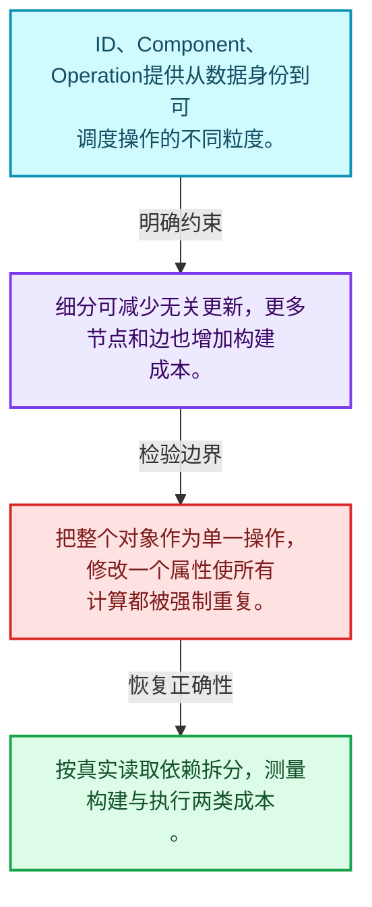
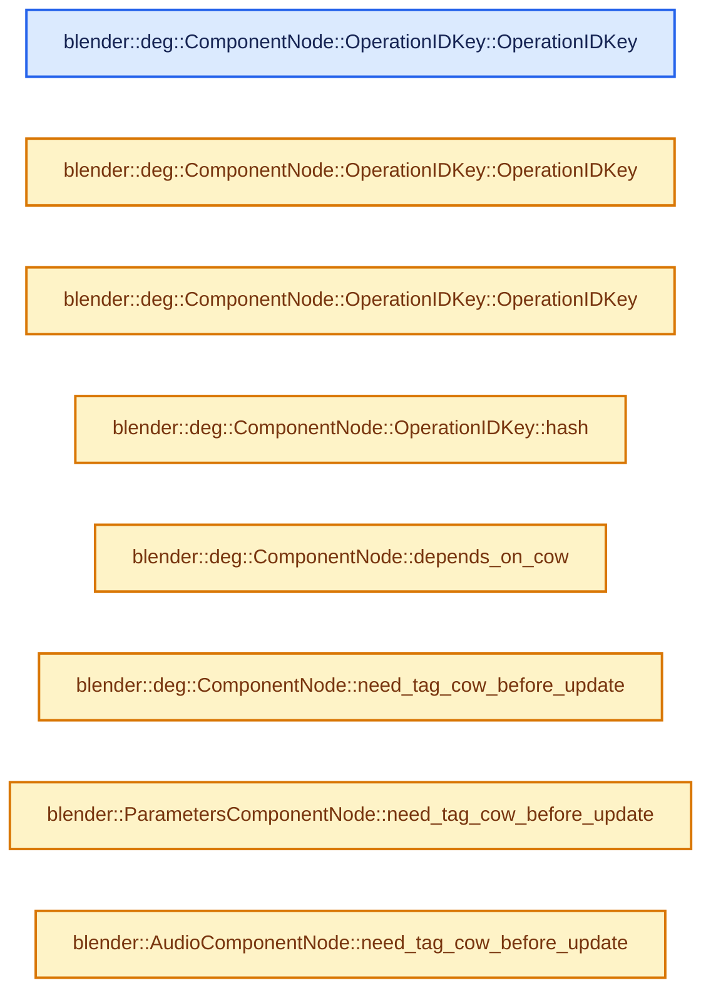
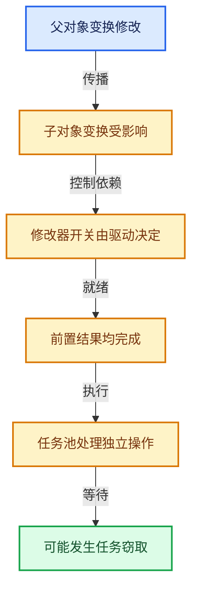

# 11-02 ID组件与操作节点

[方向导航](README.md) · [总目录](../README.md) · [实现索引](../%E7%AC%A6%E5%8F%B7%E4%BE%9D%E8%B5%96%E4%B8%8E%E5%AE%9E%E7%8E%B0%E7%B4%A2%E5%BC%95.md)

## 从问题到实现

为什么对象级节点还需要细分操作？

ID归属、组件职责和可调度操作提供不同粒度；过粗依赖会造成多余更新，过细增加管理成本。

**数据模型**

ID、Component、Operation提供从数据身份到可调度操作的不同粒度。

**设计取舍**

细分可减少无关更新，更多节点和边也增加构建成本。

**最小反例**

把整个对象作为单一操作，修改一个属性使所有计算都被强制重复。

**推导**

按真实读取依赖拆分，测量构建与执行两类成本。

## 阅读地图与执行推演








图中的数值推演是本方向的教学模型；实际函数之间的调用边与概念分析边分别标注，不能把概念关系当作运行时调度顺序。

## 完整源码单元与就地讲解

中文讲解直接放在相关代码旁，复杂机制在代码下展开。原文折叠区保留基准行号；不需要在行号表和函数之间来回查找。类布局可分段展示，函数实现不按固定行数切开。

### 类型布局、声明与编译条件 · deg_node_component.hh L1—L39

<a id="t-a9bab72f0503"></a>

<a id="t-1c3df20373b4"></a>

<a id="t-75b8403e598e"></a>

<a id="t-620a5026ca85"></a>

<a id="t-82d841bb57c4"></a>

<a id="t-9edf5c58095c"></a>

<a id="t-8512d0cbe424"></a>

`OperationIDKey`在这里声明的数据成员：

- `OperationCode opcode`
- `int name_tag`
- `StringRef name`

<!-- annotated:c4d0517f832126 -->

```cpp
/* SPDX-FileCopyrightText: 2013 Blender Authors
 *
 * SPDX-License-Identifier: GPL-2.0-or-later */

/** \file
 * \ingroup depsgraph
 */

#pragma once

#include "BLI_span.hh"
#include "BLI_string_ref.hh"
#include "intern/eval/deg_eval_copy_on_write.h"
#include "intern/node/deg_node.hh"
#include "intern/node/deg_node_id.hh"
#include "intern/node/deg_node_operation.hh"

#include "BLI_map.hh"
#include "BLI_vector.hh"

namespace blender {

struct ID;
struct bPoseChannel;

namespace deg {

struct Depsgraph;
struct IDNode;
struct OperationNode;

/* ID Component - Base type for all components */
struct ComponentNode : public Node {
  /* Key used to look up operations within a component */
  struct OperationIDKey {
    OperationCode opcode = OperationCode::OPERATION;
    int name_tag = -1;
    StringRef name = "";

```

<details>
<summary>核对原始源码：source/blender/depsgraph/intern/node/deg_node_component.hh · L1—L39</summary>

<!-- original:c4d0517f832126:source/blender/depsgraph/intern/node/deg_node_component.hh:1:39 -->

```cpp
/* SPDX-FileCopyrightText: 2013 Blender Authors
 *
 * SPDX-License-Identifier: GPL-2.0-or-later */

/** \file
 * \ingroup depsgraph
 */

#pragma once

#include "BLI_span.hh"
#include "BLI_string_ref.hh"
#include "intern/eval/deg_eval_copy_on_write.h"
#include "intern/node/deg_node.hh"
#include "intern/node/deg_node_id.hh"
#include "intern/node/deg_node_operation.hh"

#include "BLI_map.hh"
#include "BLI_vector.hh"

namespace blender {

struct ID;
struct bPoseChannel;

namespace deg {

struct Depsgraph;
struct IDNode;
struct OperationNode;

/* ID Component - Base type for all components */
struct ComponentNode : public Node {
  /* Key used to look up operations within a component */
  struct OperationIDKey {
    OperationCode opcode = OperationCode::OPERATION;
    int name_tag = -1;
    StringRef name = "";

```

</details>

<a id="f-9718328620cfc0e2"></a>

### `blender::deg::ComponentNode::OperationIDKey::OperationIDKey`

实现位置：[source/blender/depsgraph/intern/node/deg_node_component.hh](../../../../../source/blender/depsgraph/intern/node/deg_node_component.hh) · L40—L40。

**教学注释版**

<!-- annotated:b4cb278aecc59b -->

```cpp
    OperationIDKey() = default;
```

<details>
<summary>核对原始源码：source/blender/depsgraph/intern/node/deg_node_component.hh · L40—L40</summary>

<!-- original:b4cb278aecc59b:source/blender/depsgraph/intern/node/deg_node_component.hh:40:40 -->

```cpp
    OperationIDKey() = default;
```

</details>

**继续追踪实现**

本实现没有需要继续展开的显式调用；检查返回表达式、对象转换和调用者前置条件。

<a id="f-c6a81bb5a5e3803f"></a>

### `blender::deg::ComponentNode::OperationIDKey::OperationIDKey`

实现位置：[source/blender/depsgraph/intern/node/deg_node_component.hh](../../../../../source/blender/depsgraph/intern/node/deg_node_component.hh) · L41—L41。

接口参数：

- `const OperationCode opcode`

**教学注释版**

<!-- annotated:8eb6937fb46d2c -->

```cpp
    OperationIDKey(const OperationCode opcode) : opcode(opcode) {}
```

<details>
<summary>核对原始源码：source/blender/depsgraph/intern/node/deg_node_component.hh · L41—L41</summary>

<!-- original:8eb6937fb46d2c:source/blender/depsgraph/intern/node/deg_node_component.hh:41:41 -->

```cpp
    OperationIDKey(const OperationCode opcode) : opcode(opcode) {}
```

</details>

**继续追踪实现**

本实现没有需要继续展开的显式调用；检查返回表达式、对象转换和调用者前置条件。

<a id="f-8501e713250fa7e8"></a>

### `blender::deg::ComponentNode::OperationIDKey::OperationIDKey`

实现位置：[source/blender/depsgraph/intern/node/deg_node_component.hh](../../../../../source/blender/depsgraph/intern/node/deg_node_component.hh) · L42—L45。

接口参数：

- `const OperationCode opcode`
- `const StringRef name`
- `const int name_tag`

**教学注释版**

<!-- annotated:b74b8cabaa47b9 -->

```cpp
    OperationIDKey(const OperationCode opcode, const StringRef name, const int name_tag)
        : opcode(opcode), name_tag(name_tag), name(name)
    {
    }
```

<details>
<summary>核对原始源码：source/blender/depsgraph/intern/node/deg_node_component.hh · L42—L45</summary>

<!-- original:b74b8cabaa47b9:source/blender/depsgraph/intern/node/deg_node_component.hh:42:45 -->

```cpp
    OperationIDKey(const OperationCode opcode, const StringRef name, const int name_tag)
        : opcode(opcode), name_tag(name_tag), name(name)
    {
    }
```

</details>

**继续追踪实现**

本实现没有需要继续展开的显式调用；检查返回表达式、对象转换和调用者前置条件。

### 类型布局、声明与编译条件 · deg_node_component.hh L46—L48

<!-- annotated:99201930a10a4d -->

```cpp

    std::string identifier() const;
    friend bool operator==(const OperationIDKey &a, const OperationIDKey &b) = default;
```

<details>
<summary>核对原始源码：source/blender/depsgraph/intern/node/deg_node_component.hh · L46—L48</summary>

<!-- original:99201930a10a4d:source/blender/depsgraph/intern/node/deg_node_component.hh:46:48 -->

```cpp

    std::string identifier() const;
    friend bool operator==(const OperationIDKey &a, const OperationIDKey &b) = default;
```

</details>

<a id="f-6fd345335ad09860"></a>

### `blender::deg::ComponentNode::OperationIDKey::hash`

实现位置：[source/blender/depsgraph/intern/node/deg_node_component.hh](../../../../../source/blender/depsgraph/intern/node/deg_node_component.hh) · L49—L52。

**教学注释版**

<!-- annotated:f726c9dfd87118 -->

```cpp
    uint64_t hash() const
    {
      return get_default_hash(opcode, name_tag, name);
    }
```

<details>
<summary>核对原始源码：source/blender/depsgraph/intern/node/deg_node_component.hh · L49—L52</summary>

<!-- original:f726c9dfd87118:source/blender/depsgraph/intern/node/deg_node_component.hh:49:52 -->

```cpp
    uint64_t hash() const
    {
      return get_default_hash(opcode, name_tag, name);
    }
```

</details>

**结果出口**

- `return get_default_hash(opcode, name_tag, name);`

**继续追踪实现**

- `get_default_hash` → [blender::get_default_hash · L251](../02-%E5%93%88%E5%B8%8C%E8%A1%A8%E4%B8%8E%E5%85%B3%E8%81%94%E6%95%B0%E6%8D%AE%E7%BB%93%E6%9E%84/01-%E5%93%88%E5%B8%8C%E4%B8%8E%E7%9B%B8%E7%AD%89%E5%A5%91%E7%BA%A6.md#f-5f2c246aedf3dc0a)。

### 类型布局、声明与编译条件 · deg_node_component.hh L53—L131

<!-- annotated:b04a266037553d -->

```cpp
  };

  /* Typedef for container of operations */
  ComponentNode();
  ~ComponentNode() override;

  /** Initialize 'component' node - from pointer data given. */
  void init(const ID *id, const char *subdata) override;

  std::string identifier() const override;

  /* Find an existing operation, if requested operation does not exist nullptr will be returned.
   * See #add_operation for the meaning and examples of #name and #name_tag.
   */
  OperationNode *find_operation(OperationIDKey key) const;
  OperationNode *find_operation(OperationCode opcode,
                                StringRef name = "",
                                int name_tag = -1) const;

  /* Find an existing operation, will throw an assert() if it does not exist.
   * See #add_operation for the meaning and examples of #name and #name_tag. */
  OperationNode *get_operation(OperationIDKey key) const;
  OperationNode *get_operation(OperationCode opcode, StringRef name = "", int name_tag = -1) const;

  /* Check operation exists and return it. */
  bool has_operation(OperationIDKey key) const;
  bool has_operation(OperationCode opcode, StringRef name = "", int name_tag = -1) const;

  /**
   * Create a new node for representing an operation and add this to graph
   *
   * \warning If an existing node is found, it will be modified. This helps
   * when node may have been partially created earlier (e.g. parent ref before
   * parent item is added)
   *
   * \param opcode: The operation to perform.
   * \param name: An optional identifier for operation. It will be used to tell operation nodes
   *              with the same code apart. For example, parameter operation code will have name
   *              set to the corresponding custom property name
   * \param name_tag: An optional integer tag for the name. Is an additional way to tell operations
   *                  apart. For example, RNA path to an array property will have the same opcode
   *                  of PARAMETERS, name corresponding to the property name, and name tag
   *                  corresponding to the array index within the property.
   */
  OperationNode *add_operation(const DepsEvalOperationCb &op,
                               OperationCode opcode,
                               const StringRef name = "",
                               int name_tag = -1);

  /* Entry/exit operations management.
   *
   * Use those instead of direct set since this will perform sanity checks. */
  void set_entry_operation(OperationNode *op_node);
  void set_exit_operation(OperationNode *op_node);

  void clear_operations();

  void tag_update(Depsgraph *graph, eUpdateSource source) override;

  OperationNode *get_entry_operation() override;
  OperationNode *get_exit_operation() override;

  void finalize_build(Depsgraph *graph);

  IDNode *owner;

  /* ** Inner nodes for this component ** */

  /* Operations stored as a hash map, for faster build.
   * This hash map will be freed when graph is fully built. */
  Map<ComponentNode::OperationIDKey, OperationNode *> *operations_map;

  /* This is a "normal" list of operations, used by evaluation
   * and other routines after construction. */
  Vector<OperationNode *> operations;

  OperationNode *entry_operation;
  OperationNode *exit_operation;

```

<details>
<summary>核对原始源码：source/blender/depsgraph/intern/node/deg_node_component.hh · L53—L131</summary>

<!-- original:b04a266037553d:source/blender/depsgraph/intern/node/deg_node_component.hh:53:131 -->

```cpp
  };

  /* Typedef for container of operations */
  ComponentNode();
  ~ComponentNode() override;

  /** Initialize 'component' node - from pointer data given. */
  void init(const ID *id, const char *subdata) override;

  std::string identifier() const override;

  /* Find an existing operation, if requested operation does not exist nullptr will be returned.
   * See #add_operation for the meaning and examples of #name and #name_tag.
   */
  OperationNode *find_operation(OperationIDKey key) const;
  OperationNode *find_operation(OperationCode opcode,
                                StringRef name = "",
                                int name_tag = -1) const;

  /* Find an existing operation, will throw an assert() if it does not exist.
   * See #add_operation for the meaning and examples of #name and #name_tag. */
  OperationNode *get_operation(OperationIDKey key) const;
  OperationNode *get_operation(OperationCode opcode, StringRef name = "", int name_tag = -1) const;

  /* Check operation exists and return it. */
  bool has_operation(OperationIDKey key) const;
  bool has_operation(OperationCode opcode, StringRef name = "", int name_tag = -1) const;

  /**
   * Create a new node for representing an operation and add this to graph
   *
   * \warning If an existing node is found, it will be modified. This helps
   * when node may have been partially created earlier (e.g. parent ref before
   * parent item is added)
   *
   * \param opcode: The operation to perform.
   * \param name: An optional identifier for operation. It will be used to tell operation nodes
   *              with the same code apart. For example, parameter operation code will have name
   *              set to the corresponding custom property name
   * \param name_tag: An optional integer tag for the name. Is an additional way to tell operations
   *                  apart. For example, RNA path to an array property will have the same opcode
   *                  of PARAMETERS, name corresponding to the property name, and name tag
   *                  corresponding to the array index within the property.
   */
  OperationNode *add_operation(const DepsEvalOperationCb &op,
                               OperationCode opcode,
                               const StringRef name = "",
                               int name_tag = -1);

  /* Entry/exit operations management.
   *
   * Use those instead of direct set since this will perform sanity checks. */
  void set_entry_operation(OperationNode *op_node);
  void set_exit_operation(OperationNode *op_node);

  void clear_operations();

  void tag_update(Depsgraph *graph, eUpdateSource source) override;

  OperationNode *get_entry_operation() override;
  OperationNode *get_exit_operation() override;

  void finalize_build(Depsgraph *graph);

  IDNode *owner;

  /* ** Inner nodes for this component ** */

  /* Operations stored as a hash map, for faster build.
   * This hash map will be freed when graph is fully built. */
  Map<ComponentNode::OperationIDKey, OperationNode *> *operations_map;

  /* This is a "normal" list of operations, used by evaluation
   * and other routines after construction. */
  Vector<OperationNode *> operations;

  OperationNode *entry_operation;
  OperationNode *exit_operation;

```

</details>

<a id="f-f96724ab661f954f"></a>

### `blender::deg::ComponentNode::depends_on_cow`

实现位置：[source/blender/depsgraph/intern/node/deg_node_component.hh](../../../../../source/blender/depsgraph/intern/node/deg_node_component.hh) · L132—L135。

**教学注释版**

<!-- annotated:d3844121e16706 -->

```cpp
  virtual bool depends_on_cow()
  {
    return true;
  }
```

<details>
<summary>核对原始源码：source/blender/depsgraph/intern/node/deg_node_component.hh · L132—L135</summary>

<!-- original:d3844121e16706:source/blender/depsgraph/intern/node/deg_node_component.hh:132:135 -->

```cpp
  virtual bool depends_on_cow()
  {
    return true;
  }
```

</details>

**结果出口**

- `return true;`

**继续追踪实现**

本实现没有需要继续展开的显式调用；检查返回表达式、对象转换和调用者前置条件。

### 类型布局、声明与编译条件 · deg_node_component.hh L136—L138

<!-- annotated:ec9cfabbe6d758 -->

```cpp

  /* Denotes whether copy-on-eval component is to be tagged when this component
   * is tagged for update. */
```

<details>
<summary>核对原始源码：source/blender/depsgraph/intern/node/deg_node_component.hh · L136—L138</summary>

<!-- original:ec9cfabbe6d758:source/blender/depsgraph/intern/node/deg_node_component.hh:136:138 -->

```cpp

  /* Denotes whether copy-on-eval component is to be tagged when this component
   * is tagged for update. */
```

</details>

<a id="f-2520cb4a769c9ec6"></a>

### `blender::deg::ComponentNode::need_tag_cow_before_update`

实现位置：[source/blender/depsgraph/intern/node/deg_node_component.hh](../../../../../source/blender/depsgraph/intern/node/deg_node_component.hh) · L139—L142。

接口参数：

- `const IDRecalcFlag`

**教学注释版**

<!-- annotated:c49435d0764469 -->

```cpp
  virtual bool need_tag_cow_before_update(const IDRecalcFlag /*tag*/)
  {
    return true;
  }
```

<details>
<summary>核对原始源码：source/blender/depsgraph/intern/node/deg_node_component.hh · L139—L142</summary>

<!-- original:c49435d0764469:source/blender/depsgraph/intern/node/deg_node_component.hh:139:142 -->

```cpp
  virtual bool need_tag_cow_before_update(const IDRecalcFlag /*tag*/)
  {
    return true;
  }
```

</details>

**结果出口**

- `return true;`

**继续追踪实现**

本实现没有需要继续展开的显式调用；检查返回表达式、对象转换和调用者前置条件。

### 类型布局、声明与编译条件 · deg_node_component.hh L143—L235

<a id="t-f890cca9ad99"></a>

`BoneComponentNode`在这里声明的数据成员：

- `void init`
- `struct bPoseChannel pchan`

<a id="t-d53c7dff3588"></a>

<a id="t-ae94680bbcab"></a>

<!-- annotated:5dc85e39e8c9fe -->

```cpp

  /* The component has (possibly indirect) effect on a data-block whose node has
   * is_visible_on_build set to true.
   *
   * This field is ensured to be up-to-date prior to `IDNode::finalize_build()`. */
  bool possibly_affects_visible_id;

  /* Denotes whether this component actually affects (possibly indirectly) on a directly visible
   * object. Includes possibly run-time visibility update of ID nodes.
   *
   * NOTE: Is only reliable after `deg_graph_flush_visibility()`. */
  bool affects_visible_id;

  /* Accumulated flag from operations. Is initialized and used during updates flush. */
  bool is_user_modified;
};

/* ---------------------------------------- */

#define DEG_COMPONENT_NODE_DEFINE_TYPEINFO(NodeType, type_, type_name_, id_recalc_tag) \
  const Node::TypeInfo NodeType::typeinfo = Node::TypeInfo(type_, type_name_, id_recalc_tag)

#define DEG_COMPONENT_NODE_DECLARE DEG_DEPSNODE_DECLARE

#define DEG_COMPONENT_NODE_DEFINE(name, NAME, id_recalc_tag) \
  DEG_COMPONENT_NODE_DEFINE_TYPEINFO( \
      name##ComponentNode, NodeType::NAME, #name " Component", id_recalc_tag); \
  static DepsNodeFactoryImpl<name##ComponentNode> DNTI_##NAME

#define DEG_COMPONENT_NODE_DECLARE_GENERIC(name) \
  struct name##ComponentNode : public ComponentNode { \
    DEG_COMPONENT_NODE_DECLARE; \
  }

#define DEG_COMPONENT_NODE_DECLARE_NO_COW_TAG_ON_UPDATE(name) \
  struct name##ComponentNode : public ComponentNode { \
    DEG_COMPONENT_NODE_DECLARE; \
    virtual bool need_tag_cow_before_update(const IDRecalcFlag /*tag*/) \
    { \
      return false; \
    } \
  }

#define DEG_COMPONENT_NODE_DECLARE_NO_COW(name) \
  struct name##ComponentNode : public ComponentNode { \
    DEG_COMPONENT_NODE_DECLARE; \
    virtual bool depends_on_cow() \
    { \
      return false; \
    } \
  }

DEG_COMPONENT_NODE_DECLARE_GENERIC(Animation);
DEG_COMPONENT_NODE_DECLARE_NO_COW_TAG_ON_UPDATE(BatchCache);
DEG_COMPONENT_NODE_DECLARE_GENERIC(Cache);
DEG_COMPONENT_NODE_DECLARE_GENERIC(CopyOnWrite);
DEG_COMPONENT_NODE_DECLARE_GENERIC(Geometry);
DEG_COMPONENT_NODE_DECLARE_GENERIC(ImageAnimation);
DEG_COMPONENT_NODE_DECLARE_GENERIC(LayerCollections);
DEG_COMPONENT_NODE_DECLARE_GENERIC(Particles);
DEG_COMPONENT_NODE_DECLARE_GENERIC(ParticleSettings);
DEG_COMPONENT_NODE_DECLARE_GENERIC(Pose);
DEG_COMPONENT_NODE_DECLARE_GENERIC(PointCache);
DEG_COMPONENT_NODE_DECLARE_GENERIC(Sequencer);
DEG_COMPONENT_NODE_DECLARE_GENERIC(Compositor);
DEG_COMPONENT_NODE_DECLARE_NO_COW_TAG_ON_UPDATE(Shading);
DEG_COMPONENT_NODE_DECLARE_GENERIC(ShadingParameters);
DEG_COMPONENT_NODE_DECLARE_GENERIC(Transform);
DEG_COMPONENT_NODE_DECLARE_NO_COW_TAG_ON_UPDATE(ObjectFromLayer);
DEG_COMPONENT_NODE_DECLARE_NO_COW_TAG_ON_UPDATE(Hierarchy);
DEG_COMPONENT_NODE_DECLARE_GENERIC(Instancing);
DEG_COMPONENT_NODE_DECLARE_GENERIC(Synchronization);
DEG_COMPONENT_NODE_DECLARE_GENERIC(Armature);
DEG_COMPONENT_NODE_DECLARE_GENERIC(GenericDatablock);
DEG_COMPONENT_NODE_DECLARE_GENERIC(Scene);
DEG_COMPONENT_NODE_DECLARE_NO_COW_TAG_ON_UPDATE(Visibility);
DEG_COMPONENT_NODE_DECLARE_GENERIC(Simulation);
DEG_COMPONENT_NODE_DECLARE_GENERIC(NTreeOutput);
DEG_COMPONENT_NODE_DECLARE_GENERIC(NTreeGeometryPreprocess);

/* Bone Component */
struct BoneComponentNode : public ComponentNode {
  /** Initialize 'bone component' node - from pointer data given. */
  void init(const ID *id, const char *subdata) override;

  struct bPoseChannel *pchan; /* the bone that this component represents */

  DEG_COMPONENT_NODE_DECLARE;
};

/* Eventually we would not tag parameters in all cases.
 * Support for this each ID needs to be added on an individual basis. */
struct ParametersComponentNode : public ComponentNode {
```

<details>
<summary>核对原始源码：source/blender/depsgraph/intern/node/deg_node_component.hh · L143—L235</summary>

<!-- original:5dc85e39e8c9fe:source/blender/depsgraph/intern/node/deg_node_component.hh:143:235 -->

```cpp

  /* The component has (possibly indirect) effect on a data-block whose node has
   * is_visible_on_build set to true.
   *
   * This field is ensured to be up-to-date prior to `IDNode::finalize_build()`. */
  bool possibly_affects_visible_id;

  /* Denotes whether this component actually affects (possibly indirectly) on a directly visible
   * object. Includes possibly run-time visibility update of ID nodes.
   *
   * NOTE: Is only reliable after `deg_graph_flush_visibility()`. */
  bool affects_visible_id;

  /* Accumulated flag from operations. Is initialized and used during updates flush. */
  bool is_user_modified;
};

/* ---------------------------------------- */

#define DEG_COMPONENT_NODE_DEFINE_TYPEINFO(NodeType, type_, type_name_, id_recalc_tag) \
  const Node::TypeInfo NodeType::typeinfo = Node::TypeInfo(type_, type_name_, id_recalc_tag)

#define DEG_COMPONENT_NODE_DECLARE DEG_DEPSNODE_DECLARE

#define DEG_COMPONENT_NODE_DEFINE(name, NAME, id_recalc_tag) \
  DEG_COMPONENT_NODE_DEFINE_TYPEINFO( \
      name##ComponentNode, NodeType::NAME, #name " Component", id_recalc_tag); \
  static DepsNodeFactoryImpl<name##ComponentNode> DNTI_##NAME

#define DEG_COMPONENT_NODE_DECLARE_GENERIC(name) \
  struct name##ComponentNode : public ComponentNode { \
    DEG_COMPONENT_NODE_DECLARE; \
  }

#define DEG_COMPONENT_NODE_DECLARE_NO_COW_TAG_ON_UPDATE(name) \
  struct name##ComponentNode : public ComponentNode { \
    DEG_COMPONENT_NODE_DECLARE; \
    virtual bool need_tag_cow_before_update(const IDRecalcFlag /*tag*/) \
    { \
      return false; \
    } \
  }

#define DEG_COMPONENT_NODE_DECLARE_NO_COW(name) \
  struct name##ComponentNode : public ComponentNode { \
    DEG_COMPONENT_NODE_DECLARE; \
    virtual bool depends_on_cow() \
    { \
      return false; \
    } \
  }

DEG_COMPONENT_NODE_DECLARE_GENERIC(Animation);
DEG_COMPONENT_NODE_DECLARE_NO_COW_TAG_ON_UPDATE(BatchCache);
DEG_COMPONENT_NODE_DECLARE_GENERIC(Cache);
DEG_COMPONENT_NODE_DECLARE_GENERIC(CopyOnWrite);
DEG_COMPONENT_NODE_DECLARE_GENERIC(Geometry);
DEG_COMPONENT_NODE_DECLARE_GENERIC(ImageAnimation);
DEG_COMPONENT_NODE_DECLARE_GENERIC(LayerCollections);
DEG_COMPONENT_NODE_DECLARE_GENERIC(Particles);
DEG_COMPONENT_NODE_DECLARE_GENERIC(ParticleSettings);
DEG_COMPONENT_NODE_DECLARE_GENERIC(Pose);
DEG_COMPONENT_NODE_DECLARE_GENERIC(PointCache);
DEG_COMPONENT_NODE_DECLARE_GENERIC(Sequencer);
DEG_COMPONENT_NODE_DECLARE_GENERIC(Compositor);
DEG_COMPONENT_NODE_DECLARE_NO_COW_TAG_ON_UPDATE(Shading);
DEG_COMPONENT_NODE_DECLARE_GENERIC(ShadingParameters);
DEG_COMPONENT_NODE_DECLARE_GENERIC(Transform);
DEG_COMPONENT_NODE_DECLARE_NO_COW_TAG_ON_UPDATE(ObjectFromLayer);
DEG_COMPONENT_NODE_DECLARE_NO_COW_TAG_ON_UPDATE(Hierarchy);
DEG_COMPONENT_NODE_DECLARE_GENERIC(Instancing);
DEG_COMPONENT_NODE_DECLARE_GENERIC(Synchronization);
DEG_COMPONENT_NODE_DECLARE_GENERIC(Armature);
DEG_COMPONENT_NODE_DECLARE_GENERIC(GenericDatablock);
DEG_COMPONENT_NODE_DECLARE_GENERIC(Scene);
DEG_COMPONENT_NODE_DECLARE_NO_COW_TAG_ON_UPDATE(Visibility);
DEG_COMPONENT_NODE_DECLARE_GENERIC(Simulation);
DEG_COMPONENT_NODE_DECLARE_GENERIC(NTreeOutput);
DEG_COMPONENT_NODE_DECLARE_GENERIC(NTreeGeometryPreprocess);

/* Bone Component */
struct BoneComponentNode : public ComponentNode {
  /** Initialize 'bone component' node - from pointer data given. */
  void init(const ID *id, const char *subdata) override;

  struct bPoseChannel *pchan; /* the bone that this component represents */

  DEG_COMPONENT_NODE_DECLARE;
};

/* Eventually we would not tag parameters in all cases.
 * Support for this each ID needs to be added on an individual basis. */
struct ParametersComponentNode : public ComponentNode {
```

</details>

<a id="f-5e8679eab3e0a655"></a>

### `blender::ParametersComponentNode::need_tag_cow_before_update`

实现位置：[source/blender/depsgraph/intern/node/deg_node_component.hh](../../../../../source/blender/depsgraph/intern/node/deg_node_component.hh) · L236—L244。

接口参数：

- `const IDRecalcFlag`

**教学注释版**

<!-- annotated:bb9963a49f6ec3 -->

```cpp
  bool need_tag_cow_before_update(const IDRecalcFlag /*tag*/) override
  {
    if (ID_TYPE_SUPPORTS_PARAMS_WITHOUT_COW(owner->id_type)) {
      /* Disabled as this is not true for newly added objects, needs investigation. */
      // BLI_assert(deg_eval_copy_is_expanded(owner->id_cow));
      return false;
    }
    return true;
  }
```

<details>
<summary>核对原始源码：source/blender/depsgraph/intern/node/deg_node_component.hh · L236—L244</summary>

<!-- original:bb9963a49f6ec3:source/blender/depsgraph/intern/node/deg_node_component.hh:236:244 -->

```cpp
  bool need_tag_cow_before_update(const IDRecalcFlag /*tag*/) override
  {
    if (ID_TYPE_SUPPORTS_PARAMS_WITHOUT_COW(owner->id_type)) {
      /* Disabled as this is not true for newly added objects, needs investigation. */
      // BLI_assert(deg_eval_copy_is_expanded(owner->id_cow));
      return false;
    }
    return true;
  }
```

</details>

**结果出口**

- `return false;`
- `return true;`

**继续追踪实现**

- `ID_TYPE_SUPPORTS_PARAMS_WITHOUT_COW` → [ID_TYPE_SUPPORTS_PARAMS_WITHOUT_COW · L751](../05-%E5%87%A0%E4%BD%95%E5%AD%98%E5%82%A8%E4%B8%8E%E6%8B%93%E6%89%91%E6%98%A0%E5%B0%84/%E4%BE%9D%E8%B5%96-DNA_ID-3eb091.md#m-5aeaecb7bea6)。宏定义由构建条件选择。

### 类型布局、声明与编译条件 · deg_node_component.hh L245—L250

<a id="t-2a6558e0ef4d"></a>

<!-- annotated:db205019499f2a -->

```cpp

  DEG_COMPONENT_NODE_DECLARE;
};

/* Audio component. */
struct AudioComponentNode : public ComponentNode {
```

<details>
<summary>核对原始源码：source/blender/depsgraph/intern/node/deg_node_component.hh · L245—L250</summary>

<!-- original:db205019499f2a:source/blender/depsgraph/intern/node/deg_node_component.hh:245:250 -->

```cpp

  DEG_COMPONENT_NODE_DECLARE;
};

/* Audio component. */
struct AudioComponentNode : public ComponentNode {
```

</details>

<a id="f-cd9e49987d4d52d7"></a>

### `blender::AudioComponentNode::need_tag_cow_before_update`

实现位置：[source/blender/depsgraph/intern/node/deg_node_component.hh](../../../../../source/blender/depsgraph/intern/node/deg_node_component.hh) · L251—L256。

接口参数：

- `const IDRecalcFlag tag`

**教学注释版**

<!-- annotated:a14b8083c9187d -->

```cpp
  bool need_tag_cow_before_update(const IDRecalcFlag tag) override
  {
    /* Frame change doesn't require a copy of the scene, doing so can be a heavy operation
     * especially when the collection contains many objects, see #104798. */
    return (tag != ID_RECALC_FRAME_CHANGE);
  }
```

<details>
<summary>核对原始源码：source/blender/depsgraph/intern/node/deg_node_component.hh · L251—L256</summary>

<!-- original:a14b8083c9187d:source/blender/depsgraph/intern/node/deg_node_component.hh:251:256 -->

```cpp
  bool need_tag_cow_before_update(const IDRecalcFlag tag) override
  {
    /* Frame change doesn't require a copy of the scene, doing so can be a heavy operation
     * especially when the collection contains many objects, see #104798. */
    return (tag != ID_RECALC_FRAME_CHANGE);
  }
```

</details>

**结果出口**

- `return (tag != ID_RECALC_FRAME_CHANGE);`

**继续追踪实现**

本实现没有需要继续展开的显式调用；检查返回表达式、对象转换和调用者前置条件。

### 类型布局、声明与编译条件 · deg_node_component.hh L257—L264

<!-- annotated:82715b9c9c2bc4 -->

```cpp

  DEG_COMPONENT_NODE_DECLARE;
};

void deg_register_component_depsnodes();

}  // namespace deg
}  // namespace blender
```

<details>
<summary>核对原始源码：source/blender/depsgraph/intern/node/deg_node_component.hh · L257—L264</summary>

<!-- original:82715b9c9c2bc4:source/blender/depsgraph/intern/node/deg_node_component.hh:257:264 -->

```cpp

  DEG_COMPONENT_NODE_DECLARE;
};

void deg_register_component_depsnodes();

}  // namespace deg
}  // namespace blender
```

</details>

### 类型布局、声明与编译条件 · deg_node_id.hh L1—L43

<a id="t-5814651a6398"></a>

<a id="t-e19357311d25"></a>

<a id="t-fa50a65c0e76"></a>

<a id="t-b05c02828612"></a>

`ComponentIDKey`在这里声明的数据成员：

- `NodeType type`
- `StringRef name`

<!-- annotated:abc417017905fb -->

```cpp
/* SPDX-FileCopyrightText: 2013 Blender Authors
 *
 * SPDX-License-Identifier: GPL-2.0-or-later */

/** \file
 * \ingroup depsgraph
 */

#pragma once

#include "intern/node/deg_node.hh"

#include "DNA_ID.h"

#include "BLI_map.hh"
#include "BLI_string_ref.hh"
#include "BLI_sys_types.hh"

namespace blender::deg {

struct ComponentNode;

using IDComponentsMask = uint64_t;

/* NOTE: We use max comparison to mark an id node that is linked more than once
 * So keep this enum ordered accordingly. */
enum eDepsNode_LinkedState_Type {
  /* Generic indirectly linked id node. */
  DEG_ID_LINKED_INDIRECTLY = 0,
  /* Id node present in the set (background) only. */
  DEG_ID_LINKED_VIA_SET = 1,
  /* Id node directly linked via the SceneLayer. */
  DEG_ID_LINKED_DIRECTLY = 2,
};
const char *linkedStateAsString(eDepsNode_LinkedState_Type linked_state);

/* ID-Block Reference */
struct IDNode : public Node {
  struct ComponentIDKey {

    NodeType type;
    StringRef name;

```

<details>
<summary>核对原始源码：source/blender/depsgraph/intern/node/deg_node_id.hh · L1—L43</summary>

<!-- original:abc417017905fb:source/blender/depsgraph/intern/node/deg_node_id.hh:1:43 -->

```cpp
/* SPDX-FileCopyrightText: 2013 Blender Authors
 *
 * SPDX-License-Identifier: GPL-2.0-or-later */

/** \file
 * \ingroup depsgraph
 */

#pragma once

#include "intern/node/deg_node.hh"

#include "DNA_ID.h"

#include "BLI_map.hh"
#include "BLI_string_ref.hh"
#include "BLI_sys_types.hh"

namespace blender::deg {

struct ComponentNode;

using IDComponentsMask = uint64_t;

/* NOTE: We use max comparison to mark an id node that is linked more than once
 * So keep this enum ordered accordingly. */
enum eDepsNode_LinkedState_Type {
  /* Generic indirectly linked id node. */
  DEG_ID_LINKED_INDIRECTLY = 0,
  /* Id node present in the set (background) only. */
  DEG_ID_LINKED_VIA_SET = 1,
  /* Id node directly linked via the SceneLayer. */
  DEG_ID_LINKED_DIRECTLY = 2,
};
const char *linkedStateAsString(eDepsNode_LinkedState_Type linked_state);

/* ID-Block Reference */
struct IDNode : public Node {
  struct ComponentIDKey {

    NodeType type;
    StringRef name;

```

</details>

<a id="f-683c3e0bc0e1fcc7"></a>

### `blender::deg::IDNode::ComponentIDKey::ComponentIDKey`

实现位置：[source/blender/depsgraph/intern/node/deg_node_id.hh](../../../../../source/blender/depsgraph/intern/node/deg_node_id.hh) · L44—L44。

接口参数：

- `NodeType type`
- `StringRef name = ""`

**教学注释版**

<!-- annotated:68355b4dae78eb -->

```cpp
    ComponentIDKey(NodeType type, StringRef name = "") : type(type), name(name) {}
```

<details>
<summary>核对原始源码：source/blender/depsgraph/intern/node/deg_node_id.hh · L44—L44</summary>

<!-- original:68355b4dae78eb:source/blender/depsgraph/intern/node/deg_node_id.hh:44:44 -->

```cpp
    ComponentIDKey(NodeType type, StringRef name = "") : type(type), name(name) {}
```

</details>

**继续追踪实现**

本实现没有需要继续展开的显式调用；检查返回表达式、对象转换和调用者前置条件。

### 类型布局、声明与编译条件 · deg_node_id.hh L45—L45

<!-- annotated:da8da768d63316 -->

```cpp
    friend bool operator==(const ComponentIDKey &a, const ComponentIDKey &b) = default;
```

<details>
<summary>核对原始源码：source/blender/depsgraph/intern/node/deg_node_id.hh · L45—L45</summary>

<!-- original:da8da768d63316:source/blender/depsgraph/intern/node/deg_node_id.hh:45:45 -->

```cpp
    friend bool operator==(const ComponentIDKey &a, const ComponentIDKey &b) = default;
```

</details>

<a id="f-a06bb1f4103a7a8f"></a>

### `blender::deg::IDNode::ComponentIDKey::hash`

实现位置：[source/blender/depsgraph/intern/node/deg_node_id.hh](../../../../../source/blender/depsgraph/intern/node/deg_node_id.hh) · L46—L49。

**教学注释版**

<!-- annotated:8ce6e2dfb6fd11 -->

```cpp
    uint64_t hash() const
    {
      return get_default_hash(type, name);
    }
```

<details>
<summary>核对原始源码：source/blender/depsgraph/intern/node/deg_node_id.hh · L46—L49</summary>

<!-- original:8ce6e2dfb6fd11:source/blender/depsgraph/intern/node/deg_node_id.hh:46:49 -->

```cpp
    uint64_t hash() const
    {
      return get_default_hash(type, name);
    }
```

</details>

**结果出口**

- `return get_default_hash(type, name);`

**继续追踪实现**

- `get_default_hash` → [blender::get_default_hash · L251](../02-%E5%93%88%E5%B8%8C%E8%A1%A8%E4%B8%8E%E5%85%B3%E8%81%94%E6%95%B0%E6%8D%AE%E7%BB%93%E6%9E%84/01-%E5%93%88%E5%B8%8C%E4%B8%8E%E7%9B%B8%E7%AD%89%E5%A5%91%E7%BA%A6.md#f-5f2c246aedf3dc0a)。

### 类型布局、声明与编译条件 · deg_node_id.hh L50—L140

<!-- annotated:66de5cdb953ab0 -->

```cpp
  };

  /** Initialize 'id' node - from pointer data given. */
  void init(const ID *id, const char *subdata) override;
  void init_copy_on_write(ID *id_cow_hint = nullptr);
  ~IDNode() override;
  void destroy();

  std::string identifier() const override;

  ComponentNode *find_component(NodeType type, StringRef name = "") const;
  ComponentNode *add_component(NodeType type, StringRef name = "");

  void tag_update(Depsgraph *graph, eUpdateSource source) override;

  void finalize_build(Depsgraph *graph);

  IDComponentsMask get_visible_components_mask() const;

  /* Type of the ID stored separately, so it's possible to perform check whether evaluated copy is
   * needed without de-referencing the id_cow (which is not safe when ID is NOT covered by
   * copy-on-evaluation and has been deleted from the main database.) */
  ID_Type id_type;

  /* ID Block referenced. */
  ID *id_orig;

  /* Session-wide UUID of the id_orig.
   * Is used on relations update to map evaluated state from old nodes to the new ones, without
   * relying on pointers (which are not guaranteed to be unique) and without dereferencing id_orig
   * which could be "stale" pointer. */
  uint id_orig_session_uid;

  /* Evaluated data-block.
   * Will be covered by the copy-on-evaluation system if the ID Type needs it. */
  ID *id_cow;

  /* Hash to make it faster to look up components. */
  Map<ComponentIDKey, ComponentNode *> components;

  /* Additional flags needed for scene evaluation.
   * TODO(sergey): Only needed for until really granular updates
   * of all the entities. */
  uint32_t eval_flags;
  uint32_t previous_eval_flags;

  /* Extra customdata mask which needs to be evaluated for the mesh object. */
  DEGCustomDataMeshMasks customdata_masks;
  DEGCustomDataMeshMasks previous_customdata_masks;

  eDepsNode_LinkedState_Type linked_state;

  /* Indicates the data-block is to be considered visible in the evaluated scene.
   *
   * This flag is set during dependency graph build where check for an actual visibility might not
   * be available yet due to driven or animated restriction flags. So it is more of an intent or,
   * in other words, plausibility of the data-block to be visible. */
  bool is_visible_on_build;

  /* Evaluated state of whether evaluation considered this data-block "enabled".
   *
   * For objects this is derived from the base restriction flags, which might be animated or
   * driven. It is set to `BASE_ENABLED_<VIEWPORT, RENDER>` (depending on the graph mode) after
   * the object's flags from layer were evaluated.
   *
   * For other data-types is currently always true. */
  bool is_enabled_on_eval;

  /* For the collection type of ID, denotes whether collection was fully
   * recursed into. */
  bool is_collection_fully_expanded;

  /* Is used to figure out whether object came to the dependency graph via a base. */
  bool has_base;

  /* Accumulated flag from operation. Is initialized and used during updates flush. */
  bool is_user_modified;

  /* Copy-on-Write component has been explicitly tagged for update. */
  bool is_cow_explicitly_tagged;

  /* Accumulate recalc flags from multiple update passes. */
  int id_cow_recalc_backup;

  IDComponentsMask visible_components_mask;
  IDComponentsMask previously_visible_components_mask;

  DEG_DEPSNODE_DECLARE;
};

}  // namespace blender::deg
```

<details>
<summary>核对原始源码：source/blender/depsgraph/intern/node/deg_node_id.hh · L50—L140</summary>

<!-- original:66de5cdb953ab0:source/blender/depsgraph/intern/node/deg_node_id.hh:50:140 -->

```cpp
  };

  /** Initialize 'id' node - from pointer data given. */
  void init(const ID *id, const char *subdata) override;
  void init_copy_on_write(ID *id_cow_hint = nullptr);
  ~IDNode() override;
  void destroy();

  std::string identifier() const override;

  ComponentNode *find_component(NodeType type, StringRef name = "") const;
  ComponentNode *add_component(NodeType type, StringRef name = "");

  void tag_update(Depsgraph *graph, eUpdateSource source) override;

  void finalize_build(Depsgraph *graph);

  IDComponentsMask get_visible_components_mask() const;

  /* Type of the ID stored separately, so it's possible to perform check whether evaluated copy is
   * needed without de-referencing the id_cow (which is not safe when ID is NOT covered by
   * copy-on-evaluation and has been deleted from the main database.) */
  ID_Type id_type;

  /* ID Block referenced. */
  ID *id_orig;

  /* Session-wide UUID of the id_orig.
   * Is used on relations update to map evaluated state from old nodes to the new ones, without
   * relying on pointers (which are not guaranteed to be unique) and without dereferencing id_orig
   * which could be "stale" pointer. */
  uint id_orig_session_uid;

  /* Evaluated data-block.
   * Will be covered by the copy-on-evaluation system if the ID Type needs it. */
  ID *id_cow;

  /* Hash to make it faster to look up components. */
  Map<ComponentIDKey, ComponentNode *> components;

  /* Additional flags needed for scene evaluation.
   * TODO(sergey): Only needed for until really granular updates
   * of all the entities. */
  uint32_t eval_flags;
  uint32_t previous_eval_flags;

  /* Extra customdata mask which needs to be evaluated for the mesh object. */
  DEGCustomDataMeshMasks customdata_masks;
  DEGCustomDataMeshMasks previous_customdata_masks;

  eDepsNode_LinkedState_Type linked_state;

  /* Indicates the data-block is to be considered visible in the evaluated scene.
   *
   * This flag is set during dependency graph build where check for an actual visibility might not
   * be available yet due to driven or animated restriction flags. So it is more of an intent or,
   * in other words, plausibility of the data-block to be visible. */
  bool is_visible_on_build;

  /* Evaluated state of whether evaluation considered this data-block "enabled".
   *
   * For objects this is derived from the base restriction flags, which might be animated or
   * driven. It is set to `BASE_ENABLED_<VIEWPORT, RENDER>` (depending on the graph mode) after
   * the object's flags from layer were evaluated.
   *
   * For other data-types is currently always true. */
  bool is_enabled_on_eval;

  /* For the collection type of ID, denotes whether collection was fully
   * recursed into. */
  bool is_collection_fully_expanded;

  /* Is used to figure out whether object came to the dependency graph via a base. */
  bool has_base;

  /* Accumulated flag from operation. Is initialized and used during updates flush. */
  bool is_user_modified;

  /* Copy-on-Write component has been explicitly tagged for update. */
  bool is_cow_explicitly_tagged;

  /* Accumulate recalc flags from multiple update passes. */
  int id_cow_recalc_backup;

  IDComponentsMask visible_components_mask;
  IDComponentsMask previously_visible_components_mask;

  DEG_DEPSNODE_DECLARE;
};

}  // namespace blender::deg
```

</details>

### 类型布局、声明与编译条件 · deg_node_operation.hh L1—L268

<a id="t-cc847151f959"></a>

<a id="t-21397039d23b"></a>

<a id="t-54cf1014f6bb"></a>

<a id="t-657554d17dad"></a>

<a id="t-b5011b234fa1"></a>

`OperationNode`在这里声明的数据成员：

- `std::string identifier`
- `std::string full_identifier`
- `void tag_update`

<!-- annotated:06f38490ba3a39 -->

```cpp
/* SPDX-FileCopyrightText: 2013 Blender Authors
 *
 * SPDX-License-Identifier: GPL-2.0-or-later */

/** \file
 * \ingroup depsgraph
 */

#pragma once

#include <functional>
#include <string>

#include "intern/node/deg_node.hh"

#include "intern/depsgraph_type.hh"

namespace blender {

struct Depsgraph;

namespace deg {

struct ComponentNode;

/* Evaluation Operation for atomic operation */
/* XXX: move this to another header that can be exposed? */
using DepsEvalOperationCb = std::function<void(blender::Depsgraph *)>;

/* Identifiers for common operations (as an enum). */
enum class OperationCode {
  /* Generic Operations. -------------------------------------------------- */

  /* Placeholder for operations which don't need special mention */
  OPERATION = 0,

  /* Generic parameters evaluation. --------------------------------------- */
  ID_PROPERTY,
  PARAMETERS_ENTRY,
  PARAMETERS_EVAL,
  PARAMETERS_EXIT,
  VISIBILITY,

  /* Hierarchy. ----------------------------------------------------------- */
  HIERARCHY,

  /* Animation, Drivers, etc. --------------------------------------------- */
  /* NLA + Action */
  ANIMATION_ENTRY,
  ANIMATION_EVAL,
  ANIMATION_EXIT,
  /* Driver */
  DRIVER,
  /* Writes to RNA properties to ensure implicitly-shared data is un-shared. */
  DRIVER_UNSHARE,

  /* Scene related. ------------------------------------------------------- */
  SCENE_EVAL,
  AUDIO_ENTRY,
  AUDIO_VOLUME,

  /* Object related. ------------------------------------------------------ */
  OBJECT_FROM_LAYER_ENTRY,
  OBJECT_BASE_FLAGS,
  OBJECT_FROM_LAYER_EXIT,
  DIMENSIONS,

  /* Transform. ----------------------------------------------------------- */
  /* Transform entry point. */
  TRANSFORM_INIT,
  /* Local transforms only */
  TRANSFORM_LOCAL,
  /* Parenting */
  TRANSFORM_PARENT,
  /* Constraints */
  TRANSFORM_CONSTRAINTS,
  /* Handle object-level updates, mainly proxies hacks and recalc flags. */
  TRANSFORM_EVAL,
  /* Initializes transformation for simulation.
   * For example, ensures point cache is properly reset before doing rigid
   * body simulation. */
  TRANSFORM_SIMULATION_INIT,
  /* Transform exit point */
  TRANSFORM_FINAL,

  /* Rigid body. ---------------------------------------------------------- */
  /* Perform Simulation */
  RIGIDBODY_REBUILD,
  RIGIDBODY_SIM,
  /* Copy results to object */
  RIGIDBODY_TRANSFORM_COPY,

  /* Geometry. ------------------------------------------------------------ */

  /* Initialize evaluation of the geometry. Is an entry operation of geometry
   * component. */
  GEOMETRY_EVAL_INIT,
  /* Modifier. */
  MODIFIER,
  /* Evaluate the whole geometry, including modifiers. */
  GEOMETRY_EVAL,
  /* Evaluation of geometry is completely done. */
  GEOMETRY_EVAL_DONE,
  /* Evaluation of a shape key.
   * NOTE: Currently only for object data data-blocks. */
  GEOMETRY_SHAPEKEY,

  /* Object data. --------------------------------------------------------- */
  LIGHT_PROBE_EVAL,
  SPEAKER_EVAL,
  SOUND_EVAL,
  ARMATURE_EVAL,

  /* Pose. ---------------------------------------------------------------- */
  /* Init pose, clear flags, etc. */
  POSE_INIT,
  /* Initialize IK solver related pose stuff. */
  POSE_INIT_IK,
  /* Pose is evaluated, and runtime data can be freed. */
  POSE_CLEANUP,
  /* Pose has been fully evaluated and ready to be used by others. */
  POSE_DONE,
  /* IK/Spline Solvers */
  POSE_IK_SOLVER,
  POSE_SPLINE_IK_SOLVER,

  /* Bone. ---------------------------------------------------------------- */
  /* Bone local transforms - entry point */
  BONE_LOCAL,
  /* Pose-space conversion (includes parent + rest-pose). */
  BONE_POSE_PARENT,
  /* Constraints */
  BONE_CONSTRAINTS,
  /* Bone transforms are ready
   *
   * - "READY"  This (internal, noop) is used to signal that all pre-IK
   *            operations are done. Its role is to help mediate situations
   *            where cyclic relations may otherwise form (i.e. one bone in
   *            chain targeting another in same chain),
   *
   * - "DONE"   This noop is used to signal that the bone's final pose
   *            transform can be read by others. */
  /* TODO: deform mats could get calculated in the final_transform ops... */
  BONE_READY,
  BONE_DONE,
  /* B-Bone segment shape computation (after DONE) */
  BONE_SEGMENTS,
  /* Getting the visibility doesn't need evaluation of the pose. */
  BONE_VISIBILITY,

  /* Particle System. ----------------------------------------------------- */
  PARTICLE_SYSTEM_INIT,
  PARTICLE_SYSTEM_EVAL,
  PARTICLE_SYSTEM_DONE,

  /* Particle Settings. --------------------------------------------------- */
  PARTICLE_SETTINGS_INIT,
  PARTICLE_SETTINGS_EVAL,
  PARTICLE_SETTINGS_RESET,

  /* Point Cache. --------------------------------------------------------- */
  POINT_CACHE_RESET,

  /* File cache. ---------------------------------------------------------- */
  FILE_CACHE_UPDATE,

  /* Collections. --------------------------------------------------------- */
  VIEW_LAYER_EVAL,

  /* Copy on Write. ------------------------------------------------------- */
  COPY_ON_EVAL,

  /* Shading. ------------------------------------------------------------- */
  SHADING,
  SHADING_DONE,
  MATERIAL_UPDATE,
  LIGHT_UPDATE,
  WORLD_UPDATE,

  /* Light linking. ------------------------------------------------------- */
  LIGHT_LINKING_UPDATE,

  /* Node Tree. ----------------------------------------------------------- */
  NTREE_OUTPUT,
  NTREE_GEOMETRY_PREPROCESS,

  /* Batch caches. -------------------------------------------------------- */
  GEOMETRY_SELECT_UPDATE,

  /* Masks. --------------------------------------------------------------- */
  MASK_ANIMATION,
  MASK_EVAL,

  /* Movie clips. --------------------------------------------------------- */
  MOVIECLIP_EVAL,

  /* Images. -------------------------------------------------------------- */
  IMAGE_ANIMATION,

  /* Synchronization. ----------------------------------------------------- */
  SYNCHRONIZE_TO_ORIGINAL,

  /* Generic data-block --------------------------------------------------- */
  GENERIC_DATABLOCK_UPDATE,

  /* Sequencer. ----------------------------------------------------------- */

  SEQUENCES_EVAL,

  /* Compositor. ---------------------------------------------------------- */
  COMPOSITOR_EVAL,

  /* instancing system. --------------------------------------------------- */

  /* Operation on an instancer object. Relations from instanced objects go here. */
  INSTANCER,

  /* Operation on an object which is being instanced. */
  INSTANCE,
  INSTANCE_GEOMETRY,
};
const char *operationCodeAsString(OperationCode opcode);

/* Flags for Depsgraph Nodes.
 * NOTE: IS a bit shifts to allow usage as an accumulated. bitmask.
 */
enum OperationFlag {
  /* Node needs to be updated. */
  DEPSOP_FLAG_NEEDS_UPDATE = (1 << 0),

  /* Node was directly modified, causing need for update. */
  DEPSOP_FLAG_DIRECTLY_MODIFIED = (1 << 1),

  /* Node was updated due to user input. */
  DEPSOP_FLAG_USER_MODIFIED = (1 << 2),

  /* Node may not be removed, even when it has no evaluation callback and no outgoing relations.
   * This is for NO-OP nodes that are purely used to indicate a relation between components/IDs,
   * and not for connecting to an operation. */
  DEPSOP_FLAG_PINNED = (1 << 3),

  /* The operation directly or indirectly affects ID node visibility. */
  DEPSOP_FLAG_AFFECTS_VISIBILITY = (1 << 4),

  /* Evaluation of the node is temporarily disabled. */
  DEPSOP_FLAG_MUTE = (1 << 5),

  /* Set of flags which gets flushed along the relations. */
  DEPSOP_FLAG_FLUSH = (DEPSOP_FLAG_USER_MODIFIED),

  /* Set of flags which get cleared upon evaluation. */
  DEPSOP_FLAG_CLEAR_ON_EVAL = (DEPSOP_FLAG_DIRECTLY_MODIFIED | DEPSOP_FLAG_NEEDS_UPDATE |
                               DEPSOP_FLAG_USER_MODIFIED),
};

/* Atomic Operation - Base type for all operations */
struct OperationNode : public Node {
  OperationNode();

  std::string identifier() const override;
  /**
   * Full node identifier, including owner name.
   * used for logging and debug prints.
   */
  std::string full_identifier() const;

  void tag_update(Depsgraph *graph, eUpdateSource source) override;

```

<details>
<summary>核对原始源码：source/blender/depsgraph/intern/node/deg_node_operation.hh · L1—L268</summary>

<!-- original:06f38490ba3a39:source/blender/depsgraph/intern/node/deg_node_operation.hh:1:268 -->

```cpp
/* SPDX-FileCopyrightText: 2013 Blender Authors
 *
 * SPDX-License-Identifier: GPL-2.0-or-later */

/** \file
 * \ingroup depsgraph
 */

#pragma once

#include <functional>
#include <string>

#include "intern/node/deg_node.hh"

#include "intern/depsgraph_type.hh"

namespace blender {

struct Depsgraph;

namespace deg {

struct ComponentNode;

/* Evaluation Operation for atomic operation */
/* XXX: move this to another header that can be exposed? */
using DepsEvalOperationCb = std::function<void(blender::Depsgraph *)>;

/* Identifiers for common operations (as an enum). */
enum class OperationCode {
  /* Generic Operations. -------------------------------------------------- */

  /* Placeholder for operations which don't need special mention */
  OPERATION = 0,

  /* Generic parameters evaluation. --------------------------------------- */
  ID_PROPERTY,
  PARAMETERS_ENTRY,
  PARAMETERS_EVAL,
  PARAMETERS_EXIT,
  VISIBILITY,

  /* Hierarchy. ----------------------------------------------------------- */
  HIERARCHY,

  /* Animation, Drivers, etc. --------------------------------------------- */
  /* NLA + Action */
  ANIMATION_ENTRY,
  ANIMATION_EVAL,
  ANIMATION_EXIT,
  /* Driver */
  DRIVER,
  /* Writes to RNA properties to ensure implicitly-shared data is un-shared. */
  DRIVER_UNSHARE,

  /* Scene related. ------------------------------------------------------- */
  SCENE_EVAL,
  AUDIO_ENTRY,
  AUDIO_VOLUME,

  /* Object related. ------------------------------------------------------ */
  OBJECT_FROM_LAYER_ENTRY,
  OBJECT_BASE_FLAGS,
  OBJECT_FROM_LAYER_EXIT,
  DIMENSIONS,

  /* Transform. ----------------------------------------------------------- */
  /* Transform entry point. */
  TRANSFORM_INIT,
  /* Local transforms only */
  TRANSFORM_LOCAL,
  /* Parenting */
  TRANSFORM_PARENT,
  /* Constraints */
  TRANSFORM_CONSTRAINTS,
  /* Handle object-level updates, mainly proxies hacks and recalc flags. */
  TRANSFORM_EVAL,
  /* Initializes transformation for simulation.
   * For example, ensures point cache is properly reset before doing rigid
   * body simulation. */
  TRANSFORM_SIMULATION_INIT,
  /* Transform exit point */
  TRANSFORM_FINAL,

  /* Rigid body. ---------------------------------------------------------- */
  /* Perform Simulation */
  RIGIDBODY_REBUILD,
  RIGIDBODY_SIM,
  /* Copy results to object */
  RIGIDBODY_TRANSFORM_COPY,

  /* Geometry. ------------------------------------------------------------ */

  /* Initialize evaluation of the geometry. Is an entry operation of geometry
   * component. */
  GEOMETRY_EVAL_INIT,
  /* Modifier. */
  MODIFIER,
  /* Evaluate the whole geometry, including modifiers. */
  GEOMETRY_EVAL,
  /* Evaluation of geometry is completely done. */
  GEOMETRY_EVAL_DONE,
  /* Evaluation of a shape key.
   * NOTE: Currently only for object data data-blocks. */
  GEOMETRY_SHAPEKEY,

  /* Object data. --------------------------------------------------------- */
  LIGHT_PROBE_EVAL,
  SPEAKER_EVAL,
  SOUND_EVAL,
  ARMATURE_EVAL,

  /* Pose. ---------------------------------------------------------------- */
  /* Init pose, clear flags, etc. */
  POSE_INIT,
  /* Initialize IK solver related pose stuff. */
  POSE_INIT_IK,
  /* Pose is evaluated, and runtime data can be freed. */
  POSE_CLEANUP,
  /* Pose has been fully evaluated and ready to be used by others. */
  POSE_DONE,
  /* IK/Spline Solvers */
  POSE_IK_SOLVER,
  POSE_SPLINE_IK_SOLVER,

  /* Bone. ---------------------------------------------------------------- */
  /* Bone local transforms - entry point */
  BONE_LOCAL,
  /* Pose-space conversion (includes parent + rest-pose). */
  BONE_POSE_PARENT,
  /* Constraints */
  BONE_CONSTRAINTS,
  /* Bone transforms are ready
   *
   * - "READY"  This (internal, noop) is used to signal that all pre-IK
   *            operations are done. Its role is to help mediate situations
   *            where cyclic relations may otherwise form (i.e. one bone in
   *            chain targeting another in same chain),
   *
   * - "DONE"   This noop is used to signal that the bone's final pose
   *            transform can be read by others. */
  /* TODO: deform mats could get calculated in the final_transform ops... */
  BONE_READY,
  BONE_DONE,
  /* B-Bone segment shape computation (after DONE) */
  BONE_SEGMENTS,
  /* Getting the visibility doesn't need evaluation of the pose. */
  BONE_VISIBILITY,

  /* Particle System. ----------------------------------------------------- */
  PARTICLE_SYSTEM_INIT,
  PARTICLE_SYSTEM_EVAL,
  PARTICLE_SYSTEM_DONE,

  /* Particle Settings. --------------------------------------------------- */
  PARTICLE_SETTINGS_INIT,
  PARTICLE_SETTINGS_EVAL,
  PARTICLE_SETTINGS_RESET,

  /* Point Cache. --------------------------------------------------------- */
  POINT_CACHE_RESET,

  /* File cache. ---------------------------------------------------------- */
  FILE_CACHE_UPDATE,

  /* Collections. --------------------------------------------------------- */
  VIEW_LAYER_EVAL,

  /* Copy on Write. ------------------------------------------------------- */
  COPY_ON_EVAL,

  /* Shading. ------------------------------------------------------------- */
  SHADING,
  SHADING_DONE,
  MATERIAL_UPDATE,
  LIGHT_UPDATE,
  WORLD_UPDATE,

  /* Light linking. ------------------------------------------------------- */
  LIGHT_LINKING_UPDATE,

  /* Node Tree. ----------------------------------------------------------- */
  NTREE_OUTPUT,
  NTREE_GEOMETRY_PREPROCESS,

  /* Batch caches. -------------------------------------------------------- */
  GEOMETRY_SELECT_UPDATE,

  /* Masks. --------------------------------------------------------------- */
  MASK_ANIMATION,
  MASK_EVAL,

  /* Movie clips. --------------------------------------------------------- */
  MOVIECLIP_EVAL,

  /* Images. -------------------------------------------------------------- */
  IMAGE_ANIMATION,

  /* Synchronization. ----------------------------------------------------- */
  SYNCHRONIZE_TO_ORIGINAL,

  /* Generic data-block --------------------------------------------------- */
  GENERIC_DATABLOCK_UPDATE,

  /* Sequencer. ----------------------------------------------------------- */

  SEQUENCES_EVAL,

  /* Compositor. ---------------------------------------------------------- */
  COMPOSITOR_EVAL,

  /* instancing system. --------------------------------------------------- */

  /* Operation on an instancer object. Relations from instanced objects go here. */
  INSTANCER,

  /* Operation on an object which is being instanced. */
  INSTANCE,
  INSTANCE_GEOMETRY,
};
const char *operationCodeAsString(OperationCode opcode);

/* Flags for Depsgraph Nodes.
 * NOTE: IS a bit shifts to allow usage as an accumulated. bitmask.
 */
enum OperationFlag {
  /* Node needs to be updated. */
  DEPSOP_FLAG_NEEDS_UPDATE = (1 << 0),

  /* Node was directly modified, causing need for update. */
  DEPSOP_FLAG_DIRECTLY_MODIFIED = (1 << 1),

  /* Node was updated due to user input. */
  DEPSOP_FLAG_USER_MODIFIED = (1 << 2),

  /* Node may not be removed, even when it has no evaluation callback and no outgoing relations.
   * This is for NO-OP nodes that are purely used to indicate a relation between components/IDs,
   * and not for connecting to an operation. */
  DEPSOP_FLAG_PINNED = (1 << 3),

  /* The operation directly or indirectly affects ID node visibility. */
  DEPSOP_FLAG_AFFECTS_VISIBILITY = (1 << 4),

  /* Evaluation of the node is temporarily disabled. */
  DEPSOP_FLAG_MUTE = (1 << 5),

  /* Set of flags which gets flushed along the relations. */
  DEPSOP_FLAG_FLUSH = (DEPSOP_FLAG_USER_MODIFIED),

  /* Set of flags which get cleared upon evaluation. */
  DEPSOP_FLAG_CLEAR_ON_EVAL = (DEPSOP_FLAG_DIRECTLY_MODIFIED | DEPSOP_FLAG_NEEDS_UPDATE |
                               DEPSOP_FLAG_USER_MODIFIED),
};

/* Atomic Operation - Base type for all operations */
struct OperationNode : public Node {
  OperationNode();

  std::string identifier() const override;
  /**
   * Full node identifier, including owner name.
   * used for logging and debug prints.
   */
  std::string full_identifier() const;

  void tag_update(Depsgraph *graph, eUpdateSource source) override;

```

</details>

<a id="f-61716786eb343cd9"></a>

### `blender::deg::OperationNode::is_noop`

实现位置：[source/blender/depsgraph/intern/node/deg_node_operation.hh](../../../../../source/blender/depsgraph/intern/node/deg_node_operation.hh) · L269—L272。

**教学注释版**

<!-- annotated:b53f812901ee6c -->

```cpp
  bool is_noop() const
  {
    return bool(evaluate) == false;
  }
```

<details>
<summary>核对原始源码：source/blender/depsgraph/intern/node/deg_node_operation.hh · L269—L272</summary>

<!-- original:b53f812901ee6c:source/blender/depsgraph/intern/node/deg_node_operation.hh:269:272 -->

```cpp
  bool is_noop() const
  {
    return bool(evaluate) == false;
  }
```

</details>

**结果出口**

- `return bool(evaluate) == false;`

**继续追踪实现**

本实现没有需要继续展开的显式调用；检查返回表达式、对象转换和调用者前置条件。

<!-- annotated:7edf44ff3abce9 -->

```cpp

```

<details>
<summary>核对原始源码：source/blender/depsgraph/intern/node/deg_node_operation.hh · L273—L273</summary>

<!-- original:7edf44ff3abce9:source/blender/depsgraph/intern/node/deg_node_operation.hh:273:273 -->

```cpp

```

</details>

<a id="f-59b2c2b058f3a904"></a>

### `blender::deg::OperationNode::get_entry_operation`

实现位置：[source/blender/depsgraph/intern/node/deg_node_operation.hh](../../../../../source/blender/depsgraph/intern/node/deg_node_operation.hh) · L274—L277。

**教学注释版**

<!-- annotated:97466c3830507c -->

```cpp
  OperationNode *get_entry_operation() override
  {
    return this;
  }
```

<details>
<summary>核对原始源码：source/blender/depsgraph/intern/node/deg_node_operation.hh · L274—L277</summary>

<!-- original:97466c3830507c:source/blender/depsgraph/intern/node/deg_node_operation.hh:274:277 -->

```cpp
  OperationNode *get_entry_operation() override
  {
    return this;
  }
```

</details>

**结果出口**

- `return this;`

**继续追踪实现**

本实现没有需要继续展开的显式调用；检查返回表达式、对象转换和调用者前置条件。

<a id="f-df545c43056129e3"></a>

### `blender::deg::OperationNode::get_exit_operation`

实现位置：[source/blender/depsgraph/intern/node/deg_node_operation.hh](../../../../../source/blender/depsgraph/intern/node/deg_node_operation.hh) · L278—L281。

**教学注释版**

<!-- annotated:84d15136bfe9ad -->

```cpp
  OperationNode *get_exit_operation() override
  {
    return this;
  }
```

<details>
<summary>核对原始源码：source/blender/depsgraph/intern/node/deg_node_operation.hh · L278—L281</summary>

<!-- original:84d15136bfe9ad:source/blender/depsgraph/intern/node/deg_node_operation.hh:278:281 -->

```cpp
  OperationNode *get_exit_operation() override
  {
    return this;
  }
```

</details>

**结果出口**

- `return this;`

**继续追踪实现**

本实现没有需要继续展开的显式调用；检查返回表达式、对象转换和调用者前置条件。

### 类型布局、声明与编译条件 · deg_node_operation.hh L282—L310

<!-- annotated:97ff08c89af63e -->

```cpp

  /* Set this operation as component's entry/exit operation. */
  void set_as_entry();
  void set_as_exit();

  /* Component that contains the operation. */
  ComponentNode *owner;

  /* Callback for operation. */
  DepsEvalOperationCb evaluate;

  /* How many inlinks are we still waiting on before we can be evaluated. */
  uint32_t num_links_pending;
  bool scheduled;

  /* Identifier for the operation being performed. */
  OperationCode opcode;
  int name_tag;

  /* (OperationFlag) extra settings affecting evaluation. */
  int flag;

  DEG_DEPSNODE_DECLARE;
};

void deg_register_operation_depsnodes();

}  // namespace deg
}  // namespace blender
```

<details>
<summary>核对原始源码：source/blender/depsgraph/intern/node/deg_node_operation.hh · L282—L310</summary>

<!-- original:97ff08c89af63e:source/blender/depsgraph/intern/node/deg_node_operation.hh:282:310 -->

```cpp

  /* Set this operation as component's entry/exit operation. */
  void set_as_entry();
  void set_as_exit();

  /* Component that contains the operation. */
  ComponentNode *owner;

  /* Callback for operation. */
  DepsEvalOperationCb evaluate;

  /* How many inlinks are we still waiting on before we can be evaluated. */
  uint32_t num_links_pending;
  bool scheduled;

  /* Identifier for the operation being performed. */
  OperationCode opcode;
  int name_tag;

  /* (OperationFlag) extra settings affecting evaluation. */
  int flag;

  DEG_DEPSNODE_DECLARE;
};

void deg_register_operation_depsnodes();

}  // namespace deg
}  // namespace blender
```

</details>

## 语法与相关类型

### 只读限定 const

const约束当前访问路径可做的修改。const指针、指向const的指针、const视图对象、const元素是不同位置的限定；其他别名可能仍可修改原对象。

分别写T* const、const T*与const T* const，并画出不可修改的层次。

### 异常边界 try与catch

try定义异常传播的局部边界。失败路径需要销毁已经成功构造的部分并释放相应存储；未构造的对象不能被析构。

在第k次构造失败，列出已经存在的对象集合与待释放缓冲。

### 运行时多态 virtual

虚调用根据实际动态类型选择实现；经基类指针销毁对象时通常需要相应虚析构契约。每元素虚调用和循环外一次分派有不同开销。

找出虚接口的实现类和调用频率，再讨论是否值得去虚拟化。

### 覆写检查 override

override要求函数确实覆盖基类虚函数，可捕获参数类型和const限定不匹配。它不改变基类规定的生命周期或线程约束。

故意改变一个参数或const，观察编译器如何拒绝误写的新函数。

### 构造与new表达式

普通new可能分配并构造；placement new在给定地址构造，存储由其他机制提供。失败回滚应区分两类责任。

追踪地址来自哪里、构造何时成功、由谁析构、由谁释放。

### 内部断言 assert

断言表达开发者预期成立的内部契约，发布构建可能关闭。它不能替代对不可信输入的完整错误处理，也不保证后续操作被运行时保护。

对每条断言构造违反条件的输入，区分调用者错误与应向用户报告的错误。

### 受控访问 friend

friend授予指定函数或类访问非公开成员的权限，并不意味着继承，也不自动扩展到友元的派生类。

解释执行器为何需要访问包装器的内部映射，同时检查边界是否仍清楚。

### 类型别名 using

类型别名为已有类型建立名字，不创建运行期对象。它常把模板内部使用的类型统一暴露给泛型调用者。

展开别名直到基础类型，区分类型别名和变量声明。

### 枚举与状态模型 enum

枚举把有限状态命名；enum class避免许多隐式整数转换。状态机正确性还依赖允许的转移，不能只看有哪些枚举项。

列出每个状态的进入条件和离开条件，检查终止状态是否仍可能被调度。

### 拥有型可调用包装 function

std::function保存可调用目标并提供统一调用接口，复制能力与目标要求有关；FunctionRef仅借用，二者不能无条件互换。

比较同步回调与长期保存任务对拥有关系的不同要求。

## 实现练习与验证

把对象拆成变换和几何操作并分析依赖。

参考推理：按真实读取依赖拆分，测量构建与执行两类成本。

依赖结果先于消费者可见；禁用节点仍保留必要控制计算；没有同时持有锁的循环等待。

## 历史、跨库比较与证据

与构建系统依赖图、oneTBB任务与几何节点图比较：场景更新需要处理源变化和可见性，具体图执行还受领域语义影响。

[历史提交索引](../%E5%8E%86%E5%8F%B2%E6%8F%90%E4%BA%A4%E4%B8%8E%E8%AE%BE%E8%AE%A1%E6%BC%94%E5%8C%96%E7%B4%A2%E5%BC%95.md) · [源码基准](../%E6%BA%90%E7%A0%81%E7%89%88%E6%9C%AC%E4%B8%8E%E8%A6%86%E7%9B%96%E7%B4%A2%E5%BC%95.md) · [验收报告](../%E9%AA%8C%E6%94%B6%E6%8A%A5%E5%91%8A.md)
