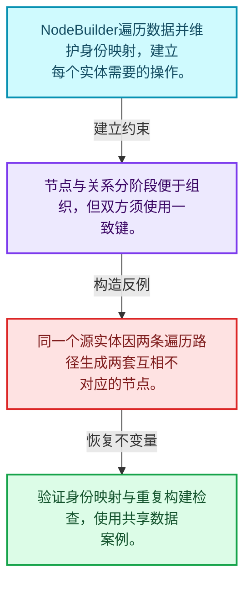
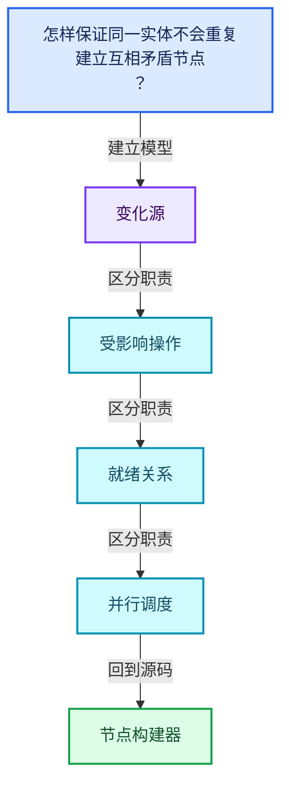
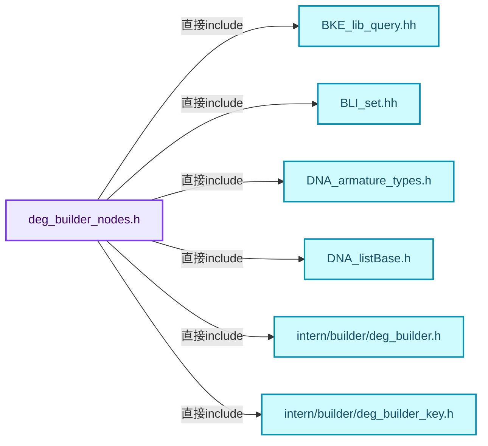
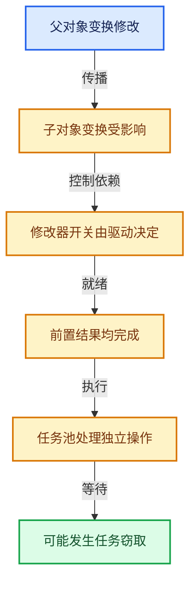

# 11-03 节点构建器

[方向导航](README.md) · [总目录](../README.md) · [覆盖索引](../%E6%BA%90%E7%A0%81%E7%89%88%E6%9C%AC%E4%B8%8E%E8%A6%86%E7%9B%96%E7%B4%A2%E5%BC%95.md)

> 阅读顺序：问题与数据模型 → 语法与类型 → 源码逐行 → 调用线索 → 历史与取舍 → 推演和练习。

- 基准 HEAD：`cbda6b96c26c0dee3c3b5cbb93960c4ac06a6b30`。
- 记录日期：2026-10-14。
- 教学示例状态：正文中的推演不是本机性能实测；已运行练习见验收报告。

## 一、从问题到设计

怎样保证同一实体不会重复建立互相矛盾节点？

构建器管理身份映射与遍历状态，创建节点和连接关系分阶段组织。

本篇把语法、数据语义和系统取舍连接起来。标记更新、判断需求、依赖满足和任务执行是分开的阶段。

### 本篇独立模型与设计推理

NodeBuilder遍历数据并维护身份映射，建立每个实体需要的操作。

设计取舍：节点与关系分阶段便于组织，但双方须使用一致键。

最小反例：同一个源实体因两条遍历路径生成两套互相不对应的节点。

推导与处理：验证身份映射与重复构建检查，使用共享数据案例。



### 源码范围与相邻篇章

| 文件 | 本篇逐行范围 | 基准SHA-256 |
|---|---|---|
| [source/blender/depsgraph/intern/builder/deg_builder_nodes.h](../../../../../source/blender/depsgraph/intern/builder/deg_builder_nodes.h) | L1—L360 | `b73c14b3c8069601303a13906f6840a89fca4ca5f9e19a62a486026635b042a9` |
| [source/blender/depsgraph/intern/builder/deg_builder_nodes.cc](../../../../../source/blender/depsgraph/intern/builder/deg_builder_nodes.cc) | L1—L2520 | `3fbf24a0b3145e319b174601562c77845e1cb382f9d5cbe869eca7beea4f01f0` |

同一主讲文件可能分多篇覆盖；超出本篇范围的符号通过覆盖索引定位。空行与纯注释保留在源码摘录中，逐行表解释有效语句与语法边界；许可证头统一保留。

前篇：[ID组件与操作节点](02-ID%E7%BB%84%E4%BB%B6%E4%B8%8E%E6%93%8D%E4%BD%9C%E8%8A%82%E7%82%B9.md).

后篇：[关系构建器](04-%E5%85%B3%E7%B3%BB%E6%9E%84%E5%BB%BA%E5%99%A8.md).

## 二、类型、数据与阅读地图



这是概念依赖图，边表示阅读关系，不声称是运行时调用顺序。

### 直接编译依赖



箭头只表示头文件包含关系；完整调用线索见后面的符号定位表。

## 三、关键词、语法与类型角色

### 模板 template

模板把类型或常量作为生成实现的参数。读声明时先列出类型参数、非类型参数和默认值，再看使用者实际实例化了什么。模板声明本身不意味着每种T都支持其全部成员。

具体检查：把T替换为int、string、只能移动的类型，分别检查每个被调用操作是否成立。

### 依赖名称 typename

typename既可引入类型模板参数，也可告诉编译器某个依赖名称是类型。它不创建运行时对象；解析期确认语法类别与实例化期检查具体类型是不同阶段。

具体检查：区分typename T::value_type和T::size()，前者标记类型，后者是表达式。

### 只读限定 const

const约束当前访问路径可做的修改。const指针、指向const的指针、const视图对象、const元素是不同位置的限定；其他别名可能仍可修改原对象。

具体检查：分别写T* const、const T*与const T* const，并画出不可修改的层次。

### 移动转换 std::move

std::move把表达式转换为可供移动重载选择的值类别，实际资源转移发生在被选中的构造或赋值中。对const对象move可能仍调用复制，对视图move也不会获得底层数据所有权。

具体检查：记录移动构造调用次数，不用变量名或std::move的出现次数替代测量。

### 异常边界 try与catch

try定义异常传播的局部边界。失败路径需要销毁已经成功构造的部分并释放相应存储；未构造的对象不能被析构。

具体检查：在第k次构造失败，列出已经存在的对象集合与待释放缓冲。

### 显式静态转换 static_cast

static_cast表达编译期允许的转换，不会自动验证运行时真实类型、指针寿命或索引边界。由void指针恢复T指针时，调用者仍须保证实际存储中确有合法T对象。

具体检查：标出转换前后的类型以及正确性依据来自哪里。

### 表示层转换 reinterpret_cast

reinterpret_cast不能自动开始任意对象的生命周期，也不能豁免对齐和别名规则。读这类代码需要追溯原始分配与实际构造操作。

具体检查：分别检查大小、对齐、生命周期和可访问类型，四项不能互相替代。

### 运行时多态 virtual

虚调用根据实际动态类型选择实现；经基类指针销毁对象时通常需要相应虚析构契约。每元素虚调用和循环外一次分派有不同开销。

具体检查：找出虚接口的实现类和调用频率，再讨论是否值得去虚拟化。

### 覆写检查 override

override要求函数确实覆盖基类虚函数，可捕获参数类型和const限定不匹配。它不改变基类规定的生命周期或线程约束。

具体检查：故意改变一个参数或const，观察编译器如何拒绝误写的新函数。

### 构造与new表达式

普通new可能分配并构造；placement new在给定地址构造，存储由其他机制提供。失败回滚应区分两类责任。

具体检查：追踪地址来自哪里、构造何时成功、由谁析构、由谁释放。

### 内部断言 assert

断言表达开发者预期成立的内部契约，发布构建可能关闭。它不能替代对不可信输入的完整错误处理，也不保证后续操作被运行时保护。

具体检查：对每条断言构造违反条件的输入，区分调用者错误与应向用户报告的错误。

### 受控访问 friend

friend授予指定函数或类访问非公开成员的权限，并不意味着继承，也不自动扩展到友元的派生类。

具体检查：解释执行器为何需要访问包装器的内部映射，同时检查边界是否仍清楚。

### 类型别名 using

类型别名为已有类型建立名字，不创建运行期对象。它常把模板内部使用的类型统一暴露给泛型调用者。

具体检查：展开别名直到基础类型，区分类型别名和变量声明。

## 四、真实源码与逐行讲解

源码块保持原行内容，原始行号由小节标题及逐行表给出。表中的调用定位是静态阅读辅助；重载、模板实例化、宏展开和虚调用需结合完整声明，不能仅凭词法出现证明动态调用。

### deg_builder_nodes.h：L1—L48

<!-- source:source/blender/depsgraph/intern/builder/deg_builder_nodes.h:1:48 -->

```cpp
/* SPDX-FileCopyrightText: 2013 Blender Authors
 *
 * SPDX-License-Identifier: GPL-2.0-or-later */

/** \file
 * \ingroup depsgraph
 */

#pragma once

#include "BKE_lib_query.hh" /* For LibraryForeachIDCallbackFlag enum. */

#include "BLI_set.hh"

#include "DNA_armature_types.h"
#include "DNA_listBase.h"

#include "intern/builder/deg_builder.h"
#include "intern/builder/deg_builder_key.h"
#include "intern/builder/deg_builder_map.h"
#include "intern/depsgraph_type.hh"
#include "intern/node/deg_node_id.hh"
#include "intern/node/deg_node_operation.hh"

#include "DEG_depsgraph.hh"

namespace blender {

struct BoneCollection;
struct CacheFile;
struct Camera;
struct Collection;
struct FCurve;
struct FreestyleLineSet;
struct FreestyleLineStyle;
struct ID;
struct IDProperty;
struct Image;
struct Key;
struct LayerCollection;
struct Light;
struct LightProbe;
struct Main;
struct Mask;
struct Material;
struct MovieClip;
struct NlaStrip;
struct Object;
```

| 原始行 | 语义、约束与检查 |
|---|---|
| L9 | 防止同一头文件在一个翻译单元中重复展开；不控制多个源文件之间的链接或对象寿命。 |
| L11 | 引入编译依赖 "BKE_lib_query.hh"；这是声明可见性关系，不表示运行时一定调用该文件的所有接口。 |
| L13 | 引入编译依赖 "BLI_set.hh"；这是声明可见性关系，不表示运行时一定调用该文件的所有接口。 |
| L15 | 引入编译依赖 "DNA_armature_types.h"；这是声明可见性关系，不表示运行时一定调用该文件的所有接口。 |
| L16 | 引入编译依赖 "DNA_listBase.h"；这是声明可见性关系，不表示运行时一定调用该文件的所有接口。 |
| L18 | 引入编译依赖 "intern/builder/deg_builder.h"；这是声明可见性关系，不表示运行时一定调用该文件的所有接口。 |
| L19 | 引入编译依赖 "intern/builder/deg_builder_key.h"；这是声明可见性关系，不表示运行时一定调用该文件的所有接口。 |
| L20 | 引入编译依赖 "intern/builder/deg_builder_map.h"；这是声明可见性关系，不表示运行时一定调用该文件的所有接口。 |
| L21 | 引入编译依赖 "intern/depsgraph_type.hh"；这是声明可见性关系，不表示运行时一定调用该文件的所有接口。 |
| L22 | 引入编译依赖 "intern/node/deg_node_id.hh"；这是声明可见性关系，不表示运行时一定调用该文件的所有接口。 |
| L23 | 引入编译依赖 "intern/node/deg_node_operation.hh"；这是声明可见性关系，不表示运行时一定调用该文件的所有接口。 |
| L25 | 引入编译依赖 "DEG_depsgraph.hh"；这是声明可见性关系，不表示运行时一定调用该文件的所有接口。 |
| L27 | 把后续声明放入 blender 命名空间，影响名称查找和符号归属，不创建运行时对象。 |
| L29 | 声明或定义类型 `struct BoneCollection`。结合继承、访问权限和成员布局确认接口与拥有关系；前向声明本身没有完整对象布局。 |
| L30 | 声明或定义类型 `struct CacheFile`。结合继承、访问权限和成员布局确认接口与拥有关系；前向声明本身没有完整对象布局。 |
| L31 | 声明或定义类型 `struct Camera`。结合继承、访问权限和成员布局确认接口与拥有关系；前向声明本身没有完整对象布局。 |
| L32 | 声明或定义类型 `struct Collection`。结合继承、访问权限和成员布局确认接口与拥有关系；前向声明本身没有完整对象布局。 |
| L33 | 声明或定义类型 `struct FCurve`。结合继承、访问权限和成员布局确认接口与拥有关系；前向声明本身没有完整对象布局。 |
| L34 | 声明或定义类型 `struct FreestyleLineSet`。结合继承、访问权限和成员布局确认接口与拥有关系；前向声明本身没有完整对象布局。 |
| L35 | 声明或定义类型 `struct FreestyleLineStyle`。结合继承、访问权限和成员布局确认接口与拥有关系；前向声明本身没有完整对象布局。 |
| L36 | 声明或定义类型 `struct ID`。结合继承、访问权限和成员布局确认接口与拥有关系；前向声明本身没有完整对象布局。 |
| L37 | 声明或定义类型 `struct IDProperty`。结合继承、访问权限和成员布局确认接口与拥有关系；前向声明本身没有完整对象布局。 |
| L38 | 声明或定义类型 `struct Image`。结合继承、访问权限和成员布局确认接口与拥有关系；前向声明本身没有完整对象布局。 |
| L39 | 声明或定义类型 `struct Key`。结合继承、访问权限和成员布局确认接口与拥有关系；前向声明本身没有完整对象布局。 |
| L40 | 声明或定义类型 `struct LayerCollection`。结合继承、访问权限和成员布局确认接口与拥有关系；前向声明本身没有完整对象布局。 |
| L41 | 声明或定义类型 `struct Light`。结合继承、访问权限和成员布局确认接口与拥有关系；前向声明本身没有完整对象布局。 |
| L42 | 声明或定义类型 `struct LightProbe`。结合继承、访问权限和成员布局确认接口与拥有关系；前向声明本身没有完整对象布局。 |
| L43 | 声明或定义类型 `struct Main`。结合继承、访问权限和成员布局确认接口与拥有关系；前向声明本身没有完整对象布局。 |
| L44 | 声明或定义类型 `struct Mask`。结合继承、访问权限和成员布局确认接口与拥有关系；前向声明本身没有完整对象布局。 |
| L45 | 声明或定义类型 `struct Material`。结合继承、访问权限和成员布局确认接口与拥有关系；前向声明本身没有完整对象布局。 |
| L46 | 声明或定义类型 `struct MovieClip`。结合继承、访问权限和成员布局确认接口与拥有关系；前向声明本身没有完整对象布局。 |
| L47 | 声明或定义类型 `struct NlaStrip`。结合继承、访问权限和成员布局确认接口与拥有关系；前向声明本身没有完整对象布局。 |
| L48 | 声明或定义类型 `struct Object`。结合继承、访问权限和成员布局确认接口与拥有关系；前向声明本身没有完整对象布局。 |

### deg_builder_nodes.h：L49—L95

<!-- source:source/blender/depsgraph/intern/builder/deg_builder_nodes.h:49:95 -->

```cpp
struct ParticleSettings;
struct Scene;
struct Speaker;
struct Tex;
struct VFont;
struct World;
struct bAction;
struct bArmature;
struct bConstraint;
struct bNodeSocket;
struct bNodeTree;
struct bPoseChannel;
struct bSound;
struct PointerRNA;

namespace deg {

struct ComponentNode;
struct Depsgraph;
class DepsgraphBuilderCache;
struct IDNode;
struct OperationKey;
struct OperationNode;
struct TimeSourceNode;

class DepsgraphNodeBuilder : public DepsgraphBuilder {
 public:
  DepsgraphNodeBuilder(Main *bmain, Depsgraph *graph, DepsgraphBuilderCache *cache);
  ~DepsgraphNodeBuilder() override;

  /* For given original ID get ID which is created by copy-on-evaluation system. */
  ID *get_cow_id(const ID *id_orig) const;
  /* Similar to above, but for the cases when there is no ID node we create
   * one. */
  ID *ensure_cow_id(ID *id_orig);

  /* Helper wrapper function which wraps get_cow_id with a needed type cast. */
  template<typename T> T *get_cow_datablock(const T *orig) const
  {
    return (T *)get_cow_id(&orig->id);
  }

  /* For a given evaluated datablock get corresponding original one. */
  template<typename T> T *get_orig_datablock(const T *cow) const
  {
    return (T *)cow->id.orig_id;
  }
```

| 原始行 | 语义、约束与检查 |
|---|---|
| L49 | 声明或定义类型 `struct ParticleSettings`。结合继承、访问权限和成员布局确认接口与拥有关系；前向声明本身没有完整对象布局。 |
| L50 | 声明或定义类型 `struct Scene`。结合继承、访问权限和成员布局确认接口与拥有关系；前向声明本身没有完整对象布局。 |
| L51 | 声明或定义类型 `struct Speaker`。结合继承、访问权限和成员布局确认接口与拥有关系；前向声明本身没有完整对象布局。 |
| L52 | 声明或定义类型 `struct Tex`。结合继承、访问权限和成员布局确认接口与拥有关系；前向声明本身没有完整对象布局。 |
| L53 | 声明或定义类型 `struct VFont`。结合继承、访问权限和成员布局确认接口与拥有关系；前向声明本身没有完整对象布局。 |
| L54 | 声明或定义类型 `struct World`。结合继承、访问权限和成员布局确认接口与拥有关系；前向声明本身没有完整对象布局。 |
| L55 | 声明或定义类型 `struct bAction`。结合继承、访问权限和成员布局确认接口与拥有关系；前向声明本身没有完整对象布局。 |
| L56 | 声明或定义类型 `struct bArmature`。结合继承、访问权限和成员布局确认接口与拥有关系；前向声明本身没有完整对象布局。 |
| L57 | 声明或定义类型 `struct bConstraint`。结合继承、访问权限和成员布局确认接口与拥有关系；前向声明本身没有完整对象布局。 |
| L58 | 声明或定义类型 `struct bNodeSocket`。结合继承、访问权限和成员布局确认接口与拥有关系；前向声明本身没有完整对象布局。 |
| L59 | 声明或定义类型 `struct bNodeTree`。结合继承、访问权限和成员布局确认接口与拥有关系；前向声明本身没有完整对象布局。 |
| L60 | 声明或定义类型 `struct bPoseChannel`。结合继承、访问权限和成员布局确认接口与拥有关系；前向声明本身没有完整对象布局。 |
| L61 | 声明或定义类型 `struct bSound`。结合继承、访问权限和成员布局确认接口与拥有关系；前向声明本身没有完整对象布局。 |
| L62 | 声明或定义类型 `struct PointerRNA`。结合继承、访问权限和成员布局确认接口与拥有关系；前向声明本身没有完整对象布局。 |
| L64 | 把后续声明放入 deg 命名空间，影响名称查找和符号归属，不创建运行时对象。 |
| L66 | 声明或定义类型 `struct ComponentNode`。结合继承、访问权限和成员布局确认接口与拥有关系；前向声明本身没有完整对象布局。 |
| L67 | 声明或定义类型 `struct Depsgraph`。结合继承、访问权限和成员布局确认接口与拥有关系；前向声明本身没有完整对象布局。 |
| L68 | 声明或定义类型 `class DepsgraphBuilderCache`。结合继承、访问权限和成员布局确认接口与拥有关系；前向声明本身没有完整对象布局。 |
| L69 | 声明或定义类型 `struct IDNode`。结合继承、访问权限和成员布局确认接口与拥有关系；前向声明本身没有完整对象布局。 |
| L70 | 声明或定义类型 `struct OperationKey`。结合继承、访问权限和成员布局确认接口与拥有关系；前向声明本身没有完整对象布局。 |
| L71 | 声明或定义类型 `struct OperationNode`。结合继承、访问权限和成员布局确认接口与拥有关系；前向声明本身没有完整对象布局。 |
| L72 | 声明或定义类型 `struct TimeSourceNode`。结合继承、访问权限和成员布局确认接口与拥有关系；前向声明本身没有完整对象布局。 |
| L74 | 声明或定义类型 `class DepsgraphNodeBuilder : public DepsgraphBuilder`。结合继承、访问权限和成员布局确认接口与拥有关系；前向声明本身没有完整对象布局。 |
| L75 | 切换成员访问权限为 public；它是编译期接口边界，不是线程同步或内存保护。 |
| L76 | 出现调用或函数声明 `DepsgraphNodeBuilder`，对应表达式为 `DepsgraphNodeBuilder(Main *bmain, Depsgraph *graph, DepsgraphBuilderCache *cache);`。参数求值、返回类型与重载需结合前后完整语句；静态文本引用不能证明动态目标。 |
| L77 | 涉及析构接口或显式析构：`~DepsgraphNodeBuilder() override;`。检查目标对象已成功构造，且资源不会在另一条清理路径再次销毁。 |
| L80 | 声明接口 `ID *get_cow_id(const ID *id_orig) const`，本行没有对应函数体；返回类型、参数限定和const/noexcept共同组成调用契约，实际行为需继续定位实现。 |
| L83 | 出现调用或函数声明 `ensure_cow_id`，对应表达式为 `ID *ensure_cow_id(ID *id_orig);`。参数求值、返回类型与重载需结合前后完整语句；静态文本引用不能证明动态目标。 |
| L86 | 声明模板参数 `template<typename T> T *get_cow_datablock(const T *orig) const`。类型参数决定生成操作的类型，非类型参数可决定内嵌容量或编译期分支。 |
| L87 | 连接上一行的声明或控制结构与其语句块；后续行在这个作用域中执行或声明。 |
| L88 | 返回表达式 `(T *)get_cow_id(&orig->id)`。 |
| L89 | 结束当前语法单元。局部自动对象在离开其作用域时按规则销毁；这不等于所有被引用的外部数据也被释放。 |
| L92 | 声明模板参数 `template<typename T> T *get_orig_datablock(const T *cow) const`。类型参数决定生成操作的类型，非类型参数可决定内嵌容量或编译期分支。 |
| L93 | 连接上一行的声明或控制结构与其语句块；后续行在这个作用域中执行或声明。 |
| L94 | 返回表达式 `(T *)cow->id.orig_id`。 |
| L95 | 结束当前语法单元。局部自动对象在离开其作用域时按规则销毁；这不等于所有被引用的外部数据也被释放。 |

### deg_builder_nodes.h：L96—L144

<!-- source:source/blender/depsgraph/intern/builder/deg_builder_nodes.h:96:144 -->

```cpp

  virtual void begin_build();
  virtual void end_build();

  /**
   * `id_cow_self` is the user of `id_pointer`,
   * see also `LibraryIDLinkCallbackData` struct definition.
   */
  int foreach_id_cow_detect_need_for_update_callback(ID *id_cow_self, ID *id_pointer);

  IDNode *add_id_node(ID *id);
  IDNode *find_id_node(const ID *id);
  TimeSourceNode *add_time_source();

  ComponentNode *add_component_node(ID *id, NodeType comp_type, const char *comp_name = "");
  ComponentNode *find_component_node(const ID *id, NodeType comp_type, const char *comp_name = "");

  OperationNode *add_operation_node(ComponentNode *comp_node,
                                    OperationCode opcode,
                                    const DepsEvalOperationCb &op = nullptr,
                                    const char *name = "",
                                    int name_tag = -1);
  OperationNode *add_operation_node(ID *id,
                                    NodeType comp_type,
                                    const char *comp_name,
                                    OperationCode opcode,
                                    const DepsEvalOperationCb &op = nullptr,
                                    const char *name = "",
                                    int name_tag = -1);
  OperationNode *add_operation_node(ID *id,
                                    NodeType comp_type,
                                    OperationCode opcode,
                                    const DepsEvalOperationCb &op = nullptr,
                                    const char *name = "",
                                    int name_tag = -1);

  OperationNode *ensure_operation_node(ID *id,
                                       NodeType comp_type,
                                       const char *comp_name,
                                       OperationCode opcode,
                                       const DepsEvalOperationCb &op = nullptr,
                                       const char *name = "",
                                       int name_tag = -1);
  OperationNode *ensure_operation_node(ID *id,
                                       NodeType comp_type,
                                       OperationCode opcode,
                                       const DepsEvalOperationCb &op = nullptr,
                                       const char *name = "",
                                       int name_tag = -1);
```

| 原始行 | 语义、约束与检查 |
|---|---|
| L97 | 声明接口 `virtual void begin_build()`，本行没有对应函数体；返回类型、参数限定和const/noexcept共同组成调用契约，实际行为需继续定位实现。 |
| L98 | 声明接口 `virtual void end_build()`，本行没有对应函数体；返回类型、参数限定和const/noexcept共同组成调用契约，实际行为需继续定位实现。 |
| L104 | 声明接口 `int foreach_id_cow_detect_need_for_update_callback(ID *id_cow_self, ID *id_pointer)`，本行没有对应函数体；返回类型、参数限定和const/noexcept共同组成调用契约，实际行为需继续定位实现。 |
| L106 | 出现调用或函数声明 `add_id_node`，对应表达式为 `IDNode *add_id_node(ID *id);`。参数求值、返回类型与重载需结合前后完整语句；静态文本引用不能证明动态目标。 |
| L107 | 出现调用或函数声明 `find_id_node`，对应表达式为 `IDNode *find_id_node(const ID *id);`。参数求值、返回类型与重载需结合前后完整语句；静态文本引用不能证明动态目标。 |
| L108 | 出现调用或函数声明 `add_time_source`，对应表达式为 `TimeSourceNode *add_time_source();`。参数求值、返回类型与重载需结合前后完整语句；静态文本引用不能证明动态目标。 |
| L110 | 把右侧 `"")` 用于初始化或更新左侧 `ComponentNode *add_component_node(ID *id, NodeType comp_type, const char *comp_name`。声明初始化与已有对象赋值应按上下文区分；有资源的类型会调用相应特殊成员。 |
| L111 | 把右侧 `"")` 用于初始化或更新左侧 `ComponentNode *find_component_node(const ID *id, NodeType comp_type, const char *comp_name`。声明初始化与已有对象赋值应按上下文区分；有资源的类型会调用相应特殊成员。 |
| L113 | 出现调用或函数声明 `add_operation_node`，对应表达式为 `OperationNode *add_operation_node(ComponentNode *comp_node,`。参数求值、返回类型与重载需结合前后完整语句；静态文本引用不能证明动态目标。 |
| L114 | 本行是连续声明或表达式的一部分：`OperationCode opcode,`。与本段前后行合读；逗号、括号和限定符决定它属于参数、初始化列表还是实际计算。 |
| L115 | 把右侧 `nullptr,` 用于初始化或更新左侧 `const DepsEvalOperationCb &op`。声明初始化与已有对象赋值应按上下文区分；有资源的类型会调用相应特殊成员。 |
| L116 | 把右侧 `"",` 用于初始化或更新左侧 `const char *name`。声明初始化与已有对象赋值应按上下文区分；有资源的类型会调用相应特殊成员。 |
| L117 | 把右侧 `-1)` 用于初始化或更新左侧 `int name_tag`。声明初始化与已有对象赋值应按上下文区分；有资源的类型会调用相应特殊成员。 |
| L118 | 出现调用或函数声明 `add_operation_node`，对应表达式为 `OperationNode *add_operation_node(ID *id,`。参数求值、返回类型与重载需结合前后完整语句；静态文本引用不能证明动态目标。 |
| L119 | 本行是连续声明或表达式的一部分：`NodeType comp_type,`。与本段前后行合读；逗号、括号和限定符决定它属于参数、初始化列表还是实际计算。 |
| L120 | 本行是连续声明或表达式的一部分：`const char *comp_name,`。与本段前后行合读；逗号、括号和限定符决定它属于参数、初始化列表还是实际计算。 |
| L121 | 本行是连续声明或表达式的一部分：`OperationCode opcode,`。与本段前后行合读；逗号、括号和限定符决定它属于参数、初始化列表还是实际计算。 |
| L122 | 把右侧 `nullptr,` 用于初始化或更新左侧 `const DepsEvalOperationCb &op`。声明初始化与已有对象赋值应按上下文区分；有资源的类型会调用相应特殊成员。 |
| L123 | 把右侧 `"",` 用于初始化或更新左侧 `const char *name`。声明初始化与已有对象赋值应按上下文区分；有资源的类型会调用相应特殊成员。 |
| L124 | 把右侧 `-1)` 用于初始化或更新左侧 `int name_tag`。声明初始化与已有对象赋值应按上下文区分；有资源的类型会调用相应特殊成员。 |
| L125 | 出现调用或函数声明 `add_operation_node`，对应表达式为 `OperationNode *add_operation_node(ID *id,`。参数求值、返回类型与重载需结合前后完整语句；静态文本引用不能证明动态目标。 |
| L126 | 本行是连续声明或表达式的一部分：`NodeType comp_type,`。与本段前后行合读；逗号、括号和限定符决定它属于参数、初始化列表还是实际计算。 |
| L127 | 本行是连续声明或表达式的一部分：`OperationCode opcode,`。与本段前后行合读；逗号、括号和限定符决定它属于参数、初始化列表还是实际计算。 |
| L128 | 把右侧 `nullptr,` 用于初始化或更新左侧 `const DepsEvalOperationCb &op`。声明初始化与已有对象赋值应按上下文区分；有资源的类型会调用相应特殊成员。 |
| L129 | 把右侧 `"",` 用于初始化或更新左侧 `const char *name`。声明初始化与已有对象赋值应按上下文区分；有资源的类型会调用相应特殊成员。 |
| L130 | 把右侧 `-1)` 用于初始化或更新左侧 `int name_tag`。声明初始化与已有对象赋值应按上下文区分；有资源的类型会调用相应特殊成员。 |
| L132 | 出现调用或函数声明 `ensure_operation_node`，对应表达式为 `OperationNode *ensure_operation_node(ID *id,`。参数求值、返回类型与重载需结合前后完整语句；静态文本引用不能证明动态目标。 |
| L133 | 本行是连续声明或表达式的一部分：`NodeType comp_type,`。与本段前后行合读；逗号、括号和限定符决定它属于参数、初始化列表还是实际计算。 |
| L134 | 本行是连续声明或表达式的一部分：`const char *comp_name,`。与本段前后行合读；逗号、括号和限定符决定它属于参数、初始化列表还是实际计算。 |
| L135 | 本行是连续声明或表达式的一部分：`OperationCode opcode,`。与本段前后行合读；逗号、括号和限定符决定它属于参数、初始化列表还是实际计算。 |
| L136 | 把右侧 `nullptr,` 用于初始化或更新左侧 `const DepsEvalOperationCb &op`。声明初始化与已有对象赋值应按上下文区分；有资源的类型会调用相应特殊成员。 |
| L137 | 把右侧 `"",` 用于初始化或更新左侧 `const char *name`。声明初始化与已有对象赋值应按上下文区分；有资源的类型会调用相应特殊成员。 |
| L138 | 把右侧 `-1)` 用于初始化或更新左侧 `int name_tag`。声明初始化与已有对象赋值应按上下文区分；有资源的类型会调用相应特殊成员。 |
| L139 | 出现调用或函数声明 `ensure_operation_node`，对应表达式为 `OperationNode *ensure_operation_node(ID *id,`。参数求值、返回类型与重载需结合前后完整语句；静态文本引用不能证明动态目标。 |
| L140 | 本行是连续声明或表达式的一部分：`NodeType comp_type,`。与本段前后行合读；逗号、括号和限定符决定它属于参数、初始化列表还是实际计算。 |
| L141 | 本行是连续声明或表达式的一部分：`OperationCode opcode,`。与本段前后行合读；逗号、括号和限定符决定它属于参数、初始化列表还是实际计算。 |
| L142 | 把右侧 `nullptr,` 用于初始化或更新左侧 `const DepsEvalOperationCb &op`。声明初始化与已有对象赋值应按上下文区分；有资源的类型会调用相应特殊成员。 |
| L143 | 把右侧 `"",` 用于初始化或更新左侧 `const char *name`。声明初始化与已有对象赋值应按上下文区分；有资源的类型会调用相应特殊成员。 |
| L144 | 把右侧 `-1)` 用于初始化或更新左侧 `int name_tag`。声明初始化与已有对象赋值应按上下文区分；有资源的类型会调用相应特殊成员。 |

### deg_builder_nodes.h：L145—L192

<!-- source:source/blender/depsgraph/intern/builder/deg_builder_nodes.h:145:192 -->

```cpp

  bool has_operation_node(ID *id,
                          NodeType comp_type,
                          const char *comp_name,
                          OperationCode opcode,
                          const char *name = "",
                          int name_tag = -1);
  bool has_operation_node(ID *id, NodeType comp_type, OperationCode opcode);

  OperationNode *find_operation_node(const ID *id,
                                     NodeType comp_type,
                                     const char *comp_name,
                                     OperationCode opcode,
                                     const char *name = "",
                                     int name_tag = -1);

  OperationNode *find_operation_node(const ID *id,
                                     NodeType comp_type,
                                     OperationCode opcode,
                                     const char *name = "",
                                     int name_tag = -1);

  OperationNode *find_operation_node(const OperationKey &key);

  virtual void build_id(ID *id, bool force_be_visible = false);

  /* Build function for ID types that do not need their own build_xxx() function. */
  virtual void build_generic_id(ID *id);

  virtual void build_idproperties(IDProperty *id_property);

  virtual void build_scene_render(Scene *scene, ViewLayer *view_layer);
  virtual void build_scene_camera(Scene *scene);
  virtual void build_scene_parameters(Scene *scene);
  virtual void build_scene_compositor(Scene *scene);

  virtual void build_empty_object(Object *object);

  virtual void build_layer_collections(ListBaseT<LayerCollection> *lb);
  virtual void build_view_layer(Scene *scene,
                                ViewLayer *view_layer,
                                eDepsNode_LinkedState_Type linked_state);
  virtual void build_collection(LayerCollection *from_layer_collection, Collection *collection);
  virtual void build_object(int base_index,
                            Object *object,
                            eDepsNode_LinkedState_Type linked_state,
                            bool is_visible);
  virtual void build_object_instance_collection(Object *object, bool is_object_visible);
```

| 原始行 | 语义、约束与检查 |
|---|---|
| L146 | 出现调用或函数声明 `has_operation_node`，对应表达式为 `bool has_operation_node(ID *id,`。参数求值、返回类型与重载需结合前后完整语句；静态文本引用不能证明动态目标。 |
| L147 | 本行是连续声明或表达式的一部分：`NodeType comp_type,`。与本段前后行合读；逗号、括号和限定符决定它属于参数、初始化列表还是实际计算。 |
| L148 | 本行是连续声明或表达式的一部分：`const char *comp_name,`。与本段前后行合读；逗号、括号和限定符决定它属于参数、初始化列表还是实际计算。 |
| L149 | 本行是连续声明或表达式的一部分：`OperationCode opcode,`。与本段前后行合读；逗号、括号和限定符决定它属于参数、初始化列表还是实际计算。 |
| L150 | 把右侧 `"",` 用于初始化或更新左侧 `const char *name`。声明初始化与已有对象赋值应按上下文区分；有资源的类型会调用相应特殊成员。 |
| L151 | 把右侧 `-1)` 用于初始化或更新左侧 `int name_tag`。声明初始化与已有对象赋值应按上下文区分；有资源的类型会调用相应特殊成员。 |
| L152 | 声明接口 `bool has_operation_node(ID *id, NodeType comp_type, OperationCode opcode)`，本行没有对应函数体；返回类型、参数限定和const/noexcept共同组成调用契约，实际行为需继续定位实现。 |
| L154 | 出现调用或函数声明 `find_operation_node`，对应表达式为 `OperationNode *find_operation_node(const ID *id,`。参数求值、返回类型与重载需结合前后完整语句；静态文本引用不能证明动态目标。 |
| L155 | 本行是连续声明或表达式的一部分：`NodeType comp_type,`。与本段前后行合读；逗号、括号和限定符决定它属于参数、初始化列表还是实际计算。 |
| L156 | 本行是连续声明或表达式的一部分：`const char *comp_name,`。与本段前后行合读；逗号、括号和限定符决定它属于参数、初始化列表还是实际计算。 |
| L157 | 本行是连续声明或表达式的一部分：`OperationCode opcode,`。与本段前后行合读；逗号、括号和限定符决定它属于参数、初始化列表还是实际计算。 |
| L158 | 把右侧 `"",` 用于初始化或更新左侧 `const char *name`。声明初始化与已有对象赋值应按上下文区分；有资源的类型会调用相应特殊成员。 |
| L159 | 把右侧 `-1)` 用于初始化或更新左侧 `int name_tag`。声明初始化与已有对象赋值应按上下文区分；有资源的类型会调用相应特殊成员。 |
| L161 | 出现调用或函数声明 `find_operation_node`，对应表达式为 `OperationNode *find_operation_node(const ID *id,`。参数求值、返回类型与重载需结合前后完整语句；静态文本引用不能证明动态目标。 |
| L162 | 本行是连续声明或表达式的一部分：`NodeType comp_type,`。与本段前后行合读；逗号、括号和限定符决定它属于参数、初始化列表还是实际计算。 |
| L163 | 本行是连续声明或表达式的一部分：`OperationCode opcode,`。与本段前后行合读；逗号、括号和限定符决定它属于参数、初始化列表还是实际计算。 |
| L164 | 把右侧 `"",` 用于初始化或更新左侧 `const char *name`。声明初始化与已有对象赋值应按上下文区分；有资源的类型会调用相应特殊成员。 |
| L165 | 把右侧 `-1)` 用于初始化或更新左侧 `int name_tag`。声明初始化与已有对象赋值应按上下文区分；有资源的类型会调用相应特殊成员。 |
| L167 | 出现调用或函数声明 `find_operation_node`，对应表达式为 `OperationNode *find_operation_node(const OperationKey &key);`。参数求值、返回类型与重载需结合前后完整语句；静态文本引用不能证明动态目标。 |
| L169 | 把右侧 `false)` 用于初始化或更新左侧 `virtual void build_id(ID *id, bool force_be_visible`。声明初始化与已有对象赋值应按上下文区分；有资源的类型会调用相应特殊成员。 |
| L172 | 声明接口 `virtual void build_generic_id(ID *id)`，本行没有对应函数体；返回类型、参数限定和const/noexcept共同组成调用契约，实际行为需继续定位实现。 |
| L174 | 声明接口 `virtual void build_idproperties(IDProperty *id_property)`，本行没有对应函数体；返回类型、参数限定和const/noexcept共同组成调用契约，实际行为需继续定位实现。 |
| L176 | 声明接口 `virtual void build_scene_render(Scene *scene, ViewLayer *view_layer)`，本行没有对应函数体；返回类型、参数限定和const/noexcept共同组成调用契约，实际行为需继续定位实现。 |
| L177 | 声明接口 `virtual void build_scene_camera(Scene *scene)`，本行没有对应函数体；返回类型、参数限定和const/noexcept共同组成调用契约，实际行为需继续定位实现。 |
| L178 | 声明接口 `virtual void build_scene_parameters(Scene *scene)`，本行没有对应函数体；返回类型、参数限定和const/noexcept共同组成调用契约，实际行为需继续定位实现。 |
| L179 | 声明接口 `virtual void build_scene_compositor(Scene *scene)`，本行没有对应函数体；返回类型、参数限定和const/noexcept共同组成调用契约，实际行为需继续定位实现。 |
| L181 | 声明接口 `virtual void build_empty_object(Object *object)`，本行没有对应函数体；返回类型、参数限定和const/noexcept共同组成调用契约，实际行为需继续定位实现。 |
| L183 | 声明接口 `virtual void build_layer_collections(ListBaseT<LayerCollection> *lb)`，本行没有对应函数体；返回类型、参数限定和const/noexcept共同组成调用契约，实际行为需继续定位实现。 |
| L184 | 出现调用或函数声明 `build_view_layer`，对应表达式为 `virtual void build_view_layer(Scene *scene,`。参数求值、返回类型与重载需结合前后完整语句；静态文本引用不能证明动态目标。 |
| L185 | 本行是连续声明或表达式的一部分：`ViewLayer *view_layer,`。与本段前后行合读；逗号、括号和限定符决定它属于参数、初始化列表还是实际计算。 |
| L186 | 声明成员、局部对象或完成语句 `eDepsNode_LinkedState_Type linked_state)`。若为指针或引用，它本身不说明拥有；若为值对象，其构造析构由所在作用域或外层对象管理。 |
| L187 | 声明接口 `virtual void build_collection(LayerCollection *from_layer_collection, Collection *collection)`，本行没有对应函数体；返回类型、参数限定和const/noexcept共同组成调用契约，实际行为需继续定位实现。 |
| L188 | 出现调用或函数声明 `build_object`，对应表达式为 `virtual void build_object(int base_index,`。参数求值、返回类型与重载需结合前后完整语句；静态文本引用不能证明动态目标。 |
| L189 | 本行是连续声明或表达式的一部分：`Object *object,`。与本段前后行合读；逗号、括号和限定符决定它属于参数、初始化列表还是实际计算。 |
| L190 | 本行是连续声明或表达式的一部分：`eDepsNode_LinkedState_Type linked_state,`。与本段前后行合读；逗号、括号和限定符决定它属于参数、初始化列表还是实际计算。 |
| L191 | 声明成员、局部对象或完成语句 `bool is_visible)`。若为指针或引用，它本身不说明拥有；若为值对象，其构造析构由所在作用域或外层对象管理。 |
| L192 | 声明接口 `virtual void build_object_instance_collection(Object *object, bool is_object_visible)`，本行没有对应函数体；返回类型、参数限定和const/noexcept共同组成调用契约，实际行为需继续定位实现。 |

### deg_builder_nodes.h：L193—L239

<!-- source:source/blender/depsgraph/intern/builder/deg_builder_nodes.h:193:239 -->

```cpp
  virtual void build_object_from_layer(int base_index,
                                       Object *object,
                                       eDepsNode_LinkedState_Type linked_state);
  virtual void build_object_flags(int base_index,
                                  Object *object,
                                  eDepsNode_LinkedState_Type linked_state);
  virtual void build_object_modifiers(Object *object);
  virtual void build_object_data(Object *object);
  virtual void build_object_data_camera(Object *object);
  virtual void build_object_data_geometry(Object *object);
  virtual void build_object_data_geometry_datablock(ID *obdata);
  virtual void build_object_data_light(Object *object);
  virtual void build_object_data_lightprobe(Object *object);
  virtual void build_object_data_speaker(Object *object);
  virtual void build_object_data_grease_pencil(Object *object);
  virtual void build_object_transform(Object *object);
  virtual void build_object_constraints(Object *object);
  virtual void build_object_pointcache(Object *object);
  virtual void build_object_shading(Object *object);

  virtual void build_object_light_linking(Object *object);
  virtual void build_light_linking_collection(Collection *collection);

  virtual void build_pose_constraints(Object *object, bPoseChannel *pchan, int pchan_index);
  virtual void build_rigidbody(Scene *scene);
  virtual void build_particle_systems(Object *object, bool is_object_visible);
  virtual void build_particle_settings(ParticleSettings *part);
  /**
   * Build graph nodes for #AnimData block and any animated images used.
   * \param id: ID-Block which hosts the #AnimData
   */
  virtual void build_animdata(ID *id);
  virtual void build_animdata_nlastrip_targets(ListBaseT<NlaStrip> *strips);
  /**
   * Build graph nodes to update the current frame in image users.
   */
  virtual void build_animation_images(ID *id);
  virtual void build_action(bAction *action);

  virtual void build_animdata_drivers(ID *id, AnimData *adt);
  /**
   * Build graph node(s) for Driver
   * \param id: ID-Block that driver is attached to
   * \param fcurve: Driver-FCurve
   * \param driver_index: Index in animation data drivers list
   */
  virtual void build_driver(ID *id, FCurve *fcurve, int driver_index);
```

| 原始行 | 语义、约束与检查 |
|---|---|
| L193 | 出现调用或函数声明 `build_object_from_layer`，对应表达式为 `virtual void build_object_from_layer(int base_index,`。参数求值、返回类型与重载需结合前后完整语句；静态文本引用不能证明动态目标。 |
| L194 | 本行是连续声明或表达式的一部分：`Object *object,`。与本段前后行合读；逗号、括号和限定符决定它属于参数、初始化列表还是实际计算。 |
| L195 | 声明成员、局部对象或完成语句 `eDepsNode_LinkedState_Type linked_state)`。若为指针或引用，它本身不说明拥有；若为值对象，其构造析构由所在作用域或外层对象管理。 |
| L196 | 出现调用或函数声明 `build_object_flags`，对应表达式为 `virtual void build_object_flags(int base_index,`。参数求值、返回类型与重载需结合前后完整语句；静态文本引用不能证明动态目标。 |
| L197 | 本行是连续声明或表达式的一部分：`Object *object,`。与本段前后行合读；逗号、括号和限定符决定它属于参数、初始化列表还是实际计算。 |
| L198 | 声明成员、局部对象或完成语句 `eDepsNode_LinkedState_Type linked_state)`。若为指针或引用，它本身不说明拥有；若为值对象，其构造析构由所在作用域或外层对象管理。 |
| L199 | 声明接口 `virtual void build_object_modifiers(Object *object)`，本行没有对应函数体；返回类型、参数限定和const/noexcept共同组成调用契约，实际行为需继续定位实现。 |
| L200 | 声明接口 `virtual void build_object_data(Object *object)`，本行没有对应函数体；返回类型、参数限定和const/noexcept共同组成调用契约，实际行为需继续定位实现。 |
| L201 | 声明接口 `virtual void build_object_data_camera(Object *object)`，本行没有对应函数体；返回类型、参数限定和const/noexcept共同组成调用契约，实际行为需继续定位实现。 |
| L202 | 声明接口 `virtual void build_object_data_geometry(Object *object)`，本行没有对应函数体；返回类型、参数限定和const/noexcept共同组成调用契约，实际行为需继续定位实现。 |
| L203 | 声明接口 `virtual void build_object_data_geometry_datablock(ID *obdata)`，本行没有对应函数体；返回类型、参数限定和const/noexcept共同组成调用契约，实际行为需继续定位实现。 |
| L204 | 声明接口 `virtual void build_object_data_light(Object *object)`，本行没有对应函数体；返回类型、参数限定和const/noexcept共同组成调用契约，实际行为需继续定位实现。 |
| L205 | 声明接口 `virtual void build_object_data_lightprobe(Object *object)`，本行没有对应函数体；返回类型、参数限定和const/noexcept共同组成调用契约，实际行为需继续定位实现。 |
| L206 | 声明接口 `virtual void build_object_data_speaker(Object *object)`，本行没有对应函数体；返回类型、参数限定和const/noexcept共同组成调用契约，实际行为需继续定位实现。 |
| L207 | 声明接口 `virtual void build_object_data_grease_pencil(Object *object)`，本行没有对应函数体；返回类型、参数限定和const/noexcept共同组成调用契约，实际行为需继续定位实现。 |
| L208 | 声明接口 `virtual void build_object_transform(Object *object)`，本行没有对应函数体；返回类型、参数限定和const/noexcept共同组成调用契约，实际行为需继续定位实现。 |
| L209 | 声明接口 `virtual void build_object_constraints(Object *object)`，本行没有对应函数体；返回类型、参数限定和const/noexcept共同组成调用契约，实际行为需继续定位实现。 |
| L210 | 声明接口 `virtual void build_object_pointcache(Object *object)`，本行没有对应函数体；返回类型、参数限定和const/noexcept共同组成调用契约，实际行为需继续定位实现。 |
| L211 | 声明接口 `virtual void build_object_shading(Object *object)`，本行没有对应函数体；返回类型、参数限定和const/noexcept共同组成调用契约，实际行为需继续定位实现。 |
| L213 | 声明接口 `virtual void build_object_light_linking(Object *object)`，本行没有对应函数体；返回类型、参数限定和const/noexcept共同组成调用契约，实际行为需继续定位实现。 |
| L214 | 声明接口 `virtual void build_light_linking_collection(Collection *collection)`，本行没有对应函数体；返回类型、参数限定和const/noexcept共同组成调用契约，实际行为需继续定位实现。 |
| L216 | 声明接口 `virtual void build_pose_constraints(Object *object, bPoseChannel *pchan, int pchan_index)`，本行没有对应函数体；返回类型、参数限定和const/noexcept共同组成调用契约，实际行为需继续定位实现。 |
| L217 | 声明接口 `virtual void build_rigidbody(Scene *scene)`，本行没有对应函数体；返回类型、参数限定和const/noexcept共同组成调用契约，实际行为需继续定位实现。 |
| L218 | 声明接口 `virtual void build_particle_systems(Object *object, bool is_object_visible)`，本行没有对应函数体；返回类型、参数限定和const/noexcept共同组成调用契约，实际行为需继续定位实现。 |
| L219 | 声明接口 `virtual void build_particle_settings(ParticleSettings *part)`，本行没有对应函数体；返回类型、参数限定和const/noexcept共同组成调用契约，实际行为需继续定位实现。 |
| L224 | 声明接口 `virtual void build_animdata(ID *id)`，本行没有对应函数体；返回类型、参数限定和const/noexcept共同组成调用契约，实际行为需继续定位实现。 |
| L225 | 声明接口 `virtual void build_animdata_nlastrip_targets(ListBaseT<NlaStrip> *strips)`，本行没有对应函数体；返回类型、参数限定和const/noexcept共同组成调用契约，实际行为需继续定位实现。 |
| L229 | 声明接口 `virtual void build_animation_images(ID *id)`，本行没有对应函数体；返回类型、参数限定和const/noexcept共同组成调用契约，实际行为需继续定位实现。 |
| L230 | 声明接口 `virtual void build_action(bAction *action)`，本行没有对应函数体；返回类型、参数限定和const/noexcept共同组成调用契约，实际行为需继续定位实现。 |
| L232 | 声明接口 `virtual void build_animdata_drivers(ID *id, AnimData *adt)`，本行没有对应函数体；返回类型、参数限定和const/noexcept共同组成调用契约，实际行为需继续定位实现。 |
| L239 | 声明接口 `virtual void build_driver(ID *id, FCurve *fcurve, int driver_index)`，本行没有对应函数体；返回类型、参数限定和const/noexcept共同组成调用契约，实际行为需继续定位实现。 |

### deg_builder_nodes.h：L240—L287

<!-- source:source/blender/depsgraph/intern/builder/deg_builder_nodes.h:240:287 -->

```cpp

  virtual void build_driver_variables(ID *id, FCurve *fcurve);
  virtual void build_driver_scene_camera_variable(Scene *scene, const char *camera_path);

  /* Build operations of a property value from which is read by a driver target.
   *
   * The driver target points to a data-block (or a sub-data-block like View Layer).
   * This data-block is presented in the interface as a "Prop" and its resolved RNA pointer is
   * passed here as `target_prop`.
   *
   * The tricky part (and a bit confusing naming) is that the driver target accesses a property of
   * the `target_prop` to get its value. The property which is read to give an actual target value
   * is denoted by its RNA path relative to the `target_prop`. In the interface it is called "Path"
   * and here it is called `rna_path_from_target_prop`. */
  virtual void build_driver_id_property(const PointerRNA &target_prop,
                                        const char *rna_path_from_target_prop);

  virtual void build_parameters(ID *id);
  virtual void build_dimensions(Object *object);
  /** IK Solver Eval Steps. */
  virtual void build_ik_pose(Object *object, bPoseChannel *pchan, bConstraint *con);
  /** Spline IK Eval Steps. */
  virtual void build_splineik_pose(Object *object, bPoseChannel *pchan, bConstraint *con);
  /** Pose/Armature Bones Graph. */
  virtual void build_rig(Object *object);
  virtual void build_armature(bArmature *armature);
  virtual void build_armature_bones(ListBaseT<Bone> *bones);
  virtual void build_armature_bone_collections(Span<BoneCollection *> collections);
  /** Shape-keys. */
  virtual void build_shapekeys(Key *key);
  virtual void build_camera(Camera *camera);
  virtual void build_light(Light *lamp);
  virtual void build_nodetree(bNodeTree *ntree);
  virtual void build_nodetree_socket(bNodeSocket *socket);
  /** Recursively build graph for material. */
  virtual void build_material(Material *ma);
  virtual void build_materials(Material **materials, int num_materials);
  virtual void build_freestyle_lineset(FreestyleLineSet *fls);
  virtual void build_freestyle_linestyle(FreestyleLineStyle *linestyle);
  /** Recursively build graph for texture. */
  virtual void build_texture(Tex *tex);
  virtual void build_image(Image *image);
  /** Recursively build graph for world. */
  virtual void build_world(World *world);
  virtual void build_cachefile(CacheFile *cache_file);
  virtual void build_mask(Mask *mask);
  virtual void build_movieclip(MovieClip *clip);
  virtual void build_lightprobe(LightProbe *probe);
```

| 原始行 | 语义、约束与检查 |
|---|---|
| L241 | 声明接口 `virtual void build_driver_variables(ID *id, FCurve *fcurve)`，本行没有对应函数体；返回类型、参数限定和const/noexcept共同组成调用契约，实际行为需继续定位实现。 |
| L242 | 声明接口 `virtual void build_driver_scene_camera_variable(Scene *scene, const char *camera_path)`，本行没有对应函数体；返回类型、参数限定和const/noexcept共同组成调用契约，实际行为需继续定位实现。 |
| L254 | 出现调用或函数声明 `build_driver_id_property`，对应表达式为 `virtual void build_driver_id_property(const PointerRNA &target_prop,`。参数求值、返回类型与重载需结合前后完整语句；静态文本引用不能证明动态目标。 |
| L255 | 声明成员、局部对象或完成语句 `const char *rna_path_from_target_prop)`。若为指针或引用，它本身不说明拥有；若为值对象，其构造析构由所在作用域或外层对象管理。 |
| L257 | 声明接口 `virtual void build_parameters(ID *id)`，本行没有对应函数体；返回类型、参数限定和const/noexcept共同组成调用契约，实际行为需继续定位实现。 |
| L258 | 声明接口 `virtual void build_dimensions(Object *object)`，本行没有对应函数体；返回类型、参数限定和const/noexcept共同组成调用契约，实际行为需继续定位实现。 |
| L260 | 声明接口 `virtual void build_ik_pose(Object *object, bPoseChannel *pchan, bConstraint *con)`，本行没有对应函数体；返回类型、参数限定和const/noexcept共同组成调用契约，实际行为需继续定位实现。 |
| L262 | 声明接口 `virtual void build_splineik_pose(Object *object, bPoseChannel *pchan, bConstraint *con)`，本行没有对应函数体；返回类型、参数限定和const/noexcept共同组成调用契约，实际行为需继续定位实现。 |
| L264 | 声明接口 `virtual void build_rig(Object *object)`，本行没有对应函数体；返回类型、参数限定和const/noexcept共同组成调用契约，实际行为需继续定位实现。 |
| L265 | 声明接口 `virtual void build_armature(bArmature *armature)`，本行没有对应函数体；返回类型、参数限定和const/noexcept共同组成调用契约，实际行为需继续定位实现。 |
| L266 | 声明接口 `virtual void build_armature_bones(ListBaseT<Bone> *bones)`，本行没有对应函数体；返回类型、参数限定和const/noexcept共同组成调用契约，实际行为需继续定位实现。 |
| L267 | 声明接口 `virtual void build_armature_bone_collections(Span<BoneCollection *> collections)`，本行没有对应函数体；返回类型、参数限定和const/noexcept共同组成调用契约，实际行为需继续定位实现。 |
| L269 | 声明接口 `virtual void build_shapekeys(Key *key)`，本行没有对应函数体；返回类型、参数限定和const/noexcept共同组成调用契约，实际行为需继续定位实现。 |
| L270 | 声明接口 `virtual void build_camera(Camera *camera)`，本行没有对应函数体；返回类型、参数限定和const/noexcept共同组成调用契约，实际行为需继续定位实现。 |
| L271 | 声明接口 `virtual void build_light(Light *lamp)`，本行没有对应函数体；返回类型、参数限定和const/noexcept共同组成调用契约，实际行为需继续定位实现。 |
| L272 | 声明接口 `virtual void build_nodetree(bNodeTree *ntree)`，本行没有对应函数体；返回类型、参数限定和const/noexcept共同组成调用契约，实际行为需继续定位实现。 |
| L273 | 声明接口 `virtual void build_nodetree_socket(bNodeSocket *socket)`，本行没有对应函数体；返回类型、参数限定和const/noexcept共同组成调用契约，实际行为需继续定位实现。 |
| L275 | 声明接口 `virtual void build_material(Material *ma)`，本行没有对应函数体；返回类型、参数限定和const/noexcept共同组成调用契约，实际行为需继续定位实现。 |
| L276 | 声明接口 `virtual void build_materials(Material **materials, int num_materials)`，本行没有对应函数体；返回类型、参数限定和const/noexcept共同组成调用契约，实际行为需继续定位实现。 |
| L277 | 声明接口 `virtual void build_freestyle_lineset(FreestyleLineSet *fls)`，本行没有对应函数体；返回类型、参数限定和const/noexcept共同组成调用契约，实际行为需继续定位实现。 |
| L278 | 声明接口 `virtual void build_freestyle_linestyle(FreestyleLineStyle *linestyle)`，本行没有对应函数体；返回类型、参数限定和const/noexcept共同组成调用契约，实际行为需继续定位实现。 |
| L280 | 声明接口 `virtual void build_texture(Tex *tex)`，本行没有对应函数体；返回类型、参数限定和const/noexcept共同组成调用契约，实际行为需继续定位实现。 |
| L281 | 声明接口 `virtual void build_image(Image *image)`，本行没有对应函数体；返回类型、参数限定和const/noexcept共同组成调用契约，实际行为需继续定位实现。 |
| L283 | 声明接口 `virtual void build_world(World *world)`，本行没有对应函数体；返回类型、参数限定和const/noexcept共同组成调用契约，实际行为需继续定位实现。 |
| L284 | 声明接口 `virtual void build_cachefile(CacheFile *cache_file)`，本行没有对应函数体；返回类型、参数限定和const/noexcept共同组成调用契约，实际行为需继续定位实现。 |
| L285 | 声明接口 `virtual void build_mask(Mask *mask)`，本行没有对应函数体；返回类型、参数限定和const/noexcept共同组成调用契约，实际行为需继续定位实现。 |
| L286 | 声明接口 `virtual void build_movieclip(MovieClip *clip)`，本行没有对应函数体；返回类型、参数限定和const/noexcept共同组成调用契约，实际行为需继续定位实现。 |
| L287 | 声明接口 `virtual void build_lightprobe(LightProbe *probe)`，本行没有对应函数体；返回类型、参数限定和const/noexcept共同组成调用契约，实际行为需继续定位实现。 |

### deg_builder_nodes.h：L288—L333

<!-- source:source/blender/depsgraph/intern/builder/deg_builder_nodes.h:288:333 -->

```cpp
  virtual void build_speaker(Speaker *speaker);
  virtual void build_sound(bSound *sound);
  virtual void build_scene_sequencer(Scene *scene);
  virtual void build_scene_audio(Scene *scene);
  virtual void build_scene_speakers(Scene *scene, ViewLayer *view_layer);
  virtual void build_vfont(VFont *vfont);

  virtual Set<const ID *> get_built_ids() const;

  /* Per-ID information about what was already in the dependency graph.
   * Allows to re-use certain values, to speed up following evaluation. */
  struct IDInfo {
    /* Copy-on-written pointer of the corresponding ID. */
    ID *id_cow = nullptr;
    /* Mask of visible components from previous state of the
     * dependency graph. */
    IDComponentsMask previously_visible_components_mask = 0;
    /* Special evaluation flag mask from the previous depsgraph. */
    uint32_t previous_eval_flags = 0;
    /* Mesh CustomData mask from the previous depsgraph. */
    DEGCustomDataMeshMasks previous_customdata_masks = {};
  };

 protected:
  /* Entry tags and non-updated operations from the previous state of the dependency graph.
   * The entry tags are operations which were directly tagged, the matching operations from the
   * new dependency graph will be tagged. The needs-update operations are possibly indirectly
   * modified operations, whose complementary part from the new dependency graph will only be
   * marked as needs-update.
   * Stored before the graph is re-created so that they can be transferred over. */
  Vector<PersistentOperationKey> saved_entry_tags_;
  Vector<PersistentOperationKey> needs_update_operations_;

  struct BuilderWalkUserData {
    DepsgraphNodeBuilder *builder;
  };
  static void modifier_walk(void *user_data,
                            struct Object *object,
                            struct ID **idpoin,
                            LibraryForeachIDCallbackFlag cb_flag);
  static void constraint_walk(bConstraint *constraint,
                              ID **idpoin,
                              bool is_reference,
                              void *user_data);

  void tag_previously_tagged_nodes();
```

| 原始行 | 语义、约束与检查 |
|---|---|
| L288 | 声明接口 `virtual void build_speaker(Speaker *speaker)`，本行没有对应函数体；返回类型、参数限定和const/noexcept共同组成调用契约，实际行为需继续定位实现。 |
| L289 | 声明接口 `virtual void build_sound(bSound *sound)`，本行没有对应函数体；返回类型、参数限定和const/noexcept共同组成调用契约，实际行为需继续定位实现。 |
| L290 | 声明接口 `virtual void build_scene_sequencer(Scene *scene)`，本行没有对应函数体；返回类型、参数限定和const/noexcept共同组成调用契约，实际行为需继续定位实现。 |
| L291 | 声明接口 `virtual void build_scene_audio(Scene *scene)`，本行没有对应函数体；返回类型、参数限定和const/noexcept共同组成调用契约，实际行为需继续定位实现。 |
| L292 | 声明接口 `virtual void build_scene_speakers(Scene *scene, ViewLayer *view_layer)`，本行没有对应函数体；返回类型、参数限定和const/noexcept共同组成调用契约，实际行为需继续定位实现。 |
| L293 | 声明接口 `virtual void build_vfont(VFont *vfont)`，本行没有对应函数体；返回类型、参数限定和const/noexcept共同组成调用契约，实际行为需继续定位实现。 |
| L295 | 声明接口 `virtual Set<const ID *> get_built_ids() const`，本行没有对应函数体；返回类型、参数限定和const/noexcept共同组成调用契约，实际行为需继续定位实现。 |
| L299 | 声明或定义类型 `struct IDInfo`。结合继承、访问权限和成员布局确认接口与拥有关系；前向声明本身没有完整对象布局。 |
| L301 | 把右侧 `nullptr` 用于初始化或更新左侧 `ID *id_cow`。声明初始化与已有对象赋值应按上下文区分；有资源的类型会调用相应特殊成员。 |
| L304 | 把右侧 `0` 用于初始化或更新左侧 `IDComponentsMask previously_visible_components_mask`。声明初始化与已有对象赋值应按上下文区分；有资源的类型会调用相应特殊成员。 |
| L306 | 把右侧 `0` 用于初始化或更新左侧 `uint32_t previous_eval_flags`。声明初始化与已有对象赋值应按上下文区分；有资源的类型会调用相应特殊成员。 |
| L308 | 把右侧 `{}` 用于初始化或更新左侧 `DEGCustomDataMeshMasks previous_customdata_masks`。声明初始化与已有对象赋值应按上下文区分；有资源的类型会调用相应特殊成员。 |
| L309 | 结束当前语法单元。局部自动对象在离开其作用域时按规则销毁；这不等于所有被引用的外部数据也被释放。 |
| L311 | 切换成员访问权限为 protected；它是编译期接口边界，不是线程同步或内存保护。 |
| L318 | 声明成员、局部对象或完成语句 `Vector<PersistentOperationKey> saved_entry_tags_`。若为指针或引用，它本身不说明拥有；若为值对象，其构造析构由所在作用域或外层对象管理。 |
| L319 | 声明成员、局部对象或完成语句 `Vector<PersistentOperationKey> needs_update_operations_`。若为指针或引用，它本身不说明拥有；若为值对象，其构造析构由所在作用域或外层对象管理。 |
| L321 | 声明或定义类型 `struct BuilderWalkUserData`。结合继承、访问权限和成员布局确认接口与拥有关系；前向声明本身没有完整对象布局。 |
| L322 | 声明成员、局部对象或完成语句 `DepsgraphNodeBuilder *builder`。若为指针或引用，它本身不说明拥有；若为值对象，其构造析构由所在作用域或外层对象管理。 |
| L323 | 结束当前语法单元。局部自动对象在离开其作用域时按规则销毁；这不等于所有被引用的外部数据也被释放。 |
| L324 | 出现调用或函数声明 `modifier_walk`，对应表达式为 `static void modifier_walk(void *user_data,`。参数求值、返回类型与重载需结合前后完整语句；静态文本引用不能证明动态目标。 |
| L325 | 声明或定义类型 `struct Object *object,`。结合继承、访问权限和成员布局确认接口与拥有关系；前向声明本身没有完整对象布局。 |
| L326 | 声明或定义类型 `struct ID **idpoin,`。结合继承、访问权限和成员布局确认接口与拥有关系；前向声明本身没有完整对象布局。 |
| L327 | 声明成员、局部对象或完成语句 `LibraryForeachIDCallbackFlag cb_flag)`。若为指针或引用，它本身不说明拥有；若为值对象，其构造析构由所在作用域或外层对象管理。 |
| L328 | 出现调用或函数声明 `constraint_walk`，对应表达式为 `static void constraint_walk(bConstraint *constraint,`。参数求值、返回类型与重载需结合前后完整语句；静态文本引用不能证明动态目标。 |
| L329 | 本行是连续声明或表达式的一部分：`ID **idpoin,`。与本段前后行合读；逗号、括号和限定符决定它属于参数、初始化列表还是实际计算。 |
| L330 | 本行是连续声明或表达式的一部分：`bool is_reference,`。与本段前后行合读；逗号、括号和限定符决定它属于参数、初始化列表还是实际计算。 |
| L331 | 声明成员、局部对象或完成语句 `void *user_data)`。若为指针或引用，它本身不说明拥有；若为值对象，其构造析构由所在作用域或外层对象管理。 |
| L333 | 声明接口 `void tag_previously_tagged_nodes()`，本行没有对应函数体；返回类型、参数限定和const/noexcept共同组成调用契约，实际行为需继续定位实现。 |

### deg_builder_nodes.h：L334—L360

<!-- source:source/blender/depsgraph/intern/builder/deg_builder_nodes.h:334:360 -->

```cpp
  /**
   * Check for IDs that need to be flushed (copy-on-eval-updated)
   * because the depsgraph itself created or removed some of their evaluated dependencies.
   */
  void update_invalid_cow_pointers();

  /* State which demotes currently built entities. */
  Scene *scene_;
  ViewLayer *view_layer_;
  int view_layer_index_;
  /* NOTE: Collection are possibly built recursively, so be careful when
   * setting the current state. */
  /* Accumulated flag over the hierarchy of currently building collections.
   * Denotes whether all the hierarchy from parent of `collection_` to the
   * very root is visible (aka not restricted.). */
  bool is_parent_collection_visible_;

  /* Indexed by original ID.session_uid, values are IDInfo. */
  Map<uint, IDInfo> id_info_hash_;

  /* Set of IDs which were already build. Makes it easier to keep track of
   * what was already built and what was not. */
  BuilderMap built_map_;
};

}  // namespace deg
}  // namespace blender
```

| 原始行 | 语义、约束与检查 |
|---|---|
| L338 | 声明接口 `void update_invalid_cow_pointers()`，本行没有对应函数体；返回类型、参数限定和const/noexcept共同组成调用契约，实际行为需继续定位实现。 |
| L341 | 声明成员、局部对象或完成语句 `Scene *scene_`。若为指针或引用，它本身不说明拥有；若为值对象，其构造析构由所在作用域或外层对象管理。 |
| L342 | 声明成员、局部对象或完成语句 `ViewLayer *view_layer_`。若为指针或引用，它本身不说明拥有；若为值对象，其构造析构由所在作用域或外层对象管理。 |
| L343 | 声明成员、局部对象或完成语句 `int view_layer_index_`。若为指针或引用，它本身不说明拥有；若为值对象，其构造析构由所在作用域或外层对象管理。 |
| L349 | 声明成员、局部对象或完成语句 `bool is_parent_collection_visible_`。若为指针或引用，它本身不说明拥有；若为值对象，其构造析构由所在作用域或外层对象管理。 |
| L352 | 声明成员、局部对象或完成语句 `Map<uint, IDInfo> id_info_hash_`。若为指针或引用，它本身不说明拥有；若为值对象，其构造析构由所在作用域或外层对象管理。 |
| L356 | 声明成员、局部对象或完成语句 `BuilderMap built_map_`。若为指针或引用，它本身不说明拥有；若为值对象，其构造析构由所在作用域或外层对象管理。 |
| L357 | 结束当前语法单元。局部自动对象在离开其作用域时按规则销毁；这不等于所有被引用的外部数据也被释放。 |
| L359 | 结束当前语法单元。局部自动对象在离开其作用域时按规则销毁；这不等于所有被引用的外部数据也被释放。 |
| L360 | 结束当前语法单元。局部自动对象在离开其作用域时按规则销毁；这不等于所有被引用的外部数据也被释放。 |

### deg_builder_nodes.cc：L1—L48

<!-- source:source/blender/depsgraph/intern/builder/deg_builder_nodes.cc:1:48 -->

```cpp
/* SPDX-FileCopyrightText: 2013 Blender Authors
 *
 * SPDX-License-Identifier: GPL-2.0-or-later */

/** \file
 * \ingroup depsgraph
 *
 * Methods for constructing depsgraph's nodes
 */

#include "intern/builder/deg_builder_nodes.h"

#include <algorithm>
#include <cstdio>
#include <cstdlib>

#include "MEM_guardedalloc.h"

#include "BLI_listbase.hh"
#include "BLI_span.hh"
#include "BLI_utildefines.hh"

#include "DNA_action_types.h"
#include "DNA_anim_types.h"
#include "DNA_armature_types.h"
#include "DNA_cachefile_types.h"
#include "DNA_camera_types.h"
#include "DNA_collection_types.h"
#include "DNA_constraint_types.h"
#include "DNA_curve_types.h"
#include "DNA_curves_types.h"
#include "DNA_key_types.h"
#include "DNA_light_types.h"
#include "DNA_lightprobe_types.h"
#include "DNA_linestyle_types.h"
#include "DNA_mask_types.h"
#include "DNA_material_types.h"
#include "DNA_mesh_types.h"
#include "DNA_movieclip_types.h"
#include "DNA_node_types.h"
#include "DNA_object_types.h"
#include "DNA_particle_types.h"
#include "DNA_rigidbody_types.h"
#include "DNA_scene_types.h"
#include "DNA_sequence_types.h"
#include "DNA_sound_types.h"
#include "DNA_speaker_types.h"
#include "DNA_texture_types.h"
```

| 原始行 | 语义、约束与检查 |
|---|---|
| L11 | 引入编译依赖 "intern/builder/deg_builder_nodes.h"；这是声明可见性关系，不表示运行时一定调用该文件的所有接口。 |
| L13 | 引入编译依赖 <algorithm>；这是声明可见性关系，不表示运行时一定调用该文件的所有接口。 |
| L14 | 引入编译依赖 <cstdio>；这是声明可见性关系，不表示运行时一定调用该文件的所有接口。 |
| L15 | 引入编译依赖 <cstdlib>；这是声明可见性关系，不表示运行时一定调用该文件的所有接口。 |
| L17 | 引入编译依赖 "MEM_guardedalloc.h"；这是声明可见性关系，不表示运行时一定调用该文件的所有接口。 |
| L19 | 引入编译依赖 "BLI_listbase.hh"；这是声明可见性关系，不表示运行时一定调用该文件的所有接口。 |
| L20 | 引入编译依赖 "BLI_span.hh"；这是声明可见性关系，不表示运行时一定调用该文件的所有接口。 |
| L21 | 引入编译依赖 "BLI_utildefines.hh"；这是声明可见性关系，不表示运行时一定调用该文件的所有接口。 |
| L23 | 引入编译依赖 "DNA_action_types.h"；这是声明可见性关系，不表示运行时一定调用该文件的所有接口。 |
| L24 | 引入编译依赖 "DNA_anim_types.h"；这是声明可见性关系，不表示运行时一定调用该文件的所有接口。 |
| L25 | 引入编译依赖 "DNA_armature_types.h"；这是声明可见性关系，不表示运行时一定调用该文件的所有接口。 |
| L26 | 引入编译依赖 "DNA_cachefile_types.h"；这是声明可见性关系，不表示运行时一定调用该文件的所有接口。 |
| L27 | 引入编译依赖 "DNA_camera_types.h"；这是声明可见性关系，不表示运行时一定调用该文件的所有接口。 |
| L28 | 引入编译依赖 "DNA_collection_types.h"；这是声明可见性关系，不表示运行时一定调用该文件的所有接口。 |
| L29 | 引入编译依赖 "DNA_constraint_types.h"；这是声明可见性关系，不表示运行时一定调用该文件的所有接口。 |
| L30 | 引入编译依赖 "DNA_curve_types.h"；这是声明可见性关系，不表示运行时一定调用该文件的所有接口。 |
| L31 | 引入编译依赖 "DNA_curves_types.h"；这是声明可见性关系，不表示运行时一定调用该文件的所有接口。 |
| L32 | 引入编译依赖 "DNA_key_types.h"；这是声明可见性关系，不表示运行时一定调用该文件的所有接口。 |
| L33 | 引入编译依赖 "DNA_light_types.h"；这是声明可见性关系，不表示运行时一定调用该文件的所有接口。 |
| L34 | 引入编译依赖 "DNA_lightprobe_types.h"；这是声明可见性关系，不表示运行时一定调用该文件的所有接口。 |
| L35 | 引入编译依赖 "DNA_linestyle_types.h"；这是声明可见性关系，不表示运行时一定调用该文件的所有接口。 |
| L36 | 引入编译依赖 "DNA_mask_types.h"；这是声明可见性关系，不表示运行时一定调用该文件的所有接口。 |
| L37 | 引入编译依赖 "DNA_material_types.h"；这是声明可见性关系，不表示运行时一定调用该文件的所有接口。 |
| L38 | 引入编译依赖 "DNA_mesh_types.h"；这是声明可见性关系，不表示运行时一定调用该文件的所有接口。 |
| L39 | 引入编译依赖 "DNA_movieclip_types.h"；这是声明可见性关系，不表示运行时一定调用该文件的所有接口。 |
| L40 | 引入编译依赖 "DNA_node_types.h"；这是声明可见性关系，不表示运行时一定调用该文件的所有接口。 |
| L41 | 引入编译依赖 "DNA_object_types.h"；这是声明可见性关系，不表示运行时一定调用该文件的所有接口。 |
| L42 | 引入编译依赖 "DNA_particle_types.h"；这是声明可见性关系，不表示运行时一定调用该文件的所有接口。 |
| L43 | 引入编译依赖 "DNA_rigidbody_types.h"；这是声明可见性关系，不表示运行时一定调用该文件的所有接口。 |
| L44 | 引入编译依赖 "DNA_scene_types.h"；这是声明可见性关系，不表示运行时一定调用该文件的所有接口。 |
| L45 | 引入编译依赖 "DNA_sequence_types.h"；这是声明可见性关系，不表示运行时一定调用该文件的所有接口。 |
| L46 | 引入编译依赖 "DNA_sound_types.h"；这是声明可见性关系，不表示运行时一定调用该文件的所有接口。 |
| L47 | 引入编译依赖 "DNA_speaker_types.h"；这是声明可见性关系，不表示运行时一定调用该文件的所有接口。 |
| L48 | 引入编译依赖 "DNA_texture_types.h"；这是声明可见性关系，不表示运行时一定调用该文件的所有接口。 |

### deg_builder_nodes.cc：L49—L96

<!-- source:source/blender/depsgraph/intern/builder/deg_builder_nodes.cc:49:96 -->

```cpp
#include "DNA_vfont_types.h"
#include "DNA_world_types.h"

#include "BKE_action.hh"
#include "BKE_anim_data.hh"
#include "BKE_animsys.hh"
#include "BKE_armature.hh"
#include "BKE_bake_geometry_nodes_modifier.hh"
#include "BKE_cachefile.hh"
#include "BKE_collection.hh"
#include "BKE_constraint.h"
#include "BKE_curve.hh"
#include "BKE_fcurve_driver.h"
#include "BKE_grease_pencil.hh"
#include "BKE_grease_pencil_modifiers.h"
#include "BKE_idprop.hh"
#include "BKE_image.hh"
#include "BKE_key.hh"
#include "BKE_lattice.hh"
#include "BKE_layer.hh"
#include "BKE_lib_id.hh"
#include "BKE_lib_query.hh"
#include "BKE_light.h"
#include "BKE_mask.hh"
#include "BKE_material.hh"
#include "BKE_mesh.hh"
#include "BKE_modifier.hh"
#include "BKE_movieclip.hh"
#include "BKE_nla.hh"
#include "BKE_node.hh"
#include "BKE_node_runtime.hh"
#include "BKE_object.hh"
#include "BKE_particle.h"
#include "BKE_pointcache.h"
#include "BKE_rigidbody.h"
#include "BKE_scene.hh"
#include "BKE_shader_fx.hh"
#include "BKE_sound.hh"
#include "BKE_volume.hh"
#include "BKE_world.h"

#include "RNA_access.hh"
#include "RNA_path.hh"
#include "RNA_prototypes.hh"
#include "RNA_types.hh"

#include "DEG_depsgraph.hh"
#include "DEG_depsgraph_build.hh"
```

| 原始行 | 语义、约束与检查 |
|---|---|
| L49 | 引入编译依赖 "DNA_vfont_types.h"；这是声明可见性关系，不表示运行时一定调用该文件的所有接口。 |
| L50 | 引入编译依赖 "DNA_world_types.h"；这是声明可见性关系，不表示运行时一定调用该文件的所有接口。 |
| L52 | 引入编译依赖 "BKE_action.hh"；这是声明可见性关系，不表示运行时一定调用该文件的所有接口。 |
| L53 | 引入编译依赖 "BKE_anim_data.hh"；这是声明可见性关系，不表示运行时一定调用该文件的所有接口。 |
| L54 | 引入编译依赖 "BKE_animsys.hh"；这是声明可见性关系，不表示运行时一定调用该文件的所有接口。 |
| L55 | 引入编译依赖 "BKE_armature.hh"；这是声明可见性关系，不表示运行时一定调用该文件的所有接口。 |
| L56 | 引入编译依赖 "BKE_bake_geometry_nodes_modifier.hh"；这是声明可见性关系，不表示运行时一定调用该文件的所有接口。 |
| L57 | 引入编译依赖 "BKE_cachefile.hh"；这是声明可见性关系，不表示运行时一定调用该文件的所有接口。 |
| L58 | 引入编译依赖 "BKE_collection.hh"；这是声明可见性关系，不表示运行时一定调用该文件的所有接口。 |
| L59 | 引入编译依赖 "BKE_constraint.h"；这是声明可见性关系，不表示运行时一定调用该文件的所有接口。 |
| L60 | 引入编译依赖 "BKE_curve.hh"；这是声明可见性关系，不表示运行时一定调用该文件的所有接口。 |
| L61 | 引入编译依赖 "BKE_fcurve_driver.h"；这是声明可见性关系，不表示运行时一定调用该文件的所有接口。 |
| L62 | 引入编译依赖 "BKE_grease_pencil.hh"；这是声明可见性关系，不表示运行时一定调用该文件的所有接口。 |
| L63 | 引入编译依赖 "BKE_grease_pencil_modifiers.h"；这是声明可见性关系，不表示运行时一定调用该文件的所有接口。 |
| L64 | 引入编译依赖 "BKE_idprop.hh"；这是声明可见性关系，不表示运行时一定调用该文件的所有接口。 |
| L65 | 引入编译依赖 "BKE_image.hh"；这是声明可见性关系，不表示运行时一定调用该文件的所有接口。 |
| L66 | 引入编译依赖 "BKE_key.hh"；这是声明可见性关系，不表示运行时一定调用该文件的所有接口。 |
| L67 | 引入编译依赖 "BKE_lattice.hh"；这是声明可见性关系，不表示运行时一定调用该文件的所有接口。 |
| L68 | 引入编译依赖 "BKE_layer.hh"；这是声明可见性关系，不表示运行时一定调用该文件的所有接口。 |
| L69 | 引入编译依赖 "BKE_lib_id.hh"；这是声明可见性关系，不表示运行时一定调用该文件的所有接口。 |
| L70 | 引入编译依赖 "BKE_lib_query.hh"；这是声明可见性关系，不表示运行时一定调用该文件的所有接口。 |
| L71 | 引入编译依赖 "BKE_light.h"；这是声明可见性关系，不表示运行时一定调用该文件的所有接口。 |
| L72 | 引入编译依赖 "BKE_mask.hh"；这是声明可见性关系，不表示运行时一定调用该文件的所有接口。 |
| L73 | 引入编译依赖 "BKE_material.hh"；这是声明可见性关系，不表示运行时一定调用该文件的所有接口。 |
| L74 | 引入编译依赖 "BKE_mesh.hh"；这是声明可见性关系，不表示运行时一定调用该文件的所有接口。 |
| L75 | 引入编译依赖 "BKE_modifier.hh"；这是声明可见性关系，不表示运行时一定调用该文件的所有接口。 |
| L76 | 引入编译依赖 "BKE_movieclip.hh"；这是声明可见性关系，不表示运行时一定调用该文件的所有接口。 |
| L77 | 引入编译依赖 "BKE_nla.hh"；这是声明可见性关系，不表示运行时一定调用该文件的所有接口。 |
| L78 | 引入编译依赖 "BKE_node.hh"；这是声明可见性关系，不表示运行时一定调用该文件的所有接口。 |
| L79 | 引入编译依赖 "BKE_node_runtime.hh"；这是声明可见性关系，不表示运行时一定调用该文件的所有接口。 |
| L80 | 引入编译依赖 "BKE_object.hh"；这是声明可见性关系，不表示运行时一定调用该文件的所有接口。 |
| L81 | 引入编译依赖 "BKE_particle.h"；这是声明可见性关系，不表示运行时一定调用该文件的所有接口。 |
| L82 | 引入编译依赖 "BKE_pointcache.h"；这是声明可见性关系，不表示运行时一定调用该文件的所有接口。 |
| L83 | 引入编译依赖 "BKE_rigidbody.h"；这是声明可见性关系，不表示运行时一定调用该文件的所有接口。 |
| L84 | 引入编译依赖 "BKE_scene.hh"；这是声明可见性关系，不表示运行时一定调用该文件的所有接口。 |
| L85 | 引入编译依赖 "BKE_shader_fx.hh"；这是声明可见性关系，不表示运行时一定调用该文件的所有接口。 |
| L86 | 引入编译依赖 "BKE_sound.hh"；这是声明可见性关系，不表示运行时一定调用该文件的所有接口。 |
| L87 | 引入编译依赖 "BKE_volume.hh"；这是声明可见性关系，不表示运行时一定调用该文件的所有接口。 |
| L88 | 引入编译依赖 "BKE_world.h"；这是声明可见性关系，不表示运行时一定调用该文件的所有接口。 |
| L90 | 引入编译依赖 "RNA_access.hh"；这是声明可见性关系，不表示运行时一定调用该文件的所有接口。 |
| L91 | 引入编译依赖 "RNA_path.hh"；这是声明可见性关系，不表示运行时一定调用该文件的所有接口。 |
| L92 | 引入编译依赖 "RNA_prototypes.hh"；这是声明可见性关系，不表示运行时一定调用该文件的所有接口。 |
| L93 | 引入编译依赖 "RNA_types.hh"；这是声明可见性关系，不表示运行时一定调用该文件的所有接口。 |
| L95 | 引入编译依赖 "DEG_depsgraph.hh"；这是声明可见性关系，不表示运行时一定调用该文件的所有接口。 |
| L96 | 引入编译依赖 "DEG_depsgraph_build.hh"；这是声明可见性关系，不表示运行时一定调用该文件的所有接口。 |

### deg_builder_nodes.cc：L97—L143

<!-- source:source/blender/depsgraph/intern/builder/deg_builder_nodes.cc:97:143 -->

```cpp

#include "SEQ_iterator.hh"
#include "SEQ_sequencer.hh"

#include "intern/builder/deg_builder.h"
#include "intern/builder/deg_builder_key.h"
#include "intern/builder/deg_builder_relations_drivers.h"
#include "intern/builder/deg_builder_rna.h"
#include "intern/depsgraph.hh"
#include "intern/depsgraph_light_linking.hh"
#include "intern/depsgraph_tag.hh"
#include "intern/depsgraph_type.hh"
#include "intern/eval/deg_eval_copy_on_write.h"
#include "intern/eval/deg_eval_visibility.h"
#include "intern/node/deg_node.hh"
#include "intern/node/deg_node_component.hh"
#include "intern/node/deg_node_id.hh"
#include "intern/node/deg_node_operation.hh"

namespace blender::deg {

/* ************ */
/* Node Builder */

/* **** General purpose functions **** */

DepsgraphNodeBuilder::DepsgraphNodeBuilder(Main *bmain,
                                           Depsgraph *graph,
                                           DepsgraphBuilderCache *cache)
    : DepsgraphBuilder(bmain, graph, cache),
      scene_(nullptr),
      view_layer_(nullptr),
      view_layer_index_(-1),
      is_parent_collection_visible_(true)
{
}

DepsgraphNodeBuilder::~DepsgraphNodeBuilder()
{
  /* Cannot be in an IDInfo destructor, as these COW IDs do not belong to the IDInfo data. */
  for (IDInfo &id_info : id_info_hash_.values()) {
    if (id_info.id_cow != nullptr) {
      deg_free_eval_copy_datablock(id_info.id_cow);
      MEM_delete(id_info.id_cow);
    }
  }
}
```

本段语义重点：

- 分支证据 `id_info.id_cow != nullptr)`：分别推演条件成立与不成立，核对相同出口处的状态。

| 原始行 | 语义、约束与检查 |
|---|---|
| L98 | 引入编译依赖 "SEQ_iterator.hh"；这是声明可见性关系，不表示运行时一定调用该文件的所有接口。 |
| L99 | 引入编译依赖 "SEQ_sequencer.hh"；这是声明可见性关系，不表示运行时一定调用该文件的所有接口。 |
| L101 | 引入编译依赖 "intern/builder/deg_builder.h"；这是声明可见性关系，不表示运行时一定调用该文件的所有接口。 |
| L102 | 引入编译依赖 "intern/builder/deg_builder_key.h"；这是声明可见性关系，不表示运行时一定调用该文件的所有接口。 |
| L103 | 引入编译依赖 "intern/builder/deg_builder_relations_drivers.h"；这是声明可见性关系，不表示运行时一定调用该文件的所有接口。 |
| L104 | 引入编译依赖 "intern/builder/deg_builder_rna.h"；这是声明可见性关系，不表示运行时一定调用该文件的所有接口。 |
| L105 | 引入编译依赖 "intern/depsgraph.hh"；这是声明可见性关系，不表示运行时一定调用该文件的所有接口。 |
| L106 | 引入编译依赖 "intern/depsgraph_light_linking.hh"；这是声明可见性关系，不表示运行时一定调用该文件的所有接口。 |
| L107 | 引入编译依赖 "intern/depsgraph_tag.hh"；这是声明可见性关系，不表示运行时一定调用该文件的所有接口。 |
| L108 | 引入编译依赖 "intern/depsgraph_type.hh"；这是声明可见性关系，不表示运行时一定调用该文件的所有接口。 |
| L109 | 引入编译依赖 "intern/eval/deg_eval_copy_on_write.h"；这是声明可见性关系，不表示运行时一定调用该文件的所有接口。 |
| L110 | 引入编译依赖 "intern/eval/deg_eval_visibility.h"；这是声明可见性关系，不表示运行时一定调用该文件的所有接口。 |
| L111 | 引入编译依赖 "intern/node/deg_node.hh"；这是声明可见性关系，不表示运行时一定调用该文件的所有接口。 |
| L112 | 引入编译依赖 "intern/node/deg_node_component.hh"；这是声明可见性关系，不表示运行时一定调用该文件的所有接口。 |
| L113 | 引入编译依赖 "intern/node/deg_node_id.hh"；这是声明可见性关系，不表示运行时一定调用该文件的所有接口。 |
| L114 | 引入编译依赖 "intern/node/deg_node_operation.hh"；这是声明可见性关系，不表示运行时一定调用该文件的所有接口。 |
| L116 | 把后续声明放入 blender::deg 命名空间，影响名称查找和符号归属，不创建运行时对象。 |
| L123 | 出现调用或函数声明 `DepsgraphNodeBuilder::DepsgraphNodeBuilder`，对应表达式为 `DepsgraphNodeBuilder::DepsgraphNodeBuilder(Main *bmain,`。参数求值、返回类型与重载需结合前后完整语句；静态文本引用不能证明动态目标。 |
| L124 | 本行是连续声明或表达式的一部分：`Depsgraph *graph,`。与本段前后行合读；逗号、括号和限定符决定它属于参数、初始化列表还是实际计算。 |
| L125 | 本行是连续声明或表达式的一部分：`DepsgraphBuilderCache *cache)`。与本段前后行合读；逗号、括号和限定符决定它属于参数、初始化列表还是实际计算。 |
| L126 | 出现调用或函数声明 `DepsgraphBuilder`，对应表达式为 `: DepsgraphBuilder(bmain, graph, cache),`。参数求值、返回类型与重载需结合前后完整语句；静态文本引用不能证明动态目标。 |
| L127 | 出现调用或函数声明 `scene_`，对应表达式为 `scene_(nullptr),`。参数求值、返回类型与重载需结合前后完整语句；静态文本引用不能证明动态目标。 |
| L128 | 出现调用或函数声明 `view_layer_`，对应表达式为 `view_layer_(nullptr),`。参数求值、返回类型与重载需结合前后完整语句；静态文本引用不能证明动态目标。 |
| L129 | 出现调用或函数声明 `view_layer_index_`，对应表达式为 `view_layer_index_(-1),`。参数求值、返回类型与重载需结合前后完整语句；静态文本引用不能证明动态目标。 |
| L130 | 出现调用或函数声明 `is_parent_collection_visible_`，对应表达式为 `is_parent_collection_visible_(true)`。参数求值、返回类型与重载需结合前后完整语句；静态文本引用不能证明动态目标。 |
| L131 | 连接上一行的声明或控制结构与其语句块；后续行在这个作用域中执行或声明。 |
| L132 | 结束当前语法单元。局部自动对象在离开其作用域时按规则销毁；这不等于所有被引用的外部数据也被释放。 |
| L134 | 涉及析构接口或显式析构：`DepsgraphNodeBuilder::~DepsgraphNodeBuilder()`。检查目标对象已成功构造，且资源不会在另一条清理路径再次销毁。 |
| L135 | 连接上一行的声明或控制结构与其语句块；后续行在这个作用域中执行或声明。 |
| L137 | 按 `for (IDInfo &id_info : id_info_hash_.values())` 指定的范围或条件重复执行。对照循环变量与真实元素编号；循环内调用成本乘以实际迭代次数。 |
| L138 | 判断 `id_info.id_cow != nullptr`，成立时进入本分支，否则继续后续路径。这里区分空地址与可用地址，但非空本身仍不能证明对象存活。 |
| L139 | 出现调用或函数声明 `deg_free_eval_copy_datablock`，对应表达式为 `deg_free_eval_copy_datablock(id_info.id_cow);`。参数求值、返回类型与重载需结合前后完整语句；静态文本引用不能证明动态目标。 |
| L140 | 出现调用或函数声明 `MEM_delete`，对应表达式为 `MEM_delete(id_info.id_cow);`。参数求值、返回类型与重载需结合前后完整语句；静态文本引用不能证明动态目标。 |
| L141 | 结束当前语法单元。局部自动对象在离开其作用域时按规则销毁；这不等于所有被引用的外部数据也被释放。 |
| L142 | 结束当前语法单元。局部自动对象在离开其作用域时按规则销毁；这不等于所有被引用的外部数据也被释放。 |
| L143 | 结束当前语法单元。局部自动对象在离开其作用域时按规则销毁；这不等于所有被引用的外部数据也被释放。 |

### deg_builder_nodes.cc：L144—L206

<!-- source:source/blender/depsgraph/intern/builder/deg_builder_nodes.cc:144:206 -->

```cpp

IDNode *DepsgraphNodeBuilder::add_id_node(ID *id)
{
  BLI_assert(id->session_uid != MAIN_ID_SESSION_UID_UNSET);

  const ID_Type id_type = id->id_type();
  IDNode *id_node = nullptr;
  ID *id_cow = nullptr;
  IDComponentsMask previously_visible_components_mask = 0;
  uint32_t previous_eval_flags = 0;
  DEGCustomDataMeshMasks previous_customdata_masks;
  IDInfo *id_info = id_info_hash_.lookup_ptr(id->session_uid);
  if (id_info != nullptr) {
    id_cow = id_info->id_cow;
    previously_visible_components_mask = id_info->previously_visible_components_mask;
    previous_eval_flags = id_info->previous_eval_flags;
    previous_customdata_masks = id_info->previous_customdata_masks;
    /* Tag ID info to not free the evaluated ID pointer. */
    id_info->id_cow = nullptr;
  }
  id_node = graph_->add_id_node(id, id_cow);
  id_node->previously_visible_components_mask = previously_visible_components_mask;
  id_node->previous_eval_flags = previous_eval_flags;
  id_node->previous_customdata_masks = previous_customdata_masks;

  /* NOTE: Zero number of components indicates that ID node was just created. */
  const bool is_newly_created = id_node->components.is_empty();

  if (is_newly_created) {
    if (deg_eval_copy_is_needed(id_type)) {
      ComponentNode *comp_cow = id_node->add_component(NodeType::COPY_ON_EVAL);
      OperationNode *op_cow = comp_cow->add_operation(
          [id_node](blender::Depsgraph *depsgraph) { deg_create_eval_copy(depsgraph, id_node); },
          OperationCode::COPY_ON_EVAL);
      graph_->operations.append(op_cow);
    }

    ComponentNode *visibility_component = id_node->add_component(NodeType::VISIBILITY);
    OperationNode *visibility_operation;

    /* Optimization: currently only objects need a special visibility evaluation. For the rest ID
     * types keep the node as a NO-OP so that relations can still be routed, but without penalty
     * during the graph evaluation. */
    if (id_type == ID_OB) {
      visibility_operation = visibility_component->add_operation(
          [id_node](blender::Depsgraph *depsgraph) {
            deg_evaluate_object_node_visibility(depsgraph, id_node);
          },
          OperationCode::VISIBILITY);
    }
    else {
      visibility_operation = visibility_component->add_operation(nullptr,
                                                                 OperationCode::VISIBILITY);
    }

    /* Pin the node so that it and its relations are preserved by the unused nodes/relations
     * deletion. This is mainly to make it easier to debug visibility. */
    visibility_operation->flag |= (OperationFlag::DEPSOP_FLAG_PINNED |
                                   OperationFlag::DEPSOP_FLAG_AFFECTS_VISIBILITY);
    graph_->operations.append(visibility_operation);
  }
  return id_node;
}
```

本段语义重点：

- `graph_`：图结构字段；GraphExecutor以引用借用图，其存活不自动保证图存活，其他类按声明确认。

| 原始行 | 语义、约束与检查 |
|---|---|
| L145 | 出现调用或函数声明 `DepsgraphNodeBuilder::add_id_node`，对应表达式为 `IDNode *DepsgraphNodeBuilder::add_id_node(ID *id)`。参数求值、返回类型与重载需结合前后完整语句；静态文本引用不能证明动态目标。 |
| L146 | 连接上一行的声明或控制结构与其语句块；后续行在这个作用域中执行或声明。 |
| L147 | 断言约束 `BLI_assert(id->session_uid != MAIN_ID_SESSION_UID_UNSET);`。条件是后续访问的内部前置条件；发布构建可能不执行，不能把断言当作输入修复。 |
| L149 | 把右侧 `id->id_type()` 用于初始化或更新左侧 `const ID_Type id_type`。声明初始化与已有对象赋值应按上下文区分；有资源的类型会调用相应特殊成员。 |
| L150 | 把右侧 `nullptr` 用于初始化或更新左侧 `IDNode *id_node`。声明初始化与已有对象赋值应按上下文区分；有资源的类型会调用相应特殊成员。 |
| L151 | 把右侧 `nullptr` 用于初始化或更新左侧 `ID *id_cow`。声明初始化与已有对象赋值应按上下文区分；有资源的类型会调用相应特殊成员。 |
| L152 | 把右侧 `0` 用于初始化或更新左侧 `IDComponentsMask previously_visible_components_mask`。声明初始化与已有对象赋值应按上下文区分；有资源的类型会调用相应特殊成员。 |
| L153 | 把右侧 `0` 用于初始化或更新左侧 `uint32_t previous_eval_flags`。声明初始化与已有对象赋值应按上下文区分；有资源的类型会调用相应特殊成员。 |
| L154 | 声明成员、局部对象或完成语句 `DEGCustomDataMeshMasks previous_customdata_masks`。若为指针或引用，它本身不说明拥有；若为值对象，其构造析构由所在作用域或外层对象管理。 |
| L155 | 把右侧 `id_info_hash_.lookup_ptr(id->session_uid)` 用于初始化或更新左侧 `IDInfo *id_info`。声明初始化与已有对象赋值应按上下文区分；有资源的类型会调用相应特殊成员。 |
| L156 | 判断 `id_info != nullptr`，成立时进入本分支，否则继续后续路径。这里区分空地址与可用地址，但非空本身仍不能证明对象存活。 |
| L157 | 把右侧 `id_info->id_cow` 用于初始化或更新左侧 `id_cow`。声明初始化与已有对象赋值应按上下文区分；有资源的类型会调用相应特殊成员。 |
| L158 | 把右侧 `id_info->previously_visible_components_mask` 用于初始化或更新左侧 `previously_visible_components_mask`。声明初始化与已有对象赋值应按上下文区分；有资源的类型会调用相应特殊成员。 |
| L159 | 把右侧 `id_info->previous_eval_flags` 用于初始化或更新左侧 `previous_eval_flags`。声明初始化与已有对象赋值应按上下文区分；有资源的类型会调用相应特殊成员。 |
| L160 | 把右侧 `id_info->previous_customdata_masks` 用于初始化或更新左侧 `previous_customdata_masks`。声明初始化与已有对象赋值应按上下文区分；有资源的类型会调用相应特殊成员。 |
| L162 | 把右侧 `nullptr` 用于初始化或更新左侧 `id_info->id_cow`。声明初始化与已有对象赋值应按上下文区分；有资源的类型会调用相应特殊成员。 |
| L163 | 结束当前语法单元。局部自动对象在离开其作用域时按规则销毁；这不等于所有被引用的外部数据也被释放。 |
| L164 | 建立或更新 `graph_`：图结构字段；GraphExecutor以引用借用图，其存活不自动保证图存活，其他类按声明确认。本行的具体值关系为 `id_node = graph_->add_id_node(id, id_cow)`；对照更新前后相应范围或状态是否一致。 |
| L165 | 把右侧 `previously_visible_components_mask` 用于初始化或更新左侧 `id_node->previously_visible_components_mask`。声明初始化与已有对象赋值应按上下文区分；有资源的类型会调用相应特殊成员。 |
| L166 | 把右侧 `previous_eval_flags` 用于初始化或更新左侧 `id_node->previous_eval_flags`。声明初始化与已有对象赋值应按上下文区分；有资源的类型会调用相应特殊成员。 |
| L167 | 把右侧 `previous_customdata_masks` 用于初始化或更新左侧 `id_node->previous_customdata_masks`。声明初始化与已有对象赋值应按上下文区分；有资源的类型会调用相应特殊成员。 |
| L170 | 把右侧 `id_node->components.is_empty()` 用于初始化或更新左侧 `const bool is_newly_created`。声明初始化与已有对象赋值应按上下文区分；有资源的类型会调用相应特殊成员。 |
| L172 | 判断 `is_newly_created`，成立时进入本分支，否则继续后续路径。 |
| L173 | 判断 `deg_eval_copy_is_needed(id_type)`，成立时进入本分支，否则继续后续路径。 |
| L174 | 把右侧 `id_node->add_component(NodeType::COPY_ON_EVAL)` 用于初始化或更新左侧 `ComponentNode *comp_cow`。声明初始化与已有对象赋值应按上下文区分；有资源的类型会调用相应特殊成员。 |
| L175 | 把右侧 `comp_cow->add_operation(` 用于初始化或更新左侧 `OperationNode *op_cow`。声明初始化与已有对象赋值应按上下文区分；有资源的类型会调用相应特殊成员。 |
| L176 | 出现调用或函数声明 `deg_create_eval_copy`，对应表达式为 `[id_node](blender::Depsgraph *depsgraph) { deg_create_eval_copy(depsgraph, id_node); },`。参数求值、返回类型与重载需结合前后完整语句；静态文本引用不能证明动态目标。 |
| L177 | 声明成员、局部对象或完成语句 `OperationCode::COPY_ON_EVAL)`。若为指针或引用，它本身不说明拥有；若为值对象，其构造析构由所在作用域或外层对象管理。 |
| L178 | 本行涉及 `graph_`：图结构字段；GraphExecutor以引用借用图，其存活不自动保证图存活，其他类按声明确认。按此语义解读 `graph_->operations.append(op_cow)`，不要把地址、数量或状态混用。 |
| L179 | 结束当前语法单元。局部自动对象在离开其作用域时按规则销毁；这不等于所有被引用的外部数据也被释放。 |
| L181 | 把右侧 `id_node->add_component(NodeType::VISIBILITY)` 用于初始化或更新左侧 `ComponentNode *visibility_component`。声明初始化与已有对象赋值应按上下文区分；有资源的类型会调用相应特殊成员。 |
| L182 | 声明成员、局部对象或完成语句 `OperationNode *visibility_operation`。若为指针或引用，它本身不说明拥有；若为值对象，其构造析构由所在作用域或外层对象管理。 |
| L187 | 判断 `id_type == ID_OB`，成立时进入本分支，否则继续后续路径。 |
| L188 | 把右侧 `visibility_component->add_operation(` 用于初始化或更新左侧 `visibility_operation`。声明初始化与已有对象赋值应按上下文区分；有资源的类型会调用相应特殊成员。 |
| L189 | 本行是连续声明或表达式的一部分：`[id_node](blender::Depsgraph *depsgraph) {`。与本段前后行合读；逗号、括号和限定符决定它属于参数、初始化列表还是实际计算。 |
| L190 | 出现调用或函数声明 `deg_evaluate_object_node_visibility`，对应表达式为 `deg_evaluate_object_node_visibility(depsgraph, id_node);`。参数求值、返回类型与重载需结合前后完整语句；静态文本引用不能证明动态目标。 |
| L191 | 结束当前语法单元。局部自动对象在离开其作用域时按规则销毁；这不等于所有被引用的外部数据也被释放。 |
| L192 | 声明成员、局部对象或完成语句 `OperationCode::VISIBILITY)`。若为指针或引用，它本身不说明拥有；若为值对象，其构造析构由所在作用域或外层对象管理。 |
| L193 | 结束当前语法单元。局部自动对象在离开其作用域时按规则销毁；这不等于所有被引用的外部数据也被释放。 |
| L194 | 处理前一条件不成立的互补路径。比较两条路径最后是否恢复同一不变量，以及是否产生不同的资源责任。 |
| L195 | 把右侧 `visibility_component->add_operation(nullptr,` 用于初始化或更新左侧 `visibility_operation`。声明初始化与已有对象赋值应按上下文区分；有资源的类型会调用相应特殊成员。 |
| L196 | 声明成员、局部对象或完成语句 `OperationCode::VISIBILITY)`。若为指针或引用，它本身不说明拥有；若为值对象，其构造析构由所在作用域或外层对象管理。 |
| L197 | 结束当前语法单元。局部自动对象在离开其作用域时按规则销毁；这不等于所有被引用的外部数据也被释放。 |
| L201 | 复合更新 `visibility_operation->flag &#124;= (OperationFlag::DEPSOP_FLAG_PINNED &#124;`：读取左侧现有值，与右侧按`&#124;=`对应操作组合后写回。检查数值边界、位掩码或共享状态保护；它不是新对象的构造。 |
| L202 | 声明成员、局部对象或完成语句 `OperationFlag::DEPSOP_FLAG_AFFECTS_VISIBILITY)`。若为指针或引用，它本身不说明拥有；若为值对象，其构造析构由所在作用域或外层对象管理。 |
| L203 | 本行涉及 `graph_`：图结构字段；GraphExecutor以引用借用图，其存活不自动保证图存活，其他类按声明确认。按此语义解读 `graph_->operations.append(visibility_operation)`，不要把地址、数量或状态混用。 |
| L204 | 结束当前语法单元。局部自动对象在离开其作用域时按规则销毁；这不等于所有被引用的外部数据也被释放。 |
| L205 | 返回表达式 `id_node`。 |
| L206 | 结束当前语法单元。局部自动对象在离开其作用域时按规则销毁；这不等于所有被引用的外部数据也被释放。 |

### deg_builder_nodes.cc：L207—L259

<!-- source:source/blender/depsgraph/intern/builder/deg_builder_nodes.cc:207:259 -->

```cpp

IDNode *DepsgraphNodeBuilder::find_id_node(const ID *id)
{
  return graph_->find_id_node(id);
}

TimeSourceNode *DepsgraphNodeBuilder::add_time_source()
{
  return graph_->add_time_source();
}

ComponentNode *DepsgraphNodeBuilder::add_component_node(ID *id,
                                                        NodeType comp_type,
                                                        const char *comp_name)
{
  IDNode *id_node = add_id_node(id);
  ComponentNode *comp_node = id_node->add_component(comp_type, comp_name);
  comp_node->owner = id_node;
  return comp_node;
}

ComponentNode *DepsgraphNodeBuilder::find_component_node(const ID *id,
                                                         const NodeType comp_type,
                                                         const char *comp_name)
{
  IDNode *id_node = find_id_node(id);
  if (id_node == nullptr) {
    return nullptr;
  }
  return id_node->find_component(comp_type, comp_name);
}

OperationNode *DepsgraphNodeBuilder::add_operation_node(ComponentNode *comp_node,
                                                        OperationCode opcode,
                                                        const DepsEvalOperationCb &op,
                                                        const char *name,
                                                        int name_tag)
{
  OperationNode *op_node = comp_node->find_operation(opcode, name, name_tag);
  if (op_node == nullptr) {
    op_node = comp_node->add_operation(op, opcode, name, name_tag);
    graph_->operations.append(op_node);
  }
  else {
    fprintf(stderr,
            "add_operation: Operation already exists - %s has %s at %p\n",
            comp_node->identifier().c_str(),
            op_node->identifier().c_str(),
            op_node);
    BLI_assert_msg(0, "Should not happen!");
  }
  return op_node;
}
```

本段语义重点：

- `graph_`：图结构字段；GraphExecutor以引用借用图，其存活不自动保证图存活，其他类按声明确认。

| 原始行 | 语义、约束与检查 |
|---|---|
| L208 | 出现调用或函数声明 `DepsgraphNodeBuilder::find_id_node`，对应表达式为 `IDNode *DepsgraphNodeBuilder::find_id_node(const ID *id)`。参数求值、返回类型与重载需结合前后完整语句；静态文本引用不能证明动态目标。 |
| L209 | 连接上一行的声明或控制结构与其语句块；后续行在这个作用域中执行或声明。 |
| L210 | 返回表达式 `graph_->find_id_node(id)`。 |
| L211 | 结束当前语法单元。局部自动对象在离开其作用域时按规则销毁；这不等于所有被引用的外部数据也被释放。 |
| L213 | 出现调用或函数声明 `DepsgraphNodeBuilder::add_time_source`，对应表达式为 `TimeSourceNode *DepsgraphNodeBuilder::add_time_source()`。参数求值、返回类型与重载需结合前后完整语句；静态文本引用不能证明动态目标。 |
| L214 | 连接上一行的声明或控制结构与其语句块；后续行在这个作用域中执行或声明。 |
| L215 | 返回表达式 `graph_->add_time_source()`。 |
| L216 | 结束当前语法单元。局部自动对象在离开其作用域时按规则销毁；这不等于所有被引用的外部数据也被释放。 |
| L218 | 出现调用或函数声明 `DepsgraphNodeBuilder::add_component_node`，对应表达式为 `ComponentNode *DepsgraphNodeBuilder::add_component_node(ID *id,`。参数求值、返回类型与重载需结合前后完整语句；静态文本引用不能证明动态目标。 |
| L219 | 本行是连续声明或表达式的一部分：`NodeType comp_type,`。与本段前后行合读；逗号、括号和限定符决定它属于参数、初始化列表还是实际计算。 |
| L220 | 本行是连续声明或表达式的一部分：`const char *comp_name)`。与本段前后行合读；逗号、括号和限定符决定它属于参数、初始化列表还是实际计算。 |
| L221 | 连接上一行的声明或控制结构与其语句块；后续行在这个作用域中执行或声明。 |
| L222 | 把右侧 `add_id_node(id)` 用于初始化或更新左侧 `IDNode *id_node`。声明初始化与已有对象赋值应按上下文区分；有资源的类型会调用相应特殊成员。 |
| L223 | 把右侧 `id_node->add_component(comp_type, comp_name)` 用于初始化或更新左侧 `ComponentNode *comp_node`。声明初始化与已有对象赋值应按上下文区分；有资源的类型会调用相应特殊成员。 |
| L224 | 把右侧 `id_node` 用于初始化或更新左侧 `comp_node->owner`。声明初始化与已有对象赋值应按上下文区分；有资源的类型会调用相应特殊成员。 |
| L225 | 返回表达式 `comp_node`。 |
| L226 | 结束当前语法单元。局部自动对象在离开其作用域时按规则销毁；这不等于所有被引用的外部数据也被释放。 |
| L228 | 出现调用或函数声明 `DepsgraphNodeBuilder::find_component_node`，对应表达式为 `ComponentNode *DepsgraphNodeBuilder::find_component_node(const ID *id,`。参数求值、返回类型与重载需结合前后完整语句；静态文本引用不能证明动态目标。 |
| L229 | 本行是连续声明或表达式的一部分：`const NodeType comp_type,`。与本段前后行合读；逗号、括号和限定符决定它属于参数、初始化列表还是实际计算。 |
| L230 | 本行是连续声明或表达式的一部分：`const char *comp_name)`。与本段前后行合读；逗号、括号和限定符决定它属于参数、初始化列表还是实际计算。 |
| L231 | 连接上一行的声明或控制结构与其语句块；后续行在这个作用域中执行或声明。 |
| L232 | 把右侧 `find_id_node(id)` 用于初始化或更新左侧 `IDNode *id_node`。声明初始化与已有对象赋值应按上下文区分；有资源的类型会调用相应特殊成员。 |
| L233 | 判断 `id_node == nullptr`，成立时进入本分支，否则继续后续路径。这里区分空地址与可用地址，但非空本身仍不能证明对象存活。 |
| L234 | 返回表达式 `nullptr`。 |
| L235 | 结束当前语法单元。局部自动对象在离开其作用域时按规则销毁；这不等于所有被引用的外部数据也被释放。 |
| L236 | 返回表达式 `id_node->find_component(comp_type, comp_name)`。 |
| L237 | 结束当前语法单元。局部自动对象在离开其作用域时按规则销毁；这不等于所有被引用的外部数据也被释放。 |
| L239 | 出现调用或函数声明 `DepsgraphNodeBuilder::add_operation_node`，对应表达式为 `OperationNode *DepsgraphNodeBuilder::add_operation_node(ComponentNode *comp_node,`。参数求值、返回类型与重载需结合前后完整语句；静态文本引用不能证明动态目标。 |
| L240 | 本行是连续声明或表达式的一部分：`OperationCode opcode,`。与本段前后行合读；逗号、括号和限定符决定它属于参数、初始化列表还是实际计算。 |
| L241 | 本行是连续声明或表达式的一部分：`const DepsEvalOperationCb &op,`。与本段前后行合读；逗号、括号和限定符决定它属于参数、初始化列表还是实际计算。 |
| L242 | 本行是连续声明或表达式的一部分：`const char *name,`。与本段前后行合读；逗号、括号和限定符决定它属于参数、初始化列表还是实际计算。 |
| L243 | 本行是连续声明或表达式的一部分：`int name_tag)`。与本段前后行合读；逗号、括号和限定符决定它属于参数、初始化列表还是实际计算。 |
| L244 | 连接上一行的声明或控制结构与其语句块；后续行在这个作用域中执行或声明。 |
| L245 | 把右侧 `comp_node->find_operation(opcode, name, name_tag)` 用于初始化或更新左侧 `OperationNode *op_node`。声明初始化与已有对象赋值应按上下文区分；有资源的类型会调用相应特殊成员。 |
| L246 | 判断 `op_node == nullptr`，成立时进入本分支，否则继续后续路径。这里区分空地址与可用地址，但非空本身仍不能证明对象存活。 |
| L247 | 把右侧 `comp_node->add_operation(op, opcode, name, name_tag)` 用于初始化或更新左侧 `op_node`。声明初始化与已有对象赋值应按上下文区分；有资源的类型会调用相应特殊成员。 |
| L248 | 本行涉及 `graph_`：图结构字段；GraphExecutor以引用借用图，其存活不自动保证图存活，其他类按声明确认。按此语义解读 `graph_->operations.append(op_node)`，不要把地址、数量或状态混用。 |
| L249 | 结束当前语法单元。局部自动对象在离开其作用域时按规则销毁；这不等于所有被引用的外部数据也被释放。 |
| L250 | 处理前一条件不成立的互补路径。比较两条路径最后是否恢复同一不变量，以及是否产生不同的资源责任。 |
| L251 | 出现调用或函数声明 `fprintf`，对应表达式为 `fprintf(stderr,`。参数求值、返回类型与重载需结合前后完整语句；静态文本引用不能证明动态目标。 |
| L252 | 本行是连续声明或表达式的一部分：`"add_operation: Operation already exists - %s has %s at %p\n",`。与本段前后行合读；逗号、括号和限定符决定它属于参数、初始化列表还是实际计算。 |
| L253 | 出现调用或函数声明 `identifier`，对应表达式为 `comp_node->identifier().c_str(),`。参数求值、返回类型与重载需结合前后完整语句；静态文本引用不能证明动态目标。 |
| L254 | 出现调用或函数声明 `identifier`，对应表达式为 `op_node->identifier().c_str(),`。参数求值、返回类型与重载需结合前后完整语句；静态文本引用不能证明动态目标。 |
| L255 | 声明成员、局部对象或完成语句 `op_node)`。若为指针或引用，它本身不说明拥有；若为值对象，其构造析构由所在作用域或外层对象管理。 |
| L256 | 断言约束 `BLI_assert_msg(0, "Should not happen!");`。条件是后续访问的内部前置条件；发布构建可能不执行，不能把断言当作输入修复。 |
| L257 | 结束当前语法单元。局部自动对象在离开其作用域时按规则销毁；这不等于所有被引用的外部数据也被释放。 |
| L258 | 返回表达式 `op_node`。 |
| L259 | 结束当前语法单元。局部自动对象在离开其作用域时按规则销毁；这不等于所有被引用的外部数据也被释放。 |

### deg_builder_nodes.cc：L260—L310

<!-- source:source/blender/depsgraph/intern/builder/deg_builder_nodes.cc:260:310 -->

```cpp

OperationNode *DepsgraphNodeBuilder::add_operation_node(ID *id,
                                                        NodeType comp_type,
                                                        const char *comp_name,
                                                        OperationCode opcode,
                                                        const DepsEvalOperationCb &op,
                                                        const char *name,
                                                        int name_tag)
{
  ComponentNode *comp_node = add_component_node(id, comp_type, comp_name);
  return add_operation_node(comp_node, opcode, op, name, name_tag);
}

OperationNode *DepsgraphNodeBuilder::add_operation_node(ID *id,
                                                        NodeType comp_type,
                                                        OperationCode opcode,
                                                        const DepsEvalOperationCb &op,
                                                        const char *name,
                                                        int name_tag)
{
  return add_operation_node(id, comp_type, "", opcode, op, name, name_tag);
}

OperationNode *DepsgraphNodeBuilder::ensure_operation_node(ID *id,
                                                           NodeType comp_type,
                                                           const char *comp_name,
                                                           OperationCode opcode,
                                                           const DepsEvalOperationCb &op,
                                                           const char *name,
                                                           int name_tag)
{
  OperationNode *operation = find_operation_node(id, comp_type, comp_name, opcode, name, name_tag);
  if (operation != nullptr) {
    return operation;
  }
  return add_operation_node(id, comp_type, comp_name, opcode, op, name, name_tag);
}

OperationNode *DepsgraphNodeBuilder::ensure_operation_node(ID *id,
                                                           NodeType comp_type,
                                                           OperationCode opcode,
                                                           const DepsEvalOperationCb &op,
                                                           const char *name,
                                                           int name_tag)
{
  OperationNode *operation = find_operation_node(id, comp_type, opcode, name, name_tag);
  if (operation != nullptr) {
    return operation;
  }
  return add_operation_node(id, comp_type, opcode, op, name, name_tag);
}
```

本段语义重点：

- 分支证据 `operation != nullptr)`：分别推演条件成立与不成立，核对相同出口处的状态。
- 分支证据 `operation != nullptr)`：分别推演条件成立与不成立，核对相同出口处的状态。

| 原始行 | 语义、约束与检查 |
|---|---|
| L261 | 出现调用或函数声明 `DepsgraphNodeBuilder::add_operation_node`，对应表达式为 `OperationNode *DepsgraphNodeBuilder::add_operation_node(ID *id,`。参数求值、返回类型与重载需结合前后完整语句；静态文本引用不能证明动态目标。 |
| L262 | 本行是连续声明或表达式的一部分：`NodeType comp_type,`。与本段前后行合读；逗号、括号和限定符决定它属于参数、初始化列表还是实际计算。 |
| L263 | 本行是连续声明或表达式的一部分：`const char *comp_name,`。与本段前后行合读；逗号、括号和限定符决定它属于参数、初始化列表还是实际计算。 |
| L264 | 本行是连续声明或表达式的一部分：`OperationCode opcode,`。与本段前后行合读；逗号、括号和限定符决定它属于参数、初始化列表还是实际计算。 |
| L265 | 本行是连续声明或表达式的一部分：`const DepsEvalOperationCb &op,`。与本段前后行合读；逗号、括号和限定符决定它属于参数、初始化列表还是实际计算。 |
| L266 | 本行是连续声明或表达式的一部分：`const char *name,`。与本段前后行合读；逗号、括号和限定符决定它属于参数、初始化列表还是实际计算。 |
| L267 | 本行是连续声明或表达式的一部分：`int name_tag)`。与本段前后行合读；逗号、括号和限定符决定它属于参数、初始化列表还是实际计算。 |
| L268 | 连接上一行的声明或控制结构与其语句块；后续行在这个作用域中执行或声明。 |
| L269 | 把右侧 `add_component_node(id, comp_type, comp_name)` 用于初始化或更新左侧 `ComponentNode *comp_node`。声明初始化与已有对象赋值应按上下文区分；有资源的类型会调用相应特殊成员。 |
| L270 | 返回表达式 `add_operation_node(comp_node, opcode, op, name, name_tag)`。结合函数声明检查返回值是否借用原存储，借用值不会自动延长其寿命。 |
| L271 | 结束当前语法单元。局部自动对象在离开其作用域时按规则销毁；这不等于所有被引用的外部数据也被释放。 |
| L273 | 出现调用或函数声明 `DepsgraphNodeBuilder::add_operation_node`，对应表达式为 `OperationNode *DepsgraphNodeBuilder::add_operation_node(ID *id,`。参数求值、返回类型与重载需结合前后完整语句；静态文本引用不能证明动态目标。 |
| L274 | 本行是连续声明或表达式的一部分：`NodeType comp_type,`。与本段前后行合读；逗号、括号和限定符决定它属于参数、初始化列表还是实际计算。 |
| L275 | 本行是连续声明或表达式的一部分：`OperationCode opcode,`。与本段前后行合读；逗号、括号和限定符决定它属于参数、初始化列表还是实际计算。 |
| L276 | 本行是连续声明或表达式的一部分：`const DepsEvalOperationCb &op,`。与本段前后行合读；逗号、括号和限定符决定它属于参数、初始化列表还是实际计算。 |
| L277 | 本行是连续声明或表达式的一部分：`const char *name,`。与本段前后行合读；逗号、括号和限定符决定它属于参数、初始化列表还是实际计算。 |
| L278 | 本行是连续声明或表达式的一部分：`int name_tag)`。与本段前后行合读；逗号、括号和限定符决定它属于参数、初始化列表还是实际计算。 |
| L279 | 连接上一行的声明或控制结构与其语句块；后续行在这个作用域中执行或声明。 |
| L280 | 返回表达式 `add_operation_node(id, comp_type, "", opcode, op, name, name_tag)`。 |
| L281 | 结束当前语法单元。局部自动对象在离开其作用域时按规则销毁；这不等于所有被引用的外部数据也被释放。 |
| L283 | 出现调用或函数声明 `DepsgraphNodeBuilder::ensure_operation_node`，对应表达式为 `OperationNode *DepsgraphNodeBuilder::ensure_operation_node(ID *id,`。参数求值、返回类型与重载需结合前后完整语句；静态文本引用不能证明动态目标。 |
| L284 | 本行是连续声明或表达式的一部分：`NodeType comp_type,`。与本段前后行合读；逗号、括号和限定符决定它属于参数、初始化列表还是实际计算。 |
| L285 | 本行是连续声明或表达式的一部分：`const char *comp_name,`。与本段前后行合读；逗号、括号和限定符决定它属于参数、初始化列表还是实际计算。 |
| L286 | 本行是连续声明或表达式的一部分：`OperationCode opcode,`。与本段前后行合读；逗号、括号和限定符决定它属于参数、初始化列表还是实际计算。 |
| L287 | 本行是连续声明或表达式的一部分：`const DepsEvalOperationCb &op,`。与本段前后行合读；逗号、括号和限定符决定它属于参数、初始化列表还是实际计算。 |
| L288 | 本行是连续声明或表达式的一部分：`const char *name,`。与本段前后行合读；逗号、括号和限定符决定它属于参数、初始化列表还是实际计算。 |
| L289 | 本行是连续声明或表达式的一部分：`int name_tag)`。与本段前后行合读；逗号、括号和限定符决定它属于参数、初始化列表还是实际计算。 |
| L290 | 连接上一行的声明或控制结构与其语句块；后续行在这个作用域中执行或声明。 |
| L291 | 把右侧 `find_operation_node(id, comp_type, comp_name, opcode, name, name_tag)` 用于初始化或更新左侧 `OperationNode *operation`。声明初始化与已有对象赋值应按上下文区分；有资源的类型会调用相应特殊成员。 |
| L292 | 判断 `operation != nullptr`，成立时进入本分支，否则继续后续路径。这里区分空地址与可用地址，但非空本身仍不能证明对象存活。 |
| L293 | 返回表达式 `operation`。 |
| L294 | 结束当前语法单元。局部自动对象在离开其作用域时按规则销毁；这不等于所有被引用的外部数据也被释放。 |
| L295 | 返回表达式 `add_operation_node(id, comp_type, comp_name, opcode, op, name, name_tag)`。 |
| L296 | 结束当前语法单元。局部自动对象在离开其作用域时按规则销毁；这不等于所有被引用的外部数据也被释放。 |
| L298 | 出现调用或函数声明 `DepsgraphNodeBuilder::ensure_operation_node`，对应表达式为 `OperationNode *DepsgraphNodeBuilder::ensure_operation_node(ID *id,`。参数求值、返回类型与重载需结合前后完整语句；静态文本引用不能证明动态目标。 |
| L299 | 本行是连续声明或表达式的一部分：`NodeType comp_type,`。与本段前后行合读；逗号、括号和限定符决定它属于参数、初始化列表还是实际计算。 |
| L300 | 本行是连续声明或表达式的一部分：`OperationCode opcode,`。与本段前后行合读；逗号、括号和限定符决定它属于参数、初始化列表还是实际计算。 |
| L301 | 本行是连续声明或表达式的一部分：`const DepsEvalOperationCb &op,`。与本段前后行合读；逗号、括号和限定符决定它属于参数、初始化列表还是实际计算。 |
| L302 | 本行是连续声明或表达式的一部分：`const char *name,`。与本段前后行合读；逗号、括号和限定符决定它属于参数、初始化列表还是实际计算。 |
| L303 | 本行是连续声明或表达式的一部分：`int name_tag)`。与本段前后行合读；逗号、括号和限定符决定它属于参数、初始化列表还是实际计算。 |
| L304 | 连接上一行的声明或控制结构与其语句块；后续行在这个作用域中执行或声明。 |
| L305 | 把右侧 `find_operation_node(id, comp_type, opcode, name, name_tag)` 用于初始化或更新左侧 `OperationNode *operation`。声明初始化与已有对象赋值应按上下文区分；有资源的类型会调用相应特殊成员。 |
| L306 | 判断 `operation != nullptr`，成立时进入本分支，否则继续后续路径。这里区分空地址与可用地址，但非空本身仍不能证明对象存活。 |
| L307 | 返回表达式 `operation`。 |
| L308 | 结束当前语法单元。局部自动对象在离开其作用域时按规则销毁；这不等于所有被引用的外部数据也被释放。 |
| L309 | 返回表达式 `add_operation_node(id, comp_type, opcode, op, name, name_tag)`。 |
| L310 | 结束当前语法单元。局部自动对象在离开其作用域时按规则销毁；这不等于所有被引用的外部数据也被释放。 |

### deg_builder_nodes.cc：L311—L358

<!-- source:source/blender/depsgraph/intern/builder/deg_builder_nodes.cc:311:358 -->

```cpp

bool DepsgraphNodeBuilder::has_operation_node(ID *id,
                                              NodeType comp_type,
                                              const char *comp_name,
                                              OperationCode opcode,
                                              const char *name,
                                              int name_tag)
{
  return find_operation_node(id, comp_type, comp_name, opcode, name, name_tag) != nullptr;
}

bool DepsgraphNodeBuilder::has_operation_node(ID *id,
                                              const NodeType comp_type,
                                              const OperationCode opcode)
{
  return find_operation_node(id, comp_type, opcode) != nullptr;
}

OperationNode *DepsgraphNodeBuilder::find_operation_node(const ID *id,
                                                         NodeType comp_type,
                                                         const char *comp_name,
                                                         OperationCode opcode,
                                                         const char *name,
                                                         int name_tag)
{
  ComponentNode *comp_node = find_component_node(id, comp_type, comp_name);
  if (comp_node == nullptr) {
    return nullptr;
  }
  return comp_node->find_operation(opcode, name, name_tag);
}

OperationNode *DepsgraphNodeBuilder::find_operation_node(
    const ID *id, NodeType comp_type, OperationCode opcode, const char *name, int name_tag)
{
  return find_operation_node(id, comp_type, "", opcode, name, name_tag);
}

OperationNode *DepsgraphNodeBuilder::find_operation_node(const OperationKey &key)
{
  return find_operation_node(
      key.id, key.component_type, key.component_name, key.opcode, key.name, key.name_tag);
}

ID *DepsgraphNodeBuilder::get_cow_id(const ID *id_orig) const
{
  return graph_->get_cow_id(id_orig);
}
```

本段语义重点：

- `graph_`：图结构字段；GraphExecutor以引用借用图，其存活不自动保证图存活，其他类按声明确认。

| 原始行 | 语义、约束与检查 |
|---|---|
| L312 | 出现调用或函数声明 `DepsgraphNodeBuilder::has_operation_node`，对应表达式为 `bool DepsgraphNodeBuilder::has_operation_node(ID *id,`。参数求值、返回类型与重载需结合前后完整语句；静态文本引用不能证明动态目标。 |
| L313 | 本行是连续声明或表达式的一部分：`NodeType comp_type,`。与本段前后行合读；逗号、括号和限定符决定它属于参数、初始化列表还是实际计算。 |
| L314 | 本行是连续声明或表达式的一部分：`const char *comp_name,`。与本段前后行合读；逗号、括号和限定符决定它属于参数、初始化列表还是实际计算。 |
| L315 | 本行是连续声明或表达式的一部分：`OperationCode opcode,`。与本段前后行合读；逗号、括号和限定符决定它属于参数、初始化列表还是实际计算。 |
| L316 | 本行是连续声明或表达式的一部分：`const char *name,`。与本段前后行合读；逗号、括号和限定符决定它属于参数、初始化列表还是实际计算。 |
| L317 | 本行是连续声明或表达式的一部分：`int name_tag)`。与本段前后行合读；逗号、括号和限定符决定它属于参数、初始化列表还是实际计算。 |
| L318 | 连接上一行的声明或控制结构与其语句块；后续行在这个作用域中执行或声明。 |
| L319 | 返回表达式 `find_operation_node(id, comp_type, comp_name, opcode, name, name_tag) != nullptr`。 |
| L320 | 结束当前语法单元。局部自动对象在离开其作用域时按规则销毁；这不等于所有被引用的外部数据也被释放。 |
| L322 | 出现调用或函数声明 `DepsgraphNodeBuilder::has_operation_node`，对应表达式为 `bool DepsgraphNodeBuilder::has_operation_node(ID *id,`。参数求值、返回类型与重载需结合前后完整语句；静态文本引用不能证明动态目标。 |
| L323 | 本行是连续声明或表达式的一部分：`const NodeType comp_type,`。与本段前后行合读；逗号、括号和限定符决定它属于参数、初始化列表还是实际计算。 |
| L324 | 本行是连续声明或表达式的一部分：`const OperationCode opcode)`。与本段前后行合读；逗号、括号和限定符决定它属于参数、初始化列表还是实际计算。 |
| L325 | 连接上一行的声明或控制结构与其语句块；后续行在这个作用域中执行或声明。 |
| L326 | 返回表达式 `find_operation_node(id, comp_type, opcode) != nullptr`。 |
| L327 | 结束当前语法单元。局部自动对象在离开其作用域时按规则销毁；这不等于所有被引用的外部数据也被释放。 |
| L329 | 出现调用或函数声明 `DepsgraphNodeBuilder::find_operation_node`，对应表达式为 `OperationNode *DepsgraphNodeBuilder::find_operation_node(const ID *id,`。参数求值、返回类型与重载需结合前后完整语句；静态文本引用不能证明动态目标。 |
| L330 | 本行是连续声明或表达式的一部分：`NodeType comp_type,`。与本段前后行合读；逗号、括号和限定符决定它属于参数、初始化列表还是实际计算。 |
| L331 | 本行是连续声明或表达式的一部分：`const char *comp_name,`。与本段前后行合读；逗号、括号和限定符决定它属于参数、初始化列表还是实际计算。 |
| L332 | 本行是连续声明或表达式的一部分：`OperationCode opcode,`。与本段前后行合读；逗号、括号和限定符决定它属于参数、初始化列表还是实际计算。 |
| L333 | 本行是连续声明或表达式的一部分：`const char *name,`。与本段前后行合读；逗号、括号和限定符决定它属于参数、初始化列表还是实际计算。 |
| L334 | 本行是连续声明或表达式的一部分：`int name_tag)`。与本段前后行合读；逗号、括号和限定符决定它属于参数、初始化列表还是实际计算。 |
| L335 | 连接上一行的声明或控制结构与其语句块；后续行在这个作用域中执行或声明。 |
| L336 | 把右侧 `find_component_node(id, comp_type, comp_name)` 用于初始化或更新左侧 `ComponentNode *comp_node`。声明初始化与已有对象赋值应按上下文区分；有资源的类型会调用相应特殊成员。 |
| L337 | 判断 `comp_node == nullptr`，成立时进入本分支，否则继续后续路径。这里区分空地址与可用地址，但非空本身仍不能证明对象存活。 |
| L338 | 返回表达式 `nullptr`。 |
| L339 | 结束当前语法单元。局部自动对象在离开其作用域时按规则销毁；这不等于所有被引用的外部数据也被释放。 |
| L340 | 返回表达式 `comp_node->find_operation(opcode, name, name_tag)`。 |
| L341 | 结束当前语法单元。局部自动对象在离开其作用域时按规则销毁；这不等于所有被引用的外部数据也被释放。 |
| L343 | 出现调用或函数声明 `DepsgraphNodeBuilder::find_operation_node`，对应表达式为 `OperationNode *DepsgraphNodeBuilder::find_operation_node(`。参数求值、返回类型与重载需结合前后完整语句；静态文本引用不能证明动态目标。 |
| L344 | 本行是连续声明或表达式的一部分：`const ID *id, NodeType comp_type, OperationCode opcode, const char *name, int name_tag)`。与本段前后行合读；逗号、括号和限定符决定它属于参数、初始化列表还是实际计算。 |
| L345 | 连接上一行的声明或控制结构与其语句块；后续行在这个作用域中执行或声明。 |
| L346 | 返回表达式 `find_operation_node(id, comp_type, "", opcode, name, name_tag)`。 |
| L347 | 结束当前语法单元。局部自动对象在离开其作用域时按规则销毁；这不等于所有被引用的外部数据也被释放。 |
| L349 | 出现调用或函数声明 `DepsgraphNodeBuilder::find_operation_node`，对应表达式为 `OperationNode *DepsgraphNodeBuilder::find_operation_node(const OperationKey &key)`。参数求值、返回类型与重载需结合前后完整语句；静态文本引用不能证明动态目标。 |
| L350 | 连接上一行的声明或控制结构与其语句块；后续行在这个作用域中执行或声明。 |
| L351 | 返回表达式 `find_operation_node(`。 |
| L352 | 声明成员、局部对象或完成语句 `key.id, key.component_type, key.component_name, key.opcode, key.name, key.name_tag)`。若为指针或引用，它本身不说明拥有；若为值对象，其构造析构由所在作用域或外层对象管理。 |
| L353 | 结束当前语法单元。局部自动对象在离开其作用域时按规则销毁；这不等于所有被引用的外部数据也被释放。 |
| L355 | 出现调用或函数声明 `DepsgraphNodeBuilder::get_cow_id`，对应表达式为 `ID *DepsgraphNodeBuilder::get_cow_id(const ID *id_orig) const`。参数求值、返回类型与重载需结合前后完整语句；静态文本引用不能证明动态目标。 |
| L356 | 连接上一行的声明或控制结构与其语句块；后续行在这个作用域中执行或声明。 |
| L357 | 返回表达式 `graph_->get_cow_id(id_orig)`。 |
| L358 | 结束当前语法单元。局部自动对象在离开其作用域时按规则销毁；这不等于所有被引用的外部数据也被释放。 |

### deg_builder_nodes.cc：L359—L414

<!-- source:source/blender/depsgraph/intern/builder/deg_builder_nodes.cc:359:414 -->

```cpp

ID *DepsgraphNodeBuilder::ensure_cow_id(ID *id_orig)
{
  if (id_orig->tag & ID_TAG_COPIED_ON_EVAL) {
    /* ID is already remapped to copy-on-evaluation. */
    return id_orig;
  }
  IDNode *id_node = add_id_node(id_orig);
  return id_node->id_cow;
}

/* **** Build functions for entity nodes **** */

void DepsgraphNodeBuilder::begin_build()
{
  /* Store existing evaluated versions of datablock, so we can re-use
   * them for new ID nodes. */
  for (IDNode *id_node : graph_->id_nodes) {
    /* It is possible that the ID does not need to have evaluated version in which case id_cow is
     * the same as id_orig. Additionally, such ID might have been removed, which makes the check
     * for whether id_cow is expanded to access freed memory. In order to deal with this we
     * check whether an evaluated copy is needed based on a scalar value which does not lead to
     * access of possibly deleted memory. */
    IDInfo id_info{};
    if (deg_eval_copy_is_needed(id_node->id_type) && id_node->id_orig != id_node->id_cow) {
      if (deg_eval_copy_is_expanded(id_node->id_cow)) {
        id_info.id_cow = id_node->id_cow;
      }
      else {
        /* This ID has not been expanded yet. Don't reuse it like already expanded IDs. */
        MEM_SAFE_DELETE(id_node->id_cow);
      }
    }
    id_info.previously_visible_components_mask = id_node->visible_components_mask;
    id_info.previous_eval_flags = id_node->eval_flags;
    id_info.previous_customdata_masks = id_node->customdata_masks;
    BLI_assert(!id_info_hash_.contains(id_node->id_orig_session_uid));
    id_info_hash_.add_new(id_node->id_orig_session_uid, std::move(id_info));
    id_node->id_cow = nullptr;
  }

  for (const OperationNode *op_node : graph_->entry_tags) {
    saved_entry_tags_.append_as(op_node);
  }

  for (const OperationNode *op_node : graph_->operations) {
    if (op_node->flag & DEPSOP_FLAG_NEEDS_UPDATE) {
      needs_update_operations_.append_as(op_node);
    }
  }

  /* Make sure graph has no nodes left from previous state. */
  graph_->clear_all_nodes();
  graph_->operations.clear();
  graph_->entry_tags.clear();
}
```

本段语义重点：

- `graph_`：图结构字段；GraphExecutor以引用借用图，其存活不自动保证图存活，其他类按声明确认。

| 原始行 | 语义、约束与检查 |
|---|---|
| L360 | 出现调用或函数声明 `DepsgraphNodeBuilder::ensure_cow_id`，对应表达式为 `ID *DepsgraphNodeBuilder::ensure_cow_id(ID *id_orig)`。参数求值、返回类型与重载需结合前后完整语句；静态文本引用不能证明动态目标。 |
| L361 | 连接上一行的声明或控制结构与其语句块；后续行在这个作用域中执行或声明。 |
| L362 | 判断 `id_orig->tag & ID_TAG_COPIED_ON_EVAL`，成立时进入本分支，否则继续后续路径。 |
| L364 | 返回表达式 `id_orig`。 |
| L365 | 结束当前语法单元。局部自动对象在离开其作用域时按规则销毁；这不等于所有被引用的外部数据也被释放。 |
| L366 | 把右侧 `add_id_node(id_orig)` 用于初始化或更新左侧 `IDNode *id_node`。声明初始化与已有对象赋值应按上下文区分；有资源的类型会调用相应特殊成员。 |
| L367 | 返回表达式 `id_node->id_cow`。结合函数声明检查返回值是否借用原存储，借用值不会自动延长其寿命。 |
| L368 | 结束当前语法单元。局部自动对象在离开其作用域时按规则销毁；这不等于所有被引用的外部数据也被释放。 |
| L372 | 出现调用或函数声明 `DepsgraphNodeBuilder::begin_build`，对应表达式为 `void DepsgraphNodeBuilder::begin_build()`。参数求值、返回类型与重载需结合前后完整语句；静态文本引用不能证明动态目标。 |
| L373 | 连接上一行的声明或控制结构与其语句块；后续行在这个作用域中执行或声明。 |
| L376 | 按 `for (IDNode *id_node : graph_->id_nodes)` 指定的范围或条件重复执行。对照循环变量与真实元素编号；循环内调用成本乘以实际迭代次数。 |
| L382 | 声明成员、局部对象或完成语句 `IDInfo id_info{}`。若为指针或引用，它本身不说明拥有；若为值对象，其构造析构由所在作用域或外层对象管理。 |
| L383 | 判断 `deg_eval_copy_is_needed(id_node->id_type) && id_node->id_orig != id_node->id_cow`，成立时进入本分支，否则继续后续路径。 |
| L384 | 判断 `deg_eval_copy_is_expanded(id_node->id_cow)`，成立时进入本分支，否则继续后续路径。 |
| L385 | 把右侧 `id_node->id_cow` 用于初始化或更新左侧 `id_info.id_cow`。声明初始化与已有对象赋值应按上下文区分；有资源的类型会调用相应特殊成员。 |
| L386 | 结束当前语法单元。局部自动对象在离开其作用域时按规则销毁；这不等于所有被引用的外部数据也被释放。 |
| L387 | 处理前一条件不成立的互补路径。比较两条路径最后是否恢复同一不变量，以及是否产生不同的资源责任。 |
| L389 | 出现调用或函数声明 `MEM_SAFE_DELETE`，对应表达式为 `MEM_SAFE_DELETE(id_node->id_cow);`。参数求值、返回类型与重载需结合前后完整语句；静态文本引用不能证明动态目标。 |
| L390 | 结束当前语法单元。局部自动对象在离开其作用域时按规则销毁；这不等于所有被引用的外部数据也被释放。 |
| L391 | 结束当前语法单元。局部自动对象在离开其作用域时按规则销毁；这不等于所有被引用的外部数据也被释放。 |
| L392 | 把右侧 `id_node->visible_components_mask` 用于初始化或更新左侧 `id_info.previously_visible_components_mask`。声明初始化与已有对象赋值应按上下文区分；有资源的类型会调用相应特殊成员。 |
| L393 | 把右侧 `id_node->eval_flags` 用于初始化或更新左侧 `id_info.previous_eval_flags`。声明初始化与已有对象赋值应按上下文区分；有资源的类型会调用相应特殊成员。 |
| L394 | 把右侧 `id_node->customdata_masks` 用于初始化或更新左侧 `id_info.previous_customdata_masks`。声明初始化与已有对象赋值应按上下文区分；有资源的类型会调用相应特殊成员。 |
| L395 | 断言约束 `BLI_assert(!id_info_hash_.contains(id_node->id_orig_session_uid));`。条件是后续访问的内部前置条件；发布构建可能不执行，不能把断言当作输入修复。 |
| L396 | 出现调用或函数声明 `add_new`，对应表达式为 `id_info_hash_.add_new(id_node->id_orig_session_uid, std::move(id_info));`。参数求值、返回类型与重载需结合前后完整语句；静态文本引用不能证明动态目标。 |
| L397 | 把右侧 `nullptr` 用于初始化或更新左侧 `id_node->id_cow`。声明初始化与已有对象赋值应按上下文区分；有资源的类型会调用相应特殊成员。 |
| L398 | 结束当前语法单元。局部自动对象在离开其作用域时按规则销毁；这不等于所有被引用的外部数据也被释放。 |
| L400 | 按 `for (const OperationNode *op_node : graph_->entry_tags)` 指定的范围或条件重复执行。对照循环变量与真实元素编号；循环内调用成本乘以实际迭代次数。 |
| L401 | 出现调用或函数声明 `append_as`，对应表达式为 `saved_entry_tags_.append_as(op_node);`。参数求值、返回类型与重载需结合前后完整语句；静态文本引用不能证明动态目标。 |
| L402 | 结束当前语法单元。局部自动对象在离开其作用域时按规则销毁；这不等于所有被引用的外部数据也被释放。 |
| L404 | 按 `for (const OperationNode *op_node : graph_->operations)` 指定的范围或条件重复执行。对照循环变量与真实元素编号；循环内调用成本乘以实际迭代次数。 |
| L405 | 判断 `op_node->flag & DEPSOP_FLAG_NEEDS_UPDATE`，成立时进入本分支，否则继续后续路径。 |
| L406 | 出现调用或函数声明 `append_as`，对应表达式为 `needs_update_operations_.append_as(op_node);`。参数求值、返回类型与重载需结合前后完整语句；静态文本引用不能证明动态目标。 |
| L407 | 结束当前语法单元。局部自动对象在离开其作用域时按规则销毁；这不等于所有被引用的外部数据也被释放。 |
| L408 | 结束当前语法单元。局部自动对象在离开其作用域时按规则销毁；这不等于所有被引用的外部数据也被释放。 |
| L411 | 本行涉及 `graph_`：图结构字段；GraphExecutor以引用借用图，其存活不自动保证图存活，其他类按声明确认。按此语义解读 `graph_->clear_all_nodes()`，不要把地址、数量或状态混用。 |
| L412 | 本行涉及 `graph_`：图结构字段；GraphExecutor以引用借用图，其存活不自动保证图存活，其他类按声明确认。按此语义解读 `graph_->operations.clear()`，不要把地址、数量或状态混用。 |
| L413 | 本行涉及 `graph_`：图结构字段；GraphExecutor以引用借用图，其存活不自动保证图存活，其他类按声明确认。按此语义解读 `graph_->entry_tags.clear()`，不要把地址、数量或状态混用。 |
| L414 | 结束当前语法单元。局部自动对象在离开其作用域时按规则销毁；这不等于所有被引用的外部数据也被释放。 |

### deg_builder_nodes.cc：L415—L459

<!-- source:source/blender/depsgraph/intern/builder/deg_builder_nodes.cc:415:459 -->

```cpp

/* Utility callbacks for `BKE_library_foreach_ID_link`, used to detect when an evaluated ID is
 * using ID pointers that are either:
 *  - evaluated ID pointers that do not exist anymore in current depsgraph.
 *  - Orig ID pointers that do have now an evaluated version in current depsgraph.
 * In both cases, it means the evaluated ID user needs to be flushed, to ensure its pointers are
 * properly remapped.
 *
 * NOTE: This is split in two, a static function and a public method of the node builder, to allow
 * the code to access the builder's data more easily. */

int DepsgraphNodeBuilder::foreach_id_cow_detect_need_for_update_callback(ID *id_cow_self,
                                                                         ID *id_pointer)
{
  if (id_pointer->orig_id == nullptr) {
    /* `id_cow_self` uses a non-cow ID, if that ID has an evaluated copy in current depsgraph its
     * owner needs to be remapped, i.e. copy-on-eval-flushed. */
    IDNode *id_node = find_id_node(id_pointer);
    if (id_node != nullptr && id_node->id_cow != nullptr) {
      graph_id_tag_update(bmain_,
                          graph_,
                          id_cow_self->orig_id,
                          ID_RECALC_SYNC_TO_EVAL,
                          DEG_UPDATE_SOURCE_RELATIONS);
      return IDWALK_RET_STOP_ITER;
    }
  }
  else {
    /* `id_cow_self` uses an evaluated ID, if that evaluated copy is removed from current depsgraph
     * its owner needs to be remapped, i.e. copy-on-eval-flushed. */
    /* NOTE: at that stage, old existing evaluated copies that are to be removed from current state
     * of evaluated depsgraph are still valid pointers, they are freed later (typically during
     * destruction of the builder itself). */
    IDNode *id_node = find_id_node(id_pointer->orig_id);
    if (id_node == nullptr) {
      graph_id_tag_update(bmain_,
                          graph_,
                          id_cow_self->orig_id,
                          ID_RECALC_SYNC_TO_EVAL,
                          DEG_UPDATE_SOURCE_RELATIONS);
      return IDWALK_RET_STOP_ITER;
    }
  }
  return IDWALK_RET_NOP;
}
```

本段语义重点：

- `graph_`：图结构字段；GraphExecutor以引用借用图，其存活不自动保证图存活，其他类按声明确认。

| 原始行 | 语义、约束与检查 |
|---|---|
| L426 | 出现调用或函数声明 `DepsgraphNodeBuilder::foreach_id_cow_detect_need_for_update_callback`，对应表达式为 `int DepsgraphNodeBuilder::foreach_id_cow_detect_need_for_update_callback(ID *id_cow_self,`。参数求值、返回类型与重载需结合前后完整语句；静态文本引用不能证明动态目标。 |
| L427 | 本行是连续声明或表达式的一部分：`ID *id_pointer)`。与本段前后行合读；逗号、括号和限定符决定它属于参数、初始化列表还是实际计算。 |
| L428 | 连接上一行的声明或控制结构与其语句块；后续行在这个作用域中执行或声明。 |
| L429 | 判断 `id_pointer->orig_id == nullptr`，成立时进入本分支，否则继续后续路径。这里区分空地址与可用地址，但非空本身仍不能证明对象存活。 |
| L432 | 把右侧 `find_id_node(id_pointer)` 用于初始化或更新左侧 `IDNode *id_node`。声明初始化与已有对象赋值应按上下文区分；有资源的类型会调用相应特殊成员。 |
| L433 | 判断 `id_node != nullptr && id_node->id_cow != nullptr`，成立时进入本分支，否则继续后续路径。这里区分空地址与可用地址，但非空本身仍不能证明对象存活。 |
| L434 | 出现调用或函数声明 `graph_id_tag_update`，对应表达式为 `graph_id_tag_update(bmain_,`。参数求值、返回类型与重载需结合前后完整语句；静态文本引用不能证明动态目标。 |
| L435 | 本行涉及 `graph_`：图结构字段；GraphExecutor以引用借用图，其存活不自动保证图存活，其他类按声明确认。按此语义解读 `graph_,`，不要把地址、数量或状态混用。 |
| L436 | 本行是连续声明或表达式的一部分：`id_cow_self->orig_id,`。与本段前后行合读；逗号、括号和限定符决定它属于参数、初始化列表还是实际计算。 |
| L437 | 本行是连续声明或表达式的一部分：`ID_RECALC_SYNC_TO_EVAL,`。与本段前后行合读；逗号、括号和限定符决定它属于参数、初始化列表还是实际计算。 |
| L438 | 声明成员、局部对象或完成语句 `DEG_UPDATE_SOURCE_RELATIONS)`。若为指针或引用，它本身不说明拥有；若为值对象，其构造析构由所在作用域或外层对象管理。 |
| L439 | 返回表达式 `IDWALK_RET_STOP_ITER`。 |
| L440 | 结束当前语法单元。局部自动对象在离开其作用域时按规则销毁；这不等于所有被引用的外部数据也被释放。 |
| L441 | 结束当前语法单元。局部自动对象在离开其作用域时按规则销毁；这不等于所有被引用的外部数据也被释放。 |
| L442 | 处理前一条件不成立的互补路径。比较两条路径最后是否恢复同一不变量，以及是否产生不同的资源责任。 |
| L448 | 把右侧 `find_id_node(id_pointer->orig_id)` 用于初始化或更新左侧 `IDNode *id_node`。声明初始化与已有对象赋值应按上下文区分；有资源的类型会调用相应特殊成员。 |
| L449 | 判断 `id_node == nullptr`，成立时进入本分支，否则继续后续路径。这里区分空地址与可用地址，但非空本身仍不能证明对象存活。 |
| L450 | 出现调用或函数声明 `graph_id_tag_update`，对应表达式为 `graph_id_tag_update(bmain_,`。参数求值、返回类型与重载需结合前后完整语句；静态文本引用不能证明动态目标。 |
| L451 | 本行涉及 `graph_`：图结构字段；GraphExecutor以引用借用图，其存活不自动保证图存活，其他类按声明确认。按此语义解读 `graph_,`，不要把地址、数量或状态混用。 |
| L452 | 本行是连续声明或表达式的一部分：`id_cow_self->orig_id,`。与本段前后行合读；逗号、括号和限定符决定它属于参数、初始化列表还是实际计算。 |
| L453 | 本行是连续声明或表达式的一部分：`ID_RECALC_SYNC_TO_EVAL,`。与本段前后行合读；逗号、括号和限定符决定它属于参数、初始化列表还是实际计算。 |
| L454 | 声明成员、局部对象或完成语句 `DEG_UPDATE_SOURCE_RELATIONS)`。若为指针或引用，它本身不说明拥有；若为值对象，其构造析构由所在作用域或外层对象管理。 |
| L455 | 返回表达式 `IDWALK_RET_STOP_ITER`。 |
| L456 | 结束当前语法单元。局部自动对象在离开其作用域时按规则销毁；这不等于所有被引用的外部数据也被释放。 |
| L457 | 结束当前语法单元。局部自动对象在离开其作用域时按规则销毁；这不等于所有被引用的外部数据也被释放。 |
| L458 | 返回表达式 `IDWALK_RET_NOP`。 |
| L459 | 结束当前语法单元。局部自动对象在离开其作用域时按规则销毁；这不等于所有被引用的外部数据也被释放。 |

### deg_builder_nodes.cc：L460—L528

<!-- source:source/blender/depsgraph/intern/builder/deg_builder_nodes.cc:460:528 -->

```cpp

static int foreach_id_cow_detect_need_for_update_callback(LibraryIDLinkCallbackData *cb_data)
{
  ID *id = *cb_data->id_pointer;
  if (id == nullptr) {
    return IDWALK_RET_NOP;
  }
  if (!ID_TYPE_USE_COPY_ON_EVAL(id->id_type())) {
    /* No need to go further if the id never had an evaluated copy in the depsgraph. This function
     * is only concerned with keeping the mapping between original and evaluated IDs intact. */
    return IDWALK_RET_NOP;
  }

  DepsgraphNodeBuilder *builder = static_cast<DepsgraphNodeBuilder *>(cb_data->user_data);
  ID *id_cow_self = cb_data->self_id;

  return builder->foreach_id_cow_detect_need_for_update_callback(id_cow_self, id);
}

void DepsgraphNodeBuilder::update_invalid_cow_pointers()
{
  /* NOTE: Currently the only ID types that depsgraph may decide to not evaluate/generate evaluated
   * copies for, even though they are referenced by other data-blocks, are Collections and Objects
   * (through their various visibility flags, and the ones from #LayerCollections too). However,
   * this code is kept generic as it makes it more future-proof, and optimization here would give
   * negligible performance improvements in typical cases.
   *
   * NOTE: This mechanism may also 'fix' some missing update tagging from non-depsgraph code in
   * some cases. This is slightly unfortunate (as it may hide issues in other parts of Blender
   * code), but cannot really be avoided currently. */

  for (const IDNode *id_node : graph_->id_nodes) {
    if (ELEM(id_node->id_cow, id_node->id_orig, nullptr)) {
      /* Node/ID with no copy-on-eval data, no need to check it. */
      continue;
    }
    if (!deg_eval_copy_is_expanded(id_node->id_cow)) {
      /* Copy-on-eval data is not expanded yet, so this is a newly added node/ID that has not been
       * evaluated yet. */
      continue;
    }
    if ((id_node->id_cow->recalc & ID_RECALC_SYNC_TO_EVAL) != 0) {
      /* Node/ID already tagged for copy-on-eval flush, no need to check it. */
      continue;
    }
    if ((id_node->id_cow->flag & ID_FLAG_EMBEDDED_DATA) != 0) {
      /* For now, we assume embedded data are managed by their owner IDs and do not need to be
       * checked here.
       *
       * NOTE: This exception somewhat weak, and ideally should not be needed. Currently however,
       * embedded data are handled as full local (private) data of their owner IDs in part of
       * Blender (like read/write code, including undo/redo), while depsgraph generally treat them
       * as regular independent IDs. This leads to inconsistencies that can lead to bad level
       * memory accesses.
       *
       * E.g. when undoing creation/deletion of a collection directly child of a scene's master
       * collection, the scene itself is re-read in place, but its master collection becomes a
       * completely new different pointer, and the existing copy-on-eval of the old master
       * collection in the matching deg node is therefore pointing to fully invalid (freed) memory.
       */
      continue;
    }
    BKE_library_foreach_ID_link(nullptr,
                                id_node->id_cow,
                                deg::foreach_id_cow_detect_need_for_update_callback,
                                this,
                                IDWALK_IGNORE_EMBEDDED_ID | IDWALK_READONLY);
  }
}
```

本段语义重点：

- `graph_`：图结构字段；GraphExecutor以引用借用图，其存活不自动保证图存活，其他类按声明确认。

| 原始行 | 语义、约束与检查 |
|---|---|
| L461 | 出现调用或函数声明 `foreach_id_cow_detect_need_for_update_callback`，对应表达式为 `static int foreach_id_cow_detect_need_for_update_callback(LibraryIDLinkCallbackData *cb_data)`。参数求值、返回类型与重载需结合前后完整语句；静态文本引用不能证明动态目标。 |
| L462 | 连接上一行的声明或控制结构与其语句块；后续行在这个作用域中执行或声明。 |
| L463 | 把右侧 `*cb_data->id_pointer` 用于初始化或更新左侧 `ID *id`。声明初始化与已有对象赋值应按上下文区分；有资源的类型会调用相应特殊成员。 |
| L464 | 判断 `id == nullptr`，成立时进入本分支，否则继续后续路径。这里区分空地址与可用地址，但非空本身仍不能证明对象存活。 |
| L465 | 返回表达式 `IDWALK_RET_NOP`。 |
| L466 | 结束当前语法单元。局部自动对象在离开其作用域时按规则销毁；这不等于所有被引用的外部数据也被释放。 |
| L467 | 判断 `!ID_TYPE_USE_COPY_ON_EVAL(id->id_type())`，成立时进入本分支，否则继续后续路径。 |
| L470 | 返回表达式 `IDWALK_RET_NOP`。 |
| L471 | 结束当前语法单元。局部自动对象在离开其作用域时按规则销毁；这不等于所有被引用的外部数据也被释放。 |
| L473 | 把右侧 `static_cast<DepsgraphNodeBuilder *>(cb_data->user_data)` 用于初始化或更新左侧 `DepsgraphNodeBuilder *builder`。声明初始化与已有对象赋值应按上下文区分；有资源的类型会调用相应特殊成员。 |
| L474 | 把右侧 `cb_data->self_id` 用于初始化或更新左侧 `ID *id_cow_self`。声明初始化与已有对象赋值应按上下文区分；有资源的类型会调用相应特殊成员。 |
| L476 | 返回表达式 `builder->foreach_id_cow_detect_need_for_update_callback(id_cow_self, id)`。 |
| L477 | 结束当前语法单元。局部自动对象在离开其作用域时按规则销毁；这不等于所有被引用的外部数据也被释放。 |
| L479 | 出现调用或函数声明 `DepsgraphNodeBuilder::update_invalid_cow_pointers`，对应表达式为 `void DepsgraphNodeBuilder::update_invalid_cow_pointers()`。参数求值、返回类型与重载需结合前后完整语句；静态文本引用不能证明动态目标。 |
| L480 | 连接上一行的声明或控制结构与其语句块；后续行在这个作用域中执行或声明。 |
| L491 | 按 `for (const IDNode *id_node : graph_->id_nodes)` 指定的范围或条件重复执行。对照循环变量与真实元素编号；循环内调用成本乘以实际迭代次数。 |
| L492 | 判断 `ELEM(id_node->id_cow, id_node->id_orig, nullptr)`，成立时进入本分支，否则继续后续路径。这里区分空地址与可用地址，但非空本身仍不能证明对象存活。 |
| L494 | 结束本轮循环并进入下一轮；核对本轮已经取得的资源是否由作用域或显式代码清理。 |
| L495 | 结束当前语法单元。局部自动对象在离开其作用域时按规则销毁；这不等于所有被引用的外部数据也被释放。 |
| L496 | 判断 `!deg_eval_copy_is_expanded(id_node->id_cow)`，成立时进入本分支，否则继续后续路径。 |
| L499 | 结束本轮循环并进入下一轮；核对本轮已经取得的资源是否由作用域或显式代码清理。 |
| L500 | 结束当前语法单元。局部自动对象在离开其作用域时按规则销毁；这不等于所有被引用的外部数据也被释放。 |
| L501 | 判断 `(id_node->id_cow->recalc & ID_RECALC_SYNC_TO_EVAL) != 0`，成立时进入本分支，否则继续后续路径。 |
| L503 | 结束本轮循环并进入下一轮；核对本轮已经取得的资源是否由作用域或显式代码清理。 |
| L504 | 结束当前语法单元。局部自动对象在离开其作用域时按规则销毁；这不等于所有被引用的外部数据也被释放。 |
| L505 | 判断 `(id_node->id_cow->flag & ID_FLAG_EMBEDDED_DATA) != 0`，成立时进入本分支，否则继续后续路径。 |
| L520 | 结束本轮循环并进入下一轮；核对本轮已经取得的资源是否由作用域或显式代码清理。 |
| L521 | 结束当前语法单元。局部自动对象在离开其作用域时按规则销毁；这不等于所有被引用的外部数据也被释放。 |
| L522 | 出现调用或函数声明 `BKE_library_foreach_ID_link`，对应表达式为 `BKE_library_foreach_ID_link(nullptr,`。参数求值、返回类型与重载需结合前后完整语句；静态文本引用不能证明动态目标。 |
| L523 | 本行是连续声明或表达式的一部分：`id_node->id_cow,`。与本段前后行合读；逗号、括号和限定符决定它属于参数、初始化列表还是实际计算。 |
| L524 | 本行是连续声明或表达式的一部分：`deg::foreach_id_cow_detect_need_for_update_callback,`。与本段前后行合读；逗号、括号和限定符决定它属于参数、初始化列表还是实际计算。 |
| L525 | 本行是连续声明或表达式的一部分：`this,`。与本段前后行合读；逗号、括号和限定符决定它属于参数、初始化列表还是实际计算。 |
| L526 | 声明成员、局部对象或完成语句 `IDWALK_IGNORE_EMBEDDED_ID &#124; IDWALK_READONLY)`。若为指针或引用，它本身不说明拥有；若为值对象，其构造析构由所在作用域或外层对象管理。 |
| L527 | 结束当前语法单元。局部自动对象在离开其作用域时按规则销毁；这不等于所有被引用的外部数据也被释放。 |
| L528 | 结束当前语法单元。局部自动对象在离开其作用域时按规则销毁；这不等于所有被引用的外部数据也被释放。 |

### deg_builder_nodes.cc：L529—L559

<!-- source:source/blender/depsgraph/intern/builder/deg_builder_nodes.cc:529:559 -->

```cpp

void DepsgraphNodeBuilder::tag_previously_tagged_nodes()
{
  for (const OperationKey &operation_key : saved_entry_tags_) {
    OperationNode *operation_node = find_operation_node(operation_key);
    if (operation_node == nullptr) {
      continue;
    }

    /* Since the tag is coming from a saved copy of entry tags, this means
     * that originally node was explicitly tagged for user update. */
    operation_node->tag_update(graph_, DEG_UPDATE_SOURCE_USER_EDIT);
  }

  /* Restore needs-update flags since the previous state of the dependency graph, ensuring the
   * previously-skipped operations are properly re-evaluated when needed. */
  for (const OperationKey &operation_key : needs_update_operations_) {
    OperationNode *operation_node = find_operation_node(operation_key);
    if (operation_node == nullptr) {
      continue;
    }
    operation_node->flag |= DEPSOP_FLAG_NEEDS_UPDATE;
  }
}

void DepsgraphNodeBuilder::end_build()
{
  graph_->light_linking_cache.end_build(*graph_->scene);
  tag_previously_tagged_nodes();
  update_invalid_cow_pointers();
}
```

本段语义重点：

- `graph_`：图结构字段；GraphExecutor以引用借用图，其存活不自动保证图存活，其他类按声明确认。

| 原始行 | 语义、约束与检查 |
|---|---|
| L530 | 出现调用或函数声明 `DepsgraphNodeBuilder::tag_previously_tagged_nodes`，对应表达式为 `void DepsgraphNodeBuilder::tag_previously_tagged_nodes()`。参数求值、返回类型与重载需结合前后完整语句；静态文本引用不能证明动态目标。 |
| L531 | 连接上一行的声明或控制结构与其语句块；后续行在这个作用域中执行或声明。 |
| L532 | 按 `for (const OperationKey &operation_key : saved_entry_tags_)` 指定的范围或条件重复执行。对照循环变量与真实元素编号；循环内调用成本乘以实际迭代次数。 |
| L533 | 把右侧 `find_operation_node(operation_key)` 用于初始化或更新左侧 `OperationNode *operation_node`。声明初始化与已有对象赋值应按上下文区分；有资源的类型会调用相应特殊成员。 |
| L534 | 判断 `operation_node == nullptr`，成立时进入本分支，否则继续后续路径。这里区分空地址与可用地址，但非空本身仍不能证明对象存活。 |
| L535 | 结束本轮循环并进入下一轮；核对本轮已经取得的资源是否由作用域或显式代码清理。 |
| L536 | 结束当前语法单元。局部自动对象在离开其作用域时按规则销毁；这不等于所有被引用的外部数据也被释放。 |
| L540 | 本行涉及 `graph_`：图结构字段；GraphExecutor以引用借用图，其存活不自动保证图存活，其他类按声明确认。按此语义解读 `operation_node->tag_update(graph_, DEG_UPDATE_SOURCE_USER_EDIT)`，不要把地址、数量或状态混用。 |
| L541 | 结束当前语法单元。局部自动对象在离开其作用域时按规则销毁；这不等于所有被引用的外部数据也被释放。 |
| L545 | 按 `for (const OperationKey &operation_key : needs_update_operations_)` 指定的范围或条件重复执行。对照循环变量与真实元素编号；循环内调用成本乘以实际迭代次数。 |
| L546 | 把右侧 `find_operation_node(operation_key)` 用于初始化或更新左侧 `OperationNode *operation_node`。声明初始化与已有对象赋值应按上下文区分；有资源的类型会调用相应特殊成员。 |
| L547 | 判断 `operation_node == nullptr`，成立时进入本分支，否则继续后续路径。这里区分空地址与可用地址，但非空本身仍不能证明对象存活。 |
| L548 | 结束本轮循环并进入下一轮；核对本轮已经取得的资源是否由作用域或显式代码清理。 |
| L549 | 结束当前语法单元。局部自动对象在离开其作用域时按规则销毁；这不等于所有被引用的外部数据也被释放。 |
| L550 | 复合更新 `operation_node->flag &#124;= DEPSOP_FLAG_NEEDS_UPDATE`：读取左侧现有值，与右侧按`&#124;=`对应操作组合后写回。检查数值边界、位掩码或共享状态保护；它不是新对象的构造。 |
| L551 | 结束当前语法单元。局部自动对象在离开其作用域时按规则销毁；这不等于所有被引用的外部数据也被释放。 |
| L552 | 结束当前语法单元。局部自动对象在离开其作用域时按规则销毁；这不等于所有被引用的外部数据也被释放。 |
| L554 | 出现调用或函数声明 `DepsgraphNodeBuilder::end_build`，对应表达式为 `void DepsgraphNodeBuilder::end_build()`。参数求值、返回类型与重载需结合前后完整语句；静态文本引用不能证明动态目标。 |
| L555 | 连接上一行的声明或控制结构与其语句块；后续行在这个作用域中执行或声明。 |
| L556 | 本行涉及 `graph_`：图结构字段；GraphExecutor以引用借用图，其存活不自动保证图存活，其他类按声明确认。按此语义解读 `graph_->light_linking_cache.end_build(*graph_->scene)`，不要把地址、数量或状态混用。 |
| L557 | 出现调用或函数声明 `tag_previously_tagged_nodes`，对应表达式为 `tag_previously_tagged_nodes();`。参数求值、返回类型与重载需结合前后完整语句；静态文本引用不能证明动态目标。 |
| L558 | 出现调用或函数声明 `update_invalid_cow_pointers`，对应表达式为 `update_invalid_cow_pointers();`。参数求值、返回类型与重载需结合前后完整语句；静态文本引用不能证明动态目标。 |
| L559 | 结束当前语法单元。局部自动对象在离开其作用域时按规则销毁；这不等于所有被引用的外部数据也被释放。 |

### deg_builder_nodes.cc：L560—L671

<!-- source:source/blender/depsgraph/intern/builder/deg_builder_nodes.cc:560:671 -->

```cpp

void DepsgraphNodeBuilder::build_id(ID *id, const bool force_be_visible)
{
  if (id == nullptr) {
    return;
  }

  const ID_Type id_type = id->id_type();
  switch (id_type) {
    case ID_AC:
      build_action(id_cast<bAction *>(id));
      break;
    case ID_AR:
      build_armature(id_cast<bArmature *>(id));
      break;
    case ID_CA:
      build_camera(id_cast<Camera *>(id));
      break;
    case ID_GR:
      build_collection(nullptr, id_cast<Collection *>(id));
      break;
    case ID_OB:
      /* TODO(sergey): Get visibility from a "parent" somehow.
       *
       * NOTE: Using `false` visibility here should be fine, since if this
       * driver affects on something invisible we don't really care if the
       * driver gets evaluated (and even don't want this to force object
       * to become visible).
       *
       * If this happened to be affecting visible object, then it is up to
       * deg_graph_build_flush_visibility() to ensure visibility of the
       * object is true. */
      build_object(-1, id_cast<Object *>(id), DEG_ID_LINKED_INDIRECTLY, force_be_visible);
      break;
    case ID_KE:
      build_shapekeys(id_cast<Key *>(id));
      break;
    case ID_LA:
      build_light(id_cast<Light *>(id));
      break;
    case ID_LP:
      build_lightprobe(id_cast<LightProbe *>(id));
      break;
    case ID_NT:
      build_nodetree(id_cast<bNodeTree *>(id));
      break;
    case ID_MA:
      build_material(id_cast<Material *>(id));
      break;
    case ID_TE:
      build_texture(id_cast<Tex *>(id));
      break;
    case ID_IM:
      build_image(id_cast<Image *>(id));
      break;
    case ID_WO:
      build_world(id_cast<World *>(id));
      break;
    case ID_MSK:
      build_mask(id_cast<Mask *>(id));
      break;
    case ID_LS:
      build_freestyle_linestyle(id_cast<FreestyleLineStyle *>(id));
      break;
    case ID_MC:
      build_movieclip(id_cast<MovieClip *>(id));
      break;
    case ID_ME:
    case ID_MB:
    case ID_CU_LEGACY:
    case ID_LT:
    case ID_GD_LEGACY:
    case ID_CV:
    case ID_PT:
    case ID_VO:
    case ID_GP:
      build_object_data_geometry_datablock(id);
      break;
    case ID_SPK:
      build_speaker(id_cast<Speaker *>(id));
      break;
    case ID_SO:
      build_sound(id_cast<bSound *>(id));
      break;
    case ID_TXT:
      /* Not a part of dependency graph. */
      break;
    case ID_CF:
      build_cachefile(id_cast<CacheFile *>(id));
      break;
    case ID_SCE:
      build_scene_parameters(id_cast<Scene *>(id));
      break;
    case ID_PA:
      build_particle_settings(id_cast<ParticleSettings *>(id));
      break;
    case ID_VF:
      build_vfont((VFont *)id);
      break;

    case ID_LI:
    case ID_SCR:
    case ID_BR:
    case ID_WM:
    case ID_PAL:
    case ID_PC:
    case ID_WS:
      BLI_assert(!deg_eval_copy_is_needed(id_type));
      build_generic_id(id);
      break;
  }
}
```

本段语义重点：

- 分支证据 `id == nullptr)`：分别推演条件成立与不成立，核对相同出口处的状态。

| 原始行 | 语义、约束与检查 |
|---|---|
| L561 | 出现调用或函数声明 `DepsgraphNodeBuilder::build_id`，对应表达式为 `void DepsgraphNodeBuilder::build_id(ID *id, const bool force_be_visible)`。参数求值、返回类型与重载需结合前后完整语句；静态文本引用不能证明动态目标。 |
| L562 | 连接上一行的声明或控制结构与其语句块；后续行在这个作用域中执行或声明。 |
| L563 | 判断 `id == nullptr`，成立时进入本分支，否则继续后续路径。这里区分空地址与可用地址，但非空本身仍不能证明对象存活。 |
| L564 | 结束当前函数，本路径不再执行后续语句；局部对象按作用域规则清理。 |
| L565 | 结束当前语法单元。局部自动对象在离开其作用域时按规则销毁；这不等于所有被引用的外部数据也被释放。 |
| L567 | 把右侧 `id->id_type()` 用于初始化或更新左侧 `const ID_Type id_type`。声明初始化与已有对象赋值应按上下文区分；有资源的类型会调用相应特殊成员。 |
| L568 | 按 switch (id_type) 选择状态处理路径；每个case的break、return或贯穿行为决定下一步。 |
| L569 | 进入枚举或判别值对应分支 case ID_AC:；结合状态定义和后续更新判断允许的转移。 |
| L570 | 出现调用或函数声明 `build_action`，对应表达式为 `build_action(id_cast<bAction *>(id));`。参数求值、返回类型与重载需结合前后完整语句；静态文本引用不能证明动态目标。 |
| L571 | 离开最近的循环或switch；不是离开整个函数，后续清理和提交代码可能仍会执行。 |
| L572 | 进入枚举或判别值对应分支 case ID_AR:；结合状态定义和后续更新判断允许的转移。 |
| L573 | 出现调用或函数声明 `build_armature`，对应表达式为 `build_armature(id_cast<bArmature *>(id));`。参数求值、返回类型与重载需结合前后完整语句；静态文本引用不能证明动态目标。 |
| L574 | 离开最近的循环或switch；不是离开整个函数，后续清理和提交代码可能仍会执行。 |
| L575 | 进入枚举或判别值对应分支 case ID_CA:；结合状态定义和后续更新判断允许的转移。 |
| L576 | 出现调用或函数声明 `build_camera`，对应表达式为 `build_camera(id_cast<Camera *>(id));`。参数求值、返回类型与重载需结合前后完整语句；静态文本引用不能证明动态目标。 |
| L577 | 离开最近的循环或switch；不是离开整个函数，后续清理和提交代码可能仍会执行。 |
| L578 | 进入枚举或判别值对应分支 case ID_GR:；结合状态定义和后续更新判断允许的转移。 |
| L579 | 出现调用或函数声明 `build_collection`，对应表达式为 `build_collection(nullptr, id_cast<Collection *>(id));`。参数求值、返回类型与重载需结合前后完整语句；静态文本引用不能证明动态目标。 |
| L580 | 离开最近的循环或switch；不是离开整个函数，后续清理和提交代码可能仍会执行。 |
| L581 | 进入枚举或判别值对应分支 case ID_OB:；结合状态定义和后续更新判断允许的转移。 |
| L592 | 出现调用或函数声明 `build_object`，对应表达式为 `build_object(-1, id_cast<Object *>(id), DEG_ID_LINKED_INDIRECTLY, force_be_visible);`。参数求值、返回类型与重载需结合前后完整语句；静态文本引用不能证明动态目标。 |
| L593 | 离开最近的循环或switch；不是离开整个函数，后续清理和提交代码可能仍会执行。 |
| L594 | 进入枚举或判别值对应分支 case ID_KE:；结合状态定义和后续更新判断允许的转移。 |
| L595 | 出现调用或函数声明 `build_shapekeys`，对应表达式为 `build_shapekeys(id_cast<Key *>(id));`。参数求值、返回类型与重载需结合前后完整语句；静态文本引用不能证明动态目标。 |
| L596 | 离开最近的循环或switch；不是离开整个函数，后续清理和提交代码可能仍会执行。 |
| L597 | 进入枚举或判别值对应分支 case ID_LA:；结合状态定义和后续更新判断允许的转移。 |
| L598 | 出现调用或函数声明 `build_light`，对应表达式为 `build_light(id_cast<Light *>(id));`。参数求值、返回类型与重载需结合前后完整语句；静态文本引用不能证明动态目标。 |
| L599 | 离开最近的循环或switch；不是离开整个函数，后续清理和提交代码可能仍会执行。 |
| L600 | 进入枚举或判别值对应分支 case ID_LP:；结合状态定义和后续更新判断允许的转移。 |
| L601 | 出现调用或函数声明 `build_lightprobe`，对应表达式为 `build_lightprobe(id_cast<LightProbe *>(id));`。参数求值、返回类型与重载需结合前后完整语句；静态文本引用不能证明动态目标。 |
| L602 | 离开最近的循环或switch；不是离开整个函数，后续清理和提交代码可能仍会执行。 |
| L603 | 进入枚举或判别值对应分支 case ID_NT:；结合状态定义和后续更新判断允许的转移。 |
| L604 | 出现调用或函数声明 `build_nodetree`，对应表达式为 `build_nodetree(id_cast<bNodeTree *>(id));`。参数求值、返回类型与重载需结合前后完整语句；静态文本引用不能证明动态目标。 |
| L605 | 离开最近的循环或switch；不是离开整个函数，后续清理和提交代码可能仍会执行。 |
| L606 | 进入枚举或判别值对应分支 case ID_MA:；结合状态定义和后续更新判断允许的转移。 |
| L607 | 出现调用或函数声明 `build_material`，对应表达式为 `build_material(id_cast<Material *>(id));`。参数求值、返回类型与重载需结合前后完整语句；静态文本引用不能证明动态目标。 |
| L608 | 离开最近的循环或switch；不是离开整个函数，后续清理和提交代码可能仍会执行。 |
| L609 | 进入枚举或判别值对应分支 case ID_TE:；结合状态定义和后续更新判断允许的转移。 |
| L610 | 出现调用或函数声明 `build_texture`，对应表达式为 `build_texture(id_cast<Tex *>(id));`。参数求值、返回类型与重载需结合前后完整语句；静态文本引用不能证明动态目标。 |
| L611 | 离开最近的循环或switch；不是离开整个函数，后续清理和提交代码可能仍会执行。 |
| L612 | 进入枚举或判别值对应分支 case ID_IM:；结合状态定义和后续更新判断允许的转移。 |
| L613 | 出现调用或函数声明 `build_image`，对应表达式为 `build_image(id_cast<Image *>(id));`。参数求值、返回类型与重载需结合前后完整语句；静态文本引用不能证明动态目标。 |
| L614 | 离开最近的循环或switch；不是离开整个函数，后续清理和提交代码可能仍会执行。 |
| L615 | 进入枚举或判别值对应分支 case ID_WO:；结合状态定义和后续更新判断允许的转移。 |
| L616 | 出现调用或函数声明 `build_world`，对应表达式为 `build_world(id_cast<World *>(id));`。参数求值、返回类型与重载需结合前后完整语句；静态文本引用不能证明动态目标。 |
| L617 | 离开最近的循环或switch；不是离开整个函数，后续清理和提交代码可能仍会执行。 |
| L618 | 进入枚举或判别值对应分支 case ID_MSK:；结合状态定义和后续更新判断允许的转移。 |
| L619 | 出现调用或函数声明 `build_mask`，对应表达式为 `build_mask(id_cast<Mask *>(id));`。参数求值、返回类型与重载需结合前后完整语句；静态文本引用不能证明动态目标。 |
| L620 | 离开最近的循环或switch；不是离开整个函数，后续清理和提交代码可能仍会执行。 |
| L621 | 进入枚举或判别值对应分支 case ID_LS:；结合状态定义和后续更新判断允许的转移。 |
| L622 | 出现调用或函数声明 `build_freestyle_linestyle`，对应表达式为 `build_freestyle_linestyle(id_cast<FreestyleLineStyle *>(id));`。参数求值、返回类型与重载需结合前后完整语句；静态文本引用不能证明动态目标。 |
| L623 | 离开最近的循环或switch；不是离开整个函数，后续清理和提交代码可能仍会执行。 |
| L624 | 进入枚举或判别值对应分支 case ID_MC:；结合状态定义和后续更新判断允许的转移。 |
| L625 | 出现调用或函数声明 `build_movieclip`，对应表达式为 `build_movieclip(id_cast<MovieClip *>(id));`。参数求值、返回类型与重载需结合前后完整语句；静态文本引用不能证明动态目标。 |
| L626 | 离开最近的循环或switch；不是离开整个函数，后续清理和提交代码可能仍会执行。 |
| L627 | 进入枚举或判别值对应分支 case ID_ME:；结合状态定义和后续更新判断允许的转移。 |
| L628 | 进入枚举或判别值对应分支 case ID_MB:；结合状态定义和后续更新判断允许的转移。 |
| L629 | 进入枚举或判别值对应分支 case ID_CU_LEGACY:；结合状态定义和后续更新判断允许的转移。 |
| L630 | 进入枚举或判别值对应分支 case ID_LT:；结合状态定义和后续更新判断允许的转移。 |
| L631 | 进入枚举或判别值对应分支 case ID_GD_LEGACY:；结合状态定义和后续更新判断允许的转移。 |
| L632 | 进入枚举或判别值对应分支 case ID_CV:；结合状态定义和后续更新判断允许的转移。 |
| L633 | 进入枚举或判别值对应分支 case ID_PT:；结合状态定义和后续更新判断允许的转移。 |
| L634 | 进入枚举或判别值对应分支 case ID_VO:；结合状态定义和后续更新判断允许的转移。 |
| L635 | 进入枚举或判别值对应分支 case ID_GP:；结合状态定义和后续更新判断允许的转移。 |
| L636 | 出现调用或函数声明 `build_object_data_geometry_datablock`，对应表达式为 `build_object_data_geometry_datablock(id);`。参数求值、返回类型与重载需结合前后完整语句；静态文本引用不能证明动态目标。 |
| L637 | 离开最近的循环或switch；不是离开整个函数，后续清理和提交代码可能仍会执行。 |
| L638 | 进入枚举或判别值对应分支 case ID_SPK:；结合状态定义和后续更新判断允许的转移。 |
| L639 | 出现调用或函数声明 `build_speaker`，对应表达式为 `build_speaker(id_cast<Speaker *>(id));`。参数求值、返回类型与重载需结合前后完整语句；静态文本引用不能证明动态目标。 |
| L640 | 离开最近的循环或switch；不是离开整个函数，后续清理和提交代码可能仍会执行。 |
| L641 | 进入枚举或判别值对应分支 case ID_SO:；结合状态定义和后续更新判断允许的转移。 |
| L642 | 出现调用或函数声明 `build_sound`，对应表达式为 `build_sound(id_cast<bSound *>(id));`。参数求值、返回类型与重载需结合前后完整语句；静态文本引用不能证明动态目标。 |
| L643 | 离开最近的循环或switch；不是离开整个函数，后续清理和提交代码可能仍会执行。 |
| L644 | 进入枚举或判别值对应分支 case ID_TXT:；结合状态定义和后续更新判断允许的转移。 |
| L646 | 离开最近的循环或switch；不是离开整个函数，后续清理和提交代码可能仍会执行。 |
| L647 | 进入枚举或判别值对应分支 case ID_CF:；结合状态定义和后续更新判断允许的转移。 |
| L648 | 出现调用或函数声明 `build_cachefile`，对应表达式为 `build_cachefile(id_cast<CacheFile *>(id));`。参数求值、返回类型与重载需结合前后完整语句；静态文本引用不能证明动态目标。 |
| L649 | 离开最近的循环或switch；不是离开整个函数，后续清理和提交代码可能仍会执行。 |
| L650 | 进入枚举或判别值对应分支 case ID_SCE:；结合状态定义和后续更新判断允许的转移。 |
| L651 | 出现调用或函数声明 `build_scene_parameters`，对应表达式为 `build_scene_parameters(id_cast<Scene *>(id));`。参数求值、返回类型与重载需结合前后完整语句；静态文本引用不能证明动态目标。 |
| L652 | 离开最近的循环或switch；不是离开整个函数，后续清理和提交代码可能仍会执行。 |
| L653 | 进入枚举或判别值对应分支 case ID_PA:；结合状态定义和后续更新判断允许的转移。 |
| L654 | 出现调用或函数声明 `build_particle_settings`，对应表达式为 `build_particle_settings(id_cast<ParticleSettings *>(id));`。参数求值、返回类型与重载需结合前后完整语句；静态文本引用不能证明动态目标。 |
| L655 | 离开最近的循环或switch；不是离开整个函数，后续清理和提交代码可能仍会执行。 |
| L656 | 进入枚举或判别值对应分支 case ID_VF:；结合状态定义和后续更新判断允许的转移。 |
| L657 | 出现调用或函数声明 `build_vfont`，对应表达式为 `build_vfont((VFont *)id);`。参数求值、返回类型与重载需结合前后完整语句；静态文本引用不能证明动态目标。 |
| L658 | 离开最近的循环或switch；不是离开整个函数，后续清理和提交代码可能仍会执行。 |
| L660 | 进入枚举或判别值对应分支 case ID_LI:；结合状态定义和后续更新判断允许的转移。 |
| L661 | 进入枚举或判别值对应分支 case ID_SCR:；结合状态定义和后续更新判断允许的转移。 |
| L662 | 进入枚举或判别值对应分支 case ID_BR:；结合状态定义和后续更新判断允许的转移。 |
| L663 | 进入枚举或判别值对应分支 case ID_WM:；结合状态定义和后续更新判断允许的转移。 |
| L664 | 进入枚举或判别值对应分支 case ID_PAL:；结合状态定义和后续更新判断允许的转移。 |
| L665 | 进入枚举或判别值对应分支 case ID_PC:；结合状态定义和后续更新判断允许的转移。 |
| L666 | 进入枚举或判别值对应分支 case ID_WS:；结合状态定义和后续更新判断允许的转移。 |
| L667 | 断言约束 `BLI_assert(!deg_eval_copy_is_needed(id_type));`。条件是后续访问的内部前置条件；发布构建可能不执行，不能把断言当作输入修复。 |
| L668 | 出现调用或函数声明 `build_generic_id`，对应表达式为 `build_generic_id(id);`。参数求值、返回类型与重载需结合前后完整语句；静态文本引用不能证明动态目标。 |
| L669 | 离开最近的循环或switch；不是离开整个函数，后续清理和提交代码可能仍会执行。 |
| L670 | 结束当前语法单元。局部自动对象在离开其作用域时按规则销毁；这不等于所有被引用的外部数据也被释放。 |
| L671 | 结束当前语法单元。局部自动对象在离开其作用域时按规则销毁；这不等于所有被引用的外部数据也被释放。 |

### deg_builder_nodes.cc：L672—L749

<!-- source:source/blender/depsgraph/intern/builder/deg_builder_nodes.cc:672:749 -->

```cpp

void DepsgraphNodeBuilder::build_generic_id(ID *id)
{
  if (built_map_.check_is_built_and_tag(id)) {
    return;
  }

  build_idproperties(id->properties);
  build_idproperties(id->system_properties);
  build_animdata(id);
  build_parameters(id);
}

void DepsgraphNodeBuilder::build_idproperties(IDProperty *id_property)
{
  IDP_foreach_property(id_property, IDP_TYPE_FILTER_ID, [&](IDProperty *id_property) {
    this->build_id(static_cast<ID *>(id_property->data.pointer));
  });
}

void DepsgraphNodeBuilder::build_collection(LayerCollection *from_layer_collection,
                                            Collection *collection)
{
  const int visibility_flag = (graph_->mode == DAG_EVAL_VIEWPORT) ? COLLECTION_HIDE_VIEWPORT :
                                                                    COLLECTION_HIDE_RENDER;
  const bool is_collection_restricted = (collection->flag & visibility_flag);
  const bool is_collection_visible = !is_collection_restricted && is_parent_collection_visible_;
  IDNode *id_node;
  if (built_map_.check_is_built_and_tag(collection)) {
    id_node = find_id_node(&collection->id);
    if (is_collection_visible && id_node->is_visible_on_build == false &&
        id_node->is_collection_fully_expanded == true)
    {
      /* Collection became visible, make sure nested collections and
       * objects are poked with the new visibility flag, since they
       * might become visible too. */
    }
    else if (from_layer_collection == nullptr && !id_node->is_collection_fully_expanded) {
      /* Initially collection was built from layer now, and was requested
       * to not recurse into object. But now it's asked to recurse into all objects. */
    }
    else {
      return;
    }
  }
  else {
    /* Collection itself. */
    id_node = add_id_node(&collection->id);
    id_node->is_visible_on_build = is_collection_visible;

    add_operation_node(&collection->id, NodeType::HIERARCHY, OperationCode::HIERARCHY);

    build_idproperties(collection->id.properties);
    build_idproperties(collection->id.system_properties);
    build_parameters(&collection->id);
    add_operation_node(&collection->id, NodeType::GEOMETRY, OperationCode::GEOMETRY_EVAL_DONE);
  }
  if (from_layer_collection != nullptr) {
    /* If we came from layer collection we don't go deeper, view layer
     * builder takes care of going deeper. */
    return;
  }
  /* Backup state. */
  const bool is_current_parent_collection_visible = is_parent_collection_visible_;
  /* Modify state as we've entered new collection/ */
  is_parent_collection_visible_ = is_collection_visible;
  /* Build collection objects. */
  for (CollectionObject &cob : collection->gobject) {
    build_object(-1, cob.ob, DEG_ID_LINKED_INDIRECTLY, is_collection_visible);
  }
  /* Build child collections. */
  for (CollectionChild &child : collection->children) {
    build_collection(nullptr, child.collection);
  }
  /* Restore state. */
  is_parent_collection_visible_ = is_current_parent_collection_visible;
  id_node->is_collection_fully_expanded = true;
}
```

本段语义重点：

- `graph_`：图结构字段；GraphExecutor以引用借用图，其存活不自动保证图存活，其他类按声明确认。
- `children`：子节点入口，叶节点与内部节点按判别信息采用不同解释。

| 原始行 | 语义、约束与检查 |
|---|---|
| L673 | 出现调用或函数声明 `DepsgraphNodeBuilder::build_generic_id`，对应表达式为 `void DepsgraphNodeBuilder::build_generic_id(ID *id)`。参数求值、返回类型与重载需结合前后完整语句；静态文本引用不能证明动态目标。 |
| L674 | 连接上一行的声明或控制结构与其语句块；后续行在这个作用域中执行或声明。 |
| L675 | 判断 `built_map_.check_is_built_and_tag(id)`，成立时进入本分支，否则继续后续路径。 |
| L676 | 结束当前函数，本路径不再执行后续语句；局部对象按作用域规则清理。 |
| L677 | 结束当前语法单元。局部自动对象在离开其作用域时按规则销毁；这不等于所有被引用的外部数据也被释放。 |
| L679 | 出现调用或函数声明 `build_idproperties`，对应表达式为 `build_idproperties(id->properties);`。参数求值、返回类型与重载需结合前后完整语句；静态文本引用不能证明动态目标。 |
| L680 | 出现调用或函数声明 `build_idproperties`，对应表达式为 `build_idproperties(id->system_properties);`。参数求值、返回类型与重载需结合前后完整语句；静态文本引用不能证明动态目标。 |
| L681 | 出现调用或函数声明 `build_animdata`，对应表达式为 `build_animdata(id);`。参数求值、返回类型与重载需结合前后完整语句；静态文本引用不能证明动态目标。 |
| L682 | 出现调用或函数声明 `build_parameters`，对应表达式为 `build_parameters(id);`。参数求值、返回类型与重载需结合前后完整语句；静态文本引用不能证明动态目标。 |
| L683 | 结束当前语法单元。局部自动对象在离开其作用域时按规则销毁；这不等于所有被引用的外部数据也被释放。 |
| L685 | 出现调用或函数声明 `DepsgraphNodeBuilder::build_idproperties`，对应表达式为 `void DepsgraphNodeBuilder::build_idproperties(IDProperty *id_property)`。参数求值、返回类型与重载需结合前后完整语句；静态文本引用不能证明动态目标。 |
| L686 | 连接上一行的声明或控制结构与其语句块；后续行在这个作用域中执行或声明。 |
| L687 | 出现调用或函数声明 `IDP_foreach_property`，对应表达式为 `IDP_foreach_property(id_property, IDP_TYPE_FILTER_ID, [&](IDProperty *id_property) {`。参数求值、返回类型与重载需结合前后完整语句；静态文本引用不能证明动态目标。 |
| L688 | 出现调用或函数声明 `build_id`，对应表达式为 `this->build_id(static_cast<ID *>(id_property->data.pointer));`。参数求值、返回类型与重载需结合前后完整语句；静态文本引用不能证明动态目标。 |
| L689 | 结束当前语法单元。局部自动对象在离开其作用域时按规则销毁；这不等于所有被引用的外部数据也被释放。 |
| L690 | 结束当前语法单元。局部自动对象在离开其作用域时按规则销毁；这不等于所有被引用的外部数据也被释放。 |
| L692 | 出现调用或函数声明 `DepsgraphNodeBuilder::build_collection`，对应表达式为 `void DepsgraphNodeBuilder::build_collection(LayerCollection *from_layer_collection,`。参数求值、返回类型与重载需结合前后完整语句；静态文本引用不能证明动态目标。 |
| L693 | 本行是连续声明或表达式的一部分：`Collection *collection)`。与本段前后行合读；逗号、括号和限定符决定它属于参数、初始化列表还是实际计算。 |
| L694 | 连接上一行的声明或控制结构与其语句块；后续行在这个作用域中执行或声明。 |
| L695 | 建立或更新 `graph_`：图结构字段；GraphExecutor以引用借用图，其存活不自动保证图存活，其他类按声明确认。本行的具体值关系为 `const int visibility_flag = (graph_->mode == DAG_EVAL_VIEWPORT) ? COLLECTION_HIDE_VIEWPORT :`；对照更新前后相应范围或状态是否一致。 |
| L696 | 声明成员、局部对象或完成语句 `COLLECTION_HIDE_RENDER`。若为指针或引用，它本身不说明拥有；若为值对象，其构造析构由所在作用域或外层对象管理。 |
| L697 | 把右侧 `(collection->flag & visibility_flag)` 用于初始化或更新左侧 `const bool is_collection_restricted`。声明初始化与已有对象赋值应按上下文区分；有资源的类型会调用相应特殊成员。 |
| L698 | 把右侧 `!is_collection_restricted && is_parent_collection_visible_` 用于初始化或更新左侧 `const bool is_collection_visible`。声明初始化与已有对象赋值应按上下文区分；有资源的类型会调用相应特殊成员。 |
| L699 | 声明成员、局部对象或完成语句 `IDNode *id_node`。若为指针或引用，它本身不说明拥有；若为值对象，其构造析构由所在作用域或外层对象管理。 |
| L700 | 判断 `built_map_.check_is_built_and_tag(collection)`，成立时进入本分支，否则继续后续路径。 |
| L701 | 把右侧 `find_id_node(&collection->id)` 用于初始化或更新左侧 `id_node`。声明初始化与已有对象赋值应按上下文区分；有资源的类型会调用相应特殊成员。 |
| L702 | 判断 `is_collection_visible && id_node->is_visible_on_build == false &&`，成立时进入本分支，否则继续后续路径。 |
| L703 | 本行是连续声明或表达式的一部分：`id_node->is_collection_fully_expanded == true)`。与本段前后行合读；逗号、括号和限定符决定它属于参数、初始化列表还是实际计算。 |
| L704 | 连接上一行的声明或控制结构与其语句块；后续行在这个作用域中执行或声明。 |
| L708 | 结束当前语法单元。局部自动对象在离开其作用域时按规则销毁；这不等于所有被引用的外部数据也被释放。 |
| L709 | 判断 `from_layer_collection == nullptr && !id_node->is_collection_fully_expanded`，成立时进入本分支，否则继续后续路径。这里区分空地址与可用地址，但非空本身仍不能证明对象存活。 |
| L712 | 结束当前语法单元。局部自动对象在离开其作用域时按规则销毁；这不等于所有被引用的外部数据也被释放。 |
| L713 | 处理前一条件不成立的互补路径。比较两条路径最后是否恢复同一不变量，以及是否产生不同的资源责任。 |
| L714 | 结束当前函数，本路径不再执行后续语句；局部对象按作用域规则清理。 |
| L715 | 结束当前语法单元。局部自动对象在离开其作用域时按规则销毁；这不等于所有被引用的外部数据也被释放。 |
| L716 | 结束当前语法单元。局部自动对象在离开其作用域时按规则销毁；这不等于所有被引用的外部数据也被释放。 |
| L717 | 处理前一条件不成立的互补路径。比较两条路径最后是否恢复同一不变量，以及是否产生不同的资源责任。 |
| L719 | 把右侧 `add_id_node(&collection->id)` 用于初始化或更新左侧 `id_node`。声明初始化与已有对象赋值应按上下文区分；有资源的类型会调用相应特殊成员。 |
| L720 | 把右侧 `is_collection_visible` 用于初始化或更新左侧 `id_node->is_visible_on_build`。声明初始化与已有对象赋值应按上下文区分；有资源的类型会调用相应特殊成员。 |
| L722 | 出现调用或函数声明 `add_operation_node`，对应表达式为 `add_operation_node(&collection->id, NodeType::HIERARCHY, OperationCode::HIERARCHY);`。参数求值、返回类型与重载需结合前后完整语句；静态文本引用不能证明动态目标。 |
| L724 | 出现调用或函数声明 `build_idproperties`，对应表达式为 `build_idproperties(collection->id.properties);`。参数求值、返回类型与重载需结合前后完整语句；静态文本引用不能证明动态目标。 |
| L725 | 出现调用或函数声明 `build_idproperties`，对应表达式为 `build_idproperties(collection->id.system_properties);`。参数求值、返回类型与重载需结合前后完整语句；静态文本引用不能证明动态目标。 |
| L726 | 出现调用或函数声明 `build_parameters`，对应表达式为 `build_parameters(&collection->id);`。参数求值、返回类型与重载需结合前后完整语句；静态文本引用不能证明动态目标。 |
| L727 | 出现调用或函数声明 `add_operation_node`，对应表达式为 `add_operation_node(&collection->id, NodeType::GEOMETRY, OperationCode::GEOMETRY_EVAL_DONE);`。参数求值、返回类型与重载需结合前后完整语句；静态文本引用不能证明动态目标。 |
| L728 | 结束当前语法单元。局部自动对象在离开其作用域时按规则销毁；这不等于所有被引用的外部数据也被释放。 |
| L729 | 判断 `from_layer_collection != nullptr`，成立时进入本分支，否则继续后续路径。这里区分空地址与可用地址，但非空本身仍不能证明对象存活。 |
| L732 | 结束当前函数，本路径不再执行后续语句；局部对象按作用域规则清理。 |
| L733 | 结束当前语法单元。局部自动对象在离开其作用域时按规则销毁；这不等于所有被引用的外部数据也被释放。 |
| L735 | 把右侧 `is_parent_collection_visible_` 用于初始化或更新左侧 `const bool is_current_parent_collection_visible`。声明初始化与已有对象赋值应按上下文区分；有资源的类型会调用相应特殊成员。 |
| L737 | 把右侧 `is_collection_visible` 用于初始化或更新左侧 `is_parent_collection_visible_`。声明初始化与已有对象赋值应按上下文区分；有资源的类型会调用相应特殊成员。 |
| L739 | 按 `for (CollectionObject &cob : collection->gobject)` 指定的范围或条件重复执行。对照循环变量与真实元素编号；循环内调用成本乘以实际迭代次数。 |
| L740 | 出现调用或函数声明 `build_object`，对应表达式为 `build_object(-1, cob.ob, DEG_ID_LINKED_INDIRECTLY, is_collection_visible);`。参数求值、返回类型与重载需结合前后完整语句；静态文本引用不能证明动态目标。 |
| L741 | 结束当前语法单元。局部自动对象在离开其作用域时按规则销毁；这不等于所有被引用的外部数据也被释放。 |
| L743 | 按 `for (CollectionChild &child : collection->children)` 指定的范围或条件重复执行。对照循环变量与真实元素编号；循环内调用成本乘以实际迭代次数。 |
| L744 | 出现调用或函数声明 `build_collection`，对应表达式为 `build_collection(nullptr, child.collection);`。参数求值、返回类型与重载需结合前后完整语句；静态文本引用不能证明动态目标。 |
| L745 | 结束当前语法单元。局部自动对象在离开其作用域时按规则销毁；这不等于所有被引用的外部数据也被释放。 |
| L747 | 把右侧 `is_current_parent_collection_visible` 用于初始化或更新左侧 `is_parent_collection_visible_`。声明初始化与已有对象赋值应按上下文区分；有资源的类型会调用相应特殊成员。 |
| L748 | 把右侧 `true` 用于初始化或更新左侧 `id_node->is_collection_fully_expanded`。声明初始化与已有对象赋值应按上下文区分；有资源的类型会调用相应特殊成员。 |
| L749 | 结束当前语法单元。局部自动对象在离开其作用域时按规则销毁；这不等于所有被引用的外部数据也被释放。 |

### deg_builder_nodes.cc：L750—L875

<!-- source:source/blender/depsgraph/intern/builder/deg_builder_nodes.cc:750:875 -->

```cpp

void DepsgraphNodeBuilder::build_object(int base_index,
                                        Object *object,
                                        eDepsNode_LinkedState_Type linked_state,
                                        bool is_visible)
{
  const bool has_object = built_map_.check_is_built_and_tag(object);

  /* When there is already object in the dependency graph accumulate visibility an linked state
   * flags. Only do it on the object itself (apart from very special cases) and leave dealing with
   * visibility of dependencies to the visibility flush step which happens at the end of the build
   * process. */
  if (has_object) {
    IDNode *id_node = find_id_node(&object->id);
    if (id_node->linked_state == DEG_ID_LINKED_INDIRECTLY) {
      build_object_flags(base_index, object, linked_state);
    }
    id_node->linked_state = std::max(id_node->linked_state, linked_state);
    id_node->is_visible_on_build |= is_visible;
    id_node->has_base |= (base_index != -1);

    /* There is no relation path which will connect current object with all the ones which come
     * via the instanced collection, so build the collection again. Note that it will do check
     * whether visibility update is needed on its own. */
    build_object_instance_collection(object, is_visible);

    return;
  }

  /* Create ID node for object and begin init. */
  IDNode *id_node = add_id_node(&object->id);
  Object *object_cow = get_cow_datablock(object);
  id_node->linked_state = linked_state;
  /* NOTE: Scene is nullptr when building dependency graph for render pipeline.
   * Probably need to assign that to something non-nullptr, but then the logic here will still be
   * somewhat weird. */
  if (scene_ != nullptr && object == scene_->camera) {
    id_node->is_visible_on_build = true;
  }
  else {
    id_node->is_visible_on_build = is_visible;
  }
  id_node->has_base |= (base_index != -1);

  add_operation_node(&object->id, NodeType::HIERARCHY, OperationCode::HIERARCHY);

  /* Various flags, flushing from bases/collections. */
  build_object_from_layer(base_index, object, linked_state);
  /* Transform. */
  build_object_transform(object);
  /* Parent. */
  if (object->parent != nullptr) {
    build_object(-1, object->parent, DEG_ID_LINKED_INDIRECTLY, is_visible);
  }
  /* Modifiers. */
  build_object_modifiers(object);
  /* Grease Pencil Modifiers. */
  if (object->greasepencil_modifiers.first() != nullptr) {
    BuilderWalkUserData data;
    data.builder = this;
    BKE_grease_pencil_modifiers_foreach_ID_link(object, modifier_walk, &data);
  }
  /* Shader FX. */
  if (object->shader_fx.first() != nullptr) {
    BuilderWalkUserData data;
    data.builder = this;
    BKE_shaderfx_foreach_ID_link(object, modifier_walk, &data);
  }
  /* Constraints. */
  if (object->constraints.first() != nullptr) {
    BuilderWalkUserData data;
    data.builder = this;
    BKE_constraints_id_loop(&object->constraints, constraint_walk, IDWALK_NOP, &data);
  }
  /* Object data. */
  build_object_data(object);
  /* Parameters, used by both drivers/animation and also to inform dependency
   * from object's data. */
  build_parameters(&object->id);
  build_idproperties(object->id.properties);
  build_idproperties(object->id.system_properties);
  /* Build animation data,
   *
   * Do it now because it's possible object data will affect
   * on object's level animation, for example in case of rebuilding
   * pose for proxy. */
  build_animdata(&object->id);
  /* Particle systems. */
  if (object->particlesystem.first() != nullptr) {
    build_particle_systems(object, is_visible);
  }
  /* Force field Texture. */
  if ((object->pd != nullptr) && (object->pd->forcefield == PFIELD_TEXTURE) &&
      (object->pd->tex != nullptr))
  {
    build_texture(object->pd->tex);
  }

  /* Object instancing. */
  if (object->instance_collection != nullptr) {
    build_object_instance_collection(object, is_visible);

    OperationNode *instancer_node = add_operation_node(
        &object->id, NodeType::INSTANCING, OperationCode::INSTANCER);
    instancer_node->flag |= OperationFlag::DEPSOP_FLAG_PINNED;
  }
  OperationNode *instance_node = add_operation_node(
      &object->id, NodeType::INSTANCING, OperationCode::INSTANCE);
  instance_node->flag |= OperationFlag::DEPSOP_FLAG_PINNED;

  OperationNode *instance_geometry_node = add_operation_node(
      &object->id, NodeType::INSTANCING, OperationCode::INSTANCE_GEOMETRY);
  instance_geometry_node->flag |= OperationFlag::DEPSOP_FLAG_PINNED;

  build_object_light_linking(object);

  build_object_shading(object);

  /* Synchronization back to original object. */
  add_operation_node(&object->id,
                     NodeType::SYNCHRONIZATION,
                     OperationCode::SYNCHRONIZE_TO_ORIGINAL,
                     [object_cow](blender::Depsgraph *depsgraph) {
                       BKE_object_sync_to_original(depsgraph, object_cow);
                     });
}
```

本段语义重点：

- `std::max`：取较大值，在容量计算中常用于同时满足请求量和增长策略。

| 原始行 | 语义、约束与检查 |
|---|---|
| L751 | 出现调用或函数声明 `DepsgraphNodeBuilder::build_object`，对应表达式为 `void DepsgraphNodeBuilder::build_object(int base_index,`。参数求值、返回类型与重载需结合前后完整语句；静态文本引用不能证明动态目标。 |
| L752 | 本行是连续声明或表达式的一部分：`Object *object,`。与本段前后行合读；逗号、括号和限定符决定它属于参数、初始化列表还是实际计算。 |
| L753 | 本行是连续声明或表达式的一部分：`eDepsNode_LinkedState_Type linked_state,`。与本段前后行合读；逗号、括号和限定符决定它属于参数、初始化列表还是实际计算。 |
| L754 | 本行是连续声明或表达式的一部分：`bool is_visible)`。与本段前后行合读；逗号、括号和限定符决定它属于参数、初始化列表还是实际计算。 |
| L755 | 连接上一行的声明或控制结构与其语句块；后续行在这个作用域中执行或声明。 |
| L756 | 把右侧 `built_map_.check_is_built_and_tag(object)` 用于初始化或更新左侧 `const bool has_object`。声明初始化与已有对象赋值应按上下文区分；有资源的类型会调用相应特殊成员。 |
| L762 | 判断 `has_object`，成立时进入本分支，否则继续后续路径。 |
| L763 | 把右侧 `find_id_node(&object->id)` 用于初始化或更新左侧 `IDNode *id_node`。声明初始化与已有对象赋值应按上下文区分；有资源的类型会调用相应特殊成员。 |
| L764 | 判断 `id_node->linked_state == DEG_ID_LINKED_INDIRECTLY`，成立时进入本分支，否则继续后续路径。 |
| L765 | 出现调用或函数声明 `build_object_flags`，对应表达式为 `build_object_flags(base_index, object, linked_state);`。参数求值、返回类型与重载需结合前后完整语句；静态文本引用不能证明动态目标。 |
| L766 | 结束当前语法单元。局部自动对象在离开其作用域时按规则销毁；这不等于所有被引用的外部数据也被释放。 |
| L767 | 本行使用 `std::max`：取较大值，在容量计算中常用于同时满足请求量和增长策略。 |
| L768 | 复合更新 `id_node->is_visible_on_build &#124;= is_visible`：读取左侧现有值，与右侧按`&#124;=`对应操作组合后写回。检查数值边界、位掩码或共享状态保护；它不是新对象的构造。 |
| L769 | 复合更新 `id_node->has_base &#124;= (base_index != -1)`：读取左侧现有值，与右侧按`&#124;=`对应操作组合后写回。检查数值边界、位掩码或共享状态保护；它不是新对象的构造。 |
| L774 | 出现调用或函数声明 `build_object_instance_collection`，对应表达式为 `build_object_instance_collection(object, is_visible);`。参数求值、返回类型与重载需结合前后完整语句；静态文本引用不能证明动态目标。 |
| L776 | 结束当前函数，本路径不再执行后续语句；局部对象按作用域规则清理。 |
| L777 | 结束当前语法单元。局部自动对象在离开其作用域时按规则销毁；这不等于所有被引用的外部数据也被释放。 |
| L780 | 把右侧 `add_id_node(&object->id)` 用于初始化或更新左侧 `IDNode *id_node`。声明初始化与已有对象赋值应按上下文区分；有资源的类型会调用相应特殊成员。 |
| L781 | 把右侧 `get_cow_datablock(object)` 用于初始化或更新左侧 `Object *object_cow`。声明初始化与已有对象赋值应按上下文区分；有资源的类型会调用相应特殊成员。 |
| L782 | 把右侧 `linked_state` 用于初始化或更新左侧 `id_node->linked_state`。声明初始化与已有对象赋值应按上下文区分；有资源的类型会调用相应特殊成员。 |
| L786 | 判断 `scene_ != nullptr && object == scene_->camera`，成立时进入本分支，否则继续后续路径。这里区分空地址与可用地址，但非空本身仍不能证明对象存活。 |
| L787 | 把右侧 `true` 用于初始化或更新左侧 `id_node->is_visible_on_build`。声明初始化与已有对象赋值应按上下文区分；有资源的类型会调用相应特殊成员。 |
| L788 | 结束当前语法单元。局部自动对象在离开其作用域时按规则销毁；这不等于所有被引用的外部数据也被释放。 |
| L789 | 处理前一条件不成立的互补路径。比较两条路径最后是否恢复同一不变量，以及是否产生不同的资源责任。 |
| L790 | 把右侧 `is_visible` 用于初始化或更新左侧 `id_node->is_visible_on_build`。声明初始化与已有对象赋值应按上下文区分；有资源的类型会调用相应特殊成员。 |
| L791 | 结束当前语法单元。局部自动对象在离开其作用域时按规则销毁；这不等于所有被引用的外部数据也被释放。 |
| L792 | 复合更新 `id_node->has_base &#124;= (base_index != -1)`：读取左侧现有值，与右侧按`&#124;=`对应操作组合后写回。检查数值边界、位掩码或共享状态保护；它不是新对象的构造。 |
| L794 | 出现调用或函数声明 `add_operation_node`，对应表达式为 `add_operation_node(&object->id, NodeType::HIERARCHY, OperationCode::HIERARCHY);`。参数求值、返回类型与重载需结合前后完整语句；静态文本引用不能证明动态目标。 |
| L797 | 出现调用或函数声明 `build_object_from_layer`，对应表达式为 `build_object_from_layer(base_index, object, linked_state);`。参数求值、返回类型与重载需结合前后完整语句；静态文本引用不能证明动态目标。 |
| L799 | 出现调用或函数声明 `build_object_transform`，对应表达式为 `build_object_transform(object);`。参数求值、返回类型与重载需结合前后完整语句；静态文本引用不能证明动态目标。 |
| L801 | 判断 `object->parent != nullptr`，成立时进入本分支，否则继续后续路径。这里区分空地址与可用地址，但非空本身仍不能证明对象存活。 |
| L802 | 出现调用或函数声明 `build_object`，对应表达式为 `build_object(-1, object->parent, DEG_ID_LINKED_INDIRECTLY, is_visible);`。参数求值、返回类型与重载需结合前后完整语句；静态文本引用不能证明动态目标。 |
| L803 | 结束当前语法单元。局部自动对象在离开其作用域时按规则销毁；这不等于所有被引用的外部数据也被释放。 |
| L805 | 出现调用或函数声明 `build_object_modifiers`，对应表达式为 `build_object_modifiers(object);`。参数求值、返回类型与重载需结合前后完整语句；静态文本引用不能证明动态目标。 |
| L807 | 判断 `object->greasepencil_modifiers.first() != nullptr`，成立时进入本分支，否则继续后续路径。这里区分空地址与可用地址，但非空本身仍不能证明对象存活。 |
| L808 | 声明成员、局部对象或完成语句 `BuilderWalkUserData data`。若为指针或引用，它本身不说明拥有；若为值对象，其构造析构由所在作用域或外层对象管理。 |
| L809 | 把右侧 `this` 用于初始化或更新左侧 `data.builder`。声明初始化与已有对象赋值应按上下文区分；有资源的类型会调用相应特殊成员。 |
| L810 | 出现调用或函数声明 `BKE_grease_pencil_modifiers_foreach_ID_link`，对应表达式为 `BKE_grease_pencil_modifiers_foreach_ID_link(object, modifier_walk, &data);`。参数求值、返回类型与重载需结合前后完整语句；静态文本引用不能证明动态目标。 |
| L811 | 结束当前语法单元。局部自动对象在离开其作用域时按规则销毁；这不等于所有被引用的外部数据也被释放。 |
| L813 | 判断 `object->shader_fx.first() != nullptr`，成立时进入本分支，否则继续后续路径。这里区分空地址与可用地址，但非空本身仍不能证明对象存活。 |
| L814 | 声明成员、局部对象或完成语句 `BuilderWalkUserData data`。若为指针或引用，它本身不说明拥有；若为值对象，其构造析构由所在作用域或外层对象管理。 |
| L815 | 把右侧 `this` 用于初始化或更新左侧 `data.builder`。声明初始化与已有对象赋值应按上下文区分；有资源的类型会调用相应特殊成员。 |
| L816 | 出现调用或函数声明 `BKE_shaderfx_foreach_ID_link`，对应表达式为 `BKE_shaderfx_foreach_ID_link(object, modifier_walk, &data);`。参数求值、返回类型与重载需结合前后完整语句；静态文本引用不能证明动态目标。 |
| L817 | 结束当前语法单元。局部自动对象在离开其作用域时按规则销毁；这不等于所有被引用的外部数据也被释放。 |
| L819 | 判断 `object->constraints.first() != nullptr`，成立时进入本分支，否则继续后续路径。这里区分空地址与可用地址，但非空本身仍不能证明对象存活。 |
| L820 | 声明成员、局部对象或完成语句 `BuilderWalkUserData data`。若为指针或引用，它本身不说明拥有；若为值对象，其构造析构由所在作用域或外层对象管理。 |
| L821 | 把右侧 `this` 用于初始化或更新左侧 `data.builder`。声明初始化与已有对象赋值应按上下文区分；有资源的类型会调用相应特殊成员。 |
| L822 | 出现调用或函数声明 `BKE_constraints_id_loop`，对应表达式为 `BKE_constraints_id_loop(&object->constraints, constraint_walk, IDWALK_NOP, &data);`。参数求值、返回类型与重载需结合前后完整语句；静态文本引用不能证明动态目标。 |
| L823 | 结束当前语法单元。局部自动对象在离开其作用域时按规则销毁；这不等于所有被引用的外部数据也被释放。 |
| L825 | 出现调用或函数声明 `build_object_data`，对应表达式为 `build_object_data(object);`。参数求值、返回类型与重载需结合前后完整语句；静态文本引用不能证明动态目标。 |
| L828 | 出现调用或函数声明 `build_parameters`，对应表达式为 `build_parameters(&object->id);`。参数求值、返回类型与重载需结合前后完整语句；静态文本引用不能证明动态目标。 |
| L829 | 出现调用或函数声明 `build_idproperties`，对应表达式为 `build_idproperties(object->id.properties);`。参数求值、返回类型与重载需结合前后完整语句；静态文本引用不能证明动态目标。 |
| L830 | 出现调用或函数声明 `build_idproperties`，对应表达式为 `build_idproperties(object->id.system_properties);`。参数求值、返回类型与重载需结合前后完整语句；静态文本引用不能证明动态目标。 |
| L836 | 出现调用或函数声明 `build_animdata`，对应表达式为 `build_animdata(&object->id);`。参数求值、返回类型与重载需结合前后完整语句；静态文本引用不能证明动态目标。 |
| L838 | 判断 `object->particlesystem.first() != nullptr`，成立时进入本分支，否则继续后续路径。这里区分空地址与可用地址，但非空本身仍不能证明对象存活。 |
| L839 | 出现调用或函数声明 `build_particle_systems`，对应表达式为 `build_particle_systems(object, is_visible);`。参数求值、返回类型与重载需结合前后完整语句；静态文本引用不能证明动态目标。 |
| L840 | 结束当前语法单元。局部自动对象在离开其作用域时按规则销毁；这不等于所有被引用的外部数据也被释放。 |
| L842 | 判断 `(object->pd != nullptr) && (object->pd->forcefield == PFIELD_TEXTURE`，成立时进入本分支，否则继续后续路径。这里区分空地址与可用地址，但非空本身仍不能证明对象存活。 |
| L843 | 本行是连续声明或表达式的一部分：`(object->pd->tex != nullptr))`。与本段前后行合读；逗号、括号和限定符决定它属于参数、初始化列表还是实际计算。 |
| L844 | 连接上一行的声明或控制结构与其语句块；后续行在这个作用域中执行或声明。 |
| L845 | 出现调用或函数声明 `build_texture`，对应表达式为 `build_texture(object->pd->tex);`。参数求值、返回类型与重载需结合前后完整语句；静态文本引用不能证明动态目标。 |
| L846 | 结束当前语法单元。局部自动对象在离开其作用域时按规则销毁；这不等于所有被引用的外部数据也被释放。 |
| L849 | 判断 `object->instance_collection != nullptr`，成立时进入本分支，否则继续后续路径。这里区分空地址与可用地址，但非空本身仍不能证明对象存活。 |
| L850 | 出现调用或函数声明 `build_object_instance_collection`，对应表达式为 `build_object_instance_collection(object, is_visible);`。参数求值、返回类型与重载需结合前后完整语句；静态文本引用不能证明动态目标。 |
| L852 | 把右侧 `add_operation_node(` 用于初始化或更新左侧 `OperationNode *instancer_node`。声明初始化与已有对象赋值应按上下文区分；有资源的类型会调用相应特殊成员。 |
| L853 | 声明成员、局部对象或完成语句 `&object->id, NodeType::INSTANCING, OperationCode::INSTANCER)`。若为指针或引用，它本身不说明拥有；若为值对象，其构造析构由所在作用域或外层对象管理。 |
| L854 | 复合更新 `instancer_node->flag &#124;= OperationFlag::DEPSOP_FLAG_PINNED`：读取左侧现有值，与右侧按`&#124;=`对应操作组合后写回。检查数值边界、位掩码或共享状态保护；它不是新对象的构造。 |
| L855 | 结束当前语法单元。局部自动对象在离开其作用域时按规则销毁；这不等于所有被引用的外部数据也被释放。 |
| L856 | 把右侧 `add_operation_node(` 用于初始化或更新左侧 `OperationNode *instance_node`。声明初始化与已有对象赋值应按上下文区分；有资源的类型会调用相应特殊成员。 |
| L857 | 声明成员、局部对象或完成语句 `&object->id, NodeType::INSTANCING, OperationCode::INSTANCE)`。若为指针或引用，它本身不说明拥有；若为值对象，其构造析构由所在作用域或外层对象管理。 |
| L858 | 复合更新 `instance_node->flag &#124;= OperationFlag::DEPSOP_FLAG_PINNED`：读取左侧现有值，与右侧按`&#124;=`对应操作组合后写回。检查数值边界、位掩码或共享状态保护；它不是新对象的构造。 |
| L860 | 把右侧 `add_operation_node(` 用于初始化或更新左侧 `OperationNode *instance_geometry_node`。声明初始化与已有对象赋值应按上下文区分；有资源的类型会调用相应特殊成员。 |
| L861 | 声明成员、局部对象或完成语句 `&object->id, NodeType::INSTANCING, OperationCode::INSTANCE_GEOMETRY)`。若为指针或引用，它本身不说明拥有；若为值对象，其构造析构由所在作用域或外层对象管理。 |
| L862 | 复合更新 `instance_geometry_node->flag &#124;= OperationFlag::DEPSOP_FLAG_PINNED`：读取左侧现有值，与右侧按`&#124;=`对应操作组合后写回。检查数值边界、位掩码或共享状态保护；它不是新对象的构造。 |
| L864 | 出现调用或函数声明 `build_object_light_linking`，对应表达式为 `build_object_light_linking(object);`。参数求值、返回类型与重载需结合前后完整语句；静态文本引用不能证明动态目标。 |
| L866 | 出现调用或函数声明 `build_object_shading`，对应表达式为 `build_object_shading(object);`。参数求值、返回类型与重载需结合前后完整语句；静态文本引用不能证明动态目标。 |
| L869 | 出现调用或函数声明 `add_operation_node`，对应表达式为 `add_operation_node(&object->id,`。参数求值、返回类型与重载需结合前后完整语句；静态文本引用不能证明动态目标。 |
| L870 | 本行是连续声明或表达式的一部分：`NodeType::SYNCHRONIZATION,`。与本段前后行合读；逗号、括号和限定符决定它属于参数、初始化列表还是实际计算。 |
| L871 | 本行是连续声明或表达式的一部分：`OperationCode::SYNCHRONIZE_TO_ORIGINAL,`。与本段前后行合读；逗号、括号和限定符决定它属于参数、初始化列表还是实际计算。 |
| L872 | 本行是连续声明或表达式的一部分：`[object_cow](blender::Depsgraph *depsgraph) {`。与本段前后行合读；逗号、括号和限定符决定它属于参数、初始化列表还是实际计算。 |
| L873 | 出现调用或函数声明 `BKE_object_sync_to_original`，对应表达式为 `BKE_object_sync_to_original(depsgraph, object_cow);`。参数求值、返回类型与重载需结合前后完整语句；静态文本引用不能证明动态目标。 |
| L874 | 结束当前语法单元。局部自动对象在离开其作用域时按规则销毁；这不等于所有被引用的外部数据也被释放。 |
| L875 | 结束当前语法单元。局部自动对象在离开其作用域时按规则销毁；这不等于所有被引用的外部数据也被释放。 |

### deg_builder_nodes.cc：L876—L923

<!-- source:source/blender/depsgraph/intern/builder/deg_builder_nodes.cc:876:923 -->

```cpp

void DepsgraphNodeBuilder::build_object_from_layer(int base_index,
                                                   Object *object,
                                                   eDepsNode_LinkedState_Type linked_state)
{

  OperationNode *entry_node = add_operation_node(
      &object->id, NodeType::OBJECT_FROM_LAYER, OperationCode::OBJECT_FROM_LAYER_ENTRY);
  entry_node->set_as_entry();
  OperationNode *exit_node = add_operation_node(
      &object->id, NodeType::OBJECT_FROM_LAYER, OperationCode::OBJECT_FROM_LAYER_EXIT);
  exit_node->set_as_exit();

  build_object_flags(base_index, object, linked_state);
}

void DepsgraphNodeBuilder::build_object_flags(int base_index,
                                              Object *object,
                                              eDepsNode_LinkedState_Type linked_state)
{
  if (base_index == -1) {
    return;
  }
  Scene *scene_cow = get_cow_datablock(scene_);
  Object *object_cow = get_cow_datablock(object);
  const bool is_from_set = (linked_state == DEG_ID_LINKED_VIA_SET);
  /* TODO(sergey): Is this really best component to be used? */
  add_operation_node(
      &object->id,
      NodeType::OBJECT_FROM_LAYER,
      OperationCode::OBJECT_BASE_FLAGS,
      [view_layer_index = view_layer_index_, scene_cow, object_cow, base_index, is_from_set](
          blender::Depsgraph *depsgraph) {
        BKE_object_eval_eval_base_flags(
            depsgraph, scene_cow, view_layer_index, object_cow, base_index, is_from_set);
      });
}

void DepsgraphNodeBuilder::build_object_instance_collection(Object *object, bool is_object_visible)
{
  if (object->instance_collection == nullptr) {
    return;
  }
  const bool is_current_parent_collection_visible = is_parent_collection_visible_;
  is_parent_collection_visible_ = is_object_visible;
  build_collection(nullptr, object->instance_collection);
  is_parent_collection_visible_ = is_current_parent_collection_visible;
}
```

本段语义重点：

- 分支证据 `base_index == -1)`：分别推演条件成立与不成立，核对相同出口处的状态。
- 分支证据 `object->instance_collection == nullptr)`：分别推演条件成立与不成立，核对相同出口处的状态。

| 原始行 | 语义、约束与检查 |
|---|---|
| L877 | 出现调用或函数声明 `DepsgraphNodeBuilder::build_object_from_layer`，对应表达式为 `void DepsgraphNodeBuilder::build_object_from_layer(int base_index,`。参数求值、返回类型与重载需结合前后完整语句；静态文本引用不能证明动态目标。 |
| L878 | 本行是连续声明或表达式的一部分：`Object *object,`。与本段前后行合读；逗号、括号和限定符决定它属于参数、初始化列表还是实际计算。 |
| L879 | 本行是连续声明或表达式的一部分：`eDepsNode_LinkedState_Type linked_state)`。与本段前后行合读；逗号、括号和限定符决定它属于参数、初始化列表还是实际计算。 |
| L880 | 连接上一行的声明或控制结构与其语句块；后续行在这个作用域中执行或声明。 |
| L882 | 把右侧 `add_operation_node(` 用于初始化或更新左侧 `OperationNode *entry_node`。声明初始化与已有对象赋值应按上下文区分；有资源的类型会调用相应特殊成员。 |
| L883 | 声明成员、局部对象或完成语句 `&object->id, NodeType::OBJECT_FROM_LAYER, OperationCode::OBJECT_FROM_LAYER_ENTRY)`。若为指针或引用，它本身不说明拥有；若为值对象，其构造析构由所在作用域或外层对象管理。 |
| L884 | 出现调用或函数声明 `set_as_entry`，对应表达式为 `entry_node->set_as_entry();`。参数求值、返回类型与重载需结合前后完整语句；静态文本引用不能证明动态目标。 |
| L885 | 把右侧 `add_operation_node(` 用于初始化或更新左侧 `OperationNode *exit_node`。声明初始化与已有对象赋值应按上下文区分；有资源的类型会调用相应特殊成员。 |
| L886 | 声明成员、局部对象或完成语句 `&object->id, NodeType::OBJECT_FROM_LAYER, OperationCode::OBJECT_FROM_LAYER_EXIT)`。若为指针或引用，它本身不说明拥有；若为值对象，其构造析构由所在作用域或外层对象管理。 |
| L887 | 出现调用或函数声明 `set_as_exit`，对应表达式为 `exit_node->set_as_exit();`。参数求值、返回类型与重载需结合前后完整语句；静态文本引用不能证明动态目标。 |
| L889 | 出现调用或函数声明 `build_object_flags`，对应表达式为 `build_object_flags(base_index, object, linked_state);`。参数求值、返回类型与重载需结合前后完整语句；静态文本引用不能证明动态目标。 |
| L890 | 结束当前语法单元。局部自动对象在离开其作用域时按规则销毁；这不等于所有被引用的外部数据也被释放。 |
| L892 | 出现调用或函数声明 `DepsgraphNodeBuilder::build_object_flags`，对应表达式为 `void DepsgraphNodeBuilder::build_object_flags(int base_index,`。参数求值、返回类型与重载需结合前后完整语句；静态文本引用不能证明动态目标。 |
| L893 | 本行是连续声明或表达式的一部分：`Object *object,`。与本段前后行合读；逗号、括号和限定符决定它属于参数、初始化列表还是实际计算。 |
| L894 | 本行是连续声明或表达式的一部分：`eDepsNode_LinkedState_Type linked_state)`。与本段前后行合读；逗号、括号和限定符决定它属于参数、初始化列表还是实际计算。 |
| L895 | 连接上一行的声明或控制结构与其语句块；后续行在这个作用域中执行或声明。 |
| L896 | 判断 `base_index == -1`，成立时进入本分支，否则继续后续路径。 |
| L897 | 结束当前函数，本路径不再执行后续语句；局部对象按作用域规则清理。 |
| L898 | 结束当前语法单元。局部自动对象在离开其作用域时按规则销毁；这不等于所有被引用的外部数据也被释放。 |
| L899 | 把右侧 `get_cow_datablock(scene_)` 用于初始化或更新左侧 `Scene *scene_cow`。声明初始化与已有对象赋值应按上下文区分；有资源的类型会调用相应特殊成员。 |
| L900 | 把右侧 `get_cow_datablock(object)` 用于初始化或更新左侧 `Object *object_cow`。声明初始化与已有对象赋值应按上下文区分；有资源的类型会调用相应特殊成员。 |
| L901 | 把右侧 `(linked_state == DEG_ID_LINKED_VIA_SET)` 用于初始化或更新左侧 `const bool is_from_set`。声明初始化与已有对象赋值应按上下文区分；有资源的类型会调用相应特殊成员。 |
| L903 | 出现调用或函数声明 `add_operation_node`，对应表达式为 `add_operation_node(`。参数求值、返回类型与重载需结合前后完整语句；静态文本引用不能证明动态目标。 |
| L904 | 本行是连续声明或表达式的一部分：`&object->id,`。与本段前后行合读；逗号、括号和限定符决定它属于参数、初始化列表还是实际计算。 |
| L905 | 本行是连续声明或表达式的一部分：`NodeType::OBJECT_FROM_LAYER,`。与本段前后行合读；逗号、括号和限定符决定它属于参数、初始化列表还是实际计算。 |
| L906 | 本行是连续声明或表达式的一部分：`OperationCode::OBJECT_BASE_FLAGS,`。与本段前后行合读；逗号、括号和限定符决定它属于参数、初始化列表还是实际计算。 |
| L907 | 把右侧 `view_layer_index_, scene_cow, object_cow, base_index, is_from_set](` 用于初始化或更新左侧 `[view_layer_index`。声明初始化与已有对象赋值应按上下文区分；有资源的类型会调用相应特殊成员。 |
| L908 | 本行是连续声明或表达式的一部分：`blender::Depsgraph *depsgraph) {`。与本段前后行合读；逗号、括号和限定符决定它属于参数、初始化列表还是实际计算。 |
| L909 | 出现调用或函数声明 `BKE_object_eval_eval_base_flags`，对应表达式为 `BKE_object_eval_eval_base_flags(`。参数求值、返回类型与重载需结合前后完整语句；静态文本引用不能证明动态目标。 |
| L910 | 声明成员、局部对象或完成语句 `depsgraph, scene_cow, view_layer_index, object_cow, base_index, is_from_set)`。若为指针或引用，它本身不说明拥有；若为值对象，其构造析构由所在作用域或外层对象管理。 |
| L911 | 结束当前语法单元。局部自动对象在离开其作用域时按规则销毁；这不等于所有被引用的外部数据也被释放。 |
| L912 | 结束当前语法单元。局部自动对象在离开其作用域时按规则销毁；这不等于所有被引用的外部数据也被释放。 |
| L914 | 出现调用或函数声明 `DepsgraphNodeBuilder::build_object_instance_collection`，对应表达式为 `void DepsgraphNodeBuilder::build_object_instance_collection(Object *object, bool is_object_visible)`。参数求值、返回类型与重载需结合前后完整语句；静态文本引用不能证明动态目标。 |
| L915 | 连接上一行的声明或控制结构与其语句块；后续行在这个作用域中执行或声明。 |
| L916 | 判断 `object->instance_collection == nullptr`，成立时进入本分支，否则继续后续路径。这里区分空地址与可用地址，但非空本身仍不能证明对象存活。 |
| L917 | 结束当前函数，本路径不再执行后续语句；局部对象按作用域规则清理。 |
| L918 | 结束当前语法单元。局部自动对象在离开其作用域时按规则销毁；这不等于所有被引用的外部数据也被释放。 |
| L919 | 把右侧 `is_parent_collection_visible_` 用于初始化或更新左侧 `const bool is_current_parent_collection_visible`。声明初始化与已有对象赋值应按上下文区分；有资源的类型会调用相应特殊成员。 |
| L920 | 把右侧 `is_object_visible` 用于初始化或更新左侧 `is_parent_collection_visible_`。声明初始化与已有对象赋值应按上下文区分；有资源的类型会调用相应特殊成员。 |
| L921 | 出现调用或函数声明 `build_collection`，对应表达式为 `build_collection(nullptr, object->instance_collection);`。参数求值、返回类型与重载需结合前后完整语句；静态文本引用不能证明动态目标。 |
| L922 | 把右侧 `is_current_parent_collection_visible` 用于初始化或更新左侧 `is_parent_collection_visible_`。声明初始化与已有对象赋值应按上下文区分；有资源的类型会调用相应特殊成员。 |
| L923 | 结束当前语法单元。局部自动对象在离开其作用域时按规则销毁；这不等于所有被引用的外部数据也被释放。 |

### deg_builder_nodes.cc：L924—L984

<!-- source:source/blender/depsgraph/intern/builder/deg_builder_nodes.cc:924:984 -->

```cpp

void DepsgraphNodeBuilder::build_object_modifiers(Object *object)
{
  if (object->modifiers.is_empty()) {
    return;
  }

  const ModifierMode modifier_mode = (graph_->mode == DAG_EVAL_VIEWPORT) ? eModifierMode_Realtime :
                                                                           eModifierMode_Render;

  IDNode *id_node = find_id_node(&object->id);

  add_operation_node(&object->id,
                     NodeType::GEOMETRY,
                     OperationCode::VISIBILITY,
                     [id_node](blender::Depsgraph *depsgraph) {
                       deg_evaluate_object_modifiers_mode_node_visibility(depsgraph, id_node);
                     });

  for (const auto [modifier_index, modifier] : object->modifiers.enumerate()) {
    OperationNode *modifier_node = add_operation_node(
        &object->id, NodeType::GEOMETRY, OperationCode::MODIFIER, nullptr, modifier.name);
    if (modifier.type == eModifierType_Nodes) {
      modifier_node->evaluate = [id_node, modifier_index = modifier_index, modifier_node](
                                    blender::Depsgraph * /*depsgraph*/) {
        Object *ob_eval = reinterpret_cast<Object *>(id_node->id_cow);
        ModifierData *md_eval = reinterpret_cast<ModifierData *>(
            BLI_findlink(&ob_eval->modifiers, modifier_index));
        if (!md_eval) {
          /* The modifiers may not be available on the evaluated object if the object has an
           * error that turned it into an Empty. Modifiers are not copied on this object type.
           * Also see #142290. */
          return;
        }
        /* Set flag that the modifier can check when it is evaluated. */
        const bool is_user_modified = modifier_node->flag & DEPSOP_FLAG_USER_MODIFIED;
        SET_FLAG_FROM_TEST(md_eval->flag, is_user_modified, eModifierFlag_UserModified);
      };
    }

    /* Mute modifier mode if the modifier is not enabled for the dependency graph mode.
     * This handles static (non-animated) mode of the modifier. */
    if ((modifier.mode & modifier_mode) == 0) {
      modifier_node->flag |= DEPSOP_FLAG_MUTE;
    }

    if (is_modifier_visibility_animated(object, &modifier)) {
      graph_->has_animated_visibility = true;
    }
  }

  BuilderWalkUserData data;
  data.builder = this;

  /* Temporarily set the collection visibility to false, relying on the visibility flushing code
   * to flush the visibility from a modifier into collections it depends on. */
  const bool is_current_parent_collection_visible = is_parent_collection_visible_;
  is_parent_collection_visible_ = false;
  BKE_modifiers_foreach_ID_link(object, modifier_walk, &data);
  is_parent_collection_visible_ = is_current_parent_collection_visible;
}
```

本段语义重点：

- `graph_`：图结构字段；GraphExecutor以引用借用图，其存活不自动保证图存活，其他类按声明确认。

| 原始行 | 语义、约束与检查 |
|---|---|
| L925 | 出现调用或函数声明 `DepsgraphNodeBuilder::build_object_modifiers`，对应表达式为 `void DepsgraphNodeBuilder::build_object_modifiers(Object *object)`。参数求值、返回类型与重载需结合前后完整语句；静态文本引用不能证明动态目标。 |
| L926 | 连接上一行的声明或控制结构与其语句块；后续行在这个作用域中执行或声明。 |
| L927 | 判断 `object->modifiers.is_empty()`，成立时进入本分支，否则继续后续路径。 |
| L928 | 结束当前函数，本路径不再执行后续语句；局部对象按作用域规则清理。 |
| L929 | 结束当前语法单元。局部自动对象在离开其作用域时按规则销毁；这不等于所有被引用的外部数据也被释放。 |
| L931 | 建立或更新 `graph_`：图结构字段；GraphExecutor以引用借用图，其存活不自动保证图存活，其他类按声明确认。本行的具体值关系为 `const ModifierMode modifier_mode = (graph_->mode == DAG_EVAL_VIEWPORT) ? eModifierMode_Realtime :`；对照更新前后相应范围或状态是否一致。 |
| L932 | 声明成员、局部对象或完成语句 `eModifierMode_Render`。若为指针或引用，它本身不说明拥有；若为值对象，其构造析构由所在作用域或外层对象管理。 |
| L934 | 把右侧 `find_id_node(&object->id)` 用于初始化或更新左侧 `IDNode *id_node`。声明初始化与已有对象赋值应按上下文区分；有资源的类型会调用相应特殊成员。 |
| L936 | 出现调用或函数声明 `add_operation_node`，对应表达式为 `add_operation_node(&object->id,`。参数求值、返回类型与重载需结合前后完整语句；静态文本引用不能证明动态目标。 |
| L937 | 本行是连续声明或表达式的一部分：`NodeType::GEOMETRY,`。与本段前后行合读；逗号、括号和限定符决定它属于参数、初始化列表还是实际计算。 |
| L938 | 本行是连续声明或表达式的一部分：`OperationCode::VISIBILITY,`。与本段前后行合读；逗号、括号和限定符决定它属于参数、初始化列表还是实际计算。 |
| L939 | 本行是连续声明或表达式的一部分：`[id_node](blender::Depsgraph *depsgraph) {`。与本段前后行合读；逗号、括号和限定符决定它属于参数、初始化列表还是实际计算。 |
| L940 | 出现调用或函数声明 `deg_evaluate_object_modifiers_mode_node_visibility`，对应表达式为 `deg_evaluate_object_modifiers_mode_node_visibility(depsgraph, id_node);`。参数求值、返回类型与重载需结合前后完整语句；静态文本引用不能证明动态目标。 |
| L941 | 结束当前语法单元。局部自动对象在离开其作用域时按规则销毁；这不等于所有被引用的外部数据也被释放。 |
| L943 | 按 `for (const auto [modifier_index, modifier] : object->modifiers.enumerate())` 指定的范围或条件重复执行。对照循环变量与真实元素编号；循环内调用成本乘以实际迭代次数。 |
| L944 | 把右侧 `add_operation_node(` 用于初始化或更新左侧 `OperationNode *modifier_node`。声明初始化与已有对象赋值应按上下文区分；有资源的类型会调用相应特殊成员。 |
| L945 | 声明成员、局部对象或完成语句 `&object->id, NodeType::GEOMETRY, OperationCode::MODIFIER, nullptr, modifier.name)`。若为指针或引用，它本身不说明拥有；若为值对象，其构造析构由所在作用域或外层对象管理。 |
| L946 | 判断 `modifier.type == eModifierType_Nodes`，成立时进入本分支，否则继续后续路径。 |
| L947 | 把右侧 `[id_node, modifier_index = modifier_index, modifier_node](` 用于初始化或更新左侧 `modifier_node->evaluate`。声明初始化与已有对象赋值应按上下文区分；有资源的类型会调用相应特殊成员。 |
| L948 | 本行是连续声明或表达式的一部分：`blender::Depsgraph * ) {`。与本段前后行合读；逗号、括号和限定符决定它属于参数、初始化列表还是实际计算。 |
| L949 | 把右侧 `reinterpret_cast<Object *>(id_node->id_cow)` 用于初始化或更新左侧 `Object *ob_eval`。声明初始化与已有对象赋值应按上下文区分；有资源的类型会调用相应特殊成员。 |
| L950 | 把右侧 `reinterpret_cast<ModifierData *>(` 用于初始化或更新左侧 `ModifierData *md_eval`。声明初始化与已有对象赋值应按上下文区分；有资源的类型会调用相应特殊成员。 |
| L951 | 出现调用或函数声明 `BLI_findlink`，对应表达式为 `BLI_findlink(&ob_eval->modifiers, modifier_index));`。参数求值、返回类型与重载需结合前后完整语句；静态文本引用不能证明动态目标。 |
| L952 | 判断 `!md_eval`，成立时进入本分支，否则继续后续路径。 |
| L956 | 结束当前函数，本路径不再执行后续语句；局部对象按作用域规则清理。 |
| L957 | 结束当前语法单元。局部自动对象在离开其作用域时按规则销毁；这不等于所有被引用的外部数据也被释放。 |
| L959 | 把右侧 `modifier_node->flag & DEPSOP_FLAG_USER_MODIFIED` 用于初始化或更新左侧 `const bool is_user_modified`。声明初始化与已有对象赋值应按上下文区分；有资源的类型会调用相应特殊成员。 |
| L960 | 出现调用或函数声明 `SET_FLAG_FROM_TEST`，对应表达式为 `SET_FLAG_FROM_TEST(md_eval->flag, is_user_modified, eModifierFlag_UserModified);`。参数求值、返回类型与重载需结合前后完整语句；静态文本引用不能证明动态目标。 |
| L961 | 结束当前语法单元。局部自动对象在离开其作用域时按规则销毁；这不等于所有被引用的外部数据也被释放。 |
| L962 | 结束当前语法单元。局部自动对象在离开其作用域时按规则销毁；这不等于所有被引用的外部数据也被释放。 |
| L966 | 判断 `(modifier.mode & modifier_mode) == 0`，成立时进入本分支，否则继续后续路径。 |
| L967 | 复合更新 `modifier_node->flag &#124;= DEPSOP_FLAG_MUTE`：读取左侧现有值，与右侧按`&#124;=`对应操作组合后写回。检查数值边界、位掩码或共享状态保护；它不是新对象的构造。 |
| L968 | 结束当前语法单元。局部自动对象在离开其作用域时按规则销毁；这不等于所有被引用的外部数据也被释放。 |
| L970 | 判断 `is_modifier_visibility_animated(object, &modifier)`，成立时进入本分支，否则继续后续路径。 |
| L971 | 建立或更新 `graph_`：图结构字段；GraphExecutor以引用借用图，其存活不自动保证图存活，其他类按声明确认。本行的具体值关系为 `graph_->has_animated_visibility = true`；对照更新前后相应范围或状态是否一致。 |
| L972 | 结束当前语法单元。局部自动对象在离开其作用域时按规则销毁；这不等于所有被引用的外部数据也被释放。 |
| L973 | 结束当前语法单元。局部自动对象在离开其作用域时按规则销毁；这不等于所有被引用的外部数据也被释放。 |
| L975 | 声明成员、局部对象或完成语句 `BuilderWalkUserData data`。若为指针或引用，它本身不说明拥有；若为值对象，其构造析构由所在作用域或外层对象管理。 |
| L976 | 把右侧 `this` 用于初始化或更新左侧 `data.builder`。声明初始化与已有对象赋值应按上下文区分；有资源的类型会调用相应特殊成员。 |
| L980 | 把右侧 `is_parent_collection_visible_` 用于初始化或更新左侧 `const bool is_current_parent_collection_visible`。声明初始化与已有对象赋值应按上下文区分；有资源的类型会调用相应特殊成员。 |
| L981 | 把右侧 `false` 用于初始化或更新左侧 `is_parent_collection_visible_`。声明初始化与已有对象赋值应按上下文区分；有资源的类型会调用相应特殊成员。 |
| L982 | 出现调用或函数声明 `BKE_modifiers_foreach_ID_link`，对应表达式为 `BKE_modifiers_foreach_ID_link(object, modifier_walk, &data);`。参数求值、返回类型与重载需结合前后完整语句；静态文本引用不能证明动态目标。 |
| L983 | 把右侧 `is_current_parent_collection_visible` 用于初始化或更新左侧 `is_parent_collection_visible_`。声明初始化与已有对象赋值应按上下文区分；有资源的类型会调用相应特殊成员。 |
| L984 | 结束当前语法单元。局部自动对象在离开其作用域时按规则销毁；这不等于所有被引用的外部数据也被释放。 |

### deg_builder_nodes.cc：L985—L1039

<!-- source:source/blender/depsgraph/intern/builder/deg_builder_nodes.cc:985:1039 -->

```cpp

void DepsgraphNodeBuilder::build_object_data(Object *object)
{
  if (object->type != OB_EMPTY && object->data == nullptr) {
    return;
  }
  /* type-specific data. */
  switch (object->type) {
    case OB_EMPTY:
      build_empty_object(object);
      break;
    case OB_MESH:
    case OB_CURVES_LEGACY:
    case OB_FONT:
    case OB_SURF:
    case OB_MBALL:
    case OB_LATTICE:
    case OB_CURVES:
    case OB_POINTCLOUD:
    case OB_VOLUME:
      build_object_data_geometry(object);
      break;
    case OB_GREASE_PENCIL:
      build_object_data_grease_pencil(object);
      break;
    case OB_ARMATURE:
      build_rig(object);
      break;
    case OB_LAMP:
      build_object_data_light(object);
      break;
    case OB_CAMERA:
      build_object_data_camera(object);
      break;
    case OB_LIGHTPROBE:
      build_object_data_lightprobe(object);
      break;
    case OB_SPEAKER:
      build_object_data_speaker(object);
      break;
    default: {
      ID *obdata = object->data;
      if (!built_map_.check_is_built(obdata)) {
        build_animdata(obdata);
      }
      break;
    }
  }
  /* Materials. */
  Material ***materials_ptr = BKE_object_material_array_p(object);
  if (materials_ptr != nullptr) {
    short *num_materials_ptr = BKE_object_material_len_p(object);
    build_materials(*materials_ptr, *num_materials_ptr);
  }
}
```

本段语义重点：

- 分支证据 `object->type != OB_EMPTY && object->data == nullptr)`：分别推演条件成立与不成立，核对相同出口处的状态。
- 分支证据 `!built_map_.check_is_built(obdata))`：分别推演条件成立与不成立，核对相同出口处的状态。

| 原始行 | 语义、约束与检查 |
|---|---|
| L986 | 出现调用或函数声明 `DepsgraphNodeBuilder::build_object_data`，对应表达式为 `void DepsgraphNodeBuilder::build_object_data(Object *object)`。参数求值、返回类型与重载需结合前后完整语句；静态文本引用不能证明动态目标。 |
| L987 | 连接上一行的声明或控制结构与其语句块；后续行在这个作用域中执行或声明。 |
| L988 | 判断 `object->type != OB_EMPTY && object->data == nullptr`，成立时进入本分支，否则继续后续路径。这里区分空地址与可用地址，但非空本身仍不能证明对象存活。 |
| L989 | 结束当前函数，本路径不再执行后续语句；局部对象按作用域规则清理。 |
| L990 | 结束当前语法单元。局部自动对象在离开其作用域时按规则销毁；这不等于所有被引用的外部数据也被释放。 |
| L992 | 按 switch (object->type) 选择状态处理路径；每个case的break、return或贯穿行为决定下一步。 |
| L993 | 进入枚举或判别值对应分支 case OB_EMPTY:；结合状态定义和后续更新判断允许的转移。 |
| L994 | 出现调用或函数声明 `build_empty_object`，对应表达式为 `build_empty_object(object);`。参数求值、返回类型与重载需结合前后完整语句；静态文本引用不能证明动态目标。 |
| L995 | 离开最近的循环或switch；不是离开整个函数，后续清理和提交代码可能仍会执行。 |
| L996 | 进入枚举或判别值对应分支 case OB_MESH:；结合状态定义和后续更新判断允许的转移。 |
| L997 | 进入枚举或判别值对应分支 case OB_CURVES_LEGACY:；结合状态定义和后续更新判断允许的转移。 |
| L998 | 进入枚举或判别值对应分支 case OB_FONT:；结合状态定义和后续更新判断允许的转移。 |
| L999 | 进入枚举或判别值对应分支 case OB_SURF:；结合状态定义和后续更新判断允许的转移。 |
| L1000 | 进入枚举或判别值对应分支 case OB_MBALL:；结合状态定义和后续更新判断允许的转移。 |
| L1001 | 进入枚举或判别值对应分支 case OB_LATTICE:；结合状态定义和后续更新判断允许的转移。 |
| L1002 | 进入枚举或判别值对应分支 case OB_CURVES:；结合状态定义和后续更新判断允许的转移。 |
| L1003 | 进入枚举或判别值对应分支 case OB_POINTCLOUD:；结合状态定义和后续更新判断允许的转移。 |
| L1004 | 进入枚举或判别值对应分支 case OB_VOLUME:；结合状态定义和后续更新判断允许的转移。 |
| L1005 | 出现调用或函数声明 `build_object_data_geometry`，对应表达式为 `build_object_data_geometry(object);`。参数求值、返回类型与重载需结合前后完整语句；静态文本引用不能证明动态目标。 |
| L1006 | 离开最近的循环或switch；不是离开整个函数，后续清理和提交代码可能仍会执行。 |
| L1007 | 进入枚举或判别值对应分支 case OB_GREASE_PENCIL:；结合状态定义和后续更新判断允许的转移。 |
| L1008 | 出现调用或函数声明 `build_object_data_grease_pencil`，对应表达式为 `build_object_data_grease_pencil(object);`。参数求值、返回类型与重载需结合前后完整语句；静态文本引用不能证明动态目标。 |
| L1009 | 离开最近的循环或switch；不是离开整个函数，后续清理和提交代码可能仍会执行。 |
| L1010 | 进入枚举或判别值对应分支 case OB_ARMATURE:；结合状态定义和后续更新判断允许的转移。 |
| L1011 | 出现调用或函数声明 `build_rig`，对应表达式为 `build_rig(object);`。参数求值、返回类型与重载需结合前后完整语句；静态文本引用不能证明动态目标。 |
| L1012 | 离开最近的循环或switch；不是离开整个函数，后续清理和提交代码可能仍会执行。 |
| L1013 | 进入枚举或判别值对应分支 case OB_LAMP:；结合状态定义和后续更新判断允许的转移。 |
| L1014 | 出现调用或函数声明 `build_object_data_light`，对应表达式为 `build_object_data_light(object);`。参数求值、返回类型与重载需结合前后完整语句；静态文本引用不能证明动态目标。 |
| L1015 | 离开最近的循环或switch；不是离开整个函数，后续清理和提交代码可能仍会执行。 |
| L1016 | 进入枚举或判别值对应分支 case OB_CAMERA:；结合状态定义和后续更新判断允许的转移。 |
| L1017 | 出现调用或函数声明 `build_object_data_camera`，对应表达式为 `build_object_data_camera(object);`。参数求值、返回类型与重载需结合前后完整语句；静态文本引用不能证明动态目标。 |
| L1018 | 离开最近的循环或switch；不是离开整个函数，后续清理和提交代码可能仍会执行。 |
| L1019 | 进入枚举或判别值对应分支 case OB_LIGHTPROBE:；结合状态定义和后续更新判断允许的转移。 |
| L1020 | 出现调用或函数声明 `build_object_data_lightprobe`，对应表达式为 `build_object_data_lightprobe(object);`。参数求值、返回类型与重载需结合前后完整语句；静态文本引用不能证明动态目标。 |
| L1021 | 离开最近的循环或switch；不是离开整个函数，后续清理和提交代码可能仍会执行。 |
| L1022 | 进入枚举或判别值对应分支 case OB_SPEAKER:；结合状态定义和后续更新判断允许的转移。 |
| L1023 | 出现调用或函数声明 `build_object_data_speaker`，对应表达式为 `build_object_data_speaker(object);`。参数求值、返回类型与重载需结合前后完整语句；静态文本引用不能证明动态目标。 |
| L1024 | 离开最近的循环或switch；不是离开整个函数，后续清理和提交代码可能仍会执行。 |
| L1025 | 进入枚举或判别值对应分支 default: {；结合状态定义和后续更新判断允许的转移。 |
| L1026 | 把右侧 `object->data` 用于初始化或更新左侧 `ID *obdata`。声明初始化与已有对象赋值应按上下文区分；有资源的类型会调用相应特殊成员。 |
| L1027 | 判断 `!built_map_.check_is_built(obdata)`，成立时进入本分支，否则继续后续路径。 |
| L1028 | 出现调用或函数声明 `build_animdata`，对应表达式为 `build_animdata(obdata);`。参数求值、返回类型与重载需结合前后完整语句；静态文本引用不能证明动态目标。 |
| L1029 | 结束当前语法单元。局部自动对象在离开其作用域时按规则销毁；这不等于所有被引用的外部数据也被释放。 |
| L1030 | 离开最近的循环或switch；不是离开整个函数，后续清理和提交代码可能仍会执行。 |
| L1031 | 结束当前语法单元。局部自动对象在离开其作用域时按规则销毁；这不等于所有被引用的外部数据也被释放。 |
| L1032 | 结束当前语法单元。局部自动对象在离开其作用域时按规则销毁；这不等于所有被引用的外部数据也被释放。 |
| L1034 | 把右侧 `BKE_object_material_array_p(object)` 用于初始化或更新左侧 `Material ***materials_ptr`。声明初始化与已有对象赋值应按上下文区分；有资源的类型会调用相应特殊成员。 |
| L1035 | 判断 `materials_ptr != nullptr`，成立时进入本分支，否则继续后续路径。这里区分空地址与可用地址，但非空本身仍不能证明对象存活。 |
| L1036 | 把右侧 `BKE_object_material_len_p(object)` 用于初始化或更新左侧 `short *num_materials_ptr`。声明初始化与已有对象赋值应按上下文区分；有资源的类型会调用相应特殊成员。 |
| L1037 | 出现调用或函数声明 `build_materials`，对应表达式为 `build_materials(*materials_ptr, *num_materials_ptr);`。参数求值、返回类型与重载需结合前后完整语句；静态文本引用不能证明动态目标。 |
| L1038 | 结束当前语法单元。局部自动对象在离开其作用域时按规则销毁；这不等于所有被引用的外部数据也被释放。 |
| L1039 | 结束当前语法单元。局部自动对象在离开其作用域时按规则销毁；这不等于所有被引用的外部数据也被释放。 |

### deg_builder_nodes.cc：L1040—L1079

<!-- source:source/blender/depsgraph/intern/builder/deg_builder_nodes.cc:1040:1079 -->

```cpp

void DepsgraphNodeBuilder::build_object_data_camera(Object *object)
{
  Camera *camera = id_cast<Camera *>(object->data);
  build_camera(camera);
}

void DepsgraphNodeBuilder::build_object_data_light(Object *object)
{
  Light *lamp = id_cast<Light *>(object->data);
  build_light(lamp);
}

void DepsgraphNodeBuilder::build_object_data_lightprobe(Object *object)
{
  LightProbe *probe = id_cast<LightProbe *>(object->data);
  build_lightprobe(probe);
  add_operation_node(&object->id, NodeType::PARAMETERS, OperationCode::LIGHT_PROBE_EVAL);
}

void DepsgraphNodeBuilder::build_object_data_grease_pencil(Object *object)
{
  GreasePencil &grease_pencil = *id_cast<GreasePencil *>(object->data);
  /* Build the layer parents. */
  for (const bke::greasepencil::Layer *layer : grease_pencil.layers()) {
    Object *parent = layer->parent;
    if (parent == nullptr) {
      continue;
    }
    build_object(-1, parent, DEG_ID_LINKED_INDIRECTLY, false);
  }
  build_object_data_geometry(object);
}

void DepsgraphNodeBuilder::build_object_data_speaker(Object *object)
{
  Speaker *speaker = id_cast<Speaker *>(object->data);
  build_speaker(speaker);
  add_operation_node(&object->id, NodeType::AUDIO, OperationCode::SPEAKER_EVAL);
}
```

本段语义重点：

- 分支证据 `parent == nullptr)`：分别推演条件成立与不成立，核对相同出口处的状态。

| 原始行 | 语义、约束与检查 |
|---|---|
| L1041 | 出现调用或函数声明 `DepsgraphNodeBuilder::build_object_data_camera`，对应表达式为 `void DepsgraphNodeBuilder::build_object_data_camera(Object *object)`。参数求值、返回类型与重载需结合前后完整语句；静态文本引用不能证明动态目标。 |
| L1042 | 连接上一行的声明或控制结构与其语句块；后续行在这个作用域中执行或声明。 |
| L1043 | 把右侧 `id_cast<Camera *>(object->data)` 用于初始化或更新左侧 `Camera *camera`。声明初始化与已有对象赋值应按上下文区分；有资源的类型会调用相应特殊成员。 |
| L1044 | 出现调用或函数声明 `build_camera`，对应表达式为 `build_camera(camera);`。参数求值、返回类型与重载需结合前后完整语句；静态文本引用不能证明动态目标。 |
| L1045 | 结束当前语法单元。局部自动对象在离开其作用域时按规则销毁；这不等于所有被引用的外部数据也被释放。 |
| L1047 | 出现调用或函数声明 `DepsgraphNodeBuilder::build_object_data_light`，对应表达式为 `void DepsgraphNodeBuilder::build_object_data_light(Object *object)`。参数求值、返回类型与重载需结合前后完整语句；静态文本引用不能证明动态目标。 |
| L1048 | 连接上一行的声明或控制结构与其语句块；后续行在这个作用域中执行或声明。 |
| L1049 | 把右侧 `id_cast<Light *>(object->data)` 用于初始化或更新左侧 `Light *lamp`。声明初始化与已有对象赋值应按上下文区分；有资源的类型会调用相应特殊成员。 |
| L1050 | 出现调用或函数声明 `build_light`，对应表达式为 `build_light(lamp);`。参数求值、返回类型与重载需结合前后完整语句；静态文本引用不能证明动态目标。 |
| L1051 | 结束当前语法单元。局部自动对象在离开其作用域时按规则销毁；这不等于所有被引用的外部数据也被释放。 |
| L1053 | 出现调用或函数声明 `DepsgraphNodeBuilder::build_object_data_lightprobe`，对应表达式为 `void DepsgraphNodeBuilder::build_object_data_lightprobe(Object *object)`。参数求值、返回类型与重载需结合前后完整语句；静态文本引用不能证明动态目标。 |
| L1054 | 连接上一行的声明或控制结构与其语句块；后续行在这个作用域中执行或声明。 |
| L1055 | 把右侧 `id_cast<LightProbe *>(object->data)` 用于初始化或更新左侧 `LightProbe *probe`。声明初始化与已有对象赋值应按上下文区分；有资源的类型会调用相应特殊成员。 |
| L1056 | 出现调用或函数声明 `build_lightprobe`，对应表达式为 `build_lightprobe(probe);`。参数求值、返回类型与重载需结合前后完整语句；静态文本引用不能证明动态目标。 |
| L1057 | 出现调用或函数声明 `add_operation_node`，对应表达式为 `add_operation_node(&object->id, NodeType::PARAMETERS, OperationCode::LIGHT_PROBE_EVAL);`。参数求值、返回类型与重载需结合前后完整语句；静态文本引用不能证明动态目标。 |
| L1058 | 结束当前语法单元。局部自动对象在离开其作用域时按规则销毁；这不等于所有被引用的外部数据也被释放。 |
| L1060 | 出现调用或函数声明 `DepsgraphNodeBuilder::build_object_data_grease_pencil`，对应表达式为 `void DepsgraphNodeBuilder::build_object_data_grease_pencil(Object *object)`。参数求值、返回类型与重载需结合前后完整语句；静态文本引用不能证明动态目标。 |
| L1061 | 连接上一行的声明或控制结构与其语句块；后续行在这个作用域中执行或声明。 |
| L1062 | 把右侧 `*id_cast<GreasePencil *>(object->data)` 用于初始化或更新左侧 `GreasePencil &grease_pencil`。声明初始化与已有对象赋值应按上下文区分；有资源的类型会调用相应特殊成员。 |
| L1064 | 按 `for (const bke::greasepencil::Layer *layer : grease_pencil.layers())` 指定的范围或条件重复执行。对照循环变量与真实元素编号；循环内调用成本乘以实际迭代次数。 |
| L1065 | 把右侧 `layer->parent` 用于初始化或更新左侧 `Object *parent`。声明初始化与已有对象赋值应按上下文区分；有资源的类型会调用相应特殊成员。 |
| L1066 | 判断 `parent == nullptr`，成立时进入本分支，否则继续后续路径。这里区分空地址与可用地址，但非空本身仍不能证明对象存活。 |
| L1067 | 结束本轮循环并进入下一轮；核对本轮已经取得的资源是否由作用域或显式代码清理。 |
| L1068 | 结束当前语法单元。局部自动对象在离开其作用域时按规则销毁；这不等于所有被引用的外部数据也被释放。 |
| L1069 | 出现调用或函数声明 `build_object`，对应表达式为 `build_object(-1, parent, DEG_ID_LINKED_INDIRECTLY, false);`。参数求值、返回类型与重载需结合前后完整语句；静态文本引用不能证明动态目标。 |
| L1070 | 结束当前语法单元。局部自动对象在离开其作用域时按规则销毁；这不等于所有被引用的外部数据也被释放。 |
| L1071 | 出现调用或函数声明 `build_object_data_geometry`，对应表达式为 `build_object_data_geometry(object);`。参数求值、返回类型与重载需结合前后完整语句；静态文本引用不能证明动态目标。 |
| L1072 | 结束当前语法单元。局部自动对象在离开其作用域时按规则销毁；这不等于所有被引用的外部数据也被释放。 |
| L1074 | 出现调用或函数声明 `DepsgraphNodeBuilder::build_object_data_speaker`，对应表达式为 `void DepsgraphNodeBuilder::build_object_data_speaker(Object *object)`。参数求值、返回类型与重载需结合前后完整语句；静态文本引用不能证明动态目标。 |
| L1075 | 连接上一行的声明或控制结构与其语句块；后续行在这个作用域中执行或声明。 |
| L1076 | 把右侧 `id_cast<Speaker *>(object->data)` 用于初始化或更新左侧 `Speaker *speaker`。声明初始化与已有对象赋值应按上下文区分；有资源的类型会调用相应特殊成员。 |
| L1077 | 出现调用或函数声明 `build_speaker`，对应表达式为 `build_speaker(speaker);`。参数求值、返回类型与重载需结合前后完整语句；静态文本引用不能证明动态目标。 |
| L1078 | 出现调用或函数声明 `add_operation_node`，对应表达式为 `add_operation_node(&object->id, NodeType::AUDIO, OperationCode::SPEAKER_EVAL);`。参数求值、返回类型与重载需结合前后完整语句；静态文本引用不能证明动态目标。 |
| L1079 | 结束当前语法单元。局部自动对象在离开其作用域时按规则销毁；这不等于所有被引用的外部数据也被释放。 |

### deg_builder_nodes.cc：L1080—L1125

<!-- source:source/blender/depsgraph/intern/builder/deg_builder_nodes.cc:1080:1125 -->

```cpp

void DepsgraphNodeBuilder::build_object_transform(Object *object)
{
  OperationNode *op_node;
  Object *ob_cow = get_cow_datablock(object);
  /* Transform entry operation. */
  op_node = add_operation_node(&object->id, NodeType::TRANSFORM, OperationCode::TRANSFORM_INIT);
  op_node->set_as_entry();
  /* Local transforms (from transform channels - loc/rot/scale + deltas). */
  add_operation_node(&object->id,
                     NodeType::TRANSFORM,
                     OperationCode::TRANSFORM_LOCAL,
                     [ob_cow](blender::Depsgraph *depsgraph) {
                       BKE_object_eval_local_transform(depsgraph, ob_cow);
                     });
  /* Object parent. */
  if (object->parent != nullptr) {
    add_operation_node(
        &object->id,
        NodeType::TRANSFORM,
        OperationCode::TRANSFORM_PARENT,
        [ob_cow](blender::Depsgraph *depsgraph) { BKE_object_eval_parent(depsgraph, ob_cow); });
  }
  /* Object constraints. */
  if (object->constraints.first() != nullptr) {
    build_object_constraints(object);
  }
  /* Rest of transformation update. */
  add_operation_node(&object->id,
                     NodeType::TRANSFORM,
                     OperationCode::TRANSFORM_EVAL,
                     [ob_cow](blender::Depsgraph *depsgraph) {
                       BKE_object_eval_uber_transform(depsgraph, ob_cow);
                     });
  /* Operation to take of rigid body simulation. soft bodies and other friends
   * in the context of point cache invalidation. */
  add_operation_node(&object->id, NodeType::TRANSFORM, OperationCode::TRANSFORM_SIMULATION_INIT);
  /* Object transform is done. */
  op_node = add_operation_node(&object->id,
                               NodeType::TRANSFORM,
                               OperationCode::TRANSFORM_FINAL,
                               [ob_cow](blender::Depsgraph *depsgraph) {
                                 BKE_object_eval_transform_final(depsgraph, ob_cow);
                               });
  op_node->set_as_exit();
}
```

本段语义重点：

- 分支证据 `object->parent != nullptr)`：分别推演条件成立与不成立，核对相同出口处的状态。
- 分支证据 `object->constraints.first() != nullptr)`：分别推演条件成立与不成立，核对相同出口处的状态。

| 原始行 | 语义、约束与检查 |
|---|---|
| L1081 | 出现调用或函数声明 `DepsgraphNodeBuilder::build_object_transform`，对应表达式为 `void DepsgraphNodeBuilder::build_object_transform(Object *object)`。参数求值、返回类型与重载需结合前后完整语句；静态文本引用不能证明动态目标。 |
| L1082 | 连接上一行的声明或控制结构与其语句块；后续行在这个作用域中执行或声明。 |
| L1083 | 声明成员、局部对象或完成语句 `OperationNode *op_node`。若为指针或引用，它本身不说明拥有；若为值对象，其构造析构由所在作用域或外层对象管理。 |
| L1084 | 把右侧 `get_cow_datablock(object)` 用于初始化或更新左侧 `Object *ob_cow`。声明初始化与已有对象赋值应按上下文区分；有资源的类型会调用相应特殊成员。 |
| L1086 | 把右侧 `add_operation_node(&object->id, NodeType::TRANSFORM, OperationCode::TRANSFORM_INIT)` 用于初始化或更新左侧 `op_node`。声明初始化与已有对象赋值应按上下文区分；有资源的类型会调用相应特殊成员。 |
| L1087 | 出现调用或函数声明 `set_as_entry`，对应表达式为 `op_node->set_as_entry();`。参数求值、返回类型与重载需结合前后完整语句；静态文本引用不能证明动态目标。 |
| L1089 | 出现调用或函数声明 `add_operation_node`，对应表达式为 `add_operation_node(&object->id,`。参数求值、返回类型与重载需结合前后完整语句；静态文本引用不能证明动态目标。 |
| L1090 | 本行是连续声明或表达式的一部分：`NodeType::TRANSFORM,`。与本段前后行合读；逗号、括号和限定符决定它属于参数、初始化列表还是实际计算。 |
| L1091 | 本行是连续声明或表达式的一部分：`OperationCode::TRANSFORM_LOCAL,`。与本段前后行合读；逗号、括号和限定符决定它属于参数、初始化列表还是实际计算。 |
| L1092 | 本行是连续声明或表达式的一部分：`[ob_cow](blender::Depsgraph *depsgraph) {`。与本段前后行合读；逗号、括号和限定符决定它属于参数、初始化列表还是实际计算。 |
| L1093 | 出现调用或函数声明 `BKE_object_eval_local_transform`，对应表达式为 `BKE_object_eval_local_transform(depsgraph, ob_cow);`。参数求值、返回类型与重载需结合前后完整语句；静态文本引用不能证明动态目标。 |
| L1094 | 结束当前语法单元。局部自动对象在离开其作用域时按规则销毁；这不等于所有被引用的外部数据也被释放。 |
| L1096 | 判断 `object->parent != nullptr`，成立时进入本分支，否则继续后续路径。这里区分空地址与可用地址，但非空本身仍不能证明对象存活。 |
| L1097 | 出现调用或函数声明 `add_operation_node`，对应表达式为 `add_operation_node(`。参数求值、返回类型与重载需结合前后完整语句；静态文本引用不能证明动态目标。 |
| L1098 | 本行是连续声明或表达式的一部分：`&object->id,`。与本段前后行合读；逗号、括号和限定符决定它属于参数、初始化列表还是实际计算。 |
| L1099 | 本行是连续声明或表达式的一部分：`NodeType::TRANSFORM,`。与本段前后行合读；逗号、括号和限定符决定它属于参数、初始化列表还是实际计算。 |
| L1100 | 本行是连续声明或表达式的一部分：`OperationCode::TRANSFORM_PARENT,`。与本段前后行合读；逗号、括号和限定符决定它属于参数、初始化列表还是实际计算。 |
| L1101 | 出现调用或函数声明 `BKE_object_eval_parent`，对应表达式为 `[ob_cow](blender::Depsgraph *depsgraph) { BKE_object_eval_parent(depsgraph, ob_cow); });`。参数求值、返回类型与重载需结合前后完整语句；静态文本引用不能证明动态目标。 |
| L1102 | 结束当前语法单元。局部自动对象在离开其作用域时按规则销毁；这不等于所有被引用的外部数据也被释放。 |
| L1104 | 判断 `object->constraints.first() != nullptr`，成立时进入本分支，否则继续后续路径。这里区分空地址与可用地址，但非空本身仍不能证明对象存活。 |
| L1105 | 出现调用或函数声明 `build_object_constraints`，对应表达式为 `build_object_constraints(object);`。参数求值、返回类型与重载需结合前后完整语句；静态文本引用不能证明动态目标。 |
| L1106 | 结束当前语法单元。局部自动对象在离开其作用域时按规则销毁；这不等于所有被引用的外部数据也被释放。 |
| L1108 | 出现调用或函数声明 `add_operation_node`，对应表达式为 `add_operation_node(&object->id,`。参数求值、返回类型与重载需结合前后完整语句；静态文本引用不能证明动态目标。 |
| L1109 | 本行是连续声明或表达式的一部分：`NodeType::TRANSFORM,`。与本段前后行合读；逗号、括号和限定符决定它属于参数、初始化列表还是实际计算。 |
| L1110 | 本行是连续声明或表达式的一部分：`OperationCode::TRANSFORM_EVAL,`。与本段前后行合读；逗号、括号和限定符决定它属于参数、初始化列表还是实际计算。 |
| L1111 | 本行是连续声明或表达式的一部分：`[ob_cow](blender::Depsgraph *depsgraph) {`。与本段前后行合读；逗号、括号和限定符决定它属于参数、初始化列表还是实际计算。 |
| L1112 | 出现调用或函数声明 `BKE_object_eval_uber_transform`，对应表达式为 `BKE_object_eval_uber_transform(depsgraph, ob_cow);`。参数求值、返回类型与重载需结合前后完整语句；静态文本引用不能证明动态目标。 |
| L1113 | 结束当前语法单元。局部自动对象在离开其作用域时按规则销毁；这不等于所有被引用的外部数据也被释放。 |
| L1116 | 出现调用或函数声明 `add_operation_node`，对应表达式为 `add_operation_node(&object->id, NodeType::TRANSFORM, OperationCode::TRANSFORM_SIMULATION_INIT);`。参数求值、返回类型与重载需结合前后完整语句；静态文本引用不能证明动态目标。 |
| L1118 | 把右侧 `add_operation_node(&object->id,` 用于初始化或更新左侧 `op_node`。声明初始化与已有对象赋值应按上下文区分；有资源的类型会调用相应特殊成员。 |
| L1119 | 本行是连续声明或表达式的一部分：`NodeType::TRANSFORM,`。与本段前后行合读；逗号、括号和限定符决定它属于参数、初始化列表还是实际计算。 |
| L1120 | 本行是连续声明或表达式的一部分：`OperationCode::TRANSFORM_FINAL,`。与本段前后行合读；逗号、括号和限定符决定它属于参数、初始化列表还是实际计算。 |
| L1121 | 本行是连续声明或表达式的一部分：`[ob_cow](blender::Depsgraph *depsgraph) {`。与本段前后行合读；逗号、括号和限定符决定它属于参数、初始化列表还是实际计算。 |
| L1122 | 出现调用或函数声明 `BKE_object_eval_transform_final`，对应表达式为 `BKE_object_eval_transform_final(depsgraph, ob_cow);`。参数求值、返回类型与重载需结合前后完整语句；静态文本引用不能证明动态目标。 |
| L1123 | 结束当前语法单元。局部自动对象在离开其作用域时按规则销毁；这不等于所有被引用的外部数据也被释放。 |
| L1124 | 出现调用或函数声明 `set_as_exit`，对应表达式为 `op_node->set_as_exit();`。参数求值、返回类型与重载需结合前后完整语句；静态文本引用不能证明动态目标。 |
| L1125 | 结束当前语法单元。局部自动对象在离开其作用域时按规则销毁；这不等于所有被引用的外部数据也被释放。 |

### deg_builder_nodes.cc：L1126—L1170

<!-- source:source/blender/depsgraph/intern/builder/deg_builder_nodes.cc:1126:1170 -->

```cpp

/**
 * Constraints Graph Notes
 *
 * For constraints, we currently only add a operation node to the Transform
 * or Bone components (depending on whichever type of owner we have).
 * This represents the entire constraints stack, which is for now just
 * executed as a single monolithic block. At least initially, this should
 * be sufficient for ensuring that the porting/refactoring process remains
 * manageable.
 *
 * However, when the time comes for developing "node-based" constraints,
 * we'll need to split this up into pre/post nodes for "constraint stack
 * evaluation" + operation nodes for each constraint (i.e. the contents
 * of the loop body used in the current "solve_constraints()" operation).
 *
 * -- Aligorith, August 2013
 */
void DepsgraphNodeBuilder::build_object_constraints(Object *object)
{
  /* create node for constraint stack */
  Scene *scene_cow = get_cow_datablock(scene_);
  Object *object_cow = get_cow_datablock(object);
  add_operation_node(&object->id,
                     NodeType::TRANSFORM,
                     OperationCode::TRANSFORM_CONSTRAINTS,
                     [scene_cow, object_cow](blender::Depsgraph *depsgraph) {
                       BKE_object_eval_constraints(depsgraph, scene_cow, object_cow);
                     });
}

void DepsgraphNodeBuilder::build_object_pointcache(Object *object)
{
  if (!BKE_ptcache_object_has(scene_, object, 0)) {
    return;
  }
  Scene *scene_cow = get_cow_datablock(scene_);
  Object *object_cow = get_cow_datablock(object);
  add_operation_node(&object->id,
                     NodeType::POINT_CACHE,
                     OperationCode::POINT_CACHE_RESET,
                     [scene_cow, object_cow](blender::Depsgraph *depsgraph) {
                       BKE_object_eval_ptcache_reset(depsgraph, scene_cow, object_cow);
                     });
}
```

本段语义重点：

- 分支证据 `!BKE_ptcache_object_has(scene_, object, 0))`：分别推演条件成立与不成立，核对相同出口处的状态。

| 原始行 | 语义、约束与检查 |
|---|---|
| L1144 | 出现调用或函数声明 `DepsgraphNodeBuilder::build_object_constraints`，对应表达式为 `void DepsgraphNodeBuilder::build_object_constraints(Object *object)`。参数求值、返回类型与重载需结合前后完整语句；静态文本引用不能证明动态目标。 |
| L1145 | 连接上一行的声明或控制结构与其语句块；后续行在这个作用域中执行或声明。 |
| L1147 | 把右侧 `get_cow_datablock(scene_)` 用于初始化或更新左侧 `Scene *scene_cow`。声明初始化与已有对象赋值应按上下文区分；有资源的类型会调用相应特殊成员。 |
| L1148 | 把右侧 `get_cow_datablock(object)` 用于初始化或更新左侧 `Object *object_cow`。声明初始化与已有对象赋值应按上下文区分；有资源的类型会调用相应特殊成员。 |
| L1149 | 出现调用或函数声明 `add_operation_node`，对应表达式为 `add_operation_node(&object->id,`。参数求值、返回类型与重载需结合前后完整语句；静态文本引用不能证明动态目标。 |
| L1150 | 本行是连续声明或表达式的一部分：`NodeType::TRANSFORM,`。与本段前后行合读；逗号、括号和限定符决定它属于参数、初始化列表还是实际计算。 |
| L1151 | 本行是连续声明或表达式的一部分：`OperationCode::TRANSFORM_CONSTRAINTS,`。与本段前后行合读；逗号、括号和限定符决定它属于参数、初始化列表还是实际计算。 |
| L1152 | 本行是连续声明或表达式的一部分：`[scene_cow, object_cow](blender::Depsgraph *depsgraph) {`。与本段前后行合读；逗号、括号和限定符决定它属于参数、初始化列表还是实际计算。 |
| L1153 | 出现调用或函数声明 `BKE_object_eval_constraints`，对应表达式为 `BKE_object_eval_constraints(depsgraph, scene_cow, object_cow);`。参数求值、返回类型与重载需结合前后完整语句；静态文本引用不能证明动态目标。 |
| L1154 | 结束当前语法单元。局部自动对象在离开其作用域时按规则销毁；这不等于所有被引用的外部数据也被释放。 |
| L1155 | 结束当前语法单元。局部自动对象在离开其作用域时按规则销毁；这不等于所有被引用的外部数据也被释放。 |
| L1157 | 出现调用或函数声明 `DepsgraphNodeBuilder::build_object_pointcache`，对应表达式为 `void DepsgraphNodeBuilder::build_object_pointcache(Object *object)`。参数求值、返回类型与重载需结合前后完整语句；静态文本引用不能证明动态目标。 |
| L1158 | 连接上一行的声明或控制结构与其语句块；后续行在这个作用域中执行或声明。 |
| L1159 | 判断 `!BKE_ptcache_object_has(scene_, object, 0)`，成立时进入本分支，否则继续后续路径。 |
| L1160 | 结束当前函数，本路径不再执行后续语句；局部对象按作用域规则清理。 |
| L1161 | 结束当前语法单元。局部自动对象在离开其作用域时按规则销毁；这不等于所有被引用的外部数据也被释放。 |
| L1162 | 把右侧 `get_cow_datablock(scene_)` 用于初始化或更新左侧 `Scene *scene_cow`。声明初始化与已有对象赋值应按上下文区分；有资源的类型会调用相应特殊成员。 |
| L1163 | 把右侧 `get_cow_datablock(object)` 用于初始化或更新左侧 `Object *object_cow`。声明初始化与已有对象赋值应按上下文区分；有资源的类型会调用相应特殊成员。 |
| L1164 | 出现调用或函数声明 `add_operation_node`，对应表达式为 `add_operation_node(&object->id,`。参数求值、返回类型与重载需结合前后完整语句；静态文本引用不能证明动态目标。 |
| L1165 | 本行是连续声明或表达式的一部分：`NodeType::POINT_CACHE,`。与本段前后行合读；逗号、括号和限定符决定它属于参数、初始化列表还是实际计算。 |
| L1166 | 本行是连续声明或表达式的一部分：`OperationCode::POINT_CACHE_RESET,`。与本段前后行合读；逗号、括号和限定符决定它属于参数、初始化列表还是实际计算。 |
| L1167 | 本行是连续声明或表达式的一部分：`[scene_cow, object_cow](blender::Depsgraph *depsgraph) {`。与本段前后行合读；逗号、括号和限定符决定它属于参数、初始化列表还是实际计算。 |
| L1168 | 出现调用或函数声明 `BKE_object_eval_ptcache_reset`，对应表达式为 `BKE_object_eval_ptcache_reset(depsgraph, scene_cow, object_cow);`。参数求值、返回类型与重载需结合前后完整语句；静态文本引用不能证明动态目标。 |
| L1169 | 结束当前语法单元。局部自动对象在离开其作用域时按规则销毁；这不等于所有被引用的外部数据也被释放。 |
| L1170 | 结束当前语法单元。局部自动对象在离开其作用域时按规则销毁；这不等于所有被引用的外部数据也被释放。 |

### deg_builder_nodes.cc：L1171—L1224

<!-- source:source/blender/depsgraph/intern/builder/deg_builder_nodes.cc:1171:1224 -->

```cpp

void DepsgraphNodeBuilder::build_object_light_linking(Object *object)
{
  /* For objects put the light linking update callback to the same component as the base flags.
   * This way the light linking is updated on the view layer hierarchy change (which does not seem
   * to have a dedicated tag). */
  Object *object_cow = get_cow_datablock(object);
  add_operation_node(&object->id,
                     NodeType::SHADING,
                     OperationCode::LIGHT_LINKING_UPDATE,
                     [object_cow](blender::Depsgraph *depsgraph) {
                       BKE_object_eval_light_linking(depsgraph, object_cow);
                     });

  graph_->light_linking_cache.add_emitter(*graph_->scene, *object);

  if (object->light_linking) {
    build_light_linking_collection(object->light_linking->receiver_collection);
    build_light_linking_collection(object->light_linking->blocker_collection);
  }
}

void DepsgraphNodeBuilder::build_light_linking_collection(Collection *collection)
{
  if (collection == nullptr) {
    return;
  }

  /* TODO(sergey): Support some sort of weak referencing, so that receiver objects which are
   * specified by this collection but not in the scene do not use extra memory.
   *
   * Until the better solution is implemented pull the objects indirectly, and keep them
   * invisible. This has penalty of higher memory usage, but not a performance penalty. */

  const bool is_current_parent_collection_visible = is_parent_collection_visible_;
  is_parent_collection_visible_ = false;

  build_collection(nullptr, collection);

  is_parent_collection_visible_ = is_current_parent_collection_visible;

  /* Ensure the light linking component is created for the collection.
   *
   * Note that it is not possible to have early output check based on regular built flags because
   * the collection might have been first built for the non-light-linking purposes. */
  /* TODO(sergey): Can optimize this out by explicitly separating the different built tags. This
   * needs to be done in all places where the collection is built (is not something that can be
   * easily solved from just adding the light linking functionality). */
  if (!has_operation_node(
          &collection->id, NodeType::PARAMETERS, OperationCode::LIGHT_LINKING_UPDATE))
  {
    add_operation_node(&collection->id, NodeType::PARAMETERS, OperationCode::LIGHT_LINKING_UPDATE);
  }
}
```

本段语义重点：

- `graph_`：图结构字段；GraphExecutor以引用借用图，其存活不自动保证图存活，其他类按声明确认。

| 原始行 | 语义、约束与检查 |
|---|---|
| L1172 | 出现调用或函数声明 `DepsgraphNodeBuilder::build_object_light_linking`，对应表达式为 `void DepsgraphNodeBuilder::build_object_light_linking(Object *object)`。参数求值、返回类型与重载需结合前后完整语句；静态文本引用不能证明动态目标。 |
| L1173 | 连接上一行的声明或控制结构与其语句块；后续行在这个作用域中执行或声明。 |
| L1177 | 把右侧 `get_cow_datablock(object)` 用于初始化或更新左侧 `Object *object_cow`。声明初始化与已有对象赋值应按上下文区分；有资源的类型会调用相应特殊成员。 |
| L1178 | 出现调用或函数声明 `add_operation_node`，对应表达式为 `add_operation_node(&object->id,`。参数求值、返回类型与重载需结合前后完整语句；静态文本引用不能证明动态目标。 |
| L1179 | 本行是连续声明或表达式的一部分：`NodeType::SHADING,`。与本段前后行合读；逗号、括号和限定符决定它属于参数、初始化列表还是实际计算。 |
| L1180 | 本行是连续声明或表达式的一部分：`OperationCode::LIGHT_LINKING_UPDATE,`。与本段前后行合读；逗号、括号和限定符决定它属于参数、初始化列表还是实际计算。 |
| L1181 | 本行是连续声明或表达式的一部分：`[object_cow](blender::Depsgraph *depsgraph) {`。与本段前后行合读；逗号、括号和限定符决定它属于参数、初始化列表还是实际计算。 |
| L1182 | 出现调用或函数声明 `BKE_object_eval_light_linking`，对应表达式为 `BKE_object_eval_light_linking(depsgraph, object_cow);`。参数求值、返回类型与重载需结合前后完整语句；静态文本引用不能证明动态目标。 |
| L1183 | 结束当前语法单元。局部自动对象在离开其作用域时按规则销毁；这不等于所有被引用的外部数据也被释放。 |
| L1185 | 本行涉及 `graph_`：图结构字段；GraphExecutor以引用借用图，其存活不自动保证图存活，其他类按声明确认。按此语义解读 `graph_->light_linking_cache.add_emitter(*graph_->scene, *object)`，不要把地址、数量或状态混用。 |
| L1187 | 判断 `object->light_linking`，成立时进入本分支，否则继续后续路径。 |
| L1188 | 出现调用或函数声明 `build_light_linking_collection`，对应表达式为 `build_light_linking_collection(object->light_linking->receiver_collection);`。参数求值、返回类型与重载需结合前后完整语句；静态文本引用不能证明动态目标。 |
| L1189 | 出现调用或函数声明 `build_light_linking_collection`，对应表达式为 `build_light_linking_collection(object->light_linking->blocker_collection);`。参数求值、返回类型与重载需结合前后完整语句；静态文本引用不能证明动态目标。 |
| L1190 | 结束当前语法单元。局部自动对象在离开其作用域时按规则销毁；这不等于所有被引用的外部数据也被释放。 |
| L1191 | 结束当前语法单元。局部自动对象在离开其作用域时按规则销毁；这不等于所有被引用的外部数据也被释放。 |
| L1193 | 出现调用或函数声明 `DepsgraphNodeBuilder::build_light_linking_collection`，对应表达式为 `void DepsgraphNodeBuilder::build_light_linking_collection(Collection *collection)`。参数求值、返回类型与重载需结合前后完整语句；静态文本引用不能证明动态目标。 |
| L1194 | 连接上一行的声明或控制结构与其语句块；后续行在这个作用域中执行或声明。 |
| L1195 | 判断 `collection == nullptr`，成立时进入本分支，否则继续后续路径。这里区分空地址与可用地址，但非空本身仍不能证明对象存活。 |
| L1196 | 结束当前函数，本路径不再执行后续语句；局部对象按作用域规则清理。 |
| L1197 | 结束当前语法单元。局部自动对象在离开其作用域时按规则销毁；这不等于所有被引用的外部数据也被释放。 |
| L1205 | 把右侧 `is_parent_collection_visible_` 用于初始化或更新左侧 `const bool is_current_parent_collection_visible`。声明初始化与已有对象赋值应按上下文区分；有资源的类型会调用相应特殊成员。 |
| L1206 | 把右侧 `false` 用于初始化或更新左侧 `is_parent_collection_visible_`。声明初始化与已有对象赋值应按上下文区分；有资源的类型会调用相应特殊成员。 |
| L1208 | 出现调用或函数声明 `build_collection`，对应表达式为 `build_collection(nullptr, collection);`。参数求值、返回类型与重载需结合前后完整语句；静态文本引用不能证明动态目标。 |
| L1210 | 把右侧 `is_current_parent_collection_visible` 用于初始化或更新左侧 `is_parent_collection_visible_`。声明初始化与已有对象赋值应按上下文区分；有资源的类型会调用相应特殊成员。 |
| L1219 | 判断 `!has_operation_node(`，成立时进入本分支，否则继续后续路径。 |
| L1220 | 本行是连续声明或表达式的一部分：`&collection->id, NodeType::PARAMETERS, OperationCode::LIGHT_LINKING_UPDATE))`。与本段前后行合读；逗号、括号和限定符决定它属于参数、初始化列表还是实际计算。 |
| L1221 | 连接上一行的声明或控制结构与其语句块；后续行在这个作用域中执行或声明。 |
| L1222 | 出现调用或函数声明 `add_operation_node`，对应表达式为 `add_operation_node(&collection->id, NodeType::PARAMETERS, OperationCode::LIGHT_LINKING_UPDATE);`。参数求值、返回类型与重载需结合前后完整语句；静态文本引用不能证明动态目标。 |
| L1223 | 结束当前语法单元。局部自动对象在离开其作用域时按规则销毁；这不等于所有被引用的外部数据也被释放。 |
| L1224 | 结束当前语法单元。局部自动对象在离开其作用域时按规则销毁；这不等于所有被引用的外部数据也被释放。 |

### deg_builder_nodes.cc：L1225—L1280

<!-- source:source/blender/depsgraph/intern/builder/deg_builder_nodes.cc:1225:1280 -->

```cpp

void DepsgraphNodeBuilder::build_object_shading(Object *object)
{
  Object *object_cow = get_cow_datablock(object);
  add_operation_node(&object->id,
                     NodeType::SHADING,
                     OperationCode::SHADING,
                     [object_cow](blender::Depsgraph *depsgraph) {
                       BKE_object_eval_shading(depsgraph, object_cow);
                     });

  OperationNode *done_node = add_operation_node(
      &object->id, NodeType::SHADING, OperationCode::SHADING_DONE);
  done_node->set_as_exit();
}

void DepsgraphNodeBuilder::build_animdata(ID *id)
{
  /* Special handling for animated images/sequences. */
  build_animation_images(id);
  /* Regular animation. */
  AnimData *adt = BKE_animdata_from_id(id);
  if (adt == nullptr) {
    return;
  }
  if (adt->action != nullptr) {
    build_action(adt->action);
  }
  /* Make sure ID node exists. */
  (void)add_id_node(id);
  ID *id_cow = get_cow_id(id);
  if (adt->action != nullptr || !adt->nla_tracks.is_empty()) {
    OperationNode *operation_node;
    /* Explicit entry operation. */
    operation_node = add_operation_node(id, NodeType::ANIMATION, OperationCode::ANIMATION_ENTRY);
    operation_node->set_as_entry();
    /* All the evaluation nodes. */
    add_operation_node(
        id,
        NodeType::ANIMATION,
        OperationCode::ANIMATION_EVAL,
        [id_cow](blender::Depsgraph *depsgraph) { BKE_animsys_eval_animdata(depsgraph, id_cow); });
    /* Explicit exit operation. */
    operation_node = add_operation_node(id, NodeType::ANIMATION, OperationCode::ANIMATION_EXIT);
    operation_node->set_as_exit();
  }
  /* NLA strips contain actions. */
  for (NlaTrack &nlt : adt->nla_tracks) {
    if (!BKE_nlatrack_is_enabled(*adt, nlt)) {
      continue;
    }
    build_animdata_nlastrip_targets(&nlt.strips);
  }
  /* Drivers. */
  build_animdata_drivers(id, adt);
}
```

本段语义重点：

- 分支证据 `adt == nullptr)`：分别推演条件成立与不成立，核对相同出口处的状态。
- 分支证据 `adt->action != nullptr)`：分别推演条件成立与不成立，核对相同出口处的状态。

| 原始行 | 语义、约束与检查 |
|---|---|
| L1226 | 出现调用或函数声明 `DepsgraphNodeBuilder::build_object_shading`，对应表达式为 `void DepsgraphNodeBuilder::build_object_shading(Object *object)`。参数求值、返回类型与重载需结合前后完整语句；静态文本引用不能证明动态目标。 |
| L1227 | 连接上一行的声明或控制结构与其语句块；后续行在这个作用域中执行或声明。 |
| L1228 | 把右侧 `get_cow_datablock(object)` 用于初始化或更新左侧 `Object *object_cow`。声明初始化与已有对象赋值应按上下文区分；有资源的类型会调用相应特殊成员。 |
| L1229 | 出现调用或函数声明 `add_operation_node`，对应表达式为 `add_operation_node(&object->id,`。参数求值、返回类型与重载需结合前后完整语句；静态文本引用不能证明动态目标。 |
| L1230 | 本行是连续声明或表达式的一部分：`NodeType::SHADING,`。与本段前后行合读；逗号、括号和限定符决定它属于参数、初始化列表还是实际计算。 |
| L1231 | 本行是连续声明或表达式的一部分：`OperationCode::SHADING,`。与本段前后行合读；逗号、括号和限定符决定它属于参数、初始化列表还是实际计算。 |
| L1232 | 本行是连续声明或表达式的一部分：`[object_cow](blender::Depsgraph *depsgraph) {`。与本段前后行合读；逗号、括号和限定符决定它属于参数、初始化列表还是实际计算。 |
| L1233 | 出现调用或函数声明 `BKE_object_eval_shading`，对应表达式为 `BKE_object_eval_shading(depsgraph, object_cow);`。参数求值、返回类型与重载需结合前后完整语句；静态文本引用不能证明动态目标。 |
| L1234 | 结束当前语法单元。局部自动对象在离开其作用域时按规则销毁；这不等于所有被引用的外部数据也被释放。 |
| L1236 | 把右侧 `add_operation_node(` 用于初始化或更新左侧 `OperationNode *done_node`。声明初始化与已有对象赋值应按上下文区分；有资源的类型会调用相应特殊成员。 |
| L1237 | 声明成员、局部对象或完成语句 `&object->id, NodeType::SHADING, OperationCode::SHADING_DONE)`。若为指针或引用，它本身不说明拥有；若为值对象，其构造析构由所在作用域或外层对象管理。 |
| L1238 | 出现调用或函数声明 `set_as_exit`，对应表达式为 `done_node->set_as_exit();`。参数求值、返回类型与重载需结合前后完整语句；静态文本引用不能证明动态目标。 |
| L1239 | 结束当前语法单元。局部自动对象在离开其作用域时按规则销毁；这不等于所有被引用的外部数据也被释放。 |
| L1241 | 出现调用或函数声明 `DepsgraphNodeBuilder::build_animdata`，对应表达式为 `void DepsgraphNodeBuilder::build_animdata(ID *id)`。参数求值、返回类型与重载需结合前后完整语句；静态文本引用不能证明动态目标。 |
| L1242 | 连接上一行的声明或控制结构与其语句块；后续行在这个作用域中执行或声明。 |
| L1244 | 出现调用或函数声明 `build_animation_images`，对应表达式为 `build_animation_images(id);`。参数求值、返回类型与重载需结合前后完整语句；静态文本引用不能证明动态目标。 |
| L1246 | 把右侧 `BKE_animdata_from_id(id)` 用于初始化或更新左侧 `AnimData *adt`。声明初始化与已有对象赋值应按上下文区分；有资源的类型会调用相应特殊成员。 |
| L1247 | 判断 `adt == nullptr`，成立时进入本分支，否则继续后续路径。这里区分空地址与可用地址，但非空本身仍不能证明对象存活。 |
| L1248 | 结束当前函数，本路径不再执行后续语句；局部对象按作用域规则清理。 |
| L1249 | 结束当前语法单元。局部自动对象在离开其作用域时按规则销毁；这不等于所有被引用的外部数据也被释放。 |
| L1250 | 判断 `adt->action != nullptr`，成立时进入本分支，否则继续后续路径。这里区分空地址与可用地址，但非空本身仍不能证明对象存活。 |
| L1251 | 出现调用或函数声明 `build_action`，对应表达式为 `build_action(adt->action);`。参数求值、返回类型与重载需结合前后完整语句；静态文本引用不能证明动态目标。 |
| L1252 | 结束当前语法单元。局部自动对象在离开其作用域时按规则销毁；这不等于所有被引用的外部数据也被释放。 |
| L1254 | 出现调用或函数声明 `add_id_node`，对应表达式为 `(void)add_id_node(id);`。参数求值、返回类型与重载需结合前后完整语句；静态文本引用不能证明动态目标。 |
| L1255 | 把右侧 `get_cow_id(id)` 用于初始化或更新左侧 `ID *id_cow`。声明初始化与已有对象赋值应按上下文区分；有资源的类型会调用相应特殊成员。 |
| L1256 | 判断 `adt->action != nullptr &#124;&#124; !adt->nla_tracks.is_empty()`，成立时进入本分支，否则继续后续路径。这里区分空地址与可用地址，但非空本身仍不能证明对象存活。 |
| L1257 | 声明成员、局部对象或完成语句 `OperationNode *operation_node`。若为指针或引用，它本身不说明拥有；若为值对象，其构造析构由所在作用域或外层对象管理。 |
| L1259 | 把右侧 `add_operation_node(id, NodeType::ANIMATION, OperationCode::ANIMATION_ENTRY)` 用于初始化或更新左侧 `operation_node`。声明初始化与已有对象赋值应按上下文区分；有资源的类型会调用相应特殊成员。 |
| L1260 | 出现调用或函数声明 `set_as_entry`，对应表达式为 `operation_node->set_as_entry();`。参数求值、返回类型与重载需结合前后完整语句；静态文本引用不能证明动态目标。 |
| L1262 | 出现调用或函数声明 `add_operation_node`，对应表达式为 `add_operation_node(`。参数求值、返回类型与重载需结合前后完整语句；静态文本引用不能证明动态目标。 |
| L1263 | 本行是连续声明或表达式的一部分：`id,`。与本段前后行合读；逗号、括号和限定符决定它属于参数、初始化列表还是实际计算。 |
| L1264 | 本行是连续声明或表达式的一部分：`NodeType::ANIMATION,`。与本段前后行合读；逗号、括号和限定符决定它属于参数、初始化列表还是实际计算。 |
| L1265 | 本行是连续声明或表达式的一部分：`OperationCode::ANIMATION_EVAL,`。与本段前后行合读；逗号、括号和限定符决定它属于参数、初始化列表还是实际计算。 |
| L1266 | 出现调用或函数声明 `BKE_animsys_eval_animdata`，对应表达式为 `[id_cow](blender::Depsgraph *depsgraph) { BKE_animsys_eval_animdata(depsgraph, id_cow); });`。参数求值、返回类型与重载需结合前后完整语句；静态文本引用不能证明动态目标。 |
| L1268 | 把右侧 `add_operation_node(id, NodeType::ANIMATION, OperationCode::ANIMATION_EXIT)` 用于初始化或更新左侧 `operation_node`。声明初始化与已有对象赋值应按上下文区分；有资源的类型会调用相应特殊成员。 |
| L1269 | 出现调用或函数声明 `set_as_exit`，对应表达式为 `operation_node->set_as_exit();`。参数求值、返回类型与重载需结合前后完整语句；静态文本引用不能证明动态目标。 |
| L1270 | 结束当前语法单元。局部自动对象在离开其作用域时按规则销毁；这不等于所有被引用的外部数据也被释放。 |
| L1272 | 按 `for (NlaTrack &nlt : adt->nla_tracks)` 指定的范围或条件重复执行。对照循环变量与真实元素编号；循环内调用成本乘以实际迭代次数。 |
| L1273 | 判断 `!BKE_nlatrack_is_enabled(*adt, nlt)`，成立时进入本分支，否则继续后续路径。 |
| L1274 | 结束本轮循环并进入下一轮；核对本轮已经取得的资源是否由作用域或显式代码清理。 |
| L1275 | 结束当前语法单元。局部自动对象在离开其作用域时按规则销毁；这不等于所有被引用的外部数据也被释放。 |
| L1276 | 出现调用或函数声明 `build_animdata_nlastrip_targets`，对应表达式为 `build_animdata_nlastrip_targets(&nlt.strips);`。参数求值、返回类型与重载需结合前后完整语句；静态文本引用不能证明动态目标。 |
| L1277 | 结束当前语法单元。局部自动对象在离开其作用域时按规则销毁；这不等于所有被引用的外部数据也被释放。 |
| L1279 | 出现调用或函数声明 `build_animdata_drivers`，对应表达式为 `build_animdata_drivers(id, adt);`。参数求值、返回类型与重载需结合前后完整语句；静态文本引用不能证明动态目标。 |
| L1280 | 结束当前语法单元。局部自动对象在离开其作用域时按规则销毁；这不等于所有被引用的外部数据也被释放。 |

### deg_builder_nodes.cc：L1281—L1330

<!-- source:source/blender/depsgraph/intern/builder/deg_builder_nodes.cc:1281:1330 -->

```cpp

void DepsgraphNodeBuilder::build_animdata_nlastrip_targets(ListBaseT<NlaStrip> *strips)
{
  for (NlaStrip &strip : *strips) {
    if (strip.act != nullptr) {
      build_action(strip.act);
    }
    else if (strip.strips.first() != nullptr) {
      build_animdata_nlastrip_targets(&strip.strips);
    }
  }
}

void DepsgraphNodeBuilder::build_animation_images(ID *id)
{
  /* GPU materials might use an animated image. However, these materials have no been built yet so
   * we have to check if they might be created during evaluation. */
  bool has_image_animation = false;
  if (ELEM(id->id_type(), ID_MA, ID_WO)) {
    bNodeTree *ntree = *bke::node_tree_ptr_from_id(id);
    if (ntree != nullptr && ntree->runtime->runtime_flag & NTREE_RUNTIME_FLAG_HAS_IMAGE_ANIMATION)
    {
      has_image_animation = true;
    }
  }

  if (has_image_animation || BKE_image_user_id_has_animation(id)) {
    ID *id_cow = get_cow_id(id);
    add_operation_node(id,
                       NodeType::IMAGE_ANIMATION,
                       OperationCode::IMAGE_ANIMATION,
                       [id_cow](blender::Depsgraph *depsgraph) {
                         BKE_image_user_id_eval_animation(depsgraph, id_cow);
                       });
  }
}

void DepsgraphNodeBuilder::build_action(bAction *action)
{
  if (built_map_.check_is_built_and_tag(action)) {
    return;
  }

  /* To make it possible to use animation data as a variable for drivers: */
  build_parameters(&action->id);

  build_idproperties(action->id.properties);
  build_idproperties(action->id.system_properties);
  add_operation_node(&action->id, NodeType::ANIMATION, OperationCode::ANIMATION_EVAL);
}
```

本段语义重点：

- 分支证据 `strip.act != nullptr)`：分别推演条件成立与不成立，核对相同出口处的状态。
- 分支证据 `strip.strips.first() != nullptr)`：分别推演条件成立与不成立，核对相同出口处的状态。

| 原始行 | 语义、约束与检查 |
|---|---|
| L1282 | 出现调用或函数声明 `DepsgraphNodeBuilder::build_animdata_nlastrip_targets`，对应表达式为 `void DepsgraphNodeBuilder::build_animdata_nlastrip_targets(ListBaseT<NlaStrip> *strips)`。参数求值、返回类型与重载需结合前后完整语句；静态文本引用不能证明动态目标。 |
| L1283 | 连接上一行的声明或控制结构与其语句块；后续行在这个作用域中执行或声明。 |
| L1284 | 按 `for (NlaStrip &strip : *strips)` 指定的范围或条件重复执行。对照循环变量与真实元素编号；循环内调用成本乘以实际迭代次数。 |
| L1285 | 判断 `strip.act != nullptr`，成立时进入本分支，否则继续后续路径。这里区分空地址与可用地址，但非空本身仍不能证明对象存活。 |
| L1286 | 出现调用或函数声明 `build_action`，对应表达式为 `build_action(strip.act);`。参数求值、返回类型与重载需结合前后完整语句；静态文本引用不能证明动态目标。 |
| L1287 | 结束当前语法单元。局部自动对象在离开其作用域时按规则销毁；这不等于所有被引用的外部数据也被释放。 |
| L1288 | 判断 `strip.strips.first() != nullptr`，成立时进入本分支，否则继续后续路径。这里区分空地址与可用地址，但非空本身仍不能证明对象存活。 |
| L1289 | 出现调用或函数声明 `build_animdata_nlastrip_targets`，对应表达式为 `build_animdata_nlastrip_targets(&strip.strips);`。参数求值、返回类型与重载需结合前后完整语句；静态文本引用不能证明动态目标。 |
| L1290 | 结束当前语法单元。局部自动对象在离开其作用域时按规则销毁；这不等于所有被引用的外部数据也被释放。 |
| L1291 | 结束当前语法单元。局部自动对象在离开其作用域时按规则销毁；这不等于所有被引用的外部数据也被释放。 |
| L1292 | 结束当前语法单元。局部自动对象在离开其作用域时按规则销毁；这不等于所有被引用的外部数据也被释放。 |
| L1294 | 出现调用或函数声明 `DepsgraphNodeBuilder::build_animation_images`，对应表达式为 `void DepsgraphNodeBuilder::build_animation_images(ID *id)`。参数求值、返回类型与重载需结合前后完整语句；静态文本引用不能证明动态目标。 |
| L1295 | 连接上一行的声明或控制结构与其语句块；后续行在这个作用域中执行或声明。 |
| L1298 | 把右侧 `false` 用于初始化或更新左侧 `bool has_image_animation`。声明初始化与已有对象赋值应按上下文区分；有资源的类型会调用相应特殊成员。 |
| L1299 | 判断 `ELEM(id->id_type(), ID_MA, ID_WO)`，成立时进入本分支，否则继续后续路径。 |
| L1300 | 把右侧 `*bke::node_tree_ptr_from_id(id)` 用于初始化或更新左侧 `bNodeTree *ntree`。声明初始化与已有对象赋值应按上下文区分；有资源的类型会调用相应特殊成员。 |
| L1301 | 判断 `ntree != nullptr && ntree->runtime->runtime_flag & NTREE_RUNTIME_FLAG_HAS_IMAGE_ANIMATION`，成立时进入本分支，否则继续后续路径。这里区分空地址与可用地址，但非空本身仍不能证明对象存活。 |
| L1302 | 连接上一行的声明或控制结构与其语句块；后续行在这个作用域中执行或声明。 |
| L1303 | 把右侧 `true` 用于初始化或更新左侧 `has_image_animation`。声明初始化与已有对象赋值应按上下文区分；有资源的类型会调用相应特殊成员。 |
| L1304 | 结束当前语法单元。局部自动对象在离开其作用域时按规则销毁；这不等于所有被引用的外部数据也被释放。 |
| L1305 | 结束当前语法单元。局部自动对象在离开其作用域时按规则销毁；这不等于所有被引用的外部数据也被释放。 |
| L1307 | 判断 `has_image_animation &#124;&#124; BKE_image_user_id_has_animation(id)`，成立时进入本分支，否则继续后续路径。 |
| L1308 | 把右侧 `get_cow_id(id)` 用于初始化或更新左侧 `ID *id_cow`。声明初始化与已有对象赋值应按上下文区分；有资源的类型会调用相应特殊成员。 |
| L1309 | 出现调用或函数声明 `add_operation_node`，对应表达式为 `add_operation_node(id,`。参数求值、返回类型与重载需结合前后完整语句；静态文本引用不能证明动态目标。 |
| L1310 | 本行是连续声明或表达式的一部分：`NodeType::IMAGE_ANIMATION,`。与本段前后行合读；逗号、括号和限定符决定它属于参数、初始化列表还是实际计算。 |
| L1311 | 本行是连续声明或表达式的一部分：`OperationCode::IMAGE_ANIMATION,`。与本段前后行合读；逗号、括号和限定符决定它属于参数、初始化列表还是实际计算。 |
| L1312 | 本行是连续声明或表达式的一部分：`[id_cow](blender::Depsgraph *depsgraph) {`。与本段前后行合读；逗号、括号和限定符决定它属于参数、初始化列表还是实际计算。 |
| L1313 | 出现调用或函数声明 `BKE_image_user_id_eval_animation`，对应表达式为 `BKE_image_user_id_eval_animation(depsgraph, id_cow);`。参数求值、返回类型与重载需结合前后完整语句；静态文本引用不能证明动态目标。 |
| L1314 | 结束当前语法单元。局部自动对象在离开其作用域时按规则销毁；这不等于所有被引用的外部数据也被释放。 |
| L1315 | 结束当前语法单元。局部自动对象在离开其作用域时按规则销毁；这不等于所有被引用的外部数据也被释放。 |
| L1316 | 结束当前语法单元。局部自动对象在离开其作用域时按规则销毁；这不等于所有被引用的外部数据也被释放。 |
| L1318 | 出现调用或函数声明 `DepsgraphNodeBuilder::build_action`，对应表达式为 `void DepsgraphNodeBuilder::build_action(bAction *action)`。参数求值、返回类型与重载需结合前后完整语句；静态文本引用不能证明动态目标。 |
| L1319 | 连接上一行的声明或控制结构与其语句块；后续行在这个作用域中执行或声明。 |
| L1320 | 判断 `built_map_.check_is_built_and_tag(action)`，成立时进入本分支，否则继续后续路径。 |
| L1321 | 结束当前函数，本路径不再执行后续语句；局部对象按作用域规则清理。 |
| L1322 | 结束当前语法单元。局部自动对象在离开其作用域时按规则销毁；这不等于所有被引用的外部数据也被释放。 |
| L1325 | 出现调用或函数声明 `build_parameters`，对应表达式为 `build_parameters(&action->id);`。参数求值、返回类型与重载需结合前后完整语句；静态文本引用不能证明动态目标。 |
| L1327 | 出现调用或函数声明 `build_idproperties`，对应表达式为 `build_idproperties(action->id.properties);`。参数求值、返回类型与重载需结合前后完整语句；静态文本引用不能证明动态目标。 |
| L1328 | 出现调用或函数声明 `build_idproperties`，对应表达式为 `build_idproperties(action->id.system_properties);`。参数求值、返回类型与重载需结合前后完整语句；静态文本引用不能证明动态目标。 |
| L1329 | 出现调用或函数声明 `add_operation_node`，对应表达式为 `add_operation_node(&action->id, NodeType::ANIMATION, OperationCode::ANIMATION_EVAL);`。参数求值、返回类型与重载需结合前后完整语句；静态文本引用不能证明动态目标。 |
| L1330 | 结束当前语法单元。局部自动对象在离开其作用域时按规则销毁；这不等于所有被引用的外部数据也被释放。 |

### deg_builder_nodes.cc：L1331—L1375

<!-- source:source/blender/depsgraph/intern/builder/deg_builder_nodes.cc:1331:1375 -->

```cpp

void DepsgraphNodeBuilder::build_animdata_drivers(ID *id, AnimData *adt)
{
  bool needs_unshare = false;

  /* Drivers. */

  for (const auto [driver_index, fcu] : adt->drivers.enumerate()) {
    build_driver(id, &fcu, driver_index);
    needs_unshare = needs_unshare || data_path_maybe_shared(*id, fcu.rna_path());
  }

  if (!needs_unshare) {
    return;
  }

  ID *id_cow = get_cow_id(id);
  ensure_operation_node(id,
                        NodeType::PARAMETERS,
                        OperationCode::DRIVER_UNSHARE,
                        [id_cow](blender::Depsgraph *depsgraph) {
                          BKE_animsys_eval_driver_unshare(depsgraph, id_cow);
                        });
}

void DepsgraphNodeBuilder::build_driver(ID *id, FCurve *fcurve, int driver_index)
{
  /* Create data node for this driver */
  ID *id_cow = get_cow_id(id);

  /* TODO(sergey): ideally we could pass the copy-on-eval of fcu, but since it
   * has not yet been allocated at this point we can't. As a workaround
   * the animation systems allocates an array so we can do a fast lookup
   * with the driver index. */
  ensure_operation_node(
      id,
      NodeType::PARAMETERS,
      OperationCode::DRIVER,
      [id_cow, driver_index, fcurve](blender::Depsgraph *depsgraph) {
        BKE_animsys_eval_driver(depsgraph, id_cow, driver_index, fcurve);
      },
      fcurve->rna_path().c_str(),
      fcurve->array_index);
  build_driver_variables(id, fcurve);
}
```

本段语义重点：

- 分支证据 `!needs_unshare)`：分别推演条件成立与不成立，核对相同出口处的状态。

| 原始行 | 语义、约束与检查 |
|---|---|
| L1332 | 出现调用或函数声明 `DepsgraphNodeBuilder::build_animdata_drivers`，对应表达式为 `void DepsgraphNodeBuilder::build_animdata_drivers(ID *id, AnimData *adt)`。参数求值、返回类型与重载需结合前后完整语句；静态文本引用不能证明动态目标。 |
| L1333 | 连接上一行的声明或控制结构与其语句块；后续行在这个作用域中执行或声明。 |
| L1334 | 把右侧 `false` 用于初始化或更新左侧 `bool needs_unshare`。声明初始化与已有对象赋值应按上下文区分；有资源的类型会调用相应特殊成员。 |
| L1338 | 按 `for (const auto [driver_index, fcu] : adt->drivers.enumerate())` 指定的范围或条件重复执行。对照循环变量与真实元素编号；循环内调用成本乘以实际迭代次数。 |
| L1339 | 出现调用或函数声明 `build_driver`，对应表达式为 `build_driver(id, &fcu, driver_index);`。参数求值、返回类型与重载需结合前后完整语句；静态文本引用不能证明动态目标。 |
| L1340 | 把右侧 `needs_unshare &#124;&#124; data_path_maybe_shared(*id, fcu.rna_path())` 用于初始化或更新左侧 `needs_unshare`。声明初始化与已有对象赋值应按上下文区分；有资源的类型会调用相应特殊成员。 |
| L1341 | 结束当前语法单元。局部自动对象在离开其作用域时按规则销毁；这不等于所有被引用的外部数据也被释放。 |
| L1343 | 判断 `!needs_unshare`，成立时进入本分支，否则继续后续路径。 |
| L1344 | 结束当前函数，本路径不再执行后续语句；局部对象按作用域规则清理。 |
| L1345 | 结束当前语法单元。局部自动对象在离开其作用域时按规则销毁；这不等于所有被引用的外部数据也被释放。 |
| L1347 | 把右侧 `get_cow_id(id)` 用于初始化或更新左侧 `ID *id_cow`。声明初始化与已有对象赋值应按上下文区分；有资源的类型会调用相应特殊成员。 |
| L1348 | 出现调用或函数声明 `ensure_operation_node`，对应表达式为 `ensure_operation_node(id,`。参数求值、返回类型与重载需结合前后完整语句；静态文本引用不能证明动态目标。 |
| L1349 | 本行是连续声明或表达式的一部分：`NodeType::PARAMETERS,`。与本段前后行合读；逗号、括号和限定符决定它属于参数、初始化列表还是实际计算。 |
| L1350 | 本行是连续声明或表达式的一部分：`OperationCode::DRIVER_UNSHARE,`。与本段前后行合读；逗号、括号和限定符决定它属于参数、初始化列表还是实际计算。 |
| L1351 | 本行是连续声明或表达式的一部分：`[id_cow](blender::Depsgraph *depsgraph) {`。与本段前后行合读；逗号、括号和限定符决定它属于参数、初始化列表还是实际计算。 |
| L1352 | 出现调用或函数声明 `BKE_animsys_eval_driver_unshare`，对应表达式为 `BKE_animsys_eval_driver_unshare(depsgraph, id_cow);`。参数求值、返回类型与重载需结合前后完整语句；静态文本引用不能证明动态目标。 |
| L1353 | 结束当前语法单元。局部自动对象在离开其作用域时按规则销毁；这不等于所有被引用的外部数据也被释放。 |
| L1354 | 结束当前语法单元。局部自动对象在离开其作用域时按规则销毁；这不等于所有被引用的外部数据也被释放。 |
| L1356 | 出现调用或函数声明 `DepsgraphNodeBuilder::build_driver`，对应表达式为 `void DepsgraphNodeBuilder::build_driver(ID *id, FCurve *fcurve, int driver_index)`。参数求值、返回类型与重载需结合前后完整语句；静态文本引用不能证明动态目标。 |
| L1357 | 连接上一行的声明或控制结构与其语句块；后续行在这个作用域中执行或声明。 |
| L1359 | 把右侧 `get_cow_id(id)` 用于初始化或更新左侧 `ID *id_cow`。声明初始化与已有对象赋值应按上下文区分；有资源的类型会调用相应特殊成员。 |
| L1365 | 出现调用或函数声明 `ensure_operation_node`，对应表达式为 `ensure_operation_node(`。参数求值、返回类型与重载需结合前后完整语句；静态文本引用不能证明动态目标。 |
| L1366 | 本行是连续声明或表达式的一部分：`id,`。与本段前后行合读；逗号、括号和限定符决定它属于参数、初始化列表还是实际计算。 |
| L1367 | 本行是连续声明或表达式的一部分：`NodeType::PARAMETERS,`。与本段前后行合读；逗号、括号和限定符决定它属于参数、初始化列表还是实际计算。 |
| L1368 | 本行是连续声明或表达式的一部分：`OperationCode::DRIVER,`。与本段前后行合读；逗号、括号和限定符决定它属于参数、初始化列表还是实际计算。 |
| L1369 | 本行是连续声明或表达式的一部分：`[id_cow, driver_index, fcurve](blender::Depsgraph *depsgraph) {`。与本段前后行合读；逗号、括号和限定符决定它属于参数、初始化列表还是实际计算。 |
| L1370 | 出现调用或函数声明 `BKE_animsys_eval_driver`，对应表达式为 `BKE_animsys_eval_driver(depsgraph, id_cow, driver_index, fcurve);`。参数求值、返回类型与重载需结合前后完整语句；静态文本引用不能证明动态目标。 |
| L1371 | 结束当前语法单元。局部自动对象在离开其作用域时按规则销毁；这不等于所有被引用的外部数据也被释放。 |
| L1372 | 出现调用或函数声明 `rna_path`，对应表达式为 `fcurve->rna_path().c_str(),`。参数求值、返回类型与重载需结合前后完整语句；静态文本引用不能证明动态目标。 |
| L1373 | 声明成员、局部对象或完成语句 `fcurve->array_index)`。若为指针或引用，它本身不说明拥有；若为值对象，其构造析构由所在作用域或外层对象管理。 |
| L1374 | 出现调用或函数声明 `build_driver_variables`，对应表达式为 `build_driver_variables(id, fcurve);`。参数求值、返回类型与重载需结合前后完整语句；静态文本引用不能证明动态目标。 |
| L1375 | 结束当前语法单元。局部自动对象在离开其作用域时按规则销毁；这不等于所有被引用的外部数据也被释放。 |

### deg_builder_nodes.cc：L1376—L1427

<!-- source:source/blender/depsgraph/intern/builder/deg_builder_nodes.cc:1376:1427 -->

```cpp

void DepsgraphNodeBuilder::build_driver_variables(ID *id, FCurve *fcurve)
{
  PointerRNA id_ptr = RNA_id_pointer_create(id);

  build_driver_id_property(id_ptr, fcurve->rna_path().c_str());

  DriverTargetContext driver_target_context;
  driver_target_context.scene = graph_->scene;
  driver_target_context.view_layer = graph_->view_layer;

  for (DriverVar &dvar : fcurve->driver->variables) {
    DRIVER_TARGETS_USED_LOOPER_BEGIN (&dvar) {
      PointerRNA target_prop;
      if (!driver_get_target_property(&driver_target_context, &dvar, dtar, &target_prop)) {
        continue;
      }

      /* Property is always expected to be resolved to a non-null RNA property, which is always
       * relative to some ID. */
      BLI_assert(target_prop.owner_id);

      ID *target_id = target_prop.owner_id;

      build_id(target_id);
      build_driver_id_property(target_prop, dtar->rna_path);

      /* For rna_path based variables: */
      if ((dtar->flag & DTAR_FLAG_STRUCT_REF) == 0) {
        /* Handle all other cameras used by the scene timeline if applicable. */
        if (const char *camera_path = get_rna_path_relative_to_scene_camera(
                scene_, target_prop, dtar->rna_path))
        {
          build_driver_scene_camera_variable(scene_, camera_path);
        }
      }
    }
    DRIVER_TARGETS_LOOPER_END;
  }
}

void DepsgraphNodeBuilder::build_driver_scene_camera_variable(Scene *scene,
                                                              const char *camera_path)
{
  /* This skips scene->camera, which was already handled by the caller. */
  for (TimeMarker &marker : scene->markers) {
    if (!ELEM(marker.camera, nullptr, scene->camera)) {
      PointerRNA camera_ptr = RNA_id_pointer_create(&marker.camera->id);
      build_driver_id_property(camera_ptr, camera_path);
    }
  }
}
```

本段语义重点：

- `graph_`：图结构字段；GraphExecutor以引用借用图，其存活不自动保证图存活，其他类按声明确认。

| 原始行 | 语义、约束与检查 |
|---|---|
| L1377 | 出现调用或函数声明 `DepsgraphNodeBuilder::build_driver_variables`，对应表达式为 `void DepsgraphNodeBuilder::build_driver_variables(ID *id, FCurve *fcurve)`。参数求值、返回类型与重载需结合前后完整语句；静态文本引用不能证明动态目标。 |
| L1378 | 连接上一行的声明或控制结构与其语句块；后续行在这个作用域中执行或声明。 |
| L1379 | 把右侧 `RNA_id_pointer_create(id)` 用于初始化或更新左侧 `PointerRNA id_ptr`。声明初始化与已有对象赋值应按上下文区分；有资源的类型会调用相应特殊成员。 |
| L1381 | 出现调用或函数声明 `build_driver_id_property`，对应表达式为 `build_driver_id_property(id_ptr, fcurve->rna_path().c_str());`。参数求值、返回类型与重载需结合前后完整语句；静态文本引用不能证明动态目标。 |
| L1383 | 声明成员、局部对象或完成语句 `DriverTargetContext driver_target_context`。若为指针或引用，它本身不说明拥有；若为值对象，其构造析构由所在作用域或外层对象管理。 |
| L1384 | 建立或更新 `graph_`：图结构字段；GraphExecutor以引用借用图，其存活不自动保证图存活，其他类按声明确认。本行的具体值关系为 `driver_target_context.scene = graph_->scene`；对照更新前后相应范围或状态是否一致。 |
| L1385 | 建立或更新 `graph_`：图结构字段；GraphExecutor以引用借用图，其存活不自动保证图存活，其他类按声明确认。本行的具体值关系为 `driver_target_context.view_layer = graph_->view_layer`；对照更新前后相应范围或状态是否一致。 |
| L1387 | 按 `for (DriverVar &dvar : fcurve->driver->variables)` 指定的范围或条件重复执行。对照循环变量与真实元素编号；循环内调用成本乘以实际迭代次数。 |
| L1388 | 出现调用或函数声明 `DRIVER_TARGETS_USED_LOOPER_BEGIN`，对应表达式为 `DRIVER_TARGETS_USED_LOOPER_BEGIN (&dvar) {`。参数求值、返回类型与重载需结合前后完整语句；静态文本引用不能证明动态目标。 |
| L1389 | 声明成员、局部对象或完成语句 `PointerRNA target_prop`。若为指针或引用，它本身不说明拥有；若为值对象，其构造析构由所在作用域或外层对象管理。 |
| L1390 | 判断 `!driver_get_target_property(&driver_target_context, &dvar, dtar, &target_prop)`，成立时进入本分支，否则继续后续路径。 |
| L1391 | 结束本轮循环并进入下一轮；核对本轮已经取得的资源是否由作用域或显式代码清理。 |
| L1392 | 结束当前语法单元。局部自动对象在离开其作用域时按规则销毁；这不等于所有被引用的外部数据也被释放。 |
| L1396 | 断言约束 `BLI_assert(target_prop.owner_id);`。条件是后续访问的内部前置条件；发布构建可能不执行，不能把断言当作输入修复。 |
| L1398 | 把右侧 `target_prop.owner_id` 用于初始化或更新左侧 `ID *target_id`。声明初始化与已有对象赋值应按上下文区分；有资源的类型会调用相应特殊成员。 |
| L1400 | 出现调用或函数声明 `build_id`，对应表达式为 `build_id(target_id);`。参数求值、返回类型与重载需结合前后完整语句；静态文本引用不能证明动态目标。 |
| L1401 | 出现调用或函数声明 `build_driver_id_property`，对应表达式为 `build_driver_id_property(target_prop, dtar->rna_path);`。参数求值、返回类型与重载需结合前后完整语句；静态文本引用不能证明动态目标。 |
| L1404 | 判断 `(dtar->flag & DTAR_FLAG_STRUCT_REF) == 0`，成立时进入本分支，否则继续后续路径。 |
| L1406 | 判断 `const char *camera_path = get_rna_path_relative_to_scene_camera(`，成立时进入本分支，否则继续后续路径。 |
| L1407 | 本行是连续声明或表达式的一部分：`scene_, target_prop, dtar->rna_path))`。与本段前后行合读；逗号、括号和限定符决定它属于参数、初始化列表还是实际计算。 |
| L1408 | 连接上一行的声明或控制结构与其语句块；后续行在这个作用域中执行或声明。 |
| L1409 | 出现调用或函数声明 `build_driver_scene_camera_variable`，对应表达式为 `build_driver_scene_camera_variable(scene_, camera_path);`。参数求值、返回类型与重载需结合前后完整语句；静态文本引用不能证明动态目标。 |
| L1410 | 结束当前语法单元。局部自动对象在离开其作用域时按规则销毁；这不等于所有被引用的外部数据也被释放。 |
| L1411 | 结束当前语法单元。局部自动对象在离开其作用域时按规则销毁；这不等于所有被引用的外部数据也被释放。 |
| L1412 | 结束当前语法单元。局部自动对象在离开其作用域时按规则销毁；这不等于所有被引用的外部数据也被释放。 |
| L1413 | 声明成员、局部对象或完成语句 `DRIVER_TARGETS_LOOPER_END`。若为指针或引用，它本身不说明拥有；若为值对象，其构造析构由所在作用域或外层对象管理。 |
| L1414 | 结束当前语法单元。局部自动对象在离开其作用域时按规则销毁；这不等于所有被引用的外部数据也被释放。 |
| L1415 | 结束当前语法单元。局部自动对象在离开其作用域时按规则销毁；这不等于所有被引用的外部数据也被释放。 |
| L1417 | 出现调用或函数声明 `DepsgraphNodeBuilder::build_driver_scene_camera_variable`，对应表达式为 `void DepsgraphNodeBuilder::build_driver_scene_camera_variable(Scene *scene,`。参数求值、返回类型与重载需结合前后完整语句；静态文本引用不能证明动态目标。 |
| L1418 | 本行是连续声明或表达式的一部分：`const char *camera_path)`。与本段前后行合读；逗号、括号和限定符决定它属于参数、初始化列表还是实际计算。 |
| L1419 | 连接上一行的声明或控制结构与其语句块；后续行在这个作用域中执行或声明。 |
| L1421 | 按 `for (TimeMarker &marker : scene->markers)` 指定的范围或条件重复执行。对照循环变量与真实元素编号；循环内调用成本乘以实际迭代次数。 |
| L1422 | 判断 `!ELEM(marker.camera, nullptr, scene->camera)`，成立时进入本分支，否则继续后续路径。这里区分空地址与可用地址，但非空本身仍不能证明对象存活。 |
| L1423 | 把右侧 `RNA_id_pointer_create(&marker.camera->id)` 用于初始化或更新左侧 `PointerRNA camera_ptr`。声明初始化与已有对象赋值应按上下文区分；有资源的类型会调用相应特殊成员。 |
| L1424 | 出现调用或函数声明 `build_driver_id_property`，对应表达式为 `build_driver_id_property(camera_ptr, camera_path);`。参数求值、返回类型与重载需结合前后完整语句；静态文本引用不能证明动态目标。 |
| L1425 | 结束当前语法单元。局部自动对象在离开其作用域时按规则销毁；这不等于所有被引用的外部数据也被释放。 |
| L1426 | 结束当前语法单元。局部自动对象在离开其作用域时按规则销毁；这不等于所有被引用的外部数据也被释放。 |
| L1427 | 结束当前语法单元。局部自动对象在离开其作用域时按规则销毁；这不等于所有被引用的外部数据也被释放。 |

### deg_builder_nodes.cc：L1428—L1466

<!-- source:source/blender/depsgraph/intern/builder/deg_builder_nodes.cc:1428:1466 -->

```cpp

void DepsgraphNodeBuilder::build_driver_id_property(const PointerRNA &target_prop,
                                                    const char *rna_path_from_target_prop)
{
  if (rna_path_from_target_prop == nullptr || rna_path_from_target_prop[0] == '\0') {
    return;
  }

  PointerRNA ptr;
  PropertyRNA *prop;
  int index;
  if (!RNA_path_resolve_full(&target_prop, rna_path_from_target_prop, &ptr, &prop, &index)) {
    return;
  }
  if (prop == nullptr) {
    return;
  }
  if (!rna_prop_affects_parameters_node(&ptr, prop)) {
    return;
  }
  if (ptr.owner_id) {
    build_id(ptr.owner_id);
  }
  const char *prop_identifier = RNA_property_identifier(prop);
  /* Custom properties of bones are placed in their components to improve granularity. */
  if (RNA_struct_is_a(ptr.type, RNA_PoseBone)) {
    const bPoseChannel *pchan = static_cast<const bPoseChannel *>(ptr.data);
    ensure_operation_node(ptr.owner_id,
                          NodeType::BONE,
                          pchan->name,
                          OperationCode::ID_PROPERTY,
                          nullptr,
                          prop_identifier);
  }
  else {
    ensure_operation_node(
        ptr.owner_id, NodeType::PARAMETERS, OperationCode::ID_PROPERTY, nullptr, prop_identifier);
  }
}
```

本段语义重点：

- 分支证据 `rna_path_from_target_prop == nullptr &#124;&#124; rna_path_from_target_prop[0] == '\0')`：分别推演条件成立与不成立，核对相同出口处的状态。
- 分支证据 `!RNA_path_resolve_full(&target_prop, rna_path_from_target_prop, &ptr, &prop, &index))`：分别推演条件成立与不成立，核对相同出口处的状态。

| 原始行 | 语义、约束与检查 |
|---|---|
| L1429 | 出现调用或函数声明 `DepsgraphNodeBuilder::build_driver_id_property`，对应表达式为 `void DepsgraphNodeBuilder::build_driver_id_property(const PointerRNA &target_prop,`。参数求值、返回类型与重载需结合前后完整语句；静态文本引用不能证明动态目标。 |
| L1430 | 本行是连续声明或表达式的一部分：`const char *rna_path_from_target_prop)`。与本段前后行合读；逗号、括号和限定符决定它属于参数、初始化列表还是实际计算。 |
| L1431 | 连接上一行的声明或控制结构与其语句块；后续行在这个作用域中执行或声明。 |
| L1432 | 判断 `rna_path_from_target_prop == nullptr &#124;&#124; rna_path_from_target_prop[0] == '\0'`，成立时进入本分支，否则继续后续路径。这里区分空地址与可用地址，但非空本身仍不能证明对象存活。 |
| L1433 | 结束当前函数，本路径不再执行后续语句；局部对象按作用域规则清理。 |
| L1434 | 结束当前语法单元。局部自动对象在离开其作用域时按规则销毁；这不等于所有被引用的外部数据也被释放。 |
| L1436 | 声明成员、局部对象或完成语句 `PointerRNA ptr`。若为指针或引用，它本身不说明拥有；若为值对象，其构造析构由所在作用域或外层对象管理。 |
| L1437 | 声明成员、局部对象或完成语句 `PropertyRNA *prop`。若为指针或引用，它本身不说明拥有；若为值对象，其构造析构由所在作用域或外层对象管理。 |
| L1438 | 声明成员、局部对象或完成语句 `int index`。若为指针或引用，它本身不说明拥有；若为值对象，其构造析构由所在作用域或外层对象管理。 |
| L1439 | 判断 `!RNA_path_resolve_full(&target_prop, rna_path_from_target_prop, &ptr, &prop, &index)`，成立时进入本分支，否则继续后续路径。 |
| L1440 | 结束当前函数，本路径不再执行后续语句；局部对象按作用域规则清理。 |
| L1441 | 结束当前语法单元。局部自动对象在离开其作用域时按规则销毁；这不等于所有被引用的外部数据也被释放。 |
| L1442 | 判断 `prop == nullptr`，成立时进入本分支，否则继续后续路径。这里区分空地址与可用地址，但非空本身仍不能证明对象存活。 |
| L1443 | 结束当前函数，本路径不再执行后续语句；局部对象按作用域规则清理。 |
| L1444 | 结束当前语法单元。局部自动对象在离开其作用域时按规则销毁；这不等于所有被引用的外部数据也被释放。 |
| L1445 | 判断 `!rna_prop_affects_parameters_node(&ptr, prop)`，成立时进入本分支，否则继续后续路径。 |
| L1446 | 结束当前函数，本路径不再执行后续语句；局部对象按作用域规则清理。 |
| L1447 | 结束当前语法单元。局部自动对象在离开其作用域时按规则销毁；这不等于所有被引用的外部数据也被释放。 |
| L1448 | 判断 `ptr.owner_id`，成立时进入本分支，否则继续后续路径。 |
| L1449 | 出现调用或函数声明 `build_id`，对应表达式为 `build_id(ptr.owner_id);`。参数求值、返回类型与重载需结合前后完整语句；静态文本引用不能证明动态目标。 |
| L1450 | 结束当前语法单元。局部自动对象在离开其作用域时按规则销毁；这不等于所有被引用的外部数据也被释放。 |
| L1451 | 把右侧 `RNA_property_identifier(prop)` 用于初始化或更新左侧 `const char *prop_identifier`。声明初始化与已有对象赋值应按上下文区分；有资源的类型会调用相应特殊成员。 |
| L1453 | 判断 `RNA_struct_is_a(ptr.type, RNA_PoseBone)`，成立时进入本分支，否则继续后续路径。 |
| L1454 | 把右侧 `static_cast<const bPoseChannel *>(ptr.data)` 用于初始化或更新左侧 `const bPoseChannel *pchan`。声明初始化与已有对象赋值应按上下文区分；有资源的类型会调用相应特殊成员。 |
| L1455 | 出现调用或函数声明 `ensure_operation_node`，对应表达式为 `ensure_operation_node(ptr.owner_id,`。参数求值、返回类型与重载需结合前后完整语句；静态文本引用不能证明动态目标。 |
| L1456 | 本行是连续声明或表达式的一部分：`NodeType::BONE,`。与本段前后行合读；逗号、括号和限定符决定它属于参数、初始化列表还是实际计算。 |
| L1457 | 本行是连续声明或表达式的一部分：`pchan->name,`。与本段前后行合读；逗号、括号和限定符决定它属于参数、初始化列表还是实际计算。 |
| L1458 | 本行是连续声明或表达式的一部分：`OperationCode::ID_PROPERTY,`。与本段前后行合读；逗号、括号和限定符决定它属于参数、初始化列表还是实际计算。 |
| L1459 | 本行是连续声明或表达式的一部分：`nullptr,`。与本段前后行合读；逗号、括号和限定符决定它属于参数、初始化列表还是实际计算。 |
| L1460 | 声明成员、局部对象或完成语句 `prop_identifier)`。若为指针或引用，它本身不说明拥有；若为值对象，其构造析构由所在作用域或外层对象管理。 |
| L1461 | 结束当前语法单元。局部自动对象在离开其作用域时按规则销毁；这不等于所有被引用的外部数据也被释放。 |
| L1462 | 处理前一条件不成立的互补路径。比较两条路径最后是否恢复同一不变量，以及是否产生不同的资源责任。 |
| L1463 | 出现调用或函数声明 `ensure_operation_node`，对应表达式为 `ensure_operation_node(`。参数求值、返回类型与重载需结合前后完整语句；静态文本引用不能证明动态目标。 |
| L1464 | 声明成员、局部对象或完成语句 `ptr.owner_id, NodeType::PARAMETERS, OperationCode::ID_PROPERTY, nullptr, prop_identifier)`。若为指针或引用，它本身不说明拥有；若为值对象，其构造析构由所在作用域或外层对象管理。 |
| L1465 | 结束当前语法单元。局部自动对象在离开其作用域时按规则销毁；这不等于所有被引用的外部数据也被释放。 |
| L1466 | 结束当前语法单元。局部自动对象在离开其作用域时按规则销毁；这不等于所有被引用的外部数据也被释放。 |

### deg_builder_nodes.cc：L1467—L1522

<!-- source:source/blender/depsgraph/intern/builder/deg_builder_nodes.cc:1467:1522 -->

```cpp

void DepsgraphNodeBuilder::build_parameters(ID *id)
{
  (void)add_id_node(id);
  OperationNode *op_node;
  /* Explicit entry. */
  op_node = add_operation_node(id, NodeType::PARAMETERS, OperationCode::PARAMETERS_ENTRY);
  op_node->set_as_entry();
  /* Generic evaluation node. */

  if (ID_TYPE_SUPPORTS_PARAMS_WITHOUT_COW(id->id_type())) {
    ID *id_cow = get_cow_id(id);
    add_operation_node(id,
                       NodeType::PARAMETERS,
                       OperationCode::PARAMETERS_EVAL,
                       [id_cow, id](blender::Depsgraph * /*depsgraph*/) {
                         BKE_id_eval_properties_copy(id_cow, id);
                       });
  }
  else {
    add_operation_node(id, NodeType::PARAMETERS, OperationCode::PARAMETERS_EVAL);
  }

  /* Explicit exit operation. */
  op_node = add_operation_node(id, NodeType::PARAMETERS, OperationCode::PARAMETERS_EXIT);
  op_node->set_as_exit();
}

void DepsgraphNodeBuilder::build_dimensions(Object *object)
{
  /* Object dimensions (bounding box) node. Will depend on both geometry and transform. */
  add_operation_node(&object->id, NodeType::PARAMETERS, OperationCode::DIMENSIONS);
}

void DepsgraphNodeBuilder::build_world(World *world)
{
  if (built_map_.check_is_built_and_tag(world)) {
    return;
  }
  /* World itself. */
  add_id_node(&world->id);
  World *world_cow = get_cow_datablock(world);
  /* Shading update. */
  add_operation_node(
      &world->id,
      NodeType::SHADING,
      OperationCode::WORLD_UPDATE,
      [world_cow](blender::Depsgraph *depsgraph) { BKE_world_eval(depsgraph, world_cow); });
  build_idproperties(world->id.properties);
  build_idproperties(world->id.system_properties);
  /* Animation. */
  build_animdata(&world->id);
  build_parameters(&world->id);
  /* World's nodetree. */
  build_nodetree(world->nodetree);
}
```

本段语义重点：

- 分支证据 `ID_TYPE_SUPPORTS_PARAMS_WITHOUT_COW(id->id_type()))`：分别推演条件成立与不成立，核对相同出口处的状态。
- 分支证据 `built_map_.check_is_built_and_tag(world))`：分别推演条件成立与不成立，核对相同出口处的状态。

| 原始行 | 语义、约束与检查 |
|---|---|
| L1468 | 出现调用或函数声明 `DepsgraphNodeBuilder::build_parameters`，对应表达式为 `void DepsgraphNodeBuilder::build_parameters(ID *id)`。参数求值、返回类型与重载需结合前后完整语句；静态文本引用不能证明动态目标。 |
| L1469 | 连接上一行的声明或控制结构与其语句块；后续行在这个作用域中执行或声明。 |
| L1470 | 出现调用或函数声明 `add_id_node`，对应表达式为 `(void)add_id_node(id);`。参数求值、返回类型与重载需结合前后完整语句；静态文本引用不能证明动态目标。 |
| L1471 | 声明成员、局部对象或完成语句 `OperationNode *op_node`。若为指针或引用，它本身不说明拥有；若为值对象，其构造析构由所在作用域或外层对象管理。 |
| L1473 | 把右侧 `add_operation_node(id, NodeType::PARAMETERS, OperationCode::PARAMETERS_ENTRY)` 用于初始化或更新左侧 `op_node`。声明初始化与已有对象赋值应按上下文区分；有资源的类型会调用相应特殊成员。 |
| L1474 | 出现调用或函数声明 `set_as_entry`，对应表达式为 `op_node->set_as_entry();`。参数求值、返回类型与重载需结合前后完整语句；静态文本引用不能证明动态目标。 |
| L1477 | 判断 `ID_TYPE_SUPPORTS_PARAMS_WITHOUT_COW(id->id_type())`，成立时进入本分支，否则继续后续路径。 |
| L1478 | 把右侧 `get_cow_id(id)` 用于初始化或更新左侧 `ID *id_cow`。声明初始化与已有对象赋值应按上下文区分；有资源的类型会调用相应特殊成员。 |
| L1479 | 出现调用或函数声明 `add_operation_node`，对应表达式为 `add_operation_node(id,`。参数求值、返回类型与重载需结合前后完整语句；静态文本引用不能证明动态目标。 |
| L1480 | 本行是连续声明或表达式的一部分：`NodeType::PARAMETERS,`。与本段前后行合读；逗号、括号和限定符决定它属于参数、初始化列表还是实际计算。 |
| L1481 | 本行是连续声明或表达式的一部分：`OperationCode::PARAMETERS_EVAL,`。与本段前后行合读；逗号、括号和限定符决定它属于参数、初始化列表还是实际计算。 |
| L1482 | 本行是连续声明或表达式的一部分：`[id_cow, id](blender::Depsgraph * ) {`。与本段前后行合读；逗号、括号和限定符决定它属于参数、初始化列表还是实际计算。 |
| L1483 | 出现调用或函数声明 `BKE_id_eval_properties_copy`，对应表达式为 `BKE_id_eval_properties_copy(id_cow, id);`。参数求值、返回类型与重载需结合前后完整语句；静态文本引用不能证明动态目标。 |
| L1484 | 结束当前语法单元。局部自动对象在离开其作用域时按规则销毁；这不等于所有被引用的外部数据也被释放。 |
| L1485 | 结束当前语法单元。局部自动对象在离开其作用域时按规则销毁；这不等于所有被引用的外部数据也被释放。 |
| L1486 | 处理前一条件不成立的互补路径。比较两条路径最后是否恢复同一不变量，以及是否产生不同的资源责任。 |
| L1487 | 出现调用或函数声明 `add_operation_node`，对应表达式为 `add_operation_node(id, NodeType::PARAMETERS, OperationCode::PARAMETERS_EVAL);`。参数求值、返回类型与重载需结合前后完整语句；静态文本引用不能证明动态目标。 |
| L1488 | 结束当前语法单元。局部自动对象在离开其作用域时按规则销毁；这不等于所有被引用的外部数据也被释放。 |
| L1491 | 把右侧 `add_operation_node(id, NodeType::PARAMETERS, OperationCode::PARAMETERS_EXIT)` 用于初始化或更新左侧 `op_node`。声明初始化与已有对象赋值应按上下文区分；有资源的类型会调用相应特殊成员。 |
| L1492 | 出现调用或函数声明 `set_as_exit`，对应表达式为 `op_node->set_as_exit();`。参数求值、返回类型与重载需结合前后完整语句；静态文本引用不能证明动态目标。 |
| L1493 | 结束当前语法单元。局部自动对象在离开其作用域时按规则销毁；这不等于所有被引用的外部数据也被释放。 |
| L1495 | 出现调用或函数声明 `DepsgraphNodeBuilder::build_dimensions`，对应表达式为 `void DepsgraphNodeBuilder::build_dimensions(Object *object)`。参数求值、返回类型与重载需结合前后完整语句；静态文本引用不能证明动态目标。 |
| L1496 | 连接上一行的声明或控制结构与其语句块；后续行在这个作用域中执行或声明。 |
| L1498 | 出现调用或函数声明 `add_operation_node`，对应表达式为 `add_operation_node(&object->id, NodeType::PARAMETERS, OperationCode::DIMENSIONS);`。参数求值、返回类型与重载需结合前后完整语句；静态文本引用不能证明动态目标。 |
| L1499 | 结束当前语法单元。局部自动对象在离开其作用域时按规则销毁；这不等于所有被引用的外部数据也被释放。 |
| L1501 | 出现调用或函数声明 `DepsgraphNodeBuilder::build_world`，对应表达式为 `void DepsgraphNodeBuilder::build_world(World *world)`。参数求值、返回类型与重载需结合前后完整语句；静态文本引用不能证明动态目标。 |
| L1502 | 连接上一行的声明或控制结构与其语句块；后续行在这个作用域中执行或声明。 |
| L1503 | 判断 `built_map_.check_is_built_and_tag(world)`，成立时进入本分支，否则继续后续路径。 |
| L1504 | 结束当前函数，本路径不再执行后续语句；局部对象按作用域规则清理。 |
| L1505 | 结束当前语法单元。局部自动对象在离开其作用域时按规则销毁；这不等于所有被引用的外部数据也被释放。 |
| L1507 | 出现调用或函数声明 `add_id_node`，对应表达式为 `add_id_node(&world->id);`。参数求值、返回类型与重载需结合前后完整语句；静态文本引用不能证明动态目标。 |
| L1508 | 把右侧 `get_cow_datablock(world)` 用于初始化或更新左侧 `World *world_cow`。声明初始化与已有对象赋值应按上下文区分；有资源的类型会调用相应特殊成员。 |
| L1510 | 出现调用或函数声明 `add_operation_node`，对应表达式为 `add_operation_node(`。参数求值、返回类型与重载需结合前后完整语句；静态文本引用不能证明动态目标。 |
| L1511 | 本行是连续声明或表达式的一部分：`&world->id,`。与本段前后行合读；逗号、括号和限定符决定它属于参数、初始化列表还是实际计算。 |
| L1512 | 本行是连续声明或表达式的一部分：`NodeType::SHADING,`。与本段前后行合读；逗号、括号和限定符决定它属于参数、初始化列表还是实际计算。 |
| L1513 | 本行是连续声明或表达式的一部分：`OperationCode::WORLD_UPDATE,`。与本段前后行合读；逗号、括号和限定符决定它属于参数、初始化列表还是实际计算。 |
| L1514 | 出现调用或函数声明 `BKE_world_eval`，对应表达式为 `[world_cow](blender::Depsgraph *depsgraph) { BKE_world_eval(depsgraph, world_cow); });`。参数求值、返回类型与重载需结合前后完整语句；静态文本引用不能证明动态目标。 |
| L1515 | 出现调用或函数声明 `build_idproperties`，对应表达式为 `build_idproperties(world->id.properties);`。参数求值、返回类型与重载需结合前后完整语句；静态文本引用不能证明动态目标。 |
| L1516 | 出现调用或函数声明 `build_idproperties`，对应表达式为 `build_idproperties(world->id.system_properties);`。参数求值、返回类型与重载需结合前后完整语句；静态文本引用不能证明动态目标。 |
| L1518 | 出现调用或函数声明 `build_animdata`，对应表达式为 `build_animdata(&world->id);`。参数求值、返回类型与重载需结合前后完整语句；静态文本引用不能证明动态目标。 |
| L1519 | 出现调用或函数声明 `build_parameters`，对应表达式为 `build_parameters(&world->id);`。参数求值、返回类型与重载需结合前后完整语句；静态文本引用不能证明动态目标。 |
| L1521 | 出现调用或函数声明 `build_nodetree`，对应表达式为 `build_nodetree(world->nodetree);`。参数求值、返回类型与重载需结合前后完整语句；静态文本引用不能证明动态目标。 |
| L1522 | 结束当前语法单元。局部自动对象在离开其作用域时按规则销毁；这不等于所有被引用的外部数据也被释放。 |

### deg_builder_nodes.cc：L1523—L1612

<!-- source:source/blender/depsgraph/intern/builder/deg_builder_nodes.cc:1523:1612 -->

```cpp

/* Rigidbody Simulation - Scene Level */
void DepsgraphNodeBuilder::build_rigidbody(Scene *scene)
{
  RigidBodyWorld *rbw = scene->rigidbody_world;
  Scene *scene_cow = get_cow_datablock(scene);

  /**
   * Rigidbody Simulation Nodes
   * ==========================
   *
   * There are 3 nodes related to Rigidbody Simulation:
   * 1) "Initialize/Rebuild World" - this is called sparingly, only when the
   *    simulation needs to be rebuilt (mainly after file reload, or moving
   *    back to start frame)
   * 2) "Do Simulation" - perform a simulation step - interleaved between the
   *    evaluation steps for clusters of objects (i.e. between those affected
   *    and/or not affected by the sim for instance).
   *
   * 3) "Pull Results" - grab the specific transforms applied for a specific
   *    object - performed as part of object's transform-stack building.
   */

  /* Create nodes --------------------------------------------------------- */

  /* XXX: is this the right component, or do we want to use another one
   * instead? */

  /* Init/rebuild operation. */
  add_operation_node(&scene->id,
                     NodeType::TRANSFORM,
                     OperationCode::RIGIDBODY_REBUILD,
                     [scene_cow](blender::Depsgraph *depsgraph) {
                       BKE_rigidbody_rebuild_sim(depsgraph, scene_cow);
                     });
  /* Do-sim operation. */
  OperationNode *sim_node = add_operation_node(&scene->id,
                                               NodeType::TRANSFORM,
                                               OperationCode::RIGIDBODY_SIM,
                                               [scene_cow](blender::Depsgraph *depsgraph) {
                                                 BKE_rigidbody_eval_simulation(depsgraph,
                                                                               scene_cow);
                                               });
  sim_node->set_as_entry();
  sim_node->set_as_exit();
  sim_node->owner->entry_operation = sim_node;
  /* Objects - simulation participants. */
  if (rbw->group != nullptr) {
    build_collection(nullptr, rbw->group);
    FOREACH_COLLECTION_OBJECT_RECURSIVE_BEGIN (rbw->group, object) {
      if (object->type != OB_MESH) {
        continue;
      }
      if (object->rigidbody_object == nullptr) {
        continue;
      }

      if (object->rigidbody_object->type == RBO_TYPE_PASSIVE) {
        continue;
      }

      /* Create operation for flushing results. */
      /* Object's transform component - where the rigidbody operation
       * lives. */
      Object *object_cow = get_cow_datablock(object);
      add_operation_node(&object->id,
                         NodeType::TRANSFORM,
                         OperationCode::RIGIDBODY_TRANSFORM_COPY,
                         [scene_cow, object_cow](blender::Depsgraph *depsgraph) {
                           BKE_rigidbody_object_sync_transforms(depsgraph, scene_cow, object_cow);
                         });
    }
    FOREACH_COLLECTION_OBJECT_RECURSIVE_END;
  }
  /* Constraints. */
  if (rbw->constraints != nullptr) {
    FOREACH_COLLECTION_OBJECT_RECURSIVE_BEGIN (rbw->constraints, object) {
      RigidBodyCon *rbc = object->rigidbody_constraint;
      if (rbc == nullptr || rbc->ob1 == nullptr || rbc->ob2 == nullptr) {
        /* When either ob1 or ob2 is nullptr, the constraint doesn't work. */
        continue;
      }
      /* Make sure indirectly linked objects are fully built. */
      build_object(-1, object, DEG_ID_LINKED_INDIRECTLY, false);
      build_object(-1, rbc->ob1, DEG_ID_LINKED_INDIRECTLY, false);
      build_object(-1, rbc->ob2, DEG_ID_LINKED_INDIRECTLY, false);
    }
    FOREACH_COLLECTION_OBJECT_RECURSIVE_END;
  }
}
```

本段语义重点：

- 分支证据 `rbw->group != nullptr)`：分别推演条件成立与不成立，核对相同出口处的状态。
- 分支证据 `object->type != OB_MESH)`：分别推演条件成立与不成立，核对相同出口处的状态。

| 原始行 | 语义、约束与检查 |
|---|---|
| L1525 | 出现调用或函数声明 `DepsgraphNodeBuilder::build_rigidbody`，对应表达式为 `void DepsgraphNodeBuilder::build_rigidbody(Scene *scene)`。参数求值、返回类型与重载需结合前后完整语句；静态文本引用不能证明动态目标。 |
| L1526 | 连接上一行的声明或控制结构与其语句块；后续行在这个作用域中执行或声明。 |
| L1527 | 把右侧 `scene->rigidbody_world` 用于初始化或更新左侧 `RigidBodyWorld *rbw`。声明初始化与已有对象赋值应按上下文区分；有资源的类型会调用相应特殊成员。 |
| L1528 | 把右侧 `get_cow_datablock(scene)` 用于初始化或更新左侧 `Scene *scene_cow`。声明初始化与已有对象赋值应按上下文区分；有资源的类型会调用相应特殊成员。 |
| L1552 | 出现调用或函数声明 `add_operation_node`，对应表达式为 `add_operation_node(&scene->id,`。参数求值、返回类型与重载需结合前后完整语句；静态文本引用不能证明动态目标。 |
| L1553 | 本行是连续声明或表达式的一部分：`NodeType::TRANSFORM,`。与本段前后行合读；逗号、括号和限定符决定它属于参数、初始化列表还是实际计算。 |
| L1554 | 本行是连续声明或表达式的一部分：`OperationCode::RIGIDBODY_REBUILD,`。与本段前后行合读；逗号、括号和限定符决定它属于参数、初始化列表还是实际计算。 |
| L1555 | 本行是连续声明或表达式的一部分：`[scene_cow](blender::Depsgraph *depsgraph) {`。与本段前后行合读；逗号、括号和限定符决定它属于参数、初始化列表还是实际计算。 |
| L1556 | 出现调用或函数声明 `BKE_rigidbody_rebuild_sim`，对应表达式为 `BKE_rigidbody_rebuild_sim(depsgraph, scene_cow);`。参数求值、返回类型与重载需结合前后完整语句；静态文本引用不能证明动态目标。 |
| L1557 | 结束当前语法单元。局部自动对象在离开其作用域时按规则销毁；这不等于所有被引用的外部数据也被释放。 |
| L1559 | 把右侧 `add_operation_node(&scene->id,` 用于初始化或更新左侧 `OperationNode *sim_node`。声明初始化与已有对象赋值应按上下文区分；有资源的类型会调用相应特殊成员。 |
| L1560 | 本行是连续声明或表达式的一部分：`NodeType::TRANSFORM,`。与本段前后行合读；逗号、括号和限定符决定它属于参数、初始化列表还是实际计算。 |
| L1561 | 本行是连续声明或表达式的一部分：`OperationCode::RIGIDBODY_SIM,`。与本段前后行合读；逗号、括号和限定符决定它属于参数、初始化列表还是实际计算。 |
| L1562 | 本行是连续声明或表达式的一部分：`[scene_cow](blender::Depsgraph *depsgraph) {`。与本段前后行合读；逗号、括号和限定符决定它属于参数、初始化列表还是实际计算。 |
| L1563 | 出现调用或函数声明 `BKE_rigidbody_eval_simulation`，对应表达式为 `BKE_rigidbody_eval_simulation(depsgraph,`。参数求值、返回类型与重载需结合前后完整语句；静态文本引用不能证明动态目标。 |
| L1564 | 声明成员、局部对象或完成语句 `scene_cow)`。若为指针或引用，它本身不说明拥有；若为值对象，其构造析构由所在作用域或外层对象管理。 |
| L1565 | 结束当前语法单元。局部自动对象在离开其作用域时按规则销毁；这不等于所有被引用的外部数据也被释放。 |
| L1566 | 出现调用或函数声明 `set_as_entry`，对应表达式为 `sim_node->set_as_entry();`。参数求值、返回类型与重载需结合前后完整语句；静态文本引用不能证明动态目标。 |
| L1567 | 出现调用或函数声明 `set_as_exit`，对应表达式为 `sim_node->set_as_exit();`。参数求值、返回类型与重载需结合前后完整语句；静态文本引用不能证明动态目标。 |
| L1568 | 把右侧 `sim_node` 用于初始化或更新左侧 `sim_node->owner->entry_operation`。声明初始化与已有对象赋值应按上下文区分；有资源的类型会调用相应特殊成员。 |
| L1570 | 判断 `rbw->group != nullptr`，成立时进入本分支，否则继续后续路径。这里区分空地址与可用地址，但非空本身仍不能证明对象存活。 |
| L1571 | 出现调用或函数声明 `build_collection`，对应表达式为 `build_collection(nullptr, rbw->group);`。参数求值、返回类型与重载需结合前后完整语句；静态文本引用不能证明动态目标。 |
| L1572 | 出现调用或函数声明 `FOREACH_COLLECTION_OBJECT_RECURSIVE_BEGIN`，对应表达式为 `FOREACH_COLLECTION_OBJECT_RECURSIVE_BEGIN (rbw->group, object) {`。参数求值、返回类型与重载需结合前后完整语句；静态文本引用不能证明动态目标。 |
| L1573 | 判断 `object->type != OB_MESH`，成立时进入本分支，否则继续后续路径。 |
| L1574 | 结束本轮循环并进入下一轮；核对本轮已经取得的资源是否由作用域或显式代码清理。 |
| L1575 | 结束当前语法单元。局部自动对象在离开其作用域时按规则销毁；这不等于所有被引用的外部数据也被释放。 |
| L1576 | 判断 `object->rigidbody_object == nullptr`，成立时进入本分支，否则继续后续路径。这里区分空地址与可用地址，但非空本身仍不能证明对象存活。 |
| L1577 | 结束本轮循环并进入下一轮；核对本轮已经取得的资源是否由作用域或显式代码清理。 |
| L1578 | 结束当前语法单元。局部自动对象在离开其作用域时按规则销毁；这不等于所有被引用的外部数据也被释放。 |
| L1580 | 判断 `object->rigidbody_object->type == RBO_TYPE_PASSIVE`，成立时进入本分支，否则继续后续路径。 |
| L1581 | 结束本轮循环并进入下一轮；核对本轮已经取得的资源是否由作用域或显式代码清理。 |
| L1582 | 结束当前语法单元。局部自动对象在离开其作用域时按规则销毁；这不等于所有被引用的外部数据也被释放。 |
| L1587 | 把右侧 `get_cow_datablock(object)` 用于初始化或更新左侧 `Object *object_cow`。声明初始化与已有对象赋值应按上下文区分；有资源的类型会调用相应特殊成员。 |
| L1588 | 出现调用或函数声明 `add_operation_node`，对应表达式为 `add_operation_node(&object->id,`。参数求值、返回类型与重载需结合前后完整语句；静态文本引用不能证明动态目标。 |
| L1589 | 本行是连续声明或表达式的一部分：`NodeType::TRANSFORM,`。与本段前后行合读；逗号、括号和限定符决定它属于参数、初始化列表还是实际计算。 |
| L1590 | 本行是连续声明或表达式的一部分：`OperationCode::RIGIDBODY_TRANSFORM_COPY,`。与本段前后行合读；逗号、括号和限定符决定它属于参数、初始化列表还是实际计算。 |
| L1591 | 本行是连续声明或表达式的一部分：`[scene_cow, object_cow](blender::Depsgraph *depsgraph) {`。与本段前后行合读；逗号、括号和限定符决定它属于参数、初始化列表还是实际计算。 |
| L1592 | 出现调用或函数声明 `BKE_rigidbody_object_sync_transforms`，对应表达式为 `BKE_rigidbody_object_sync_transforms(depsgraph, scene_cow, object_cow);`。参数求值、返回类型与重载需结合前后完整语句；静态文本引用不能证明动态目标。 |
| L1593 | 结束当前语法单元。局部自动对象在离开其作用域时按规则销毁；这不等于所有被引用的外部数据也被释放。 |
| L1594 | 结束当前语法单元。局部自动对象在离开其作用域时按规则销毁；这不等于所有被引用的外部数据也被释放。 |
| L1595 | 声明成员、局部对象或完成语句 `FOREACH_COLLECTION_OBJECT_RECURSIVE_END`。若为指针或引用，它本身不说明拥有；若为值对象，其构造析构由所在作用域或外层对象管理。 |
| L1596 | 结束当前语法单元。局部自动对象在离开其作用域时按规则销毁；这不等于所有被引用的外部数据也被释放。 |
| L1598 | 判断 `rbw->constraints != nullptr`，成立时进入本分支，否则继续后续路径。这里区分空地址与可用地址，但非空本身仍不能证明对象存活。 |
| L1599 | 出现调用或函数声明 `FOREACH_COLLECTION_OBJECT_RECURSIVE_BEGIN`，对应表达式为 `FOREACH_COLLECTION_OBJECT_RECURSIVE_BEGIN (rbw->constraints, object) {`。参数求值、返回类型与重载需结合前后完整语句；静态文本引用不能证明动态目标。 |
| L1600 | 把右侧 `object->rigidbody_constraint` 用于初始化或更新左侧 `RigidBodyCon *rbc`。声明初始化与已有对象赋值应按上下文区分；有资源的类型会调用相应特殊成员。 |
| L1601 | 判断 `rbc == nullptr &#124;&#124; rbc->ob1 == nullptr &#124;&#124; rbc->ob2 == nullptr`，成立时进入本分支，否则继续后续路径。这里区分空地址与可用地址，但非空本身仍不能证明对象存活。 |
| L1603 | 结束本轮循环并进入下一轮；核对本轮已经取得的资源是否由作用域或显式代码清理。 |
| L1604 | 结束当前语法单元。局部自动对象在离开其作用域时按规则销毁；这不等于所有被引用的外部数据也被释放。 |
| L1606 | 出现调用或函数声明 `build_object`，对应表达式为 `build_object(-1, object, DEG_ID_LINKED_INDIRECTLY, false);`。参数求值、返回类型与重载需结合前后完整语句；静态文本引用不能证明动态目标。 |
| L1607 | 出现调用或函数声明 `build_object`，对应表达式为 `build_object(-1, rbc->ob1, DEG_ID_LINKED_INDIRECTLY, false);`。参数求值、返回类型与重载需结合前后完整语句；静态文本引用不能证明动态目标。 |
| L1608 | 出现调用或函数声明 `build_object`，对应表达式为 `build_object(-1, rbc->ob2, DEG_ID_LINKED_INDIRECTLY, false);`。参数求值、返回类型与重载需结合前后完整语句；静态文本引用不能证明动态目标。 |
| L1609 | 结束当前语法单元。局部自动对象在离开其作用域时按规则销毁；这不等于所有被引用的外部数据也被释放。 |
| L1610 | 声明成员、局部对象或完成语句 `FOREACH_COLLECTION_OBJECT_RECURSIVE_END`。若为指针或引用，它本身不说明拥有；若为值对象，其构造析构由所在作用域或外层对象管理。 |
| L1611 | 结束当前语法单元。局部自动对象在离开其作用域时按规则销毁；这不等于所有被引用的外部数据也被释放。 |
| L1612 | 结束当前语法单元。局部自动对象在离开其作用域时按规则销毁；这不等于所有被引用的外部数据也被释放。 |

### deg_builder_nodes.cc：L1613—L1674

<!-- source:source/blender/depsgraph/intern/builder/deg_builder_nodes.cc:1613:1674 -->

```cpp

void DepsgraphNodeBuilder::build_particle_systems(Object *object, bool is_object_visible)
{
  /* Particle Systems Nodes
   * ======================
   *
   * There are two types of nodes associated with representing
   * particle systems:
   *  1) Component (EVAL_PARTICLES) - This is the particle-system
   *     evaluation context for an object. It acts as the container
   *     for all the nodes associated with a particular set of particle
   *     systems.
   *  2) Particle System Evaluation Operation - This operation node acts as a
   *     black-box evaluation step for one particle system referenced by
   *     the particle systems stack. All dependencies link to this operation. */
  /* Component for all particle systems. */
  ComponentNode *psys_comp = add_component_node(&object->id, NodeType::PARTICLE_SYSTEM);

  Object *ob_cow = get_cow_datablock(object);
  OperationNode *op_node;
  op_node = add_operation_node(
      psys_comp, OperationCode::PARTICLE_SYSTEM_INIT, [ob_cow](blender::Depsgraph *depsgraph) {
        BKE_particle_system_eval_init(depsgraph, ob_cow);
      });
  op_node->set_as_entry();
  /* Build all particle systems. */
  for (ParticleSystem &psys : object->particlesystem) {
    ParticleSettings *part = psys.part;
    /* Build particle settings operations.
     *
     * NOTE: The call itself ensures settings are only build once. */
    build_particle_settings(part);
    /* Particle system evaluation. */
    add_operation_node(psys_comp, OperationCode::PARTICLE_SYSTEM_EVAL, nullptr, psys.name);
    /* Keyed particle targets. */
    if (ELEM(part->phystype, PART_PHYS_KEYED, PART_PHYS_BOIDS)) {
      for (ParticleTarget &particle_target : psys.targets) {
        if (ELEM(particle_target.ob, nullptr, object)) {
          continue;
        }
        build_object(-1, particle_target.ob, DEG_ID_LINKED_INDIRECTLY, is_object_visible);
      }
    }
    /* Visualization of particle system. */
    switch (part->ren_as) {
      case PART_DRAW_OB:
        if (part->instance_object != nullptr) {
          build_object(-1, part->instance_object, DEG_ID_LINKED_INDIRECTLY, is_object_visible);
        }
        break;
      case PART_DRAW_GR:
        if (part->instance_collection != nullptr) {
          build_collection(nullptr, part->instance_collection);
        }
        break;
      default:
        break;
    }
  }
  op_node = add_operation_node(psys_comp, OperationCode::PARTICLE_SYSTEM_DONE);
  op_node->set_as_exit();
}
```

本段语义重点：

- 分支证据 `ELEM(part->phystype, PART_PHYS_KEYED, PART_PHYS_BOIDS))`：分别推演条件成立与不成立，核对相同出口处的状态。
- 分支证据 `ELEM(particle_target.ob, nullptr, object))`：分别推演条件成立与不成立，核对相同出口处的状态。

| 原始行 | 语义、约束与检查 |
|---|---|
| L1614 | 出现调用或函数声明 `DepsgraphNodeBuilder::build_particle_systems`，对应表达式为 `void DepsgraphNodeBuilder::build_particle_systems(Object *object, bool is_object_visible)`。参数求值、返回类型与重载需结合前后完整语句；静态文本引用不能证明动态目标。 |
| L1615 | 连接上一行的声明或控制结构与其语句块；后续行在这个作用域中执行或声明。 |
| L1629 | 把右侧 `add_component_node(&object->id, NodeType::PARTICLE_SYSTEM)` 用于初始化或更新左侧 `ComponentNode *psys_comp`。声明初始化与已有对象赋值应按上下文区分；有资源的类型会调用相应特殊成员。 |
| L1631 | 把右侧 `get_cow_datablock(object)` 用于初始化或更新左侧 `Object *ob_cow`。声明初始化与已有对象赋值应按上下文区分；有资源的类型会调用相应特殊成员。 |
| L1632 | 声明成员、局部对象或完成语句 `OperationNode *op_node`。若为指针或引用，它本身不说明拥有；若为值对象，其构造析构由所在作用域或外层对象管理。 |
| L1633 | 把右侧 `add_operation_node(` 用于初始化或更新左侧 `op_node`。声明初始化与已有对象赋值应按上下文区分；有资源的类型会调用相应特殊成员。 |
| L1634 | 本行是连续声明或表达式的一部分：`psys_comp, OperationCode::PARTICLE_SYSTEM_INIT, [ob_cow](blender::Depsgraph *depsgraph) {`。与本段前后行合读；逗号、括号和限定符决定它属于参数、初始化列表还是实际计算。 |
| L1635 | 出现调用或函数声明 `BKE_particle_system_eval_init`，对应表达式为 `BKE_particle_system_eval_init(depsgraph, ob_cow);`。参数求值、返回类型与重载需结合前后完整语句；静态文本引用不能证明动态目标。 |
| L1636 | 结束当前语法单元。局部自动对象在离开其作用域时按规则销毁；这不等于所有被引用的外部数据也被释放。 |
| L1637 | 出现调用或函数声明 `set_as_entry`，对应表达式为 `op_node->set_as_entry();`。参数求值、返回类型与重载需结合前后完整语句；静态文本引用不能证明动态目标。 |
| L1639 | 按 `for (ParticleSystem &psys : object->particlesystem)` 指定的范围或条件重复执行。对照循环变量与真实元素编号；循环内调用成本乘以实际迭代次数。 |
| L1640 | 把右侧 `psys.part` 用于初始化或更新左侧 `ParticleSettings *part`。声明初始化与已有对象赋值应按上下文区分；有资源的类型会调用相应特殊成员。 |
| L1644 | 出现调用或函数声明 `build_particle_settings`，对应表达式为 `build_particle_settings(part);`。参数求值、返回类型与重载需结合前后完整语句；静态文本引用不能证明动态目标。 |
| L1646 | 出现调用或函数声明 `add_operation_node`，对应表达式为 `add_operation_node(psys_comp, OperationCode::PARTICLE_SYSTEM_EVAL, nullptr, psys.name);`。参数求值、返回类型与重载需结合前后完整语句；静态文本引用不能证明动态目标。 |
| L1648 | 判断 `ELEM(part->phystype, PART_PHYS_KEYED, PART_PHYS_BOIDS)`，成立时进入本分支，否则继续后续路径。 |
| L1649 | 按 `for (ParticleTarget &particle_target : psys.targets)` 指定的范围或条件重复执行。对照循环变量与真实元素编号；循环内调用成本乘以实际迭代次数。 |
| L1650 | 判断 `ELEM(particle_target.ob, nullptr, object)`，成立时进入本分支，否则继续后续路径。这里区分空地址与可用地址，但非空本身仍不能证明对象存活。 |
| L1651 | 结束本轮循环并进入下一轮；核对本轮已经取得的资源是否由作用域或显式代码清理。 |
| L1652 | 结束当前语法单元。局部自动对象在离开其作用域时按规则销毁；这不等于所有被引用的外部数据也被释放。 |
| L1653 | 出现调用或函数声明 `build_object`，对应表达式为 `build_object(-1, particle_target.ob, DEG_ID_LINKED_INDIRECTLY, is_object_visible);`。参数求值、返回类型与重载需结合前后完整语句；静态文本引用不能证明动态目标。 |
| L1654 | 结束当前语法单元。局部自动对象在离开其作用域时按规则销毁；这不等于所有被引用的外部数据也被释放。 |
| L1655 | 结束当前语法单元。局部自动对象在离开其作用域时按规则销毁；这不等于所有被引用的外部数据也被释放。 |
| L1657 | 按 switch (part->ren_as) 选择状态处理路径；每个case的break、return或贯穿行为决定下一步。 |
| L1658 | 进入枚举或判别值对应分支 case PART_DRAW_OB:；结合状态定义和后续更新判断允许的转移。 |
| L1659 | 判断 `part->instance_object != nullptr`，成立时进入本分支，否则继续后续路径。这里区分空地址与可用地址，但非空本身仍不能证明对象存活。 |
| L1660 | 出现调用或函数声明 `build_object`，对应表达式为 `build_object(-1, part->instance_object, DEG_ID_LINKED_INDIRECTLY, is_object_visible);`。参数求值、返回类型与重载需结合前后完整语句；静态文本引用不能证明动态目标。 |
| L1661 | 结束当前语法单元。局部自动对象在离开其作用域时按规则销毁；这不等于所有被引用的外部数据也被释放。 |
| L1662 | 离开最近的循环或switch；不是离开整个函数，后续清理和提交代码可能仍会执行。 |
| L1663 | 进入枚举或判别值对应分支 case PART_DRAW_GR:；结合状态定义和后续更新判断允许的转移。 |
| L1664 | 判断 `part->instance_collection != nullptr`，成立时进入本分支，否则继续后续路径。这里区分空地址与可用地址，但非空本身仍不能证明对象存活。 |
| L1665 | 出现调用或函数声明 `build_collection`，对应表达式为 `build_collection(nullptr, part->instance_collection);`。参数求值、返回类型与重载需结合前后完整语句；静态文本引用不能证明动态目标。 |
| L1666 | 结束当前语法单元。局部自动对象在离开其作用域时按规则销毁；这不等于所有被引用的外部数据也被释放。 |
| L1667 | 离开最近的循环或switch；不是离开整个函数，后续清理和提交代码可能仍会执行。 |
| L1668 | 进入枚举或判别值对应分支 default:；结合状态定义和后续更新判断允许的转移。 |
| L1669 | 离开最近的循环或switch；不是离开整个函数，后续清理和提交代码可能仍会执行。 |
| L1670 | 结束当前语法单元。局部自动对象在离开其作用域时按规则销毁；这不等于所有被引用的外部数据也被释放。 |
| L1671 | 结束当前语法单元。局部自动对象在离开其作用域时按规则销毁；这不等于所有被引用的外部数据也被释放。 |
| L1672 | 把右侧 `add_operation_node(psys_comp, OperationCode::PARTICLE_SYSTEM_DONE)` 用于初始化或更新左侧 `op_node`。声明初始化与已有对象赋值应按上下文区分；有资源的类型会调用相应特殊成员。 |
| L1673 | 出现调用或函数声明 `set_as_exit`，对应表达式为 `op_node->set_as_exit();`。参数求值、返回类型与重载需结合前后完整语句；静态文本引用不能证明动态目标。 |
| L1674 | 结束当前语法单元。局部自动对象在离开其作用域时按规则销毁；这不等于所有被引用的外部数据也被释放。 |

### deg_builder_nodes.cc：L1675—L1728

<!-- source:source/blender/depsgraph/intern/builder/deg_builder_nodes.cc:1675:1728 -->

```cpp

void DepsgraphNodeBuilder::build_particle_settings(ParticleSettings *particle_settings)
{
  if (built_map_.check_is_built_and_tag(particle_settings)) {
    return;
  }
  /* Make sure we've got proper copied ID pointer. */
  add_id_node(&particle_settings->id);
  ParticleSettings *particle_settings_cow = get_cow_datablock(particle_settings);
  /* Animation data. */
  build_animdata(&particle_settings->id);
  build_parameters(&particle_settings->id);
  /* Parameters change. */
  OperationNode *op_node;
  op_node = add_operation_node(
      &particle_settings->id, NodeType::PARTICLE_SETTINGS, OperationCode::PARTICLE_SETTINGS_INIT);
  op_node->set_as_entry();
  add_operation_node(&particle_settings->id,
                     NodeType::PARTICLE_SETTINGS,
                     OperationCode::PARTICLE_SETTINGS_RESET,
                     [particle_settings_cow](blender::Depsgraph *depsgraph) {
                       BKE_particle_settings_eval_reset(depsgraph, particle_settings_cow);
                     });
  op_node = add_operation_node(
      &particle_settings->id, NodeType::PARTICLE_SETTINGS, OperationCode::PARTICLE_SETTINGS_EVAL);
  op_node->set_as_exit();
  /* Texture slots. */
  for (MTex *mtex : particle_settings->mtex) {
    if (mtex == nullptr || mtex->tex == nullptr) {
      continue;
    }
    build_texture(mtex->tex);
  }
}

void DepsgraphNodeBuilder::build_shapekeys(Key *key)
{
  if (built_map_.check_is_built_and_tag(key)) {
    return;
  }
  build_idproperties(key->id.properties);
  build_idproperties(key->id.system_properties);
  build_animdata(&key->id);
  build_parameters(&key->id);
  /* This is an exit operation for the entire key datablock, is what is used
   * as dependency for modifiers evaluation. */
  add_operation_node(&key->id, NodeType::GEOMETRY, OperationCode::GEOMETRY_SHAPEKEY);
  /* Create per-key block properties, allowing tricky inter-dependencies for
   * drivers evaluation. */
  for (KeyBlock &key_block : key->block) {
    add_operation_node(
        &key->id, NodeType::PARAMETERS, OperationCode::PARAMETERS_EVAL, nullptr, key_block.name);
  }
}
```

本段语义重点：

- 分支证据 `built_map_.check_is_built_and_tag(particle_settings))`：分别推演条件成立与不成立，核对相同出口处的状态。
- 分支证据 `mtex == nullptr &#124;&#124; mtex->tex == nullptr)`：分别推演条件成立与不成立，核对相同出口处的状态。

| 原始行 | 语义、约束与检查 |
|---|---|
| L1676 | 出现调用或函数声明 `DepsgraphNodeBuilder::build_particle_settings`，对应表达式为 `void DepsgraphNodeBuilder::build_particle_settings(ParticleSettings *particle_settings)`。参数求值、返回类型与重载需结合前后完整语句；静态文本引用不能证明动态目标。 |
| L1677 | 连接上一行的声明或控制结构与其语句块；后续行在这个作用域中执行或声明。 |
| L1678 | 判断 `built_map_.check_is_built_and_tag(particle_settings)`，成立时进入本分支，否则继续后续路径。 |
| L1679 | 结束当前函数，本路径不再执行后续语句；局部对象按作用域规则清理。 |
| L1680 | 结束当前语法单元。局部自动对象在离开其作用域时按规则销毁；这不等于所有被引用的外部数据也被释放。 |
| L1682 | 出现调用或函数声明 `add_id_node`，对应表达式为 `add_id_node(&particle_settings->id);`。参数求值、返回类型与重载需结合前后完整语句；静态文本引用不能证明动态目标。 |
| L1683 | 把右侧 `get_cow_datablock(particle_settings)` 用于初始化或更新左侧 `ParticleSettings *particle_settings_cow`。声明初始化与已有对象赋值应按上下文区分；有资源的类型会调用相应特殊成员。 |
| L1685 | 出现调用或函数声明 `build_animdata`，对应表达式为 `build_animdata(&particle_settings->id);`。参数求值、返回类型与重载需结合前后完整语句；静态文本引用不能证明动态目标。 |
| L1686 | 出现调用或函数声明 `build_parameters`，对应表达式为 `build_parameters(&particle_settings->id);`。参数求值、返回类型与重载需结合前后完整语句；静态文本引用不能证明动态目标。 |
| L1688 | 声明成员、局部对象或完成语句 `OperationNode *op_node`。若为指针或引用，它本身不说明拥有；若为值对象，其构造析构由所在作用域或外层对象管理。 |
| L1689 | 把右侧 `add_operation_node(` 用于初始化或更新左侧 `op_node`。声明初始化与已有对象赋值应按上下文区分；有资源的类型会调用相应特殊成员。 |
| L1690 | 声明成员、局部对象或完成语句 `&particle_settings->id, NodeType::PARTICLE_SETTINGS, OperationCode::PARTICLE_SETTINGS_INIT)`。若为指针或引用，它本身不说明拥有；若为值对象，其构造析构由所在作用域或外层对象管理。 |
| L1691 | 出现调用或函数声明 `set_as_entry`，对应表达式为 `op_node->set_as_entry();`。参数求值、返回类型与重载需结合前后完整语句；静态文本引用不能证明动态目标。 |
| L1692 | 出现调用或函数声明 `add_operation_node`，对应表达式为 `add_operation_node(&particle_settings->id,`。参数求值、返回类型与重载需结合前后完整语句；静态文本引用不能证明动态目标。 |
| L1693 | 本行是连续声明或表达式的一部分：`NodeType::PARTICLE_SETTINGS,`。与本段前后行合读；逗号、括号和限定符决定它属于参数、初始化列表还是实际计算。 |
| L1694 | 本行是连续声明或表达式的一部分：`OperationCode::PARTICLE_SETTINGS_RESET,`。与本段前后行合读；逗号、括号和限定符决定它属于参数、初始化列表还是实际计算。 |
| L1695 | 本行是连续声明或表达式的一部分：`[particle_settings_cow](blender::Depsgraph *depsgraph) {`。与本段前后行合读；逗号、括号和限定符决定它属于参数、初始化列表还是实际计算。 |
| L1696 | 出现调用或函数声明 `BKE_particle_settings_eval_reset`，对应表达式为 `BKE_particle_settings_eval_reset(depsgraph, particle_settings_cow);`。参数求值、返回类型与重载需结合前后完整语句；静态文本引用不能证明动态目标。 |
| L1697 | 结束当前语法单元。局部自动对象在离开其作用域时按规则销毁；这不等于所有被引用的外部数据也被释放。 |
| L1698 | 把右侧 `add_operation_node(` 用于初始化或更新左侧 `op_node`。声明初始化与已有对象赋值应按上下文区分；有资源的类型会调用相应特殊成员。 |
| L1699 | 声明成员、局部对象或完成语句 `&particle_settings->id, NodeType::PARTICLE_SETTINGS, OperationCode::PARTICLE_SETTINGS_EVAL)`。若为指针或引用，它本身不说明拥有；若为值对象，其构造析构由所在作用域或外层对象管理。 |
| L1700 | 出现调用或函数声明 `set_as_exit`，对应表达式为 `op_node->set_as_exit();`。参数求值、返回类型与重载需结合前后完整语句；静态文本引用不能证明动态目标。 |
| L1702 | 按 `for (MTex *mtex : particle_settings->mtex)` 指定的范围或条件重复执行。对照循环变量与真实元素编号；循环内调用成本乘以实际迭代次数。 |
| L1703 | 判断 `mtex == nullptr &#124;&#124; mtex->tex == nullptr`，成立时进入本分支，否则继续后续路径。这里区分空地址与可用地址，但非空本身仍不能证明对象存活。 |
| L1704 | 结束本轮循环并进入下一轮；核对本轮已经取得的资源是否由作用域或显式代码清理。 |
| L1705 | 结束当前语法单元。局部自动对象在离开其作用域时按规则销毁；这不等于所有被引用的外部数据也被释放。 |
| L1706 | 出现调用或函数声明 `build_texture`，对应表达式为 `build_texture(mtex->tex);`。参数求值、返回类型与重载需结合前后完整语句；静态文本引用不能证明动态目标。 |
| L1707 | 结束当前语法单元。局部自动对象在离开其作用域时按规则销毁；这不等于所有被引用的外部数据也被释放。 |
| L1708 | 结束当前语法单元。局部自动对象在离开其作用域时按规则销毁；这不等于所有被引用的外部数据也被释放。 |
| L1710 | 出现调用或函数声明 `DepsgraphNodeBuilder::build_shapekeys`，对应表达式为 `void DepsgraphNodeBuilder::build_shapekeys(Key *key)`。参数求值、返回类型与重载需结合前后完整语句；静态文本引用不能证明动态目标。 |
| L1711 | 连接上一行的声明或控制结构与其语句块；后续行在这个作用域中执行或声明。 |
| L1712 | 判断 `built_map_.check_is_built_and_tag(key)`，成立时进入本分支，否则继续后续路径。 |
| L1713 | 结束当前函数，本路径不再执行后续语句；局部对象按作用域规则清理。 |
| L1714 | 结束当前语法单元。局部自动对象在离开其作用域时按规则销毁；这不等于所有被引用的外部数据也被释放。 |
| L1715 | 出现调用或函数声明 `build_idproperties`，对应表达式为 `build_idproperties(key->id.properties);`。参数求值、返回类型与重载需结合前后完整语句；静态文本引用不能证明动态目标。 |
| L1716 | 出现调用或函数声明 `build_idproperties`，对应表达式为 `build_idproperties(key->id.system_properties);`。参数求值、返回类型与重载需结合前后完整语句；静态文本引用不能证明动态目标。 |
| L1717 | 出现调用或函数声明 `build_animdata`，对应表达式为 `build_animdata(&key->id);`。参数求值、返回类型与重载需结合前后完整语句；静态文本引用不能证明动态目标。 |
| L1718 | 出现调用或函数声明 `build_parameters`，对应表达式为 `build_parameters(&key->id);`。参数求值、返回类型与重载需结合前后完整语句；静态文本引用不能证明动态目标。 |
| L1721 | 出现调用或函数声明 `add_operation_node`，对应表达式为 `add_operation_node(&key->id, NodeType::GEOMETRY, OperationCode::GEOMETRY_SHAPEKEY);`。参数求值、返回类型与重载需结合前后完整语句；静态文本引用不能证明动态目标。 |
| L1724 | 按 `for (KeyBlock &key_block : key->block)` 指定的范围或条件重复执行。对照循环变量与真实元素编号；循环内调用成本乘以实际迭代次数。 |
| L1725 | 出现调用或函数声明 `add_operation_node`，对应表达式为 `add_operation_node(`。参数求值、返回类型与重载需结合前后完整语句；静态文本引用不能证明动态目标。 |
| L1726 | 声明成员、局部对象或完成语句 `&key->id, NodeType::PARAMETERS, OperationCode::PARAMETERS_EVAL, nullptr, key_block.name)`。若为指针或引用，它本身不说明拥有；若为值对象，其构造析构由所在作用域或外层对象管理。 |
| L1727 | 结束当前语法单元。局部自动对象在离开其作用域时按规则销毁；这不等于所有被引用的外部数据也被释放。 |
| L1728 | 结束当前语法单元。局部自动对象在离开其作用域时按规则销毁；这不等于所有被引用的外部数据也被释放。 |

### deg_builder_nodes.cc：L1729—L1761

<!-- source:source/blender/depsgraph/intern/builder/deg_builder_nodes.cc:1729:1761 -->

```cpp

void DepsgraphNodeBuilder::build_empty_object(Object *object)
{
  OperationNode *op_node;
  Scene *scene_cow = get_cow_datablock(scene_);
  Object *object_cow = get_cow_datablock(object);

  const bool has_modifiers = !BLI_listbase_is_empty(&object->modifiers);
  if (!has_modifiers) {
    if (deg_eval_copy_is_expanded(&object_cow->id)) {
      /* The empty might have had modifiers previously, so it might still have cached evaluated
       * geometry. Usually this would be freed by #BKE_object_eval_uber_data during the next
       * evaluation. However, since the geometry evaluation is fully skipped, we need to free the
       * data here already. */
      BKE_object_free_derived_caches(object_cow);
    }
    return;
  }
  /* Entry operation, takes care of initialization, and some other
   * relations which needs to be run prior actual geometry evaluation. */
  op_node = add_operation_node(&object->id, NodeType::GEOMETRY, OperationCode::GEOMETRY_EVAL_INIT);
  op_node->set_as_entry();
  /* Geometry evaluation. */
  /* The empty object type doesn't contain any original geometry, but it can have a geometry nodes
   * modifier that creates geometry dynamically. */
  op_node = add_operation_node(&object->id,
                               NodeType::GEOMETRY,
                               OperationCode::GEOMETRY_EVAL,
                               [scene_cow, object_cow](blender::Depsgraph *depsgraph) {
                                 BKE_object_eval_uber_data(depsgraph, scene_cow, object_cow);
                               });
  op_node->set_as_exit();
}
```

本段语义重点：

- 分支证据 `!has_modifiers)`：分别推演条件成立与不成立，核对相同出口处的状态。
- 分支证据 `deg_eval_copy_is_expanded(&object_cow->id))`：分别推演条件成立与不成立，核对相同出口处的状态。

| 原始行 | 语义、约束与检查 |
|---|---|
| L1730 | 出现调用或函数声明 `DepsgraphNodeBuilder::build_empty_object`，对应表达式为 `void DepsgraphNodeBuilder::build_empty_object(Object *object)`。参数求值、返回类型与重载需结合前后完整语句；静态文本引用不能证明动态目标。 |
| L1731 | 连接上一行的声明或控制结构与其语句块；后续行在这个作用域中执行或声明。 |
| L1732 | 声明成员、局部对象或完成语句 `OperationNode *op_node`。若为指针或引用，它本身不说明拥有；若为值对象，其构造析构由所在作用域或外层对象管理。 |
| L1733 | 把右侧 `get_cow_datablock(scene_)` 用于初始化或更新左侧 `Scene *scene_cow`。声明初始化与已有对象赋值应按上下文区分；有资源的类型会调用相应特殊成员。 |
| L1734 | 把右侧 `get_cow_datablock(object)` 用于初始化或更新左侧 `Object *object_cow`。声明初始化与已有对象赋值应按上下文区分；有资源的类型会调用相应特殊成员。 |
| L1736 | 把右侧 `!BLI_listbase_is_empty(&object->modifiers)` 用于初始化或更新左侧 `const bool has_modifiers`。声明初始化与已有对象赋值应按上下文区分；有资源的类型会调用相应特殊成员。 |
| L1737 | 判断 `!has_modifiers`，成立时进入本分支，否则继续后续路径。 |
| L1738 | 判断 `deg_eval_copy_is_expanded(&object_cow->id)`，成立时进入本分支，否则继续后续路径。 |
| L1743 | 出现调用或函数声明 `BKE_object_free_derived_caches`，对应表达式为 `BKE_object_free_derived_caches(object_cow);`。参数求值、返回类型与重载需结合前后完整语句；静态文本引用不能证明动态目标。 |
| L1744 | 结束当前语法单元。局部自动对象在离开其作用域时按规则销毁；这不等于所有被引用的外部数据也被释放。 |
| L1745 | 结束当前函数，本路径不再执行后续语句；局部对象按作用域规则清理。 |
| L1746 | 结束当前语法单元。局部自动对象在离开其作用域时按规则销毁；这不等于所有被引用的外部数据也被释放。 |
| L1749 | 把右侧 `add_operation_node(&object->id, NodeType::GEOMETRY, OperationCode::GEOMETRY_EVAL_INIT)` 用于初始化或更新左侧 `op_node`。声明初始化与已有对象赋值应按上下文区分；有资源的类型会调用相应特殊成员。 |
| L1750 | 出现调用或函数声明 `set_as_entry`，对应表达式为 `op_node->set_as_entry();`。参数求值、返回类型与重载需结合前后完整语句；静态文本引用不能证明动态目标。 |
| L1754 | 把右侧 `add_operation_node(&object->id,` 用于初始化或更新左侧 `op_node`。声明初始化与已有对象赋值应按上下文区分；有资源的类型会调用相应特殊成员。 |
| L1755 | 本行是连续声明或表达式的一部分：`NodeType::GEOMETRY,`。与本段前后行合读；逗号、括号和限定符决定它属于参数、初始化列表还是实际计算。 |
| L1756 | 本行是连续声明或表达式的一部分：`OperationCode::GEOMETRY_EVAL,`。与本段前后行合读；逗号、括号和限定符决定它属于参数、初始化列表还是实际计算。 |
| L1757 | 本行是连续声明或表达式的一部分：`[scene_cow, object_cow](blender::Depsgraph *depsgraph) {`。与本段前后行合读；逗号、括号和限定符决定它属于参数、初始化列表还是实际计算。 |
| L1758 | 出现调用或函数声明 `BKE_object_eval_uber_data`，对应表达式为 `BKE_object_eval_uber_data(depsgraph, scene_cow, object_cow);`。参数求值、返回类型与重载需结合前后完整语句；静态文本引用不能证明动态目标。 |
| L1759 | 结束当前语法单元。局部自动对象在离开其作用域时按规则销毁；这不等于所有被引用的外部数据也被释放。 |
| L1760 | 出现调用或函数声明 `set_as_exit`，对应表达式为 `op_node->set_as_exit();`。参数求值、返回类型与重载需结合前后完整语句；静态文本引用不能证明动态目标。 |
| L1761 | 结束当前语法单元。局部自动对象在离开其作用域时按规则销毁；这不等于所有被引用的外部数据也被释放。 |

### deg_builder_nodes.cc：L1762—L1796

<!-- source:source/blender/depsgraph/intern/builder/deg_builder_nodes.cc:1762:1796 -->

```cpp

/* ObData Geometry Evaluation */
/* XXX: what happens if the datablock is shared! */
void DepsgraphNodeBuilder::build_object_data_geometry(Object *object)
{
  OperationNode *op_node;
  Scene *scene_cow = get_cow_datablock(scene_);
  Object *object_cow = get_cow_datablock(object);
  /* Entry operation, takes care of initialization, and some other
   * relations which needs to be run prior actual geometry evaluation. */
  op_node = add_operation_node(&object->id, NodeType::GEOMETRY, OperationCode::GEOMETRY_EVAL_INIT);
  op_node->set_as_entry();
  /* Geometry evaluation. */
  op_node = add_operation_node(&object->id,
                               NodeType::GEOMETRY,
                               OperationCode::GEOMETRY_EVAL,
                               [scene_cow, object_cow](blender::Depsgraph *depsgraph) {
                                 BKE_object_eval_uber_data(depsgraph, scene_cow, object_cow);
                               });
  op_node->set_as_exit();
  /* Materials. */
  build_materials(object->mat, object->totcol);
  /* Point caches. */
  build_object_pointcache(object);
  /* Geometry. */
  build_object_data_geometry_datablock(object->data);
  build_dimensions(object);
  /* Batch cache. */
  add_operation_node(&object->id,
                     NodeType::BATCH_CACHE,
                     OperationCode::GEOMETRY_SELECT_UPDATE,
                     [object_cow](blender::Depsgraph *depsgraph) {
                       BKE_object_select_update(depsgraph, object_cow);
                     });
}
```

| 原始行 | 语义、约束与检查 |
|---|---|
| L1765 | 出现调用或函数声明 `DepsgraphNodeBuilder::build_object_data_geometry`，对应表达式为 `void DepsgraphNodeBuilder::build_object_data_geometry(Object *object)`。参数求值、返回类型与重载需结合前后完整语句；静态文本引用不能证明动态目标。 |
| L1766 | 连接上一行的声明或控制结构与其语句块；后续行在这个作用域中执行或声明。 |
| L1767 | 声明成员、局部对象或完成语句 `OperationNode *op_node`。若为指针或引用，它本身不说明拥有；若为值对象，其构造析构由所在作用域或外层对象管理。 |
| L1768 | 把右侧 `get_cow_datablock(scene_)` 用于初始化或更新左侧 `Scene *scene_cow`。声明初始化与已有对象赋值应按上下文区分；有资源的类型会调用相应特殊成员。 |
| L1769 | 把右侧 `get_cow_datablock(object)` 用于初始化或更新左侧 `Object *object_cow`。声明初始化与已有对象赋值应按上下文区分；有资源的类型会调用相应特殊成员。 |
| L1772 | 把右侧 `add_operation_node(&object->id, NodeType::GEOMETRY, OperationCode::GEOMETRY_EVAL_INIT)` 用于初始化或更新左侧 `op_node`。声明初始化与已有对象赋值应按上下文区分；有资源的类型会调用相应特殊成员。 |
| L1773 | 出现调用或函数声明 `set_as_entry`，对应表达式为 `op_node->set_as_entry();`。参数求值、返回类型与重载需结合前后完整语句；静态文本引用不能证明动态目标。 |
| L1775 | 把右侧 `add_operation_node(&object->id,` 用于初始化或更新左侧 `op_node`。声明初始化与已有对象赋值应按上下文区分；有资源的类型会调用相应特殊成员。 |
| L1776 | 本行是连续声明或表达式的一部分：`NodeType::GEOMETRY,`。与本段前后行合读；逗号、括号和限定符决定它属于参数、初始化列表还是实际计算。 |
| L1777 | 本行是连续声明或表达式的一部分：`OperationCode::GEOMETRY_EVAL,`。与本段前后行合读；逗号、括号和限定符决定它属于参数、初始化列表还是实际计算。 |
| L1778 | 本行是连续声明或表达式的一部分：`[scene_cow, object_cow](blender::Depsgraph *depsgraph) {`。与本段前后行合读；逗号、括号和限定符决定它属于参数、初始化列表还是实际计算。 |
| L1779 | 出现调用或函数声明 `BKE_object_eval_uber_data`，对应表达式为 `BKE_object_eval_uber_data(depsgraph, scene_cow, object_cow);`。参数求值、返回类型与重载需结合前后完整语句；静态文本引用不能证明动态目标。 |
| L1780 | 结束当前语法单元。局部自动对象在离开其作用域时按规则销毁；这不等于所有被引用的外部数据也被释放。 |
| L1781 | 出现调用或函数声明 `set_as_exit`，对应表达式为 `op_node->set_as_exit();`。参数求值、返回类型与重载需结合前后完整语句；静态文本引用不能证明动态目标。 |
| L1783 | 出现调用或函数声明 `build_materials`，对应表达式为 `build_materials(object->mat, object->totcol);`。参数求值、返回类型与重载需结合前后完整语句；静态文本引用不能证明动态目标。 |
| L1785 | 出现调用或函数声明 `build_object_pointcache`，对应表达式为 `build_object_pointcache(object);`。参数求值、返回类型与重载需结合前后完整语句；静态文本引用不能证明动态目标。 |
| L1787 | 出现调用或函数声明 `build_object_data_geometry_datablock`，对应表达式为 `build_object_data_geometry_datablock(object->data);`。参数求值、返回类型与重载需结合前后完整语句；静态文本引用不能证明动态目标。 |
| L1788 | 出现调用或函数声明 `build_dimensions`，对应表达式为 `build_dimensions(object);`。参数求值、返回类型与重载需结合前后完整语句；静态文本引用不能证明动态目标。 |
| L1790 | 出现调用或函数声明 `add_operation_node`，对应表达式为 `add_operation_node(&object->id,`。参数求值、返回类型与重载需结合前后完整语句；静态文本引用不能证明动态目标。 |
| L1791 | 本行是连续声明或表达式的一部分：`NodeType::BATCH_CACHE,`。与本段前后行合读；逗号、括号和限定符决定它属于参数、初始化列表还是实际计算。 |
| L1792 | 本行是连续声明或表达式的一部分：`OperationCode::GEOMETRY_SELECT_UPDATE,`。与本段前后行合读；逗号、括号和限定符决定它属于参数、初始化列表还是实际计算。 |
| L1793 | 本行是连续声明或表达式的一部分：`[object_cow](blender::Depsgraph *depsgraph) {`。与本段前后行合读；逗号、括号和限定符决定它属于参数、初始化列表还是实际计算。 |
| L1794 | 出现调用或函数声明 `BKE_object_select_update`，对应表达式为 `BKE_object_select_update(depsgraph, object_cow);`。参数求值、返回类型与重载需结合前后完整语句；静态文本引用不能证明动态目标。 |
| L1795 | 结束当前语法单元。局部自动对象在离开其作用域时按规则销毁；这不等于所有被引用的外部数据也被释放。 |
| L1796 | 结束当前语法单元。局部自动对象在离开其作用域时按规则销毁；这不等于所有被引用的外部数据也被释放。 |

### deg_builder_nodes.cc：L1797—L1926

<!-- source:source/blender/depsgraph/intern/builder/deg_builder_nodes.cc:1797:1926 -->

```cpp

void DepsgraphNodeBuilder::build_object_data_geometry_datablock(ID *obdata)
{
  if (built_map_.check_is_built_and_tag(obdata)) {
    return;
  }
  OperationNode *op_node;
  /* Make sure we've got an ID node before requesting evaluated pointer. */
  (void)add_id_node(obdata);
  ID *obdata_cow = get_cow_id(obdata);
  build_idproperties(obdata->properties);
  build_idproperties(obdata->system_properties);
  /* Animation. */
  build_animdata(obdata);
  /* ShapeKeys */
  Key *key = BKE_key_from_id(obdata);
  if (key) {
    build_shapekeys(key);
  }
  /* Nodes for result of obdata's evaluation, and geometry
   * evaluation on object. */
  const ID_Type id_type = obdata->id_type();
  switch (id_type) {
    case ID_ME: {
      op_node = add_operation_node(obdata,
                                   NodeType::GEOMETRY,
                                   OperationCode::GEOMETRY_EVAL,
                                   [obdata_cow](blender::Depsgraph *depsgraph) {
                                     BKE_mesh_eval_geometry(depsgraph,
                                                            id_cast<Mesh *>(obdata_cow));
                                   });
      op_node->set_as_entry();
      break;
    }
    case ID_MB: {
      op_node = add_operation_node(obdata, NodeType::GEOMETRY, OperationCode::GEOMETRY_EVAL);
      op_node->set_as_entry();
      break;
    }
    case ID_CU_LEGACY: {
      op_node = add_operation_node(obdata,
                                   NodeType::GEOMETRY,
                                   OperationCode::GEOMETRY_EVAL,
                                   [obdata_cow](blender::Depsgraph *depsgraph) {
                                     BKE_curve_eval_geometry(depsgraph,
                                                             id_cast<Curve *>(obdata_cow));
                                   });
      op_node->set_as_entry();
      Curve *cu = id_cast<Curve *>(obdata);
      if (cu->bevobj != nullptr) {
        build_object(-1, cu->bevobj, DEG_ID_LINKED_INDIRECTLY, false);
      }
      if (cu->taperobj != nullptr) {
        build_object(-1, cu->taperobj, DEG_ID_LINKED_INDIRECTLY, false);
      }
      if (cu->textoncurve != nullptr) {
        build_object(-1, cu->textoncurve, DEG_ID_LINKED_INDIRECTLY, false);
      }
      break;
    }
    case ID_LT: {
      op_node = add_operation_node(obdata,
                                   NodeType::GEOMETRY,
                                   OperationCode::GEOMETRY_EVAL,
                                   [obdata_cow](blender::Depsgraph *depsgraph) {
                                     BKE_lattice_eval_geometry(
                                         depsgraph, reinterpret_cast<Lattice *>(obdata_cow));
                                   });
      op_node->set_as_entry();
      break;
    }

    case ID_CV: {
      Curves *curves_id = reinterpret_cast<Curves *>(obdata);

      op_node = add_operation_node(obdata, NodeType::GEOMETRY, OperationCode::GEOMETRY_EVAL);
      op_node->set_as_entry();

      if (curves_id->surface != nullptr) {
        build_object(-1, curves_id->surface, DEG_ID_LINKED_INDIRECTLY, false);
      }
      break;
    }
    case ID_PT: {
      op_node = add_operation_node(obdata, NodeType::GEOMETRY, OperationCode::GEOMETRY_EVAL);
      op_node->set_as_entry();
      break;
    }
    case ID_VO: {
      /* Volume frame update. */
      op_node = add_operation_node(obdata,
                                   NodeType::GEOMETRY,
                                   OperationCode::GEOMETRY_EVAL,
                                   [obdata_cow](blender::Depsgraph *depsgraph) {
                                     BKE_volume_eval_geometry(depsgraph,
                                                              id_cast<Volume *>(obdata_cow));
                                   });
      op_node->set_as_entry();
      break;
    }
    case ID_GP: {
      op_node = add_operation_node(obdata,
                                   NodeType::GEOMETRY,
                                   OperationCode::GEOMETRY_EVAL,
                                   [obdata_cow](blender::Depsgraph *depsgraph) {
                                     BKE_grease_pencil_eval_geometry(
                                         depsgraph, reinterpret_cast<GreasePencil *>(obdata_cow));
                                   });
      op_node->set_as_entry();
      break;
    }
    default:
      BLI_assert_msg(0, "Should not happen");
      break;
  }
  op_node = add_operation_node(obdata, NodeType::GEOMETRY, OperationCode::GEOMETRY_EVAL_DONE);
  op_node->set_as_exit();
  /* Parameters for driver sources. */
  build_parameters(obdata);
  /* Batch cache. */
  add_operation_node(obdata,
                     NodeType::BATCH_CACHE,
                     OperationCode::GEOMETRY_SELECT_UPDATE,
                     [obdata_cow](blender::Depsgraph *depsgraph) {
                       BKE_object_data_select_update(depsgraph, obdata_cow);
                     });
  /* Shading (No-Op).
   * Needed to allow the Material shading updates reach the Object. */
  add_operation_node(obdata, NodeType::SHADING, OperationCode::SHADING);
}
```

本段语义重点：

- 分支证据 `built_map_.check_is_built_and_tag(obdata))`：分别推演条件成立与不成立，核对相同出口处的状态。
- 分支证据 `key)`：分别推演条件成立与不成立，核对相同出口处的状态。

| 原始行 | 语义、约束与检查 |
|---|---|
| L1798 | 出现调用或函数声明 `DepsgraphNodeBuilder::build_object_data_geometry_datablock`，对应表达式为 `void DepsgraphNodeBuilder::build_object_data_geometry_datablock(ID *obdata)`。参数求值、返回类型与重载需结合前后完整语句；静态文本引用不能证明动态目标。 |
| L1799 | 连接上一行的声明或控制结构与其语句块；后续行在这个作用域中执行或声明。 |
| L1800 | 判断 `built_map_.check_is_built_and_tag(obdata)`，成立时进入本分支，否则继续后续路径。 |
| L1801 | 结束当前函数，本路径不再执行后续语句；局部对象按作用域规则清理。 |
| L1802 | 结束当前语法单元。局部自动对象在离开其作用域时按规则销毁；这不等于所有被引用的外部数据也被释放。 |
| L1803 | 声明成员、局部对象或完成语句 `OperationNode *op_node`。若为指针或引用，它本身不说明拥有；若为值对象，其构造析构由所在作用域或外层对象管理。 |
| L1805 | 出现调用或函数声明 `add_id_node`，对应表达式为 `(void)add_id_node(obdata);`。参数求值、返回类型与重载需结合前后完整语句；静态文本引用不能证明动态目标。 |
| L1806 | 把右侧 `get_cow_id(obdata)` 用于初始化或更新左侧 `ID *obdata_cow`。声明初始化与已有对象赋值应按上下文区分；有资源的类型会调用相应特殊成员。 |
| L1807 | 出现调用或函数声明 `build_idproperties`，对应表达式为 `build_idproperties(obdata->properties);`。参数求值、返回类型与重载需结合前后完整语句；静态文本引用不能证明动态目标。 |
| L1808 | 出现调用或函数声明 `build_idproperties`，对应表达式为 `build_idproperties(obdata->system_properties);`。参数求值、返回类型与重载需结合前后完整语句；静态文本引用不能证明动态目标。 |
| L1810 | 出现调用或函数声明 `build_animdata`，对应表达式为 `build_animdata(obdata);`。参数求值、返回类型与重载需结合前后完整语句；静态文本引用不能证明动态目标。 |
| L1812 | 把右侧 `BKE_key_from_id(obdata)` 用于初始化或更新左侧 `Key *key`。声明初始化与已有对象赋值应按上下文区分；有资源的类型会调用相应特殊成员。 |
| L1813 | 判断 `key`，成立时进入本分支，否则继续后续路径。 |
| L1814 | 出现调用或函数声明 `build_shapekeys`，对应表达式为 `build_shapekeys(key);`。参数求值、返回类型与重载需结合前后完整语句；静态文本引用不能证明动态目标。 |
| L1815 | 结束当前语法单元。局部自动对象在离开其作用域时按规则销毁；这不等于所有被引用的外部数据也被释放。 |
| L1818 | 把右侧 `obdata->id_type()` 用于初始化或更新左侧 `const ID_Type id_type`。声明初始化与已有对象赋值应按上下文区分；有资源的类型会调用相应特殊成员。 |
| L1819 | 按 switch (id_type) 选择状态处理路径；每个case的break、return或贯穿行为决定下一步。 |
| L1820 | 进入枚举或判别值对应分支 case ID_ME: {；结合状态定义和后续更新判断允许的转移。 |
| L1821 | 把右侧 `add_operation_node(obdata,` 用于初始化或更新左侧 `op_node`。声明初始化与已有对象赋值应按上下文区分；有资源的类型会调用相应特殊成员。 |
| L1822 | 本行是连续声明或表达式的一部分：`NodeType::GEOMETRY,`。与本段前后行合读；逗号、括号和限定符决定它属于参数、初始化列表还是实际计算。 |
| L1823 | 本行是连续声明或表达式的一部分：`OperationCode::GEOMETRY_EVAL,`。与本段前后行合读；逗号、括号和限定符决定它属于参数、初始化列表还是实际计算。 |
| L1824 | 本行是连续声明或表达式的一部分：`[obdata_cow](blender::Depsgraph *depsgraph) {`。与本段前后行合读；逗号、括号和限定符决定它属于参数、初始化列表还是实际计算。 |
| L1825 | 出现调用或函数声明 `BKE_mesh_eval_geometry`，对应表达式为 `BKE_mesh_eval_geometry(depsgraph,`。参数求值、返回类型与重载需结合前后完整语句；静态文本引用不能证明动态目标。 |
| L1826 | 出现调用或函数声明 `id_cast`，对应表达式为 `id_cast<Mesh *>(obdata_cow));`。参数求值、返回类型与重载需结合前后完整语句；静态文本引用不能证明动态目标。 |
| L1827 | 结束当前语法单元。局部自动对象在离开其作用域时按规则销毁；这不等于所有被引用的外部数据也被释放。 |
| L1828 | 出现调用或函数声明 `set_as_entry`，对应表达式为 `op_node->set_as_entry();`。参数求值、返回类型与重载需结合前后完整语句；静态文本引用不能证明动态目标。 |
| L1829 | 离开最近的循环或switch；不是离开整个函数，后续清理和提交代码可能仍会执行。 |
| L1830 | 结束当前语法单元。局部自动对象在离开其作用域时按规则销毁；这不等于所有被引用的外部数据也被释放。 |
| L1831 | 进入枚举或判别值对应分支 case ID_MB: {；结合状态定义和后续更新判断允许的转移。 |
| L1832 | 把右侧 `add_operation_node(obdata, NodeType::GEOMETRY, OperationCode::GEOMETRY_EVAL)` 用于初始化或更新左侧 `op_node`。声明初始化与已有对象赋值应按上下文区分；有资源的类型会调用相应特殊成员。 |
| L1833 | 出现调用或函数声明 `set_as_entry`，对应表达式为 `op_node->set_as_entry();`。参数求值、返回类型与重载需结合前后完整语句；静态文本引用不能证明动态目标。 |
| L1834 | 离开最近的循环或switch；不是离开整个函数，后续清理和提交代码可能仍会执行。 |
| L1835 | 结束当前语法单元。局部自动对象在离开其作用域时按规则销毁；这不等于所有被引用的外部数据也被释放。 |
| L1836 | 进入枚举或判别值对应分支 case ID_CU_LEGACY: {；结合状态定义和后续更新判断允许的转移。 |
| L1837 | 把右侧 `add_operation_node(obdata,` 用于初始化或更新左侧 `op_node`。声明初始化与已有对象赋值应按上下文区分；有资源的类型会调用相应特殊成员。 |
| L1838 | 本行是连续声明或表达式的一部分：`NodeType::GEOMETRY,`。与本段前后行合读；逗号、括号和限定符决定它属于参数、初始化列表还是实际计算。 |
| L1839 | 本行是连续声明或表达式的一部分：`OperationCode::GEOMETRY_EVAL,`。与本段前后行合读；逗号、括号和限定符决定它属于参数、初始化列表还是实际计算。 |
| L1840 | 本行是连续声明或表达式的一部分：`[obdata_cow](blender::Depsgraph *depsgraph) {`。与本段前后行合读；逗号、括号和限定符决定它属于参数、初始化列表还是实际计算。 |
| L1841 | 出现调用或函数声明 `BKE_curve_eval_geometry`，对应表达式为 `BKE_curve_eval_geometry(depsgraph,`。参数求值、返回类型与重载需结合前后完整语句；静态文本引用不能证明动态目标。 |
| L1842 | 出现调用或函数声明 `id_cast`，对应表达式为 `id_cast<Curve *>(obdata_cow));`。参数求值、返回类型与重载需结合前后完整语句；静态文本引用不能证明动态目标。 |
| L1843 | 结束当前语法单元。局部自动对象在离开其作用域时按规则销毁；这不等于所有被引用的外部数据也被释放。 |
| L1844 | 出现调用或函数声明 `set_as_entry`，对应表达式为 `op_node->set_as_entry();`。参数求值、返回类型与重载需结合前后完整语句；静态文本引用不能证明动态目标。 |
| L1845 | 把右侧 `id_cast<Curve *>(obdata)` 用于初始化或更新左侧 `Curve *cu`。声明初始化与已有对象赋值应按上下文区分；有资源的类型会调用相应特殊成员。 |
| L1846 | 判断 `cu->bevobj != nullptr`，成立时进入本分支，否则继续后续路径。这里区分空地址与可用地址，但非空本身仍不能证明对象存活。 |
| L1847 | 出现调用或函数声明 `build_object`，对应表达式为 `build_object(-1, cu->bevobj, DEG_ID_LINKED_INDIRECTLY, false);`。参数求值、返回类型与重载需结合前后完整语句；静态文本引用不能证明动态目标。 |
| L1848 | 结束当前语法单元。局部自动对象在离开其作用域时按规则销毁；这不等于所有被引用的外部数据也被释放。 |
| L1849 | 判断 `cu->taperobj != nullptr`，成立时进入本分支，否则继续后续路径。这里区分空地址与可用地址，但非空本身仍不能证明对象存活。 |
| L1850 | 出现调用或函数声明 `build_object`，对应表达式为 `build_object(-1, cu->taperobj, DEG_ID_LINKED_INDIRECTLY, false);`。参数求值、返回类型与重载需结合前后完整语句；静态文本引用不能证明动态目标。 |
| L1851 | 结束当前语法单元。局部自动对象在离开其作用域时按规则销毁；这不等于所有被引用的外部数据也被释放。 |
| L1852 | 判断 `cu->textoncurve != nullptr`，成立时进入本分支，否则继续后续路径。这里区分空地址与可用地址，但非空本身仍不能证明对象存活。 |
| L1853 | 出现调用或函数声明 `build_object`，对应表达式为 `build_object(-1, cu->textoncurve, DEG_ID_LINKED_INDIRECTLY, false);`。参数求值、返回类型与重载需结合前后完整语句；静态文本引用不能证明动态目标。 |
| L1854 | 结束当前语法单元。局部自动对象在离开其作用域时按规则销毁；这不等于所有被引用的外部数据也被释放。 |
| L1855 | 离开最近的循环或switch；不是离开整个函数，后续清理和提交代码可能仍会执行。 |
| L1856 | 结束当前语法单元。局部自动对象在离开其作用域时按规则销毁；这不等于所有被引用的外部数据也被释放。 |
| L1857 | 进入枚举或判别值对应分支 case ID_LT: {；结合状态定义和后续更新判断允许的转移。 |
| L1858 | 把右侧 `add_operation_node(obdata,` 用于初始化或更新左侧 `op_node`。声明初始化与已有对象赋值应按上下文区分；有资源的类型会调用相应特殊成员。 |
| L1859 | 本行是连续声明或表达式的一部分：`NodeType::GEOMETRY,`。与本段前后行合读；逗号、括号和限定符决定它属于参数、初始化列表还是实际计算。 |
| L1860 | 本行是连续声明或表达式的一部分：`OperationCode::GEOMETRY_EVAL,`。与本段前后行合读；逗号、括号和限定符决定它属于参数、初始化列表还是实际计算。 |
| L1861 | 本行是连续声明或表达式的一部分：`[obdata_cow](blender::Depsgraph *depsgraph) {`。与本段前后行合读；逗号、括号和限定符决定它属于参数、初始化列表还是实际计算。 |
| L1862 | 出现调用或函数声明 `BKE_lattice_eval_geometry`，对应表达式为 `BKE_lattice_eval_geometry(`。参数求值、返回类型与重载需结合前后完整语句；静态文本引用不能证明动态目标。 |
| L1863 | 出现调用或函数声明 `reinterpret_cast`，对应表达式为 `depsgraph, reinterpret_cast<Lattice *>(obdata_cow));`。参数求值、返回类型与重载需结合前后完整语句；静态文本引用不能证明动态目标。 |
| L1864 | 结束当前语法单元。局部自动对象在离开其作用域时按规则销毁；这不等于所有被引用的外部数据也被释放。 |
| L1865 | 出现调用或函数声明 `set_as_entry`，对应表达式为 `op_node->set_as_entry();`。参数求值、返回类型与重载需结合前后完整语句；静态文本引用不能证明动态目标。 |
| L1866 | 离开最近的循环或switch；不是离开整个函数，后续清理和提交代码可能仍会执行。 |
| L1867 | 结束当前语法单元。局部自动对象在离开其作用域时按规则销毁；这不等于所有被引用的外部数据也被释放。 |
| L1869 | 进入枚举或判别值对应分支 case ID_CV: {；结合状态定义和后续更新判断允许的转移。 |
| L1870 | 把右侧 `reinterpret_cast<Curves *>(obdata)` 用于初始化或更新左侧 `Curves *curves_id`。声明初始化与已有对象赋值应按上下文区分；有资源的类型会调用相应特殊成员。 |
| L1872 | 把右侧 `add_operation_node(obdata, NodeType::GEOMETRY, OperationCode::GEOMETRY_EVAL)` 用于初始化或更新左侧 `op_node`。声明初始化与已有对象赋值应按上下文区分；有资源的类型会调用相应特殊成员。 |
| L1873 | 出现调用或函数声明 `set_as_entry`，对应表达式为 `op_node->set_as_entry();`。参数求值、返回类型与重载需结合前后完整语句；静态文本引用不能证明动态目标。 |
| L1875 | 判断 `curves_id->surface != nullptr`，成立时进入本分支，否则继续后续路径。这里区分空地址与可用地址，但非空本身仍不能证明对象存活。 |
| L1876 | 出现调用或函数声明 `build_object`，对应表达式为 `build_object(-1, curves_id->surface, DEG_ID_LINKED_INDIRECTLY, false);`。参数求值、返回类型与重载需结合前后完整语句；静态文本引用不能证明动态目标。 |
| L1877 | 结束当前语法单元。局部自动对象在离开其作用域时按规则销毁；这不等于所有被引用的外部数据也被释放。 |
| L1878 | 离开最近的循环或switch；不是离开整个函数，后续清理和提交代码可能仍会执行。 |
| L1879 | 结束当前语法单元。局部自动对象在离开其作用域时按规则销毁；这不等于所有被引用的外部数据也被释放。 |
| L1880 | 进入枚举或判别值对应分支 case ID_PT: {；结合状态定义和后续更新判断允许的转移。 |
| L1881 | 把右侧 `add_operation_node(obdata, NodeType::GEOMETRY, OperationCode::GEOMETRY_EVAL)` 用于初始化或更新左侧 `op_node`。声明初始化与已有对象赋值应按上下文区分；有资源的类型会调用相应特殊成员。 |
| L1882 | 出现调用或函数声明 `set_as_entry`，对应表达式为 `op_node->set_as_entry();`。参数求值、返回类型与重载需结合前后完整语句；静态文本引用不能证明动态目标。 |
| L1883 | 离开最近的循环或switch；不是离开整个函数，后续清理和提交代码可能仍会执行。 |
| L1884 | 结束当前语法单元。局部自动对象在离开其作用域时按规则销毁；这不等于所有被引用的外部数据也被释放。 |
| L1885 | 进入枚举或判别值对应分支 case ID_VO: {；结合状态定义和后续更新判断允许的转移。 |
| L1887 | 把右侧 `add_operation_node(obdata,` 用于初始化或更新左侧 `op_node`。声明初始化与已有对象赋值应按上下文区分；有资源的类型会调用相应特殊成员。 |
| L1888 | 本行是连续声明或表达式的一部分：`NodeType::GEOMETRY,`。与本段前后行合读；逗号、括号和限定符决定它属于参数、初始化列表还是实际计算。 |
| L1889 | 本行是连续声明或表达式的一部分：`OperationCode::GEOMETRY_EVAL,`。与本段前后行合读；逗号、括号和限定符决定它属于参数、初始化列表还是实际计算。 |
| L1890 | 本行是连续声明或表达式的一部分：`[obdata_cow](blender::Depsgraph *depsgraph) {`。与本段前后行合读；逗号、括号和限定符决定它属于参数、初始化列表还是实际计算。 |
| L1891 | 出现调用或函数声明 `BKE_volume_eval_geometry`，对应表达式为 `BKE_volume_eval_geometry(depsgraph,`。参数求值、返回类型与重载需结合前后完整语句；静态文本引用不能证明动态目标。 |
| L1892 | 出现调用或函数声明 `id_cast`，对应表达式为 `id_cast<Volume *>(obdata_cow));`。参数求值、返回类型与重载需结合前后完整语句；静态文本引用不能证明动态目标。 |
| L1893 | 结束当前语法单元。局部自动对象在离开其作用域时按规则销毁；这不等于所有被引用的外部数据也被释放。 |
| L1894 | 出现调用或函数声明 `set_as_entry`，对应表达式为 `op_node->set_as_entry();`。参数求值、返回类型与重载需结合前后完整语句；静态文本引用不能证明动态目标。 |
| L1895 | 离开最近的循环或switch；不是离开整个函数，后续清理和提交代码可能仍会执行。 |
| L1896 | 结束当前语法单元。局部自动对象在离开其作用域时按规则销毁；这不等于所有被引用的外部数据也被释放。 |
| L1897 | 进入枚举或判别值对应分支 case ID_GP: {；结合状态定义和后续更新判断允许的转移。 |
| L1898 | 把右侧 `add_operation_node(obdata,` 用于初始化或更新左侧 `op_node`。声明初始化与已有对象赋值应按上下文区分；有资源的类型会调用相应特殊成员。 |
| L1899 | 本行是连续声明或表达式的一部分：`NodeType::GEOMETRY,`。与本段前后行合读；逗号、括号和限定符决定它属于参数、初始化列表还是实际计算。 |
| L1900 | 本行是连续声明或表达式的一部分：`OperationCode::GEOMETRY_EVAL,`。与本段前后行合读；逗号、括号和限定符决定它属于参数、初始化列表还是实际计算。 |
| L1901 | 本行是连续声明或表达式的一部分：`[obdata_cow](blender::Depsgraph *depsgraph) {`。与本段前后行合读；逗号、括号和限定符决定它属于参数、初始化列表还是实际计算。 |
| L1902 | 出现调用或函数声明 `BKE_grease_pencil_eval_geometry`，对应表达式为 `BKE_grease_pencil_eval_geometry(`。参数求值、返回类型与重载需结合前后完整语句；静态文本引用不能证明动态目标。 |
| L1903 | 出现调用或函数声明 `reinterpret_cast`，对应表达式为 `depsgraph, reinterpret_cast<GreasePencil *>(obdata_cow));`。参数求值、返回类型与重载需结合前后完整语句；静态文本引用不能证明动态目标。 |
| L1904 | 结束当前语法单元。局部自动对象在离开其作用域时按规则销毁；这不等于所有被引用的外部数据也被释放。 |
| L1905 | 出现调用或函数声明 `set_as_entry`，对应表达式为 `op_node->set_as_entry();`。参数求值、返回类型与重载需结合前后完整语句；静态文本引用不能证明动态目标。 |
| L1906 | 离开最近的循环或switch；不是离开整个函数，后续清理和提交代码可能仍会执行。 |
| L1907 | 结束当前语法单元。局部自动对象在离开其作用域时按规则销毁；这不等于所有被引用的外部数据也被释放。 |
| L1908 | 进入枚举或判别值对应分支 default:；结合状态定义和后续更新判断允许的转移。 |
| L1909 | 断言约束 `BLI_assert_msg(0, "Should not happen");`。条件是后续访问的内部前置条件；发布构建可能不执行，不能把断言当作输入修复。 |
| L1910 | 离开最近的循环或switch；不是离开整个函数，后续清理和提交代码可能仍会执行。 |
| L1911 | 结束当前语法单元。局部自动对象在离开其作用域时按规则销毁；这不等于所有被引用的外部数据也被释放。 |
| L1912 | 把右侧 `add_operation_node(obdata, NodeType::GEOMETRY, OperationCode::GEOMETRY_EVAL_DONE)` 用于初始化或更新左侧 `op_node`。声明初始化与已有对象赋值应按上下文区分；有资源的类型会调用相应特殊成员。 |
| L1913 | 出现调用或函数声明 `set_as_exit`，对应表达式为 `op_node->set_as_exit();`。参数求值、返回类型与重载需结合前后完整语句；静态文本引用不能证明动态目标。 |
| L1915 | 出现调用或函数声明 `build_parameters`，对应表达式为 `build_parameters(obdata);`。参数求值、返回类型与重载需结合前后完整语句；静态文本引用不能证明动态目标。 |
| L1917 | 出现调用或函数声明 `add_operation_node`，对应表达式为 `add_operation_node(obdata,`。参数求值、返回类型与重载需结合前后完整语句；静态文本引用不能证明动态目标。 |
| L1918 | 本行是连续声明或表达式的一部分：`NodeType::BATCH_CACHE,`。与本段前后行合读；逗号、括号和限定符决定它属于参数、初始化列表还是实际计算。 |
| L1919 | 本行是连续声明或表达式的一部分：`OperationCode::GEOMETRY_SELECT_UPDATE,`。与本段前后行合读；逗号、括号和限定符决定它属于参数、初始化列表还是实际计算。 |
| L1920 | 本行是连续声明或表达式的一部分：`[obdata_cow](blender::Depsgraph *depsgraph) {`。与本段前后行合读；逗号、括号和限定符决定它属于参数、初始化列表还是实际计算。 |
| L1921 | 出现调用或函数声明 `BKE_object_data_select_update`，对应表达式为 `BKE_object_data_select_update(depsgraph, obdata_cow);`。参数求值、返回类型与重载需结合前后完整语句；静态文本引用不能证明动态目标。 |
| L1922 | 结束当前语法单元。局部自动对象在离开其作用域时按规则销毁；这不等于所有被引用的外部数据也被释放。 |
| L1925 | 出现调用或函数声明 `add_operation_node`，对应表达式为 `add_operation_node(obdata, NodeType::SHADING, OperationCode::SHADING);`。参数求值、返回类型与重载需结合前后完整语句；静态文本引用不能证明动态目标。 |
| L1926 | 结束当前语法单元。局部自动对象在离开其作用域时按规则销毁；这不等于所有被引用的外部数据也被释放。 |

### deg_builder_nodes.cc：L1927—L1980

<!-- source:source/blender/depsgraph/intern/builder/deg_builder_nodes.cc:1927:1980 -->

```cpp

void DepsgraphNodeBuilder::build_armature(bArmature *armature)
{
  if (built_map_.check_is_built_and_tag(armature)) {
    return;
  }
  build_idproperties(armature->id.properties);
  build_idproperties(armature->id.system_properties);
  build_animdata(&armature->id);
  build_parameters(&armature->id);
  /* This operation is no longer necessary, as it was updating things with the bone layers (which
   * got replaced by bone collections). However, it's still used by other depsgraph components as a
   * dependency, so for now the node itself is kept as a no-op.
   * TODO: remove this node & the references to it, if eventually it turns out we really don't need
   * this.
   */
  add_operation_node(&armature->id,
                     NodeType::ARMATURE,
                     OperationCode::ARMATURE_EVAL,
                     [](blender::Depsgraph *) {});
  build_armature_bones(&armature->bonebase);
  build_armature_bone_collections(armature->collections_span());
}

void DepsgraphNodeBuilder::build_armature_bones(ListBaseT<Bone> *bones)
{
  for (Bone &bone : *bones) {
    build_idproperties(bone.prop);
    build_idproperties(bone.system_properties);
    build_armature_bones(&bone.childbase);
  }
}

void DepsgraphNodeBuilder::build_armature_bone_collections(Span<BoneCollection *> collections)
{
  for (BoneCollection *bcoll : collections) {
    build_idproperties(bcoll->prop);
    build_idproperties(bcoll->system_properties);
  }
}

void DepsgraphNodeBuilder::build_camera(Camera *camera)
{
  if (built_map_.check_is_built_and_tag(camera)) {
    return;
  }
  build_idproperties(camera->id.properties);
  build_idproperties(camera->id.system_properties);
  build_animdata(&camera->id);
  build_parameters(&camera->id);
  if (camera->dof.focus_object != nullptr) {
    build_object(-1, camera->dof.focus_object, DEG_ID_LINKED_INDIRECTLY, false);
  }
}
```

本段语义重点：

- 分支证据 `built_map_.check_is_built_and_tag(armature))`：分别推演条件成立与不成立，核对相同出口处的状态。
- 分支证据 `built_map_.check_is_built_and_tag(camera))`：分别推演条件成立与不成立，核对相同出口处的状态。

| 原始行 | 语义、约束与检查 |
|---|---|
| L1928 | 出现调用或函数声明 `DepsgraphNodeBuilder::build_armature`，对应表达式为 `void DepsgraphNodeBuilder::build_armature(bArmature *armature)`。参数求值、返回类型与重载需结合前后完整语句；静态文本引用不能证明动态目标。 |
| L1929 | 连接上一行的声明或控制结构与其语句块；后续行在这个作用域中执行或声明。 |
| L1930 | 判断 `built_map_.check_is_built_and_tag(armature)`，成立时进入本分支，否则继续后续路径。 |
| L1931 | 结束当前函数，本路径不再执行后续语句；局部对象按作用域规则清理。 |
| L1932 | 结束当前语法单元。局部自动对象在离开其作用域时按规则销毁；这不等于所有被引用的外部数据也被释放。 |
| L1933 | 出现调用或函数声明 `build_idproperties`，对应表达式为 `build_idproperties(armature->id.properties);`。参数求值、返回类型与重载需结合前后完整语句；静态文本引用不能证明动态目标。 |
| L1934 | 出现调用或函数声明 `build_idproperties`，对应表达式为 `build_idproperties(armature->id.system_properties);`。参数求值、返回类型与重载需结合前后完整语句；静态文本引用不能证明动态目标。 |
| L1935 | 出现调用或函数声明 `build_animdata`，对应表达式为 `build_animdata(&armature->id);`。参数求值、返回类型与重载需结合前后完整语句；静态文本引用不能证明动态目标。 |
| L1936 | 出现调用或函数声明 `build_parameters`，对应表达式为 `build_parameters(&armature->id);`。参数求值、返回类型与重载需结合前后完整语句；静态文本引用不能证明动态目标。 |
| L1943 | 出现调用或函数声明 `add_operation_node`，对应表达式为 `add_operation_node(&armature->id,`。参数求值、返回类型与重载需结合前后完整语句；静态文本引用不能证明动态目标。 |
| L1944 | 本行是连续声明或表达式的一部分：`NodeType::ARMATURE,`。与本段前后行合读；逗号、括号和限定符决定它属于参数、初始化列表还是实际计算。 |
| L1945 | 本行是连续声明或表达式的一部分：`OperationCode::ARMATURE_EVAL,`。与本段前后行合读；逗号、括号和限定符决定它属于参数、初始化列表还是实际计算。 |
| L1946 | 声明成员、局部对象或完成语句 `[](blender::Depsgraph *) {})`。若为指针或引用，它本身不说明拥有；若为值对象，其构造析构由所在作用域或外层对象管理。 |
| L1947 | 出现调用或函数声明 `build_armature_bones`，对应表达式为 `build_armature_bones(&armature->bonebase);`。参数求值、返回类型与重载需结合前后完整语句；静态文本引用不能证明动态目标。 |
| L1948 | 出现调用或函数声明 `build_armature_bone_collections`，对应表达式为 `build_armature_bone_collections(armature->collections_span());`。参数求值、返回类型与重载需结合前后完整语句；静态文本引用不能证明动态目标。 |
| L1949 | 结束当前语法单元。局部自动对象在离开其作用域时按规则销毁；这不等于所有被引用的外部数据也被释放。 |
| L1951 | 出现调用或函数声明 `DepsgraphNodeBuilder::build_armature_bones`，对应表达式为 `void DepsgraphNodeBuilder::build_armature_bones(ListBaseT<Bone> *bones)`。参数求值、返回类型与重载需结合前后完整语句；静态文本引用不能证明动态目标。 |
| L1952 | 连接上一行的声明或控制结构与其语句块；后续行在这个作用域中执行或声明。 |
| L1953 | 按 `for (Bone &bone : *bones)` 指定的范围或条件重复执行。对照循环变量与真实元素编号；循环内调用成本乘以实际迭代次数。 |
| L1954 | 出现调用或函数声明 `build_idproperties`，对应表达式为 `build_idproperties(bone.prop);`。参数求值、返回类型与重载需结合前后完整语句；静态文本引用不能证明动态目标。 |
| L1955 | 出现调用或函数声明 `build_idproperties`，对应表达式为 `build_idproperties(bone.system_properties);`。参数求值、返回类型与重载需结合前后完整语句；静态文本引用不能证明动态目标。 |
| L1956 | 出现调用或函数声明 `build_armature_bones`，对应表达式为 `build_armature_bones(&bone.childbase);`。参数求值、返回类型与重载需结合前后完整语句；静态文本引用不能证明动态目标。 |
| L1957 | 结束当前语法单元。局部自动对象在离开其作用域时按规则销毁；这不等于所有被引用的外部数据也被释放。 |
| L1958 | 结束当前语法单元。局部自动对象在离开其作用域时按规则销毁；这不等于所有被引用的外部数据也被释放。 |
| L1960 | 出现调用或函数声明 `DepsgraphNodeBuilder::build_armature_bone_collections`，对应表达式为 `void DepsgraphNodeBuilder::build_armature_bone_collections(Span<BoneCollection *> collections)`。参数求值、返回类型与重载需结合前后完整语句；静态文本引用不能证明动态目标。 |
| L1961 | 连接上一行的声明或控制结构与其语句块；后续行在这个作用域中执行或声明。 |
| L1962 | 按 `for (BoneCollection *bcoll : collections)` 指定的范围或条件重复执行。对照循环变量与真实元素编号；循环内调用成本乘以实际迭代次数。 |
| L1963 | 出现调用或函数声明 `build_idproperties`，对应表达式为 `build_idproperties(bcoll->prop);`。参数求值、返回类型与重载需结合前后完整语句；静态文本引用不能证明动态目标。 |
| L1964 | 出现调用或函数声明 `build_idproperties`，对应表达式为 `build_idproperties(bcoll->system_properties);`。参数求值、返回类型与重载需结合前后完整语句；静态文本引用不能证明动态目标。 |
| L1965 | 结束当前语法单元。局部自动对象在离开其作用域时按规则销毁；这不等于所有被引用的外部数据也被释放。 |
| L1966 | 结束当前语法单元。局部自动对象在离开其作用域时按规则销毁；这不等于所有被引用的外部数据也被释放。 |
| L1968 | 出现调用或函数声明 `DepsgraphNodeBuilder::build_camera`，对应表达式为 `void DepsgraphNodeBuilder::build_camera(Camera *camera)`。参数求值、返回类型与重载需结合前后完整语句；静态文本引用不能证明动态目标。 |
| L1969 | 连接上一行的声明或控制结构与其语句块；后续行在这个作用域中执行或声明。 |
| L1970 | 判断 `built_map_.check_is_built_and_tag(camera)`，成立时进入本分支，否则继续后续路径。 |
| L1971 | 结束当前函数，本路径不再执行后续语句；局部对象按作用域规则清理。 |
| L1972 | 结束当前语法单元。局部自动对象在离开其作用域时按规则销毁；这不等于所有被引用的外部数据也被释放。 |
| L1973 | 出现调用或函数声明 `build_idproperties`，对应表达式为 `build_idproperties(camera->id.properties);`。参数求值、返回类型与重载需结合前后完整语句；静态文本引用不能证明动态目标。 |
| L1974 | 出现调用或函数声明 `build_idproperties`，对应表达式为 `build_idproperties(camera->id.system_properties);`。参数求值、返回类型与重载需结合前后完整语句；静态文本引用不能证明动态目标。 |
| L1975 | 出现调用或函数声明 `build_animdata`，对应表达式为 `build_animdata(&camera->id);`。参数求值、返回类型与重载需结合前后完整语句；静态文本引用不能证明动态目标。 |
| L1976 | 出现调用或函数声明 `build_parameters`，对应表达式为 `build_parameters(&camera->id);`。参数求值、返回类型与重载需结合前后完整语句；静态文本引用不能证明动态目标。 |
| L1977 | 判断 `camera->dof.focus_object != nullptr`，成立时进入本分支，否则继续后续路径。这里区分空地址与可用地址，但非空本身仍不能证明对象存活。 |
| L1978 | 出现调用或函数声明 `build_object`，对应表达式为 `build_object(-1, camera->dof.focus_object, DEG_ID_LINKED_INDIRECTLY, false);`。参数求值、返回类型与重载需结合前后完整语句；静态文本引用不能证明动态目标。 |
| L1979 | 结束当前语法单元。局部自动对象在离开其作用域时按规则销毁；这不等于所有被引用的外部数据也被释放。 |
| L1980 | 结束当前语法单元。局部自动对象在离开其作用域时按规则销毁；这不等于所有被引用的外部数据也被释放。 |

### deg_builder_nodes.cc：L1981—L2039

<!-- source:source/blender/depsgraph/intern/builder/deg_builder_nodes.cc:1981:2039 -->

```cpp

void DepsgraphNodeBuilder::build_light(Light *lamp)
{
  if (built_map_.check_is_built_and_tag(lamp)) {
    return;
  }
  build_idproperties(lamp->id.properties);
  build_idproperties(lamp->id.system_properties);
  build_animdata(&lamp->id);
  build_parameters(&lamp->id);
  /* light's nodetree */
  build_nodetree(lamp->nodetree);

  Light *lamp_cow = get_cow_datablock(lamp);
  add_operation_node(
      &lamp->id,
      NodeType::SHADING,
      OperationCode::LIGHT_UPDATE,
      [lamp_cow](blender::Depsgraph *depsgraph) { BKE_light_eval(depsgraph, lamp_cow); });
}

void DepsgraphNodeBuilder::build_nodetree_socket(bNodeSocket *socket)
{
  build_idproperties(socket->prop);

  if (socket->type == SOCK_OBJECT) {
    build_id(id_cast<ID *>((static_cast<bNodeSocketValueObject *>(socket->default_value))->value));
  }
  else if (socket->type == SOCK_IMAGE) {
    build_id(id_cast<ID *>((static_cast<bNodeSocketValueImage *>(socket->default_value))->value));
  }
  else if (socket->type == SOCK_COLLECTION) {
    build_id(
        id_cast<ID *>((static_cast<bNodeSocketValueCollection *>(socket->default_value))->value));
  }
  else if (socket->type == SOCK_TEXTURE) {
    build_id(
        id_cast<ID *>((static_cast<bNodeSocketValueTexture *>(socket->default_value))->value));
  }
  else if (socket->type == SOCK_MATERIAL) {
    build_id(
        id_cast<ID *>((static_cast<bNodeSocketValueMaterial *>(socket->default_value))->value));
  }
  else if (socket->type == SOCK_FONT) {
    build_id(id_cast<ID *>((static_cast<bNodeSocketValueFont *>(socket->default_value))->value));
  }
  else if (socket->type == SOCK_SCENE) {
    build_id(id_cast<ID *>((static_cast<bNodeSocketValueScene *>(socket->default_value))->value));
  }
  else if (socket->type == SOCK_TEXT_ID) {
    /* Text data-blocks don't use the depsgraph. */
  }
  else if (socket->type == SOCK_MASK) {
    build_id(id_cast<ID *>((static_cast<bNodeSocketValueMask *>(socket->default_value))->value));
  }
  else if (socket->type == SOCK_SOUND) {
    build_id(id_cast<ID *>((static_cast<bNodeSocketValueSound *>(socket->default_value))->value));
  }
}
```

本段语义重点：

- 分支证据 `built_map_.check_is_built_and_tag(lamp))`：分别推演条件成立与不成立，核对相同出口处的状态。
- 分支证据 `socket->type == SOCK_OBJECT)`：分别推演条件成立与不成立，核对相同出口处的状态。

| 原始行 | 语义、约束与检查 |
|---|---|
| L1982 | 出现调用或函数声明 `DepsgraphNodeBuilder::build_light`，对应表达式为 `void DepsgraphNodeBuilder::build_light(Light *lamp)`。参数求值、返回类型与重载需结合前后完整语句；静态文本引用不能证明动态目标。 |
| L1983 | 连接上一行的声明或控制结构与其语句块；后续行在这个作用域中执行或声明。 |
| L1984 | 判断 `built_map_.check_is_built_and_tag(lamp)`，成立时进入本分支，否则继续后续路径。 |
| L1985 | 结束当前函数，本路径不再执行后续语句；局部对象按作用域规则清理。 |
| L1986 | 结束当前语法单元。局部自动对象在离开其作用域时按规则销毁；这不等于所有被引用的外部数据也被释放。 |
| L1987 | 出现调用或函数声明 `build_idproperties`，对应表达式为 `build_idproperties(lamp->id.properties);`。参数求值、返回类型与重载需结合前后完整语句；静态文本引用不能证明动态目标。 |
| L1988 | 出现调用或函数声明 `build_idproperties`，对应表达式为 `build_idproperties(lamp->id.system_properties);`。参数求值、返回类型与重载需结合前后完整语句；静态文本引用不能证明动态目标。 |
| L1989 | 出现调用或函数声明 `build_animdata`，对应表达式为 `build_animdata(&lamp->id);`。参数求值、返回类型与重载需结合前后完整语句；静态文本引用不能证明动态目标。 |
| L1990 | 出现调用或函数声明 `build_parameters`，对应表达式为 `build_parameters(&lamp->id);`。参数求值、返回类型与重载需结合前后完整语句；静态文本引用不能证明动态目标。 |
| L1992 | 出现调用或函数声明 `build_nodetree`，对应表达式为 `build_nodetree(lamp->nodetree);`。参数求值、返回类型与重载需结合前后完整语句；静态文本引用不能证明动态目标。 |
| L1994 | 把右侧 `get_cow_datablock(lamp)` 用于初始化或更新左侧 `Light *lamp_cow`。声明初始化与已有对象赋值应按上下文区分；有资源的类型会调用相应特殊成员。 |
| L1995 | 出现调用或函数声明 `add_operation_node`，对应表达式为 `add_operation_node(`。参数求值、返回类型与重载需结合前后完整语句；静态文本引用不能证明动态目标。 |
| L1996 | 本行是连续声明或表达式的一部分：`&lamp->id,`。与本段前后行合读；逗号、括号和限定符决定它属于参数、初始化列表还是实际计算。 |
| L1997 | 本行是连续声明或表达式的一部分：`NodeType::SHADING,`。与本段前后行合读；逗号、括号和限定符决定它属于参数、初始化列表还是实际计算。 |
| L1998 | 本行是连续声明或表达式的一部分：`OperationCode::LIGHT_UPDATE,`。与本段前后行合读；逗号、括号和限定符决定它属于参数、初始化列表还是实际计算。 |
| L1999 | 出现调用或函数声明 `BKE_light_eval`，对应表达式为 `[lamp_cow](blender::Depsgraph *depsgraph) { BKE_light_eval(depsgraph, lamp_cow); });`。参数求值、返回类型与重载需结合前后完整语句；静态文本引用不能证明动态目标。 |
| L2000 | 结束当前语法单元。局部自动对象在离开其作用域时按规则销毁；这不等于所有被引用的外部数据也被释放。 |
| L2002 | 出现调用或函数声明 `DepsgraphNodeBuilder::build_nodetree_socket`，对应表达式为 `void DepsgraphNodeBuilder::build_nodetree_socket(bNodeSocket *socket)`。参数求值、返回类型与重载需结合前后完整语句；静态文本引用不能证明动态目标。 |
| L2003 | 连接上一行的声明或控制结构与其语句块；后续行在这个作用域中执行或声明。 |
| L2004 | 出现调用或函数声明 `build_idproperties`，对应表达式为 `build_idproperties(socket->prop);`。参数求值、返回类型与重载需结合前后完整语句；静态文本引用不能证明动态目标。 |
| L2006 | 判断 `socket->type == SOCK_OBJECT`，成立时进入本分支，否则继续后续路径。 |
| L2007 | 出现调用或函数声明 `build_id`，对应表达式为 `build_id(id_cast<ID *>((static_cast<bNodeSocketValueObject *>(socket->default_value))->value));`。参数求值、返回类型与重载需结合前后完整语句；静态文本引用不能证明动态目标。 |
| L2008 | 结束当前语法单元。局部自动对象在离开其作用域时按规则销毁；这不等于所有被引用的外部数据也被释放。 |
| L2009 | 判断 `socket->type == SOCK_IMAGE`，成立时进入本分支，否则继续后续路径。 |
| L2010 | 出现调用或函数声明 `build_id`，对应表达式为 `build_id(id_cast<ID *>((static_cast<bNodeSocketValueImage *>(socket->default_value))->value));`。参数求值、返回类型与重载需结合前后完整语句；静态文本引用不能证明动态目标。 |
| L2011 | 结束当前语法单元。局部自动对象在离开其作用域时按规则销毁；这不等于所有被引用的外部数据也被释放。 |
| L2012 | 判断 `socket->type == SOCK_COLLECTION`，成立时进入本分支，否则继续后续路径。 |
| L2013 | 出现调用或函数声明 `build_id`，对应表达式为 `build_id(`。参数求值、返回类型与重载需结合前后完整语句；静态文本引用不能证明动态目标。 |
| L2014 | 出现调用或函数声明 `id_cast`，对应表达式为 `id_cast<ID *>((static_cast<bNodeSocketValueCollection *>(socket->default_value))->value));`。参数求值、返回类型与重载需结合前后完整语句；静态文本引用不能证明动态目标。 |
| L2015 | 结束当前语法单元。局部自动对象在离开其作用域时按规则销毁；这不等于所有被引用的外部数据也被释放。 |
| L2016 | 判断 `socket->type == SOCK_TEXTURE`，成立时进入本分支，否则继续后续路径。 |
| L2017 | 出现调用或函数声明 `build_id`，对应表达式为 `build_id(`。参数求值、返回类型与重载需结合前后完整语句；静态文本引用不能证明动态目标。 |
| L2018 | 出现调用或函数声明 `id_cast`，对应表达式为 `id_cast<ID *>((static_cast<bNodeSocketValueTexture *>(socket->default_value))->value));`。参数求值、返回类型与重载需结合前后完整语句；静态文本引用不能证明动态目标。 |
| L2019 | 结束当前语法单元。局部自动对象在离开其作用域时按规则销毁；这不等于所有被引用的外部数据也被释放。 |
| L2020 | 判断 `socket->type == SOCK_MATERIAL`，成立时进入本分支，否则继续后续路径。 |
| L2021 | 出现调用或函数声明 `build_id`，对应表达式为 `build_id(`。参数求值、返回类型与重载需结合前后完整语句；静态文本引用不能证明动态目标。 |
| L2022 | 出现调用或函数声明 `id_cast`，对应表达式为 `id_cast<ID *>((static_cast<bNodeSocketValueMaterial *>(socket->default_value))->value));`。参数求值、返回类型与重载需结合前后完整语句；静态文本引用不能证明动态目标。 |
| L2023 | 结束当前语法单元。局部自动对象在离开其作用域时按规则销毁；这不等于所有被引用的外部数据也被释放。 |
| L2024 | 判断 `socket->type == SOCK_FONT`，成立时进入本分支，否则继续后续路径。 |
| L2025 | 出现调用或函数声明 `build_id`，对应表达式为 `build_id(id_cast<ID *>((static_cast<bNodeSocketValueFont *>(socket->default_value))->value));`。参数求值、返回类型与重载需结合前后完整语句；静态文本引用不能证明动态目标。 |
| L2026 | 结束当前语法单元。局部自动对象在离开其作用域时按规则销毁；这不等于所有被引用的外部数据也被释放。 |
| L2027 | 判断 `socket->type == SOCK_SCENE`，成立时进入本分支，否则继续后续路径。 |
| L2028 | 出现调用或函数声明 `build_id`，对应表达式为 `build_id(id_cast<ID *>((static_cast<bNodeSocketValueScene *>(socket->default_value))->value));`。参数求值、返回类型与重载需结合前后完整语句；静态文本引用不能证明动态目标。 |
| L2029 | 结束当前语法单元。局部自动对象在离开其作用域时按规则销毁；这不等于所有被引用的外部数据也被释放。 |
| L2030 | 判断 `socket->type == SOCK_TEXT_ID`，成立时进入本分支，否则继续后续路径。 |
| L2032 | 结束当前语法单元。局部自动对象在离开其作用域时按规则销毁；这不等于所有被引用的外部数据也被释放。 |
| L2033 | 判断 `socket->type == SOCK_MASK`，成立时进入本分支，否则继续后续路径。 |
| L2034 | 出现调用或函数声明 `build_id`，对应表达式为 `build_id(id_cast<ID *>((static_cast<bNodeSocketValueMask *>(socket->default_value))->value));`。参数求值、返回类型与重载需结合前后完整语句；静态文本引用不能证明动态目标。 |
| L2035 | 结束当前语法单元。局部自动对象在离开其作用域时按规则销毁；这不等于所有被引用的外部数据也被释放。 |
| L2036 | 判断 `socket->type == SOCK_SOUND`，成立时进入本分支，否则继续后续路径。 |
| L2037 | 出现调用或函数声明 `build_id`，对应表达式为 `build_id(id_cast<ID *>((static_cast<bNodeSocketValueSound *>(socket->default_value))->value));`。参数求值、返回类型与重载需结合前后完整语句；静态文本引用不能证明动态目标。 |
| L2038 | 结束当前语法单元。局部自动对象在离开其作用域时按规则销毁；这不等于所有被引用的外部数据也被释放。 |
| L2039 | 结束当前语法单元。局部自动对象在离开其作用域时按规则销毁；这不等于所有被引用的外部数据也被释放。 |

### deg_builder_nodes.cc：L2040—L2147

<!-- source:source/blender/depsgraph/intern/builder/deg_builder_nodes.cc:2040:2147 -->

```cpp

void DepsgraphNodeBuilder::build_nodetree(bNodeTree *ntree)
{
  if (ntree == nullptr) {
    return;
  }
  if (built_map_.check_is_built_and_tag(ntree)) {
    return;
  }
  /* nodetree itself */
  add_id_node(&ntree->id);
  /* General parameters. */
  build_parameters(&ntree->id);
  build_idproperties(ntree->id.properties);
  build_idproperties(ntree->id.system_properties);
  /* Animation, */
  build_animdata(&ntree->id);
  /* Output update. */
  add_operation_node(&ntree->id, NodeType::NTREE_OUTPUT, OperationCode::NTREE_OUTPUT);
  if (ntree->type == NTREE_GEOMETRY) {
    ID *id_cow = get_cow_id(&ntree->id);
    add_operation_node(&ntree->id,
                       NodeType::NTREE_GEOMETRY_PREPROCESS,
                       OperationCode::NTREE_GEOMETRY_PREPROCESS,
                       [id_cow](blender::Depsgraph * /*depsgraph*/) {
                         bNodeTree *ntree_cow = reinterpret_cast<bNodeTree *>(id_cow);
                         bke::node_tree_runtime::preprocess_geometry_node_tree_for_evaluation(
                             *ntree_cow);
                       });
  }

  /* nodetree's nodes... */
  for (bNode *bnode : ntree->all_nodes()) {
    build_idproperties(bnode->prop);
    for (bNodeSocket &socket : bnode->inputs) {
      build_nodetree_socket(&socket);
    }
    for (bNodeSocket &socket : bnode->outputs) {
      build_nodetree_socket(&socket);
    }

    ID *id = bnode->id;
    if (id == nullptr) {
      continue;
    }
    ID_Type id_type = id->id_type();
    if (id_type == ID_MA) {
      build_material(id_cast<Material *>(id));
    }
    else if (id_type == ID_TE) {
      build_texture(id_cast<Tex *>(id));
    }
    else if (id_type == ID_IM) {
      build_image(id_cast<Image *>(id));
    }
    else if (id_type == ID_OB) {
      /* TODO(sergey): Use visibility of owner of the node tree. */
      build_object(-1, id_cast<Object *>(id), DEG_ID_LINKED_INDIRECTLY, true);
    }
    else if (id_type == ID_SCE) {
      Scene *node_scene = id_cast<Scene *>(id);
      build_scene_parameters(node_scene);
      /* Camera is used by defocus node.
       *
       * On the one hand it's annoying to always pull it in, but on another hand it's also annoying
       * to have hardcoded node-type exception here. */
      if (node_scene->camera != nullptr) {
        /* TODO(sergey): Use visibility of owner of the node tree. */
        build_object(-1, node_scene->camera, DEG_ID_LINKED_INDIRECTLY, true);
      }
    }
    else if (id_type == ID_TXT) {
      /* Ignore script nodes. */
    }
    else if (id_type == ID_MSK) {
      build_mask(id_cast<Mask *>(id));
    }
    else if (id_type == ID_MC) {
      build_movieclip(id_cast<MovieClip *>(id));
    }
    else if (id_type == ID_VF) {
      build_vfont(id_cast<VFont *>(id));
    }
    else if (id_type == ID_GR) {
      build_collection(nullptr, reinterpret_cast<Collection *>(id));
    }
    else if (bnode->is_group()) {
      bNodeTree *group_ntree = id_cast<bNodeTree *>(id);
      build_nodetree(group_ntree);
    }
    else {
      /* Ignore this case. It can happen when the node type is not known currently. Either because
       * it belongs to an add-on or because it comes from a different Blender version that does
       * support the ID type here already. */
    }
  }

  /* Needed for interface cache. */
  ntree->ensure_interface_cache();
  for (bNodeTreeInterfaceSocket *socket : ntree->interface_inputs()) {
    build_idproperties(socket->properties);
  }
  for (bNodeTreeInterfaceSocket *socket : ntree->interface_outputs()) {
    build_idproperties(socket->properties);
  }

  /* TODO: link from nodetree to owner_component? */
}
```

本段语义重点：

- 分支证据 `ntree == nullptr)`：分别推演条件成立与不成立，核对相同出口处的状态。
- 分支证据 `built_map_.check_is_built_and_tag(ntree))`：分别推演条件成立与不成立，核对相同出口处的状态。

| 原始行 | 语义、约束与检查 |
|---|---|
| L2041 | 出现调用或函数声明 `DepsgraphNodeBuilder::build_nodetree`，对应表达式为 `void DepsgraphNodeBuilder::build_nodetree(bNodeTree *ntree)`。参数求值、返回类型与重载需结合前后完整语句；静态文本引用不能证明动态目标。 |
| L2042 | 连接上一行的声明或控制结构与其语句块；后续行在这个作用域中执行或声明。 |
| L2043 | 判断 `ntree == nullptr`，成立时进入本分支，否则继续后续路径。这里区分空地址与可用地址，但非空本身仍不能证明对象存活。 |
| L2044 | 结束当前函数，本路径不再执行后续语句；局部对象按作用域规则清理。 |
| L2045 | 结束当前语法单元。局部自动对象在离开其作用域时按规则销毁；这不等于所有被引用的外部数据也被释放。 |
| L2046 | 判断 `built_map_.check_is_built_and_tag(ntree)`，成立时进入本分支，否则继续后续路径。 |
| L2047 | 结束当前函数，本路径不再执行后续语句；局部对象按作用域规则清理。 |
| L2048 | 结束当前语法单元。局部自动对象在离开其作用域时按规则销毁；这不等于所有被引用的外部数据也被释放。 |
| L2050 | 出现调用或函数声明 `add_id_node`，对应表达式为 `add_id_node(&ntree->id);`。参数求值、返回类型与重载需结合前后完整语句；静态文本引用不能证明动态目标。 |
| L2052 | 出现调用或函数声明 `build_parameters`，对应表达式为 `build_parameters(&ntree->id);`。参数求值、返回类型与重载需结合前后完整语句；静态文本引用不能证明动态目标。 |
| L2053 | 出现调用或函数声明 `build_idproperties`，对应表达式为 `build_idproperties(ntree->id.properties);`。参数求值、返回类型与重载需结合前后完整语句；静态文本引用不能证明动态目标。 |
| L2054 | 出现调用或函数声明 `build_idproperties`，对应表达式为 `build_idproperties(ntree->id.system_properties);`。参数求值、返回类型与重载需结合前后完整语句；静态文本引用不能证明动态目标。 |
| L2056 | 出现调用或函数声明 `build_animdata`，对应表达式为 `build_animdata(&ntree->id);`。参数求值、返回类型与重载需结合前后完整语句；静态文本引用不能证明动态目标。 |
| L2058 | 出现调用或函数声明 `add_operation_node`，对应表达式为 `add_operation_node(&ntree->id, NodeType::NTREE_OUTPUT, OperationCode::NTREE_OUTPUT);`。参数求值、返回类型与重载需结合前后完整语句；静态文本引用不能证明动态目标。 |
| L2059 | 判断 `ntree->type == NTREE_GEOMETRY`，成立时进入本分支，否则继续后续路径。 |
| L2060 | 把右侧 `get_cow_id(&ntree->id)` 用于初始化或更新左侧 `ID *id_cow`。声明初始化与已有对象赋值应按上下文区分；有资源的类型会调用相应特殊成员。 |
| L2061 | 出现调用或函数声明 `add_operation_node`，对应表达式为 `add_operation_node(&ntree->id,`。参数求值、返回类型与重载需结合前后完整语句；静态文本引用不能证明动态目标。 |
| L2062 | 本行是连续声明或表达式的一部分：`NodeType::NTREE_GEOMETRY_PREPROCESS,`。与本段前后行合读；逗号、括号和限定符决定它属于参数、初始化列表还是实际计算。 |
| L2063 | 本行是连续声明或表达式的一部分：`OperationCode::NTREE_GEOMETRY_PREPROCESS,`。与本段前后行合读；逗号、括号和限定符决定它属于参数、初始化列表还是实际计算。 |
| L2064 | 本行是连续声明或表达式的一部分：`[id_cow](blender::Depsgraph * ) {`。与本段前后行合读；逗号、括号和限定符决定它属于参数、初始化列表还是实际计算。 |
| L2065 | 把右侧 `reinterpret_cast<bNodeTree *>(id_cow)` 用于初始化或更新左侧 `bNodeTree *ntree_cow`。声明初始化与已有对象赋值应按上下文区分；有资源的类型会调用相应特殊成员。 |
| L2066 | 出现调用或函数声明 `bke::node_tree_runtime::preprocess_geometry_node_tree_for_evaluation`，对应表达式为 `bke::node_tree_runtime::preprocess_geometry_node_tree_for_evaluation(`。参数求值、返回类型与重载需结合前后完整语句；静态文本引用不能证明动态目标。 |
| L2067 | 声明成员、局部对象或完成语句 `*ntree_cow)`。若为指针或引用，它本身不说明拥有；若为值对象，其构造析构由所在作用域或外层对象管理。 |
| L2068 | 结束当前语法单元。局部自动对象在离开其作用域时按规则销毁；这不等于所有被引用的外部数据也被释放。 |
| L2069 | 结束当前语法单元。局部自动对象在离开其作用域时按规则销毁；这不等于所有被引用的外部数据也被释放。 |
| L2072 | 按 `for (bNode *bnode : ntree->all_nodes())` 指定的范围或条件重复执行。对照循环变量与真实元素编号；循环内调用成本乘以实际迭代次数。 |
| L2073 | 出现调用或函数声明 `build_idproperties`，对应表达式为 `build_idproperties(bnode->prop);`。参数求值、返回类型与重载需结合前后完整语句；静态文本引用不能证明动态目标。 |
| L2074 | 按 `for (bNodeSocket &socket : bnode->inputs)` 指定的范围或条件重复执行。对照循环变量与真实元素编号；循环内调用成本乘以实际迭代次数。 |
| L2075 | 出现调用或函数声明 `build_nodetree_socket`，对应表达式为 `build_nodetree_socket(&socket);`。参数求值、返回类型与重载需结合前后完整语句；静态文本引用不能证明动态目标。 |
| L2076 | 结束当前语法单元。局部自动对象在离开其作用域时按规则销毁；这不等于所有被引用的外部数据也被释放。 |
| L2077 | 按 `for (bNodeSocket &socket : bnode->outputs)` 指定的范围或条件重复执行。对照循环变量与真实元素编号；循环内调用成本乘以实际迭代次数。 |
| L2078 | 出现调用或函数声明 `build_nodetree_socket`，对应表达式为 `build_nodetree_socket(&socket);`。参数求值、返回类型与重载需结合前后完整语句；静态文本引用不能证明动态目标。 |
| L2079 | 结束当前语法单元。局部自动对象在离开其作用域时按规则销毁；这不等于所有被引用的外部数据也被释放。 |
| L2081 | 把右侧 `bnode->id` 用于初始化或更新左侧 `ID *id`。声明初始化与已有对象赋值应按上下文区分；有资源的类型会调用相应特殊成员。 |
| L2082 | 判断 `id == nullptr`，成立时进入本分支，否则继续后续路径。这里区分空地址与可用地址，但非空本身仍不能证明对象存活。 |
| L2083 | 结束本轮循环并进入下一轮；核对本轮已经取得的资源是否由作用域或显式代码清理。 |
| L2084 | 结束当前语法单元。局部自动对象在离开其作用域时按规则销毁；这不等于所有被引用的外部数据也被释放。 |
| L2085 | 把右侧 `id->id_type()` 用于初始化或更新左侧 `ID_Type id_type`。声明初始化与已有对象赋值应按上下文区分；有资源的类型会调用相应特殊成员。 |
| L2086 | 判断 `id_type == ID_MA`，成立时进入本分支，否则继续后续路径。 |
| L2087 | 出现调用或函数声明 `build_material`，对应表达式为 `build_material(id_cast<Material *>(id));`。参数求值、返回类型与重载需结合前后完整语句；静态文本引用不能证明动态目标。 |
| L2088 | 结束当前语法单元。局部自动对象在离开其作用域时按规则销毁；这不等于所有被引用的外部数据也被释放。 |
| L2089 | 判断 `id_type == ID_TE`，成立时进入本分支，否则继续后续路径。 |
| L2090 | 出现调用或函数声明 `build_texture`，对应表达式为 `build_texture(id_cast<Tex *>(id));`。参数求值、返回类型与重载需结合前后完整语句；静态文本引用不能证明动态目标。 |
| L2091 | 结束当前语法单元。局部自动对象在离开其作用域时按规则销毁；这不等于所有被引用的外部数据也被释放。 |
| L2092 | 判断 `id_type == ID_IM`，成立时进入本分支，否则继续后续路径。 |
| L2093 | 出现调用或函数声明 `build_image`，对应表达式为 `build_image(id_cast<Image *>(id));`。参数求值、返回类型与重载需结合前后完整语句；静态文本引用不能证明动态目标。 |
| L2094 | 结束当前语法单元。局部自动对象在离开其作用域时按规则销毁；这不等于所有被引用的外部数据也被释放。 |
| L2095 | 判断 `id_type == ID_OB`，成立时进入本分支，否则继续后续路径。 |
| L2097 | 出现调用或函数声明 `build_object`，对应表达式为 `build_object(-1, id_cast<Object *>(id), DEG_ID_LINKED_INDIRECTLY, true);`。参数求值、返回类型与重载需结合前后完整语句；静态文本引用不能证明动态目标。 |
| L2098 | 结束当前语法单元。局部自动对象在离开其作用域时按规则销毁；这不等于所有被引用的外部数据也被释放。 |
| L2099 | 判断 `id_type == ID_SCE`，成立时进入本分支，否则继续后续路径。 |
| L2100 | 把右侧 `id_cast<Scene *>(id)` 用于初始化或更新左侧 `Scene *node_scene`。声明初始化与已有对象赋值应按上下文区分；有资源的类型会调用相应特殊成员。 |
| L2101 | 出现调用或函数声明 `build_scene_parameters`，对应表达式为 `build_scene_parameters(node_scene);`。参数求值、返回类型与重载需结合前后完整语句；静态文本引用不能证明动态目标。 |
| L2106 | 判断 `node_scene->camera != nullptr`，成立时进入本分支，否则继续后续路径。这里区分空地址与可用地址，但非空本身仍不能证明对象存活。 |
| L2108 | 出现调用或函数声明 `build_object`，对应表达式为 `build_object(-1, node_scene->camera, DEG_ID_LINKED_INDIRECTLY, true);`。参数求值、返回类型与重载需结合前后完整语句；静态文本引用不能证明动态目标。 |
| L2109 | 结束当前语法单元。局部自动对象在离开其作用域时按规则销毁；这不等于所有被引用的外部数据也被释放。 |
| L2110 | 结束当前语法单元。局部自动对象在离开其作用域时按规则销毁；这不等于所有被引用的外部数据也被释放。 |
| L2111 | 判断 `id_type == ID_TXT`，成立时进入本分支，否则继续后续路径。 |
| L2113 | 结束当前语法单元。局部自动对象在离开其作用域时按规则销毁；这不等于所有被引用的外部数据也被释放。 |
| L2114 | 判断 `id_type == ID_MSK`，成立时进入本分支，否则继续后续路径。 |
| L2115 | 出现调用或函数声明 `build_mask`，对应表达式为 `build_mask(id_cast<Mask *>(id));`。参数求值、返回类型与重载需结合前后完整语句；静态文本引用不能证明动态目标。 |
| L2116 | 结束当前语法单元。局部自动对象在离开其作用域时按规则销毁；这不等于所有被引用的外部数据也被释放。 |
| L2117 | 判断 `id_type == ID_MC`，成立时进入本分支，否则继续后续路径。 |
| L2118 | 出现调用或函数声明 `build_movieclip`，对应表达式为 `build_movieclip(id_cast<MovieClip *>(id));`。参数求值、返回类型与重载需结合前后完整语句；静态文本引用不能证明动态目标。 |
| L2119 | 结束当前语法单元。局部自动对象在离开其作用域时按规则销毁；这不等于所有被引用的外部数据也被释放。 |
| L2120 | 判断 `id_type == ID_VF`，成立时进入本分支，否则继续后续路径。 |
| L2121 | 出现调用或函数声明 `build_vfont`，对应表达式为 `build_vfont(id_cast<VFont *>(id));`。参数求值、返回类型与重载需结合前后完整语句；静态文本引用不能证明动态目标。 |
| L2122 | 结束当前语法单元。局部自动对象在离开其作用域时按规则销毁；这不等于所有被引用的外部数据也被释放。 |
| L2123 | 判断 `id_type == ID_GR`，成立时进入本分支，否则继续后续路径。 |
| L2124 | 出现调用或函数声明 `build_collection`，对应表达式为 `build_collection(nullptr, reinterpret_cast<Collection *>(id));`。参数求值、返回类型与重载需结合前后完整语句；静态文本引用不能证明动态目标。 |
| L2125 | 结束当前语法单元。局部自动对象在离开其作用域时按规则销毁；这不等于所有被引用的外部数据也被释放。 |
| L2126 | 判断 `bnode->is_group()`，成立时进入本分支，否则继续后续路径。 |
| L2127 | 把右侧 `id_cast<bNodeTree *>(id)` 用于初始化或更新左侧 `bNodeTree *group_ntree`。声明初始化与已有对象赋值应按上下文区分；有资源的类型会调用相应特殊成员。 |
| L2128 | 出现调用或函数声明 `build_nodetree`，对应表达式为 `build_nodetree(group_ntree);`。参数求值、返回类型与重载需结合前后完整语句；静态文本引用不能证明动态目标。 |
| L2129 | 结束当前语法单元。局部自动对象在离开其作用域时按规则销毁；这不等于所有被引用的外部数据也被释放。 |
| L2130 | 处理前一条件不成立的互补路径。比较两条路径最后是否恢复同一不变量，以及是否产生不同的资源责任。 |
| L2134 | 结束当前语法单元。局部自动对象在离开其作用域时按规则销毁；这不等于所有被引用的外部数据也被释放。 |
| L2135 | 结束当前语法单元。局部自动对象在离开其作用域时按规则销毁；这不等于所有被引用的外部数据也被释放。 |
| L2138 | 出现调用或函数声明 `ensure_interface_cache`，对应表达式为 `ntree->ensure_interface_cache();`。参数求值、返回类型与重载需结合前后完整语句；静态文本引用不能证明动态目标。 |
| L2139 | 按 `for (bNodeTreeInterfaceSocket *socket : ntree->interface_inputs())` 指定的范围或条件重复执行。对照循环变量与真实元素编号；循环内调用成本乘以实际迭代次数。 |
| L2140 | 出现调用或函数声明 `build_idproperties`，对应表达式为 `build_idproperties(socket->properties);`。参数求值、返回类型与重载需结合前后完整语句；静态文本引用不能证明动态目标。 |
| L2141 | 结束当前语法单元。局部自动对象在离开其作用域时按规则销毁；这不等于所有被引用的外部数据也被释放。 |
| L2142 | 按 `for (bNodeTreeInterfaceSocket *socket : ntree->interface_outputs())` 指定的范围或条件重复执行。对照循环变量与真实元素编号；循环内调用成本乘以实际迭代次数。 |
| L2143 | 出现调用或函数声明 `build_idproperties`，对应表达式为 `build_idproperties(socket->properties);`。参数求值、返回类型与重载需结合前后完整语句；静态文本引用不能证明动态目标。 |
| L2144 | 结束当前语法单元。局部自动对象在离开其作用域时按规则销毁；这不等于所有被引用的外部数据也被释放。 |
| L2147 | 结束当前语法单元。局部自动对象在离开其作用域时按规则销毁；这不等于所有被引用的外部数据也被释放。 |

### deg_builder_nodes.cc：L2148—L2181

<!-- source:source/blender/depsgraph/intern/builder/deg_builder_nodes.cc:2148:2181 -->

```cpp

void DepsgraphNodeBuilder::build_material(Material *material)
{
  if (built_map_.check_is_built_and_tag(material)) {
    return;
  }
  /* Material itself. */
  add_id_node(&material->id);
  Material *material_cow = get_cow_datablock(material);
  /* Shading update. */
  add_operation_node(&material->id,
                     NodeType::SHADING,
                     OperationCode::MATERIAL_UPDATE,
                     [material_cow](blender::Depsgraph *depsgraph) {
                       BKE_material_eval(depsgraph, material_cow);
                     });
  build_idproperties(material->id.properties);
  build_idproperties(material->id.system_properties);
  /* Material animation. */
  build_animdata(&material->id);
  build_parameters(&material->id);
  /* Material's nodetree. */
  build_nodetree(material->nodetree);
}

void DepsgraphNodeBuilder::build_materials(Material **materials, int num_materials)
{
  for (int i = 0; i < num_materials; i++) {
    if (materials[i] == nullptr) {
      continue;
    }
    build_material(materials[i]);
  }
}
```

本段语义重点：

- 分支证据 `built_map_.check_is_built_and_tag(material))`：分别推演条件成立与不成立，核对相同出口处的状态。
- 分支证据 `materials[i] == nullptr)`：分别推演条件成立与不成立，核对相同出口处的状态。

| 原始行 | 语义、约束与检查 |
|---|---|
| L2149 | 出现调用或函数声明 `DepsgraphNodeBuilder::build_material`，对应表达式为 `void DepsgraphNodeBuilder::build_material(Material *material)`。参数求值、返回类型与重载需结合前后完整语句；静态文本引用不能证明动态目标。 |
| L2150 | 连接上一行的声明或控制结构与其语句块；后续行在这个作用域中执行或声明。 |
| L2151 | 判断 `built_map_.check_is_built_and_tag(material)`，成立时进入本分支，否则继续后续路径。 |
| L2152 | 结束当前函数，本路径不再执行后续语句；局部对象按作用域规则清理。 |
| L2153 | 结束当前语法单元。局部自动对象在离开其作用域时按规则销毁；这不等于所有被引用的外部数据也被释放。 |
| L2155 | 出现调用或函数声明 `add_id_node`，对应表达式为 `add_id_node(&material->id);`。参数求值、返回类型与重载需结合前后完整语句；静态文本引用不能证明动态目标。 |
| L2156 | 把右侧 `get_cow_datablock(material)` 用于初始化或更新左侧 `Material *material_cow`。声明初始化与已有对象赋值应按上下文区分；有资源的类型会调用相应特殊成员。 |
| L2158 | 出现调用或函数声明 `add_operation_node`，对应表达式为 `add_operation_node(&material->id,`。参数求值、返回类型与重载需结合前后完整语句；静态文本引用不能证明动态目标。 |
| L2159 | 本行是连续声明或表达式的一部分：`NodeType::SHADING,`。与本段前后行合读；逗号、括号和限定符决定它属于参数、初始化列表还是实际计算。 |
| L2160 | 本行是连续声明或表达式的一部分：`OperationCode::MATERIAL_UPDATE,`。与本段前后行合读；逗号、括号和限定符决定它属于参数、初始化列表还是实际计算。 |
| L2161 | 本行是连续声明或表达式的一部分：`[material_cow](blender::Depsgraph *depsgraph) {`。与本段前后行合读；逗号、括号和限定符决定它属于参数、初始化列表还是实际计算。 |
| L2162 | 出现调用或函数声明 `BKE_material_eval`，对应表达式为 `BKE_material_eval(depsgraph, material_cow);`。参数求值、返回类型与重载需结合前后完整语句；静态文本引用不能证明动态目标。 |
| L2163 | 结束当前语法单元。局部自动对象在离开其作用域时按规则销毁；这不等于所有被引用的外部数据也被释放。 |
| L2164 | 出现调用或函数声明 `build_idproperties`，对应表达式为 `build_idproperties(material->id.properties);`。参数求值、返回类型与重载需结合前后完整语句；静态文本引用不能证明动态目标。 |
| L2165 | 出现调用或函数声明 `build_idproperties`，对应表达式为 `build_idproperties(material->id.system_properties);`。参数求值、返回类型与重载需结合前后完整语句；静态文本引用不能证明动态目标。 |
| L2167 | 出现调用或函数声明 `build_animdata`，对应表达式为 `build_animdata(&material->id);`。参数求值、返回类型与重载需结合前后完整语句；静态文本引用不能证明动态目标。 |
| L2168 | 出现调用或函数声明 `build_parameters`，对应表达式为 `build_parameters(&material->id);`。参数求值、返回类型与重载需结合前后完整语句；静态文本引用不能证明动态目标。 |
| L2170 | 出现调用或函数声明 `build_nodetree`，对应表达式为 `build_nodetree(material->nodetree);`。参数求值、返回类型与重载需结合前后完整语句；静态文本引用不能证明动态目标。 |
| L2171 | 结束当前语法单元。局部自动对象在离开其作用域时按规则销毁；这不等于所有被引用的外部数据也被释放。 |
| L2173 | 出现调用或函数声明 `DepsgraphNodeBuilder::build_materials`，对应表达式为 `void DepsgraphNodeBuilder::build_materials(Material **materials, int num_materials)`。参数求值、返回类型与重载需结合前后完整语句；静态文本引用不能证明动态目标。 |
| L2174 | 连接上一行的声明或控制结构与其语句块；后续行在这个作用域中执行或声明。 |
| L2175 | 纯虚接口声明：`for (int i = 0; i < num_materials; i++) {`。等号零标记抽象接口，需要按继承约定提供覆写；不表示执行函数并把结果设为零。 |
| L2176 | 判断 `materials[i] == nullptr`，成立时进入本分支，否则继续后续路径。这里区分空地址与可用地址，但非空本身仍不能证明对象存活。 |
| L2177 | 结束本轮循环并进入下一轮；核对本轮已经取得的资源是否由作用域或显式代码清理。 |
| L2178 | 结束当前语法单元。局部自动对象在离开其作用域时按规则销毁；这不等于所有被引用的外部数据也被释放。 |
| L2179 | 出现调用或函数声明 `build_material`，对应表达式为 `build_material(materials[i]);`。参数求值、返回类型与重载需结合前后完整语句；静态文本引用不能证明动态目标。 |
| L2180 | 结束当前语法单元。局部自动对象在离开其作用域时按规则销毁；这不等于所有被引用的外部数据也被释放。 |
| L2181 | 结束当前语法单元。局部自动对象在离开其作用域时按规则销毁；这不等于所有被引用的外部数据也被释放。 |

### deg_builder_nodes.cc：L2182—L2221

<!-- source:source/blender/depsgraph/intern/builder/deg_builder_nodes.cc:2182:2221 -->

```cpp

void DepsgraphNodeBuilder::build_texture(Tex *texture)
{
  if (built_map_.check_is_built_and_tag(texture)) {
    return;
  }
  /* Texture itself. */
  add_id_node(&texture->id);
  Tex *texture_cow = get_cow_datablock(texture);
  build_idproperties(texture->id.properties);
  build_idproperties(texture->id.system_properties);
  build_animdata(&texture->id);
  build_parameters(&texture->id);
  /* Texture's nodetree. */
  build_nodetree(texture->nodetree);
  /* Special cases for different IDs which texture uses. */
  if (texture->type == TEX_IMAGE) {
    if (texture->ima != nullptr) {
      build_image(texture->ima);
    }
  }
  add_operation_node(&texture->id,
                     NodeType::GENERIC_DATABLOCK,
                     OperationCode::GENERIC_DATABLOCK_UPDATE,
                     [texture_cow](blender::Depsgraph *depsgraph) {
                       texture_cow->runtime.last_update = DEG_get_update_count(depsgraph);
                     });
}

void DepsgraphNodeBuilder::build_image(Image *image)
{
  if (built_map_.check_is_built_and_tag(image)) {
    return;
  }
  build_parameters(&image->id);
  build_idproperties(image->id.properties);
  build_idproperties(image->id.system_properties);
  add_operation_node(
      &image->id, NodeType::GENERIC_DATABLOCK, OperationCode::GENERIC_DATABLOCK_UPDATE);
}
```

本段语义重点：

- 分支证据 `built_map_.check_is_built_and_tag(texture))`：分别推演条件成立与不成立，核对相同出口处的状态。
- 分支证据 `texture->type == TEX_IMAGE)`：分别推演条件成立与不成立，核对相同出口处的状态。

| 原始行 | 语义、约束与检查 |
|---|---|
| L2183 | 出现调用或函数声明 `DepsgraphNodeBuilder::build_texture`，对应表达式为 `void DepsgraphNodeBuilder::build_texture(Tex *texture)`。参数求值、返回类型与重载需结合前后完整语句；静态文本引用不能证明动态目标。 |
| L2184 | 连接上一行的声明或控制结构与其语句块；后续行在这个作用域中执行或声明。 |
| L2185 | 判断 `built_map_.check_is_built_and_tag(texture)`，成立时进入本分支，否则继续后续路径。 |
| L2186 | 结束当前函数，本路径不再执行后续语句；局部对象按作用域规则清理。 |
| L2187 | 结束当前语法单元。局部自动对象在离开其作用域时按规则销毁；这不等于所有被引用的外部数据也被释放。 |
| L2189 | 出现调用或函数声明 `add_id_node`，对应表达式为 `add_id_node(&texture->id);`。参数求值、返回类型与重载需结合前后完整语句；静态文本引用不能证明动态目标。 |
| L2190 | 把右侧 `get_cow_datablock(texture)` 用于初始化或更新左侧 `Tex *texture_cow`。声明初始化与已有对象赋值应按上下文区分；有资源的类型会调用相应特殊成员。 |
| L2191 | 出现调用或函数声明 `build_idproperties`，对应表达式为 `build_idproperties(texture->id.properties);`。参数求值、返回类型与重载需结合前后完整语句；静态文本引用不能证明动态目标。 |
| L2192 | 出现调用或函数声明 `build_idproperties`，对应表达式为 `build_idproperties(texture->id.system_properties);`。参数求值、返回类型与重载需结合前后完整语句；静态文本引用不能证明动态目标。 |
| L2193 | 出现调用或函数声明 `build_animdata`，对应表达式为 `build_animdata(&texture->id);`。参数求值、返回类型与重载需结合前后完整语句；静态文本引用不能证明动态目标。 |
| L2194 | 出现调用或函数声明 `build_parameters`，对应表达式为 `build_parameters(&texture->id);`。参数求值、返回类型与重载需结合前后完整语句；静态文本引用不能证明动态目标。 |
| L2196 | 出现调用或函数声明 `build_nodetree`，对应表达式为 `build_nodetree(texture->nodetree);`。参数求值、返回类型与重载需结合前后完整语句；静态文本引用不能证明动态目标。 |
| L2198 | 判断 `texture->type == TEX_IMAGE`，成立时进入本分支，否则继续后续路径。 |
| L2199 | 判断 `texture->ima != nullptr`，成立时进入本分支，否则继续后续路径。这里区分空地址与可用地址，但非空本身仍不能证明对象存活。 |
| L2200 | 出现调用或函数声明 `build_image`，对应表达式为 `build_image(texture->ima);`。参数求值、返回类型与重载需结合前后完整语句；静态文本引用不能证明动态目标。 |
| L2201 | 结束当前语法单元。局部自动对象在离开其作用域时按规则销毁；这不等于所有被引用的外部数据也被释放。 |
| L2202 | 结束当前语法单元。局部自动对象在离开其作用域时按规则销毁；这不等于所有被引用的外部数据也被释放。 |
| L2203 | 出现调用或函数声明 `add_operation_node`，对应表达式为 `add_operation_node(&texture->id,`。参数求值、返回类型与重载需结合前后完整语句；静态文本引用不能证明动态目标。 |
| L2204 | 本行是连续声明或表达式的一部分：`NodeType::GENERIC_DATABLOCK,`。与本段前后行合读；逗号、括号和限定符决定它属于参数、初始化列表还是实际计算。 |
| L2205 | 本行是连续声明或表达式的一部分：`OperationCode::GENERIC_DATABLOCK_UPDATE,`。与本段前后行合读；逗号、括号和限定符决定它属于参数、初始化列表还是实际计算。 |
| L2206 | 本行是连续声明或表达式的一部分：`[texture_cow](blender::Depsgraph *depsgraph) {`。与本段前后行合读；逗号、括号和限定符决定它属于参数、初始化列表还是实际计算。 |
| L2207 | 把右侧 `DEG_get_update_count(depsgraph)` 用于初始化或更新左侧 `texture_cow->runtime.last_update`。声明初始化与已有对象赋值应按上下文区分；有资源的类型会调用相应特殊成员。 |
| L2208 | 结束当前语法单元。局部自动对象在离开其作用域时按规则销毁；这不等于所有被引用的外部数据也被释放。 |
| L2209 | 结束当前语法单元。局部自动对象在离开其作用域时按规则销毁；这不等于所有被引用的外部数据也被释放。 |
| L2211 | 出现调用或函数声明 `DepsgraphNodeBuilder::build_image`，对应表达式为 `void DepsgraphNodeBuilder::build_image(Image *image)`。参数求值、返回类型与重载需结合前后完整语句；静态文本引用不能证明动态目标。 |
| L2212 | 连接上一行的声明或控制结构与其语句块；后续行在这个作用域中执行或声明。 |
| L2213 | 判断 `built_map_.check_is_built_and_tag(image)`，成立时进入本分支，否则继续后续路径。 |
| L2214 | 结束当前函数，本路径不再执行后续语句；局部对象按作用域规则清理。 |
| L2215 | 结束当前语法单元。局部自动对象在离开其作用域时按规则销毁；这不等于所有被引用的外部数据也被释放。 |
| L2216 | 出现调用或函数声明 `build_parameters`，对应表达式为 `build_parameters(&image->id);`。参数求值、返回类型与重载需结合前后完整语句；静态文本引用不能证明动态目标。 |
| L2217 | 出现调用或函数声明 `build_idproperties`，对应表达式为 `build_idproperties(image->id.properties);`。参数求值、返回类型与重载需结合前后完整语句；静态文本引用不能证明动态目标。 |
| L2218 | 出现调用或函数声明 `build_idproperties`，对应表达式为 `build_idproperties(image->id.system_properties);`。参数求值、返回类型与重载需结合前后完整语句；静态文本引用不能证明动态目标。 |
| L2219 | 出现调用或函数声明 `add_operation_node`，对应表达式为 `add_operation_node(`。参数求值、返回类型与重载需结合前后完整语句；静态文本引用不能证明动态目标。 |
| L2220 | 声明成员、局部对象或完成语句 `&image->id, NodeType::GENERIC_DATABLOCK, OperationCode::GENERIC_DATABLOCK_UPDATE)`。若为指针或引用，它本身不说明拥有；若为值对象，其构造析构由所在作用域或外层对象管理。 |
| L2221 | 结束当前语法单元。局部自动对象在离开其作用域时按规则销毁；这不等于所有被引用的外部数据也被释放。 |

### deg_builder_nodes.cc：L2222—L2282

<!-- source:source/blender/depsgraph/intern/builder/deg_builder_nodes.cc:2222:2282 -->

```cpp

void DepsgraphNodeBuilder::build_cachefile(CacheFile *cache_file)
{
  if (built_map_.check_is_built_and_tag(cache_file)) {
    return;
  }
  ID *cache_file_id = &cache_file->id;
  add_id_node(cache_file_id);
  CacheFile *cache_file_cow = get_cow_datablock(cache_file);
  build_idproperties(cache_file_id->properties);
  build_idproperties(cache_file_id->system_properties);
  /* Animation, */
  build_animdata(cache_file_id);
  build_parameters(cache_file_id);
  /* Cache evaluation itself. */
  add_operation_node(cache_file_id,
                     NodeType::CACHE,
                     OperationCode::FILE_CACHE_UPDATE,
                     [bmain = bmain_, cache_file_cow](blender::Depsgraph *depsgraph) {
                       BKE_cachefile_eval(bmain, depsgraph, cache_file_cow);
                     });
}

void DepsgraphNodeBuilder::build_mask(Mask *mask)
{
  if (built_map_.check_is_built_and_tag(mask)) {
    return;
  }
  ID *mask_id = &mask->id;
  Mask *mask_cow = reinterpret_cast<Mask *>(ensure_cow_id(mask_id));
  build_idproperties(mask->id.properties);
  build_idproperties(mask->id.system_properties);
  /* F-Curve based animation. */
  build_animdata(mask_id);
  build_parameters(mask_id);
  /* Animation based on mask's shapes. */
  add_operation_node(
      mask_id,
      NodeType::ANIMATION,
      OperationCode::MASK_ANIMATION,
      [mask_cow](blender::Depsgraph *depsgraph) { BKE_mask_eval_animation(depsgraph, mask_cow); });
  /* Final mask evaluation. */
  add_operation_node(
      mask_id,
      NodeType::PARAMETERS,
      OperationCode::MASK_EVAL,
      [mask_cow](blender::Depsgraph *depsgraph) { BKE_mask_eval_update(depsgraph, mask_cow); });
  /* Build parents. */
  for (MaskLayer &mask_layer : mask->masklayers) {
    for (MaskSpline &spline : mask_layer.splines) {
      for (int i = 0; i < spline.tot_point; i++) {
        MaskSplinePoint *point = &spline.points[i];
        MaskParent *parent = &point->parent;
        if (parent == nullptr || parent->id == nullptr) {
          continue;
        }
        build_id(parent->id);
      }
    }
  }
}
```

本段语义重点：

- 分支证据 `built_map_.check_is_built_and_tag(cache_file))`：分别推演条件成立与不成立，核对相同出口处的状态。
- 分支证据 `built_map_.check_is_built_and_tag(mask))`：分别推演条件成立与不成立，核对相同出口处的状态。

| 原始行 | 语义、约束与检查 |
|---|---|
| L2223 | 出现调用或函数声明 `DepsgraphNodeBuilder::build_cachefile`，对应表达式为 `void DepsgraphNodeBuilder::build_cachefile(CacheFile *cache_file)`。参数求值、返回类型与重载需结合前后完整语句；静态文本引用不能证明动态目标。 |
| L2224 | 连接上一行的声明或控制结构与其语句块；后续行在这个作用域中执行或声明。 |
| L2225 | 判断 `built_map_.check_is_built_and_tag(cache_file)`，成立时进入本分支，否则继续后续路径。 |
| L2226 | 结束当前函数，本路径不再执行后续语句；局部对象按作用域规则清理。 |
| L2227 | 结束当前语法单元。局部自动对象在离开其作用域时按规则销毁；这不等于所有被引用的外部数据也被释放。 |
| L2228 | 把右侧 `&cache_file->id` 用于初始化或更新左侧 `ID *cache_file_id`。声明初始化与已有对象赋值应按上下文区分；有资源的类型会调用相应特殊成员。 |
| L2229 | 出现调用或函数声明 `add_id_node`，对应表达式为 `add_id_node(cache_file_id);`。参数求值、返回类型与重载需结合前后完整语句；静态文本引用不能证明动态目标。 |
| L2230 | 把右侧 `get_cow_datablock(cache_file)` 用于初始化或更新左侧 `CacheFile *cache_file_cow`。声明初始化与已有对象赋值应按上下文区分；有资源的类型会调用相应特殊成员。 |
| L2231 | 出现调用或函数声明 `build_idproperties`，对应表达式为 `build_idproperties(cache_file_id->properties);`。参数求值、返回类型与重载需结合前后完整语句；静态文本引用不能证明动态目标。 |
| L2232 | 出现调用或函数声明 `build_idproperties`，对应表达式为 `build_idproperties(cache_file_id->system_properties);`。参数求值、返回类型与重载需结合前后完整语句；静态文本引用不能证明动态目标。 |
| L2234 | 出现调用或函数声明 `build_animdata`，对应表达式为 `build_animdata(cache_file_id);`。参数求值、返回类型与重载需结合前后完整语句；静态文本引用不能证明动态目标。 |
| L2235 | 出现调用或函数声明 `build_parameters`，对应表达式为 `build_parameters(cache_file_id);`。参数求值、返回类型与重载需结合前后完整语句；静态文本引用不能证明动态目标。 |
| L2237 | 出现调用或函数声明 `add_operation_node`，对应表达式为 `add_operation_node(cache_file_id,`。参数求值、返回类型与重载需结合前后完整语句；静态文本引用不能证明动态目标。 |
| L2238 | 本行是连续声明或表达式的一部分：`NodeType::CACHE,`。与本段前后行合读；逗号、括号和限定符决定它属于参数、初始化列表还是实际计算。 |
| L2239 | 本行是连续声明或表达式的一部分：`OperationCode::FILE_CACHE_UPDATE,`。与本段前后行合读；逗号、括号和限定符决定它属于参数、初始化列表还是实际计算。 |
| L2240 | 把右侧 `bmain_, cache_file_cow](blender::Depsgraph *depsgraph) {` 用于初始化或更新左侧 `[bmain`。声明初始化与已有对象赋值应按上下文区分；有资源的类型会调用相应特殊成员。 |
| L2241 | 出现调用或函数声明 `BKE_cachefile_eval`，对应表达式为 `BKE_cachefile_eval(bmain, depsgraph, cache_file_cow);`。参数求值、返回类型与重载需结合前后完整语句；静态文本引用不能证明动态目标。 |
| L2242 | 结束当前语法单元。局部自动对象在离开其作用域时按规则销毁；这不等于所有被引用的外部数据也被释放。 |
| L2243 | 结束当前语法单元。局部自动对象在离开其作用域时按规则销毁；这不等于所有被引用的外部数据也被释放。 |
| L2245 | 出现调用或函数声明 `DepsgraphNodeBuilder::build_mask`，对应表达式为 `void DepsgraphNodeBuilder::build_mask(Mask *mask)`。参数求值、返回类型与重载需结合前后完整语句；静态文本引用不能证明动态目标。 |
| L2246 | 连接上一行的声明或控制结构与其语句块；后续行在这个作用域中执行或声明。 |
| L2247 | 判断 `built_map_.check_is_built_and_tag(mask)`，成立时进入本分支，否则继续后续路径。 |
| L2248 | 结束当前函数，本路径不再执行后续语句；局部对象按作用域规则清理。 |
| L2249 | 结束当前语法单元。局部自动对象在离开其作用域时按规则销毁；这不等于所有被引用的外部数据也被释放。 |
| L2250 | 把右侧 `&mask->id` 用于初始化或更新左侧 `ID *mask_id`。声明初始化与已有对象赋值应按上下文区分；有资源的类型会调用相应特殊成员。 |
| L2251 | 把右侧 `reinterpret_cast<Mask *>(ensure_cow_id(mask_id))` 用于初始化或更新左侧 `Mask *mask_cow`。声明初始化与已有对象赋值应按上下文区分；有资源的类型会调用相应特殊成员。 |
| L2252 | 出现调用或函数声明 `build_idproperties`，对应表达式为 `build_idproperties(mask->id.properties);`。参数求值、返回类型与重载需结合前后完整语句；静态文本引用不能证明动态目标。 |
| L2253 | 出现调用或函数声明 `build_idproperties`，对应表达式为 `build_idproperties(mask->id.system_properties);`。参数求值、返回类型与重载需结合前后完整语句；静态文本引用不能证明动态目标。 |
| L2255 | 出现调用或函数声明 `build_animdata`，对应表达式为 `build_animdata(mask_id);`。参数求值、返回类型与重载需结合前后完整语句；静态文本引用不能证明动态目标。 |
| L2256 | 出现调用或函数声明 `build_parameters`，对应表达式为 `build_parameters(mask_id);`。参数求值、返回类型与重载需结合前后完整语句；静态文本引用不能证明动态目标。 |
| L2258 | 出现调用或函数声明 `add_operation_node`，对应表达式为 `add_operation_node(`。参数求值、返回类型与重载需结合前后完整语句；静态文本引用不能证明动态目标。 |
| L2259 | 本行是连续声明或表达式的一部分：`mask_id,`。与本段前后行合读；逗号、括号和限定符决定它属于参数、初始化列表还是实际计算。 |
| L2260 | 本行是连续声明或表达式的一部分：`NodeType::ANIMATION,`。与本段前后行合读；逗号、括号和限定符决定它属于参数、初始化列表还是实际计算。 |
| L2261 | 本行是连续声明或表达式的一部分：`OperationCode::MASK_ANIMATION,`。与本段前后行合读；逗号、括号和限定符决定它属于参数、初始化列表还是实际计算。 |
| L2262 | 出现调用或函数声明 `BKE_mask_eval_animation`，对应表达式为 `[mask_cow](blender::Depsgraph *depsgraph) { BKE_mask_eval_animation(depsgraph, mask_cow); });`。参数求值、返回类型与重载需结合前后完整语句；静态文本引用不能证明动态目标。 |
| L2264 | 出现调用或函数声明 `add_operation_node`，对应表达式为 `add_operation_node(`。参数求值、返回类型与重载需结合前后完整语句；静态文本引用不能证明动态目标。 |
| L2265 | 本行是连续声明或表达式的一部分：`mask_id,`。与本段前后行合读；逗号、括号和限定符决定它属于参数、初始化列表还是实际计算。 |
| L2266 | 本行是连续声明或表达式的一部分：`NodeType::PARAMETERS,`。与本段前后行合读；逗号、括号和限定符决定它属于参数、初始化列表还是实际计算。 |
| L2267 | 本行是连续声明或表达式的一部分：`OperationCode::MASK_EVAL,`。与本段前后行合读；逗号、括号和限定符决定它属于参数、初始化列表还是实际计算。 |
| L2268 | 出现调用或函数声明 `BKE_mask_eval_update`，对应表达式为 `[mask_cow](blender::Depsgraph *depsgraph) { BKE_mask_eval_update(depsgraph, mask_cow); });`。参数求值、返回类型与重载需结合前后完整语句；静态文本引用不能证明动态目标。 |
| L2270 | 按 `for (MaskLayer &mask_layer : mask->masklayers)` 指定的范围或条件重复执行。对照循环变量与真实元素编号；循环内调用成本乘以实际迭代次数。 |
| L2271 | 按 `for (MaskSpline &spline : mask_layer.splines)` 指定的范围或条件重复执行。对照循环变量与真实元素编号；循环内调用成本乘以实际迭代次数。 |
| L2272 | 纯虚接口声明：`for (int i = 0; i < spline.tot_point; i++) {`。等号零标记抽象接口，需要按继承约定提供覆写；不表示执行函数并把结果设为零。 |
| L2273 | 把右侧 `&spline.points[i]` 用于初始化或更新左侧 `MaskSplinePoint *point`。声明初始化与已有对象赋值应按上下文区分；有资源的类型会调用相应特殊成员。 |
| L2274 | 把右侧 `&point->parent` 用于初始化或更新左侧 `MaskParent *parent`。声明初始化与已有对象赋值应按上下文区分；有资源的类型会调用相应特殊成员。 |
| L2275 | 判断 `parent == nullptr &#124;&#124; parent->id == nullptr`，成立时进入本分支，否则继续后续路径。这里区分空地址与可用地址，但非空本身仍不能证明对象存活。 |
| L2276 | 结束本轮循环并进入下一轮；核对本轮已经取得的资源是否由作用域或显式代码清理。 |
| L2277 | 结束当前语法单元。局部自动对象在离开其作用域时按规则销毁；这不等于所有被引用的外部数据也被释放。 |
| L2278 | 出现调用或函数声明 `build_id`，对应表达式为 `build_id(parent->id);`。参数求值、返回类型与重载需结合前后完整语句；静态文本引用不能证明动态目标。 |
| L2279 | 结束当前语法单元。局部自动对象在离开其作用域时按规则销毁；这不等于所有被引用的外部数据也被释放。 |
| L2280 | 结束当前语法单元。局部自动对象在离开其作用域时按规则销毁；这不等于所有被引用的外部数据也被释放。 |
| L2281 | 结束当前语法单元。局部自动对象在离开其作用域时按规则销毁；这不等于所有被引用的外部数据也被释放。 |
| L2282 | 结束当前语法单元。局部自动对象在离开其作用域时按规则销毁；这不等于所有被引用的外部数据也被释放。 |

### deg_builder_nodes.cc：L2283—L2330

<!-- source:source/blender/depsgraph/intern/builder/deg_builder_nodes.cc:2283:2330 -->

```cpp

void DepsgraphNodeBuilder::build_freestyle_linestyle(FreestyleLineStyle *linestyle)
{
  if (built_map_.check_is_built_and_tag(linestyle)) {
    return;
  }

  ID *linestyle_id = &linestyle->id;
  build_parameters(linestyle_id);
  build_idproperties(linestyle->id.properties);
  build_idproperties(linestyle->id.system_properties);
  build_animdata(linestyle_id);
  build_nodetree(linestyle->nodetree);
}

void DepsgraphNodeBuilder::build_movieclip(MovieClip *clip)
{
  if (built_map_.check_is_built_and_tag(clip)) {
    return;
  }
  ID *clip_id = &clip->id;
  MovieClip *clip_cow = reinterpret_cast<MovieClip *>(ensure_cow_id(clip_id));
  build_idproperties(clip_id->properties);
  build_idproperties(clip_id->system_properties);
  /* Animation. */
  build_animdata(clip_id);
  build_parameters(clip_id);
  /* Movie clip evaluation. */
  add_operation_node(clip_id,
                     NodeType::PARAMETERS,
                     OperationCode::MOVIECLIP_EVAL,
                     [bmain = bmain_, clip_cow](blender::Depsgraph *depsgraph) {
                       BKE_movieclip_eval_update(depsgraph, bmain, clip_cow);
                     });
}

void DepsgraphNodeBuilder::build_lightprobe(LightProbe *probe)
{
  if (built_map_.check_is_built_and_tag(probe)) {
    return;
  }
  /* Placeholder so we can add relations and tag ID node for update. */
  add_operation_node(&probe->id, NodeType::PARAMETERS, OperationCode::LIGHT_PROBE_EVAL);
  build_idproperties(probe->id.properties);
  build_idproperties(probe->id.system_properties);
  build_animdata(&probe->id);
  build_parameters(&probe->id);
}
```

本段语义重点：

- 分支证据 `built_map_.check_is_built_and_tag(linestyle))`：分别推演条件成立与不成立，核对相同出口处的状态。
- 分支证据 `built_map_.check_is_built_and_tag(clip))`：分别推演条件成立与不成立，核对相同出口处的状态。

| 原始行 | 语义、约束与检查 |
|---|---|
| L2284 | 出现调用或函数声明 `DepsgraphNodeBuilder::build_freestyle_linestyle`，对应表达式为 `void DepsgraphNodeBuilder::build_freestyle_linestyle(FreestyleLineStyle *linestyle)`。参数求值、返回类型与重载需结合前后完整语句；静态文本引用不能证明动态目标。 |
| L2285 | 连接上一行的声明或控制结构与其语句块；后续行在这个作用域中执行或声明。 |
| L2286 | 判断 `built_map_.check_is_built_and_tag(linestyle)`，成立时进入本分支，否则继续后续路径。 |
| L2287 | 结束当前函数，本路径不再执行后续语句；局部对象按作用域规则清理。 |
| L2288 | 结束当前语法单元。局部自动对象在离开其作用域时按规则销毁；这不等于所有被引用的外部数据也被释放。 |
| L2290 | 把右侧 `&linestyle->id` 用于初始化或更新左侧 `ID *linestyle_id`。声明初始化与已有对象赋值应按上下文区分；有资源的类型会调用相应特殊成员。 |
| L2291 | 出现调用或函数声明 `build_parameters`，对应表达式为 `build_parameters(linestyle_id);`。参数求值、返回类型与重载需结合前后完整语句；静态文本引用不能证明动态目标。 |
| L2292 | 出现调用或函数声明 `build_idproperties`，对应表达式为 `build_idproperties(linestyle->id.properties);`。参数求值、返回类型与重载需结合前后完整语句；静态文本引用不能证明动态目标。 |
| L2293 | 出现调用或函数声明 `build_idproperties`，对应表达式为 `build_idproperties(linestyle->id.system_properties);`。参数求值、返回类型与重载需结合前后完整语句；静态文本引用不能证明动态目标。 |
| L2294 | 出现调用或函数声明 `build_animdata`，对应表达式为 `build_animdata(linestyle_id);`。参数求值、返回类型与重载需结合前后完整语句；静态文本引用不能证明动态目标。 |
| L2295 | 出现调用或函数声明 `build_nodetree`，对应表达式为 `build_nodetree(linestyle->nodetree);`。参数求值、返回类型与重载需结合前后完整语句；静态文本引用不能证明动态目标。 |
| L2296 | 结束当前语法单元。局部自动对象在离开其作用域时按规则销毁；这不等于所有被引用的外部数据也被释放。 |
| L2298 | 出现调用或函数声明 `DepsgraphNodeBuilder::build_movieclip`，对应表达式为 `void DepsgraphNodeBuilder::build_movieclip(MovieClip *clip)`。参数求值、返回类型与重载需结合前后完整语句；静态文本引用不能证明动态目标。 |
| L2299 | 连接上一行的声明或控制结构与其语句块；后续行在这个作用域中执行或声明。 |
| L2300 | 判断 `built_map_.check_is_built_and_tag(clip)`，成立时进入本分支，否则继续后续路径。 |
| L2301 | 结束当前函数，本路径不再执行后续语句；局部对象按作用域规则清理。 |
| L2302 | 结束当前语法单元。局部自动对象在离开其作用域时按规则销毁；这不等于所有被引用的外部数据也被释放。 |
| L2303 | 把右侧 `&clip->id` 用于初始化或更新左侧 `ID *clip_id`。声明初始化与已有对象赋值应按上下文区分；有资源的类型会调用相应特殊成员。 |
| L2304 | 把右侧 `reinterpret_cast<MovieClip *>(ensure_cow_id(clip_id))` 用于初始化或更新左侧 `MovieClip *clip_cow`。声明初始化与已有对象赋值应按上下文区分；有资源的类型会调用相应特殊成员。 |
| L2305 | 出现调用或函数声明 `build_idproperties`，对应表达式为 `build_idproperties(clip_id->properties);`。参数求值、返回类型与重载需结合前后完整语句；静态文本引用不能证明动态目标。 |
| L2306 | 出现调用或函数声明 `build_idproperties`，对应表达式为 `build_idproperties(clip_id->system_properties);`。参数求值、返回类型与重载需结合前后完整语句；静态文本引用不能证明动态目标。 |
| L2308 | 出现调用或函数声明 `build_animdata`，对应表达式为 `build_animdata(clip_id);`。参数求值、返回类型与重载需结合前后完整语句；静态文本引用不能证明动态目标。 |
| L2309 | 出现调用或函数声明 `build_parameters`，对应表达式为 `build_parameters(clip_id);`。参数求值、返回类型与重载需结合前后完整语句；静态文本引用不能证明动态目标。 |
| L2311 | 出现调用或函数声明 `add_operation_node`，对应表达式为 `add_operation_node(clip_id,`。参数求值、返回类型与重载需结合前后完整语句；静态文本引用不能证明动态目标。 |
| L2312 | 本行是连续声明或表达式的一部分：`NodeType::PARAMETERS,`。与本段前后行合读；逗号、括号和限定符决定它属于参数、初始化列表还是实际计算。 |
| L2313 | 本行是连续声明或表达式的一部分：`OperationCode::MOVIECLIP_EVAL,`。与本段前后行合读；逗号、括号和限定符决定它属于参数、初始化列表还是实际计算。 |
| L2314 | 把右侧 `bmain_, clip_cow](blender::Depsgraph *depsgraph) {` 用于初始化或更新左侧 `[bmain`。声明初始化与已有对象赋值应按上下文区分；有资源的类型会调用相应特殊成员。 |
| L2315 | 出现调用或函数声明 `BKE_movieclip_eval_update`，对应表达式为 `BKE_movieclip_eval_update(depsgraph, bmain, clip_cow);`。参数求值、返回类型与重载需结合前后完整语句；静态文本引用不能证明动态目标。 |
| L2316 | 结束当前语法单元。局部自动对象在离开其作用域时按规则销毁；这不等于所有被引用的外部数据也被释放。 |
| L2317 | 结束当前语法单元。局部自动对象在离开其作用域时按规则销毁；这不等于所有被引用的外部数据也被释放。 |
| L2319 | 出现调用或函数声明 `DepsgraphNodeBuilder::build_lightprobe`，对应表达式为 `void DepsgraphNodeBuilder::build_lightprobe(LightProbe *probe)`。参数求值、返回类型与重载需结合前后完整语句；静态文本引用不能证明动态目标。 |
| L2320 | 连接上一行的声明或控制结构与其语句块；后续行在这个作用域中执行或声明。 |
| L2321 | 判断 `built_map_.check_is_built_and_tag(probe)`，成立时进入本分支，否则继续后续路径。 |
| L2322 | 结束当前函数，本路径不再执行后续语句；局部对象按作用域规则清理。 |
| L2323 | 结束当前语法单元。局部自动对象在离开其作用域时按规则销毁；这不等于所有被引用的外部数据也被释放。 |
| L2325 | 出现调用或函数声明 `add_operation_node`，对应表达式为 `add_operation_node(&probe->id, NodeType::PARAMETERS, OperationCode::LIGHT_PROBE_EVAL);`。参数求值、返回类型与重载需结合前后完整语句；静态文本引用不能证明动态目标。 |
| L2326 | 出现调用或函数声明 `build_idproperties`，对应表达式为 `build_idproperties(probe->id.properties);`。参数求值、返回类型与重载需结合前后完整语句；静态文本引用不能证明动态目标。 |
| L2327 | 出现调用或函数声明 `build_idproperties`，对应表达式为 `build_idproperties(probe->id.system_properties);`。参数求值、返回类型与重载需结合前后完整语句；静态文本引用不能证明动态目标。 |
| L2328 | 出现调用或函数声明 `build_animdata`，对应表达式为 `build_animdata(&probe->id);`。参数求值、返回类型与重载需结合前后完整语句；静态文本引用不能证明动态目标。 |
| L2329 | 出现调用或函数声明 `build_parameters`，对应表达式为 `build_parameters(&probe->id);`。参数求值、返回类型与重载需结合前后完整语句；静态文本引用不能证明动态目标。 |
| L2330 | 结束当前语法单元。局部自动对象在离开其作用域时按规则销毁；这不等于所有被引用的外部数据也被释放。 |

### deg_builder_nodes.cc：L2331—L2375

<!-- source:source/blender/depsgraph/intern/builder/deg_builder_nodes.cc:2331:2375 -->

```cpp

void DepsgraphNodeBuilder::build_speaker(Speaker *speaker)
{
  if (built_map_.check_is_built_and_tag(speaker)) {
    return;
  }
  /* Placeholder so we can add relations and tag ID node for update. */
  add_operation_node(&speaker->id, NodeType::AUDIO, OperationCode::SPEAKER_EVAL);
  build_idproperties(speaker->id.properties);
  build_idproperties(speaker->id.system_properties);
  build_animdata(&speaker->id);
  build_parameters(&speaker->id);
  if (speaker->sound != nullptr) {
    build_sound(speaker->sound);
  }
}

void DepsgraphNodeBuilder::build_sound(bSound *sound)
{
  if (built_map_.check_is_built_and_tag(sound)) {
    return;
  }
  add_id_node(&sound->id);
  bSound *sound_cow = get_cow_datablock(sound);
  add_operation_node(&sound->id,
                     NodeType::AUDIO,
                     OperationCode::SOUND_EVAL,
                     [bmain = bmain_, sound_cow](blender::Depsgraph *depsgraph) {
                       BKE_sound_evaluate(depsgraph, bmain, sound_cow);
                     });
  build_idproperties(sound->id.properties);
  build_idproperties(sound->id.system_properties);
  build_animdata(&sound->id);
  build_parameters(&sound->id);
}

void DepsgraphNodeBuilder::build_vfont(VFont *vfont)
{
  if (built_map_.check_is_built_and_tag(vfont)) {
    return;
  }
  build_parameters(&vfont->id);
  build_idproperties(vfont->id.properties);
  build_idproperties(vfont->id.system_properties);
}
```

本段语义重点：

- 分支证据 `built_map_.check_is_built_and_tag(speaker))`：分别推演条件成立与不成立，核对相同出口处的状态。
- 分支证据 `speaker->sound != nullptr)`：分别推演条件成立与不成立，核对相同出口处的状态。

| 原始行 | 语义、约束与检查 |
|---|---|
| L2332 | 出现调用或函数声明 `DepsgraphNodeBuilder::build_speaker`，对应表达式为 `void DepsgraphNodeBuilder::build_speaker(Speaker *speaker)`。参数求值、返回类型与重载需结合前后完整语句；静态文本引用不能证明动态目标。 |
| L2333 | 连接上一行的声明或控制结构与其语句块；后续行在这个作用域中执行或声明。 |
| L2334 | 判断 `built_map_.check_is_built_and_tag(speaker)`，成立时进入本分支，否则继续后续路径。 |
| L2335 | 结束当前函数，本路径不再执行后续语句；局部对象按作用域规则清理。 |
| L2336 | 结束当前语法单元。局部自动对象在离开其作用域时按规则销毁；这不等于所有被引用的外部数据也被释放。 |
| L2338 | 出现调用或函数声明 `add_operation_node`，对应表达式为 `add_operation_node(&speaker->id, NodeType::AUDIO, OperationCode::SPEAKER_EVAL);`。参数求值、返回类型与重载需结合前后完整语句；静态文本引用不能证明动态目标。 |
| L2339 | 出现调用或函数声明 `build_idproperties`，对应表达式为 `build_idproperties(speaker->id.properties);`。参数求值、返回类型与重载需结合前后完整语句；静态文本引用不能证明动态目标。 |
| L2340 | 出现调用或函数声明 `build_idproperties`，对应表达式为 `build_idproperties(speaker->id.system_properties);`。参数求值、返回类型与重载需结合前后完整语句；静态文本引用不能证明动态目标。 |
| L2341 | 出现调用或函数声明 `build_animdata`，对应表达式为 `build_animdata(&speaker->id);`。参数求值、返回类型与重载需结合前后完整语句；静态文本引用不能证明动态目标。 |
| L2342 | 出现调用或函数声明 `build_parameters`，对应表达式为 `build_parameters(&speaker->id);`。参数求值、返回类型与重载需结合前后完整语句；静态文本引用不能证明动态目标。 |
| L2343 | 判断 `speaker->sound != nullptr`，成立时进入本分支，否则继续后续路径。这里区分空地址与可用地址，但非空本身仍不能证明对象存活。 |
| L2344 | 出现调用或函数声明 `build_sound`，对应表达式为 `build_sound(speaker->sound);`。参数求值、返回类型与重载需结合前后完整语句；静态文本引用不能证明动态目标。 |
| L2345 | 结束当前语法单元。局部自动对象在离开其作用域时按规则销毁；这不等于所有被引用的外部数据也被释放。 |
| L2346 | 结束当前语法单元。局部自动对象在离开其作用域时按规则销毁；这不等于所有被引用的外部数据也被释放。 |
| L2348 | 出现调用或函数声明 `DepsgraphNodeBuilder::build_sound`，对应表达式为 `void DepsgraphNodeBuilder::build_sound(bSound *sound)`。参数求值、返回类型与重载需结合前后完整语句；静态文本引用不能证明动态目标。 |
| L2349 | 连接上一行的声明或控制结构与其语句块；后续行在这个作用域中执行或声明。 |
| L2350 | 判断 `built_map_.check_is_built_and_tag(sound)`，成立时进入本分支，否则继续后续路径。 |
| L2351 | 结束当前函数，本路径不再执行后续语句；局部对象按作用域规则清理。 |
| L2352 | 结束当前语法单元。局部自动对象在离开其作用域时按规则销毁；这不等于所有被引用的外部数据也被释放。 |
| L2353 | 出现调用或函数声明 `add_id_node`，对应表达式为 `add_id_node(&sound->id);`。参数求值、返回类型与重载需结合前后完整语句；静态文本引用不能证明动态目标。 |
| L2354 | 把右侧 `get_cow_datablock(sound)` 用于初始化或更新左侧 `bSound *sound_cow`。声明初始化与已有对象赋值应按上下文区分；有资源的类型会调用相应特殊成员。 |
| L2355 | 出现调用或函数声明 `add_operation_node`，对应表达式为 `add_operation_node(&sound->id,`。参数求值、返回类型与重载需结合前后完整语句；静态文本引用不能证明动态目标。 |
| L2356 | 本行是连续声明或表达式的一部分：`NodeType::AUDIO,`。与本段前后行合读；逗号、括号和限定符决定它属于参数、初始化列表还是实际计算。 |
| L2357 | 本行是连续声明或表达式的一部分：`OperationCode::SOUND_EVAL,`。与本段前后行合读；逗号、括号和限定符决定它属于参数、初始化列表还是实际计算。 |
| L2358 | 把右侧 `bmain_, sound_cow](blender::Depsgraph *depsgraph) {` 用于初始化或更新左侧 `[bmain`。声明初始化与已有对象赋值应按上下文区分；有资源的类型会调用相应特殊成员。 |
| L2359 | 出现调用或函数声明 `BKE_sound_evaluate`，对应表达式为 `BKE_sound_evaluate(depsgraph, bmain, sound_cow);`。参数求值、返回类型与重载需结合前后完整语句；静态文本引用不能证明动态目标。 |
| L2360 | 结束当前语法单元。局部自动对象在离开其作用域时按规则销毁；这不等于所有被引用的外部数据也被释放。 |
| L2361 | 出现调用或函数声明 `build_idproperties`，对应表达式为 `build_idproperties(sound->id.properties);`。参数求值、返回类型与重载需结合前后完整语句；静态文本引用不能证明动态目标。 |
| L2362 | 出现调用或函数声明 `build_idproperties`，对应表达式为 `build_idproperties(sound->id.system_properties);`。参数求值、返回类型与重载需结合前后完整语句；静态文本引用不能证明动态目标。 |
| L2363 | 出现调用或函数声明 `build_animdata`，对应表达式为 `build_animdata(&sound->id);`。参数求值、返回类型与重载需结合前后完整语句；静态文本引用不能证明动态目标。 |
| L2364 | 出现调用或函数声明 `build_parameters`，对应表达式为 `build_parameters(&sound->id);`。参数求值、返回类型与重载需结合前后完整语句；静态文本引用不能证明动态目标。 |
| L2365 | 结束当前语法单元。局部自动对象在离开其作用域时按规则销毁；这不等于所有被引用的外部数据也被释放。 |
| L2367 | 出现调用或函数声明 `DepsgraphNodeBuilder::build_vfont`，对应表达式为 `void DepsgraphNodeBuilder::build_vfont(VFont *vfont)`。参数求值、返回类型与重载需结合前后完整语句；静态文本引用不能证明动态目标。 |
| L2368 | 连接上一行的声明或控制结构与其语句块；后续行在这个作用域中执行或声明。 |
| L2369 | 判断 `built_map_.check_is_built_and_tag(vfont)`，成立时进入本分支，否则继续后续路径。 |
| L2370 | 结束当前函数，本路径不再执行后续语句；局部对象按作用域规则清理。 |
| L2371 | 结束当前语法单元。局部自动对象在离开其作用域时按规则销毁；这不等于所有被引用的外部数据也被释放。 |
| L2372 | 出现调用或函数声明 `build_parameters`，对应表达式为 `build_parameters(&vfont->id);`。参数求值、返回类型与重载需结合前后完整语句；静态文本引用不能证明动态目标。 |
| L2373 | 出现调用或函数声明 `build_idproperties`，对应表达式为 `build_idproperties(vfont->id.properties);`。参数求值、返回类型与重载需结合前后完整语句；静态文本引用不能证明动态目标。 |
| L2374 | 出现调用或函数声明 `build_idproperties`，对应表达式为 `build_idproperties(vfont->id.system_properties);`。参数求值、返回类型与重载需结合前后完整语句；静态文本引用不能证明动态目标。 |
| L2375 | 结束当前语法单元。局部自动对象在离开其作用域时按规则销毁；这不等于所有被引用的外部数据也被释放。 |

### deg_builder_nodes.cc：L2376—L2417

<!-- source:source/blender/depsgraph/intern/builder/deg_builder_nodes.cc:2376:2417 -->

```cpp

static bool strip_node_build_cb(Strip *strip, void *user_data)
{
  DepsgraphNodeBuilder *nb = static_cast<DepsgraphNodeBuilder *>(user_data);
  nb->build_idproperties(strip->prop);
  nb->build_idproperties(strip->system_properties);
  if (strip->sound != nullptr) {
    nb->build_sound(strip->sound);
  }
  if (strip->scene != nullptr) {
    nb->build_scene_parameters(strip->scene);
  }
  if (strip->type == STRIP_TYPE_SCENE && strip->scene != nullptr) {
    BLI_assert(strip->scene_view_layer_name != nullptr);
    if (strip->flag & SEQ_SCENE_STRIPS) {
      nb->build_scene_sequencer(strip->scene);
    }
    ViewLayer *strip_view_layer = BKE_view_layer_find(strip->scene, strip->scene_view_layer_name);
    nb->build_scene_speakers(strip->scene, strip_view_layer);
  }

  if (strip->type == STRIP_TYPE_COMPOSITOR && strip->effectdata) {
    CompositorEffectVars *comp_data = static_cast<CompositorEffectVars *>(strip->effectdata);
    if (comp_data->node_group) {
      nb->build_nodetree(comp_data->node_group);
    }
  }
  for (StripModifierData &modifier : strip->modifiers) {
    if (modifier.type != eSeqModifierType_Compositor) {
      continue;
    }

    const SequencerCompositorModifierData *modifier_data =
        reinterpret_cast<SequencerCompositorModifierData *>(&modifier);
    if (!modifier_data->node_group) {
      continue;
    }
    nb->build_nodetree(modifier_data->node_group);
  }
  /* TODO(sergey): Movie clip, scene, camera, mask. */
  return true;
}
```

本段语义重点：

- 分支证据 `strip->sound != nullptr)`：分别推演条件成立与不成立，核对相同出口处的状态。
- 分支证据 `strip->scene != nullptr)`：分别推演条件成立与不成立，核对相同出口处的状态。

| 原始行 | 语义、约束与检查 |
|---|---|
| L2377 | 出现调用或函数声明 `strip_node_build_cb`，对应表达式为 `static bool strip_node_build_cb(Strip *strip, void *user_data)`。参数求值、返回类型与重载需结合前后完整语句；静态文本引用不能证明动态目标。 |
| L2378 | 连接上一行的声明或控制结构与其语句块；后续行在这个作用域中执行或声明。 |
| L2379 | 把右侧 `static_cast<DepsgraphNodeBuilder *>(user_data)` 用于初始化或更新左侧 `DepsgraphNodeBuilder *nb`。声明初始化与已有对象赋值应按上下文区分；有资源的类型会调用相应特殊成员。 |
| L2380 | 出现调用或函数声明 `build_idproperties`，对应表达式为 `nb->build_idproperties(strip->prop);`。参数求值、返回类型与重载需结合前后完整语句；静态文本引用不能证明动态目标。 |
| L2381 | 出现调用或函数声明 `build_idproperties`，对应表达式为 `nb->build_idproperties(strip->system_properties);`。参数求值、返回类型与重载需结合前后完整语句；静态文本引用不能证明动态目标。 |
| L2382 | 判断 `strip->sound != nullptr`，成立时进入本分支，否则继续后续路径。这里区分空地址与可用地址，但非空本身仍不能证明对象存活。 |
| L2383 | 出现调用或函数声明 `build_sound`，对应表达式为 `nb->build_sound(strip->sound);`。参数求值、返回类型与重载需结合前后完整语句；静态文本引用不能证明动态目标。 |
| L2384 | 结束当前语法单元。局部自动对象在离开其作用域时按规则销毁；这不等于所有被引用的外部数据也被释放。 |
| L2385 | 判断 `strip->scene != nullptr`，成立时进入本分支，否则继续后续路径。这里区分空地址与可用地址，但非空本身仍不能证明对象存活。 |
| L2386 | 出现调用或函数声明 `build_scene_parameters`，对应表达式为 `nb->build_scene_parameters(strip->scene);`。参数求值、返回类型与重载需结合前后完整语句；静态文本引用不能证明动态目标。 |
| L2387 | 结束当前语法单元。局部自动对象在离开其作用域时按规则销毁；这不等于所有被引用的外部数据也被释放。 |
| L2388 | 判断 `strip->type == STRIP_TYPE_SCENE && strip->scene != nullptr`，成立时进入本分支，否则继续后续路径。这里区分空地址与可用地址，但非空本身仍不能证明对象存活。 |
| L2389 | 断言约束 `BLI_assert(strip->scene_view_layer_name != nullptr);`。条件是后续访问的内部前置条件；发布构建可能不执行，不能把断言当作输入修复。 |
| L2390 | 判断 `strip->flag & SEQ_SCENE_STRIPS`，成立时进入本分支，否则继续后续路径。 |
| L2391 | 出现调用或函数声明 `build_scene_sequencer`，对应表达式为 `nb->build_scene_sequencer(strip->scene);`。参数求值、返回类型与重载需结合前后完整语句；静态文本引用不能证明动态目标。 |
| L2392 | 结束当前语法单元。局部自动对象在离开其作用域时按规则销毁；这不等于所有被引用的外部数据也被释放。 |
| L2393 | 把右侧 `BKE_view_layer_find(strip->scene, strip->scene_view_layer_name)` 用于初始化或更新左侧 `ViewLayer *strip_view_layer`。声明初始化与已有对象赋值应按上下文区分；有资源的类型会调用相应特殊成员。 |
| L2394 | 出现调用或函数声明 `build_scene_speakers`，对应表达式为 `nb->build_scene_speakers(strip->scene, strip_view_layer);`。参数求值、返回类型与重载需结合前后完整语句；静态文本引用不能证明动态目标。 |
| L2395 | 结束当前语法单元。局部自动对象在离开其作用域时按规则销毁；这不等于所有被引用的外部数据也被释放。 |
| L2397 | 判断 `strip->type == STRIP_TYPE_COMPOSITOR && strip->effectdata`，成立时进入本分支，否则继续后续路径。 |
| L2398 | 把右侧 `static_cast<CompositorEffectVars *>(strip->effectdata)` 用于初始化或更新左侧 `CompositorEffectVars *comp_data`。声明初始化与已有对象赋值应按上下文区分；有资源的类型会调用相应特殊成员。 |
| L2399 | 判断 `comp_data->node_group`，成立时进入本分支，否则继续后续路径。 |
| L2400 | 出现调用或函数声明 `build_nodetree`，对应表达式为 `nb->build_nodetree(comp_data->node_group);`。参数求值、返回类型与重载需结合前后完整语句；静态文本引用不能证明动态目标。 |
| L2401 | 结束当前语法单元。局部自动对象在离开其作用域时按规则销毁；这不等于所有被引用的外部数据也被释放。 |
| L2402 | 结束当前语法单元。局部自动对象在离开其作用域时按规则销毁；这不等于所有被引用的外部数据也被释放。 |
| L2403 | 按 `for (StripModifierData &modifier : strip->modifiers)` 指定的范围或条件重复执行。对照循环变量与真实元素编号；循环内调用成本乘以实际迭代次数。 |
| L2404 | 判断 `modifier.type != eSeqModifierType_Compositor`，成立时进入本分支，否则继续后续路径。 |
| L2405 | 结束本轮循环并进入下一轮；核对本轮已经取得的资源是否由作用域或显式代码清理。 |
| L2406 | 结束当前语法单元。局部自动对象在离开其作用域时按规则销毁；这不等于所有被引用的外部数据也被释放。 |
| L2408 | 把右侧 `` 用于初始化或更新左侧 `const SequencerCompositorModifierData *modifier_data`。声明初始化与已有对象赋值应按上下文区分；有资源的类型会调用相应特殊成员。 |
| L2409 | 出现调用或函数声明 `reinterpret_cast`，对应表达式为 `reinterpret_cast<SequencerCompositorModifierData *>(&modifier);`。参数求值、返回类型与重载需结合前后完整语句；静态文本引用不能证明动态目标。 |
| L2410 | 判断 `!modifier_data->node_group`，成立时进入本分支，否则继续后续路径。 |
| L2411 | 结束本轮循环并进入下一轮；核对本轮已经取得的资源是否由作用域或显式代码清理。 |
| L2412 | 结束当前语法单元。局部自动对象在离开其作用域时按规则销毁；这不等于所有被引用的外部数据也被释放。 |
| L2413 | 出现调用或函数声明 `build_nodetree`，对应表达式为 `nb->build_nodetree(modifier_data->node_group);`。参数求值、返回类型与重载需结合前后完整语句；静态文本引用不能证明动态目标。 |
| L2414 | 结束当前语法单元。局部自动对象在离开其作用域时按规则销毁；这不等于所有被引用的外部数据也被释放。 |
| L2416 | 返回表达式 `true`。这是本路径的布尔结果，具体成功、存在或状态含义由函数接口规定。 |
| L2417 | 结束当前语法单元。局部自动对象在离开其作用域时按规则销毁；这不等于所有被引用的外部数据也被释放。 |

### deg_builder_nodes.cc：L2418—L2471

<!-- source:source/blender/depsgraph/intern/builder/deg_builder_nodes.cc:2418:2471 -->

```cpp

void DepsgraphNodeBuilder::build_scene_sequencer(Scene *scene)
{
  if (scene->ed == nullptr) {
    return;
  }
  if (built_map_.check_is_built_and_tag(scene, BuilderMap::TAG_SCENE_SEQUENCER)) {
    return;
  }
  build_scene_audio(scene);
  Scene *scene_cow = get_cow_datablock(scene);
  add_operation_node(&scene->id,
                     NodeType::SEQUENCER,
                     OperationCode::SEQUENCES_EVAL,
                     [scene_cow](blender::Depsgraph *depsgraph) {
                       seq::eval_strips(depsgraph, scene_cow, &scene_cow->ed->seqbase);
                     });
  /* Make sure data for sequences is in the graph. */
  seq::foreach_strip(&scene->ed->seqbase, strip_node_build_cb, this);
}

void DepsgraphNodeBuilder::build_scene_audio(Scene *scene)
{
  if (built_map_.check_is_built_and_tag(scene, BuilderMap::TAG_SCENE_AUDIO)) {
    return;
  }

  OperationNode *audio_entry_node = add_operation_node(
      &scene->id, NodeType::AUDIO, OperationCode::AUDIO_ENTRY);
  audio_entry_node->set_as_entry();

  add_operation_node(&scene->id, NodeType::AUDIO, OperationCode::SOUND_EVAL);

  Scene *scene_cow = get_cow_datablock(scene);
  add_operation_node(&scene->id,
                     NodeType::AUDIO,
                     OperationCode::AUDIO_VOLUME,
                     [scene_cow](blender::Depsgraph *depsgraph) {
                       BKE_scene_update_tag_audio_volume(depsgraph, scene_cow);
                     });
}

void DepsgraphNodeBuilder::build_scene_speakers(Scene *scene, ViewLayer *view_layer)
{
  BKE_view_layer_synced_ensure(*bmain_, scene, view_layer);
  for (Base &base : *BKE_view_layer_object_bases_get(view_layer)) {
    Object *object = base.object;
    if (object->type != OB_SPEAKER || !need_pull_base_into_graph(&base)) {
      continue;
    }
    /* NOTE: Can not use base because it does not belong to a current view layer. */
    build_object(-1, base.object, DEG_ID_LINKED_INDIRECTLY, true);
  }
}
```

本段语义重点：

- 分支证据 `scene->ed == nullptr)`：分别推演条件成立与不成立，核对相同出口处的状态。
- 分支证据 `built_map_.check_is_built_and_tag(scene, BuilderMap::TAG_SCENE_SEQUENCER))`：分别推演条件成立与不成立，核对相同出口处的状态。

| 原始行 | 语义、约束与检查 |
|---|---|
| L2419 | 出现调用或函数声明 `DepsgraphNodeBuilder::build_scene_sequencer`，对应表达式为 `void DepsgraphNodeBuilder::build_scene_sequencer(Scene *scene)`。参数求值、返回类型与重载需结合前后完整语句；静态文本引用不能证明动态目标。 |
| L2420 | 连接上一行的声明或控制结构与其语句块；后续行在这个作用域中执行或声明。 |
| L2421 | 判断 `scene->ed == nullptr`，成立时进入本分支，否则继续后续路径。这里区分空地址与可用地址，但非空本身仍不能证明对象存活。 |
| L2422 | 结束当前函数，本路径不再执行后续语句；局部对象按作用域规则清理。 |
| L2423 | 结束当前语法单元。局部自动对象在离开其作用域时按规则销毁；这不等于所有被引用的外部数据也被释放。 |
| L2424 | 判断 `built_map_.check_is_built_and_tag(scene, BuilderMap::TAG_SCENE_SEQUENCER)`，成立时进入本分支，否则继续后续路径。 |
| L2425 | 结束当前函数，本路径不再执行后续语句；局部对象按作用域规则清理。 |
| L2426 | 结束当前语法单元。局部自动对象在离开其作用域时按规则销毁；这不等于所有被引用的外部数据也被释放。 |
| L2427 | 出现调用或函数声明 `build_scene_audio`，对应表达式为 `build_scene_audio(scene);`。参数求值、返回类型与重载需结合前后完整语句；静态文本引用不能证明动态目标。 |
| L2428 | 把右侧 `get_cow_datablock(scene)` 用于初始化或更新左侧 `Scene *scene_cow`。声明初始化与已有对象赋值应按上下文区分；有资源的类型会调用相应特殊成员。 |
| L2429 | 出现调用或函数声明 `add_operation_node`，对应表达式为 `add_operation_node(&scene->id,`。参数求值、返回类型与重载需结合前后完整语句；静态文本引用不能证明动态目标。 |
| L2430 | 本行是连续声明或表达式的一部分：`NodeType::SEQUENCER,`。与本段前后行合读；逗号、括号和限定符决定它属于参数、初始化列表还是实际计算。 |
| L2431 | 本行是连续声明或表达式的一部分：`OperationCode::SEQUENCES_EVAL,`。与本段前后行合读；逗号、括号和限定符决定它属于参数、初始化列表还是实际计算。 |
| L2432 | 本行是连续声明或表达式的一部分：`[scene_cow](blender::Depsgraph *depsgraph) {`。与本段前后行合读；逗号、括号和限定符决定它属于参数、初始化列表还是实际计算。 |
| L2433 | 出现调用或函数声明 `seq::eval_strips`，对应表达式为 `seq::eval_strips(depsgraph, scene_cow, &scene_cow->ed->seqbase);`。参数求值、返回类型与重载需结合前后完整语句；静态文本引用不能证明动态目标。 |
| L2434 | 结束当前语法单元。局部自动对象在离开其作用域时按规则销毁；这不等于所有被引用的外部数据也被释放。 |
| L2436 | 出现调用或函数声明 `seq::foreach_strip`，对应表达式为 `seq::foreach_strip(&scene->ed->seqbase, strip_node_build_cb, this);`。参数求值、返回类型与重载需结合前后完整语句；静态文本引用不能证明动态目标。 |
| L2437 | 结束当前语法单元。局部自动对象在离开其作用域时按规则销毁；这不等于所有被引用的外部数据也被释放。 |
| L2439 | 出现调用或函数声明 `DepsgraphNodeBuilder::build_scene_audio`，对应表达式为 `void DepsgraphNodeBuilder::build_scene_audio(Scene *scene)`。参数求值、返回类型与重载需结合前后完整语句；静态文本引用不能证明动态目标。 |
| L2440 | 连接上一行的声明或控制结构与其语句块；后续行在这个作用域中执行或声明。 |
| L2441 | 判断 `built_map_.check_is_built_and_tag(scene, BuilderMap::TAG_SCENE_AUDIO)`，成立时进入本分支，否则继续后续路径。 |
| L2442 | 结束当前函数，本路径不再执行后续语句；局部对象按作用域规则清理。 |
| L2443 | 结束当前语法单元。局部自动对象在离开其作用域时按规则销毁；这不等于所有被引用的外部数据也被释放。 |
| L2445 | 把右侧 `add_operation_node(` 用于初始化或更新左侧 `OperationNode *audio_entry_node`。声明初始化与已有对象赋值应按上下文区分；有资源的类型会调用相应特殊成员。 |
| L2446 | 声明成员、局部对象或完成语句 `&scene->id, NodeType::AUDIO, OperationCode::AUDIO_ENTRY)`。若为指针或引用，它本身不说明拥有；若为值对象，其构造析构由所在作用域或外层对象管理。 |
| L2447 | 出现调用或函数声明 `set_as_entry`，对应表达式为 `audio_entry_node->set_as_entry();`。参数求值、返回类型与重载需结合前后完整语句；静态文本引用不能证明动态目标。 |
| L2449 | 出现调用或函数声明 `add_operation_node`，对应表达式为 `add_operation_node(&scene->id, NodeType::AUDIO, OperationCode::SOUND_EVAL);`。参数求值、返回类型与重载需结合前后完整语句；静态文本引用不能证明动态目标。 |
| L2451 | 把右侧 `get_cow_datablock(scene)` 用于初始化或更新左侧 `Scene *scene_cow`。声明初始化与已有对象赋值应按上下文区分；有资源的类型会调用相应特殊成员。 |
| L2452 | 出现调用或函数声明 `add_operation_node`，对应表达式为 `add_operation_node(&scene->id,`。参数求值、返回类型与重载需结合前后完整语句；静态文本引用不能证明动态目标。 |
| L2453 | 本行是连续声明或表达式的一部分：`NodeType::AUDIO,`。与本段前后行合读；逗号、括号和限定符决定它属于参数、初始化列表还是实际计算。 |
| L2454 | 本行是连续声明或表达式的一部分：`OperationCode::AUDIO_VOLUME,`。与本段前后行合读；逗号、括号和限定符决定它属于参数、初始化列表还是实际计算。 |
| L2455 | 本行是连续声明或表达式的一部分：`[scene_cow](blender::Depsgraph *depsgraph) {`。与本段前后行合读；逗号、括号和限定符决定它属于参数、初始化列表还是实际计算。 |
| L2456 | 出现调用或函数声明 `BKE_scene_update_tag_audio_volume`，对应表达式为 `BKE_scene_update_tag_audio_volume(depsgraph, scene_cow);`。参数求值、返回类型与重载需结合前后完整语句；静态文本引用不能证明动态目标。 |
| L2457 | 结束当前语法单元。局部自动对象在离开其作用域时按规则销毁；这不等于所有被引用的外部数据也被释放。 |
| L2458 | 结束当前语法单元。局部自动对象在离开其作用域时按规则销毁；这不等于所有被引用的外部数据也被释放。 |
| L2460 | 出现调用或函数声明 `DepsgraphNodeBuilder::build_scene_speakers`，对应表达式为 `void DepsgraphNodeBuilder::build_scene_speakers(Scene *scene, ViewLayer *view_layer)`。参数求值、返回类型与重载需结合前后完整语句；静态文本引用不能证明动态目标。 |
| L2461 | 连接上一行的声明或控制结构与其语句块；后续行在这个作用域中执行或声明。 |
| L2462 | 出现调用或函数声明 `BKE_view_layer_synced_ensure`，对应表达式为 `BKE_view_layer_synced_ensure(*bmain_, scene, view_layer);`。参数求值、返回类型与重载需结合前后完整语句；静态文本引用不能证明动态目标。 |
| L2463 | 按 `for (Base &base : *BKE_view_layer_object_bases_get(view_layer))` 指定的范围或条件重复执行。对照循环变量与真实元素编号；循环内调用成本乘以实际迭代次数。 |
| L2464 | 把右侧 `base.object` 用于初始化或更新左侧 `Object *object`。声明初始化与已有对象赋值应按上下文区分；有资源的类型会调用相应特殊成员。 |
| L2465 | 判断 `object->type != OB_SPEAKER &#124;&#124; !need_pull_base_into_graph(&base)`，成立时进入本分支，否则继续后续路径。 |
| L2466 | 结束本轮循环并进入下一轮；核对本轮已经取得的资源是否由作用域或显式代码清理。 |
| L2467 | 结束当前语法单元。局部自动对象在离开其作用域时按规则销毁；这不等于所有被引用的外部数据也被释放。 |
| L2469 | 出现调用或函数声明 `build_object`，对应表达式为 `build_object(-1, base.object, DEG_ID_LINKED_INDIRECTLY, true);`。参数求值、返回类型与重载需结合前后完整语句；静态文本引用不能证明动态目标。 |
| L2470 | 结束当前语法单元。局部自动对象在离开其作用域时按规则销毁；这不等于所有被引用的外部数据也被释放。 |
| L2471 | 结束当前语法单元。局部自动对象在离开其作用域时按规则销毁；这不等于所有被引用的外部数据也被释放。 |

### deg_builder_nodes.cc：L2472—L2520

<!-- source:source/blender/depsgraph/intern/builder/deg_builder_nodes.cc:2472:2520 -->

```cpp

/* **** ID traversal callbacks functions **** */

void DepsgraphNodeBuilder::modifier_walk(void *user_data,
                                         Object * /*object*/,
                                         ID **idpoin,
                                         LibraryForeachIDCallbackFlag /*cb_flag*/)
{
  BuilderWalkUserData *data = static_cast<BuilderWalkUserData *>(user_data);
  ID *id = *idpoin;
  if (id == nullptr) {
    return;
  }
  switch (id->id_type()) {
    case ID_OB:
      data->builder->build_object(-1, id_cast<Object *>(id), DEG_ID_LINKED_INDIRECTLY, false);
      break;
    default:
      data->builder->build_id(id);
      break;
  }
}

void DepsgraphNodeBuilder::constraint_walk(bConstraint * /*con*/,
                                           ID **idpoin,
                                           bool /*is_reference*/,
                                           void *user_data)
{
  BuilderWalkUserData *data = static_cast<BuilderWalkUserData *>(user_data);
  ID *id = *idpoin;
  if (id == nullptr) {
    return;
  }
  switch (id->id_type()) {
    case ID_OB:
      data->builder->build_object(-1, id_cast<Object *>(id), DEG_ID_LINKED_INDIRECTLY, false);
      break;
    default:
      data->builder->build_id(id);
      break;
  }
}

Set<const ID *> DepsgraphNodeBuilder::get_built_ids() const
{
  return built_map_.get_ids();
}

}  // namespace blender::deg
```

本段语义重点：

- 分支证据 `id == nullptr)`：分别推演条件成立与不成立，核对相同出口处的状态。
- 分支证据 `id == nullptr)`：分别推演条件成立与不成立，核对相同出口处的状态。

| 原始行 | 语义、约束与检查 |
|---|---|
| L2475 | 出现调用或函数声明 `DepsgraphNodeBuilder::modifier_walk`，对应表达式为 `void DepsgraphNodeBuilder::modifier_walk(void *user_data,`。参数求值、返回类型与重载需结合前后完整语句；静态文本引用不能证明动态目标。 |
| L2476 | 本行是连续声明或表达式的一部分：`Object * ,`。与本段前后行合读；逗号、括号和限定符决定它属于参数、初始化列表还是实际计算。 |
| L2477 | 本行是连续声明或表达式的一部分：`ID **idpoin,`。与本段前后行合读；逗号、括号和限定符决定它属于参数、初始化列表还是实际计算。 |
| L2478 | 本行是连续声明或表达式的一部分：`LibraryForeachIDCallbackFlag )`。与本段前后行合读；逗号、括号和限定符决定它属于参数、初始化列表还是实际计算。 |
| L2479 | 连接上一行的声明或控制结构与其语句块；后续行在这个作用域中执行或声明。 |
| L2480 | 把右侧 `static_cast<BuilderWalkUserData *>(user_data)` 用于初始化或更新左侧 `BuilderWalkUserData *data`。声明初始化与已有对象赋值应按上下文区分；有资源的类型会调用相应特殊成员。 |
| L2481 | 把右侧 `*idpoin` 用于初始化或更新左侧 `ID *id`。声明初始化与已有对象赋值应按上下文区分；有资源的类型会调用相应特殊成员。 |
| L2482 | 判断 `id == nullptr`，成立时进入本分支，否则继续后续路径。这里区分空地址与可用地址，但非空本身仍不能证明对象存活。 |
| L2483 | 结束当前函数，本路径不再执行后续语句；局部对象按作用域规则清理。 |
| L2484 | 结束当前语法单元。局部自动对象在离开其作用域时按规则销毁；这不等于所有被引用的外部数据也被释放。 |
| L2485 | 按 switch (id->id_type()) 选择状态处理路径；每个case的break、return或贯穿行为决定下一步。 |
| L2486 | 进入枚举或判别值对应分支 case ID_OB:；结合状态定义和后续更新判断允许的转移。 |
| L2487 | 出现调用或函数声明 `build_object`，对应表达式为 `data->builder->build_object(-1, id_cast<Object *>(id), DEG_ID_LINKED_INDIRECTLY, false);`。参数求值、返回类型与重载需结合前后完整语句；静态文本引用不能证明动态目标。 |
| L2488 | 离开最近的循环或switch；不是离开整个函数，后续清理和提交代码可能仍会执行。 |
| L2489 | 进入枚举或判别值对应分支 default:；结合状态定义和后续更新判断允许的转移。 |
| L2490 | 出现调用或函数声明 `build_id`，对应表达式为 `data->builder->build_id(id);`。参数求值、返回类型与重载需结合前后完整语句；静态文本引用不能证明动态目标。 |
| L2491 | 离开最近的循环或switch；不是离开整个函数，后续清理和提交代码可能仍会执行。 |
| L2492 | 结束当前语法单元。局部自动对象在离开其作用域时按规则销毁；这不等于所有被引用的外部数据也被释放。 |
| L2493 | 结束当前语法单元。局部自动对象在离开其作用域时按规则销毁；这不等于所有被引用的外部数据也被释放。 |
| L2495 | 出现调用或函数声明 `DepsgraphNodeBuilder::constraint_walk`，对应表达式为 `void DepsgraphNodeBuilder::constraint_walk(bConstraint * ,`。参数求值、返回类型与重载需结合前后完整语句；静态文本引用不能证明动态目标。 |
| L2496 | 本行是连续声明或表达式的一部分：`ID **idpoin,`。与本段前后行合读；逗号、括号和限定符决定它属于参数、初始化列表还是实际计算。 |
| L2497 | 本行是连续声明或表达式的一部分：`bool ,`。与本段前后行合读；逗号、括号和限定符决定它属于参数、初始化列表还是实际计算。 |
| L2498 | 本行是连续声明或表达式的一部分：`void *user_data)`。与本段前后行合读；逗号、括号和限定符决定它属于参数、初始化列表还是实际计算。 |
| L2499 | 连接上一行的声明或控制结构与其语句块；后续行在这个作用域中执行或声明。 |
| L2500 | 把右侧 `static_cast<BuilderWalkUserData *>(user_data)` 用于初始化或更新左侧 `BuilderWalkUserData *data`。声明初始化与已有对象赋值应按上下文区分；有资源的类型会调用相应特殊成员。 |
| L2501 | 把右侧 `*idpoin` 用于初始化或更新左侧 `ID *id`。声明初始化与已有对象赋值应按上下文区分；有资源的类型会调用相应特殊成员。 |
| L2502 | 判断 `id == nullptr`，成立时进入本分支，否则继续后续路径。这里区分空地址与可用地址，但非空本身仍不能证明对象存活。 |
| L2503 | 结束当前函数，本路径不再执行后续语句；局部对象按作用域规则清理。 |
| L2504 | 结束当前语法单元。局部自动对象在离开其作用域时按规则销毁；这不等于所有被引用的外部数据也被释放。 |
| L2505 | 按 switch (id->id_type()) 选择状态处理路径；每个case的break、return或贯穿行为决定下一步。 |
| L2506 | 进入枚举或判别值对应分支 case ID_OB:；结合状态定义和后续更新判断允许的转移。 |
| L2507 | 出现调用或函数声明 `build_object`，对应表达式为 `data->builder->build_object(-1, id_cast<Object *>(id), DEG_ID_LINKED_INDIRECTLY, false);`。参数求值、返回类型与重载需结合前后完整语句；静态文本引用不能证明动态目标。 |
| L2508 | 离开最近的循环或switch；不是离开整个函数，后续清理和提交代码可能仍会执行。 |
| L2509 | 进入枚举或判别值对应分支 default:；结合状态定义和后续更新判断允许的转移。 |
| L2510 | 出现调用或函数声明 `build_id`，对应表达式为 `data->builder->build_id(id);`。参数求值、返回类型与重载需结合前后完整语句；静态文本引用不能证明动态目标。 |
| L2511 | 离开最近的循环或switch；不是离开整个函数，后续清理和提交代码可能仍会执行。 |
| L2512 | 结束当前语法单元。局部自动对象在离开其作用域时按规则销毁；这不等于所有被引用的外部数据也被释放。 |
| L2513 | 结束当前语法单元。局部自动对象在离开其作用域时按规则销毁；这不等于所有被引用的外部数据也被释放。 |
| L2515 | 出现调用或函数声明 `DepsgraphNodeBuilder::get_built_ids`，对应表达式为 `Set<const ID *> DepsgraphNodeBuilder::get_built_ids() const`。参数求值、返回类型与重载需结合前后完整语句；静态文本引用不能证明动态目标。 |
| L2516 | 连接上一行的声明或控制结构与其语句块；后续行在这个作用域中执行或声明。 |
| L2517 | 返回表达式 `built_map_.get_ids()`。 |
| L2518 | 结束当前语法单元。局部自动对象在离开其作用域时按规则销毁；这不等于所有被引用的外部数据也被释放。 |
| L2520 | 结束当前语法单元。局部自动对象在离开其作用域时按规则销毁；这不等于所有被引用的外部数据也被释放。 |

## 五、接口定位、调用线索与生命周期

### 本篇声明与实现入口

| 源码位置 | 实际声明片段 |
|---|---|
| [deg_builder_nodes.h:L29](../../../../../source/blender/depsgraph/intern/builder/deg_builder_nodes.h#L29) | `struct BoneCollection;` |
| [deg_builder_nodes.h:L30](../../../../../source/blender/depsgraph/intern/builder/deg_builder_nodes.h#L30) | `struct CacheFile;` |
| [deg_builder_nodes.h:L31](../../../../../source/blender/depsgraph/intern/builder/deg_builder_nodes.h#L31) | `struct Camera;` |
| [deg_builder_nodes.h:L32](../../../../../source/blender/depsgraph/intern/builder/deg_builder_nodes.h#L32) | `struct Collection;` |
| [deg_builder_nodes.h:L33](../../../../../source/blender/depsgraph/intern/builder/deg_builder_nodes.h#L33) | `struct FCurve;` |
| [deg_builder_nodes.h:L34](../../../../../source/blender/depsgraph/intern/builder/deg_builder_nodes.h#L34) | `struct FreestyleLineSet;` |
| [deg_builder_nodes.h:L35](../../../../../source/blender/depsgraph/intern/builder/deg_builder_nodes.h#L35) | `struct FreestyleLineStyle;` |
| [deg_builder_nodes.h:L36](../../../../../source/blender/depsgraph/intern/builder/deg_builder_nodes.h#L36) | `struct ID;` |
| [deg_builder_nodes.h:L37](../../../../../source/blender/depsgraph/intern/builder/deg_builder_nodes.h#L37) | `struct IDProperty;` |
| [deg_builder_nodes.h:L38](../../../../../source/blender/depsgraph/intern/builder/deg_builder_nodes.h#L38) | `struct Image;` |
| [deg_builder_nodes.h:L39](../../../../../source/blender/depsgraph/intern/builder/deg_builder_nodes.h#L39) | `struct Key;` |
| [deg_builder_nodes.h:L40](../../../../../source/blender/depsgraph/intern/builder/deg_builder_nodes.h#L40) | `struct LayerCollection;` |
| [deg_builder_nodes.h:L41](../../../../../source/blender/depsgraph/intern/builder/deg_builder_nodes.h#L41) | `struct Light;` |
| [deg_builder_nodes.h:L42](../../../../../source/blender/depsgraph/intern/builder/deg_builder_nodes.h#L42) | `struct LightProbe;` |
| [deg_builder_nodes.h:L43](../../../../../source/blender/depsgraph/intern/builder/deg_builder_nodes.h#L43) | `struct Main;` |
| [deg_builder_nodes.h:L44](../../../../../source/blender/depsgraph/intern/builder/deg_builder_nodes.h#L44) | `struct Mask;` |
| [deg_builder_nodes.h:L45](../../../../../source/blender/depsgraph/intern/builder/deg_builder_nodes.h#L45) | `struct Material;` |
| [deg_builder_nodes.h:L46](../../../../../source/blender/depsgraph/intern/builder/deg_builder_nodes.h#L46) | `struct MovieClip;` |
| [deg_builder_nodes.h:L47](../../../../../source/blender/depsgraph/intern/builder/deg_builder_nodes.h#L47) | `struct NlaStrip;` |
| [deg_builder_nodes.h:L48](../../../../../source/blender/depsgraph/intern/builder/deg_builder_nodes.h#L48) | `struct Object;` |
| [deg_builder_nodes.h:L49](../../../../../source/blender/depsgraph/intern/builder/deg_builder_nodes.h#L49) | `struct ParticleSettings;` |
| [deg_builder_nodes.h:L50](../../../../../source/blender/depsgraph/intern/builder/deg_builder_nodes.h#L50) | `struct Scene;` |
| [deg_builder_nodes.h:L51](../../../../../source/blender/depsgraph/intern/builder/deg_builder_nodes.h#L51) | `struct Speaker;` |
| [deg_builder_nodes.h:L52](../../../../../source/blender/depsgraph/intern/builder/deg_builder_nodes.h#L52) | `struct Tex;` |
| [deg_builder_nodes.h:L53](../../../../../source/blender/depsgraph/intern/builder/deg_builder_nodes.h#L53) | `struct VFont;` |
| [deg_builder_nodes.h:L54](../../../../../source/blender/depsgraph/intern/builder/deg_builder_nodes.h#L54) | `struct World;` |
| [deg_builder_nodes.h:L55](../../../../../source/blender/depsgraph/intern/builder/deg_builder_nodes.h#L55) | `struct bAction;` |
| [deg_builder_nodes.h:L56](../../../../../source/blender/depsgraph/intern/builder/deg_builder_nodes.h#L56) | `struct bArmature;` |
| [deg_builder_nodes.h:L57](../../../../../source/blender/depsgraph/intern/builder/deg_builder_nodes.h#L57) | `struct bConstraint;` |
| [deg_builder_nodes.h:L58](../../../../../source/blender/depsgraph/intern/builder/deg_builder_nodes.h#L58) | `struct bNodeSocket;` |
| [deg_builder_nodes.h:L59](../../../../../source/blender/depsgraph/intern/builder/deg_builder_nodes.h#L59) | `struct bNodeTree;` |
| [deg_builder_nodes.h:L60](../../../../../source/blender/depsgraph/intern/builder/deg_builder_nodes.h#L60) | `struct bPoseChannel;` |
| [deg_builder_nodes.h:L61](../../../../../source/blender/depsgraph/intern/builder/deg_builder_nodes.h#L61) | `struct bSound;` |
| [deg_builder_nodes.h:L62](../../../../../source/blender/depsgraph/intern/builder/deg_builder_nodes.h#L62) | `struct PointerRNA;` |
| [deg_builder_nodes.h:L66](../../../../../source/blender/depsgraph/intern/builder/deg_builder_nodes.h#L66) | `struct ComponentNode;` |
| [deg_builder_nodes.h:L67](../../../../../source/blender/depsgraph/intern/builder/deg_builder_nodes.h#L67) | `struct Depsgraph;` |
| [deg_builder_nodes.h:L68](../../../../../source/blender/depsgraph/intern/builder/deg_builder_nodes.h#L68) | `class DepsgraphBuilderCache;` |
| [deg_builder_nodes.h:L69](../../../../../source/blender/depsgraph/intern/builder/deg_builder_nodes.h#L69) | `struct IDNode;` |
| [deg_builder_nodes.h:L70](../../../../../source/blender/depsgraph/intern/builder/deg_builder_nodes.h#L70) | `struct OperationKey;` |
| [deg_builder_nodes.h:L71](../../../../../source/blender/depsgraph/intern/builder/deg_builder_nodes.h#L71) | `struct OperationNode;` |
| [deg_builder_nodes.h:L72](../../../../../source/blender/depsgraph/intern/builder/deg_builder_nodes.h#L72) | `struct TimeSourceNode;` |
| [deg_builder_nodes.h:L74](../../../../../source/blender/depsgraph/intern/builder/deg_builder_nodes.h#L74) | `class DepsgraphNodeBuilder : public DepsgraphBuilder` |
| [deg_builder_nodes.h:L76](../../../../../source/blender/depsgraph/intern/builder/deg_builder_nodes.h#L76) | `DepsgraphNodeBuilder(Main *bmain, Depsgraph *graph, DepsgraphBuilderCache *cache);` |
| [deg_builder_nodes.h:L80](../../../../../source/blender/depsgraph/intern/builder/deg_builder_nodes.h#L80) | `ID *get_cow_id(const ID *id_orig) const;` |
| [deg_builder_nodes.h:L83](../../../../../source/blender/depsgraph/intern/builder/deg_builder_nodes.h#L83) | `ID *ensure_cow_id(ID *id_orig);` |
| [deg_builder_nodes.h:L86](../../../../../source/blender/depsgraph/intern/builder/deg_builder_nodes.h#L86) | `template<typename T> T *get_cow_datablock(const T *orig) const` |
| [deg_builder_nodes.h:L92](../../../../../source/blender/depsgraph/intern/builder/deg_builder_nodes.h#L92) | `template<typename T> T *get_orig_datablock(const T *cow) const` |
| [deg_builder_nodes.h:L97](../../../../../source/blender/depsgraph/intern/builder/deg_builder_nodes.h#L97) | `virtual void begin_build();` |
| [deg_builder_nodes.h:L98](../../../../../source/blender/depsgraph/intern/builder/deg_builder_nodes.h#L98) | `virtual void end_build();` |
| [deg_builder_nodes.h:L104](../../../../../source/blender/depsgraph/intern/builder/deg_builder_nodes.h#L104) | `int foreach_id_cow_detect_need_for_update_callback(ID *id_cow_self, ID *id_pointer);` |
| [deg_builder_nodes.h:L106](../../../../../source/blender/depsgraph/intern/builder/deg_builder_nodes.h#L106) | `IDNode *add_id_node(ID *id);` |
| [deg_builder_nodes.h:L107](../../../../../source/blender/depsgraph/intern/builder/deg_builder_nodes.h#L107) | `IDNode *find_id_node(const ID *id);` |
| [deg_builder_nodes.h:L108](../../../../../source/blender/depsgraph/intern/builder/deg_builder_nodes.h#L108) | `TimeSourceNode *add_time_source();` |
| [deg_builder_nodes.h:L110](../../../../../source/blender/depsgraph/intern/builder/deg_builder_nodes.h#L110) | `ComponentNode *add_component_node(ID *id, NodeType comp_type, const char *comp_name = "");` |
| [deg_builder_nodes.h:L111](../../../../../source/blender/depsgraph/intern/builder/deg_builder_nodes.h#L111) | `ComponentNode *find_component_node(const ID *id, NodeType comp_type, const char *comp_name = "");` |
| [deg_builder_nodes.h:L113](../../../../../source/blender/depsgraph/intern/builder/deg_builder_nodes.h#L113) | `OperationNode *add_operation_node(ComponentNode *comp_node,` |
| [deg_builder_nodes.h:L118](../../../../../source/blender/depsgraph/intern/builder/deg_builder_nodes.h#L118) | `OperationNode *add_operation_node(ID *id,` |
| [deg_builder_nodes.h:L125](../../../../../source/blender/depsgraph/intern/builder/deg_builder_nodes.h#L125) | `OperationNode *add_operation_node(ID *id,` |
| [deg_builder_nodes.h:L132](../../../../../source/blender/depsgraph/intern/builder/deg_builder_nodes.h#L132) | `OperationNode *ensure_operation_node(ID *id,` |
| [deg_builder_nodes.h:L139](../../../../../source/blender/depsgraph/intern/builder/deg_builder_nodes.h#L139) | `OperationNode *ensure_operation_node(ID *id,` |
| [deg_builder_nodes.h:L146](../../../../../source/blender/depsgraph/intern/builder/deg_builder_nodes.h#L146) | `bool has_operation_node(ID *id,` |
| [deg_builder_nodes.h:L152](../../../../../source/blender/depsgraph/intern/builder/deg_builder_nodes.h#L152) | `bool has_operation_node(ID *id, NodeType comp_type, OperationCode opcode);` |
| [deg_builder_nodes.h:L154](../../../../../source/blender/depsgraph/intern/builder/deg_builder_nodes.h#L154) | `OperationNode *find_operation_node(const ID *id,` |
| [deg_builder_nodes.h:L161](../../../../../source/blender/depsgraph/intern/builder/deg_builder_nodes.h#L161) | `OperationNode *find_operation_node(const ID *id,` |
| [deg_builder_nodes.h:L167](../../../../../source/blender/depsgraph/intern/builder/deg_builder_nodes.h#L167) | `OperationNode *find_operation_node(const OperationKey &key);` |
| [deg_builder_nodes.h:L169](../../../../../source/blender/depsgraph/intern/builder/deg_builder_nodes.h#L169) | `virtual void build_id(ID *id, bool force_be_visible = false);` |
| [deg_builder_nodes.h:L172](../../../../../source/blender/depsgraph/intern/builder/deg_builder_nodes.h#L172) | `virtual void build_generic_id(ID *id);` |
| [deg_builder_nodes.h:L174](../../../../../source/blender/depsgraph/intern/builder/deg_builder_nodes.h#L174) | `virtual void build_idproperties(IDProperty *id_property);` |
| [deg_builder_nodes.h:L176](../../../../../source/blender/depsgraph/intern/builder/deg_builder_nodes.h#L176) | `virtual void build_scene_render(Scene *scene, ViewLayer *view_layer);` |
| [deg_builder_nodes.h:L177](../../../../../source/blender/depsgraph/intern/builder/deg_builder_nodes.h#L177) | `virtual void build_scene_camera(Scene *scene);` |
| [deg_builder_nodes.h:L178](../../../../../source/blender/depsgraph/intern/builder/deg_builder_nodes.h#L178) | `virtual void build_scene_parameters(Scene *scene);` |
| [deg_builder_nodes.h:L179](../../../../../source/blender/depsgraph/intern/builder/deg_builder_nodes.h#L179) | `virtual void build_scene_compositor(Scene *scene);` |
| [deg_builder_nodes.h:L181](../../../../../source/blender/depsgraph/intern/builder/deg_builder_nodes.h#L181) | `virtual void build_empty_object(Object *object);` |
| [deg_builder_nodes.h:L183](../../../../../source/blender/depsgraph/intern/builder/deg_builder_nodes.h#L183) | `virtual void build_layer_collections(ListBaseT<LayerCollection> *lb);` |
| [deg_builder_nodes.h:L184](../../../../../source/blender/depsgraph/intern/builder/deg_builder_nodes.h#L184) | `virtual void build_view_layer(Scene *scene,` |
| [deg_builder_nodes.h:L187](../../../../../source/blender/depsgraph/intern/builder/deg_builder_nodes.h#L187) | `virtual void build_collection(LayerCollection *from_layer_collection, Collection *collection);` |
| [deg_builder_nodes.h:L188](../../../../../source/blender/depsgraph/intern/builder/deg_builder_nodes.h#L188) | `virtual void build_object(int base_index,` |
| [deg_builder_nodes.h:L192](../../../../../source/blender/depsgraph/intern/builder/deg_builder_nodes.h#L192) | `virtual void build_object_instance_collection(Object *object, bool is_object_visible);` |
| [deg_builder_nodes.h:L193](../../../../../source/blender/depsgraph/intern/builder/deg_builder_nodes.h#L193) | `virtual void build_object_from_layer(int base_index,` |
| [deg_builder_nodes.h:L196](../../../../../source/blender/depsgraph/intern/builder/deg_builder_nodes.h#L196) | `virtual void build_object_flags(int base_index,` |
| [deg_builder_nodes.h:L199](../../../../../source/blender/depsgraph/intern/builder/deg_builder_nodes.h#L199) | `virtual void build_object_modifiers(Object *object);` |
| [deg_builder_nodes.h:L200](../../../../../source/blender/depsgraph/intern/builder/deg_builder_nodes.h#L200) | `virtual void build_object_data(Object *object);` |
| [deg_builder_nodes.h:L201](../../../../../source/blender/depsgraph/intern/builder/deg_builder_nodes.h#L201) | `virtual void build_object_data_camera(Object *object);` |
| [deg_builder_nodes.h:L202](../../../../../source/blender/depsgraph/intern/builder/deg_builder_nodes.h#L202) | `virtual void build_object_data_geometry(Object *object);` |
| [deg_builder_nodes.h:L203](../../../../../source/blender/depsgraph/intern/builder/deg_builder_nodes.h#L203) | `virtual void build_object_data_geometry_datablock(ID *obdata);` |
| [deg_builder_nodes.h:L204](../../../../../source/blender/depsgraph/intern/builder/deg_builder_nodes.h#L204) | `virtual void build_object_data_light(Object *object);` |
| [deg_builder_nodes.h:L205](../../../../../source/blender/depsgraph/intern/builder/deg_builder_nodes.h#L205) | `virtual void build_object_data_lightprobe(Object *object);` |
| [deg_builder_nodes.h:L206](../../../../../source/blender/depsgraph/intern/builder/deg_builder_nodes.h#L206) | `virtual void build_object_data_speaker(Object *object);` |
| [deg_builder_nodes.h:L207](../../../../../source/blender/depsgraph/intern/builder/deg_builder_nodes.h#L207) | `virtual void build_object_data_grease_pencil(Object *object);` |
| [deg_builder_nodes.h:L208](../../../../../source/blender/depsgraph/intern/builder/deg_builder_nodes.h#L208) | `virtual void build_object_transform(Object *object);` |
| [deg_builder_nodes.h:L209](../../../../../source/blender/depsgraph/intern/builder/deg_builder_nodes.h#L209) | `virtual void build_object_constraints(Object *object);` |
| [deg_builder_nodes.h:L210](../../../../../source/blender/depsgraph/intern/builder/deg_builder_nodes.h#L210) | `virtual void build_object_pointcache(Object *object);` |
| [deg_builder_nodes.h:L211](../../../../../source/blender/depsgraph/intern/builder/deg_builder_nodes.h#L211) | `virtual void build_object_shading(Object *object);` |
| [deg_builder_nodes.h:L213](../../../../../source/blender/depsgraph/intern/builder/deg_builder_nodes.h#L213) | `virtual void build_object_light_linking(Object *object);` |
| [deg_builder_nodes.h:L214](../../../../../source/blender/depsgraph/intern/builder/deg_builder_nodes.h#L214) | `virtual void build_light_linking_collection(Collection *collection);` |
| [deg_builder_nodes.h:L216](../../../../../source/blender/depsgraph/intern/builder/deg_builder_nodes.h#L216) | `virtual void build_pose_constraints(Object *object, bPoseChannel *pchan, int pchan_index);` |
| [deg_builder_nodes.h:L217](../../../../../source/blender/depsgraph/intern/builder/deg_builder_nodes.h#L217) | `virtual void build_rigidbody(Scene *scene);` |
| [deg_builder_nodes.h:L218](../../../../../source/blender/depsgraph/intern/builder/deg_builder_nodes.h#L218) | `virtual void build_particle_systems(Object *object, bool is_object_visible);` |
| [deg_builder_nodes.h:L219](../../../../../source/blender/depsgraph/intern/builder/deg_builder_nodes.h#L219) | `virtual void build_particle_settings(ParticleSettings *part);` |
| [deg_builder_nodes.h:L224](../../../../../source/blender/depsgraph/intern/builder/deg_builder_nodes.h#L224) | `virtual void build_animdata(ID *id);` |
| [deg_builder_nodes.h:L225](../../../../../source/blender/depsgraph/intern/builder/deg_builder_nodes.h#L225) | `virtual void build_animdata_nlastrip_targets(ListBaseT<NlaStrip> *strips);` |
| [deg_builder_nodes.h:L229](../../../../../source/blender/depsgraph/intern/builder/deg_builder_nodes.h#L229) | `virtual void build_animation_images(ID *id);` |
| [deg_builder_nodes.h:L230](../../../../../source/blender/depsgraph/intern/builder/deg_builder_nodes.h#L230) | `virtual void build_action(bAction *action);` |
| [deg_builder_nodes.h:L232](../../../../../source/blender/depsgraph/intern/builder/deg_builder_nodes.h#L232) | `virtual void build_animdata_drivers(ID *id, AnimData *adt);` |
| [deg_builder_nodes.h:L239](../../../../../source/blender/depsgraph/intern/builder/deg_builder_nodes.h#L239) | `virtual void build_driver(ID *id, FCurve *fcurve, int driver_index);` |
| [deg_builder_nodes.h:L241](../../../../../source/blender/depsgraph/intern/builder/deg_builder_nodes.h#L241) | `virtual void build_driver_variables(ID *id, FCurve *fcurve);` |
| [deg_builder_nodes.h:L242](../../../../../source/blender/depsgraph/intern/builder/deg_builder_nodes.h#L242) | `virtual void build_driver_scene_camera_variable(Scene *scene, const char *camera_path);` |
| [deg_builder_nodes.h:L254](../../../../../source/blender/depsgraph/intern/builder/deg_builder_nodes.h#L254) | `virtual void build_driver_id_property(const PointerRNA &target_prop,` |
| [deg_builder_nodes.h:L257](../../../../../source/blender/depsgraph/intern/builder/deg_builder_nodes.h#L257) | `virtual void build_parameters(ID *id);` |
| [deg_builder_nodes.h:L258](../../../../../source/blender/depsgraph/intern/builder/deg_builder_nodes.h#L258) | `virtual void build_dimensions(Object *object);` |
| [deg_builder_nodes.h:L260](../../../../../source/blender/depsgraph/intern/builder/deg_builder_nodes.h#L260) | `virtual void build_ik_pose(Object *object, bPoseChannel *pchan, bConstraint *con);` |
| [deg_builder_nodes.h:L262](../../../../../source/blender/depsgraph/intern/builder/deg_builder_nodes.h#L262) | `virtual void build_splineik_pose(Object *object, bPoseChannel *pchan, bConstraint *con);` |
| [deg_builder_nodes.h:L264](../../../../../source/blender/depsgraph/intern/builder/deg_builder_nodes.h#L264) | `virtual void build_rig(Object *object);` |
| [deg_builder_nodes.h:L265](../../../../../source/blender/depsgraph/intern/builder/deg_builder_nodes.h#L265) | `virtual void build_armature(bArmature *armature);` |
| [deg_builder_nodes.h:L266](../../../../../source/blender/depsgraph/intern/builder/deg_builder_nodes.h#L266) | `virtual void build_armature_bones(ListBaseT<Bone> *bones);` |
| [deg_builder_nodes.h:L267](../../../../../source/blender/depsgraph/intern/builder/deg_builder_nodes.h#L267) | `virtual void build_armature_bone_collections(Span<BoneCollection *> collections);` |
| [deg_builder_nodes.h:L269](../../../../../source/blender/depsgraph/intern/builder/deg_builder_nodes.h#L269) | `virtual void build_shapekeys(Key *key);` |
| [deg_builder_nodes.h:L270](../../../../../source/blender/depsgraph/intern/builder/deg_builder_nodes.h#L270) | `virtual void build_camera(Camera *camera);` |
| [deg_builder_nodes.h:L271](../../../../../source/blender/depsgraph/intern/builder/deg_builder_nodes.h#L271) | `virtual void build_light(Light *lamp);` |
| [deg_builder_nodes.h:L272](../../../../../source/blender/depsgraph/intern/builder/deg_builder_nodes.h#L272) | `virtual void build_nodetree(bNodeTree *ntree);` |
| [deg_builder_nodes.h:L273](../../../../../source/blender/depsgraph/intern/builder/deg_builder_nodes.h#L273) | `virtual void build_nodetree_socket(bNodeSocket *socket);` |
| [deg_builder_nodes.h:L275](../../../../../source/blender/depsgraph/intern/builder/deg_builder_nodes.h#L275) | `virtual void build_material(Material *ma);` |
| [deg_builder_nodes.h:L276](../../../../../source/blender/depsgraph/intern/builder/deg_builder_nodes.h#L276) | `virtual void build_materials(Material **materials, int num_materials);` |
| [deg_builder_nodes.h:L277](../../../../../source/blender/depsgraph/intern/builder/deg_builder_nodes.h#L277) | `virtual void build_freestyle_lineset(FreestyleLineSet *fls);` |
| [deg_builder_nodes.h:L278](../../../../../source/blender/depsgraph/intern/builder/deg_builder_nodes.h#L278) | `virtual void build_freestyle_linestyle(FreestyleLineStyle *linestyle);` |
| [deg_builder_nodes.h:L280](../../../../../source/blender/depsgraph/intern/builder/deg_builder_nodes.h#L280) | `virtual void build_texture(Tex *tex);` |
| [deg_builder_nodes.h:L281](../../../../../source/blender/depsgraph/intern/builder/deg_builder_nodes.h#L281) | `virtual void build_image(Image *image);` |
| [deg_builder_nodes.h:L283](../../../../../source/blender/depsgraph/intern/builder/deg_builder_nodes.h#L283) | `virtual void build_world(World *world);` |
| [deg_builder_nodes.h:L284](../../../../../source/blender/depsgraph/intern/builder/deg_builder_nodes.h#L284) | `virtual void build_cachefile(CacheFile *cache_file);` |
| [deg_builder_nodes.h:L285](../../../../../source/blender/depsgraph/intern/builder/deg_builder_nodes.h#L285) | `virtual void build_mask(Mask *mask);` |
| [deg_builder_nodes.h:L286](../../../../../source/blender/depsgraph/intern/builder/deg_builder_nodes.h#L286) | `virtual void build_movieclip(MovieClip *clip);` |
| [deg_builder_nodes.h:L287](../../../../../source/blender/depsgraph/intern/builder/deg_builder_nodes.h#L287) | `virtual void build_lightprobe(LightProbe *probe);` |
| [deg_builder_nodes.h:L288](../../../../../source/blender/depsgraph/intern/builder/deg_builder_nodes.h#L288) | `virtual void build_speaker(Speaker *speaker);` |
| [deg_builder_nodes.h:L289](../../../../../source/blender/depsgraph/intern/builder/deg_builder_nodes.h#L289) | `virtual void build_sound(bSound *sound);` |
| [deg_builder_nodes.h:L290](../../../../../source/blender/depsgraph/intern/builder/deg_builder_nodes.h#L290) | `virtual void build_scene_sequencer(Scene *scene);` |
| [deg_builder_nodes.h:L291](../../../../../source/blender/depsgraph/intern/builder/deg_builder_nodes.h#L291) | `virtual void build_scene_audio(Scene *scene);` |
| [deg_builder_nodes.h:L292](../../../../../source/blender/depsgraph/intern/builder/deg_builder_nodes.h#L292) | `virtual void build_scene_speakers(Scene *scene, ViewLayer *view_layer);` |
| [deg_builder_nodes.h:L293](../../../../../source/blender/depsgraph/intern/builder/deg_builder_nodes.h#L293) | `virtual void build_vfont(VFont *vfont);` |
| [deg_builder_nodes.h:L295](../../../../../source/blender/depsgraph/intern/builder/deg_builder_nodes.h#L295) | `virtual Set<const ID *> get_built_ids() const;` |
| [deg_builder_nodes.h:L299](../../../../../source/blender/depsgraph/intern/builder/deg_builder_nodes.h#L299) | `struct IDInfo` |
| [deg_builder_nodes.h:L321](../../../../../source/blender/depsgraph/intern/builder/deg_builder_nodes.h#L321) | `struct BuilderWalkUserData` |
| [deg_builder_nodes.h:L324](../../../../../source/blender/depsgraph/intern/builder/deg_builder_nodes.h#L324) | `static void modifier_walk(void *user_data,` |
| [deg_builder_nodes.h:L325](../../../../../source/blender/depsgraph/intern/builder/deg_builder_nodes.h#L325) | `struct Object *object,` |
| [deg_builder_nodes.h:L326](../../../../../source/blender/depsgraph/intern/builder/deg_builder_nodes.h#L326) | `struct ID **idpoin,` |
| [deg_builder_nodes.h:L328](../../../../../source/blender/depsgraph/intern/builder/deg_builder_nodes.h#L328) | `static void constraint_walk(bConstraint *constraint,` |
| [deg_builder_nodes.h:L333](../../../../../source/blender/depsgraph/intern/builder/deg_builder_nodes.h#L333) | `void tag_previously_tagged_nodes();` |
| [deg_builder_nodes.h:L338](../../../../../source/blender/depsgraph/intern/builder/deg_builder_nodes.h#L338) | `void update_invalid_cow_pointers();` |
| [deg_builder_nodes.cc:L126](../../../../../source/blender/depsgraph/intern/builder/deg_builder_nodes.cc#L126) | `: DepsgraphBuilder(bmain, graph, cache),` |
| [deg_builder_nodes.cc:L140](../../../../../source/blender/depsgraph/intern/builder/deg_builder_nodes.cc#L140) | `MEM_delete(id_info.id_cow);` |
| [deg_builder_nodes.cc:L145](../../../../../source/blender/depsgraph/intern/builder/deg_builder_nodes.cc#L145) | `IDNode *DepsgraphNodeBuilder::add_id_node(ID *id)` |
| [deg_builder_nodes.cc:L208](../../../../../source/blender/depsgraph/intern/builder/deg_builder_nodes.cc#L208) | `IDNode *DepsgraphNodeBuilder::find_id_node(const ID *id)` |
| [deg_builder_nodes.cc:L213](../../../../../source/blender/depsgraph/intern/builder/deg_builder_nodes.cc#L213) | `TimeSourceNode *DepsgraphNodeBuilder::add_time_source()` |
| [deg_builder_nodes.cc:L218](../../../../../source/blender/depsgraph/intern/builder/deg_builder_nodes.cc#L218) | `ComponentNode *DepsgraphNodeBuilder::add_component_node(ID *id,` |
| [deg_builder_nodes.cc:L228](../../../../../source/blender/depsgraph/intern/builder/deg_builder_nodes.cc#L228) | `ComponentNode *DepsgraphNodeBuilder::find_component_node(const ID *id,` |
| [deg_builder_nodes.cc:L239](../../../../../source/blender/depsgraph/intern/builder/deg_builder_nodes.cc#L239) | `OperationNode *DepsgraphNodeBuilder::add_operation_node(ComponentNode *comp_node,` |
| [deg_builder_nodes.cc:L261](../../../../../source/blender/depsgraph/intern/builder/deg_builder_nodes.cc#L261) | `OperationNode *DepsgraphNodeBuilder::add_operation_node(ID *id,` |
| [deg_builder_nodes.cc:L273](../../../../../source/blender/depsgraph/intern/builder/deg_builder_nodes.cc#L273) | `OperationNode *DepsgraphNodeBuilder::add_operation_node(ID *id,` |
| [deg_builder_nodes.cc:L283](../../../../../source/blender/depsgraph/intern/builder/deg_builder_nodes.cc#L283) | `OperationNode *DepsgraphNodeBuilder::ensure_operation_node(ID *id,` |
| [deg_builder_nodes.cc:L298](../../../../../source/blender/depsgraph/intern/builder/deg_builder_nodes.cc#L298) | `OperationNode *DepsgraphNodeBuilder::ensure_operation_node(ID *id,` |
| [deg_builder_nodes.cc:L312](../../../../../source/blender/depsgraph/intern/builder/deg_builder_nodes.cc#L312) | `bool DepsgraphNodeBuilder::has_operation_node(ID *id,` |
| [deg_builder_nodes.cc:L322](../../../../../source/blender/depsgraph/intern/builder/deg_builder_nodes.cc#L322) | `bool DepsgraphNodeBuilder::has_operation_node(ID *id,` |
| [deg_builder_nodes.cc:L329](../../../../../source/blender/depsgraph/intern/builder/deg_builder_nodes.cc#L329) | `OperationNode *DepsgraphNodeBuilder::find_operation_node(const ID *id,` |
| [deg_builder_nodes.cc:L343](../../../../../source/blender/depsgraph/intern/builder/deg_builder_nodes.cc#L343) | `OperationNode *DepsgraphNodeBuilder::find_operation_node(` |
| [deg_builder_nodes.cc:L349](../../../../../source/blender/depsgraph/intern/builder/deg_builder_nodes.cc#L349) | `OperationNode *DepsgraphNodeBuilder::find_operation_node(const OperationKey &key)` |
| [deg_builder_nodes.cc:L355](../../../../../source/blender/depsgraph/intern/builder/deg_builder_nodes.cc#L355) | `ID *DepsgraphNodeBuilder::get_cow_id(const ID *id_orig) const` |
| [deg_builder_nodes.cc:L360](../../../../../source/blender/depsgraph/intern/builder/deg_builder_nodes.cc#L360) | `ID *DepsgraphNodeBuilder::ensure_cow_id(ID *id_orig)` |
| [deg_builder_nodes.cc:L372](../../../../../source/blender/depsgraph/intern/builder/deg_builder_nodes.cc#L372) | `void DepsgraphNodeBuilder::begin_build()` |
| [deg_builder_nodes.cc:L389](../../../../../source/blender/depsgraph/intern/builder/deg_builder_nodes.cc#L389) | `MEM_SAFE_DELETE(id_node->id_cow);` |
| [deg_builder_nodes.cc:L426](../../../../../source/blender/depsgraph/intern/builder/deg_builder_nodes.cc#L426) | `int DepsgraphNodeBuilder::foreach_id_cow_detect_need_for_update_callback(ID *id_cow_self,` |
| [deg_builder_nodes.cc:L461](../../../../../source/blender/depsgraph/intern/builder/deg_builder_nodes.cc#L461) | `static int foreach_id_cow_detect_need_for_update_callback(LibraryIDLinkCallbackData *cb_data)` |
| [deg_builder_nodes.cc:L479](../../../../../source/blender/depsgraph/intern/builder/deg_builder_nodes.cc#L479) | `void DepsgraphNodeBuilder::update_invalid_cow_pointers()` |
| [deg_builder_nodes.cc:L522](../../../../../source/blender/depsgraph/intern/builder/deg_builder_nodes.cc#L522) | `BKE_library_foreach_ID_link(nullptr,` |
| [deg_builder_nodes.cc:L530](../../../../../source/blender/depsgraph/intern/builder/deg_builder_nodes.cc#L530) | `void DepsgraphNodeBuilder::tag_previously_tagged_nodes()` |
| [deg_builder_nodes.cc:L554](../../../../../source/blender/depsgraph/intern/builder/deg_builder_nodes.cc#L554) | `void DepsgraphNodeBuilder::end_build()` |
| [deg_builder_nodes.cc:L561](../../../../../source/blender/depsgraph/intern/builder/deg_builder_nodes.cc#L561) | `void DepsgraphNodeBuilder::build_id(ID *id, const bool force_be_visible)` |
| [deg_builder_nodes.cc:L673](../../../../../source/blender/depsgraph/intern/builder/deg_builder_nodes.cc#L673) | `void DepsgraphNodeBuilder::build_generic_id(ID *id)` |
| [deg_builder_nodes.cc:L685](../../../../../source/blender/depsgraph/intern/builder/deg_builder_nodes.cc#L685) | `void DepsgraphNodeBuilder::build_idproperties(IDProperty *id_property)` |
| [deg_builder_nodes.cc:L687](../../../../../source/blender/depsgraph/intern/builder/deg_builder_nodes.cc#L687) | `IDP_foreach_property(id_property, IDP_TYPE_FILTER_ID, [&](IDProperty *id_property)` |
| [deg_builder_nodes.cc:L692](../../../../../source/blender/depsgraph/intern/builder/deg_builder_nodes.cc#L692) | `void DepsgraphNodeBuilder::build_collection(LayerCollection *from_layer_collection,` |
| [deg_builder_nodes.cc:L709](../../../../../source/blender/depsgraph/intern/builder/deg_builder_nodes.cc#L709) | `else if (from_layer_collection == nullptr && !id_node->is_collection_fully_expanded)` |
| [deg_builder_nodes.cc:L751](../../../../../source/blender/depsgraph/intern/builder/deg_builder_nodes.cc#L751) | `void DepsgraphNodeBuilder::build_object(int base_index,` |
| [deg_builder_nodes.cc:L810](../../../../../source/blender/depsgraph/intern/builder/deg_builder_nodes.cc#L810) | `BKE_grease_pencil_modifiers_foreach_ID_link(object, modifier_walk, &data);` |
| [deg_builder_nodes.cc:L816](../../../../../source/blender/depsgraph/intern/builder/deg_builder_nodes.cc#L816) | `BKE_shaderfx_foreach_ID_link(object, modifier_walk, &data);` |
| [deg_builder_nodes.cc:L822](../../../../../source/blender/depsgraph/intern/builder/deg_builder_nodes.cc#L822) | `BKE_constraints_id_loop(&object->constraints, constraint_walk, IDWALK_NOP, &data);` |
| [deg_builder_nodes.cc:L873](../../../../../source/blender/depsgraph/intern/builder/deg_builder_nodes.cc#L873) | `BKE_object_sync_to_original(depsgraph, object_cow);` |
| [deg_builder_nodes.cc:L877](../../../../../source/blender/depsgraph/intern/builder/deg_builder_nodes.cc#L877) | `void DepsgraphNodeBuilder::build_object_from_layer(int base_index,` |
| [deg_builder_nodes.cc:L892](../../../../../source/blender/depsgraph/intern/builder/deg_builder_nodes.cc#L892) | `void DepsgraphNodeBuilder::build_object_flags(int base_index,` |
| [deg_builder_nodes.cc:L909](../../../../../source/blender/depsgraph/intern/builder/deg_builder_nodes.cc#L909) | `BKE_object_eval_eval_base_flags(` |
| [deg_builder_nodes.cc:L914](../../../../../source/blender/depsgraph/intern/builder/deg_builder_nodes.cc#L914) | `void DepsgraphNodeBuilder::build_object_instance_collection(Object *object, bool is_object_visible)` |
| [deg_builder_nodes.cc:L925](../../../../../source/blender/depsgraph/intern/builder/deg_builder_nodes.cc#L925) | `void DepsgraphNodeBuilder::build_object_modifiers(Object *object)` |
| [deg_builder_nodes.cc:L951](../../../../../source/blender/depsgraph/intern/builder/deg_builder_nodes.cc#L951) | `BLI_findlink(&ob_eval->modifiers, modifier_index));` |
| [deg_builder_nodes.cc:L960](../../../../../source/blender/depsgraph/intern/builder/deg_builder_nodes.cc#L960) | `SET_FLAG_FROM_TEST(md_eval->flag, is_user_modified, eModifierFlag_UserModified);` |
| [deg_builder_nodes.cc:L982](../../../../../source/blender/depsgraph/intern/builder/deg_builder_nodes.cc#L982) | `BKE_modifiers_foreach_ID_link(object, modifier_walk, &data);` |
| [deg_builder_nodes.cc:L986](../../../../../source/blender/depsgraph/intern/builder/deg_builder_nodes.cc#L986) | `void DepsgraphNodeBuilder::build_object_data(Object *object)` |
| [deg_builder_nodes.cc:L1041](../../../../../source/blender/depsgraph/intern/builder/deg_builder_nodes.cc#L1041) | `void DepsgraphNodeBuilder::build_object_data_camera(Object *object)` |
| [deg_builder_nodes.cc:L1047](../../../../../source/blender/depsgraph/intern/builder/deg_builder_nodes.cc#L1047) | `void DepsgraphNodeBuilder::build_object_data_light(Object *object)` |
| [deg_builder_nodes.cc:L1053](../../../../../source/blender/depsgraph/intern/builder/deg_builder_nodes.cc#L1053) | `void DepsgraphNodeBuilder::build_object_data_lightprobe(Object *object)` |
| [deg_builder_nodes.cc:L1060](../../../../../source/blender/depsgraph/intern/builder/deg_builder_nodes.cc#L1060) | `void DepsgraphNodeBuilder::build_object_data_grease_pencil(Object *object)` |
| [deg_builder_nodes.cc:L1074](../../../../../source/blender/depsgraph/intern/builder/deg_builder_nodes.cc#L1074) | `void DepsgraphNodeBuilder::build_object_data_speaker(Object *object)` |
| [deg_builder_nodes.cc:L1081](../../../../../source/blender/depsgraph/intern/builder/deg_builder_nodes.cc#L1081) | `void DepsgraphNodeBuilder::build_object_transform(Object *object)` |
| [deg_builder_nodes.cc:L1093](../../../../../source/blender/depsgraph/intern/builder/deg_builder_nodes.cc#L1093) | `BKE_object_eval_local_transform(depsgraph, ob_cow);` |
| [deg_builder_nodes.cc:L1112](../../../../../source/blender/depsgraph/intern/builder/deg_builder_nodes.cc#L1112) | `BKE_object_eval_uber_transform(depsgraph, ob_cow);` |
| [deg_builder_nodes.cc:L1122](../../../../../source/blender/depsgraph/intern/builder/deg_builder_nodes.cc#L1122) | `BKE_object_eval_transform_final(depsgraph, ob_cow);` |
| [deg_builder_nodes.cc:L1144](../../../../../source/blender/depsgraph/intern/builder/deg_builder_nodes.cc#L1144) | `void DepsgraphNodeBuilder::build_object_constraints(Object *object)` |
| [deg_builder_nodes.cc:L1153](../../../../../source/blender/depsgraph/intern/builder/deg_builder_nodes.cc#L1153) | `BKE_object_eval_constraints(depsgraph, scene_cow, object_cow);` |
| [deg_builder_nodes.cc:L1157](../../../../../source/blender/depsgraph/intern/builder/deg_builder_nodes.cc#L1157) | `void DepsgraphNodeBuilder::build_object_pointcache(Object *object)` |
| [deg_builder_nodes.cc:L1168](../../../../../source/blender/depsgraph/intern/builder/deg_builder_nodes.cc#L1168) | `BKE_object_eval_ptcache_reset(depsgraph, scene_cow, object_cow);` |
| [deg_builder_nodes.cc:L1172](../../../../../source/blender/depsgraph/intern/builder/deg_builder_nodes.cc#L1172) | `void DepsgraphNodeBuilder::build_object_light_linking(Object *object)` |
| [deg_builder_nodes.cc:L1182](../../../../../source/blender/depsgraph/intern/builder/deg_builder_nodes.cc#L1182) | `BKE_object_eval_light_linking(depsgraph, object_cow);` |
| [deg_builder_nodes.cc:L1193](../../../../../source/blender/depsgraph/intern/builder/deg_builder_nodes.cc#L1193) | `void DepsgraphNodeBuilder::build_light_linking_collection(Collection *collection)` |
| [deg_builder_nodes.cc:L1226](../../../../../source/blender/depsgraph/intern/builder/deg_builder_nodes.cc#L1226) | `void DepsgraphNodeBuilder::build_object_shading(Object *object)` |
| [deg_builder_nodes.cc:L1233](../../../../../source/blender/depsgraph/intern/builder/deg_builder_nodes.cc#L1233) | `BKE_object_eval_shading(depsgraph, object_cow);` |
| [deg_builder_nodes.cc:L1241](../../../../../source/blender/depsgraph/intern/builder/deg_builder_nodes.cc#L1241) | `void DepsgraphNodeBuilder::build_animdata(ID *id)` |
| [deg_builder_nodes.cc:L1282](../../../../../source/blender/depsgraph/intern/builder/deg_builder_nodes.cc#L1282) | `void DepsgraphNodeBuilder::build_animdata_nlastrip_targets(ListBaseT<NlaStrip> *strips)` |
| [deg_builder_nodes.cc:L1288](../../../../../source/blender/depsgraph/intern/builder/deg_builder_nodes.cc#L1288) | `else if (strip.strips.first() != nullptr)` |
| [deg_builder_nodes.cc:L1294](../../../../../source/blender/depsgraph/intern/builder/deg_builder_nodes.cc#L1294) | `void DepsgraphNodeBuilder::build_animation_images(ID *id)` |
| [deg_builder_nodes.cc:L1313](../../../../../source/blender/depsgraph/intern/builder/deg_builder_nodes.cc#L1313) | `BKE_image_user_id_eval_animation(depsgraph, id_cow);` |
| [deg_builder_nodes.cc:L1318](../../../../../source/blender/depsgraph/intern/builder/deg_builder_nodes.cc#L1318) | `void DepsgraphNodeBuilder::build_action(bAction *action)` |
| [deg_builder_nodes.cc:L1332](../../../../../source/blender/depsgraph/intern/builder/deg_builder_nodes.cc#L1332) | `void DepsgraphNodeBuilder::build_animdata_drivers(ID *id, AnimData *adt)` |
| [deg_builder_nodes.cc:L1352](../../../../../source/blender/depsgraph/intern/builder/deg_builder_nodes.cc#L1352) | `BKE_animsys_eval_driver_unshare(depsgraph, id_cow);` |
| [deg_builder_nodes.cc:L1356](../../../../../source/blender/depsgraph/intern/builder/deg_builder_nodes.cc#L1356) | `void DepsgraphNodeBuilder::build_driver(ID *id, FCurve *fcurve, int driver_index)` |
| [deg_builder_nodes.cc:L1370](../../../../../source/blender/depsgraph/intern/builder/deg_builder_nodes.cc#L1370) | `BKE_animsys_eval_driver(depsgraph, id_cow, driver_index, fcurve);` |
| [deg_builder_nodes.cc:L1377](../../../../../source/blender/depsgraph/intern/builder/deg_builder_nodes.cc#L1377) | `void DepsgraphNodeBuilder::build_driver_variables(ID *id, FCurve *fcurve)` |
| [deg_builder_nodes.cc:L1388](../../../../../source/blender/depsgraph/intern/builder/deg_builder_nodes.cc#L1388) | `DRIVER_TARGETS_USED_LOOPER_BEGIN (&dvar)` |
| [deg_builder_nodes.cc:L1417](../../../../../source/blender/depsgraph/intern/builder/deg_builder_nodes.cc#L1417) | `void DepsgraphNodeBuilder::build_driver_scene_camera_variable(Scene *scene,` |
| [deg_builder_nodes.cc:L1429](../../../../../source/blender/depsgraph/intern/builder/deg_builder_nodes.cc#L1429) | `void DepsgraphNodeBuilder::build_driver_id_property(const PointerRNA &target_prop,` |
| [deg_builder_nodes.cc:L1468](../../../../../source/blender/depsgraph/intern/builder/deg_builder_nodes.cc#L1468) | `void DepsgraphNodeBuilder::build_parameters(ID *id)` |
| [deg_builder_nodes.cc:L1483](../../../../../source/blender/depsgraph/intern/builder/deg_builder_nodes.cc#L1483) | `BKE_id_eval_properties_copy(id_cow, id);` |
| [deg_builder_nodes.cc:L1495](../../../../../source/blender/depsgraph/intern/builder/deg_builder_nodes.cc#L1495) | `void DepsgraphNodeBuilder::build_dimensions(Object *object)` |
| [deg_builder_nodes.cc:L1501](../../../../../source/blender/depsgraph/intern/builder/deg_builder_nodes.cc#L1501) | `void DepsgraphNodeBuilder::build_world(World *world)` |
| [deg_builder_nodes.cc:L1525](../../../../../source/blender/depsgraph/intern/builder/deg_builder_nodes.cc#L1525) | `void DepsgraphNodeBuilder::build_rigidbody(Scene *scene)` |
| [deg_builder_nodes.cc:L1556](../../../../../source/blender/depsgraph/intern/builder/deg_builder_nodes.cc#L1556) | `BKE_rigidbody_rebuild_sim(depsgraph, scene_cow);` |
| [deg_builder_nodes.cc:L1563](../../../../../source/blender/depsgraph/intern/builder/deg_builder_nodes.cc#L1563) | `BKE_rigidbody_eval_simulation(depsgraph,` |
| [deg_builder_nodes.cc:L1572](../../../../../source/blender/depsgraph/intern/builder/deg_builder_nodes.cc#L1572) | `FOREACH_COLLECTION_OBJECT_RECURSIVE_BEGIN (rbw->group, object)` |
| [deg_builder_nodes.cc:L1592](../../../../../source/blender/depsgraph/intern/builder/deg_builder_nodes.cc#L1592) | `BKE_rigidbody_object_sync_transforms(depsgraph, scene_cow, object_cow);` |
| [deg_builder_nodes.cc:L1599](../../../../../source/blender/depsgraph/intern/builder/deg_builder_nodes.cc#L1599) | `FOREACH_COLLECTION_OBJECT_RECURSIVE_BEGIN (rbw->constraints, object)` |
| [deg_builder_nodes.cc:L1614](../../../../../source/blender/depsgraph/intern/builder/deg_builder_nodes.cc#L1614) | `void DepsgraphNodeBuilder::build_particle_systems(Object *object, bool is_object_visible)` |
| [deg_builder_nodes.cc:L1635](../../../../../source/blender/depsgraph/intern/builder/deg_builder_nodes.cc#L1635) | `BKE_particle_system_eval_init(depsgraph, ob_cow);` |
| [deg_builder_nodes.cc:L1676](../../../../../source/blender/depsgraph/intern/builder/deg_builder_nodes.cc#L1676) | `void DepsgraphNodeBuilder::build_particle_settings(ParticleSettings *particle_settings)` |
| [deg_builder_nodes.cc:L1696](../../../../../source/blender/depsgraph/intern/builder/deg_builder_nodes.cc#L1696) | `BKE_particle_settings_eval_reset(depsgraph, particle_settings_cow);` |
| [deg_builder_nodes.cc:L1710](../../../../../source/blender/depsgraph/intern/builder/deg_builder_nodes.cc#L1710) | `void DepsgraphNodeBuilder::build_shapekeys(Key *key)` |
| [deg_builder_nodes.cc:L1730](../../../../../source/blender/depsgraph/intern/builder/deg_builder_nodes.cc#L1730) | `void DepsgraphNodeBuilder::build_empty_object(Object *object)` |
| [deg_builder_nodes.cc:L1743](../../../../../source/blender/depsgraph/intern/builder/deg_builder_nodes.cc#L1743) | `BKE_object_free_derived_caches(object_cow);` |
| [deg_builder_nodes.cc:L1758](../../../../../source/blender/depsgraph/intern/builder/deg_builder_nodes.cc#L1758) | `BKE_object_eval_uber_data(depsgraph, scene_cow, object_cow);` |
| [deg_builder_nodes.cc:L1765](../../../../../source/blender/depsgraph/intern/builder/deg_builder_nodes.cc#L1765) | `void DepsgraphNodeBuilder::build_object_data_geometry(Object *object)` |
| [deg_builder_nodes.cc:L1779](../../../../../source/blender/depsgraph/intern/builder/deg_builder_nodes.cc#L1779) | `BKE_object_eval_uber_data(depsgraph, scene_cow, object_cow);` |
| [deg_builder_nodes.cc:L1794](../../../../../source/blender/depsgraph/intern/builder/deg_builder_nodes.cc#L1794) | `BKE_object_select_update(depsgraph, object_cow);` |
| [deg_builder_nodes.cc:L1798](../../../../../source/blender/depsgraph/intern/builder/deg_builder_nodes.cc#L1798) | `void DepsgraphNodeBuilder::build_object_data_geometry_datablock(ID *obdata)` |
| [deg_builder_nodes.cc:L1825](../../../../../source/blender/depsgraph/intern/builder/deg_builder_nodes.cc#L1825) | `BKE_mesh_eval_geometry(depsgraph,` |
| [deg_builder_nodes.cc:L1841](../../../../../source/blender/depsgraph/intern/builder/deg_builder_nodes.cc#L1841) | `BKE_curve_eval_geometry(depsgraph,` |
| [deg_builder_nodes.cc:L1862](../../../../../source/blender/depsgraph/intern/builder/deg_builder_nodes.cc#L1862) | `BKE_lattice_eval_geometry(` |
| [deg_builder_nodes.cc:L1891](../../../../../source/blender/depsgraph/intern/builder/deg_builder_nodes.cc#L1891) | `BKE_volume_eval_geometry(depsgraph,` |
| [deg_builder_nodes.cc:L1902](../../../../../source/blender/depsgraph/intern/builder/deg_builder_nodes.cc#L1902) | `BKE_grease_pencil_eval_geometry(` |
| [deg_builder_nodes.cc:L1921](../../../../../source/blender/depsgraph/intern/builder/deg_builder_nodes.cc#L1921) | `BKE_object_data_select_update(depsgraph, obdata_cow);` |
| [deg_builder_nodes.cc:L1928](../../../../../source/blender/depsgraph/intern/builder/deg_builder_nodes.cc#L1928) | `void DepsgraphNodeBuilder::build_armature(bArmature *armature)` |
| [deg_builder_nodes.cc:L1951](../../../../../source/blender/depsgraph/intern/builder/deg_builder_nodes.cc#L1951) | `void DepsgraphNodeBuilder::build_armature_bones(ListBaseT<Bone> *bones)` |
| [deg_builder_nodes.cc:L1960](../../../../../source/blender/depsgraph/intern/builder/deg_builder_nodes.cc#L1960) | `void DepsgraphNodeBuilder::build_armature_bone_collections(Span<BoneCollection *> collections)` |
| [deg_builder_nodes.cc:L1968](../../../../../source/blender/depsgraph/intern/builder/deg_builder_nodes.cc#L1968) | `void DepsgraphNodeBuilder::build_camera(Camera *camera)` |
| [deg_builder_nodes.cc:L1982](../../../../../source/blender/depsgraph/intern/builder/deg_builder_nodes.cc#L1982) | `void DepsgraphNodeBuilder::build_light(Light *lamp)` |
| [deg_builder_nodes.cc:L2002](../../../../../source/blender/depsgraph/intern/builder/deg_builder_nodes.cc#L2002) | `void DepsgraphNodeBuilder::build_nodetree_socket(bNodeSocket *socket)` |
| [deg_builder_nodes.cc:L2009](../../../../../source/blender/depsgraph/intern/builder/deg_builder_nodes.cc#L2009) | `else if (socket->type == SOCK_IMAGE)` |
| [deg_builder_nodes.cc:L2012](../../../../../source/blender/depsgraph/intern/builder/deg_builder_nodes.cc#L2012) | `else if (socket->type == SOCK_COLLECTION)` |
| [deg_builder_nodes.cc:L2016](../../../../../source/blender/depsgraph/intern/builder/deg_builder_nodes.cc#L2016) | `else if (socket->type == SOCK_TEXTURE)` |
| [deg_builder_nodes.cc:L2020](../../../../../source/blender/depsgraph/intern/builder/deg_builder_nodes.cc#L2020) | `else if (socket->type == SOCK_MATERIAL)` |
| [deg_builder_nodes.cc:L2024](../../../../../source/blender/depsgraph/intern/builder/deg_builder_nodes.cc#L2024) | `else if (socket->type == SOCK_FONT)` |
| [deg_builder_nodes.cc:L2027](../../../../../source/blender/depsgraph/intern/builder/deg_builder_nodes.cc#L2027) | `else if (socket->type == SOCK_SCENE)` |
| [deg_builder_nodes.cc:L2030](../../../../../source/blender/depsgraph/intern/builder/deg_builder_nodes.cc#L2030) | `else if (socket->type == SOCK_TEXT_ID)` |
| [deg_builder_nodes.cc:L2033](../../../../../source/blender/depsgraph/intern/builder/deg_builder_nodes.cc#L2033) | `else if (socket->type == SOCK_MASK)` |
| [deg_builder_nodes.cc:L2036](../../../../../source/blender/depsgraph/intern/builder/deg_builder_nodes.cc#L2036) | `else if (socket->type == SOCK_SOUND)` |
| [deg_builder_nodes.cc:L2041](../../../../../source/blender/depsgraph/intern/builder/deg_builder_nodes.cc#L2041) | `void DepsgraphNodeBuilder::build_nodetree(bNodeTree *ntree)` |
| [deg_builder_nodes.cc:L2089](../../../../../source/blender/depsgraph/intern/builder/deg_builder_nodes.cc#L2089) | `else if (id_type == ID_TE)` |
| [deg_builder_nodes.cc:L2092](../../../../../source/blender/depsgraph/intern/builder/deg_builder_nodes.cc#L2092) | `else if (id_type == ID_IM)` |
| [deg_builder_nodes.cc:L2095](../../../../../source/blender/depsgraph/intern/builder/deg_builder_nodes.cc#L2095) | `else if (id_type == ID_OB)` |
| [deg_builder_nodes.cc:L2099](../../../../../source/blender/depsgraph/intern/builder/deg_builder_nodes.cc#L2099) | `else if (id_type == ID_SCE)` |
| [deg_builder_nodes.cc:L2111](../../../../../source/blender/depsgraph/intern/builder/deg_builder_nodes.cc#L2111) | `else if (id_type == ID_TXT)` |
| [deg_builder_nodes.cc:L2114](../../../../../source/blender/depsgraph/intern/builder/deg_builder_nodes.cc#L2114) | `else if (id_type == ID_MSK)` |
| [deg_builder_nodes.cc:L2117](../../../../../source/blender/depsgraph/intern/builder/deg_builder_nodes.cc#L2117) | `else if (id_type == ID_MC)` |
| [deg_builder_nodes.cc:L2120](../../../../../source/blender/depsgraph/intern/builder/deg_builder_nodes.cc#L2120) | `else if (id_type == ID_VF)` |
| [deg_builder_nodes.cc:L2123](../../../../../source/blender/depsgraph/intern/builder/deg_builder_nodes.cc#L2123) | `else if (id_type == ID_GR)` |
| [deg_builder_nodes.cc:L2126](../../../../../source/blender/depsgraph/intern/builder/deg_builder_nodes.cc#L2126) | `else if (bnode->is_group())` |
| [deg_builder_nodes.cc:L2149](../../../../../source/blender/depsgraph/intern/builder/deg_builder_nodes.cc#L2149) | `void DepsgraphNodeBuilder::build_material(Material *material)` |
| [deg_builder_nodes.cc:L2162](../../../../../source/blender/depsgraph/intern/builder/deg_builder_nodes.cc#L2162) | `BKE_material_eval(depsgraph, material_cow);` |
| [deg_builder_nodes.cc:L2173](../../../../../source/blender/depsgraph/intern/builder/deg_builder_nodes.cc#L2173) | `void DepsgraphNodeBuilder::build_materials(Material **materials, int num_materials)` |
| [deg_builder_nodes.cc:L2183](../../../../../source/blender/depsgraph/intern/builder/deg_builder_nodes.cc#L2183) | `void DepsgraphNodeBuilder::build_texture(Tex *texture)` |
| [deg_builder_nodes.cc:L2211](../../../../../source/blender/depsgraph/intern/builder/deg_builder_nodes.cc#L2211) | `void DepsgraphNodeBuilder::build_image(Image *image)` |
| [deg_builder_nodes.cc:L2223](../../../../../source/blender/depsgraph/intern/builder/deg_builder_nodes.cc#L2223) | `void DepsgraphNodeBuilder::build_cachefile(CacheFile *cache_file)` |
| [deg_builder_nodes.cc:L2241](../../../../../source/blender/depsgraph/intern/builder/deg_builder_nodes.cc#L2241) | `BKE_cachefile_eval(bmain, depsgraph, cache_file_cow);` |
| [deg_builder_nodes.cc:L2245](../../../../../source/blender/depsgraph/intern/builder/deg_builder_nodes.cc#L2245) | `void DepsgraphNodeBuilder::build_mask(Mask *mask)` |
| [deg_builder_nodes.cc:L2284](../../../../../source/blender/depsgraph/intern/builder/deg_builder_nodes.cc#L2284) | `void DepsgraphNodeBuilder::build_freestyle_linestyle(FreestyleLineStyle *linestyle)` |
| [deg_builder_nodes.cc:L2298](../../../../../source/blender/depsgraph/intern/builder/deg_builder_nodes.cc#L2298) | `void DepsgraphNodeBuilder::build_movieclip(MovieClip *clip)` |
| [deg_builder_nodes.cc:L2315](../../../../../source/blender/depsgraph/intern/builder/deg_builder_nodes.cc#L2315) | `BKE_movieclip_eval_update(depsgraph, bmain, clip_cow);` |
| [deg_builder_nodes.cc:L2319](../../../../../source/blender/depsgraph/intern/builder/deg_builder_nodes.cc#L2319) | `void DepsgraphNodeBuilder::build_lightprobe(LightProbe *probe)` |
| [deg_builder_nodes.cc:L2332](../../../../../source/blender/depsgraph/intern/builder/deg_builder_nodes.cc#L2332) | `void DepsgraphNodeBuilder::build_speaker(Speaker *speaker)` |
| [deg_builder_nodes.cc:L2348](../../../../../source/blender/depsgraph/intern/builder/deg_builder_nodes.cc#L2348) | `void DepsgraphNodeBuilder::build_sound(bSound *sound)` |
| [deg_builder_nodes.cc:L2359](../../../../../source/blender/depsgraph/intern/builder/deg_builder_nodes.cc#L2359) | `BKE_sound_evaluate(depsgraph, bmain, sound_cow);` |
| [deg_builder_nodes.cc:L2367](../../../../../source/blender/depsgraph/intern/builder/deg_builder_nodes.cc#L2367) | `void DepsgraphNodeBuilder::build_vfont(VFont *vfont)` |
| [deg_builder_nodes.cc:L2377](../../../../../source/blender/depsgraph/intern/builder/deg_builder_nodes.cc#L2377) | `static bool strip_node_build_cb(Strip *strip, void *user_data)` |
| [deg_builder_nodes.cc:L2419](../../../../../source/blender/depsgraph/intern/builder/deg_builder_nodes.cc#L2419) | `void DepsgraphNodeBuilder::build_scene_sequencer(Scene *scene)` |
| [deg_builder_nodes.cc:L2439](../../../../../source/blender/depsgraph/intern/builder/deg_builder_nodes.cc#L2439) | `void DepsgraphNodeBuilder::build_scene_audio(Scene *scene)` |
| [deg_builder_nodes.cc:L2456](../../../../../source/blender/depsgraph/intern/builder/deg_builder_nodes.cc#L2456) | `BKE_scene_update_tag_audio_volume(depsgraph, scene_cow);` |
| [deg_builder_nodes.cc:L2460](../../../../../source/blender/depsgraph/intern/builder/deg_builder_nodes.cc#L2460) | `void DepsgraphNodeBuilder::build_scene_speakers(Scene *scene, ViewLayer *view_layer)` |
| [deg_builder_nodes.cc:L2462](../../../../../source/blender/depsgraph/intern/builder/deg_builder_nodes.cc#L2462) | `BKE_view_layer_synced_ensure(*bmain_, scene, view_layer);` |
| [deg_builder_nodes.cc:L2475](../../../../../source/blender/depsgraph/intern/builder/deg_builder_nodes.cc#L2475) | `void DepsgraphNodeBuilder::modifier_walk(void *user_data,` |
| [deg_builder_nodes.cc:L2495](../../../../../source/blender/depsgraph/intern/builder/deg_builder_nodes.cc#L2495) | `void DepsgraphNodeBuilder::constraint_walk(bConstraint * /*con*/,` |
| [deg_builder_nodes.cc:L2515](../../../../../source/blender/depsgraph/intern/builder/deg_builder_nodes.cc#L2515) | `Set<const ID *> DepsgraphNodeBuilder::get_built_ids() const` |

### 同名符号出现位置

以下表提供跨文件阅读入口，包含声明、调用或测试使用；没有经过完整C++名称解析，不把它命名为已证明的运行时调用图。

| 符号 | 位置 | 文本证据 |
|---|---|---|
| `DepsgraphNodeBuilder` | [deg_builder_nodes.cc:L123](../../../../../source/blender/depsgraph/intern/builder/deg_builder_nodes.cc#L123) | `DepsgraphNodeBuilder::DepsgraphNodeBuilder(Main *bmain,` |
| `DepsgraphNodeBuilder` | [deg_builder_nodes.cc:L134](../../../../../source/blender/depsgraph/intern/builder/deg_builder_nodes.cc#L134) | `DepsgraphNodeBuilder::~DepsgraphNodeBuilder()` |
| `get_cow_id` | [deg_builder_nodes.cc:L355](../../../../../source/blender/depsgraph/intern/builder/deg_builder_nodes.cc#L355) | `ID *DepsgraphNodeBuilder::get_cow_id(const ID *id_orig) const` |
| `get_cow_id` | [deg_builder_nodes.cc:L357](../../../../../source/blender/depsgraph/intern/builder/deg_builder_nodes.cc#L357) | `return graph_->get_cow_id(id_orig);` |
| `get_cow_id` | [deg_builder_nodes.cc:L1255](../../../../../source/blender/depsgraph/intern/builder/deg_builder_nodes.cc#L1255) | `ID *id_cow = get_cow_id(id);` |
| `ensure_cow_id` | [deg_builder_nodes.cc:L360](../../../../../source/blender/depsgraph/intern/builder/deg_builder_nodes.cc#L360) | `ID *DepsgraphNodeBuilder::ensure_cow_id(ID *id_orig)` |
| `ensure_cow_id` | [deg_builder_nodes.cc:L2251](../../../../../source/blender/depsgraph/intern/builder/deg_builder_nodes.cc#L2251) | `Mask *mask_cow = reinterpret_cast<Mask *>(ensure_cow_id(mask_id));` |
| `ensure_cow_id` | [deg_builder_nodes.cc:L2304](../../../../../source/blender/depsgraph/intern/builder/deg_builder_nodes.cc#L2304) | `MovieClip *clip_cow = reinterpret_cast<MovieClip *>(ensure_cow_id(clip_id));` |
| `get_cow_datablock` | [deg_builder_nodes.cc:L781](../../../../../source/blender/depsgraph/intern/builder/deg_builder_nodes.cc#L781) | `Object *object_cow = get_cow_datablock(object);` |
| `get_cow_datablock` | [deg_builder_nodes.cc:L899](../../../../../source/blender/depsgraph/intern/builder/deg_builder_nodes.cc#L899) | `Scene *scene_cow = get_cow_datablock(scene_);` |
| `get_cow_datablock` | [deg_builder_nodes.cc:L900](../../../../../source/blender/depsgraph/intern/builder/deg_builder_nodes.cc#L900) | `Object *object_cow = get_cow_datablock(object);` |
| `begin_build` | [deg_builder_nodes.cc:L372](../../../../../source/blender/depsgraph/intern/builder/deg_builder_nodes.cc#L372) | `void DepsgraphNodeBuilder::begin_build()` |
| `begin_build` | [deg_builder_relations.cc:L517](../../../../../source/blender/depsgraph/intern/builder/deg_builder_relations.cc#L517) | `void DepsgraphRelationBuilder::begin_build() {}` |
| `begin_build` | [deg_builder_relations.h:L88](../../../../../source/blender/depsgraph/intern/builder/deg_builder_relations.h#L88) | `void begin_build();` |
| `end_build` | [deg_builder_nodes.cc:L554](../../../../../source/blender/depsgraph/intern/builder/deg_builder_nodes.cc#L554) | `void DepsgraphNodeBuilder::end_build()` |
| `end_build` | [deg_builder_nodes.cc:L556](../../../../../source/blender/depsgraph/intern/builder/deg_builder_nodes.cc#L556) | `graph_->light_linking_cache.end_build(*graph_->scene);` |
| `foreach_id_cow_detect_need_for_update_callback` | [deg_builder_nodes.cc:L426](../../../../../source/blender/depsgraph/intern/builder/deg_builder_nodes.cc#L426) | `int DepsgraphNodeBuilder::foreach_id_cow_detect_need_for_update_callback(ID *id_cow_self,` |
| `foreach_id_cow_detect_need_for_update_callback` | [deg_builder_nodes.cc:L461](../../../../../source/blender/depsgraph/intern/builder/deg_builder_nodes.cc#L461) | `static int foreach_id_cow_detect_need_for_update_callback(LibraryIDLinkCallbackData *cb_data)` |
| `foreach_id_cow_detect_need_for_update_callback` | [deg_builder_nodes.cc:L476](../../../../../source/blender/depsgraph/intern/builder/deg_builder_nodes.cc#L476) | `return builder->foreach_id_cow_detect_need_for_update_callback(id_cow_self, id);` |
| `add_id_node` | [deg_builder_nodes.cc:L145](../../../../../source/blender/depsgraph/intern/builder/deg_builder_nodes.cc#L145) | `IDNode *DepsgraphNodeBuilder::add_id_node(ID *id)` |
| `add_id_node` | [deg_builder_nodes.cc:L164](../../../../../source/blender/depsgraph/intern/builder/deg_builder_nodes.cc#L164) | `id_node = graph_->add_id_node(id, id_cow);` |
| `add_id_node` | [deg_builder_nodes.cc:L222](../../../../../source/blender/depsgraph/intern/builder/deg_builder_nodes.cc#L222) | `IDNode *id_node = add_id_node(id);` |
| `find_id_node` | [deg_builder_nodes.cc:L208](../../../../../source/blender/depsgraph/intern/builder/deg_builder_nodes.cc#L208) | `IDNode *DepsgraphNodeBuilder::find_id_node(const ID *id)` |
| `find_id_node` | [deg_builder_nodes.cc:L210](../../../../../source/blender/depsgraph/intern/builder/deg_builder_nodes.cc#L210) | `return graph_->find_id_node(id);` |
| `find_id_node` | [deg_builder_nodes.cc:L232](../../../../../source/blender/depsgraph/intern/builder/deg_builder_nodes.cc#L232) | `IDNode *id_node = find_id_node(id);` |
| `add_time_source` | [deg_builder_nodes.cc:L213](../../../../../source/blender/depsgraph/intern/builder/deg_builder_nodes.cc#L213) | `TimeSourceNode *DepsgraphNodeBuilder::add_time_source()` |
| `add_time_source` | [deg_builder_nodes.cc:L215](../../../../../source/blender/depsgraph/intern/builder/deg_builder_nodes.cc#L215) | `return graph_->add_time_source();` |
| `add_time_source` | [depsgraph.hh:L57](../../../../../source/blender/depsgraph/intern/depsgraph.hh#L57) | `TimeSourceNode *add_time_source();` |
| `add_component_node` | [deg_builder_nodes.cc:L218](../../../../../source/blender/depsgraph/intern/builder/deg_builder_nodes.cc#L218) | `ComponentNode *DepsgraphNodeBuilder::add_component_node(ID *id,` |
| `add_component_node` | [deg_builder_nodes.cc:L269](../../../../../source/blender/depsgraph/intern/builder/deg_builder_nodes.cc#L269) | `ComponentNode *comp_node = add_component_node(id, comp_type, comp_name);` |
| `add_component_node` | [deg_builder_nodes.cc:L1629](../../../../../source/blender/depsgraph/intern/builder/deg_builder_nodes.cc#L1629) | `ComponentNode *psys_comp = add_component_node(&object->id, NodeType::PARTICLE_SYSTEM);` |

### 生命周期推理图


这是审查生命周期的通用模型。具体类是否拥有数据由本篇成员、构造、析构和调用者一起证明；任何箭头都不自动代表shared_ptr。

## 六、把代码放进具体数据中推演

本方向的共同数值模型如下。本篇的专门检查是：追踪同一Mesh被两个对象共享时的节点身份。

| 步骤 | 数据或状态 | 为什么需要这一步 |
|---|---|---|
| 变化 | 父对象变换修改 | 只记录相关源变化 |
| 传播 | 子对象变换受影响 | 标记不等于立即运行 |
| 控制依赖 | 修改器开关由驱动决定 | 需要先更新控制状态 |
| 就绪 | 前置结果均完成 | 操作才能加入可运行集合 |
| 执行 | 任务池处理独立操作 | 小任务不一定从并行获益 |
| 等待 | 可能发生任务窃取 | 检查嵌套锁与外部运行时约束 |



图是教学推演模型；精确分支与状态更新以本篇摘录及调用契约为准。

### 本篇独立练习与参考思路

追踪同一Mesh被两个对象共享时的节点身份。

参考思路：构建器管理身份映射与遍历状态，创建节点和连接关系分阶段组织。

将输入、预期结果和资源责任分成三张清单。先用最直接的实现给出可核对的答案，再替换成对应源码使用的表示；比较结果不变的条件，而不是只比较接口名字。

验收依据：依赖结果先于消费者可见；禁用节点仍保留必要控制计算；没有同时持有锁的循环等待。

## 七、复杂度、设计取舍与其他基础库

与构建系统依赖图、oneTBB任务与几何节点图比较：场景更新需要处理源变化和可见性，具体图执行还受领域语义影响。

本篇的具体取舍：构建器管理身份映射与遍历状态，创建节点和连接关系分阶段组织。

| 观察维度 | 从源码取得证据的方法 | 本篇要避免的误判 |
|---|---|---|
| 时间 | 对循环次数、分派次数和重建频率分别计数 | 看到单次常数操作就断定整个操作序列是常数成本 |
| 内存 | 区分对象本体、容量存储、间接资源和共享控制块 | 用sizeof代替总内存 |
| 安全 | 沿构造、失败回滚、销毁与失效逐路径检查 | 把断言或非空指针当作完整安全证明 |
| 并发 | 逐字段确认锁、发布顺序和借用寿命 | 把引用计数线程安全等同数据读写线程安全 |

相关一手资料：

- [C++公开工作草案](https://eel.is/c++draft/)：持续更新的工作草案；语言与标准库语义以相应章节为准。
- [oneTBB官方文档](https://uxlfoundation.github.io/oneTBB/)：在线入口；实现细节以实际依赖版本为准。

资料用于核对契约和进一步阅读；这里没有声称外部库与Blender实现相同，也没有把上游性能数字当作本机实测。

## 八、历史提交与设计演化

### 2022-08-04 · Sergey Sharybin

[Depsgraph: Optimize evaluation of dependencies of disabled modifiers](https://projects.blender.org/blender/blender/commit/f12f7800c2965c721a4eb4baeb6b1ab129bfa375)

完整哈希：`f12f7800c2965c721a4eb4baeb6b1ab129bfa375`。提交标题与作者日期来自本地Git对象。

提交说明原文（历史证据，不能直接作为当前API说明）：

```text
Depsgraph: Optimize evaluation of dependencies of disabled modifiers

Solves long-standing issue when dependencies of disabled modifiers are
evaluated.

Simple test case: no drivers or animation. Manually enabling modifier
is expected to bring FPS up, enabling modifier will bring FPS (sine
evaluation can not be avoided)

F13336690

More complex test case: modifier visibility is driven by an animated
property. In am ideal world FPS during property being zero is fast
and when property is 1 the FPS is low.

F13336691.

Differential Revision: https://developer.blender.org/D15625
```

阅读任务：先根据说明复述旧问题，提出一个自己的修复方案，再对照diff。结合本篇重点“怎样保证同一实体不会重复建立互相矛盾节点？”判断方案改变的是表示、接口、生命周期还是调度。

## 九、反例、测试入口与掌握标准

需要实际构造的反例：

- 空输入或没有结果需求：确认接口允许的空状态与不允许访问的操作。
- 边界位置和退化结构：把长度为1、末尾位置、重复值或深链代入真实分支。
- 生命周期结束或修改之后：检查保存的指针、引用、结果视图是否仍有效。
- 与本篇核心不变量相冲突的输入：追踪同一Mesh被两个对象共享时的节点身份。

### 可运行的教学参考程序

[reference_exercises.cc](../_tools/reference_exercises.cc)包含独立于Blender的C++20参考检查：视图、简化SmallVector、异常回滚、哈希碰撞与删除、偏移数组、拓扑映射、共享缓存、表达式、惰性分支、闭包和暴力最近邻。

参考程序有意省略生产实现的完整能力。例如SmallVector禁止复制移动容器，不支持只能移动的元素，并禁止append参数别名到自身元素；TinyMap固定8槽，不提供增长。程序通过不能替代Blender实现测试。实际运行结果、编译器与命令见验收报告。

掌握标准：离开源码解释“怎样保证同一实体不会重复建立互相矛盾节点？”；独立完成上述练习；能指出一个会破坏变化源相关约束的最小反例，并用具体代码行说明检查或修复应放在哪里。
