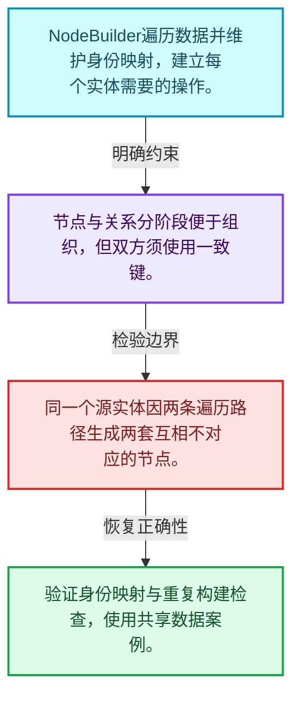
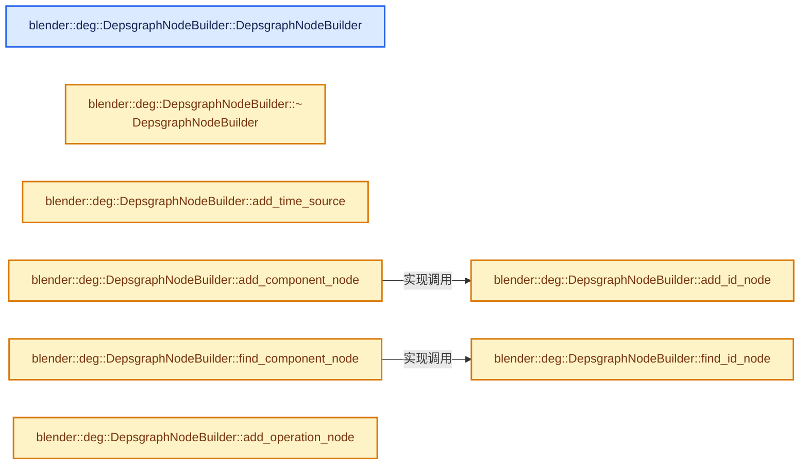
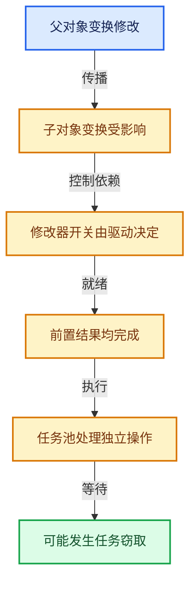

# 11-03 节点构建器

[方向导航](README.md) · [总目录](../README.md) · [实现索引](../%E7%AC%A6%E5%8F%B7%E4%BE%9D%E8%B5%96%E4%B8%8E%E5%AE%9E%E7%8E%B0%E7%B4%A2%E5%BC%95.md)

## 从问题到实现

怎样保证同一实体不会重复建立互相矛盾节点？

构建器管理身份映射与遍历状态，创建节点和连接关系分阶段组织。

**数据模型**

NodeBuilder遍历数据并维护身份映射，建立每个实体需要的操作。

**设计取舍**

节点与关系分阶段便于组织，但双方须使用一致键。

**最小反例**

同一个源实体因两条遍历路径生成两套互相不对应的节点。

**推导**

验证身份映射与重复构建检查，使用共享数据案例。

## 阅读地图与执行推演








图中的数值推演是本方向的教学模型；实际函数之间的调用边与概念分析边分别标注，不能把概念关系当作运行时调度顺序。

## 完整源码单元与就地讲解

中文讲解直接放在相关代码旁，复杂机制在代码下展开。原文折叠区保留基准行号；不需要在行号表和函数之间来回查找。类布局可分段展示，函数实现不按固定行数切开。

### 类型布局、声明与编译条件 · deg_builder_nodes.cc L1—L122

<!-- annotated:90337ce3a67d2e -->

```cpp
/* SPDX-FileCopyrightText: 2013 Blender Authors
 *
 * SPDX-License-Identifier: GPL-2.0-or-later */

/** \file
 * \ingroup depsgraph
 *
 * Methods for constructing depsgraph's nodes
 */

#include "intern/builder/deg_builder_nodes.h"

#include <algorithm>
#include <cstdio>
#include <cstdlib>

#include "MEM_guardedalloc.h"

#include "BLI_listbase.hh"
#include "BLI_span.hh"
#include "BLI_utildefines.hh"

#include "DNA_action_types.h"
#include "DNA_anim_types.h"
#include "DNA_armature_types.h"
#include "DNA_cachefile_types.h"
#include "DNA_camera_types.h"
#include "DNA_collection_types.h"
#include "DNA_constraint_types.h"
#include "DNA_curve_types.h"
#include "DNA_curves_types.h"
#include "DNA_key_types.h"
#include "DNA_light_types.h"
#include "DNA_lightprobe_types.h"
#include "DNA_linestyle_types.h"
#include "DNA_mask_types.h"
#include "DNA_material_types.h"
#include "DNA_mesh_types.h"
#include "DNA_movieclip_types.h"
#include "DNA_node_types.h"
#include "DNA_object_types.h"
#include "DNA_particle_types.h"
#include "DNA_rigidbody_types.h"
#include "DNA_scene_types.h"
#include "DNA_sequence_types.h"
#include "DNA_sound_types.h"
#include "DNA_speaker_types.h"
#include "DNA_texture_types.h"
#include "DNA_vfont_types.h"
#include "DNA_world_types.h"

#include "BKE_action.hh"
#include "BKE_anim_data.hh"
#include "BKE_animsys.hh"
#include "BKE_armature.hh"
#include "BKE_bake_geometry_nodes_modifier.hh"
#include "BKE_cachefile.hh"
#include "BKE_collection.hh"
#include "BKE_constraint.h"
#include "BKE_curve.hh"
#include "BKE_fcurve_driver.h"
#include "BKE_grease_pencil.hh"
#include "BKE_grease_pencil_modifiers.h"
#include "BKE_idprop.hh"
#include "BKE_image.hh"
#include "BKE_key.hh"
#include "BKE_lattice.hh"
#include "BKE_layer.hh"
#include "BKE_lib_id.hh"
#include "BKE_lib_query.hh"
#include "BKE_light.h"
#include "BKE_mask.hh"
#include "BKE_material.hh"
#include "BKE_mesh.hh"
#include "BKE_modifier.hh"
#include "BKE_movieclip.hh"
#include "BKE_nla.hh"
#include "BKE_node.hh"
#include "BKE_node_runtime.hh"
#include "BKE_object.hh"
#include "BKE_particle.h"
#include "BKE_pointcache.h"
#include "BKE_rigidbody.h"
#include "BKE_scene.hh"
#include "BKE_shader_fx.hh"
#include "BKE_sound.hh"
#include "BKE_volume.hh"
#include "BKE_world.h"

#include "RNA_access.hh"
#include "RNA_path.hh"
#include "RNA_prototypes.hh"
#include "RNA_types.hh"

#include "DEG_depsgraph.hh"
#include "DEG_depsgraph_build.hh"

#include "SEQ_iterator.hh"
#include "SEQ_sequencer.hh"

#include "intern/builder/deg_builder.h"
#include "intern/builder/deg_builder_key.h"
#include "intern/builder/deg_builder_relations_drivers.h"
#include "intern/builder/deg_builder_rna.h"
#include "intern/depsgraph.hh"
#include "intern/depsgraph_light_linking.hh"
#include "intern/depsgraph_tag.hh"
#include "intern/depsgraph_type.hh"
#include "intern/eval/deg_eval_copy_on_write.h"
#include "intern/eval/deg_eval_visibility.h"
#include "intern/node/deg_node.hh"
#include "intern/node/deg_node_component.hh"
#include "intern/node/deg_node_id.hh"
#include "intern/node/deg_node_operation.hh"

namespace blender::deg {

/* ************ */
/* Node Builder */

/* **** General purpose functions **** */

```

<details>
<summary>核对原始源码：source/blender/depsgraph/intern/builder/deg_builder_nodes.cc · L1—L122</summary>

<!-- original:90337ce3a67d2e:source/blender/depsgraph/intern/builder/deg_builder_nodes.cc:1:122 -->

```cpp
/* SPDX-FileCopyrightText: 2013 Blender Authors
 *
 * SPDX-License-Identifier: GPL-2.0-or-later */

/** \file
 * \ingroup depsgraph
 *
 * Methods for constructing depsgraph's nodes
 */

#include "intern/builder/deg_builder_nodes.h"

#include <algorithm>
#include <cstdio>
#include <cstdlib>

#include "MEM_guardedalloc.h"

#include "BLI_listbase.hh"
#include "BLI_span.hh"
#include "BLI_utildefines.hh"

#include "DNA_action_types.h"
#include "DNA_anim_types.h"
#include "DNA_armature_types.h"
#include "DNA_cachefile_types.h"
#include "DNA_camera_types.h"
#include "DNA_collection_types.h"
#include "DNA_constraint_types.h"
#include "DNA_curve_types.h"
#include "DNA_curves_types.h"
#include "DNA_key_types.h"
#include "DNA_light_types.h"
#include "DNA_lightprobe_types.h"
#include "DNA_linestyle_types.h"
#include "DNA_mask_types.h"
#include "DNA_material_types.h"
#include "DNA_mesh_types.h"
#include "DNA_movieclip_types.h"
#include "DNA_node_types.h"
#include "DNA_object_types.h"
#include "DNA_particle_types.h"
#include "DNA_rigidbody_types.h"
#include "DNA_scene_types.h"
#include "DNA_sequence_types.h"
#include "DNA_sound_types.h"
#include "DNA_speaker_types.h"
#include "DNA_texture_types.h"
#include "DNA_vfont_types.h"
#include "DNA_world_types.h"

#include "BKE_action.hh"
#include "BKE_anim_data.hh"
#include "BKE_animsys.hh"
#include "BKE_armature.hh"
#include "BKE_bake_geometry_nodes_modifier.hh"
#include "BKE_cachefile.hh"
#include "BKE_collection.hh"
#include "BKE_constraint.h"
#include "BKE_curve.hh"
#include "BKE_fcurve_driver.h"
#include "BKE_grease_pencil.hh"
#include "BKE_grease_pencil_modifiers.h"
#include "BKE_idprop.hh"
#include "BKE_image.hh"
#include "BKE_key.hh"
#include "BKE_lattice.hh"
#include "BKE_layer.hh"
#include "BKE_lib_id.hh"
#include "BKE_lib_query.hh"
#include "BKE_light.h"
#include "BKE_mask.hh"
#include "BKE_material.hh"
#include "BKE_mesh.hh"
#include "BKE_modifier.hh"
#include "BKE_movieclip.hh"
#include "BKE_nla.hh"
#include "BKE_node.hh"
#include "BKE_node_runtime.hh"
#include "BKE_object.hh"
#include "BKE_particle.h"
#include "BKE_pointcache.h"
#include "BKE_rigidbody.h"
#include "BKE_scene.hh"
#include "BKE_shader_fx.hh"
#include "BKE_sound.hh"
#include "BKE_volume.hh"
#include "BKE_world.h"

#include "RNA_access.hh"
#include "RNA_path.hh"
#include "RNA_prototypes.hh"
#include "RNA_types.hh"

#include "DEG_depsgraph.hh"
#include "DEG_depsgraph_build.hh"

#include "SEQ_iterator.hh"
#include "SEQ_sequencer.hh"

#include "intern/builder/deg_builder.h"
#include "intern/builder/deg_builder_key.h"
#include "intern/builder/deg_builder_relations_drivers.h"
#include "intern/builder/deg_builder_rna.h"
#include "intern/depsgraph.hh"
#include "intern/depsgraph_light_linking.hh"
#include "intern/depsgraph_tag.hh"
#include "intern/depsgraph_type.hh"
#include "intern/eval/deg_eval_copy_on_write.h"
#include "intern/eval/deg_eval_visibility.h"
#include "intern/node/deg_node.hh"
#include "intern/node/deg_node_component.hh"
#include "intern/node/deg_node_id.hh"
#include "intern/node/deg_node_operation.hh"

namespace blender::deg {

/* ************ */
/* Node Builder */

/* **** General purpose functions **** */

```

</details>

<a id="f-94ae8a9e435301dd"></a>

### `blender::deg::DepsgraphNodeBuilder::DepsgraphNodeBuilder`

实现位置：[source/blender/depsgraph/intern/builder/deg_builder_nodes.cc](../../../../../source/blender/depsgraph/intern/builder/deg_builder_nodes.cc) · L123—L132。

接口参数：

- `Main *bmain`
- `Depsgraph *graph`
- `DepsgraphBuilderCache *cache`

**教学注释版**

<!-- annotated:570bb839211aeb -->

```cpp
DepsgraphNodeBuilder::DepsgraphNodeBuilder(Main *bmain,
                                           Depsgraph *graph,
                                           DepsgraphBuilderCache *cache)
    : DepsgraphBuilder(bmain, graph, cache),
      scene_(nullptr),
      view_layer_(nullptr),
      view_layer_index_(-1),
      is_parent_collection_visible_(true)
{
}
```

<details>
<summary>核对原始源码：source/blender/depsgraph/intern/builder/deg_builder_nodes.cc · L123—L132</summary>

<!-- original:570bb839211aeb:source/blender/depsgraph/intern/builder/deg_builder_nodes.cc:123:132 -->

```cpp
DepsgraphNodeBuilder::DepsgraphNodeBuilder(Main *bmain,
                                           Depsgraph *graph,
                                           DepsgraphBuilderCache *cache)
    : DepsgraphBuilder(bmain, graph, cache),
      scene_(nullptr),
      view_layer_(nullptr),
      view_layer_index_(-1),
      is_parent_collection_visible_(true)
{
}
```

</details>

**继续追踪实现**

本实现没有需要继续展开的显式调用；检查返回表达式、对象转换和调用者前置条件。

<!-- annotated:d330e8abdf1c1e -->

```cpp

```

<details>
<summary>核对原始源码：source/blender/depsgraph/intern/builder/deg_builder_nodes.cc · L133—L133</summary>

<!-- original:d330e8abdf1c1e:source/blender/depsgraph/intern/builder/deg_builder_nodes.cc:133:133 -->

```cpp

```

</details>

<a id="f-786a784e7bfcc5ec"></a>

### `blender::deg::DepsgraphNodeBuilder::~DepsgraphNodeBuilder`

实现位置：[source/blender/depsgraph/intern/builder/deg_builder_nodes.cc](../../../../../source/blender/depsgraph/intern/builder/deg_builder_nodes.cc) · L134—L143。

**教学注释版**

<!-- annotated:9a126ea0d2aaad -->

```cpp
DepsgraphNodeBuilder::~DepsgraphNodeBuilder()
{
  /* Cannot be in an IDInfo destructor, as these COW IDs do not belong to the IDInfo data. */
  for (IDInfo &id_info : id_info_hash_.values()) {
    if (id_info.id_cow != nullptr) {
      deg_free_eval_copy_datablock(id_info.id_cow);
      MEM_delete(id_info.id_cow);
    }
  }
}
```

<details>
<summary>核对原始源码：source/blender/depsgraph/intern/builder/deg_builder_nodes.cc · L134—L143</summary>

<!-- original:9a126ea0d2aaad:source/blender/depsgraph/intern/builder/deg_builder_nodes.cc:134:143 -->

```cpp
DepsgraphNodeBuilder::~DepsgraphNodeBuilder()
{
  /* Cannot be in an IDInfo destructor, as these COW IDs do not belong to the IDInfo data. */
  for (IDInfo &id_info : id_info_hash_.values()) {
    if (id_info.id_cow != nullptr) {
      deg_free_eval_copy_datablock(id_info.id_cow);
      MEM_delete(id_info.id_cow);
    }
  }
}
```

</details>

**继续追踪实现**

- `id_info_hash_.values` → [调用协议](../%E6%A8%A1%E6%9D%BF%E5%AE%8F%E4%B8%8E%E5%8A%A8%E6%80%81%E5%88%86%E6%B4%BE%E5%8D%8F%E8%AE%AE.md)：接收对象类型依赖auto、返回值或模板实例；不按同名猜测目标。调用位置L137。
- `deg_free_eval_copy_datablock` → [blender::deg::deg_free_eval_copy_datablock · L967](%E4%BE%9D%E8%B5%96-deg_eval_copy_on_write-5fb7a2.md#f-bd09e14117095a04)。
- `MEM_delete` → [MEM_delete · L400](../03-%E5%86%85%E5%AD%98%E5%88%86%E9%85%8D%E4%B8%8E%E8%BF%90%E8%A1%8C%E6%97%B6%E7%B1%BB%E5%9E%8B/%E4%BE%9D%E8%B5%96-MEM_guardedalloc-b54eca.md#f-9049ffdd1682887c)。

<!-- annotated:1da14b552d078c -->

```cpp

```

<details>
<summary>核对原始源码：source/blender/depsgraph/intern/builder/deg_builder_nodes.cc · L144—L144</summary>

<!-- original:1da14b552d078c:source/blender/depsgraph/intern/builder/deg_builder_nodes.cc:144:144 -->

```cpp

```

</details>

<a id="f-dbb27edf6c5a5cce"></a>

### `blender::deg::DepsgraphNodeBuilder::add_id_node`

实现位置：[source/blender/depsgraph/intern/builder/deg_builder_nodes.cc](../../../../../source/blender/depsgraph/intern/builder/deg_builder_nodes.cc) · L145—L206。

接口参数：

- `ID *id`

**教学注释版**

<!-- annotated:3080ce129d918c -->

```cpp
IDNode *DepsgraphNodeBuilder::add_id_node(ID *id)
{
  BLI_assert(id->session_uid != MAIN_ID_SESSION_UID_UNSET);

  const ID_Type id_type = id->id_type();
  IDNode *id_node = nullptr;
  ID *id_cow = nullptr;
  IDComponentsMask previously_visible_components_mask = 0;
  uint32_t previous_eval_flags = 0;
  DEGCustomDataMeshMasks previous_customdata_masks;
  IDInfo *id_info = id_info_hash_.lookup_ptr(id->session_uid);
  if (id_info != nullptr) {
    id_cow = id_info->id_cow;
    previously_visible_components_mask = id_info->previously_visible_components_mask;
    previous_eval_flags = id_info->previous_eval_flags;
    previous_customdata_masks = id_info->previous_customdata_masks;
    /* Tag ID info to not free the evaluated ID pointer. */
    id_info->id_cow = nullptr;
  }
  id_node = graph_->add_id_node(id, id_cow);
  id_node->previously_visible_components_mask = previously_visible_components_mask;
  id_node->previous_eval_flags = previous_eval_flags;
  id_node->previous_customdata_masks = previous_customdata_masks;

  /* NOTE: Zero number of components indicates that ID node was just created. */
  const bool is_newly_created = id_node->components.is_empty();

  if (is_newly_created) {
    if (deg_eval_copy_is_needed(id_type)) {
      ComponentNode *comp_cow = id_node->add_component(NodeType::COPY_ON_EVAL);
      OperationNode *op_cow = comp_cow->add_operation(
          [id_node](blender::Depsgraph *depsgraph) { deg_create_eval_copy(depsgraph, id_node); },
          OperationCode::COPY_ON_EVAL);
      graph_->operations.append(op_cow);
    }

    ComponentNode *visibility_component = id_node->add_component(NodeType::VISIBILITY);
    OperationNode *visibility_operation;

    /* Optimization: currently only objects need a special visibility evaluation. For the rest ID
     * types keep the node as a NO-OP so that relations can still be routed, but without penalty
     * during the graph evaluation. */
    if (id_type == ID_OB) {
      visibility_operation = visibility_component->add_operation(
          [id_node](blender::Depsgraph *depsgraph) {
            deg_evaluate_object_node_visibility(depsgraph, id_node);
          },
          OperationCode::VISIBILITY);
    }
    else {
      visibility_operation = visibility_component->add_operation(nullptr,
                                                                 OperationCode::VISIBILITY);
    }

    /* Pin the node so that it and its relations are preserved by the unused nodes/relations
     * deletion. This is mainly to make it easier to debug visibility. */
    visibility_operation->flag |= (OperationFlag::DEPSOP_FLAG_PINNED |
                                   OperationFlag::DEPSOP_FLAG_AFFECTS_VISIBILITY);
    graph_->operations.append(visibility_operation);
  }
  return id_node;
}
```

<details>
<summary>核对原始源码：source/blender/depsgraph/intern/builder/deg_builder_nodes.cc · L145—L206</summary>

<!-- original:3080ce129d918c:source/blender/depsgraph/intern/builder/deg_builder_nodes.cc:145:206 -->

```cpp
IDNode *DepsgraphNodeBuilder::add_id_node(ID *id)
{
  BLI_assert(id->session_uid != MAIN_ID_SESSION_UID_UNSET);

  const ID_Type id_type = id->id_type();
  IDNode *id_node = nullptr;
  ID *id_cow = nullptr;
  IDComponentsMask previously_visible_components_mask = 0;
  uint32_t previous_eval_flags = 0;
  DEGCustomDataMeshMasks previous_customdata_masks;
  IDInfo *id_info = id_info_hash_.lookup_ptr(id->session_uid);
  if (id_info != nullptr) {
    id_cow = id_info->id_cow;
    previously_visible_components_mask = id_info->previously_visible_components_mask;
    previous_eval_flags = id_info->previous_eval_flags;
    previous_customdata_masks = id_info->previous_customdata_masks;
    /* Tag ID info to not free the evaluated ID pointer. */
    id_info->id_cow = nullptr;
  }
  id_node = graph_->add_id_node(id, id_cow);
  id_node->previously_visible_components_mask = previously_visible_components_mask;
  id_node->previous_eval_flags = previous_eval_flags;
  id_node->previous_customdata_masks = previous_customdata_masks;

  /* NOTE: Zero number of components indicates that ID node was just created. */
  const bool is_newly_created = id_node->components.is_empty();

  if (is_newly_created) {
    if (deg_eval_copy_is_needed(id_type)) {
      ComponentNode *comp_cow = id_node->add_component(NodeType::COPY_ON_EVAL);
      OperationNode *op_cow = comp_cow->add_operation(
          [id_node](blender::Depsgraph *depsgraph) { deg_create_eval_copy(depsgraph, id_node); },
          OperationCode::COPY_ON_EVAL);
      graph_->operations.append(op_cow);
    }

    ComponentNode *visibility_component = id_node->add_component(NodeType::VISIBILITY);
    OperationNode *visibility_operation;

    /* Optimization: currently only objects need a special visibility evaluation. For the rest ID
     * types keep the node as a NO-OP so that relations can still be routed, but without penalty
     * during the graph evaluation. */
    if (id_type == ID_OB) {
      visibility_operation = visibility_component->add_operation(
          [id_node](blender::Depsgraph *depsgraph) {
            deg_evaluate_object_node_visibility(depsgraph, id_node);
          },
          OperationCode::VISIBILITY);
    }
    else {
      visibility_operation = visibility_component->add_operation(nullptr,
                                                                 OperationCode::VISIBILITY);
    }

    /* Pin the node so that it and its relations are preserved by the unused nodes/relations
     * deletion. This is mainly to make it easier to debug visibility. */
    visibility_operation->flag |= (OperationFlag::DEPSOP_FLAG_PINNED |
                                   OperationFlag::DEPSOP_FLAG_AFFECTS_VISIBILITY);
    graph_->operations.append(visibility_operation);
  }
  return id_node;
}
```

</details>

**沿实际写入检查状态**

- `id_cow = id_info->id_cow;`
- `previously_visible_components_mask = id_info->previously_visible_components_mask;`
- `previous_eval_flags = id_info->previous_eval_flags;`
- `previous_customdata_masks = id_info->previous_customdata_masks;`
- `id_info->id_cow = nullptr;`
- `id_node = graph_->add_id_node(id, id_cow);`
- `id_node->previously_visible_components_mask = previously_visible_components_mask;`
- `id_node->previous_eval_flags = previous_eval_flags;`
- `id_node->previous_customdata_masks = previous_customdata_masks;`
- `visibility_operation = visibility_component->add_operation(`
- `visibility_operation = visibility_component->add_operation(nullptr,`
- `visibility_operation->flag |= (OperationFlag::DEPSOP_FLAG_PINNED |`

**结果出口**

- `return id_node;`

**继续追踪实现**

- `BLI_assert` → [BLI_assert · L48](../01-%E5%9F%BA%E7%A1%80%E5%AE%B9%E5%99%A8%E4%B8%8E%E7%8E%B0%E4%BB%A3CPP/%E4%BE%9D%E8%B5%96-BLI_assert-cc98e8.md#m-57a88495704d)；[BLI_assert · L63](../01-%E5%9F%BA%E7%A1%80%E5%AE%B9%E5%99%A8%E4%B8%8E%E7%8E%B0%E4%BB%A3CPP/%E4%BE%9D%E8%B5%96-BLI_assert-cc98e8.md#m-d07050020cb5)。宏定义由构建条件选择。
- `id->id_type` → [blender::ID::id_type · L544](../05-%E5%87%A0%E4%BD%95%E5%AD%98%E5%82%A8%E4%B8%8E%E6%8B%93%E6%89%91%E6%98%A0%E5%B0%84/%E4%BE%9D%E8%B5%96-DNA_ID-3eb091.md#f-ee8fe63f3948aa47)。
- `id_info_hash_.lookup_ptr` → [调用协议](../%E6%A8%A1%E6%9D%BF%E5%AE%8F%E4%B8%8E%E5%8A%A8%E6%80%81%E5%88%86%E6%B4%BE%E5%8D%8F%E8%AE%AE.md)：接收对象类型依赖auto、返回值或模板实例；不按同名猜测目标。调用位置L155。
- `graph_->add_id_node` → [调用协议](../%E6%A8%A1%E6%9D%BF%E5%AE%8F%E4%B8%8E%E5%8A%A8%E6%80%81%E5%88%86%E6%B4%BE%E5%8D%8F%E8%AE%AE.md)：接收对象类型依赖auto、返回值或模板实例；不按同名猜测目标。调用位置L164。
- `id_node->components.is_empty` → [调用协议](../%E6%A8%A1%E6%9D%BF%E5%AE%8F%E4%B8%8E%E5%8A%A8%E6%80%81%E5%88%86%E6%B4%BE%E5%8D%8F%E8%AE%AE.md)：接收对象类型依赖auto、返回值或模板实例；不按同名猜测目标。调用位置L170。
- `deg_eval_copy_is_needed` → [blender::deg::deg_eval_copy_is_needed · L1045](%E4%BE%9D%E8%B5%96-deg_eval_copy_on_write-5fb7a2.md#f-389a000d46ec5ac9)；[blender::deg::deg_eval_copy_is_needed · L1051](%E4%BE%9D%E8%B5%96-deg_eval_copy_on_write-5fb7a2.md#f-9fd78a9e9f3f8c4c)。同名重载需按实参类型选择。
- `id_node->add_component` → [blender::deg::IDNode::add_component · L139](%E4%BE%9D%E8%B5%96-deg_node_id-71dd5e.md#f-37c0b916f0dffd81)。
- `comp_cow->add_operation` → [blender::deg::ComponentNode::add_operation · L128](%E4%BE%9D%E8%B5%96-deg_node_component-2075dd.md#f-b0f9b47913d4786c)。
- `deg_create_eval_copy` → [blender::deg::deg_create_eval_copy · L1005](%E4%BE%9D%E8%B5%96-deg_eval_copy_on_write-5fb7a2.md#f-4d3d354b59dea8fd)。
- `graph_->operations.append` → [调用协议](../%E6%A8%A1%E6%9D%BF%E5%AE%8F%E4%B8%8E%E5%8A%A8%E6%80%81%E5%88%86%E6%B4%BE%E5%8D%8F%E8%AE%AE.md)：接收对象类型依赖auto、返回值或模板实例；不按同名猜测目标。调用位置L178。
- `visibility_component->add_operation` → [blender::deg::ComponentNode::add_operation · L128](%E4%BE%9D%E8%B5%96-deg_node_component-2075dd.md#f-b0f9b47913d4786c)。
- `deg_evaluate_object_node_visibility` → [blender::deg::deg_evaluate_object_node_visibility · L30](06-%E5%8F%AF%E8%A7%81%E6%80%A7%E4%B8%8E%E6%B1%82%E5%80%BC%E8%B0%83%E5%BA%A6.md#f-572c40065e28fd6f)。

<!-- annotated:74c6daa1bb9288 -->

```cpp

```

<details>
<summary>核对原始源码：source/blender/depsgraph/intern/builder/deg_builder_nodes.cc · L207—L207</summary>

<!-- original:74c6daa1bb9288:source/blender/depsgraph/intern/builder/deg_builder_nodes.cc:207:207 -->

```cpp

```

</details>

<a id="f-a3c223430b156ff1"></a>

### `blender::deg::DepsgraphNodeBuilder::find_id_node`

实现位置：[source/blender/depsgraph/intern/builder/deg_builder_nodes.cc](../../../../../source/blender/depsgraph/intern/builder/deg_builder_nodes.cc) · L208—L211。

接口参数：

- `const ID *id`

**教学注释版**

<!-- annotated:877202e6d221fb -->

```cpp
IDNode *DepsgraphNodeBuilder::find_id_node(const ID *id)
{
  return graph_->find_id_node(id);
}
```

<details>
<summary>核对原始源码：source/blender/depsgraph/intern/builder/deg_builder_nodes.cc · L208—L211</summary>

<!-- original:877202e6d221fb:source/blender/depsgraph/intern/builder/deg_builder_nodes.cc:208:211 -->

```cpp
IDNode *DepsgraphNodeBuilder::find_id_node(const ID *id)
{
  return graph_->find_id_node(id);
}
```

</details>

**结果出口**

- `return graph_->find_id_node(id);`

**继续追踪实现**

- `graph_->find_id_node` → [调用协议](../%E6%A8%A1%E6%9D%BF%E5%AE%8F%E4%B8%8E%E5%8A%A8%E6%80%81%E5%88%86%E6%B4%BE%E5%8D%8F%E8%AE%AE.md)：接收对象类型依赖auto、返回值或模板实例；不按同名猜测目标。调用位置L210。

<!-- annotated:d329436ff1130e -->

```cpp

```

<details>
<summary>核对原始源码：source/blender/depsgraph/intern/builder/deg_builder_nodes.cc · L212—L212</summary>

<!-- original:d329436ff1130e:source/blender/depsgraph/intern/builder/deg_builder_nodes.cc:212:212 -->

```cpp

```

</details>

<a id="f-ea20be2b33d447d7"></a>

### `blender::deg::DepsgraphNodeBuilder::add_time_source`

实现位置：[source/blender/depsgraph/intern/builder/deg_builder_nodes.cc](../../../../../source/blender/depsgraph/intern/builder/deg_builder_nodes.cc) · L213—L216。

**教学注释版**

<!-- annotated:4750495f88d754 -->

```cpp
TimeSourceNode *DepsgraphNodeBuilder::add_time_source()
{
  return graph_->add_time_source();
}
```

<details>
<summary>核对原始源码：source/blender/depsgraph/intern/builder/deg_builder_nodes.cc · L213—L216</summary>

<!-- original:4750495f88d754:source/blender/depsgraph/intern/builder/deg_builder_nodes.cc:213:216 -->

```cpp
TimeSourceNode *DepsgraphNodeBuilder::add_time_source()
{
  return graph_->add_time_source();
}
```

</details>

**结果出口**

- `return graph_->add_time_source();`

**继续追踪实现**

- `graph_->add_time_source` → [调用协议](../%E6%A8%A1%E6%9D%BF%E5%AE%8F%E4%B8%8E%E5%8A%A8%E6%80%81%E5%88%86%E6%B4%BE%E5%8D%8F%E8%AE%AE.md)：接收对象类型依赖auto、返回值或模板实例；不按同名猜测目标。调用位置L215。

<!-- annotated:0b1370472b03db -->

```cpp

```

<details>
<summary>核对原始源码：source/blender/depsgraph/intern/builder/deg_builder_nodes.cc · L217—L217</summary>

<!-- original:0b1370472b03db:source/blender/depsgraph/intern/builder/deg_builder_nodes.cc:217:217 -->

```cpp

```

</details>

<a id="f-830e3ab58436b867"></a>

### `blender::deg::DepsgraphNodeBuilder::add_component_node`

实现位置：[source/blender/depsgraph/intern/builder/deg_builder_nodes.cc](../../../../../source/blender/depsgraph/intern/builder/deg_builder_nodes.cc) · L218—L226。

接口参数：

- `ID *id`
- `NodeType comp_type`
- `const char *comp_name`

**教学注释版**

<!-- annotated:92cbad6bcd713b -->

```cpp
ComponentNode *DepsgraphNodeBuilder::add_component_node(ID *id,
                                                        NodeType comp_type,
                                                        const char *comp_name)
{
  IDNode *id_node = add_id_node(id);
  ComponentNode *comp_node = id_node->add_component(comp_type, comp_name);
  comp_node->owner = id_node;
  return comp_node;
}
```

<details>
<summary>核对原始源码：source/blender/depsgraph/intern/builder/deg_builder_nodes.cc · L218—L226</summary>

<!-- original:92cbad6bcd713b:source/blender/depsgraph/intern/builder/deg_builder_nodes.cc:218:226 -->

```cpp
ComponentNode *DepsgraphNodeBuilder::add_component_node(ID *id,
                                                        NodeType comp_type,
                                                        const char *comp_name)
{
  IDNode *id_node = add_id_node(id);
  ComponentNode *comp_node = id_node->add_component(comp_type, comp_name);
  comp_node->owner = id_node;
  return comp_node;
}
```

</details>

**沿实际写入检查状态**

- `comp_node->owner = id_node;`

**结果出口**

- `return comp_node;`

**继续追踪实现**

- `add_id_node` → [blender::deg::DepsgraphNodeBuilder::add_id_node · L145](03-%E8%8A%82%E7%82%B9%E6%9E%84%E5%BB%BA%E5%99%A8.md#f-dbb27edf6c5a5cce)。
- `id_node->add_component` → [blender::deg::IDNode::add_component · L139](%E4%BE%9D%E8%B5%96-deg_node_id-71dd5e.md#f-37c0b916f0dffd81)。

<!-- annotated:b338a226e64dde -->

```cpp

```

<details>
<summary>核对原始源码：source/blender/depsgraph/intern/builder/deg_builder_nodes.cc · L227—L227</summary>

<!-- original:b338a226e64dde:source/blender/depsgraph/intern/builder/deg_builder_nodes.cc:227:227 -->

```cpp

```

</details>

<a id="f-9ad617273580a0b7"></a>

### `blender::deg::DepsgraphNodeBuilder::find_component_node`

实现位置：[source/blender/depsgraph/intern/builder/deg_builder_nodes.cc](../../../../../source/blender/depsgraph/intern/builder/deg_builder_nodes.cc) · L228—L237。

接口参数：

- `const ID *id`
- `const NodeType comp_type`
- `const char *comp_name`

**教学注释版**

<!-- annotated:d81936cb06a17e -->

```cpp
ComponentNode *DepsgraphNodeBuilder::find_component_node(const ID *id,
                                                         const NodeType comp_type,
                                                         const char *comp_name)
{
  IDNode *id_node = find_id_node(id);
  if (id_node == nullptr) {
    return nullptr;
  }
  return id_node->find_component(comp_type, comp_name);
}
```

<details>
<summary>核对原始源码：source/blender/depsgraph/intern/builder/deg_builder_nodes.cc · L228—L237</summary>

<!-- original:d81936cb06a17e:source/blender/depsgraph/intern/builder/deg_builder_nodes.cc:228:237 -->

```cpp
ComponentNode *DepsgraphNodeBuilder::find_component_node(const ID *id,
                                                         const NodeType comp_type,
                                                         const char *comp_name)
{
  IDNode *id_node = find_id_node(id);
  if (id_node == nullptr) {
    return nullptr;
  }
  return id_node->find_component(comp_type, comp_name);
}
```

</details>

**结果出口**

- `return nullptr;`
- `return id_node->find_component(comp_type, comp_name);`

**继续追踪实现**

- `find_id_node` → [blender::deg::DepsgraphNodeBuilder::find_id_node · L208](03-%E8%8A%82%E7%82%B9%E6%9E%84%E5%BB%BA%E5%99%A8.md#f-a3c223430b156ff1)。
- `id_node->find_component` → [blender::deg::IDNode::find_component · L133](%E4%BE%9D%E8%B5%96-deg_node_id-71dd5e.md#f-9982102eca14b6b6)。

<!-- annotated:7fd8ddb81fe9e2 -->

```cpp

```

<details>
<summary>核对原始源码：source/blender/depsgraph/intern/builder/deg_builder_nodes.cc · L238—L238</summary>

<!-- original:7fd8ddb81fe9e2:source/blender/depsgraph/intern/builder/deg_builder_nodes.cc:238:238 -->

```cpp

```

</details>

<a id="f-af4bc9beff6a8947"></a>

### `blender::deg::DepsgraphNodeBuilder::add_operation_node`

实现位置：[source/blender/depsgraph/intern/builder/deg_builder_nodes.cc](../../../../../source/blender/depsgraph/intern/builder/deg_builder_nodes.cc) · L239—L259。

接口参数：

- `ComponentNode *comp_node`
- `OperationCode opcode`
- `const DepsEvalOperationCb &op`
- `const char *name`
- `int name_tag`

**教学注释版**

<!-- annotated:b0071418c3a8ca -->

```cpp
OperationNode *DepsgraphNodeBuilder::add_operation_node(ComponentNode *comp_node,
                                                        OperationCode opcode,
                                                        const DepsEvalOperationCb &op,
                                                        const char *name,
                                                        int name_tag)
{
  OperationNode *op_node = comp_node->find_operation(opcode, name, name_tag);
  if (op_node == nullptr) {
    op_node = comp_node->add_operation(op, opcode, name, name_tag);
    graph_->operations.append(op_node);
  }
  else {
    fprintf(stderr,
            "add_operation: Operation already exists - %s has %s at %p\n",
            comp_node->identifier().c_str(),
            op_node->identifier().c_str(),
            op_node);
    BLI_assert_msg(0, "Should not happen!");
  }
  return op_node;
}
```

<details>
<summary>核对原始源码：source/blender/depsgraph/intern/builder/deg_builder_nodes.cc · L239—L259</summary>

<!-- original:b0071418c3a8ca:source/blender/depsgraph/intern/builder/deg_builder_nodes.cc:239:259 -->

```cpp
OperationNode *DepsgraphNodeBuilder::add_operation_node(ComponentNode *comp_node,
                                                        OperationCode opcode,
                                                        const DepsEvalOperationCb &op,
                                                        const char *name,
                                                        int name_tag)
{
  OperationNode *op_node = comp_node->find_operation(opcode, name, name_tag);
  if (op_node == nullptr) {
    op_node = comp_node->add_operation(op, opcode, name, name_tag);
    graph_->operations.append(op_node);
  }
  else {
    fprintf(stderr,
            "add_operation: Operation already exists - %s has %s at %p\n",
            comp_node->identifier().c_str(),
            op_node->identifier().c_str(),
            op_node);
    BLI_assert_msg(0, "Should not happen!");
  }
  return op_node;
}
```

</details>

**沿实际写入检查状态**

- `op_node = comp_node->add_operation(op, opcode, name, name_tag);`

**结果出口**

- `return op_node;`

**继续追踪实现**

- `comp_node->find_operation` → [blender::deg::ComponentNode::find_operation · L68](%E4%BE%9D%E8%B5%96-deg_node_component-2075dd.md#f-172b1268e9ce9e59)；[blender::deg::ComponentNode::find_operation · L87](%E4%BE%9D%E8%B5%96-deg_node_component-2075dd.md#f-3fcfe180a922223a)。同名重载需按实参类型选择。
- `comp_node->add_operation` → [blender::deg::ComponentNode::add_operation · L128](%E4%BE%9D%E8%B5%96-deg_node_component-2075dd.md#f-b0f9b47913d4786c)。
- `graph_->operations.append` → [调用协议](../%E6%A8%A1%E6%9D%BF%E5%AE%8F%E4%B8%8E%E5%8A%A8%E6%80%81%E5%88%86%E6%B4%BE%E5%8D%8F%E8%AE%AE.md)：接收对象类型依赖auto、返回值或模板实例；不按同名猜测目标。调用位置L248。
- `fprintf` → [外部契约](https://eel.is/c++draft/)：这个边界按实际表达式及所属类型核对参数、返回值、寿命与失败行为。这里提供接口入口，不声称已解释该第三方版本的内部实现。
- `comp_node->identifier().c_str` → [调用协议](../%E6%A8%A1%E6%9D%BF%E5%AE%8F%E4%B8%8E%E5%8A%A8%E6%80%81%E5%88%86%E6%B4%BE%E5%8D%8F%E8%AE%AE.md)：接收对象类型依赖auto、返回值或模板实例；不按同名猜测目标。调用位置L253。
- `comp_node->identifier` → [blender::deg::ComponentNode::identifier · L59](%E4%BE%9D%E8%B5%96-deg_node_component-2075dd.md#f-0671c1ff831ad3c7)。
- `op_node->identifier().c_str` → [调用协议](../%E6%A8%A1%E6%9D%BF%E5%AE%8F%E4%B8%8E%E5%8A%A8%E6%80%81%E5%88%86%E6%B4%BE%E5%8D%8F%E8%AE%AE.md)：接收对象类型依赖auto、返回值或模板实例；不按同名猜测目标。调用位置L254。
- `op_node->identifier` → [blender::deg::OperationNode::identifier · L218](%E4%BE%9D%E8%B5%96-deg_node_operation-b37865.md#f-d43672cfd145ec54)。
- `BLI_assert_msg` → [BLI_assert_msg · L55](../01-%E5%9F%BA%E7%A1%80%E5%AE%B9%E5%99%A8%E4%B8%8E%E7%8E%B0%E4%BB%A3CPP/%E4%BE%9D%E8%B5%96-BLI_assert-cc98e8.md#m-695eed20dceb)；[BLI_assert_msg · L64](../01-%E5%9F%BA%E7%A1%80%E5%AE%B9%E5%99%A8%E4%B8%8E%E7%8E%B0%E4%BB%A3CPP/%E4%BE%9D%E8%B5%96-BLI_assert-cc98e8.md#m-7de5563de4db)。宏定义由构建条件选择。

<!-- annotated:d44e30f5b0d31f -->

```cpp

```

<details>
<summary>核对原始源码：source/blender/depsgraph/intern/builder/deg_builder_nodes.cc · L260—L260</summary>

<!-- original:d44e30f5b0d31f:source/blender/depsgraph/intern/builder/deg_builder_nodes.cc:260:260 -->

```cpp

```

</details>

<a id="f-83c337cd1005cd03"></a>

### `blender::deg::DepsgraphNodeBuilder::add_operation_node`

实现位置：[source/blender/depsgraph/intern/builder/deg_builder_nodes.cc](../../../../../source/blender/depsgraph/intern/builder/deg_builder_nodes.cc) · L261—L271。

接口参数：

- `ID *id`
- `NodeType comp_type`
- `const char *comp_name`
- `OperationCode opcode`
- `const DepsEvalOperationCb &op`
- `const char *name`
- `int name_tag`

**教学注释版**

<!-- annotated:4ca10526459bf9 -->

```cpp
OperationNode *DepsgraphNodeBuilder::add_operation_node(ID *id,
                                                        NodeType comp_type,
                                                        const char *comp_name,
                                                        OperationCode opcode,
                                                        const DepsEvalOperationCb &op,
                                                        const char *name,
                                                        int name_tag)
{
  ComponentNode *comp_node = add_component_node(id, comp_type, comp_name);
  return add_operation_node(comp_node, opcode, op, name, name_tag);
}
```

<details>
<summary>核对原始源码：source/blender/depsgraph/intern/builder/deg_builder_nodes.cc · L261—L271</summary>

<!-- original:4ca10526459bf9:source/blender/depsgraph/intern/builder/deg_builder_nodes.cc:261:271 -->

```cpp
OperationNode *DepsgraphNodeBuilder::add_operation_node(ID *id,
                                                        NodeType comp_type,
                                                        const char *comp_name,
                                                        OperationCode opcode,
                                                        const DepsEvalOperationCb &op,
                                                        const char *name,
                                                        int name_tag)
{
  ComponentNode *comp_node = add_component_node(id, comp_type, comp_name);
  return add_operation_node(comp_node, opcode, op, name, name_tag);
}
```

</details>

**结果出口**

- `return add_operation_node(comp_node, opcode, op, name, name_tag);`

**继续追踪实现**

- `add_component_node` → [blender::deg::DepsgraphNodeBuilder::add_component_node · L218](03-%E8%8A%82%E7%82%B9%E6%9E%84%E5%BB%BA%E5%99%A8.md#f-830e3ab58436b867)。
- `add_operation_node` → [blender::deg::DepsgraphNodeBuilder::add_operation_node · L239](03-%E8%8A%82%E7%82%B9%E6%9E%84%E5%BB%BA%E5%99%A8.md#f-af4bc9beff6a8947)；[blender::deg::DepsgraphNodeBuilder::add_operation_node · L261](03-%E8%8A%82%E7%82%B9%E6%9E%84%E5%BB%BA%E5%99%A8.md#f-83c337cd1005cd03)；[blender::deg::DepsgraphNodeBuilder::add_operation_node · L273](03-%E8%8A%82%E7%82%B9%E6%9E%84%E5%BB%BA%E5%99%A8.md#f-acdc3fdc26d9ecc3)。同名重载需按实参类型选择。

<!-- annotated:62f99922f323fb -->

```cpp

```

<details>
<summary>核对原始源码：source/blender/depsgraph/intern/builder/deg_builder_nodes.cc · L272—L272</summary>

<!-- original:62f99922f323fb:source/blender/depsgraph/intern/builder/deg_builder_nodes.cc:272:272 -->

```cpp

```

</details>

<a id="f-acdc3fdc26d9ecc3"></a>

### `blender::deg::DepsgraphNodeBuilder::add_operation_node`

实现位置：[source/blender/depsgraph/intern/builder/deg_builder_nodes.cc](../../../../../source/blender/depsgraph/intern/builder/deg_builder_nodes.cc) · L273—L281。

接口参数：

- `ID *id`
- `NodeType comp_type`
- `OperationCode opcode`
- `const DepsEvalOperationCb &op`
- `const char *name`
- `int name_tag`

**教学注释版**

<!-- annotated:cfe85845b91ba0 -->

```cpp
OperationNode *DepsgraphNodeBuilder::add_operation_node(ID *id,
                                                        NodeType comp_type,
                                                        OperationCode opcode,
                                                        const DepsEvalOperationCb &op,
                                                        const char *name,
                                                        int name_tag)
{
  return add_operation_node(id, comp_type, "", opcode, op, name, name_tag);
}
```

<details>
<summary>核对原始源码：source/blender/depsgraph/intern/builder/deg_builder_nodes.cc · L273—L281</summary>

<!-- original:cfe85845b91ba0:source/blender/depsgraph/intern/builder/deg_builder_nodes.cc:273:281 -->

```cpp
OperationNode *DepsgraphNodeBuilder::add_operation_node(ID *id,
                                                        NodeType comp_type,
                                                        OperationCode opcode,
                                                        const DepsEvalOperationCb &op,
                                                        const char *name,
                                                        int name_tag)
{
  return add_operation_node(id, comp_type, "", opcode, op, name, name_tag);
}
```

</details>

**结果出口**

- `return add_operation_node(id, comp_type, "", opcode, op, name, name_tag);`

**继续追踪实现**

- `add_operation_node` → [blender::deg::DepsgraphNodeBuilder::add_operation_node · L239](03-%E8%8A%82%E7%82%B9%E6%9E%84%E5%BB%BA%E5%99%A8.md#f-af4bc9beff6a8947)；[blender::deg::DepsgraphNodeBuilder::add_operation_node · L261](03-%E8%8A%82%E7%82%B9%E6%9E%84%E5%BB%BA%E5%99%A8.md#f-83c337cd1005cd03)；[blender::deg::DepsgraphNodeBuilder::add_operation_node · L273](03-%E8%8A%82%E7%82%B9%E6%9E%84%E5%BB%BA%E5%99%A8.md#f-acdc3fdc26d9ecc3)。同名重载需按实参类型选择。

<!-- annotated:8a94d7266aacd4 -->

```cpp

```

<details>
<summary>核对原始源码：source/blender/depsgraph/intern/builder/deg_builder_nodes.cc · L282—L282</summary>

<!-- original:8a94d7266aacd4:source/blender/depsgraph/intern/builder/deg_builder_nodes.cc:282:282 -->

```cpp

```

</details>

<a id="f-cf4e26883e3bc03a"></a>

### `blender::deg::DepsgraphNodeBuilder::ensure_operation_node`

实现位置：[source/blender/depsgraph/intern/builder/deg_builder_nodes.cc](../../../../../source/blender/depsgraph/intern/builder/deg_builder_nodes.cc) · L283—L296。

接口参数：

- `ID *id`
- `NodeType comp_type`
- `const char *comp_name`
- `OperationCode opcode`
- `const DepsEvalOperationCb &op`
- `const char *name`
- `int name_tag`

**教学注释版**

<!-- annotated:6d898e7e97621f -->

```cpp
OperationNode *DepsgraphNodeBuilder::ensure_operation_node(ID *id,
                                                           NodeType comp_type,
                                                           const char *comp_name,
                                                           OperationCode opcode,
                                                           const DepsEvalOperationCb &op,
                                                           const char *name,
                                                           int name_tag)
{
  OperationNode *operation = find_operation_node(id, comp_type, comp_name, opcode, name, name_tag);
  if (operation != nullptr) {
    return operation;
  }
  return add_operation_node(id, comp_type, comp_name, opcode, op, name, name_tag);
}
```

<details>
<summary>核对原始源码：source/blender/depsgraph/intern/builder/deg_builder_nodes.cc · L283—L296</summary>

<!-- original:6d898e7e97621f:source/blender/depsgraph/intern/builder/deg_builder_nodes.cc:283:296 -->

```cpp
OperationNode *DepsgraphNodeBuilder::ensure_operation_node(ID *id,
                                                           NodeType comp_type,
                                                           const char *comp_name,
                                                           OperationCode opcode,
                                                           const DepsEvalOperationCb &op,
                                                           const char *name,
                                                           int name_tag)
{
  OperationNode *operation = find_operation_node(id, comp_type, comp_name, opcode, name, name_tag);
  if (operation != nullptr) {
    return operation;
  }
  return add_operation_node(id, comp_type, comp_name, opcode, op, name, name_tag);
}
```

</details>

**结果出口**

- `return operation;`
- `return add_operation_node(id, comp_type, comp_name, opcode, op, name, name_tag);`

**继续追踪实现**

- `find_operation_node` → [blender::deg::DepsgraphNodeBuilder::find_operation_node · L329](03-%E8%8A%82%E7%82%B9%E6%9E%84%E5%BB%BA%E5%99%A8.md#f-900c405a8fdc7903)；[blender::deg::DepsgraphNodeBuilder::find_operation_node · L343](03-%E8%8A%82%E7%82%B9%E6%9E%84%E5%BB%BA%E5%99%A8.md#f-1cf237fa524dc3e8)；[blender::deg::DepsgraphNodeBuilder::find_operation_node · L349](03-%E8%8A%82%E7%82%B9%E6%9E%84%E5%BB%BA%E5%99%A8.md#f-716252a7f052972d)。同名重载需按实参类型选择。
- `add_operation_node` → [blender::deg::DepsgraphNodeBuilder::add_operation_node · L239](03-%E8%8A%82%E7%82%B9%E6%9E%84%E5%BB%BA%E5%99%A8.md#f-af4bc9beff6a8947)；[blender::deg::DepsgraphNodeBuilder::add_operation_node · L261](03-%E8%8A%82%E7%82%B9%E6%9E%84%E5%BB%BA%E5%99%A8.md#f-83c337cd1005cd03)；[blender::deg::DepsgraphNodeBuilder::add_operation_node · L273](03-%E8%8A%82%E7%82%B9%E6%9E%84%E5%BB%BA%E5%99%A8.md#f-acdc3fdc26d9ecc3)。同名重载需按实参类型选择。

<!-- annotated:dbe2126e35c94c -->

```cpp

```

<details>
<summary>核对原始源码：source/blender/depsgraph/intern/builder/deg_builder_nodes.cc · L297—L297</summary>

<!-- original:dbe2126e35c94c:source/blender/depsgraph/intern/builder/deg_builder_nodes.cc:297:297 -->

```cpp

```

</details>

<a id="f-bd267daaae660ca7"></a>

### `blender::deg::DepsgraphNodeBuilder::ensure_operation_node`

实现位置：[source/blender/depsgraph/intern/builder/deg_builder_nodes.cc](../../../../../source/blender/depsgraph/intern/builder/deg_builder_nodes.cc) · L298—L310。

接口参数：

- `ID *id`
- `NodeType comp_type`
- `OperationCode opcode`
- `const DepsEvalOperationCb &op`
- `const char *name`
- `int name_tag`

**教学注释版**

<!-- annotated:6e35c43d391c4a -->

```cpp
OperationNode *DepsgraphNodeBuilder::ensure_operation_node(ID *id,
                                                           NodeType comp_type,
                                                           OperationCode opcode,
                                                           const DepsEvalOperationCb &op,
                                                           const char *name,
                                                           int name_tag)
{
  OperationNode *operation = find_operation_node(id, comp_type, opcode, name, name_tag);
  if (operation != nullptr) {
    return operation;
  }
  return add_operation_node(id, comp_type, opcode, op, name, name_tag);
}
```

<details>
<summary>核对原始源码：source/blender/depsgraph/intern/builder/deg_builder_nodes.cc · L298—L310</summary>

<!-- original:6e35c43d391c4a:source/blender/depsgraph/intern/builder/deg_builder_nodes.cc:298:310 -->

```cpp
OperationNode *DepsgraphNodeBuilder::ensure_operation_node(ID *id,
                                                           NodeType comp_type,
                                                           OperationCode opcode,
                                                           const DepsEvalOperationCb &op,
                                                           const char *name,
                                                           int name_tag)
{
  OperationNode *operation = find_operation_node(id, comp_type, opcode, name, name_tag);
  if (operation != nullptr) {
    return operation;
  }
  return add_operation_node(id, comp_type, opcode, op, name, name_tag);
}
```

</details>

**结果出口**

- `return operation;`
- `return add_operation_node(id, comp_type, opcode, op, name, name_tag);`

**继续追踪实现**

- `find_operation_node` → [blender::deg::DepsgraphNodeBuilder::find_operation_node · L329](03-%E8%8A%82%E7%82%B9%E6%9E%84%E5%BB%BA%E5%99%A8.md#f-900c405a8fdc7903)；[blender::deg::DepsgraphNodeBuilder::find_operation_node · L343](03-%E8%8A%82%E7%82%B9%E6%9E%84%E5%BB%BA%E5%99%A8.md#f-1cf237fa524dc3e8)；[blender::deg::DepsgraphNodeBuilder::find_operation_node · L349](03-%E8%8A%82%E7%82%B9%E6%9E%84%E5%BB%BA%E5%99%A8.md#f-716252a7f052972d)。同名重载需按实参类型选择。
- `add_operation_node` → [blender::deg::DepsgraphNodeBuilder::add_operation_node · L239](03-%E8%8A%82%E7%82%B9%E6%9E%84%E5%BB%BA%E5%99%A8.md#f-af4bc9beff6a8947)；[blender::deg::DepsgraphNodeBuilder::add_operation_node · L261](03-%E8%8A%82%E7%82%B9%E6%9E%84%E5%BB%BA%E5%99%A8.md#f-83c337cd1005cd03)；[blender::deg::DepsgraphNodeBuilder::add_operation_node · L273](03-%E8%8A%82%E7%82%B9%E6%9E%84%E5%BB%BA%E5%99%A8.md#f-acdc3fdc26d9ecc3)。同名重载需按实参类型选择。

<!-- annotated:6afdbccfb3e9d5 -->

```cpp

```

<details>
<summary>核对原始源码：source/blender/depsgraph/intern/builder/deg_builder_nodes.cc · L311—L311</summary>

<!-- original:6afdbccfb3e9d5:source/blender/depsgraph/intern/builder/deg_builder_nodes.cc:311:311 -->

```cpp

```

</details>

<a id="f-eee9c9f65d2fdde9"></a>

### `blender::deg::DepsgraphNodeBuilder::has_operation_node`

实现位置：[source/blender/depsgraph/intern/builder/deg_builder_nodes.cc](../../../../../source/blender/depsgraph/intern/builder/deg_builder_nodes.cc) · L312—L320。

接口参数：

- `ID *id`
- `NodeType comp_type`
- `const char *comp_name`
- `OperationCode opcode`
- `const char *name`
- `int name_tag`

**教学注释版**

<!-- annotated:a5f213fa86a349 -->

```cpp
bool DepsgraphNodeBuilder::has_operation_node(ID *id,
                                              NodeType comp_type,
                                              const char *comp_name,
                                              OperationCode opcode,
                                              const char *name,
                                              int name_tag)
{
  return find_operation_node(id, comp_type, comp_name, opcode, name, name_tag) != nullptr;
}
```

<details>
<summary>核对原始源码：source/blender/depsgraph/intern/builder/deg_builder_nodes.cc · L312—L320</summary>

<!-- original:a5f213fa86a349:source/blender/depsgraph/intern/builder/deg_builder_nodes.cc:312:320 -->

```cpp
bool DepsgraphNodeBuilder::has_operation_node(ID *id,
                                              NodeType comp_type,
                                              const char *comp_name,
                                              OperationCode opcode,
                                              const char *name,
                                              int name_tag)
{
  return find_operation_node(id, comp_type, comp_name, opcode, name, name_tag) != nullptr;
}
```

</details>

**结果出口**

- `return find_operation_node(id, comp_type, comp_name, opcode, name, name_tag) != nullptr;`

**继续追踪实现**

- `find_operation_node` → [blender::deg::DepsgraphNodeBuilder::find_operation_node · L329](03-%E8%8A%82%E7%82%B9%E6%9E%84%E5%BB%BA%E5%99%A8.md#f-900c405a8fdc7903)；[blender::deg::DepsgraphNodeBuilder::find_operation_node · L343](03-%E8%8A%82%E7%82%B9%E6%9E%84%E5%BB%BA%E5%99%A8.md#f-1cf237fa524dc3e8)；[blender::deg::DepsgraphNodeBuilder::find_operation_node · L349](03-%E8%8A%82%E7%82%B9%E6%9E%84%E5%BB%BA%E5%99%A8.md#f-716252a7f052972d)。同名重载需按实参类型选择。

<!-- annotated:8447564fc64a51 -->

```cpp

```

<details>
<summary>核对原始源码：source/blender/depsgraph/intern/builder/deg_builder_nodes.cc · L321—L321</summary>

<!-- original:8447564fc64a51:source/blender/depsgraph/intern/builder/deg_builder_nodes.cc:321:321 -->

```cpp

```

</details>

<a id="f-52b6e2cb3adb3ff5"></a>

### `blender::deg::DepsgraphNodeBuilder::has_operation_node`

实现位置：[source/blender/depsgraph/intern/builder/deg_builder_nodes.cc](../../../../../source/blender/depsgraph/intern/builder/deg_builder_nodes.cc) · L322—L327。

接口参数：

- `ID *id`
- `const NodeType comp_type`
- `const OperationCode opcode`

**教学注释版**

<!-- annotated:3db652aebb2d0f -->

```cpp
bool DepsgraphNodeBuilder::has_operation_node(ID *id,
                                              const NodeType comp_type,
                                              const OperationCode opcode)
{
  return find_operation_node(id, comp_type, opcode) != nullptr;
}
```

<details>
<summary>核对原始源码：source/blender/depsgraph/intern/builder/deg_builder_nodes.cc · L322—L327</summary>

<!-- original:3db652aebb2d0f:source/blender/depsgraph/intern/builder/deg_builder_nodes.cc:322:327 -->

```cpp
bool DepsgraphNodeBuilder::has_operation_node(ID *id,
                                              const NodeType comp_type,
                                              const OperationCode opcode)
{
  return find_operation_node(id, comp_type, opcode) != nullptr;
}
```

</details>

**结果出口**

- `return find_operation_node(id, comp_type, opcode) != nullptr;`

**继续追踪实现**

- `find_operation_node` → [blender::deg::DepsgraphNodeBuilder::find_operation_node · L329](03-%E8%8A%82%E7%82%B9%E6%9E%84%E5%BB%BA%E5%99%A8.md#f-900c405a8fdc7903)；[blender::deg::DepsgraphNodeBuilder::find_operation_node · L343](03-%E8%8A%82%E7%82%B9%E6%9E%84%E5%BB%BA%E5%99%A8.md#f-1cf237fa524dc3e8)；[blender::deg::DepsgraphNodeBuilder::find_operation_node · L349](03-%E8%8A%82%E7%82%B9%E6%9E%84%E5%BB%BA%E5%99%A8.md#f-716252a7f052972d)。同名重载需按实参类型选择。

<!-- annotated:e8384673a09a4a -->

```cpp

```

<details>
<summary>核对原始源码：source/blender/depsgraph/intern/builder/deg_builder_nodes.cc · L328—L328</summary>

<!-- original:e8384673a09a4a:source/blender/depsgraph/intern/builder/deg_builder_nodes.cc:328:328 -->

```cpp

```

</details>

<a id="f-900c405a8fdc7903"></a>

### `blender::deg::DepsgraphNodeBuilder::find_operation_node`

实现位置：[source/blender/depsgraph/intern/builder/deg_builder_nodes.cc](../../../../../source/blender/depsgraph/intern/builder/deg_builder_nodes.cc) · L329—L341。

接口参数：

- `const ID *id`
- `NodeType comp_type`
- `const char *comp_name`
- `OperationCode opcode`
- `const char *name`
- `int name_tag`

**教学注释版**

<!-- annotated:71b2299de0f843 -->

```cpp
OperationNode *DepsgraphNodeBuilder::find_operation_node(const ID *id,
                                                         NodeType comp_type,
                                                         const char *comp_name,
                                                         OperationCode opcode,
                                                         const char *name,
                                                         int name_tag)
{
  ComponentNode *comp_node = find_component_node(id, comp_type, comp_name);
  if (comp_node == nullptr) {
    return nullptr;
  }
  return comp_node->find_operation(opcode, name, name_tag);
}
```

<details>
<summary>核对原始源码：source/blender/depsgraph/intern/builder/deg_builder_nodes.cc · L329—L341</summary>

<!-- original:71b2299de0f843:source/blender/depsgraph/intern/builder/deg_builder_nodes.cc:329:341 -->

```cpp
OperationNode *DepsgraphNodeBuilder::find_operation_node(const ID *id,
                                                         NodeType comp_type,
                                                         const char *comp_name,
                                                         OperationCode opcode,
                                                         const char *name,
                                                         int name_tag)
{
  ComponentNode *comp_node = find_component_node(id, comp_type, comp_name);
  if (comp_node == nullptr) {
    return nullptr;
  }
  return comp_node->find_operation(opcode, name, name_tag);
}
```

</details>

**结果出口**

- `return nullptr;`
- `return comp_node->find_operation(opcode, name, name_tag);`

**继续追踪实现**

- `find_component_node` → [blender::deg::DepsgraphNodeBuilder::find_component_node · L228](03-%E8%8A%82%E7%82%B9%E6%9E%84%E5%BB%BA%E5%99%A8.md#f-9ad617273580a0b7)。
- `comp_node->find_operation` → [blender::deg::ComponentNode::find_operation · L68](%E4%BE%9D%E8%B5%96-deg_node_component-2075dd.md#f-172b1268e9ce9e59)；[blender::deg::ComponentNode::find_operation · L87](%E4%BE%9D%E8%B5%96-deg_node_component-2075dd.md#f-3fcfe180a922223a)。同名重载需按实参类型选择。

<!-- annotated:8a48dc494e46b0 -->

```cpp

```

<details>
<summary>核对原始源码：source/blender/depsgraph/intern/builder/deg_builder_nodes.cc · L342—L342</summary>

<!-- original:8a48dc494e46b0:source/blender/depsgraph/intern/builder/deg_builder_nodes.cc:342:342 -->

```cpp

```

</details>

<a id="f-1cf237fa524dc3e8"></a>

### `blender::deg::DepsgraphNodeBuilder::find_operation_node`

实现位置：[source/blender/depsgraph/intern/builder/deg_builder_nodes.cc](../../../../../source/blender/depsgraph/intern/builder/deg_builder_nodes.cc) · L343—L347。

接口参数：

- `const ID *id`
- `NodeType comp_type`
- `OperationCode opcode`
- `const char *name`
- `int name_tag`

**教学注释版**

<!-- annotated:a1c956838490b5 -->

```cpp
OperationNode *DepsgraphNodeBuilder::find_operation_node(
    const ID *id, NodeType comp_type, OperationCode opcode, const char *name, int name_tag)
{
  return find_operation_node(id, comp_type, "", opcode, name, name_tag);
}
```

<details>
<summary>核对原始源码：source/blender/depsgraph/intern/builder/deg_builder_nodes.cc · L343—L347</summary>

<!-- original:a1c956838490b5:source/blender/depsgraph/intern/builder/deg_builder_nodes.cc:343:347 -->

```cpp
OperationNode *DepsgraphNodeBuilder::find_operation_node(
    const ID *id, NodeType comp_type, OperationCode opcode, const char *name, int name_tag)
{
  return find_operation_node(id, comp_type, "", opcode, name, name_tag);
}
```

</details>

**结果出口**

- `return find_operation_node(id, comp_type, "", opcode, name, name_tag);`

**继续追踪实现**

- `find_operation_node` → [blender::deg::DepsgraphNodeBuilder::find_operation_node · L329](03-%E8%8A%82%E7%82%B9%E6%9E%84%E5%BB%BA%E5%99%A8.md#f-900c405a8fdc7903)；[blender::deg::DepsgraphNodeBuilder::find_operation_node · L343](03-%E8%8A%82%E7%82%B9%E6%9E%84%E5%BB%BA%E5%99%A8.md#f-1cf237fa524dc3e8)；[blender::deg::DepsgraphNodeBuilder::find_operation_node · L349](03-%E8%8A%82%E7%82%B9%E6%9E%84%E5%BB%BA%E5%99%A8.md#f-716252a7f052972d)。同名重载需按实参类型选择。

<!-- annotated:0c67ccd8103645 -->

```cpp

```

<details>
<summary>核对原始源码：source/blender/depsgraph/intern/builder/deg_builder_nodes.cc · L348—L348</summary>

<!-- original:0c67ccd8103645:source/blender/depsgraph/intern/builder/deg_builder_nodes.cc:348:348 -->

```cpp

```

</details>

<a id="f-716252a7f052972d"></a>

### `blender::deg::DepsgraphNodeBuilder::find_operation_node`

实现位置：[source/blender/depsgraph/intern/builder/deg_builder_nodes.cc](../../../../../source/blender/depsgraph/intern/builder/deg_builder_nodes.cc) · L349—L353。

接口参数：

- `const OperationKey &key`

**教学注释版**

<!-- annotated:9c4cbf8087703a -->

```cpp
OperationNode *DepsgraphNodeBuilder::find_operation_node(const OperationKey &key)
{
  return find_operation_node(
      key.id, key.component_type, key.component_name, key.opcode, key.name, key.name_tag);
}
```

<details>
<summary>核对原始源码：source/blender/depsgraph/intern/builder/deg_builder_nodes.cc · L349—L353</summary>

<!-- original:9c4cbf8087703a:source/blender/depsgraph/intern/builder/deg_builder_nodes.cc:349:353 -->

```cpp
OperationNode *DepsgraphNodeBuilder::find_operation_node(const OperationKey &key)
{
  return find_operation_node(
      key.id, key.component_type, key.component_name, key.opcode, key.name, key.name_tag);
}
```

</details>

**结果出口**

- `return find_operation_node(`

**继续追踪实现**

- `find_operation_node` → [blender::deg::DepsgraphNodeBuilder::find_operation_node · L329](03-%E8%8A%82%E7%82%B9%E6%9E%84%E5%BB%BA%E5%99%A8.md#f-900c405a8fdc7903)；[blender::deg::DepsgraphNodeBuilder::find_operation_node · L343](03-%E8%8A%82%E7%82%B9%E6%9E%84%E5%BB%BA%E5%99%A8.md#f-1cf237fa524dc3e8)；[blender::deg::DepsgraphNodeBuilder::find_operation_node · L349](03-%E8%8A%82%E7%82%B9%E6%9E%84%E5%BB%BA%E5%99%A8.md#f-716252a7f052972d)。同名重载需按实参类型选择。

<!-- annotated:0957d10c2cc212 -->

```cpp

```

<details>
<summary>核对原始源码：source/blender/depsgraph/intern/builder/deg_builder_nodes.cc · L354—L354</summary>

<!-- original:0957d10c2cc212:source/blender/depsgraph/intern/builder/deg_builder_nodes.cc:354:354 -->

```cpp

```

</details>

<a id="f-37a0793516db02ac"></a>

### `blender::deg::DepsgraphNodeBuilder::get_cow_id`

实现位置：[source/blender/depsgraph/intern/builder/deg_builder_nodes.cc](../../../../../source/blender/depsgraph/intern/builder/deg_builder_nodes.cc) · L355—L358。

接口参数：

- `const ID *id_orig`

**教学注释版**

<!-- annotated:6ff6cb722a9f05 -->

```cpp
ID *DepsgraphNodeBuilder::get_cow_id(const ID *id_orig) const
{
  return graph_->get_cow_id(id_orig);
}
```

<details>
<summary>核对原始源码：source/blender/depsgraph/intern/builder/deg_builder_nodes.cc · L355—L358</summary>

<!-- original:6ff6cb722a9f05:source/blender/depsgraph/intern/builder/deg_builder_nodes.cc:355:358 -->

```cpp
ID *DepsgraphNodeBuilder::get_cow_id(const ID *id_orig) const
{
  return graph_->get_cow_id(id_orig);
}
```

</details>

**结果出口**

- `return graph_->get_cow_id(id_orig);`

**继续追踪实现**

- `graph_->get_cow_id` → [调用协议](../%E6%A8%A1%E6%9D%BF%E5%AE%8F%E4%B8%8E%E5%8A%A8%E6%80%81%E5%88%86%E6%B4%BE%E5%8D%8F%E8%AE%AE.md)：接收对象类型依赖auto、返回值或模板实例；不按同名猜测目标。调用位置L357。

<!-- annotated:62b4b96991e9c7 -->

```cpp

```

<details>
<summary>核对原始源码：source/blender/depsgraph/intern/builder/deg_builder_nodes.cc · L359—L359</summary>

<!-- original:62b4b96991e9c7:source/blender/depsgraph/intern/builder/deg_builder_nodes.cc:359:359 -->

```cpp

```

</details>

<a id="f-256061b86cbb5cc8"></a>

### `blender::deg::DepsgraphNodeBuilder::ensure_cow_id`

实现位置：[source/blender/depsgraph/intern/builder/deg_builder_nodes.cc](../../../../../source/blender/depsgraph/intern/builder/deg_builder_nodes.cc) · L360—L368。

接口参数：

- `ID *id_orig`

**教学注释版**

<!-- annotated:d4792997ae726e -->

```cpp
ID *DepsgraphNodeBuilder::ensure_cow_id(ID *id_orig)
{
  if (id_orig->tag & ID_TAG_COPIED_ON_EVAL) {
    /* ID is already remapped to copy-on-evaluation. */
    return id_orig;
  }
  IDNode *id_node = add_id_node(id_orig);
  return id_node->id_cow;
}
```

<details>
<summary>核对原始源码：source/blender/depsgraph/intern/builder/deg_builder_nodes.cc · L360—L368</summary>

<!-- original:d4792997ae726e:source/blender/depsgraph/intern/builder/deg_builder_nodes.cc:360:368 -->

```cpp
ID *DepsgraphNodeBuilder::ensure_cow_id(ID *id_orig)
{
  if (id_orig->tag & ID_TAG_COPIED_ON_EVAL) {
    /* ID is already remapped to copy-on-evaluation. */
    return id_orig;
  }
  IDNode *id_node = add_id_node(id_orig);
  return id_node->id_cow;
}
```

</details>

**结果出口**

- `return id_orig;`
- `return id_node->id_cow;`

**继续追踪实现**

- `add_id_node` → [blender::deg::DepsgraphNodeBuilder::add_id_node · L145](03-%E8%8A%82%E7%82%B9%E6%9E%84%E5%BB%BA%E5%99%A8.md#f-dbb27edf6c5a5cce)。

### 类型布局、声明与编译条件 · deg_builder_nodes.cc L369—L371

<!-- annotated:73941f25701c85 -->

```cpp

/* **** Build functions for entity nodes **** */

```

<details>
<summary>核对原始源码：source/blender/depsgraph/intern/builder/deg_builder_nodes.cc · L369—L371</summary>

<!-- original:73941f25701c85:source/blender/depsgraph/intern/builder/deg_builder_nodes.cc:369:371 -->

```cpp

/* **** Build functions for entity nodes **** */

```

</details>

<a id="f-f366618598505a99"></a>

### `blender::deg::DepsgraphNodeBuilder::begin_build`

实现位置：[source/blender/depsgraph/intern/builder/deg_builder_nodes.cc](../../../../../source/blender/depsgraph/intern/builder/deg_builder_nodes.cc) · L372—L414。

**教学注释版**

<!-- annotated:0ec892214e5519 -->

```cpp
void DepsgraphNodeBuilder::begin_build()
{
  /* Store existing evaluated versions of datablock, so we can re-use
   * them for new ID nodes. */
  for (IDNode *id_node : graph_->id_nodes) {
    /* It is possible that the ID does not need to have evaluated version in which case id_cow is
     * the same as id_orig. Additionally, such ID might have been removed, which makes the check
     * for whether id_cow is expanded to access freed memory. In order to deal with this we
     * check whether an evaluated copy is needed based on a scalar value which does not lead to
     * access of possibly deleted memory. */
    IDInfo id_info{};
    if (deg_eval_copy_is_needed(id_node->id_type) && id_node->id_orig != id_node->id_cow) {
      if (deg_eval_copy_is_expanded(id_node->id_cow)) {
        id_info.id_cow = id_node->id_cow;
      }
      else {
        /* This ID has not been expanded yet. Don't reuse it like already expanded IDs. */
        MEM_SAFE_DELETE(id_node->id_cow);
      }
    }
    id_info.previously_visible_components_mask = id_node->visible_components_mask;
    id_info.previous_eval_flags = id_node->eval_flags;
    id_info.previous_customdata_masks = id_node->customdata_masks;
    BLI_assert(!id_info_hash_.contains(id_node->id_orig_session_uid));
    // [讲解] std::move：把表达式转换成可供移动重载选择的值类别；不保证真的移动，不结束源对象寿命，对const值可能选择复制。
    id_info_hash_.add_new(id_node->id_orig_session_uid, std::move(id_info));
    id_node->id_cow = nullptr;
  }

  for (const OperationNode *op_node : graph_->entry_tags) {
    saved_entry_tags_.append_as(op_node);
  }

  for (const OperationNode *op_node : graph_->operations) {
    if (op_node->flag & DEPSOP_FLAG_NEEDS_UPDATE) {
      needs_update_operations_.append_as(op_node);
    }
  }

  /* Make sure graph has no nodes left from previous state. */
  graph_->clear_all_nodes();
  graph_->operations.clear();
  graph_->entry_tags.clear();
}
```

<details>
<summary>核对原始源码：source/blender/depsgraph/intern/builder/deg_builder_nodes.cc · L372—L414</summary>

<!-- original:0ec892214e5519:source/blender/depsgraph/intern/builder/deg_builder_nodes.cc:372:414 -->

```cpp
void DepsgraphNodeBuilder::begin_build()
{
  /* Store existing evaluated versions of datablock, so we can re-use
   * them for new ID nodes. */
  for (IDNode *id_node : graph_->id_nodes) {
    /* It is possible that the ID does not need to have evaluated version in which case id_cow is
     * the same as id_orig. Additionally, such ID might have been removed, which makes the check
     * for whether id_cow is expanded to access freed memory. In order to deal with this we
     * check whether an evaluated copy is needed based on a scalar value which does not lead to
     * access of possibly deleted memory. */
    IDInfo id_info{};
    if (deg_eval_copy_is_needed(id_node->id_type) && id_node->id_orig != id_node->id_cow) {
      if (deg_eval_copy_is_expanded(id_node->id_cow)) {
        id_info.id_cow = id_node->id_cow;
      }
      else {
        /* This ID has not been expanded yet. Don't reuse it like already expanded IDs. */
        MEM_SAFE_DELETE(id_node->id_cow);
      }
    }
    id_info.previously_visible_components_mask = id_node->visible_components_mask;
    id_info.previous_eval_flags = id_node->eval_flags;
    id_info.previous_customdata_masks = id_node->customdata_masks;
    BLI_assert(!id_info_hash_.contains(id_node->id_orig_session_uid));
    id_info_hash_.add_new(id_node->id_orig_session_uid, std::move(id_info));
    id_node->id_cow = nullptr;
  }

  for (const OperationNode *op_node : graph_->entry_tags) {
    saved_entry_tags_.append_as(op_node);
  }

  for (const OperationNode *op_node : graph_->operations) {
    if (op_node->flag & DEPSOP_FLAG_NEEDS_UPDATE) {
      needs_update_operations_.append_as(op_node);
    }
  }

  /* Make sure graph has no nodes left from previous state. */
  graph_->clear_all_nodes();
  graph_->operations.clear();
  graph_->entry_tags.clear();
}
```

</details>

**沿实际写入检查状态**

- `id_info.id_cow = id_node->id_cow;`
- `id_info.previously_visible_components_mask = id_node->visible_components_mask;`
- `id_info.previous_eval_flags = id_node->eval_flags;`
- `id_info.previous_customdata_masks = id_node->customdata_masks;`
- `id_node->id_cow = nullptr;`

**继续追踪实现**

- `deg_eval_copy_is_needed` → [blender::deg::deg_eval_copy_is_needed · L1045](%E4%BE%9D%E8%B5%96-deg_eval_copy_on_write-5fb7a2.md#f-389a000d46ec5ac9)；[blender::deg::deg_eval_copy_is_needed · L1051](%E4%BE%9D%E8%B5%96-deg_eval_copy_on_write-5fb7a2.md#f-9fd78a9e9f3f8c4c)。同名重载需按实参类型选择。
- `deg_eval_copy_is_expanded` → [blender::deg::deg_eval_copy_is_expanded · L1040](%E4%BE%9D%E8%B5%96-deg_eval_copy_on_write-5fb7a2.md#f-1e059be54ffbb837)。
- `MEM_SAFE_DELETE` → [MEM_SAFE_DELETE · L436](../03-%E5%86%85%E5%AD%98%E5%88%86%E9%85%8D%E4%B8%8E%E8%BF%90%E8%A1%8C%E6%97%B6%E7%B1%BB%E5%9E%8B/%E4%BE%9D%E8%B5%96-MEM_guardedalloc-b54eca.md#m-eadb3bc5b902)。宏定义由构建条件选择。
- `BLI_assert` → [BLI_assert · L48](../01-%E5%9F%BA%E7%A1%80%E5%AE%B9%E5%99%A8%E4%B8%8E%E7%8E%B0%E4%BB%A3CPP/%E4%BE%9D%E8%B5%96-BLI_assert-cc98e8.md#m-57a88495704d)；[BLI_assert · L63](../01-%E5%9F%BA%E7%A1%80%E5%AE%B9%E5%99%A8%E4%B8%8E%E7%8E%B0%E4%BB%A3CPP/%E4%BE%9D%E8%B5%96-BLI_assert-cc98e8.md#m-d07050020cb5)。宏定义由构建条件选择。
- `id_info_hash_.contains` → [调用协议](../%E6%A8%A1%E6%9D%BF%E5%AE%8F%E4%B8%8E%E5%8A%A8%E6%80%81%E5%88%86%E6%B4%BE%E5%8D%8F%E8%AE%AE.md)：接收对象类型依赖auto、返回值或模板实例；不按同名猜测目标。调用位置L395。
- `id_info_hash_.add_new` → [调用协议](../%E6%A8%A1%E6%9D%BF%E5%AE%8F%E4%B8%8E%E5%8A%A8%E6%80%81%E5%88%86%E6%B4%BE%E5%8D%8F%E8%AE%AE.md)：接收对象类型依赖auto、返回值或模板实例；不按同名猜测目标。调用位置L396。
- `std::move` → [外部契约](https://eel.is/c++draft/utility.forward)：把表达式转换成可供移动重载选择的值类别；不保证真的移动，不结束源对象寿命，对const值可能选择复制。
- `saved_entry_tags_.append_as` → [调用协议](../%E6%A8%A1%E6%9D%BF%E5%AE%8F%E4%B8%8E%E5%8A%A8%E6%80%81%E5%88%86%E6%B4%BE%E5%8D%8F%E8%AE%AE.md)：接收对象类型依赖auto、返回值或模板实例；不按同名猜测目标。调用位置L401。
- `needs_update_operations_.append_as` → [调用协议](../%E6%A8%A1%E6%9D%BF%E5%AE%8F%E4%B8%8E%E5%8A%A8%E6%80%81%E5%88%86%E6%B4%BE%E5%8D%8F%E8%AE%AE.md)：接收对象类型依赖auto、返回值或模板实例；不按同名猜测目标。调用位置L406。
- `graph_->clear_all_nodes` → [调用协议](../%E6%A8%A1%E6%9D%BF%E5%AE%8F%E4%B8%8E%E5%8A%A8%E6%80%81%E5%88%86%E6%B4%BE%E5%8D%8F%E8%AE%AE.md)：接收对象类型依赖auto、返回值或模板实例；不按同名猜测目标。调用位置L411。
- `graph_->operations.clear` → [调用协议](../%E6%A8%A1%E6%9D%BF%E5%AE%8F%E4%B8%8E%E5%8A%A8%E6%80%81%E5%88%86%E6%B4%BE%E5%8D%8F%E8%AE%AE.md)：接收对象类型依赖auto、返回值或模板实例；不按同名猜测目标。调用位置L412。
- `graph_->entry_tags.clear` → [调用协议](../%E6%A8%A1%E6%9D%BF%E5%AE%8F%E4%B8%8E%E5%8A%A8%E6%80%81%E5%88%86%E6%B4%BE%E5%8D%8F%E8%AE%AE.md)：接收对象类型依赖auto、返回值或模板实例；不按同名猜测目标。调用位置L413。

### 类型布局、声明与编译条件 · deg_builder_nodes.cc L415—L425

<!-- annotated:0e15c066320b9c -->

```cpp

/* Utility callbacks for `BKE_library_foreach_ID_link`, used to detect when an evaluated ID is
 * using ID pointers that are either:
 *  - evaluated ID pointers that do not exist anymore in current depsgraph.
 *  - Orig ID pointers that do have now an evaluated version in current depsgraph.
 * In both cases, it means the evaluated ID user needs to be flushed, to ensure its pointers are
 * properly remapped.
 *
 * NOTE: This is split in two, a static function and a public method of the node builder, to allow
 * the code to access the builder's data more easily. */

```

<details>
<summary>核对原始源码：source/blender/depsgraph/intern/builder/deg_builder_nodes.cc · L415—L425</summary>

<!-- original:0e15c066320b9c:source/blender/depsgraph/intern/builder/deg_builder_nodes.cc:415:425 -->

```cpp

/* Utility callbacks for `BKE_library_foreach_ID_link`, used to detect when an evaluated ID is
 * using ID pointers that are either:
 *  - evaluated ID pointers that do not exist anymore in current depsgraph.
 *  - Orig ID pointers that do have now an evaluated version in current depsgraph.
 * In both cases, it means the evaluated ID user needs to be flushed, to ensure its pointers are
 * properly remapped.
 *
 * NOTE: This is split in two, a static function and a public method of the node builder, to allow
 * the code to access the builder's data more easily. */

```

</details>

<a id="f-35f02300ea1e5c14"></a>

### `blender::deg::DepsgraphNodeBuilder::foreach_id_cow_detect_need_for_update_callback`

实现位置：[source/blender/depsgraph/intern/builder/deg_builder_nodes.cc](../../../../../source/blender/depsgraph/intern/builder/deg_builder_nodes.cc) · L426—L459。

接口参数：

- `ID *id_cow_self`
- `ID *id_pointer`

**教学注释版**

<!-- annotated:52143cfd12dfd7 -->

```cpp
int DepsgraphNodeBuilder::foreach_id_cow_detect_need_for_update_callback(ID *id_cow_self,
                                                                         ID *id_pointer)
{
  if (id_pointer->orig_id == nullptr) {
    /* `id_cow_self` uses a non-cow ID, if that ID has an evaluated copy in current depsgraph its
     * owner needs to be remapped, i.e. copy-on-eval-flushed. */
    IDNode *id_node = find_id_node(id_pointer);
    if (id_node != nullptr && id_node->id_cow != nullptr) {
      graph_id_tag_update(bmain_,
                          graph_,
                          id_cow_self->orig_id,
                          ID_RECALC_SYNC_TO_EVAL,
                          DEG_UPDATE_SOURCE_RELATIONS);
      return IDWALK_RET_STOP_ITER;
    }
  }
  else {
    /* `id_cow_self` uses an evaluated ID, if that evaluated copy is removed from current depsgraph
     * its owner needs to be remapped, i.e. copy-on-eval-flushed. */
    /* NOTE: at that stage, old existing evaluated copies that are to be removed from current state
     * of evaluated depsgraph are still valid pointers, they are freed later (typically during
     * destruction of the builder itself). */
    IDNode *id_node = find_id_node(id_pointer->orig_id);
    if (id_node == nullptr) {
      graph_id_tag_update(bmain_,
                          graph_,
                          id_cow_self->orig_id,
                          ID_RECALC_SYNC_TO_EVAL,
                          DEG_UPDATE_SOURCE_RELATIONS);
      return IDWALK_RET_STOP_ITER;
    }
  }
  return IDWALK_RET_NOP;
}
```

<details>
<summary>核对原始源码：source/blender/depsgraph/intern/builder/deg_builder_nodes.cc · L426—L459</summary>

<!-- original:52143cfd12dfd7:source/blender/depsgraph/intern/builder/deg_builder_nodes.cc:426:459 -->

```cpp
int DepsgraphNodeBuilder::foreach_id_cow_detect_need_for_update_callback(ID *id_cow_self,
                                                                         ID *id_pointer)
{
  if (id_pointer->orig_id == nullptr) {
    /* `id_cow_self` uses a non-cow ID, if that ID has an evaluated copy in current depsgraph its
     * owner needs to be remapped, i.e. copy-on-eval-flushed. */
    IDNode *id_node = find_id_node(id_pointer);
    if (id_node != nullptr && id_node->id_cow != nullptr) {
      graph_id_tag_update(bmain_,
                          graph_,
                          id_cow_self->orig_id,
                          ID_RECALC_SYNC_TO_EVAL,
                          DEG_UPDATE_SOURCE_RELATIONS);
      return IDWALK_RET_STOP_ITER;
    }
  }
  else {
    /* `id_cow_self` uses an evaluated ID, if that evaluated copy is removed from current depsgraph
     * its owner needs to be remapped, i.e. copy-on-eval-flushed. */
    /* NOTE: at that stage, old existing evaluated copies that are to be removed from current state
     * of evaluated depsgraph are still valid pointers, they are freed later (typically during
     * destruction of the builder itself). */
    IDNode *id_node = find_id_node(id_pointer->orig_id);
    if (id_node == nullptr) {
      graph_id_tag_update(bmain_,
                          graph_,
                          id_cow_self->orig_id,
                          ID_RECALC_SYNC_TO_EVAL,
                          DEG_UPDATE_SOURCE_RELATIONS);
      return IDWALK_RET_STOP_ITER;
    }
  }
  return IDWALK_RET_NOP;
}
```

</details>

**结果出口**

- `return IDWALK_RET_STOP_ITER;`
- `return IDWALK_RET_NOP;`

**继续追踪实现**

- `find_id_node` → [blender::deg::DepsgraphNodeBuilder::find_id_node · L208](03-%E8%8A%82%E7%82%B9%E6%9E%84%E5%BB%BA%E5%99%A8.md#f-a3c223430b156ff1)。
- `graph_id_tag_update` → [blender::deg::graph_id_tag_update · L702](%E4%BE%9D%E8%B5%96-depsgraph_tag-d8b3c7.md#f-9b726d96d2ec3b9f)。

<!-- annotated:a90d5d7b9af20e -->

```cpp

```

<details>
<summary>核对原始源码：source/blender/depsgraph/intern/builder/deg_builder_nodes.cc · L460—L460</summary>

<!-- original:a90d5d7b9af20e:source/blender/depsgraph/intern/builder/deg_builder_nodes.cc:460:460 -->

```cpp

```

</details>

<a id="f-0f14ab3659d41465"></a>

### `blender::deg::foreach_id_cow_detect_need_for_update_callback`

实现位置：[source/blender/depsgraph/intern/builder/deg_builder_nodes.cc](../../../../../source/blender/depsgraph/intern/builder/deg_builder_nodes.cc) · L461—L477。

接口参数：

- `LibraryIDLinkCallbackData *cb_data`

**教学注释版**

<!-- annotated:f2a6e7e1b27eb6 -->

```cpp
static int foreach_id_cow_detect_need_for_update_callback(LibraryIDLinkCallbackData *cb_data)
{
  ID *id = *cb_data->id_pointer;
  if (id == nullptr) {
    return IDWALK_RET_NOP;
  }
  if (!ID_TYPE_USE_COPY_ON_EVAL(id->id_type())) {
    /* No need to go further if the id never had an evaluated copy in the depsgraph. This function
     * is only concerned with keeping the mapping between original and evaluated IDs intact. */
    return IDWALK_RET_NOP;
  }

  DepsgraphNodeBuilder *builder = static_cast<DepsgraphNodeBuilder *>(cb_data->user_data);
  ID *id_cow_self = cb_data->self_id;

  return builder->foreach_id_cow_detect_need_for_update_callback(id_cow_self, id);
}
```

<details>
<summary>核对原始源码：source/blender/depsgraph/intern/builder/deg_builder_nodes.cc · L461—L477</summary>

<!-- original:f2a6e7e1b27eb6:source/blender/depsgraph/intern/builder/deg_builder_nodes.cc:461:477 -->

```cpp
static int foreach_id_cow_detect_need_for_update_callback(LibraryIDLinkCallbackData *cb_data)
{
  ID *id = *cb_data->id_pointer;
  if (id == nullptr) {
    return IDWALK_RET_NOP;
  }
  if (!ID_TYPE_USE_COPY_ON_EVAL(id->id_type())) {
    /* No need to go further if the id never had an evaluated copy in the depsgraph. This function
     * is only concerned with keeping the mapping between original and evaluated IDs intact. */
    return IDWALK_RET_NOP;
  }

  DepsgraphNodeBuilder *builder = static_cast<DepsgraphNodeBuilder *>(cb_data->user_data);
  ID *id_cow_self = cb_data->self_id;

  return builder->foreach_id_cow_detect_need_for_update_callback(id_cow_self, id);
}
```

</details>

**结果出口**

- `return IDWALK_RET_NOP;`
- `return builder->foreach_id_cow_detect_need_for_update_callback(id_cow_self, id);`

**继续追踪实现**

- `ID_TYPE_USE_COPY_ON_EVAL` → [ID_TYPE_USE_COPY_ON_EVAL · L746](../05-%E5%87%A0%E4%BD%95%E5%AD%98%E5%82%A8%E4%B8%8E%E6%8B%93%E6%89%91%E6%98%A0%E5%B0%84/%E4%BE%9D%E8%B5%96-DNA_ID-3eb091.md#m-ce4ea395bbec)。宏定义由构建条件选择。
- `id->id_type` → [blender::ID::id_type · L544](../05-%E5%87%A0%E4%BD%95%E5%AD%98%E5%82%A8%E4%B8%8E%E6%8B%93%E6%89%91%E6%98%A0%E5%B0%84/%E4%BE%9D%E8%B5%96-DNA_ID-3eb091.md#f-ee8fe63f3948aa47)。
- `builder->foreach_id_cow_detect_need_for_update_callback` → [blender::deg::DepsgraphNodeBuilder::foreach_id_cow_detect_need_for_update_callback · L426](03-%E8%8A%82%E7%82%B9%E6%9E%84%E5%BB%BA%E5%99%A8.md#f-35f02300ea1e5c14)。

<!-- annotated:90cc0b5c284a7e -->

```cpp

```

<details>
<summary>核对原始源码：source/blender/depsgraph/intern/builder/deg_builder_nodes.cc · L478—L478</summary>

<!-- original:90cc0b5c284a7e:source/blender/depsgraph/intern/builder/deg_builder_nodes.cc:478:478 -->

```cpp

```

</details>

<a id="f-3efaa16e58cda839"></a>

### `blender::deg::DepsgraphNodeBuilder::update_invalid_cow_pointers`

实现位置：[source/blender/depsgraph/intern/builder/deg_builder_nodes.cc](../../../../../source/blender/depsgraph/intern/builder/deg_builder_nodes.cc) · L479—L528。

**教学注释版**

<!-- annotated:0465aeba914f86 -->

```cpp
void DepsgraphNodeBuilder::update_invalid_cow_pointers()
{
  /* NOTE: Currently the only ID types that depsgraph may decide to not evaluate/generate evaluated
   * copies for, even though they are referenced by other data-blocks, are Collections and Objects
   * (through their various visibility flags, and the ones from #LayerCollections too). However,
   * this code is kept generic as it makes it more future-proof, and optimization here would give
   * negligible performance improvements in typical cases.
   *
   * NOTE: This mechanism may also 'fix' some missing update tagging from non-depsgraph code in
   * some cases. This is slightly unfortunate (as it may hide issues in other parts of Blender
   * code), but cannot really be avoided currently. */

  for (const IDNode *id_node : graph_->id_nodes) {
    if (ELEM(id_node->id_cow, id_node->id_orig, nullptr)) {
      /* Node/ID with no copy-on-eval data, no need to check it. */
      continue;
    }
    if (!deg_eval_copy_is_expanded(id_node->id_cow)) {
      /* Copy-on-eval data is not expanded yet, so this is a newly added node/ID that has not been
       * evaluated yet. */
      continue;
    }
    if ((id_node->id_cow->recalc & ID_RECALC_SYNC_TO_EVAL) != 0) {
      /* Node/ID already tagged for copy-on-eval flush, no need to check it. */
      continue;
    }
    if ((id_node->id_cow->flag & ID_FLAG_EMBEDDED_DATA) != 0) {
      /* For now, we assume embedded data are managed by their owner IDs and do not need to be
       * checked here.
       *
       * NOTE: This exception somewhat weak, and ideally should not be needed. Currently however,
       * embedded data are handled as full local (private) data of their owner IDs in part of
       * Blender (like read/write code, including undo/redo), while depsgraph generally treat them
       * as regular independent IDs. This leads to inconsistencies that can lead to bad level
       * memory accesses.
       *
       * E.g. when undoing creation/deletion of a collection directly child of a scene's master
       * collection, the scene itself is re-read in place, but its master collection becomes a
       * completely new different pointer, and the existing copy-on-eval of the old master
       * collection in the matching deg node is therefore pointing to fully invalid (freed) memory.
       */
      continue;
    }
    BKE_library_foreach_ID_link(nullptr,
                                id_node->id_cow,
                                deg::foreach_id_cow_detect_need_for_update_callback,
                                this,
                                IDWALK_IGNORE_EMBEDDED_ID | IDWALK_READONLY);
  }
}
```

<details>
<summary>核对原始源码：source/blender/depsgraph/intern/builder/deg_builder_nodes.cc · L479—L528</summary>

<!-- original:0465aeba914f86:source/blender/depsgraph/intern/builder/deg_builder_nodes.cc:479:528 -->

```cpp
void DepsgraphNodeBuilder::update_invalid_cow_pointers()
{
  /* NOTE: Currently the only ID types that depsgraph may decide to not evaluate/generate evaluated
   * copies for, even though they are referenced by other data-blocks, are Collections and Objects
   * (through their various visibility flags, and the ones from #LayerCollections too). However,
   * this code is kept generic as it makes it more future-proof, and optimization here would give
   * negligible performance improvements in typical cases.
   *
   * NOTE: This mechanism may also 'fix' some missing update tagging from non-depsgraph code in
   * some cases. This is slightly unfortunate (as it may hide issues in other parts of Blender
   * code), but cannot really be avoided currently. */

  for (const IDNode *id_node : graph_->id_nodes) {
    if (ELEM(id_node->id_cow, id_node->id_orig, nullptr)) {
      /* Node/ID with no copy-on-eval data, no need to check it. */
      continue;
    }
    if (!deg_eval_copy_is_expanded(id_node->id_cow)) {
      /* Copy-on-eval data is not expanded yet, so this is a newly added node/ID that has not been
       * evaluated yet. */
      continue;
    }
    if ((id_node->id_cow->recalc & ID_RECALC_SYNC_TO_EVAL) != 0) {
      /* Node/ID already tagged for copy-on-eval flush, no need to check it. */
      continue;
    }
    if ((id_node->id_cow->flag & ID_FLAG_EMBEDDED_DATA) != 0) {
      /* For now, we assume embedded data are managed by their owner IDs and do not need to be
       * checked here.
       *
       * NOTE: This exception somewhat weak, and ideally should not be needed. Currently however,
       * embedded data are handled as full local (private) data of their owner IDs in part of
       * Blender (like read/write code, including undo/redo), while depsgraph generally treat them
       * as regular independent IDs. This leads to inconsistencies that can lead to bad level
       * memory accesses.
       *
       * E.g. when undoing creation/deletion of a collection directly child of a scene's master
       * collection, the scene itself is re-read in place, but its master collection becomes a
       * completely new different pointer, and the existing copy-on-eval of the old master
       * collection in the matching deg node is therefore pointing to fully invalid (freed) memory.
       */
      continue;
    }
    BKE_library_foreach_ID_link(nullptr,
                                id_node->id_cow,
                                deg::foreach_id_cow_detect_need_for_update_callback,
                                this,
                                IDWALK_IGNORE_EMBEDDED_ID | IDWALK_READONLY);
  }
}
```

</details>

**继续追踪实现**

- `ELEM` → [ELEM · L88](../05-%E5%87%A0%E4%BD%95%E5%AD%98%E5%82%A8%E4%B8%8E%E6%8B%93%E6%89%91%E6%98%A0%E5%B0%84/%E4%BE%9D%E8%B5%96-GHOST_utildefines-34b996.md#m-d28724a15928)；[ELEM · L135](../01-%E5%9F%BA%E7%A1%80%E5%AE%B9%E5%99%A8%E4%B8%8E%E7%8E%B0%E4%BB%A3CPP/%E4%BE%9D%E8%B5%96-BLI_utildefines-293a0a.md#m-d6572de7cae0)。宏定义由构建条件选择。
- `deg_eval_copy_is_expanded` → [blender::deg::deg_eval_copy_is_expanded · L1040](%E4%BE%9D%E8%B5%96-deg_eval_copy_on_write-5fb7a2.md#f-1e059be54ffbb837)。
- `BKE_library_foreach_ID_link` → [blender::BKE_library_foreach_ID_link · L449](../05-%E5%87%A0%E4%BD%95%E5%AD%98%E5%82%A8%E4%B8%8E%E6%8B%93%E6%89%91%E6%98%A0%E5%B0%84/%E4%BE%9D%E8%B5%96-lib_query-3f8b96.md#f-a52fd9a0ee74a026)。

<!-- annotated:8ebbaba44f0071 -->

```cpp

```

<details>
<summary>核对原始源码：source/blender/depsgraph/intern/builder/deg_builder_nodes.cc · L529—L529</summary>

<!-- original:8ebbaba44f0071:source/blender/depsgraph/intern/builder/deg_builder_nodes.cc:529:529 -->

```cpp

```

</details>

<a id="f-59b56bd3d0b8a1f8"></a>

### `blender::deg::DepsgraphNodeBuilder::tag_previously_tagged_nodes`

实现位置：[source/blender/depsgraph/intern/builder/deg_builder_nodes.cc](../../../../../source/blender/depsgraph/intern/builder/deg_builder_nodes.cc) · L530—L552。

**教学注释版**

<!-- annotated:f9fe8fcaa4b4ff -->

```cpp
void DepsgraphNodeBuilder::tag_previously_tagged_nodes()
{
  for (const OperationKey &operation_key : saved_entry_tags_) {
    OperationNode *operation_node = find_operation_node(operation_key);
    if (operation_node == nullptr) {
      continue;
    }

    /* Since the tag is coming from a saved copy of entry tags, this means
     * that originally node was explicitly tagged for user update. */
    operation_node->tag_update(graph_, DEG_UPDATE_SOURCE_USER_EDIT);
  }

  /* Restore needs-update flags since the previous state of the dependency graph, ensuring the
   * previously-skipped operations are properly re-evaluated when needed. */
  for (const OperationKey &operation_key : needs_update_operations_) {
    OperationNode *operation_node = find_operation_node(operation_key);
    if (operation_node == nullptr) {
      continue;
    }
    operation_node->flag |= DEPSOP_FLAG_NEEDS_UPDATE;
  }
}
```

<details>
<summary>核对原始源码：source/blender/depsgraph/intern/builder/deg_builder_nodes.cc · L530—L552</summary>

<!-- original:f9fe8fcaa4b4ff:source/blender/depsgraph/intern/builder/deg_builder_nodes.cc:530:552 -->

```cpp
void DepsgraphNodeBuilder::tag_previously_tagged_nodes()
{
  for (const OperationKey &operation_key : saved_entry_tags_) {
    OperationNode *operation_node = find_operation_node(operation_key);
    if (operation_node == nullptr) {
      continue;
    }

    /* Since the tag is coming from a saved copy of entry tags, this means
     * that originally node was explicitly tagged for user update. */
    operation_node->tag_update(graph_, DEG_UPDATE_SOURCE_USER_EDIT);
  }

  /* Restore needs-update flags since the previous state of the dependency graph, ensuring the
   * previously-skipped operations are properly re-evaluated when needed. */
  for (const OperationKey &operation_key : needs_update_operations_) {
    OperationNode *operation_node = find_operation_node(operation_key);
    if (operation_node == nullptr) {
      continue;
    }
    operation_node->flag |= DEPSOP_FLAG_NEEDS_UPDATE;
  }
}
```

</details>

**沿实际写入检查状态**

- `operation_node->flag |= DEPSOP_FLAG_NEEDS_UPDATE;`

**继续追踪实现**

- `find_operation_node` → [blender::deg::DepsgraphNodeBuilder::find_operation_node · L329](03-%E8%8A%82%E7%82%B9%E6%9E%84%E5%BB%BA%E5%99%A8.md#f-900c405a8fdc7903)；[blender::deg::DepsgraphNodeBuilder::find_operation_node · L343](03-%E8%8A%82%E7%82%B9%E6%9E%84%E5%BB%BA%E5%99%A8.md#f-1cf237fa524dc3e8)；[blender::deg::DepsgraphNodeBuilder::find_operation_node · L349](03-%E8%8A%82%E7%82%B9%E6%9E%84%E5%BB%BA%E5%99%A8.md#f-716252a7f052972d)。同名重载需按实参类型选择。
- `operation_node->tag_update` → [blender::deg::OperationNode::tag_update · L232](%E4%BE%9D%E8%B5%96-deg_node_operation-b37865.md#f-e43f9db647ce0809)。

<!-- annotated:21b47782787842 -->

```cpp

```

<details>
<summary>核对原始源码：source/blender/depsgraph/intern/builder/deg_builder_nodes.cc · L553—L553</summary>

<!-- original:21b47782787842:source/blender/depsgraph/intern/builder/deg_builder_nodes.cc:553:553 -->

```cpp

```

</details>

<a id="f-a1ed9ade0c1911ad"></a>

### `blender::deg::DepsgraphNodeBuilder::end_build`

实现位置：[source/blender/depsgraph/intern/builder/deg_builder_nodes.cc](../../../../../source/blender/depsgraph/intern/builder/deg_builder_nodes.cc) · L554—L559。

**教学注释版**

<!-- annotated:4fbb1a9a502f86 -->

```cpp
void DepsgraphNodeBuilder::end_build()
{
  graph_->light_linking_cache.end_build(*graph_->scene);
  tag_previously_tagged_nodes();
  update_invalid_cow_pointers();
}
```

<details>
<summary>核对原始源码：source/blender/depsgraph/intern/builder/deg_builder_nodes.cc · L554—L559</summary>

<!-- original:4fbb1a9a502f86:source/blender/depsgraph/intern/builder/deg_builder_nodes.cc:554:559 -->

```cpp
void DepsgraphNodeBuilder::end_build()
{
  graph_->light_linking_cache.end_build(*graph_->scene);
  tag_previously_tagged_nodes();
  update_invalid_cow_pointers();
}
```

</details>

**继续追踪实现**

- `graph_->light_linking_cache.end_build` → [调用协议](../%E6%A8%A1%E6%9D%BF%E5%AE%8F%E4%B8%8E%E5%8A%A8%E6%80%81%E5%88%86%E6%B4%BE%E5%8D%8F%E8%AE%AE.md)：接收对象类型依赖auto、返回值或模板实例；不按同名猜测目标。调用位置L556。
- `tag_previously_tagged_nodes` → [blender::deg::DepsgraphNodeBuilder::tag_previously_tagged_nodes · L530](03-%E8%8A%82%E7%82%B9%E6%9E%84%E5%BB%BA%E5%99%A8.md#f-59b56bd3d0b8a1f8)。
- `update_invalid_cow_pointers` → [blender::deg::DepsgraphNodeBuilder::update_invalid_cow_pointers · L479](03-%E8%8A%82%E7%82%B9%E6%9E%84%E5%BB%BA%E5%99%A8.md#f-3efaa16e58cda839)。

<!-- annotated:622929cc719bfc -->

```cpp

```

<details>
<summary>核对原始源码：source/blender/depsgraph/intern/builder/deg_builder_nodes.cc · L560—L560</summary>

<!-- original:622929cc719bfc:source/blender/depsgraph/intern/builder/deg_builder_nodes.cc:560:560 -->

```cpp

```

</details>

<a id="f-7496feea754a1035"></a>

### `blender::deg::DepsgraphNodeBuilder::build_id`

实现位置：[source/blender/depsgraph/intern/builder/deg_builder_nodes.cc](../../../../../source/blender/depsgraph/intern/builder/deg_builder_nodes.cc) · L561—L671。

接口参数：

- `ID *id`
- `const bool force_be_visible`

**教学注释版**

<!-- annotated:e6864ed27ed71f -->

```cpp
void DepsgraphNodeBuilder::build_id(ID *id, const bool force_be_visible)
{
  if (id == nullptr) {
    return;
  }

  const ID_Type id_type = id->id_type();
  switch (id_type) {
    case ID_AC:
      build_action(id_cast<bAction *>(id));
      break;
    case ID_AR:
      build_armature(id_cast<bArmature *>(id));
      break;
    case ID_CA:
      build_camera(id_cast<Camera *>(id));
      break;
    case ID_GR:
      build_collection(nullptr, id_cast<Collection *>(id));
      break;
    case ID_OB:
      /* TODO(sergey): Get visibility from a "parent" somehow.
       *
       * NOTE: Using `false` visibility here should be fine, since if this
       * driver affects on something invisible we don't really care if the
       * driver gets evaluated (and even don't want this to force object
       * to become visible).
       *
       * If this happened to be affecting visible object, then it is up to
       * deg_graph_build_flush_visibility() to ensure visibility of the
       * object is true. */
      build_object(-1, id_cast<Object *>(id), DEG_ID_LINKED_INDIRECTLY, force_be_visible);
      break;
    case ID_KE:
      build_shapekeys(id_cast<Key *>(id));
      break;
    case ID_LA:
      build_light(id_cast<Light *>(id));
      break;
    case ID_LP:
      build_lightprobe(id_cast<LightProbe *>(id));
      break;
    case ID_NT:
      build_nodetree(id_cast<bNodeTree *>(id));
      break;
    case ID_MA:
      build_material(id_cast<Material *>(id));
      break;
    case ID_TE:
      build_texture(id_cast<Tex *>(id));
      break;
    case ID_IM:
      build_image(id_cast<Image *>(id));
      break;
    case ID_WO:
      build_world(id_cast<World *>(id));
      break;
    case ID_MSK:
      build_mask(id_cast<Mask *>(id));
      break;
    case ID_LS:
      build_freestyle_linestyle(id_cast<FreestyleLineStyle *>(id));
      break;
    case ID_MC:
      build_movieclip(id_cast<MovieClip *>(id));
      break;
    case ID_ME:
    case ID_MB:
    case ID_CU_LEGACY:
    case ID_LT:
    case ID_GD_LEGACY:
    case ID_CV:
    case ID_PT:
    case ID_VO:
    case ID_GP:
      build_object_data_geometry_datablock(id);
      break;
    case ID_SPK:
      build_speaker(id_cast<Speaker *>(id));
      break;
    case ID_SO:
      build_sound(id_cast<bSound *>(id));
      break;
    case ID_TXT:
      /* Not a part of dependency graph. */
      break;
    case ID_CF:
      build_cachefile(id_cast<CacheFile *>(id));
      break;
    case ID_SCE:
      build_scene_parameters(id_cast<Scene *>(id));
      break;
    case ID_PA:
      build_particle_settings(id_cast<ParticleSettings *>(id));
      break;
    case ID_VF:
      build_vfont((VFont *)id);
      break;

    case ID_LI:
    case ID_SCR:
    case ID_BR:
    case ID_WM:
    case ID_PAL:
    case ID_PC:
    case ID_WS:
      BLI_assert(!deg_eval_copy_is_needed(id_type));
      build_generic_id(id);
      break;
  }
}
```

<details>
<summary>核对原始源码：source/blender/depsgraph/intern/builder/deg_builder_nodes.cc · L561—L671</summary>

<!-- original:e6864ed27ed71f:source/blender/depsgraph/intern/builder/deg_builder_nodes.cc:561:671 -->

```cpp
void DepsgraphNodeBuilder::build_id(ID *id, const bool force_be_visible)
{
  if (id == nullptr) {
    return;
  }

  const ID_Type id_type = id->id_type();
  switch (id_type) {
    case ID_AC:
      build_action(id_cast<bAction *>(id));
      break;
    case ID_AR:
      build_armature(id_cast<bArmature *>(id));
      break;
    case ID_CA:
      build_camera(id_cast<Camera *>(id));
      break;
    case ID_GR:
      build_collection(nullptr, id_cast<Collection *>(id));
      break;
    case ID_OB:
      /* TODO(sergey): Get visibility from a "parent" somehow.
       *
       * NOTE: Using `false` visibility here should be fine, since if this
       * driver affects on something invisible we don't really care if the
       * driver gets evaluated (and even don't want this to force object
       * to become visible).
       *
       * If this happened to be affecting visible object, then it is up to
       * deg_graph_build_flush_visibility() to ensure visibility of the
       * object is true. */
      build_object(-1, id_cast<Object *>(id), DEG_ID_LINKED_INDIRECTLY, force_be_visible);
      break;
    case ID_KE:
      build_shapekeys(id_cast<Key *>(id));
      break;
    case ID_LA:
      build_light(id_cast<Light *>(id));
      break;
    case ID_LP:
      build_lightprobe(id_cast<LightProbe *>(id));
      break;
    case ID_NT:
      build_nodetree(id_cast<bNodeTree *>(id));
      break;
    case ID_MA:
      build_material(id_cast<Material *>(id));
      break;
    case ID_TE:
      build_texture(id_cast<Tex *>(id));
      break;
    case ID_IM:
      build_image(id_cast<Image *>(id));
      break;
    case ID_WO:
      build_world(id_cast<World *>(id));
      break;
    case ID_MSK:
      build_mask(id_cast<Mask *>(id));
      break;
    case ID_LS:
      build_freestyle_linestyle(id_cast<FreestyleLineStyle *>(id));
      break;
    case ID_MC:
      build_movieclip(id_cast<MovieClip *>(id));
      break;
    case ID_ME:
    case ID_MB:
    case ID_CU_LEGACY:
    case ID_LT:
    case ID_GD_LEGACY:
    case ID_CV:
    case ID_PT:
    case ID_VO:
    case ID_GP:
      build_object_data_geometry_datablock(id);
      break;
    case ID_SPK:
      build_speaker(id_cast<Speaker *>(id));
      break;
    case ID_SO:
      build_sound(id_cast<bSound *>(id));
      break;
    case ID_TXT:
      /* Not a part of dependency graph. */
      break;
    case ID_CF:
      build_cachefile(id_cast<CacheFile *>(id));
      break;
    case ID_SCE:
      build_scene_parameters(id_cast<Scene *>(id));
      break;
    case ID_PA:
      build_particle_settings(id_cast<ParticleSettings *>(id));
      break;
    case ID_VF:
      build_vfont((VFont *)id);
      break;

    case ID_LI:
    case ID_SCR:
    case ID_BR:
    case ID_WM:
    case ID_PAL:
    case ID_PC:
    case ID_WS:
      BLI_assert(!deg_eval_copy_is_needed(id_type));
      build_generic_id(id);
      break;
  }
}
```

</details>

**继续追踪实现**

- `id->id_type` → [blender::ID::id_type · L544](../05-%E5%87%A0%E4%BD%95%E5%AD%98%E5%82%A8%E4%B8%8E%E6%8B%93%E6%89%91%E6%98%A0%E5%B0%84/%E4%BE%9D%E8%B5%96-DNA_ID-3eb091.md#f-ee8fe63f3948aa47)。
- `build_action` → [blender::deg::DepsgraphNodeBuilder::build_action · L1318](03-%E8%8A%82%E7%82%B9%E6%9E%84%E5%BB%BA%E5%99%A8.md#f-44853ed3fc5e9652)。
- `id_cast<bAction *>` → [blender::id_cast · L1417](../05-%E5%87%A0%E4%BD%95%E5%AD%98%E5%82%A8%E4%B8%8E%E6%8B%93%E6%89%91%E6%98%A0%E5%B0%84/%E4%BE%9D%E8%B5%96-DNA_ID-3eb091.md#f-6c8ac6412850ac5a)。
- `build_armature` → [blender::deg::DepsgraphNodeBuilder::build_armature · L1928](03-%E8%8A%82%E7%82%B9%E6%9E%84%E5%BB%BA%E5%99%A8.md#f-e5e2dac6c811db8a)。
- `id_cast<bArmature *>` → [blender::id_cast · L1417](../05-%E5%87%A0%E4%BD%95%E5%AD%98%E5%82%A8%E4%B8%8E%E6%8B%93%E6%89%91%E6%98%A0%E5%B0%84/%E4%BE%9D%E8%B5%96-DNA_ID-3eb091.md#f-6c8ac6412850ac5a)。
- `build_camera` → [blender::deg::DepsgraphNodeBuilder::build_camera · L1968](03-%E8%8A%82%E7%82%B9%E6%9E%84%E5%BB%BA%E5%99%A8.md#f-004f34fa3488d25d)。
- `id_cast<Camera *>` → [blender::id_cast · L1417](../05-%E5%87%A0%E4%BD%95%E5%AD%98%E5%82%A8%E4%B8%8E%E6%8B%93%E6%89%91%E6%98%A0%E5%B0%84/%E4%BE%9D%E8%B5%96-DNA_ID-3eb091.md#f-6c8ac6412850ac5a)。
- `build_collection` → [blender::deg::DepsgraphNodeBuilder::build_collection · L692](03-%E8%8A%82%E7%82%B9%E6%9E%84%E5%BB%BA%E5%99%A8.md#f-f5bbc75590ade678)。
- `id_cast<Collection *>` → [blender::id_cast · L1417](../05-%E5%87%A0%E4%BD%95%E5%AD%98%E5%82%A8%E4%B8%8E%E6%8B%93%E6%89%91%E6%98%A0%E5%B0%84/%E4%BE%9D%E8%B5%96-DNA_ID-3eb091.md#f-6c8ac6412850ac5a)。
- `build_object` → [blender::deg::DepsgraphNodeBuilder::build_object · L751](03-%E8%8A%82%E7%82%B9%E6%9E%84%E5%BB%BA%E5%99%A8.md#f-61a6bd9952a2c7da)。
- `id_cast<Object *>` → [blender::id_cast · L1417](../05-%E5%87%A0%E4%BD%95%E5%AD%98%E5%82%A8%E4%B8%8E%E6%8B%93%E6%89%91%E6%98%A0%E5%B0%84/%E4%BE%9D%E8%B5%96-DNA_ID-3eb091.md#f-6c8ac6412850ac5a)。
- `build_shapekeys` → [blender::deg::DepsgraphNodeBuilder::build_shapekeys · L1710](03-%E8%8A%82%E7%82%B9%E6%9E%84%E5%BB%BA%E5%99%A8.md#f-58487a4c30c6bc44)。
- `id_cast<Key *>` → [blender::id_cast · L1417](../05-%E5%87%A0%E4%BD%95%E5%AD%98%E5%82%A8%E4%B8%8E%E6%8B%93%E6%89%91%E6%98%A0%E5%B0%84/%E4%BE%9D%E8%B5%96-DNA_ID-3eb091.md#f-6c8ac6412850ac5a)。
- `build_light` → [blender::deg::DepsgraphNodeBuilder::build_light · L1982](03-%E8%8A%82%E7%82%B9%E6%9E%84%E5%BB%BA%E5%99%A8.md#f-a7b6d8ab346da31a)。
- `id_cast<Light *>` → [blender::id_cast · L1417](../05-%E5%87%A0%E4%BD%95%E5%AD%98%E5%82%A8%E4%B8%8E%E6%8B%93%E6%89%91%E6%98%A0%E5%B0%84/%E4%BE%9D%E8%B5%96-DNA_ID-3eb091.md#f-6c8ac6412850ac5a)。
- `build_lightprobe` → [blender::deg::DepsgraphNodeBuilder::build_lightprobe · L2319](03-%E8%8A%82%E7%82%B9%E6%9E%84%E5%BB%BA%E5%99%A8.md#f-291437fadd62a8d9)。
- `id_cast<LightProbe *>` → [blender::id_cast · L1417](../05-%E5%87%A0%E4%BD%95%E5%AD%98%E5%82%A8%E4%B8%8E%E6%8B%93%E6%89%91%E6%98%A0%E5%B0%84/%E4%BE%9D%E8%B5%96-DNA_ID-3eb091.md#f-6c8ac6412850ac5a)。
- `build_nodetree` → [blender::deg::DepsgraphNodeBuilder::build_nodetree · L2041](03-%E8%8A%82%E7%82%B9%E6%9E%84%E5%BB%BA%E5%99%A8.md#f-c40fd43eb74edb1a)。
- `id_cast<bNodeTree *>` → [blender::id_cast · L1417](../05-%E5%87%A0%E4%BD%95%E5%AD%98%E5%82%A8%E4%B8%8E%E6%8B%93%E6%89%91%E6%98%A0%E5%B0%84/%E4%BE%9D%E8%B5%96-DNA_ID-3eb091.md#f-6c8ac6412850ac5a)。
- `build_material` → [blender::deg::DepsgraphNodeBuilder::build_material · L2149](03-%E8%8A%82%E7%82%B9%E6%9E%84%E5%BB%BA%E5%99%A8.md#f-33bacbe9a6646b84)。
- `id_cast<Material *>` → [blender::id_cast · L1417](../05-%E5%87%A0%E4%BD%95%E5%AD%98%E5%82%A8%E4%B8%8E%E6%8B%93%E6%89%91%E6%98%A0%E5%B0%84/%E4%BE%9D%E8%B5%96-DNA_ID-3eb091.md#f-6c8ac6412850ac5a)。
- `build_texture` → [blender::deg::DepsgraphNodeBuilder::build_texture · L2183](03-%E8%8A%82%E7%82%B9%E6%9E%84%E5%BB%BA%E5%99%A8.md#f-2b8dd481632d8c6e)。
- `id_cast<Tex *>` → [blender::id_cast · L1417](../05-%E5%87%A0%E4%BD%95%E5%AD%98%E5%82%A8%E4%B8%8E%E6%8B%93%E6%89%91%E6%98%A0%E5%B0%84/%E4%BE%9D%E8%B5%96-DNA_ID-3eb091.md#f-6c8ac6412850ac5a)。
- `build_image` → [blender::deg::DepsgraphNodeBuilder::build_image · L2211](03-%E8%8A%82%E7%82%B9%E6%9E%84%E5%BB%BA%E5%99%A8.md#f-00488827420e4b91)。
- `id_cast<Image *>` → [blender::id_cast · L1417](../05-%E5%87%A0%E4%BD%95%E5%AD%98%E5%82%A8%E4%B8%8E%E6%8B%93%E6%89%91%E6%98%A0%E5%B0%84/%E4%BE%9D%E8%B5%96-DNA_ID-3eb091.md#f-6c8ac6412850ac5a)。
- `build_world` → [blender::deg::DepsgraphNodeBuilder::build_world · L1501](03-%E8%8A%82%E7%82%B9%E6%9E%84%E5%BB%BA%E5%99%A8.md#f-ed8326146539cd72)。
- `id_cast<World *>` → [blender::id_cast · L1417](../05-%E5%87%A0%E4%BD%95%E5%AD%98%E5%82%A8%E4%B8%8E%E6%8B%93%E6%89%91%E6%98%A0%E5%B0%84/%E4%BE%9D%E8%B5%96-DNA_ID-3eb091.md#f-6c8ac6412850ac5a)。
- `build_mask` → [blender::deg::DepsgraphNodeBuilder::build_mask · L2245](03-%E8%8A%82%E7%82%B9%E6%9E%84%E5%BB%BA%E5%99%A8.md#f-f807b2f9656d1cae)。
- `id_cast<Mask *>` → [blender::id_cast · L1417](../05-%E5%87%A0%E4%BD%95%E5%AD%98%E5%82%A8%E4%B8%8E%E6%8B%93%E6%89%91%E6%98%A0%E5%B0%84/%E4%BE%9D%E8%B5%96-DNA_ID-3eb091.md#f-6c8ac6412850ac5a)。
- `build_freestyle_linestyle` → [blender::deg::DepsgraphNodeBuilder::build_freestyle_linestyle · L2284](03-%E8%8A%82%E7%82%B9%E6%9E%84%E5%BB%BA%E5%99%A8.md#f-5b3ab8668f200b21)。
- `id_cast<FreestyleLineStyle *>` → [blender::id_cast · L1417](../05-%E5%87%A0%E4%BD%95%E5%AD%98%E5%82%A8%E4%B8%8E%E6%8B%93%E6%89%91%E6%98%A0%E5%B0%84/%E4%BE%9D%E8%B5%96-DNA_ID-3eb091.md#f-6c8ac6412850ac5a)。
- `build_movieclip` → [blender::deg::DepsgraphNodeBuilder::build_movieclip · L2298](03-%E8%8A%82%E7%82%B9%E6%9E%84%E5%BB%BA%E5%99%A8.md#f-90714b602d0dba68)。
- `id_cast<MovieClip *>` → [blender::id_cast · L1417](../05-%E5%87%A0%E4%BD%95%E5%AD%98%E5%82%A8%E4%B8%8E%E6%8B%93%E6%89%91%E6%98%A0%E5%B0%84/%E4%BE%9D%E8%B5%96-DNA_ID-3eb091.md#f-6c8ac6412850ac5a)。
- `build_object_data_geometry_datablock` → [blender::deg::DepsgraphNodeBuilder::build_object_data_geometry_datablock · L1798](03-%E8%8A%82%E7%82%B9%E6%9E%84%E5%BB%BA%E5%99%A8.md#f-3f31b16df3e3c60b)。
- `build_speaker` → [blender::deg::DepsgraphNodeBuilder::build_speaker · L2332](03-%E8%8A%82%E7%82%B9%E6%9E%84%E5%BB%BA%E5%99%A8.md#f-b1714ea3e1d985fc)。
- `id_cast<Speaker *>` → [blender::id_cast · L1417](../05-%E5%87%A0%E4%BD%95%E5%AD%98%E5%82%A8%E4%B8%8E%E6%8B%93%E6%89%91%E6%98%A0%E5%B0%84/%E4%BE%9D%E8%B5%96-DNA_ID-3eb091.md#f-6c8ac6412850ac5a)。
- `build_sound` → [blender::deg::DepsgraphNodeBuilder::build_sound · L2348](03-%E8%8A%82%E7%82%B9%E6%9E%84%E5%BB%BA%E5%99%A8.md#f-f2268cafff797d1d)。
- `id_cast<bSound *>` → [blender::id_cast · L1417](../05-%E5%87%A0%E4%BD%95%E5%AD%98%E5%82%A8%E4%B8%8E%E6%8B%93%E6%89%91%E6%98%A0%E5%B0%84/%E4%BE%9D%E8%B5%96-DNA_ID-3eb091.md#f-6c8ac6412850ac5a)。
- `build_cachefile` → [blender::deg::DepsgraphNodeBuilder::build_cachefile · L2223](03-%E8%8A%82%E7%82%B9%E6%9E%84%E5%BB%BA%E5%99%A8.md#f-f4da25d3ec4b1bf9)。
- `id_cast<CacheFile *>` → [blender::id_cast · L1417](../05-%E5%87%A0%E4%BD%95%E5%AD%98%E5%82%A8%E4%B8%8E%E6%8B%93%E6%89%91%E6%98%A0%E5%B0%84/%E4%BE%9D%E8%B5%96-DNA_ID-3eb091.md#f-6c8ac6412850ac5a)。
- `build_scene_parameters` → [blender::deg::DepsgraphRelationBuilder::build_scene_parameters · L50](%E4%BE%9D%E8%B5%96-deg_builder_relations_scene-73e2fa.md#f-bcacd2e907f5c723)；[blender::deg::DepsgraphNodeBuilder::build_scene_parameters · L52](%E4%BE%9D%E8%B5%96-deg_builder_nodes_scene-66239a.md#f-4102d1fc3efbfc9d)。同名重载需按实参类型选择。
- `id_cast<Scene *>` → [blender::id_cast · L1417](../05-%E5%87%A0%E4%BD%95%E5%AD%98%E5%82%A8%E4%B8%8E%E6%8B%93%E6%89%91%E6%98%A0%E5%B0%84/%E4%BE%9D%E8%B5%96-DNA_ID-3eb091.md#f-6c8ac6412850ac5a)。
- `build_particle_settings` → [blender::deg::DepsgraphNodeBuilder::build_particle_settings · L1676](03-%E8%8A%82%E7%82%B9%E6%9E%84%E5%BB%BA%E5%99%A8.md#f-8b7ccc0f48338bbd)。
- `id_cast<ParticleSettings *>` → [blender::id_cast · L1417](../05-%E5%87%A0%E4%BD%95%E5%AD%98%E5%82%A8%E4%B8%8E%E6%8B%93%E6%89%91%E6%98%A0%E5%B0%84/%E4%BE%9D%E8%B5%96-DNA_ID-3eb091.md#f-6c8ac6412850ac5a)。
- `build_vfont` → [blender::deg::DepsgraphNodeBuilder::build_vfont · L2367](03-%E8%8A%82%E7%82%B9%E6%9E%84%E5%BB%BA%E5%99%A8.md#f-4d994ed488595f15)。
- `BLI_assert` → [BLI_assert · L48](../01-%E5%9F%BA%E7%A1%80%E5%AE%B9%E5%99%A8%E4%B8%8E%E7%8E%B0%E4%BB%A3CPP/%E4%BE%9D%E8%B5%96-BLI_assert-cc98e8.md#m-57a88495704d)；[BLI_assert · L63](../01-%E5%9F%BA%E7%A1%80%E5%AE%B9%E5%99%A8%E4%B8%8E%E7%8E%B0%E4%BB%A3CPP/%E4%BE%9D%E8%B5%96-BLI_assert-cc98e8.md#m-d07050020cb5)。宏定义由构建条件选择。
- `deg_eval_copy_is_needed` → [blender::deg::deg_eval_copy_is_needed · L1045](%E4%BE%9D%E8%B5%96-deg_eval_copy_on_write-5fb7a2.md#f-389a000d46ec5ac9)；[blender::deg::deg_eval_copy_is_needed · L1051](%E4%BE%9D%E8%B5%96-deg_eval_copy_on_write-5fb7a2.md#f-9fd78a9e9f3f8c4c)。同名重载需按实参类型选择。
- `build_generic_id` → [blender::deg::DepsgraphNodeBuilder::build_generic_id · L673](03-%E8%8A%82%E7%82%B9%E6%9E%84%E5%BB%BA%E5%99%A8.md#f-1ac51a1f50d566f0)。

<!-- annotated:d6daed30e6ede7 -->

```cpp

```

<details>
<summary>核对原始源码：source/blender/depsgraph/intern/builder/deg_builder_nodes.cc · L672—L672</summary>

<!-- original:d6daed30e6ede7:source/blender/depsgraph/intern/builder/deg_builder_nodes.cc:672:672 -->

```cpp

```

</details>

<a id="f-1ac51a1f50d566f0"></a>

### `blender::deg::DepsgraphNodeBuilder::build_generic_id`

实现位置：[source/blender/depsgraph/intern/builder/deg_builder_nodes.cc](../../../../../source/blender/depsgraph/intern/builder/deg_builder_nodes.cc) · L673—L683。

接口参数：

- `ID *id`

**教学注释版**

<!-- annotated:9f47431d859637 -->

```cpp
void DepsgraphNodeBuilder::build_generic_id(ID *id)
{
  if (built_map_.check_is_built_and_tag(id)) {
    return;
  }

  build_idproperties(id->properties);
  build_idproperties(id->system_properties);
  build_animdata(id);
  build_parameters(id);
}
```

<details>
<summary>核对原始源码：source/blender/depsgraph/intern/builder/deg_builder_nodes.cc · L673—L683</summary>

<!-- original:9f47431d859637:source/blender/depsgraph/intern/builder/deg_builder_nodes.cc:673:683 -->

```cpp
void DepsgraphNodeBuilder::build_generic_id(ID *id)
{
  if (built_map_.check_is_built_and_tag(id)) {
    return;
  }

  build_idproperties(id->properties);
  build_idproperties(id->system_properties);
  build_animdata(id);
  build_parameters(id);
}
```

</details>

**继续追踪实现**

- `built_map_.check_is_built_and_tag` → [调用协议](../%E6%A8%A1%E6%9D%BF%E5%AE%8F%E4%B8%8E%E5%8A%A8%E6%80%81%E5%88%86%E6%B4%BE%E5%8D%8F%E8%AE%AE.md)：接收对象类型依赖auto、返回值或模板实例；不按同名猜测目标。调用位置L675。
- `build_idproperties` → [blender::deg::DepsgraphNodeBuilder::build_idproperties · L685](03-%E8%8A%82%E7%82%B9%E6%9E%84%E5%BB%BA%E5%99%A8.md#f-cff75bdb39624564)。
- `build_animdata` → [blender::deg::DepsgraphNodeBuilder::build_animdata · L1241](03-%E8%8A%82%E7%82%B9%E6%9E%84%E5%BB%BA%E5%99%A8.md#f-437c90ebf09fa8c8)。
- `build_parameters` → [blender::deg::DepsgraphNodeBuilder::build_parameters · L1468](03-%E8%8A%82%E7%82%B9%E6%9E%84%E5%BB%BA%E5%99%A8.md#f-c3ba3affce030f5d)。

<!-- annotated:e397dc36b0dc30 -->

```cpp

```

<details>
<summary>核对原始源码：source/blender/depsgraph/intern/builder/deg_builder_nodes.cc · L684—L684</summary>

<!-- original:e397dc36b0dc30:source/blender/depsgraph/intern/builder/deg_builder_nodes.cc:684:684 -->

```cpp

```

</details>

<a id="f-cff75bdb39624564"></a>

### `blender::deg::DepsgraphNodeBuilder::build_idproperties`

实现位置：[source/blender/depsgraph/intern/builder/deg_builder_nodes.cc](../../../../../source/blender/depsgraph/intern/builder/deg_builder_nodes.cc) · L685—L690。

接口参数：

- `IDProperty *id_property`

**教学注释版**

<!-- annotated:ab90df45a12811 -->

```cpp
void DepsgraphNodeBuilder::build_idproperties(IDProperty *id_property)
{
  IDP_foreach_property(id_property, IDP_TYPE_FILTER_ID, [&](IDProperty *id_property) {
    this->build_id(static_cast<ID *>(id_property->data.pointer));
  });
}
```

<details>
<summary>核对原始源码：source/blender/depsgraph/intern/builder/deg_builder_nodes.cc · L685—L690</summary>

<!-- original:ab90df45a12811:source/blender/depsgraph/intern/builder/deg_builder_nodes.cc:685:690 -->

```cpp
void DepsgraphNodeBuilder::build_idproperties(IDProperty *id_property)
{
  IDP_foreach_property(id_property, IDP_TYPE_FILTER_ID, [&](IDProperty *id_property) {
    this->build_id(static_cast<ID *>(id_property->data.pointer));
  });
}
```

</details>

**继续追踪实现**

- `IDP_foreach_property` → [blender::IDP_foreach_property · L1469](../05-%E5%87%A0%E4%BD%95%E5%AD%98%E5%82%A8%E4%B8%8E%E6%8B%93%E6%89%91%E6%98%A0%E5%B0%84/%E4%BE%9D%E8%B5%96-idprop-006c65.md#f-63095cdb2dc834a9)。
- `this->build_id` → [blender::deg::DepsgraphNodeBuilder::build_id · L561](03-%E8%8A%82%E7%82%B9%E6%9E%84%E5%BB%BA%E5%99%A8.md#f-7496feea754a1035)。

<!-- annotated:6c0ddc8f6cded1 -->

```cpp

```

<details>
<summary>核对原始源码：source/blender/depsgraph/intern/builder/deg_builder_nodes.cc · L691—L691</summary>

<!-- original:6c0ddc8f6cded1:source/blender/depsgraph/intern/builder/deg_builder_nodes.cc:691:691 -->

```cpp

```

</details>

<a id="f-f5bbc75590ade678"></a>

### `blender::deg::DepsgraphNodeBuilder::build_collection`

实现位置：[source/blender/depsgraph/intern/builder/deg_builder_nodes.cc](../../../../../source/blender/depsgraph/intern/builder/deg_builder_nodes.cc) · L692—L749。

接口参数：

- `LayerCollection *from_layer_collection`
- `Collection *collection`

**教学注释版**

<!-- annotated:5d3980bae90323 -->

```cpp
void DepsgraphNodeBuilder::build_collection(LayerCollection *from_layer_collection,
                                            Collection *collection)
{
  const int visibility_flag = (graph_->mode == DAG_EVAL_VIEWPORT) ? COLLECTION_HIDE_VIEWPORT :
                                                                    COLLECTION_HIDE_RENDER;
  const bool is_collection_restricted = (collection->flag & visibility_flag);
  const bool is_collection_visible = !is_collection_restricted && is_parent_collection_visible_;
  IDNode *id_node;
  if (built_map_.check_is_built_and_tag(collection)) {
    id_node = find_id_node(&collection->id);
    if (is_collection_visible && id_node->is_visible_on_build == false &&
        id_node->is_collection_fully_expanded == true)
    {
      /* Collection became visible, make sure nested collections and
       * objects are poked with the new visibility flag, since they
       * might become visible too. */
    }
    else if (from_layer_collection == nullptr && !id_node->is_collection_fully_expanded) {
      /* Initially collection was built from layer now, and was requested
       * to not recurse into object. But now it's asked to recurse into all objects. */
    }
    else {
      return;
    }
  }
  else {
    /* Collection itself. */
    id_node = add_id_node(&collection->id);
    id_node->is_visible_on_build = is_collection_visible;

    add_operation_node(&collection->id, NodeType::HIERARCHY, OperationCode::HIERARCHY);

    build_idproperties(collection->id.properties);
    build_idproperties(collection->id.system_properties);
    build_parameters(&collection->id);
    add_operation_node(&collection->id, NodeType::GEOMETRY, OperationCode::GEOMETRY_EVAL_DONE);
  }
  if (from_layer_collection != nullptr) {
    /* If we came from layer collection we don't go deeper, view layer
     * builder takes care of going deeper. */
    return;
  }
  /* Backup state. */
  const bool is_current_parent_collection_visible = is_parent_collection_visible_;
  /* Modify state as we've entered new collection/ */
  is_parent_collection_visible_ = is_collection_visible;
  /* Build collection objects. */
  for (CollectionObject &cob : collection->gobject) {
    build_object(-1, cob.ob, DEG_ID_LINKED_INDIRECTLY, is_collection_visible);
  }
  /* Build child collections. */
  for (CollectionChild &child : collection->children) {
    build_collection(nullptr, child.collection);
  }
  /* Restore state. */
  is_parent_collection_visible_ = is_current_parent_collection_visible;
  id_node->is_collection_fully_expanded = true;
}
```

<details>
<summary>核对原始源码：source/blender/depsgraph/intern/builder/deg_builder_nodes.cc · L692—L749</summary>

<!-- original:5d3980bae90323:source/blender/depsgraph/intern/builder/deg_builder_nodes.cc:692:749 -->

```cpp
void DepsgraphNodeBuilder::build_collection(LayerCollection *from_layer_collection,
                                            Collection *collection)
{
  const int visibility_flag = (graph_->mode == DAG_EVAL_VIEWPORT) ? COLLECTION_HIDE_VIEWPORT :
                                                                    COLLECTION_HIDE_RENDER;
  const bool is_collection_restricted = (collection->flag & visibility_flag);
  const bool is_collection_visible = !is_collection_restricted && is_parent_collection_visible_;
  IDNode *id_node;
  if (built_map_.check_is_built_and_tag(collection)) {
    id_node = find_id_node(&collection->id);
    if (is_collection_visible && id_node->is_visible_on_build == false &&
        id_node->is_collection_fully_expanded == true)
    {
      /* Collection became visible, make sure nested collections and
       * objects are poked with the new visibility flag, since they
       * might become visible too. */
    }
    else if (from_layer_collection == nullptr && !id_node->is_collection_fully_expanded) {
      /* Initially collection was built from layer now, and was requested
       * to not recurse into object. But now it's asked to recurse into all objects. */
    }
    else {
      return;
    }
  }
  else {
    /* Collection itself. */
    id_node = add_id_node(&collection->id);
    id_node->is_visible_on_build = is_collection_visible;

    add_operation_node(&collection->id, NodeType::HIERARCHY, OperationCode::HIERARCHY);

    build_idproperties(collection->id.properties);
    build_idproperties(collection->id.system_properties);
    build_parameters(&collection->id);
    add_operation_node(&collection->id, NodeType::GEOMETRY, OperationCode::GEOMETRY_EVAL_DONE);
  }
  if (from_layer_collection != nullptr) {
    /* If we came from layer collection we don't go deeper, view layer
     * builder takes care of going deeper. */
    return;
  }
  /* Backup state. */
  const bool is_current_parent_collection_visible = is_parent_collection_visible_;
  /* Modify state as we've entered new collection/ */
  is_parent_collection_visible_ = is_collection_visible;
  /* Build collection objects. */
  for (CollectionObject &cob : collection->gobject) {
    build_object(-1, cob.ob, DEG_ID_LINKED_INDIRECTLY, is_collection_visible);
  }
  /* Build child collections. */
  for (CollectionChild &child : collection->children) {
    build_collection(nullptr, child.collection);
  }
  /* Restore state. */
  is_parent_collection_visible_ = is_current_parent_collection_visible;
  id_node->is_collection_fully_expanded = true;
}
```

</details>

**沿实际写入检查状态**

- `id_node = find_id_node(&collection->id);`
- `id_node = add_id_node(&collection->id);`
- `id_node->is_visible_on_build = is_collection_visible;`
- `is_parent_collection_visible_ = is_collection_visible;`
- `is_parent_collection_visible_ = is_current_parent_collection_visible;`
- `id_node->is_collection_fully_expanded = true;`

**继续追踪实现**

- `built_map_.check_is_built_and_tag` → [调用协议](../%E6%A8%A1%E6%9D%BF%E5%AE%8F%E4%B8%8E%E5%8A%A8%E6%80%81%E5%88%86%E6%B4%BE%E5%8D%8F%E8%AE%AE.md)：接收对象类型依赖auto、返回值或模板实例；不按同名猜测目标。调用位置L700。
- `find_id_node` → [blender::deg::DepsgraphNodeBuilder::find_id_node · L208](03-%E8%8A%82%E7%82%B9%E6%9E%84%E5%BB%BA%E5%99%A8.md#f-a3c223430b156ff1)。
- `add_id_node` → [blender::deg::DepsgraphNodeBuilder::add_id_node · L145](03-%E8%8A%82%E7%82%B9%E6%9E%84%E5%BB%BA%E5%99%A8.md#f-dbb27edf6c5a5cce)。
- `add_operation_node` → [blender::deg::DepsgraphNodeBuilder::add_operation_node · L239](03-%E8%8A%82%E7%82%B9%E6%9E%84%E5%BB%BA%E5%99%A8.md#f-af4bc9beff6a8947)；[blender::deg::DepsgraphNodeBuilder::add_operation_node · L261](03-%E8%8A%82%E7%82%B9%E6%9E%84%E5%BB%BA%E5%99%A8.md#f-83c337cd1005cd03)；[blender::deg::DepsgraphNodeBuilder::add_operation_node · L273](03-%E8%8A%82%E7%82%B9%E6%9E%84%E5%BB%BA%E5%99%A8.md#f-acdc3fdc26d9ecc3)。同名重载需按实参类型选择。
- `build_idproperties` → [blender::deg::DepsgraphNodeBuilder::build_idproperties · L685](03-%E8%8A%82%E7%82%B9%E6%9E%84%E5%BB%BA%E5%99%A8.md#f-cff75bdb39624564)。
- `build_parameters` → [blender::deg::DepsgraphNodeBuilder::build_parameters · L1468](03-%E8%8A%82%E7%82%B9%E6%9E%84%E5%BB%BA%E5%99%A8.md#f-c3ba3affce030f5d)。
- `build_object` → [blender::deg::DepsgraphNodeBuilder::build_object · L751](03-%E8%8A%82%E7%82%B9%E6%9E%84%E5%BB%BA%E5%99%A8.md#f-61a6bd9952a2c7da)。
- `build_collection` → [blender::deg::DepsgraphNodeBuilder::build_collection · L692](03-%E8%8A%82%E7%82%B9%E6%9E%84%E5%BB%BA%E5%99%A8.md#f-f5bbc75590ade678)。

<!-- annotated:1ebc64726cf138 -->

```cpp

```

<details>
<summary>核对原始源码：source/blender/depsgraph/intern/builder/deg_builder_nodes.cc · L750—L750</summary>

<!-- original:1ebc64726cf138:source/blender/depsgraph/intern/builder/deg_builder_nodes.cc:750:750 -->

```cpp

```

</details>

<a id="f-61a6bd9952a2c7da"></a>

### `blender::deg::DepsgraphNodeBuilder::build_object`

实现位置：[source/blender/depsgraph/intern/builder/deg_builder_nodes.cc](../../../../../source/blender/depsgraph/intern/builder/deg_builder_nodes.cc) · L751—L875。

接口参数：

- `int base_index`
- `Object *object`
- `eDepsNode_LinkedState_Type linked_state`
- `bool is_visible`

**教学注释版**

<!-- annotated:c607909705eb4f -->

```cpp
void DepsgraphNodeBuilder::build_object(int base_index,
                                        Object *object,
                                        eDepsNode_LinkedState_Type linked_state,
                                        bool is_visible)
{
  const bool has_object = built_map_.check_is_built_and_tag(object);

  /* When there is already object in the dependency graph accumulate visibility an linked state
   * flags. Only do it on the object itself (apart from very special cases) and leave dealing with
   * visibility of dependencies to the visibility flush step which happens at the end of the build
   * process. */
  if (has_object) {
    IDNode *id_node = find_id_node(&object->id);
    if (id_node->linked_state == DEG_ID_LINKED_INDIRECTLY) {
      build_object_flags(base_index, object, linked_state);
    }
    // [讲解] std::max：按比较关系选取较大值。本讲解中的增长公式同时满足最低请求和几何增长；若保存返回引用，还需注意实参寿命。
    id_node->linked_state = std::max(id_node->linked_state, linked_state);
    id_node->is_visible_on_build |= is_visible;
    id_node->has_base |= (base_index != -1);

    /* There is no relation path which will connect current object with all the ones which come
     * via the instanced collection, so build the collection again. Note that it will do check
     * whether visibility update is needed on its own. */
    build_object_instance_collection(object, is_visible);

    return;
  }

  /* Create ID node for object and begin init. */
  IDNode *id_node = add_id_node(&object->id);
  Object *object_cow = get_cow_datablock(object);
  id_node->linked_state = linked_state;
  /* NOTE: Scene is nullptr when building dependency graph for render pipeline.
   * Probably need to assign that to something non-nullptr, but then the logic here will still be
   * somewhat weird. */
  if (scene_ != nullptr && object == scene_->camera) {
    id_node->is_visible_on_build = true;
  }
  else {
    id_node->is_visible_on_build = is_visible;
  }
  id_node->has_base |= (base_index != -1);

  add_operation_node(&object->id, NodeType::HIERARCHY, OperationCode::HIERARCHY);

  /* Various flags, flushing from bases/collections. */
  build_object_from_layer(base_index, object, linked_state);
  /* Transform. */
  build_object_transform(object);
  /* Parent. */
  if (object->parent != nullptr) {
    build_object(-1, object->parent, DEG_ID_LINKED_INDIRECTLY, is_visible);
  }
  /* Modifiers. */
  build_object_modifiers(object);
  /* Grease Pencil Modifiers. */
  if (object->greasepencil_modifiers.first() != nullptr) {
    BuilderWalkUserData data;
    data.builder = this;
    BKE_grease_pencil_modifiers_foreach_ID_link(object, modifier_walk, &data);
  }
  /* Shader FX. */
  if (object->shader_fx.first() != nullptr) {
    BuilderWalkUserData data;
    data.builder = this;
    BKE_shaderfx_foreach_ID_link(object, modifier_walk, &data);
  }
  /* Constraints. */
  if (object->constraints.first() != nullptr) {
    BuilderWalkUserData data;
    data.builder = this;
    BKE_constraints_id_loop(&object->constraints, constraint_walk, IDWALK_NOP, &data);
  }
  /* Object data. */
  build_object_data(object);
  /* Parameters, used by both drivers/animation and also to inform dependency
   * from object's data. */
  build_parameters(&object->id);
  build_idproperties(object->id.properties);
  build_idproperties(object->id.system_properties);
  /* Build animation data,
   *
   * Do it now because it's possible object data will affect
   * on object's level animation, for example in case of rebuilding
   * pose for proxy. */
  build_animdata(&object->id);
  /* Particle systems. */
  if (object->particlesystem.first() != nullptr) {
    build_particle_systems(object, is_visible);
  }
  /* Force field Texture. */
  if ((object->pd != nullptr) && (object->pd->forcefield == PFIELD_TEXTURE) &&
      (object->pd->tex != nullptr))
  {
    build_texture(object->pd->tex);
  }

  /* Object instancing. */
  if (object->instance_collection != nullptr) {
    build_object_instance_collection(object, is_visible);

    OperationNode *instancer_node = add_operation_node(
        &object->id, NodeType::INSTANCING, OperationCode::INSTANCER);
    instancer_node->flag |= OperationFlag::DEPSOP_FLAG_PINNED;
  }
  OperationNode *instance_node = add_operation_node(
      &object->id, NodeType::INSTANCING, OperationCode::INSTANCE);
  instance_node->flag |= OperationFlag::DEPSOP_FLAG_PINNED;

  OperationNode *instance_geometry_node = add_operation_node(
      &object->id, NodeType::INSTANCING, OperationCode::INSTANCE_GEOMETRY);
  instance_geometry_node->flag |= OperationFlag::DEPSOP_FLAG_PINNED;

  build_object_light_linking(object);

  build_object_shading(object);

  /* Synchronization back to original object. */
  add_operation_node(&object->id,
                     NodeType::SYNCHRONIZATION,
                     OperationCode::SYNCHRONIZE_TO_ORIGINAL,
                     [object_cow](blender::Depsgraph *depsgraph) {
                       BKE_object_sync_to_original(depsgraph, object_cow);
                     });
}
```

<details>
<summary>核对原始源码：source/blender/depsgraph/intern/builder/deg_builder_nodes.cc · L751—L875</summary>

<!-- original:c607909705eb4f:source/blender/depsgraph/intern/builder/deg_builder_nodes.cc:751:875 -->

```cpp
void DepsgraphNodeBuilder::build_object(int base_index,
                                        Object *object,
                                        eDepsNode_LinkedState_Type linked_state,
                                        bool is_visible)
{
  const bool has_object = built_map_.check_is_built_and_tag(object);

  /* When there is already object in the dependency graph accumulate visibility an linked state
   * flags. Only do it on the object itself (apart from very special cases) and leave dealing with
   * visibility of dependencies to the visibility flush step which happens at the end of the build
   * process. */
  if (has_object) {
    IDNode *id_node = find_id_node(&object->id);
    if (id_node->linked_state == DEG_ID_LINKED_INDIRECTLY) {
      build_object_flags(base_index, object, linked_state);
    }
    id_node->linked_state = std::max(id_node->linked_state, linked_state);
    id_node->is_visible_on_build |= is_visible;
    id_node->has_base |= (base_index != -1);

    /* There is no relation path which will connect current object with all the ones which come
     * via the instanced collection, so build the collection again. Note that it will do check
     * whether visibility update is needed on its own. */
    build_object_instance_collection(object, is_visible);

    return;
  }

  /* Create ID node for object and begin init. */
  IDNode *id_node = add_id_node(&object->id);
  Object *object_cow = get_cow_datablock(object);
  id_node->linked_state = linked_state;
  /* NOTE: Scene is nullptr when building dependency graph for render pipeline.
   * Probably need to assign that to something non-nullptr, but then the logic here will still be
   * somewhat weird. */
  if (scene_ != nullptr && object == scene_->camera) {
    id_node->is_visible_on_build = true;
  }
  else {
    id_node->is_visible_on_build = is_visible;
  }
  id_node->has_base |= (base_index != -1);

  add_operation_node(&object->id, NodeType::HIERARCHY, OperationCode::HIERARCHY);

  /* Various flags, flushing from bases/collections. */
  build_object_from_layer(base_index, object, linked_state);
  /* Transform. */
  build_object_transform(object);
  /* Parent. */
  if (object->parent != nullptr) {
    build_object(-1, object->parent, DEG_ID_LINKED_INDIRECTLY, is_visible);
  }
  /* Modifiers. */
  build_object_modifiers(object);
  /* Grease Pencil Modifiers. */
  if (object->greasepencil_modifiers.first() != nullptr) {
    BuilderWalkUserData data;
    data.builder = this;
    BKE_grease_pencil_modifiers_foreach_ID_link(object, modifier_walk, &data);
  }
  /* Shader FX. */
  if (object->shader_fx.first() != nullptr) {
    BuilderWalkUserData data;
    data.builder = this;
    BKE_shaderfx_foreach_ID_link(object, modifier_walk, &data);
  }
  /* Constraints. */
  if (object->constraints.first() != nullptr) {
    BuilderWalkUserData data;
    data.builder = this;
    BKE_constraints_id_loop(&object->constraints, constraint_walk, IDWALK_NOP, &data);
  }
  /* Object data. */
  build_object_data(object);
  /* Parameters, used by both drivers/animation and also to inform dependency
   * from object's data. */
  build_parameters(&object->id);
  build_idproperties(object->id.properties);
  build_idproperties(object->id.system_properties);
  /* Build animation data,
   *
   * Do it now because it's possible object data will affect
   * on object's level animation, for example in case of rebuilding
   * pose for proxy. */
  build_animdata(&object->id);
  /* Particle systems. */
  if (object->particlesystem.first() != nullptr) {
    build_particle_systems(object, is_visible);
  }
  /* Force field Texture. */
  if ((object->pd != nullptr) && (object->pd->forcefield == PFIELD_TEXTURE) &&
      (object->pd->tex != nullptr))
  {
    build_texture(object->pd->tex);
  }

  /* Object instancing. */
  if (object->instance_collection != nullptr) {
    build_object_instance_collection(object, is_visible);

    OperationNode *instancer_node = add_operation_node(
        &object->id, NodeType::INSTANCING, OperationCode::INSTANCER);
    instancer_node->flag |= OperationFlag::DEPSOP_FLAG_PINNED;
  }
  OperationNode *instance_node = add_operation_node(
      &object->id, NodeType::INSTANCING, OperationCode::INSTANCE);
  instance_node->flag |= OperationFlag::DEPSOP_FLAG_PINNED;

  OperationNode *instance_geometry_node = add_operation_node(
      &object->id, NodeType::INSTANCING, OperationCode::INSTANCE_GEOMETRY);
  instance_geometry_node->flag |= OperationFlag::DEPSOP_FLAG_PINNED;

  build_object_light_linking(object);

  build_object_shading(object);

  /* Synchronization back to original object. */
  add_operation_node(&object->id,
                     NodeType::SYNCHRONIZATION,
                     OperationCode::SYNCHRONIZE_TO_ORIGINAL,
                     [object_cow](blender::Depsgraph *depsgraph) {
                       BKE_object_sync_to_original(depsgraph, object_cow);
                     });
}
```

</details>

**沿实际写入检查状态**

- `id_node->linked_state = std::max(id_node->linked_state, linked_state);`
- `id_node->is_visible_on_build |= is_visible;`
- `id_node->has_base |= (base_index != -1);`
- `id_node->linked_state = linked_state;`
- `id_node->is_visible_on_build = true;`
- `id_node->is_visible_on_build = is_visible;`
- `data.builder = this;`
- `instancer_node->flag |= OperationFlag::DEPSOP_FLAG_PINNED;`
- `instance_node->flag |= OperationFlag::DEPSOP_FLAG_PINNED;`
- `instance_geometry_node->flag |= OperationFlag::DEPSOP_FLAG_PINNED;`

**继续追踪实现**

- `built_map_.check_is_built_and_tag` → [调用协议](../%E6%A8%A1%E6%9D%BF%E5%AE%8F%E4%B8%8E%E5%8A%A8%E6%80%81%E5%88%86%E6%B4%BE%E5%8D%8F%E8%AE%AE.md)：接收对象类型依赖auto、返回值或模板实例；不按同名猜测目标。调用位置L756。
- `find_id_node` → [blender::deg::DepsgraphNodeBuilder::find_id_node · L208](03-%E8%8A%82%E7%82%B9%E6%9E%84%E5%BB%BA%E5%99%A8.md#f-a3c223430b156ff1)。
- `build_object_flags` → [blender::deg::DepsgraphNodeBuilder::build_object_flags · L892](03-%E8%8A%82%E7%82%B9%E6%9E%84%E5%BB%BA%E5%99%A8.md#f-c0610b34a1257f43)。
- `std::max` → [外部契约](https://eel.is/c++draft/alg.min.max)：按比较关系选取较大值。本讲解中的增长公式同时满足最低请求和几何增长；若保存返回引用，还需注意实参寿命。
- `build_object_instance_collection` → [blender::deg::DepsgraphNodeBuilder::build_object_instance_collection · L914](03-%E8%8A%82%E7%82%B9%E6%9E%84%E5%BB%BA%E5%99%A8.md#f-e375eba11a253c05)。
- `add_id_node` → [blender::deg::DepsgraphNodeBuilder::add_id_node · L145](03-%E8%8A%82%E7%82%B9%E6%9E%84%E5%BB%BA%E5%99%A8.md#f-dbb27edf6c5a5cce)。
- `get_cow_datablock` → [blender::deg::DepsgraphNodeBuilder::get_cow_datablock · L86](03-%E8%8A%82%E7%82%B9%E6%9E%84%E5%BB%BA%E5%99%A8.md#f-fdbde2485091dd6b)。
- `add_operation_node` → [blender::deg::DepsgraphNodeBuilder::add_operation_node · L239](03-%E8%8A%82%E7%82%B9%E6%9E%84%E5%BB%BA%E5%99%A8.md#f-af4bc9beff6a8947)；[blender::deg::DepsgraphNodeBuilder::add_operation_node · L261](03-%E8%8A%82%E7%82%B9%E6%9E%84%E5%BB%BA%E5%99%A8.md#f-83c337cd1005cd03)；[blender::deg::DepsgraphNodeBuilder::add_operation_node · L273](03-%E8%8A%82%E7%82%B9%E6%9E%84%E5%BB%BA%E5%99%A8.md#f-acdc3fdc26d9ecc3)。同名重载需按实参类型选择。
- `build_object_from_layer` → [blender::deg::DepsgraphNodeBuilder::build_object_from_layer · L877](03-%E8%8A%82%E7%82%B9%E6%9E%84%E5%BB%BA%E5%99%A8.md#f-fdc465e979d748f2)。
- `build_object_transform` → [blender::deg::DepsgraphNodeBuilder::build_object_transform · L1081](03-%E8%8A%82%E7%82%B9%E6%9E%84%E5%BB%BA%E5%99%A8.md#f-58b88eff9b1bb1ac)。
- `build_object` → [blender::deg::DepsgraphNodeBuilder::build_object · L751](03-%E8%8A%82%E7%82%B9%E6%9E%84%E5%BB%BA%E5%99%A8.md#f-61a6bd9952a2c7da)。
- `build_object_modifiers` → [blender::deg::DepsgraphNodeBuilder::build_object_modifiers · L925](03-%E8%8A%82%E7%82%B9%E6%9E%84%E5%BB%BA%E5%99%A8.md#f-ff3880eef6cd6f66)。
- `object->greasepencil_modifiers.first` → [调用协议](../%E6%A8%A1%E6%9D%BF%E5%AE%8F%E4%B8%8E%E5%8A%A8%E6%80%81%E5%88%86%E6%B4%BE%E5%8D%8F%E8%AE%AE.md)：接收对象类型依赖auto、返回值或模板实例；不按同名猜测目标。调用位置L807。
- `BKE_grease_pencil_modifiers_foreach_ID_link` → [blender::BKE_grease_pencil_modifiers_foreach_ID_link · L384](../05-%E5%87%A0%E4%BD%95%E5%AD%98%E5%82%A8%E4%B8%8E%E6%8B%93%E6%89%91%E6%98%A0%E5%B0%84/%E4%BE%9D%E8%B5%96-grease_pencil_modifiers-4584a5.md#f-5fde7b78e7156736)。
- `object->shader_fx.first` → [调用协议](../%E6%A8%A1%E6%9D%BF%E5%AE%8F%E4%B8%8E%E5%8A%A8%E6%80%81%E5%88%86%E6%B4%BE%E5%8D%8F%E8%AE%AE.md)：接收对象类型依赖auto、返回值或模板实例；不按同名猜测目标。调用位置L813。
- `BKE_shaderfx_foreach_ID_link` → [blender::BKE_shaderfx_foreach_ID_link · L239](../05-%E5%87%A0%E4%BD%95%E5%AD%98%E5%82%A8%E4%B8%8E%E6%8B%93%E6%89%91%E6%98%A0%E5%B0%84/%E4%BE%9D%E8%B5%96-shader_fx-c6b033.md#f-639177886584935b)。
- `object->constraints.first` → [调用协议](../%E6%A8%A1%E6%9D%BF%E5%AE%8F%E4%B8%8E%E5%8A%A8%E6%80%81%E5%88%86%E6%B4%BE%E5%8D%8F%E8%AE%AE.md)：接收对象类型依赖auto、返回值或模板实例；不按同名猜测目标。调用位置L819。
- `BKE_constraints_id_loop` → [blender::BKE_constraints_id_loop · L6267](../05-%E5%87%A0%E4%BD%95%E5%AD%98%E5%82%A8%E4%B8%8E%E6%8B%93%E6%89%91%E6%98%A0%E5%B0%84/%E4%BE%9D%E8%B5%96-constraint-42d573.md#f-77ed04bc15846e57)。
- `build_object_data` → [blender::deg::DepsgraphNodeBuilder::build_object_data · L986](03-%E8%8A%82%E7%82%B9%E6%9E%84%E5%BB%BA%E5%99%A8.md#f-838f7b225b7b3374)。
- `build_parameters` → [blender::deg::DepsgraphNodeBuilder::build_parameters · L1468](03-%E8%8A%82%E7%82%B9%E6%9E%84%E5%BB%BA%E5%99%A8.md#f-c3ba3affce030f5d)。
- `build_idproperties` → [blender::deg::DepsgraphNodeBuilder::build_idproperties · L685](03-%E8%8A%82%E7%82%B9%E6%9E%84%E5%BB%BA%E5%99%A8.md#f-cff75bdb39624564)。
- `build_animdata` → [blender::deg::DepsgraphNodeBuilder::build_animdata · L1241](03-%E8%8A%82%E7%82%B9%E6%9E%84%E5%BB%BA%E5%99%A8.md#f-437c90ebf09fa8c8)。
- `object->particlesystem.first` → [调用协议](../%E6%A8%A1%E6%9D%BF%E5%AE%8F%E4%B8%8E%E5%8A%A8%E6%80%81%E5%88%86%E6%B4%BE%E5%8D%8F%E8%AE%AE.md)：接收对象类型依赖auto、返回值或模板实例；不按同名猜测目标。调用位置L838。
- `build_particle_systems` → [blender::deg::DepsgraphNodeBuilder::build_particle_systems · L1614](03-%E8%8A%82%E7%82%B9%E6%9E%84%E5%BB%BA%E5%99%A8.md#f-9e769cad65ef9002)。
- `build_texture` → [blender::deg::DepsgraphNodeBuilder::build_texture · L2183](03-%E8%8A%82%E7%82%B9%E6%9E%84%E5%BB%BA%E5%99%A8.md#f-2b8dd481632d8c6e)。
- `build_object_light_linking` → [blender::deg::DepsgraphNodeBuilder::build_object_light_linking · L1172](03-%E8%8A%82%E7%82%B9%E6%9E%84%E5%BB%BA%E5%99%A8.md#f-e4ae0ef9ec679b8b)。
- `build_object_shading` → [blender::deg::DepsgraphNodeBuilder::build_object_shading · L1226](03-%E8%8A%82%E7%82%B9%E6%9E%84%E5%BB%BA%E5%99%A8.md#f-7440356d5e772972)。
- `BKE_object_sync_to_original` → [blender::BKE_object_sync_to_original · L289](../05-%E5%87%A0%E4%BD%95%E5%AD%98%E5%82%A8%E4%B8%8E%E6%8B%93%E6%89%91%E6%98%A0%E5%B0%84/%E4%BE%9D%E8%B5%96-object_update-7d4f1a.md#f-f6cf0dd871abff0b)。

<!-- annotated:2f4f49d440fafc -->

```cpp

```

<details>
<summary>核对原始源码：source/blender/depsgraph/intern/builder/deg_builder_nodes.cc · L876—L876</summary>

<!-- original:2f4f49d440fafc:source/blender/depsgraph/intern/builder/deg_builder_nodes.cc:876:876 -->

```cpp

```

</details>

<a id="f-fdc465e979d748f2"></a>

### `blender::deg::DepsgraphNodeBuilder::build_object_from_layer`

实现位置：[source/blender/depsgraph/intern/builder/deg_builder_nodes.cc](../../../../../source/blender/depsgraph/intern/builder/deg_builder_nodes.cc) · L877—L890。

接口参数：

- `int base_index`
- `Object *object`
- `eDepsNode_LinkedState_Type linked_state`

**教学注释版**

<!-- annotated:b3b11356d5ee0b -->

```cpp
void DepsgraphNodeBuilder::build_object_from_layer(int base_index,
                                                   Object *object,
                                                   eDepsNode_LinkedState_Type linked_state)
{

  OperationNode *entry_node = add_operation_node(
      &object->id, NodeType::OBJECT_FROM_LAYER, OperationCode::OBJECT_FROM_LAYER_ENTRY);
  entry_node->set_as_entry();
  OperationNode *exit_node = add_operation_node(
      &object->id, NodeType::OBJECT_FROM_LAYER, OperationCode::OBJECT_FROM_LAYER_EXIT);
  exit_node->set_as_exit();

  build_object_flags(base_index, object, linked_state);
}
```

<details>
<summary>核对原始源码：source/blender/depsgraph/intern/builder/deg_builder_nodes.cc · L877—L890</summary>

<!-- original:b3b11356d5ee0b:source/blender/depsgraph/intern/builder/deg_builder_nodes.cc:877:890 -->

```cpp
void DepsgraphNodeBuilder::build_object_from_layer(int base_index,
                                                   Object *object,
                                                   eDepsNode_LinkedState_Type linked_state)
{

  OperationNode *entry_node = add_operation_node(
      &object->id, NodeType::OBJECT_FROM_LAYER, OperationCode::OBJECT_FROM_LAYER_ENTRY);
  entry_node->set_as_entry();
  OperationNode *exit_node = add_operation_node(
      &object->id, NodeType::OBJECT_FROM_LAYER, OperationCode::OBJECT_FROM_LAYER_EXIT);
  exit_node->set_as_exit();

  build_object_flags(base_index, object, linked_state);
}
```

</details>

**继续追踪实现**

- `add_operation_node` → [blender::deg::DepsgraphNodeBuilder::add_operation_node · L239](03-%E8%8A%82%E7%82%B9%E6%9E%84%E5%BB%BA%E5%99%A8.md#f-af4bc9beff6a8947)；[blender::deg::DepsgraphNodeBuilder::add_operation_node · L261](03-%E8%8A%82%E7%82%B9%E6%9E%84%E5%BB%BA%E5%99%A8.md#f-83c337cd1005cd03)；[blender::deg::DepsgraphNodeBuilder::add_operation_node · L273](03-%E8%8A%82%E7%82%B9%E6%9E%84%E5%BB%BA%E5%99%A8.md#f-acdc3fdc26d9ecc3)。同名重载需按实参类型选择。
- `entry_node->set_as_entry` → [blender::deg::OperationNode::set_as_entry · L266](%E4%BE%9D%E8%B5%96-deg_node_operation-b37865.md#f-409e4d2b4b6601dd)。
- `exit_node->set_as_exit` → [blender::deg::OperationNode::set_as_exit · L272](%E4%BE%9D%E8%B5%96-deg_node_operation-b37865.md#f-81d218c564f287d5)。
- `build_object_flags` → [blender::deg::DepsgraphNodeBuilder::build_object_flags · L892](03-%E8%8A%82%E7%82%B9%E6%9E%84%E5%BB%BA%E5%99%A8.md#f-c0610b34a1257f43)。

<!-- annotated:89ff1223869d73 -->

```cpp

```

<details>
<summary>核对原始源码：source/blender/depsgraph/intern/builder/deg_builder_nodes.cc · L891—L891</summary>

<!-- original:89ff1223869d73:source/blender/depsgraph/intern/builder/deg_builder_nodes.cc:891:891 -->

```cpp

```

</details>

<a id="f-c0610b34a1257f43"></a>

### `blender::deg::DepsgraphNodeBuilder::build_object_flags`

实现位置：[source/blender/depsgraph/intern/builder/deg_builder_nodes.cc](../../../../../source/blender/depsgraph/intern/builder/deg_builder_nodes.cc) · L892—L912。

接口参数：

- `int base_index`
- `Object *object`
- `eDepsNode_LinkedState_Type linked_state`

**教学注释版**

<!-- annotated:51880753b74578 -->

```cpp
void DepsgraphNodeBuilder::build_object_flags(int base_index,
                                              Object *object,
                                              eDepsNode_LinkedState_Type linked_state)
{
  if (base_index == -1) {
    return;
  }
  Scene *scene_cow = get_cow_datablock(scene_);
  Object *object_cow = get_cow_datablock(object);
  const bool is_from_set = (linked_state == DEG_ID_LINKED_VIA_SET);
  /* TODO(sergey): Is this really best component to be used? */
  add_operation_node(
      &object->id,
      NodeType::OBJECT_FROM_LAYER,
      OperationCode::OBJECT_BASE_FLAGS,
      [view_layer_index = view_layer_index_, scene_cow, object_cow, base_index, is_from_set](
          blender::Depsgraph *depsgraph) {
        BKE_object_eval_eval_base_flags(
            depsgraph, scene_cow, view_layer_index, object_cow, base_index, is_from_set);
      });
}
```

<details>
<summary>核对原始源码：source/blender/depsgraph/intern/builder/deg_builder_nodes.cc · L892—L912</summary>

<!-- original:51880753b74578:source/blender/depsgraph/intern/builder/deg_builder_nodes.cc:892:912 -->

```cpp
void DepsgraphNodeBuilder::build_object_flags(int base_index,
                                              Object *object,
                                              eDepsNode_LinkedState_Type linked_state)
{
  if (base_index == -1) {
    return;
  }
  Scene *scene_cow = get_cow_datablock(scene_);
  Object *object_cow = get_cow_datablock(object);
  const bool is_from_set = (linked_state == DEG_ID_LINKED_VIA_SET);
  /* TODO(sergey): Is this really best component to be used? */
  add_operation_node(
      &object->id,
      NodeType::OBJECT_FROM_LAYER,
      OperationCode::OBJECT_BASE_FLAGS,
      [view_layer_index = view_layer_index_, scene_cow, object_cow, base_index, is_from_set](
          blender::Depsgraph *depsgraph) {
        BKE_object_eval_eval_base_flags(
            depsgraph, scene_cow, view_layer_index, object_cow, base_index, is_from_set);
      });
}
```

</details>

**沿实际写入检查状态**

- `[view_layer_index = view_layer_index_, scene_cow, object_cow, base_index, is_from_set](`

**继续追踪实现**

- `get_cow_datablock` → [blender::deg::DepsgraphNodeBuilder::get_cow_datablock · L86](03-%E8%8A%82%E7%82%B9%E6%9E%84%E5%BB%BA%E5%99%A8.md#f-fdbde2485091dd6b)。
- `add_operation_node` → [blender::deg::DepsgraphNodeBuilder::add_operation_node · L239](03-%E8%8A%82%E7%82%B9%E6%9E%84%E5%BB%BA%E5%99%A8.md#f-af4bc9beff6a8947)；[blender::deg::DepsgraphNodeBuilder::add_operation_node · L261](03-%E8%8A%82%E7%82%B9%E6%9E%84%E5%BB%BA%E5%99%A8.md#f-83c337cd1005cd03)；[blender::deg::DepsgraphNodeBuilder::add_operation_node · L273](03-%E8%8A%82%E7%82%B9%E6%9E%84%E5%BB%BA%E5%99%A8.md#f-acdc3fdc26d9ecc3)。同名重载需按实参类型选择。
- `BKE_object_eval_eval_base_flags` → [blender::BKE_object_eval_eval_base_flags · L435](../05-%E5%87%A0%E4%BD%95%E5%AD%98%E5%82%A8%E4%B8%8E%E6%8B%93%E6%89%91%E6%98%A0%E5%B0%84/%E4%BE%9D%E8%B5%96-object_update-7d4f1a.md#f-355a61bbb1855a22)。

<!-- annotated:04fb6dd8707c16 -->

```cpp

```

<details>
<summary>核对原始源码：source/blender/depsgraph/intern/builder/deg_builder_nodes.cc · L913—L913</summary>

<!-- original:04fb6dd8707c16:source/blender/depsgraph/intern/builder/deg_builder_nodes.cc:913:913 -->

```cpp

```

</details>

<a id="f-e375eba11a253c05"></a>

### `blender::deg::DepsgraphNodeBuilder::build_object_instance_collection`

实现位置：[source/blender/depsgraph/intern/builder/deg_builder_nodes.cc](../../../../../source/blender/depsgraph/intern/builder/deg_builder_nodes.cc) · L914—L923。

接口参数：

- `Object *object`
- `bool is_object_visible`

**教学注释版**

<!-- annotated:ce7d3f4c06c60b -->

```cpp
void DepsgraphNodeBuilder::build_object_instance_collection(Object *object, bool is_object_visible)
{
  if (object->instance_collection == nullptr) {
    return;
  }
  const bool is_current_parent_collection_visible = is_parent_collection_visible_;
  is_parent_collection_visible_ = is_object_visible;
  build_collection(nullptr, object->instance_collection);
  is_parent_collection_visible_ = is_current_parent_collection_visible;
}
```

<details>
<summary>核对原始源码：source/blender/depsgraph/intern/builder/deg_builder_nodes.cc · L914—L923</summary>

<!-- original:ce7d3f4c06c60b:source/blender/depsgraph/intern/builder/deg_builder_nodes.cc:914:923 -->

```cpp
void DepsgraphNodeBuilder::build_object_instance_collection(Object *object, bool is_object_visible)
{
  if (object->instance_collection == nullptr) {
    return;
  }
  const bool is_current_parent_collection_visible = is_parent_collection_visible_;
  is_parent_collection_visible_ = is_object_visible;
  build_collection(nullptr, object->instance_collection);
  is_parent_collection_visible_ = is_current_parent_collection_visible;
}
```

</details>

**沿实际写入检查状态**

- `is_parent_collection_visible_ = is_object_visible;`
- `is_parent_collection_visible_ = is_current_parent_collection_visible;`

**继续追踪实现**

- `build_collection` → [blender::deg::DepsgraphNodeBuilder::build_collection · L692](03-%E8%8A%82%E7%82%B9%E6%9E%84%E5%BB%BA%E5%99%A8.md#f-f5bbc75590ade678)。

<!-- annotated:def99bd4a2d528 -->

```cpp

```

<details>
<summary>核对原始源码：source/blender/depsgraph/intern/builder/deg_builder_nodes.cc · L924—L924</summary>

<!-- original:def99bd4a2d528:source/blender/depsgraph/intern/builder/deg_builder_nodes.cc:924:924 -->

```cpp

```

</details>

<a id="f-ff3880eef6cd6f66"></a>

### `blender::deg::DepsgraphNodeBuilder::build_object_modifiers`

实现位置：[source/blender/depsgraph/intern/builder/deg_builder_nodes.cc](../../../../../source/blender/depsgraph/intern/builder/deg_builder_nodes.cc) · L925—L984。

接口参数：

- `Object *object`

**教学注释版**

<!-- annotated:8416c479307166 -->

```cpp
void DepsgraphNodeBuilder::build_object_modifiers(Object *object)
{
  if (object->modifiers.is_empty()) {
    return;
  }

  const ModifierMode modifier_mode = (graph_->mode == DAG_EVAL_VIEWPORT) ? eModifierMode_Realtime :
                                                                           eModifierMode_Render;

  IDNode *id_node = find_id_node(&object->id);

  add_operation_node(&object->id,
                     NodeType::GEOMETRY,
                     OperationCode::VISIBILITY,
                     [id_node](blender::Depsgraph *depsgraph) {
                       deg_evaluate_object_modifiers_mode_node_visibility(depsgraph, id_node);
                     });

  for (const auto [modifier_index, modifier] : object->modifiers.enumerate()) {
    OperationNode *modifier_node = add_operation_node(
        &object->id, NodeType::GEOMETRY, OperationCode::MODIFIER, nullptr, modifier.name);
    if (modifier.type == eModifierType_Nodes) {
      modifier_node->evaluate = [id_node, modifier_index = modifier_index, modifier_node](
                                    blender::Depsgraph * /*depsgraph*/) {
        Object *ob_eval = reinterpret_cast<Object *>(id_node->id_cow);
        ModifierData *md_eval = reinterpret_cast<ModifierData *>(
            BLI_findlink(&ob_eval->modifiers, modifier_index));
        if (!md_eval) {
          /* The modifiers may not be available on the evaluated object if the object has an
           * error that turned it into an Empty. Modifiers are not copied on this object type.
           * Also see #142290. */
          return;
        }
        /* Set flag that the modifier can check when it is evaluated. */
        const bool is_user_modified = modifier_node->flag & DEPSOP_FLAG_USER_MODIFIED;
        SET_FLAG_FROM_TEST(md_eval->flag, is_user_modified, eModifierFlag_UserModified);
      };
    }

    /* Mute modifier mode if the modifier is not enabled for the dependency graph mode.
     * This handles static (non-animated) mode of the modifier. */
    if ((modifier.mode & modifier_mode) == 0) {
      modifier_node->flag |= DEPSOP_FLAG_MUTE;
    }

    if (is_modifier_visibility_animated(object, &modifier)) {
      graph_->has_animated_visibility = true;
    }
  }

  BuilderWalkUserData data;
  data.builder = this;

  /* Temporarily set the collection visibility to false, relying on the visibility flushing code
   * to flush the visibility from a modifier into collections it depends on. */
  const bool is_current_parent_collection_visible = is_parent_collection_visible_;
  is_parent_collection_visible_ = false;
  BKE_modifiers_foreach_ID_link(object, modifier_walk, &data);
  is_parent_collection_visible_ = is_current_parent_collection_visible;
}
```

<details>
<summary>核对原始源码：source/blender/depsgraph/intern/builder/deg_builder_nodes.cc · L925—L984</summary>

<!-- original:8416c479307166:source/blender/depsgraph/intern/builder/deg_builder_nodes.cc:925:984 -->

```cpp
void DepsgraphNodeBuilder::build_object_modifiers(Object *object)
{
  if (object->modifiers.is_empty()) {
    return;
  }

  const ModifierMode modifier_mode = (graph_->mode == DAG_EVAL_VIEWPORT) ? eModifierMode_Realtime :
                                                                           eModifierMode_Render;

  IDNode *id_node = find_id_node(&object->id);

  add_operation_node(&object->id,
                     NodeType::GEOMETRY,
                     OperationCode::VISIBILITY,
                     [id_node](blender::Depsgraph *depsgraph) {
                       deg_evaluate_object_modifiers_mode_node_visibility(depsgraph, id_node);
                     });

  for (const auto [modifier_index, modifier] : object->modifiers.enumerate()) {
    OperationNode *modifier_node = add_operation_node(
        &object->id, NodeType::GEOMETRY, OperationCode::MODIFIER, nullptr, modifier.name);
    if (modifier.type == eModifierType_Nodes) {
      modifier_node->evaluate = [id_node, modifier_index = modifier_index, modifier_node](
                                    blender::Depsgraph * /*depsgraph*/) {
        Object *ob_eval = reinterpret_cast<Object *>(id_node->id_cow);
        ModifierData *md_eval = reinterpret_cast<ModifierData *>(
            BLI_findlink(&ob_eval->modifiers, modifier_index));
        if (!md_eval) {
          /* The modifiers may not be available on the evaluated object if the object has an
           * error that turned it into an Empty. Modifiers are not copied on this object type.
           * Also see #142290. */
          return;
        }
        /* Set flag that the modifier can check when it is evaluated. */
        const bool is_user_modified = modifier_node->flag & DEPSOP_FLAG_USER_MODIFIED;
        SET_FLAG_FROM_TEST(md_eval->flag, is_user_modified, eModifierFlag_UserModified);
      };
    }

    /* Mute modifier mode if the modifier is not enabled for the dependency graph mode.
     * This handles static (non-animated) mode of the modifier. */
    if ((modifier.mode & modifier_mode) == 0) {
      modifier_node->flag |= DEPSOP_FLAG_MUTE;
    }

    if (is_modifier_visibility_animated(object, &modifier)) {
      graph_->has_animated_visibility = true;
    }
  }

  BuilderWalkUserData data;
  data.builder = this;

  /* Temporarily set the collection visibility to false, relying on the visibility flushing code
   * to flush the visibility from a modifier into collections it depends on. */
  const bool is_current_parent_collection_visible = is_parent_collection_visible_;
  is_parent_collection_visible_ = false;
  BKE_modifiers_foreach_ID_link(object, modifier_walk, &data);
  is_parent_collection_visible_ = is_current_parent_collection_visible;
}
```

</details>

**沿实际写入检查状态**

- `modifier_node->evaluate = [id_node, modifier_index = modifier_index, modifier_node](`
- `modifier_node->flag |= DEPSOP_FLAG_MUTE;`
- `graph_->has_animated_visibility = true;`
- `data.builder = this;`
- `is_parent_collection_visible_ = false;`
- `is_parent_collection_visible_ = is_current_parent_collection_visible;`

**继续追踪实现**

- `object->modifiers.is_empty` → [调用协议](../%E6%A8%A1%E6%9D%BF%E5%AE%8F%E4%B8%8E%E5%8A%A8%E6%80%81%E5%88%86%E6%B4%BE%E5%8D%8F%E8%AE%AE.md)：接收对象类型依赖auto、返回值或模板实例；不按同名猜测目标。调用位置L927。
- `find_id_node` → [blender::deg::DepsgraphNodeBuilder::find_id_node · L208](03-%E8%8A%82%E7%82%B9%E6%9E%84%E5%BB%BA%E5%99%A8.md#f-a3c223430b156ff1)。
- `add_operation_node` → [blender::deg::DepsgraphNodeBuilder::add_operation_node · L239](03-%E8%8A%82%E7%82%B9%E6%9E%84%E5%BB%BA%E5%99%A8.md#f-af4bc9beff6a8947)；[blender::deg::DepsgraphNodeBuilder::add_operation_node · L261](03-%E8%8A%82%E7%82%B9%E6%9E%84%E5%BB%BA%E5%99%A8.md#f-83c337cd1005cd03)；[blender::deg::DepsgraphNodeBuilder::add_operation_node · L273](03-%E8%8A%82%E7%82%B9%E6%9E%84%E5%BB%BA%E5%99%A8.md#f-acdc3fdc26d9ecc3)。同名重载需按实参类型选择。
- `deg_evaluate_object_modifiers_mode_node_visibility` → [blender::deg::deg_evaluate_object_modifiers_mode_node_visibility · L54](06-%E5%8F%AF%E8%A7%81%E6%80%A7%E4%B8%8E%E6%B1%82%E5%80%BC%E8%B0%83%E5%BA%A6.md#f-9165b73b63dde096)。
- `object->modifiers.enumerate` → [调用协议](../%E6%A8%A1%E6%9D%BF%E5%AE%8F%E4%B8%8E%E5%8A%A8%E6%80%81%E5%88%86%E6%B4%BE%E5%8D%8F%E8%AE%AE.md)：接收对象类型依赖auto、返回值或模板实例；不按同名猜测目标。调用位置L943。
- `BLI_findlink` → [blender::BLI_findlink · L541](../01-%E5%9F%BA%E7%A1%80%E5%AE%B9%E5%99%A8%E4%B8%8E%E7%8E%B0%E4%BB%A3CPP/%E4%BE%9D%E8%B5%96-listbase-2816d9.md#f-6d3fd65974b4e808)。
- `SET_FLAG_FROM_TEST` → [SET_FLAG_FROM_TEST · L557](../01-%E5%9F%BA%E7%A1%80%E5%AE%B9%E5%99%A8%E4%B8%8E%E7%8E%B0%E4%BB%A3CPP/%E4%BE%9D%E8%B5%96-BLI_utildefines-293a0a.md#m-8e0dc83e01a8)。宏定义由构建条件选择。
- `is_modifier_visibility_animated` → [blender::deg::DepsgraphBuilder::is_modifier_visibility_animated · L99](%E4%BE%9D%E8%B5%96-deg_builder-c9ef5e.md#f-9c33f9c739b8053c)。
- `BKE_modifiers_foreach_ID_link` → [blender::BKE_modifiers_foreach_ID_link · L292](../05-%E5%87%A0%E4%BD%95%E5%AD%98%E5%82%A8%E4%B8%8E%E6%8B%93%E6%89%91%E6%98%A0%E5%B0%84/%E4%BE%9D%E8%B5%96-modifier-ab0273.md#f-c6237cc55b7ed988)。

<!-- annotated:58ec3e12dc8da0 -->

```cpp

```

<details>
<summary>核对原始源码：source/blender/depsgraph/intern/builder/deg_builder_nodes.cc · L985—L985</summary>

<!-- original:58ec3e12dc8da0:source/blender/depsgraph/intern/builder/deg_builder_nodes.cc:985:985 -->

```cpp

```

</details>

<a id="f-838f7b225b7b3374"></a>

### `blender::deg::DepsgraphNodeBuilder::build_object_data`

实现位置：[source/blender/depsgraph/intern/builder/deg_builder_nodes.cc](../../../../../source/blender/depsgraph/intern/builder/deg_builder_nodes.cc) · L986—L1039。

接口参数：

- `Object *object`

**教学注释版**

<!-- annotated:c8d3dc14ef37d9 -->

```cpp
void DepsgraphNodeBuilder::build_object_data(Object *object)
{
  if (object->type != OB_EMPTY && object->data == nullptr) {
    return;
  }
  /* type-specific data. */
  switch (object->type) {
    case OB_EMPTY:
      build_empty_object(object);
      break;
    case OB_MESH:
    case OB_CURVES_LEGACY:
    case OB_FONT:
    case OB_SURF:
    case OB_MBALL:
    case OB_LATTICE:
    case OB_CURVES:
    case OB_POINTCLOUD:
    case OB_VOLUME:
      build_object_data_geometry(object);
      break;
    case OB_GREASE_PENCIL:
      build_object_data_grease_pencil(object);
      break;
    case OB_ARMATURE:
      build_rig(object);
      break;
    case OB_LAMP:
      build_object_data_light(object);
      break;
    case OB_CAMERA:
      build_object_data_camera(object);
      break;
    case OB_LIGHTPROBE:
      build_object_data_lightprobe(object);
      break;
    case OB_SPEAKER:
      build_object_data_speaker(object);
      break;
    default: {
      ID *obdata = object->data;
      if (!built_map_.check_is_built(obdata)) {
        build_animdata(obdata);
      }
      break;
    }
  }
  /* Materials. */
  Material ***materials_ptr = BKE_object_material_array_p(object);
  if (materials_ptr != nullptr) {
    short *num_materials_ptr = BKE_object_material_len_p(object);
    build_materials(*materials_ptr, *num_materials_ptr);
  }
}
```

<details>
<summary>核对原始源码：source/blender/depsgraph/intern/builder/deg_builder_nodes.cc · L986—L1039</summary>

<!-- original:c8d3dc14ef37d9:source/blender/depsgraph/intern/builder/deg_builder_nodes.cc:986:1039 -->

```cpp
void DepsgraphNodeBuilder::build_object_data(Object *object)
{
  if (object->type != OB_EMPTY && object->data == nullptr) {
    return;
  }
  /* type-specific data. */
  switch (object->type) {
    case OB_EMPTY:
      build_empty_object(object);
      break;
    case OB_MESH:
    case OB_CURVES_LEGACY:
    case OB_FONT:
    case OB_SURF:
    case OB_MBALL:
    case OB_LATTICE:
    case OB_CURVES:
    case OB_POINTCLOUD:
    case OB_VOLUME:
      build_object_data_geometry(object);
      break;
    case OB_GREASE_PENCIL:
      build_object_data_grease_pencil(object);
      break;
    case OB_ARMATURE:
      build_rig(object);
      break;
    case OB_LAMP:
      build_object_data_light(object);
      break;
    case OB_CAMERA:
      build_object_data_camera(object);
      break;
    case OB_LIGHTPROBE:
      build_object_data_lightprobe(object);
      break;
    case OB_SPEAKER:
      build_object_data_speaker(object);
      break;
    default: {
      ID *obdata = object->data;
      if (!built_map_.check_is_built(obdata)) {
        build_animdata(obdata);
      }
      break;
    }
  }
  /* Materials. */
  Material ***materials_ptr = BKE_object_material_array_p(object);
  if (materials_ptr != nullptr) {
    short *num_materials_ptr = BKE_object_material_len_p(object);
    build_materials(*materials_ptr, *num_materials_ptr);
  }
}
```

</details>

**继续追踪实现**

- `build_empty_object` → [blender::deg::DepsgraphNodeBuilder::build_empty_object · L1730](03-%E8%8A%82%E7%82%B9%E6%9E%84%E5%BB%BA%E5%99%A8.md#f-053630ffc05a5dd5)。
- `build_object_data_geometry` → [blender::deg::DepsgraphNodeBuilder::build_object_data_geometry · L1765](03-%E8%8A%82%E7%82%B9%E6%9E%84%E5%BB%BA%E5%99%A8.md#f-d0be4b9ee5057c9f)。
- `build_object_data_grease_pencil` → [blender::deg::DepsgraphNodeBuilder::build_object_data_grease_pencil · L1060](03-%E8%8A%82%E7%82%B9%E6%9E%84%E5%BB%BA%E5%99%A8.md#f-74ed6b1e0b3665fb)。
- `build_rig` → [blender::deg::DepsgraphRelationBuilder::build_rig · L289](%E4%BE%9D%E8%B5%96-deg_builder_relations_rig-5239a6.md#f-7a36078fef47376e)；[blender::deg::DepsgraphNodeBuilder::build_rig · L124](%E4%BE%9D%E8%B5%96-deg_builder_nodes_rig-7f79e2.md#f-69b3e49c07d44bfe)。同名重载需按实参类型选择。
- `build_object_data_light` → [blender::deg::DepsgraphNodeBuilder::build_object_data_light · L1047](03-%E8%8A%82%E7%82%B9%E6%9E%84%E5%BB%BA%E5%99%A8.md#f-013b92fa71aa857a)。
- `build_object_data_camera` → [blender::deg::DepsgraphNodeBuilder::build_object_data_camera · L1041](03-%E8%8A%82%E7%82%B9%E6%9E%84%E5%BB%BA%E5%99%A8.md#f-3e914f1dd212bef7)。
- `build_object_data_lightprobe` → [blender::deg::DepsgraphNodeBuilder::build_object_data_lightprobe · L1053](03-%E8%8A%82%E7%82%B9%E6%9E%84%E5%BB%BA%E5%99%A8.md#f-083fc1a1cebd546d)。
- `build_object_data_speaker` → [blender::deg::DepsgraphNodeBuilder::build_object_data_speaker · L1074](03-%E8%8A%82%E7%82%B9%E6%9E%84%E5%BB%BA%E5%99%A8.md#f-ad0b70be668b05a8)。
- `built_map_.check_is_built` → [调用协议](../%E6%A8%A1%E6%9D%BF%E5%AE%8F%E4%B8%8E%E5%8A%A8%E6%80%81%E5%88%86%E6%B4%BE%E5%8D%8F%E8%AE%AE.md)：接收对象类型依赖auto、返回值或模板实例；不按同名猜测目标。调用位置L1027。
- `build_animdata` → [blender::deg::DepsgraphNodeBuilder::build_animdata · L1241](03-%E8%8A%82%E7%82%B9%E6%9E%84%E5%BB%BA%E5%99%A8.md#f-437c90ebf09fa8c8)。
- `BKE_object_material_array_p` → [blender::BKE_object_material_array_p · L372](../05-%E5%87%A0%E4%BD%95%E5%AD%98%E5%82%A8%E4%B8%8E%E6%8B%93%E6%89%91%E6%98%A0%E5%B0%84/%E4%BE%9D%E8%B5%96-material-aea8ec.md#f-278ab1eded35c40e)。
- `BKE_object_material_len_p` → [blender::BKE_object_material_len_p · L405](../05-%E5%87%A0%E4%BD%95%E5%AD%98%E5%82%A8%E4%B8%8E%E6%8B%93%E6%89%91%E6%98%A0%E5%B0%84/%E4%BE%9D%E8%B5%96-material-aea8ec.md#f-4bef3241c966494d)。
- `build_materials` → [blender::deg::DepsgraphNodeBuilder::build_materials · L2173](03-%E8%8A%82%E7%82%B9%E6%9E%84%E5%BB%BA%E5%99%A8.md#f-498d530ea401da22)。

<!-- annotated:18e28dc1a4ddc2 -->

```cpp

```

<details>
<summary>核对原始源码：source/blender/depsgraph/intern/builder/deg_builder_nodes.cc · L1040—L1040</summary>

<!-- original:18e28dc1a4ddc2:source/blender/depsgraph/intern/builder/deg_builder_nodes.cc:1040:1040 -->

```cpp

```

</details>

<a id="f-3e914f1dd212bef7"></a>

### `blender::deg::DepsgraphNodeBuilder::build_object_data_camera`

实现位置：[source/blender/depsgraph/intern/builder/deg_builder_nodes.cc](../../../../../source/blender/depsgraph/intern/builder/deg_builder_nodes.cc) · L1041—L1045。

接口参数：

- `Object *object`

**教学注释版**

<!-- annotated:df3c972c5cb6a7 -->

```cpp
void DepsgraphNodeBuilder::build_object_data_camera(Object *object)
{
  Camera *camera = id_cast<Camera *>(object->data);
  build_camera(camera);
}
```

<details>
<summary>核对原始源码：source/blender/depsgraph/intern/builder/deg_builder_nodes.cc · L1041—L1045</summary>

<!-- original:df3c972c5cb6a7:source/blender/depsgraph/intern/builder/deg_builder_nodes.cc:1041:1045 -->

```cpp
void DepsgraphNodeBuilder::build_object_data_camera(Object *object)
{
  Camera *camera = id_cast<Camera *>(object->data);
  build_camera(camera);
}
```

</details>

**继续追踪实现**

- `id_cast<Camera *>` → [blender::id_cast · L1417](../05-%E5%87%A0%E4%BD%95%E5%AD%98%E5%82%A8%E4%B8%8E%E6%8B%93%E6%89%91%E6%98%A0%E5%B0%84/%E4%BE%9D%E8%B5%96-DNA_ID-3eb091.md#f-6c8ac6412850ac5a)。
- `build_camera` → [blender::deg::DepsgraphNodeBuilder::build_camera · L1968](03-%E8%8A%82%E7%82%B9%E6%9E%84%E5%BB%BA%E5%99%A8.md#f-004f34fa3488d25d)。

<!-- annotated:e41d80c84e2305 -->

```cpp

```

<details>
<summary>核对原始源码：source/blender/depsgraph/intern/builder/deg_builder_nodes.cc · L1046—L1046</summary>

<!-- original:e41d80c84e2305:source/blender/depsgraph/intern/builder/deg_builder_nodes.cc:1046:1046 -->

```cpp

```

</details>

<a id="f-013b92fa71aa857a"></a>

### `blender::deg::DepsgraphNodeBuilder::build_object_data_light`

实现位置：[source/blender/depsgraph/intern/builder/deg_builder_nodes.cc](../../../../../source/blender/depsgraph/intern/builder/deg_builder_nodes.cc) · L1047—L1051。

接口参数：

- `Object *object`

**教学注释版**

<!-- annotated:f9e008c86098a9 -->

```cpp
void DepsgraphNodeBuilder::build_object_data_light(Object *object)
{
  Light *lamp = id_cast<Light *>(object->data);
  build_light(lamp);
}
```

<details>
<summary>核对原始源码：source/blender/depsgraph/intern/builder/deg_builder_nodes.cc · L1047—L1051</summary>

<!-- original:f9e008c86098a9:source/blender/depsgraph/intern/builder/deg_builder_nodes.cc:1047:1051 -->

```cpp
void DepsgraphNodeBuilder::build_object_data_light(Object *object)
{
  Light *lamp = id_cast<Light *>(object->data);
  build_light(lamp);
}
```

</details>

**继续追踪实现**

- `id_cast<Light *>` → [blender::id_cast · L1417](../05-%E5%87%A0%E4%BD%95%E5%AD%98%E5%82%A8%E4%B8%8E%E6%8B%93%E6%89%91%E6%98%A0%E5%B0%84/%E4%BE%9D%E8%B5%96-DNA_ID-3eb091.md#f-6c8ac6412850ac5a)。
- `build_light` → [blender::deg::DepsgraphNodeBuilder::build_light · L1982](03-%E8%8A%82%E7%82%B9%E6%9E%84%E5%BB%BA%E5%99%A8.md#f-a7b6d8ab346da31a)。

<!-- annotated:9c50935a375121 -->

```cpp

```

<details>
<summary>核对原始源码：source/blender/depsgraph/intern/builder/deg_builder_nodes.cc · L1052—L1052</summary>

<!-- original:9c50935a375121:source/blender/depsgraph/intern/builder/deg_builder_nodes.cc:1052:1052 -->

```cpp

```

</details>

<a id="f-083fc1a1cebd546d"></a>

### `blender::deg::DepsgraphNodeBuilder::build_object_data_lightprobe`

实现位置：[source/blender/depsgraph/intern/builder/deg_builder_nodes.cc](../../../../../source/blender/depsgraph/intern/builder/deg_builder_nodes.cc) · L1053—L1058。

接口参数：

- `Object *object`

**教学注释版**

<!-- annotated:10c669cf154fb3 -->

```cpp
void DepsgraphNodeBuilder::build_object_data_lightprobe(Object *object)
{
  LightProbe *probe = id_cast<LightProbe *>(object->data);
  build_lightprobe(probe);
  add_operation_node(&object->id, NodeType::PARAMETERS, OperationCode::LIGHT_PROBE_EVAL);
}
```

<details>
<summary>核对原始源码：source/blender/depsgraph/intern/builder/deg_builder_nodes.cc · L1053—L1058</summary>

<!-- original:10c669cf154fb3:source/blender/depsgraph/intern/builder/deg_builder_nodes.cc:1053:1058 -->

```cpp
void DepsgraphNodeBuilder::build_object_data_lightprobe(Object *object)
{
  LightProbe *probe = id_cast<LightProbe *>(object->data);
  build_lightprobe(probe);
  add_operation_node(&object->id, NodeType::PARAMETERS, OperationCode::LIGHT_PROBE_EVAL);
}
```

</details>

**继续追踪实现**

- `id_cast<LightProbe *>` → [blender::id_cast · L1417](../05-%E5%87%A0%E4%BD%95%E5%AD%98%E5%82%A8%E4%B8%8E%E6%8B%93%E6%89%91%E6%98%A0%E5%B0%84/%E4%BE%9D%E8%B5%96-DNA_ID-3eb091.md#f-6c8ac6412850ac5a)。
- `build_lightprobe` → [blender::deg::DepsgraphNodeBuilder::build_lightprobe · L2319](03-%E8%8A%82%E7%82%B9%E6%9E%84%E5%BB%BA%E5%99%A8.md#f-291437fadd62a8d9)。
- `add_operation_node` → [blender::deg::DepsgraphNodeBuilder::add_operation_node · L239](03-%E8%8A%82%E7%82%B9%E6%9E%84%E5%BB%BA%E5%99%A8.md#f-af4bc9beff6a8947)；[blender::deg::DepsgraphNodeBuilder::add_operation_node · L261](03-%E8%8A%82%E7%82%B9%E6%9E%84%E5%BB%BA%E5%99%A8.md#f-83c337cd1005cd03)；[blender::deg::DepsgraphNodeBuilder::add_operation_node · L273](03-%E8%8A%82%E7%82%B9%E6%9E%84%E5%BB%BA%E5%99%A8.md#f-acdc3fdc26d9ecc3)。同名重载需按实参类型选择。

<!-- annotated:91e76bb835acad -->

```cpp

```

<details>
<summary>核对原始源码：source/blender/depsgraph/intern/builder/deg_builder_nodes.cc · L1059—L1059</summary>

<!-- original:91e76bb835acad:source/blender/depsgraph/intern/builder/deg_builder_nodes.cc:1059:1059 -->

```cpp

```

</details>

<a id="f-74ed6b1e0b3665fb"></a>

### `blender::deg::DepsgraphNodeBuilder::build_object_data_grease_pencil`

实现位置：[source/blender/depsgraph/intern/builder/deg_builder_nodes.cc](../../../../../source/blender/depsgraph/intern/builder/deg_builder_nodes.cc) · L1060—L1072。

接口参数：

- `Object *object`

**教学注释版**

<!-- annotated:0df20969bf9d2b -->

```cpp
void DepsgraphNodeBuilder::build_object_data_grease_pencil(Object *object)
{
  GreasePencil &grease_pencil = *id_cast<GreasePencil *>(object->data);
  /* Build the layer parents. */
  for (const bke::greasepencil::Layer *layer : grease_pencil.layers()) {
    Object *parent = layer->parent;
    if (parent == nullptr) {
      continue;
    }
    build_object(-1, parent, DEG_ID_LINKED_INDIRECTLY, false);
  }
  build_object_data_geometry(object);
}
```

<details>
<summary>核对原始源码：source/blender/depsgraph/intern/builder/deg_builder_nodes.cc · L1060—L1072</summary>

<!-- original:0df20969bf9d2b:source/blender/depsgraph/intern/builder/deg_builder_nodes.cc:1060:1072 -->

```cpp
void DepsgraphNodeBuilder::build_object_data_grease_pencil(Object *object)
{
  GreasePencil &grease_pencil = *id_cast<GreasePencil *>(object->data);
  /* Build the layer parents. */
  for (const bke::greasepencil::Layer *layer : grease_pencil.layers()) {
    Object *parent = layer->parent;
    if (parent == nullptr) {
      continue;
    }
    build_object(-1, parent, DEG_ID_LINKED_INDIRECTLY, false);
  }
  build_object_data_geometry(object);
}
```

</details>

**继续追踪实现**

- `id_cast<GreasePencil *>` → [blender::id_cast · L1417](../05-%E5%87%A0%E4%BD%95%E5%AD%98%E5%82%A8%E4%B8%8E%E6%8B%93%E6%89%91%E6%98%A0%E5%B0%84/%E4%BE%9D%E8%B5%96-DNA_ID-3eb091.md#f-6c8ac6412850ac5a)。
- `grease_pencil.layers` → [blender::GreasePencil::layers · L3983](../05-%E5%87%A0%E4%BD%95%E5%AD%98%E5%82%A8%E4%B8%8E%E6%8B%93%E6%89%91%E6%98%A0%E5%B0%84/%E4%BE%9D%E8%B5%96-grease_pencil-f750d6.md#f-15d64ed11a2babc0)。
- `build_object` → [blender::deg::DepsgraphNodeBuilder::build_object · L751](03-%E8%8A%82%E7%82%B9%E6%9E%84%E5%BB%BA%E5%99%A8.md#f-61a6bd9952a2c7da)。
- `build_object_data_geometry` → [blender::deg::DepsgraphNodeBuilder::build_object_data_geometry · L1765](03-%E8%8A%82%E7%82%B9%E6%9E%84%E5%BB%BA%E5%99%A8.md#f-d0be4b9ee5057c9f)。

<!-- annotated:d4654e1ecc0c69 -->

```cpp

```

<details>
<summary>核对原始源码：source/blender/depsgraph/intern/builder/deg_builder_nodes.cc · L1073—L1073</summary>

<!-- original:d4654e1ecc0c69:source/blender/depsgraph/intern/builder/deg_builder_nodes.cc:1073:1073 -->

```cpp

```

</details>

<a id="f-ad0b70be668b05a8"></a>

### `blender::deg::DepsgraphNodeBuilder::build_object_data_speaker`

实现位置：[source/blender/depsgraph/intern/builder/deg_builder_nodes.cc](../../../../../source/blender/depsgraph/intern/builder/deg_builder_nodes.cc) · L1074—L1079。

接口参数：

- `Object *object`

**教学注释版**

<!-- annotated:8cdc6f27fe9624 -->

```cpp
void DepsgraphNodeBuilder::build_object_data_speaker(Object *object)
{
  Speaker *speaker = id_cast<Speaker *>(object->data);
  build_speaker(speaker);
  add_operation_node(&object->id, NodeType::AUDIO, OperationCode::SPEAKER_EVAL);
}
```

<details>
<summary>核对原始源码：source/blender/depsgraph/intern/builder/deg_builder_nodes.cc · L1074—L1079</summary>

<!-- original:8cdc6f27fe9624:source/blender/depsgraph/intern/builder/deg_builder_nodes.cc:1074:1079 -->

```cpp
void DepsgraphNodeBuilder::build_object_data_speaker(Object *object)
{
  Speaker *speaker = id_cast<Speaker *>(object->data);
  build_speaker(speaker);
  add_operation_node(&object->id, NodeType::AUDIO, OperationCode::SPEAKER_EVAL);
}
```

</details>

**继续追踪实现**

- `id_cast<Speaker *>` → [blender::id_cast · L1417](../05-%E5%87%A0%E4%BD%95%E5%AD%98%E5%82%A8%E4%B8%8E%E6%8B%93%E6%89%91%E6%98%A0%E5%B0%84/%E4%BE%9D%E8%B5%96-DNA_ID-3eb091.md#f-6c8ac6412850ac5a)。
- `build_speaker` → [blender::deg::DepsgraphNodeBuilder::build_speaker · L2332](03-%E8%8A%82%E7%82%B9%E6%9E%84%E5%BB%BA%E5%99%A8.md#f-b1714ea3e1d985fc)。
- `add_operation_node` → [blender::deg::DepsgraphNodeBuilder::add_operation_node · L239](03-%E8%8A%82%E7%82%B9%E6%9E%84%E5%BB%BA%E5%99%A8.md#f-af4bc9beff6a8947)；[blender::deg::DepsgraphNodeBuilder::add_operation_node · L261](03-%E8%8A%82%E7%82%B9%E6%9E%84%E5%BB%BA%E5%99%A8.md#f-83c337cd1005cd03)；[blender::deg::DepsgraphNodeBuilder::add_operation_node · L273](03-%E8%8A%82%E7%82%B9%E6%9E%84%E5%BB%BA%E5%99%A8.md#f-acdc3fdc26d9ecc3)。同名重载需按实参类型选择。

<!-- annotated:af6c9fbd28626d -->

```cpp

```

<details>
<summary>核对原始源码：source/blender/depsgraph/intern/builder/deg_builder_nodes.cc · L1080—L1080</summary>

<!-- original:af6c9fbd28626d:source/blender/depsgraph/intern/builder/deg_builder_nodes.cc:1080:1080 -->

```cpp

```

</details>

<a id="f-58b88eff9b1bb1ac"></a>

### `blender::deg::DepsgraphNodeBuilder::build_object_transform`

实现位置：[source/blender/depsgraph/intern/builder/deg_builder_nodes.cc](../../../../../source/blender/depsgraph/intern/builder/deg_builder_nodes.cc) · L1081—L1125。

接口参数：

- `Object *object`

**教学注释版**

<!-- annotated:20acc864d0b54f -->

```cpp
void DepsgraphNodeBuilder::build_object_transform(Object *object)
{
  OperationNode *op_node;
  Object *ob_cow = get_cow_datablock(object);
  /* Transform entry operation. */
  op_node = add_operation_node(&object->id, NodeType::TRANSFORM, OperationCode::TRANSFORM_INIT);
  op_node->set_as_entry();
  /* Local transforms (from transform channels - loc/rot/scale + deltas). */
  add_operation_node(&object->id,
                     NodeType::TRANSFORM,
                     OperationCode::TRANSFORM_LOCAL,
                     [ob_cow](blender::Depsgraph *depsgraph) {
                       BKE_object_eval_local_transform(depsgraph, ob_cow);
                     });
  /* Object parent. */
  if (object->parent != nullptr) {
    add_operation_node(
        &object->id,
        NodeType::TRANSFORM,
        OperationCode::TRANSFORM_PARENT,
        [ob_cow](blender::Depsgraph *depsgraph) { BKE_object_eval_parent(depsgraph, ob_cow); });
  }
  /* Object constraints. */
  if (object->constraints.first() != nullptr) {
    build_object_constraints(object);
  }
  /* Rest of transformation update. */
  add_operation_node(&object->id,
                     NodeType::TRANSFORM,
                     OperationCode::TRANSFORM_EVAL,
                     [ob_cow](blender::Depsgraph *depsgraph) {
                       BKE_object_eval_uber_transform(depsgraph, ob_cow);
                     });
  /* Operation to take of rigid body simulation. soft bodies and other friends
   * in the context of point cache invalidation. */
  add_operation_node(&object->id, NodeType::TRANSFORM, OperationCode::TRANSFORM_SIMULATION_INIT);
  /* Object transform is done. */
  op_node = add_operation_node(&object->id,
                               NodeType::TRANSFORM,
                               OperationCode::TRANSFORM_FINAL,
                               [ob_cow](blender::Depsgraph *depsgraph) {
                                 BKE_object_eval_transform_final(depsgraph, ob_cow);
                               });
  op_node->set_as_exit();
}
```

<details>
<summary>核对原始源码：source/blender/depsgraph/intern/builder/deg_builder_nodes.cc · L1081—L1125</summary>

<!-- original:20acc864d0b54f:source/blender/depsgraph/intern/builder/deg_builder_nodes.cc:1081:1125 -->

```cpp
void DepsgraphNodeBuilder::build_object_transform(Object *object)
{
  OperationNode *op_node;
  Object *ob_cow = get_cow_datablock(object);
  /* Transform entry operation. */
  op_node = add_operation_node(&object->id, NodeType::TRANSFORM, OperationCode::TRANSFORM_INIT);
  op_node->set_as_entry();
  /* Local transforms (from transform channels - loc/rot/scale + deltas). */
  add_operation_node(&object->id,
                     NodeType::TRANSFORM,
                     OperationCode::TRANSFORM_LOCAL,
                     [ob_cow](blender::Depsgraph *depsgraph) {
                       BKE_object_eval_local_transform(depsgraph, ob_cow);
                     });
  /* Object parent. */
  if (object->parent != nullptr) {
    add_operation_node(
        &object->id,
        NodeType::TRANSFORM,
        OperationCode::TRANSFORM_PARENT,
        [ob_cow](blender::Depsgraph *depsgraph) { BKE_object_eval_parent(depsgraph, ob_cow); });
  }
  /* Object constraints. */
  if (object->constraints.first() != nullptr) {
    build_object_constraints(object);
  }
  /* Rest of transformation update. */
  add_operation_node(&object->id,
                     NodeType::TRANSFORM,
                     OperationCode::TRANSFORM_EVAL,
                     [ob_cow](blender::Depsgraph *depsgraph) {
                       BKE_object_eval_uber_transform(depsgraph, ob_cow);
                     });
  /* Operation to take of rigid body simulation. soft bodies and other friends
   * in the context of point cache invalidation. */
  add_operation_node(&object->id, NodeType::TRANSFORM, OperationCode::TRANSFORM_SIMULATION_INIT);
  /* Object transform is done. */
  op_node = add_operation_node(&object->id,
                               NodeType::TRANSFORM,
                               OperationCode::TRANSFORM_FINAL,
                               [ob_cow](blender::Depsgraph *depsgraph) {
                                 BKE_object_eval_transform_final(depsgraph, ob_cow);
                               });
  op_node->set_as_exit();
}
```

</details>

**沿实际写入检查状态**

- `op_node = add_operation_node(&object->id, NodeType::TRANSFORM, OperationCode::TRANSFORM_INIT);`
- `op_node = add_operation_node(&object->id,`

**继续追踪实现**

- `get_cow_datablock` → [blender::deg::DepsgraphNodeBuilder::get_cow_datablock · L86](03-%E8%8A%82%E7%82%B9%E6%9E%84%E5%BB%BA%E5%99%A8.md#f-fdbde2485091dd6b)。
- `add_operation_node` → [blender::deg::DepsgraphNodeBuilder::add_operation_node · L239](03-%E8%8A%82%E7%82%B9%E6%9E%84%E5%BB%BA%E5%99%A8.md#f-af4bc9beff6a8947)；[blender::deg::DepsgraphNodeBuilder::add_operation_node · L261](03-%E8%8A%82%E7%82%B9%E6%9E%84%E5%BB%BA%E5%99%A8.md#f-83c337cd1005cd03)；[blender::deg::DepsgraphNodeBuilder::add_operation_node · L273](03-%E8%8A%82%E7%82%B9%E6%9E%84%E5%BB%BA%E5%99%A8.md#f-acdc3fdc26d9ecc3)。同名重载需按实参类型选择。
- `op_node->set_as_entry` → [blender::deg::OperationNode::set_as_entry · L266](%E4%BE%9D%E8%B5%96-deg_node_operation-b37865.md#f-409e4d2b4b6601dd)。
- `BKE_object_eval_local_transform` → [blender::BKE_object_eval_local_transform · L54](../05-%E5%87%A0%E4%BD%95%E5%AD%98%E5%82%A8%E4%B8%8E%E6%8B%93%E6%89%91%E6%98%A0%E5%B0%84/%E4%BE%9D%E8%B5%96-object_update-7d4f1a.md#f-a4a8292e821cae2f)。
- `BKE_object_eval_parent` → [blender::BKE_object_eval_parent · L62](../05-%E5%87%A0%E4%BD%95%E5%AD%98%E5%82%A8%E4%B8%8E%E6%8B%93%E6%89%91%E6%98%A0%E5%B0%84/%E4%BE%9D%E8%B5%96-object_update-7d4f1a.md#f-49a639b78b13e9f1)。
- `object->constraints.first` → [调用协议](../%E6%A8%A1%E6%9D%BF%E5%AE%8F%E4%B8%8E%E5%8A%A8%E6%80%81%E5%88%86%E6%B4%BE%E5%8D%8F%E8%AE%AE.md)：接收对象类型依赖auto、返回值或模板实例；不按同名猜测目标。调用位置L1104。
- `build_object_constraints` → [blender::deg::DepsgraphNodeBuilder::build_object_constraints · L1144](03-%E8%8A%82%E7%82%B9%E6%9E%84%E5%BB%BA%E5%99%A8.md#f-36b9eea2bd16520d)。
- `BKE_object_eval_uber_transform` → [blender::BKE_object_eval_uber_transform · L329](../05-%E5%87%A0%E4%BD%95%E5%AD%98%E5%82%A8%E4%B8%8E%E6%8B%93%E6%89%91%E6%98%A0%E5%B0%84/%E4%BE%9D%E8%B5%96-object_update-7d4f1a.md#f-7442c0ad6aa057bb)。
- `BKE_object_eval_transform_final` → [blender::BKE_object_eval_transform_final · L114](../05-%E5%87%A0%E4%BD%95%E5%AD%98%E5%82%A8%E4%B8%8E%E6%8B%93%E6%89%91%E6%98%A0%E5%B0%84/%E4%BE%9D%E8%B5%96-object_update-7d4f1a.md#f-b025686804d85162)。
- `op_node->set_as_exit` → [blender::deg::OperationNode::set_as_exit · L272](%E4%BE%9D%E8%B5%96-deg_node_operation-b37865.md#f-81d218c564f287d5)。

### 类型布局、声明与编译条件 · deg_builder_nodes.cc L1126—L1143

<!-- annotated:1b27e6fef1d2a2 -->

```cpp

/**
 * Constraints Graph Notes
 *
 * For constraints, we currently only add a operation node to the Transform
 * or Bone components (depending on whichever type of owner we have).
 * This represents the entire constraints stack, which is for now just
 * executed as a single monolithic block. At least initially, this should
 * be sufficient for ensuring that the porting/refactoring process remains
 * manageable.
 *
 * However, when the time comes for developing "node-based" constraints,
 * we'll need to split this up into pre/post nodes for "constraint stack
 * evaluation" + operation nodes for each constraint (i.e. the contents
 * of the loop body used in the current "solve_constraints()" operation).
 *
 * -- Aligorith, August 2013
 */
```

<details>
<summary>核对原始源码：source/blender/depsgraph/intern/builder/deg_builder_nodes.cc · L1126—L1143</summary>

<!-- original:1b27e6fef1d2a2:source/blender/depsgraph/intern/builder/deg_builder_nodes.cc:1126:1143 -->

```cpp

/**
 * Constraints Graph Notes
 *
 * For constraints, we currently only add a operation node to the Transform
 * or Bone components (depending on whichever type of owner we have).
 * This represents the entire constraints stack, which is for now just
 * executed as a single monolithic block. At least initially, this should
 * be sufficient for ensuring that the porting/refactoring process remains
 * manageable.
 *
 * However, when the time comes for developing "node-based" constraints,
 * we'll need to split this up into pre/post nodes for "constraint stack
 * evaluation" + operation nodes for each constraint (i.e. the contents
 * of the loop body used in the current "solve_constraints()" operation).
 *
 * -- Aligorith, August 2013
 */
```

</details>

<a id="f-36b9eea2bd16520d"></a>

### `blender::deg::DepsgraphNodeBuilder::build_object_constraints`

实现位置：[source/blender/depsgraph/intern/builder/deg_builder_nodes.cc](../../../../../source/blender/depsgraph/intern/builder/deg_builder_nodes.cc) · L1144—L1155。

接口参数：

- `Object *object`

**教学注释版**

<!-- annotated:9567ed34af12a6 -->

```cpp
void DepsgraphNodeBuilder::build_object_constraints(Object *object)
{
  /* create node for constraint stack */
  Scene *scene_cow = get_cow_datablock(scene_);
  Object *object_cow = get_cow_datablock(object);
  add_operation_node(&object->id,
                     NodeType::TRANSFORM,
                     OperationCode::TRANSFORM_CONSTRAINTS,
                     [scene_cow, object_cow](blender::Depsgraph *depsgraph) {
                       BKE_object_eval_constraints(depsgraph, scene_cow, object_cow);
                     });
}
```

<details>
<summary>核对原始源码：source/blender/depsgraph/intern/builder/deg_builder_nodes.cc · L1144—L1155</summary>

<!-- original:9567ed34af12a6:source/blender/depsgraph/intern/builder/deg_builder_nodes.cc:1144:1155 -->

```cpp
void DepsgraphNodeBuilder::build_object_constraints(Object *object)
{
  /* create node for constraint stack */
  Scene *scene_cow = get_cow_datablock(scene_);
  Object *object_cow = get_cow_datablock(object);
  add_operation_node(&object->id,
                     NodeType::TRANSFORM,
                     OperationCode::TRANSFORM_CONSTRAINTS,
                     [scene_cow, object_cow](blender::Depsgraph *depsgraph) {
                       BKE_object_eval_constraints(depsgraph, scene_cow, object_cow);
                     });
}
```

</details>

**继续追踪实现**

- `get_cow_datablock` → [blender::deg::DepsgraphNodeBuilder::get_cow_datablock · L86](03-%E8%8A%82%E7%82%B9%E6%9E%84%E5%BB%BA%E5%99%A8.md#f-fdbde2485091dd6b)。
- `add_operation_node` → [blender::deg::DepsgraphNodeBuilder::add_operation_node · L239](03-%E8%8A%82%E7%82%B9%E6%9E%84%E5%BB%BA%E5%99%A8.md#f-af4bc9beff6a8947)；[blender::deg::DepsgraphNodeBuilder::add_operation_node · L261](03-%E8%8A%82%E7%82%B9%E6%9E%84%E5%BB%BA%E5%99%A8.md#f-83c337cd1005cd03)；[blender::deg::DepsgraphNodeBuilder::add_operation_node · L273](03-%E8%8A%82%E7%82%B9%E6%9E%84%E5%BB%BA%E5%99%A8.md#f-acdc3fdc26d9ecc3)。同名重载需按实参类型选择。
- `BKE_object_eval_constraints` → [blender::BKE_object_eval_constraints · L94](../05-%E5%87%A0%E4%BD%95%E5%AD%98%E5%82%A8%E4%B8%8E%E6%8B%93%E6%89%91%E6%98%A0%E5%B0%84/%E4%BE%9D%E8%B5%96-object_update-7d4f1a.md#f-6254f5a5eb6a5382)。

<!-- annotated:f5912a856b2b8d -->

```cpp

```

<details>
<summary>核对原始源码：source/blender/depsgraph/intern/builder/deg_builder_nodes.cc · L1156—L1156</summary>

<!-- original:f5912a856b2b8d:source/blender/depsgraph/intern/builder/deg_builder_nodes.cc:1156:1156 -->

```cpp

```

</details>

<a id="f-3efbde3c8514571b"></a>

### `blender::deg::DepsgraphNodeBuilder::build_object_pointcache`

实现位置：[source/blender/depsgraph/intern/builder/deg_builder_nodes.cc](../../../../../source/blender/depsgraph/intern/builder/deg_builder_nodes.cc) · L1157—L1170。

接口参数：

- `Object *object`

**教学注释版**

<!-- annotated:90b4f76ecad31c -->

```cpp
void DepsgraphNodeBuilder::build_object_pointcache(Object *object)
{
  if (!BKE_ptcache_object_has(scene_, object, 0)) {
    return;
  }
  Scene *scene_cow = get_cow_datablock(scene_);
  Object *object_cow = get_cow_datablock(object);
  add_operation_node(&object->id,
                     NodeType::POINT_CACHE,
                     OperationCode::POINT_CACHE_RESET,
                     [scene_cow, object_cow](blender::Depsgraph *depsgraph) {
                       BKE_object_eval_ptcache_reset(depsgraph, scene_cow, object_cow);
                     });
}
```

<details>
<summary>核对原始源码：source/blender/depsgraph/intern/builder/deg_builder_nodes.cc · L1157—L1170</summary>

<!-- original:90b4f76ecad31c:source/blender/depsgraph/intern/builder/deg_builder_nodes.cc:1157:1170 -->

```cpp
void DepsgraphNodeBuilder::build_object_pointcache(Object *object)
{
  if (!BKE_ptcache_object_has(scene_, object, 0)) {
    return;
  }
  Scene *scene_cow = get_cow_datablock(scene_);
  Object *object_cow = get_cow_datablock(object);
  add_operation_node(&object->id,
                     NodeType::POINT_CACHE,
                     OperationCode::POINT_CACHE_RESET,
                     [scene_cow, object_cow](blender::Depsgraph *depsgraph) {
                       BKE_object_eval_ptcache_reset(depsgraph, scene_cow, object_cow);
                     });
}
```

</details>

**继续追踪实现**

- `BKE_ptcache_object_has` → [blender::BKE_ptcache_object_has · L1260](../05-%E5%87%A0%E4%BD%95%E5%AD%98%E5%82%A8%E4%B8%8E%E6%8B%93%E6%89%91%E6%98%A0%E5%B0%84/%E4%BE%9D%E8%B5%96-pointcache-0bc3be.md#f-a3f9a9df2d9c316c)。
- `get_cow_datablock` → [blender::deg::DepsgraphNodeBuilder::get_cow_datablock · L86](03-%E8%8A%82%E7%82%B9%E6%9E%84%E5%BB%BA%E5%99%A8.md#f-fdbde2485091dd6b)。
- `add_operation_node` → [blender::deg::DepsgraphNodeBuilder::add_operation_node · L239](03-%E8%8A%82%E7%82%B9%E6%9E%84%E5%BB%BA%E5%99%A8.md#f-af4bc9beff6a8947)；[blender::deg::DepsgraphNodeBuilder::add_operation_node · L261](03-%E8%8A%82%E7%82%B9%E6%9E%84%E5%BB%BA%E5%99%A8.md#f-83c337cd1005cd03)；[blender::deg::DepsgraphNodeBuilder::add_operation_node · L273](03-%E8%8A%82%E7%82%B9%E6%9E%84%E5%BB%BA%E5%99%A8.md#f-acdc3fdc26d9ecc3)。同名重载需按实参类型选择。
- `BKE_object_eval_ptcache_reset` → [blender::BKE_object_eval_ptcache_reset · L383](../05-%E5%87%A0%E4%BD%95%E5%AD%98%E5%82%A8%E4%B8%8E%E6%8B%93%E6%89%91%E6%98%A0%E5%B0%84/%E4%BE%9D%E8%B5%96-object_update-7d4f1a.md#f-d7dd5e62bc439ec2)。

<!-- annotated:12dfae7190dada -->

```cpp

```

<details>
<summary>核对原始源码：source/blender/depsgraph/intern/builder/deg_builder_nodes.cc · L1171—L1171</summary>

<!-- original:12dfae7190dada:source/blender/depsgraph/intern/builder/deg_builder_nodes.cc:1171:1171 -->

```cpp

```

</details>

<a id="f-e4ae0ef9ec679b8b"></a>

### `blender::deg::DepsgraphNodeBuilder::build_object_light_linking`

实现位置：[source/blender/depsgraph/intern/builder/deg_builder_nodes.cc](../../../../../source/blender/depsgraph/intern/builder/deg_builder_nodes.cc) · L1172—L1191。

接口参数：

- `Object *object`

**教学注释版**

<!-- annotated:50579270a479a9 -->

```cpp
void DepsgraphNodeBuilder::build_object_light_linking(Object *object)
{
  /* For objects put the light linking update callback to the same component as the base flags.
   * This way the light linking is updated on the view layer hierarchy change (which does not seem
   * to have a dedicated tag). */
  Object *object_cow = get_cow_datablock(object);
  add_operation_node(&object->id,
                     NodeType::SHADING,
                     OperationCode::LIGHT_LINKING_UPDATE,
                     [object_cow](blender::Depsgraph *depsgraph) {
                       BKE_object_eval_light_linking(depsgraph, object_cow);
                     });

  graph_->light_linking_cache.add_emitter(*graph_->scene, *object);

  if (object->light_linking) {
    build_light_linking_collection(object->light_linking->receiver_collection);
    build_light_linking_collection(object->light_linking->blocker_collection);
  }
}
```

<details>
<summary>核对原始源码：source/blender/depsgraph/intern/builder/deg_builder_nodes.cc · L1172—L1191</summary>

<!-- original:50579270a479a9:source/blender/depsgraph/intern/builder/deg_builder_nodes.cc:1172:1191 -->

```cpp
void DepsgraphNodeBuilder::build_object_light_linking(Object *object)
{
  /* For objects put the light linking update callback to the same component as the base flags.
   * This way the light linking is updated on the view layer hierarchy change (which does not seem
   * to have a dedicated tag). */
  Object *object_cow = get_cow_datablock(object);
  add_operation_node(&object->id,
                     NodeType::SHADING,
                     OperationCode::LIGHT_LINKING_UPDATE,
                     [object_cow](blender::Depsgraph *depsgraph) {
                       BKE_object_eval_light_linking(depsgraph, object_cow);
                     });

  graph_->light_linking_cache.add_emitter(*graph_->scene, *object);

  if (object->light_linking) {
    build_light_linking_collection(object->light_linking->receiver_collection);
    build_light_linking_collection(object->light_linking->blocker_collection);
  }
}
```

</details>

**继续追踪实现**

- `get_cow_datablock` → [blender::deg::DepsgraphNodeBuilder::get_cow_datablock · L86](03-%E8%8A%82%E7%82%B9%E6%9E%84%E5%BB%BA%E5%99%A8.md#f-fdbde2485091dd6b)。
- `add_operation_node` → [blender::deg::DepsgraphNodeBuilder::add_operation_node · L239](03-%E8%8A%82%E7%82%B9%E6%9E%84%E5%BB%BA%E5%99%A8.md#f-af4bc9beff6a8947)；[blender::deg::DepsgraphNodeBuilder::add_operation_node · L261](03-%E8%8A%82%E7%82%B9%E6%9E%84%E5%BB%BA%E5%99%A8.md#f-83c337cd1005cd03)；[blender::deg::DepsgraphNodeBuilder::add_operation_node · L273](03-%E8%8A%82%E7%82%B9%E6%9E%84%E5%BB%BA%E5%99%A8.md#f-acdc3fdc26d9ecc3)。同名重载需按实参类型选择。
- `BKE_object_eval_light_linking` → [blender::BKE_object_eval_light_linking · L492](../05-%E5%87%A0%E4%BD%95%E5%AD%98%E5%82%A8%E4%B8%8E%E6%8B%93%E6%89%91%E6%98%A0%E5%B0%84/%E4%BE%9D%E8%B5%96-object_update-7d4f1a.md#f-6408b991f828718b)。
- `graph_->light_linking_cache.add_emitter` → [调用协议](../%E6%A8%A1%E6%9D%BF%E5%AE%8F%E4%B8%8E%E5%8A%A8%E6%80%81%E5%88%86%E6%B4%BE%E5%8D%8F%E8%AE%AE.md)：接收对象类型依赖auto、返回值或模板实例；不按同名猜测目标。调用位置L1185。
- `build_light_linking_collection` → [blender::deg::DepsgraphNodeBuilder::build_light_linking_collection · L1193](03-%E8%8A%82%E7%82%B9%E6%9E%84%E5%BB%BA%E5%99%A8.md#f-a685173eef57f791)。

<!-- annotated:73ca5e00e2324c -->

```cpp

```

<details>
<summary>核对原始源码：source/blender/depsgraph/intern/builder/deg_builder_nodes.cc · L1192—L1192</summary>

<!-- original:73ca5e00e2324c:source/blender/depsgraph/intern/builder/deg_builder_nodes.cc:1192:1192 -->

```cpp

```

</details>

<a id="f-a685173eef57f791"></a>

### `blender::deg::DepsgraphNodeBuilder::build_light_linking_collection`

实现位置：[source/blender/depsgraph/intern/builder/deg_builder_nodes.cc](../../../../../source/blender/depsgraph/intern/builder/deg_builder_nodes.cc) · L1193—L1224。

接口参数：

- `Collection *collection`

**教学注释版**

<!-- annotated:539f97fab0f339 -->

```cpp
void DepsgraphNodeBuilder::build_light_linking_collection(Collection *collection)
{
  if (collection == nullptr) {
    return;
  }

  /* TODO(sergey): Support some sort of weak referencing, so that receiver objects which are
   * specified by this collection but not in the scene do not use extra memory.
   *
   * Until the better solution is implemented pull the objects indirectly, and keep them
   * invisible. This has penalty of higher memory usage, but not a performance penalty. */

  const bool is_current_parent_collection_visible = is_parent_collection_visible_;
  is_parent_collection_visible_ = false;

  build_collection(nullptr, collection);

  is_parent_collection_visible_ = is_current_parent_collection_visible;

  /* Ensure the light linking component is created for the collection.
   *
   * Note that it is not possible to have early output check based on regular built flags because
   * the collection might have been first built for the non-light-linking purposes. */
  /* TODO(sergey): Can optimize this out by explicitly separating the different built tags. This
   * needs to be done in all places where the collection is built (is not something that can be
   * easily solved from just adding the light linking functionality). */
  if (!has_operation_node(
          &collection->id, NodeType::PARAMETERS, OperationCode::LIGHT_LINKING_UPDATE))
  {
    add_operation_node(&collection->id, NodeType::PARAMETERS, OperationCode::LIGHT_LINKING_UPDATE);
  }
}
```

<details>
<summary>核对原始源码：source/blender/depsgraph/intern/builder/deg_builder_nodes.cc · L1193—L1224</summary>

<!-- original:539f97fab0f339:source/blender/depsgraph/intern/builder/deg_builder_nodes.cc:1193:1224 -->

```cpp
void DepsgraphNodeBuilder::build_light_linking_collection(Collection *collection)
{
  if (collection == nullptr) {
    return;
  }

  /* TODO(sergey): Support some sort of weak referencing, so that receiver objects which are
   * specified by this collection but not in the scene do not use extra memory.
   *
   * Until the better solution is implemented pull the objects indirectly, and keep them
   * invisible. This has penalty of higher memory usage, but not a performance penalty. */

  const bool is_current_parent_collection_visible = is_parent_collection_visible_;
  is_parent_collection_visible_ = false;

  build_collection(nullptr, collection);

  is_parent_collection_visible_ = is_current_parent_collection_visible;

  /* Ensure the light linking component is created for the collection.
   *
   * Note that it is not possible to have early output check based on regular built flags because
   * the collection might have been first built for the non-light-linking purposes. */
  /* TODO(sergey): Can optimize this out by explicitly separating the different built tags. This
   * needs to be done in all places where the collection is built (is not something that can be
   * easily solved from just adding the light linking functionality). */
  if (!has_operation_node(
          &collection->id, NodeType::PARAMETERS, OperationCode::LIGHT_LINKING_UPDATE))
  {
    add_operation_node(&collection->id, NodeType::PARAMETERS, OperationCode::LIGHT_LINKING_UPDATE);
  }
}
```

</details>

**沿实际写入检查状态**

- `is_parent_collection_visible_ = false;`
- `is_parent_collection_visible_ = is_current_parent_collection_visible;`

**继续追踪实现**

- `build_collection` → [blender::deg::DepsgraphNodeBuilder::build_collection · L692](03-%E8%8A%82%E7%82%B9%E6%9E%84%E5%BB%BA%E5%99%A8.md#f-f5bbc75590ade678)。
- `has_operation_node` → [blender::deg::DepsgraphNodeBuilder::has_operation_node · L312](03-%E8%8A%82%E7%82%B9%E6%9E%84%E5%BB%BA%E5%99%A8.md#f-eee9c9f65d2fdde9)；[blender::deg::DepsgraphNodeBuilder::has_operation_node · L322](03-%E8%8A%82%E7%82%B9%E6%9E%84%E5%BB%BA%E5%99%A8.md#f-52b6e2cb3adb3ff5)。同名重载需按实参类型选择。
- `add_operation_node` → [blender::deg::DepsgraphNodeBuilder::add_operation_node · L239](03-%E8%8A%82%E7%82%B9%E6%9E%84%E5%BB%BA%E5%99%A8.md#f-af4bc9beff6a8947)；[blender::deg::DepsgraphNodeBuilder::add_operation_node · L261](03-%E8%8A%82%E7%82%B9%E6%9E%84%E5%BB%BA%E5%99%A8.md#f-83c337cd1005cd03)；[blender::deg::DepsgraphNodeBuilder::add_operation_node · L273](03-%E8%8A%82%E7%82%B9%E6%9E%84%E5%BB%BA%E5%99%A8.md#f-acdc3fdc26d9ecc3)。同名重载需按实参类型选择。

<!-- annotated:0b74e62d1444bc -->

```cpp

```

<details>
<summary>核对原始源码：source/blender/depsgraph/intern/builder/deg_builder_nodes.cc · L1225—L1225</summary>

<!-- original:0b74e62d1444bc:source/blender/depsgraph/intern/builder/deg_builder_nodes.cc:1225:1225 -->

```cpp

```

</details>

<a id="f-7440356d5e772972"></a>

### `blender::deg::DepsgraphNodeBuilder::build_object_shading`

实现位置：[source/blender/depsgraph/intern/builder/deg_builder_nodes.cc](../../../../../source/blender/depsgraph/intern/builder/deg_builder_nodes.cc) · L1226—L1239。

接口参数：

- `Object *object`

**教学注释版**

<!-- annotated:277b821c33b1f0 -->

```cpp
void DepsgraphNodeBuilder::build_object_shading(Object *object)
{
  Object *object_cow = get_cow_datablock(object);
  add_operation_node(&object->id,
                     NodeType::SHADING,
                     OperationCode::SHADING,
                     [object_cow](blender::Depsgraph *depsgraph) {
                       BKE_object_eval_shading(depsgraph, object_cow);
                     });

  OperationNode *done_node = add_operation_node(
      &object->id, NodeType::SHADING, OperationCode::SHADING_DONE);
  done_node->set_as_exit();
}
```

<details>
<summary>核对原始源码：source/blender/depsgraph/intern/builder/deg_builder_nodes.cc · L1226—L1239</summary>

<!-- original:277b821c33b1f0:source/blender/depsgraph/intern/builder/deg_builder_nodes.cc:1226:1239 -->

```cpp
void DepsgraphNodeBuilder::build_object_shading(Object *object)
{
  Object *object_cow = get_cow_datablock(object);
  add_operation_node(&object->id,
                     NodeType::SHADING,
                     OperationCode::SHADING,
                     [object_cow](blender::Depsgraph *depsgraph) {
                       BKE_object_eval_shading(depsgraph, object_cow);
                     });

  OperationNode *done_node = add_operation_node(
      &object->id, NodeType::SHADING, OperationCode::SHADING_DONE);
  done_node->set_as_exit();
}
```

</details>

**继续追踪实现**

- `get_cow_datablock` → [blender::deg::DepsgraphNodeBuilder::get_cow_datablock · L86](03-%E8%8A%82%E7%82%B9%E6%9E%84%E5%BB%BA%E5%99%A8.md#f-fdbde2485091dd6b)。
- `add_operation_node` → [blender::deg::DepsgraphNodeBuilder::add_operation_node · L239](03-%E8%8A%82%E7%82%B9%E6%9E%84%E5%BB%BA%E5%99%A8.md#f-af4bc9beff6a8947)；[blender::deg::DepsgraphNodeBuilder::add_operation_node · L261](03-%E8%8A%82%E7%82%B9%E6%9E%84%E5%BB%BA%E5%99%A8.md#f-83c337cd1005cd03)；[blender::deg::DepsgraphNodeBuilder::add_operation_node · L273](03-%E8%8A%82%E7%82%B9%E6%9E%84%E5%BB%BA%E5%99%A8.md#f-acdc3fdc26d9ecc3)。同名重载需按实参类型选择。
- `BKE_object_eval_shading` → [blender::BKE_object_eval_shading · L498](../05-%E5%87%A0%E4%BD%95%E5%AD%98%E5%82%A8%E4%B8%8E%E6%8B%93%E6%89%91%E6%98%A0%E5%B0%84/%E4%BE%9D%E8%B5%96-object_update-7d4f1a.md#f-91dfc06e1680b20f)。
- `done_node->set_as_exit` → [blender::deg::OperationNode::set_as_exit · L272](%E4%BE%9D%E8%B5%96-deg_node_operation-b37865.md#f-81d218c564f287d5)。

<!-- annotated:14aeea5b4fd3c4 -->

```cpp

```

<details>
<summary>核对原始源码：source/blender/depsgraph/intern/builder/deg_builder_nodes.cc · L1240—L1240</summary>

<!-- original:14aeea5b4fd3c4:source/blender/depsgraph/intern/builder/deg_builder_nodes.cc:1240:1240 -->

```cpp

```

</details>

<a id="f-437c90ebf09fa8c8"></a>

### `blender::deg::DepsgraphNodeBuilder::build_animdata`

实现位置：[source/blender/depsgraph/intern/builder/deg_builder_nodes.cc](../../../../../source/blender/depsgraph/intern/builder/deg_builder_nodes.cc) · L1241—L1280。

接口参数：

- `ID *id`

**教学注释版**

<!-- annotated:31845864d437b1 -->

```cpp
void DepsgraphNodeBuilder::build_animdata(ID *id)
{
  /* Special handling for animated images/sequences. */
  build_animation_images(id);
  /* Regular animation. */
  AnimData *adt = BKE_animdata_from_id(id);
  if (adt == nullptr) {
    return;
  }
  if (adt->action != nullptr) {
    build_action(adt->action);
  }
  /* Make sure ID node exists. */
  (void)add_id_node(id);
  ID *id_cow = get_cow_id(id);
  if (adt->action != nullptr || !adt->nla_tracks.is_empty()) {
    OperationNode *operation_node;
    /* Explicit entry operation. */
    operation_node = add_operation_node(id, NodeType::ANIMATION, OperationCode::ANIMATION_ENTRY);
    operation_node->set_as_entry();
    /* All the evaluation nodes. */
    add_operation_node(
        id,
        NodeType::ANIMATION,
        OperationCode::ANIMATION_EVAL,
        [id_cow](blender::Depsgraph *depsgraph) { BKE_animsys_eval_animdata(depsgraph, id_cow); });
    /* Explicit exit operation. */
    operation_node = add_operation_node(id, NodeType::ANIMATION, OperationCode::ANIMATION_EXIT);
    operation_node->set_as_exit();
  }
  /* NLA strips contain actions. */
  for (NlaTrack &nlt : adt->nla_tracks) {
    if (!BKE_nlatrack_is_enabled(*adt, nlt)) {
      continue;
    }
    build_animdata_nlastrip_targets(&nlt.strips);
  }
  /* Drivers. */
  build_animdata_drivers(id, adt);
}
```

<details>
<summary>核对原始源码：source/blender/depsgraph/intern/builder/deg_builder_nodes.cc · L1241—L1280</summary>

<!-- original:31845864d437b1:source/blender/depsgraph/intern/builder/deg_builder_nodes.cc:1241:1280 -->

```cpp
void DepsgraphNodeBuilder::build_animdata(ID *id)
{
  /* Special handling for animated images/sequences. */
  build_animation_images(id);
  /* Regular animation. */
  AnimData *adt = BKE_animdata_from_id(id);
  if (adt == nullptr) {
    return;
  }
  if (adt->action != nullptr) {
    build_action(adt->action);
  }
  /* Make sure ID node exists. */
  (void)add_id_node(id);
  ID *id_cow = get_cow_id(id);
  if (adt->action != nullptr || !adt->nla_tracks.is_empty()) {
    OperationNode *operation_node;
    /* Explicit entry operation. */
    operation_node = add_operation_node(id, NodeType::ANIMATION, OperationCode::ANIMATION_ENTRY);
    operation_node->set_as_entry();
    /* All the evaluation nodes. */
    add_operation_node(
        id,
        NodeType::ANIMATION,
        OperationCode::ANIMATION_EVAL,
        [id_cow](blender::Depsgraph *depsgraph) { BKE_animsys_eval_animdata(depsgraph, id_cow); });
    /* Explicit exit operation. */
    operation_node = add_operation_node(id, NodeType::ANIMATION, OperationCode::ANIMATION_EXIT);
    operation_node->set_as_exit();
  }
  /* NLA strips contain actions. */
  for (NlaTrack &nlt : adt->nla_tracks) {
    if (!BKE_nlatrack_is_enabled(*adt, nlt)) {
      continue;
    }
    build_animdata_nlastrip_targets(&nlt.strips);
  }
  /* Drivers. */
  build_animdata_drivers(id, adt);
}
```

</details>

**沿实际写入检查状态**

- `operation_node = add_operation_node(id, NodeType::ANIMATION, OperationCode::ANIMATION_ENTRY);`
- `operation_node = add_operation_node(id, NodeType::ANIMATION, OperationCode::ANIMATION_EXIT);`

**继续追踪实现**

- `build_animation_images` → [blender::deg::DepsgraphNodeBuilder::build_animation_images · L1294](03-%E8%8A%82%E7%82%B9%E6%9E%84%E5%BB%BA%E5%99%A8.md#f-404732c657b13d57)。
- `BKE_animdata_from_id` → [blender::BKE_animdata_from_id · L93](../05-%E5%87%A0%E4%BD%95%E5%AD%98%E5%82%A8%E4%B8%8E%E6%8B%93%E6%89%91%E6%98%A0%E5%B0%84/%E4%BE%9D%E8%B5%96-anim_data-56c81c.md#f-354e5421ff0a6c96)。
- `build_action` → [blender::deg::DepsgraphNodeBuilder::build_action · L1318](03-%E8%8A%82%E7%82%B9%E6%9E%84%E5%BB%BA%E5%99%A8.md#f-44853ed3fc5e9652)。
- `add_id_node` → [blender::deg::DepsgraphNodeBuilder::add_id_node · L145](03-%E8%8A%82%E7%82%B9%E6%9E%84%E5%BB%BA%E5%99%A8.md#f-dbb27edf6c5a5cce)。
- `get_cow_id` → [blender::deg::DepsgraphNodeBuilder::get_cow_id · L355](03-%E8%8A%82%E7%82%B9%E6%9E%84%E5%BB%BA%E5%99%A8.md#f-37a0793516db02ac)。
- `adt->nla_tracks.is_empty` → [调用协议](../%E6%A8%A1%E6%9D%BF%E5%AE%8F%E4%B8%8E%E5%8A%A8%E6%80%81%E5%88%86%E6%B4%BE%E5%8D%8F%E8%AE%AE.md)：接收对象类型依赖auto、返回值或模板实例；不按同名猜测目标。调用位置L1256。
- `add_operation_node` → [blender::deg::DepsgraphNodeBuilder::add_operation_node · L239](03-%E8%8A%82%E7%82%B9%E6%9E%84%E5%BB%BA%E5%99%A8.md#f-af4bc9beff6a8947)；[blender::deg::DepsgraphNodeBuilder::add_operation_node · L261](03-%E8%8A%82%E7%82%B9%E6%9E%84%E5%BB%BA%E5%99%A8.md#f-83c337cd1005cd03)；[blender::deg::DepsgraphNodeBuilder::add_operation_node · L273](03-%E8%8A%82%E7%82%B9%E6%9E%84%E5%BB%BA%E5%99%A8.md#f-acdc3fdc26d9ecc3)。同名重载需按实参类型选择。
- `operation_node->set_as_entry` → [blender::deg::OperationNode::set_as_entry · L266](%E4%BE%9D%E8%B5%96-deg_node_operation-b37865.md#f-409e4d2b4b6601dd)。
- `BKE_animsys_eval_animdata` → [blender::BKE_animsys_eval_animdata · L3777](../05-%E5%87%A0%E4%BD%95%E5%AD%98%E5%82%A8%E4%B8%8E%E6%8B%93%E6%89%91%E6%98%A0%E5%B0%84/%E4%BE%9D%E8%B5%96-anim_sys-5a63db.md#f-247fa30ae42c45ba)。
- `operation_node->set_as_exit` → [blender::deg::OperationNode::set_as_exit · L272](%E4%BE%9D%E8%B5%96-deg_node_operation-b37865.md#f-81d218c564f287d5)。
- `BKE_nlatrack_is_enabled` → [blender::BKE_nlatrack_is_enabled · L685](../05-%E5%87%A0%E4%BD%95%E5%AD%98%E5%82%A8%E4%B8%8E%E6%8B%93%E6%89%91%E6%98%A0%E5%B0%84/%E4%BE%9D%E8%B5%96-nla-763f5d.md#f-fc2b05e308bb67ac)。
- `build_animdata_nlastrip_targets` → [blender::deg::DepsgraphNodeBuilder::build_animdata_nlastrip_targets · L1282](03-%E8%8A%82%E7%82%B9%E6%9E%84%E5%BB%BA%E5%99%A8.md#f-d417faf9eaa1524d)。
- `build_animdata_drivers` → [blender::deg::DepsgraphNodeBuilder::build_animdata_drivers · L1332](03-%E8%8A%82%E7%82%B9%E6%9E%84%E5%BB%BA%E5%99%A8.md#f-51a86b14f7b3e445)。

<!-- annotated:46d130bfa2aa60 -->

```cpp

```

<details>
<summary>核对原始源码：source/blender/depsgraph/intern/builder/deg_builder_nodes.cc · L1281—L1281</summary>

<!-- original:46d130bfa2aa60:source/blender/depsgraph/intern/builder/deg_builder_nodes.cc:1281:1281 -->

```cpp

```

</details>

<a id="f-d417faf9eaa1524d"></a>

### `blender::deg::DepsgraphNodeBuilder::build_animdata_nlastrip_targets`

实现位置：[source/blender/depsgraph/intern/builder/deg_builder_nodes.cc](../../../../../source/blender/depsgraph/intern/builder/deg_builder_nodes.cc) · L1282—L1292。

接口参数：

- `ListBaseT<NlaStrip> *strips`

**教学注释版**

<!-- annotated:0c95e0fa924244 -->

```cpp
void DepsgraphNodeBuilder::build_animdata_nlastrip_targets(ListBaseT<NlaStrip> *strips)
{
  for (NlaStrip &strip : *strips) {
    if (strip.act != nullptr) {
      build_action(strip.act);
    }
    else if (strip.strips.first() != nullptr) {
      build_animdata_nlastrip_targets(&strip.strips);
    }
  }
}
```

<details>
<summary>核对原始源码：source/blender/depsgraph/intern/builder/deg_builder_nodes.cc · L1282—L1292</summary>

<!-- original:0c95e0fa924244:source/blender/depsgraph/intern/builder/deg_builder_nodes.cc:1282:1292 -->

```cpp
void DepsgraphNodeBuilder::build_animdata_nlastrip_targets(ListBaseT<NlaStrip> *strips)
{
  for (NlaStrip &strip : *strips) {
    if (strip.act != nullptr) {
      build_action(strip.act);
    }
    else if (strip.strips.first() != nullptr) {
      build_animdata_nlastrip_targets(&strip.strips);
    }
  }
}
```

</details>

**继续追踪实现**

- `build_action` → [blender::deg::DepsgraphNodeBuilder::build_action · L1318](03-%E8%8A%82%E7%82%B9%E6%9E%84%E5%BB%BA%E5%99%A8.md#f-44853ed3fc5e9652)。
- `strip.strips.first` → [调用协议](../%E6%A8%A1%E6%9D%BF%E5%AE%8F%E4%B8%8E%E5%8A%A8%E6%80%81%E5%88%86%E6%B4%BE%E5%8D%8F%E8%AE%AE.md)：接收对象类型依赖auto、返回值或模板实例；不按同名猜测目标。调用位置L1288。
- `build_animdata_nlastrip_targets` → [blender::deg::DepsgraphNodeBuilder::build_animdata_nlastrip_targets · L1282](03-%E8%8A%82%E7%82%B9%E6%9E%84%E5%BB%BA%E5%99%A8.md#f-d417faf9eaa1524d)。

<!-- annotated:a45bea1ef309fe -->

```cpp

```

<details>
<summary>核对原始源码：source/blender/depsgraph/intern/builder/deg_builder_nodes.cc · L1293—L1293</summary>

<!-- original:a45bea1ef309fe:source/blender/depsgraph/intern/builder/deg_builder_nodes.cc:1293:1293 -->

```cpp

```

</details>

<a id="f-404732c657b13d57"></a>

### `blender::deg::DepsgraphNodeBuilder::build_animation_images`

实现位置：[source/blender/depsgraph/intern/builder/deg_builder_nodes.cc](../../../../../source/blender/depsgraph/intern/builder/deg_builder_nodes.cc) · L1294—L1316。

接口参数：

- `ID *id`

**教学注释版**

<!-- annotated:781de675022f0f -->

```cpp
void DepsgraphNodeBuilder::build_animation_images(ID *id)
{
  /* GPU materials might use an animated image. However, these materials have no been built yet so
   * we have to check if they might be created during evaluation. */
  bool has_image_animation = false;
  if (ELEM(id->id_type(), ID_MA, ID_WO)) {
    bNodeTree *ntree = *bke::node_tree_ptr_from_id(id);
    if (ntree != nullptr && ntree->runtime->runtime_flag & NTREE_RUNTIME_FLAG_HAS_IMAGE_ANIMATION)
    {
      has_image_animation = true;
    }
  }

  if (has_image_animation || BKE_image_user_id_has_animation(id)) {
    ID *id_cow = get_cow_id(id);
    add_operation_node(id,
                       NodeType::IMAGE_ANIMATION,
                       OperationCode::IMAGE_ANIMATION,
                       [id_cow](blender::Depsgraph *depsgraph) {
                         BKE_image_user_id_eval_animation(depsgraph, id_cow);
                       });
  }
}
```

<details>
<summary>核对原始源码：source/blender/depsgraph/intern/builder/deg_builder_nodes.cc · L1294—L1316</summary>

<!-- original:781de675022f0f:source/blender/depsgraph/intern/builder/deg_builder_nodes.cc:1294:1316 -->

```cpp
void DepsgraphNodeBuilder::build_animation_images(ID *id)
{
  /* GPU materials might use an animated image. However, these materials have no been built yet so
   * we have to check if they might be created during evaluation. */
  bool has_image_animation = false;
  if (ELEM(id->id_type(), ID_MA, ID_WO)) {
    bNodeTree *ntree = *bke::node_tree_ptr_from_id(id);
    if (ntree != nullptr && ntree->runtime->runtime_flag & NTREE_RUNTIME_FLAG_HAS_IMAGE_ANIMATION)
    {
      has_image_animation = true;
    }
  }

  if (has_image_animation || BKE_image_user_id_has_animation(id)) {
    ID *id_cow = get_cow_id(id);
    add_operation_node(id,
                       NodeType::IMAGE_ANIMATION,
                       OperationCode::IMAGE_ANIMATION,
                       [id_cow](blender::Depsgraph *depsgraph) {
                         BKE_image_user_id_eval_animation(depsgraph, id_cow);
                       });
  }
}
```

</details>

**沿实际写入检查状态**

- `has_image_animation = true;`

**继续追踪实现**

- `ELEM` → [ELEM · L88](../05-%E5%87%A0%E4%BD%95%E5%AD%98%E5%82%A8%E4%B8%8E%E6%8B%93%E6%89%91%E6%98%A0%E5%B0%84/%E4%BE%9D%E8%B5%96-GHOST_utildefines-34b996.md#m-d28724a15928)；[ELEM · L135](../01-%E5%9F%BA%E7%A1%80%E5%AE%B9%E5%99%A8%E4%B8%8E%E7%8E%B0%E4%BB%A3CPP/%E4%BE%9D%E8%B5%96-BLI_utildefines-293a0a.md#m-d6572de7cae0)。宏定义由构建条件选择。
- `id->id_type` → [blender::ID::id_type · L544](../05-%E5%87%A0%E4%BD%95%E5%AD%98%E5%82%A8%E4%B8%8E%E6%8B%93%E6%89%91%E6%98%A0%E5%B0%84/%E4%BE%9D%E8%B5%96-DNA_ID-3eb091.md#f-ee8fe63f3948aa47)。
- `bke::node_tree_ptr_from_id` → [blender::bke::node_tree_ptr_from_id · L5312](../05-%E5%87%A0%E4%BD%95%E5%AD%98%E5%82%A8%E4%B8%8E%E6%8B%93%E6%89%91%E6%98%A0%E5%B0%84/%E4%BE%9D%E8%B5%96-node-89d753.md#f-6fe4dd9e6b4e65e2)。
- `BKE_image_user_id_has_animation` → [blender::BKE_image_user_id_has_animation · L5438](../05-%E5%87%A0%E4%BD%95%E5%AD%98%E5%82%A8%E4%B8%8E%E6%8B%93%E6%89%91%E6%98%A0%E5%B0%84/%E4%BE%9D%E8%B5%96-image-4859ac.md#f-eedd528fa7d3c06e)。
- `get_cow_id` → [blender::deg::DepsgraphNodeBuilder::get_cow_id · L355](03-%E8%8A%82%E7%82%B9%E6%9E%84%E5%BB%BA%E5%99%A8.md#f-37a0793516db02ac)。
- `add_operation_node` → [blender::deg::DepsgraphNodeBuilder::add_operation_node · L239](03-%E8%8A%82%E7%82%B9%E6%9E%84%E5%BB%BA%E5%99%A8.md#f-af4bc9beff6a8947)；[blender::deg::DepsgraphNodeBuilder::add_operation_node · L261](03-%E8%8A%82%E7%82%B9%E6%9E%84%E5%BB%BA%E5%99%A8.md#f-83c337cd1005cd03)；[blender::deg::DepsgraphNodeBuilder::add_operation_node · L273](03-%E8%8A%82%E7%82%B9%E6%9E%84%E5%BB%BA%E5%99%A8.md#f-acdc3fdc26d9ecc3)。同名重载需按实参类型选择。
- `BKE_image_user_id_eval_animation` → [blender::BKE_image_user_id_eval_animation · L5466](../05-%E5%87%A0%E4%BD%95%E5%AD%98%E5%82%A8%E4%B8%8E%E6%8B%93%E6%89%91%E6%98%A0%E5%B0%84/%E4%BE%9D%E8%B5%96-image-4859ac.md#f-5f007e7a0a539502)。

<!-- annotated:3fc919b3035ece -->

```cpp

```

<details>
<summary>核对原始源码：source/blender/depsgraph/intern/builder/deg_builder_nodes.cc · L1317—L1317</summary>

<!-- original:3fc919b3035ece:source/blender/depsgraph/intern/builder/deg_builder_nodes.cc:1317:1317 -->

```cpp

```

</details>

<a id="f-44853ed3fc5e9652"></a>

### `blender::deg::DepsgraphNodeBuilder::build_action`

实现位置：[source/blender/depsgraph/intern/builder/deg_builder_nodes.cc](../../../../../source/blender/depsgraph/intern/builder/deg_builder_nodes.cc) · L1318—L1330。

接口参数：

- `bAction *action`

**教学注释版**

<!-- annotated:bf7b33c6a2ecd0 -->

```cpp
void DepsgraphNodeBuilder::build_action(bAction *action)
{
  if (built_map_.check_is_built_and_tag(action)) {
    return;
  }

  /* To make it possible to use animation data as a variable for drivers: */
  build_parameters(&action->id);

  build_idproperties(action->id.properties);
  build_idproperties(action->id.system_properties);
  add_operation_node(&action->id, NodeType::ANIMATION, OperationCode::ANIMATION_EVAL);
}
```

<details>
<summary>核对原始源码：source/blender/depsgraph/intern/builder/deg_builder_nodes.cc · L1318—L1330</summary>

<!-- original:bf7b33c6a2ecd0:source/blender/depsgraph/intern/builder/deg_builder_nodes.cc:1318:1330 -->

```cpp
void DepsgraphNodeBuilder::build_action(bAction *action)
{
  if (built_map_.check_is_built_and_tag(action)) {
    return;
  }

  /* To make it possible to use animation data as a variable for drivers: */
  build_parameters(&action->id);

  build_idproperties(action->id.properties);
  build_idproperties(action->id.system_properties);
  add_operation_node(&action->id, NodeType::ANIMATION, OperationCode::ANIMATION_EVAL);
}
```

</details>

**继续追踪实现**

- `built_map_.check_is_built_and_tag` → [调用协议](../%E6%A8%A1%E6%9D%BF%E5%AE%8F%E4%B8%8E%E5%8A%A8%E6%80%81%E5%88%86%E6%B4%BE%E5%8D%8F%E8%AE%AE.md)：接收对象类型依赖auto、返回值或模板实例；不按同名猜测目标。调用位置L1320。
- `build_parameters` → [blender::deg::DepsgraphNodeBuilder::build_parameters · L1468](03-%E8%8A%82%E7%82%B9%E6%9E%84%E5%BB%BA%E5%99%A8.md#f-c3ba3affce030f5d)。
- `build_idproperties` → [blender::deg::DepsgraphNodeBuilder::build_idproperties · L685](03-%E8%8A%82%E7%82%B9%E6%9E%84%E5%BB%BA%E5%99%A8.md#f-cff75bdb39624564)。
- `add_operation_node` → [blender::deg::DepsgraphNodeBuilder::add_operation_node · L239](03-%E8%8A%82%E7%82%B9%E6%9E%84%E5%BB%BA%E5%99%A8.md#f-af4bc9beff6a8947)；[blender::deg::DepsgraphNodeBuilder::add_operation_node · L261](03-%E8%8A%82%E7%82%B9%E6%9E%84%E5%BB%BA%E5%99%A8.md#f-83c337cd1005cd03)；[blender::deg::DepsgraphNodeBuilder::add_operation_node · L273](03-%E8%8A%82%E7%82%B9%E6%9E%84%E5%BB%BA%E5%99%A8.md#f-acdc3fdc26d9ecc3)。同名重载需按实参类型选择。

<!-- annotated:9cc125c018b072 -->

```cpp

```

<details>
<summary>核对原始源码：source/blender/depsgraph/intern/builder/deg_builder_nodes.cc · L1331—L1331</summary>

<!-- original:9cc125c018b072:source/blender/depsgraph/intern/builder/deg_builder_nodes.cc:1331:1331 -->

```cpp

```

</details>

<a id="f-51a86b14f7b3e445"></a>

### `blender::deg::DepsgraphNodeBuilder::build_animdata_drivers`

实现位置：[source/blender/depsgraph/intern/builder/deg_builder_nodes.cc](../../../../../source/blender/depsgraph/intern/builder/deg_builder_nodes.cc) · L1332—L1354。

接口参数：

- `ID *id`
- `AnimData *adt`

**教学注释版**

<!-- annotated:eb212df44aa8f9 -->

```cpp
void DepsgraphNodeBuilder::build_animdata_drivers(ID *id, AnimData *adt)
{
  bool needs_unshare = false;

  /* Drivers. */

  for (const auto [driver_index, fcu] : adt->drivers.enumerate()) {
    build_driver(id, &fcu, driver_index);
    needs_unshare = needs_unshare || data_path_maybe_shared(*id, fcu.rna_path());
  }

  if (!needs_unshare) {
    return;
  }

  ID *id_cow = get_cow_id(id);
  ensure_operation_node(id,
                        NodeType::PARAMETERS,
                        OperationCode::DRIVER_UNSHARE,
                        [id_cow](blender::Depsgraph *depsgraph) {
                          BKE_animsys_eval_driver_unshare(depsgraph, id_cow);
                        });
}
```

<details>
<summary>核对原始源码：source/blender/depsgraph/intern/builder/deg_builder_nodes.cc · L1332—L1354</summary>

<!-- original:eb212df44aa8f9:source/blender/depsgraph/intern/builder/deg_builder_nodes.cc:1332:1354 -->

```cpp
void DepsgraphNodeBuilder::build_animdata_drivers(ID *id, AnimData *adt)
{
  bool needs_unshare = false;

  /* Drivers. */

  for (const auto [driver_index, fcu] : adt->drivers.enumerate()) {
    build_driver(id, &fcu, driver_index);
    needs_unshare = needs_unshare || data_path_maybe_shared(*id, fcu.rna_path());
  }

  if (!needs_unshare) {
    return;
  }

  ID *id_cow = get_cow_id(id);
  ensure_operation_node(id,
                        NodeType::PARAMETERS,
                        OperationCode::DRIVER_UNSHARE,
                        [id_cow](blender::Depsgraph *depsgraph) {
                          BKE_animsys_eval_driver_unshare(depsgraph, id_cow);
                        });
}
```

</details>

**沿实际写入检查状态**

- `needs_unshare = needs_unshare || data_path_maybe_shared(*id, fcu.rna_path());`

**继续追踪实现**

- `adt->drivers.enumerate` → [调用协议](../%E6%A8%A1%E6%9D%BF%E5%AE%8F%E4%B8%8E%E5%8A%A8%E6%80%81%E5%88%86%E6%B4%BE%E5%8D%8F%E8%AE%AE.md)：接收对象类型依赖auto、返回值或模板实例；不按同名猜测目标。调用位置L1338。
- `build_driver` → [blender::deg::DepsgraphNodeBuilder::build_driver · L1356](03-%E8%8A%82%E7%82%B9%E6%9E%84%E5%BB%BA%E5%99%A8.md#f-6397a5187463f281)。
- `data_path_maybe_shared` → [blender::deg::data_path_maybe_shared · L245](%E4%BE%9D%E8%B5%96-deg_builder_relations_drivers-dcbcdf.md#f-5aaf6bc3532b9248)。
- `fcu.rna_path` → [调用协议](../%E6%A8%A1%E6%9D%BF%E5%AE%8F%E4%B8%8E%E5%8A%A8%E6%80%81%E5%88%86%E6%B4%BE%E5%8D%8F%E8%AE%AE.md)：接收对象类型依赖auto、返回值或模板实例；不按同名猜测目标。调用位置L1340。
- `get_cow_id` → [blender::deg::DepsgraphNodeBuilder::get_cow_id · L355](03-%E8%8A%82%E7%82%B9%E6%9E%84%E5%BB%BA%E5%99%A8.md#f-37a0793516db02ac)。
- `ensure_operation_node` → [blender::deg::DepsgraphNodeBuilder::ensure_operation_node · L283](03-%E8%8A%82%E7%82%B9%E6%9E%84%E5%BB%BA%E5%99%A8.md#f-cf4e26883e3bc03a)；[blender::deg::DepsgraphNodeBuilder::ensure_operation_node · L298](03-%E8%8A%82%E7%82%B9%E6%9E%84%E5%BB%BA%E5%99%A8.md#f-bd267daaae660ca7)。同名重载需按实参类型选择。
- `BKE_animsys_eval_driver_unshare` → [blender::BKE_animsys_eval_driver_unshare · L3812](../05-%E5%87%A0%E4%BD%95%E5%AD%98%E5%82%A8%E4%B8%8E%E6%8B%93%E6%89%91%E6%98%A0%E5%B0%84/%E4%BE%9D%E8%B5%96-anim_sys-5a63db.md#f-b722e5a334723b6b)。

<!-- annotated:9d5eba4986917c -->

```cpp

```

<details>
<summary>核对原始源码：source/blender/depsgraph/intern/builder/deg_builder_nodes.cc · L1355—L1355</summary>

<!-- original:9d5eba4986917c:source/blender/depsgraph/intern/builder/deg_builder_nodes.cc:1355:1355 -->

```cpp

```

</details>

<a id="f-6397a5187463f281"></a>

### `blender::deg::DepsgraphNodeBuilder::build_driver`

实现位置：[source/blender/depsgraph/intern/builder/deg_builder_nodes.cc](../../../../../source/blender/depsgraph/intern/builder/deg_builder_nodes.cc) · L1356—L1375。

接口参数：

- `ID *id`
- `FCurve *fcurve`
- `int driver_index`

**教学注释版**

<!-- annotated:f40df90cf71fc9 -->

```cpp
void DepsgraphNodeBuilder::build_driver(ID *id, FCurve *fcurve, int driver_index)
{
  /* Create data node for this driver */
  ID *id_cow = get_cow_id(id);

  /* TODO(sergey): ideally we could pass the copy-on-eval of fcu, but since it
   * has not yet been allocated at this point we can't. As a workaround
   * the animation systems allocates an array so we can do a fast lookup
   * with the driver index. */
  ensure_operation_node(
      id,
      NodeType::PARAMETERS,
      OperationCode::DRIVER,
      [id_cow, driver_index, fcurve](blender::Depsgraph *depsgraph) {
        BKE_animsys_eval_driver(depsgraph, id_cow, driver_index, fcurve);
      },
      fcurve->rna_path().c_str(),
      fcurve->array_index);
  build_driver_variables(id, fcurve);
}
```

<details>
<summary>核对原始源码：source/blender/depsgraph/intern/builder/deg_builder_nodes.cc · L1356—L1375</summary>

<!-- original:f40df90cf71fc9:source/blender/depsgraph/intern/builder/deg_builder_nodes.cc:1356:1375 -->

```cpp
void DepsgraphNodeBuilder::build_driver(ID *id, FCurve *fcurve, int driver_index)
{
  /* Create data node for this driver */
  ID *id_cow = get_cow_id(id);

  /* TODO(sergey): ideally we could pass the copy-on-eval of fcu, but since it
   * has not yet been allocated at this point we can't. As a workaround
   * the animation systems allocates an array so we can do a fast lookup
   * with the driver index. */
  ensure_operation_node(
      id,
      NodeType::PARAMETERS,
      OperationCode::DRIVER,
      [id_cow, driver_index, fcurve](blender::Depsgraph *depsgraph) {
        BKE_animsys_eval_driver(depsgraph, id_cow, driver_index, fcurve);
      },
      fcurve->rna_path().c_str(),
      fcurve->array_index);
  build_driver_variables(id, fcurve);
}
```

</details>

**继续追踪实现**

- `get_cow_id` → [blender::deg::DepsgraphNodeBuilder::get_cow_id · L355](03-%E8%8A%82%E7%82%B9%E6%9E%84%E5%BB%BA%E5%99%A8.md#f-37a0793516db02ac)。
- `ensure_operation_node` → [blender::deg::DepsgraphNodeBuilder::ensure_operation_node · L283](03-%E8%8A%82%E7%82%B9%E6%9E%84%E5%BB%BA%E5%99%A8.md#f-cf4e26883e3bc03a)；[blender::deg::DepsgraphNodeBuilder::ensure_operation_node · L298](03-%E8%8A%82%E7%82%B9%E6%9E%84%E5%BB%BA%E5%99%A8.md#f-bd267daaae660ca7)。同名重载需按实参类型选择。
- `BKE_animsys_eval_driver` → [blender::BKE_animsys_eval_driver · L3844](../05-%E5%87%A0%E4%BD%95%E5%AD%98%E5%82%A8%E4%B8%8E%E6%8B%93%E6%89%91%E6%98%A0%E5%B0%84/%E4%BE%9D%E8%B5%96-anim_sys-5a63db.md#f-2c4211a0e3b8c514)。
- `fcurve->rna_path().c_str` → [调用协议](../%E6%A8%A1%E6%9D%BF%E5%AE%8F%E4%B8%8E%E5%8A%A8%E6%80%81%E5%88%86%E6%B4%BE%E5%8D%8F%E8%AE%AE.md)：接收对象类型依赖auto、返回值或模板实例；不按同名猜测目标。调用位置L1372。
- `fcurve->rna_path` → [blender::FCurve::rna_path · L189](../05-%E5%87%A0%E4%BD%95%E5%AD%98%E5%82%A8%E4%B8%8E%E6%8B%93%E6%89%91%E6%98%A0%E5%B0%84/%E4%BE%9D%E8%B5%96-fcurve-593e2e.md#f-b3be61588d36ab9c)。
- `build_driver_variables` → [blender::deg::DepsgraphNodeBuilder::build_driver_variables · L1377](03-%E8%8A%82%E7%82%B9%E6%9E%84%E5%BB%BA%E5%99%A8.md#f-e0e9b305fda3eac5)。

<!-- annotated:4ef75aee0432c4 -->

```cpp

```

<details>
<summary>核对原始源码：source/blender/depsgraph/intern/builder/deg_builder_nodes.cc · L1376—L1376</summary>

<!-- original:4ef75aee0432c4:source/blender/depsgraph/intern/builder/deg_builder_nodes.cc:1376:1376 -->

```cpp

```

</details>

<a id="f-e0e9b305fda3eac5"></a>

### `blender::deg::DepsgraphNodeBuilder::build_driver_variables`

实现位置：[source/blender/depsgraph/intern/builder/deg_builder_nodes.cc](../../../../../source/blender/depsgraph/intern/builder/deg_builder_nodes.cc) · L1377—L1415。

接口参数：

- `ID *id`
- `FCurve *fcurve`

**教学注释版**

<!-- annotated:542f169048de92 -->

```cpp
void DepsgraphNodeBuilder::build_driver_variables(ID *id, FCurve *fcurve)
{
  PointerRNA id_ptr = RNA_id_pointer_create(id);

  build_driver_id_property(id_ptr, fcurve->rna_path().c_str());

  DriverTargetContext driver_target_context;
  driver_target_context.scene = graph_->scene;
  driver_target_context.view_layer = graph_->view_layer;

  for (DriverVar &dvar : fcurve->driver->variables) {
    DRIVER_TARGETS_USED_LOOPER_BEGIN (&dvar) {
      PointerRNA target_prop;
      if (!driver_get_target_property(&driver_target_context, &dvar, dtar, &target_prop)) {
        continue;
      }

      /* Property is always expected to be resolved to a non-null RNA property, which is always
       * relative to some ID. */
      BLI_assert(target_prop.owner_id);

      ID *target_id = target_prop.owner_id;

      build_id(target_id);
      build_driver_id_property(target_prop, dtar->rna_path);

      /* For rna_path based variables: */
      if ((dtar->flag & DTAR_FLAG_STRUCT_REF) == 0) {
        /* Handle all other cameras used by the scene timeline if applicable. */
        if (const char *camera_path = get_rna_path_relative_to_scene_camera(
                scene_, target_prop, dtar->rna_path))
        {
          build_driver_scene_camera_variable(scene_, camera_path);
        }
      }
    }
    DRIVER_TARGETS_LOOPER_END;
  }
}
```

<details>
<summary>核对原始源码：source/blender/depsgraph/intern/builder/deg_builder_nodes.cc · L1377—L1415</summary>

<!-- original:542f169048de92:source/blender/depsgraph/intern/builder/deg_builder_nodes.cc:1377:1415 -->

```cpp
void DepsgraphNodeBuilder::build_driver_variables(ID *id, FCurve *fcurve)
{
  PointerRNA id_ptr = RNA_id_pointer_create(id);

  build_driver_id_property(id_ptr, fcurve->rna_path().c_str());

  DriverTargetContext driver_target_context;
  driver_target_context.scene = graph_->scene;
  driver_target_context.view_layer = graph_->view_layer;

  for (DriverVar &dvar : fcurve->driver->variables) {
    DRIVER_TARGETS_USED_LOOPER_BEGIN (&dvar) {
      PointerRNA target_prop;
      if (!driver_get_target_property(&driver_target_context, &dvar, dtar, &target_prop)) {
        continue;
      }

      /* Property is always expected to be resolved to a non-null RNA property, which is always
       * relative to some ID. */
      BLI_assert(target_prop.owner_id);

      ID *target_id = target_prop.owner_id;

      build_id(target_id);
      build_driver_id_property(target_prop, dtar->rna_path);

      /* For rna_path based variables: */
      if ((dtar->flag & DTAR_FLAG_STRUCT_REF) == 0) {
        /* Handle all other cameras used by the scene timeline if applicable. */
        if (const char *camera_path = get_rna_path_relative_to_scene_camera(
                scene_, target_prop, dtar->rna_path))
        {
          build_driver_scene_camera_variable(scene_, camera_path);
        }
      }
    }
    DRIVER_TARGETS_LOOPER_END;
  }
}
```

</details>

**沿实际写入检查状态**

- `driver_target_context.scene = graph_->scene;`
- `driver_target_context.view_layer = graph_->view_layer;`

**继续追踪实现**

- `RNA_id_pointer_create` → [blender::RNA_id_pointer_create · L170](../05-%E5%87%A0%E4%BD%95%E5%AD%98%E5%82%A8%E4%B8%8E%E6%8B%93%E6%89%91%E6%98%A0%E5%B0%84/%E4%BE%9D%E8%B5%96-rna_access-706bea.md#f-d41a2d612ae3a7b6)。
- `build_driver_id_property` → [blender::deg::DepsgraphNodeBuilder::build_driver_id_property · L1429](03-%E8%8A%82%E7%82%B9%E6%9E%84%E5%BB%BA%E5%99%A8.md#f-b57d6b25c294f0cf)。
- `fcurve->rna_path().c_str` → [调用协议](../%E6%A8%A1%E6%9D%BF%E5%AE%8F%E4%B8%8E%E5%8A%A8%E6%80%81%E5%88%86%E6%B4%BE%E5%8D%8F%E8%AE%AE.md)：接收对象类型依赖auto、返回值或模板实例；不按同名猜测目标。调用位置L1381。
- `fcurve->rna_path` → [blender::FCurve::rna_path · L189](../05-%E5%87%A0%E4%BD%95%E5%AD%98%E5%82%A8%E4%B8%8E%E6%8B%93%E6%89%91%E6%98%A0%E5%B0%84/%E4%BE%9D%E8%B5%96-fcurve-593e2e.md#f-b3be61588d36ab9c)。
- `driver_get_target_property` → [blender::driver_get_target_property · L131](../05-%E5%87%A0%E4%BD%95%E5%AD%98%E5%82%A8%E4%B8%8E%E6%8B%93%E6%89%91%E6%98%A0%E5%B0%84/%E4%BE%9D%E8%B5%96-fcurve_driver-ac5bc2.md#f-b8e38630a6ebe192)。
- `BLI_assert` → [BLI_assert · L48](../01-%E5%9F%BA%E7%A1%80%E5%AE%B9%E5%99%A8%E4%B8%8E%E7%8E%B0%E4%BB%A3CPP/%E4%BE%9D%E8%B5%96-BLI_assert-cc98e8.md#m-57a88495704d)；[BLI_assert · L63](../01-%E5%9F%BA%E7%A1%80%E5%AE%B9%E5%99%A8%E4%B8%8E%E7%8E%B0%E4%BB%A3CPP/%E4%BE%9D%E8%B5%96-BLI_assert-cc98e8.md#m-d07050020cb5)。宏定义由构建条件选择。
- `build_id` → [blender::deg::DepsgraphNodeBuilder::build_id · L561](03-%E8%8A%82%E7%82%B9%E6%9E%84%E5%BB%BA%E5%99%A8.md#f-7496feea754a1035)。
- `get_rna_path_relative_to_scene_camera` → [blender::deg::DepsgraphBuilder::get_rna_path_relative_to_scene_camera · L153](%E4%BE%9D%E8%B5%96-deg_builder-c9ef5e.md#f-0f440d462571d6b9)。
- `build_driver_scene_camera_variable` → [blender::deg::DepsgraphNodeBuilder::build_driver_scene_camera_variable · L1417](03-%E8%8A%82%E7%82%B9%E6%9E%84%E5%BB%BA%E5%99%A8.md#f-28161dbc807c55e9)。

<!-- annotated:f27d2224d47e62 -->

```cpp

```

<details>
<summary>核对原始源码：source/blender/depsgraph/intern/builder/deg_builder_nodes.cc · L1416—L1416</summary>

<!-- original:f27d2224d47e62:source/blender/depsgraph/intern/builder/deg_builder_nodes.cc:1416:1416 -->

```cpp

```

</details>

<a id="f-28161dbc807c55e9"></a>

### `blender::deg::DepsgraphNodeBuilder::build_driver_scene_camera_variable`

实现位置：[source/blender/depsgraph/intern/builder/deg_builder_nodes.cc](../../../../../source/blender/depsgraph/intern/builder/deg_builder_nodes.cc) · L1417—L1427。

接口参数：

- `Scene *scene`
- `const char *camera_path`

**教学注释版**

<!-- annotated:0930e1e20b26e6 -->

```cpp
void DepsgraphNodeBuilder::build_driver_scene_camera_variable(Scene *scene,
                                                              const char *camera_path)
{
  /* This skips scene->camera, which was already handled by the caller. */
  for (TimeMarker &marker : scene->markers) {
    if (!ELEM(marker.camera, nullptr, scene->camera)) {
      PointerRNA camera_ptr = RNA_id_pointer_create(&marker.camera->id);
      build_driver_id_property(camera_ptr, camera_path);
    }
  }
}
```

<details>
<summary>核对原始源码：source/blender/depsgraph/intern/builder/deg_builder_nodes.cc · L1417—L1427</summary>

<!-- original:0930e1e20b26e6:source/blender/depsgraph/intern/builder/deg_builder_nodes.cc:1417:1427 -->

```cpp
void DepsgraphNodeBuilder::build_driver_scene_camera_variable(Scene *scene,
                                                              const char *camera_path)
{
  /* This skips scene->camera, which was already handled by the caller. */
  for (TimeMarker &marker : scene->markers) {
    if (!ELEM(marker.camera, nullptr, scene->camera)) {
      PointerRNA camera_ptr = RNA_id_pointer_create(&marker.camera->id);
      build_driver_id_property(camera_ptr, camera_path);
    }
  }
}
```

</details>

**继续追踪实现**

- `ELEM` → [ELEM · L88](../05-%E5%87%A0%E4%BD%95%E5%AD%98%E5%82%A8%E4%B8%8E%E6%8B%93%E6%89%91%E6%98%A0%E5%B0%84/%E4%BE%9D%E8%B5%96-GHOST_utildefines-34b996.md#m-d28724a15928)；[ELEM · L135](../01-%E5%9F%BA%E7%A1%80%E5%AE%B9%E5%99%A8%E4%B8%8E%E7%8E%B0%E4%BB%A3CPP/%E4%BE%9D%E8%B5%96-BLI_utildefines-293a0a.md#m-d6572de7cae0)。宏定义由构建条件选择。
- `RNA_id_pointer_create` → [blender::RNA_id_pointer_create · L170](../05-%E5%87%A0%E4%BD%95%E5%AD%98%E5%82%A8%E4%B8%8E%E6%8B%93%E6%89%91%E6%98%A0%E5%B0%84/%E4%BE%9D%E8%B5%96-rna_access-706bea.md#f-d41a2d612ae3a7b6)。
- `build_driver_id_property` → [blender::deg::DepsgraphNodeBuilder::build_driver_id_property · L1429](03-%E8%8A%82%E7%82%B9%E6%9E%84%E5%BB%BA%E5%99%A8.md#f-b57d6b25c294f0cf)。

<!-- annotated:607765f4743d4f -->

```cpp

```

<details>
<summary>核对原始源码：source/blender/depsgraph/intern/builder/deg_builder_nodes.cc · L1428—L1428</summary>

<!-- original:607765f4743d4f:source/blender/depsgraph/intern/builder/deg_builder_nodes.cc:1428:1428 -->

```cpp

```

</details>

<a id="f-b57d6b25c294f0cf"></a>

### `blender::deg::DepsgraphNodeBuilder::build_driver_id_property`

实现位置：[source/blender/depsgraph/intern/builder/deg_builder_nodes.cc](../../../../../source/blender/depsgraph/intern/builder/deg_builder_nodes.cc) · L1429—L1466。

接口参数：

- `const PointerRNA &target_prop`
- `const char *rna_path_from_target_prop`

**教学注释版**

<!-- annotated:8abaadf9146657 -->

```cpp
void DepsgraphNodeBuilder::build_driver_id_property(const PointerRNA &target_prop,
                                                    const char *rna_path_from_target_prop)
{
  if (rna_path_from_target_prop == nullptr || rna_path_from_target_prop[0] == '\0') {
    return;
  }

  PointerRNA ptr;
  PropertyRNA *prop;
  int index;
  if (!RNA_path_resolve_full(&target_prop, rna_path_from_target_prop, &ptr, &prop, &index)) {
    return;
  }
  if (prop == nullptr) {
    return;
  }
  if (!rna_prop_affects_parameters_node(&ptr, prop)) {
    return;
  }
  if (ptr.owner_id) {
    build_id(ptr.owner_id);
  }
  const char *prop_identifier = RNA_property_identifier(prop);
  /* Custom properties of bones are placed in their components to improve granularity. */
  if (RNA_struct_is_a(ptr.type, RNA_PoseBone)) {
    const bPoseChannel *pchan = static_cast<const bPoseChannel *>(ptr.data);
    ensure_operation_node(ptr.owner_id,
                          NodeType::BONE,
                          pchan->name,
                          OperationCode::ID_PROPERTY,
                          nullptr,
                          prop_identifier);
  }
  else {
    ensure_operation_node(
        ptr.owner_id, NodeType::PARAMETERS, OperationCode::ID_PROPERTY, nullptr, prop_identifier);
  }
}
```

<details>
<summary>核对原始源码：source/blender/depsgraph/intern/builder/deg_builder_nodes.cc · L1429—L1466</summary>

<!-- original:8abaadf9146657:source/blender/depsgraph/intern/builder/deg_builder_nodes.cc:1429:1466 -->

```cpp
void DepsgraphNodeBuilder::build_driver_id_property(const PointerRNA &target_prop,
                                                    const char *rna_path_from_target_prop)
{
  if (rna_path_from_target_prop == nullptr || rna_path_from_target_prop[0] == '\0') {
    return;
  }

  PointerRNA ptr;
  PropertyRNA *prop;
  int index;
  if (!RNA_path_resolve_full(&target_prop, rna_path_from_target_prop, &ptr, &prop, &index)) {
    return;
  }
  if (prop == nullptr) {
    return;
  }
  if (!rna_prop_affects_parameters_node(&ptr, prop)) {
    return;
  }
  if (ptr.owner_id) {
    build_id(ptr.owner_id);
  }
  const char *prop_identifier = RNA_property_identifier(prop);
  /* Custom properties of bones are placed in their components to improve granularity. */
  if (RNA_struct_is_a(ptr.type, RNA_PoseBone)) {
    const bPoseChannel *pchan = static_cast<const bPoseChannel *>(ptr.data);
    ensure_operation_node(ptr.owner_id,
                          NodeType::BONE,
                          pchan->name,
                          OperationCode::ID_PROPERTY,
                          nullptr,
                          prop_identifier);
  }
  else {
    ensure_operation_node(
        ptr.owner_id, NodeType::PARAMETERS, OperationCode::ID_PROPERTY, nullptr, prop_identifier);
  }
}
```

</details>

**继续追踪实现**

- `RNA_path_resolve_full` → [blender::RNA_path_resolve_full · L545](../05-%E5%87%A0%E4%BD%95%E5%AD%98%E5%82%A8%E4%B8%8E%E6%8B%93%E6%89%91%E6%98%A0%E5%B0%84/%E4%BE%9D%E8%B5%96-rna_path-495878.md#f-df07a240b3b9a13a)。
- `rna_prop_affects_parameters_node` → [blender::deg::rna_prop_affects_parameters_node · L418](%E4%BE%9D%E8%B5%96-deg_builder_rna-02a729.md#f-d2151049d8e47fa0)。
- `build_id` → [blender::deg::DepsgraphNodeBuilder::build_id · L561](03-%E8%8A%82%E7%82%B9%E6%9E%84%E5%BB%BA%E5%99%A8.md#f-7496feea754a1035)。
- `RNA_property_identifier` → [blender::RNA_property_identifier · L1275](../05-%E5%87%A0%E4%BD%95%E5%AD%98%E5%82%A8%E4%B8%8E%E6%8B%93%E6%89%91%E6%98%A0%E5%B0%84/%E4%BE%9D%E8%B5%96-rna_access-706bea.md#f-67de6dc6c76092df)。
- `RNA_struct_is_a` → [blender::RNA_struct_is_a · L833](../05-%E5%87%A0%E4%BD%95%E5%AD%98%E5%82%A8%E4%B8%8E%E6%8B%93%E6%89%91%E6%98%A0%E5%B0%84/%E4%BE%9D%E8%B5%96-rna_access-706bea.md#f-9eaabe3c6e731ea5)。
- `ensure_operation_node` → [blender::deg::DepsgraphNodeBuilder::ensure_operation_node · L283](03-%E8%8A%82%E7%82%B9%E6%9E%84%E5%BB%BA%E5%99%A8.md#f-cf4e26883e3bc03a)；[blender::deg::DepsgraphNodeBuilder::ensure_operation_node · L298](03-%E8%8A%82%E7%82%B9%E6%9E%84%E5%BB%BA%E5%99%A8.md#f-bd267daaae660ca7)。同名重载需按实参类型选择。

<!-- annotated:9eb5d7e26067c8 -->

```cpp

```

<details>
<summary>核对原始源码：source/blender/depsgraph/intern/builder/deg_builder_nodes.cc · L1467—L1467</summary>

<!-- original:9eb5d7e26067c8:source/blender/depsgraph/intern/builder/deg_builder_nodes.cc:1467:1467 -->

```cpp

```

</details>

<a id="f-c3ba3affce030f5d"></a>

### `blender::deg::DepsgraphNodeBuilder::build_parameters`

实现位置：[source/blender/depsgraph/intern/builder/deg_builder_nodes.cc](../../../../../source/blender/depsgraph/intern/builder/deg_builder_nodes.cc) · L1468—L1493。

接口参数：

- `ID *id`

**教学注释版**

<!-- annotated:9743b559484818 -->

```cpp
void DepsgraphNodeBuilder::build_parameters(ID *id)
{
  (void)add_id_node(id);
  OperationNode *op_node;
  /* Explicit entry. */
  op_node = add_operation_node(id, NodeType::PARAMETERS, OperationCode::PARAMETERS_ENTRY);
  op_node->set_as_entry();
  /* Generic evaluation node. */

  if (ID_TYPE_SUPPORTS_PARAMS_WITHOUT_COW(id->id_type())) {
    ID *id_cow = get_cow_id(id);
    add_operation_node(id,
                       NodeType::PARAMETERS,
                       OperationCode::PARAMETERS_EVAL,
                       [id_cow, id](blender::Depsgraph * /*depsgraph*/) {
                         BKE_id_eval_properties_copy(id_cow, id);
                       });
  }
  else {
    add_operation_node(id, NodeType::PARAMETERS, OperationCode::PARAMETERS_EVAL);
  }

  /* Explicit exit operation. */
  op_node = add_operation_node(id, NodeType::PARAMETERS, OperationCode::PARAMETERS_EXIT);
  op_node->set_as_exit();
}
```

<details>
<summary>核对原始源码：source/blender/depsgraph/intern/builder/deg_builder_nodes.cc · L1468—L1493</summary>

<!-- original:9743b559484818:source/blender/depsgraph/intern/builder/deg_builder_nodes.cc:1468:1493 -->

```cpp
void DepsgraphNodeBuilder::build_parameters(ID *id)
{
  (void)add_id_node(id);
  OperationNode *op_node;
  /* Explicit entry. */
  op_node = add_operation_node(id, NodeType::PARAMETERS, OperationCode::PARAMETERS_ENTRY);
  op_node->set_as_entry();
  /* Generic evaluation node. */

  if (ID_TYPE_SUPPORTS_PARAMS_WITHOUT_COW(id->id_type())) {
    ID *id_cow = get_cow_id(id);
    add_operation_node(id,
                       NodeType::PARAMETERS,
                       OperationCode::PARAMETERS_EVAL,
                       [id_cow, id](blender::Depsgraph * /*depsgraph*/) {
                         BKE_id_eval_properties_copy(id_cow, id);
                       });
  }
  else {
    add_operation_node(id, NodeType::PARAMETERS, OperationCode::PARAMETERS_EVAL);
  }

  /* Explicit exit operation. */
  op_node = add_operation_node(id, NodeType::PARAMETERS, OperationCode::PARAMETERS_EXIT);
  op_node->set_as_exit();
}
```

</details>

**沿实际写入检查状态**

- `op_node = add_operation_node(id, NodeType::PARAMETERS, OperationCode::PARAMETERS_ENTRY);`
- `op_node = add_operation_node(id, NodeType::PARAMETERS, OperationCode::PARAMETERS_EXIT);`

**继续追踪实现**

- `add_id_node` → [blender::deg::DepsgraphNodeBuilder::add_id_node · L145](03-%E8%8A%82%E7%82%B9%E6%9E%84%E5%BB%BA%E5%99%A8.md#f-dbb27edf6c5a5cce)。
- `add_operation_node` → [blender::deg::DepsgraphNodeBuilder::add_operation_node · L239](03-%E8%8A%82%E7%82%B9%E6%9E%84%E5%BB%BA%E5%99%A8.md#f-af4bc9beff6a8947)；[blender::deg::DepsgraphNodeBuilder::add_operation_node · L261](03-%E8%8A%82%E7%82%B9%E6%9E%84%E5%BB%BA%E5%99%A8.md#f-83c337cd1005cd03)；[blender::deg::DepsgraphNodeBuilder::add_operation_node · L273](03-%E8%8A%82%E7%82%B9%E6%9E%84%E5%BB%BA%E5%99%A8.md#f-acdc3fdc26d9ecc3)。同名重载需按实参类型选择。
- `op_node->set_as_entry` → [blender::deg::OperationNode::set_as_entry · L266](%E4%BE%9D%E8%B5%96-deg_node_operation-b37865.md#f-409e4d2b4b6601dd)。
- `ID_TYPE_SUPPORTS_PARAMS_WITHOUT_COW` → [ID_TYPE_SUPPORTS_PARAMS_WITHOUT_COW · L751](../05-%E5%87%A0%E4%BD%95%E5%AD%98%E5%82%A8%E4%B8%8E%E6%8B%93%E6%89%91%E6%98%A0%E5%B0%84/%E4%BE%9D%E8%B5%96-DNA_ID-3eb091.md#m-5aeaecb7bea6)。宏定义由构建条件选择。
- `id->id_type` → [blender::ID::id_type · L544](../05-%E5%87%A0%E4%BD%95%E5%AD%98%E5%82%A8%E4%B8%8E%E6%8B%93%E6%89%91%E6%98%A0%E5%B0%84/%E4%BE%9D%E8%B5%96-DNA_ID-3eb091.md#f-ee8fe63f3948aa47)。
- `get_cow_id` → [blender::deg::DepsgraphNodeBuilder::get_cow_id · L355](03-%E8%8A%82%E7%82%B9%E6%9E%84%E5%BB%BA%E5%99%A8.md#f-37a0793516db02ac)。
- `BKE_id_eval_properties_copy` → [blender::BKE_id_eval_properties_copy · L20](../05-%E5%87%A0%E4%BD%95%E5%AD%98%E5%82%A8%E4%B8%8E%E6%8B%93%E6%89%91%E6%98%A0%E5%B0%84/%E4%BE%9D%E8%B5%96-lib_id_eval-64a517.md#f-2863d2be32c6678f)。
- `op_node->set_as_exit` → [blender::deg::OperationNode::set_as_exit · L272](%E4%BE%9D%E8%B5%96-deg_node_operation-b37865.md#f-81d218c564f287d5)。

<!-- annotated:ff4f377c25eca5 -->

```cpp

```

<details>
<summary>核对原始源码：source/blender/depsgraph/intern/builder/deg_builder_nodes.cc · L1494—L1494</summary>

<!-- original:ff4f377c25eca5:source/blender/depsgraph/intern/builder/deg_builder_nodes.cc:1494:1494 -->

```cpp

```

</details>

<a id="f-35171244a426f3f1"></a>

### `blender::deg::DepsgraphNodeBuilder::build_dimensions`

实现位置：[source/blender/depsgraph/intern/builder/deg_builder_nodes.cc](../../../../../source/blender/depsgraph/intern/builder/deg_builder_nodes.cc) · L1495—L1499。

接口参数：

- `Object *object`

**教学注释版**

<!-- annotated:9445a2c0782702 -->

```cpp
void DepsgraphNodeBuilder::build_dimensions(Object *object)
{
  /* Object dimensions (bounding box) node. Will depend on both geometry and transform. */
  add_operation_node(&object->id, NodeType::PARAMETERS, OperationCode::DIMENSIONS);
}
```

<details>
<summary>核对原始源码：source/blender/depsgraph/intern/builder/deg_builder_nodes.cc · L1495—L1499</summary>

<!-- original:9445a2c0782702:source/blender/depsgraph/intern/builder/deg_builder_nodes.cc:1495:1499 -->

```cpp
void DepsgraphNodeBuilder::build_dimensions(Object *object)
{
  /* Object dimensions (bounding box) node. Will depend on both geometry and transform. */
  add_operation_node(&object->id, NodeType::PARAMETERS, OperationCode::DIMENSIONS);
}
```

</details>

**继续追踪实现**

- `add_operation_node` → [blender::deg::DepsgraphNodeBuilder::add_operation_node · L239](03-%E8%8A%82%E7%82%B9%E6%9E%84%E5%BB%BA%E5%99%A8.md#f-af4bc9beff6a8947)；[blender::deg::DepsgraphNodeBuilder::add_operation_node · L261](03-%E8%8A%82%E7%82%B9%E6%9E%84%E5%BB%BA%E5%99%A8.md#f-83c337cd1005cd03)；[blender::deg::DepsgraphNodeBuilder::add_operation_node · L273](03-%E8%8A%82%E7%82%B9%E6%9E%84%E5%BB%BA%E5%99%A8.md#f-acdc3fdc26d9ecc3)。同名重载需按实参类型选择。

<!-- annotated:790bd282847e82 -->

```cpp

```

<details>
<summary>核对原始源码：source/blender/depsgraph/intern/builder/deg_builder_nodes.cc · L1500—L1500</summary>

<!-- original:790bd282847e82:source/blender/depsgraph/intern/builder/deg_builder_nodes.cc:1500:1500 -->

```cpp

```

</details>

<a id="f-ed8326146539cd72"></a>

### `blender::deg::DepsgraphNodeBuilder::build_world`

实现位置：[source/blender/depsgraph/intern/builder/deg_builder_nodes.cc](../../../../../source/blender/depsgraph/intern/builder/deg_builder_nodes.cc) · L1501—L1522。

接口参数：

- `World *world`

**教学注释版**

<!-- annotated:1c3c5911a715ec -->

```cpp
void DepsgraphNodeBuilder::build_world(World *world)
{
  if (built_map_.check_is_built_and_tag(world)) {
    return;
  }
  /* World itself. */
  add_id_node(&world->id);
  World *world_cow = get_cow_datablock(world);
  /* Shading update. */
  add_operation_node(
      &world->id,
      NodeType::SHADING,
      OperationCode::WORLD_UPDATE,
      [world_cow](blender::Depsgraph *depsgraph) { BKE_world_eval(depsgraph, world_cow); });
  build_idproperties(world->id.properties);
  build_idproperties(world->id.system_properties);
  /* Animation. */
  build_animdata(&world->id);
  build_parameters(&world->id);
  /* World's nodetree. */
  build_nodetree(world->nodetree);
}
```

<details>
<summary>核对原始源码：source/blender/depsgraph/intern/builder/deg_builder_nodes.cc · L1501—L1522</summary>

<!-- original:1c3c5911a715ec:source/blender/depsgraph/intern/builder/deg_builder_nodes.cc:1501:1522 -->

```cpp
void DepsgraphNodeBuilder::build_world(World *world)
{
  if (built_map_.check_is_built_and_tag(world)) {
    return;
  }
  /* World itself. */
  add_id_node(&world->id);
  World *world_cow = get_cow_datablock(world);
  /* Shading update. */
  add_operation_node(
      &world->id,
      NodeType::SHADING,
      OperationCode::WORLD_UPDATE,
      [world_cow](blender::Depsgraph *depsgraph) { BKE_world_eval(depsgraph, world_cow); });
  build_idproperties(world->id.properties);
  build_idproperties(world->id.system_properties);
  /* Animation. */
  build_animdata(&world->id);
  build_parameters(&world->id);
  /* World's nodetree. */
  build_nodetree(world->nodetree);
}
```

</details>

**继续追踪实现**

- `built_map_.check_is_built_and_tag` → [调用协议](../%E6%A8%A1%E6%9D%BF%E5%AE%8F%E4%B8%8E%E5%8A%A8%E6%80%81%E5%88%86%E6%B4%BE%E5%8D%8F%E8%AE%AE.md)：接收对象类型依赖auto、返回值或模板实例；不按同名猜测目标。调用位置L1503。
- `add_id_node` → [blender::deg::DepsgraphNodeBuilder::add_id_node · L145](03-%E8%8A%82%E7%82%B9%E6%9E%84%E5%BB%BA%E5%99%A8.md#f-dbb27edf6c5a5cce)。
- `get_cow_datablock` → [blender::deg::DepsgraphNodeBuilder::get_cow_datablock · L86](03-%E8%8A%82%E7%82%B9%E6%9E%84%E5%BB%BA%E5%99%A8.md#f-fdbde2485091dd6b)。
- `add_operation_node` → [blender::deg::DepsgraphNodeBuilder::add_operation_node · L239](03-%E8%8A%82%E7%82%B9%E6%9E%84%E5%BB%BA%E5%99%A8.md#f-af4bc9beff6a8947)；[blender::deg::DepsgraphNodeBuilder::add_operation_node · L261](03-%E8%8A%82%E7%82%B9%E6%9E%84%E5%BB%BA%E5%99%A8.md#f-83c337cd1005cd03)；[blender::deg::DepsgraphNodeBuilder::add_operation_node · L273](03-%E8%8A%82%E7%82%B9%E6%9E%84%E5%BB%BA%E5%99%A8.md#f-acdc3fdc26d9ecc3)。同名重载需按实参类型选择。
- `BKE_world_eval` → [blender::BKE_world_eval · L230](../05-%E5%87%A0%E4%BD%95%E5%AD%98%E5%82%A8%E4%B8%8E%E6%8B%93%E6%89%91%E6%98%A0%E5%B0%84/%E4%BE%9D%E8%B5%96-world-6fd64c.md#f-397a79e0c52436a0)。
- `build_idproperties` → [blender::deg::DepsgraphNodeBuilder::build_idproperties · L685](03-%E8%8A%82%E7%82%B9%E6%9E%84%E5%BB%BA%E5%99%A8.md#f-cff75bdb39624564)。
- `build_animdata` → [blender::deg::DepsgraphNodeBuilder::build_animdata · L1241](03-%E8%8A%82%E7%82%B9%E6%9E%84%E5%BB%BA%E5%99%A8.md#f-437c90ebf09fa8c8)。
- `build_parameters` → [blender::deg::DepsgraphNodeBuilder::build_parameters · L1468](03-%E8%8A%82%E7%82%B9%E6%9E%84%E5%BB%BA%E5%99%A8.md#f-c3ba3affce030f5d)。
- `build_nodetree` → [blender::deg::DepsgraphNodeBuilder::build_nodetree · L2041](03-%E8%8A%82%E7%82%B9%E6%9E%84%E5%BB%BA%E5%99%A8.md#f-c40fd43eb74edb1a)。

### 类型布局、声明与编译条件 · deg_builder_nodes.cc L1523—L1524

<!-- annotated:6de33bdd0a9dca -->

```cpp

/* Rigidbody Simulation - Scene Level */
```

<details>
<summary>核对原始源码：source/blender/depsgraph/intern/builder/deg_builder_nodes.cc · L1523—L1524</summary>

<!-- original:6de33bdd0a9dca:source/blender/depsgraph/intern/builder/deg_builder_nodes.cc:1523:1524 -->

```cpp

/* Rigidbody Simulation - Scene Level */
```

</details>

<a id="f-442ab768e5df1f7e"></a>

### `blender::deg::DepsgraphNodeBuilder::build_rigidbody`

实现位置：[source/blender/depsgraph/intern/builder/deg_builder_nodes.cc](../../../../../source/blender/depsgraph/intern/builder/deg_builder_nodes.cc) · L1525—L1612。

接口参数：

- `Scene *scene`

**教学注释版**

<!-- annotated:4b3a92573583dd -->

```cpp
void DepsgraphNodeBuilder::build_rigidbody(Scene *scene)
{
  RigidBodyWorld *rbw = scene->rigidbody_world;
  Scene *scene_cow = get_cow_datablock(scene);

  /**
   * Rigidbody Simulation Nodes
   * ==========================
   *
   * There are 3 nodes related to Rigidbody Simulation:
   * 1) "Initialize/Rebuild World" - this is called sparingly, only when the
   *    simulation needs to be rebuilt (mainly after file reload, or moving
   *    back to start frame)
   * 2) "Do Simulation" - perform a simulation step - interleaved between the
   *    evaluation steps for clusters of objects (i.e. between those affected
   *    and/or not affected by the sim for instance).
   *
   * 3) "Pull Results" - grab the specific transforms applied for a specific
   *    object - performed as part of object's transform-stack building.
   */

  /* Create nodes --------------------------------------------------------- */

  /* XXX: is this the right component, or do we want to use another one
   * instead? */

  /* Init/rebuild operation. */
  add_operation_node(&scene->id,
                     NodeType::TRANSFORM,
                     OperationCode::RIGIDBODY_REBUILD,
                     [scene_cow](blender::Depsgraph *depsgraph) {
                       BKE_rigidbody_rebuild_sim(depsgraph, scene_cow);
                     });
  /* Do-sim operation. */
  OperationNode *sim_node = add_operation_node(&scene->id,
                                               NodeType::TRANSFORM,
                                               OperationCode::RIGIDBODY_SIM,
                                               [scene_cow](blender::Depsgraph *depsgraph) {
                                                 BKE_rigidbody_eval_simulation(depsgraph,
                                                                               scene_cow);
                                               });
  sim_node->set_as_entry();
  sim_node->set_as_exit();
  sim_node->owner->entry_operation = sim_node;
  /* Objects - simulation participants. */
  if (rbw->group != nullptr) {
    build_collection(nullptr, rbw->group);
    FOREACH_COLLECTION_OBJECT_RECURSIVE_BEGIN (rbw->group, object) {
      if (object->type != OB_MESH) {
        continue;
      }
      if (object->rigidbody_object == nullptr) {
        continue;
      }

      if (object->rigidbody_object->type == RBO_TYPE_PASSIVE) {
        continue;
      }

      /* Create operation for flushing results. */
      /* Object's transform component - where the rigidbody operation
       * lives. */
      Object *object_cow = get_cow_datablock(object);
      add_operation_node(&object->id,
                         NodeType::TRANSFORM,
                         OperationCode::RIGIDBODY_TRANSFORM_COPY,
                         [scene_cow, object_cow](blender::Depsgraph *depsgraph) {
                           BKE_rigidbody_object_sync_transforms(depsgraph, scene_cow, object_cow);
                         });
    }
    FOREACH_COLLECTION_OBJECT_RECURSIVE_END;
  }
  /* Constraints. */
  if (rbw->constraints != nullptr) {
    FOREACH_COLLECTION_OBJECT_RECURSIVE_BEGIN (rbw->constraints, object) {
      RigidBodyCon *rbc = object->rigidbody_constraint;
      if (rbc == nullptr || rbc->ob1 == nullptr || rbc->ob2 == nullptr) {
        /* When either ob1 or ob2 is nullptr, the constraint doesn't work. */
        continue;
      }
      /* Make sure indirectly linked objects are fully built. */
      build_object(-1, object, DEG_ID_LINKED_INDIRECTLY, false);
      build_object(-1, rbc->ob1, DEG_ID_LINKED_INDIRECTLY, false);
      build_object(-1, rbc->ob2, DEG_ID_LINKED_INDIRECTLY, false);
    }
    FOREACH_COLLECTION_OBJECT_RECURSIVE_END;
  }
}
```

<details>
<summary>核对原始源码：source/blender/depsgraph/intern/builder/deg_builder_nodes.cc · L1525—L1612</summary>

<!-- original:4b3a92573583dd:source/blender/depsgraph/intern/builder/deg_builder_nodes.cc:1525:1612 -->

```cpp
void DepsgraphNodeBuilder::build_rigidbody(Scene *scene)
{
  RigidBodyWorld *rbw = scene->rigidbody_world;
  Scene *scene_cow = get_cow_datablock(scene);

  /**
   * Rigidbody Simulation Nodes
   * ==========================
   *
   * There are 3 nodes related to Rigidbody Simulation:
   * 1) "Initialize/Rebuild World" - this is called sparingly, only when the
   *    simulation needs to be rebuilt (mainly after file reload, or moving
   *    back to start frame)
   * 2) "Do Simulation" - perform a simulation step - interleaved between the
   *    evaluation steps for clusters of objects (i.e. between those affected
   *    and/or not affected by the sim for instance).
   *
   * 3) "Pull Results" - grab the specific transforms applied for a specific
   *    object - performed as part of object's transform-stack building.
   */

  /* Create nodes --------------------------------------------------------- */

  /* XXX: is this the right component, or do we want to use another one
   * instead? */

  /* Init/rebuild operation. */
  add_operation_node(&scene->id,
                     NodeType::TRANSFORM,
                     OperationCode::RIGIDBODY_REBUILD,
                     [scene_cow](blender::Depsgraph *depsgraph) {
                       BKE_rigidbody_rebuild_sim(depsgraph, scene_cow);
                     });
  /* Do-sim operation. */
  OperationNode *sim_node = add_operation_node(&scene->id,
                                               NodeType::TRANSFORM,
                                               OperationCode::RIGIDBODY_SIM,
                                               [scene_cow](blender::Depsgraph *depsgraph) {
                                                 BKE_rigidbody_eval_simulation(depsgraph,
                                                                               scene_cow);
                                               });
  sim_node->set_as_entry();
  sim_node->set_as_exit();
  sim_node->owner->entry_operation = sim_node;
  /* Objects - simulation participants. */
  if (rbw->group != nullptr) {
    build_collection(nullptr, rbw->group);
    FOREACH_COLLECTION_OBJECT_RECURSIVE_BEGIN (rbw->group, object) {
      if (object->type != OB_MESH) {
        continue;
      }
      if (object->rigidbody_object == nullptr) {
        continue;
      }

      if (object->rigidbody_object->type == RBO_TYPE_PASSIVE) {
        continue;
      }

      /* Create operation for flushing results. */
      /* Object's transform component - where the rigidbody operation
       * lives. */
      Object *object_cow = get_cow_datablock(object);
      add_operation_node(&object->id,
                         NodeType::TRANSFORM,
                         OperationCode::RIGIDBODY_TRANSFORM_COPY,
                         [scene_cow, object_cow](blender::Depsgraph *depsgraph) {
                           BKE_rigidbody_object_sync_transforms(depsgraph, scene_cow, object_cow);
                         });
    }
    FOREACH_COLLECTION_OBJECT_RECURSIVE_END;
  }
  /* Constraints. */
  if (rbw->constraints != nullptr) {
    FOREACH_COLLECTION_OBJECT_RECURSIVE_BEGIN (rbw->constraints, object) {
      RigidBodyCon *rbc = object->rigidbody_constraint;
      if (rbc == nullptr || rbc->ob1 == nullptr || rbc->ob2 == nullptr) {
        /* When either ob1 or ob2 is nullptr, the constraint doesn't work. */
        continue;
      }
      /* Make sure indirectly linked objects are fully built. */
      build_object(-1, object, DEG_ID_LINKED_INDIRECTLY, false);
      build_object(-1, rbc->ob1, DEG_ID_LINKED_INDIRECTLY, false);
      build_object(-1, rbc->ob2, DEG_ID_LINKED_INDIRECTLY, false);
    }
    FOREACH_COLLECTION_OBJECT_RECURSIVE_END;
  }
}
```

</details>

**沿实际写入检查状态**

- `sim_node->owner->entry_operation = sim_node;`

**继续追踪实现**

- `get_cow_datablock` → [blender::deg::DepsgraphNodeBuilder::get_cow_datablock · L86](03-%E8%8A%82%E7%82%B9%E6%9E%84%E5%BB%BA%E5%99%A8.md#f-fdbde2485091dd6b)。
- `add_operation_node` → [blender::deg::DepsgraphNodeBuilder::add_operation_node · L239](03-%E8%8A%82%E7%82%B9%E6%9E%84%E5%BB%BA%E5%99%A8.md#f-af4bc9beff6a8947)；[blender::deg::DepsgraphNodeBuilder::add_operation_node · L261](03-%E8%8A%82%E7%82%B9%E6%9E%84%E5%BB%BA%E5%99%A8.md#f-83c337cd1005cd03)；[blender::deg::DepsgraphNodeBuilder::add_operation_node · L273](03-%E8%8A%82%E7%82%B9%E6%9E%84%E5%BB%BA%E5%99%A8.md#f-acdc3fdc26d9ecc3)。同名重载需按实参类型选择。
- `BKE_rigidbody_rebuild_sim` → [blender::BKE_rigidbody_rebuild_sim · L2377](../05-%E5%87%A0%E4%BD%95%E5%AD%98%E5%82%A8%E4%B8%8E%E6%8B%93%E6%89%91%E6%98%A0%E5%B0%84/%E4%BE%9D%E8%B5%96-rigidbody-a0862d.md#f-a12ae8633d1b62bf)。
- `BKE_rigidbody_eval_simulation` → [blender::BKE_rigidbody_eval_simulation · L2387](../05-%E5%87%A0%E4%BD%95%E5%AD%98%E5%82%A8%E4%B8%8E%E6%8B%93%E6%89%91%E6%98%A0%E5%B0%84/%E4%BE%9D%E8%B5%96-rigidbody-a0862d.md#f-b779f5f7ed8ba4d6)。
- `sim_node->set_as_entry` → [blender::deg::OperationNode::set_as_entry · L266](%E4%BE%9D%E8%B5%96-deg_node_operation-b37865.md#f-409e4d2b4b6601dd)。
- `sim_node->set_as_exit` → [blender::deg::OperationNode::set_as_exit · L272](%E4%BE%9D%E8%B5%96-deg_node_operation-b37865.md#f-81d218c564f287d5)。
- `build_collection` → [blender::deg::DepsgraphNodeBuilder::build_collection · L692](03-%E8%8A%82%E7%82%B9%E6%9E%84%E5%BB%BA%E5%99%A8.md#f-f5bbc75590ade678)。
- `FOREACH_COLLECTION_OBJECT_RECURSIVE_BEGIN` → [FOREACH_COLLECTION_OBJECT_RECURSIVE_BEGIN · L485](../05-%E5%87%A0%E4%BD%95%E5%AD%98%E5%82%A8%E4%B8%8E%E6%8B%93%E6%89%91%E6%98%A0%E5%B0%84/%E4%BE%9D%E8%B5%96-BKE_collection-5db915.md#m-056dd72ee5fb)。宏定义由构建条件选择。
- `BKE_rigidbody_object_sync_transforms` → [blender::BKE_rigidbody_object_sync_transforms · L2399](../05-%E5%87%A0%E4%BD%95%E5%AD%98%E5%82%A8%E4%B8%8E%E6%8B%93%E6%89%91%E6%98%A0%E5%B0%84/%E4%BE%9D%E8%B5%96-rigidbody-a0862d.md#f-a63f64c2a7c4b0ce)。
- `build_object` → [blender::deg::DepsgraphNodeBuilder::build_object · L751](03-%E8%8A%82%E7%82%B9%E6%9E%84%E5%BB%BA%E5%99%A8.md#f-61a6bd9952a2c7da)。

<!-- annotated:7ac5312d6e898c -->

```cpp

```

<details>
<summary>核对原始源码：source/blender/depsgraph/intern/builder/deg_builder_nodes.cc · L1613—L1613</summary>

<!-- original:7ac5312d6e898c:source/blender/depsgraph/intern/builder/deg_builder_nodes.cc:1613:1613 -->

```cpp

```

</details>

<a id="f-9e769cad65ef9002"></a>

### `blender::deg::DepsgraphNodeBuilder::build_particle_systems`

实现位置：[source/blender/depsgraph/intern/builder/deg_builder_nodes.cc](../../../../../source/blender/depsgraph/intern/builder/deg_builder_nodes.cc) · L1614—L1674。

接口参数：

- `Object *object`
- `bool is_object_visible`

**教学注释版**

<!-- annotated:645e8dcc3b7a17 -->

```cpp
void DepsgraphNodeBuilder::build_particle_systems(Object *object, bool is_object_visible)
{
  /* Particle Systems Nodes
   * ======================
   *
   * There are two types of nodes associated with representing
   * particle systems:
   *  1) Component (EVAL_PARTICLES) - This is the particle-system
   *     evaluation context for an object. It acts as the container
   *     for all the nodes associated with a particular set of particle
   *     systems.
   *  2) Particle System Evaluation Operation - This operation node acts as a
   *     black-box evaluation step for one particle system referenced by
   *     the particle systems stack. All dependencies link to this operation. */
  /* Component for all particle systems. */
  ComponentNode *psys_comp = add_component_node(&object->id, NodeType::PARTICLE_SYSTEM);

  Object *ob_cow = get_cow_datablock(object);
  OperationNode *op_node;
  op_node = add_operation_node(
      psys_comp, OperationCode::PARTICLE_SYSTEM_INIT, [ob_cow](blender::Depsgraph *depsgraph) {
        BKE_particle_system_eval_init(depsgraph, ob_cow);
      });
  op_node->set_as_entry();
  /* Build all particle systems. */
  for (ParticleSystem &psys : object->particlesystem) {
    ParticleSettings *part = psys.part;
    /* Build particle settings operations.
     *
     * NOTE: The call itself ensures settings are only build once. */
    build_particle_settings(part);
    /* Particle system evaluation. */
    add_operation_node(psys_comp, OperationCode::PARTICLE_SYSTEM_EVAL, nullptr, psys.name);
    /* Keyed particle targets. */
    if (ELEM(part->phystype, PART_PHYS_KEYED, PART_PHYS_BOIDS)) {
      for (ParticleTarget &particle_target : psys.targets) {
        if (ELEM(particle_target.ob, nullptr, object)) {
          continue;
        }
        build_object(-1, particle_target.ob, DEG_ID_LINKED_INDIRECTLY, is_object_visible);
      }
    }
    /* Visualization of particle system. */
    switch (part->ren_as) {
      case PART_DRAW_OB:
        if (part->instance_object != nullptr) {
          build_object(-1, part->instance_object, DEG_ID_LINKED_INDIRECTLY, is_object_visible);
        }
        break;
      case PART_DRAW_GR:
        if (part->instance_collection != nullptr) {
          build_collection(nullptr, part->instance_collection);
        }
        break;
      default:
        break;
    }
  }
  op_node = add_operation_node(psys_comp, OperationCode::PARTICLE_SYSTEM_DONE);
  op_node->set_as_exit();
}
```

<details>
<summary>核对原始源码：source/blender/depsgraph/intern/builder/deg_builder_nodes.cc · L1614—L1674</summary>

<!-- original:645e8dcc3b7a17:source/blender/depsgraph/intern/builder/deg_builder_nodes.cc:1614:1674 -->

```cpp
void DepsgraphNodeBuilder::build_particle_systems(Object *object, bool is_object_visible)
{
  /* Particle Systems Nodes
   * ======================
   *
   * There are two types of nodes associated with representing
   * particle systems:
   *  1) Component (EVAL_PARTICLES) - This is the particle-system
   *     evaluation context for an object. It acts as the container
   *     for all the nodes associated with a particular set of particle
   *     systems.
   *  2) Particle System Evaluation Operation - This operation node acts as a
   *     black-box evaluation step for one particle system referenced by
   *     the particle systems stack. All dependencies link to this operation. */
  /* Component for all particle systems. */
  ComponentNode *psys_comp = add_component_node(&object->id, NodeType::PARTICLE_SYSTEM);

  Object *ob_cow = get_cow_datablock(object);
  OperationNode *op_node;
  op_node = add_operation_node(
      psys_comp, OperationCode::PARTICLE_SYSTEM_INIT, [ob_cow](blender::Depsgraph *depsgraph) {
        BKE_particle_system_eval_init(depsgraph, ob_cow);
      });
  op_node->set_as_entry();
  /* Build all particle systems. */
  for (ParticleSystem &psys : object->particlesystem) {
    ParticleSettings *part = psys.part;
    /* Build particle settings operations.
     *
     * NOTE: The call itself ensures settings are only build once. */
    build_particle_settings(part);
    /* Particle system evaluation. */
    add_operation_node(psys_comp, OperationCode::PARTICLE_SYSTEM_EVAL, nullptr, psys.name);
    /* Keyed particle targets. */
    if (ELEM(part->phystype, PART_PHYS_KEYED, PART_PHYS_BOIDS)) {
      for (ParticleTarget &particle_target : psys.targets) {
        if (ELEM(particle_target.ob, nullptr, object)) {
          continue;
        }
        build_object(-1, particle_target.ob, DEG_ID_LINKED_INDIRECTLY, is_object_visible);
      }
    }
    /* Visualization of particle system. */
    switch (part->ren_as) {
      case PART_DRAW_OB:
        if (part->instance_object != nullptr) {
          build_object(-1, part->instance_object, DEG_ID_LINKED_INDIRECTLY, is_object_visible);
        }
        break;
      case PART_DRAW_GR:
        if (part->instance_collection != nullptr) {
          build_collection(nullptr, part->instance_collection);
        }
        break;
      default:
        break;
    }
  }
  op_node = add_operation_node(psys_comp, OperationCode::PARTICLE_SYSTEM_DONE);
  op_node->set_as_exit();
}
```

</details>

**沿实际写入检查状态**

- `op_node = add_operation_node(`
- `op_node = add_operation_node(psys_comp, OperationCode::PARTICLE_SYSTEM_DONE);`

**继续追踪实现**

- `add_component_node` → [blender::deg::DepsgraphNodeBuilder::add_component_node · L218](03-%E8%8A%82%E7%82%B9%E6%9E%84%E5%BB%BA%E5%99%A8.md#f-830e3ab58436b867)。
- `get_cow_datablock` → [blender::deg::DepsgraphNodeBuilder::get_cow_datablock · L86](03-%E8%8A%82%E7%82%B9%E6%9E%84%E5%BB%BA%E5%99%A8.md#f-fdbde2485091dd6b)。
- `add_operation_node` → [blender::deg::DepsgraphNodeBuilder::add_operation_node · L239](03-%E8%8A%82%E7%82%B9%E6%9E%84%E5%BB%BA%E5%99%A8.md#f-af4bc9beff6a8947)；[blender::deg::DepsgraphNodeBuilder::add_operation_node · L261](03-%E8%8A%82%E7%82%B9%E6%9E%84%E5%BB%BA%E5%99%A8.md#f-83c337cd1005cd03)；[blender::deg::DepsgraphNodeBuilder::add_operation_node · L273](03-%E8%8A%82%E7%82%B9%E6%9E%84%E5%BB%BA%E5%99%A8.md#f-acdc3fdc26d9ecc3)。同名重载需按实参类型选择。
- `BKE_particle_system_eval_init` → [BKE_particle_system_eval_init · L5092](../05-%E5%87%A0%E4%BD%95%E5%AD%98%E5%82%A8%E4%B8%8E%E6%8B%93%E6%89%91%E6%98%A0%E5%B0%84/%E4%BE%9D%E8%B5%96-particle_system-a2d1f4.md#f-6847645830982424)。
- `op_node->set_as_entry` → [blender::deg::OperationNode::set_as_entry · L266](%E4%BE%9D%E8%B5%96-deg_node_operation-b37865.md#f-409e4d2b4b6601dd)。
- `build_particle_settings` → [blender::deg::DepsgraphNodeBuilder::build_particle_settings · L1676](03-%E8%8A%82%E7%82%B9%E6%9E%84%E5%BB%BA%E5%99%A8.md#f-8b7ccc0f48338bbd)。
- `ELEM` → [ELEM · L88](../05-%E5%87%A0%E4%BD%95%E5%AD%98%E5%82%A8%E4%B8%8E%E6%8B%93%E6%89%91%E6%98%A0%E5%B0%84/%E4%BE%9D%E8%B5%96-GHOST_utildefines-34b996.md#m-d28724a15928)；[ELEM · L135](../01-%E5%9F%BA%E7%A1%80%E5%AE%B9%E5%99%A8%E4%B8%8E%E7%8E%B0%E4%BB%A3CPP/%E4%BE%9D%E8%B5%96-BLI_utildefines-293a0a.md#m-d6572de7cae0)。宏定义由构建条件选择。
- `build_object` → [blender::deg::DepsgraphNodeBuilder::build_object · L751](03-%E8%8A%82%E7%82%B9%E6%9E%84%E5%BB%BA%E5%99%A8.md#f-61a6bd9952a2c7da)。
- `build_collection` → [blender::deg::DepsgraphNodeBuilder::build_collection · L692](03-%E8%8A%82%E7%82%B9%E6%9E%84%E5%BB%BA%E5%99%A8.md#f-f5bbc75590ade678)。
- `op_node->set_as_exit` → [blender::deg::OperationNode::set_as_exit · L272](%E4%BE%9D%E8%B5%96-deg_node_operation-b37865.md#f-81d218c564f287d5)。

<!-- annotated:88076a9bd68f95 -->

```cpp

```

<details>
<summary>核对原始源码：source/blender/depsgraph/intern/builder/deg_builder_nodes.cc · L1675—L1675</summary>

<!-- original:88076a9bd68f95:source/blender/depsgraph/intern/builder/deg_builder_nodes.cc:1675:1675 -->

```cpp

```

</details>

<a id="f-8b7ccc0f48338bbd"></a>

### `blender::deg::DepsgraphNodeBuilder::build_particle_settings`

实现位置：[source/blender/depsgraph/intern/builder/deg_builder_nodes.cc](../../../../../source/blender/depsgraph/intern/builder/deg_builder_nodes.cc) · L1676—L1708。

接口参数：

- `ParticleSettings *particle_settings`

**教学注释版**

<!-- annotated:45913e474d3144 -->

```cpp
void DepsgraphNodeBuilder::build_particle_settings(ParticleSettings *particle_settings)
{
  if (built_map_.check_is_built_and_tag(particle_settings)) {
    return;
  }
  /* Make sure we've got proper copied ID pointer. */
  add_id_node(&particle_settings->id);
  ParticleSettings *particle_settings_cow = get_cow_datablock(particle_settings);
  /* Animation data. */
  build_animdata(&particle_settings->id);
  build_parameters(&particle_settings->id);
  /* Parameters change. */
  OperationNode *op_node;
  op_node = add_operation_node(
      &particle_settings->id, NodeType::PARTICLE_SETTINGS, OperationCode::PARTICLE_SETTINGS_INIT);
  op_node->set_as_entry();
  add_operation_node(&particle_settings->id,
                     NodeType::PARTICLE_SETTINGS,
                     OperationCode::PARTICLE_SETTINGS_RESET,
                     [particle_settings_cow](blender::Depsgraph *depsgraph) {
                       BKE_particle_settings_eval_reset(depsgraph, particle_settings_cow);
                     });
  op_node = add_operation_node(
      &particle_settings->id, NodeType::PARTICLE_SETTINGS, OperationCode::PARTICLE_SETTINGS_EVAL);
  op_node->set_as_exit();
  /* Texture slots. */
  for (MTex *mtex : particle_settings->mtex) {
    if (mtex == nullptr || mtex->tex == nullptr) {
      continue;
    }
    build_texture(mtex->tex);
  }
}
```

<details>
<summary>核对原始源码：source/blender/depsgraph/intern/builder/deg_builder_nodes.cc · L1676—L1708</summary>

<!-- original:45913e474d3144:source/blender/depsgraph/intern/builder/deg_builder_nodes.cc:1676:1708 -->

```cpp
void DepsgraphNodeBuilder::build_particle_settings(ParticleSettings *particle_settings)
{
  if (built_map_.check_is_built_and_tag(particle_settings)) {
    return;
  }
  /* Make sure we've got proper copied ID pointer. */
  add_id_node(&particle_settings->id);
  ParticleSettings *particle_settings_cow = get_cow_datablock(particle_settings);
  /* Animation data. */
  build_animdata(&particle_settings->id);
  build_parameters(&particle_settings->id);
  /* Parameters change. */
  OperationNode *op_node;
  op_node = add_operation_node(
      &particle_settings->id, NodeType::PARTICLE_SETTINGS, OperationCode::PARTICLE_SETTINGS_INIT);
  op_node->set_as_entry();
  add_operation_node(&particle_settings->id,
                     NodeType::PARTICLE_SETTINGS,
                     OperationCode::PARTICLE_SETTINGS_RESET,
                     [particle_settings_cow](blender::Depsgraph *depsgraph) {
                       BKE_particle_settings_eval_reset(depsgraph, particle_settings_cow);
                     });
  op_node = add_operation_node(
      &particle_settings->id, NodeType::PARTICLE_SETTINGS, OperationCode::PARTICLE_SETTINGS_EVAL);
  op_node->set_as_exit();
  /* Texture slots. */
  for (MTex *mtex : particle_settings->mtex) {
    if (mtex == nullptr || mtex->tex == nullptr) {
      continue;
    }
    build_texture(mtex->tex);
  }
}
```

</details>

**沿实际写入检查状态**

- `op_node = add_operation_node(`

**继续追踪实现**

- `built_map_.check_is_built_and_tag` → [调用协议](../%E6%A8%A1%E6%9D%BF%E5%AE%8F%E4%B8%8E%E5%8A%A8%E6%80%81%E5%88%86%E6%B4%BE%E5%8D%8F%E8%AE%AE.md)：接收对象类型依赖auto、返回值或模板实例；不按同名猜测目标。调用位置L1678。
- `add_id_node` → [blender::deg::DepsgraphNodeBuilder::add_id_node · L145](03-%E8%8A%82%E7%82%B9%E6%9E%84%E5%BB%BA%E5%99%A8.md#f-dbb27edf6c5a5cce)。
- `get_cow_datablock` → [blender::deg::DepsgraphNodeBuilder::get_cow_datablock · L86](03-%E8%8A%82%E7%82%B9%E6%9E%84%E5%BB%BA%E5%99%A8.md#f-fdbde2485091dd6b)。
- `build_animdata` → [blender::deg::DepsgraphNodeBuilder::build_animdata · L1241](03-%E8%8A%82%E7%82%B9%E6%9E%84%E5%BB%BA%E5%99%A8.md#f-437c90ebf09fa8c8)。
- `build_parameters` → [blender::deg::DepsgraphNodeBuilder::build_parameters · L1468](03-%E8%8A%82%E7%82%B9%E6%9E%84%E5%BB%BA%E5%99%A8.md#f-c3ba3affce030f5d)。
- `add_operation_node` → [blender::deg::DepsgraphNodeBuilder::add_operation_node · L239](03-%E8%8A%82%E7%82%B9%E6%9E%84%E5%BB%BA%E5%99%A8.md#f-af4bc9beff6a8947)；[blender::deg::DepsgraphNodeBuilder::add_operation_node · L261](03-%E8%8A%82%E7%82%B9%E6%9E%84%E5%BB%BA%E5%99%A8.md#f-83c337cd1005cd03)；[blender::deg::DepsgraphNodeBuilder::add_operation_node · L273](03-%E8%8A%82%E7%82%B9%E6%9E%84%E5%BB%BA%E5%99%A8.md#f-acdc3fdc26d9ecc3)。同名重载需按实参类型选择。
- `op_node->set_as_entry` → [blender::deg::OperationNode::set_as_entry · L266](%E4%BE%9D%E8%B5%96-deg_node_operation-b37865.md#f-409e4d2b4b6601dd)。
- `BKE_particle_settings_eval_reset` → [BKE_particle_settings_eval_reset · L5086](../05-%E5%87%A0%E4%BD%95%E5%AD%98%E5%82%A8%E4%B8%8E%E6%8B%93%E6%89%91%E6%98%A0%E5%B0%84/%E4%BE%9D%E8%B5%96-particle_system-a2d1f4.md#f-824571296cf625c5)。
- `op_node->set_as_exit` → [blender::deg::OperationNode::set_as_exit · L272](%E4%BE%9D%E8%B5%96-deg_node_operation-b37865.md#f-81d218c564f287d5)。
- `build_texture` → [blender::deg::DepsgraphNodeBuilder::build_texture · L2183](03-%E8%8A%82%E7%82%B9%E6%9E%84%E5%BB%BA%E5%99%A8.md#f-2b8dd481632d8c6e)。

<!-- annotated:df9dcc766a1a76 -->

```cpp

```

<details>
<summary>核对原始源码：source/blender/depsgraph/intern/builder/deg_builder_nodes.cc · L1709—L1709</summary>

<!-- original:df9dcc766a1a76:source/blender/depsgraph/intern/builder/deg_builder_nodes.cc:1709:1709 -->

```cpp

```

</details>

<a id="f-58487a4c30c6bc44"></a>

### `blender::deg::DepsgraphNodeBuilder::build_shapekeys`

实现位置：[source/blender/depsgraph/intern/builder/deg_builder_nodes.cc](../../../../../source/blender/depsgraph/intern/builder/deg_builder_nodes.cc) · L1710—L1728。

接口参数：

- `Key *key`

**教学注释版**

<!-- annotated:16b7fcf9c78a59 -->

```cpp
void DepsgraphNodeBuilder::build_shapekeys(Key *key)
{
  if (built_map_.check_is_built_and_tag(key)) {
    return;
  }
  build_idproperties(key->id.properties);
  build_idproperties(key->id.system_properties);
  build_animdata(&key->id);
  build_parameters(&key->id);
  /* This is an exit operation for the entire key datablock, is what is used
   * as dependency for modifiers evaluation. */
  add_operation_node(&key->id, NodeType::GEOMETRY, OperationCode::GEOMETRY_SHAPEKEY);
  /* Create per-key block properties, allowing tricky inter-dependencies for
   * drivers evaluation. */
  for (KeyBlock &key_block : key->block) {
    add_operation_node(
        &key->id, NodeType::PARAMETERS, OperationCode::PARAMETERS_EVAL, nullptr, key_block.name);
  }
}
```

<details>
<summary>核对原始源码：source/blender/depsgraph/intern/builder/deg_builder_nodes.cc · L1710—L1728</summary>

<!-- original:16b7fcf9c78a59:source/blender/depsgraph/intern/builder/deg_builder_nodes.cc:1710:1728 -->

```cpp
void DepsgraphNodeBuilder::build_shapekeys(Key *key)
{
  if (built_map_.check_is_built_and_tag(key)) {
    return;
  }
  build_idproperties(key->id.properties);
  build_idproperties(key->id.system_properties);
  build_animdata(&key->id);
  build_parameters(&key->id);
  /* This is an exit operation for the entire key datablock, is what is used
   * as dependency for modifiers evaluation. */
  add_operation_node(&key->id, NodeType::GEOMETRY, OperationCode::GEOMETRY_SHAPEKEY);
  /* Create per-key block properties, allowing tricky inter-dependencies for
   * drivers evaluation. */
  for (KeyBlock &key_block : key->block) {
    add_operation_node(
        &key->id, NodeType::PARAMETERS, OperationCode::PARAMETERS_EVAL, nullptr, key_block.name);
  }
}
```

</details>

**继续追踪实现**

- `built_map_.check_is_built_and_tag` → [调用协议](../%E6%A8%A1%E6%9D%BF%E5%AE%8F%E4%B8%8E%E5%8A%A8%E6%80%81%E5%88%86%E6%B4%BE%E5%8D%8F%E8%AE%AE.md)：接收对象类型依赖auto、返回值或模板实例；不按同名猜测目标。调用位置L1712。
- `build_idproperties` → [blender::deg::DepsgraphNodeBuilder::build_idproperties · L685](03-%E8%8A%82%E7%82%B9%E6%9E%84%E5%BB%BA%E5%99%A8.md#f-cff75bdb39624564)。
- `build_animdata` → [blender::deg::DepsgraphNodeBuilder::build_animdata · L1241](03-%E8%8A%82%E7%82%B9%E6%9E%84%E5%BB%BA%E5%99%A8.md#f-437c90ebf09fa8c8)。
- `build_parameters` → [blender::deg::DepsgraphNodeBuilder::build_parameters · L1468](03-%E8%8A%82%E7%82%B9%E6%9E%84%E5%BB%BA%E5%99%A8.md#f-c3ba3affce030f5d)。
- `add_operation_node` → [blender::deg::DepsgraphNodeBuilder::add_operation_node · L239](03-%E8%8A%82%E7%82%B9%E6%9E%84%E5%BB%BA%E5%99%A8.md#f-af4bc9beff6a8947)；[blender::deg::DepsgraphNodeBuilder::add_operation_node · L261](03-%E8%8A%82%E7%82%B9%E6%9E%84%E5%BB%BA%E5%99%A8.md#f-83c337cd1005cd03)；[blender::deg::DepsgraphNodeBuilder::add_operation_node · L273](03-%E8%8A%82%E7%82%B9%E6%9E%84%E5%BB%BA%E5%99%A8.md#f-acdc3fdc26d9ecc3)。同名重载需按实参类型选择。

<!-- annotated:a9958baa746290 -->

```cpp

```

<details>
<summary>核对原始源码：source/blender/depsgraph/intern/builder/deg_builder_nodes.cc · L1729—L1729</summary>

<!-- original:a9958baa746290:source/blender/depsgraph/intern/builder/deg_builder_nodes.cc:1729:1729 -->

```cpp

```

</details>

<a id="f-053630ffc05a5dd5"></a>

### `blender::deg::DepsgraphNodeBuilder::build_empty_object`

实现位置：[source/blender/depsgraph/intern/builder/deg_builder_nodes.cc](../../../../../source/blender/depsgraph/intern/builder/deg_builder_nodes.cc) · L1730—L1761。

接口参数：

- `Object *object`

**教学注释版**

<!-- annotated:76e43dc1c09a69 -->

```cpp
void DepsgraphNodeBuilder::build_empty_object(Object *object)
{
  OperationNode *op_node;
  Scene *scene_cow = get_cow_datablock(scene_);
  Object *object_cow = get_cow_datablock(object);

  const bool has_modifiers = !BLI_listbase_is_empty(&object->modifiers);
  if (!has_modifiers) {
    if (deg_eval_copy_is_expanded(&object_cow->id)) {
      /* The empty might have had modifiers previously, so it might still have cached evaluated
       * geometry. Usually this would be freed by #BKE_object_eval_uber_data during the next
       * evaluation. However, since the geometry evaluation is fully skipped, we need to free the
       * data here already. */
      BKE_object_free_derived_caches(object_cow);
    }
    return;
  }
  /* Entry operation, takes care of initialization, and some other
   * relations which needs to be run prior actual geometry evaluation. */
  op_node = add_operation_node(&object->id, NodeType::GEOMETRY, OperationCode::GEOMETRY_EVAL_INIT);
  op_node->set_as_entry();
  /* Geometry evaluation. */
  /* The empty object type doesn't contain any original geometry, but it can have a geometry nodes
   * modifier that creates geometry dynamically. */
  op_node = add_operation_node(&object->id,
                               NodeType::GEOMETRY,
                               OperationCode::GEOMETRY_EVAL,
                               [scene_cow, object_cow](blender::Depsgraph *depsgraph) {
                                 BKE_object_eval_uber_data(depsgraph, scene_cow, object_cow);
                               });
  op_node->set_as_exit();
}
```

<details>
<summary>核对原始源码：source/blender/depsgraph/intern/builder/deg_builder_nodes.cc · L1730—L1761</summary>

<!-- original:76e43dc1c09a69:source/blender/depsgraph/intern/builder/deg_builder_nodes.cc:1730:1761 -->

```cpp
void DepsgraphNodeBuilder::build_empty_object(Object *object)
{
  OperationNode *op_node;
  Scene *scene_cow = get_cow_datablock(scene_);
  Object *object_cow = get_cow_datablock(object);

  const bool has_modifiers = !BLI_listbase_is_empty(&object->modifiers);
  if (!has_modifiers) {
    if (deg_eval_copy_is_expanded(&object_cow->id)) {
      /* The empty might have had modifiers previously, so it might still have cached evaluated
       * geometry. Usually this would be freed by #BKE_object_eval_uber_data during the next
       * evaluation. However, since the geometry evaluation is fully skipped, we need to free the
       * data here already. */
      BKE_object_free_derived_caches(object_cow);
    }
    return;
  }
  /* Entry operation, takes care of initialization, and some other
   * relations which needs to be run prior actual geometry evaluation. */
  op_node = add_operation_node(&object->id, NodeType::GEOMETRY, OperationCode::GEOMETRY_EVAL_INIT);
  op_node->set_as_entry();
  /* Geometry evaluation. */
  /* The empty object type doesn't contain any original geometry, but it can have a geometry nodes
   * modifier that creates geometry dynamically. */
  op_node = add_operation_node(&object->id,
                               NodeType::GEOMETRY,
                               OperationCode::GEOMETRY_EVAL,
                               [scene_cow, object_cow](blender::Depsgraph *depsgraph) {
                                 BKE_object_eval_uber_data(depsgraph, scene_cow, object_cow);
                               });
  op_node->set_as_exit();
}
```

</details>

**沿实际写入检查状态**

- `op_node = add_operation_node(&object->id, NodeType::GEOMETRY, OperationCode::GEOMETRY_EVAL_INIT);`
- `op_node = add_operation_node(&object->id,`

**继续追踪实现**

- `get_cow_datablock` → [blender::deg::DepsgraphNodeBuilder::get_cow_datablock · L86](03-%E8%8A%82%E7%82%B9%E6%9E%84%E5%BB%BA%E5%99%A8.md#f-fdbde2485091dd6b)。
- `BLI_listbase_is_empty` → [blender::BLI_listbase_is_empty · L302](../01-%E5%9F%BA%E7%A1%80%E5%AE%B9%E5%99%A8%E4%B8%8E%E7%8E%B0%E4%BB%A3CPP/%E4%BE%9D%E8%B5%96-BLI_listbase-7dbed3.md#f-b225ef49078904fd)。
- `deg_eval_copy_is_expanded` → [blender::deg::deg_eval_copy_is_expanded · L1040](%E4%BE%9D%E8%B5%96-deg_eval_copy_on_write-5fb7a2.md#f-1e059be54ffbb837)。
- `BKE_object_free_derived_caches` → [blender::BKE_object_free_derived_caches · L1810](../05-%E5%87%A0%E4%BD%95%E5%AD%98%E5%82%A8%E4%B8%8E%E6%8B%93%E6%89%91%E6%98%A0%E5%B0%84/%E4%BE%9D%E8%B5%96-object-843689.md#f-74071902e41326eb)。
- `add_operation_node` → [blender::deg::DepsgraphNodeBuilder::add_operation_node · L239](03-%E8%8A%82%E7%82%B9%E6%9E%84%E5%BB%BA%E5%99%A8.md#f-af4bc9beff6a8947)；[blender::deg::DepsgraphNodeBuilder::add_operation_node · L261](03-%E8%8A%82%E7%82%B9%E6%9E%84%E5%BB%BA%E5%99%A8.md#f-83c337cd1005cd03)；[blender::deg::DepsgraphNodeBuilder::add_operation_node · L273](03-%E8%8A%82%E7%82%B9%E6%9E%84%E5%BB%BA%E5%99%A8.md#f-acdc3fdc26d9ecc3)。同名重载需按实参类型选择。
- `op_node->set_as_entry` → [blender::deg::OperationNode::set_as_entry · L266](%E4%BE%9D%E8%B5%96-deg_node_operation-b37865.md#f-409e4d2b4b6601dd)。
- `BKE_object_eval_uber_data` → [blender::BKE_object_eval_uber_data · L373](../05-%E5%87%A0%E4%BD%95%E5%AD%98%E5%82%A8%E4%B8%8E%E6%8B%93%E6%89%91%E6%98%A0%E5%B0%84/%E4%BE%9D%E8%B5%96-object_update-7d4f1a.md#f-b248195908c4c246)。
- `op_node->set_as_exit` → [blender::deg::OperationNode::set_as_exit · L272](%E4%BE%9D%E8%B5%96-deg_node_operation-b37865.md#f-81d218c564f287d5)。

### 类型布局、声明与编译条件 · deg_builder_nodes.cc L1762—L1764

<!-- annotated:06ad6dba8b1556 -->

```cpp

/* ObData Geometry Evaluation */
/* XXX: what happens if the datablock is shared! */
```

<details>
<summary>核对原始源码：source/blender/depsgraph/intern/builder/deg_builder_nodes.cc · L1762—L1764</summary>

<!-- original:06ad6dba8b1556:source/blender/depsgraph/intern/builder/deg_builder_nodes.cc:1762:1764 -->

```cpp

/* ObData Geometry Evaluation */
/* XXX: what happens if the datablock is shared! */
```

</details>

<a id="f-d0be4b9ee5057c9f"></a>

### `blender::deg::DepsgraphNodeBuilder::build_object_data_geometry`

实现位置：[source/blender/depsgraph/intern/builder/deg_builder_nodes.cc](../../../../../source/blender/depsgraph/intern/builder/deg_builder_nodes.cc) · L1765—L1796。

接口参数：

- `Object *object`

**教学注释版**

<!-- annotated:77f28dd80dc5db -->

```cpp
void DepsgraphNodeBuilder::build_object_data_geometry(Object *object)
{
  OperationNode *op_node;
  Scene *scene_cow = get_cow_datablock(scene_);
  Object *object_cow = get_cow_datablock(object);
  /* Entry operation, takes care of initialization, and some other
   * relations which needs to be run prior actual geometry evaluation. */
  op_node = add_operation_node(&object->id, NodeType::GEOMETRY, OperationCode::GEOMETRY_EVAL_INIT);
  op_node->set_as_entry();
  /* Geometry evaluation. */
  op_node = add_operation_node(&object->id,
                               NodeType::GEOMETRY,
                               OperationCode::GEOMETRY_EVAL,
                               [scene_cow, object_cow](blender::Depsgraph *depsgraph) {
                                 BKE_object_eval_uber_data(depsgraph, scene_cow, object_cow);
                               });
  op_node->set_as_exit();
  /* Materials. */
  build_materials(object->mat, object->totcol);
  /* Point caches. */
  build_object_pointcache(object);
  /* Geometry. */
  build_object_data_geometry_datablock(object->data);
  build_dimensions(object);
  /* Batch cache. */
  add_operation_node(&object->id,
                     NodeType::BATCH_CACHE,
                     OperationCode::GEOMETRY_SELECT_UPDATE,
                     [object_cow](blender::Depsgraph *depsgraph) {
                       BKE_object_select_update(depsgraph, object_cow);
                     });
}
```

<details>
<summary>核对原始源码：source/blender/depsgraph/intern/builder/deg_builder_nodes.cc · L1765—L1796</summary>

<!-- original:77f28dd80dc5db:source/blender/depsgraph/intern/builder/deg_builder_nodes.cc:1765:1796 -->

```cpp
void DepsgraphNodeBuilder::build_object_data_geometry(Object *object)
{
  OperationNode *op_node;
  Scene *scene_cow = get_cow_datablock(scene_);
  Object *object_cow = get_cow_datablock(object);
  /* Entry operation, takes care of initialization, and some other
   * relations which needs to be run prior actual geometry evaluation. */
  op_node = add_operation_node(&object->id, NodeType::GEOMETRY, OperationCode::GEOMETRY_EVAL_INIT);
  op_node->set_as_entry();
  /* Geometry evaluation. */
  op_node = add_operation_node(&object->id,
                               NodeType::GEOMETRY,
                               OperationCode::GEOMETRY_EVAL,
                               [scene_cow, object_cow](blender::Depsgraph *depsgraph) {
                                 BKE_object_eval_uber_data(depsgraph, scene_cow, object_cow);
                               });
  op_node->set_as_exit();
  /* Materials. */
  build_materials(object->mat, object->totcol);
  /* Point caches. */
  build_object_pointcache(object);
  /* Geometry. */
  build_object_data_geometry_datablock(object->data);
  build_dimensions(object);
  /* Batch cache. */
  add_operation_node(&object->id,
                     NodeType::BATCH_CACHE,
                     OperationCode::GEOMETRY_SELECT_UPDATE,
                     [object_cow](blender::Depsgraph *depsgraph) {
                       BKE_object_select_update(depsgraph, object_cow);
                     });
}
```

</details>

**沿实际写入检查状态**

- `op_node = add_operation_node(&object->id, NodeType::GEOMETRY, OperationCode::GEOMETRY_EVAL_INIT);`
- `op_node = add_operation_node(&object->id,`

**继续追踪实现**

- `get_cow_datablock` → [blender::deg::DepsgraphNodeBuilder::get_cow_datablock · L86](03-%E8%8A%82%E7%82%B9%E6%9E%84%E5%BB%BA%E5%99%A8.md#f-fdbde2485091dd6b)。
- `add_operation_node` → [blender::deg::DepsgraphNodeBuilder::add_operation_node · L239](03-%E8%8A%82%E7%82%B9%E6%9E%84%E5%BB%BA%E5%99%A8.md#f-af4bc9beff6a8947)；[blender::deg::DepsgraphNodeBuilder::add_operation_node · L261](03-%E8%8A%82%E7%82%B9%E6%9E%84%E5%BB%BA%E5%99%A8.md#f-83c337cd1005cd03)；[blender::deg::DepsgraphNodeBuilder::add_operation_node · L273](03-%E8%8A%82%E7%82%B9%E6%9E%84%E5%BB%BA%E5%99%A8.md#f-acdc3fdc26d9ecc3)。同名重载需按实参类型选择。
- `op_node->set_as_entry` → [blender::deg::OperationNode::set_as_entry · L266](%E4%BE%9D%E8%B5%96-deg_node_operation-b37865.md#f-409e4d2b4b6601dd)。
- `BKE_object_eval_uber_data` → [blender::BKE_object_eval_uber_data · L373](../05-%E5%87%A0%E4%BD%95%E5%AD%98%E5%82%A8%E4%B8%8E%E6%8B%93%E6%89%91%E6%98%A0%E5%B0%84/%E4%BE%9D%E8%B5%96-object_update-7d4f1a.md#f-b248195908c4c246)。
- `op_node->set_as_exit` → [blender::deg::OperationNode::set_as_exit · L272](%E4%BE%9D%E8%B5%96-deg_node_operation-b37865.md#f-81d218c564f287d5)。
- `build_materials` → [blender::deg::DepsgraphNodeBuilder::build_materials · L2173](03-%E8%8A%82%E7%82%B9%E6%9E%84%E5%BB%BA%E5%99%A8.md#f-498d530ea401da22)。
- `build_object_pointcache` → [blender::deg::DepsgraphNodeBuilder::build_object_pointcache · L1157](03-%E8%8A%82%E7%82%B9%E6%9E%84%E5%BB%BA%E5%99%A8.md#f-3efbde3c8514571b)。
- `build_object_data_geometry_datablock` → [blender::deg::DepsgraphNodeBuilder::build_object_data_geometry_datablock · L1798](03-%E8%8A%82%E7%82%B9%E6%9E%84%E5%BB%BA%E5%99%A8.md#f-3f31b16df3e3c60b)。
- `build_dimensions` → [blender::deg::DepsgraphNodeBuilder::build_dimensions · L1495](03-%E8%8A%82%E7%82%B9%E6%9E%84%E5%BB%BA%E5%99%A8.md#f-35171244a426f3f1)。
- `BKE_object_select_update` → [blender::BKE_object_select_update · L422](../05-%E5%87%A0%E4%BD%95%E5%AD%98%E5%82%A8%E4%B8%8E%E6%8B%93%E6%89%91%E6%98%A0%E5%B0%84/%E4%BE%9D%E8%B5%96-object_update-7d4f1a.md#f-01078207957f56a7)。

<!-- annotated:5c0ff3c2875c05 -->

```cpp

```

<details>
<summary>核对原始源码：source/blender/depsgraph/intern/builder/deg_builder_nodes.cc · L1797—L1797</summary>

<!-- original:5c0ff3c2875c05:source/blender/depsgraph/intern/builder/deg_builder_nodes.cc:1797:1797 -->

```cpp

```

</details>

<a id="f-3f31b16df3e3c60b"></a>

### `blender::deg::DepsgraphNodeBuilder::build_object_data_geometry_datablock`

实现位置：[source/blender/depsgraph/intern/builder/deg_builder_nodes.cc](../../../../../source/blender/depsgraph/intern/builder/deg_builder_nodes.cc) · L1798—L1926。

接口参数：

- `ID *obdata`

**教学注释版**

<!-- annotated:b145bd4072d3e0 -->

```cpp
void DepsgraphNodeBuilder::build_object_data_geometry_datablock(ID *obdata)
{
  if (built_map_.check_is_built_and_tag(obdata)) {
    return;
  }
  OperationNode *op_node;
  /* Make sure we've got an ID node before requesting evaluated pointer. */
  (void)add_id_node(obdata);
  ID *obdata_cow = get_cow_id(obdata);
  build_idproperties(obdata->properties);
  build_idproperties(obdata->system_properties);
  /* Animation. */
  build_animdata(obdata);
  /* ShapeKeys */
  Key *key = BKE_key_from_id(obdata);
  if (key) {
    build_shapekeys(key);
  }
  /* Nodes for result of obdata's evaluation, and geometry
   * evaluation on object. */
  const ID_Type id_type = obdata->id_type();
  switch (id_type) {
    case ID_ME: {
      op_node = add_operation_node(obdata,
                                   NodeType::GEOMETRY,
                                   OperationCode::GEOMETRY_EVAL,
                                   [obdata_cow](blender::Depsgraph *depsgraph) {
                                     BKE_mesh_eval_geometry(depsgraph,
                                                            id_cast<Mesh *>(obdata_cow));
                                   });
      op_node->set_as_entry();
      break;
    }
    case ID_MB: {
      op_node = add_operation_node(obdata, NodeType::GEOMETRY, OperationCode::GEOMETRY_EVAL);
      op_node->set_as_entry();
      break;
    }
    case ID_CU_LEGACY: {
      op_node = add_operation_node(obdata,
                                   NodeType::GEOMETRY,
                                   OperationCode::GEOMETRY_EVAL,
                                   [obdata_cow](blender::Depsgraph *depsgraph) {
                                     BKE_curve_eval_geometry(depsgraph,
                                                             id_cast<Curve *>(obdata_cow));
                                   });
      op_node->set_as_entry();
      Curve *cu = id_cast<Curve *>(obdata);
      if (cu->bevobj != nullptr) {
        build_object(-1, cu->bevobj, DEG_ID_LINKED_INDIRECTLY, false);
      }
      if (cu->taperobj != nullptr) {
        build_object(-1, cu->taperobj, DEG_ID_LINKED_INDIRECTLY, false);
      }
      if (cu->textoncurve != nullptr) {
        build_object(-1, cu->textoncurve, DEG_ID_LINKED_INDIRECTLY, false);
      }
      break;
    }
    case ID_LT: {
      op_node = add_operation_node(obdata,
                                   NodeType::GEOMETRY,
                                   OperationCode::GEOMETRY_EVAL,
                                   [obdata_cow](blender::Depsgraph *depsgraph) {
                                     BKE_lattice_eval_geometry(
                                         depsgraph, reinterpret_cast<Lattice *>(obdata_cow));
                                   });
      op_node->set_as_entry();
      break;
    }

    case ID_CV: {
      Curves *curves_id = reinterpret_cast<Curves *>(obdata);

      op_node = add_operation_node(obdata, NodeType::GEOMETRY, OperationCode::GEOMETRY_EVAL);
      op_node->set_as_entry();

      if (curves_id->surface != nullptr) {
        build_object(-1, curves_id->surface, DEG_ID_LINKED_INDIRECTLY, false);
      }
      break;
    }
    case ID_PT: {
      op_node = add_operation_node(obdata, NodeType::GEOMETRY, OperationCode::GEOMETRY_EVAL);
      op_node->set_as_entry();
      break;
    }
    case ID_VO: {
      /* Volume frame update. */
      op_node = add_operation_node(obdata,
                                   NodeType::GEOMETRY,
                                   OperationCode::GEOMETRY_EVAL,
                                   [obdata_cow](blender::Depsgraph *depsgraph) {
                                     BKE_volume_eval_geometry(depsgraph,
                                                              id_cast<Volume *>(obdata_cow));
                                   });
      op_node->set_as_entry();
      break;
    }
    case ID_GP: {
      op_node = add_operation_node(obdata,
                                   NodeType::GEOMETRY,
                                   OperationCode::GEOMETRY_EVAL,
                                   [obdata_cow](blender::Depsgraph *depsgraph) {
                                     BKE_grease_pencil_eval_geometry(
                                         depsgraph, reinterpret_cast<GreasePencil *>(obdata_cow));
                                   });
      op_node->set_as_entry();
      break;
    }
    default:
      BLI_assert_msg(0, "Should not happen");
      break;
  }
  op_node = add_operation_node(obdata, NodeType::GEOMETRY, OperationCode::GEOMETRY_EVAL_DONE);
  op_node->set_as_exit();
  /* Parameters for driver sources. */
  build_parameters(obdata);
  /* Batch cache. */
  add_operation_node(obdata,
                     NodeType::BATCH_CACHE,
                     OperationCode::GEOMETRY_SELECT_UPDATE,
                     [obdata_cow](blender::Depsgraph *depsgraph) {
                       BKE_object_data_select_update(depsgraph, obdata_cow);
                     });
  /* Shading (No-Op).
   * Needed to allow the Material shading updates reach the Object. */
  add_operation_node(obdata, NodeType::SHADING, OperationCode::SHADING);
}
```

<details>
<summary>核对原始源码：source/blender/depsgraph/intern/builder/deg_builder_nodes.cc · L1798—L1926</summary>

<!-- original:b145bd4072d3e0:source/blender/depsgraph/intern/builder/deg_builder_nodes.cc:1798:1926 -->

```cpp
void DepsgraphNodeBuilder::build_object_data_geometry_datablock(ID *obdata)
{
  if (built_map_.check_is_built_and_tag(obdata)) {
    return;
  }
  OperationNode *op_node;
  /* Make sure we've got an ID node before requesting evaluated pointer. */
  (void)add_id_node(obdata);
  ID *obdata_cow = get_cow_id(obdata);
  build_idproperties(obdata->properties);
  build_idproperties(obdata->system_properties);
  /* Animation. */
  build_animdata(obdata);
  /* ShapeKeys */
  Key *key = BKE_key_from_id(obdata);
  if (key) {
    build_shapekeys(key);
  }
  /* Nodes for result of obdata's evaluation, and geometry
   * evaluation on object. */
  const ID_Type id_type = obdata->id_type();
  switch (id_type) {
    case ID_ME: {
      op_node = add_operation_node(obdata,
                                   NodeType::GEOMETRY,
                                   OperationCode::GEOMETRY_EVAL,
                                   [obdata_cow](blender::Depsgraph *depsgraph) {
                                     BKE_mesh_eval_geometry(depsgraph,
                                                            id_cast<Mesh *>(obdata_cow));
                                   });
      op_node->set_as_entry();
      break;
    }
    case ID_MB: {
      op_node = add_operation_node(obdata, NodeType::GEOMETRY, OperationCode::GEOMETRY_EVAL);
      op_node->set_as_entry();
      break;
    }
    case ID_CU_LEGACY: {
      op_node = add_operation_node(obdata,
                                   NodeType::GEOMETRY,
                                   OperationCode::GEOMETRY_EVAL,
                                   [obdata_cow](blender::Depsgraph *depsgraph) {
                                     BKE_curve_eval_geometry(depsgraph,
                                                             id_cast<Curve *>(obdata_cow));
                                   });
      op_node->set_as_entry();
      Curve *cu = id_cast<Curve *>(obdata);
      if (cu->bevobj != nullptr) {
        build_object(-1, cu->bevobj, DEG_ID_LINKED_INDIRECTLY, false);
      }
      if (cu->taperobj != nullptr) {
        build_object(-1, cu->taperobj, DEG_ID_LINKED_INDIRECTLY, false);
      }
      if (cu->textoncurve != nullptr) {
        build_object(-1, cu->textoncurve, DEG_ID_LINKED_INDIRECTLY, false);
      }
      break;
    }
    case ID_LT: {
      op_node = add_operation_node(obdata,
                                   NodeType::GEOMETRY,
                                   OperationCode::GEOMETRY_EVAL,
                                   [obdata_cow](blender::Depsgraph *depsgraph) {
                                     BKE_lattice_eval_geometry(
                                         depsgraph, reinterpret_cast<Lattice *>(obdata_cow));
                                   });
      op_node->set_as_entry();
      break;
    }

    case ID_CV: {
      Curves *curves_id = reinterpret_cast<Curves *>(obdata);

      op_node = add_operation_node(obdata, NodeType::GEOMETRY, OperationCode::GEOMETRY_EVAL);
      op_node->set_as_entry();

      if (curves_id->surface != nullptr) {
        build_object(-1, curves_id->surface, DEG_ID_LINKED_INDIRECTLY, false);
      }
      break;
    }
    case ID_PT: {
      op_node = add_operation_node(obdata, NodeType::GEOMETRY, OperationCode::GEOMETRY_EVAL);
      op_node->set_as_entry();
      break;
    }
    case ID_VO: {
      /* Volume frame update. */
      op_node = add_operation_node(obdata,
                                   NodeType::GEOMETRY,
                                   OperationCode::GEOMETRY_EVAL,
                                   [obdata_cow](blender::Depsgraph *depsgraph) {
                                     BKE_volume_eval_geometry(depsgraph,
                                                              id_cast<Volume *>(obdata_cow));
                                   });
      op_node->set_as_entry();
      break;
    }
    case ID_GP: {
      op_node = add_operation_node(obdata,
                                   NodeType::GEOMETRY,
                                   OperationCode::GEOMETRY_EVAL,
                                   [obdata_cow](blender::Depsgraph *depsgraph) {
                                     BKE_grease_pencil_eval_geometry(
                                         depsgraph, reinterpret_cast<GreasePencil *>(obdata_cow));
                                   });
      op_node->set_as_entry();
      break;
    }
    default:
      BLI_assert_msg(0, "Should not happen");
      break;
  }
  op_node = add_operation_node(obdata, NodeType::GEOMETRY, OperationCode::GEOMETRY_EVAL_DONE);
  op_node->set_as_exit();
  /* Parameters for driver sources. */
  build_parameters(obdata);
  /* Batch cache. */
  add_operation_node(obdata,
                     NodeType::BATCH_CACHE,
                     OperationCode::GEOMETRY_SELECT_UPDATE,
                     [obdata_cow](blender::Depsgraph *depsgraph) {
                       BKE_object_data_select_update(depsgraph, obdata_cow);
                     });
  /* Shading (No-Op).
   * Needed to allow the Material shading updates reach the Object. */
  add_operation_node(obdata, NodeType::SHADING, OperationCode::SHADING);
}
```

</details>

**沿实际写入检查状态**

- `op_node = add_operation_node(obdata,`
- `op_node = add_operation_node(obdata, NodeType::GEOMETRY, OperationCode::GEOMETRY_EVAL);`
- `op_node = add_operation_node(obdata, NodeType::GEOMETRY, OperationCode::GEOMETRY_EVAL_DONE);`

**继续追踪实现**

- `built_map_.check_is_built_and_tag` → [调用协议](../%E6%A8%A1%E6%9D%BF%E5%AE%8F%E4%B8%8E%E5%8A%A8%E6%80%81%E5%88%86%E6%B4%BE%E5%8D%8F%E8%AE%AE.md)：接收对象类型依赖auto、返回值或模板实例；不按同名猜测目标。调用位置L1800。
- `add_id_node` → [blender::deg::DepsgraphNodeBuilder::add_id_node · L145](03-%E8%8A%82%E7%82%B9%E6%9E%84%E5%BB%BA%E5%99%A8.md#f-dbb27edf6c5a5cce)。
- `get_cow_id` → [blender::deg::DepsgraphNodeBuilder::get_cow_id · L355](03-%E8%8A%82%E7%82%B9%E6%9E%84%E5%BB%BA%E5%99%A8.md#f-37a0793516db02ac)。
- `build_idproperties` → [blender::deg::DepsgraphNodeBuilder::build_idproperties · L685](03-%E8%8A%82%E7%82%B9%E6%9E%84%E5%BB%BA%E5%99%A8.md#f-cff75bdb39624564)。
- `build_animdata` → [blender::deg::DepsgraphNodeBuilder::build_animdata · L1241](03-%E8%8A%82%E7%82%B9%E6%9E%84%E5%BB%BA%E5%99%A8.md#f-437c90ebf09fa8c8)。
- `BKE_key_from_id` → [blender::BKE_key_from_id · L1291](../05-%E5%87%A0%E4%BD%95%E5%AD%98%E5%82%A8%E4%B8%8E%E6%8B%93%E6%89%91%E6%98%A0%E5%B0%84/%E4%BE%9D%E8%B5%96-key-2b3be3.md#f-2050edb37f3ef7b0)。
- `build_shapekeys` → [blender::deg::DepsgraphNodeBuilder::build_shapekeys · L1710](03-%E8%8A%82%E7%82%B9%E6%9E%84%E5%BB%BA%E5%99%A8.md#f-58487a4c30c6bc44)。
- `obdata->id_type` → [blender::ID::id_type · L544](../05-%E5%87%A0%E4%BD%95%E5%AD%98%E5%82%A8%E4%B8%8E%E6%8B%93%E6%89%91%E6%98%A0%E5%B0%84/%E4%BE%9D%E8%B5%96-DNA_ID-3eb091.md#f-ee8fe63f3948aa47)。
- `add_operation_node` → [blender::deg::DepsgraphNodeBuilder::add_operation_node · L239](03-%E8%8A%82%E7%82%B9%E6%9E%84%E5%BB%BA%E5%99%A8.md#f-af4bc9beff6a8947)；[blender::deg::DepsgraphNodeBuilder::add_operation_node · L261](03-%E8%8A%82%E7%82%B9%E6%9E%84%E5%BB%BA%E5%99%A8.md#f-83c337cd1005cd03)；[blender::deg::DepsgraphNodeBuilder::add_operation_node · L273](03-%E8%8A%82%E7%82%B9%E6%9E%84%E5%BB%BA%E5%99%A8.md#f-acdc3fdc26d9ecc3)。同名重载需按实参类型选择。
- `BKE_mesh_eval_geometry` → [BKE_mesh_eval_geometry · L2249](../05-%E5%87%A0%E4%BD%95%E5%AD%98%E5%82%A8%E4%B8%8E%E6%8B%93%E6%89%91%E6%98%A0%E5%B0%84/03-MPoly%E8%BF%81%E7%A7%BB%E4%B8%8E%E5%85%BC%E5%AE%B9.md#f-f62f730e0a4d20fd)。
- `id_cast<Mesh *>` → [blender::id_cast · L1417](../05-%E5%87%A0%E4%BD%95%E5%AD%98%E5%82%A8%E4%B8%8E%E6%8B%93%E6%89%91%E6%98%A0%E5%B0%84/%E4%BE%9D%E8%B5%96-DNA_ID-3eb091.md#f-6c8ac6412850ac5a)。
- `op_node->set_as_entry` → [blender::deg::OperationNode::set_as_entry · L266](%E4%BE%9D%E8%B5%96-deg_node_operation-b37865.md#f-409e4d2b4b6601dd)。
- `BKE_curve_eval_geometry` → [blender::BKE_curve_eval_geometry · L5517](../05-%E5%87%A0%E4%BD%95%E5%AD%98%E5%82%A8%E4%B8%8E%E6%8B%93%E6%89%91%E6%98%A0%E5%B0%84/%E4%BE%9D%E8%B5%96-curve-ae13d5.md#f-54b0db5fc4a0cf60)。
- `id_cast<Curve *>` → [blender::id_cast · L1417](../05-%E5%87%A0%E4%BD%95%E5%AD%98%E5%82%A8%E4%B8%8E%E6%8B%93%E6%89%91%E6%98%A0%E5%B0%84/%E4%BE%9D%E8%B5%96-DNA_ID-3eb091.md#f-6c8ac6412850ac5a)。
- `build_object` → [blender::deg::DepsgraphNodeBuilder::build_object · L751](03-%E8%8A%82%E7%82%B9%E6%9E%84%E5%BB%BA%E5%99%A8.md#f-61a6bd9952a2c7da)。
- `BKE_lattice_eval_geometry` → [blender::BKE_lattice_eval_geometry · L711](../05-%E5%87%A0%E4%BD%95%E5%AD%98%E5%82%A8%E4%B8%8E%E6%8B%93%E6%89%91%E6%98%A0%E5%B0%84/%E4%BE%9D%E8%B5%96-lattice-b3920b.md#f-3f987dd1fb6bed2d)。
- `BKE_volume_eval_geometry` → [blender::BKE_volume_eval_geometry · L743](../05-%E5%87%A0%E4%BD%95%E5%AD%98%E5%82%A8%E4%B8%8E%E6%8B%93%E6%89%91%E6%98%A0%E5%B0%84/%E4%BE%9D%E8%B5%96-volume-8dd0eb.md#f-dd9ab19842c56730)。
- `id_cast<Volume *>` → [blender::id_cast · L1417](../05-%E5%87%A0%E4%BD%95%E5%AD%98%E5%82%A8%E4%B8%8E%E6%8B%93%E6%89%91%E6%98%A0%E5%B0%84/%E4%BE%9D%E8%B5%96-DNA_ID-3eb091.md#f-6c8ac6412850ac5a)。
- `BKE_grease_pencil_eval_geometry` → [blender::BKE_grease_pencil_eval_geometry · L2707](../05-%E5%87%A0%E4%BD%95%E5%AD%98%E5%82%A8%E4%B8%8E%E6%8B%93%E6%89%91%E6%98%A0%E5%B0%84/%E4%BE%9D%E8%B5%96-grease_pencil-f750d6.md#f-dce7d01622c1991a)。
- `BLI_assert_msg` → [BLI_assert_msg · L55](../01-%E5%9F%BA%E7%A1%80%E5%AE%B9%E5%99%A8%E4%B8%8E%E7%8E%B0%E4%BB%A3CPP/%E4%BE%9D%E8%B5%96-BLI_assert-cc98e8.md#m-695eed20dceb)；[BLI_assert_msg · L64](../01-%E5%9F%BA%E7%A1%80%E5%AE%B9%E5%99%A8%E4%B8%8E%E7%8E%B0%E4%BB%A3CPP/%E4%BE%9D%E8%B5%96-BLI_assert-cc98e8.md#m-7de5563de4db)。宏定义由构建条件选择。
- `op_node->set_as_exit` → [blender::deg::OperationNode::set_as_exit · L272](%E4%BE%9D%E8%B5%96-deg_node_operation-b37865.md#f-81d218c564f287d5)。
- `build_parameters` → [blender::deg::DepsgraphNodeBuilder::build_parameters · L1468](03-%E8%8A%82%E7%82%B9%E6%9E%84%E5%BB%BA%E5%99%A8.md#f-c3ba3affce030f5d)。
- `BKE_object_data_select_update` → [blender::BKE_object_data_select_update · L403](../05-%E5%87%A0%E4%BD%95%E5%AD%98%E5%82%A8%E4%B8%8E%E6%8B%93%E6%89%91%E6%98%A0%E5%B0%84/%E4%BE%9D%E8%B5%96-object_update-7d4f1a.md#f-ed8d52733a8cd072)。

<!-- annotated:33dcb3da535c5a -->

```cpp

```

<details>
<summary>核对原始源码：source/blender/depsgraph/intern/builder/deg_builder_nodes.cc · L1927—L1927</summary>

<!-- original:33dcb3da535c5a:source/blender/depsgraph/intern/builder/deg_builder_nodes.cc:1927:1927 -->

```cpp

```

</details>

<a id="f-e5e2dac6c811db8a"></a>

### `blender::deg::DepsgraphNodeBuilder::build_armature`

实现位置：[source/blender/depsgraph/intern/builder/deg_builder_nodes.cc](../../../../../source/blender/depsgraph/intern/builder/deg_builder_nodes.cc) · L1928—L1949。

接口参数：

- `bArmature *armature`

**教学注释版**

<!-- annotated:e6eeea41b9fd2d -->

```cpp
void DepsgraphNodeBuilder::build_armature(bArmature *armature)
{
  if (built_map_.check_is_built_and_tag(armature)) {
    return;
  }
  build_idproperties(armature->id.properties);
  build_idproperties(armature->id.system_properties);
  build_animdata(&armature->id);
  build_parameters(&armature->id);
  /* This operation is no longer necessary, as it was updating things with the bone layers (which
   * got replaced by bone collections). However, it's still used by other depsgraph components as a
   * dependency, so for now the node itself is kept as a no-op.
   * TODO: remove this node & the references to it, if eventually it turns out we really don't need
   * this.
   */
  add_operation_node(&armature->id,
                     NodeType::ARMATURE,
                     OperationCode::ARMATURE_EVAL,
                     [](blender::Depsgraph *) {});
  build_armature_bones(&armature->bonebase);
  build_armature_bone_collections(armature->collections_span());
}
```

<details>
<summary>核对原始源码：source/blender/depsgraph/intern/builder/deg_builder_nodes.cc · L1928—L1949</summary>

<!-- original:e6eeea41b9fd2d:source/blender/depsgraph/intern/builder/deg_builder_nodes.cc:1928:1949 -->

```cpp
void DepsgraphNodeBuilder::build_armature(bArmature *armature)
{
  if (built_map_.check_is_built_and_tag(armature)) {
    return;
  }
  build_idproperties(armature->id.properties);
  build_idproperties(armature->id.system_properties);
  build_animdata(&armature->id);
  build_parameters(&armature->id);
  /* This operation is no longer necessary, as it was updating things with the bone layers (which
   * got replaced by bone collections). However, it's still used by other depsgraph components as a
   * dependency, so for now the node itself is kept as a no-op.
   * TODO: remove this node & the references to it, if eventually it turns out we really don't need
   * this.
   */
  add_operation_node(&armature->id,
                     NodeType::ARMATURE,
                     OperationCode::ARMATURE_EVAL,
                     [](blender::Depsgraph *) {});
  build_armature_bones(&armature->bonebase);
  build_armature_bone_collections(armature->collections_span());
}
```

</details>

**继续追踪实现**

- `built_map_.check_is_built_and_tag` → [调用协议](../%E6%A8%A1%E6%9D%BF%E5%AE%8F%E4%B8%8E%E5%8A%A8%E6%80%81%E5%88%86%E6%B4%BE%E5%8D%8F%E8%AE%AE.md)：接收对象类型依赖auto、返回值或模板实例；不按同名猜测目标。调用位置L1930。
- `build_idproperties` → [blender::deg::DepsgraphNodeBuilder::build_idproperties · L685](03-%E8%8A%82%E7%82%B9%E6%9E%84%E5%BB%BA%E5%99%A8.md#f-cff75bdb39624564)。
- `build_animdata` → [blender::deg::DepsgraphNodeBuilder::build_animdata · L1241](03-%E8%8A%82%E7%82%B9%E6%9E%84%E5%BB%BA%E5%99%A8.md#f-437c90ebf09fa8c8)。
- `build_parameters` → [blender::deg::DepsgraphNodeBuilder::build_parameters · L1468](03-%E8%8A%82%E7%82%B9%E6%9E%84%E5%BB%BA%E5%99%A8.md#f-c3ba3affce030f5d)。
- `add_operation_node` → [blender::deg::DepsgraphNodeBuilder::add_operation_node · L239](03-%E8%8A%82%E7%82%B9%E6%9E%84%E5%BB%BA%E5%99%A8.md#f-af4bc9beff6a8947)；[blender::deg::DepsgraphNodeBuilder::add_operation_node · L261](03-%E8%8A%82%E7%82%B9%E6%9E%84%E5%BB%BA%E5%99%A8.md#f-83c337cd1005cd03)；[blender::deg::DepsgraphNodeBuilder::add_operation_node · L273](03-%E8%8A%82%E7%82%B9%E6%9E%84%E5%BB%BA%E5%99%A8.md#f-acdc3fdc26d9ecc3)。同名重载需按实参类型选择。
- `build_armature_bones` → [blender::deg::DepsgraphNodeBuilder::build_armature_bones · L1951](03-%E8%8A%82%E7%82%B9%E6%9E%84%E5%BB%BA%E5%99%A8.md#f-589a0d9718ed78e4)。
- `build_armature_bone_collections` → [blender::deg::DepsgraphNodeBuilder::build_armature_bone_collections · L1960](03-%E8%8A%82%E7%82%B9%E6%9E%84%E5%BB%BA%E5%99%A8.md#f-9d283b01957d423f)。
- `armature->collections_span` → [blender::bArmature::collections_span · L3467](../05-%E5%87%A0%E4%BD%95%E5%AD%98%E5%82%A8%E4%B8%8E%E6%8B%93%E6%89%91%E6%98%A0%E5%B0%84/%E4%BE%9D%E8%B5%96-armature-cc8366.md#f-f6eaa0848c5c882f)；[blender::bArmature::collections_span · L3472](../05-%E5%87%A0%E4%BD%95%E5%AD%98%E5%82%A8%E4%B8%8E%E6%8B%93%E6%89%91%E6%98%A0%E5%B0%84/%E4%BE%9D%E8%B5%96-armature-cc8366.md#f-725f491e0502fef3)。同名重载需按实参类型选择。

<!-- annotated:2d85727762854f -->

```cpp

```

<details>
<summary>核对原始源码：source/blender/depsgraph/intern/builder/deg_builder_nodes.cc · L1950—L1950</summary>

<!-- original:2d85727762854f:source/blender/depsgraph/intern/builder/deg_builder_nodes.cc:1950:1950 -->

```cpp

```

</details>

<a id="f-589a0d9718ed78e4"></a>

### `blender::deg::DepsgraphNodeBuilder::build_armature_bones`

实现位置：[source/blender/depsgraph/intern/builder/deg_builder_nodes.cc](../../../../../source/blender/depsgraph/intern/builder/deg_builder_nodes.cc) · L1951—L1958。

接口参数：

- `ListBaseT<Bone> *bones`

**教学注释版**

<!-- annotated:b507594318ea5b -->

```cpp
void DepsgraphNodeBuilder::build_armature_bones(ListBaseT<Bone> *bones)
{
  for (Bone &bone : *bones) {
    build_idproperties(bone.prop);
    build_idproperties(bone.system_properties);
    build_armature_bones(&bone.childbase);
  }
}
```

<details>
<summary>核对原始源码：source/blender/depsgraph/intern/builder/deg_builder_nodes.cc · L1951—L1958</summary>

<!-- original:b507594318ea5b:source/blender/depsgraph/intern/builder/deg_builder_nodes.cc:1951:1958 -->

```cpp
void DepsgraphNodeBuilder::build_armature_bones(ListBaseT<Bone> *bones)
{
  for (Bone &bone : *bones) {
    build_idproperties(bone.prop);
    build_idproperties(bone.system_properties);
    build_armature_bones(&bone.childbase);
  }
}
```

</details>

**继续追踪实现**

- `build_idproperties` → [blender::deg::DepsgraphNodeBuilder::build_idproperties · L685](03-%E8%8A%82%E7%82%B9%E6%9E%84%E5%BB%BA%E5%99%A8.md#f-cff75bdb39624564)。
- `build_armature_bones` → [blender::deg::DepsgraphNodeBuilder::build_armature_bones · L1951](03-%E8%8A%82%E7%82%B9%E6%9E%84%E5%BB%BA%E5%99%A8.md#f-589a0d9718ed78e4)。

<!-- annotated:63e3c0ac6885a1 -->

```cpp

```

<details>
<summary>核对原始源码：source/blender/depsgraph/intern/builder/deg_builder_nodes.cc · L1959—L1959</summary>

<!-- original:63e3c0ac6885a1:source/blender/depsgraph/intern/builder/deg_builder_nodes.cc:1959:1959 -->

```cpp

```

</details>

<a id="f-9d283b01957d423f"></a>

### `blender::deg::DepsgraphNodeBuilder::build_armature_bone_collections`

实现位置：[source/blender/depsgraph/intern/builder/deg_builder_nodes.cc](../../../../../source/blender/depsgraph/intern/builder/deg_builder_nodes.cc) · L1960—L1966。

接口参数：

- `Span<BoneCollection *> collections`

**教学注释版**

<!-- annotated:b0f8f068b0fc0e -->

```cpp
void DepsgraphNodeBuilder::build_armature_bone_collections(Span<BoneCollection *> collections)
{
  for (BoneCollection *bcoll : collections) {
    build_idproperties(bcoll->prop);
    build_idproperties(bcoll->system_properties);
  }
}
```

<details>
<summary>核对原始源码：source/blender/depsgraph/intern/builder/deg_builder_nodes.cc · L1960—L1966</summary>

<!-- original:b0f8f068b0fc0e:source/blender/depsgraph/intern/builder/deg_builder_nodes.cc:1960:1966 -->

```cpp
void DepsgraphNodeBuilder::build_armature_bone_collections(Span<BoneCollection *> collections)
{
  for (BoneCollection *bcoll : collections) {
    build_idproperties(bcoll->prop);
    build_idproperties(bcoll->system_properties);
  }
}
```

</details>

**继续追踪实现**

- `build_idproperties` → [blender::deg::DepsgraphNodeBuilder::build_idproperties · L685](03-%E8%8A%82%E7%82%B9%E6%9E%84%E5%BB%BA%E5%99%A8.md#f-cff75bdb39624564)。

<!-- annotated:052f6feb02f567 -->

```cpp

```

<details>
<summary>核对原始源码：source/blender/depsgraph/intern/builder/deg_builder_nodes.cc · L1967—L1967</summary>

<!-- original:052f6feb02f567:source/blender/depsgraph/intern/builder/deg_builder_nodes.cc:1967:1967 -->

```cpp

```

</details>

<a id="f-004f34fa3488d25d"></a>

### `blender::deg::DepsgraphNodeBuilder::build_camera`

实现位置：[source/blender/depsgraph/intern/builder/deg_builder_nodes.cc](../../../../../source/blender/depsgraph/intern/builder/deg_builder_nodes.cc) · L1968—L1980。

接口参数：

- `Camera *camera`

**教学注释版**

<!-- annotated:2871e2426b4282 -->

```cpp
void DepsgraphNodeBuilder::build_camera(Camera *camera)
{
  if (built_map_.check_is_built_and_tag(camera)) {
    return;
  }
  build_idproperties(camera->id.properties);
  build_idproperties(camera->id.system_properties);
  build_animdata(&camera->id);
  build_parameters(&camera->id);
  if (camera->dof.focus_object != nullptr) {
    build_object(-1, camera->dof.focus_object, DEG_ID_LINKED_INDIRECTLY, false);
  }
}
```

<details>
<summary>核对原始源码：source/blender/depsgraph/intern/builder/deg_builder_nodes.cc · L1968—L1980</summary>

<!-- original:2871e2426b4282:source/blender/depsgraph/intern/builder/deg_builder_nodes.cc:1968:1980 -->

```cpp
void DepsgraphNodeBuilder::build_camera(Camera *camera)
{
  if (built_map_.check_is_built_and_tag(camera)) {
    return;
  }
  build_idproperties(camera->id.properties);
  build_idproperties(camera->id.system_properties);
  build_animdata(&camera->id);
  build_parameters(&camera->id);
  if (camera->dof.focus_object != nullptr) {
    build_object(-1, camera->dof.focus_object, DEG_ID_LINKED_INDIRECTLY, false);
  }
}
```

</details>

**继续追踪实现**

- `built_map_.check_is_built_and_tag` → [调用协议](../%E6%A8%A1%E6%9D%BF%E5%AE%8F%E4%B8%8E%E5%8A%A8%E6%80%81%E5%88%86%E6%B4%BE%E5%8D%8F%E8%AE%AE.md)：接收对象类型依赖auto、返回值或模板实例；不按同名猜测目标。调用位置L1970。
- `build_idproperties` → [blender::deg::DepsgraphNodeBuilder::build_idproperties · L685](03-%E8%8A%82%E7%82%B9%E6%9E%84%E5%BB%BA%E5%99%A8.md#f-cff75bdb39624564)。
- `build_animdata` → [blender::deg::DepsgraphNodeBuilder::build_animdata · L1241](03-%E8%8A%82%E7%82%B9%E6%9E%84%E5%BB%BA%E5%99%A8.md#f-437c90ebf09fa8c8)。
- `build_parameters` → [blender::deg::DepsgraphNodeBuilder::build_parameters · L1468](03-%E8%8A%82%E7%82%B9%E6%9E%84%E5%BB%BA%E5%99%A8.md#f-c3ba3affce030f5d)。
- `build_object` → [blender::deg::DepsgraphNodeBuilder::build_object · L751](03-%E8%8A%82%E7%82%B9%E6%9E%84%E5%BB%BA%E5%99%A8.md#f-61a6bd9952a2c7da)。

<!-- annotated:797d0498751046 -->

```cpp

```

<details>
<summary>核对原始源码：source/blender/depsgraph/intern/builder/deg_builder_nodes.cc · L1981—L1981</summary>

<!-- original:797d0498751046:source/blender/depsgraph/intern/builder/deg_builder_nodes.cc:1981:1981 -->

```cpp

```

</details>

<a id="f-a7b6d8ab346da31a"></a>

### `blender::deg::DepsgraphNodeBuilder::build_light`

实现位置：[source/blender/depsgraph/intern/builder/deg_builder_nodes.cc](../../../../../source/blender/depsgraph/intern/builder/deg_builder_nodes.cc) · L1982—L2000。

接口参数：

- `Light *lamp`

**教学注释版**

<!-- annotated:e6eac2c3fbcaf2 -->

```cpp
void DepsgraphNodeBuilder::build_light(Light *lamp)
{
  if (built_map_.check_is_built_and_tag(lamp)) {
    return;
  }
  build_idproperties(lamp->id.properties);
  build_idproperties(lamp->id.system_properties);
  build_animdata(&lamp->id);
  build_parameters(&lamp->id);
  /* light's nodetree */
  build_nodetree(lamp->nodetree);

  Light *lamp_cow = get_cow_datablock(lamp);
  add_operation_node(
      &lamp->id,
      NodeType::SHADING,
      OperationCode::LIGHT_UPDATE,
      [lamp_cow](blender::Depsgraph *depsgraph) { BKE_light_eval(depsgraph, lamp_cow); });
}
```

<details>
<summary>核对原始源码：source/blender/depsgraph/intern/builder/deg_builder_nodes.cc · L1982—L2000</summary>

<!-- original:e6eac2c3fbcaf2:source/blender/depsgraph/intern/builder/deg_builder_nodes.cc:1982:2000 -->

```cpp
void DepsgraphNodeBuilder::build_light(Light *lamp)
{
  if (built_map_.check_is_built_and_tag(lamp)) {
    return;
  }
  build_idproperties(lamp->id.properties);
  build_idproperties(lamp->id.system_properties);
  build_animdata(&lamp->id);
  build_parameters(&lamp->id);
  /* light's nodetree */
  build_nodetree(lamp->nodetree);

  Light *lamp_cow = get_cow_datablock(lamp);
  add_operation_node(
      &lamp->id,
      NodeType::SHADING,
      OperationCode::LIGHT_UPDATE,
      [lamp_cow](blender::Depsgraph *depsgraph) { BKE_light_eval(depsgraph, lamp_cow); });
}
```

</details>

**继续追踪实现**

- `built_map_.check_is_built_and_tag` → [调用协议](../%E6%A8%A1%E6%9D%BF%E5%AE%8F%E4%B8%8E%E5%8A%A8%E6%80%81%E5%88%86%E6%B4%BE%E5%8D%8F%E8%AE%AE.md)：接收对象类型依赖auto、返回值或模板实例；不按同名猜测目标。调用位置L1984。
- `build_idproperties` → [blender::deg::DepsgraphNodeBuilder::build_idproperties · L685](03-%E8%8A%82%E7%82%B9%E6%9E%84%E5%BB%BA%E5%99%A8.md#f-cff75bdb39624564)。
- `build_animdata` → [blender::deg::DepsgraphNodeBuilder::build_animdata · L1241](03-%E8%8A%82%E7%82%B9%E6%9E%84%E5%BB%BA%E5%99%A8.md#f-437c90ebf09fa8c8)。
- `build_parameters` → [blender::deg::DepsgraphNodeBuilder::build_parameters · L1468](03-%E8%8A%82%E7%82%B9%E6%9E%84%E5%BB%BA%E5%99%A8.md#f-c3ba3affce030f5d)。
- `build_nodetree` → [blender::deg::DepsgraphNodeBuilder::build_nodetree · L2041](03-%E8%8A%82%E7%82%B9%E6%9E%84%E5%BB%BA%E5%99%A8.md#f-c40fd43eb74edb1a)。
- `get_cow_datablock` → [blender::deg::DepsgraphNodeBuilder::get_cow_datablock · L86](03-%E8%8A%82%E7%82%B9%E6%9E%84%E5%BB%BA%E5%99%A8.md#f-fdbde2485091dd6b)。
- `add_operation_node` → [blender::deg::DepsgraphNodeBuilder::add_operation_node · L239](03-%E8%8A%82%E7%82%B9%E6%9E%84%E5%BB%BA%E5%99%A8.md#f-af4bc9beff6a8947)；[blender::deg::DepsgraphNodeBuilder::add_operation_node · L261](03-%E8%8A%82%E7%82%B9%E6%9E%84%E5%BB%BA%E5%99%A8.md#f-83c337cd1005cd03)；[blender::deg::DepsgraphNodeBuilder::add_operation_node · L273](03-%E8%8A%82%E7%82%B9%E6%9E%84%E5%BB%BA%E5%99%A8.md#f-acdc3fdc26d9ecc3)。同名重载需按实参类型选择。
- `BKE_light_eval` → [blender::BKE_light_eval · L213](../05-%E5%87%A0%E4%BD%95%E5%AD%98%E5%82%A8%E4%B8%8E%E6%8B%93%E6%89%91%E6%98%A0%E5%B0%84/%E4%BE%9D%E8%B5%96-light-254629.md#f-34f14fd97808d503)。

<!-- annotated:6d738ec5e7d560 -->

```cpp

```

<details>
<summary>核对原始源码：source/blender/depsgraph/intern/builder/deg_builder_nodes.cc · L2001—L2001</summary>

<!-- original:6d738ec5e7d560:source/blender/depsgraph/intern/builder/deg_builder_nodes.cc:2001:2001 -->

```cpp

```

</details>

<a id="f-b60467612d695ff1"></a>

### `blender::deg::DepsgraphNodeBuilder::build_nodetree_socket`

实现位置：[source/blender/depsgraph/intern/builder/deg_builder_nodes.cc](../../../../../source/blender/depsgraph/intern/builder/deg_builder_nodes.cc) · L2002—L2039。

接口参数：

- `bNodeSocket *socket`

**教学注释版**

<!-- annotated:839b50dc682119 -->

```cpp
void DepsgraphNodeBuilder::build_nodetree_socket(bNodeSocket *socket)
{
  build_idproperties(socket->prop);

  if (socket->type == SOCK_OBJECT) {
    build_id(id_cast<ID *>((static_cast<bNodeSocketValueObject *>(socket->default_value))->value));
  }
  else if (socket->type == SOCK_IMAGE) {
    build_id(id_cast<ID *>((static_cast<bNodeSocketValueImage *>(socket->default_value))->value));
  }
  else if (socket->type == SOCK_COLLECTION) {
    build_id(
        id_cast<ID *>((static_cast<bNodeSocketValueCollection *>(socket->default_value))->value));
  }
  else if (socket->type == SOCK_TEXTURE) {
    build_id(
        id_cast<ID *>((static_cast<bNodeSocketValueTexture *>(socket->default_value))->value));
  }
  else if (socket->type == SOCK_MATERIAL) {
    build_id(
        id_cast<ID *>((static_cast<bNodeSocketValueMaterial *>(socket->default_value))->value));
  }
  else if (socket->type == SOCK_FONT) {
    build_id(id_cast<ID *>((static_cast<bNodeSocketValueFont *>(socket->default_value))->value));
  }
  else if (socket->type == SOCK_SCENE) {
    build_id(id_cast<ID *>((static_cast<bNodeSocketValueScene *>(socket->default_value))->value));
  }
  else if (socket->type == SOCK_TEXT_ID) {
    /* Text data-blocks don't use the depsgraph. */
  }
  else if (socket->type == SOCK_MASK) {
    build_id(id_cast<ID *>((static_cast<bNodeSocketValueMask *>(socket->default_value))->value));
  }
  else if (socket->type == SOCK_SOUND) {
    build_id(id_cast<ID *>((static_cast<bNodeSocketValueSound *>(socket->default_value))->value));
  }
}
```

<details>
<summary>核对原始源码：source/blender/depsgraph/intern/builder/deg_builder_nodes.cc · L2002—L2039</summary>

<!-- original:839b50dc682119:source/blender/depsgraph/intern/builder/deg_builder_nodes.cc:2002:2039 -->

```cpp
void DepsgraphNodeBuilder::build_nodetree_socket(bNodeSocket *socket)
{
  build_idproperties(socket->prop);

  if (socket->type == SOCK_OBJECT) {
    build_id(id_cast<ID *>((static_cast<bNodeSocketValueObject *>(socket->default_value))->value));
  }
  else if (socket->type == SOCK_IMAGE) {
    build_id(id_cast<ID *>((static_cast<bNodeSocketValueImage *>(socket->default_value))->value));
  }
  else if (socket->type == SOCK_COLLECTION) {
    build_id(
        id_cast<ID *>((static_cast<bNodeSocketValueCollection *>(socket->default_value))->value));
  }
  else if (socket->type == SOCK_TEXTURE) {
    build_id(
        id_cast<ID *>((static_cast<bNodeSocketValueTexture *>(socket->default_value))->value));
  }
  else if (socket->type == SOCK_MATERIAL) {
    build_id(
        id_cast<ID *>((static_cast<bNodeSocketValueMaterial *>(socket->default_value))->value));
  }
  else if (socket->type == SOCK_FONT) {
    build_id(id_cast<ID *>((static_cast<bNodeSocketValueFont *>(socket->default_value))->value));
  }
  else if (socket->type == SOCK_SCENE) {
    build_id(id_cast<ID *>((static_cast<bNodeSocketValueScene *>(socket->default_value))->value));
  }
  else if (socket->type == SOCK_TEXT_ID) {
    /* Text data-blocks don't use the depsgraph. */
  }
  else if (socket->type == SOCK_MASK) {
    build_id(id_cast<ID *>((static_cast<bNodeSocketValueMask *>(socket->default_value))->value));
  }
  else if (socket->type == SOCK_SOUND) {
    build_id(id_cast<ID *>((static_cast<bNodeSocketValueSound *>(socket->default_value))->value));
  }
}
```

</details>

**继续追踪实现**

- `build_idproperties` → [blender::deg::DepsgraphNodeBuilder::build_idproperties · L685](03-%E8%8A%82%E7%82%B9%E6%9E%84%E5%BB%BA%E5%99%A8.md#f-cff75bdb39624564)。
- `build_id` → [blender::deg::DepsgraphNodeBuilder::build_id · L561](03-%E8%8A%82%E7%82%B9%E6%9E%84%E5%BB%BA%E5%99%A8.md#f-7496feea754a1035)。
- `id_cast<ID *>` → [blender::id_cast · L1417](../05-%E5%87%A0%E4%BD%95%E5%AD%98%E5%82%A8%E4%B8%8E%E6%8B%93%E6%89%91%E6%98%A0%E5%B0%84/%E4%BE%9D%E8%B5%96-DNA_ID-3eb091.md#f-6c8ac6412850ac5a)。

<!-- annotated:a059fb10ee4e03 -->

```cpp

```

<details>
<summary>核对原始源码：source/blender/depsgraph/intern/builder/deg_builder_nodes.cc · L2040—L2040</summary>

<!-- original:a059fb10ee4e03:source/blender/depsgraph/intern/builder/deg_builder_nodes.cc:2040:2040 -->

```cpp

```

</details>

<a id="f-c40fd43eb74edb1a"></a>

### `blender::deg::DepsgraphNodeBuilder::build_nodetree`

实现位置：[source/blender/depsgraph/intern/builder/deg_builder_nodes.cc](../../../../../source/blender/depsgraph/intern/builder/deg_builder_nodes.cc) · L2041—L2147。

接口参数：

- `bNodeTree *ntree`

**教学注释版**

<!-- annotated:a191e7c81173ee -->

```cpp
void DepsgraphNodeBuilder::build_nodetree(bNodeTree *ntree)
{
  if (ntree == nullptr) {
    return;
  }
  if (built_map_.check_is_built_and_tag(ntree)) {
    return;
  }
  /* nodetree itself */
  add_id_node(&ntree->id);
  /* General parameters. */
  build_parameters(&ntree->id);
  build_idproperties(ntree->id.properties);
  build_idproperties(ntree->id.system_properties);
  /* Animation, */
  build_animdata(&ntree->id);
  /* Output update. */
  add_operation_node(&ntree->id, NodeType::NTREE_OUTPUT, OperationCode::NTREE_OUTPUT);
  if (ntree->type == NTREE_GEOMETRY) {
    ID *id_cow = get_cow_id(&ntree->id);
    add_operation_node(&ntree->id,
                       NodeType::NTREE_GEOMETRY_PREPROCESS,
                       OperationCode::NTREE_GEOMETRY_PREPROCESS,
                       [id_cow](blender::Depsgraph * /*depsgraph*/) {
                         bNodeTree *ntree_cow = reinterpret_cast<bNodeTree *>(id_cow);
                         bke::node_tree_runtime::preprocess_geometry_node_tree_for_evaluation(
                             *ntree_cow);
                       });
  }

  /* nodetree's nodes... */
  for (bNode *bnode : ntree->all_nodes()) {
    build_idproperties(bnode->prop);
    for (bNodeSocket &socket : bnode->inputs) {
      build_nodetree_socket(&socket);
    }
    for (bNodeSocket &socket : bnode->outputs) {
      build_nodetree_socket(&socket);
    }

    ID *id = bnode->id;
    if (id == nullptr) {
      continue;
    }
    ID_Type id_type = id->id_type();
    if (id_type == ID_MA) {
      build_material(id_cast<Material *>(id));
    }
    else if (id_type == ID_TE) {
      build_texture(id_cast<Tex *>(id));
    }
    else if (id_type == ID_IM) {
      build_image(id_cast<Image *>(id));
    }
    else if (id_type == ID_OB) {
      /* TODO(sergey): Use visibility of owner of the node tree. */
      build_object(-1, id_cast<Object *>(id), DEG_ID_LINKED_INDIRECTLY, true);
    }
    else if (id_type == ID_SCE) {
      Scene *node_scene = id_cast<Scene *>(id);
      build_scene_parameters(node_scene);
      /* Camera is used by defocus node.
       *
       * On the one hand it's annoying to always pull it in, but on another hand it's also annoying
       * to have hardcoded node-type exception here. */
      if (node_scene->camera != nullptr) {
        /* TODO(sergey): Use visibility of owner of the node tree. */
        build_object(-1, node_scene->camera, DEG_ID_LINKED_INDIRECTLY, true);
      }
    }
    else if (id_type == ID_TXT) {
      /* Ignore script nodes. */
    }
    else if (id_type == ID_MSK) {
      build_mask(id_cast<Mask *>(id));
    }
    else if (id_type == ID_MC) {
      build_movieclip(id_cast<MovieClip *>(id));
    }
    else if (id_type == ID_VF) {
      build_vfont(id_cast<VFont *>(id));
    }
    else if (id_type == ID_GR) {
      build_collection(nullptr, reinterpret_cast<Collection *>(id));
    }
    else if (bnode->is_group()) {
      bNodeTree *group_ntree = id_cast<bNodeTree *>(id);
      build_nodetree(group_ntree);
    }
    else {
      /* Ignore this case. It can happen when the node type is not known currently. Either because
       * it belongs to an add-on or because it comes from a different Blender version that does
       * support the ID type here already. */
    }
  }

  /* Needed for interface cache. */
  ntree->ensure_interface_cache();
  for (bNodeTreeInterfaceSocket *socket : ntree->interface_inputs()) {
    build_idproperties(socket->properties);
  }
  for (bNodeTreeInterfaceSocket *socket : ntree->interface_outputs()) {
    build_idproperties(socket->properties);
  }

  /* TODO: link from nodetree to owner_component? */
}
```

<details>
<summary>核对原始源码：source/blender/depsgraph/intern/builder/deg_builder_nodes.cc · L2041—L2147</summary>

<!-- original:a191e7c81173ee:source/blender/depsgraph/intern/builder/deg_builder_nodes.cc:2041:2147 -->

```cpp
void DepsgraphNodeBuilder::build_nodetree(bNodeTree *ntree)
{
  if (ntree == nullptr) {
    return;
  }
  if (built_map_.check_is_built_and_tag(ntree)) {
    return;
  }
  /* nodetree itself */
  add_id_node(&ntree->id);
  /* General parameters. */
  build_parameters(&ntree->id);
  build_idproperties(ntree->id.properties);
  build_idproperties(ntree->id.system_properties);
  /* Animation, */
  build_animdata(&ntree->id);
  /* Output update. */
  add_operation_node(&ntree->id, NodeType::NTREE_OUTPUT, OperationCode::NTREE_OUTPUT);
  if (ntree->type == NTREE_GEOMETRY) {
    ID *id_cow = get_cow_id(&ntree->id);
    add_operation_node(&ntree->id,
                       NodeType::NTREE_GEOMETRY_PREPROCESS,
                       OperationCode::NTREE_GEOMETRY_PREPROCESS,
                       [id_cow](blender::Depsgraph * /*depsgraph*/) {
                         bNodeTree *ntree_cow = reinterpret_cast<bNodeTree *>(id_cow);
                         bke::node_tree_runtime::preprocess_geometry_node_tree_for_evaluation(
                             *ntree_cow);
                       });
  }

  /* nodetree's nodes... */
  for (bNode *bnode : ntree->all_nodes()) {
    build_idproperties(bnode->prop);
    for (bNodeSocket &socket : bnode->inputs) {
      build_nodetree_socket(&socket);
    }
    for (bNodeSocket &socket : bnode->outputs) {
      build_nodetree_socket(&socket);
    }

    ID *id = bnode->id;
    if (id == nullptr) {
      continue;
    }
    ID_Type id_type = id->id_type();
    if (id_type == ID_MA) {
      build_material(id_cast<Material *>(id));
    }
    else if (id_type == ID_TE) {
      build_texture(id_cast<Tex *>(id));
    }
    else if (id_type == ID_IM) {
      build_image(id_cast<Image *>(id));
    }
    else if (id_type == ID_OB) {
      /* TODO(sergey): Use visibility of owner of the node tree. */
      build_object(-1, id_cast<Object *>(id), DEG_ID_LINKED_INDIRECTLY, true);
    }
    else if (id_type == ID_SCE) {
      Scene *node_scene = id_cast<Scene *>(id);
      build_scene_parameters(node_scene);
      /* Camera is used by defocus node.
       *
       * On the one hand it's annoying to always pull it in, but on another hand it's also annoying
       * to have hardcoded node-type exception here. */
      if (node_scene->camera != nullptr) {
        /* TODO(sergey): Use visibility of owner of the node tree. */
        build_object(-1, node_scene->camera, DEG_ID_LINKED_INDIRECTLY, true);
      }
    }
    else if (id_type == ID_TXT) {
      /* Ignore script nodes. */
    }
    else if (id_type == ID_MSK) {
      build_mask(id_cast<Mask *>(id));
    }
    else if (id_type == ID_MC) {
      build_movieclip(id_cast<MovieClip *>(id));
    }
    else if (id_type == ID_VF) {
      build_vfont(id_cast<VFont *>(id));
    }
    else if (id_type == ID_GR) {
      build_collection(nullptr, reinterpret_cast<Collection *>(id));
    }
    else if (bnode->is_group()) {
      bNodeTree *group_ntree = id_cast<bNodeTree *>(id);
      build_nodetree(group_ntree);
    }
    else {
      /* Ignore this case. It can happen when the node type is not known currently. Either because
       * it belongs to an add-on or because it comes from a different Blender version that does
       * support the ID type here already. */
    }
  }

  /* Needed for interface cache. */
  ntree->ensure_interface_cache();
  for (bNodeTreeInterfaceSocket *socket : ntree->interface_inputs()) {
    build_idproperties(socket->properties);
  }
  for (bNodeTreeInterfaceSocket *socket : ntree->interface_outputs()) {
    build_idproperties(socket->properties);
  }

  /* TODO: link from nodetree to owner_component? */
}
```

</details>

**继续追踪实现**

- `built_map_.check_is_built_and_tag` → [调用协议](../%E6%A8%A1%E6%9D%BF%E5%AE%8F%E4%B8%8E%E5%8A%A8%E6%80%81%E5%88%86%E6%B4%BE%E5%8D%8F%E8%AE%AE.md)：接收对象类型依赖auto、返回值或模板实例；不按同名猜测目标。调用位置L2046。
- `add_id_node` → [blender::deg::DepsgraphNodeBuilder::add_id_node · L145](03-%E8%8A%82%E7%82%B9%E6%9E%84%E5%BB%BA%E5%99%A8.md#f-dbb27edf6c5a5cce)。
- `build_parameters` → [blender::deg::DepsgraphNodeBuilder::build_parameters · L1468](03-%E8%8A%82%E7%82%B9%E6%9E%84%E5%BB%BA%E5%99%A8.md#f-c3ba3affce030f5d)。
- `build_idproperties` → [blender::deg::DepsgraphNodeBuilder::build_idproperties · L685](03-%E8%8A%82%E7%82%B9%E6%9E%84%E5%BB%BA%E5%99%A8.md#f-cff75bdb39624564)。
- `build_animdata` → [blender::deg::DepsgraphNodeBuilder::build_animdata · L1241](03-%E8%8A%82%E7%82%B9%E6%9E%84%E5%BB%BA%E5%99%A8.md#f-437c90ebf09fa8c8)。
- `add_operation_node` → [blender::deg::DepsgraphNodeBuilder::add_operation_node · L239](03-%E8%8A%82%E7%82%B9%E6%9E%84%E5%BB%BA%E5%99%A8.md#f-af4bc9beff6a8947)；[blender::deg::DepsgraphNodeBuilder::add_operation_node · L261](03-%E8%8A%82%E7%82%B9%E6%9E%84%E5%BB%BA%E5%99%A8.md#f-83c337cd1005cd03)；[blender::deg::DepsgraphNodeBuilder::add_operation_node · L273](03-%E8%8A%82%E7%82%B9%E6%9E%84%E5%BB%BA%E5%99%A8.md#f-acdc3fdc26d9ecc3)。同名重载需按实参类型选择。
- `get_cow_id` → [blender::deg::DepsgraphNodeBuilder::get_cow_id · L355](03-%E8%8A%82%E7%82%B9%E6%9E%84%E5%BB%BA%E5%99%A8.md#f-37a0793516db02ac)。
- `bke::node_tree_runtime::preprocess_geometry_node_tree_for_evaluation` → [blender::bke::node_tree_runtime::preprocess_geometry_node_tree_for_evaluation · L27](../05-%E5%87%A0%E4%BD%95%E5%AD%98%E5%82%A8%E4%B8%8E%E6%8B%93%E6%89%91%E6%98%A0%E5%B0%84/%E4%BE%9D%E8%B5%96-node_runtime-ee7c39.md#f-44a8df94d86fdf90)。
- `ntree->all_nodes` → [blender::bNodeTree::all_nodes · L500](../05-%E5%87%A0%E4%BD%95%E5%AD%98%E5%82%A8%E4%B8%8E%E6%8B%93%E6%89%91%E6%98%A0%E5%B0%84/%E4%BE%9D%E8%B5%96-BKE_node_runtime-ee561b.md#f-cda455cbcc6c7f36)；[blender::bNodeTree::all_nodes · L505](../05-%E5%87%A0%E4%BD%95%E5%AD%98%E5%82%A8%E4%B8%8E%E6%8B%93%E6%89%91%E6%98%A0%E5%B0%84/%E4%BE%9D%E8%B5%96-BKE_node_runtime-ee561b.md#f-358b65e5678f8a32)。同名重载需按实参类型选择。
- `build_nodetree_socket` → [blender::deg::DepsgraphNodeBuilder::build_nodetree_socket · L2002](03-%E8%8A%82%E7%82%B9%E6%9E%84%E5%BB%BA%E5%99%A8.md#f-b60467612d695ff1)。
- `id->id_type` → [blender::ID::id_type · L544](../05-%E5%87%A0%E4%BD%95%E5%AD%98%E5%82%A8%E4%B8%8E%E6%8B%93%E6%89%91%E6%98%A0%E5%B0%84/%E4%BE%9D%E8%B5%96-DNA_ID-3eb091.md#f-ee8fe63f3948aa47)。
- `build_material` → [blender::deg::DepsgraphNodeBuilder::build_material · L2149](03-%E8%8A%82%E7%82%B9%E6%9E%84%E5%BB%BA%E5%99%A8.md#f-33bacbe9a6646b84)。
- `id_cast<Material *>` → [blender::id_cast · L1417](../05-%E5%87%A0%E4%BD%95%E5%AD%98%E5%82%A8%E4%B8%8E%E6%8B%93%E6%89%91%E6%98%A0%E5%B0%84/%E4%BE%9D%E8%B5%96-DNA_ID-3eb091.md#f-6c8ac6412850ac5a)。
- `build_texture` → [blender::deg::DepsgraphNodeBuilder::build_texture · L2183](03-%E8%8A%82%E7%82%B9%E6%9E%84%E5%BB%BA%E5%99%A8.md#f-2b8dd481632d8c6e)。
- `id_cast<Tex *>` → [blender::id_cast · L1417](../05-%E5%87%A0%E4%BD%95%E5%AD%98%E5%82%A8%E4%B8%8E%E6%8B%93%E6%89%91%E6%98%A0%E5%B0%84/%E4%BE%9D%E8%B5%96-DNA_ID-3eb091.md#f-6c8ac6412850ac5a)。
- `build_image` → [blender::deg::DepsgraphNodeBuilder::build_image · L2211](03-%E8%8A%82%E7%82%B9%E6%9E%84%E5%BB%BA%E5%99%A8.md#f-00488827420e4b91)。
- `id_cast<Image *>` → [blender::id_cast · L1417](../05-%E5%87%A0%E4%BD%95%E5%AD%98%E5%82%A8%E4%B8%8E%E6%8B%93%E6%89%91%E6%98%A0%E5%B0%84/%E4%BE%9D%E8%B5%96-DNA_ID-3eb091.md#f-6c8ac6412850ac5a)。
- `build_object` → [blender::deg::DepsgraphNodeBuilder::build_object · L751](03-%E8%8A%82%E7%82%B9%E6%9E%84%E5%BB%BA%E5%99%A8.md#f-61a6bd9952a2c7da)。
- `id_cast<Object *>` → [blender::id_cast · L1417](../05-%E5%87%A0%E4%BD%95%E5%AD%98%E5%82%A8%E4%B8%8E%E6%8B%93%E6%89%91%E6%98%A0%E5%B0%84/%E4%BE%9D%E8%B5%96-DNA_ID-3eb091.md#f-6c8ac6412850ac5a)。
- `id_cast<Scene *>` → [blender::id_cast · L1417](../05-%E5%87%A0%E4%BD%95%E5%AD%98%E5%82%A8%E4%B8%8E%E6%8B%93%E6%89%91%E6%98%A0%E5%B0%84/%E4%BE%9D%E8%B5%96-DNA_ID-3eb091.md#f-6c8ac6412850ac5a)。
- `build_scene_parameters` → [blender::deg::DepsgraphRelationBuilder::build_scene_parameters · L50](%E4%BE%9D%E8%B5%96-deg_builder_relations_scene-73e2fa.md#f-bcacd2e907f5c723)；[blender::deg::DepsgraphNodeBuilder::build_scene_parameters · L52](%E4%BE%9D%E8%B5%96-deg_builder_nodes_scene-66239a.md#f-4102d1fc3efbfc9d)。同名重载需按实参类型选择。
- `build_mask` → [blender::deg::DepsgraphNodeBuilder::build_mask · L2245](03-%E8%8A%82%E7%82%B9%E6%9E%84%E5%BB%BA%E5%99%A8.md#f-f807b2f9656d1cae)。
- `id_cast<Mask *>` → [blender::id_cast · L1417](../05-%E5%87%A0%E4%BD%95%E5%AD%98%E5%82%A8%E4%B8%8E%E6%8B%93%E6%89%91%E6%98%A0%E5%B0%84/%E4%BE%9D%E8%B5%96-DNA_ID-3eb091.md#f-6c8ac6412850ac5a)。
- `build_movieclip` → [blender::deg::DepsgraphNodeBuilder::build_movieclip · L2298](03-%E8%8A%82%E7%82%B9%E6%9E%84%E5%BB%BA%E5%99%A8.md#f-90714b602d0dba68)。
- `id_cast<MovieClip *>` → [blender::id_cast · L1417](../05-%E5%87%A0%E4%BD%95%E5%AD%98%E5%82%A8%E4%B8%8E%E6%8B%93%E6%89%91%E6%98%A0%E5%B0%84/%E4%BE%9D%E8%B5%96-DNA_ID-3eb091.md#f-6c8ac6412850ac5a)。
- `build_vfont` → [blender::deg::DepsgraphNodeBuilder::build_vfont · L2367](03-%E8%8A%82%E7%82%B9%E6%9E%84%E5%BB%BA%E5%99%A8.md#f-4d994ed488595f15)。
- `id_cast<VFont *>` → [blender::id_cast · L1417](../05-%E5%87%A0%E4%BD%95%E5%AD%98%E5%82%A8%E4%B8%8E%E6%8B%93%E6%89%91%E6%98%A0%E5%B0%84/%E4%BE%9D%E8%B5%96-DNA_ID-3eb091.md#f-6c8ac6412850ac5a)。
- `build_collection` → [blender::deg::DepsgraphNodeBuilder::build_collection · L692](03-%E8%8A%82%E7%82%B9%E6%9E%84%E5%BB%BA%E5%99%A8.md#f-f5bbc75590ade678)。
- `bnode->is_group` → [调用协议](../%E6%A8%A1%E6%9D%BF%E5%AE%8F%E4%B8%8E%E5%8A%A8%E6%80%81%E5%88%86%E6%B4%BE%E5%8D%8F%E8%AE%AE.md)：接收对象类型依赖auto、返回值或模板实例；不按同名猜测目标。调用位置L2126。
- `id_cast<bNodeTree *>` → [blender::id_cast · L1417](../05-%E5%87%A0%E4%BD%95%E5%AD%98%E5%82%A8%E4%B8%8E%E6%8B%93%E6%89%91%E6%98%A0%E5%B0%84/%E4%BE%9D%E8%B5%96-DNA_ID-3eb091.md#f-6c8ac6412850ac5a)。
- `build_nodetree` → [blender::deg::DepsgraphNodeBuilder::build_nodetree · L2041](03-%E8%8A%82%E7%82%B9%E6%9E%84%E5%BB%BA%E5%99%A8.md#f-c40fd43eb74edb1a)。
- `ntree->ensure_interface_cache` → [blender::bNodeTree::ensure_interface_cache · L670](../05-%E5%87%A0%E4%BD%95%E5%AD%98%E5%82%A8%E4%B8%8E%E6%8B%93%E6%89%91%E6%98%A0%E5%B0%84/%E4%BE%9D%E8%B5%96-BKE_node_runtime-ee561b.md#f-73fea7b58035b1f9)。
- `ntree->interface_inputs` → [blender::bNodeTree::interface_inputs · L675](../05-%E5%87%A0%E4%BD%95%E5%AD%98%E5%82%A8%E4%B8%8E%E6%8B%93%E6%89%91%E6%98%A0%E5%B0%84/%E4%BE%9D%E8%B5%96-BKE_node_runtime-ee561b.md#f-b5decde7a09fbf57)；[blender::bNodeTree::interface_inputs · L681](../05-%E5%87%A0%E4%BD%95%E5%AD%98%E5%82%A8%E4%B8%8E%E6%8B%93%E6%89%91%E6%98%A0%E5%B0%84/%E4%BE%9D%E8%B5%96-BKE_node_runtime-ee561b.md#f-f999995c05009884)。同名重载需按实参类型选择。
- `ntree->interface_outputs` → [blender::bNodeTree::interface_outputs · L687](../05-%E5%87%A0%E4%BD%95%E5%AD%98%E5%82%A8%E4%B8%8E%E6%8B%93%E6%89%91%E6%98%A0%E5%B0%84/%E4%BE%9D%E8%B5%96-BKE_node_runtime-ee561b.md#f-6ce8b655d24a2365)；[blender::bNodeTree::interface_outputs · L693](../05-%E5%87%A0%E4%BD%95%E5%AD%98%E5%82%A8%E4%B8%8E%E6%8B%93%E6%89%91%E6%98%A0%E5%B0%84/%E4%BE%9D%E8%B5%96-BKE_node_runtime-ee561b.md#f-64e16fb2a089e741)。同名重载需按实参类型选择。

<!-- annotated:495adee605e993 -->

```cpp

```

<details>
<summary>核对原始源码：source/blender/depsgraph/intern/builder/deg_builder_nodes.cc · L2148—L2148</summary>

<!-- original:495adee605e993:source/blender/depsgraph/intern/builder/deg_builder_nodes.cc:2148:2148 -->

```cpp

```

</details>

<a id="f-33bacbe9a6646b84"></a>

### `blender::deg::DepsgraphNodeBuilder::build_material`

实现位置：[source/blender/depsgraph/intern/builder/deg_builder_nodes.cc](../../../../../source/blender/depsgraph/intern/builder/deg_builder_nodes.cc) · L2149—L2171。

接口参数：

- `Material *material`

**教学注释版**

<!-- annotated:f5202334e8cd53 -->

```cpp
void DepsgraphNodeBuilder::build_material(Material *material)
{
  if (built_map_.check_is_built_and_tag(material)) {
    return;
  }
  /* Material itself. */
  add_id_node(&material->id);
  Material *material_cow = get_cow_datablock(material);
  /* Shading update. */
  add_operation_node(&material->id,
                     NodeType::SHADING,
                     OperationCode::MATERIAL_UPDATE,
                     [material_cow](blender::Depsgraph *depsgraph) {
                       BKE_material_eval(depsgraph, material_cow);
                     });
  build_idproperties(material->id.properties);
  build_idproperties(material->id.system_properties);
  /* Material animation. */
  build_animdata(&material->id);
  build_parameters(&material->id);
  /* Material's nodetree. */
  build_nodetree(material->nodetree);
}
```

<details>
<summary>核对原始源码：source/blender/depsgraph/intern/builder/deg_builder_nodes.cc · L2149—L2171</summary>

<!-- original:f5202334e8cd53:source/blender/depsgraph/intern/builder/deg_builder_nodes.cc:2149:2171 -->

```cpp
void DepsgraphNodeBuilder::build_material(Material *material)
{
  if (built_map_.check_is_built_and_tag(material)) {
    return;
  }
  /* Material itself. */
  add_id_node(&material->id);
  Material *material_cow = get_cow_datablock(material);
  /* Shading update. */
  add_operation_node(&material->id,
                     NodeType::SHADING,
                     OperationCode::MATERIAL_UPDATE,
                     [material_cow](blender::Depsgraph *depsgraph) {
                       BKE_material_eval(depsgraph, material_cow);
                     });
  build_idproperties(material->id.properties);
  build_idproperties(material->id.system_properties);
  /* Material animation. */
  build_animdata(&material->id);
  build_parameters(&material->id);
  /* Material's nodetree. */
  build_nodetree(material->nodetree);
}
```

</details>

**继续追踪实现**

- `built_map_.check_is_built_and_tag` → [调用协议](../%E6%A8%A1%E6%9D%BF%E5%AE%8F%E4%B8%8E%E5%8A%A8%E6%80%81%E5%88%86%E6%B4%BE%E5%8D%8F%E8%AE%AE.md)：接收对象类型依赖auto、返回值或模板实例；不按同名猜测目标。调用位置L2151。
- `add_id_node` → [blender::deg::DepsgraphNodeBuilder::add_id_node · L145](03-%E8%8A%82%E7%82%B9%E6%9E%84%E5%BB%BA%E5%99%A8.md#f-dbb27edf6c5a5cce)。
- `get_cow_datablock` → [blender::deg::DepsgraphNodeBuilder::get_cow_datablock · L86](03-%E8%8A%82%E7%82%B9%E6%9E%84%E5%BB%BA%E5%99%A8.md#f-fdbde2485091dd6b)。
- `add_operation_node` → [blender::deg::DepsgraphNodeBuilder::add_operation_node · L239](03-%E8%8A%82%E7%82%B9%E6%9E%84%E5%BB%BA%E5%99%A8.md#f-af4bc9beff6a8947)；[blender::deg::DepsgraphNodeBuilder::add_operation_node · L261](03-%E8%8A%82%E7%82%B9%E6%9E%84%E5%BB%BA%E5%99%A8.md#f-83c337cd1005cd03)；[blender::deg::DepsgraphNodeBuilder::add_operation_node · L273](03-%E8%8A%82%E7%82%B9%E6%9E%84%E5%BB%BA%E5%99%A8.md#f-acdc3fdc26d9ecc3)。同名重载需按实参类型选择。
- `BKE_material_eval` → [blender::BKE_material_eval · L2149](../05-%E5%87%A0%E4%BD%95%E5%AD%98%E5%82%A8%E4%B8%8E%E6%8B%93%E6%89%91%E6%98%A0%E5%B0%84/%E4%BE%9D%E8%B5%96-material-aea8ec.md#f-78154e19f069c7bd)。
- `build_idproperties` → [blender::deg::DepsgraphNodeBuilder::build_idproperties · L685](03-%E8%8A%82%E7%82%B9%E6%9E%84%E5%BB%BA%E5%99%A8.md#f-cff75bdb39624564)。
- `build_animdata` → [blender::deg::DepsgraphNodeBuilder::build_animdata · L1241](03-%E8%8A%82%E7%82%B9%E6%9E%84%E5%BB%BA%E5%99%A8.md#f-437c90ebf09fa8c8)。
- `build_parameters` → [blender::deg::DepsgraphNodeBuilder::build_parameters · L1468](03-%E8%8A%82%E7%82%B9%E6%9E%84%E5%BB%BA%E5%99%A8.md#f-c3ba3affce030f5d)。
- `build_nodetree` → [blender::deg::DepsgraphNodeBuilder::build_nodetree · L2041](03-%E8%8A%82%E7%82%B9%E6%9E%84%E5%BB%BA%E5%99%A8.md#f-c40fd43eb74edb1a)。

<!-- annotated:39b4482e16a07b -->

```cpp

```

<details>
<summary>核对原始源码：source/blender/depsgraph/intern/builder/deg_builder_nodes.cc · L2172—L2172</summary>

<!-- original:39b4482e16a07b:source/blender/depsgraph/intern/builder/deg_builder_nodes.cc:2172:2172 -->

```cpp

```

</details>

<a id="f-498d530ea401da22"></a>

### `blender::deg::DepsgraphNodeBuilder::build_materials`

实现位置：[source/blender/depsgraph/intern/builder/deg_builder_nodes.cc](../../../../../source/blender/depsgraph/intern/builder/deg_builder_nodes.cc) · L2173—L2181。

接口参数：

- `Material **materials`
- `int num_materials`

**教学注释版**

<!-- annotated:9eb9ebe66647c7 -->

```cpp
void DepsgraphNodeBuilder::build_materials(Material **materials, int num_materials)
{
  for (int i = 0; i < num_materials; i++) {
    if (materials[i] == nullptr) {
      continue;
    }
    build_material(materials[i]);
  }
}
```

<details>
<summary>核对原始源码：source/blender/depsgraph/intern/builder/deg_builder_nodes.cc · L2173—L2181</summary>

<!-- original:9eb9ebe66647c7:source/blender/depsgraph/intern/builder/deg_builder_nodes.cc:2173:2181 -->

```cpp
void DepsgraphNodeBuilder::build_materials(Material **materials, int num_materials)
{
  for (int i = 0; i < num_materials; i++) {
    if (materials[i] == nullptr) {
      continue;
    }
    build_material(materials[i]);
  }
}
```

</details>

**继续追踪实现**

- `build_material` → [blender::deg::DepsgraphNodeBuilder::build_material · L2149](03-%E8%8A%82%E7%82%B9%E6%9E%84%E5%BB%BA%E5%99%A8.md#f-33bacbe9a6646b84)。

<!-- annotated:eca156fa4d3d4b -->

```cpp

```

<details>
<summary>核对原始源码：source/blender/depsgraph/intern/builder/deg_builder_nodes.cc · L2182—L2182</summary>

<!-- original:eca156fa4d3d4b:source/blender/depsgraph/intern/builder/deg_builder_nodes.cc:2182:2182 -->

```cpp

```

</details>

<a id="f-2b8dd481632d8c6e"></a>

### `blender::deg::DepsgraphNodeBuilder::build_texture`

实现位置：[source/blender/depsgraph/intern/builder/deg_builder_nodes.cc](../../../../../source/blender/depsgraph/intern/builder/deg_builder_nodes.cc) · L2183—L2209。

接口参数：

- `Tex *texture`

**教学注释版**

<!-- annotated:c9faf4dbe703d2 -->

```cpp
void DepsgraphNodeBuilder::build_texture(Tex *texture)
{
  if (built_map_.check_is_built_and_tag(texture)) {
    return;
  }
  /* Texture itself. */
  add_id_node(&texture->id);
  Tex *texture_cow = get_cow_datablock(texture);
  build_idproperties(texture->id.properties);
  build_idproperties(texture->id.system_properties);
  build_animdata(&texture->id);
  build_parameters(&texture->id);
  /* Texture's nodetree. */
  build_nodetree(texture->nodetree);
  /* Special cases for different IDs which texture uses. */
  if (texture->type == TEX_IMAGE) {
    if (texture->ima != nullptr) {
      build_image(texture->ima);
    }
  }
  add_operation_node(&texture->id,
                     NodeType::GENERIC_DATABLOCK,
                     OperationCode::GENERIC_DATABLOCK_UPDATE,
                     [texture_cow](blender::Depsgraph *depsgraph) {
                       texture_cow->runtime.last_update = DEG_get_update_count(depsgraph);
                     });
}
```

<details>
<summary>核对原始源码：source/blender/depsgraph/intern/builder/deg_builder_nodes.cc · L2183—L2209</summary>

<!-- original:c9faf4dbe703d2:source/blender/depsgraph/intern/builder/deg_builder_nodes.cc:2183:2209 -->

```cpp
void DepsgraphNodeBuilder::build_texture(Tex *texture)
{
  if (built_map_.check_is_built_and_tag(texture)) {
    return;
  }
  /* Texture itself. */
  add_id_node(&texture->id);
  Tex *texture_cow = get_cow_datablock(texture);
  build_idproperties(texture->id.properties);
  build_idproperties(texture->id.system_properties);
  build_animdata(&texture->id);
  build_parameters(&texture->id);
  /* Texture's nodetree. */
  build_nodetree(texture->nodetree);
  /* Special cases for different IDs which texture uses. */
  if (texture->type == TEX_IMAGE) {
    if (texture->ima != nullptr) {
      build_image(texture->ima);
    }
  }
  add_operation_node(&texture->id,
                     NodeType::GENERIC_DATABLOCK,
                     OperationCode::GENERIC_DATABLOCK_UPDATE,
                     [texture_cow](blender::Depsgraph *depsgraph) {
                       texture_cow->runtime.last_update = DEG_get_update_count(depsgraph);
                     });
}
```

</details>

**沿实际写入检查状态**

- `texture_cow->runtime.last_update = DEG_get_update_count(depsgraph);`

**继续追踪实现**

- `built_map_.check_is_built_and_tag` → [调用协议](../%E6%A8%A1%E6%9D%BF%E5%AE%8F%E4%B8%8E%E5%8A%A8%E6%80%81%E5%88%86%E6%B4%BE%E5%8D%8F%E8%AE%AE.md)：接收对象类型依赖auto、返回值或模板实例；不按同名猜测目标。调用位置L2185。
- `add_id_node` → [blender::deg::DepsgraphNodeBuilder::add_id_node · L145](03-%E8%8A%82%E7%82%B9%E6%9E%84%E5%BB%BA%E5%99%A8.md#f-dbb27edf6c5a5cce)。
- `get_cow_datablock` → [blender::deg::DepsgraphNodeBuilder::get_cow_datablock · L86](03-%E8%8A%82%E7%82%B9%E6%9E%84%E5%BB%BA%E5%99%A8.md#f-fdbde2485091dd6b)。
- `build_idproperties` → [blender::deg::DepsgraphNodeBuilder::build_idproperties · L685](03-%E8%8A%82%E7%82%B9%E6%9E%84%E5%BB%BA%E5%99%A8.md#f-cff75bdb39624564)。
- `build_animdata` → [blender::deg::DepsgraphNodeBuilder::build_animdata · L1241](03-%E8%8A%82%E7%82%B9%E6%9E%84%E5%BB%BA%E5%99%A8.md#f-437c90ebf09fa8c8)。
- `build_parameters` → [blender::deg::DepsgraphNodeBuilder::build_parameters · L1468](03-%E8%8A%82%E7%82%B9%E6%9E%84%E5%BB%BA%E5%99%A8.md#f-c3ba3affce030f5d)。
- `build_nodetree` → [blender::deg::DepsgraphNodeBuilder::build_nodetree · L2041](03-%E8%8A%82%E7%82%B9%E6%9E%84%E5%BB%BA%E5%99%A8.md#f-c40fd43eb74edb1a)。
- `build_image` → [blender::deg::DepsgraphNodeBuilder::build_image · L2211](03-%E8%8A%82%E7%82%B9%E6%9E%84%E5%BB%BA%E5%99%A8.md#f-00488827420e4b91)。
- `add_operation_node` → [blender::deg::DepsgraphNodeBuilder::add_operation_node · L239](03-%E8%8A%82%E7%82%B9%E6%9E%84%E5%BB%BA%E5%99%A8.md#f-af4bc9beff6a8947)；[blender::deg::DepsgraphNodeBuilder::add_operation_node · L261](03-%E8%8A%82%E7%82%B9%E6%9E%84%E5%BB%BA%E5%99%A8.md#f-83c337cd1005cd03)；[blender::deg::DepsgraphNodeBuilder::add_operation_node · L273](03-%E8%8A%82%E7%82%B9%E6%9E%84%E5%BB%BA%E5%99%A8.md#f-acdc3fdc26d9ecc3)。同名重载需按实参类型选择。
- `DEG_get_update_count` → [blender::DEG_get_update_count · L356](%E4%BE%9D%E8%B5%96-depsgraph-177fcb.md#f-53f32a84c1bed638)。

<!-- annotated:f573b9a44f7b42 -->

```cpp

```

<details>
<summary>核对原始源码：source/blender/depsgraph/intern/builder/deg_builder_nodes.cc · L2210—L2210</summary>

<!-- original:f573b9a44f7b42:source/blender/depsgraph/intern/builder/deg_builder_nodes.cc:2210:2210 -->

```cpp

```

</details>

<a id="f-00488827420e4b91"></a>

### `blender::deg::DepsgraphNodeBuilder::build_image`

实现位置：[source/blender/depsgraph/intern/builder/deg_builder_nodes.cc](../../../../../source/blender/depsgraph/intern/builder/deg_builder_nodes.cc) · L2211—L2221。

接口参数：

- `Image *image`

**教学注释版**

<!-- annotated:00a17b171d6a02 -->

```cpp
void DepsgraphNodeBuilder::build_image(Image *image)
{
  if (built_map_.check_is_built_and_tag(image)) {
    return;
  }
  build_parameters(&image->id);
  build_idproperties(image->id.properties);
  build_idproperties(image->id.system_properties);
  add_operation_node(
      &image->id, NodeType::GENERIC_DATABLOCK, OperationCode::GENERIC_DATABLOCK_UPDATE);
}
```

<details>
<summary>核对原始源码：source/blender/depsgraph/intern/builder/deg_builder_nodes.cc · L2211—L2221</summary>

<!-- original:00a17b171d6a02:source/blender/depsgraph/intern/builder/deg_builder_nodes.cc:2211:2221 -->

```cpp
void DepsgraphNodeBuilder::build_image(Image *image)
{
  if (built_map_.check_is_built_and_tag(image)) {
    return;
  }
  build_parameters(&image->id);
  build_idproperties(image->id.properties);
  build_idproperties(image->id.system_properties);
  add_operation_node(
      &image->id, NodeType::GENERIC_DATABLOCK, OperationCode::GENERIC_DATABLOCK_UPDATE);
}
```

</details>

**继续追踪实现**

- `built_map_.check_is_built_and_tag` → [调用协议](../%E6%A8%A1%E6%9D%BF%E5%AE%8F%E4%B8%8E%E5%8A%A8%E6%80%81%E5%88%86%E6%B4%BE%E5%8D%8F%E8%AE%AE.md)：接收对象类型依赖auto、返回值或模板实例；不按同名猜测目标。调用位置L2213。
- `build_parameters` → [blender::deg::DepsgraphNodeBuilder::build_parameters · L1468](03-%E8%8A%82%E7%82%B9%E6%9E%84%E5%BB%BA%E5%99%A8.md#f-c3ba3affce030f5d)。
- `build_idproperties` → [blender::deg::DepsgraphNodeBuilder::build_idproperties · L685](03-%E8%8A%82%E7%82%B9%E6%9E%84%E5%BB%BA%E5%99%A8.md#f-cff75bdb39624564)。
- `add_operation_node` → [blender::deg::DepsgraphNodeBuilder::add_operation_node · L239](03-%E8%8A%82%E7%82%B9%E6%9E%84%E5%BB%BA%E5%99%A8.md#f-af4bc9beff6a8947)；[blender::deg::DepsgraphNodeBuilder::add_operation_node · L261](03-%E8%8A%82%E7%82%B9%E6%9E%84%E5%BB%BA%E5%99%A8.md#f-83c337cd1005cd03)；[blender::deg::DepsgraphNodeBuilder::add_operation_node · L273](03-%E8%8A%82%E7%82%B9%E6%9E%84%E5%BB%BA%E5%99%A8.md#f-acdc3fdc26d9ecc3)。同名重载需按实参类型选择。

<!-- annotated:bda58b99016d2d -->

```cpp

```

<details>
<summary>核对原始源码：source/blender/depsgraph/intern/builder/deg_builder_nodes.cc · L2222—L2222</summary>

<!-- original:bda58b99016d2d:source/blender/depsgraph/intern/builder/deg_builder_nodes.cc:2222:2222 -->

```cpp

```

</details>

<a id="f-f4da25d3ec4b1bf9"></a>

### `blender::deg::DepsgraphNodeBuilder::build_cachefile`

实现位置：[source/blender/depsgraph/intern/builder/deg_builder_nodes.cc](../../../../../source/blender/depsgraph/intern/builder/deg_builder_nodes.cc) · L2223—L2243。

接口参数：

- `CacheFile *cache_file`

**教学注释版**

<!-- annotated:ee572adc60146e -->

```cpp
void DepsgraphNodeBuilder::build_cachefile(CacheFile *cache_file)
{
  if (built_map_.check_is_built_and_tag(cache_file)) {
    return;
  }
  ID *cache_file_id = &cache_file->id;
  add_id_node(cache_file_id);
  CacheFile *cache_file_cow = get_cow_datablock(cache_file);
  build_idproperties(cache_file_id->properties);
  build_idproperties(cache_file_id->system_properties);
  /* Animation, */
  build_animdata(cache_file_id);
  build_parameters(cache_file_id);
  /* Cache evaluation itself. */
  add_operation_node(cache_file_id,
                     NodeType::CACHE,
                     OperationCode::FILE_CACHE_UPDATE,
                     [bmain = bmain_, cache_file_cow](blender::Depsgraph *depsgraph) {
                       BKE_cachefile_eval(bmain, depsgraph, cache_file_cow);
                     });
}
```

<details>
<summary>核对原始源码：source/blender/depsgraph/intern/builder/deg_builder_nodes.cc · L2223—L2243</summary>

<!-- original:ee572adc60146e:source/blender/depsgraph/intern/builder/deg_builder_nodes.cc:2223:2243 -->

```cpp
void DepsgraphNodeBuilder::build_cachefile(CacheFile *cache_file)
{
  if (built_map_.check_is_built_and_tag(cache_file)) {
    return;
  }
  ID *cache_file_id = &cache_file->id;
  add_id_node(cache_file_id);
  CacheFile *cache_file_cow = get_cow_datablock(cache_file);
  build_idproperties(cache_file_id->properties);
  build_idproperties(cache_file_id->system_properties);
  /* Animation, */
  build_animdata(cache_file_id);
  build_parameters(cache_file_id);
  /* Cache evaluation itself. */
  add_operation_node(cache_file_id,
                     NodeType::CACHE,
                     OperationCode::FILE_CACHE_UPDATE,
                     [bmain = bmain_, cache_file_cow](blender::Depsgraph *depsgraph) {
                       BKE_cachefile_eval(bmain, depsgraph, cache_file_cow);
                     });
}
```

</details>

**沿实际写入检查状态**

- `[bmain = bmain_, cache_file_cow](blender::Depsgraph *depsgraph) {`

**继续追踪实现**

- `built_map_.check_is_built_and_tag` → [调用协议](../%E6%A8%A1%E6%9D%BF%E5%AE%8F%E4%B8%8E%E5%8A%A8%E6%80%81%E5%88%86%E6%B4%BE%E5%8D%8F%E8%AE%AE.md)：接收对象类型依赖auto、返回值或模板实例；不按同名猜测目标。调用位置L2225。
- `add_id_node` → [blender::deg::DepsgraphNodeBuilder::add_id_node · L145](03-%E8%8A%82%E7%82%B9%E6%9E%84%E5%BB%BA%E5%99%A8.md#f-dbb27edf6c5a5cce)。
- `get_cow_datablock` → [blender::deg::DepsgraphNodeBuilder::get_cow_datablock · L86](03-%E8%8A%82%E7%82%B9%E6%9E%84%E5%BB%BA%E5%99%A8.md#f-fdbde2485091dd6b)。
- `build_idproperties` → [blender::deg::DepsgraphNodeBuilder::build_idproperties · L685](03-%E8%8A%82%E7%82%B9%E6%9E%84%E5%BB%BA%E5%99%A8.md#f-cff75bdb39624564)。
- `build_animdata` → [blender::deg::DepsgraphNodeBuilder::build_animdata · L1241](03-%E8%8A%82%E7%82%B9%E6%9E%84%E5%BB%BA%E5%99%A8.md#f-437c90ebf09fa8c8)。
- `build_parameters` → [blender::deg::DepsgraphNodeBuilder::build_parameters · L1468](03-%E8%8A%82%E7%82%B9%E6%9E%84%E5%BB%BA%E5%99%A8.md#f-c3ba3affce030f5d)。
- `add_operation_node` → [blender::deg::DepsgraphNodeBuilder::add_operation_node · L239](03-%E8%8A%82%E7%82%B9%E6%9E%84%E5%BB%BA%E5%99%A8.md#f-af4bc9beff6a8947)；[blender::deg::DepsgraphNodeBuilder::add_operation_node · L261](03-%E8%8A%82%E7%82%B9%E6%9E%84%E5%BB%BA%E5%99%A8.md#f-83c337cd1005cd03)；[blender::deg::DepsgraphNodeBuilder::add_operation_node · L273](03-%E8%8A%82%E7%82%B9%E6%9E%84%E5%BB%BA%E5%99%A8.md#f-acdc3fdc26d9ecc3)。同名重载需按实参类型选择。
- `BKE_cachefile_eval` → [blender::BKE_cachefile_eval · L328](../05-%E5%87%A0%E4%BD%95%E5%AD%98%E5%82%A8%E4%B8%8E%E6%8B%93%E6%89%91%E6%98%A0%E5%B0%84/%E4%BE%9D%E8%B5%96-cachefile-fec8cc.md#f-08d56389179c86e7)。

<!-- annotated:22bd8b231673cc -->

```cpp

```

<details>
<summary>核对原始源码：source/blender/depsgraph/intern/builder/deg_builder_nodes.cc · L2244—L2244</summary>

<!-- original:22bd8b231673cc:source/blender/depsgraph/intern/builder/deg_builder_nodes.cc:2244:2244 -->

```cpp

```

</details>

<a id="f-f807b2f9656d1cae"></a>

### `blender::deg::DepsgraphNodeBuilder::build_mask`

实现位置：[source/blender/depsgraph/intern/builder/deg_builder_nodes.cc](../../../../../source/blender/depsgraph/intern/builder/deg_builder_nodes.cc) · L2245—L2282。

接口参数：

- `Mask *mask`

**教学注释版**

<!-- annotated:834eea1328af4c -->

```cpp
void DepsgraphNodeBuilder::build_mask(Mask *mask)
{
  if (built_map_.check_is_built_and_tag(mask)) {
    return;
  }
  ID *mask_id = &mask->id;
  Mask *mask_cow = reinterpret_cast<Mask *>(ensure_cow_id(mask_id));
  build_idproperties(mask->id.properties);
  build_idproperties(mask->id.system_properties);
  /* F-Curve based animation. */
  build_animdata(mask_id);
  build_parameters(mask_id);
  /* Animation based on mask's shapes. */
  add_operation_node(
      mask_id,
      NodeType::ANIMATION,
      OperationCode::MASK_ANIMATION,
      [mask_cow](blender::Depsgraph *depsgraph) { BKE_mask_eval_animation(depsgraph, mask_cow); });
  /* Final mask evaluation. */
  add_operation_node(
      mask_id,
      NodeType::PARAMETERS,
      OperationCode::MASK_EVAL,
      [mask_cow](blender::Depsgraph *depsgraph) { BKE_mask_eval_update(depsgraph, mask_cow); });
  /* Build parents. */
  for (MaskLayer &mask_layer : mask->masklayers) {
    for (MaskSpline &spline : mask_layer.splines) {
      for (int i = 0; i < spline.tot_point; i++) {
        MaskSplinePoint *point = &spline.points[i];
        MaskParent *parent = &point->parent;
        if (parent == nullptr || parent->id == nullptr) {
          continue;
        }
        build_id(parent->id);
      }
    }
  }
}
```

<details>
<summary>核对原始源码：source/blender/depsgraph/intern/builder/deg_builder_nodes.cc · L2245—L2282</summary>

<!-- original:834eea1328af4c:source/blender/depsgraph/intern/builder/deg_builder_nodes.cc:2245:2282 -->

```cpp
void DepsgraphNodeBuilder::build_mask(Mask *mask)
{
  if (built_map_.check_is_built_and_tag(mask)) {
    return;
  }
  ID *mask_id = &mask->id;
  Mask *mask_cow = reinterpret_cast<Mask *>(ensure_cow_id(mask_id));
  build_idproperties(mask->id.properties);
  build_idproperties(mask->id.system_properties);
  /* F-Curve based animation. */
  build_animdata(mask_id);
  build_parameters(mask_id);
  /* Animation based on mask's shapes. */
  add_operation_node(
      mask_id,
      NodeType::ANIMATION,
      OperationCode::MASK_ANIMATION,
      [mask_cow](blender::Depsgraph *depsgraph) { BKE_mask_eval_animation(depsgraph, mask_cow); });
  /* Final mask evaluation. */
  add_operation_node(
      mask_id,
      NodeType::PARAMETERS,
      OperationCode::MASK_EVAL,
      [mask_cow](blender::Depsgraph *depsgraph) { BKE_mask_eval_update(depsgraph, mask_cow); });
  /* Build parents. */
  for (MaskLayer &mask_layer : mask->masklayers) {
    for (MaskSpline &spline : mask_layer.splines) {
      for (int i = 0; i < spline.tot_point; i++) {
        MaskSplinePoint *point = &spline.points[i];
        MaskParent *parent = &point->parent;
        if (parent == nullptr || parent->id == nullptr) {
          continue;
        }
        build_id(parent->id);
      }
    }
  }
}
```

</details>

**继续追踪实现**

- `built_map_.check_is_built_and_tag` → [调用协议](../%E6%A8%A1%E6%9D%BF%E5%AE%8F%E4%B8%8E%E5%8A%A8%E6%80%81%E5%88%86%E6%B4%BE%E5%8D%8F%E8%AE%AE.md)：接收对象类型依赖auto、返回值或模板实例；不按同名猜测目标。调用位置L2247。
- `ensure_cow_id` → [blender::deg::DepsgraphNodeBuilder::ensure_cow_id · L360](03-%E8%8A%82%E7%82%B9%E6%9E%84%E5%BB%BA%E5%99%A8.md#f-256061b86cbb5cc8)。
- `build_idproperties` → [blender::deg::DepsgraphNodeBuilder::build_idproperties · L685](03-%E8%8A%82%E7%82%B9%E6%9E%84%E5%BB%BA%E5%99%A8.md#f-cff75bdb39624564)。
- `build_animdata` → [blender::deg::DepsgraphNodeBuilder::build_animdata · L1241](03-%E8%8A%82%E7%82%B9%E6%9E%84%E5%BB%BA%E5%99%A8.md#f-437c90ebf09fa8c8)。
- `build_parameters` → [blender::deg::DepsgraphNodeBuilder::build_parameters · L1468](03-%E8%8A%82%E7%82%B9%E6%9E%84%E5%BB%BA%E5%99%A8.md#f-c3ba3affce030f5d)。
- `add_operation_node` → [blender::deg::DepsgraphNodeBuilder::add_operation_node · L239](03-%E8%8A%82%E7%82%B9%E6%9E%84%E5%BB%BA%E5%99%A8.md#f-af4bc9beff6a8947)；[blender::deg::DepsgraphNodeBuilder::add_operation_node · L261](03-%E8%8A%82%E7%82%B9%E6%9E%84%E5%BB%BA%E5%99%A8.md#f-83c337cd1005cd03)；[blender::deg::DepsgraphNodeBuilder::add_operation_node · L273](03-%E8%8A%82%E7%82%B9%E6%9E%84%E5%BB%BA%E5%99%A8.md#f-acdc3fdc26d9ecc3)。同名重载需按实参类型选择。
- `BKE_mask_eval_animation` → [blender::BKE_mask_eval_animation · L912](../05-%E5%87%A0%E4%BD%95%E5%AD%98%E5%82%A8%E4%B8%8E%E6%8B%93%E6%89%91%E6%98%A0%E5%B0%84/%E4%BE%9D%E8%B5%96-mask_evaluate-be60bf.md#f-e7dc66fc7dd5500c)。
- `BKE_mask_eval_update` → [blender::BKE_mask_eval_update · L922](../05-%E5%87%A0%E4%BD%95%E5%AD%98%E5%82%A8%E4%B8%8E%E6%8B%93%E6%89%91%E6%98%A0%E5%B0%84/%E4%BE%9D%E8%B5%96-mask_evaluate-be60bf.md#f-c2e69bc81e17f1f4)。
- `build_id` → [blender::deg::DepsgraphNodeBuilder::build_id · L561](03-%E8%8A%82%E7%82%B9%E6%9E%84%E5%BB%BA%E5%99%A8.md#f-7496feea754a1035)。

<!-- annotated:f436cc9b275e01 -->

```cpp

```

<details>
<summary>核对原始源码：source/blender/depsgraph/intern/builder/deg_builder_nodes.cc · L2283—L2283</summary>

<!-- original:f436cc9b275e01:source/blender/depsgraph/intern/builder/deg_builder_nodes.cc:2283:2283 -->

```cpp

```

</details>

<a id="f-5b3ab8668f200b21"></a>

### `blender::deg::DepsgraphNodeBuilder::build_freestyle_linestyle`

实现位置：[source/blender/depsgraph/intern/builder/deg_builder_nodes.cc](../../../../../source/blender/depsgraph/intern/builder/deg_builder_nodes.cc) · L2284—L2296。

接口参数：

- `FreestyleLineStyle *linestyle`

**教学注释版**

<!-- annotated:86f6bdeddb5533 -->

```cpp
void DepsgraphNodeBuilder::build_freestyle_linestyle(FreestyleLineStyle *linestyle)
{
  if (built_map_.check_is_built_and_tag(linestyle)) {
    return;
  }

  ID *linestyle_id = &linestyle->id;
  build_parameters(linestyle_id);
  build_idproperties(linestyle->id.properties);
  build_idproperties(linestyle->id.system_properties);
  build_animdata(linestyle_id);
  build_nodetree(linestyle->nodetree);
}
```

<details>
<summary>核对原始源码：source/blender/depsgraph/intern/builder/deg_builder_nodes.cc · L2284—L2296</summary>

<!-- original:86f6bdeddb5533:source/blender/depsgraph/intern/builder/deg_builder_nodes.cc:2284:2296 -->

```cpp
void DepsgraphNodeBuilder::build_freestyle_linestyle(FreestyleLineStyle *linestyle)
{
  if (built_map_.check_is_built_and_tag(linestyle)) {
    return;
  }

  ID *linestyle_id = &linestyle->id;
  build_parameters(linestyle_id);
  build_idproperties(linestyle->id.properties);
  build_idproperties(linestyle->id.system_properties);
  build_animdata(linestyle_id);
  build_nodetree(linestyle->nodetree);
}
```

</details>

**继续追踪实现**

- `built_map_.check_is_built_and_tag` → [调用协议](../%E6%A8%A1%E6%9D%BF%E5%AE%8F%E4%B8%8E%E5%8A%A8%E6%80%81%E5%88%86%E6%B4%BE%E5%8D%8F%E8%AE%AE.md)：接收对象类型依赖auto、返回值或模板实例；不按同名猜测目标。调用位置L2286。
- `build_parameters` → [blender::deg::DepsgraphNodeBuilder::build_parameters · L1468](03-%E8%8A%82%E7%82%B9%E6%9E%84%E5%BB%BA%E5%99%A8.md#f-c3ba3affce030f5d)。
- `build_idproperties` → [blender::deg::DepsgraphNodeBuilder::build_idproperties · L685](03-%E8%8A%82%E7%82%B9%E6%9E%84%E5%BB%BA%E5%99%A8.md#f-cff75bdb39624564)。
- `build_animdata` → [blender::deg::DepsgraphNodeBuilder::build_animdata · L1241](03-%E8%8A%82%E7%82%B9%E6%9E%84%E5%BB%BA%E5%99%A8.md#f-437c90ebf09fa8c8)。
- `build_nodetree` → [blender::deg::DepsgraphNodeBuilder::build_nodetree · L2041](03-%E8%8A%82%E7%82%B9%E6%9E%84%E5%BB%BA%E5%99%A8.md#f-c40fd43eb74edb1a)。

<!-- annotated:a7b2643a8bf4c2 -->

```cpp

```

<details>
<summary>核对原始源码：source/blender/depsgraph/intern/builder/deg_builder_nodes.cc · L2297—L2297</summary>

<!-- original:a7b2643a8bf4c2:source/blender/depsgraph/intern/builder/deg_builder_nodes.cc:2297:2297 -->

```cpp

```

</details>

<a id="f-90714b602d0dba68"></a>

### `blender::deg::DepsgraphNodeBuilder::build_movieclip`

实现位置：[source/blender/depsgraph/intern/builder/deg_builder_nodes.cc](../../../../../source/blender/depsgraph/intern/builder/deg_builder_nodes.cc) · L2298—L2317。

接口参数：

- `MovieClip *clip`

**教学注释版**

<!-- annotated:2db42d73a83499 -->

```cpp
void DepsgraphNodeBuilder::build_movieclip(MovieClip *clip)
{
  if (built_map_.check_is_built_and_tag(clip)) {
    return;
  }
  ID *clip_id = &clip->id;
  MovieClip *clip_cow = reinterpret_cast<MovieClip *>(ensure_cow_id(clip_id));
  build_idproperties(clip_id->properties);
  build_idproperties(clip_id->system_properties);
  /* Animation. */
  build_animdata(clip_id);
  build_parameters(clip_id);
  /* Movie clip evaluation. */
  add_operation_node(clip_id,
                     NodeType::PARAMETERS,
                     OperationCode::MOVIECLIP_EVAL,
                     [bmain = bmain_, clip_cow](blender::Depsgraph *depsgraph) {
                       BKE_movieclip_eval_update(depsgraph, bmain, clip_cow);
                     });
}
```

<details>
<summary>核对原始源码：source/blender/depsgraph/intern/builder/deg_builder_nodes.cc · L2298—L2317</summary>

<!-- original:2db42d73a83499:source/blender/depsgraph/intern/builder/deg_builder_nodes.cc:2298:2317 -->

```cpp
void DepsgraphNodeBuilder::build_movieclip(MovieClip *clip)
{
  if (built_map_.check_is_built_and_tag(clip)) {
    return;
  }
  ID *clip_id = &clip->id;
  MovieClip *clip_cow = reinterpret_cast<MovieClip *>(ensure_cow_id(clip_id));
  build_idproperties(clip_id->properties);
  build_idproperties(clip_id->system_properties);
  /* Animation. */
  build_animdata(clip_id);
  build_parameters(clip_id);
  /* Movie clip evaluation. */
  add_operation_node(clip_id,
                     NodeType::PARAMETERS,
                     OperationCode::MOVIECLIP_EVAL,
                     [bmain = bmain_, clip_cow](blender::Depsgraph *depsgraph) {
                       BKE_movieclip_eval_update(depsgraph, bmain, clip_cow);
                     });
}
```

</details>

**沿实际写入检查状态**

- `[bmain = bmain_, clip_cow](blender::Depsgraph *depsgraph) {`

**继续追踪实现**

- `built_map_.check_is_built_and_tag` → [调用协议](../%E6%A8%A1%E6%9D%BF%E5%AE%8F%E4%B8%8E%E5%8A%A8%E6%80%81%E5%88%86%E6%B4%BE%E5%8D%8F%E8%AE%AE.md)：接收对象类型依赖auto、返回值或模板实例；不按同名猜测目标。调用位置L2300。
- `ensure_cow_id` → [blender::deg::DepsgraphNodeBuilder::ensure_cow_id · L360](03-%E8%8A%82%E7%82%B9%E6%9E%84%E5%BB%BA%E5%99%A8.md#f-256061b86cbb5cc8)。
- `build_idproperties` → [blender::deg::DepsgraphNodeBuilder::build_idproperties · L685](03-%E8%8A%82%E7%82%B9%E6%9E%84%E5%BB%BA%E5%99%A8.md#f-cff75bdb39624564)。
- `build_animdata` → [blender::deg::DepsgraphNodeBuilder::build_animdata · L1241](03-%E8%8A%82%E7%82%B9%E6%9E%84%E5%BB%BA%E5%99%A8.md#f-437c90ebf09fa8c8)。
- `build_parameters` → [blender::deg::DepsgraphNodeBuilder::build_parameters · L1468](03-%E8%8A%82%E7%82%B9%E6%9E%84%E5%BB%BA%E5%99%A8.md#f-c3ba3affce030f5d)。
- `add_operation_node` → [blender::deg::DepsgraphNodeBuilder::add_operation_node · L239](03-%E8%8A%82%E7%82%B9%E6%9E%84%E5%BB%BA%E5%99%A8.md#f-af4bc9beff6a8947)；[blender::deg::DepsgraphNodeBuilder::add_operation_node · L261](03-%E8%8A%82%E7%82%B9%E6%9E%84%E5%BB%BA%E5%99%A8.md#f-83c337cd1005cd03)；[blender::deg::DepsgraphNodeBuilder::add_operation_node · L273](03-%E8%8A%82%E7%82%B9%E6%9E%84%E5%BB%BA%E5%99%A8.md#f-acdc3fdc26d9ecc3)。同名重载需按实参类型选择。
- `BKE_movieclip_eval_update` → [blender::BKE_movieclip_eval_update · L1896](../05-%E5%87%A0%E4%BD%95%E5%AD%98%E5%82%A8%E4%B8%8E%E6%8B%93%E6%89%91%E6%98%A0%E5%B0%84/%E4%BE%9D%E8%B5%96-movieclip-625888.md#f-5aebdc89c11feba1)。

<!-- annotated:64cdb6ddc4f8d4 -->

```cpp

```

<details>
<summary>核对原始源码：source/blender/depsgraph/intern/builder/deg_builder_nodes.cc · L2318—L2318</summary>

<!-- original:64cdb6ddc4f8d4:source/blender/depsgraph/intern/builder/deg_builder_nodes.cc:2318:2318 -->

```cpp

```

</details>

<a id="f-291437fadd62a8d9"></a>

### `blender::deg::DepsgraphNodeBuilder::build_lightprobe`

实现位置：[source/blender/depsgraph/intern/builder/deg_builder_nodes.cc](../../../../../source/blender/depsgraph/intern/builder/deg_builder_nodes.cc) · L2319—L2330。

接口参数：

- `LightProbe *probe`

**教学注释版**

<!-- annotated:c3c2599d278c2a -->

```cpp
void DepsgraphNodeBuilder::build_lightprobe(LightProbe *probe)
{
  if (built_map_.check_is_built_and_tag(probe)) {
    return;
  }
  /* Placeholder so we can add relations and tag ID node for update. */
  add_operation_node(&probe->id, NodeType::PARAMETERS, OperationCode::LIGHT_PROBE_EVAL);
  build_idproperties(probe->id.properties);
  build_idproperties(probe->id.system_properties);
  build_animdata(&probe->id);
  build_parameters(&probe->id);
}
```

<details>
<summary>核对原始源码：source/blender/depsgraph/intern/builder/deg_builder_nodes.cc · L2319—L2330</summary>

<!-- original:c3c2599d278c2a:source/blender/depsgraph/intern/builder/deg_builder_nodes.cc:2319:2330 -->

```cpp
void DepsgraphNodeBuilder::build_lightprobe(LightProbe *probe)
{
  if (built_map_.check_is_built_and_tag(probe)) {
    return;
  }
  /* Placeholder so we can add relations and tag ID node for update. */
  add_operation_node(&probe->id, NodeType::PARAMETERS, OperationCode::LIGHT_PROBE_EVAL);
  build_idproperties(probe->id.properties);
  build_idproperties(probe->id.system_properties);
  build_animdata(&probe->id);
  build_parameters(&probe->id);
}
```

</details>

**继续追踪实现**

- `built_map_.check_is_built_and_tag` → [调用协议](../%E6%A8%A1%E6%9D%BF%E5%AE%8F%E4%B8%8E%E5%8A%A8%E6%80%81%E5%88%86%E6%B4%BE%E5%8D%8F%E8%AE%AE.md)：接收对象类型依赖auto、返回值或模板实例；不按同名猜测目标。调用位置L2321。
- `add_operation_node` → [blender::deg::DepsgraphNodeBuilder::add_operation_node · L239](03-%E8%8A%82%E7%82%B9%E6%9E%84%E5%BB%BA%E5%99%A8.md#f-af4bc9beff6a8947)；[blender::deg::DepsgraphNodeBuilder::add_operation_node · L261](03-%E8%8A%82%E7%82%B9%E6%9E%84%E5%BB%BA%E5%99%A8.md#f-83c337cd1005cd03)；[blender::deg::DepsgraphNodeBuilder::add_operation_node · L273](03-%E8%8A%82%E7%82%B9%E6%9E%84%E5%BB%BA%E5%99%A8.md#f-acdc3fdc26d9ecc3)。同名重载需按实参类型选择。
- `build_idproperties` → [blender::deg::DepsgraphNodeBuilder::build_idproperties · L685](03-%E8%8A%82%E7%82%B9%E6%9E%84%E5%BB%BA%E5%99%A8.md#f-cff75bdb39624564)。
- `build_animdata` → [blender::deg::DepsgraphNodeBuilder::build_animdata · L1241](03-%E8%8A%82%E7%82%B9%E6%9E%84%E5%BB%BA%E5%99%A8.md#f-437c90ebf09fa8c8)。
- `build_parameters` → [blender::deg::DepsgraphNodeBuilder::build_parameters · L1468](03-%E8%8A%82%E7%82%B9%E6%9E%84%E5%BB%BA%E5%99%A8.md#f-c3ba3affce030f5d)。

<!-- annotated:feb19027ae70b9 -->

```cpp

```

<details>
<summary>核对原始源码：source/blender/depsgraph/intern/builder/deg_builder_nodes.cc · L2331—L2331</summary>

<!-- original:feb19027ae70b9:source/blender/depsgraph/intern/builder/deg_builder_nodes.cc:2331:2331 -->

```cpp

```

</details>

<a id="f-b1714ea3e1d985fc"></a>

### `blender::deg::DepsgraphNodeBuilder::build_speaker`

实现位置：[source/blender/depsgraph/intern/builder/deg_builder_nodes.cc](../../../../../source/blender/depsgraph/intern/builder/deg_builder_nodes.cc) · L2332—L2346。

接口参数：

- `Speaker *speaker`

**教学注释版**

<!-- annotated:f61ab5f9d2fa7c -->

```cpp
void DepsgraphNodeBuilder::build_speaker(Speaker *speaker)
{
  if (built_map_.check_is_built_and_tag(speaker)) {
    return;
  }
  /* Placeholder so we can add relations and tag ID node for update. */
  add_operation_node(&speaker->id, NodeType::AUDIO, OperationCode::SPEAKER_EVAL);
  build_idproperties(speaker->id.properties);
  build_idproperties(speaker->id.system_properties);
  build_animdata(&speaker->id);
  build_parameters(&speaker->id);
  if (speaker->sound != nullptr) {
    build_sound(speaker->sound);
  }
}
```

<details>
<summary>核对原始源码：source/blender/depsgraph/intern/builder/deg_builder_nodes.cc · L2332—L2346</summary>

<!-- original:f61ab5f9d2fa7c:source/blender/depsgraph/intern/builder/deg_builder_nodes.cc:2332:2346 -->

```cpp
void DepsgraphNodeBuilder::build_speaker(Speaker *speaker)
{
  if (built_map_.check_is_built_and_tag(speaker)) {
    return;
  }
  /* Placeholder so we can add relations and tag ID node for update. */
  add_operation_node(&speaker->id, NodeType::AUDIO, OperationCode::SPEAKER_EVAL);
  build_idproperties(speaker->id.properties);
  build_idproperties(speaker->id.system_properties);
  build_animdata(&speaker->id);
  build_parameters(&speaker->id);
  if (speaker->sound != nullptr) {
    build_sound(speaker->sound);
  }
}
```

</details>

**继续追踪实现**

- `built_map_.check_is_built_and_tag` → [调用协议](../%E6%A8%A1%E6%9D%BF%E5%AE%8F%E4%B8%8E%E5%8A%A8%E6%80%81%E5%88%86%E6%B4%BE%E5%8D%8F%E8%AE%AE.md)：接收对象类型依赖auto、返回值或模板实例；不按同名猜测目标。调用位置L2334。
- `add_operation_node` → [blender::deg::DepsgraphNodeBuilder::add_operation_node · L239](03-%E8%8A%82%E7%82%B9%E6%9E%84%E5%BB%BA%E5%99%A8.md#f-af4bc9beff6a8947)；[blender::deg::DepsgraphNodeBuilder::add_operation_node · L261](03-%E8%8A%82%E7%82%B9%E6%9E%84%E5%BB%BA%E5%99%A8.md#f-83c337cd1005cd03)；[blender::deg::DepsgraphNodeBuilder::add_operation_node · L273](03-%E8%8A%82%E7%82%B9%E6%9E%84%E5%BB%BA%E5%99%A8.md#f-acdc3fdc26d9ecc3)。同名重载需按实参类型选择。
- `build_idproperties` → [blender::deg::DepsgraphNodeBuilder::build_idproperties · L685](03-%E8%8A%82%E7%82%B9%E6%9E%84%E5%BB%BA%E5%99%A8.md#f-cff75bdb39624564)。
- `build_animdata` → [blender::deg::DepsgraphNodeBuilder::build_animdata · L1241](03-%E8%8A%82%E7%82%B9%E6%9E%84%E5%BB%BA%E5%99%A8.md#f-437c90ebf09fa8c8)。
- `build_parameters` → [blender::deg::DepsgraphNodeBuilder::build_parameters · L1468](03-%E8%8A%82%E7%82%B9%E6%9E%84%E5%BB%BA%E5%99%A8.md#f-c3ba3affce030f5d)。
- `build_sound` → [blender::deg::DepsgraphNodeBuilder::build_sound · L2348](03-%E8%8A%82%E7%82%B9%E6%9E%84%E5%BB%BA%E5%99%A8.md#f-f2268cafff797d1d)。

<!-- annotated:aaf92d95935217 -->

```cpp

```

<details>
<summary>核对原始源码：source/blender/depsgraph/intern/builder/deg_builder_nodes.cc · L2347—L2347</summary>

<!-- original:aaf92d95935217:source/blender/depsgraph/intern/builder/deg_builder_nodes.cc:2347:2347 -->

```cpp

```

</details>

<a id="f-f2268cafff797d1d"></a>

### `blender::deg::DepsgraphNodeBuilder::build_sound`

实现位置：[source/blender/depsgraph/intern/builder/deg_builder_nodes.cc](../../../../../source/blender/depsgraph/intern/builder/deg_builder_nodes.cc) · L2348—L2365。

接口参数：

- `bSound *sound`

**教学注释版**

<!-- annotated:07ad39ce321275 -->

```cpp
void DepsgraphNodeBuilder::build_sound(bSound *sound)
{
  if (built_map_.check_is_built_and_tag(sound)) {
    return;
  }
  add_id_node(&sound->id);
  bSound *sound_cow = get_cow_datablock(sound);
  add_operation_node(&sound->id,
                     NodeType::AUDIO,
                     OperationCode::SOUND_EVAL,
                     [bmain = bmain_, sound_cow](blender::Depsgraph *depsgraph) {
                       BKE_sound_evaluate(depsgraph, bmain, sound_cow);
                     });
  build_idproperties(sound->id.properties);
  build_idproperties(sound->id.system_properties);
  build_animdata(&sound->id);
  build_parameters(&sound->id);
}
```

<details>
<summary>核对原始源码：source/blender/depsgraph/intern/builder/deg_builder_nodes.cc · L2348—L2365</summary>

<!-- original:07ad39ce321275:source/blender/depsgraph/intern/builder/deg_builder_nodes.cc:2348:2365 -->

```cpp
void DepsgraphNodeBuilder::build_sound(bSound *sound)
{
  if (built_map_.check_is_built_and_tag(sound)) {
    return;
  }
  add_id_node(&sound->id);
  bSound *sound_cow = get_cow_datablock(sound);
  add_operation_node(&sound->id,
                     NodeType::AUDIO,
                     OperationCode::SOUND_EVAL,
                     [bmain = bmain_, sound_cow](blender::Depsgraph *depsgraph) {
                       BKE_sound_evaluate(depsgraph, bmain, sound_cow);
                     });
  build_idproperties(sound->id.properties);
  build_idproperties(sound->id.system_properties);
  build_animdata(&sound->id);
  build_parameters(&sound->id);
}
```

</details>

**沿实际写入检查状态**

- `[bmain = bmain_, sound_cow](blender::Depsgraph *depsgraph) {`

**继续追踪实现**

- `built_map_.check_is_built_and_tag` → [调用协议](../%E6%A8%A1%E6%9D%BF%E5%AE%8F%E4%B8%8E%E5%8A%A8%E6%80%81%E5%88%86%E6%B4%BE%E5%8D%8F%E8%AE%AE.md)：接收对象类型依赖auto、返回值或模板实例；不按同名猜测目标。调用位置L2350。
- `add_id_node` → [blender::deg::DepsgraphNodeBuilder::add_id_node · L145](03-%E8%8A%82%E7%82%B9%E6%9E%84%E5%BB%BA%E5%99%A8.md#f-dbb27edf6c5a5cce)。
- `get_cow_datablock` → [blender::deg::DepsgraphNodeBuilder::get_cow_datablock · L86](03-%E8%8A%82%E7%82%B9%E6%9E%84%E5%BB%BA%E5%99%A8.md#f-fdbde2485091dd6b)。
- `add_operation_node` → [blender::deg::DepsgraphNodeBuilder::add_operation_node · L239](03-%E8%8A%82%E7%82%B9%E6%9E%84%E5%BB%BA%E5%99%A8.md#f-af4bc9beff6a8947)；[blender::deg::DepsgraphNodeBuilder::add_operation_node · L261](03-%E8%8A%82%E7%82%B9%E6%9E%84%E5%BB%BA%E5%99%A8.md#f-83c337cd1005cd03)；[blender::deg::DepsgraphNodeBuilder::add_operation_node · L273](03-%E8%8A%82%E7%82%B9%E6%9E%84%E5%BB%BA%E5%99%A8.md#f-acdc3fdc26d9ecc3)。同名重载需按实参类型选择。
- `BKE_sound_evaluate` → [blender::BKE_sound_evaluate · L2109](../05-%E5%87%A0%E4%BD%95%E5%AD%98%E5%82%A8%E4%B8%8E%E6%8B%93%E6%89%91%E6%98%A0%E5%B0%84/%E4%BE%9D%E8%B5%96-sound-6c4717.md#f-0e51bfe602d52809)。
- `build_idproperties` → [blender::deg::DepsgraphNodeBuilder::build_idproperties · L685](03-%E8%8A%82%E7%82%B9%E6%9E%84%E5%BB%BA%E5%99%A8.md#f-cff75bdb39624564)。
- `build_animdata` → [blender::deg::DepsgraphNodeBuilder::build_animdata · L1241](03-%E8%8A%82%E7%82%B9%E6%9E%84%E5%BB%BA%E5%99%A8.md#f-437c90ebf09fa8c8)。
- `build_parameters` → [blender::deg::DepsgraphNodeBuilder::build_parameters · L1468](03-%E8%8A%82%E7%82%B9%E6%9E%84%E5%BB%BA%E5%99%A8.md#f-c3ba3affce030f5d)。

<!-- annotated:8f39ed7d5aee64 -->

```cpp

```

<details>
<summary>核对原始源码：source/blender/depsgraph/intern/builder/deg_builder_nodes.cc · L2366—L2366</summary>

<!-- original:8f39ed7d5aee64:source/blender/depsgraph/intern/builder/deg_builder_nodes.cc:2366:2366 -->

```cpp

```

</details>

<a id="f-4d994ed488595f15"></a>

### `blender::deg::DepsgraphNodeBuilder::build_vfont`

实现位置：[source/blender/depsgraph/intern/builder/deg_builder_nodes.cc](../../../../../source/blender/depsgraph/intern/builder/deg_builder_nodes.cc) · L2367—L2375。

接口参数：

- `VFont *vfont`

**教学注释版**

<!-- annotated:f76b6a367f666a -->

```cpp
void DepsgraphNodeBuilder::build_vfont(VFont *vfont)
{
  if (built_map_.check_is_built_and_tag(vfont)) {
    return;
  }
  build_parameters(&vfont->id);
  build_idproperties(vfont->id.properties);
  build_idproperties(vfont->id.system_properties);
}
```

<details>
<summary>核对原始源码：source/blender/depsgraph/intern/builder/deg_builder_nodes.cc · L2367—L2375</summary>

<!-- original:f76b6a367f666a:source/blender/depsgraph/intern/builder/deg_builder_nodes.cc:2367:2375 -->

```cpp
void DepsgraphNodeBuilder::build_vfont(VFont *vfont)
{
  if (built_map_.check_is_built_and_tag(vfont)) {
    return;
  }
  build_parameters(&vfont->id);
  build_idproperties(vfont->id.properties);
  build_idproperties(vfont->id.system_properties);
}
```

</details>

**继续追踪实现**

- `built_map_.check_is_built_and_tag` → [调用协议](../%E6%A8%A1%E6%9D%BF%E5%AE%8F%E4%B8%8E%E5%8A%A8%E6%80%81%E5%88%86%E6%B4%BE%E5%8D%8F%E8%AE%AE.md)：接收对象类型依赖auto、返回值或模板实例；不按同名猜测目标。调用位置L2369。
- `build_parameters` → [blender::deg::DepsgraphNodeBuilder::build_parameters · L1468](03-%E8%8A%82%E7%82%B9%E6%9E%84%E5%BB%BA%E5%99%A8.md#f-c3ba3affce030f5d)。
- `build_idproperties` → [blender::deg::DepsgraphNodeBuilder::build_idproperties · L685](03-%E8%8A%82%E7%82%B9%E6%9E%84%E5%BB%BA%E5%99%A8.md#f-cff75bdb39624564)。

<!-- annotated:921ebdd0a253af -->

```cpp

```

<details>
<summary>核对原始源码：source/blender/depsgraph/intern/builder/deg_builder_nodes.cc · L2376—L2376</summary>

<!-- original:921ebdd0a253af:source/blender/depsgraph/intern/builder/deg_builder_nodes.cc:2376:2376 -->

```cpp

```

</details>

<a id="f-d0b133c5c3e10ce8"></a>

### `blender::deg::strip_node_build_cb`

实现位置：[source/blender/depsgraph/intern/builder/deg_builder_nodes.cc](../../../../../source/blender/depsgraph/intern/builder/deg_builder_nodes.cc) · L2377—L2417。

接口参数：

- `Strip *strip`
- `void *user_data`

**教学注释版**

<!-- annotated:bfc69c00b5a269 -->

```cpp
static bool strip_node_build_cb(Strip *strip, void *user_data)
{
  DepsgraphNodeBuilder *nb = static_cast<DepsgraphNodeBuilder *>(user_data);
  nb->build_idproperties(strip->prop);
  nb->build_idproperties(strip->system_properties);
  if (strip->sound != nullptr) {
    nb->build_sound(strip->sound);
  }
  if (strip->scene != nullptr) {
    nb->build_scene_parameters(strip->scene);
  }
  if (strip->type == STRIP_TYPE_SCENE && strip->scene != nullptr) {
    BLI_assert(strip->scene_view_layer_name != nullptr);
    if (strip->flag & SEQ_SCENE_STRIPS) {
      nb->build_scene_sequencer(strip->scene);
    }
    ViewLayer *strip_view_layer = BKE_view_layer_find(strip->scene, strip->scene_view_layer_name);
    nb->build_scene_speakers(strip->scene, strip_view_layer);
  }

  if (strip->type == STRIP_TYPE_COMPOSITOR && strip->effectdata) {
    CompositorEffectVars *comp_data = static_cast<CompositorEffectVars *>(strip->effectdata);
    if (comp_data->node_group) {
      nb->build_nodetree(comp_data->node_group);
    }
  }
  for (StripModifierData &modifier : strip->modifiers) {
    if (modifier.type != eSeqModifierType_Compositor) {
      continue;
    }

    const SequencerCompositorModifierData *modifier_data =
        reinterpret_cast<SequencerCompositorModifierData *>(&modifier);
    if (!modifier_data->node_group) {
      continue;
    }
    nb->build_nodetree(modifier_data->node_group);
  }
  /* TODO(sergey): Movie clip, scene, camera, mask. */
  return true;
}
```

<details>
<summary>核对原始源码：source/blender/depsgraph/intern/builder/deg_builder_nodes.cc · L2377—L2417</summary>

<!-- original:bfc69c00b5a269:source/blender/depsgraph/intern/builder/deg_builder_nodes.cc:2377:2417 -->

```cpp
static bool strip_node_build_cb(Strip *strip, void *user_data)
{
  DepsgraphNodeBuilder *nb = static_cast<DepsgraphNodeBuilder *>(user_data);
  nb->build_idproperties(strip->prop);
  nb->build_idproperties(strip->system_properties);
  if (strip->sound != nullptr) {
    nb->build_sound(strip->sound);
  }
  if (strip->scene != nullptr) {
    nb->build_scene_parameters(strip->scene);
  }
  if (strip->type == STRIP_TYPE_SCENE && strip->scene != nullptr) {
    BLI_assert(strip->scene_view_layer_name != nullptr);
    if (strip->flag & SEQ_SCENE_STRIPS) {
      nb->build_scene_sequencer(strip->scene);
    }
    ViewLayer *strip_view_layer = BKE_view_layer_find(strip->scene, strip->scene_view_layer_name);
    nb->build_scene_speakers(strip->scene, strip_view_layer);
  }

  if (strip->type == STRIP_TYPE_COMPOSITOR && strip->effectdata) {
    CompositorEffectVars *comp_data = static_cast<CompositorEffectVars *>(strip->effectdata);
    if (comp_data->node_group) {
      nb->build_nodetree(comp_data->node_group);
    }
  }
  for (StripModifierData &modifier : strip->modifiers) {
    if (modifier.type != eSeqModifierType_Compositor) {
      continue;
    }

    const SequencerCompositorModifierData *modifier_data =
        reinterpret_cast<SequencerCompositorModifierData *>(&modifier);
    if (!modifier_data->node_group) {
      continue;
    }
    nb->build_nodetree(modifier_data->node_group);
  }
  /* TODO(sergey): Movie clip, scene, camera, mask. */
  return true;
}
```

</details>

**结果出口**

- `return true;`

**继续追踪实现**

- `nb->build_idproperties` → [blender::deg::DepsgraphNodeBuilder::build_idproperties · L685](03-%E8%8A%82%E7%82%B9%E6%9E%84%E5%BB%BA%E5%99%A8.md#f-cff75bdb39624564)。
- `nb->build_sound` → [blender::deg::DepsgraphNodeBuilder::build_sound · L2348](03-%E8%8A%82%E7%82%B9%E6%9E%84%E5%BB%BA%E5%99%A8.md#f-f2268cafff797d1d)。
- `nb->build_scene_parameters` → [blender::deg::DepsgraphNodeBuilder::build_scene_parameters · L52](%E4%BE%9D%E8%B5%96-deg_builder_nodes_scene-66239a.md#f-4102d1fc3efbfc9d)。
- `BLI_assert` → [BLI_assert · L48](../01-%E5%9F%BA%E7%A1%80%E5%AE%B9%E5%99%A8%E4%B8%8E%E7%8E%B0%E4%BB%A3CPP/%E4%BE%9D%E8%B5%96-BLI_assert-cc98e8.md#m-57a88495704d)；[BLI_assert · L63](../01-%E5%9F%BA%E7%A1%80%E5%AE%B9%E5%99%A8%E4%B8%8E%E7%8E%B0%E4%BB%A3CPP/%E4%BE%9D%E8%B5%96-BLI_assert-cc98e8.md#m-d07050020cb5)。宏定义由构建条件选择。
- `nb->build_scene_sequencer` → [blender::deg::DepsgraphNodeBuilder::build_scene_sequencer · L2419](03-%E8%8A%82%E7%82%B9%E6%9E%84%E5%BB%BA%E5%99%A8.md#f-816edfae8a79e73a)。
- `BKE_view_layer_find` → [blender::BKE_view_layer_find · L150](../05-%E5%87%A0%E4%BD%95%E5%AD%98%E5%82%A8%E4%B8%8E%E6%8B%93%E6%89%91%E6%98%A0%E5%B0%84/%E4%BE%9D%E8%B5%96-layer-0bc136.md#f-886c6c7025b5b68b)。
- `nb->build_scene_speakers` → [blender::deg::DepsgraphNodeBuilder::build_scene_speakers · L2460](03-%E8%8A%82%E7%82%B9%E6%9E%84%E5%BB%BA%E5%99%A8.md#f-2bafb0fb3db2e356)。
- `nb->build_nodetree` → [blender::deg::DepsgraphNodeBuilder::build_nodetree · L2041](03-%E8%8A%82%E7%82%B9%E6%9E%84%E5%BB%BA%E5%99%A8.md#f-c40fd43eb74edb1a)。

<!-- annotated:c1b60480d755aa -->

```cpp

```

<details>
<summary>核对原始源码：source/blender/depsgraph/intern/builder/deg_builder_nodes.cc · L2418—L2418</summary>

<!-- original:c1b60480d755aa:source/blender/depsgraph/intern/builder/deg_builder_nodes.cc:2418:2418 -->

```cpp

```

</details>

<a id="f-816edfae8a79e73a"></a>

### `blender::deg::DepsgraphNodeBuilder::build_scene_sequencer`

实现位置：[source/blender/depsgraph/intern/builder/deg_builder_nodes.cc](../../../../../source/blender/depsgraph/intern/builder/deg_builder_nodes.cc) · L2419—L2437。

接口参数：

- `Scene *scene`

**教学注释版**

<!-- annotated:3191ac70ec16dd -->

```cpp
void DepsgraphNodeBuilder::build_scene_sequencer(Scene *scene)
{
  if (scene->ed == nullptr) {
    return;
  }
  if (built_map_.check_is_built_and_tag(scene, BuilderMap::TAG_SCENE_SEQUENCER)) {
    return;
  }
  build_scene_audio(scene);
  Scene *scene_cow = get_cow_datablock(scene);
  add_operation_node(&scene->id,
                     NodeType::SEQUENCER,
                     OperationCode::SEQUENCES_EVAL,
                     [scene_cow](blender::Depsgraph *depsgraph) {
                       seq::eval_strips(depsgraph, scene_cow, &scene_cow->ed->seqbase);
                     });
  /* Make sure data for sequences is in the graph. */
  seq::foreach_strip(&scene->ed->seqbase, strip_node_build_cb, this);
}
```

<details>
<summary>核对原始源码：source/blender/depsgraph/intern/builder/deg_builder_nodes.cc · L2419—L2437</summary>

<!-- original:3191ac70ec16dd:source/blender/depsgraph/intern/builder/deg_builder_nodes.cc:2419:2437 -->

```cpp
void DepsgraphNodeBuilder::build_scene_sequencer(Scene *scene)
{
  if (scene->ed == nullptr) {
    return;
  }
  if (built_map_.check_is_built_and_tag(scene, BuilderMap::TAG_SCENE_SEQUENCER)) {
    return;
  }
  build_scene_audio(scene);
  Scene *scene_cow = get_cow_datablock(scene);
  add_operation_node(&scene->id,
                     NodeType::SEQUENCER,
                     OperationCode::SEQUENCES_EVAL,
                     [scene_cow](blender::Depsgraph *depsgraph) {
                       seq::eval_strips(depsgraph, scene_cow, &scene_cow->ed->seqbase);
                     });
  /* Make sure data for sequences is in the graph. */
  seq::foreach_strip(&scene->ed->seqbase, strip_node_build_cb, this);
}
```

</details>

**继续追踪实现**

- `built_map_.check_is_built_and_tag` → [调用协议](../%E6%A8%A1%E6%9D%BF%E5%AE%8F%E4%B8%8E%E5%8A%A8%E6%80%81%E5%88%86%E6%B4%BE%E5%8D%8F%E8%AE%AE.md)：接收对象类型依赖auto、返回值或模板实例；不按同名猜测目标。调用位置L2424。
- `build_scene_audio` → [blender::deg::DepsgraphNodeBuilder::build_scene_audio · L2439](03-%E8%8A%82%E7%82%B9%E6%9E%84%E5%BB%BA%E5%99%A8.md#f-f778b532cb0b25f5)。
- `get_cow_datablock` → [blender::deg::DepsgraphNodeBuilder::get_cow_datablock · L86](03-%E8%8A%82%E7%82%B9%E6%9E%84%E5%BB%BA%E5%99%A8.md#f-fdbde2485091dd6b)。
- `add_operation_node` → [blender::deg::DepsgraphNodeBuilder::add_operation_node · L239](03-%E8%8A%82%E7%82%B9%E6%9E%84%E5%BB%BA%E5%99%A8.md#f-af4bc9beff6a8947)；[blender::deg::DepsgraphNodeBuilder::add_operation_node · L261](03-%E8%8A%82%E7%82%B9%E6%9E%84%E5%BB%BA%E5%99%A8.md#f-83c337cd1005cd03)；[blender::deg::DepsgraphNodeBuilder::add_operation_node · L273](03-%E8%8A%82%E7%82%B9%E6%9E%84%E5%BB%BA%E5%99%A8.md#f-acdc3fdc26d9ecc3)。同名重载需按实参类型选择。
- `seq::eval_strips` → [blender::seq::eval_strips · L1300](../05-%E5%87%A0%E4%BD%95%E5%AD%98%E5%82%A8%E4%B8%8E%E6%8B%93%E6%89%91%E6%98%A0%E5%B0%84/%E4%BE%9D%E8%B5%96-sequencer-837668.md#f-907f83bca8205a5c)。
- `seq::foreach_strip` → [blender::seq::foreach_strip · L60](../05-%E5%87%A0%E4%BD%95%E5%AD%98%E5%82%A8%E4%B8%8E%E6%8B%93%E6%89%91%E6%98%A0%E5%B0%84/%E4%BE%9D%E8%B5%96-iterator-5c8b05.md#f-86cee6cf86eb707c)；[blender::seq::foreach_strip · L65](../05-%E5%87%A0%E4%BD%95%E5%AD%98%E5%82%A8%E4%B8%8E%E6%8B%93%E6%89%91%E6%98%A0%E5%B0%84/%E4%BE%9D%E8%B5%96-iterator-5c8b05.md#f-f628b6218602a592)。同名重载需按实参类型选择。

<!-- annotated:c5dcca20b733b6 -->

```cpp

```

<details>
<summary>核对原始源码：source/blender/depsgraph/intern/builder/deg_builder_nodes.cc · L2438—L2438</summary>

<!-- original:c5dcca20b733b6:source/blender/depsgraph/intern/builder/deg_builder_nodes.cc:2438:2438 -->

```cpp

```

</details>

<a id="f-f778b532cb0b25f5"></a>

### `blender::deg::DepsgraphNodeBuilder::build_scene_audio`

实现位置：[source/blender/depsgraph/intern/builder/deg_builder_nodes.cc](../../../../../source/blender/depsgraph/intern/builder/deg_builder_nodes.cc) · L2439—L2458。

接口参数：

- `Scene *scene`

**教学注释版**

<!-- annotated:adaa2182aabfff -->

```cpp
void DepsgraphNodeBuilder::build_scene_audio(Scene *scene)
{
  if (built_map_.check_is_built_and_tag(scene, BuilderMap::TAG_SCENE_AUDIO)) {
    return;
  }

  OperationNode *audio_entry_node = add_operation_node(
      &scene->id, NodeType::AUDIO, OperationCode::AUDIO_ENTRY);
  audio_entry_node->set_as_entry();

  add_operation_node(&scene->id, NodeType::AUDIO, OperationCode::SOUND_EVAL);

  Scene *scene_cow = get_cow_datablock(scene);
  add_operation_node(&scene->id,
                     NodeType::AUDIO,
                     OperationCode::AUDIO_VOLUME,
                     [scene_cow](blender::Depsgraph *depsgraph) {
                       BKE_scene_update_tag_audio_volume(depsgraph, scene_cow);
                     });
}
```

<details>
<summary>核对原始源码：source/blender/depsgraph/intern/builder/deg_builder_nodes.cc · L2439—L2458</summary>

<!-- original:adaa2182aabfff:source/blender/depsgraph/intern/builder/deg_builder_nodes.cc:2439:2458 -->

```cpp
void DepsgraphNodeBuilder::build_scene_audio(Scene *scene)
{
  if (built_map_.check_is_built_and_tag(scene, BuilderMap::TAG_SCENE_AUDIO)) {
    return;
  }

  OperationNode *audio_entry_node = add_operation_node(
      &scene->id, NodeType::AUDIO, OperationCode::AUDIO_ENTRY);
  audio_entry_node->set_as_entry();

  add_operation_node(&scene->id, NodeType::AUDIO, OperationCode::SOUND_EVAL);

  Scene *scene_cow = get_cow_datablock(scene);
  add_operation_node(&scene->id,
                     NodeType::AUDIO,
                     OperationCode::AUDIO_VOLUME,
                     [scene_cow](blender::Depsgraph *depsgraph) {
                       BKE_scene_update_tag_audio_volume(depsgraph, scene_cow);
                     });
}
```

</details>

**继续追踪实现**

- `built_map_.check_is_built_and_tag` → [调用协议](../%E6%A8%A1%E6%9D%BF%E5%AE%8F%E4%B8%8E%E5%8A%A8%E6%80%81%E5%88%86%E6%B4%BE%E5%8D%8F%E8%AE%AE.md)：接收对象类型依赖auto、返回值或模板实例；不按同名猜测目标。调用位置L2441。
- `add_operation_node` → [blender::deg::DepsgraphNodeBuilder::add_operation_node · L239](03-%E8%8A%82%E7%82%B9%E6%9E%84%E5%BB%BA%E5%99%A8.md#f-af4bc9beff6a8947)；[blender::deg::DepsgraphNodeBuilder::add_operation_node · L261](03-%E8%8A%82%E7%82%B9%E6%9E%84%E5%BB%BA%E5%99%A8.md#f-83c337cd1005cd03)；[blender::deg::DepsgraphNodeBuilder::add_operation_node · L273](03-%E8%8A%82%E7%82%B9%E6%9E%84%E5%BB%BA%E5%99%A8.md#f-acdc3fdc26d9ecc3)。同名重载需按实参类型选择。
- `audio_entry_node->set_as_entry` → [blender::deg::OperationNode::set_as_entry · L266](%E4%BE%9D%E8%B5%96-deg_node_operation-b37865.md#f-409e4d2b4b6601dd)。
- `get_cow_datablock` → [blender::deg::DepsgraphNodeBuilder::get_cow_datablock · L86](03-%E8%8A%82%E7%82%B9%E6%9E%84%E5%BB%BA%E5%99%A8.md#f-fdbde2485091dd6b)。
- `BKE_scene_update_tag_audio_volume` → [blender::BKE_scene_update_tag_audio_volume · L2785](../05-%E5%87%A0%E4%BD%95%E5%AD%98%E5%82%A8%E4%B8%8E%E6%8B%93%E6%89%91%E6%98%A0%E5%B0%84/%E4%BE%9D%E8%B5%96-scene-94f43c.md#f-57efea04f3c6ab51)。

<!-- annotated:1a55460000bbaf -->

```cpp

```

<details>
<summary>核对原始源码：source/blender/depsgraph/intern/builder/deg_builder_nodes.cc · L2459—L2459</summary>

<!-- original:1a55460000bbaf:source/blender/depsgraph/intern/builder/deg_builder_nodes.cc:2459:2459 -->

```cpp

```

</details>

<a id="f-2bafb0fb3db2e356"></a>

### `blender::deg::DepsgraphNodeBuilder::build_scene_speakers`

实现位置：[source/blender/depsgraph/intern/builder/deg_builder_nodes.cc](../../../../../source/blender/depsgraph/intern/builder/deg_builder_nodes.cc) · L2460—L2471。

接口参数：

- `Scene *scene`
- `ViewLayer *view_layer`

**教学注释版**

<!-- annotated:b16e091d67824c -->

```cpp
void DepsgraphNodeBuilder::build_scene_speakers(Scene *scene, ViewLayer *view_layer)
{
  BKE_view_layer_synced_ensure(*bmain_, scene, view_layer);
  for (Base &base : *BKE_view_layer_object_bases_get(view_layer)) {
    Object *object = base.object;
    if (object->type != OB_SPEAKER || !need_pull_base_into_graph(&base)) {
      continue;
    }
    /* NOTE: Can not use base because it does not belong to a current view layer. */
    build_object(-1, base.object, DEG_ID_LINKED_INDIRECTLY, true);
  }
}
```

<details>
<summary>核对原始源码：source/blender/depsgraph/intern/builder/deg_builder_nodes.cc · L2460—L2471</summary>

<!-- original:b16e091d67824c:source/blender/depsgraph/intern/builder/deg_builder_nodes.cc:2460:2471 -->

```cpp
void DepsgraphNodeBuilder::build_scene_speakers(Scene *scene, ViewLayer *view_layer)
{
  BKE_view_layer_synced_ensure(*bmain_, scene, view_layer);
  for (Base &base : *BKE_view_layer_object_bases_get(view_layer)) {
    Object *object = base.object;
    if (object->type != OB_SPEAKER || !need_pull_base_into_graph(&base)) {
      continue;
    }
    /* NOTE: Can not use base because it does not belong to a current view layer. */
    build_object(-1, base.object, DEG_ID_LINKED_INDIRECTLY, true);
  }
}
```

</details>

**继续追踪实现**

- `BKE_view_layer_synced_ensure` → [blender::BKE_view_layer_synced_ensure · L1035](../05-%E5%87%A0%E4%BD%95%E5%AD%98%E5%82%A8%E4%B8%8E%E6%8B%93%E6%89%91%E6%98%A0%E5%B0%84/%E4%BE%9D%E8%B5%96-layer-0bc136.md#f-602c088654ebcb63)。
- `BKE_view_layer_object_bases_get` → [blender::BKE_view_layer_object_bases_get · L202](../05-%E5%87%A0%E4%BD%95%E5%AD%98%E5%82%A8%E4%B8%8E%E6%8B%93%E6%89%91%E6%98%A0%E5%B0%84/%E4%BE%9D%E8%B5%96-layer_utils-31ba6d.md#f-f7b3adc8941172e4)。
- `need_pull_base_into_graph` → [blender::deg::DepsgraphBuilder::need_pull_base_into_graph · L67](%E4%BE%9D%E8%B5%96-deg_builder-c9ef5e.md#f-977d34fae963f813)。
- `build_object` → [blender::deg::DepsgraphNodeBuilder::build_object · L751](03-%E8%8A%82%E7%82%B9%E6%9E%84%E5%BB%BA%E5%99%A8.md#f-61a6bd9952a2c7da)。

### 类型布局、声明与编译条件 · deg_builder_nodes.cc L2472—L2474

<!-- annotated:cd927b977f8e4f -->

```cpp

/* **** ID traversal callbacks functions **** */

```

<details>
<summary>核对原始源码：source/blender/depsgraph/intern/builder/deg_builder_nodes.cc · L2472—L2474</summary>

<!-- original:cd927b977f8e4f:source/blender/depsgraph/intern/builder/deg_builder_nodes.cc:2472:2474 -->

```cpp

/* **** ID traversal callbacks functions **** */

```

</details>

<a id="f-9f0b048dac01e33f"></a>

### `blender::deg::DepsgraphNodeBuilder::modifier_walk`

实现位置：[source/blender/depsgraph/intern/builder/deg_builder_nodes.cc](../../../../../source/blender/depsgraph/intern/builder/deg_builder_nodes.cc) · L2475—L2493。

接口参数：

- `void *user_data`
- `Object *`
- `ID **idpoin`
- `LibraryForeachIDCallbackFlag`

**教学注释版**

<!-- annotated:9824ce440167d2 -->

```cpp
void DepsgraphNodeBuilder::modifier_walk(void *user_data,
                                         Object * /*object*/,
                                         ID **idpoin,
                                         LibraryForeachIDCallbackFlag /*cb_flag*/)
{
  BuilderWalkUserData *data = static_cast<BuilderWalkUserData *>(user_data);
  ID *id = *idpoin;
  if (id == nullptr) {
    return;
  }
  switch (id->id_type()) {
    case ID_OB:
      data->builder->build_object(-1, id_cast<Object *>(id), DEG_ID_LINKED_INDIRECTLY, false);
      break;
    default:
      data->builder->build_id(id);
      break;
  }
}
```

<details>
<summary>核对原始源码：source/blender/depsgraph/intern/builder/deg_builder_nodes.cc · L2475—L2493</summary>

<!-- original:9824ce440167d2:source/blender/depsgraph/intern/builder/deg_builder_nodes.cc:2475:2493 -->

```cpp
void DepsgraphNodeBuilder::modifier_walk(void *user_data,
                                         Object * /*object*/,
                                         ID **idpoin,
                                         LibraryForeachIDCallbackFlag /*cb_flag*/)
{
  BuilderWalkUserData *data = static_cast<BuilderWalkUserData *>(user_data);
  ID *id = *idpoin;
  if (id == nullptr) {
    return;
  }
  switch (id->id_type()) {
    case ID_OB:
      data->builder->build_object(-1, id_cast<Object *>(id), DEG_ID_LINKED_INDIRECTLY, false);
      break;
    default:
      data->builder->build_id(id);
      break;
  }
}
```

</details>

**继续追踪实现**

- `id->id_type` → [blender::ID::id_type · L544](../05-%E5%87%A0%E4%BD%95%E5%AD%98%E5%82%A8%E4%B8%8E%E6%8B%93%E6%89%91%E6%98%A0%E5%B0%84/%E4%BE%9D%E8%B5%96-DNA_ID-3eb091.md#f-ee8fe63f3948aa47)。
- `data->builder->build_object` → [调用协议](../%E6%A8%A1%E6%9D%BF%E5%AE%8F%E4%B8%8E%E5%8A%A8%E6%80%81%E5%88%86%E6%B4%BE%E5%8D%8F%E8%AE%AE.md)：接收对象类型依赖auto、返回值或模板实例；不按同名猜测目标。调用位置L2487。
- `id_cast<Object *>` → [blender::id_cast · L1417](../05-%E5%87%A0%E4%BD%95%E5%AD%98%E5%82%A8%E4%B8%8E%E6%8B%93%E6%89%91%E6%98%A0%E5%B0%84/%E4%BE%9D%E8%B5%96-DNA_ID-3eb091.md#f-6c8ac6412850ac5a)。
- `data->builder->build_id` → [调用协议](../%E6%A8%A1%E6%9D%BF%E5%AE%8F%E4%B8%8E%E5%8A%A8%E6%80%81%E5%88%86%E6%B4%BE%E5%8D%8F%E8%AE%AE.md)：接收对象类型依赖auto、返回值或模板实例；不按同名猜测目标。调用位置L2490。

<!-- annotated:46ef0fa3ee302c -->

```cpp

```

<details>
<summary>核对原始源码：source/blender/depsgraph/intern/builder/deg_builder_nodes.cc · L2494—L2494</summary>

<!-- original:46ef0fa3ee302c:source/blender/depsgraph/intern/builder/deg_builder_nodes.cc:2494:2494 -->

```cpp

```

</details>

<a id="f-7763d237aa943945"></a>

### `blender::deg::DepsgraphNodeBuilder::constraint_walk`

实现位置：[source/blender/depsgraph/intern/builder/deg_builder_nodes.cc](../../../../../source/blender/depsgraph/intern/builder/deg_builder_nodes.cc) · L2495—L2513。

接口参数：

- `bConstraint *`
- `ID **idpoin`
- `bool`
- `void *user_data`

**教学注释版**

<!-- annotated:91f7c43bf75c3c -->

```cpp
void DepsgraphNodeBuilder::constraint_walk(bConstraint * /*con*/,
                                           ID **idpoin,
                                           bool /*is_reference*/,
                                           void *user_data)
{
  BuilderWalkUserData *data = static_cast<BuilderWalkUserData *>(user_data);
  ID *id = *idpoin;
  if (id == nullptr) {
    return;
  }
  switch (id->id_type()) {
    case ID_OB:
      data->builder->build_object(-1, id_cast<Object *>(id), DEG_ID_LINKED_INDIRECTLY, false);
      break;
    default:
      data->builder->build_id(id);
      break;
  }
}
```

<details>
<summary>核对原始源码：source/blender/depsgraph/intern/builder/deg_builder_nodes.cc · L2495—L2513</summary>

<!-- original:91f7c43bf75c3c:source/blender/depsgraph/intern/builder/deg_builder_nodes.cc:2495:2513 -->

```cpp
void DepsgraphNodeBuilder::constraint_walk(bConstraint * /*con*/,
                                           ID **idpoin,
                                           bool /*is_reference*/,
                                           void *user_data)
{
  BuilderWalkUserData *data = static_cast<BuilderWalkUserData *>(user_data);
  ID *id = *idpoin;
  if (id == nullptr) {
    return;
  }
  switch (id->id_type()) {
    case ID_OB:
      data->builder->build_object(-1, id_cast<Object *>(id), DEG_ID_LINKED_INDIRECTLY, false);
      break;
    default:
      data->builder->build_id(id);
      break;
  }
}
```

</details>

**继续追踪实现**

- `id->id_type` → [blender::ID::id_type · L544](../05-%E5%87%A0%E4%BD%95%E5%AD%98%E5%82%A8%E4%B8%8E%E6%8B%93%E6%89%91%E6%98%A0%E5%B0%84/%E4%BE%9D%E8%B5%96-DNA_ID-3eb091.md#f-ee8fe63f3948aa47)。
- `data->builder->build_object` → [调用协议](../%E6%A8%A1%E6%9D%BF%E5%AE%8F%E4%B8%8E%E5%8A%A8%E6%80%81%E5%88%86%E6%B4%BE%E5%8D%8F%E8%AE%AE.md)：接收对象类型依赖auto、返回值或模板实例；不按同名猜测目标。调用位置L2507。
- `id_cast<Object *>` → [blender::id_cast · L1417](../05-%E5%87%A0%E4%BD%95%E5%AD%98%E5%82%A8%E4%B8%8E%E6%8B%93%E6%89%91%E6%98%A0%E5%B0%84/%E4%BE%9D%E8%B5%96-DNA_ID-3eb091.md#f-6c8ac6412850ac5a)。
- `data->builder->build_id` → [调用协议](../%E6%A8%A1%E6%9D%BF%E5%AE%8F%E4%B8%8E%E5%8A%A8%E6%80%81%E5%88%86%E6%B4%BE%E5%8D%8F%E8%AE%AE.md)：接收对象类型依赖auto、返回值或模板实例；不按同名猜测目标。调用位置L2510。

<!-- annotated:00d5bc84847631 -->

```cpp

```

<details>
<summary>核对原始源码：source/blender/depsgraph/intern/builder/deg_builder_nodes.cc · L2514—L2514</summary>

<!-- original:00d5bc84847631:source/blender/depsgraph/intern/builder/deg_builder_nodes.cc:2514:2514 -->

```cpp

```

</details>

<a id="f-e627342e2b445bef"></a>

### `blender::deg::DepsgraphNodeBuilder::get_built_ids`

实现位置：[source/blender/depsgraph/intern/builder/deg_builder_nodes.cc](../../../../../source/blender/depsgraph/intern/builder/deg_builder_nodes.cc) · L2515—L2518。

**教学注释版**

<!-- annotated:2439d4451f3657 -->

```cpp
Set<const ID *> DepsgraphNodeBuilder::get_built_ids() const
{
  return built_map_.get_ids();
}
```

<details>
<summary>核对原始源码：source/blender/depsgraph/intern/builder/deg_builder_nodes.cc · L2515—L2518</summary>

<!-- original:2439d4451f3657:source/blender/depsgraph/intern/builder/deg_builder_nodes.cc:2515:2518 -->

```cpp
Set<const ID *> DepsgraphNodeBuilder::get_built_ids() const
{
  return built_map_.get_ids();
}
```

</details>

**结果出口**

- `return built_map_.get_ids();`

**继续追踪实现**

- `built_map_.get_ids` → [调用协议](../%E6%A8%A1%E6%9D%BF%E5%AE%8F%E4%B8%8E%E5%8A%A8%E6%80%81%E5%88%86%E6%B4%BE%E5%8D%8F%E8%AE%AE.md)：接收对象类型依赖auto、返回值或模板实例；不按同名猜测目标。调用位置L2517。

### 类型布局、声明与编译条件 · deg_builder_nodes.cc L2519—L2520

<!-- annotated:8ae826ed8a45ae -->

```cpp

}  // namespace blender::deg
```

<details>
<summary>核对原始源码：source/blender/depsgraph/intern/builder/deg_builder_nodes.cc · L2519—L2520</summary>

<!-- original:8ae826ed8a45ae:source/blender/depsgraph/intern/builder/deg_builder_nodes.cc:2519:2520 -->

```cpp

}  // namespace blender::deg
```

</details>

### 类型布局、声明与编译条件 · deg_builder_nodes.h L1—L85

<a id="t-d08ef962ff42"></a>

<a id="t-8b7bfbce2237"></a>

<a id="t-44480a7c6b1b"></a>

<a id="t-bfdef985d82e"></a>

<a id="t-08bb62502010"></a>

<a id="t-4f1769966bfe"></a>

<a id="t-8ec8375693c3"></a>

<a id="t-3d4d9a2e2112"></a>

<a id="t-651b2417962d"></a>

<a id="t-835c2fcb5cb1"></a>

<a id="t-46b0384127c0"></a>

<a id="t-766146f76dfd"></a>

<a id="t-98cbadcd987e"></a>

<a id="t-cd57b5dd3e25"></a>

<a id="t-6e3c93f51878"></a>

<a id="t-8838a282f26b"></a>

<a id="t-9c20c634e3b9"></a>

<a id="t-b748b25876d1"></a>

<a id="t-62185467d397"></a>

<a id="t-7b9596e82046"></a>

<a id="t-bd3f6b1d2108"></a>

<a id="t-2a9f3dfb167b"></a>

<a id="t-b20730482421"></a>

<a id="t-bd45c2122e84"></a>

<a id="t-d390ee408ae7"></a>

<a id="t-db87f4cd2895"></a>

<a id="t-87ed5d8405f2"></a>

<a id="t-5975bcac85b8"></a>

<a id="t-1e1431a3a580"></a>

<a id="t-adfca031e2b8"></a>

<a id="t-d172505236bb"></a>

<a id="t-acde2ec4a040"></a>

<a id="t-b2aa72579931"></a>

<a id="t-a94cbb58b46a"></a>

<a id="t-c6bb3b433dd4"></a>

<a id="t-a70d9f4c21bf"></a>

<a id="t-0ea26427ca9a"></a>

<a id="t-558e13f1ba14"></a>

<a id="t-67fdc48d7fbc"></a>

<a id="t-b86d3a8d9ef3"></a>

<a id="t-c8622abb49a4"></a>

<a id="t-2941d338f5d7"></a>

`DepsgraphNodeBuilder`在这里声明的数据成员：

- `ID get_cow_id`
- `ID ensure_cow_id`

<!-- annotated:13c7c31f2b196a -->

```cpp
/* SPDX-FileCopyrightText: 2013 Blender Authors
 *
 * SPDX-License-Identifier: GPL-2.0-or-later */

/** \file
 * \ingroup depsgraph
 */

#pragma once

#include "BKE_lib_query.hh" /* For LibraryForeachIDCallbackFlag enum. */

#include "BLI_set.hh"

#include "DNA_armature_types.h"
#include "DNA_listBase.h"

#include "intern/builder/deg_builder.h"
#include "intern/builder/deg_builder_key.h"
#include "intern/builder/deg_builder_map.h"
#include "intern/depsgraph_type.hh"
#include "intern/node/deg_node_id.hh"
#include "intern/node/deg_node_operation.hh"

#include "DEG_depsgraph.hh"

namespace blender {

struct BoneCollection;
struct CacheFile;
struct Camera;
struct Collection;
struct FCurve;
struct FreestyleLineSet;
struct FreestyleLineStyle;
struct ID;
struct IDProperty;
struct Image;
struct Key;
struct LayerCollection;
struct Light;
struct LightProbe;
struct Main;
struct Mask;
struct Material;
struct MovieClip;
struct NlaStrip;
struct Object;
struct ParticleSettings;
struct Scene;
struct Speaker;
struct Tex;
struct VFont;
struct World;
struct bAction;
struct bArmature;
struct bConstraint;
struct bNodeSocket;
struct bNodeTree;
struct bPoseChannel;
struct bSound;
struct PointerRNA;

namespace deg {

struct ComponentNode;
struct Depsgraph;
class DepsgraphBuilderCache;
struct IDNode;
struct OperationKey;
struct OperationNode;
struct TimeSourceNode;

class DepsgraphNodeBuilder : public DepsgraphBuilder {
 public:
  DepsgraphNodeBuilder(Main *bmain, Depsgraph *graph, DepsgraphBuilderCache *cache);
  ~DepsgraphNodeBuilder() override;

  /* For given original ID get ID which is created by copy-on-evaluation system. */
  ID *get_cow_id(const ID *id_orig) const;
  /* Similar to above, but for the cases when there is no ID node we create
   * one. */
  ID *ensure_cow_id(ID *id_orig);

  /* Helper wrapper function which wraps get_cow_id with a needed type cast. */
```

<details>
<summary>核对原始源码：source/blender/depsgraph/intern/builder/deg_builder_nodes.h · L1—L85</summary>

<!-- original:13c7c31f2b196a:source/blender/depsgraph/intern/builder/deg_builder_nodes.h:1:85 -->

```cpp
/* SPDX-FileCopyrightText: 2013 Blender Authors
 *
 * SPDX-License-Identifier: GPL-2.0-or-later */

/** \file
 * \ingroup depsgraph
 */

#pragma once

#include "BKE_lib_query.hh" /* For LibraryForeachIDCallbackFlag enum. */

#include "BLI_set.hh"

#include "DNA_armature_types.h"
#include "DNA_listBase.h"

#include "intern/builder/deg_builder.h"
#include "intern/builder/deg_builder_key.h"
#include "intern/builder/deg_builder_map.h"
#include "intern/depsgraph_type.hh"
#include "intern/node/deg_node_id.hh"
#include "intern/node/deg_node_operation.hh"

#include "DEG_depsgraph.hh"

namespace blender {

struct BoneCollection;
struct CacheFile;
struct Camera;
struct Collection;
struct FCurve;
struct FreestyleLineSet;
struct FreestyleLineStyle;
struct ID;
struct IDProperty;
struct Image;
struct Key;
struct LayerCollection;
struct Light;
struct LightProbe;
struct Main;
struct Mask;
struct Material;
struct MovieClip;
struct NlaStrip;
struct Object;
struct ParticleSettings;
struct Scene;
struct Speaker;
struct Tex;
struct VFont;
struct World;
struct bAction;
struct bArmature;
struct bConstraint;
struct bNodeSocket;
struct bNodeTree;
struct bPoseChannel;
struct bSound;
struct PointerRNA;

namespace deg {

struct ComponentNode;
struct Depsgraph;
class DepsgraphBuilderCache;
struct IDNode;
struct OperationKey;
struct OperationNode;
struct TimeSourceNode;

class DepsgraphNodeBuilder : public DepsgraphBuilder {
 public:
  DepsgraphNodeBuilder(Main *bmain, Depsgraph *graph, DepsgraphBuilderCache *cache);
  ~DepsgraphNodeBuilder() override;

  /* For given original ID get ID which is created by copy-on-evaluation system. */
  ID *get_cow_id(const ID *id_orig) const;
  /* Similar to above, but for the cases when there is no ID node we create
   * one. */
  ID *ensure_cow_id(ID *id_orig);

  /* Helper wrapper function which wraps get_cow_id with a needed type cast. */
```

</details>

<a id="f-fdbde2485091dd6b"></a>

### `blender::deg::DepsgraphNodeBuilder::get_cow_datablock`

实现位置：[source/blender/depsgraph/intern/builder/deg_builder_nodes.h](../../../../../source/blender/depsgraph/intern/builder/deg_builder_nodes.h) · L86—L89。

接口参数：

- `const T *orig`

**教学注释版**

<!-- annotated:e7bb72780242f9 -->

```cpp
  template<typename T> T *get_cow_datablock(const T *orig) const
  {
    return (T *)get_cow_id(&orig->id);
  }
```

<details>
<summary>核对原始源码：source/blender/depsgraph/intern/builder/deg_builder_nodes.h · L86—L89</summary>

<!-- original:e7bb72780242f9:source/blender/depsgraph/intern/builder/deg_builder_nodes.h:86:89 -->

```cpp
  template<typename T> T *get_cow_datablock(const T *orig) const
  {
    return (T *)get_cow_id(&orig->id);
  }
```

</details>

**结果出口**

- `return (T *)get_cow_id(&orig->id);`

**继续追踪实现**

- `get_cow_id` → [调用协议](../%E6%A8%A1%E6%9D%BF%E5%AE%8F%E4%B8%8E%E5%8A%A8%E6%80%81%E5%88%86%E6%B4%BE%E5%8D%8F%E8%AE%AE.md)：函数指针、局部可调用对象或未展开的宏；必须结合调用者环境。调用位置L88。

### 类型布局、声明与编译条件 · deg_builder_nodes.h L90—L91

<!-- annotated:b3e1e0f57fd37c -->

```cpp

  /* For a given evaluated datablock get corresponding original one. */
```

<details>
<summary>核对原始源码：source/blender/depsgraph/intern/builder/deg_builder_nodes.h · L90—L91</summary>

<!-- original:b3e1e0f57fd37c:source/blender/depsgraph/intern/builder/deg_builder_nodes.h:90:91 -->

```cpp

  /* For a given evaluated datablock get corresponding original one. */
```

</details>

<a id="f-72787528df868a9a"></a>

### `blender::deg::DepsgraphNodeBuilder::get_orig_datablock`

实现位置：[source/blender/depsgraph/intern/builder/deg_builder_nodes.h](../../../../../source/blender/depsgraph/intern/builder/deg_builder_nodes.h) · L92—L95。

接口参数：

- `const T *cow`

**教学注释版**

<!-- annotated:402b81a3be011a -->

```cpp
  template<typename T> T *get_orig_datablock(const T *cow) const
  {
    return (T *)cow->id.orig_id;
  }
```

<details>
<summary>核对原始源码：source/blender/depsgraph/intern/builder/deg_builder_nodes.h · L92—L95</summary>

<!-- original:402b81a3be011a:source/blender/depsgraph/intern/builder/deg_builder_nodes.h:92:95 -->

```cpp
  template<typename T> T *get_orig_datablock(const T *cow) const
  {
    return (T *)cow->id.orig_id;
  }
```

</details>

**结果出口**

- `return (T *)cow->id.orig_id;`

**继续追踪实现**

本实现没有需要继续展开的显式调用；检查返回表达式、对象转换和调用者前置条件。

### 类型布局、声明与编译条件 · deg_builder_nodes.h L96—L360

<a id="t-2ca35029f414"></a>

`IDInfo`在这里声明的数据成员：

- `ID id_cow`
- `IDComponentsMask previously_visible_components_mask`
- `uint32_t previous_eval_flags`
- `DEGCustomDataMeshMasks previous_customdata_masks`

<a id="t-686c774198a5"></a>

`BuilderWalkUserData`在这里声明的数据成员：

- `DepsgraphNodeBuilder builder`

<a id="t-7542fcc6ee1e"></a>

<a id="t-e5d1ee7ee5de"></a>

<!-- annotated:e74b8a4523fa51 -->

```cpp

  virtual void begin_build();
  virtual void end_build();

  /**
   * `id_cow_self` is the user of `id_pointer`,
   * see also `LibraryIDLinkCallbackData` struct definition.
   */
  int foreach_id_cow_detect_need_for_update_callback(ID *id_cow_self, ID *id_pointer);

  IDNode *add_id_node(ID *id);
  IDNode *find_id_node(const ID *id);
  TimeSourceNode *add_time_source();

  ComponentNode *add_component_node(ID *id, NodeType comp_type, const char *comp_name = "");
  ComponentNode *find_component_node(const ID *id, NodeType comp_type, const char *comp_name = "");

  OperationNode *add_operation_node(ComponentNode *comp_node,
                                    OperationCode opcode,
                                    const DepsEvalOperationCb &op = nullptr,
                                    const char *name = "",
                                    int name_tag = -1);
  OperationNode *add_operation_node(ID *id,
                                    NodeType comp_type,
                                    const char *comp_name,
                                    OperationCode opcode,
                                    const DepsEvalOperationCb &op = nullptr,
                                    const char *name = "",
                                    int name_tag = -1);
  OperationNode *add_operation_node(ID *id,
                                    NodeType comp_type,
                                    OperationCode opcode,
                                    const DepsEvalOperationCb &op = nullptr,
                                    const char *name = "",
                                    int name_tag = -1);

  OperationNode *ensure_operation_node(ID *id,
                                       NodeType comp_type,
                                       const char *comp_name,
                                       OperationCode opcode,
                                       const DepsEvalOperationCb &op = nullptr,
                                       const char *name = "",
                                       int name_tag = -1);
  OperationNode *ensure_operation_node(ID *id,
                                       NodeType comp_type,
                                       OperationCode opcode,
                                       const DepsEvalOperationCb &op = nullptr,
                                       const char *name = "",
                                       int name_tag = -1);

  bool has_operation_node(ID *id,
                          NodeType comp_type,
                          const char *comp_name,
                          OperationCode opcode,
                          const char *name = "",
                          int name_tag = -1);
  bool has_operation_node(ID *id, NodeType comp_type, OperationCode opcode);

  OperationNode *find_operation_node(const ID *id,
                                     NodeType comp_type,
                                     const char *comp_name,
                                     OperationCode opcode,
                                     const char *name = "",
                                     int name_tag = -1);

  OperationNode *find_operation_node(const ID *id,
                                     NodeType comp_type,
                                     OperationCode opcode,
                                     const char *name = "",
                                     int name_tag = -1);

  OperationNode *find_operation_node(const OperationKey &key);

  virtual void build_id(ID *id, bool force_be_visible = false);

  /* Build function for ID types that do not need their own build_xxx() function. */
  virtual void build_generic_id(ID *id);

  virtual void build_idproperties(IDProperty *id_property);

  virtual void build_scene_render(Scene *scene, ViewLayer *view_layer);
  virtual void build_scene_camera(Scene *scene);
  virtual void build_scene_parameters(Scene *scene);
  virtual void build_scene_compositor(Scene *scene);

  virtual void build_empty_object(Object *object);

  virtual void build_layer_collections(ListBaseT<LayerCollection> *lb);
  virtual void build_view_layer(Scene *scene,
                                ViewLayer *view_layer,
                                eDepsNode_LinkedState_Type linked_state);
  virtual void build_collection(LayerCollection *from_layer_collection, Collection *collection);
  virtual void build_object(int base_index,
                            Object *object,
                            eDepsNode_LinkedState_Type linked_state,
                            bool is_visible);
  virtual void build_object_instance_collection(Object *object, bool is_object_visible);
  virtual void build_object_from_layer(int base_index,
                                       Object *object,
                                       eDepsNode_LinkedState_Type linked_state);
  virtual void build_object_flags(int base_index,
                                  Object *object,
                                  eDepsNode_LinkedState_Type linked_state);
  virtual void build_object_modifiers(Object *object);
  virtual void build_object_data(Object *object);
  virtual void build_object_data_camera(Object *object);
  virtual void build_object_data_geometry(Object *object);
  virtual void build_object_data_geometry_datablock(ID *obdata);
  virtual void build_object_data_light(Object *object);
  virtual void build_object_data_lightprobe(Object *object);
  virtual void build_object_data_speaker(Object *object);
  virtual void build_object_data_grease_pencil(Object *object);
  virtual void build_object_transform(Object *object);
  virtual void build_object_constraints(Object *object);
  virtual void build_object_pointcache(Object *object);
  virtual void build_object_shading(Object *object);

  virtual void build_object_light_linking(Object *object);
  virtual void build_light_linking_collection(Collection *collection);

  virtual void build_pose_constraints(Object *object, bPoseChannel *pchan, int pchan_index);
  virtual void build_rigidbody(Scene *scene);
  virtual void build_particle_systems(Object *object, bool is_object_visible);
  virtual void build_particle_settings(ParticleSettings *part);
  /**
   * Build graph nodes for #AnimData block and any animated images used.
   * \param id: ID-Block which hosts the #AnimData
   */
  virtual void build_animdata(ID *id);
  virtual void build_animdata_nlastrip_targets(ListBaseT<NlaStrip> *strips);
  /**
   * Build graph nodes to update the current frame in image users.
   */
  virtual void build_animation_images(ID *id);
  virtual void build_action(bAction *action);

  virtual void build_animdata_drivers(ID *id, AnimData *adt);
  /**
   * Build graph node(s) for Driver
   * \param id: ID-Block that driver is attached to
   * \param fcurve: Driver-FCurve
   * \param driver_index: Index in animation data drivers list
   */
  virtual void build_driver(ID *id, FCurve *fcurve, int driver_index);

  virtual void build_driver_variables(ID *id, FCurve *fcurve);
  virtual void build_driver_scene_camera_variable(Scene *scene, const char *camera_path);

  /* Build operations of a property value from which is read by a driver target.
   *
   * The driver target points to a data-block (or a sub-data-block like View Layer).
   * This data-block is presented in the interface as a "Prop" and its resolved RNA pointer is
   * passed here as `target_prop`.
   *
   * The tricky part (and a bit confusing naming) is that the driver target accesses a property of
   * the `target_prop` to get its value. The property which is read to give an actual target value
   * is denoted by its RNA path relative to the `target_prop`. In the interface it is called "Path"
   * and here it is called `rna_path_from_target_prop`. */
  virtual void build_driver_id_property(const PointerRNA &target_prop,
                                        const char *rna_path_from_target_prop);

  virtual void build_parameters(ID *id);
  virtual void build_dimensions(Object *object);
  /** IK Solver Eval Steps. */
  virtual void build_ik_pose(Object *object, bPoseChannel *pchan, bConstraint *con);
  /** Spline IK Eval Steps. */
  virtual void build_splineik_pose(Object *object, bPoseChannel *pchan, bConstraint *con);
  /** Pose/Armature Bones Graph. */
  virtual void build_rig(Object *object);
  virtual void build_armature(bArmature *armature);
  virtual void build_armature_bones(ListBaseT<Bone> *bones);
  virtual void build_armature_bone_collections(Span<BoneCollection *> collections);
  /** Shape-keys. */
  virtual void build_shapekeys(Key *key);
  virtual void build_camera(Camera *camera);
  virtual void build_light(Light *lamp);
  virtual void build_nodetree(bNodeTree *ntree);
  virtual void build_nodetree_socket(bNodeSocket *socket);
  /** Recursively build graph for material. */
  virtual void build_material(Material *ma);
  virtual void build_materials(Material **materials, int num_materials);
  virtual void build_freestyle_lineset(FreestyleLineSet *fls);
  virtual void build_freestyle_linestyle(FreestyleLineStyle *linestyle);
  /** Recursively build graph for texture. */
  virtual void build_texture(Tex *tex);
  virtual void build_image(Image *image);
  /** Recursively build graph for world. */
  virtual void build_world(World *world);
  virtual void build_cachefile(CacheFile *cache_file);
  virtual void build_mask(Mask *mask);
  virtual void build_movieclip(MovieClip *clip);
  virtual void build_lightprobe(LightProbe *probe);
  virtual void build_speaker(Speaker *speaker);
  virtual void build_sound(bSound *sound);
  virtual void build_scene_sequencer(Scene *scene);
  virtual void build_scene_audio(Scene *scene);
  virtual void build_scene_speakers(Scene *scene, ViewLayer *view_layer);
  virtual void build_vfont(VFont *vfont);

  virtual Set<const ID *> get_built_ids() const;

  /* Per-ID information about what was already in the dependency graph.
   * Allows to re-use certain values, to speed up following evaluation. */
  struct IDInfo {
    /* Copy-on-written pointer of the corresponding ID. */
    ID *id_cow = nullptr;
    /* Mask of visible components from previous state of the
     * dependency graph. */
    IDComponentsMask previously_visible_components_mask = 0;
    /* Special evaluation flag mask from the previous depsgraph. */
    uint32_t previous_eval_flags = 0;
    /* Mesh CustomData mask from the previous depsgraph. */
    DEGCustomDataMeshMasks previous_customdata_masks = {};
  };

 protected:
  /* Entry tags and non-updated operations from the previous state of the dependency graph.
   * The entry tags are operations which were directly tagged, the matching operations from the
   * new dependency graph will be tagged. The needs-update operations are possibly indirectly
   * modified operations, whose complementary part from the new dependency graph will only be
   * marked as needs-update.
   * Stored before the graph is re-created so that they can be transferred over. */
  Vector<PersistentOperationKey> saved_entry_tags_;
  Vector<PersistentOperationKey> needs_update_operations_;

  struct BuilderWalkUserData {
    DepsgraphNodeBuilder *builder;
  };
  static void modifier_walk(void *user_data,
                            struct Object *object,
                            struct ID **idpoin,
                            LibraryForeachIDCallbackFlag cb_flag);
  static void constraint_walk(bConstraint *constraint,
                              ID **idpoin,
                              bool is_reference,
                              void *user_data);

  void tag_previously_tagged_nodes();
  /**
   * Check for IDs that need to be flushed (copy-on-eval-updated)
   * because the depsgraph itself created or removed some of their evaluated dependencies.
   */
  void update_invalid_cow_pointers();

  /* State which demotes currently built entities. */
  Scene *scene_;
  ViewLayer *view_layer_;
  int view_layer_index_;
  /* NOTE: Collection are possibly built recursively, so be careful when
   * setting the current state. */
  /* Accumulated flag over the hierarchy of currently building collections.
   * Denotes whether all the hierarchy from parent of `collection_` to the
   * very root is visible (aka not restricted.). */
  bool is_parent_collection_visible_;

  /* Indexed by original ID.session_uid, values are IDInfo. */
  Map<uint, IDInfo> id_info_hash_;

  /* Set of IDs which were already build. Makes it easier to keep track of
   * what was already built and what was not. */
  BuilderMap built_map_;
};

}  // namespace deg
}  // namespace blender
```

<details>
<summary>核对原始源码：source/blender/depsgraph/intern/builder/deg_builder_nodes.h · L96—L360</summary>

<!-- original:e74b8a4523fa51:source/blender/depsgraph/intern/builder/deg_builder_nodes.h:96:360 -->

```cpp

  virtual void begin_build();
  virtual void end_build();

  /**
   * `id_cow_self` is the user of `id_pointer`,
   * see also `LibraryIDLinkCallbackData` struct definition.
   */
  int foreach_id_cow_detect_need_for_update_callback(ID *id_cow_self, ID *id_pointer);

  IDNode *add_id_node(ID *id);
  IDNode *find_id_node(const ID *id);
  TimeSourceNode *add_time_source();

  ComponentNode *add_component_node(ID *id, NodeType comp_type, const char *comp_name = "");
  ComponentNode *find_component_node(const ID *id, NodeType comp_type, const char *comp_name = "");

  OperationNode *add_operation_node(ComponentNode *comp_node,
                                    OperationCode opcode,
                                    const DepsEvalOperationCb &op = nullptr,
                                    const char *name = "",
                                    int name_tag = -1);
  OperationNode *add_operation_node(ID *id,
                                    NodeType comp_type,
                                    const char *comp_name,
                                    OperationCode opcode,
                                    const DepsEvalOperationCb &op = nullptr,
                                    const char *name = "",
                                    int name_tag = -1);
  OperationNode *add_operation_node(ID *id,
                                    NodeType comp_type,
                                    OperationCode opcode,
                                    const DepsEvalOperationCb &op = nullptr,
                                    const char *name = "",
                                    int name_tag = -1);

  OperationNode *ensure_operation_node(ID *id,
                                       NodeType comp_type,
                                       const char *comp_name,
                                       OperationCode opcode,
                                       const DepsEvalOperationCb &op = nullptr,
                                       const char *name = "",
                                       int name_tag = -1);
  OperationNode *ensure_operation_node(ID *id,
                                       NodeType comp_type,
                                       OperationCode opcode,
                                       const DepsEvalOperationCb &op = nullptr,
                                       const char *name = "",
                                       int name_tag = -1);

  bool has_operation_node(ID *id,
                          NodeType comp_type,
                          const char *comp_name,
                          OperationCode opcode,
                          const char *name = "",
                          int name_tag = -1);
  bool has_operation_node(ID *id, NodeType comp_type, OperationCode opcode);

  OperationNode *find_operation_node(const ID *id,
                                     NodeType comp_type,
                                     const char *comp_name,
                                     OperationCode opcode,
                                     const char *name = "",
                                     int name_tag = -1);

  OperationNode *find_operation_node(const ID *id,
                                     NodeType comp_type,
                                     OperationCode opcode,
                                     const char *name = "",
                                     int name_tag = -1);

  OperationNode *find_operation_node(const OperationKey &key);

  virtual void build_id(ID *id, bool force_be_visible = false);

  /* Build function for ID types that do not need their own build_xxx() function. */
  virtual void build_generic_id(ID *id);

  virtual void build_idproperties(IDProperty *id_property);

  virtual void build_scene_render(Scene *scene, ViewLayer *view_layer);
  virtual void build_scene_camera(Scene *scene);
  virtual void build_scene_parameters(Scene *scene);
  virtual void build_scene_compositor(Scene *scene);

  virtual void build_empty_object(Object *object);

  virtual void build_layer_collections(ListBaseT<LayerCollection> *lb);
  virtual void build_view_layer(Scene *scene,
                                ViewLayer *view_layer,
                                eDepsNode_LinkedState_Type linked_state);
  virtual void build_collection(LayerCollection *from_layer_collection, Collection *collection);
  virtual void build_object(int base_index,
                            Object *object,
                            eDepsNode_LinkedState_Type linked_state,
                            bool is_visible);
  virtual void build_object_instance_collection(Object *object, bool is_object_visible);
  virtual void build_object_from_layer(int base_index,
                                       Object *object,
                                       eDepsNode_LinkedState_Type linked_state);
  virtual void build_object_flags(int base_index,
                                  Object *object,
                                  eDepsNode_LinkedState_Type linked_state);
  virtual void build_object_modifiers(Object *object);
  virtual void build_object_data(Object *object);
  virtual void build_object_data_camera(Object *object);
  virtual void build_object_data_geometry(Object *object);
  virtual void build_object_data_geometry_datablock(ID *obdata);
  virtual void build_object_data_light(Object *object);
  virtual void build_object_data_lightprobe(Object *object);
  virtual void build_object_data_speaker(Object *object);
  virtual void build_object_data_grease_pencil(Object *object);
  virtual void build_object_transform(Object *object);
  virtual void build_object_constraints(Object *object);
  virtual void build_object_pointcache(Object *object);
  virtual void build_object_shading(Object *object);

  virtual void build_object_light_linking(Object *object);
  virtual void build_light_linking_collection(Collection *collection);

  virtual void build_pose_constraints(Object *object, bPoseChannel *pchan, int pchan_index);
  virtual void build_rigidbody(Scene *scene);
  virtual void build_particle_systems(Object *object, bool is_object_visible);
  virtual void build_particle_settings(ParticleSettings *part);
  /**
   * Build graph nodes for #AnimData block and any animated images used.
   * \param id: ID-Block which hosts the #AnimData
   */
  virtual void build_animdata(ID *id);
  virtual void build_animdata_nlastrip_targets(ListBaseT<NlaStrip> *strips);
  /**
   * Build graph nodes to update the current frame in image users.
   */
  virtual void build_animation_images(ID *id);
  virtual void build_action(bAction *action);

  virtual void build_animdata_drivers(ID *id, AnimData *adt);
  /**
   * Build graph node(s) for Driver
   * \param id: ID-Block that driver is attached to
   * \param fcurve: Driver-FCurve
   * \param driver_index: Index in animation data drivers list
   */
  virtual void build_driver(ID *id, FCurve *fcurve, int driver_index);

  virtual void build_driver_variables(ID *id, FCurve *fcurve);
  virtual void build_driver_scene_camera_variable(Scene *scene, const char *camera_path);

  /* Build operations of a property value from which is read by a driver target.
   *
   * The driver target points to a data-block (or a sub-data-block like View Layer).
   * This data-block is presented in the interface as a "Prop" and its resolved RNA pointer is
   * passed here as `target_prop`.
   *
   * The tricky part (and a bit confusing naming) is that the driver target accesses a property of
   * the `target_prop` to get its value. The property which is read to give an actual target value
   * is denoted by its RNA path relative to the `target_prop`. In the interface it is called "Path"
   * and here it is called `rna_path_from_target_prop`. */
  virtual void build_driver_id_property(const PointerRNA &target_prop,
                                        const char *rna_path_from_target_prop);

  virtual void build_parameters(ID *id);
  virtual void build_dimensions(Object *object);
  /** IK Solver Eval Steps. */
  virtual void build_ik_pose(Object *object, bPoseChannel *pchan, bConstraint *con);
  /** Spline IK Eval Steps. */
  virtual void build_splineik_pose(Object *object, bPoseChannel *pchan, bConstraint *con);
  /** Pose/Armature Bones Graph. */
  virtual void build_rig(Object *object);
  virtual void build_armature(bArmature *armature);
  virtual void build_armature_bones(ListBaseT<Bone> *bones);
  virtual void build_armature_bone_collections(Span<BoneCollection *> collections);
  /** Shape-keys. */
  virtual void build_shapekeys(Key *key);
  virtual void build_camera(Camera *camera);
  virtual void build_light(Light *lamp);
  virtual void build_nodetree(bNodeTree *ntree);
  virtual void build_nodetree_socket(bNodeSocket *socket);
  /** Recursively build graph for material. */
  virtual void build_material(Material *ma);
  virtual void build_materials(Material **materials, int num_materials);
  virtual void build_freestyle_lineset(FreestyleLineSet *fls);
  virtual void build_freestyle_linestyle(FreestyleLineStyle *linestyle);
  /** Recursively build graph for texture. */
  virtual void build_texture(Tex *tex);
  virtual void build_image(Image *image);
  /** Recursively build graph for world. */
  virtual void build_world(World *world);
  virtual void build_cachefile(CacheFile *cache_file);
  virtual void build_mask(Mask *mask);
  virtual void build_movieclip(MovieClip *clip);
  virtual void build_lightprobe(LightProbe *probe);
  virtual void build_speaker(Speaker *speaker);
  virtual void build_sound(bSound *sound);
  virtual void build_scene_sequencer(Scene *scene);
  virtual void build_scene_audio(Scene *scene);
  virtual void build_scene_speakers(Scene *scene, ViewLayer *view_layer);
  virtual void build_vfont(VFont *vfont);

  virtual Set<const ID *> get_built_ids() const;

  /* Per-ID information about what was already in the dependency graph.
   * Allows to re-use certain values, to speed up following evaluation. */
  struct IDInfo {
    /* Copy-on-written pointer of the corresponding ID. */
    ID *id_cow = nullptr;
    /* Mask of visible components from previous state of the
     * dependency graph. */
    IDComponentsMask previously_visible_components_mask = 0;
    /* Special evaluation flag mask from the previous depsgraph. */
    uint32_t previous_eval_flags = 0;
    /* Mesh CustomData mask from the previous depsgraph. */
    DEGCustomDataMeshMasks previous_customdata_masks = {};
  };

 protected:
  /* Entry tags and non-updated operations from the previous state of the dependency graph.
   * The entry tags are operations which were directly tagged, the matching operations from the
   * new dependency graph will be tagged. The needs-update operations are possibly indirectly
   * modified operations, whose complementary part from the new dependency graph will only be
   * marked as needs-update.
   * Stored before the graph is re-created so that they can be transferred over. */
  Vector<PersistentOperationKey> saved_entry_tags_;
  Vector<PersistentOperationKey> needs_update_operations_;

  struct BuilderWalkUserData {
    DepsgraphNodeBuilder *builder;
  };
  static void modifier_walk(void *user_data,
                            struct Object *object,
                            struct ID **idpoin,
                            LibraryForeachIDCallbackFlag cb_flag);
  static void constraint_walk(bConstraint *constraint,
                              ID **idpoin,
                              bool is_reference,
                              void *user_data);

  void tag_previously_tagged_nodes();
  /**
   * Check for IDs that need to be flushed (copy-on-eval-updated)
   * because the depsgraph itself created or removed some of their evaluated dependencies.
   */
  void update_invalid_cow_pointers();

  /* State which demotes currently built entities. */
  Scene *scene_;
  ViewLayer *view_layer_;
  int view_layer_index_;
  /* NOTE: Collection are possibly built recursively, so be careful when
   * setting the current state. */
  /* Accumulated flag over the hierarchy of currently building collections.
   * Denotes whether all the hierarchy from parent of `collection_` to the
   * very root is visible (aka not restricted.). */
  bool is_parent_collection_visible_;

  /* Indexed by original ID.session_uid, values are IDInfo. */
  Map<uint, IDInfo> id_info_hash_;

  /* Set of IDs which were already build. Makes it easier to keep track of
   * what was already built and what was not. */
  BuilderMap built_map_;
};

}  // namespace deg
}  // namespace blender
```

</details>

## 语法与相关类型

### 模板 template

模板把类型或常量作为生成实现的参数。读声明时先列出类型参数、非类型参数和默认值，再看使用者实际实例化了什么。模板声明本身不意味着每种T都支持其全部成员。

把T替换为int、string、只能移动的类型，分别检查每个被调用操作是否成立。

### 依赖名称 typename

typename既可引入类型模板参数，也可告诉编译器某个依赖名称是类型。它不创建运行时对象；解析期确认语法类别与实例化期检查具体类型是不同阶段。

区分typename T::value_type和T::size()，前者标记类型，后者是表达式。

### 只读限定 const

const约束当前访问路径可做的修改。const指针、指向const的指针、const视图对象、const元素是不同位置的限定；其他别名可能仍可修改原对象。

分别写T* const、const T*与const T* const，并画出不可修改的层次。

### 移动转换 std::move

std::move把表达式转换为可供移动重载选择的值类别，实际资源转移发生在被选中的构造或赋值中。对const对象move可能仍调用复制，对视图move也不会获得底层数据所有权。

记录移动构造调用次数，不用变量名或std::move的出现次数替代测量。

### 异常边界 try与catch

try定义异常传播的局部边界。失败路径需要销毁已经成功构造的部分并释放相应存储；未构造的对象不能被析构。

在第k次构造失败，列出已经存在的对象集合与待释放缓冲。

### 显式静态转换 static_cast

static_cast表达编译期允许的转换，不会自动验证运行时真实类型、指针寿命或索引边界。由void指针恢复T指针时，调用者仍须保证实际存储中确有合法T对象。

标出转换前后的类型以及正确性依据来自哪里。

### 表示层转换 reinterpret_cast

reinterpret_cast不能自动开始任意对象的生命周期，也不能豁免对齐和别名规则。读这类代码需要追溯原始分配与实际构造操作。

分别检查大小、对齐、生命周期和可访问类型，四项不能互相替代。

### 运行时多态 virtual

虚调用根据实际动态类型选择实现；经基类指针销毁对象时通常需要相应虚析构契约。每元素虚调用和循环外一次分派有不同开销。

找出虚接口的实现类和调用频率，再讨论是否值得去虚拟化。

### 覆写检查 override

override要求函数确实覆盖基类虚函数，可捕获参数类型和const限定不匹配。它不改变基类规定的生命周期或线程约束。

故意改变一个参数或const，观察编译器如何拒绝误写的新函数。

### 构造与new表达式

普通new可能分配并构造；placement new在给定地址构造，存储由其他机制提供。失败回滚应区分两类责任。

追踪地址来自哪里、构造何时成功、由谁析构、由谁释放。

### 内部断言 assert

断言表达开发者预期成立的内部契约，发布构建可能关闭。它不能替代对不可信输入的完整错误处理，也不保证后续操作被运行时保护。

对每条断言构造违反条件的输入，区分调用者错误与应向用户报告的错误。

### 受控访问 friend

friend授予指定函数或类访问非公开成员的权限，并不意味着继承，也不自动扩展到友元的派生类。

解释执行器为何需要访问包装器的内部映射，同时检查边界是否仍清楚。

### 类型别名 using

类型别名为已有类型建立名字，不创建运行期对象。它常把模板内部使用的类型统一暴露给泛型调用者。

展开别名直到基础类型，区分类型别名和变量声明。

## 实现练习与验证

追踪同一Mesh被两个对象共享时的节点身份。

参考推理：验证身份映射与重复构建检查，使用共享数据案例。

依赖结果先于消费者可见；禁用节点仍保留必要控制计算；没有同时持有锁的循环等待。

## 历史、跨库比较与证据

与构建系统依赖图、oneTBB任务与几何节点图比较：场景更新需要处理源变化和可见性，具体图执行还受领域语义影响。

[历史提交索引](../%E5%8E%86%E5%8F%B2%E6%8F%90%E4%BA%A4%E4%B8%8E%E8%AE%BE%E8%AE%A1%E6%BC%94%E5%8C%96%E7%B4%A2%E5%BC%95.md) · [源码基准](../%E6%BA%90%E7%A0%81%E7%89%88%E6%9C%AC%E4%B8%8E%E8%A6%86%E7%9B%96%E7%B4%A2%E5%BC%95.md) · [验收报告](../%E9%AA%8C%E6%94%B6%E6%8A%A5%E5%91%8A.md)
