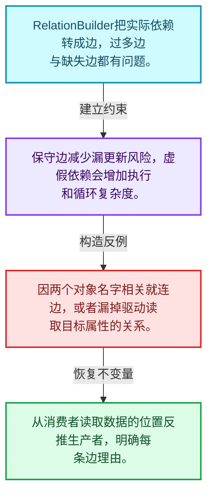
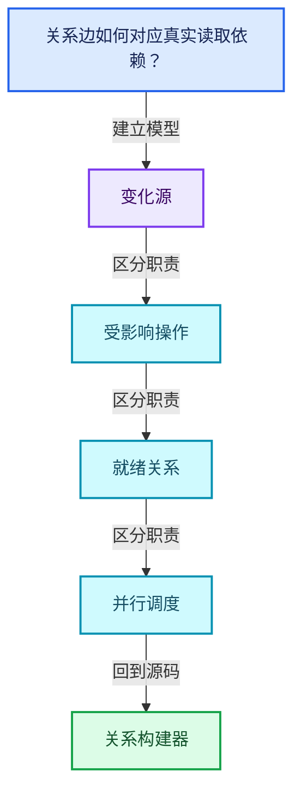
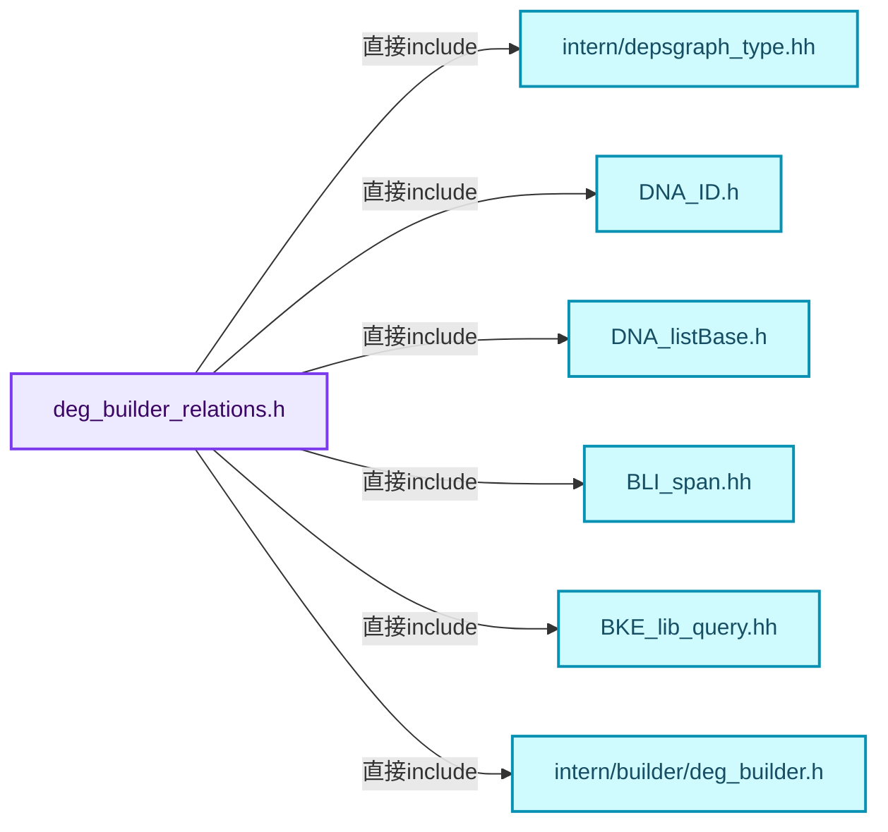
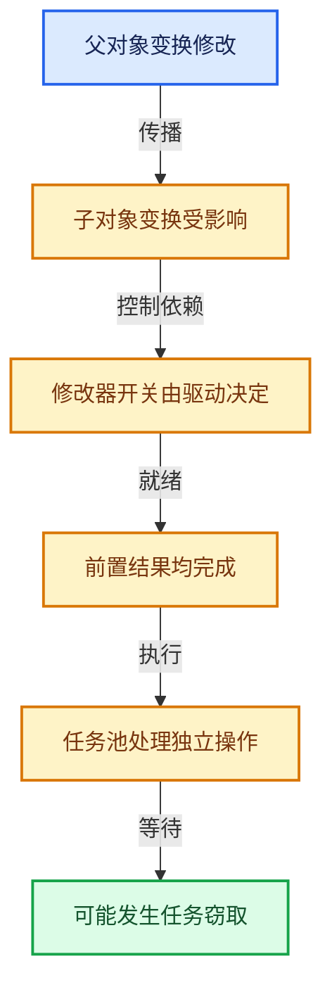

# 11-04 关系构建器

[方向导航](README.md) · [总目录](../README.md) · [覆盖索引](../%E6%BA%90%E7%A0%81%E7%89%88%E6%9C%AC%E4%B8%8E%E8%A6%86%E7%9B%96%E7%B4%A2%E5%BC%95.md)

> 阅读顺序：问题与数据模型 → 语法与类型 → 源码逐行 → 调用线索 → 历史与取舍 → 推演和练习。

- 基准 HEAD：`cbda6b96c26c0dee3c3b5cbb93960c4ac06a6b30`。
- 记录日期：2026-10-14。
- 教学示例状态：正文中的推演不是本机性能实测；已运行练习见验收报告。

## 一、从问题到设计

关系边如何对应真实读取依赖？

边应表达一个操作需要另一个结果，不应仅因对象相关就任意连边；环需要诊断和特定处理。

本篇把语法、数据语义和系统取舍连接起来。标记更新、判断需求、依赖满足和任务执行是分开的阶段。

### 本篇独立模型与设计推理

RelationBuilder把实际依赖转成边，过多边与缺失边都有问题。

设计取舍：保守边减少漏更新风险，虚假依赖会增加执行和循环复杂度。

最小反例：因两个对象名字相关就连边，或者漏掉驱动读取目标属性的关系。

推导与处理：从消费者读取数据的位置反推生产者，明确每条边理由。



### 源码范围与相邻篇章

| 文件 | 本篇逐行范围 | 基准SHA-256 |
|---|---|---|
| [source/blender/depsgraph/intern/builder/deg_builder_relations.h](../../../../../source/blender/depsgraph/intern/builder/deg_builder_relations.h) | L1—L376 | `760ea163a9ca288d967d8eb5df1adffd734cea346b70792cb6dbe39873986b3c` |
| [source/blender/depsgraph/intern/builder/deg_builder_relations.cc](../../../../../source/blender/depsgraph/intern/builder/deg_builder_relations.cc) | L1—L3829 | `7bf86f576c9c4058b5fcc66bce3f07d9e3c5ae899babe6d40cd0f39178d6af23` |

同一主讲文件可能分多篇覆盖；超出本篇范围的符号通过覆盖索引定位。空行与纯注释保留在源码摘录中，逐行表解释有效语句与语法边界；许可证头统一保留。

前篇：[节点构建器](03-%E8%8A%82%E7%82%B9%E6%9E%84%E5%BB%BA%E5%99%A8.md).

后篇：[失效传播](05-%E5%A4%B1%E6%95%88%E4%BC%A0%E6%92%AD.md).

## 二、类型、数据与阅读地图



这是概念依赖图，边表示阅读关系，不声称是运行时调用顺序。

### 直接编译依赖



箭头只表示头文件包含关系；完整调用线索见后面的符号定位表。

## 三、关键词、语法与类型角色

### 模板 template

模板把类型或常量作为生成实现的参数。读声明时先列出类型参数、非类型参数和默认值，再看使用者实际实例化了什么。模板声明本身不意味着每种T都支持其全部成员。

具体检查：把T替换为int、string、只能移动的类型，分别检查每个被调用操作是否成立。

### 依赖名称 typename

typename既可引入类型模板参数，也可告诉编译器某个依赖名称是类型。它不创建运行时对象；解析期确认语法类别与实例化期检查具体类型是不同阶段。

具体检查：区分typename T::value_type和T::size()，前者标记类型，后者是表达式。

### 约束 requires

requires表达式或requires子句限制模板参与重载的条件。它提供编译期可用性检查，不是运行时if，不能指望输入到达程序后再被这一机制验证。

具体检查：构造满足和不满足约束的两个类型，观察候选被排除而不是在函数内返回错误。

### 只读限定 const

const约束当前访问路径可做的修改。const指针、指向const的指针、const视图对象、const元素是不同位置的限定；其他别名可能仍可修改原对象。

具体检查：分别写T* const、const T*与const T* const，并画出不可修改的层次。

### 异常边界 try与catch

try定义异常传播的局部边界。失败路径需要销毁已经成功构造的部分并释放相应存储；未构造的对象不能被析构。

具体检查：在第k次构造失败，列出已经存在的对象集合与待释放缓冲。

### 显式静态转换 static_cast

static_cast表达编译期允许的转换，不会自动验证运行时真实类型、指针寿命或索引边界。由void指针恢复T指针时，调用者仍须保证实际存储中确有合法T对象。

具体检查：标出转换前后的类型以及正确性依据来自哪里。

### 表示层转换 reinterpret_cast

reinterpret_cast不能自动开始任意对象的生命周期，也不能豁免对齐和别名规则。读这类代码需要追溯原始分配与实际构造操作。

具体检查：分别检查大小、对齐、生命周期和可访问类型，四项不能互相替代。

### 运行时多态 virtual

虚调用根据实际动态类型选择实现；经基类指针销毁对象时通常需要相应虚析构契约。每元素虚调用和循环外一次分派有不同开销。

具体检查：找出虚接口的实现类和调用频率，再讨论是否值得去虚拟化。

### 可选值 optional

optional把不存在与存在的T区分开，T的构造和析构跟随engaged状态变化。访问前应由has_value或条件分支证明存在。

具体检查：把空Field状态与合法常量零区分，不能用某个普通值代替不存在。

### 构造与new表达式

普通new可能分配并构造；placement new在给定地址构造，存储由其他机制提供。失败回滚应区分两类责任。

具体检查：追踪地址来自哪里、构造何时成功、由谁析构、由谁释放。

### 内部断言 assert

断言表达开发者预期成立的内部契约，发布构建可能关闭。它不能替代对不可信输入的完整错误处理，也不保证后续操作被运行时保护。

具体检查：对每条断言构造违反条件的输入，区分调用者错误与应向用户报告的错误。

### 类型别名 using

类型别名为已有类型建立名字，不创建运行期对象。它常把模板内部使用的类型统一暴露给泛型调用者。

具体检查：展开别名直到基础类型，区分类型别名和变量声明。

## 四、真实源码与逐行讲解

源码块保持原行内容，原始行号由小节标题及逐行表给出。表中的调用定位是静态阅读辅助；重载、模板实例化、宏展开和虚调用需结合完整声明，不能仅凭词法出现证明动态调用。

### deg_builder_relations.h：L1—L48

<!-- source:source/blender/depsgraph/intern/builder/deg_builder_relations.h:1:48 -->

```cpp
/* SPDX-FileCopyrightText: 2013 Blender Authors
 *
 * SPDX-License-Identifier: GPL-2.0-or-later */

/** \file
 * \ingroup depsgraph
 */

#pragma once

#include <cstring>

#include "intern/depsgraph_type.hh"

#include "DNA_ID.h"
#include "DNA_listBase.h"

#include "BLI_span.hh"

#include "BKE_lib_query.hh" /* For LibraryForeachIDCallbackFlag enum. */

#include "intern/builder/deg_builder.h"
#include "intern/builder/deg_builder_key.h"
#include "intern/builder/deg_builder_map.h"
#include "intern/builder/deg_builder_rna.h"
#include "intern/builder/deg_builder_stack.h"
#include "intern/depsgraph.hh"
#include "intern/node/deg_node.hh"
#include "intern/node/deg_node_component.hh"
#include "intern/node/deg_node_id.hh"
#include "intern/node/deg_node_operation.hh"

namespace blender {

struct CacheFile;
struct Camera;
struct Collection;
struct EffectorWeights;
struct FCurve;
struct FreestyleLineSet;
struct FreestyleLineStyle;
struct ID;
struct IDProperty;
struct Image;
struct Key;
struct LayerCollection;
struct Light;
struct LightProbe;
```

| 原始行 | 语义、约束与检查 |
|---|---|
| L9 | 防止同一头文件在一个翻译单元中重复展开；不控制多个源文件之间的链接或对象寿命。 |
| L11 | 引入编译依赖 <cstring>；这是声明可见性关系，不表示运行时一定调用该文件的所有接口。 |
| L13 | 引入编译依赖 "intern/depsgraph_type.hh"；这是声明可见性关系，不表示运行时一定调用该文件的所有接口。 |
| L15 | 引入编译依赖 "DNA_ID.h"；这是声明可见性关系，不表示运行时一定调用该文件的所有接口。 |
| L16 | 引入编译依赖 "DNA_listBase.h"；这是声明可见性关系，不表示运行时一定调用该文件的所有接口。 |
| L18 | 引入编译依赖 "BLI_span.hh"；这是声明可见性关系，不表示运行时一定调用该文件的所有接口。 |
| L20 | 引入编译依赖 "BKE_lib_query.hh"；这是声明可见性关系，不表示运行时一定调用该文件的所有接口。 |
| L22 | 引入编译依赖 "intern/builder/deg_builder.h"；这是声明可见性关系，不表示运行时一定调用该文件的所有接口。 |
| L23 | 引入编译依赖 "intern/builder/deg_builder_key.h"；这是声明可见性关系，不表示运行时一定调用该文件的所有接口。 |
| L24 | 引入编译依赖 "intern/builder/deg_builder_map.h"；这是声明可见性关系，不表示运行时一定调用该文件的所有接口。 |
| L25 | 引入编译依赖 "intern/builder/deg_builder_rna.h"；这是声明可见性关系，不表示运行时一定调用该文件的所有接口。 |
| L26 | 引入编译依赖 "intern/builder/deg_builder_stack.h"；这是声明可见性关系，不表示运行时一定调用该文件的所有接口。 |
| L27 | 引入编译依赖 "intern/depsgraph.hh"；这是声明可见性关系，不表示运行时一定调用该文件的所有接口。 |
| L28 | 引入编译依赖 "intern/node/deg_node.hh"；这是声明可见性关系，不表示运行时一定调用该文件的所有接口。 |
| L29 | 引入编译依赖 "intern/node/deg_node_component.hh"；这是声明可见性关系，不表示运行时一定调用该文件的所有接口。 |
| L30 | 引入编译依赖 "intern/node/deg_node_id.hh"；这是声明可见性关系，不表示运行时一定调用该文件的所有接口。 |
| L31 | 引入编译依赖 "intern/node/deg_node_operation.hh"；这是声明可见性关系，不表示运行时一定调用该文件的所有接口。 |
| L33 | 把后续声明放入 blender 命名空间，影响名称查找和符号归属，不创建运行时对象。 |
| L35 | 声明或定义类型 `struct CacheFile`。结合继承、访问权限和成员布局确认接口与拥有关系；前向声明本身没有完整对象布局。 |
| L36 | 声明或定义类型 `struct Camera`。结合继承、访问权限和成员布局确认接口与拥有关系；前向声明本身没有完整对象布局。 |
| L37 | 声明或定义类型 `struct Collection`。结合继承、访问权限和成员布局确认接口与拥有关系；前向声明本身没有完整对象布局。 |
| L38 | 声明或定义类型 `struct EffectorWeights`。结合继承、访问权限和成员布局确认接口与拥有关系；前向声明本身没有完整对象布局。 |
| L39 | 声明或定义类型 `struct FCurve`。结合继承、访问权限和成员布局确认接口与拥有关系；前向声明本身没有完整对象布局。 |
| L40 | 声明或定义类型 `struct FreestyleLineSet`。结合继承、访问权限和成员布局确认接口与拥有关系；前向声明本身没有完整对象布局。 |
| L41 | 声明或定义类型 `struct FreestyleLineStyle`。结合继承、访问权限和成员布局确认接口与拥有关系；前向声明本身没有完整对象布局。 |
| L42 | 声明或定义类型 `struct ID`。结合继承、访问权限和成员布局确认接口与拥有关系；前向声明本身没有完整对象布局。 |
| L43 | 声明或定义类型 `struct IDProperty`。结合继承、访问权限和成员布局确认接口与拥有关系；前向声明本身没有完整对象布局。 |
| L44 | 声明或定义类型 `struct Image`。结合继承、访问权限和成员布局确认接口与拥有关系；前向声明本身没有完整对象布局。 |
| L45 | 声明或定义类型 `struct Key`。结合继承、访问权限和成员布局确认接口与拥有关系；前向声明本身没有完整对象布局。 |
| L46 | 声明或定义类型 `struct LayerCollection`。结合继承、访问权限和成员布局确认接口与拥有关系；前向声明本身没有完整对象布局。 |
| L47 | 声明或定义类型 `struct Light`。结合继承、访问权限和成员布局确认接口与拥有关系；前向声明本身没有完整对象布局。 |
| L48 | 声明或定义类型 `struct LightProbe`。结合继承、访问权限和成员布局确认接口与拥有关系；前向声明本身没有完整对象布局。 |

### deg_builder_relations.h：L49—L94

<!-- source:source/blender/depsgraph/intern/builder/deg_builder_relations.h:49:94 -->

```cpp
struct Main;
struct Mask;
struct Material;
struct MovieClip;
struct NlaStrip;
struct Object;
struct ParticleSettings;
struct ParticleSystem;
struct Scene;
struct Speaker;
struct Tex;
struct VFont;
struct ViewLayer;
struct World;
struct bAction;
struct bArmature;
struct bConstraint;
struct bNodeSocket;
struct bNodeTree;
struct bPoseChannel;
struct bSound;

namespace deg {

struct ComponentNode;
struct DepsNodeHandle;
struct Depsgraph;
class DepsgraphBuilderCache;
struct IDNode;
struct Node;
struct OperationNode;
struct Relation;
struct RootPChanMap;
struct TimeSourceNode;

class DepsgraphRelationBuilder : public DepsgraphBuilder {
 public:
  DepsgraphRelationBuilder(Main *bmain, Depsgraph *graph, DepsgraphBuilderCache *cache);

  void begin_build();

  template<typename KeyFrom, typename KeyTo>
  Relation *add_relation(const KeyFrom &key_from,
                         const KeyTo &key_to,
                         const char *description,
                         int flags = 0);
```

| 原始行 | 语义、约束与检查 |
|---|---|
| L49 | 声明或定义类型 `struct Main`。结合继承、访问权限和成员布局确认接口与拥有关系；前向声明本身没有完整对象布局。 |
| L50 | 声明或定义类型 `struct Mask`。结合继承、访问权限和成员布局确认接口与拥有关系；前向声明本身没有完整对象布局。 |
| L51 | 声明或定义类型 `struct Material`。结合继承、访问权限和成员布局确认接口与拥有关系；前向声明本身没有完整对象布局。 |
| L52 | 声明或定义类型 `struct MovieClip`。结合继承、访问权限和成员布局确认接口与拥有关系；前向声明本身没有完整对象布局。 |
| L53 | 声明或定义类型 `struct NlaStrip`。结合继承、访问权限和成员布局确认接口与拥有关系；前向声明本身没有完整对象布局。 |
| L54 | 声明或定义类型 `struct Object`。结合继承、访问权限和成员布局确认接口与拥有关系；前向声明本身没有完整对象布局。 |
| L55 | 声明或定义类型 `struct ParticleSettings`。结合继承、访问权限和成员布局确认接口与拥有关系；前向声明本身没有完整对象布局。 |
| L56 | 声明或定义类型 `struct ParticleSystem`。结合继承、访问权限和成员布局确认接口与拥有关系；前向声明本身没有完整对象布局。 |
| L57 | 声明或定义类型 `struct Scene`。结合继承、访问权限和成员布局确认接口与拥有关系；前向声明本身没有完整对象布局。 |
| L58 | 声明或定义类型 `struct Speaker`。结合继承、访问权限和成员布局确认接口与拥有关系；前向声明本身没有完整对象布局。 |
| L59 | 声明或定义类型 `struct Tex`。结合继承、访问权限和成员布局确认接口与拥有关系；前向声明本身没有完整对象布局。 |
| L60 | 声明或定义类型 `struct VFont`。结合继承、访问权限和成员布局确认接口与拥有关系；前向声明本身没有完整对象布局。 |
| L61 | 声明或定义类型 `struct ViewLayer`。结合继承、访问权限和成员布局确认接口与拥有关系；前向声明本身没有完整对象布局。 |
| L62 | 声明或定义类型 `struct World`。结合继承、访问权限和成员布局确认接口与拥有关系；前向声明本身没有完整对象布局。 |
| L63 | 声明或定义类型 `struct bAction`。结合继承、访问权限和成员布局确认接口与拥有关系；前向声明本身没有完整对象布局。 |
| L64 | 声明或定义类型 `struct bArmature`。结合继承、访问权限和成员布局确认接口与拥有关系；前向声明本身没有完整对象布局。 |
| L65 | 声明或定义类型 `struct bConstraint`。结合继承、访问权限和成员布局确认接口与拥有关系；前向声明本身没有完整对象布局。 |
| L66 | 声明或定义类型 `struct bNodeSocket`。结合继承、访问权限和成员布局确认接口与拥有关系；前向声明本身没有完整对象布局。 |
| L67 | 声明或定义类型 `struct bNodeTree`。结合继承、访问权限和成员布局确认接口与拥有关系；前向声明本身没有完整对象布局。 |
| L68 | 声明或定义类型 `struct bPoseChannel`。结合继承、访问权限和成员布局确认接口与拥有关系；前向声明本身没有完整对象布局。 |
| L69 | 声明或定义类型 `struct bSound`。结合继承、访问权限和成员布局确认接口与拥有关系；前向声明本身没有完整对象布局。 |
| L71 | 把后续声明放入 deg 命名空间，影响名称查找和符号归属，不创建运行时对象。 |
| L73 | 声明或定义类型 `struct ComponentNode`。结合继承、访问权限和成员布局确认接口与拥有关系；前向声明本身没有完整对象布局。 |
| L74 | 声明或定义类型 `struct DepsNodeHandle`。结合继承、访问权限和成员布局确认接口与拥有关系；前向声明本身没有完整对象布局。 |
| L75 | 声明或定义类型 `struct Depsgraph`。结合继承、访问权限和成员布局确认接口与拥有关系；前向声明本身没有完整对象布局。 |
| L76 | 声明或定义类型 `class DepsgraphBuilderCache`。结合继承、访问权限和成员布局确认接口与拥有关系；前向声明本身没有完整对象布局。 |
| L77 | 声明或定义类型 `struct IDNode`。结合继承、访问权限和成员布局确认接口与拥有关系；前向声明本身没有完整对象布局。 |
| L78 | 声明或定义类型 `struct Node`。结合继承、访问权限和成员布局确认接口与拥有关系；前向声明本身没有完整对象布局。 |
| L79 | 声明或定义类型 `struct OperationNode`。结合继承、访问权限和成员布局确认接口与拥有关系；前向声明本身没有完整对象布局。 |
| L80 | 声明或定义类型 `struct Relation`。结合继承、访问权限和成员布局确认接口与拥有关系；前向声明本身没有完整对象布局。 |
| L81 | 声明或定义类型 `struct RootPChanMap`。结合继承、访问权限和成员布局确认接口与拥有关系；前向声明本身没有完整对象布局。 |
| L82 | 声明或定义类型 `struct TimeSourceNode`。结合继承、访问权限和成员布局确认接口与拥有关系；前向声明本身没有完整对象布局。 |
| L84 | 声明或定义类型 `class DepsgraphRelationBuilder : public DepsgraphBuilder`。结合继承、访问权限和成员布局确认接口与拥有关系；前向声明本身没有完整对象布局。 |
| L85 | 切换成员访问权限为 public；它是编译期接口边界，不是线程同步或内存保护。 |
| L86 | 出现调用或函数声明 `DepsgraphRelationBuilder`，对应表达式为 `DepsgraphRelationBuilder(Main *bmain, Depsgraph *graph, DepsgraphBuilderCache *cache);`。参数求值、返回类型与重载需结合前后完整语句；静态文本引用不能证明动态目标。 |
| L88 | 声明接口 `void begin_build()`，本行没有对应函数体；返回类型、参数限定和const/noexcept共同组成调用契约，实际行为需继续定位实现。 |
| L90 | 声明模板参数 `template<typename KeyFrom, typename KeyTo>`。类型参数决定生成操作的类型，非类型参数可决定内嵌容量或编译期分支。 |
| L91 | 出现调用或函数声明 `add_relation`，对应表达式为 `Relation *add_relation(const KeyFrom &key_from,`。参数求值、返回类型与重载需结合前后完整语句；静态文本引用不能证明动态目标。 |
| L92 | 本行是连续声明或表达式的一部分：`const KeyTo &key_to,`。与本段前后行合读；逗号、括号和限定符决定它属于参数、初始化列表还是实际计算。 |
| L93 | 本行是连续声明或表达式的一部分：`const char *description,`。与本段前后行合读；逗号、括号和限定符决定它属于参数、初始化列表还是实际计算。 |
| L94 | 把右侧 `0)` 用于初始化或更新左侧 `int flags`。声明初始化与已有对象赋值应按上下文区分；有资源的类型会调用相应特殊成员。 |

### deg_builder_relations.h：L95—L143

<!-- source:source/blender/depsgraph/intern/builder/deg_builder_relations.h:95:143 -->

```cpp

  template<typename KeyTo>
  Relation *add_relation(const TimeSourceKey &key_from,
                         const KeyTo &key_to,
                         const char *description,
                         int flags = 0);

  template<typename KeyType>
    requires(!std::is_same_v<KeyType, TimeSourceKey>)
  Relation *add_node_handle_relation(const KeyType &key_from,
                                     const DepsNodeHandle *handle,
                                     const char *description,
                                     int flags = 0);

  Relation *add_node_handle_relation(const TimeSourceKey &key_from,
                                     const DepsNodeHandle *handle,
                                     const char *description,
                                     int flags = 0);

  template<typename KeyTo>
  Relation *add_depends_on_transform_relation(ID *id,
                                              const KeyTo &key_to,
                                              const char *description,
                                              int flags = 0);

  /* Adds relation from proper transformation operation to the modifier.
   * Takes care of checking for possible physics solvers modifying position
   * of this object. */
  void add_depends_on_transform_relation(const DepsNodeHandle *handle, const char *description);

  void add_customdata_mask(Object *object, const DEGCustomDataMeshMasks &customdata_masks);
  void add_special_eval_flag(ID *id, uint32_t flag);

  virtual void build_id(ID *id);

  /* Build function for ID types that do not need their own build_xxx() function. */
  virtual void build_generic_id(ID *id);

  virtual void build_idproperties(IDProperty *id_property);

  virtual void build_scene_camera(Scene *scene);
  virtual void build_scene_render(Scene *scene, ViewLayer *view_layer);
  virtual void build_scene_parameters(Scene *scene);
  virtual void build_scene_compositor(Scene *scene);

  /* Excluded layer collections are not built themselves, but their children are, attached to
   * `parent_hierarchy_key`: the nearest non-excluded ancestor (or the scene). */
  virtual void build_layer_collections(LayerCollection *layer_collection,
                                       const ComponentKey &parent_hierarchy_key);
```

| 原始行 | 语义、约束与检查 |
|---|---|
| L96 | 声明模板参数 `template<typename KeyTo>`。类型参数决定生成操作的类型，非类型参数可决定内嵌容量或编译期分支。 |
| L97 | 出现调用或函数声明 `add_relation`，对应表达式为 `Relation *add_relation(const TimeSourceKey &key_from,`。参数求值、返回类型与重载需结合前后完整语句；静态文本引用不能证明动态目标。 |
| L98 | 本行是连续声明或表达式的一部分：`const KeyTo &key_to,`。与本段前后行合读；逗号、括号和限定符决定它属于参数、初始化列表还是实际计算。 |
| L99 | 本行是连续声明或表达式的一部分：`const char *description,`。与本段前后行合读；逗号、括号和限定符决定它属于参数、初始化列表还是实际计算。 |
| L100 | 把右侧 `0)` 用于初始化或更新左侧 `int flags`。声明初始化与已有对象赋值应按上下文区分；有资源的类型会调用相应特殊成员。 |
| L102 | 声明模板参数 `template<typename KeyType>`。类型参数决定生成操作的类型，非类型参数可决定内嵌容量或编译期分支。 |
| L103 | 约束模板可用性：`requires(!std::is_same_v<KeyType, TimeSourceKey>)`。条件在编译期检查，不替代运行期的地址、长度和类型一致性验证。 |
| L104 | 出现调用或函数声明 `add_node_handle_relation`，对应表达式为 `Relation *add_node_handle_relation(const KeyType &key_from,`。参数求值、返回类型与重载需结合前后完整语句；静态文本引用不能证明动态目标。 |
| L105 | 本行是连续声明或表达式的一部分：`const DepsNodeHandle *handle,`。与本段前后行合读；逗号、括号和限定符决定它属于参数、初始化列表还是实际计算。 |
| L106 | 本行是连续声明或表达式的一部分：`const char *description,`。与本段前后行合读；逗号、括号和限定符决定它属于参数、初始化列表还是实际计算。 |
| L107 | 把右侧 `0)` 用于初始化或更新左侧 `int flags`。声明初始化与已有对象赋值应按上下文区分；有资源的类型会调用相应特殊成员。 |
| L109 | 出现调用或函数声明 `add_node_handle_relation`，对应表达式为 `Relation *add_node_handle_relation(const TimeSourceKey &key_from,`。参数求值、返回类型与重载需结合前后完整语句；静态文本引用不能证明动态目标。 |
| L110 | 本行是连续声明或表达式的一部分：`const DepsNodeHandle *handle,`。与本段前后行合读；逗号、括号和限定符决定它属于参数、初始化列表还是实际计算。 |
| L111 | 本行是连续声明或表达式的一部分：`const char *description,`。与本段前后行合读；逗号、括号和限定符决定它属于参数、初始化列表还是实际计算。 |
| L112 | 把右侧 `0)` 用于初始化或更新左侧 `int flags`。声明初始化与已有对象赋值应按上下文区分；有资源的类型会调用相应特殊成员。 |
| L114 | 声明模板参数 `template<typename KeyTo>`。类型参数决定生成操作的类型，非类型参数可决定内嵌容量或编译期分支。 |
| L115 | 出现调用或函数声明 `add_depends_on_transform_relation`，对应表达式为 `Relation *add_depends_on_transform_relation(ID *id,`。参数求值、返回类型与重载需结合前后完整语句；静态文本引用不能证明动态目标。 |
| L116 | 本行是连续声明或表达式的一部分：`const KeyTo &key_to,`。与本段前后行合读；逗号、括号和限定符决定它属于参数、初始化列表还是实际计算。 |
| L117 | 本行是连续声明或表达式的一部分：`const char *description,`。与本段前后行合读；逗号、括号和限定符决定它属于参数、初始化列表还是实际计算。 |
| L118 | 把右侧 `0)` 用于初始化或更新左侧 `int flags`。声明初始化与已有对象赋值应按上下文区分；有资源的类型会调用相应特殊成员。 |
| L123 | 声明接口 `void add_depends_on_transform_relation(const DepsNodeHandle *handle, const char *description)`，本行没有对应函数体；返回类型、参数限定和const/noexcept共同组成调用契约，实际行为需继续定位实现。 |
| L125 | 声明接口 `void add_customdata_mask(Object *object, const DEGCustomDataMeshMasks &customdata_masks)`，本行没有对应函数体；返回类型、参数限定和const/noexcept共同组成调用契约，实际行为需继续定位实现。 |
| L126 | 声明接口 `void add_special_eval_flag(ID *id, uint32_t flag)`，本行没有对应函数体；返回类型、参数限定和const/noexcept共同组成调用契约，实际行为需继续定位实现。 |
| L128 | 声明接口 `virtual void build_id(ID *id)`，本行没有对应函数体；返回类型、参数限定和const/noexcept共同组成调用契约，实际行为需继续定位实现。 |
| L131 | 声明接口 `virtual void build_generic_id(ID *id)`，本行没有对应函数体；返回类型、参数限定和const/noexcept共同组成调用契约，实际行为需继续定位实现。 |
| L133 | 声明接口 `virtual void build_idproperties(IDProperty *id_property)`，本行没有对应函数体；返回类型、参数限定和const/noexcept共同组成调用契约，实际行为需继续定位实现。 |
| L135 | 声明接口 `virtual void build_scene_camera(Scene *scene)`，本行没有对应函数体；返回类型、参数限定和const/noexcept共同组成调用契约，实际行为需继续定位实现。 |
| L136 | 声明接口 `virtual void build_scene_render(Scene *scene, ViewLayer *view_layer)`，本行没有对应函数体；返回类型、参数限定和const/noexcept共同组成调用契约，实际行为需继续定位实现。 |
| L137 | 声明接口 `virtual void build_scene_parameters(Scene *scene)`，本行没有对应函数体；返回类型、参数限定和const/noexcept共同组成调用契约，实际行为需继续定位实现。 |
| L138 | 声明接口 `virtual void build_scene_compositor(Scene *scene)`，本行没有对应函数体；返回类型、参数限定和const/noexcept共同组成调用契约，实际行为需继续定位实现。 |
| L142 | 出现调用或函数声明 `build_layer_collections`，对应表达式为 `virtual void build_layer_collections(LayerCollection *layer_collection,`。参数求值、返回类型与重载需结合前后完整语句；静态文本引用不能证明动态目标。 |
| L143 | 声明成员、局部对象或完成语句 `const ComponentKey &parent_hierarchy_key)`。若为指针或引用，它本身不说明拥有；若为值对象，其构造析构由所在作用域或外层对象管理。 |

### deg_builder_relations.h：L144—L191

<!-- source:source/blender/depsgraph/intern/builder/deg_builder_relations.h:144:191 -->

```cpp
  virtual void build_view_layer_collections(ViewLayer *view_layer);

  virtual void build_view_layer(Scene *scene,
                                ViewLayer *view_layer,
                                eDepsNode_LinkedState_Type linked_state);
  virtual void build_collection(LayerCollection *from_layer_collection, Collection *collection);
  virtual void build_object(Object *object);
  virtual void build_object_from_view_layer_base(Object *object);
  virtual void build_object_layer_component_relations(Object *object);
  virtual void build_object_modifiers(Object *object);
  virtual void build_object_data(Object *object);
  virtual void build_object_data_camera(Object *object);
  virtual void build_object_data_geometry(Object *object);
  virtual void build_object_data_geometry_datablock(ID *obdata);
  virtual void build_object_data_empty(Object *object);
  virtual void build_object_data_light(Object *object);
  virtual void build_object_data_lightprobe(Object *object);
  virtual void build_object_data_speaker(Object *object);
  virtual void build_object_parent(Object *object);
  virtual void build_object_pointcache(Object *object);
  virtual void build_object_instance_collection(Object *object);

  virtual void build_object_shading(Object *object);

  virtual void build_object_light_linking(Object *emitter);
  virtual void build_light_linking_collection(Object *emitter, Collection *collection);

  virtual void build_constraints(ID *id,
                                 NodeType component_type,
                                 const char *component_subdata,
                                 ListBaseT<bConstraint> *constraints,
                                 RootPChanMap *root_map);
  virtual void build_animdata(ID *id);
  virtual void build_animdata_curves(ID *id);
  virtual void build_animdata_fcurve_target(ID *id,
                                            PointerRNA id_ptr,
                                            ComponentKey &adt_key,
                                            OperationNode *operation_from,
                                            FCurve *fcu);
  virtual void build_animdata_action_targets(ID *id,
                                             int32_t slot_handle,
                                             ComponentKey &adt_key,
                                             OperationNode *operation_from,
                                             bAction *action);
  virtual void build_animdata_nlastrip_targets(ID *id,
                                               ComponentKey &adt_key,
                                               OperationNode *operation_from,
                                               ListBaseT<NlaStrip> *strips);
```

| 原始行 | 语义、约束与检查 |
|---|---|
| L144 | 声明接口 `virtual void build_view_layer_collections(ViewLayer *view_layer)`，本行没有对应函数体；返回类型、参数限定和const/noexcept共同组成调用契约，实际行为需继续定位实现。 |
| L146 | 出现调用或函数声明 `build_view_layer`，对应表达式为 `virtual void build_view_layer(Scene *scene,`。参数求值、返回类型与重载需结合前后完整语句；静态文本引用不能证明动态目标。 |
| L147 | 本行是连续声明或表达式的一部分：`ViewLayer *view_layer,`。与本段前后行合读；逗号、括号和限定符决定它属于参数、初始化列表还是实际计算。 |
| L148 | 声明成员、局部对象或完成语句 `eDepsNode_LinkedState_Type linked_state)`。若为指针或引用，它本身不说明拥有；若为值对象，其构造析构由所在作用域或外层对象管理。 |
| L149 | 声明接口 `virtual void build_collection(LayerCollection *from_layer_collection, Collection *collection)`，本行没有对应函数体；返回类型、参数限定和const/noexcept共同组成调用契约，实际行为需继续定位实现。 |
| L150 | 声明接口 `virtual void build_object(Object *object)`，本行没有对应函数体；返回类型、参数限定和const/noexcept共同组成调用契约，实际行为需继续定位实现。 |
| L151 | 声明接口 `virtual void build_object_from_view_layer_base(Object *object)`，本行没有对应函数体；返回类型、参数限定和const/noexcept共同组成调用契约，实际行为需继续定位实现。 |
| L152 | 声明接口 `virtual void build_object_layer_component_relations(Object *object)`，本行没有对应函数体；返回类型、参数限定和const/noexcept共同组成调用契约，实际行为需继续定位实现。 |
| L153 | 声明接口 `virtual void build_object_modifiers(Object *object)`，本行没有对应函数体；返回类型、参数限定和const/noexcept共同组成调用契约，实际行为需继续定位实现。 |
| L154 | 声明接口 `virtual void build_object_data(Object *object)`，本行没有对应函数体；返回类型、参数限定和const/noexcept共同组成调用契约，实际行为需继续定位实现。 |
| L155 | 声明接口 `virtual void build_object_data_camera(Object *object)`，本行没有对应函数体；返回类型、参数限定和const/noexcept共同组成调用契约，实际行为需继续定位实现。 |
| L156 | 声明接口 `virtual void build_object_data_geometry(Object *object)`，本行没有对应函数体；返回类型、参数限定和const/noexcept共同组成调用契约，实际行为需继续定位实现。 |
| L157 | 声明接口 `virtual void build_object_data_geometry_datablock(ID *obdata)`，本行没有对应函数体；返回类型、参数限定和const/noexcept共同组成调用契约，实际行为需继续定位实现。 |
| L158 | 声明接口 `virtual void build_object_data_empty(Object *object)`，本行没有对应函数体；返回类型、参数限定和const/noexcept共同组成调用契约，实际行为需继续定位实现。 |
| L159 | 声明接口 `virtual void build_object_data_light(Object *object)`，本行没有对应函数体；返回类型、参数限定和const/noexcept共同组成调用契约，实际行为需继续定位实现。 |
| L160 | 声明接口 `virtual void build_object_data_lightprobe(Object *object)`，本行没有对应函数体；返回类型、参数限定和const/noexcept共同组成调用契约，实际行为需继续定位实现。 |
| L161 | 声明接口 `virtual void build_object_data_speaker(Object *object)`，本行没有对应函数体；返回类型、参数限定和const/noexcept共同组成调用契约，实际行为需继续定位实现。 |
| L162 | 声明接口 `virtual void build_object_parent(Object *object)`，本行没有对应函数体；返回类型、参数限定和const/noexcept共同组成调用契约，实际行为需继续定位实现。 |
| L163 | 声明接口 `virtual void build_object_pointcache(Object *object)`，本行没有对应函数体；返回类型、参数限定和const/noexcept共同组成调用契约，实际行为需继续定位实现。 |
| L164 | 声明接口 `virtual void build_object_instance_collection(Object *object)`，本行没有对应函数体；返回类型、参数限定和const/noexcept共同组成调用契约，实际行为需继续定位实现。 |
| L166 | 声明接口 `virtual void build_object_shading(Object *object)`，本行没有对应函数体；返回类型、参数限定和const/noexcept共同组成调用契约，实际行为需继续定位实现。 |
| L168 | 声明接口 `virtual void build_object_light_linking(Object *emitter)`，本行没有对应函数体；返回类型、参数限定和const/noexcept共同组成调用契约，实际行为需继续定位实现。 |
| L169 | 声明接口 `virtual void build_light_linking_collection(Object *emitter, Collection *collection)`，本行没有对应函数体；返回类型、参数限定和const/noexcept共同组成调用契约，实际行为需继续定位实现。 |
| L171 | 出现调用或函数声明 `build_constraints`，对应表达式为 `virtual void build_constraints(ID *id,`。参数求值、返回类型与重载需结合前后完整语句；静态文本引用不能证明动态目标。 |
| L172 | 本行是连续声明或表达式的一部分：`NodeType component_type,`。与本段前后行合读；逗号、括号和限定符决定它属于参数、初始化列表还是实际计算。 |
| L173 | 本行是连续声明或表达式的一部分：`const char *component_subdata,`。与本段前后行合读；逗号、括号和限定符决定它属于参数、初始化列表还是实际计算。 |
| L174 | 本行是连续声明或表达式的一部分：`ListBaseT<bConstraint> *constraints,`。与本段前后行合读；逗号、括号和限定符决定它属于参数、初始化列表还是实际计算。 |
| L175 | 声明成员、局部对象或完成语句 `RootPChanMap *root_map)`。若为指针或引用，它本身不说明拥有；若为值对象，其构造析构由所在作用域或外层对象管理。 |
| L176 | 声明接口 `virtual void build_animdata(ID *id)`，本行没有对应函数体；返回类型、参数限定和const/noexcept共同组成调用契约，实际行为需继续定位实现。 |
| L177 | 声明接口 `virtual void build_animdata_curves(ID *id)`，本行没有对应函数体；返回类型、参数限定和const/noexcept共同组成调用契约，实际行为需继续定位实现。 |
| L178 | 出现调用或函数声明 `build_animdata_fcurve_target`，对应表达式为 `virtual void build_animdata_fcurve_target(ID *id,`。参数求值、返回类型与重载需结合前后完整语句；静态文本引用不能证明动态目标。 |
| L179 | 本行是连续声明或表达式的一部分：`PointerRNA id_ptr,`。与本段前后行合读；逗号、括号和限定符决定它属于参数、初始化列表还是实际计算。 |
| L180 | 本行是连续声明或表达式的一部分：`ComponentKey &adt_key,`。与本段前后行合读；逗号、括号和限定符决定它属于参数、初始化列表还是实际计算。 |
| L181 | 本行是连续声明或表达式的一部分：`OperationNode *operation_from,`。与本段前后行合读；逗号、括号和限定符决定它属于参数、初始化列表还是实际计算。 |
| L182 | 声明成员、局部对象或完成语句 `FCurve *fcu)`。若为指针或引用，它本身不说明拥有；若为值对象，其构造析构由所在作用域或外层对象管理。 |
| L183 | 出现调用或函数声明 `build_animdata_action_targets`，对应表达式为 `virtual void build_animdata_action_targets(ID *id,`。参数求值、返回类型与重载需结合前后完整语句；静态文本引用不能证明动态目标。 |
| L184 | 本行是连续声明或表达式的一部分：`int32_t slot_handle,`。与本段前后行合读；逗号、括号和限定符决定它属于参数、初始化列表还是实际计算。 |
| L185 | 本行是连续声明或表达式的一部分：`ComponentKey &adt_key,`。与本段前后行合读；逗号、括号和限定符决定它属于参数、初始化列表还是实际计算。 |
| L186 | 本行是连续声明或表达式的一部分：`OperationNode *operation_from,`。与本段前后行合读；逗号、括号和限定符决定它属于参数、初始化列表还是实际计算。 |
| L187 | 声明成员、局部对象或完成语句 `bAction *action)`。若为指针或引用，它本身不说明拥有；若为值对象，其构造析构由所在作用域或外层对象管理。 |
| L188 | 出现调用或函数声明 `build_animdata_nlastrip_targets`，对应表达式为 `virtual void build_animdata_nlastrip_targets(ID *id,`。参数求值、返回类型与重载需结合前后完整语句；静态文本引用不能证明动态目标。 |
| L189 | 本行是连续声明或表达式的一部分：`ComponentKey &adt_key,`。与本段前后行合读；逗号、括号和限定符决定它属于参数、初始化列表还是实际计算。 |
| L190 | 本行是连续声明或表达式的一部分：`OperationNode *operation_from,`。与本段前后行合读；逗号、括号和限定符决定它属于参数、初始化列表还是实际计算。 |
| L191 | 声明成员、局部对象或完成语句 `ListBaseT<NlaStrip> *strips)`。若为指针或引用，它本身不说明拥有；若为值对象，其构造析构由所在作用域或外层对象管理。 |

### deg_builder_relations.h：L192—L239

<!-- source:source/blender/depsgraph/intern/builder/deg_builder_relations.h:192:239 -->

```cpp
  virtual void build_animdata_drivers(ID *id);
  virtual void build_animdata_force(ID *id);
  virtual void build_animation_images(ID *id);
  virtual void build_action(bAction *action);
  virtual void build_driver(ID *id, FCurve *fcurve);
  virtual void build_driver_data(ID *id, FCurve *fcurve);
  virtual void build_driver_variables(ID *id, FCurve *fcurve);

  virtual void build_driver_scene_camera_variable(const OperationKey &driver_key,
                                                  const RNAPathKey &self_key,
                                                  Scene *scene,
                                                  const char *rna_path);
  virtual void build_driver_rna_path_variable(const OperationKey &driver_key,
                                              const RNAPathKey &self_key,
                                              ID *target_id,
                                              const PointerRNA &target_prop,
                                              const char *rna_path);

  /* Build operations of a property value from which is read by a driver target.
   *
   * The driver target points to a data-block (or a sub-data-block like View Layer).
   * This data-block is presented in the interface as a "Prop" and its resolved RNA pointer is
   * passed here as `target_prop`.
   *
   * The tricky part (and a bit confusing naming) is that the driver target accesses a property of
   * the `target_prop` to get its value. The property which is read to give an actual target value
   * is denoted by its RNA path relative to the `target_prop`. In the interface it is called "Path"
   * and here it is called `rna_path_from_target_prop`. */
  virtual void build_driver_id_property(const PointerRNA &target_prop,
                                        const char *rna_path_from_target_prop);

  virtual void build_parameters(ID *id);
  virtual void build_dimensions(Object *object);
  virtual void build_world(World *world);
  virtual void build_rigidbody(Scene *scene);
  virtual void build_particle_systems(Object *object);
  virtual void build_particle_settings(ParticleSettings *part);
  virtual void build_particle_system_visualization_object(Object *object,
                                                          ParticleSystem *psys,
                                                          Object *draw_object);
  virtual void build_ik_pose(Object *object,
                             bPoseChannel *pchan,
                             bConstraint *con,
                             RootPChanMap *root_map);
  virtual void build_splineik_pose(Object *object,
                                   bPoseChannel *pchan,
                                   bConstraint *con,
                                   RootPChanMap *root_map);
```

| 原始行 | 语义、约束与检查 |
|---|---|
| L192 | 声明接口 `virtual void build_animdata_drivers(ID *id)`，本行没有对应函数体；返回类型、参数限定和const/noexcept共同组成调用契约，实际行为需继续定位实现。 |
| L193 | 声明接口 `virtual void build_animdata_force(ID *id)`，本行没有对应函数体；返回类型、参数限定和const/noexcept共同组成调用契约，实际行为需继续定位实现。 |
| L194 | 声明接口 `virtual void build_animation_images(ID *id)`，本行没有对应函数体；返回类型、参数限定和const/noexcept共同组成调用契约，实际行为需继续定位实现。 |
| L195 | 声明接口 `virtual void build_action(bAction *action)`，本行没有对应函数体；返回类型、参数限定和const/noexcept共同组成调用契约，实际行为需继续定位实现。 |
| L196 | 声明接口 `virtual void build_driver(ID *id, FCurve *fcurve)`，本行没有对应函数体；返回类型、参数限定和const/noexcept共同组成调用契约，实际行为需继续定位实现。 |
| L197 | 声明接口 `virtual void build_driver_data(ID *id, FCurve *fcurve)`，本行没有对应函数体；返回类型、参数限定和const/noexcept共同组成调用契约，实际行为需继续定位实现。 |
| L198 | 声明接口 `virtual void build_driver_variables(ID *id, FCurve *fcurve)`，本行没有对应函数体；返回类型、参数限定和const/noexcept共同组成调用契约，实际行为需继续定位实现。 |
| L200 | 出现调用或函数声明 `build_driver_scene_camera_variable`，对应表达式为 `virtual void build_driver_scene_camera_variable(const OperationKey &driver_key,`。参数求值、返回类型与重载需结合前后完整语句；静态文本引用不能证明动态目标。 |
| L201 | 本行是连续声明或表达式的一部分：`const RNAPathKey &self_key,`。与本段前后行合读；逗号、括号和限定符决定它属于参数、初始化列表还是实际计算。 |
| L202 | 本行是连续声明或表达式的一部分：`Scene *scene,`。与本段前后行合读；逗号、括号和限定符决定它属于参数、初始化列表还是实际计算。 |
| L203 | 声明成员、局部对象或完成语句 `const char *rna_path)`。若为指针或引用，它本身不说明拥有；若为值对象，其构造析构由所在作用域或外层对象管理。 |
| L204 | 出现调用或函数声明 `build_driver_rna_path_variable`，对应表达式为 `virtual void build_driver_rna_path_variable(const OperationKey &driver_key,`。参数求值、返回类型与重载需结合前后完整语句；静态文本引用不能证明动态目标。 |
| L205 | 本行是连续声明或表达式的一部分：`const RNAPathKey &self_key,`。与本段前后行合读；逗号、括号和限定符决定它属于参数、初始化列表还是实际计算。 |
| L206 | 本行是连续声明或表达式的一部分：`ID *target_id,`。与本段前后行合读；逗号、括号和限定符决定它属于参数、初始化列表还是实际计算。 |
| L207 | 本行是连续声明或表达式的一部分：`const PointerRNA &target_prop,`。与本段前后行合读；逗号、括号和限定符决定它属于参数、初始化列表还是实际计算。 |
| L208 | 声明成员、局部对象或完成语句 `const char *rna_path)`。若为指针或引用，它本身不说明拥有；若为值对象，其构造析构由所在作用域或外层对象管理。 |
| L220 | 出现调用或函数声明 `build_driver_id_property`，对应表达式为 `virtual void build_driver_id_property(const PointerRNA &target_prop,`。参数求值、返回类型与重载需结合前后完整语句；静态文本引用不能证明动态目标。 |
| L221 | 声明成员、局部对象或完成语句 `const char *rna_path_from_target_prop)`。若为指针或引用，它本身不说明拥有；若为值对象，其构造析构由所在作用域或外层对象管理。 |
| L223 | 声明接口 `virtual void build_parameters(ID *id)`，本行没有对应函数体；返回类型、参数限定和const/noexcept共同组成调用契约，实际行为需继续定位实现。 |
| L224 | 声明接口 `virtual void build_dimensions(Object *object)`，本行没有对应函数体；返回类型、参数限定和const/noexcept共同组成调用契约，实际行为需继续定位实现。 |
| L225 | 声明接口 `virtual void build_world(World *world)`，本行没有对应函数体；返回类型、参数限定和const/noexcept共同组成调用契约，实际行为需继续定位实现。 |
| L226 | 声明接口 `virtual void build_rigidbody(Scene *scene)`，本行没有对应函数体；返回类型、参数限定和const/noexcept共同组成调用契约，实际行为需继续定位实现。 |
| L227 | 声明接口 `virtual void build_particle_systems(Object *object)`，本行没有对应函数体；返回类型、参数限定和const/noexcept共同组成调用契约，实际行为需继续定位实现。 |
| L228 | 声明接口 `virtual void build_particle_settings(ParticleSettings *part)`，本行没有对应函数体；返回类型、参数限定和const/noexcept共同组成调用契约，实际行为需继续定位实现。 |
| L229 | 出现调用或函数声明 `build_particle_system_visualization_object`，对应表达式为 `virtual void build_particle_system_visualization_object(Object *object,`。参数求值、返回类型与重载需结合前后完整语句；静态文本引用不能证明动态目标。 |
| L230 | 本行是连续声明或表达式的一部分：`ParticleSystem *psys,`。与本段前后行合读；逗号、括号和限定符决定它属于参数、初始化列表还是实际计算。 |
| L231 | 声明成员、局部对象或完成语句 `Object *draw_object)`。若为指针或引用，它本身不说明拥有；若为值对象，其构造析构由所在作用域或外层对象管理。 |
| L232 | 出现调用或函数声明 `build_ik_pose`，对应表达式为 `virtual void build_ik_pose(Object *object,`。参数求值、返回类型与重载需结合前后完整语句；静态文本引用不能证明动态目标。 |
| L233 | 本行是连续声明或表达式的一部分：`bPoseChannel *pchan,`。与本段前后行合读；逗号、括号和限定符决定它属于参数、初始化列表还是实际计算。 |
| L234 | 本行是连续声明或表达式的一部分：`bConstraint *con,`。与本段前后行合读；逗号、括号和限定符决定它属于参数、初始化列表还是实际计算。 |
| L235 | 声明成员、局部对象或完成语句 `RootPChanMap *root_map)`。若为指针或引用，它本身不说明拥有；若为值对象，其构造析构由所在作用域或外层对象管理。 |
| L236 | 出现调用或函数声明 `build_splineik_pose`，对应表达式为 `virtual void build_splineik_pose(Object *object,`。参数求值、返回类型与重载需结合前后完整语句；静态文本引用不能证明动态目标。 |
| L237 | 本行是连续声明或表达式的一部分：`bPoseChannel *pchan,`。与本段前后行合读；逗号、括号和限定符决定它属于参数、初始化列表还是实际计算。 |
| L238 | 本行是连续声明或表达式的一部分：`bConstraint *con,`。与本段前后行合读；逗号、括号和限定符决定它属于参数、初始化列表还是实际计算。 |
| L239 | 声明成员、局部对象或完成语句 `RootPChanMap *root_map)`。若为指针或引用，它本身不说明拥有；若为值对象，其构造析构由所在作用域或外层对象管理。 |

### deg_builder_relations.h：L240—L287

<!-- source:source/blender/depsgraph/intern/builder/deg_builder_relations.h:240:287 -->

```cpp
  virtual void build_inter_ik_chains(Object *object,
                                     const OperationKey &solver_key,
                                     const bPoseChannel *rootchan,
                                     const RootPChanMap *root_map);
  virtual void build_rig(Object *object);
  virtual void build_shapekeys(Key *key);
  virtual void build_armature(bArmature *armature);
  virtual void build_armature_bones(ListBaseT<Bone> *bones);
  virtual void build_armature_bone_collections(Span<BoneCollection *> collections);
  virtual void build_camera(Camera *camera);
  virtual void build_light(Light *lamp);
  virtual void build_nodetree(bNodeTree *ntree);
  virtual void build_nodetree_socket(bNodeSocket *socket);
  virtual void build_material(Material *ma, ID *owner = nullptr);
  virtual void build_materials(ID *owner, Material **materials, int num_materials);
  virtual void build_freestyle_lineset(FreestyleLineSet *fls);
  virtual void build_freestyle_linestyle(FreestyleLineStyle *linestyle);
  virtual void build_texture(Tex *tex);
  virtual void build_image(Image *image);
  virtual void build_cachefile(CacheFile *cache_file);
  virtual void build_mask(Mask *mask);
  virtual void build_movieclip(MovieClip *clip);
  virtual void build_lightprobe(LightProbe *probe);
  virtual void build_speaker(Speaker *speaker);
  virtual void build_sound(bSound *sound);
  virtual void build_scene_sequencer(Scene *scene);
  virtual void build_scene_audio(Scene *scene);
  virtual void build_scene_speakers(Scene *scene, ViewLayer *view_layer);
  virtual void build_vfont(VFont *vfont);

  virtual void build_nested_datablock(ID *owner, ID *id, bool flush_cow_changes);
  virtual void build_nested_nodetree(ID *owner, bNodeTree *ntree);
  virtual void build_nested_shapekey(ID *owner, Key *key);

  void add_particle_collision_relations(const OperationKey &key,
                                        Object *object,
                                        Collection *collection,
                                        const char *name);
  void add_particle_forcefield_relations(const OperationKey &key,
                                         Object *object,
                                         ParticleSystem *psys,
                                         EffectorWeights *eff,
                                         bool add_absorption,
                                         const char *name);

  virtual void build_copy_on_write_relations();
  virtual void build_copy_on_write_relations(IDNode *id_node);
  virtual void build_driver_relations();
```

| 原始行 | 语义、约束与检查 |
|---|---|
| L240 | 出现调用或函数声明 `build_inter_ik_chains`，对应表达式为 `virtual void build_inter_ik_chains(Object *object,`。参数求值、返回类型与重载需结合前后完整语句；静态文本引用不能证明动态目标。 |
| L241 | 本行是连续声明或表达式的一部分：`const OperationKey &solver_key,`。与本段前后行合读；逗号、括号和限定符决定它属于参数、初始化列表还是实际计算。 |
| L242 | 本行是连续声明或表达式的一部分：`const bPoseChannel *rootchan,`。与本段前后行合读；逗号、括号和限定符决定它属于参数、初始化列表还是实际计算。 |
| L243 | 声明成员、局部对象或完成语句 `const RootPChanMap *root_map)`。若为指针或引用，它本身不说明拥有；若为值对象，其构造析构由所在作用域或外层对象管理。 |
| L244 | 声明接口 `virtual void build_rig(Object *object)`，本行没有对应函数体；返回类型、参数限定和const/noexcept共同组成调用契约，实际行为需继续定位实现。 |
| L245 | 声明接口 `virtual void build_shapekeys(Key *key)`，本行没有对应函数体；返回类型、参数限定和const/noexcept共同组成调用契约，实际行为需继续定位实现。 |
| L246 | 声明接口 `virtual void build_armature(bArmature *armature)`，本行没有对应函数体；返回类型、参数限定和const/noexcept共同组成调用契约，实际行为需继续定位实现。 |
| L247 | 声明接口 `virtual void build_armature_bones(ListBaseT<Bone> *bones)`，本行没有对应函数体；返回类型、参数限定和const/noexcept共同组成调用契约，实际行为需继续定位实现。 |
| L248 | 声明接口 `virtual void build_armature_bone_collections(Span<BoneCollection *> collections)`，本行没有对应函数体；返回类型、参数限定和const/noexcept共同组成调用契约，实际行为需继续定位实现。 |
| L249 | 声明接口 `virtual void build_camera(Camera *camera)`，本行没有对应函数体；返回类型、参数限定和const/noexcept共同组成调用契约，实际行为需继续定位实现。 |
| L250 | 声明接口 `virtual void build_light(Light *lamp)`，本行没有对应函数体；返回类型、参数限定和const/noexcept共同组成调用契约，实际行为需继续定位实现。 |
| L251 | 声明接口 `virtual void build_nodetree(bNodeTree *ntree)`，本行没有对应函数体；返回类型、参数限定和const/noexcept共同组成调用契约，实际行为需继续定位实现。 |
| L252 | 声明接口 `virtual void build_nodetree_socket(bNodeSocket *socket)`，本行没有对应函数体；返回类型、参数限定和const/noexcept共同组成调用契约，实际行为需继续定位实现。 |
| L253 | 把右侧 `nullptr)` 用于初始化或更新左侧 `virtual void build_material(Material *ma, ID *owner`。声明初始化与已有对象赋值应按上下文区分；有资源的类型会调用相应特殊成员。 |
| L254 | 声明接口 `virtual void build_materials(ID *owner, Material **materials, int num_materials)`，本行没有对应函数体；返回类型、参数限定和const/noexcept共同组成调用契约，实际行为需继续定位实现。 |
| L255 | 声明接口 `virtual void build_freestyle_lineset(FreestyleLineSet *fls)`，本行没有对应函数体；返回类型、参数限定和const/noexcept共同组成调用契约，实际行为需继续定位实现。 |
| L256 | 声明接口 `virtual void build_freestyle_linestyle(FreestyleLineStyle *linestyle)`，本行没有对应函数体；返回类型、参数限定和const/noexcept共同组成调用契约，实际行为需继续定位实现。 |
| L257 | 声明接口 `virtual void build_texture(Tex *tex)`，本行没有对应函数体；返回类型、参数限定和const/noexcept共同组成调用契约，实际行为需继续定位实现。 |
| L258 | 声明接口 `virtual void build_image(Image *image)`，本行没有对应函数体；返回类型、参数限定和const/noexcept共同组成调用契约，实际行为需继续定位实现。 |
| L259 | 声明接口 `virtual void build_cachefile(CacheFile *cache_file)`，本行没有对应函数体；返回类型、参数限定和const/noexcept共同组成调用契约，实际行为需继续定位实现。 |
| L260 | 声明接口 `virtual void build_mask(Mask *mask)`，本行没有对应函数体；返回类型、参数限定和const/noexcept共同组成调用契约，实际行为需继续定位实现。 |
| L261 | 声明接口 `virtual void build_movieclip(MovieClip *clip)`，本行没有对应函数体；返回类型、参数限定和const/noexcept共同组成调用契约，实际行为需继续定位实现。 |
| L262 | 声明接口 `virtual void build_lightprobe(LightProbe *probe)`，本行没有对应函数体；返回类型、参数限定和const/noexcept共同组成调用契约，实际行为需继续定位实现。 |
| L263 | 声明接口 `virtual void build_speaker(Speaker *speaker)`，本行没有对应函数体；返回类型、参数限定和const/noexcept共同组成调用契约，实际行为需继续定位实现。 |
| L264 | 声明接口 `virtual void build_sound(bSound *sound)`，本行没有对应函数体；返回类型、参数限定和const/noexcept共同组成调用契约，实际行为需继续定位实现。 |
| L265 | 声明接口 `virtual void build_scene_sequencer(Scene *scene)`，本行没有对应函数体；返回类型、参数限定和const/noexcept共同组成调用契约，实际行为需继续定位实现。 |
| L266 | 声明接口 `virtual void build_scene_audio(Scene *scene)`，本行没有对应函数体；返回类型、参数限定和const/noexcept共同组成调用契约，实际行为需继续定位实现。 |
| L267 | 声明接口 `virtual void build_scene_speakers(Scene *scene, ViewLayer *view_layer)`，本行没有对应函数体；返回类型、参数限定和const/noexcept共同组成调用契约，实际行为需继续定位实现。 |
| L268 | 声明接口 `virtual void build_vfont(VFont *vfont)`，本行没有对应函数体；返回类型、参数限定和const/noexcept共同组成调用契约，实际行为需继续定位实现。 |
| L270 | 声明接口 `virtual void build_nested_datablock(ID *owner, ID *id, bool flush_cow_changes)`，本行没有对应函数体；返回类型、参数限定和const/noexcept共同组成调用契约，实际行为需继续定位实现。 |
| L271 | 声明接口 `virtual void build_nested_nodetree(ID *owner, bNodeTree *ntree)`，本行没有对应函数体；返回类型、参数限定和const/noexcept共同组成调用契约，实际行为需继续定位实现。 |
| L272 | 声明接口 `virtual void build_nested_shapekey(ID *owner, Key *key)`，本行没有对应函数体；返回类型、参数限定和const/noexcept共同组成调用契约，实际行为需继续定位实现。 |
| L274 | 出现调用或函数声明 `add_particle_collision_relations`，对应表达式为 `void add_particle_collision_relations(const OperationKey &key,`。参数求值、返回类型与重载需结合前后完整语句；静态文本引用不能证明动态目标。 |
| L275 | 本行是连续声明或表达式的一部分：`Object *object,`。与本段前后行合读；逗号、括号和限定符决定它属于参数、初始化列表还是实际计算。 |
| L276 | 本行是连续声明或表达式的一部分：`Collection *collection,`。与本段前后行合读；逗号、括号和限定符决定它属于参数、初始化列表还是实际计算。 |
| L277 | 声明成员、局部对象或完成语句 `const char *name)`。若为指针或引用，它本身不说明拥有；若为值对象，其构造析构由所在作用域或外层对象管理。 |
| L278 | 出现调用或函数声明 `add_particle_forcefield_relations`，对应表达式为 `void add_particle_forcefield_relations(const OperationKey &key,`。参数求值、返回类型与重载需结合前后完整语句；静态文本引用不能证明动态目标。 |
| L279 | 本行是连续声明或表达式的一部分：`Object *object,`。与本段前后行合读；逗号、括号和限定符决定它属于参数、初始化列表还是实际计算。 |
| L280 | 本行是连续声明或表达式的一部分：`ParticleSystem *psys,`。与本段前后行合读；逗号、括号和限定符决定它属于参数、初始化列表还是实际计算。 |
| L281 | 本行是连续声明或表达式的一部分：`EffectorWeights *eff,`。与本段前后行合读；逗号、括号和限定符决定它属于参数、初始化列表还是实际计算。 |
| L282 | 本行是连续声明或表达式的一部分：`bool add_absorption,`。与本段前后行合读；逗号、括号和限定符决定它属于参数、初始化列表还是实际计算。 |
| L283 | 声明成员、局部对象或完成语句 `const char *name)`。若为指针或引用，它本身不说明拥有；若为值对象，其构造析构由所在作用域或外层对象管理。 |
| L285 | 声明接口 `virtual void build_copy_on_write_relations()`，本行没有对应函数体；返回类型、参数限定和const/noexcept共同组成调用契约，实际行为需继续定位实现。 |
| L286 | 声明接口 `virtual void build_copy_on_write_relations(IDNode *id_node)`，本行没有对应函数体；返回类型、参数限定和const/noexcept共同组成调用契约，实际行为需继续定位实现。 |
| L287 | 声明接口 `virtual void build_driver_relations()`，本行没有对应函数体；返回类型、参数限定和const/noexcept共同组成调用契约，实际行为需继续定位实现。 |

### deg_builder_relations.h：L288—L337

<!-- source:source/blender/depsgraph/intern/builder/deg_builder_relations.h:288:337 -->

```cpp
  virtual void build_driver_relations(IDNode *id_node);

  template<typename KeyType> OperationNode *find_operation_node(const KeyType &key);

  Depsgraph *getGraph();

  virtual Set<const ID *> get_built_ids() const;

 protected:
  TimeSourceNode *get_node(const TimeSourceKey &key) const;
  ComponentNode *get_node(const ComponentKey &key) const;
  OperationNode *get_node(const OperationKey &key) const;
  Node *get_node(const RNAPathKey &key);

  OperationNode *find_node(const OperationKey &key) const;
  ComponentNode *find_node(const ComponentKey &key) const;
  bool has_node(const ComponentKey &key) const;
  bool has_node(const OperationKey &key) const;

  Relation *add_time_relation(TimeSourceNode *timesrc,
                              Node *node_to,
                              const char *description,
                              int flags = 0);

  /* Add relation which ensures visibility of `id_from` when `id_to` is visible.
   * For the more detailed explanation see comment for `NodeType::VISIBILITY`. */
  void add_visibility_relation(ID *id_from, ID *id_to);

  Relation *add_operation_relation(OperationNode *node_from,
                                   OperationNode *node_to,
                                   const char *description,
                                   int flags = 0);

  template<typename KeyType>
  DepsNodeHandle create_node_handle(const KeyType &key, const char *default_name = "");

  /* TODO(sergey): All those is_same* functions are to be generalized. */

  /* Check whether two keys corresponds to the same bone from same armature.
   *
   * This is used by drivers relations builder to avoid possible fake
   * dependency cycle when one bone property drives another property of the
   * same bone. */
  template<typename KeyFrom, typename KeyTo>
  bool is_same_bone_dependency(const KeyFrom &key_from, const KeyTo &key_to);

  /* Similar to above, but used to check whether driver is using node from
   * the same node tree as a driver variable. */
  template<typename KeyFrom, typename KeyTo>
  bool is_same_nodetree_node_dependency(const KeyFrom &key_from, const KeyTo &key_to);
```

| 原始行 | 语义、约束与检查 |
|---|---|
| L288 | 声明接口 `virtual void build_driver_relations(IDNode *id_node)`，本行没有对应函数体；返回类型、参数限定和const/noexcept共同组成调用契约，实际行为需继续定位实现。 |
| L290 | 声明模板参数 `template<typename KeyType> OperationNode *find_operation_node(const KeyType &key);`。类型参数决定生成操作的类型，非类型参数可决定内嵌容量或编译期分支。 |
| L292 | 出现调用或函数声明 `getGraph`，对应表达式为 `Depsgraph *getGraph();`。参数求值、返回类型与重载需结合前后完整语句；静态文本引用不能证明动态目标。 |
| L294 | 声明接口 `virtual Set<const ID *> get_built_ids() const`，本行没有对应函数体；返回类型、参数限定和const/noexcept共同组成调用契约，实际行为需继续定位实现。 |
| L296 | 切换成员访问权限为 protected；它是编译期接口边界，不是线程同步或内存保护。 |
| L297 | 声明接口 `TimeSourceNode *get_node(const TimeSourceKey &key) const`，本行没有对应函数体；返回类型、参数限定和const/noexcept共同组成调用契约，实际行为需继续定位实现。 |
| L298 | 声明接口 `ComponentNode *get_node(const ComponentKey &key) const`，本行没有对应函数体；返回类型、参数限定和const/noexcept共同组成调用契约，实际行为需继续定位实现。 |
| L299 | 声明接口 `OperationNode *get_node(const OperationKey &key) const`，本行没有对应函数体；返回类型、参数限定和const/noexcept共同组成调用契约，实际行为需继续定位实现。 |
| L300 | 出现调用或函数声明 `get_node`，对应表达式为 `Node *get_node(const RNAPathKey &key);`。参数求值、返回类型与重载需结合前后完整语句；静态文本引用不能证明动态目标。 |
| L302 | 声明接口 `OperationNode *find_node(const OperationKey &key) const`，本行没有对应函数体；返回类型、参数限定和const/noexcept共同组成调用契约，实际行为需继续定位实现。 |
| L303 | 声明接口 `ComponentNode *find_node(const ComponentKey &key) const`，本行没有对应函数体；返回类型、参数限定和const/noexcept共同组成调用契约，实际行为需继续定位实现。 |
| L304 | 声明接口 `bool has_node(const ComponentKey &key) const`，本行没有对应函数体；返回类型、参数限定和const/noexcept共同组成调用契约，实际行为需继续定位实现。 |
| L305 | 声明接口 `bool has_node(const OperationKey &key) const`，本行没有对应函数体；返回类型、参数限定和const/noexcept共同组成调用契约，实际行为需继续定位实现。 |
| L307 | 出现调用或函数声明 `add_time_relation`，对应表达式为 `Relation *add_time_relation(TimeSourceNode *timesrc,`。参数求值、返回类型与重载需结合前后完整语句；静态文本引用不能证明动态目标。 |
| L308 | 本行是连续声明或表达式的一部分：`Node *node_to,`。与本段前后行合读；逗号、括号和限定符决定它属于参数、初始化列表还是实际计算。 |
| L309 | 本行是连续声明或表达式的一部分：`const char *description,`。与本段前后行合读；逗号、括号和限定符决定它属于参数、初始化列表还是实际计算。 |
| L310 | 把右侧 `0)` 用于初始化或更新左侧 `int flags`。声明初始化与已有对象赋值应按上下文区分；有资源的类型会调用相应特殊成员。 |
| L314 | 声明接口 `void add_visibility_relation(ID *id_from, ID *id_to)`，本行没有对应函数体；返回类型、参数限定和const/noexcept共同组成调用契约，实际行为需继续定位实现。 |
| L316 | 出现调用或函数声明 `add_operation_relation`，对应表达式为 `Relation *add_operation_relation(OperationNode *node_from,`。参数求值、返回类型与重载需结合前后完整语句；静态文本引用不能证明动态目标。 |
| L317 | 本行是连续声明或表达式的一部分：`OperationNode *node_to,`。与本段前后行合读；逗号、括号和限定符决定它属于参数、初始化列表还是实际计算。 |
| L318 | 本行是连续声明或表达式的一部分：`const char *description,`。与本段前后行合读；逗号、括号和限定符决定它属于参数、初始化列表还是实际计算。 |
| L319 | 把右侧 `0)` 用于初始化或更新左侧 `int flags`。声明初始化与已有对象赋值应按上下文区分；有资源的类型会调用相应特殊成员。 |
| L321 | 声明模板参数 `template<typename KeyType>`。类型参数决定生成操作的类型，非类型参数可决定内嵌容量或编译期分支。 |
| L322 | 把右侧 `"")` 用于初始化或更新左侧 `DepsNodeHandle create_node_handle(const KeyType &key, const char *default_name`。声明初始化与已有对象赋值应按上下文区分；有资源的类型会调用相应特殊成员。 |
| L331 | 声明模板参数 `template<typename KeyFrom, typename KeyTo>`。类型参数决定生成操作的类型，非类型参数可决定内嵌容量或编译期分支。 |
| L332 | 声明接口 `bool is_same_bone_dependency(const KeyFrom &key_from, const KeyTo &key_to)`，本行没有对应函数体；返回类型、参数限定和const/noexcept共同组成调用契约，实际行为需继续定位实现。 |
| L336 | 声明模板参数 `template<typename KeyFrom, typename KeyTo>`。类型参数决定生成操作的类型，非类型参数可决定内嵌容量或编译期分支。 |
| L337 | 声明接口 `bool is_same_nodetree_node_dependency(const KeyFrom &key_from, const KeyTo &key_to)`，本行没有对应函数体；返回类型、参数限定和const/noexcept共同组成调用契约，实际行为需继续定位实现。 |

### deg_builder_relations.h：L338—L376

<!-- source:source/blender/depsgraph/intern/builder/deg_builder_relations.h:338:376 -->

```cpp

 private:
  struct BuilderWalkUserData {
    DepsgraphRelationBuilder *builder;
  };

  static void modifier_walk(void *user_data,
                            struct Object *object,
                            struct ID **idpoin,
                            LibraryForeachIDCallbackFlag cb_flag);

  static void constraint_walk(bConstraint *con, ID **idpoin, bool is_reference, void *user_data);

  /* State which demotes currently built entities. */
  Scene *scene_;

  BuilderMap built_map_;
  RNANodeQuery rna_node_query_;
  BuilderStack stack_;
};

struct DepsNodeHandle {
  DepsNodeHandle(DepsgraphRelationBuilder *builder,
                 OperationNode *node,
                 const char *default_name = "")
      : builder(builder), node(node), default_name(default_name)
  {
    BLI_assert(node != nullptr);
  }

  DepsgraphRelationBuilder *builder;
  OperationNode *node;
  const char *default_name;
};

}  // namespace deg
}  // namespace blender

#include "intern/builder/deg_builder_relations_impl.h"  // IWYU pragma: export
```

| 原始行 | 语义、约束与检查 |
|---|---|
| L339 | 切换成员访问权限为 private；它是编译期接口边界，不是线程同步或内存保护。 |
| L340 | 声明或定义类型 `struct BuilderWalkUserData`。结合继承、访问权限和成员布局确认接口与拥有关系；前向声明本身没有完整对象布局。 |
| L341 | 声明成员、局部对象或完成语句 `DepsgraphRelationBuilder *builder`。若为指针或引用，它本身不说明拥有；若为值对象，其构造析构由所在作用域或外层对象管理。 |
| L342 | 结束当前语法单元。局部自动对象在离开其作用域时按规则销毁；这不等于所有被引用的外部数据也被释放。 |
| L344 | 出现调用或函数声明 `modifier_walk`，对应表达式为 `static void modifier_walk(void *user_data,`。参数求值、返回类型与重载需结合前后完整语句；静态文本引用不能证明动态目标。 |
| L345 | 声明或定义类型 `struct Object *object,`。结合继承、访问权限和成员布局确认接口与拥有关系；前向声明本身没有完整对象布局。 |
| L346 | 声明或定义类型 `struct ID **idpoin,`。结合继承、访问权限和成员布局确认接口与拥有关系；前向声明本身没有完整对象布局。 |
| L347 | 声明成员、局部对象或完成语句 `LibraryForeachIDCallbackFlag cb_flag)`。若为指针或引用，它本身不说明拥有；若为值对象，其构造析构由所在作用域或外层对象管理。 |
| L349 | 声明接口 `static void constraint_walk(bConstraint *con, ID **idpoin, bool is_reference, void *user_data)`，本行没有对应函数体；返回类型、参数限定和const/noexcept共同组成调用契约，实际行为需继续定位实现。 |
| L352 | 声明成员、局部对象或完成语句 `Scene *scene_`。若为指针或引用，它本身不说明拥有；若为值对象，其构造析构由所在作用域或外层对象管理。 |
| L354 | 声明成员、局部对象或完成语句 `BuilderMap built_map_`。若为指针或引用，它本身不说明拥有；若为值对象，其构造析构由所在作用域或外层对象管理。 |
| L355 | 声明成员、局部对象或完成语句 `RNANodeQuery rna_node_query_`。若为指针或引用，它本身不说明拥有；若为值对象，其构造析构由所在作用域或外层对象管理。 |
| L356 | 声明成员、局部对象或完成语句 `BuilderStack stack_`。若为指针或引用，它本身不说明拥有；若为值对象，其构造析构由所在作用域或外层对象管理。 |
| L357 | 结束当前语法单元。局部自动对象在离开其作用域时按规则销毁；这不等于所有被引用的外部数据也被释放。 |
| L359 | 声明或定义类型 `struct DepsNodeHandle`。结合继承、访问权限和成员布局确认接口与拥有关系；前向声明本身没有完整对象布局。 |
| L360 | 出现调用或函数声明 `DepsNodeHandle`，对应表达式为 `DepsNodeHandle(DepsgraphRelationBuilder *builder,`。参数求值、返回类型与重载需结合前后完整语句；静态文本引用不能证明动态目标。 |
| L361 | 本行是连续声明或表达式的一部分：`OperationNode *node,`。与本段前后行合读；逗号、括号和限定符决定它属于参数、初始化列表还是实际计算。 |
| L362 | 把右侧 `"")` 用于初始化或更新左侧 `const char *default_name`。声明初始化与已有对象赋值应按上下文区分；有资源的类型会调用相应特殊成员。 |
| L363 | 出现调用或函数声明 `builder`，对应表达式为 `: builder(builder), node(node), default_name(default_name)`。参数求值、返回类型与重载需结合前后完整语句；静态文本引用不能证明动态目标。 |
| L364 | 连接上一行的声明或控制结构与其语句块；后续行在这个作用域中执行或声明。 |
| L365 | 断言约束 `BLI_assert(node != nullptr);`。条件是后续访问的内部前置条件；发布构建可能不执行，不能把断言当作输入修复。 |
| L366 | 结束当前语法单元。局部自动对象在离开其作用域时按规则销毁；这不等于所有被引用的外部数据也被释放。 |
| L368 | 声明成员、局部对象或完成语句 `DepsgraphRelationBuilder *builder`。若为指针或引用，它本身不说明拥有；若为值对象，其构造析构由所在作用域或外层对象管理。 |
| L369 | 声明成员、局部对象或完成语句 `OperationNode *node`。若为指针或引用，它本身不说明拥有；若为值对象，其构造析构由所在作用域或外层对象管理。 |
| L370 | 声明成员、局部对象或完成语句 `const char *default_name`。若为指针或引用，它本身不说明拥有；若为值对象，其构造析构由所在作用域或外层对象管理。 |
| L371 | 结束当前语法单元。局部自动对象在离开其作用域时按规则销毁；这不等于所有被引用的外部数据也被释放。 |
| L373 | 结束当前语法单元。局部自动对象在离开其作用域时按规则销毁；这不等于所有被引用的外部数据也被释放。 |
| L374 | 结束当前语法单元。局部自动对象在离开其作用域时按规则销毁；这不等于所有被引用的外部数据也被释放。 |
| L376 | 引入编译依赖 "intern/builder/deg_builder_relations_impl.h"；这是声明可见性关系，不表示运行时一定调用该文件的所有接口。 |

### deg_builder_relations.cc：L1—L48

<!-- source:source/blender/depsgraph/intern/builder/deg_builder_relations.cc:1:48 -->

```cpp
/* SPDX-FileCopyrightText: 2013 Blender Authors
 *
 * SPDX-License-Identifier: GPL-2.0-or-later */

/** \file
 * \ingroup depsgraph
 *
 * Methods for constructing depsgraph
 */

#include "intern/builder/deg_builder_relations.h"

#include <cstdio>
#include <cstdlib>
#include <cstring> /* required for STREQ later on. */
#include <optional>

#include "BKE_global.hh"
#include "DNA_modifier_types.h"

#include "BLI_listbase.hh"
#include "BLI_span.hh"
#include "BLI_utildefines.hh"

#include "DNA_action_types.h"
#include "DNA_anim_types.h"
#include "DNA_armature_types.h"
#include "DNA_cachefile_types.h"
#include "DNA_camera_types.h"
#include "DNA_cloth_types.h"
#include "DNA_collection_types.h"
#include "DNA_constraint_types.h"
#include "DNA_curve_types.h"
#include "DNA_curves_types.h"
#include "DNA_gpencil_legacy_types.h"
#include "DNA_key_types.h"
#include "DNA_light_types.h"
#include "DNA_lightprobe_types.h"
#include "DNA_linestyle_types.h"
#include "DNA_mask_types.h"
#include "DNA_material_types.h"
#include "DNA_mesh_types.h"
#include "DNA_movieclip_types.h"
#include "DNA_node_types.h"
#include "DNA_object_force_types.h"
#include "DNA_object_types.h"
#include "DNA_particle_types.h"
#include "DNA_rigidbody_types.h"
```

| 原始行 | 语义、约束与检查 |
|---|---|
| L11 | 引入编译依赖 "intern/builder/deg_builder_relations.h"；这是声明可见性关系，不表示运行时一定调用该文件的所有接口。 |
| L13 | 引入编译依赖 <cstdio>；这是声明可见性关系，不表示运行时一定调用该文件的所有接口。 |
| L14 | 引入编译依赖 <cstdlib>；这是声明可见性关系，不表示运行时一定调用该文件的所有接口。 |
| L15 | 引入编译依赖 <cstring>；这是声明可见性关系，不表示运行时一定调用该文件的所有接口。 |
| L16 | 引入编译依赖 <optional>；这是声明可见性关系，不表示运行时一定调用该文件的所有接口。 |
| L18 | 引入编译依赖 "BKE_global.hh"；这是声明可见性关系，不表示运行时一定调用该文件的所有接口。 |
| L19 | 引入编译依赖 "DNA_modifier_types.h"；这是声明可见性关系，不表示运行时一定调用该文件的所有接口。 |
| L21 | 引入编译依赖 "BLI_listbase.hh"；这是声明可见性关系，不表示运行时一定调用该文件的所有接口。 |
| L22 | 引入编译依赖 "BLI_span.hh"；这是声明可见性关系，不表示运行时一定调用该文件的所有接口。 |
| L23 | 引入编译依赖 "BLI_utildefines.hh"；这是声明可见性关系，不表示运行时一定调用该文件的所有接口。 |
| L25 | 引入编译依赖 "DNA_action_types.h"；这是声明可见性关系，不表示运行时一定调用该文件的所有接口。 |
| L26 | 引入编译依赖 "DNA_anim_types.h"；这是声明可见性关系，不表示运行时一定调用该文件的所有接口。 |
| L27 | 引入编译依赖 "DNA_armature_types.h"；这是声明可见性关系，不表示运行时一定调用该文件的所有接口。 |
| L28 | 引入编译依赖 "DNA_cachefile_types.h"；这是声明可见性关系，不表示运行时一定调用该文件的所有接口。 |
| L29 | 引入编译依赖 "DNA_camera_types.h"；这是声明可见性关系，不表示运行时一定调用该文件的所有接口。 |
| L30 | 引入编译依赖 "DNA_cloth_types.h"；这是声明可见性关系，不表示运行时一定调用该文件的所有接口。 |
| L31 | 引入编译依赖 "DNA_collection_types.h"；这是声明可见性关系，不表示运行时一定调用该文件的所有接口。 |
| L32 | 引入编译依赖 "DNA_constraint_types.h"；这是声明可见性关系，不表示运行时一定调用该文件的所有接口。 |
| L33 | 引入编译依赖 "DNA_curve_types.h"；这是声明可见性关系，不表示运行时一定调用该文件的所有接口。 |
| L34 | 引入编译依赖 "DNA_curves_types.h"；这是声明可见性关系，不表示运行时一定调用该文件的所有接口。 |
| L35 | 引入编译依赖 "DNA_gpencil_legacy_types.h"；这是声明可见性关系，不表示运行时一定调用该文件的所有接口。 |
| L36 | 引入编译依赖 "DNA_key_types.h"；这是声明可见性关系，不表示运行时一定调用该文件的所有接口。 |
| L37 | 引入编译依赖 "DNA_light_types.h"；这是声明可见性关系，不表示运行时一定调用该文件的所有接口。 |
| L38 | 引入编译依赖 "DNA_lightprobe_types.h"；这是声明可见性关系，不表示运行时一定调用该文件的所有接口。 |
| L39 | 引入编译依赖 "DNA_linestyle_types.h"；这是声明可见性关系，不表示运行时一定调用该文件的所有接口。 |
| L40 | 引入编译依赖 "DNA_mask_types.h"；这是声明可见性关系，不表示运行时一定调用该文件的所有接口。 |
| L41 | 引入编译依赖 "DNA_material_types.h"；这是声明可见性关系，不表示运行时一定调用该文件的所有接口。 |
| L42 | 引入编译依赖 "DNA_mesh_types.h"；这是声明可见性关系，不表示运行时一定调用该文件的所有接口。 |
| L43 | 引入编译依赖 "DNA_movieclip_types.h"；这是声明可见性关系，不表示运行时一定调用该文件的所有接口。 |
| L44 | 引入编译依赖 "DNA_node_types.h"；这是声明可见性关系，不表示运行时一定调用该文件的所有接口。 |
| L45 | 引入编译依赖 "DNA_object_force_types.h"；这是声明可见性关系，不表示运行时一定调用该文件的所有接口。 |
| L46 | 引入编译依赖 "DNA_object_types.h"；这是声明可见性关系，不表示运行时一定调用该文件的所有接口。 |
| L47 | 引入编译依赖 "DNA_particle_types.h"；这是声明可见性关系，不表示运行时一定调用该文件的所有接口。 |
| L48 | 引入编译依赖 "DNA_rigidbody_types.h"；这是声明可见性关系，不表示运行时一定调用该文件的所有接口。 |

### deg_builder_relations.cc：L49—L96

<!-- source:source/blender/depsgraph/intern/builder/deg_builder_relations.cc:49:96 -->

```cpp
#include "DNA_scene_types.h"
#include "DNA_sequence_types.h"
#include "DNA_sound_types.h"
#include "DNA_speaker_types.h"
#include "DNA_texture_types.h"
#include "DNA_vfont_types.h"
#include "DNA_volume_types.h"
#include "DNA_world_types.h"

#include "BKE_action.hh"
#include "BKE_anim_data.hh"
#include "BKE_collection.hh"
#include "BKE_collision.h"
#include "BKE_constraint.h"
#include "BKE_effect.h"
#include "BKE_fcurve_driver.h"
#include "BKE_grease_pencil.hh"
#include "BKE_grease_pencil_modifiers.h"
#include "BKE_idprop.hh"
#include "BKE_image.hh"
#include "BKE_key.hh"
#include "BKE_layer.hh"
#include "BKE_lib_query.hh"
#include "BKE_mask.hh"
#include "BKE_material.hh"
#include "BKE_mball.hh"
#include "BKE_modifier.hh"
#include "BKE_nla.hh"
#include "BKE_node.hh"
#include "BKE_node_runtime.hh"
#include "BKE_pointcache.h"
#include "BKE_shader_fx.hh"
#include "BKE_shrinkwrap.hh"

#include "RNA_access.hh"
#include "RNA_prototypes.hh"
#include "RNA_types.hh"

#include "ANIM_action.hh"
#include "SEQ_iterator.hh"

#include "DEG_depsgraph.hh"
#include "DEG_depsgraph_build.hh"
#include "DEG_depsgraph_debug.hh"

#include "intern/builder/deg_builder.h"
#include "intern/builder/deg_builder_pchanmap.h"
#include "intern/builder/deg_builder_relations_drivers.h"
```

| 原始行 | 语义、约束与检查 |
|---|---|
| L49 | 引入编译依赖 "DNA_scene_types.h"；这是声明可见性关系，不表示运行时一定调用该文件的所有接口。 |
| L50 | 引入编译依赖 "DNA_sequence_types.h"；这是声明可见性关系，不表示运行时一定调用该文件的所有接口。 |
| L51 | 引入编译依赖 "DNA_sound_types.h"；这是声明可见性关系，不表示运行时一定调用该文件的所有接口。 |
| L52 | 引入编译依赖 "DNA_speaker_types.h"；这是声明可见性关系，不表示运行时一定调用该文件的所有接口。 |
| L53 | 引入编译依赖 "DNA_texture_types.h"；这是声明可见性关系，不表示运行时一定调用该文件的所有接口。 |
| L54 | 引入编译依赖 "DNA_vfont_types.h"；这是声明可见性关系，不表示运行时一定调用该文件的所有接口。 |
| L55 | 引入编译依赖 "DNA_volume_types.h"；这是声明可见性关系，不表示运行时一定调用该文件的所有接口。 |
| L56 | 引入编译依赖 "DNA_world_types.h"；这是声明可见性关系，不表示运行时一定调用该文件的所有接口。 |
| L58 | 引入编译依赖 "BKE_action.hh"；这是声明可见性关系，不表示运行时一定调用该文件的所有接口。 |
| L59 | 引入编译依赖 "BKE_anim_data.hh"；这是声明可见性关系，不表示运行时一定调用该文件的所有接口。 |
| L60 | 引入编译依赖 "BKE_collection.hh"；这是声明可见性关系，不表示运行时一定调用该文件的所有接口。 |
| L61 | 引入编译依赖 "BKE_collision.h"；这是声明可见性关系，不表示运行时一定调用该文件的所有接口。 |
| L62 | 引入编译依赖 "BKE_constraint.h"；这是声明可见性关系，不表示运行时一定调用该文件的所有接口。 |
| L63 | 引入编译依赖 "BKE_effect.h"；这是声明可见性关系，不表示运行时一定调用该文件的所有接口。 |
| L64 | 引入编译依赖 "BKE_fcurve_driver.h"；这是声明可见性关系，不表示运行时一定调用该文件的所有接口。 |
| L65 | 引入编译依赖 "BKE_grease_pencil.hh"；这是声明可见性关系，不表示运行时一定调用该文件的所有接口。 |
| L66 | 引入编译依赖 "BKE_grease_pencil_modifiers.h"；这是声明可见性关系，不表示运行时一定调用该文件的所有接口。 |
| L67 | 引入编译依赖 "BKE_idprop.hh"；这是声明可见性关系，不表示运行时一定调用该文件的所有接口。 |
| L68 | 引入编译依赖 "BKE_image.hh"；这是声明可见性关系，不表示运行时一定调用该文件的所有接口。 |
| L69 | 引入编译依赖 "BKE_key.hh"；这是声明可见性关系，不表示运行时一定调用该文件的所有接口。 |
| L70 | 引入编译依赖 "BKE_layer.hh"；这是声明可见性关系，不表示运行时一定调用该文件的所有接口。 |
| L71 | 引入编译依赖 "BKE_lib_query.hh"；这是声明可见性关系，不表示运行时一定调用该文件的所有接口。 |
| L72 | 引入编译依赖 "BKE_mask.hh"；这是声明可见性关系，不表示运行时一定调用该文件的所有接口。 |
| L73 | 引入编译依赖 "BKE_material.hh"；这是声明可见性关系，不表示运行时一定调用该文件的所有接口。 |
| L74 | 引入编译依赖 "BKE_mball.hh"；这是声明可见性关系，不表示运行时一定调用该文件的所有接口。 |
| L75 | 引入编译依赖 "BKE_modifier.hh"；这是声明可见性关系，不表示运行时一定调用该文件的所有接口。 |
| L76 | 引入编译依赖 "BKE_nla.hh"；这是声明可见性关系，不表示运行时一定调用该文件的所有接口。 |
| L77 | 引入编译依赖 "BKE_node.hh"；这是声明可见性关系，不表示运行时一定调用该文件的所有接口。 |
| L78 | 引入编译依赖 "BKE_node_runtime.hh"；这是声明可见性关系，不表示运行时一定调用该文件的所有接口。 |
| L79 | 引入编译依赖 "BKE_pointcache.h"；这是声明可见性关系，不表示运行时一定调用该文件的所有接口。 |
| L80 | 引入编译依赖 "BKE_shader_fx.hh"；这是声明可见性关系，不表示运行时一定调用该文件的所有接口。 |
| L81 | 引入编译依赖 "BKE_shrinkwrap.hh"；这是声明可见性关系，不表示运行时一定调用该文件的所有接口。 |
| L83 | 引入编译依赖 "RNA_access.hh"；这是声明可见性关系，不表示运行时一定调用该文件的所有接口。 |
| L84 | 引入编译依赖 "RNA_prototypes.hh"；这是声明可见性关系，不表示运行时一定调用该文件的所有接口。 |
| L85 | 引入编译依赖 "RNA_types.hh"；这是声明可见性关系，不表示运行时一定调用该文件的所有接口。 |
| L87 | 引入编译依赖 "ANIM_action.hh"；这是声明可见性关系，不表示运行时一定调用该文件的所有接口。 |
| L88 | 引入编译依赖 "SEQ_iterator.hh"；这是声明可见性关系，不表示运行时一定调用该文件的所有接口。 |
| L90 | 引入编译依赖 "DEG_depsgraph.hh"；这是声明可见性关系，不表示运行时一定调用该文件的所有接口。 |
| L91 | 引入编译依赖 "DEG_depsgraph_build.hh"；这是声明可见性关系，不表示运行时一定调用该文件的所有接口。 |
| L92 | 引入编译依赖 "DEG_depsgraph_debug.hh"；这是声明可见性关系，不表示运行时一定调用该文件的所有接口。 |
| L94 | 引入编译依赖 "intern/builder/deg_builder.h"；这是声明可见性关系，不表示运行时一定调用该文件的所有接口。 |
| L95 | 引入编译依赖 "intern/builder/deg_builder_pchanmap.h"；这是声明可见性关系，不表示运行时一定调用该文件的所有接口。 |
| L96 | 引入编译依赖 "intern/builder/deg_builder_relations_drivers.h"；这是声明可见性关系，不表示运行时一定调用该文件的所有接口。 |

### deg_builder_relations.cc：L97—L146

<!-- source:source/blender/depsgraph/intern/builder/deg_builder_relations.cc:97:146 -->

```cpp
#include "intern/debug/deg_debug.h"
#include "intern/depsgraph_physics.hh"
#include "intern/eval/deg_eval_copy_on_write.h"

#include "intern/node/deg_node.hh"
#include "intern/node/deg_node_component.hh"
#include "intern/node/deg_node_id.hh"
#include "intern/node/deg_node_operation.hh"
#include "intern/node/deg_node_time.hh"

#include "intern/depsgraph.hh"
#include "intern/depsgraph_relation.hh"
#include "intern/depsgraph_type.hh"

namespace blender::deg {

/* ***************** */
/* Relations Builder */

namespace {

bool is_time_dependent_scene_driver_target(const DriverTarget *target)
{
  return target->rna_path != nullptr && STREQ(target->rna_path, "frame_current");
}

bool driver_target_depends_on_time(const DriverVar *variable, const DriverTarget *target)
{
  if (variable->type == DVAR_TYPE_CONTEXT_PROP &&
      target->context_property == DTAR_CONTEXT_PROPERTY_ACTIVE_SCENE)
  {
    return is_time_dependent_scene_driver_target(target);
  }

  if (target->idtype == ID_SCE) {
    return is_time_dependent_scene_driver_target(target);
  }

  return false;
}

bool driver_variable_depends_on_time(const DriverVar *variable)
{
  for (int i = 0; i < variable->num_targets; ++i) {
    if (driver_target_depends_on_time(variable, &variable->targets[i])) {
      return true;
    }
  }
  return false;
}
```

本段语义重点：

- 分支证据 `variable->type == DVAR_TYPE_CONTEXT_PROP &&`：分别推演条件成立与不成立，核对相同出口处的状态。
- 分支证据 `target->idtype == ID_SCE)`：分别推演条件成立与不成立，核对相同出口处的状态。

| 原始行 | 语义、约束与检查 |
|---|---|
| L97 | 引入编译依赖 "intern/debug/deg_debug.h"；这是声明可见性关系，不表示运行时一定调用该文件的所有接口。 |
| L98 | 引入编译依赖 "intern/depsgraph_physics.hh"；这是声明可见性关系，不表示运行时一定调用该文件的所有接口。 |
| L99 | 引入编译依赖 "intern/eval/deg_eval_copy_on_write.h"；这是声明可见性关系，不表示运行时一定调用该文件的所有接口。 |
| L101 | 引入编译依赖 "intern/node/deg_node.hh"；这是声明可见性关系，不表示运行时一定调用该文件的所有接口。 |
| L102 | 引入编译依赖 "intern/node/deg_node_component.hh"；这是声明可见性关系，不表示运行时一定调用该文件的所有接口。 |
| L103 | 引入编译依赖 "intern/node/deg_node_id.hh"；这是声明可见性关系，不表示运行时一定调用该文件的所有接口。 |
| L104 | 引入编译依赖 "intern/node/deg_node_operation.hh"；这是声明可见性关系，不表示运行时一定调用该文件的所有接口。 |
| L105 | 引入编译依赖 "intern/node/deg_node_time.hh"；这是声明可见性关系，不表示运行时一定调用该文件的所有接口。 |
| L107 | 引入编译依赖 "intern/depsgraph.hh"；这是声明可见性关系，不表示运行时一定调用该文件的所有接口。 |
| L108 | 引入编译依赖 "intern/depsgraph_relation.hh"；这是声明可见性关系，不表示运行时一定调用该文件的所有接口。 |
| L109 | 引入编译依赖 "intern/depsgraph_type.hh"；这是声明可见性关系，不表示运行时一定调用该文件的所有接口。 |
| L111 | 把后续声明放入 blender::deg 命名空间，影响名称查找和符号归属，不创建运行时对象。 |
| L116 | 把后续声明放入  命名空间，影响名称查找和符号归属，不创建运行时对象。 |
| L118 | 出现调用或函数声明 `is_time_dependent_scene_driver_target`，对应表达式为 `bool is_time_dependent_scene_driver_target(const DriverTarget *target)`。参数求值、返回类型与重载需结合前后完整语句；静态文本引用不能证明动态目标。 |
| L119 | 连接上一行的声明或控制结构与其语句块；后续行在这个作用域中执行或声明。 |
| L120 | 返回表达式 `target->rna_path != nullptr && STREQ(target->rna_path, "frame_current")`。 |
| L121 | 结束当前语法单元。局部自动对象在离开其作用域时按规则销毁；这不等于所有被引用的外部数据也被释放。 |
| L123 | 出现调用或函数声明 `driver_target_depends_on_time`，对应表达式为 `bool driver_target_depends_on_time(const DriverVar *variable, const DriverTarget *target)`。参数求值、返回类型与重载需结合前后完整语句；静态文本引用不能证明动态目标。 |
| L124 | 连接上一行的声明或控制结构与其语句块；后续行在这个作用域中执行或声明。 |
| L125 | 判断 `variable->type == DVAR_TYPE_CONTEXT_PROP &&`，成立时进入本分支，否则继续后续路径。 |
| L126 | 本行是连续声明或表达式的一部分：`target->context_property == DTAR_CONTEXT_PROPERTY_ACTIVE_SCENE)`。与本段前后行合读；逗号、括号和限定符决定它属于参数、初始化列表还是实际计算。 |
| L127 | 连接上一行的声明或控制结构与其语句块；后续行在这个作用域中执行或声明。 |
| L128 | 返回表达式 `is_time_dependent_scene_driver_target(target)`。 |
| L129 | 结束当前语法单元。局部自动对象在离开其作用域时按规则销毁；这不等于所有被引用的外部数据也被释放。 |
| L131 | 判断 `target->idtype == ID_SCE`，成立时进入本分支，否则继续后续路径。 |
| L132 | 返回表达式 `is_time_dependent_scene_driver_target(target)`。 |
| L133 | 结束当前语法单元。局部自动对象在离开其作用域时按规则销毁；这不等于所有被引用的外部数据也被释放。 |
| L135 | 返回表达式 `false`。这是本路径的布尔结果，具体成功、存在或状态含义由函数接口规定。 |
| L136 | 结束当前语法单元。局部自动对象在离开其作用域时按规则销毁；这不等于所有被引用的外部数据也被释放。 |
| L138 | 出现调用或函数声明 `driver_variable_depends_on_time`，对应表达式为 `bool driver_variable_depends_on_time(const DriverVar *variable)`。参数求值、返回类型与重载需结合前后完整语句；静态文本引用不能证明动态目标。 |
| L139 | 连接上一行的声明或控制结构与其语句块；后续行在这个作用域中执行或声明。 |
| L140 | 纯虚接口声明：`for (int i = 0; i < variable->num_targets; ++i) {`。等号零标记抽象接口，需要按继承约定提供覆写；不表示执行函数并把结果设为零。 |
| L141 | 判断 `driver_target_depends_on_time(variable, &variable->targets[i])`，成立时进入本分支，否则继续后续路径。 |
| L142 | 返回表达式 `true`。这是本路径的布尔结果，具体成功、存在或状态含义由函数接口规定。 |
| L143 | 结束当前语法单元。局部自动对象在离开其作用域时按规则销毁；这不等于所有被引用的外部数据也被释放。 |
| L144 | 结束当前语法单元。局部自动对象在离开其作用域时按规则销毁；这不等于所有被引用的外部数据也被释放。 |
| L145 | 返回表达式 `false`。这是本路径的布尔结果，具体成功、存在或状态含义由函数接口规定。 |
| L146 | 结束当前语法单元。局部自动对象在离开其作用域时按规则销毁；这不等于所有被引用的外部数据也被释放。 |

### deg_builder_relations.cc：L147—L195

<!-- source:source/blender/depsgraph/intern/builder/deg_builder_relations.cc:147:195 -->

```cpp

bool driver_variables_depends_on_time(const ListBaseT<DriverVar> *variables)
{
  for (const DriverVar &variable : *variables) {
    if (driver_variable_depends_on_time(&variable)) {
      return true;
    }
  }
  return false;
}

bool driver_depends_on_time(ChannelDriver *driver)
{
  if (BKE_driver_expression_depends_on_time(driver)) {
    return true;
  }
  if (driver_variables_depends_on_time(&driver->variables)) {
    return true;
  }
  return false;
}

bool particle_system_depends_on_time(ParticleSystem *psys)
{
  ParticleSettings *part = psys->part;
  /* Non-hair particles we always consider dependent on time. */
  if (part->type != PART_HAIR) {
    return true;
  }
  /* Dynamics always depends on time. */
  if (psys->flag & PSYS_HAIR_DYNAMICS) {
    return true;
  }
  /* TODO(sergey): Check what else makes hair dependent on time. */
  return false;
}

bool object_particles_depends_on_time(Object *object)
{
  if (object->type != OB_MESH) {
    return false;
  }
  for (ParticleSystem &psys : object->particlesystem) {
    if (particle_system_depends_on_time(&psys)) {
      return true;
    }
  }
  return false;
}
```

本段语义重点：

- 分支证据 `driver_variable_depends_on_time(&variable))`：分别推演条件成立与不成立，核对相同出口处的状态。
- 分支证据 `BKE_driver_expression_depends_on_time(driver))`：分别推演条件成立与不成立，核对相同出口处的状态。

| 原始行 | 语义、约束与检查 |
|---|---|
| L148 | 出现调用或函数声明 `driver_variables_depends_on_time`，对应表达式为 `bool driver_variables_depends_on_time(const ListBaseT<DriverVar> *variables)`。参数求值、返回类型与重载需结合前后完整语句；静态文本引用不能证明动态目标。 |
| L149 | 连接上一行的声明或控制结构与其语句块；后续行在这个作用域中执行或声明。 |
| L150 | 按 `for (const DriverVar &variable : *variables)` 指定的范围或条件重复执行。对照循环变量与真实元素编号；循环内调用成本乘以实际迭代次数。 |
| L151 | 判断 `driver_variable_depends_on_time(&variable)`，成立时进入本分支，否则继续后续路径。 |
| L152 | 返回表达式 `true`。这是本路径的布尔结果，具体成功、存在或状态含义由函数接口规定。 |
| L153 | 结束当前语法单元。局部自动对象在离开其作用域时按规则销毁；这不等于所有被引用的外部数据也被释放。 |
| L154 | 结束当前语法单元。局部自动对象在离开其作用域时按规则销毁；这不等于所有被引用的外部数据也被释放。 |
| L155 | 返回表达式 `false`。这是本路径的布尔结果，具体成功、存在或状态含义由函数接口规定。 |
| L156 | 结束当前语法单元。局部自动对象在离开其作用域时按规则销毁；这不等于所有被引用的外部数据也被释放。 |
| L158 | 出现调用或函数声明 `driver_depends_on_time`，对应表达式为 `bool driver_depends_on_time(ChannelDriver *driver)`。参数求值、返回类型与重载需结合前后完整语句；静态文本引用不能证明动态目标。 |
| L159 | 连接上一行的声明或控制结构与其语句块；后续行在这个作用域中执行或声明。 |
| L160 | 判断 `BKE_driver_expression_depends_on_time(driver)`，成立时进入本分支，否则继续后续路径。 |
| L161 | 返回表达式 `true`。这是本路径的布尔结果，具体成功、存在或状态含义由函数接口规定。 |
| L162 | 结束当前语法单元。局部自动对象在离开其作用域时按规则销毁；这不等于所有被引用的外部数据也被释放。 |
| L163 | 判断 `driver_variables_depends_on_time(&driver->variables)`，成立时进入本分支，否则继续后续路径。 |
| L164 | 返回表达式 `true`。这是本路径的布尔结果，具体成功、存在或状态含义由函数接口规定。 |
| L165 | 结束当前语法单元。局部自动对象在离开其作用域时按规则销毁；这不等于所有被引用的外部数据也被释放。 |
| L166 | 返回表达式 `false`。这是本路径的布尔结果，具体成功、存在或状态含义由函数接口规定。 |
| L167 | 结束当前语法单元。局部自动对象在离开其作用域时按规则销毁；这不等于所有被引用的外部数据也被释放。 |
| L169 | 出现调用或函数声明 `particle_system_depends_on_time`，对应表达式为 `bool particle_system_depends_on_time(ParticleSystem *psys)`。参数求值、返回类型与重载需结合前后完整语句；静态文本引用不能证明动态目标。 |
| L170 | 连接上一行的声明或控制结构与其语句块；后续行在这个作用域中执行或声明。 |
| L171 | 把右侧 `psys->part` 用于初始化或更新左侧 `ParticleSettings *part`。声明初始化与已有对象赋值应按上下文区分；有资源的类型会调用相应特殊成员。 |
| L173 | 判断 `part->type != PART_HAIR`，成立时进入本分支，否则继续后续路径。 |
| L174 | 返回表达式 `true`。这是本路径的布尔结果，具体成功、存在或状态含义由函数接口规定。 |
| L175 | 结束当前语法单元。局部自动对象在离开其作用域时按规则销毁；这不等于所有被引用的外部数据也被释放。 |
| L177 | 判断 `psys->flag & PSYS_HAIR_DYNAMICS`，成立时进入本分支，否则继续后续路径。 |
| L178 | 返回表达式 `true`。这是本路径的布尔结果，具体成功、存在或状态含义由函数接口规定。 |
| L179 | 结束当前语法单元。局部自动对象在离开其作用域时按规则销毁；这不等于所有被引用的外部数据也被释放。 |
| L181 | 返回表达式 `false`。这是本路径的布尔结果，具体成功、存在或状态含义由函数接口规定。 |
| L182 | 结束当前语法单元。局部自动对象在离开其作用域时按规则销毁；这不等于所有被引用的外部数据也被释放。 |
| L184 | 出现调用或函数声明 `object_particles_depends_on_time`，对应表达式为 `bool object_particles_depends_on_time(Object *object)`。参数求值、返回类型与重载需结合前后完整语句；静态文本引用不能证明动态目标。 |
| L185 | 连接上一行的声明或控制结构与其语句块；后续行在这个作用域中执行或声明。 |
| L186 | 判断 `object->type != OB_MESH`，成立时进入本分支，否则继续后续路径。 |
| L187 | 返回表达式 `false`。这是本路径的布尔结果，具体成功、存在或状态含义由函数接口规定。 |
| L188 | 结束当前语法单元。局部自动对象在离开其作用域时按规则销毁；这不等于所有被引用的外部数据也被释放。 |
| L189 | 按 `for (ParticleSystem &psys : object->particlesystem)` 指定的范围或条件重复执行。对照循环变量与真实元素编号；循环内调用成本乘以实际迭代次数。 |
| L190 | 判断 `particle_system_depends_on_time(&psys)`，成立时进入本分支，否则继续后续路径。 |
| L191 | 返回表达式 `true`。这是本路径的布尔结果，具体成功、存在或状态含义由函数接口规定。 |
| L192 | 结束当前语法单元。局部自动对象在离开其作用域时按规则销毁；这不等于所有被引用的外部数据也被释放。 |
| L193 | 结束当前语法单元。局部自动对象在离开其作用域时按规则销毁；这不等于所有被引用的外部数据也被释放。 |
| L194 | 返回表达式 `false`。这是本路径的布尔结果，具体成功、存在或状态含义由函数接口规定。 |
| L195 | 结束当前语法单元。局部自动对象在离开其作用域时按规则销毁；这不等于所有被引用的外部数据也被释放。 |

### deg_builder_relations.cc：L196—L240

<!-- source:source/blender/depsgraph/intern/builder/deg_builder_relations.cc:196:240 -->

```cpp

bool check_id_has_anim_component(ID *id)
{
  AnimData *adt = BKE_animdata_from_id(id);
  if (adt == nullptr) {
    return false;
  }
  return (adt->action != nullptr) || !adt->nla_tracks.is_empty();
}

bool check_id_has_driver_component(ID *id)
{
  AnimData *adt = BKE_animdata_from_id(id);
  if (adt == nullptr) {
    return false;
  }
  return !adt->drivers.is_empty();
}

OperationCode bone_target_opcode(ID *target,
                                 const char *subtarget,
                                 ID *id,
                                 const char *component_subdata,
                                 RootPChanMap *root_map)
{
  /* Same armature. root_map will be nullptr when building object-level constraints, and in that
   * case we don't need to check for the common chains. */
  if (target == id && root_map != nullptr) {
    /* Using "done" here breaks in-chain deps, while using
     * "ready" here breaks most production rigs instead.
     * So, we do a compromise here, and only do this when an
     * IK chain conflict may occur. */
    if (root_map->has_common_root(component_subdata, subtarget)) {
      return OperationCode::BONE_READY;
    }
  }
  return OperationCode::BONE_DONE;
}

bool object_have_geometry_component(const Object *object)
{
  return ELEM(object->type, OB_MESH, OB_CURVES_LEGACY, OB_FONT, OB_SURF, OB_MBALL, OB_LATTICE);
}

}  // namespace
```

本段语义重点：

- 分支证据 `adt == nullptr)`：分别推演条件成立与不成立，核对相同出口处的状态。
- 分支证据 `adt == nullptr)`：分别推演条件成立与不成立，核对相同出口处的状态。

| 原始行 | 语义、约束与检查 |
|---|---|
| L197 | 出现调用或函数声明 `check_id_has_anim_component`，对应表达式为 `bool check_id_has_anim_component(ID *id)`。参数求值、返回类型与重载需结合前后完整语句；静态文本引用不能证明动态目标。 |
| L198 | 连接上一行的声明或控制结构与其语句块；后续行在这个作用域中执行或声明。 |
| L199 | 把右侧 `BKE_animdata_from_id(id)` 用于初始化或更新左侧 `AnimData *adt`。声明初始化与已有对象赋值应按上下文区分；有资源的类型会调用相应特殊成员。 |
| L200 | 判断 `adt == nullptr`，成立时进入本分支，否则继续后续路径。这里区分空地址与可用地址，但非空本身仍不能证明对象存活。 |
| L201 | 返回表达式 `false`。这是本路径的布尔结果，具体成功、存在或状态含义由函数接口规定。 |
| L202 | 结束当前语法单元。局部自动对象在离开其作用域时按规则销毁；这不等于所有被引用的外部数据也被释放。 |
| L203 | 返回表达式 `(adt->action != nullptr) &#124;&#124; !adt->nla_tracks.is_empty()`。 |
| L204 | 结束当前语法单元。局部自动对象在离开其作用域时按规则销毁；这不等于所有被引用的外部数据也被释放。 |
| L206 | 出现调用或函数声明 `check_id_has_driver_component`，对应表达式为 `bool check_id_has_driver_component(ID *id)`。参数求值、返回类型与重载需结合前后完整语句；静态文本引用不能证明动态目标。 |
| L207 | 连接上一行的声明或控制结构与其语句块；后续行在这个作用域中执行或声明。 |
| L208 | 把右侧 `BKE_animdata_from_id(id)` 用于初始化或更新左侧 `AnimData *adt`。声明初始化与已有对象赋值应按上下文区分；有资源的类型会调用相应特殊成员。 |
| L209 | 判断 `adt == nullptr`，成立时进入本分支，否则继续后续路径。这里区分空地址与可用地址，但非空本身仍不能证明对象存活。 |
| L210 | 返回表达式 `false`。这是本路径的布尔结果，具体成功、存在或状态含义由函数接口规定。 |
| L211 | 结束当前语法单元。局部自动对象在离开其作用域时按规则销毁；这不等于所有被引用的外部数据也被释放。 |
| L212 | 返回表达式 `!adt->drivers.is_empty()`。 |
| L213 | 结束当前语法单元。局部自动对象在离开其作用域时按规则销毁；这不等于所有被引用的外部数据也被释放。 |
| L215 | 出现调用或函数声明 `bone_target_opcode`，对应表达式为 `OperationCode bone_target_opcode(ID *target,`。参数求值、返回类型与重载需结合前后完整语句；静态文本引用不能证明动态目标。 |
| L216 | 本行是连续声明或表达式的一部分：`const char *subtarget,`。与本段前后行合读；逗号、括号和限定符决定它属于参数、初始化列表还是实际计算。 |
| L217 | 本行是连续声明或表达式的一部分：`ID *id,`。与本段前后行合读；逗号、括号和限定符决定它属于参数、初始化列表还是实际计算。 |
| L218 | 本行是连续声明或表达式的一部分：`const char *component_subdata,`。与本段前后行合读；逗号、括号和限定符决定它属于参数、初始化列表还是实际计算。 |
| L219 | 本行是连续声明或表达式的一部分：`RootPChanMap *root_map)`。与本段前后行合读；逗号、括号和限定符决定它属于参数、初始化列表还是实际计算。 |
| L220 | 连接上一行的声明或控制结构与其语句块；后续行在这个作用域中执行或声明。 |
| L223 | 判断 `target == id && root_map != nullptr`，成立时进入本分支，否则继续后续路径。这里区分空地址与可用地址，但非空本身仍不能证明对象存活。 |
| L228 | 判断 `root_map->has_common_root(component_subdata, subtarget)`，成立时进入本分支，否则继续后续路径。 |
| L229 | 返回表达式 `OperationCode::BONE_READY`。 |
| L230 | 结束当前语法单元。局部自动对象在离开其作用域时按规则销毁；这不等于所有被引用的外部数据也被释放。 |
| L231 | 结束当前语法单元。局部自动对象在离开其作用域时按规则销毁；这不等于所有被引用的外部数据也被释放。 |
| L232 | 返回表达式 `OperationCode::BONE_DONE`。 |
| L233 | 结束当前语法单元。局部自动对象在离开其作用域时按规则销毁；这不等于所有被引用的外部数据也被释放。 |
| L235 | 出现调用或函数声明 `object_have_geometry_component`，对应表达式为 `bool object_have_geometry_component(const Object *object)`。参数求值、返回类型与重载需结合前后完整语句；静态文本引用不能证明动态目标。 |
| L236 | 连接上一行的声明或控制结构与其语句块；后续行在这个作用域中执行或声明。 |
| L237 | 返回表达式 `ELEM(object->type, OB_MESH, OB_CURVES_LEGACY, OB_FONT, OB_SURF, OB_MBALL, OB_LATTICE)`。 |
| L238 | 结束当前语法单元。局部自动对象在离开其作用域时按规则销毁；这不等于所有被引用的外部数据也被释放。 |
| L240 | 结束当前语法单元。局部自动对象在离开其作用域时按规则销毁；这不等于所有被引用的外部数据也被释放。 |

### deg_builder_relations.cc：L241—L285

<!-- source:source/blender/depsgraph/intern/builder/deg_builder_relations.cc:241:285 -->

```cpp

/* **** General purpose functions **** */

DepsgraphRelationBuilder::DepsgraphRelationBuilder(Main *bmain,
                                                   Depsgraph *graph,
                                                   DepsgraphBuilderCache *cache)
    : DepsgraphBuilder(bmain, graph, cache), scene_(nullptr), rna_node_query_(graph, this)
{
}

TimeSourceNode *DepsgraphRelationBuilder::get_node(const TimeSourceKey & /*key*/) const
{
  return graph_->time_source;
}

ComponentNode *DepsgraphRelationBuilder::get_node(const ComponentKey &key) const
{
  IDNode *id_node = graph_->find_id_node(key.id);
  if (!id_node) {
    fprintf(stderr,
            "find_node component: Could not find ID %s\n",
            (key.id != nullptr) ? key.id->name : "<null>");
    return nullptr;
  }

  ComponentNode *node = id_node->find_component(key.type, key.name);
  return node;
}

OperationNode *DepsgraphRelationBuilder::get_node(const OperationKey &key) const
{
  OperationNode *op_node = find_node(key);
  if (op_node == nullptr) {
    fprintf(stderr,
            "find_node_operation: Failed for (%s, '%s')\n",
            operationCodeAsString(key.opcode),
            key.name);
  }
  return op_node;
}

Node *DepsgraphRelationBuilder::get_node(const RNAPathKey &key)
{
  return rna_node_query_.find_node(&key.ptr, key.prop, key.source);
}
```

本段语义重点：

- `graph_`：图结构字段；GraphExecutor以引用借用图，其存活不自动保证图存活，其他类按声明确认。

| 原始行 | 语义、约束与检查 |
|---|---|
| L244 | 出现调用或函数声明 `DepsgraphRelationBuilder::DepsgraphRelationBuilder`，对应表达式为 `DepsgraphRelationBuilder::DepsgraphRelationBuilder(Main *bmain,`。参数求值、返回类型与重载需结合前后完整语句；静态文本引用不能证明动态目标。 |
| L245 | 本行是连续声明或表达式的一部分：`Depsgraph *graph,`。与本段前后行合读；逗号、括号和限定符决定它属于参数、初始化列表还是实际计算。 |
| L246 | 本行是连续声明或表达式的一部分：`DepsgraphBuilderCache *cache)`。与本段前后行合读；逗号、括号和限定符决定它属于参数、初始化列表还是实际计算。 |
| L247 | 出现调用或函数声明 `DepsgraphBuilder`，对应表达式为 `: DepsgraphBuilder(bmain, graph, cache), scene_(nullptr), rna_node_query_(graph, this)`。参数求值、返回类型与重载需结合前后完整语句；静态文本引用不能证明动态目标。 |
| L248 | 连接上一行的声明或控制结构与其语句块；后续行在这个作用域中执行或声明。 |
| L249 | 结束当前语法单元。局部自动对象在离开其作用域时按规则销毁；这不等于所有被引用的外部数据也被释放。 |
| L251 | 出现调用或函数声明 `DepsgraphRelationBuilder::get_node`，对应表达式为 `TimeSourceNode *DepsgraphRelationBuilder::get_node(const TimeSourceKey & ) const`。参数求值、返回类型与重载需结合前后完整语句；静态文本引用不能证明动态目标。 |
| L252 | 连接上一行的声明或控制结构与其语句块；后续行在这个作用域中执行或声明。 |
| L253 | 返回表达式 `graph_->time_source`。 |
| L254 | 结束当前语法单元。局部自动对象在离开其作用域时按规则销毁；这不等于所有被引用的外部数据也被释放。 |
| L256 | 出现调用或函数声明 `DepsgraphRelationBuilder::get_node`，对应表达式为 `ComponentNode *DepsgraphRelationBuilder::get_node(const ComponentKey &key) const`。参数求值、返回类型与重载需结合前后完整语句；静态文本引用不能证明动态目标。 |
| L257 | 连接上一行的声明或控制结构与其语句块；后续行在这个作用域中执行或声明。 |
| L258 | 建立或更新 `graph_`：图结构字段；GraphExecutor以引用借用图，其存活不自动保证图存活，其他类按声明确认。本行的具体值关系为 `IDNode *id_node = graph_->find_id_node(key.id)`；对照更新前后相应范围或状态是否一致。 |
| L259 | 判断 `!id_node`，成立时进入本分支，否则继续后续路径。 |
| L260 | 出现调用或函数声明 `fprintf`，对应表达式为 `fprintf(stderr,`。参数求值、返回类型与重载需结合前后完整语句；静态文本引用不能证明动态目标。 |
| L261 | 本行是连续声明或表达式的一部分：`"find_node component: Could not find ID %s\n",`。与本段前后行合读；逗号、括号和限定符决定它属于参数、初始化列表还是实际计算。 |
| L262 | 声明成员、局部对象或完成语句 `(key.id != nullptr) ? key.id->name : "<null>")`。若为指针或引用，它本身不说明拥有；若为值对象，其构造析构由所在作用域或外层对象管理。 |
| L263 | 返回表达式 `nullptr`。 |
| L264 | 结束当前语法单元。局部自动对象在离开其作用域时按规则销毁；这不等于所有被引用的外部数据也被释放。 |
| L266 | 把右侧 `id_node->find_component(key.type, key.name)` 用于初始化或更新左侧 `ComponentNode *node`。声明初始化与已有对象赋值应按上下文区分；有资源的类型会调用相应特殊成员。 |
| L267 | 返回表达式 `node`。结合函数声明检查返回值是否借用原存储，借用值不会自动延长其寿命。 |
| L268 | 结束当前语法单元。局部自动对象在离开其作用域时按规则销毁；这不等于所有被引用的外部数据也被释放。 |
| L270 | 出现调用或函数声明 `DepsgraphRelationBuilder::get_node`，对应表达式为 `OperationNode *DepsgraphRelationBuilder::get_node(const OperationKey &key) const`。参数求值、返回类型与重载需结合前后完整语句；静态文本引用不能证明动态目标。 |
| L271 | 连接上一行的声明或控制结构与其语句块；后续行在这个作用域中执行或声明。 |
| L272 | 把右侧 `find_node(key)` 用于初始化或更新左侧 `OperationNode *op_node`。声明初始化与已有对象赋值应按上下文区分；有资源的类型会调用相应特殊成员。 |
| L273 | 判断 `op_node == nullptr`，成立时进入本分支，否则继续后续路径。这里区分空地址与可用地址，但非空本身仍不能证明对象存活。 |
| L274 | 出现调用或函数声明 `fprintf`，对应表达式为 `fprintf(stderr,`。参数求值、返回类型与重载需结合前后完整语句；静态文本引用不能证明动态目标。 |
| L275 | 出现调用或函数声明 `for`，对应表达式为 `"find_node_operation: Failed for (%s, '%s')\n",`。参数求值、返回类型与重载需结合前后完整语句；静态文本引用不能证明动态目标。 |
| L276 | 出现调用或函数声明 `operationCodeAsString`，对应表达式为 `operationCodeAsString(key.opcode),`。参数求值、返回类型与重载需结合前后完整语句；静态文本引用不能证明动态目标。 |
| L277 | 声明成员、局部对象或完成语句 `key.name)`。若为指针或引用，它本身不说明拥有；若为值对象，其构造析构由所在作用域或外层对象管理。 |
| L278 | 结束当前语法单元。局部自动对象在离开其作用域时按规则销毁；这不等于所有被引用的外部数据也被释放。 |
| L279 | 返回表达式 `op_node`。 |
| L280 | 结束当前语法单元。局部自动对象在离开其作用域时按规则销毁；这不等于所有被引用的外部数据也被释放。 |
| L282 | 出现调用或函数声明 `DepsgraphRelationBuilder::get_node`，对应表达式为 `Node *DepsgraphRelationBuilder::get_node(const RNAPathKey &key)`。参数求值、返回类型与重载需结合前后完整语句；静态文本引用不能证明动态目标。 |
| L283 | 连接上一行的声明或控制结构与其语句块；后续行在这个作用域中执行或声明。 |
| L284 | 返回表达式 `rna_node_query_.find_node(&key.ptr, key.prop, key.source)`。 |
| L285 | 结束当前语法单元。局部自动对象在离开其作用域时按规则销毁；这不等于所有被引用的外部数据也被释放。 |

### deg_builder_relations.cc：L286—L330

<!-- source:source/blender/depsgraph/intern/builder/deg_builder_relations.cc:286:330 -->

```cpp

ComponentNode *DepsgraphRelationBuilder::find_node(const ComponentKey &key) const
{
  IDNode *id_node = graph_->find_id_node(key.id);
  if (!id_node) {
    return nullptr;
  }
  return id_node->find_component(key.type, key.name);
}

OperationNode *DepsgraphRelationBuilder::find_node(const OperationKey &key) const
{
  IDNode *id_node = graph_->find_id_node(key.id);
  if (!id_node) {
    return nullptr;
  }
  ComponentNode *comp_node = id_node->find_component(key.component_type, key.component_name);
  if (!comp_node) {
    return nullptr;
  }
  return comp_node->find_operation(key.opcode, key.name, key.name_tag);
}

bool DepsgraphRelationBuilder::has_node(const OperationKey &key) const
{
  return find_node(key) != nullptr;
}

bool DepsgraphRelationBuilder::has_node(const ComponentKey &key) const
{
  return find_node(key) != nullptr;
}

Relation *DepsgraphRelationBuilder::add_node_handle_relation(const TimeSourceKey &key_from,
                                                             const DepsNodeHandle *handle,
                                                             const char *description,
                                                             int flags)
{
  TimeSourceNode *time_from = get_node(key_from);
  OperationNode *op_to = handle->node->get_entry_operation();
  if (time_from != nullptr && op_to != nullptr) {
    return add_time_relation(time_from, op_to, description, flags);
  }
  return nullptr;
}
```

本段语义重点：

- `graph_`：图结构字段；GraphExecutor以引用借用图，其存活不自动保证图存活，其他类按声明确认。

| 原始行 | 语义、约束与检查 |
|---|---|
| L287 | 出现调用或函数声明 `DepsgraphRelationBuilder::find_node`，对应表达式为 `ComponentNode *DepsgraphRelationBuilder::find_node(const ComponentKey &key) const`。参数求值、返回类型与重载需结合前后完整语句；静态文本引用不能证明动态目标。 |
| L288 | 连接上一行的声明或控制结构与其语句块；后续行在这个作用域中执行或声明。 |
| L289 | 建立或更新 `graph_`：图结构字段；GraphExecutor以引用借用图，其存活不自动保证图存活，其他类按声明确认。本行的具体值关系为 `IDNode *id_node = graph_->find_id_node(key.id)`；对照更新前后相应范围或状态是否一致。 |
| L290 | 判断 `!id_node`，成立时进入本分支，否则继续后续路径。 |
| L291 | 返回表达式 `nullptr`。 |
| L292 | 结束当前语法单元。局部自动对象在离开其作用域时按规则销毁；这不等于所有被引用的外部数据也被释放。 |
| L293 | 返回表达式 `id_node->find_component(key.type, key.name)`。 |
| L294 | 结束当前语法单元。局部自动对象在离开其作用域时按规则销毁；这不等于所有被引用的外部数据也被释放。 |
| L296 | 出现调用或函数声明 `DepsgraphRelationBuilder::find_node`，对应表达式为 `OperationNode *DepsgraphRelationBuilder::find_node(const OperationKey &key) const`。参数求值、返回类型与重载需结合前后完整语句；静态文本引用不能证明动态目标。 |
| L297 | 连接上一行的声明或控制结构与其语句块；后续行在这个作用域中执行或声明。 |
| L298 | 建立或更新 `graph_`：图结构字段；GraphExecutor以引用借用图，其存活不自动保证图存活，其他类按声明确认。本行的具体值关系为 `IDNode *id_node = graph_->find_id_node(key.id)`；对照更新前后相应范围或状态是否一致。 |
| L299 | 判断 `!id_node`，成立时进入本分支，否则继续后续路径。 |
| L300 | 返回表达式 `nullptr`。 |
| L301 | 结束当前语法单元。局部自动对象在离开其作用域时按规则销毁；这不等于所有被引用的外部数据也被释放。 |
| L302 | 把右侧 `id_node->find_component(key.component_type, key.component_name)` 用于初始化或更新左侧 `ComponentNode *comp_node`。声明初始化与已有对象赋值应按上下文区分；有资源的类型会调用相应特殊成员。 |
| L303 | 判断 `!comp_node`，成立时进入本分支，否则继续后续路径。 |
| L304 | 返回表达式 `nullptr`。 |
| L305 | 结束当前语法单元。局部自动对象在离开其作用域时按规则销毁；这不等于所有被引用的外部数据也被释放。 |
| L306 | 返回表达式 `comp_node->find_operation(key.opcode, key.name, key.name_tag)`。 |
| L307 | 结束当前语法单元。局部自动对象在离开其作用域时按规则销毁；这不等于所有被引用的外部数据也被释放。 |
| L309 | 出现调用或函数声明 `DepsgraphRelationBuilder::has_node`，对应表达式为 `bool DepsgraphRelationBuilder::has_node(const OperationKey &key) const`。参数求值、返回类型与重载需结合前后完整语句；静态文本引用不能证明动态目标。 |
| L310 | 连接上一行的声明或控制结构与其语句块；后续行在这个作用域中执行或声明。 |
| L311 | 返回表达式 `find_node(key) != nullptr`。 |
| L312 | 结束当前语法单元。局部自动对象在离开其作用域时按规则销毁；这不等于所有被引用的外部数据也被释放。 |
| L314 | 出现调用或函数声明 `DepsgraphRelationBuilder::has_node`，对应表达式为 `bool DepsgraphRelationBuilder::has_node(const ComponentKey &key) const`。参数求值、返回类型与重载需结合前后完整语句；静态文本引用不能证明动态目标。 |
| L315 | 连接上一行的声明或控制结构与其语句块；后续行在这个作用域中执行或声明。 |
| L316 | 返回表达式 `find_node(key) != nullptr`。 |
| L317 | 结束当前语法单元。局部自动对象在离开其作用域时按规则销毁；这不等于所有被引用的外部数据也被释放。 |
| L319 | 出现调用或函数声明 `DepsgraphRelationBuilder::add_node_handle_relation`，对应表达式为 `Relation *DepsgraphRelationBuilder::add_node_handle_relation(const TimeSourceKey &key_from,`。参数求值、返回类型与重载需结合前后完整语句；静态文本引用不能证明动态目标。 |
| L320 | 本行是连续声明或表达式的一部分：`const DepsNodeHandle *handle,`。与本段前后行合读；逗号、括号和限定符决定它属于参数、初始化列表还是实际计算。 |
| L321 | 本行是连续声明或表达式的一部分：`const char *description,`。与本段前后行合读；逗号、括号和限定符决定它属于参数、初始化列表还是实际计算。 |
| L322 | 本行是连续声明或表达式的一部分：`int flags)`。与本段前后行合读；逗号、括号和限定符决定它属于参数、初始化列表还是实际计算。 |
| L323 | 连接上一行的声明或控制结构与其语句块；后续行在这个作用域中执行或声明。 |
| L324 | 把右侧 `get_node(key_from)` 用于初始化或更新左侧 `TimeSourceNode *time_from`。声明初始化与已有对象赋值应按上下文区分；有资源的类型会调用相应特殊成员。 |
| L325 | 把右侧 `handle->node->get_entry_operation()` 用于初始化或更新左侧 `OperationNode *op_to`。声明初始化与已有对象赋值应按上下文区分；有资源的类型会调用相应特殊成员。 |
| L326 | 判断 `time_from != nullptr && op_to != nullptr`，成立时进入本分支，否则继续后续路径。这里区分空地址与可用地址，但非空本身仍不能证明对象存活。 |
| L327 | 返回表达式 `add_time_relation(time_from, op_to, description, flags)`。结合函数声明检查返回值是否借用原存储，借用值不会自动延长其寿命。 |
| L328 | 结束当前语法单元。局部自动对象在离开其作用域时按规则销毁；这不等于所有被引用的外部数据也被释放。 |
| L329 | 返回表达式 `nullptr`。 |
| L330 | 结束当前语法单元。局部自动对象在离开其作用域时按规则销毁；这不等于所有被引用的外部数据也被释放。 |

### deg_builder_relations.cc：L331—L368

<!-- source:source/blender/depsgraph/intern/builder/deg_builder_relations.cc:331:368 -->

```cpp

void DepsgraphRelationBuilder::add_depends_on_transform_relation(const DepsNodeHandle *handle,
                                                                 const char *description)
{
  IDNode *id_node = handle->node->owner->owner;
  ID *id = id_node->id_orig;
  const OperationKey geometry_key(
      id, NodeType::GEOMETRY, OperationCode::MODIFIER, handle->node->name.c_str());
  /* Wire up the actual relation. */
  add_depends_on_transform_relation(id, geometry_key, description);
}

void DepsgraphRelationBuilder::add_customdata_mask(Object *object,
                                                   const DEGCustomDataMeshMasks &customdata_masks)
{
  if (customdata_masks != DEGCustomDataMeshMasks() && object != nullptr && object->type == OB_MESH)
  {
    IDNode *id_node = graph_->find_id_node(&object->id);

    if (id_node == nullptr) {
      BLI_assert_msg(0, "ID should always be valid");
    }
    else {
      id_node->customdata_masks |= customdata_masks;
    }
  }
}

void DepsgraphRelationBuilder::add_special_eval_flag(ID *id, uint32_t flag)
{
  IDNode *id_node = graph_->find_id_node(id);
  if (id_node == nullptr) {
    BLI_assert_msg(0, "ID should always be valid");
  }
  else {
    id_node->eval_flags |= flag;
  }
}
```

本段语义重点：

- `graph_`：图结构字段；GraphExecutor以引用借用图，其存活不自动保证图存活，其他类按声明确认。

| 原始行 | 语义、约束与检查 |
|---|---|
| L332 | 出现调用或函数声明 `DepsgraphRelationBuilder::add_depends_on_transform_relation`，对应表达式为 `void DepsgraphRelationBuilder::add_depends_on_transform_relation(const DepsNodeHandle *handle,`。参数求值、返回类型与重载需结合前后完整语句；静态文本引用不能证明动态目标。 |
| L333 | 本行是连续声明或表达式的一部分：`const char *description)`。与本段前后行合读；逗号、括号和限定符决定它属于参数、初始化列表还是实际计算。 |
| L334 | 连接上一行的声明或控制结构与其语句块；后续行在这个作用域中执行或声明。 |
| L335 | 把右侧 `handle->node->owner->owner` 用于初始化或更新左侧 `IDNode *id_node`。声明初始化与已有对象赋值应按上下文区分；有资源的类型会调用相应特殊成员。 |
| L336 | 把右侧 `id_node->id_orig` 用于初始化或更新左侧 `ID *id`。声明初始化与已有对象赋值应按上下文区分；有资源的类型会调用相应特殊成员。 |
| L337 | 出现调用或函数声明 `geometry_key`，对应表达式为 `const OperationKey geometry_key(`。参数求值、返回类型与重载需结合前后完整语句；静态文本引用不能证明动态目标。 |
| L338 | 出现调用或函数声明 `c_str`，对应表达式为 `id, NodeType::GEOMETRY, OperationCode::MODIFIER, handle->node->name.c_str());`。参数求值、返回类型与重载需结合前后完整语句；静态文本引用不能证明动态目标。 |
| L340 | 出现调用或函数声明 `add_depends_on_transform_relation`，对应表达式为 `add_depends_on_transform_relation(id, geometry_key, description);`。参数求值、返回类型与重载需结合前后完整语句；静态文本引用不能证明动态目标。 |
| L341 | 结束当前语法单元。局部自动对象在离开其作用域时按规则销毁；这不等于所有被引用的外部数据也被释放。 |
| L343 | 出现调用或函数声明 `DepsgraphRelationBuilder::add_customdata_mask`，对应表达式为 `void DepsgraphRelationBuilder::add_customdata_mask(Object *object,`。参数求值、返回类型与重载需结合前后完整语句；静态文本引用不能证明动态目标。 |
| L344 | 本行是连续声明或表达式的一部分：`const DEGCustomDataMeshMasks &customdata_masks)`。与本段前后行合读；逗号、括号和限定符决定它属于参数、初始化列表还是实际计算。 |
| L345 | 连接上一行的声明或控制结构与其语句块；后续行在这个作用域中执行或声明。 |
| L346 | 判断 `customdata_masks != DEGCustomDataMeshMasks() && object != nullptr && object->type == OB_MESH`，成立时进入本分支，否则继续后续路径。这里区分空地址与可用地址，但非空本身仍不能证明对象存活。 |
| L347 | 连接上一行的声明或控制结构与其语句块；后续行在这个作用域中执行或声明。 |
| L348 | 建立或更新 `graph_`：图结构字段；GraphExecutor以引用借用图，其存活不自动保证图存活，其他类按声明确认。本行的具体值关系为 `IDNode *id_node = graph_->find_id_node(&object->id)`；对照更新前后相应范围或状态是否一致。 |
| L350 | 判断 `id_node == nullptr`，成立时进入本分支，否则继续后续路径。这里区分空地址与可用地址，但非空本身仍不能证明对象存活。 |
| L351 | 断言约束 `BLI_assert_msg(0, "ID should always be valid");`。条件是后续访问的内部前置条件；发布构建可能不执行，不能把断言当作输入修复。 |
| L352 | 结束当前语法单元。局部自动对象在离开其作用域时按规则销毁；这不等于所有被引用的外部数据也被释放。 |
| L353 | 处理前一条件不成立的互补路径。比较两条路径最后是否恢复同一不变量，以及是否产生不同的资源责任。 |
| L354 | 复合更新 `id_node->customdata_masks &#124;= customdata_masks`：读取左侧现有值，与右侧按`&#124;=`对应操作组合后写回。检查数值边界、位掩码或共享状态保护；它不是新对象的构造。 |
| L355 | 结束当前语法单元。局部自动对象在离开其作用域时按规则销毁；这不等于所有被引用的外部数据也被释放。 |
| L356 | 结束当前语法单元。局部自动对象在离开其作用域时按规则销毁；这不等于所有被引用的外部数据也被释放。 |
| L357 | 结束当前语法单元。局部自动对象在离开其作用域时按规则销毁；这不等于所有被引用的外部数据也被释放。 |
| L359 | 出现调用或函数声明 `DepsgraphRelationBuilder::add_special_eval_flag`，对应表达式为 `void DepsgraphRelationBuilder::add_special_eval_flag(ID *id, uint32_t flag)`。参数求值、返回类型与重载需结合前后完整语句；静态文本引用不能证明动态目标。 |
| L360 | 连接上一行的声明或控制结构与其语句块；后续行在这个作用域中执行或声明。 |
| L361 | 建立或更新 `graph_`：图结构字段；GraphExecutor以引用借用图，其存活不自动保证图存活，其他类按声明确认。本行的具体值关系为 `IDNode *id_node = graph_->find_id_node(id)`；对照更新前后相应范围或状态是否一致。 |
| L362 | 判断 `id_node == nullptr`，成立时进入本分支，否则继续后续路径。这里区分空地址与可用地址，但非空本身仍不能证明对象存活。 |
| L363 | 断言约束 `BLI_assert_msg(0, "ID should always be valid");`。条件是后续访问的内部前置条件；发布构建可能不执行，不能把断言当作输入修复。 |
| L364 | 结束当前语法单元。局部自动对象在离开其作用域时按规则销毁；这不等于所有被引用的外部数据也被释放。 |
| L365 | 处理前一条件不成立的互补路径。比较两条路径最后是否恢复同一不变量，以及是否产生不同的资源责任。 |
| L366 | 复合更新 `id_node->eval_flags &#124;= flag`：读取左侧现有值，与右侧按`&#124;=`对应操作组合后写回。检查数值边界、位掩码或共享状态保护；它不是新对象的构造。 |
| L367 | 结束当前语法单元。局部自动对象在离开其作用域时按规则销毁；这不等于所有被引用的外部数据也被释放。 |
| L368 | 结束当前语法单元。局部自动对象在离开其作用域时按规则销毁；这不等于所有被引用的外部数据也被释放。 |

### deg_builder_relations.cc：L369—L417

<!-- source:source/blender/depsgraph/intern/builder/deg_builder_relations.cc:369:417 -->

```cpp

Relation *DepsgraphRelationBuilder::add_time_relation(TimeSourceNode *timesrc,
                                                      Node *node_to,
                                                      const char *description,
                                                      int flags)
{
  if (timesrc && node_to) {
    return graph_->add_new_relation(timesrc, node_to, description, flags);
  }

  DEG_DEBUG_PRINTF((blender::Depsgraph *)graph_,
                   BUILD,
                   "add_time_relation(%p = %s, %p = %s, %s) Failed\n",
                   timesrc,
                   (timesrc) ? timesrc->identifier().c_str() : "<None>",
                   node_to,
                   (node_to) ? node_to->identifier().c_str() : "<None>",
                   description);

  return nullptr;
}

void DepsgraphRelationBuilder::add_visibility_relation(ID *id_from, ID *id_to)
{
  ComponentKey from_key(id_from, NodeType::VISIBILITY);
  ComponentKey to_key(id_to, NodeType::VISIBILITY);
  add_relation(from_key, to_key, "visibility");
}

Relation *DepsgraphRelationBuilder::add_operation_relation(OperationNode *node_from,
                                                           OperationNode *node_to,
                                                           const char *description,
                                                           int flags)
{
  if (node_from && node_to) {
    return graph_->add_new_relation(node_from, node_to, description, flags);
  }

  DEG_DEBUG_PRINTF((blender::Depsgraph *)graph_,
                   BUILD,
                   "add_operation_relation(%p = %s, %p = %s, %s) Failed\n",
                   node_from,
                   (node_from) ? node_from->identifier().c_str() : "<None>",
                   node_to,
                   (node_to) ? node_to->identifier().c_str() : "<None>",
                   description);

  return nullptr;
}
```

本段语义重点：

- `graph_`：图结构字段；GraphExecutor以引用借用图，其存活不自动保证图存活，其他类按声明确认。

| 原始行 | 语义、约束与检查 |
|---|---|
| L370 | 出现调用或函数声明 `DepsgraphRelationBuilder::add_time_relation`，对应表达式为 `Relation *DepsgraphRelationBuilder::add_time_relation(TimeSourceNode *timesrc,`。参数求值、返回类型与重载需结合前后完整语句；静态文本引用不能证明动态目标。 |
| L371 | 本行是连续声明或表达式的一部分：`Node *node_to,`。与本段前后行合读；逗号、括号和限定符决定它属于参数、初始化列表还是实际计算。 |
| L372 | 本行是连续声明或表达式的一部分：`const char *description,`。与本段前后行合读；逗号、括号和限定符决定它属于参数、初始化列表还是实际计算。 |
| L373 | 本行是连续声明或表达式的一部分：`int flags)`。与本段前后行合读；逗号、括号和限定符决定它属于参数、初始化列表还是实际计算。 |
| L374 | 连接上一行的声明或控制结构与其语句块；后续行在这个作用域中执行或声明。 |
| L375 | 判断 `timesrc && node_to`，成立时进入本分支，否则继续后续路径。 |
| L376 | 返回表达式 `graph_->add_new_relation(timesrc, node_to, description, flags)`。结合函数声明检查返回值是否借用原存储，借用值不会自动延长其寿命。 |
| L377 | 结束当前语法单元。局部自动对象在离开其作用域时按规则销毁；这不等于所有被引用的外部数据也被释放。 |
| L379 | 本行涉及 `graph_`：图结构字段；GraphExecutor以引用借用图，其存活不自动保证图存活，其他类按声明确认。按此语义解读 `DEG_DEBUG_PRINTF((blender::Depsgraph *)graph_,`，不要把地址、数量或状态混用。 |
| L380 | 本行是连续声明或表达式的一部分：`BUILD,`。与本段前后行合读；逗号、括号和限定符决定它属于参数、初始化列表还是实际计算。 |
| L381 | 把右侧 `%s, %p = %s, %s) Failed\n",` 用于初始化或更新左侧 `"add_time_relation(%p`。声明初始化与已有对象赋值应按上下文区分；有资源的类型会调用相应特殊成员。 |
| L382 | 本行是连续声明或表达式的一部分：`timesrc,`。与本段前后行合读；逗号、括号和限定符决定它属于参数、初始化列表还是实际计算。 |
| L383 | 出现调用或函数声明 `identifier`，对应表达式为 `(timesrc) ? timesrc->identifier().c_str() : "<None>",`。参数求值、返回类型与重载需结合前后完整语句；静态文本引用不能证明动态目标。 |
| L384 | 本行是连续声明或表达式的一部分：`node_to,`。与本段前后行合读；逗号、括号和限定符决定它属于参数、初始化列表还是实际计算。 |
| L385 | 出现调用或函数声明 `identifier`，对应表达式为 `(node_to) ? node_to->identifier().c_str() : "<None>",`。参数求值、返回类型与重载需结合前后完整语句；静态文本引用不能证明动态目标。 |
| L386 | 声明成员、局部对象或完成语句 `description)`。若为指针或引用，它本身不说明拥有；若为值对象，其构造析构由所在作用域或外层对象管理。 |
| L388 | 返回表达式 `nullptr`。 |
| L389 | 结束当前语法单元。局部自动对象在离开其作用域时按规则销毁；这不等于所有被引用的外部数据也被释放。 |
| L391 | 出现调用或函数声明 `DepsgraphRelationBuilder::add_visibility_relation`，对应表达式为 `void DepsgraphRelationBuilder::add_visibility_relation(ID *id_from, ID *id_to)`。参数求值、返回类型与重载需结合前后完整语句；静态文本引用不能证明动态目标。 |
| L392 | 连接上一行的声明或控制结构与其语句块；后续行在这个作用域中执行或声明。 |
| L393 | 出现调用或函数声明 `from_key`，对应表达式为 `ComponentKey from_key(id_from, NodeType::VISIBILITY);`。参数求值、返回类型与重载需结合前后完整语句；静态文本引用不能证明动态目标。 |
| L394 | 出现调用或函数声明 `to_key`，对应表达式为 `ComponentKey to_key(id_to, NodeType::VISIBILITY);`。参数求值、返回类型与重载需结合前后完整语句；静态文本引用不能证明动态目标。 |
| L395 | 出现调用或函数声明 `add_relation`，对应表达式为 `add_relation(from_key, to_key, "visibility");`。参数求值、返回类型与重载需结合前后完整语句；静态文本引用不能证明动态目标。 |
| L396 | 结束当前语法单元。局部自动对象在离开其作用域时按规则销毁；这不等于所有被引用的外部数据也被释放。 |
| L398 | 出现调用或函数声明 `DepsgraphRelationBuilder::add_operation_relation`，对应表达式为 `Relation *DepsgraphRelationBuilder::add_operation_relation(OperationNode *node_from,`。参数求值、返回类型与重载需结合前后完整语句；静态文本引用不能证明动态目标。 |
| L399 | 本行是连续声明或表达式的一部分：`OperationNode *node_to,`。与本段前后行合读；逗号、括号和限定符决定它属于参数、初始化列表还是实际计算。 |
| L400 | 本行是连续声明或表达式的一部分：`const char *description,`。与本段前后行合读；逗号、括号和限定符决定它属于参数、初始化列表还是实际计算。 |
| L401 | 本行是连续声明或表达式的一部分：`int flags)`。与本段前后行合读；逗号、括号和限定符决定它属于参数、初始化列表还是实际计算。 |
| L402 | 连接上一行的声明或控制结构与其语句块；后续行在这个作用域中执行或声明。 |
| L403 | 判断 `node_from && node_to`，成立时进入本分支，否则继续后续路径。 |
| L404 | 返回表达式 `graph_->add_new_relation(node_from, node_to, description, flags)`。结合函数声明检查返回值是否借用原存储，借用值不会自动延长其寿命。 |
| L405 | 结束当前语法单元。局部自动对象在离开其作用域时按规则销毁；这不等于所有被引用的外部数据也被释放。 |
| L407 | 本行涉及 `graph_`：图结构字段；GraphExecutor以引用借用图，其存活不自动保证图存活，其他类按声明确认。按此语义解读 `DEG_DEBUG_PRINTF((blender::Depsgraph *)graph_,`，不要把地址、数量或状态混用。 |
| L408 | 本行是连续声明或表达式的一部分：`BUILD,`。与本段前后行合读；逗号、括号和限定符决定它属于参数、初始化列表还是实际计算。 |
| L409 | 把右侧 `%s, %p = %s, %s) Failed\n",` 用于初始化或更新左侧 `"add_operation_relation(%p`。声明初始化与已有对象赋值应按上下文区分；有资源的类型会调用相应特殊成员。 |
| L410 | 本行是连续声明或表达式的一部分：`node_from,`。与本段前后行合读；逗号、括号和限定符决定它属于参数、初始化列表还是实际计算。 |
| L411 | 出现调用或函数声明 `identifier`，对应表达式为 `(node_from) ? node_from->identifier().c_str() : "<None>",`。参数求值、返回类型与重载需结合前后完整语句；静态文本引用不能证明动态目标。 |
| L412 | 本行是连续声明或表达式的一部分：`node_to,`。与本段前后行合读；逗号、括号和限定符决定它属于参数、初始化列表还是实际计算。 |
| L413 | 出现调用或函数声明 `identifier`，对应表达式为 `(node_to) ? node_to->identifier().c_str() : "<None>",`。参数求值、返回类型与重载需结合前后完整语句；静态文本引用不能证明动态目标。 |
| L414 | 声明成员、局部对象或完成语句 `description)`。若为指针或引用，它本身不说明拥有；若为值对象，其构造析构由所在作用域或外层对象管理。 |
| L416 | 返回表达式 `nullptr`。 |
| L417 | 结束当前语法单元。局部自动对象在离开其作用域时按规则销毁；这不等于所有被引用的外部数据也被释放。 |

### deg_builder_relations.cc：L418—L508

<!-- source:source/blender/depsgraph/intern/builder/deg_builder_relations.cc:418:508 -->

```cpp

void DepsgraphRelationBuilder::add_particle_collision_relations(const OperationKey &key,
                                                                Object *object,
                                                                Collection *collection,
                                                                const char *name)
{
  ListBaseT<CollisionRelation> *relations = build_collision_relations(
      graph_, collection, eModifierType_Collision);

  for (CollisionRelation &relation : *relations) {
    if (relation.ob != object) {
      ComponentKey trf_key(&relation.ob->id, NodeType::TRANSFORM);
      add_relation(trf_key, key, name);

      ComponentKey coll_key(&relation.ob->id, NodeType::GEOMETRY);
      add_relation(coll_key, key, name);
    }
  }
}

void DepsgraphRelationBuilder::add_particle_forcefield_relations(const OperationKey &key,
                                                                 Object *object,
                                                                 ParticleSystem *psys,
                                                                 EffectorWeights *eff,
                                                                 bool add_absorption,
                                                                 const char *name)
{
  ListBaseT<EffectorRelation> *relations = build_effector_relations(graph_, eff->group);

  /* Make sure physics effects like wind are properly re-evaluating the modifier stack. */
  if (!relations->is_empty()) {
    TimeSourceKey time_src_key;
    ComponentKey geometry_key(&object->id, NodeType::GEOMETRY);
    add_relation(
        time_src_key, geometry_key, "Effector Time -> Particle", RELATION_CHECK_BEFORE_ADD);
  }

  for (EffectorRelation &relation : *relations) {
    if (relation.ob != object) {
      /* Relation to forcefield object, optionally including geometry. */
      ComponentKey eff_key(&relation.ob->id, NodeType::TRANSFORM);
      add_relation(eff_key, key, name);

      if (ELEM(relation.pd->shape, PFIELD_SHAPE_SURFACE, PFIELD_SHAPE_POINTS) ||
          relation.pd->forcefield == PFIELD_GUIDE)
      {
        ComponentKey mod_key(&relation.ob->id, NodeType::GEOMETRY);
        add_relation(mod_key, key, name);
      }

      /* Force field Texture. */
      if ((relation.pd != nullptr) && (relation.pd->forcefield == PFIELD_TEXTURE) &&
          (relation.pd->tex != nullptr))
      {
        ComponentKey tex_key(&relation.pd->tex->id, NodeType::GENERIC_DATABLOCK);
        add_relation(tex_key, key, "Force field Texture");
      }

      /* Smoke flow relations. */
      if (relation.pd->forcefield == PFIELD_FLUIDFLOW && relation.pd->f_source) {
        ComponentKey trf_key(&relation.pd->f_source->id, NodeType::TRANSFORM);
        add_relation(trf_key, key, "Smoke Force Domain");
        ComponentKey eff_key(&relation.pd->f_source->id, NodeType::GEOMETRY);
        add_relation(eff_key, key, "Smoke Force Domain");
      }

      /* Absorption forces need collision relation. */
      if (add_absorption && (relation.pd->flag & PFIELD_VISIBILITY)) {
        add_particle_collision_relations(key, object, nullptr, "Force Absorption");
      }
    }

    if (relation.psys) {
      if (relation.ob != object) {
        ComponentKey eff_key(&relation.ob->id, NodeType::PARTICLE_SYSTEM);
        add_relation(eff_key, key, name);
        /* TODO: remove this when/if EVAL_PARTICLES is sufficient
         * for up to date particles. */
        ComponentKey mod_key(&relation.ob->id, NodeType::GEOMETRY);
        add_relation(mod_key, key, name);
      }
      else if (relation.psys != psys) {
        OperationKey eff_key(&relation.ob->id,
                             NodeType::PARTICLE_SYSTEM,
                             OperationCode::PARTICLE_SYSTEM_EVAL,
                             relation.psys->name);
        add_relation(eff_key, key, name);
      }
    }
  }
}
```

本段语义重点：

- `graph_`：图结构字段；GraphExecutor以引用借用图，其存活不自动保证图存活，其他类按声明确认。

| 原始行 | 语义、约束与检查 |
|---|---|
| L419 | 出现调用或函数声明 `DepsgraphRelationBuilder::add_particle_collision_relations`，对应表达式为 `void DepsgraphRelationBuilder::add_particle_collision_relations(const OperationKey &key,`。参数求值、返回类型与重载需结合前后完整语句；静态文本引用不能证明动态目标。 |
| L420 | 本行是连续声明或表达式的一部分：`Object *object,`。与本段前后行合读；逗号、括号和限定符决定它属于参数、初始化列表还是实际计算。 |
| L421 | 本行是连续声明或表达式的一部分：`Collection *collection,`。与本段前后行合读；逗号、括号和限定符决定它属于参数、初始化列表还是实际计算。 |
| L422 | 本行是连续声明或表达式的一部分：`const char *name)`。与本段前后行合读；逗号、括号和限定符决定它属于参数、初始化列表还是实际计算。 |
| L423 | 连接上一行的声明或控制结构与其语句块；后续行在这个作用域中执行或声明。 |
| L424 | 把右侧 `build_collision_relations(` 用于初始化或更新左侧 `ListBaseT<CollisionRelation> *relations`。声明初始化与已有对象赋值应按上下文区分；有资源的类型会调用相应特殊成员。 |
| L425 | 本行涉及 `graph_`：图结构字段；GraphExecutor以引用借用图，其存活不自动保证图存活，其他类按声明确认。按此语义解读 `graph_, collection, eModifierType_Collision)`，不要把地址、数量或状态混用。 |
| L427 | 按 `for (CollisionRelation &relation : *relations)` 指定的范围或条件重复执行。对照循环变量与真实元素编号；循环内调用成本乘以实际迭代次数。 |
| L428 | 判断 `relation.ob != object`，成立时进入本分支，否则继续后续路径。 |
| L429 | 出现调用或函数声明 `trf_key`，对应表达式为 `ComponentKey trf_key(&relation.ob->id, NodeType::TRANSFORM);`。参数求值、返回类型与重载需结合前后完整语句；静态文本引用不能证明动态目标。 |
| L430 | 出现调用或函数声明 `add_relation`，对应表达式为 `add_relation(trf_key, key, name);`。参数求值、返回类型与重载需结合前后完整语句；静态文本引用不能证明动态目标。 |
| L432 | 出现调用或函数声明 `coll_key`，对应表达式为 `ComponentKey coll_key(&relation.ob->id, NodeType::GEOMETRY);`。参数求值、返回类型与重载需结合前后完整语句；静态文本引用不能证明动态目标。 |
| L433 | 出现调用或函数声明 `add_relation`，对应表达式为 `add_relation(coll_key, key, name);`。参数求值、返回类型与重载需结合前后完整语句；静态文本引用不能证明动态目标。 |
| L434 | 结束当前语法单元。局部自动对象在离开其作用域时按规则销毁；这不等于所有被引用的外部数据也被释放。 |
| L435 | 结束当前语法单元。局部自动对象在离开其作用域时按规则销毁；这不等于所有被引用的外部数据也被释放。 |
| L436 | 结束当前语法单元。局部自动对象在离开其作用域时按规则销毁；这不等于所有被引用的外部数据也被释放。 |
| L438 | 出现调用或函数声明 `DepsgraphRelationBuilder::add_particle_forcefield_relations`，对应表达式为 `void DepsgraphRelationBuilder::add_particle_forcefield_relations(const OperationKey &key,`。参数求值、返回类型与重载需结合前后完整语句；静态文本引用不能证明动态目标。 |
| L439 | 本行是连续声明或表达式的一部分：`Object *object,`。与本段前后行合读；逗号、括号和限定符决定它属于参数、初始化列表还是实际计算。 |
| L440 | 本行是连续声明或表达式的一部分：`ParticleSystem *psys,`。与本段前后行合读；逗号、括号和限定符决定它属于参数、初始化列表还是实际计算。 |
| L441 | 本行是连续声明或表达式的一部分：`EffectorWeights *eff,`。与本段前后行合读；逗号、括号和限定符决定它属于参数、初始化列表还是实际计算。 |
| L442 | 本行是连续声明或表达式的一部分：`bool add_absorption,`。与本段前后行合读；逗号、括号和限定符决定它属于参数、初始化列表还是实际计算。 |
| L443 | 本行是连续声明或表达式的一部分：`const char *name)`。与本段前后行合读；逗号、括号和限定符决定它属于参数、初始化列表还是实际计算。 |
| L444 | 连接上一行的声明或控制结构与其语句块；后续行在这个作用域中执行或声明。 |
| L445 | 建立或更新 `graph_`：图结构字段；GraphExecutor以引用借用图，其存活不自动保证图存活，其他类按声明确认。本行的具体值关系为 `ListBaseT<EffectorRelation> *relations = build_effector_relations(graph_, eff->group)`；对照更新前后相应范围或状态是否一致。 |
| L448 | 判断 `!relations->is_empty()`，成立时进入本分支，否则继续后续路径。 |
| L449 | 声明成员、局部对象或完成语句 `TimeSourceKey time_src_key`。若为指针或引用，它本身不说明拥有；若为值对象，其构造析构由所在作用域或外层对象管理。 |
| L450 | 出现调用或函数声明 `geometry_key`，对应表达式为 `ComponentKey geometry_key(&object->id, NodeType::GEOMETRY);`。参数求值、返回类型与重载需结合前后完整语句；静态文本引用不能证明动态目标。 |
| L451 | 出现调用或函数声明 `add_relation`，对应表达式为 `add_relation(`。参数求值、返回类型与重载需结合前后完整语句；静态文本引用不能证明动态目标。 |
| L452 | 声明成员、局部对象或完成语句 `time_src_key, geometry_key, "Effector Time -> Particle", RELATION_CHECK_BEFORE_ADD)`。若为指针或引用，它本身不说明拥有；若为值对象，其构造析构由所在作用域或外层对象管理。 |
| L453 | 结束当前语法单元。局部自动对象在离开其作用域时按规则销毁；这不等于所有被引用的外部数据也被释放。 |
| L455 | 按 `for (EffectorRelation &relation : *relations)` 指定的范围或条件重复执行。对照循环变量与真实元素编号；循环内调用成本乘以实际迭代次数。 |
| L456 | 判断 `relation.ob != object`，成立时进入本分支，否则继续后续路径。 |
| L458 | 出现调用或函数声明 `eff_key`，对应表达式为 `ComponentKey eff_key(&relation.ob->id, NodeType::TRANSFORM);`。参数求值、返回类型与重载需结合前后完整语句；静态文本引用不能证明动态目标。 |
| L459 | 出现调用或函数声明 `add_relation`，对应表达式为 `add_relation(eff_key, key, name);`。参数求值、返回类型与重载需结合前后完整语句；静态文本引用不能证明动态目标。 |
| L461 | 判断 `ELEM(relation.pd->shape, PFIELD_SHAPE_SURFACE, PFIELD_SHAPE_POINTS`，成立时进入本分支，否则继续后续路径。 |
| L462 | 本行是连续声明或表达式的一部分：`relation.pd->forcefield == PFIELD_GUIDE)`。与本段前后行合读；逗号、括号和限定符决定它属于参数、初始化列表还是实际计算。 |
| L463 | 连接上一行的声明或控制结构与其语句块；后续行在这个作用域中执行或声明。 |
| L464 | 出现调用或函数声明 `mod_key`，对应表达式为 `ComponentKey mod_key(&relation.ob->id, NodeType::GEOMETRY);`。参数求值、返回类型与重载需结合前后完整语句；静态文本引用不能证明动态目标。 |
| L465 | 出现调用或函数声明 `add_relation`，对应表达式为 `add_relation(mod_key, key, name);`。参数求值、返回类型与重载需结合前后完整语句；静态文本引用不能证明动态目标。 |
| L466 | 结束当前语法单元。局部自动对象在离开其作用域时按规则销毁；这不等于所有被引用的外部数据也被释放。 |
| L469 | 判断 `(relation.pd != nullptr) && (relation.pd->forcefield == PFIELD_TEXTURE`，成立时进入本分支，否则继续后续路径。这里区分空地址与可用地址，但非空本身仍不能证明对象存活。 |
| L470 | 本行是连续声明或表达式的一部分：`(relation.pd->tex != nullptr))`。与本段前后行合读；逗号、括号和限定符决定它属于参数、初始化列表还是实际计算。 |
| L471 | 连接上一行的声明或控制结构与其语句块；后续行在这个作用域中执行或声明。 |
| L472 | 出现调用或函数声明 `tex_key`，对应表达式为 `ComponentKey tex_key(&relation.pd->tex->id, NodeType::GENERIC_DATABLOCK);`。参数求值、返回类型与重载需结合前后完整语句；静态文本引用不能证明动态目标。 |
| L473 | 出现调用或函数声明 `add_relation`，对应表达式为 `add_relation(tex_key, key, "Force field Texture");`。参数求值、返回类型与重载需结合前后完整语句；静态文本引用不能证明动态目标。 |
| L474 | 结束当前语法单元。局部自动对象在离开其作用域时按规则销毁；这不等于所有被引用的外部数据也被释放。 |
| L477 | 判断 `relation.pd->forcefield == PFIELD_FLUIDFLOW && relation.pd->f_source`，成立时进入本分支，否则继续后续路径。 |
| L478 | 出现调用或函数声明 `trf_key`，对应表达式为 `ComponentKey trf_key(&relation.pd->f_source->id, NodeType::TRANSFORM);`。参数求值、返回类型与重载需结合前后完整语句；静态文本引用不能证明动态目标。 |
| L479 | 出现调用或函数声明 `add_relation`，对应表达式为 `add_relation(trf_key, key, "Smoke Force Domain");`。参数求值、返回类型与重载需结合前后完整语句；静态文本引用不能证明动态目标。 |
| L480 | 出现调用或函数声明 `eff_key`，对应表达式为 `ComponentKey eff_key(&relation.pd->f_source->id, NodeType::GEOMETRY);`。参数求值、返回类型与重载需结合前后完整语句；静态文本引用不能证明动态目标。 |
| L481 | 出现调用或函数声明 `add_relation`，对应表达式为 `add_relation(eff_key, key, "Smoke Force Domain");`。参数求值、返回类型与重载需结合前后完整语句；静态文本引用不能证明动态目标。 |
| L482 | 结束当前语法单元。局部自动对象在离开其作用域时按规则销毁；这不等于所有被引用的外部数据也被释放。 |
| L485 | 判断 `add_absorption && (relation.pd->flag & PFIELD_VISIBILITY)`，成立时进入本分支，否则继续后续路径。 |
| L486 | 出现调用或函数声明 `add_particle_collision_relations`，对应表达式为 `add_particle_collision_relations(key, object, nullptr, "Force Absorption");`。参数求值、返回类型与重载需结合前后完整语句；静态文本引用不能证明动态目标。 |
| L487 | 结束当前语法单元。局部自动对象在离开其作用域时按规则销毁；这不等于所有被引用的外部数据也被释放。 |
| L488 | 结束当前语法单元。局部自动对象在离开其作用域时按规则销毁；这不等于所有被引用的外部数据也被释放。 |
| L490 | 判断 `relation.psys`，成立时进入本分支，否则继续后续路径。 |
| L491 | 判断 `relation.ob != object`，成立时进入本分支，否则继续后续路径。 |
| L492 | 出现调用或函数声明 `eff_key`，对应表达式为 `ComponentKey eff_key(&relation.ob->id, NodeType::PARTICLE_SYSTEM);`。参数求值、返回类型与重载需结合前后完整语句；静态文本引用不能证明动态目标。 |
| L493 | 出现调用或函数声明 `add_relation`，对应表达式为 `add_relation(eff_key, key, name);`。参数求值、返回类型与重载需结合前后完整语句；静态文本引用不能证明动态目标。 |
| L496 | 出现调用或函数声明 `mod_key`，对应表达式为 `ComponentKey mod_key(&relation.ob->id, NodeType::GEOMETRY);`。参数求值、返回类型与重载需结合前后完整语句；静态文本引用不能证明动态目标。 |
| L497 | 出现调用或函数声明 `add_relation`，对应表达式为 `add_relation(mod_key, key, name);`。参数求值、返回类型与重载需结合前后完整语句；静态文本引用不能证明动态目标。 |
| L498 | 结束当前语法单元。局部自动对象在离开其作用域时按规则销毁；这不等于所有被引用的外部数据也被释放。 |
| L499 | 判断 `relation.psys != psys`，成立时进入本分支，否则继续后续路径。 |
| L500 | 出现调用或函数声明 `eff_key`，对应表达式为 `OperationKey eff_key(&relation.ob->id,`。参数求值、返回类型与重载需结合前后完整语句；静态文本引用不能证明动态目标。 |
| L501 | 本行是连续声明或表达式的一部分：`NodeType::PARTICLE_SYSTEM,`。与本段前后行合读；逗号、括号和限定符决定它属于参数、初始化列表还是实际计算。 |
| L502 | 本行是连续声明或表达式的一部分：`OperationCode::PARTICLE_SYSTEM_EVAL,`。与本段前后行合读；逗号、括号和限定符决定它属于参数、初始化列表还是实际计算。 |
| L503 | 声明成员、局部对象或完成语句 `relation.psys->name)`。若为指针或引用，它本身不说明拥有；若为值对象，其构造析构由所在作用域或外层对象管理。 |
| L504 | 出现调用或函数声明 `add_relation`，对应表达式为 `add_relation(eff_key, key, name);`。参数求值、返回类型与重载需结合前后完整语句；静态文本引用不能证明动态目标。 |
| L505 | 结束当前语法单元。局部自动对象在离开其作用域时按规则销毁；这不等于所有被引用的外部数据也被释放。 |
| L506 | 结束当前语法单元。局部自动对象在离开其作用域时按规则销毁；这不等于所有被引用的外部数据也被释放。 |
| L507 | 结束当前语法单元。局部自动对象在离开其作用域时按规则销毁；这不等于所有被引用的外部数据也被释放。 |
| L508 | 结束当前语法单元。局部自动对象在离开其作用域时按规则销毁；这不等于所有被引用的外部数据也被释放。 |

### deg_builder_relations.cc：L509—L619

<!-- source:source/blender/depsgraph/intern/builder/deg_builder_relations.cc:509:619 -->

```cpp

Depsgraph *DepsgraphRelationBuilder::getGraph()
{
  return graph_;
}

/* **** Functions to build relations between entities  **** */

void DepsgraphRelationBuilder::begin_build() {}

void DepsgraphRelationBuilder::build_id(ID *id)
{
  if (id == nullptr) {
    return;
  }

  const ID_Type id_type = id->id_type();
  switch (id_type) {
    case ID_AC:
      build_action(id_cast<bAction *>(id));
      break;
    case ID_AR:
      build_armature(id_cast<bArmature *>(id));
      break;
    case ID_CA:
      build_camera(id_cast<Camera *>(id));
      break;
    case ID_GR:
      build_collection(nullptr, id_cast<Collection *>(id));
      break;
    case ID_OB:
      build_object(id_cast<Object *>(id));
      break;
    case ID_KE:
      build_shapekeys(id_cast<Key *>(id));
      break;
    case ID_LA:
      build_light(id_cast<Light *>(id));
      break;
    case ID_LP:
      build_lightprobe(id_cast<LightProbe *>(id));
      break;
    case ID_NT:
      build_nodetree(id_cast<bNodeTree *>(id));
      break;
    case ID_MA:
      build_material(id_cast<Material *>(id));
      break;
    case ID_TE:
      build_texture(id_cast<Tex *>(id));
      break;
    case ID_IM:
      build_image(id_cast<Image *>(id));
      break;
    case ID_WO:
      build_world(id_cast<World *>(id));
      break;
    case ID_MSK:
      build_mask(id_cast<Mask *>(id));
      break;
    case ID_LS:
      build_freestyle_linestyle(id_cast<FreestyleLineStyle *>(id));
      break;
    case ID_MC:
      build_movieclip(id_cast<MovieClip *>(id));
      break;
    case ID_ME:
    case ID_MB:
    case ID_CU_LEGACY:
    case ID_LT:
    case ID_CV:
    case ID_PT:
    case ID_VO:
    case ID_GD_LEGACY:
    case ID_GP:
      build_object_data_geometry_datablock(id);
      break;
    case ID_SPK:
      build_speaker(id_cast<Speaker *>(id));
      break;
    case ID_SO:
      build_sound(id_cast<bSound *>(id));
      break;
    case ID_TXT:
      /* Not a part of dependency graph. */
      break;
    case ID_CF:
      build_cachefile(id_cast<CacheFile *>(id));
      break;
    case ID_SCE:
      build_scene_parameters(id_cast<Scene *>(id));
      break;
    case ID_PA:
      build_particle_settings(id_cast<ParticleSettings *>(id));
      break;
    case ID_VF:
      build_vfont((VFont *)id);
      break;

    case ID_LI:
    case ID_SCR:
    case ID_BR:
    case ID_WM:
    case ID_PAL:
    case ID_PC:
    case ID_WS:
      BLI_assert(!deg_eval_copy_is_needed(id_type));
      build_generic_id(id);
      break;
  }
}
```

本段语义重点：

- `graph_`：图结构字段；GraphExecutor以引用借用图，其存活不自动保证图存活，其他类按声明确认。

| 原始行 | 语义、约束与检查 |
|---|---|
| L510 | 出现调用或函数声明 `DepsgraphRelationBuilder::getGraph`，对应表达式为 `Depsgraph *DepsgraphRelationBuilder::getGraph()`。参数求值、返回类型与重载需结合前后完整语句；静态文本引用不能证明动态目标。 |
| L511 | 连接上一行的声明或控制结构与其语句块；后续行在这个作用域中执行或声明。 |
| L512 | 返回表达式 `graph_`。 |
| L513 | 结束当前语法单元。局部自动对象在离开其作用域时按规则销毁；这不等于所有被引用的外部数据也被释放。 |
| L517 | 出现调用或函数声明 `DepsgraphRelationBuilder::begin_build`，对应表达式为 `void DepsgraphRelationBuilder::begin_build() {}`。参数求值、返回类型与重载需结合前后完整语句；静态文本引用不能证明动态目标。 |
| L519 | 出现调用或函数声明 `DepsgraphRelationBuilder::build_id`，对应表达式为 `void DepsgraphRelationBuilder::build_id(ID *id)`。参数求值、返回类型与重载需结合前后完整语句；静态文本引用不能证明动态目标。 |
| L520 | 连接上一行的声明或控制结构与其语句块；后续行在这个作用域中执行或声明。 |
| L521 | 判断 `id == nullptr`，成立时进入本分支，否则继续后续路径。这里区分空地址与可用地址，但非空本身仍不能证明对象存活。 |
| L522 | 结束当前函数，本路径不再执行后续语句；局部对象按作用域规则清理。 |
| L523 | 结束当前语法单元。局部自动对象在离开其作用域时按规则销毁；这不等于所有被引用的外部数据也被释放。 |
| L525 | 把右侧 `id->id_type()` 用于初始化或更新左侧 `const ID_Type id_type`。声明初始化与已有对象赋值应按上下文区分；有资源的类型会调用相应特殊成员。 |
| L526 | 按 switch (id_type) 选择状态处理路径；每个case的break、return或贯穿行为决定下一步。 |
| L527 | 进入枚举或判别值对应分支 case ID_AC:；结合状态定义和后续更新判断允许的转移。 |
| L528 | 出现调用或函数声明 `build_action`，对应表达式为 `build_action(id_cast<bAction *>(id));`。参数求值、返回类型与重载需结合前后完整语句；静态文本引用不能证明动态目标。 |
| L529 | 离开最近的循环或switch；不是离开整个函数，后续清理和提交代码可能仍会执行。 |
| L530 | 进入枚举或判别值对应分支 case ID_AR:；结合状态定义和后续更新判断允许的转移。 |
| L531 | 出现调用或函数声明 `build_armature`，对应表达式为 `build_armature(id_cast<bArmature *>(id));`。参数求值、返回类型与重载需结合前后完整语句；静态文本引用不能证明动态目标。 |
| L532 | 离开最近的循环或switch；不是离开整个函数，后续清理和提交代码可能仍会执行。 |
| L533 | 进入枚举或判别值对应分支 case ID_CA:；结合状态定义和后续更新判断允许的转移。 |
| L534 | 出现调用或函数声明 `build_camera`，对应表达式为 `build_camera(id_cast<Camera *>(id));`。参数求值、返回类型与重载需结合前后完整语句；静态文本引用不能证明动态目标。 |
| L535 | 离开最近的循环或switch；不是离开整个函数，后续清理和提交代码可能仍会执行。 |
| L536 | 进入枚举或判别值对应分支 case ID_GR:；结合状态定义和后续更新判断允许的转移。 |
| L537 | 出现调用或函数声明 `build_collection`，对应表达式为 `build_collection(nullptr, id_cast<Collection *>(id));`。参数求值、返回类型与重载需结合前后完整语句；静态文本引用不能证明动态目标。 |
| L538 | 离开最近的循环或switch；不是离开整个函数，后续清理和提交代码可能仍会执行。 |
| L539 | 进入枚举或判别值对应分支 case ID_OB:；结合状态定义和后续更新判断允许的转移。 |
| L540 | 出现调用或函数声明 `build_object`，对应表达式为 `build_object(id_cast<Object *>(id));`。参数求值、返回类型与重载需结合前后完整语句；静态文本引用不能证明动态目标。 |
| L541 | 离开最近的循环或switch；不是离开整个函数，后续清理和提交代码可能仍会执行。 |
| L542 | 进入枚举或判别值对应分支 case ID_KE:；结合状态定义和后续更新判断允许的转移。 |
| L543 | 出现调用或函数声明 `build_shapekeys`，对应表达式为 `build_shapekeys(id_cast<Key *>(id));`。参数求值、返回类型与重载需结合前后完整语句；静态文本引用不能证明动态目标。 |
| L544 | 离开最近的循环或switch；不是离开整个函数，后续清理和提交代码可能仍会执行。 |
| L545 | 进入枚举或判别值对应分支 case ID_LA:；结合状态定义和后续更新判断允许的转移。 |
| L546 | 出现调用或函数声明 `build_light`，对应表达式为 `build_light(id_cast<Light *>(id));`。参数求值、返回类型与重载需结合前后完整语句；静态文本引用不能证明动态目标。 |
| L547 | 离开最近的循环或switch；不是离开整个函数，后续清理和提交代码可能仍会执行。 |
| L548 | 进入枚举或判别值对应分支 case ID_LP:；结合状态定义和后续更新判断允许的转移。 |
| L549 | 出现调用或函数声明 `build_lightprobe`，对应表达式为 `build_lightprobe(id_cast<LightProbe *>(id));`。参数求值、返回类型与重载需结合前后完整语句；静态文本引用不能证明动态目标。 |
| L550 | 离开最近的循环或switch；不是离开整个函数，后续清理和提交代码可能仍会执行。 |
| L551 | 进入枚举或判别值对应分支 case ID_NT:；结合状态定义和后续更新判断允许的转移。 |
| L552 | 出现调用或函数声明 `build_nodetree`，对应表达式为 `build_nodetree(id_cast<bNodeTree *>(id));`。参数求值、返回类型与重载需结合前后完整语句；静态文本引用不能证明动态目标。 |
| L553 | 离开最近的循环或switch；不是离开整个函数，后续清理和提交代码可能仍会执行。 |
| L554 | 进入枚举或判别值对应分支 case ID_MA:；结合状态定义和后续更新判断允许的转移。 |
| L555 | 出现调用或函数声明 `build_material`，对应表达式为 `build_material(id_cast<Material *>(id));`。参数求值、返回类型与重载需结合前后完整语句；静态文本引用不能证明动态目标。 |
| L556 | 离开最近的循环或switch；不是离开整个函数，后续清理和提交代码可能仍会执行。 |
| L557 | 进入枚举或判别值对应分支 case ID_TE:；结合状态定义和后续更新判断允许的转移。 |
| L558 | 出现调用或函数声明 `build_texture`，对应表达式为 `build_texture(id_cast<Tex *>(id));`。参数求值、返回类型与重载需结合前后完整语句；静态文本引用不能证明动态目标。 |
| L559 | 离开最近的循环或switch；不是离开整个函数，后续清理和提交代码可能仍会执行。 |
| L560 | 进入枚举或判别值对应分支 case ID_IM:；结合状态定义和后续更新判断允许的转移。 |
| L561 | 出现调用或函数声明 `build_image`，对应表达式为 `build_image(id_cast<Image *>(id));`。参数求值、返回类型与重载需结合前后完整语句；静态文本引用不能证明动态目标。 |
| L562 | 离开最近的循环或switch；不是离开整个函数，后续清理和提交代码可能仍会执行。 |
| L563 | 进入枚举或判别值对应分支 case ID_WO:；结合状态定义和后续更新判断允许的转移。 |
| L564 | 出现调用或函数声明 `build_world`，对应表达式为 `build_world(id_cast<World *>(id));`。参数求值、返回类型与重载需结合前后完整语句；静态文本引用不能证明动态目标。 |
| L565 | 离开最近的循环或switch；不是离开整个函数，后续清理和提交代码可能仍会执行。 |
| L566 | 进入枚举或判别值对应分支 case ID_MSK:；结合状态定义和后续更新判断允许的转移。 |
| L567 | 出现调用或函数声明 `build_mask`，对应表达式为 `build_mask(id_cast<Mask *>(id));`。参数求值、返回类型与重载需结合前后完整语句；静态文本引用不能证明动态目标。 |
| L568 | 离开最近的循环或switch；不是离开整个函数，后续清理和提交代码可能仍会执行。 |
| L569 | 进入枚举或判别值对应分支 case ID_LS:；结合状态定义和后续更新判断允许的转移。 |
| L570 | 出现调用或函数声明 `build_freestyle_linestyle`，对应表达式为 `build_freestyle_linestyle(id_cast<FreestyleLineStyle *>(id));`。参数求值、返回类型与重载需结合前后完整语句；静态文本引用不能证明动态目标。 |
| L571 | 离开最近的循环或switch；不是离开整个函数，后续清理和提交代码可能仍会执行。 |
| L572 | 进入枚举或判别值对应分支 case ID_MC:；结合状态定义和后续更新判断允许的转移。 |
| L573 | 出现调用或函数声明 `build_movieclip`，对应表达式为 `build_movieclip(id_cast<MovieClip *>(id));`。参数求值、返回类型与重载需结合前后完整语句；静态文本引用不能证明动态目标。 |
| L574 | 离开最近的循环或switch；不是离开整个函数，后续清理和提交代码可能仍会执行。 |
| L575 | 进入枚举或判别值对应分支 case ID_ME:；结合状态定义和后续更新判断允许的转移。 |
| L576 | 进入枚举或判别值对应分支 case ID_MB:；结合状态定义和后续更新判断允许的转移。 |
| L577 | 进入枚举或判别值对应分支 case ID_CU_LEGACY:；结合状态定义和后续更新判断允许的转移。 |
| L578 | 进入枚举或判别值对应分支 case ID_LT:；结合状态定义和后续更新判断允许的转移。 |
| L579 | 进入枚举或判别值对应分支 case ID_CV:；结合状态定义和后续更新判断允许的转移。 |
| L580 | 进入枚举或判别值对应分支 case ID_PT:；结合状态定义和后续更新判断允许的转移。 |
| L581 | 进入枚举或判别值对应分支 case ID_VO:；结合状态定义和后续更新判断允许的转移。 |
| L582 | 进入枚举或判别值对应分支 case ID_GD_LEGACY:；结合状态定义和后续更新判断允许的转移。 |
| L583 | 进入枚举或判别值对应分支 case ID_GP:；结合状态定义和后续更新判断允许的转移。 |
| L584 | 出现调用或函数声明 `build_object_data_geometry_datablock`，对应表达式为 `build_object_data_geometry_datablock(id);`。参数求值、返回类型与重载需结合前后完整语句；静态文本引用不能证明动态目标。 |
| L585 | 离开最近的循环或switch；不是离开整个函数，后续清理和提交代码可能仍会执行。 |
| L586 | 进入枚举或判别值对应分支 case ID_SPK:；结合状态定义和后续更新判断允许的转移。 |
| L587 | 出现调用或函数声明 `build_speaker`，对应表达式为 `build_speaker(id_cast<Speaker *>(id));`。参数求值、返回类型与重载需结合前后完整语句；静态文本引用不能证明动态目标。 |
| L588 | 离开最近的循环或switch；不是离开整个函数，后续清理和提交代码可能仍会执行。 |
| L589 | 进入枚举或判别值对应分支 case ID_SO:；结合状态定义和后续更新判断允许的转移。 |
| L590 | 出现调用或函数声明 `build_sound`，对应表达式为 `build_sound(id_cast<bSound *>(id));`。参数求值、返回类型与重载需结合前后完整语句；静态文本引用不能证明动态目标。 |
| L591 | 离开最近的循环或switch；不是离开整个函数，后续清理和提交代码可能仍会执行。 |
| L592 | 进入枚举或判别值对应分支 case ID_TXT:；结合状态定义和后续更新判断允许的转移。 |
| L594 | 离开最近的循环或switch；不是离开整个函数，后续清理和提交代码可能仍会执行。 |
| L595 | 进入枚举或判别值对应分支 case ID_CF:；结合状态定义和后续更新判断允许的转移。 |
| L596 | 出现调用或函数声明 `build_cachefile`，对应表达式为 `build_cachefile(id_cast<CacheFile *>(id));`。参数求值、返回类型与重载需结合前后完整语句；静态文本引用不能证明动态目标。 |
| L597 | 离开最近的循环或switch；不是离开整个函数，后续清理和提交代码可能仍会执行。 |
| L598 | 进入枚举或判别值对应分支 case ID_SCE:；结合状态定义和后续更新判断允许的转移。 |
| L599 | 出现调用或函数声明 `build_scene_parameters`，对应表达式为 `build_scene_parameters(id_cast<Scene *>(id));`。参数求值、返回类型与重载需结合前后完整语句；静态文本引用不能证明动态目标。 |
| L600 | 离开最近的循环或switch；不是离开整个函数，后续清理和提交代码可能仍会执行。 |
| L601 | 进入枚举或判别值对应分支 case ID_PA:；结合状态定义和后续更新判断允许的转移。 |
| L602 | 出现调用或函数声明 `build_particle_settings`，对应表达式为 `build_particle_settings(id_cast<ParticleSettings *>(id));`。参数求值、返回类型与重载需结合前后完整语句；静态文本引用不能证明动态目标。 |
| L603 | 离开最近的循环或switch；不是离开整个函数，后续清理和提交代码可能仍会执行。 |
| L604 | 进入枚举或判别值对应分支 case ID_VF:；结合状态定义和后续更新判断允许的转移。 |
| L605 | 出现调用或函数声明 `build_vfont`，对应表达式为 `build_vfont((VFont *)id);`。参数求值、返回类型与重载需结合前后完整语句；静态文本引用不能证明动态目标。 |
| L606 | 离开最近的循环或switch；不是离开整个函数，后续清理和提交代码可能仍会执行。 |
| L608 | 进入枚举或判别值对应分支 case ID_LI:；结合状态定义和后续更新判断允许的转移。 |
| L609 | 进入枚举或判别值对应分支 case ID_SCR:；结合状态定义和后续更新判断允许的转移。 |
| L610 | 进入枚举或判别值对应分支 case ID_BR:；结合状态定义和后续更新判断允许的转移。 |
| L611 | 进入枚举或判别值对应分支 case ID_WM:；结合状态定义和后续更新判断允许的转移。 |
| L612 | 进入枚举或判别值对应分支 case ID_PAL:；结合状态定义和后续更新判断允许的转移。 |
| L613 | 进入枚举或判别值对应分支 case ID_PC:；结合状态定义和后续更新判断允许的转移。 |
| L614 | 进入枚举或判别值对应分支 case ID_WS:；结合状态定义和后续更新判断允许的转移。 |
| L615 | 断言约束 `BLI_assert(!deg_eval_copy_is_needed(id_type));`。条件是后续访问的内部前置条件；发布构建可能不执行，不能把断言当作输入修复。 |
| L616 | 出现调用或函数声明 `build_generic_id`，对应表达式为 `build_generic_id(id);`。参数求值、返回类型与重载需结合前后完整语句；静态文本引用不能证明动态目标。 |
| L617 | 离开最近的循环或switch；不是离开整个函数，后续清理和提交代码可能仍会执行。 |
| L618 | 结束当前语法单元。局部自动对象在离开其作用域时按规则销毁；这不等于所有被引用的外部数据也被释放。 |
| L619 | 结束当前语法单元。局部自动对象在离开其作用域时按规则销毁；这不等于所有被引用的外部数据也被释放。 |

### deg_builder_relations.cc：L620—L736

<!-- source:source/blender/depsgraph/intern/builder/deg_builder_relations.cc:620:736 -->

```cpp

void DepsgraphRelationBuilder::build_generic_id(ID *id)
{
  if (built_map_.check_is_built_and_tag(id)) {
    return;
  }

  const BuilderStack::ScopedEntry stack_entry = stack_.trace(*id);

  build_idproperties(id->properties);
  build_idproperties(id->system_properties);
  build_animdata(id);
  build_parameters(id);
}

void DepsgraphRelationBuilder::build_idproperties(IDProperty *id_property)
{
  IDP_foreach_property(id_property, IDP_TYPE_FILTER_ID, [&](IDProperty *id_property) {
    this->build_id(static_cast<ID *>(id_property->data.pointer));
  });
}

void DepsgraphRelationBuilder::build_collection(LayerCollection *from_layer_collection,
                                                Collection *collection)
{
  if (!built_map_.check_is_built_and_tag(collection, BuilderMap::TAG_COLLECTION_PROPERTIES)) {
    build_idproperties(collection->id.properties);
    build_idproperties(collection->id.system_properties);
    build_parameters(&collection->id);
  }

  if (from_layer_collection != nullptr) {
    /* If we came from layer collection we don't go deeper, view layer builder takes care of going
     * deeper.
     *
     * NOTE: Do early output before tagging build as done, so possible subsequent builds from
     * outside of the layer collection properly recurses into all the nested objects and
     * collections. */

    if (!built_map_.check_is_built_and_tag(collection,
                                           BuilderMap::TAG_COLLECTION_CHILDREN_HIERARCHY))
    {
      const ComponentKey collection_hierarchy_key{&collection->id, NodeType::HIERARCHY};
      OperationNode *collection_hierarchy_exit =
          this->find_node(collection_hierarchy_key)->get_exit_operation();
      for (CollectionObject &cob : collection->gobject) {
        Object *object = cob.ob;
        const ComponentKey object_hierarchy_key{&object->id, NodeType::HIERARCHY};
        /* Check whether the object hierarchy node exists, because the view layer builder can skip
         * bases if they are constantly excluded from the collections. */
        if (Node *object_hierarchy_node = this->find_node(object_hierarchy_key)) {
          /* Note that while view layer builder ensures objects are built first and only then layer
           * collections are built, it is not possible to assert() here: the object might be pulled
           * into the dependency graph via different indirections, and it might not have been
           * traversed into at this point.
           * This build_object() is more of a safety measure, which follows the common rule in the
           * dependency graph builder: ensure the entity is built when you encounter it. */
          build_object(object);
          this->add_operation_relation(collection_hierarchy_exit,
                                       object_hierarchy_node->get_entry_operation(),
                                       "Collection -> Object hierarchy");
        }
      }
    }

    return;
  }

  if (built_map_.check_is_built_and_tag(collection)) {
    return;
  }

  const BuilderStack::ScopedEntry stack_entry = stack_.trace(collection->id);

  const OperationKey collection_geometry_key{
      &collection->id, NodeType::GEOMETRY, OperationCode::GEOMETRY_EVAL_DONE};

  const ComponentKey collection_hierarchy_key{&collection->id, NodeType::HIERARCHY};
  OperationNode *collection_hierarchy_exit =
      this->find_node(collection_hierarchy_key)->get_exit_operation();

  for (CollectionObject &cob : collection->gobject) {
    Object *object = cob.ob;

    build_object(object);

    /* Unfortunately this may add duplicates with the hierarchy relations added below above. This
     * is necessary though, for collections that are built as layer collections and otherwise,
     * where an object may not be built yet in the layer collection case. */
    const ComponentKey object_hierarchy_key{&object->id, NodeType::HIERARCHY};
    Node *object_hierarchy_node = this->find_node(object_hierarchy_key);
    this->add_operation_relation(collection_hierarchy_exit,
                                 object_hierarchy_node->get_entry_operation(),
                                 "Collection -> Object hierarchy");

    const OperationKey object_instance_geometry_key{
        &object->id, NodeType::INSTANCING, OperationCode::INSTANCE_GEOMETRY};
    add_relation(object_instance_geometry_key, collection_geometry_key, "Collection Geometry");

    /* An instance is part of the geometry of the collection. */
    if (object->type == OB_EMPTY) {
      Collection *collection_instance = cob.ob->instance_collection;
      if (collection_instance != nullptr) {
        const OperationKey collection_instance_key{
            &collection_instance->id, NodeType::GEOMETRY, OperationCode::GEOMETRY_EVAL_DONE};
        add_relation(collection_instance_key, collection_geometry_key, "Collection Geometry");
      }
    }
  }

  for (CollectionChild &child : collection->children) {
    build_collection(nullptr, child.collection);
    const OperationKey child_collection_geometry_key{
        &child.collection->id, NodeType::GEOMETRY, OperationCode::GEOMETRY_EVAL_DONE};
    add_relation(child_collection_geometry_key, collection_geometry_key, "Collection Geometry");
  }
}
```

本段语义重点：

- `children`：子节点入口，叶节点与内部节点按判别信息采用不同解释。

| 原始行 | 语义、约束与检查 |
|---|---|
| L621 | 出现调用或函数声明 `DepsgraphRelationBuilder::build_generic_id`，对应表达式为 `void DepsgraphRelationBuilder::build_generic_id(ID *id)`。参数求值、返回类型与重载需结合前后完整语句；静态文本引用不能证明动态目标。 |
| L622 | 连接上一行的声明或控制结构与其语句块；后续行在这个作用域中执行或声明。 |
| L623 | 判断 `built_map_.check_is_built_and_tag(id)`，成立时进入本分支，否则继续后续路径。 |
| L624 | 结束当前函数，本路径不再执行后续语句；局部对象按作用域规则清理。 |
| L625 | 结束当前语法单元。局部自动对象在离开其作用域时按规则销毁；这不等于所有被引用的外部数据也被释放。 |
| L627 | 把右侧 `stack_.trace(*id)` 用于初始化或更新左侧 `const BuilderStack::ScopedEntry stack_entry`。声明初始化与已有对象赋值应按上下文区分；有资源的类型会调用相应特殊成员。 |
| L629 | 出现调用或函数声明 `build_idproperties`，对应表达式为 `build_idproperties(id->properties);`。参数求值、返回类型与重载需结合前后完整语句；静态文本引用不能证明动态目标。 |
| L630 | 出现调用或函数声明 `build_idproperties`，对应表达式为 `build_idproperties(id->system_properties);`。参数求值、返回类型与重载需结合前后完整语句；静态文本引用不能证明动态目标。 |
| L631 | 出现调用或函数声明 `build_animdata`，对应表达式为 `build_animdata(id);`。参数求值、返回类型与重载需结合前后完整语句；静态文本引用不能证明动态目标。 |
| L632 | 出现调用或函数声明 `build_parameters`，对应表达式为 `build_parameters(id);`。参数求值、返回类型与重载需结合前后完整语句；静态文本引用不能证明动态目标。 |
| L633 | 结束当前语法单元。局部自动对象在离开其作用域时按规则销毁；这不等于所有被引用的外部数据也被释放。 |
| L635 | 出现调用或函数声明 `DepsgraphRelationBuilder::build_idproperties`，对应表达式为 `void DepsgraphRelationBuilder::build_idproperties(IDProperty *id_property)`。参数求值、返回类型与重载需结合前后完整语句；静态文本引用不能证明动态目标。 |
| L636 | 连接上一行的声明或控制结构与其语句块；后续行在这个作用域中执行或声明。 |
| L637 | 出现调用或函数声明 `IDP_foreach_property`，对应表达式为 `IDP_foreach_property(id_property, IDP_TYPE_FILTER_ID, [&](IDProperty *id_property) {`。参数求值、返回类型与重载需结合前后完整语句；静态文本引用不能证明动态目标。 |
| L638 | 出现调用或函数声明 `build_id`，对应表达式为 `this->build_id(static_cast<ID *>(id_property->data.pointer));`。参数求值、返回类型与重载需结合前后完整语句；静态文本引用不能证明动态目标。 |
| L639 | 结束当前语法单元。局部自动对象在离开其作用域时按规则销毁；这不等于所有被引用的外部数据也被释放。 |
| L640 | 结束当前语法单元。局部自动对象在离开其作用域时按规则销毁；这不等于所有被引用的外部数据也被释放。 |
| L642 | 出现调用或函数声明 `DepsgraphRelationBuilder::build_collection`，对应表达式为 `void DepsgraphRelationBuilder::build_collection(LayerCollection *from_layer_collection,`。参数求值、返回类型与重载需结合前后完整语句；静态文本引用不能证明动态目标。 |
| L643 | 本行是连续声明或表达式的一部分：`Collection *collection)`。与本段前后行合读；逗号、括号和限定符决定它属于参数、初始化列表还是实际计算。 |
| L644 | 连接上一行的声明或控制结构与其语句块；后续行在这个作用域中执行或声明。 |
| L645 | 判断 `!built_map_.check_is_built_and_tag(collection, BuilderMap::TAG_COLLECTION_PROPERTIES)`，成立时进入本分支，否则继续后续路径。 |
| L646 | 出现调用或函数声明 `build_idproperties`，对应表达式为 `build_idproperties(collection->id.properties);`。参数求值、返回类型与重载需结合前后完整语句；静态文本引用不能证明动态目标。 |
| L647 | 出现调用或函数声明 `build_idproperties`，对应表达式为 `build_idproperties(collection->id.system_properties);`。参数求值、返回类型与重载需结合前后完整语句；静态文本引用不能证明动态目标。 |
| L648 | 出现调用或函数声明 `build_parameters`，对应表达式为 `build_parameters(&collection->id);`。参数求值、返回类型与重载需结合前后完整语句；静态文本引用不能证明动态目标。 |
| L649 | 结束当前语法单元。局部自动对象在离开其作用域时按规则销毁；这不等于所有被引用的外部数据也被释放。 |
| L651 | 判断 `from_layer_collection != nullptr`，成立时进入本分支，否则继续后续路径。这里区分空地址与可用地址，但非空本身仍不能证明对象存活。 |
| L659 | 判断 `!built_map_.check_is_built_and_tag(collection,`，成立时进入本分支，否则继续后续路径。 |
| L660 | 本行是连续声明或表达式的一部分：`BuilderMap::TAG_COLLECTION_CHILDREN_HIERARCHY))`。与本段前后行合读；逗号、括号和限定符决定它属于参数、初始化列表还是实际计算。 |
| L661 | 连接上一行的声明或控制结构与其语句块；后续行在这个作用域中执行或声明。 |
| L662 | 声明成员、局部对象或完成语句 `const ComponentKey collection_hierarchy_key{&collection->id, NodeType::HIERARCHY}`。若为指针或引用，它本身不说明拥有；若为值对象，其构造析构由所在作用域或外层对象管理。 |
| L663 | 把右侧 `` 用于初始化或更新左侧 `OperationNode *collection_hierarchy_exit`。声明初始化与已有对象赋值应按上下文区分；有资源的类型会调用相应特殊成员。 |
| L664 | 出现调用或函数声明 `find_node`，对应表达式为 `this->find_node(collection_hierarchy_key)->get_exit_operation();`。参数求值、返回类型与重载需结合前后完整语句；静态文本引用不能证明动态目标。 |
| L665 | 按 `for (CollectionObject &cob : collection->gobject)` 指定的范围或条件重复执行。对照循环变量与真实元素编号；循环内调用成本乘以实际迭代次数。 |
| L666 | 把右侧 `cob.ob` 用于初始化或更新左侧 `Object *object`。声明初始化与已有对象赋值应按上下文区分；有资源的类型会调用相应特殊成员。 |
| L667 | 声明成员、局部对象或完成语句 `const ComponentKey object_hierarchy_key{&object->id, NodeType::HIERARCHY}`。若为指针或引用，它本身不说明拥有；若为值对象，其构造析构由所在作用域或外层对象管理。 |
| L670 | 判断 `Node *object_hierarchy_node = this->find_node(object_hierarchy_key)`，成立时进入本分支，否则继续后续路径。 |
| L677 | 出现调用或函数声明 `build_object`，对应表达式为 `build_object(object);`。参数求值、返回类型与重载需结合前后完整语句；静态文本引用不能证明动态目标。 |
| L678 | 出现调用或函数声明 `add_operation_relation`，对应表达式为 `this->add_operation_relation(collection_hierarchy_exit,`。参数求值、返回类型与重载需结合前后完整语句；静态文本引用不能证明动态目标。 |
| L679 | 出现调用或函数声明 `get_entry_operation`，对应表达式为 `object_hierarchy_node->get_entry_operation(),`。参数求值、返回类型与重载需结合前后完整语句；静态文本引用不能证明动态目标。 |
| L680 | 声明成员、局部对象或完成语句 `"Collection -> Object hierarchy")`。若为指针或引用，它本身不说明拥有；若为值对象，其构造析构由所在作用域或外层对象管理。 |
| L681 | 结束当前语法单元。局部自动对象在离开其作用域时按规则销毁；这不等于所有被引用的外部数据也被释放。 |
| L682 | 结束当前语法单元。局部自动对象在离开其作用域时按规则销毁；这不等于所有被引用的外部数据也被释放。 |
| L683 | 结束当前语法单元。局部自动对象在离开其作用域时按规则销毁；这不等于所有被引用的外部数据也被释放。 |
| L685 | 结束当前函数，本路径不再执行后续语句；局部对象按作用域规则清理。 |
| L686 | 结束当前语法单元。局部自动对象在离开其作用域时按规则销毁；这不等于所有被引用的外部数据也被释放。 |
| L688 | 判断 `built_map_.check_is_built_and_tag(collection)`，成立时进入本分支，否则继续后续路径。 |
| L689 | 结束当前函数，本路径不再执行后续语句；局部对象按作用域规则清理。 |
| L690 | 结束当前语法单元。局部自动对象在离开其作用域时按规则销毁；这不等于所有被引用的外部数据也被释放。 |
| L692 | 把右侧 `stack_.trace(collection->id)` 用于初始化或更新左侧 `const BuilderStack::ScopedEntry stack_entry`。声明初始化与已有对象赋值应按上下文区分；有资源的类型会调用相应特殊成员。 |
| L694 | 本行是连续声明或表达式的一部分：`const OperationKey collection_geometry_key{`。与本段前后行合读；逗号、括号和限定符决定它属于参数、初始化列表还是实际计算。 |
| L695 | 声明成员、局部对象或完成语句 `&collection->id, NodeType::GEOMETRY, OperationCode::GEOMETRY_EVAL_DONE}`。若为指针或引用，它本身不说明拥有；若为值对象，其构造析构由所在作用域或外层对象管理。 |
| L697 | 声明成员、局部对象或完成语句 `const ComponentKey collection_hierarchy_key{&collection->id, NodeType::HIERARCHY}`。若为指针或引用，它本身不说明拥有；若为值对象，其构造析构由所在作用域或外层对象管理。 |
| L698 | 把右侧 `` 用于初始化或更新左侧 `OperationNode *collection_hierarchy_exit`。声明初始化与已有对象赋值应按上下文区分；有资源的类型会调用相应特殊成员。 |
| L699 | 出现调用或函数声明 `find_node`，对应表达式为 `this->find_node(collection_hierarchy_key)->get_exit_operation();`。参数求值、返回类型与重载需结合前后完整语句；静态文本引用不能证明动态目标。 |
| L701 | 按 `for (CollectionObject &cob : collection->gobject)` 指定的范围或条件重复执行。对照循环变量与真实元素编号；循环内调用成本乘以实际迭代次数。 |
| L702 | 把右侧 `cob.ob` 用于初始化或更新左侧 `Object *object`。声明初始化与已有对象赋值应按上下文区分；有资源的类型会调用相应特殊成员。 |
| L704 | 出现调用或函数声明 `build_object`，对应表达式为 `build_object(object);`。参数求值、返回类型与重载需结合前后完整语句；静态文本引用不能证明动态目标。 |
| L709 | 声明成员、局部对象或完成语句 `const ComponentKey object_hierarchy_key{&object->id, NodeType::HIERARCHY}`。若为指针或引用，它本身不说明拥有；若为值对象，其构造析构由所在作用域或外层对象管理。 |
| L710 | 把右侧 `this->find_node(object_hierarchy_key)` 用于初始化或更新左侧 `Node *object_hierarchy_node`。声明初始化与已有对象赋值应按上下文区分；有资源的类型会调用相应特殊成员。 |
| L711 | 出现调用或函数声明 `add_operation_relation`，对应表达式为 `this->add_operation_relation(collection_hierarchy_exit,`。参数求值、返回类型与重载需结合前后完整语句；静态文本引用不能证明动态目标。 |
| L712 | 出现调用或函数声明 `get_entry_operation`，对应表达式为 `object_hierarchy_node->get_entry_operation(),`。参数求值、返回类型与重载需结合前后完整语句；静态文本引用不能证明动态目标。 |
| L713 | 声明成员、局部对象或完成语句 `"Collection -> Object hierarchy")`。若为指针或引用，它本身不说明拥有；若为值对象，其构造析构由所在作用域或外层对象管理。 |
| L715 | 本行是连续声明或表达式的一部分：`const OperationKey object_instance_geometry_key{`。与本段前后行合读；逗号、括号和限定符决定它属于参数、初始化列表还是实际计算。 |
| L716 | 声明成员、局部对象或完成语句 `&object->id, NodeType::INSTANCING, OperationCode::INSTANCE_GEOMETRY}`。若为指针或引用，它本身不说明拥有；若为值对象，其构造析构由所在作用域或外层对象管理。 |
| L717 | 出现调用或函数声明 `add_relation`，对应表达式为 `add_relation(object_instance_geometry_key, collection_geometry_key, "Collection Geometry");`。参数求值、返回类型与重载需结合前后完整语句；静态文本引用不能证明动态目标。 |
| L720 | 判断 `object->type == OB_EMPTY`，成立时进入本分支，否则继续后续路径。 |
| L721 | 把右侧 `cob.ob->instance_collection` 用于初始化或更新左侧 `Collection *collection_instance`。声明初始化与已有对象赋值应按上下文区分；有资源的类型会调用相应特殊成员。 |
| L722 | 判断 `collection_instance != nullptr`，成立时进入本分支，否则继续后续路径。这里区分空地址与可用地址，但非空本身仍不能证明对象存活。 |
| L723 | 本行是连续声明或表达式的一部分：`const OperationKey collection_instance_key{`。与本段前后行合读；逗号、括号和限定符决定它属于参数、初始化列表还是实际计算。 |
| L724 | 声明成员、局部对象或完成语句 `&collection_instance->id, NodeType::GEOMETRY, OperationCode::GEOMETRY_EVAL_DONE}`。若为指针或引用，它本身不说明拥有；若为值对象，其构造析构由所在作用域或外层对象管理。 |
| L725 | 出现调用或函数声明 `add_relation`，对应表达式为 `add_relation(collection_instance_key, collection_geometry_key, "Collection Geometry");`。参数求值、返回类型与重载需结合前后完整语句；静态文本引用不能证明动态目标。 |
| L726 | 结束当前语法单元。局部自动对象在离开其作用域时按规则销毁；这不等于所有被引用的外部数据也被释放。 |
| L727 | 结束当前语法单元。局部自动对象在离开其作用域时按规则销毁；这不等于所有被引用的外部数据也被释放。 |
| L728 | 结束当前语法单元。局部自动对象在离开其作用域时按规则销毁；这不等于所有被引用的外部数据也被释放。 |
| L730 | 按 `for (CollectionChild &child : collection->children)` 指定的范围或条件重复执行。对照循环变量与真实元素编号；循环内调用成本乘以实际迭代次数。 |
| L731 | 出现调用或函数声明 `build_collection`，对应表达式为 `build_collection(nullptr, child.collection);`。参数求值、返回类型与重载需结合前后完整语句；静态文本引用不能证明动态目标。 |
| L732 | 本行是连续声明或表达式的一部分：`const OperationKey child_collection_geometry_key{`。与本段前后行合读；逗号、括号和限定符决定它属于参数、初始化列表还是实际计算。 |
| L733 | 声明成员、局部对象或完成语句 `&child.collection->id, NodeType::GEOMETRY, OperationCode::GEOMETRY_EVAL_DONE}`。若为指针或引用，它本身不说明拥有；若为值对象，其构造析构由所在作用域或外层对象管理。 |
| L734 | 出现调用或函数声明 `add_relation`，对应表达式为 `add_relation(child_collection_geometry_key, collection_geometry_key, "Collection Geometry");`。参数求值、返回类型与重载需结合前后完整语句；静态文本引用不能证明动态目标。 |
| L735 | 结束当前语法单元。局部自动对象在离开其作用域时按规则销毁；这不等于所有被引用的外部数据也被释放。 |
| L736 | 结束当前语法单元。局部自动对象在离开其作用域时按规则销毁；这不等于所有被引用的外部数据也被释放。 |

### deg_builder_relations.cc：L737—L875

<!-- source:source/blender/depsgraph/intern/builder/deg_builder_relations.cc:737:875 -->

```cpp

void DepsgraphRelationBuilder::build_object(Object *object)
{
  if (built_map_.check_is_built_and_tag(object)) {
    return;
  }

  const BuilderStack::ScopedEntry stack_entry = stack_.trace(object->id);

  /* Object Transforms. */
  OperationCode base_op = (object->parent) ? OperationCode::TRANSFORM_PARENT :
                                             OperationCode::TRANSFORM_LOCAL;
  OperationKey base_op_key(&object->id, NodeType::TRANSFORM, base_op);
  OperationKey init_transform_key(&object->id, NodeType::TRANSFORM, OperationCode::TRANSFORM_INIT);
  OperationKey local_transform_key(
      &object->id, NodeType::TRANSFORM, OperationCode::TRANSFORM_LOCAL);
  OperationKey parent_transform_key(
      &object->id, NodeType::TRANSFORM, OperationCode::TRANSFORM_PARENT);
  OperationKey transform_eval_key(&object->id, NodeType::TRANSFORM, OperationCode::TRANSFORM_EVAL);
  OperationKey final_transform_key(
      &object->id, NodeType::TRANSFORM, OperationCode::TRANSFORM_FINAL);
  OperationKey ob_eval_key(&object->id, NodeType::TRANSFORM, OperationCode::TRANSFORM_EVAL);

  add_relation(init_transform_key, local_transform_key, "Transform Init");

  /* Various flags, flushing from bases/collections. */
  build_object_layer_component_relations(object);

  /* Parenting. */
  if (object->parent != nullptr) {
    /* Make sure parent object's relations are built. */
    build_object(object->parent);
    /* Parent relationship. */
    build_object_parent(object);
    /* Local -> parent. */
    add_relation(local_transform_key, parent_transform_key, "ObLocal -> ObParent");
  }

  add_relation(OperationKey{&object->id, NodeType::INSTANCING, OperationCode::INSTANCE_GEOMETRY},
               OperationKey{&object->id, NodeType::INSTANCING, OperationCode::INSTANCE},
               "Instance Geometry -> Geometry");

  add_relation(ComponentKey(&object->id, NodeType::TRANSFORM),
               OperationKey{&object->id, NodeType::INSTANCING, OperationCode::INSTANCE_GEOMETRY},
               "Transform -> Instance Geometry");

  /* Modifiers. */
  build_object_modifiers(object);

  /* Grease Pencil Modifiers. */
  if (object->greasepencil_modifiers.first() != nullptr) {
    BuilderWalkUserData data;
    data.builder = this;
    BKE_grease_pencil_modifiers_foreach_ID_link(object, modifier_walk, &data);
  }

  /* Shader FX. */
  if (object->shader_fx.first() != nullptr) {
    BuilderWalkUserData data;
    data.builder = this;
    BKE_shaderfx_foreach_ID_link(object, modifier_walk, &data);
  }

  /* Constraints. */
  if (object->constraints.first() != nullptr) {
    BuilderWalkUserData data;
    data.builder = this;
    BKE_constraints_id_loop(&object->constraints, constraint_walk, IDWALK_NOP, &data);
  }

  /* Object constraints. */
  OperationKey object_transform_simulation_init_key(
      &object->id, NodeType::TRANSFORM, OperationCode::TRANSFORM_SIMULATION_INIT);
  if (object->constraints.first() != nullptr) {
    OperationKey constraint_key(
        &object->id, NodeType::TRANSFORM, OperationCode::TRANSFORM_CONSTRAINTS);
    /* Constraint relations. */
    build_constraints(&object->id, NodeType::TRANSFORM, "", &object->constraints, nullptr);
    /* operation order */
    add_relation(base_op_key, constraint_key, "ObBase-> Constraint Stack");
    add_relation(constraint_key, final_transform_key, "ObConstraints -> Done");
    add_relation(constraint_key, ob_eval_key, "Constraint -> Transform Eval");
    add_relation(
        ob_eval_key, object_transform_simulation_init_key, "Transform Eval -> Simulation Init");
    add_relation(object_transform_simulation_init_key,
                 final_transform_key,
                 "Simulation -> Final Transform");
  }
  else {
    add_relation(base_op_key, ob_eval_key, "Eval");
    add_relation(
        ob_eval_key, object_transform_simulation_init_key, "Transform Eval -> Simulation Init");
    add_relation(object_transform_simulation_init_key,
                 final_transform_key,
                 "Simulation -> Final Transform");
  }

  build_idproperties(object->id.properties);
  build_idproperties(object->id.system_properties);

  /* Animation data */
  build_animdata(&object->id);

  /* Object data. */
  build_object_data(object);

  /* Particle systems. */
  if (object->particlesystem.first() != nullptr) {
    build_particle_systems(object);
  }

  /* Force field Texture. */
  if ((object->pd != nullptr) && (object->pd->forcefield == PFIELD_TEXTURE) &&
      (object->pd->tex != nullptr))
  {
    build_texture(object->pd->tex);
  }

  build_object_instance_collection(object);
  build_object_pointcache(object);

  build_object_shading(object);
  build_object_light_linking(object);

  /* Synchronization back to original object. */
  OperationKey synchronize_key(
      &object->id, NodeType::SYNCHRONIZATION, OperationCode::SYNCHRONIZE_TO_ORIGINAL);
  add_relation(final_transform_key, synchronize_key, "Synchronize to Original");

  /* Parameters. */
  build_parameters(&object->id);

  /* Visibility.
   * Evaluate visibility node after the object's base_flags has been updated to the current state
   * of collections restrict and object's restrict flags. */
  const ComponentKey object_from_layer_entry_key(&object->id, NodeType::OBJECT_FROM_LAYER);
  const ComponentKey visibility_key(&object->id, NodeType::VISIBILITY);
  add_relation(object_from_layer_entry_key, visibility_key, "Object Visibility");
}
```

本段语义重点：

- 分支证据 `built_map_.check_is_built_and_tag(object))`：分别推演条件成立与不成立，核对相同出口处的状态。
- 分支证据 `object->parent != nullptr)`：分别推演条件成立与不成立，核对相同出口处的状态。

| 原始行 | 语义、约束与检查 |
|---|---|
| L738 | 出现调用或函数声明 `DepsgraphRelationBuilder::build_object`，对应表达式为 `void DepsgraphRelationBuilder::build_object(Object *object)`。参数求值、返回类型与重载需结合前后完整语句；静态文本引用不能证明动态目标。 |
| L739 | 连接上一行的声明或控制结构与其语句块；后续行在这个作用域中执行或声明。 |
| L740 | 判断 `built_map_.check_is_built_and_tag(object)`，成立时进入本分支，否则继续后续路径。 |
| L741 | 结束当前函数，本路径不再执行后续语句；局部对象按作用域规则清理。 |
| L742 | 结束当前语法单元。局部自动对象在离开其作用域时按规则销毁；这不等于所有被引用的外部数据也被释放。 |
| L744 | 把右侧 `stack_.trace(object->id)` 用于初始化或更新左侧 `const BuilderStack::ScopedEntry stack_entry`。声明初始化与已有对象赋值应按上下文区分；有资源的类型会调用相应特殊成员。 |
| L747 | 把右侧 `(object->parent) ? OperationCode::TRANSFORM_PARENT :` 用于初始化或更新左侧 `OperationCode base_op`。声明初始化与已有对象赋值应按上下文区分；有资源的类型会调用相应特殊成员。 |
| L748 | 声明成员、局部对象或完成语句 `OperationCode::TRANSFORM_LOCAL`。若为指针或引用，它本身不说明拥有；若为值对象，其构造析构由所在作用域或外层对象管理。 |
| L749 | 出现调用或函数声明 `base_op_key`，对应表达式为 `OperationKey base_op_key(&object->id, NodeType::TRANSFORM, base_op);`。参数求值、返回类型与重载需结合前后完整语句；静态文本引用不能证明动态目标。 |
| L750 | 出现调用或函数声明 `init_transform_key`，对应表达式为 `OperationKey init_transform_key(&object->id, NodeType::TRANSFORM, OperationCode::TRANSFORM_INIT);`。参数求值、返回类型与重载需结合前后完整语句；静态文本引用不能证明动态目标。 |
| L751 | 出现调用或函数声明 `local_transform_key`，对应表达式为 `OperationKey local_transform_key(`。参数求值、返回类型与重载需结合前后完整语句；静态文本引用不能证明动态目标。 |
| L752 | 声明成员、局部对象或完成语句 `&object->id, NodeType::TRANSFORM, OperationCode::TRANSFORM_LOCAL)`。若为指针或引用，它本身不说明拥有；若为值对象，其构造析构由所在作用域或外层对象管理。 |
| L753 | 出现调用或函数声明 `parent_transform_key`，对应表达式为 `OperationKey parent_transform_key(`。参数求值、返回类型与重载需结合前后完整语句；静态文本引用不能证明动态目标。 |
| L754 | 声明成员、局部对象或完成语句 `&object->id, NodeType::TRANSFORM, OperationCode::TRANSFORM_PARENT)`。若为指针或引用，它本身不说明拥有；若为值对象，其构造析构由所在作用域或外层对象管理。 |
| L755 | 出现调用或函数声明 `transform_eval_key`，对应表达式为 `OperationKey transform_eval_key(&object->id, NodeType::TRANSFORM, OperationCode::TRANSFORM_EVAL);`。参数求值、返回类型与重载需结合前后完整语句；静态文本引用不能证明动态目标。 |
| L756 | 出现调用或函数声明 `final_transform_key`，对应表达式为 `OperationKey final_transform_key(`。参数求值、返回类型与重载需结合前后完整语句；静态文本引用不能证明动态目标。 |
| L757 | 声明成员、局部对象或完成语句 `&object->id, NodeType::TRANSFORM, OperationCode::TRANSFORM_FINAL)`。若为指针或引用，它本身不说明拥有；若为值对象，其构造析构由所在作用域或外层对象管理。 |
| L758 | 出现调用或函数声明 `ob_eval_key`，对应表达式为 `OperationKey ob_eval_key(&object->id, NodeType::TRANSFORM, OperationCode::TRANSFORM_EVAL);`。参数求值、返回类型与重载需结合前后完整语句；静态文本引用不能证明动态目标。 |
| L760 | 出现调用或函数声明 `add_relation`，对应表达式为 `add_relation(init_transform_key, local_transform_key, "Transform Init");`。参数求值、返回类型与重载需结合前后完整语句；静态文本引用不能证明动态目标。 |
| L763 | 出现调用或函数声明 `build_object_layer_component_relations`，对应表达式为 `build_object_layer_component_relations(object);`。参数求值、返回类型与重载需结合前后完整语句；静态文本引用不能证明动态目标。 |
| L766 | 判断 `object->parent != nullptr`，成立时进入本分支，否则继续后续路径。这里区分空地址与可用地址，但非空本身仍不能证明对象存活。 |
| L768 | 出现调用或函数声明 `build_object`，对应表达式为 `build_object(object->parent);`。参数求值、返回类型与重载需结合前后完整语句；静态文本引用不能证明动态目标。 |
| L770 | 出现调用或函数声明 `build_object_parent`，对应表达式为 `build_object_parent(object);`。参数求值、返回类型与重载需结合前后完整语句；静态文本引用不能证明动态目标。 |
| L772 | 出现调用或函数声明 `add_relation`，对应表达式为 `add_relation(local_transform_key, parent_transform_key, "ObLocal -> ObParent");`。参数求值、返回类型与重载需结合前后完整语句；静态文本引用不能证明动态目标。 |
| L773 | 结束当前语法单元。局部自动对象在离开其作用域时按规则销毁；这不等于所有被引用的外部数据也被释放。 |
| L775 | 出现调用或函数声明 `add_relation`，对应表达式为 `add_relation(OperationKey{&object->id, NodeType::INSTANCING, OperationCode::INSTANCE_GEOMETRY},`。参数求值、返回类型与重载需结合前后完整语句；静态文本引用不能证明动态目标。 |
| L776 | 本行是连续声明或表达式的一部分：`OperationKey{&object->id, NodeType::INSTANCING, OperationCode::INSTANCE},`。与本段前后行合读；逗号、括号和限定符决定它属于参数、初始化列表还是实际计算。 |
| L777 | 声明成员、局部对象或完成语句 `"Instance Geometry -> Geometry")`。若为指针或引用，它本身不说明拥有；若为值对象，其构造析构由所在作用域或外层对象管理。 |
| L779 | 出现调用或函数声明 `add_relation`，对应表达式为 `add_relation(ComponentKey(&object->id, NodeType::TRANSFORM),`。参数求值、返回类型与重载需结合前后完整语句；静态文本引用不能证明动态目标。 |
| L780 | 本行是连续声明或表达式的一部分：`OperationKey{&object->id, NodeType::INSTANCING, OperationCode::INSTANCE_GEOMETRY},`。与本段前后行合读；逗号、括号和限定符决定它属于参数、初始化列表还是实际计算。 |
| L781 | 声明成员、局部对象或完成语句 `"Transform -> Instance Geometry")`。若为指针或引用，它本身不说明拥有；若为值对象，其构造析构由所在作用域或外层对象管理。 |
| L784 | 出现调用或函数声明 `build_object_modifiers`，对应表达式为 `build_object_modifiers(object);`。参数求值、返回类型与重载需结合前后完整语句；静态文本引用不能证明动态目标。 |
| L787 | 判断 `object->greasepencil_modifiers.first() != nullptr`，成立时进入本分支，否则继续后续路径。这里区分空地址与可用地址，但非空本身仍不能证明对象存活。 |
| L788 | 声明成员、局部对象或完成语句 `BuilderWalkUserData data`。若为指针或引用，它本身不说明拥有；若为值对象，其构造析构由所在作用域或外层对象管理。 |
| L789 | 把右侧 `this` 用于初始化或更新左侧 `data.builder`。声明初始化与已有对象赋值应按上下文区分；有资源的类型会调用相应特殊成员。 |
| L790 | 出现调用或函数声明 `BKE_grease_pencil_modifiers_foreach_ID_link`，对应表达式为 `BKE_grease_pencil_modifiers_foreach_ID_link(object, modifier_walk, &data);`。参数求值、返回类型与重载需结合前后完整语句；静态文本引用不能证明动态目标。 |
| L791 | 结束当前语法单元。局部自动对象在离开其作用域时按规则销毁；这不等于所有被引用的外部数据也被释放。 |
| L794 | 判断 `object->shader_fx.first() != nullptr`，成立时进入本分支，否则继续后续路径。这里区分空地址与可用地址，但非空本身仍不能证明对象存活。 |
| L795 | 声明成员、局部对象或完成语句 `BuilderWalkUserData data`。若为指针或引用，它本身不说明拥有；若为值对象，其构造析构由所在作用域或外层对象管理。 |
| L796 | 把右侧 `this` 用于初始化或更新左侧 `data.builder`。声明初始化与已有对象赋值应按上下文区分；有资源的类型会调用相应特殊成员。 |
| L797 | 出现调用或函数声明 `BKE_shaderfx_foreach_ID_link`，对应表达式为 `BKE_shaderfx_foreach_ID_link(object, modifier_walk, &data);`。参数求值、返回类型与重载需结合前后完整语句；静态文本引用不能证明动态目标。 |
| L798 | 结束当前语法单元。局部自动对象在离开其作用域时按规则销毁；这不等于所有被引用的外部数据也被释放。 |
| L801 | 判断 `object->constraints.first() != nullptr`，成立时进入本分支，否则继续后续路径。这里区分空地址与可用地址，但非空本身仍不能证明对象存活。 |
| L802 | 声明成员、局部对象或完成语句 `BuilderWalkUserData data`。若为指针或引用，它本身不说明拥有；若为值对象，其构造析构由所在作用域或外层对象管理。 |
| L803 | 把右侧 `this` 用于初始化或更新左侧 `data.builder`。声明初始化与已有对象赋值应按上下文区分；有资源的类型会调用相应特殊成员。 |
| L804 | 出现调用或函数声明 `BKE_constraints_id_loop`，对应表达式为 `BKE_constraints_id_loop(&object->constraints, constraint_walk, IDWALK_NOP, &data);`。参数求值、返回类型与重载需结合前后完整语句；静态文本引用不能证明动态目标。 |
| L805 | 结束当前语法单元。局部自动对象在离开其作用域时按规则销毁；这不等于所有被引用的外部数据也被释放。 |
| L808 | 出现调用或函数声明 `object_transform_simulation_init_key`，对应表达式为 `OperationKey object_transform_simulation_init_key(`。参数求值、返回类型与重载需结合前后完整语句；静态文本引用不能证明动态目标。 |
| L809 | 声明成员、局部对象或完成语句 `&object->id, NodeType::TRANSFORM, OperationCode::TRANSFORM_SIMULATION_INIT)`。若为指针或引用，它本身不说明拥有；若为值对象，其构造析构由所在作用域或外层对象管理。 |
| L810 | 判断 `object->constraints.first() != nullptr`，成立时进入本分支，否则继续后续路径。这里区分空地址与可用地址，但非空本身仍不能证明对象存活。 |
| L811 | 出现调用或函数声明 `constraint_key`，对应表达式为 `OperationKey constraint_key(`。参数求值、返回类型与重载需结合前后完整语句；静态文本引用不能证明动态目标。 |
| L812 | 声明成员、局部对象或完成语句 `&object->id, NodeType::TRANSFORM, OperationCode::TRANSFORM_CONSTRAINTS)`。若为指针或引用，它本身不说明拥有；若为值对象，其构造析构由所在作用域或外层对象管理。 |
| L814 | 出现调用或函数声明 `build_constraints`，对应表达式为 `build_constraints(&object->id, NodeType::TRANSFORM, "", &object->constraints, nullptr);`。参数求值、返回类型与重载需结合前后完整语句；静态文本引用不能证明动态目标。 |
| L816 | 出现调用或函数声明 `add_relation`，对应表达式为 `add_relation(base_op_key, constraint_key, "ObBase-> Constraint Stack");`。参数求值、返回类型与重载需结合前后完整语句；静态文本引用不能证明动态目标。 |
| L817 | 出现调用或函数声明 `add_relation`，对应表达式为 `add_relation(constraint_key, final_transform_key, "ObConstraints -> Done");`。参数求值、返回类型与重载需结合前后完整语句；静态文本引用不能证明动态目标。 |
| L818 | 出现调用或函数声明 `add_relation`，对应表达式为 `add_relation(constraint_key, ob_eval_key, "Constraint -> Transform Eval");`。参数求值、返回类型与重载需结合前后完整语句；静态文本引用不能证明动态目标。 |
| L819 | 出现调用或函数声明 `add_relation`，对应表达式为 `add_relation(`。参数求值、返回类型与重载需结合前后完整语句；静态文本引用不能证明动态目标。 |
| L820 | 声明成员、局部对象或完成语句 `ob_eval_key, object_transform_simulation_init_key, "Transform Eval -> Simulation Init")`。若为指针或引用，它本身不说明拥有；若为值对象，其构造析构由所在作用域或外层对象管理。 |
| L821 | 出现调用或函数声明 `add_relation`，对应表达式为 `add_relation(object_transform_simulation_init_key,`。参数求值、返回类型与重载需结合前后完整语句；静态文本引用不能证明动态目标。 |
| L822 | 本行是连续声明或表达式的一部分：`final_transform_key,`。与本段前后行合读；逗号、括号和限定符决定它属于参数、初始化列表还是实际计算。 |
| L823 | 声明成员、局部对象或完成语句 `"Simulation -> Final Transform")`。若为指针或引用，它本身不说明拥有；若为值对象，其构造析构由所在作用域或外层对象管理。 |
| L824 | 结束当前语法单元。局部自动对象在离开其作用域时按规则销毁；这不等于所有被引用的外部数据也被释放。 |
| L825 | 处理前一条件不成立的互补路径。比较两条路径最后是否恢复同一不变量，以及是否产生不同的资源责任。 |
| L826 | 出现调用或函数声明 `add_relation`，对应表达式为 `add_relation(base_op_key, ob_eval_key, "Eval");`。参数求值、返回类型与重载需结合前后完整语句；静态文本引用不能证明动态目标。 |
| L827 | 出现调用或函数声明 `add_relation`，对应表达式为 `add_relation(`。参数求值、返回类型与重载需结合前后完整语句；静态文本引用不能证明动态目标。 |
| L828 | 声明成员、局部对象或完成语句 `ob_eval_key, object_transform_simulation_init_key, "Transform Eval -> Simulation Init")`。若为指针或引用，它本身不说明拥有；若为值对象，其构造析构由所在作用域或外层对象管理。 |
| L829 | 出现调用或函数声明 `add_relation`，对应表达式为 `add_relation(object_transform_simulation_init_key,`。参数求值、返回类型与重载需结合前后完整语句；静态文本引用不能证明动态目标。 |
| L830 | 本行是连续声明或表达式的一部分：`final_transform_key,`。与本段前后行合读；逗号、括号和限定符决定它属于参数、初始化列表还是实际计算。 |
| L831 | 声明成员、局部对象或完成语句 `"Simulation -> Final Transform")`。若为指针或引用，它本身不说明拥有；若为值对象，其构造析构由所在作用域或外层对象管理。 |
| L832 | 结束当前语法单元。局部自动对象在离开其作用域时按规则销毁；这不等于所有被引用的外部数据也被释放。 |
| L834 | 出现调用或函数声明 `build_idproperties`，对应表达式为 `build_idproperties(object->id.properties);`。参数求值、返回类型与重载需结合前后完整语句；静态文本引用不能证明动态目标。 |
| L835 | 出现调用或函数声明 `build_idproperties`，对应表达式为 `build_idproperties(object->id.system_properties);`。参数求值、返回类型与重载需结合前后完整语句；静态文本引用不能证明动态目标。 |
| L838 | 出现调用或函数声明 `build_animdata`，对应表达式为 `build_animdata(&object->id);`。参数求值、返回类型与重载需结合前后完整语句；静态文本引用不能证明动态目标。 |
| L841 | 出现调用或函数声明 `build_object_data`，对应表达式为 `build_object_data(object);`。参数求值、返回类型与重载需结合前后完整语句；静态文本引用不能证明动态目标。 |
| L844 | 判断 `object->particlesystem.first() != nullptr`，成立时进入本分支，否则继续后续路径。这里区分空地址与可用地址，但非空本身仍不能证明对象存活。 |
| L845 | 出现调用或函数声明 `build_particle_systems`，对应表达式为 `build_particle_systems(object);`。参数求值、返回类型与重载需结合前后完整语句；静态文本引用不能证明动态目标。 |
| L846 | 结束当前语法单元。局部自动对象在离开其作用域时按规则销毁；这不等于所有被引用的外部数据也被释放。 |
| L849 | 判断 `(object->pd != nullptr) && (object->pd->forcefield == PFIELD_TEXTURE`，成立时进入本分支，否则继续后续路径。这里区分空地址与可用地址，但非空本身仍不能证明对象存活。 |
| L850 | 本行是连续声明或表达式的一部分：`(object->pd->tex != nullptr))`。与本段前后行合读；逗号、括号和限定符决定它属于参数、初始化列表还是实际计算。 |
| L851 | 连接上一行的声明或控制结构与其语句块；后续行在这个作用域中执行或声明。 |
| L852 | 出现调用或函数声明 `build_texture`，对应表达式为 `build_texture(object->pd->tex);`。参数求值、返回类型与重载需结合前后完整语句；静态文本引用不能证明动态目标。 |
| L853 | 结束当前语法单元。局部自动对象在离开其作用域时按规则销毁；这不等于所有被引用的外部数据也被释放。 |
| L855 | 出现调用或函数声明 `build_object_instance_collection`，对应表达式为 `build_object_instance_collection(object);`。参数求值、返回类型与重载需结合前后完整语句；静态文本引用不能证明动态目标。 |
| L856 | 出现调用或函数声明 `build_object_pointcache`，对应表达式为 `build_object_pointcache(object);`。参数求值、返回类型与重载需结合前后完整语句；静态文本引用不能证明动态目标。 |
| L858 | 出现调用或函数声明 `build_object_shading`，对应表达式为 `build_object_shading(object);`。参数求值、返回类型与重载需结合前后完整语句；静态文本引用不能证明动态目标。 |
| L859 | 出现调用或函数声明 `build_object_light_linking`，对应表达式为 `build_object_light_linking(object);`。参数求值、返回类型与重载需结合前后完整语句；静态文本引用不能证明动态目标。 |
| L862 | 出现调用或函数声明 `synchronize_key`，对应表达式为 `OperationKey synchronize_key(`。参数求值、返回类型与重载需结合前后完整语句；静态文本引用不能证明动态目标。 |
| L863 | 声明成员、局部对象或完成语句 `&object->id, NodeType::SYNCHRONIZATION, OperationCode::SYNCHRONIZE_TO_ORIGINAL)`。若为指针或引用，它本身不说明拥有；若为值对象，其构造析构由所在作用域或外层对象管理。 |
| L864 | 出现调用或函数声明 `add_relation`，对应表达式为 `add_relation(final_transform_key, synchronize_key, "Synchronize to Original");`。参数求值、返回类型与重载需结合前后完整语句；静态文本引用不能证明动态目标。 |
| L867 | 出现调用或函数声明 `build_parameters`，对应表达式为 `build_parameters(&object->id);`。参数求值、返回类型与重载需结合前后完整语句；静态文本引用不能证明动态目标。 |
| L872 | 声明接口 `const ComponentKey object_from_layer_entry_key(&object->id, NodeType::OBJECT_FROM_LAYER)`，本行没有对应函数体；返回类型、参数限定和const/noexcept共同组成调用契约，实际行为需继续定位实现。 |
| L873 | 声明接口 `const ComponentKey visibility_key(&object->id, NodeType::VISIBILITY)`，本行没有对应函数体；返回类型、参数限定和const/noexcept共同组成调用契约，实际行为需继续定位实现。 |
| L874 | 出现调用或函数声明 `add_relation`，对应表达式为 `add_relation(object_from_layer_entry_key, visibility_key, "Object Visibility");`。参数求值、返回类型与重载需结合前后完整语句；静态文本引用不能证明动态目标。 |
| L875 | 结束当前语法单元。局部自动对象在离开其作用域时按规则销毁；这不等于所有被引用的外部数据也被释放。 |

### deg_builder_relations.cc：L876—L930

<!-- source:source/blender/depsgraph/intern/builder/deg_builder_relations.cc:876:930 -->

```cpp

/* NOTE: Implies that the object has base in the current view layer. */
void DepsgraphRelationBuilder::build_object_from_view_layer_base(Object *object)
{
  /* It is possible to have situation when an object is pulled into the dependency graph in a
   * few different ways:
   *
   *  - Indirect driver dependency, which doesn't have a Base (or, Base is unknown).
   *  - Via a base from a view layer (view layer of the graph, or view layer of a set scene).
   *  - Possibly other ways, which are not important for decision making here.
   *
   * There needs to be a relation from view layer which has a base with the object so that the
   * order of flags evaluation is correct (object-level base flags evaluation requires view layer
   * to be evaluated first).
   *
   * This build call handles situation when object comes from a view layer, hence has a base, and
   * needs a relation from the view layer. Do the relation prior to check of whether the object
   * relations are built so that the relation is created from every view layer which has a base
   * with this object. */

  OperationKey view_layer_done_key(
      &scene_->id, NodeType::LAYER_COLLECTIONS, OperationCode::VIEW_LAYER_EVAL);
  OperationKey object_from_layer_entry_key(
      &object->id, NodeType::OBJECT_FROM_LAYER, OperationCode::OBJECT_FROM_LAYER_ENTRY);

  add_relation(view_layer_done_key, object_from_layer_entry_key, "View Layer flags to Object");

  /* Regular object building. */
  build_object(object);
}

void DepsgraphRelationBuilder::build_object_layer_component_relations(Object *object)
{
  OperationKey object_from_layer_entry_key(
      &object->id, NodeType::OBJECT_FROM_LAYER, OperationCode::OBJECT_FROM_LAYER_ENTRY);
  OperationKey object_from_layer_exit_key(
      &object->id, NodeType::OBJECT_FROM_LAYER, OperationCode::OBJECT_FROM_LAYER_EXIT);
  OperationKey object_flags_key(
      &object->id, NodeType::OBJECT_FROM_LAYER, OperationCode::OBJECT_BASE_FLAGS);

  if (!has_node(object_flags_key)) {
    /* Just connect Entry -> Exit if there is no OBJECT_BASE_FLAGS node. */
    add_relation(object_from_layer_entry_key, object_from_layer_exit_key, "Object from Layer");
    return;
  }

  /* Entry -> OBJECT_BASE_FLAGS -> Exit */
  add_relation(object_from_layer_entry_key, object_flags_key, "Base flags flush Entry");
  add_relation(object_flags_key, object_from_layer_exit_key, "Base flags flush Exit");

  /* Synchronization back to original object. */
  OperationKey synchronize_key(
      &object->id, NodeType::SYNCHRONIZATION, OperationCode::SYNCHRONIZE_TO_ORIGINAL);
  add_relation(object_from_layer_exit_key, synchronize_key, "Synchronize to Original");
}
```

本段语义重点：

- 分支证据 `!has_node(object_flags_key))`：分别推演条件成立与不成立，核对相同出口处的状态。

| 原始行 | 语义、约束与检查 |
|---|---|
| L878 | 出现调用或函数声明 `DepsgraphRelationBuilder::build_object_from_view_layer_base`，对应表达式为 `void DepsgraphRelationBuilder::build_object_from_view_layer_base(Object *object)`。参数求值、返回类型与重载需结合前后完整语句；静态文本引用不能证明动态目标。 |
| L879 | 连接上一行的声明或控制结构与其语句块；后续行在这个作用域中执行或声明。 |
| L896 | 出现调用或函数声明 `view_layer_done_key`，对应表达式为 `OperationKey view_layer_done_key(`。参数求值、返回类型与重载需结合前后完整语句；静态文本引用不能证明动态目标。 |
| L897 | 声明成员、局部对象或完成语句 `&scene_->id, NodeType::LAYER_COLLECTIONS, OperationCode::VIEW_LAYER_EVAL)`。若为指针或引用，它本身不说明拥有；若为值对象，其构造析构由所在作用域或外层对象管理。 |
| L898 | 出现调用或函数声明 `object_from_layer_entry_key`，对应表达式为 `OperationKey object_from_layer_entry_key(`。参数求值、返回类型与重载需结合前后完整语句；静态文本引用不能证明动态目标。 |
| L899 | 声明成员、局部对象或完成语句 `&object->id, NodeType::OBJECT_FROM_LAYER, OperationCode::OBJECT_FROM_LAYER_ENTRY)`。若为指针或引用，它本身不说明拥有；若为值对象，其构造析构由所在作用域或外层对象管理。 |
| L901 | 出现调用或函数声明 `add_relation`，对应表达式为 `add_relation(view_layer_done_key, object_from_layer_entry_key, "View Layer flags to Object");`。参数求值、返回类型与重载需结合前后完整语句；静态文本引用不能证明动态目标。 |
| L904 | 出现调用或函数声明 `build_object`，对应表达式为 `build_object(object);`。参数求值、返回类型与重载需结合前后完整语句；静态文本引用不能证明动态目标。 |
| L905 | 结束当前语法单元。局部自动对象在离开其作用域时按规则销毁；这不等于所有被引用的外部数据也被释放。 |
| L907 | 出现调用或函数声明 `DepsgraphRelationBuilder::build_object_layer_component_relations`，对应表达式为 `void DepsgraphRelationBuilder::build_object_layer_component_relations(Object *object)`。参数求值、返回类型与重载需结合前后完整语句；静态文本引用不能证明动态目标。 |
| L908 | 连接上一行的声明或控制结构与其语句块；后续行在这个作用域中执行或声明。 |
| L909 | 出现调用或函数声明 `object_from_layer_entry_key`，对应表达式为 `OperationKey object_from_layer_entry_key(`。参数求值、返回类型与重载需结合前后完整语句；静态文本引用不能证明动态目标。 |
| L910 | 声明成员、局部对象或完成语句 `&object->id, NodeType::OBJECT_FROM_LAYER, OperationCode::OBJECT_FROM_LAYER_ENTRY)`。若为指针或引用，它本身不说明拥有；若为值对象，其构造析构由所在作用域或外层对象管理。 |
| L911 | 出现调用或函数声明 `object_from_layer_exit_key`，对应表达式为 `OperationKey object_from_layer_exit_key(`。参数求值、返回类型与重载需结合前后完整语句；静态文本引用不能证明动态目标。 |
| L912 | 声明成员、局部对象或完成语句 `&object->id, NodeType::OBJECT_FROM_LAYER, OperationCode::OBJECT_FROM_LAYER_EXIT)`。若为指针或引用，它本身不说明拥有；若为值对象，其构造析构由所在作用域或外层对象管理。 |
| L913 | 出现调用或函数声明 `object_flags_key`，对应表达式为 `OperationKey object_flags_key(`。参数求值、返回类型与重载需结合前后完整语句；静态文本引用不能证明动态目标。 |
| L914 | 声明成员、局部对象或完成语句 `&object->id, NodeType::OBJECT_FROM_LAYER, OperationCode::OBJECT_BASE_FLAGS)`。若为指针或引用，它本身不说明拥有；若为值对象，其构造析构由所在作用域或外层对象管理。 |
| L916 | 判断 `!has_node(object_flags_key)`，成立时进入本分支，否则继续后续路径。 |
| L918 | 出现调用或函数声明 `add_relation`，对应表达式为 `add_relation(object_from_layer_entry_key, object_from_layer_exit_key, "Object from Layer");`。参数求值、返回类型与重载需结合前后完整语句；静态文本引用不能证明动态目标。 |
| L919 | 结束当前函数，本路径不再执行后续语句；局部对象按作用域规则清理。 |
| L920 | 结束当前语法单元。局部自动对象在离开其作用域时按规则销毁；这不等于所有被引用的外部数据也被释放。 |
| L923 | 出现调用或函数声明 `add_relation`，对应表达式为 `add_relation(object_from_layer_entry_key, object_flags_key, "Base flags flush Entry");`。参数求值、返回类型与重载需结合前后完整语句；静态文本引用不能证明动态目标。 |
| L924 | 出现调用或函数声明 `add_relation`，对应表达式为 `add_relation(object_flags_key, object_from_layer_exit_key, "Base flags flush Exit");`。参数求值、返回类型与重载需结合前后完整语句；静态文本引用不能证明动态目标。 |
| L927 | 出现调用或函数声明 `synchronize_key`，对应表达式为 `OperationKey synchronize_key(`。参数求值、返回类型与重载需结合前后完整语句；静态文本引用不能证明动态目标。 |
| L928 | 声明成员、局部对象或完成语句 `&object->id, NodeType::SYNCHRONIZATION, OperationCode::SYNCHRONIZE_TO_ORIGINAL)`。若为指针或引用，它本身不说明拥有；若为值对象，其构造析构由所在作用域或外层对象管理。 |
| L929 | 出现调用或函数声明 `add_relation`，对应表达式为 `add_relation(object_from_layer_exit_key, synchronize_key, "Synchronize to Original");`。参数求值、返回类型与重载需结合前后完整语句；静态文本引用不能证明动态目标。 |
| L930 | 结束当前语法单元。局部自动对象在离开其作用域时按规则销毁；这不等于所有被引用的外部数据也被释放。 |

### deg_builder_relations.cc：L931—L987

<!-- source:source/blender/depsgraph/intern/builder/deg_builder_relations.cc:931:987 -->

```cpp

void DepsgraphRelationBuilder::build_object_modifiers(Object *object)
{
  if (object->modifiers.is_empty()) {
    return;
  }

  const OperationKey eval_init_key(
      &object->id, NodeType::GEOMETRY, OperationCode::GEOMETRY_EVAL_INIT);
  const OperationKey eval_key(&object->id, NodeType::GEOMETRY, OperationCode::GEOMETRY_EVAL);

  const ComponentKey object_visibility_key(&object->id, NodeType::VISIBILITY);
  const OperationKey modifier_visibility_key(
      &object->id, NodeType::GEOMETRY, OperationCode::VISIBILITY);
  add_relation(modifier_visibility_key,
               object_visibility_key,
               "modifier -> object visibility",
               RELATION_NO_VISIBILITY_CHANGE);

  add_relation(modifier_visibility_key, eval_key, "modifier visibility -> geometry eval");

  ModifierUpdateDepsgraphContext ctx = {};
  ctx.scene = scene_;
  ctx.object = object;

  OperationKey previous_key = eval_init_key;
  for (ModifierData &modifier : object->modifiers) {
    const OperationKey modifier_key(
        &object->id, NodeType::GEOMETRY, OperationCode::MODIFIER, modifier.name);

    /* Relation for the modifier stack chain. */
    add_relation(previous_key, modifier_key, "Modifier");

    const ModifierTypeInfo *mti = BKE_modifier_get_info(modifier.type);
    if (mti->update_depsgraph) {
      const BuilderStack::ScopedEntry stack_entry = stack_.trace(modifier);

      DepsNodeHandle handle = create_node_handle(modifier_key);
      ctx.node = reinterpret_cast<blender::DepsNodeHandle *>(&handle);
      mti->update_depsgraph(&modifier, &ctx);
    }

    /* Time dependency. */
    if (BKE_modifier_depends_ontime(scene_, &modifier)) {
      const TimeSourceKey time_src_key;
      add_relation(time_src_key, modifier_key, "Time Source -> Modifier");
    }

    previous_key = modifier_key;
  }
  add_relation(previous_key, eval_key, "modifier stack order");

  /* Build IDs referenced by the modifiers. */
  BuilderWalkUserData data;
  data.builder = this;
  BKE_modifiers_foreach_ID_link(object, modifier_walk, &data);
}
```

本段语义重点：

- 分支证据 `object->modifiers.is_empty())`：分别推演条件成立与不成立，核对相同出口处的状态。
- 分支证据 `mti->update_depsgraph)`：分别推演条件成立与不成立，核对相同出口处的状态。

| 原始行 | 语义、约束与检查 |
|---|---|
| L932 | 出现调用或函数声明 `DepsgraphRelationBuilder::build_object_modifiers`，对应表达式为 `void DepsgraphRelationBuilder::build_object_modifiers(Object *object)`。参数求值、返回类型与重载需结合前后完整语句；静态文本引用不能证明动态目标。 |
| L933 | 连接上一行的声明或控制结构与其语句块；后续行在这个作用域中执行或声明。 |
| L934 | 判断 `object->modifiers.is_empty()`，成立时进入本分支，否则继续后续路径。 |
| L935 | 结束当前函数，本路径不再执行后续语句；局部对象按作用域规则清理。 |
| L936 | 结束当前语法单元。局部自动对象在离开其作用域时按规则销毁；这不等于所有被引用的外部数据也被释放。 |
| L938 | 出现调用或函数声明 `eval_init_key`，对应表达式为 `const OperationKey eval_init_key(`。参数求值、返回类型与重载需结合前后完整语句；静态文本引用不能证明动态目标。 |
| L939 | 声明成员、局部对象或完成语句 `&object->id, NodeType::GEOMETRY, OperationCode::GEOMETRY_EVAL_INIT)`。若为指针或引用，它本身不说明拥有；若为值对象，其构造析构由所在作用域或外层对象管理。 |
| L940 | 声明接口 `const OperationKey eval_key(&object->id, NodeType::GEOMETRY, OperationCode::GEOMETRY_EVAL)`，本行没有对应函数体；返回类型、参数限定和const/noexcept共同组成调用契约，实际行为需继续定位实现。 |
| L942 | 声明接口 `const ComponentKey object_visibility_key(&object->id, NodeType::VISIBILITY)`，本行没有对应函数体；返回类型、参数限定和const/noexcept共同组成调用契约，实际行为需继续定位实现。 |
| L943 | 出现调用或函数声明 `modifier_visibility_key`，对应表达式为 `const OperationKey modifier_visibility_key(`。参数求值、返回类型与重载需结合前后完整语句；静态文本引用不能证明动态目标。 |
| L944 | 声明成员、局部对象或完成语句 `&object->id, NodeType::GEOMETRY, OperationCode::VISIBILITY)`。若为指针或引用，它本身不说明拥有；若为值对象，其构造析构由所在作用域或外层对象管理。 |
| L945 | 出现调用或函数声明 `add_relation`，对应表达式为 `add_relation(modifier_visibility_key,`。参数求值、返回类型与重载需结合前后完整语句；静态文本引用不能证明动态目标。 |
| L946 | 本行是连续声明或表达式的一部分：`object_visibility_key,`。与本段前后行合读；逗号、括号和限定符决定它属于参数、初始化列表还是实际计算。 |
| L947 | 本行是连续声明或表达式的一部分：`"modifier -> object visibility",`。与本段前后行合读；逗号、括号和限定符决定它属于参数、初始化列表还是实际计算。 |
| L948 | 声明成员、局部对象或完成语句 `RELATION_NO_VISIBILITY_CHANGE)`。若为指针或引用，它本身不说明拥有；若为值对象，其构造析构由所在作用域或外层对象管理。 |
| L950 | 出现调用或函数声明 `add_relation`，对应表达式为 `add_relation(modifier_visibility_key, eval_key, "modifier visibility -> geometry eval");`。参数求值、返回类型与重载需结合前后完整语句；静态文本引用不能证明动态目标。 |
| L952 | 把右侧 `{}` 用于初始化或更新左侧 `ModifierUpdateDepsgraphContext ctx`。声明初始化与已有对象赋值应按上下文区分；有资源的类型会调用相应特殊成员。 |
| L953 | 把右侧 `scene_` 用于初始化或更新左侧 `ctx.scene`。声明初始化与已有对象赋值应按上下文区分；有资源的类型会调用相应特殊成员。 |
| L954 | 把右侧 `object` 用于初始化或更新左侧 `ctx.object`。声明初始化与已有对象赋值应按上下文区分；有资源的类型会调用相应特殊成员。 |
| L956 | 把右侧 `eval_init_key` 用于初始化或更新左侧 `OperationKey previous_key`。声明初始化与已有对象赋值应按上下文区分；有资源的类型会调用相应特殊成员。 |
| L957 | 按 `for (ModifierData &modifier : object->modifiers)` 指定的范围或条件重复执行。对照循环变量与真实元素编号；循环内调用成本乘以实际迭代次数。 |
| L958 | 出现调用或函数声明 `modifier_key`，对应表达式为 `const OperationKey modifier_key(`。参数求值、返回类型与重载需结合前后完整语句；静态文本引用不能证明动态目标。 |
| L959 | 声明成员、局部对象或完成语句 `&object->id, NodeType::GEOMETRY, OperationCode::MODIFIER, modifier.name)`。若为指针或引用，它本身不说明拥有；若为值对象，其构造析构由所在作用域或外层对象管理。 |
| L962 | 出现调用或函数声明 `add_relation`，对应表达式为 `add_relation(previous_key, modifier_key, "Modifier");`。参数求值、返回类型与重载需结合前后完整语句；静态文本引用不能证明动态目标。 |
| L964 | 把右侧 `BKE_modifier_get_info(modifier.type)` 用于初始化或更新左侧 `const ModifierTypeInfo *mti`。声明初始化与已有对象赋值应按上下文区分；有资源的类型会调用相应特殊成员。 |
| L965 | 判断 `mti->update_depsgraph`，成立时进入本分支，否则继续后续路径。 |
| L966 | 把右侧 `stack_.trace(modifier)` 用于初始化或更新左侧 `const BuilderStack::ScopedEntry stack_entry`。声明初始化与已有对象赋值应按上下文区分；有资源的类型会调用相应特殊成员。 |
| L968 | 把右侧 `create_node_handle(modifier_key)` 用于初始化或更新左侧 `DepsNodeHandle handle`。声明初始化与已有对象赋值应按上下文区分；有资源的类型会调用相应特殊成员。 |
| L969 | 把右侧 `reinterpret_cast<blender::DepsNodeHandle *>(&handle)` 用于初始化或更新左侧 `ctx.node`。声明初始化与已有对象赋值应按上下文区分；有资源的类型会调用相应特殊成员。 |
| L970 | 出现调用或函数声明 `update_depsgraph`，对应表达式为 `mti->update_depsgraph(&modifier, &ctx);`。参数求值、返回类型与重载需结合前后完整语句；静态文本引用不能证明动态目标。 |
| L971 | 结束当前语法单元。局部自动对象在离开其作用域时按规则销毁；这不等于所有被引用的外部数据也被释放。 |
| L974 | 判断 `BKE_modifier_depends_ontime(scene_, &modifier)`，成立时进入本分支，否则继续后续路径。 |
| L975 | 声明成员、局部对象或完成语句 `const TimeSourceKey time_src_key`。若为指针或引用，它本身不说明拥有；若为值对象，其构造析构由所在作用域或外层对象管理。 |
| L976 | 出现调用或函数声明 `add_relation`，对应表达式为 `add_relation(time_src_key, modifier_key, "Time Source -> Modifier");`。参数求值、返回类型与重载需结合前后完整语句；静态文本引用不能证明动态目标。 |
| L977 | 结束当前语法单元。局部自动对象在离开其作用域时按规则销毁；这不等于所有被引用的外部数据也被释放。 |
| L979 | 把右侧 `modifier_key` 用于初始化或更新左侧 `previous_key`。声明初始化与已有对象赋值应按上下文区分；有资源的类型会调用相应特殊成员。 |
| L980 | 结束当前语法单元。局部自动对象在离开其作用域时按规则销毁；这不等于所有被引用的外部数据也被释放。 |
| L981 | 出现调用或函数声明 `add_relation`，对应表达式为 `add_relation(previous_key, eval_key, "modifier stack order");`。参数求值、返回类型与重载需结合前后完整语句；静态文本引用不能证明动态目标。 |
| L984 | 声明成员、局部对象或完成语句 `BuilderWalkUserData data`。若为指针或引用，它本身不说明拥有；若为值对象，其构造析构由所在作用域或外层对象管理。 |
| L985 | 把右侧 `this` 用于初始化或更新左侧 `data.builder`。声明初始化与已有对象赋值应按上下文区分；有资源的类型会调用相应特殊成员。 |
| L986 | 出现调用或函数声明 `BKE_modifiers_foreach_ID_link`，对应表达式为 `BKE_modifiers_foreach_ID_link(object, modifier_walk, &data);`。参数求值、返回类型与重载需结合前后完整语句；静态文本引用不能证明动态目标。 |
| L987 | 结束当前语法单元。局部自动对象在离开其作用域时按规则销毁；这不等于所有被引用的外部数据也被释放。 |

### deg_builder_relations.cc：L988—L1063

<!-- source:source/blender/depsgraph/intern/builder/deg_builder_relations.cc:988:1063 -->

```cpp

void DepsgraphRelationBuilder::build_object_data(Object *object)
{
  if (object->type == OB_EMPTY && !BLI_listbase_is_empty(&object->modifiers)) {
    build_object_data_empty(object);
    return;
  }
  if (object->data == nullptr) {
    return;
  }
  ID *obdata_id = object->data;
  /* Object data animation. */
  if (!built_map_.check_is_built(obdata_id)) {
    build_animdata(obdata_id);
  }
  /* type-specific data. */
  switch (object->type) {
    case OB_MESH:
    case OB_CURVES_LEGACY:
    case OB_FONT:
    case OB_SURF:
    case OB_MBALL:
    case OB_LATTICE:
    case OB_CURVES:
    case OB_POINTCLOUD:
    case OB_VOLUME:
    case OB_GREASE_PENCIL: {
      build_object_data_geometry(object);
      /* TODO(sergey): Only for until we support granular
       * update of curves. */
      if (object->type == OB_FONT) {
        Curve *curve = id_cast<Curve *>(object->data);
        if (curve->textoncurve) {
          ComponentKey geometry_key(object->data, NodeType::GEOMETRY);
          ComponentKey transform_key(&object->id, NodeType::TRANSFORM);
          add_relation(transform_key, geometry_key, "Text on Curve own Transform");
          add_special_eval_flag(&curve->textoncurve->id, DAG_EVAL_NEED_CURVE_PATH);
        }
      }
      break;
    }
    case OB_ARMATURE:
      build_rig(object);
      break;
    case OB_LAMP:
      build_object_data_light(object);
      break;
    case OB_CAMERA:
      build_object_data_camera(object);
      break;
    case OB_LIGHTPROBE:
      build_object_data_lightprobe(object);
      break;
    case OB_SPEAKER:
      build_object_data_speaker(object);
      break;
    case OB_EMPTY:
    case OB_GPENCIL_LEGACY:
    case OB_TYPE_MAX:
      break;
  }
  Key *key = BKE_key_from_object(object);
  if (key != nullptr) {
    ComponentKey geometry_key(object->data, NodeType::GEOMETRY);
    ComponentKey key_key(&key->id, NodeType::GEOMETRY);
    add_relation(key_key, geometry_key, "Shapekeys");
    build_nested_shapekey(&object->id, key);
  }
  /* Materials. */
  Material ***materials_ptr = BKE_object_material_array_p(object);
  if (materials_ptr != nullptr) {
    short *num_materials_ptr = BKE_object_material_len_p(object);
    ID *obdata = object->data;
    build_materials(obdata, *materials_ptr, *num_materials_ptr);
  }
}
```

本段语义重点：

- 分支证据 `object->type == OB_EMPTY && !BLI_listbase_is_empty(&object->modifiers))`：分别推演条件成立与不成立，核对相同出口处的状态。
- 分支证据 `object->data == nullptr)`：分别推演条件成立与不成立，核对相同出口处的状态。

| 原始行 | 语义、约束与检查 |
|---|---|
| L989 | 出现调用或函数声明 `DepsgraphRelationBuilder::build_object_data`，对应表达式为 `void DepsgraphRelationBuilder::build_object_data(Object *object)`。参数求值、返回类型与重载需结合前后完整语句；静态文本引用不能证明动态目标。 |
| L990 | 连接上一行的声明或控制结构与其语句块；后续行在这个作用域中执行或声明。 |
| L991 | 判断 `object->type == OB_EMPTY && !BLI_listbase_is_empty(&object->modifiers)`，成立时进入本分支，否则继续后续路径。 |
| L992 | 出现调用或函数声明 `build_object_data_empty`，对应表达式为 `build_object_data_empty(object);`。参数求值、返回类型与重载需结合前后完整语句；静态文本引用不能证明动态目标。 |
| L993 | 结束当前函数，本路径不再执行后续语句；局部对象按作用域规则清理。 |
| L994 | 结束当前语法单元。局部自动对象在离开其作用域时按规则销毁；这不等于所有被引用的外部数据也被释放。 |
| L995 | 判断 `object->data == nullptr`，成立时进入本分支，否则继续后续路径。这里区分空地址与可用地址，但非空本身仍不能证明对象存活。 |
| L996 | 结束当前函数，本路径不再执行后续语句；局部对象按作用域规则清理。 |
| L997 | 结束当前语法单元。局部自动对象在离开其作用域时按规则销毁；这不等于所有被引用的外部数据也被释放。 |
| L998 | 把右侧 `object->data` 用于初始化或更新左侧 `ID *obdata_id`。声明初始化与已有对象赋值应按上下文区分；有资源的类型会调用相应特殊成员。 |
| L1000 | 判断 `!built_map_.check_is_built(obdata_id)`，成立时进入本分支，否则继续后续路径。 |
| L1001 | 出现调用或函数声明 `build_animdata`，对应表达式为 `build_animdata(obdata_id);`。参数求值、返回类型与重载需结合前后完整语句；静态文本引用不能证明动态目标。 |
| L1002 | 结束当前语法单元。局部自动对象在离开其作用域时按规则销毁；这不等于所有被引用的外部数据也被释放。 |
| L1004 | 按 switch (object->type) 选择状态处理路径；每个case的break、return或贯穿行为决定下一步。 |
| L1005 | 进入枚举或判别值对应分支 case OB_MESH:；结合状态定义和后续更新判断允许的转移。 |
| L1006 | 进入枚举或判别值对应分支 case OB_CURVES_LEGACY:；结合状态定义和后续更新判断允许的转移。 |
| L1007 | 进入枚举或判别值对应分支 case OB_FONT:；结合状态定义和后续更新判断允许的转移。 |
| L1008 | 进入枚举或判别值对应分支 case OB_SURF:；结合状态定义和后续更新判断允许的转移。 |
| L1009 | 进入枚举或判别值对应分支 case OB_MBALL:；结合状态定义和后续更新判断允许的转移。 |
| L1010 | 进入枚举或判别值对应分支 case OB_LATTICE:；结合状态定义和后续更新判断允许的转移。 |
| L1011 | 进入枚举或判别值对应分支 case OB_CURVES:；结合状态定义和后续更新判断允许的转移。 |
| L1012 | 进入枚举或判别值对应分支 case OB_POINTCLOUD:；结合状态定义和后续更新判断允许的转移。 |
| L1013 | 进入枚举或判别值对应分支 case OB_VOLUME:；结合状态定义和后续更新判断允许的转移。 |
| L1014 | 进入枚举或判别值对应分支 case OB_GREASE_PENCIL: {；结合状态定义和后续更新判断允许的转移。 |
| L1015 | 出现调用或函数声明 `build_object_data_geometry`，对应表达式为 `build_object_data_geometry(object);`。参数求值、返回类型与重载需结合前后完整语句；静态文本引用不能证明动态目标。 |
| L1018 | 判断 `object->type == OB_FONT`，成立时进入本分支，否则继续后续路径。 |
| L1019 | 把右侧 `id_cast<Curve *>(object->data)` 用于初始化或更新左侧 `Curve *curve`。声明初始化与已有对象赋值应按上下文区分；有资源的类型会调用相应特殊成员。 |
| L1020 | 判断 `curve->textoncurve`，成立时进入本分支，否则继续后续路径。 |
| L1021 | 出现调用或函数声明 `geometry_key`，对应表达式为 `ComponentKey geometry_key(object->data, NodeType::GEOMETRY);`。参数求值、返回类型与重载需结合前后完整语句；静态文本引用不能证明动态目标。 |
| L1022 | 出现调用或函数声明 `transform_key`，对应表达式为 `ComponentKey transform_key(&object->id, NodeType::TRANSFORM);`。参数求值、返回类型与重载需结合前后完整语句；静态文本引用不能证明动态目标。 |
| L1023 | 出现调用或函数声明 `add_relation`，对应表达式为 `add_relation(transform_key, geometry_key, "Text on Curve own Transform");`。参数求值、返回类型与重载需结合前后完整语句；静态文本引用不能证明动态目标。 |
| L1024 | 出现调用或函数声明 `add_special_eval_flag`，对应表达式为 `add_special_eval_flag(&curve->textoncurve->id, DAG_EVAL_NEED_CURVE_PATH);`。参数求值、返回类型与重载需结合前后完整语句；静态文本引用不能证明动态目标。 |
| L1025 | 结束当前语法单元。局部自动对象在离开其作用域时按规则销毁；这不等于所有被引用的外部数据也被释放。 |
| L1026 | 结束当前语法单元。局部自动对象在离开其作用域时按规则销毁；这不等于所有被引用的外部数据也被释放。 |
| L1027 | 离开最近的循环或switch；不是离开整个函数，后续清理和提交代码可能仍会执行。 |
| L1028 | 结束当前语法单元。局部自动对象在离开其作用域时按规则销毁；这不等于所有被引用的外部数据也被释放。 |
| L1029 | 进入枚举或判别值对应分支 case OB_ARMATURE:；结合状态定义和后续更新判断允许的转移。 |
| L1030 | 出现调用或函数声明 `build_rig`，对应表达式为 `build_rig(object);`。参数求值、返回类型与重载需结合前后完整语句；静态文本引用不能证明动态目标。 |
| L1031 | 离开最近的循环或switch；不是离开整个函数，后续清理和提交代码可能仍会执行。 |
| L1032 | 进入枚举或判别值对应分支 case OB_LAMP:；结合状态定义和后续更新判断允许的转移。 |
| L1033 | 出现调用或函数声明 `build_object_data_light`，对应表达式为 `build_object_data_light(object);`。参数求值、返回类型与重载需结合前后完整语句；静态文本引用不能证明动态目标。 |
| L1034 | 离开最近的循环或switch；不是离开整个函数，后续清理和提交代码可能仍会执行。 |
| L1035 | 进入枚举或判别值对应分支 case OB_CAMERA:；结合状态定义和后续更新判断允许的转移。 |
| L1036 | 出现调用或函数声明 `build_object_data_camera`，对应表达式为 `build_object_data_camera(object);`。参数求值、返回类型与重载需结合前后完整语句；静态文本引用不能证明动态目标。 |
| L1037 | 离开最近的循环或switch；不是离开整个函数，后续清理和提交代码可能仍会执行。 |
| L1038 | 进入枚举或判别值对应分支 case OB_LIGHTPROBE:；结合状态定义和后续更新判断允许的转移。 |
| L1039 | 出现调用或函数声明 `build_object_data_lightprobe`，对应表达式为 `build_object_data_lightprobe(object);`。参数求值、返回类型与重载需结合前后完整语句；静态文本引用不能证明动态目标。 |
| L1040 | 离开最近的循环或switch；不是离开整个函数，后续清理和提交代码可能仍会执行。 |
| L1041 | 进入枚举或判别值对应分支 case OB_SPEAKER:；结合状态定义和后续更新判断允许的转移。 |
| L1042 | 出现调用或函数声明 `build_object_data_speaker`，对应表达式为 `build_object_data_speaker(object);`。参数求值、返回类型与重载需结合前后完整语句；静态文本引用不能证明动态目标。 |
| L1043 | 离开最近的循环或switch；不是离开整个函数，后续清理和提交代码可能仍会执行。 |
| L1044 | 进入枚举或判别值对应分支 case OB_EMPTY:；结合状态定义和后续更新判断允许的转移。 |
| L1045 | 进入枚举或判别值对应分支 case OB_GPENCIL_LEGACY:；结合状态定义和后续更新判断允许的转移。 |
| L1046 | 进入枚举或判别值对应分支 case OB_TYPE_MAX:；结合状态定义和后续更新判断允许的转移。 |
| L1047 | 离开最近的循环或switch；不是离开整个函数，后续清理和提交代码可能仍会执行。 |
| L1048 | 结束当前语法单元。局部自动对象在离开其作用域时按规则销毁；这不等于所有被引用的外部数据也被释放。 |
| L1049 | 把右侧 `BKE_key_from_object(object)` 用于初始化或更新左侧 `Key *key`。声明初始化与已有对象赋值应按上下文区分；有资源的类型会调用相应特殊成员。 |
| L1050 | 判断 `key != nullptr`，成立时进入本分支，否则继续后续路径。这里区分空地址与可用地址，但非空本身仍不能证明对象存活。 |
| L1051 | 出现调用或函数声明 `geometry_key`，对应表达式为 `ComponentKey geometry_key(object->data, NodeType::GEOMETRY);`。参数求值、返回类型与重载需结合前后完整语句；静态文本引用不能证明动态目标。 |
| L1052 | 出现调用或函数声明 `key_key`，对应表达式为 `ComponentKey key_key(&key->id, NodeType::GEOMETRY);`。参数求值、返回类型与重载需结合前后完整语句；静态文本引用不能证明动态目标。 |
| L1053 | 出现调用或函数声明 `add_relation`，对应表达式为 `add_relation(key_key, geometry_key, "Shapekeys");`。参数求值、返回类型与重载需结合前后完整语句；静态文本引用不能证明动态目标。 |
| L1054 | 出现调用或函数声明 `build_nested_shapekey`，对应表达式为 `build_nested_shapekey(&object->id, key);`。参数求值、返回类型与重载需结合前后完整语句；静态文本引用不能证明动态目标。 |
| L1055 | 结束当前语法单元。局部自动对象在离开其作用域时按规则销毁；这不等于所有被引用的外部数据也被释放。 |
| L1057 | 把右侧 `BKE_object_material_array_p(object)` 用于初始化或更新左侧 `Material ***materials_ptr`。声明初始化与已有对象赋值应按上下文区分；有资源的类型会调用相应特殊成员。 |
| L1058 | 判断 `materials_ptr != nullptr`，成立时进入本分支，否则继续后续路径。这里区分空地址与可用地址，但非空本身仍不能证明对象存活。 |
| L1059 | 把右侧 `BKE_object_material_len_p(object)` 用于初始化或更新左侧 `short *num_materials_ptr`。声明初始化与已有对象赋值应按上下文区分；有资源的类型会调用相应特殊成员。 |
| L1060 | 把右侧 `object->data` 用于初始化或更新左侧 `ID *obdata`。声明初始化与已有对象赋值应按上下文区分；有资源的类型会调用相应特殊成员。 |
| L1061 | 出现调用或函数声明 `build_materials`，对应表达式为 `build_materials(obdata, *materials_ptr, *num_materials_ptr);`。参数求值、返回类型与重载需结合前后完整语句；静态文本引用不能证明动态目标。 |
| L1062 | 结束当前语法单元。局部自动对象在离开其作用域时按规则销毁；这不等于所有被引用的外部数据也被释放。 |
| L1063 | 结束当前语法单元。局部自动对象在离开其作用域时按规则销毁；这不等于所有被引用的外部数据也被释放。 |

### deg_builder_relations.cc：L1064—L1103

<!-- source:source/blender/depsgraph/intern/builder/deg_builder_relations.cc:1064:1103 -->

```cpp

void DepsgraphRelationBuilder::build_object_data_camera(Object *object)
{
  Camera *camera = id_cast<Camera *>(object->data);
  build_camera(camera);
  ComponentKey object_parameters_key(&object->id, NodeType::PARAMETERS);
  ComponentKey camera_parameters_key(&camera->id, NodeType::PARAMETERS);
  add_relation(camera_parameters_key, object_parameters_key, "Camera -> Object");
}

void DepsgraphRelationBuilder::build_object_data_light(Object *object)
{
  Light *lamp = id_cast<Light *>(object->data);
  build_light(lamp);
  ComponentKey lamp_parameters_key(&lamp->id, NodeType::PARAMETERS);
  ComponentKey object_parameters_key(&object->id, NodeType::PARAMETERS);
  add_relation(lamp_parameters_key, object_parameters_key, "Light -> Object");
  OperationKey object_shading_key(&object->id, NodeType::SHADING, OperationCode::SHADING);
  add_relation(lamp_parameters_key, object_shading_key, "Light -> Object Shading");
}

void DepsgraphRelationBuilder::build_object_data_lightprobe(Object *object)
{
  LightProbe *probe = id_cast<LightProbe *>(object->data);
  build_lightprobe(probe);
  OperationKey probe_key(&probe->id, NodeType::PARAMETERS, OperationCode::LIGHT_PROBE_EVAL);
  OperationKey object_key(&object->id, NodeType::PARAMETERS, OperationCode::LIGHT_PROBE_EVAL);
  add_relation(probe_key, object_key, "LightProbe Update");
  OperationKey object_shading_key(&object->id, NodeType::SHADING, OperationCode::SHADING);
  add_relation(probe_key, object_shading_key, "LightProbe -> Object Shading");
}

void DepsgraphRelationBuilder::build_object_data_speaker(Object *object)
{
  Speaker *speaker = id_cast<Speaker *>(object->data);
  build_speaker(speaker);
  ComponentKey speaker_key(&speaker->id, NodeType::AUDIO);
  ComponentKey object_key(&object->id, NodeType::AUDIO);
  add_relation(speaker_key, object_key, "Speaker Update");
}
```

| 原始行 | 语义、约束与检查 |
|---|---|
| L1065 | 出现调用或函数声明 `DepsgraphRelationBuilder::build_object_data_camera`，对应表达式为 `void DepsgraphRelationBuilder::build_object_data_camera(Object *object)`。参数求值、返回类型与重载需结合前后完整语句；静态文本引用不能证明动态目标。 |
| L1066 | 连接上一行的声明或控制结构与其语句块；后续行在这个作用域中执行或声明。 |
| L1067 | 把右侧 `id_cast<Camera *>(object->data)` 用于初始化或更新左侧 `Camera *camera`。声明初始化与已有对象赋值应按上下文区分；有资源的类型会调用相应特殊成员。 |
| L1068 | 出现调用或函数声明 `build_camera`，对应表达式为 `build_camera(camera);`。参数求值、返回类型与重载需结合前后完整语句；静态文本引用不能证明动态目标。 |
| L1069 | 出现调用或函数声明 `object_parameters_key`，对应表达式为 `ComponentKey object_parameters_key(&object->id, NodeType::PARAMETERS);`。参数求值、返回类型与重载需结合前后完整语句；静态文本引用不能证明动态目标。 |
| L1070 | 出现调用或函数声明 `camera_parameters_key`，对应表达式为 `ComponentKey camera_parameters_key(&camera->id, NodeType::PARAMETERS);`。参数求值、返回类型与重载需结合前后完整语句；静态文本引用不能证明动态目标。 |
| L1071 | 出现调用或函数声明 `add_relation`，对应表达式为 `add_relation(camera_parameters_key, object_parameters_key, "Camera -> Object");`。参数求值、返回类型与重载需结合前后完整语句；静态文本引用不能证明动态目标。 |
| L1072 | 结束当前语法单元。局部自动对象在离开其作用域时按规则销毁；这不等于所有被引用的外部数据也被释放。 |
| L1074 | 出现调用或函数声明 `DepsgraphRelationBuilder::build_object_data_light`，对应表达式为 `void DepsgraphRelationBuilder::build_object_data_light(Object *object)`。参数求值、返回类型与重载需结合前后完整语句；静态文本引用不能证明动态目标。 |
| L1075 | 连接上一行的声明或控制结构与其语句块；后续行在这个作用域中执行或声明。 |
| L1076 | 把右侧 `id_cast<Light *>(object->data)` 用于初始化或更新左侧 `Light *lamp`。声明初始化与已有对象赋值应按上下文区分；有资源的类型会调用相应特殊成员。 |
| L1077 | 出现调用或函数声明 `build_light`，对应表达式为 `build_light(lamp);`。参数求值、返回类型与重载需结合前后完整语句；静态文本引用不能证明动态目标。 |
| L1078 | 出现调用或函数声明 `lamp_parameters_key`，对应表达式为 `ComponentKey lamp_parameters_key(&lamp->id, NodeType::PARAMETERS);`。参数求值、返回类型与重载需结合前后完整语句；静态文本引用不能证明动态目标。 |
| L1079 | 出现调用或函数声明 `object_parameters_key`，对应表达式为 `ComponentKey object_parameters_key(&object->id, NodeType::PARAMETERS);`。参数求值、返回类型与重载需结合前后完整语句；静态文本引用不能证明动态目标。 |
| L1080 | 出现调用或函数声明 `add_relation`，对应表达式为 `add_relation(lamp_parameters_key, object_parameters_key, "Light -> Object");`。参数求值、返回类型与重载需结合前后完整语句；静态文本引用不能证明动态目标。 |
| L1081 | 出现调用或函数声明 `object_shading_key`，对应表达式为 `OperationKey object_shading_key(&object->id, NodeType::SHADING, OperationCode::SHADING);`。参数求值、返回类型与重载需结合前后完整语句；静态文本引用不能证明动态目标。 |
| L1082 | 出现调用或函数声明 `add_relation`，对应表达式为 `add_relation(lamp_parameters_key, object_shading_key, "Light -> Object Shading");`。参数求值、返回类型与重载需结合前后完整语句；静态文本引用不能证明动态目标。 |
| L1083 | 结束当前语法单元。局部自动对象在离开其作用域时按规则销毁；这不等于所有被引用的外部数据也被释放。 |
| L1085 | 出现调用或函数声明 `DepsgraphRelationBuilder::build_object_data_lightprobe`，对应表达式为 `void DepsgraphRelationBuilder::build_object_data_lightprobe(Object *object)`。参数求值、返回类型与重载需结合前后完整语句；静态文本引用不能证明动态目标。 |
| L1086 | 连接上一行的声明或控制结构与其语句块；后续行在这个作用域中执行或声明。 |
| L1087 | 把右侧 `id_cast<LightProbe *>(object->data)` 用于初始化或更新左侧 `LightProbe *probe`。声明初始化与已有对象赋值应按上下文区分；有资源的类型会调用相应特殊成员。 |
| L1088 | 出现调用或函数声明 `build_lightprobe`，对应表达式为 `build_lightprobe(probe);`。参数求值、返回类型与重载需结合前后完整语句；静态文本引用不能证明动态目标。 |
| L1089 | 出现调用或函数声明 `probe_key`，对应表达式为 `OperationKey probe_key(&probe->id, NodeType::PARAMETERS, OperationCode::LIGHT_PROBE_EVAL);`。参数求值、返回类型与重载需结合前后完整语句；静态文本引用不能证明动态目标。 |
| L1090 | 出现调用或函数声明 `object_key`，对应表达式为 `OperationKey object_key(&object->id, NodeType::PARAMETERS, OperationCode::LIGHT_PROBE_EVAL);`。参数求值、返回类型与重载需结合前后完整语句；静态文本引用不能证明动态目标。 |
| L1091 | 出现调用或函数声明 `add_relation`，对应表达式为 `add_relation(probe_key, object_key, "LightProbe Update");`。参数求值、返回类型与重载需结合前后完整语句；静态文本引用不能证明动态目标。 |
| L1092 | 出现调用或函数声明 `object_shading_key`，对应表达式为 `OperationKey object_shading_key(&object->id, NodeType::SHADING, OperationCode::SHADING);`。参数求值、返回类型与重载需结合前后完整语句；静态文本引用不能证明动态目标。 |
| L1093 | 出现调用或函数声明 `add_relation`，对应表达式为 `add_relation(probe_key, object_shading_key, "LightProbe -> Object Shading");`。参数求值、返回类型与重载需结合前后完整语句；静态文本引用不能证明动态目标。 |
| L1094 | 结束当前语法单元。局部自动对象在离开其作用域时按规则销毁；这不等于所有被引用的外部数据也被释放。 |
| L1096 | 出现调用或函数声明 `DepsgraphRelationBuilder::build_object_data_speaker`，对应表达式为 `void DepsgraphRelationBuilder::build_object_data_speaker(Object *object)`。参数求值、返回类型与重载需结合前后完整语句；静态文本引用不能证明动态目标。 |
| L1097 | 连接上一行的声明或控制结构与其语句块；后续行在这个作用域中执行或声明。 |
| L1098 | 把右侧 `id_cast<Speaker *>(object->data)` 用于初始化或更新左侧 `Speaker *speaker`。声明初始化与已有对象赋值应按上下文区分；有资源的类型会调用相应特殊成员。 |
| L1099 | 出现调用或函数声明 `build_speaker`，对应表达式为 `build_speaker(speaker);`。参数求值、返回类型与重载需结合前后完整语句；静态文本引用不能证明动态目标。 |
| L1100 | 出现调用或函数声明 `speaker_key`，对应表达式为 `ComponentKey speaker_key(&speaker->id, NodeType::AUDIO);`。参数求值、返回类型与重载需结合前后完整语句；静态文本引用不能证明动态目标。 |
| L1101 | 出现调用或函数声明 `object_key`，对应表达式为 `ComponentKey object_key(&object->id, NodeType::AUDIO);`。参数求值、返回类型与重载需结合前后完整语句；静态文本引用不能证明动态目标。 |
| L1102 | 出现调用或函数声明 `add_relation`，对应表达式为 `add_relation(speaker_key, object_key, "Speaker Update");`。参数求值、返回类型与重载需结合前后完整语句；静态文本引用不能证明动态目标。 |
| L1103 | 结束当前语法单元。局部自动对象在离开其作用域时按规则销毁；这不等于所有被引用的外部数据也被释放。 |

### deg_builder_relations.cc：L1104—L1210

<!-- source:source/blender/depsgraph/intern/builder/deg_builder_relations.cc:1104:1210 -->

```cpp

void DepsgraphRelationBuilder::build_object_parent(Object *object)
{
  Object *parent = object->parent;
  ID *parent_id = &object->parent->id;
  ComponentKey object_transform_key(&object->id, NodeType::TRANSFORM);
  /* Type-specific links. */
  switch (object->partype) {
    /* Armature Deform (Virtual Modifier) */
    case PARSKEL: {
      ComponentKey parent_transform_key(parent_id, NodeType::TRANSFORM);
      add_relation(parent_transform_key, object_transform_key, "Parent Armature Transform");

      if (parent->type == OB_ARMATURE) {
        ComponentKey object_geometry_key(&object->id, NodeType::GEOMETRY);
        ComponentKey parent_pose_key(parent_id, NodeType::EVAL_POSE);
        add_relation(
            parent_transform_key, object_geometry_key, "Parent Armature Transform -> Geometry");
        add_relation(parent_pose_key, object_geometry_key, "Parent Armature Pose -> Geometry");

        add_depends_on_transform_relation(
            &object->id, object_geometry_key, "Virtual Armature Modifier");
      }

      break;
    }

    /* Vertex Parent */
    case PARVERT1:
    case PARVERT3: {
      ComponentKey parent_key(parent_id, NodeType::GEOMETRY);
      add_relation(parent_key, object_transform_key, "Vertex Parent");
      /* Original index is used for optimizations of lookups for subdiv
       * only meshes.
       * TODO(sergey): This optimization got lost at 2.8, so either verify
       * we can get rid of this mask here, or bring the optimization
       * back. */
      add_customdata_mask(object->parent,
                          DEGCustomDataMeshMasks::MaskVert(CD_MASK_ORIGINDEX) |
                              DEGCustomDataMeshMasks::MaskEdge(CD_MASK_ORIGINDEX) |
                              DEGCustomDataMeshMasks::MaskFace(CD_MASK_ORIGINDEX) |
                              DEGCustomDataMeshMasks::MaskPoly(CD_MASK_ORIGINDEX));
      ComponentKey transform_key(parent_id, NodeType::TRANSFORM);
      add_relation(transform_key, object_transform_key, "Vertex Parent TFM");
      break;
    }

    /* Bone Parent */
    case PARBONE: {
      if (object->parsubstr[0] != '\0') {
        ComponentKey parent_bone_key(parent_id, NodeType::BONE, object->parsubstr);
        OperationKey parent_transform_key(
            parent_id, NodeType::TRANSFORM, OperationCode::TRANSFORM_FINAL);
        add_relation(parent_bone_key, object_transform_key, "Bone Parent");
        add_relation(parent_transform_key, object_transform_key, "Armature Parent");
      }
      break;
    }

    default: {
      if (object->parent->type == OB_LATTICE) {
        /* Lattice Deform Parent - Virtual Modifier. */
        ComponentKey parent_key(parent_id, NodeType::TRANSFORM);
        ComponentKey geom_key(parent_id, NodeType::GEOMETRY);
        add_relation(parent_key, object_transform_key, "Lattice Deform Parent");
        add_relation(geom_key, object_transform_key, "Lattice Deform Parent Geom");
      }
      else if (object->parent->type == OB_CURVES_LEGACY) {
        Curve *cu = id_cast<Curve *>(object->parent->data);

        if (cu->flag & CU_PATH) {
          /* Follow Path. */
          ComponentKey parent_key(parent_id, NodeType::GEOMETRY);
          add_relation(parent_key, object_transform_key, "Curve Follow Parent");
          ComponentKey transform_key(parent_id, NodeType::TRANSFORM);
          add_relation(transform_key, object_transform_key, "Curve Follow TFM");
        }
        else {
          /* Standard Parent. */
          ComponentKey parent_key(parent_id, NodeType::TRANSFORM);
          add_relation(parent_key, object_transform_key, "Curve Parent");
        }
      }
      else {
        /* Standard Parent. */
        ComponentKey parent_key(parent_id, NodeType::TRANSFORM);
        add_relation(parent_key, object_transform_key, "Parent");
      }
      break;
    }
  }
  /* Meta-balls are the odd balls here (no pun intended): they will request
   * instance-list (formerly known as dupli-list) during evaluation. This is
   * their way of interacting with all instanced surfaces, making a nice
   * effect when is used form particle system. */
  if (object->type == OB_MBALL && parent->transflag & OB_DUPLI) {
    ComponentKey parent_geometry_key(parent_id, NodeType::GEOMETRY);
    /* NOTE: Meta-balls are evaluating geometry only after their transform,
     * so we only hook up to transform channel here. */
    add_relation(parent_geometry_key, object_transform_key, "Parent");
  }

  /* Dupliverts uses original vertex index. */
  if (parent->transflag & OB_DUPLIVERTS) {
    add_customdata_mask(parent, DEGCustomDataMeshMasks::MaskVert(CD_MASK_ORIGINDEX));
  }
}
```

本段语义重点：

- 分支证据 `parent->type == OB_ARMATURE)`：分别推演条件成立与不成立，核对相同出口处的状态。
- 分支证据 `object->parsubstr[0] != '\0')`：分别推演条件成立与不成立，核对相同出口处的状态。

| 原始行 | 语义、约束与检查 |
|---|---|
| L1105 | 出现调用或函数声明 `DepsgraphRelationBuilder::build_object_parent`，对应表达式为 `void DepsgraphRelationBuilder::build_object_parent(Object *object)`。参数求值、返回类型与重载需结合前后完整语句；静态文本引用不能证明动态目标。 |
| L1106 | 连接上一行的声明或控制结构与其语句块；后续行在这个作用域中执行或声明。 |
| L1107 | 把右侧 `object->parent` 用于初始化或更新左侧 `Object *parent`。声明初始化与已有对象赋值应按上下文区分；有资源的类型会调用相应特殊成员。 |
| L1108 | 把右侧 `&object->parent->id` 用于初始化或更新左侧 `ID *parent_id`。声明初始化与已有对象赋值应按上下文区分；有资源的类型会调用相应特殊成员。 |
| L1109 | 出现调用或函数声明 `object_transform_key`，对应表达式为 `ComponentKey object_transform_key(&object->id, NodeType::TRANSFORM);`。参数求值、返回类型与重载需结合前后完整语句；静态文本引用不能证明动态目标。 |
| L1111 | 按 switch (object->partype) 选择状态处理路径；每个case的break、return或贯穿行为决定下一步。 |
| L1113 | 进入枚举或判别值对应分支 case PARSKEL: {；结合状态定义和后续更新判断允许的转移。 |
| L1114 | 出现调用或函数声明 `parent_transform_key`，对应表达式为 `ComponentKey parent_transform_key(parent_id, NodeType::TRANSFORM);`。参数求值、返回类型与重载需结合前后完整语句；静态文本引用不能证明动态目标。 |
| L1115 | 出现调用或函数声明 `add_relation`，对应表达式为 `add_relation(parent_transform_key, object_transform_key, "Parent Armature Transform");`。参数求值、返回类型与重载需结合前后完整语句；静态文本引用不能证明动态目标。 |
| L1117 | 判断 `parent->type == OB_ARMATURE`，成立时进入本分支，否则继续后续路径。 |
| L1118 | 出现调用或函数声明 `object_geometry_key`，对应表达式为 `ComponentKey object_geometry_key(&object->id, NodeType::GEOMETRY);`。参数求值、返回类型与重载需结合前后完整语句；静态文本引用不能证明动态目标。 |
| L1119 | 出现调用或函数声明 `parent_pose_key`，对应表达式为 `ComponentKey parent_pose_key(parent_id, NodeType::EVAL_POSE);`。参数求值、返回类型与重载需结合前后完整语句；静态文本引用不能证明动态目标。 |
| L1120 | 出现调用或函数声明 `add_relation`，对应表达式为 `add_relation(`。参数求值、返回类型与重载需结合前后完整语句；静态文本引用不能证明动态目标。 |
| L1121 | 声明成员、局部对象或完成语句 `parent_transform_key, object_geometry_key, "Parent Armature Transform -> Geometry")`。若为指针或引用，它本身不说明拥有；若为值对象，其构造析构由所在作用域或外层对象管理。 |
| L1122 | 出现调用或函数声明 `add_relation`，对应表达式为 `add_relation(parent_pose_key, object_geometry_key, "Parent Armature Pose -> Geometry");`。参数求值、返回类型与重载需结合前后完整语句；静态文本引用不能证明动态目标。 |
| L1124 | 出现调用或函数声明 `add_depends_on_transform_relation`，对应表达式为 `add_depends_on_transform_relation(`。参数求值、返回类型与重载需结合前后完整语句；静态文本引用不能证明动态目标。 |
| L1125 | 声明成员、局部对象或完成语句 `&object->id, object_geometry_key, "Virtual Armature Modifier")`。若为指针或引用，它本身不说明拥有；若为值对象，其构造析构由所在作用域或外层对象管理。 |
| L1126 | 结束当前语法单元。局部自动对象在离开其作用域时按规则销毁；这不等于所有被引用的外部数据也被释放。 |
| L1128 | 离开最近的循环或switch；不是离开整个函数，后续清理和提交代码可能仍会执行。 |
| L1129 | 结束当前语法单元。局部自动对象在离开其作用域时按规则销毁；这不等于所有被引用的外部数据也被释放。 |
| L1132 | 进入枚举或判别值对应分支 case PARVERT1:；结合状态定义和后续更新判断允许的转移。 |
| L1133 | 进入枚举或判别值对应分支 case PARVERT3: {；结合状态定义和后续更新判断允许的转移。 |
| L1134 | 出现调用或函数声明 `parent_key`，对应表达式为 `ComponentKey parent_key(parent_id, NodeType::GEOMETRY);`。参数求值、返回类型与重载需结合前后完整语句；静态文本引用不能证明动态目标。 |
| L1135 | 出现调用或函数声明 `add_relation`，对应表达式为 `add_relation(parent_key, object_transform_key, "Vertex Parent");`。参数求值、返回类型与重载需结合前后完整语句；静态文本引用不能证明动态目标。 |
| L1141 | 出现调用或函数声明 `add_customdata_mask`，对应表达式为 `add_customdata_mask(object->parent,`。参数求值、返回类型与重载需结合前后完整语句；静态文本引用不能证明动态目标。 |
| L1142 | 出现调用或函数声明 `DEGCustomDataMeshMasks::MaskVert`，对应表达式为 `DEGCustomDataMeshMasks::MaskVert(CD_MASK_ORIGINDEX) &#124;`。参数求值、返回类型与重载需结合前后完整语句；静态文本引用不能证明动态目标。 |
| L1143 | 出现调用或函数声明 `DEGCustomDataMeshMasks::MaskEdge`，对应表达式为 `DEGCustomDataMeshMasks::MaskEdge(CD_MASK_ORIGINDEX) &#124;`。参数求值、返回类型与重载需结合前后完整语句；静态文本引用不能证明动态目标。 |
| L1144 | 出现调用或函数声明 `DEGCustomDataMeshMasks::MaskFace`，对应表达式为 `DEGCustomDataMeshMasks::MaskFace(CD_MASK_ORIGINDEX) &#124;`。参数求值、返回类型与重载需结合前后完整语句；静态文本引用不能证明动态目标。 |
| L1145 | 出现调用或函数声明 `DEGCustomDataMeshMasks::MaskPoly`，对应表达式为 `DEGCustomDataMeshMasks::MaskPoly(CD_MASK_ORIGINDEX));`。参数求值、返回类型与重载需结合前后完整语句；静态文本引用不能证明动态目标。 |
| L1146 | 出现调用或函数声明 `transform_key`，对应表达式为 `ComponentKey transform_key(parent_id, NodeType::TRANSFORM);`。参数求值、返回类型与重载需结合前后完整语句；静态文本引用不能证明动态目标。 |
| L1147 | 出现调用或函数声明 `add_relation`，对应表达式为 `add_relation(transform_key, object_transform_key, "Vertex Parent TFM");`。参数求值、返回类型与重载需结合前后完整语句；静态文本引用不能证明动态目标。 |
| L1148 | 离开最近的循环或switch；不是离开整个函数，后续清理和提交代码可能仍会执行。 |
| L1149 | 结束当前语法单元。局部自动对象在离开其作用域时按规则销毁；这不等于所有被引用的外部数据也被释放。 |
| L1152 | 进入枚举或判别值对应分支 case PARBONE: {；结合状态定义和后续更新判断允许的转移。 |
| L1153 | 判断 `object->parsubstr[0] != '\0'`，成立时进入本分支，否则继续后续路径。 |
| L1154 | 出现调用或函数声明 `parent_bone_key`，对应表达式为 `ComponentKey parent_bone_key(parent_id, NodeType::BONE, object->parsubstr);`。参数求值、返回类型与重载需结合前后完整语句；静态文本引用不能证明动态目标。 |
| L1155 | 出现调用或函数声明 `parent_transform_key`，对应表达式为 `OperationKey parent_transform_key(`。参数求值、返回类型与重载需结合前后完整语句；静态文本引用不能证明动态目标。 |
| L1156 | 声明成员、局部对象或完成语句 `parent_id, NodeType::TRANSFORM, OperationCode::TRANSFORM_FINAL)`。若为指针或引用，它本身不说明拥有；若为值对象，其构造析构由所在作用域或外层对象管理。 |
| L1157 | 出现调用或函数声明 `add_relation`，对应表达式为 `add_relation(parent_bone_key, object_transform_key, "Bone Parent");`。参数求值、返回类型与重载需结合前后完整语句；静态文本引用不能证明动态目标。 |
| L1158 | 出现调用或函数声明 `add_relation`，对应表达式为 `add_relation(parent_transform_key, object_transform_key, "Armature Parent");`。参数求值、返回类型与重载需结合前后完整语句；静态文本引用不能证明动态目标。 |
| L1159 | 结束当前语法单元。局部自动对象在离开其作用域时按规则销毁；这不等于所有被引用的外部数据也被释放。 |
| L1160 | 离开最近的循环或switch；不是离开整个函数，后续清理和提交代码可能仍会执行。 |
| L1161 | 结束当前语法单元。局部自动对象在离开其作用域时按规则销毁；这不等于所有被引用的外部数据也被释放。 |
| L1163 | 进入枚举或判别值对应分支 default: {；结合状态定义和后续更新判断允许的转移。 |
| L1164 | 判断 `object->parent->type == OB_LATTICE`，成立时进入本分支，否则继续后续路径。 |
| L1166 | 出现调用或函数声明 `parent_key`，对应表达式为 `ComponentKey parent_key(parent_id, NodeType::TRANSFORM);`。参数求值、返回类型与重载需结合前后完整语句；静态文本引用不能证明动态目标。 |
| L1167 | 出现调用或函数声明 `geom_key`，对应表达式为 `ComponentKey geom_key(parent_id, NodeType::GEOMETRY);`。参数求值、返回类型与重载需结合前后完整语句；静态文本引用不能证明动态目标。 |
| L1168 | 出现调用或函数声明 `add_relation`，对应表达式为 `add_relation(parent_key, object_transform_key, "Lattice Deform Parent");`。参数求值、返回类型与重载需结合前后完整语句；静态文本引用不能证明动态目标。 |
| L1169 | 出现调用或函数声明 `add_relation`，对应表达式为 `add_relation(geom_key, object_transform_key, "Lattice Deform Parent Geom");`。参数求值、返回类型与重载需结合前后完整语句；静态文本引用不能证明动态目标。 |
| L1170 | 结束当前语法单元。局部自动对象在离开其作用域时按规则销毁；这不等于所有被引用的外部数据也被释放。 |
| L1171 | 判断 `object->parent->type == OB_CURVES_LEGACY`，成立时进入本分支，否则继续后续路径。 |
| L1172 | 把右侧 `id_cast<Curve *>(object->parent->data)` 用于初始化或更新左侧 `Curve *cu`。声明初始化与已有对象赋值应按上下文区分；有资源的类型会调用相应特殊成员。 |
| L1174 | 判断 `cu->flag & CU_PATH`，成立时进入本分支，否则继续后续路径。 |
| L1176 | 出现调用或函数声明 `parent_key`，对应表达式为 `ComponentKey parent_key(parent_id, NodeType::GEOMETRY);`。参数求值、返回类型与重载需结合前后完整语句；静态文本引用不能证明动态目标。 |
| L1177 | 出现调用或函数声明 `add_relation`，对应表达式为 `add_relation(parent_key, object_transform_key, "Curve Follow Parent");`。参数求值、返回类型与重载需结合前后完整语句；静态文本引用不能证明动态目标。 |
| L1178 | 出现调用或函数声明 `transform_key`，对应表达式为 `ComponentKey transform_key(parent_id, NodeType::TRANSFORM);`。参数求值、返回类型与重载需结合前后完整语句；静态文本引用不能证明动态目标。 |
| L1179 | 出现调用或函数声明 `add_relation`，对应表达式为 `add_relation(transform_key, object_transform_key, "Curve Follow TFM");`。参数求值、返回类型与重载需结合前后完整语句；静态文本引用不能证明动态目标。 |
| L1180 | 结束当前语法单元。局部自动对象在离开其作用域时按规则销毁；这不等于所有被引用的外部数据也被释放。 |
| L1181 | 处理前一条件不成立的互补路径。比较两条路径最后是否恢复同一不变量，以及是否产生不同的资源责任。 |
| L1183 | 出现调用或函数声明 `parent_key`，对应表达式为 `ComponentKey parent_key(parent_id, NodeType::TRANSFORM);`。参数求值、返回类型与重载需结合前后完整语句；静态文本引用不能证明动态目标。 |
| L1184 | 出现调用或函数声明 `add_relation`，对应表达式为 `add_relation(parent_key, object_transform_key, "Curve Parent");`。参数求值、返回类型与重载需结合前后完整语句；静态文本引用不能证明动态目标。 |
| L1185 | 结束当前语法单元。局部自动对象在离开其作用域时按规则销毁；这不等于所有被引用的外部数据也被释放。 |
| L1186 | 结束当前语法单元。局部自动对象在离开其作用域时按规则销毁；这不等于所有被引用的外部数据也被释放。 |
| L1187 | 处理前一条件不成立的互补路径。比较两条路径最后是否恢复同一不变量，以及是否产生不同的资源责任。 |
| L1189 | 出现调用或函数声明 `parent_key`，对应表达式为 `ComponentKey parent_key(parent_id, NodeType::TRANSFORM);`。参数求值、返回类型与重载需结合前后完整语句；静态文本引用不能证明动态目标。 |
| L1190 | 出现调用或函数声明 `add_relation`，对应表达式为 `add_relation(parent_key, object_transform_key, "Parent");`。参数求值、返回类型与重载需结合前后完整语句；静态文本引用不能证明动态目标。 |
| L1191 | 结束当前语法单元。局部自动对象在离开其作用域时按规则销毁；这不等于所有被引用的外部数据也被释放。 |
| L1192 | 离开最近的循环或switch；不是离开整个函数，后续清理和提交代码可能仍会执行。 |
| L1193 | 结束当前语法单元。局部自动对象在离开其作用域时按规则销毁；这不等于所有被引用的外部数据也被释放。 |
| L1194 | 结束当前语法单元。局部自动对象在离开其作用域时按规则销毁；这不等于所有被引用的外部数据也被释放。 |
| L1199 | 判断 `object->type == OB_MBALL && parent->transflag & OB_DUPLI`，成立时进入本分支，否则继续后续路径。 |
| L1200 | 出现调用或函数声明 `parent_geometry_key`，对应表达式为 `ComponentKey parent_geometry_key(parent_id, NodeType::GEOMETRY);`。参数求值、返回类型与重载需结合前后完整语句；静态文本引用不能证明动态目标。 |
| L1203 | 出现调用或函数声明 `add_relation`，对应表达式为 `add_relation(parent_geometry_key, object_transform_key, "Parent");`。参数求值、返回类型与重载需结合前后完整语句；静态文本引用不能证明动态目标。 |
| L1204 | 结束当前语法单元。局部自动对象在离开其作用域时按规则销毁；这不等于所有被引用的外部数据也被释放。 |
| L1207 | 判断 `parent->transflag & OB_DUPLIVERTS`，成立时进入本分支，否则继续后续路径。 |
| L1208 | 出现调用或函数声明 `add_customdata_mask`，对应表达式为 `add_customdata_mask(parent, DEGCustomDataMeshMasks::MaskVert(CD_MASK_ORIGINDEX));`。参数求值、返回类型与重载需结合前后完整语句；静态文本引用不能证明动态目标。 |
| L1209 | 结束当前语法单元。局部自动对象在离开其作用域时按规则销毁；这不等于所有被引用的外部数据也被释放。 |
| L1210 | 结束当前语法单元。局部自动对象在离开其作用域时按规则销毁；这不等于所有被引用的外部数据也被释放。 |

### deg_builder_relations.cc：L1211—L1308

<!-- source:source/blender/depsgraph/intern/builder/deg_builder_relations.cc:1211:1308 -->

```cpp

/* Returns the modifier that is last in the modifier stack. */
static const ModifierData *get_latter_modifier(const ModifierData *md1, const ModifierData *md2)
{
  if (md1 == nullptr) {
    return md2;
  }
  if (md2 == nullptr) {
    return md1;
  }

  for (const ModifierData *md = md2->prev; md; md = md->prev) {
    if (md == md1) {
      return md2;
    }
  }
  return md1;
}

void DepsgraphRelationBuilder::build_object_pointcache(Object *object)
{
  std::optional<ComponentKey> point_cache_key;
  bool has_rigid_body_relation = false;
  bool has_geometry_eval_relation = false;
  const ModifierData *last_input_modifier = nullptr;
  BKE_ptcache_foreach_object_cache(
      *object, *scene_, false, [&](PTCacheID &ptcache_id, ModifierData *md) {
        if (!point_cache_key) {
          point_cache_key = ComponentKey(&object->id, NodeType::POINT_CACHE);
        }

        /* Check which components needs the point cache. */
        if (!has_geometry_eval_relation) {
          has_geometry_eval_relation = true;

          OperationKey geometry_key(&object->id, NodeType::GEOMETRY, OperationCode::GEOMETRY_EVAL);
          add_relation(*point_cache_key, geometry_key, "Point Cache -> Geometry");
        }
        if (!has_rigid_body_relation && ptcache_id.type == PTCACHE_TYPE_RIGIDBODY) {
          if (object->rigidbody_object->type == RBO_TYPE_PASSIVE) {
            return true;
          }
          has_rigid_body_relation = true;

          OperationKey transform_key(
              &object->id, NodeType::TRANSFORM, OperationCode::TRANSFORM_SIMULATION_INIT);
          add_relation(*point_cache_key, transform_key, "Point Cache -> Rigid Body");
          /* Manual changes to effectors need to invalidate simulation.
           *
           * Don't add this relation for the render pipeline dependency graph as it does not
           * contain rigid body simulation. Good thing is that there are no user edits in such
           * dependency graph, so the relation is not really needed in it. */
          if (!graph_->is_render_pipeline_depsgraph) {
            OperationKey rigidbody_rebuild_key(
                &scene_->id, NodeType::TRANSFORM, OperationCode::RIGIDBODY_REBUILD);
            add_relation(rigidbody_rebuild_key,
                         *point_cache_key,
                         "Rigid Body Rebuild -> Point Cache Reset",
                         RELATION_FLAG_FLUSH_USER_EDIT_ONLY);
          }
        }

        if (md && md->prev) {
          last_input_modifier = get_latter_modifier(last_input_modifier, md->prev);
        }

        return true;
      });

  /* Manual edits to any dependency (or self) should reset the point cache. */
  if (point_cache_key) {
    OperationKey transform_eval_key(
        &object->id, NodeType::TRANSFORM, OperationCode::TRANSFORM_EVAL);
    add_relation(transform_eval_key,
                 *point_cache_key,
                 "Transform Simulation -> Point Cache",
                 RELATION_FLAG_FLUSH_USER_EDIT_ONLY);

    /* For caches in specific modifiers:
     * Input data changes from previous modifiers require a point cache reset. */
    if (last_input_modifier != nullptr) {
      const OperationKey input_modifier_key(
          &object->id, NodeType::GEOMETRY, OperationCode::MODIFIER, last_input_modifier->name);
      add_relation(input_modifier_key,
                   *point_cache_key,
                   "Previous Modifier -> Point Cache",
                   RELATION_FLAG_FLUSH_USER_EDIT_ONLY);
    }
    else {
      OperationKey geometry_init_key(
          &object->id, NodeType::GEOMETRY, OperationCode::GEOMETRY_EVAL_INIT);
      add_relation(geometry_init_key,
                   *point_cache_key,
                   "Geometry Init -> Point Cache",
                   RELATION_FLAG_FLUSH_USER_EDIT_ONLY);
    }
  }
}
```

本段语义重点：

- `graph_`：图结构字段；GraphExecutor以引用借用图，其存活不自动保证图存活，其他类按声明确认。

| 原始行 | 语义、约束与检查 |
|---|---|
| L1213 | 出现调用或函数声明 `get_latter_modifier`，对应表达式为 `static const ModifierData *get_latter_modifier(const ModifierData *md1, const ModifierData *md2)`。参数求值、返回类型与重载需结合前后完整语句；静态文本引用不能证明动态目标。 |
| L1214 | 连接上一行的声明或控制结构与其语句块；后续行在这个作用域中执行或声明。 |
| L1215 | 判断 `md1 == nullptr`，成立时进入本分支，否则继续后续路径。这里区分空地址与可用地址，但非空本身仍不能证明对象存活。 |
| L1216 | 返回表达式 `md2`。 |
| L1217 | 结束当前语法单元。局部自动对象在离开其作用域时按规则销毁；这不等于所有被引用的外部数据也被释放。 |
| L1218 | 判断 `md2 == nullptr`，成立时进入本分支，否则继续后续路径。这里区分空地址与可用地址，但非空本身仍不能证明对象存活。 |
| L1219 | 返回表达式 `md1`。 |
| L1220 | 结束当前语法单元。局部自动对象在离开其作用域时按规则销毁；这不等于所有被引用的外部数据也被释放。 |
| L1222 | 按 `for (const ModifierData *md = md2->prev; md; md = md->prev)` 指定的范围或条件重复执行。对照循环变量与真实元素编号；循环内调用成本乘以实际迭代次数。 |
| L1223 | 判断 `md == md1`，成立时进入本分支，否则继续后续路径。 |
| L1224 | 返回表达式 `md2`。 |
| L1225 | 结束当前语法单元。局部自动对象在离开其作用域时按规则销毁；这不等于所有被引用的外部数据也被释放。 |
| L1226 | 结束当前语法单元。局部自动对象在离开其作用域时按规则销毁；这不等于所有被引用的外部数据也被释放。 |
| L1227 | 返回表达式 `md1`。 |
| L1228 | 结束当前语法单元。局部自动对象在离开其作用域时按规则销毁；这不等于所有被引用的外部数据也被释放。 |
| L1230 | 出现调用或函数声明 `DepsgraphRelationBuilder::build_object_pointcache`，对应表达式为 `void DepsgraphRelationBuilder::build_object_pointcache(Object *object)`。参数求值、返回类型与重载需结合前后完整语句；静态文本引用不能证明动态目标。 |
| L1231 | 连接上一行的声明或控制结构与其语句块；后续行在这个作用域中执行或声明。 |
| L1232 | 声明成员、局部对象或完成语句 `std::optional<ComponentKey> point_cache_key`。若为指针或引用，它本身不说明拥有；若为值对象，其构造析构由所在作用域或外层对象管理。 |
| L1233 | 把右侧 `false` 用于初始化或更新左侧 `bool has_rigid_body_relation`。声明初始化与已有对象赋值应按上下文区分；有资源的类型会调用相应特殊成员。 |
| L1234 | 把右侧 `false` 用于初始化或更新左侧 `bool has_geometry_eval_relation`。声明初始化与已有对象赋值应按上下文区分；有资源的类型会调用相应特殊成员。 |
| L1235 | 把右侧 `nullptr` 用于初始化或更新左侧 `const ModifierData *last_input_modifier`。声明初始化与已有对象赋值应按上下文区分；有资源的类型会调用相应特殊成员。 |
| L1236 | 出现调用或函数声明 `BKE_ptcache_foreach_object_cache`，对应表达式为 `BKE_ptcache_foreach_object_cache(`。参数求值、返回类型与重载需结合前后完整语句；静态文本引用不能证明动态目标。 |
| L1237 | 本行是连续声明或表达式的一部分：`*object, *scene_, false, [&](PTCacheID &ptcache_id, ModifierData *md) {`。与本段前后行合读；逗号、括号和限定符决定它属于参数、初始化列表还是实际计算。 |
| L1238 | 判断 `!point_cache_key`，成立时进入本分支，否则继续后续路径。 |
| L1239 | 把右侧 `ComponentKey(&object->id, NodeType::POINT_CACHE)` 用于初始化或更新左侧 `point_cache_key`。声明初始化与已有对象赋值应按上下文区分；有资源的类型会调用相应特殊成员。 |
| L1240 | 结束当前语法单元。局部自动对象在离开其作用域时按规则销毁；这不等于所有被引用的外部数据也被释放。 |
| L1243 | 判断 `!has_geometry_eval_relation`，成立时进入本分支，否则继续后续路径。 |
| L1244 | 把右侧 `true` 用于初始化或更新左侧 `has_geometry_eval_relation`。声明初始化与已有对象赋值应按上下文区分；有资源的类型会调用相应特殊成员。 |
| L1246 | 出现调用或函数声明 `geometry_key`，对应表达式为 `OperationKey geometry_key(&object->id, NodeType::GEOMETRY, OperationCode::GEOMETRY_EVAL);`。参数求值、返回类型与重载需结合前后完整语句；静态文本引用不能证明动态目标。 |
| L1247 | 出现调用或函数声明 `add_relation`，对应表达式为 `add_relation(*point_cache_key, geometry_key, "Point Cache -> Geometry");`。参数求值、返回类型与重载需结合前后完整语句；静态文本引用不能证明动态目标。 |
| L1248 | 结束当前语法单元。局部自动对象在离开其作用域时按规则销毁；这不等于所有被引用的外部数据也被释放。 |
| L1249 | 判断 `!has_rigid_body_relation && ptcache_id.type == PTCACHE_TYPE_RIGIDBODY`，成立时进入本分支，否则继续后续路径。 |
| L1250 | 判断 `object->rigidbody_object->type == RBO_TYPE_PASSIVE`，成立时进入本分支，否则继续后续路径。 |
| L1251 | 返回表达式 `true`。这是本路径的布尔结果，具体成功、存在或状态含义由函数接口规定。 |
| L1252 | 结束当前语法单元。局部自动对象在离开其作用域时按规则销毁；这不等于所有被引用的外部数据也被释放。 |
| L1253 | 把右侧 `true` 用于初始化或更新左侧 `has_rigid_body_relation`。声明初始化与已有对象赋值应按上下文区分；有资源的类型会调用相应特殊成员。 |
| L1255 | 出现调用或函数声明 `transform_key`，对应表达式为 `OperationKey transform_key(`。参数求值、返回类型与重载需结合前后完整语句；静态文本引用不能证明动态目标。 |
| L1256 | 声明成员、局部对象或完成语句 `&object->id, NodeType::TRANSFORM, OperationCode::TRANSFORM_SIMULATION_INIT)`。若为指针或引用，它本身不说明拥有；若为值对象，其构造析构由所在作用域或外层对象管理。 |
| L1257 | 出现调用或函数声明 `add_relation`，对应表达式为 `add_relation(*point_cache_key, transform_key, "Point Cache -> Rigid Body");`。参数求值、返回类型与重载需结合前后完整语句；静态文本引用不能证明动态目标。 |
| L1263 | 判断 `!graph_->is_render_pipeline_depsgraph`，成立时进入本分支，否则继续后续路径。 |
| L1264 | 出现调用或函数声明 `rigidbody_rebuild_key`，对应表达式为 `OperationKey rigidbody_rebuild_key(`。参数求值、返回类型与重载需结合前后完整语句；静态文本引用不能证明动态目标。 |
| L1265 | 声明成员、局部对象或完成语句 `&scene_->id, NodeType::TRANSFORM, OperationCode::RIGIDBODY_REBUILD)`。若为指针或引用，它本身不说明拥有；若为值对象，其构造析构由所在作用域或外层对象管理。 |
| L1266 | 出现调用或函数声明 `add_relation`，对应表达式为 `add_relation(rigidbody_rebuild_key,`。参数求值、返回类型与重载需结合前后完整语句；静态文本引用不能证明动态目标。 |
| L1267 | 本行是连续声明或表达式的一部分：`*point_cache_key,`。与本段前后行合读；逗号、括号和限定符决定它属于参数、初始化列表还是实际计算。 |
| L1268 | 本行是连续声明或表达式的一部分：`"Rigid Body Rebuild -> Point Cache Reset",`。与本段前后行合读；逗号、括号和限定符决定它属于参数、初始化列表还是实际计算。 |
| L1269 | 声明成员、局部对象或完成语句 `RELATION_FLAG_FLUSH_USER_EDIT_ONLY)`。若为指针或引用，它本身不说明拥有；若为值对象，其构造析构由所在作用域或外层对象管理。 |
| L1270 | 结束当前语法单元。局部自动对象在离开其作用域时按规则销毁；这不等于所有被引用的外部数据也被释放。 |
| L1271 | 结束当前语法单元。局部自动对象在离开其作用域时按规则销毁；这不等于所有被引用的外部数据也被释放。 |
| L1273 | 判断 `md && md->prev`，成立时进入本分支，否则继续后续路径。 |
| L1274 | 把右侧 `get_latter_modifier(last_input_modifier, md->prev)` 用于初始化或更新左侧 `last_input_modifier`。声明初始化与已有对象赋值应按上下文区分；有资源的类型会调用相应特殊成员。 |
| L1275 | 结束当前语法单元。局部自动对象在离开其作用域时按规则销毁；这不等于所有被引用的外部数据也被释放。 |
| L1277 | 返回表达式 `true`。这是本路径的布尔结果，具体成功、存在或状态含义由函数接口规定。 |
| L1278 | 结束当前语法单元。局部自动对象在离开其作用域时按规则销毁；这不等于所有被引用的外部数据也被释放。 |
| L1281 | 判断 `point_cache_key`，成立时进入本分支，否则继续后续路径。 |
| L1282 | 出现调用或函数声明 `transform_eval_key`，对应表达式为 `OperationKey transform_eval_key(`。参数求值、返回类型与重载需结合前后完整语句；静态文本引用不能证明动态目标。 |
| L1283 | 声明成员、局部对象或完成语句 `&object->id, NodeType::TRANSFORM, OperationCode::TRANSFORM_EVAL)`。若为指针或引用，它本身不说明拥有；若为值对象，其构造析构由所在作用域或外层对象管理。 |
| L1284 | 出现调用或函数声明 `add_relation`，对应表达式为 `add_relation(transform_eval_key,`。参数求值、返回类型与重载需结合前后完整语句；静态文本引用不能证明动态目标。 |
| L1285 | 本行是连续声明或表达式的一部分：`*point_cache_key,`。与本段前后行合读；逗号、括号和限定符决定它属于参数、初始化列表还是实际计算。 |
| L1286 | 本行是连续声明或表达式的一部分：`"Transform Simulation -> Point Cache",`。与本段前后行合读；逗号、括号和限定符决定它属于参数、初始化列表还是实际计算。 |
| L1287 | 声明成员、局部对象或完成语句 `RELATION_FLAG_FLUSH_USER_EDIT_ONLY)`。若为指针或引用，它本身不说明拥有；若为值对象，其构造析构由所在作用域或外层对象管理。 |
| L1291 | 判断 `last_input_modifier != nullptr`，成立时进入本分支，否则继续后续路径。这里区分空地址与可用地址，但非空本身仍不能证明对象存活。 |
| L1292 | 出现调用或函数声明 `input_modifier_key`，对应表达式为 `const OperationKey input_modifier_key(`。参数求值、返回类型与重载需结合前后完整语句；静态文本引用不能证明动态目标。 |
| L1293 | 声明成员、局部对象或完成语句 `&object->id, NodeType::GEOMETRY, OperationCode::MODIFIER, last_input_modifier->name)`。若为指针或引用，它本身不说明拥有；若为值对象，其构造析构由所在作用域或外层对象管理。 |
| L1294 | 出现调用或函数声明 `add_relation`，对应表达式为 `add_relation(input_modifier_key,`。参数求值、返回类型与重载需结合前后完整语句；静态文本引用不能证明动态目标。 |
| L1295 | 本行是连续声明或表达式的一部分：`*point_cache_key,`。与本段前后行合读；逗号、括号和限定符决定它属于参数、初始化列表还是实际计算。 |
| L1296 | 本行是连续声明或表达式的一部分：`"Previous Modifier -> Point Cache",`。与本段前后行合读；逗号、括号和限定符决定它属于参数、初始化列表还是实际计算。 |
| L1297 | 声明成员、局部对象或完成语句 `RELATION_FLAG_FLUSH_USER_EDIT_ONLY)`。若为指针或引用，它本身不说明拥有；若为值对象，其构造析构由所在作用域或外层对象管理。 |
| L1298 | 结束当前语法单元。局部自动对象在离开其作用域时按规则销毁；这不等于所有被引用的外部数据也被释放。 |
| L1299 | 处理前一条件不成立的互补路径。比较两条路径最后是否恢复同一不变量，以及是否产生不同的资源责任。 |
| L1300 | 出现调用或函数声明 `geometry_init_key`，对应表达式为 `OperationKey geometry_init_key(`。参数求值、返回类型与重载需结合前后完整语句；静态文本引用不能证明动态目标。 |
| L1301 | 声明成员、局部对象或完成语句 `&object->id, NodeType::GEOMETRY, OperationCode::GEOMETRY_EVAL_INIT)`。若为指针或引用，它本身不说明拥有；若为值对象，其构造析构由所在作用域或外层对象管理。 |
| L1302 | 出现调用或函数声明 `add_relation`，对应表达式为 `add_relation(geometry_init_key,`。参数求值、返回类型与重载需结合前后完整语句；静态文本引用不能证明动态目标。 |
| L1303 | 本行是连续声明或表达式的一部分：`*point_cache_key,`。与本段前后行合读；逗号、括号和限定符决定它属于参数、初始化列表还是实际计算。 |
| L1304 | 本行是连续声明或表达式的一部分：`"Geometry Init -> Point Cache",`。与本段前后行合读；逗号、括号和限定符决定它属于参数、初始化列表还是实际计算。 |
| L1305 | 声明成员、局部对象或完成语句 `RELATION_FLAG_FLUSH_USER_EDIT_ONLY)`。若为指针或引用，它本身不说明拥有；若为值对象，其构造析构由所在作用域或外层对象管理。 |
| L1306 | 结束当前语法单元。局部自动对象在离开其作用域时按规则销毁；这不等于所有被引用的外部数据也被释放。 |
| L1307 | 结束当前语法单元。局部自动对象在离开其作用域时按规则销毁；这不等于所有被引用的外部数据也被释放。 |
| L1308 | 结束当前语法单元。局部自动对象在离开其作用域时按规则销毁；这不等于所有被引用的外部数据也被释放。 |

### deg_builder_relations.cc：L1309—L1351

<!-- source:source/blender/depsgraph/intern/builder/deg_builder_relations.cc:1309:1351 -->

```cpp

void DepsgraphRelationBuilder::build_object_instance_collection(Object *object)
{
  if (object->instance_collection == nullptr) {
    return;
  }

  Collection *instance_collection = object->instance_collection;

  build_collection(nullptr, instance_collection);

  const OperationKey object_transform_final_key(
      &object->id, NodeType::TRANSFORM, OperationCode::TRANSFORM_FINAL);
  const OperationKey instancer_key(&object->id, NodeType::INSTANCING, OperationCode::INSTANCER);

  FOREACH_COLLECTION_VISIBLE_OBJECT_RECURSIVE_BEGIN (instance_collection, ob, graph_->mode) {
    const ComponentKey dupli_transform_key(&ob->id, NodeType::TRANSFORM);
    add_relation(dupli_transform_key, object_transform_final_key, "Dupligroup");

    /* Hook to special component, to ensure proper visibility/evaluation optimizations. */
    add_relation(OperationKey(&ob->id, NodeType::INSTANCING, OperationCode::INSTANCE),
                 instancer_key,
                 "Instance -> Instancer");
  }
  FOREACH_COLLECTION_VISIBLE_OBJECT_RECURSIVE_END;
}

void DepsgraphRelationBuilder::build_object_shading(Object *object)
{
  const OperationKey shading_done_key(&object->id, NodeType::SHADING, OperationCode::SHADING_DONE);

  const OperationKey shading_key(&object->id, NodeType::SHADING, OperationCode::SHADING);
  add_relation(shading_key, shading_done_key, "Shading -> Done");

  /* Hook up shading component to the instance, so that if the object is instanced by a visible
   * object the shading component is ensured to be evaluated.
   * Don't to flushing to avoid re-evaluation of geometry when the object is used as part of a
   * collection used as a boolean modifier operand. */
  add_relation(shading_done_key,
               OperationKey(&object->id, NodeType::INSTANCING, OperationCode::INSTANCE),
               "Light Linking -> Instance",
               RELATION_FLAG_NO_FLUSH);
}
```

本段语义重点：

- `graph_`：图结构字段；GraphExecutor以引用借用图，其存活不自动保证图存活，其他类按声明确认。

| 原始行 | 语义、约束与检查 |
|---|---|
| L1310 | 出现调用或函数声明 `DepsgraphRelationBuilder::build_object_instance_collection`，对应表达式为 `void DepsgraphRelationBuilder::build_object_instance_collection(Object *object)`。参数求值、返回类型与重载需结合前后完整语句；静态文本引用不能证明动态目标。 |
| L1311 | 连接上一行的声明或控制结构与其语句块；后续行在这个作用域中执行或声明。 |
| L1312 | 判断 `object->instance_collection == nullptr`，成立时进入本分支，否则继续后续路径。这里区分空地址与可用地址，但非空本身仍不能证明对象存活。 |
| L1313 | 结束当前函数，本路径不再执行后续语句；局部对象按作用域规则清理。 |
| L1314 | 结束当前语法单元。局部自动对象在离开其作用域时按规则销毁；这不等于所有被引用的外部数据也被释放。 |
| L1316 | 把右侧 `object->instance_collection` 用于初始化或更新左侧 `Collection *instance_collection`。声明初始化与已有对象赋值应按上下文区分；有资源的类型会调用相应特殊成员。 |
| L1318 | 出现调用或函数声明 `build_collection`，对应表达式为 `build_collection(nullptr, instance_collection);`。参数求值、返回类型与重载需结合前后完整语句；静态文本引用不能证明动态目标。 |
| L1320 | 出现调用或函数声明 `object_transform_final_key`，对应表达式为 `const OperationKey object_transform_final_key(`。参数求值、返回类型与重载需结合前后完整语句；静态文本引用不能证明动态目标。 |
| L1321 | 声明成员、局部对象或完成语句 `&object->id, NodeType::TRANSFORM, OperationCode::TRANSFORM_FINAL)`。若为指针或引用，它本身不说明拥有；若为值对象，其构造析构由所在作用域或外层对象管理。 |
| L1322 | 声明接口 `const OperationKey instancer_key(&object->id, NodeType::INSTANCING, OperationCode::INSTANCER)`，本行没有对应函数体；返回类型、参数限定和const/noexcept共同组成调用契约，实际行为需继续定位实现。 |
| L1324 | 本行涉及 `graph_`：图结构字段；GraphExecutor以引用借用图，其存活不自动保证图存活，其他类按声明确认。按此语义解读 `FOREACH_COLLECTION_VISIBLE_OBJECT_RECURSIVE_BEGIN (instance_collection, ob, graph_->mode) {`，不要把地址、数量或状态混用。 |
| L1325 | 声明接口 `const ComponentKey dupli_transform_key(&ob->id, NodeType::TRANSFORM)`，本行没有对应函数体；返回类型、参数限定和const/noexcept共同组成调用契约，实际行为需继续定位实现。 |
| L1326 | 出现调用或函数声明 `add_relation`，对应表达式为 `add_relation(dupli_transform_key, object_transform_final_key, "Dupligroup");`。参数求值、返回类型与重载需结合前后完整语句；静态文本引用不能证明动态目标。 |
| L1329 | 出现调用或函数声明 `add_relation`，对应表达式为 `add_relation(OperationKey(&ob->id, NodeType::INSTANCING, OperationCode::INSTANCE),`。参数求值、返回类型与重载需结合前后完整语句；静态文本引用不能证明动态目标。 |
| L1330 | 本行是连续声明或表达式的一部分：`instancer_key,`。与本段前后行合读；逗号、括号和限定符决定它属于参数、初始化列表还是实际计算。 |
| L1331 | 声明成员、局部对象或完成语句 `"Instance -> Instancer")`。若为指针或引用，它本身不说明拥有；若为值对象，其构造析构由所在作用域或外层对象管理。 |
| L1332 | 结束当前语法单元。局部自动对象在离开其作用域时按规则销毁；这不等于所有被引用的外部数据也被释放。 |
| L1333 | 声明成员、局部对象或完成语句 `FOREACH_COLLECTION_VISIBLE_OBJECT_RECURSIVE_END`。若为指针或引用，它本身不说明拥有；若为值对象，其构造析构由所在作用域或外层对象管理。 |
| L1334 | 结束当前语法单元。局部自动对象在离开其作用域时按规则销毁；这不等于所有被引用的外部数据也被释放。 |
| L1336 | 出现调用或函数声明 `DepsgraphRelationBuilder::build_object_shading`，对应表达式为 `void DepsgraphRelationBuilder::build_object_shading(Object *object)`。参数求值、返回类型与重载需结合前后完整语句；静态文本引用不能证明动态目标。 |
| L1337 | 连接上一行的声明或控制结构与其语句块；后续行在这个作用域中执行或声明。 |
| L1338 | 声明接口 `const OperationKey shading_done_key(&object->id, NodeType::SHADING, OperationCode::SHADING_DONE)`，本行没有对应函数体；返回类型、参数限定和const/noexcept共同组成调用契约，实际行为需继续定位实现。 |
| L1340 | 声明接口 `const OperationKey shading_key(&object->id, NodeType::SHADING, OperationCode::SHADING)`，本行没有对应函数体；返回类型、参数限定和const/noexcept共同组成调用契约，实际行为需继续定位实现。 |
| L1341 | 出现调用或函数声明 `add_relation`，对应表达式为 `add_relation(shading_key, shading_done_key, "Shading -> Done");`。参数求值、返回类型与重载需结合前后完整语句；静态文本引用不能证明动态目标。 |
| L1347 | 出现调用或函数声明 `add_relation`，对应表达式为 `add_relation(shading_done_key,`。参数求值、返回类型与重载需结合前后完整语句；静态文本引用不能证明动态目标。 |
| L1348 | 出现调用或函数声明 `OperationKey`，对应表达式为 `OperationKey(&object->id, NodeType::INSTANCING, OperationCode::INSTANCE),`。参数求值、返回类型与重载需结合前后完整语句；静态文本引用不能证明动态目标。 |
| L1349 | 本行是连续声明或表达式的一部分：`"Light Linking -> Instance",`。与本段前后行合读；逗号、括号和限定符决定它属于参数、初始化列表还是实际计算。 |
| L1350 | 声明成员、局部对象或完成语句 `RELATION_FLAG_NO_FLUSH)`。若为指针或引用，它本身不说明拥有；若为值对象，其构造析构由所在作用域或外层对象管理。 |
| L1351 | 结束当前语法单元。局部自动对象在离开其作用域时按规则销毁；这不等于所有被引用的外部数据也被释放。 |

### deg_builder_relations.cc：L1352—L1422

<!-- source:source/blender/depsgraph/intern/builder/deg_builder_relations.cc:1352:1422 -->

```cpp

void DepsgraphRelationBuilder::build_object_light_linking(Object *emitter)
{
  const ComponentKey hierarchy_key(&emitter->id, NodeType::HIERARCHY);
  const OperationKey shading_done_key(
      &emitter->id, NodeType::SHADING, OperationCode::SHADING_DONE);
  const OperationKey light_linking_key(
      &emitter->id, NodeType::SHADING, OperationCode::LIGHT_LINKING_UPDATE);

  add_relation(hierarchy_key, light_linking_key, "Light Linking From Layer");
  add_relation(light_linking_key, shading_done_key, "Light Linking -> Shading Done");

  if (emitter->light_linking) {
    LightLinking &light_linking = *emitter->light_linking;

    build_light_linking_collection(emitter, light_linking.receiver_collection);
    build_light_linking_collection(emitter, light_linking.blocker_collection);
  }
}

void DepsgraphRelationBuilder::build_light_linking_collection(Object *emitter,
                                                              Collection *collection)
{
  if (collection == nullptr) {
    return;
  }

  build_collection(nullptr, collection);

  /* TODO(sergey): Avoid duplicate dependencies if multiple emitters are using the same collection.
   */

  const OperationKey emitter_light_linking_key(
      &emitter->id, NodeType::SHADING, OperationCode::LIGHT_LINKING_UPDATE);

  const OperationKey collection_parameters_entry_key(
      &collection->id, NodeType::PARAMETERS, OperationCode::PARAMETERS_ENTRY);
  const OperationKey collection_parameters_exit_key(
      &collection->id, NodeType::PARAMETERS, OperationCode::PARAMETERS_EXIT);
  const OperationKey collection_hierarchy_key(
      &collection->id, NodeType::HIERARCHY, OperationCode::HIERARCHY);

  const OperationKey collection_light_linking_key(
      &collection->id, NodeType::PARAMETERS, OperationCode::LIGHT_LINKING_UPDATE);

  /* Order of parameters evaluation within the receiver collection. */
  /* TODO(sergey): Can optimize this out by explicitly separating the different built tags. This
   * needs to be done in all places where the collection is built (is not something that can be
   * easily solved from just adding the light linking functionality). */
  add_relation(collection_parameters_entry_key,
               collection_light_linking_key,
               "Entry -> Collection Light Linking",
               RELATION_CHECK_BEFORE_ADD);
  add_relation(collection_light_linking_key,
               collection_parameters_exit_key,
               "Collection Light Linking -> Exit",
               RELATION_CHECK_BEFORE_ADD);

  add_relation(collection_hierarchy_key,
               collection_light_linking_key,
               "Collection Hierarchy -> Light Linking",
               RELATION_CHECK_BEFORE_ADD);

  /* Order to ensure the emitter's light linking is only evaluated after the receiver collection.
   * This is because light linking runtime data is "cached" om the emitter object for the
   * simplicity of access, but the mask is allocated per collection bases (so that if two emitters
   * share the same receiving collection they share the same runtime data). */
  add_relation(collection_light_linking_key,
               emitter_light_linking_key,
               "Collection -> Object Light Linking");
}
```

本段语义重点：

- 分支证据 `emitter->light_linking)`：分别推演条件成立与不成立，核对相同出口处的状态。
- 分支证据 `collection == nullptr)`：分别推演条件成立与不成立，核对相同出口处的状态。

| 原始行 | 语义、约束与检查 |
|---|---|
| L1353 | 出现调用或函数声明 `DepsgraphRelationBuilder::build_object_light_linking`，对应表达式为 `void DepsgraphRelationBuilder::build_object_light_linking(Object *emitter)`。参数求值、返回类型与重载需结合前后完整语句；静态文本引用不能证明动态目标。 |
| L1354 | 连接上一行的声明或控制结构与其语句块；后续行在这个作用域中执行或声明。 |
| L1355 | 声明接口 `const ComponentKey hierarchy_key(&emitter->id, NodeType::HIERARCHY)`，本行没有对应函数体；返回类型、参数限定和const/noexcept共同组成调用契约，实际行为需继续定位实现。 |
| L1356 | 出现调用或函数声明 `shading_done_key`，对应表达式为 `const OperationKey shading_done_key(`。参数求值、返回类型与重载需结合前后完整语句；静态文本引用不能证明动态目标。 |
| L1357 | 声明成员、局部对象或完成语句 `&emitter->id, NodeType::SHADING, OperationCode::SHADING_DONE)`。若为指针或引用，它本身不说明拥有；若为值对象，其构造析构由所在作用域或外层对象管理。 |
| L1358 | 出现调用或函数声明 `light_linking_key`，对应表达式为 `const OperationKey light_linking_key(`。参数求值、返回类型与重载需结合前后完整语句；静态文本引用不能证明动态目标。 |
| L1359 | 声明成员、局部对象或完成语句 `&emitter->id, NodeType::SHADING, OperationCode::LIGHT_LINKING_UPDATE)`。若为指针或引用，它本身不说明拥有；若为值对象，其构造析构由所在作用域或外层对象管理。 |
| L1361 | 出现调用或函数声明 `add_relation`，对应表达式为 `add_relation(hierarchy_key, light_linking_key, "Light Linking From Layer");`。参数求值、返回类型与重载需结合前后完整语句；静态文本引用不能证明动态目标。 |
| L1362 | 出现调用或函数声明 `add_relation`，对应表达式为 `add_relation(light_linking_key, shading_done_key, "Light Linking -> Shading Done");`。参数求值、返回类型与重载需结合前后完整语句；静态文本引用不能证明动态目标。 |
| L1364 | 判断 `emitter->light_linking`，成立时进入本分支，否则继续后续路径。 |
| L1365 | 把右侧 `*emitter->light_linking` 用于初始化或更新左侧 `LightLinking &light_linking`。声明初始化与已有对象赋值应按上下文区分；有资源的类型会调用相应特殊成员。 |
| L1367 | 出现调用或函数声明 `build_light_linking_collection`，对应表达式为 `build_light_linking_collection(emitter, light_linking.receiver_collection);`。参数求值、返回类型与重载需结合前后完整语句；静态文本引用不能证明动态目标。 |
| L1368 | 出现调用或函数声明 `build_light_linking_collection`，对应表达式为 `build_light_linking_collection(emitter, light_linking.blocker_collection);`。参数求值、返回类型与重载需结合前后完整语句；静态文本引用不能证明动态目标。 |
| L1369 | 结束当前语法单元。局部自动对象在离开其作用域时按规则销毁；这不等于所有被引用的外部数据也被释放。 |
| L1370 | 结束当前语法单元。局部自动对象在离开其作用域时按规则销毁；这不等于所有被引用的外部数据也被释放。 |
| L1372 | 出现调用或函数声明 `DepsgraphRelationBuilder::build_light_linking_collection`，对应表达式为 `void DepsgraphRelationBuilder::build_light_linking_collection(Object *emitter,`。参数求值、返回类型与重载需结合前后完整语句；静态文本引用不能证明动态目标。 |
| L1373 | 本行是连续声明或表达式的一部分：`Collection *collection)`。与本段前后行合读；逗号、括号和限定符决定它属于参数、初始化列表还是实际计算。 |
| L1374 | 连接上一行的声明或控制结构与其语句块；后续行在这个作用域中执行或声明。 |
| L1375 | 判断 `collection == nullptr`，成立时进入本分支，否则继续后续路径。这里区分空地址与可用地址，但非空本身仍不能证明对象存活。 |
| L1376 | 结束当前函数，本路径不再执行后续语句；局部对象按作用域规则清理。 |
| L1377 | 结束当前语法单元。局部自动对象在离开其作用域时按规则销毁；这不等于所有被引用的外部数据也被释放。 |
| L1379 | 出现调用或函数声明 `build_collection`，对应表达式为 `build_collection(nullptr, collection);`。参数求值、返回类型与重载需结合前后完整语句；静态文本引用不能证明动态目标。 |
| L1384 | 出现调用或函数声明 `emitter_light_linking_key`，对应表达式为 `const OperationKey emitter_light_linking_key(`。参数求值、返回类型与重载需结合前后完整语句；静态文本引用不能证明动态目标。 |
| L1385 | 声明成员、局部对象或完成语句 `&emitter->id, NodeType::SHADING, OperationCode::LIGHT_LINKING_UPDATE)`。若为指针或引用，它本身不说明拥有；若为值对象，其构造析构由所在作用域或外层对象管理。 |
| L1387 | 出现调用或函数声明 `collection_parameters_entry_key`，对应表达式为 `const OperationKey collection_parameters_entry_key(`。参数求值、返回类型与重载需结合前后完整语句；静态文本引用不能证明动态目标。 |
| L1388 | 声明成员、局部对象或完成语句 `&collection->id, NodeType::PARAMETERS, OperationCode::PARAMETERS_ENTRY)`。若为指针或引用，它本身不说明拥有；若为值对象，其构造析构由所在作用域或外层对象管理。 |
| L1389 | 出现调用或函数声明 `collection_parameters_exit_key`，对应表达式为 `const OperationKey collection_parameters_exit_key(`。参数求值、返回类型与重载需结合前后完整语句；静态文本引用不能证明动态目标。 |
| L1390 | 声明成员、局部对象或完成语句 `&collection->id, NodeType::PARAMETERS, OperationCode::PARAMETERS_EXIT)`。若为指针或引用，它本身不说明拥有；若为值对象，其构造析构由所在作用域或外层对象管理。 |
| L1391 | 出现调用或函数声明 `collection_hierarchy_key`，对应表达式为 `const OperationKey collection_hierarchy_key(`。参数求值、返回类型与重载需结合前后完整语句；静态文本引用不能证明动态目标。 |
| L1392 | 声明成员、局部对象或完成语句 `&collection->id, NodeType::HIERARCHY, OperationCode::HIERARCHY)`。若为指针或引用，它本身不说明拥有；若为值对象，其构造析构由所在作用域或外层对象管理。 |
| L1394 | 出现调用或函数声明 `collection_light_linking_key`，对应表达式为 `const OperationKey collection_light_linking_key(`。参数求值、返回类型与重载需结合前后完整语句；静态文本引用不能证明动态目标。 |
| L1395 | 声明成员、局部对象或完成语句 `&collection->id, NodeType::PARAMETERS, OperationCode::LIGHT_LINKING_UPDATE)`。若为指针或引用，它本身不说明拥有；若为值对象，其构造析构由所在作用域或外层对象管理。 |
| L1401 | 出现调用或函数声明 `add_relation`，对应表达式为 `add_relation(collection_parameters_entry_key,`。参数求值、返回类型与重载需结合前后完整语句；静态文本引用不能证明动态目标。 |
| L1402 | 本行是连续声明或表达式的一部分：`collection_light_linking_key,`。与本段前后行合读；逗号、括号和限定符决定它属于参数、初始化列表还是实际计算。 |
| L1403 | 本行是连续声明或表达式的一部分：`"Entry -> Collection Light Linking",`。与本段前后行合读；逗号、括号和限定符决定它属于参数、初始化列表还是实际计算。 |
| L1404 | 声明成员、局部对象或完成语句 `RELATION_CHECK_BEFORE_ADD)`。若为指针或引用，它本身不说明拥有；若为值对象，其构造析构由所在作用域或外层对象管理。 |
| L1405 | 出现调用或函数声明 `add_relation`，对应表达式为 `add_relation(collection_light_linking_key,`。参数求值、返回类型与重载需结合前后完整语句；静态文本引用不能证明动态目标。 |
| L1406 | 本行是连续声明或表达式的一部分：`collection_parameters_exit_key,`。与本段前后行合读；逗号、括号和限定符决定它属于参数、初始化列表还是实际计算。 |
| L1407 | 本行是连续声明或表达式的一部分：`"Collection Light Linking -> Exit",`。与本段前后行合读；逗号、括号和限定符决定它属于参数、初始化列表还是实际计算。 |
| L1408 | 声明成员、局部对象或完成语句 `RELATION_CHECK_BEFORE_ADD)`。若为指针或引用，它本身不说明拥有；若为值对象，其构造析构由所在作用域或外层对象管理。 |
| L1410 | 出现调用或函数声明 `add_relation`，对应表达式为 `add_relation(collection_hierarchy_key,`。参数求值、返回类型与重载需结合前后完整语句；静态文本引用不能证明动态目标。 |
| L1411 | 本行是连续声明或表达式的一部分：`collection_light_linking_key,`。与本段前后行合读；逗号、括号和限定符决定它属于参数、初始化列表还是实际计算。 |
| L1412 | 本行是连续声明或表达式的一部分：`"Collection Hierarchy -> Light Linking",`。与本段前后行合读；逗号、括号和限定符决定它属于参数、初始化列表还是实际计算。 |
| L1413 | 声明成员、局部对象或完成语句 `RELATION_CHECK_BEFORE_ADD)`。若为指针或引用，它本身不说明拥有；若为值对象，其构造析构由所在作用域或外层对象管理。 |
| L1419 | 出现调用或函数声明 `add_relation`，对应表达式为 `add_relation(collection_light_linking_key,`。参数求值、返回类型与重载需结合前后完整语句；静态文本引用不能证明动态目标。 |
| L1420 | 本行是连续声明或表达式的一部分：`emitter_light_linking_key,`。与本段前后行合读；逗号、括号和限定符决定它属于参数、初始化列表还是实际计算。 |
| L1421 | 声明成员、局部对象或完成语句 `"Collection -> Object Light Linking")`。若为指针或引用，它本身不说明拥有；若为值对象，其构造析构由所在作用域或外层对象管理。 |
| L1422 | 结束当前语法单元。局部自动对象在离开其作用域时按规则销毁；这不等于所有被引用的外部数据也被释放。 |

### deg_builder_relations.cc：L1423—L1610

<!-- source:source/blender/depsgraph/intern/builder/deg_builder_relations.cc:1423:1610 -->

```cpp

void DepsgraphRelationBuilder::build_constraints(ID *id,
                                                 NodeType component_type,
                                                 const char *component_subdata,
                                                 ListBaseT<bConstraint> *constraints,
                                                 RootPChanMap *root_map)
{
  OperationKey constraint_op_key(id,
                                 component_type,
                                 component_subdata,
                                 (component_type == NodeType::BONE) ?
                                     OperationCode::BONE_CONSTRAINTS :
                                     OperationCode::TRANSFORM_CONSTRAINTS);
  /* Add dependencies for each constraint in turn. */
  for (bConstraint &con : *constraints) {
    const bConstraintTypeInfo *cti = BKE_constraint_typeinfo_get(&con);
    ListBaseT<bConstraintTarget> targets = {nullptr, nullptr};
    /* Invalid constraint type. */
    if (cti == nullptr) {
      continue;
    }

    const BuilderStack::ScopedEntry stack_entry = stack_.trace(con);

    /* Special case for camera tracking -- it doesn't use targets to
     * define relations. */
    /* TODO: we can now represent dependencies in a much richer manner,
     * so review how this is done. */
    if (ELEM(cti->type,
             CONSTRAINT_TYPE_FOLLOWTRACK,
             CONSTRAINT_TYPE_CAMERASOLVER,
             CONSTRAINT_TYPE_OBJECTSOLVER))
    {
      bool depends_on_camera = false;
      if (cti->type == CONSTRAINT_TYPE_FOLLOWTRACK) {
        bFollowTrackConstraint *data = static_cast<bFollowTrackConstraint *>(con.data);
        if (((data->clip) || (data->flag & FOLLOWTRACK_ACTIVECLIP)) && data->track[0]) {
          depends_on_camera = true;
        }
        if (data->depth_ob) {
          ComponentKey depth_transform_key(&data->depth_ob->id, NodeType::TRANSFORM);
          ComponentKey depth_geometry_key(&data->depth_ob->id, NodeType::GEOMETRY);
          add_relation(depth_transform_key, constraint_op_key, cti->name);
          add_relation(depth_geometry_key, constraint_op_key, cti->name);
        }
      }
      else if (cti->type == CONSTRAINT_TYPE_OBJECTSOLVER) {
        depends_on_camera = true;
      }
      if (depends_on_camera && scene_->camera != nullptr) {
        ComponentKey camera_key(&scene_->camera->id, NodeType::TRANSFORM);
        add_relation(camera_key, constraint_op_key, cti->name);
      }
      /* TODO(sergey): This is more a TimeSource -> MovieClip ->
       * Constraint dependency chain. */
      TimeSourceKey time_src_key;
      add_relation(time_src_key, constraint_op_key, "TimeSrc -> Animation");
    }
    else if (cti->type == CONSTRAINT_TYPE_TRANSFORM_CACHE) {
      /* TODO(kevin): This is more a TimeSource -> CacheFile -> Constraint
       * dependency chain. */
      TimeSourceKey time_src_key;
      add_relation(time_src_key, constraint_op_key, "TimeSrc -> Animation");
      bTransformCacheConstraint *data = static_cast<bTransformCacheConstraint *>(con.data);
      if (data->cache_file) {
        ComponentKey cache_key(&data->cache_file->id, NodeType::CACHE);
        add_relation(cache_key, constraint_op_key, cti->name);
      }
    }
    else if (BKE_constraint_targets_get(&con, &targets)) {
      for (bConstraintTarget &ct : targets) {
        if (ct.tar == nullptr) {
          continue;
        }
        if (ELEM(con.type, CONSTRAINT_TYPE_KINEMATIC, CONSTRAINT_TYPE_SPLINEIK)) {
          /* Ignore IK constraints - these are handled separately
           * (on pose level). */
        }
        else if (ELEM(con.type, CONSTRAINT_TYPE_FOLLOWPATH, CONSTRAINT_TYPE_CLAMPTO)) {
          /* These constraints require path geometry data. */
          ComponentKey target_key(&ct.tar->id, NodeType::GEOMETRY);
          add_relation(target_key, constraint_op_key, cti->name);
          ComponentKey target_transform_key(&ct.tar->id, NodeType::TRANSFORM);
          add_relation(target_transform_key, constraint_op_key, cti->name);
        }
        else if ((ct.tar->type == OB_ARMATURE) && (ct.subtarget[0])) {
          OperationCode opcode;
          /* relation to bone */
          opcode = bone_target_opcode(&ct.tar->id, ct.subtarget, id, component_subdata, root_map);
          /* Armature constraint always wants the final position and chan_mat. */
          if (ELEM(con.type, CONSTRAINT_TYPE_ARMATURE)) {
            opcode = OperationCode::BONE_DONE;
          }
          /* if needs bbone shape, reference the segment computation */
          if (BKE_constraint_target_uses_bbone(&con, &ct) &&
              check_pchan_has_bbone_segments(ct.tar, ct.subtarget))
          {
            opcode = OperationCode::BONE_SEGMENTS;
          }
          OperationKey target_key(&ct.tar->id, NodeType::BONE, ct.subtarget, opcode);
          add_relation(target_key, constraint_op_key, cti->name);
        }
        else if (ELEM(ct.tar->type, OB_MESH, OB_LATTICE) && (ct.subtarget[0])) {
          /* Vertex group. */
          /* NOTE: Vertex group is likely to be used to get vertices
           * in a world space. This requires to know both geometry
           * and transformation of the target object. */
          ComponentKey target_transform_key(&ct.tar->id, NodeType::TRANSFORM);
          ComponentKey target_geometry_key(&ct.tar->id, NodeType::GEOMETRY);
          add_relation(target_transform_key, constraint_op_key, cti->name);
          add_relation(target_geometry_key, constraint_op_key, cti->name);
          add_customdata_mask(ct.tar, DEGCustomDataMeshMasks::MaskVert(CD_MASK_MDEFORMVERT));
        }
        else if (con.type == CONSTRAINT_TYPE_SHRINKWRAP) {
          bShrinkwrapConstraint *scon = static_cast<bShrinkwrapConstraint *>(con.data);

          /* Constraints which requires the target object surface. */
          ComponentKey target_key(&ct.tar->id, NodeType::GEOMETRY);
          add_relation(target_key, constraint_op_key, cti->name);

          /* Add dependency on normal layers if necessary. */
          if (ct.tar->type == OB_MESH && scon->shrinkType != MOD_SHRINKWRAP_NEAREST_VERTEX) {
            if (scon->shrinkType == MOD_SHRINKWRAP_TARGET_PROJECT) {
              add_special_eval_flag(&ct.tar->id, DAG_EVAL_NEED_SHRINKWRAP_BOUNDARY);
            }
          }

          /* NOTE: obdata eval now doesn't necessarily depend on the
           * object's transform. */
          ComponentKey target_transform_key(&ct.tar->id, NodeType::TRANSFORM);
          add_relation(target_transform_key, constraint_op_key, cti->name);
        }
        else if (con.type == CONSTRAINT_TYPE_GEOMETRY_ATTRIBUTE) {
          /* Constraints which require the target object geometry attributes. */
          ComponentKey target_key(&ct.tar->id, NodeType::GEOMETRY);
          add_relation(target_key, constraint_op_key, cti->name);

          /* NOTE: The target object's transform is used when the 'Apply target transform' flag
           * is set.*/
          ComponentKey target_transform_key(&ct.tar->id, NodeType::TRANSFORM);
          add_relation(target_transform_key, constraint_op_key, cti->name);
        }
        else {
          /* Standard object relation. */
          /* TODO: loc vs rot vs scale? */
          if (&ct.tar->id == id) {
            /* Constraint targeting its own object:
             * - This case is fine IF we're dealing with a bone
             *   constraint pointing to its own armature. In that
             *   case, it's just transform -> bone.
             * - If however it is a real self targeting case, just
             *   make it depend on the previous constraint (or the
             *   pre-constraint state). */
            if ((ct.tar->type == OB_ARMATURE) && (component_type == NodeType::BONE)) {
              OperationKey target_key(
                  &ct.tar->id, NodeType::TRANSFORM, OperationCode::TRANSFORM_FINAL);
              add_relation(target_key, constraint_op_key, cti->name);
            }
            else {
              OperationKey target_key(
                  &ct.tar->id, NodeType::TRANSFORM, OperationCode::TRANSFORM_LOCAL);
              add_relation(target_key, constraint_op_key, cti->name);
            }
          }
          else {
            /* Normal object dependency. */
            OperationKey target_key(
                &ct.tar->id, NodeType::TRANSFORM, OperationCode::TRANSFORM_FINAL);
            add_relation(target_key, constraint_op_key, cti->name);
          }
        }
        /* Constraints which needs world's matrix for transform.
         * TODO(sergey): More constraints here? */
        if (ELEM(con.type,
                 CONSTRAINT_TYPE_ROTLIKE,
                 CONSTRAINT_TYPE_SIZELIKE,
                 CONSTRAINT_TYPE_LOCLIKE,
                 CONSTRAINT_TYPE_TRANSLIKE))
        {
          /* TODO(sergey): Add used space check. */
          ComponentKey target_transform_key(&ct.tar->id, NodeType::TRANSFORM);
          add_relation(target_transform_key, constraint_op_key, cti->name);
        }
      }
      BKE_constraint_targets_flush(&con, &targets, true);
    }
  }
}
```

本段语义重点：

- 分支证据 `cti == nullptr)`：分别推演条件成立与不成立，核对相同出口处的状态。
- 分支证据 `ELEM(cti->type,`：分别推演条件成立与不成立，核对相同出口处的状态。

| 原始行 | 语义、约束与检查 |
|---|---|
| L1424 | 出现调用或函数声明 `DepsgraphRelationBuilder::build_constraints`，对应表达式为 `void DepsgraphRelationBuilder::build_constraints(ID *id,`。参数求值、返回类型与重载需结合前后完整语句；静态文本引用不能证明动态目标。 |
| L1425 | 本行是连续声明或表达式的一部分：`NodeType component_type,`。与本段前后行合读；逗号、括号和限定符决定它属于参数、初始化列表还是实际计算。 |
| L1426 | 本行是连续声明或表达式的一部分：`const char *component_subdata,`。与本段前后行合读；逗号、括号和限定符决定它属于参数、初始化列表还是实际计算。 |
| L1427 | 本行是连续声明或表达式的一部分：`ListBaseT<bConstraint> *constraints,`。与本段前后行合读；逗号、括号和限定符决定它属于参数、初始化列表还是实际计算。 |
| L1428 | 本行是连续声明或表达式的一部分：`RootPChanMap *root_map)`。与本段前后行合读；逗号、括号和限定符决定它属于参数、初始化列表还是实际计算。 |
| L1429 | 连接上一行的声明或控制结构与其语句块；后续行在这个作用域中执行或声明。 |
| L1430 | 出现调用或函数声明 `constraint_op_key`，对应表达式为 `OperationKey constraint_op_key(id,`。参数求值、返回类型与重载需结合前后完整语句；静态文本引用不能证明动态目标。 |
| L1431 | 本行是连续声明或表达式的一部分：`component_type,`。与本段前后行合读；逗号、括号和限定符决定它属于参数、初始化列表还是实际计算。 |
| L1432 | 本行是连续声明或表达式的一部分：`component_subdata,`。与本段前后行合读；逗号、括号和限定符决定它属于参数、初始化列表还是实际计算。 |
| L1433 | 本行是连续声明或表达式的一部分：`(component_type == NodeType::BONE) ?`。与本段前后行合读；逗号、括号和限定符决定它属于参数、初始化列表还是实际计算。 |
| L1434 | 本行是连续声明或表达式的一部分：`OperationCode::BONE_CONSTRAINTS :`。与本段前后行合读；逗号、括号和限定符决定它属于参数、初始化列表还是实际计算。 |
| L1435 | 声明成员、局部对象或完成语句 `OperationCode::TRANSFORM_CONSTRAINTS)`。若为指针或引用，它本身不说明拥有；若为值对象，其构造析构由所在作用域或外层对象管理。 |
| L1437 | 按 `for (bConstraint &con : *constraints)` 指定的范围或条件重复执行。对照循环变量与真实元素编号；循环内调用成本乘以实际迭代次数。 |
| L1438 | 把右侧 `BKE_constraint_typeinfo_get(&con)` 用于初始化或更新左侧 `const bConstraintTypeInfo *cti`。声明初始化与已有对象赋值应按上下文区分；有资源的类型会调用相应特殊成员。 |
| L1439 | 把右侧 `{nullptr, nullptr}` 用于初始化或更新左侧 `ListBaseT<bConstraintTarget> targets`。声明初始化与已有对象赋值应按上下文区分；有资源的类型会调用相应特殊成员。 |
| L1441 | 判断 `cti == nullptr`，成立时进入本分支，否则继续后续路径。这里区分空地址与可用地址，但非空本身仍不能证明对象存活。 |
| L1442 | 结束本轮循环并进入下一轮；核对本轮已经取得的资源是否由作用域或显式代码清理。 |
| L1443 | 结束当前语法单元。局部自动对象在离开其作用域时按规则销毁；这不等于所有被引用的外部数据也被释放。 |
| L1445 | 把右侧 `stack_.trace(con)` 用于初始化或更新左侧 `const BuilderStack::ScopedEntry stack_entry`。声明初始化与已有对象赋值应按上下文区分；有资源的类型会调用相应特殊成员。 |
| L1451 | 判断 `ELEM(cti->type,`，成立时进入本分支，否则继续后续路径。 |
| L1452 | 本行是连续声明或表达式的一部分：`CONSTRAINT_TYPE_FOLLOWTRACK,`。与本段前后行合读；逗号、括号和限定符决定它属于参数、初始化列表还是实际计算。 |
| L1453 | 本行是连续声明或表达式的一部分：`CONSTRAINT_TYPE_CAMERASOLVER,`。与本段前后行合读；逗号、括号和限定符决定它属于参数、初始化列表还是实际计算。 |
| L1454 | 本行是连续声明或表达式的一部分：`CONSTRAINT_TYPE_OBJECTSOLVER))`。与本段前后行合读；逗号、括号和限定符决定它属于参数、初始化列表还是实际计算。 |
| L1455 | 连接上一行的声明或控制结构与其语句块；后续行在这个作用域中执行或声明。 |
| L1456 | 把右侧 `false` 用于初始化或更新左侧 `bool depends_on_camera`。声明初始化与已有对象赋值应按上下文区分；有资源的类型会调用相应特殊成员。 |
| L1457 | 判断 `cti->type == CONSTRAINT_TYPE_FOLLOWTRACK`，成立时进入本分支，否则继续后续路径。 |
| L1458 | 把右侧 `static_cast<bFollowTrackConstraint *>(con.data)` 用于初始化或更新左侧 `bFollowTrackConstraint *data`。声明初始化与已有对象赋值应按上下文区分；有资源的类型会调用相应特殊成员。 |
| L1459 | 判断 `((data->clip) &#124;&#124; (data->flag & FOLLOWTRACK_ACTIVECLIP)) && data->track[0]`，成立时进入本分支，否则继续后续路径。 |
| L1460 | 把右侧 `true` 用于初始化或更新左侧 `depends_on_camera`。声明初始化与已有对象赋值应按上下文区分；有资源的类型会调用相应特殊成员。 |
| L1461 | 结束当前语法单元。局部自动对象在离开其作用域时按规则销毁；这不等于所有被引用的外部数据也被释放。 |
| L1462 | 判断 `data->depth_ob`，成立时进入本分支，否则继续后续路径。 |
| L1463 | 出现调用或函数声明 `depth_transform_key`，对应表达式为 `ComponentKey depth_transform_key(&data->depth_ob->id, NodeType::TRANSFORM);`。参数求值、返回类型与重载需结合前后完整语句；静态文本引用不能证明动态目标。 |
| L1464 | 出现调用或函数声明 `depth_geometry_key`，对应表达式为 `ComponentKey depth_geometry_key(&data->depth_ob->id, NodeType::GEOMETRY);`。参数求值、返回类型与重载需结合前后完整语句；静态文本引用不能证明动态目标。 |
| L1465 | 出现调用或函数声明 `add_relation`，对应表达式为 `add_relation(depth_transform_key, constraint_op_key, cti->name);`。参数求值、返回类型与重载需结合前后完整语句；静态文本引用不能证明动态目标。 |
| L1466 | 出现调用或函数声明 `add_relation`，对应表达式为 `add_relation(depth_geometry_key, constraint_op_key, cti->name);`。参数求值、返回类型与重载需结合前后完整语句；静态文本引用不能证明动态目标。 |
| L1467 | 结束当前语法单元。局部自动对象在离开其作用域时按规则销毁；这不等于所有被引用的外部数据也被释放。 |
| L1468 | 结束当前语法单元。局部自动对象在离开其作用域时按规则销毁；这不等于所有被引用的外部数据也被释放。 |
| L1469 | 判断 `cti->type == CONSTRAINT_TYPE_OBJECTSOLVER`，成立时进入本分支，否则继续后续路径。 |
| L1470 | 把右侧 `true` 用于初始化或更新左侧 `depends_on_camera`。声明初始化与已有对象赋值应按上下文区分；有资源的类型会调用相应特殊成员。 |
| L1471 | 结束当前语法单元。局部自动对象在离开其作用域时按规则销毁；这不等于所有被引用的外部数据也被释放。 |
| L1472 | 判断 `depends_on_camera && scene_->camera != nullptr`，成立时进入本分支，否则继续后续路径。这里区分空地址与可用地址，但非空本身仍不能证明对象存活。 |
| L1473 | 出现调用或函数声明 `camera_key`，对应表达式为 `ComponentKey camera_key(&scene_->camera->id, NodeType::TRANSFORM);`。参数求值、返回类型与重载需结合前后完整语句；静态文本引用不能证明动态目标。 |
| L1474 | 出现调用或函数声明 `add_relation`，对应表达式为 `add_relation(camera_key, constraint_op_key, cti->name);`。参数求值、返回类型与重载需结合前后完整语句；静态文本引用不能证明动态目标。 |
| L1475 | 结束当前语法单元。局部自动对象在离开其作用域时按规则销毁；这不等于所有被引用的外部数据也被释放。 |
| L1478 | 声明成员、局部对象或完成语句 `TimeSourceKey time_src_key`。若为指针或引用，它本身不说明拥有；若为值对象，其构造析构由所在作用域或外层对象管理。 |
| L1479 | 出现调用或函数声明 `add_relation`，对应表达式为 `add_relation(time_src_key, constraint_op_key, "TimeSrc -> Animation");`。参数求值、返回类型与重载需结合前后完整语句；静态文本引用不能证明动态目标。 |
| L1480 | 结束当前语法单元。局部自动对象在离开其作用域时按规则销毁；这不等于所有被引用的外部数据也被释放。 |
| L1481 | 判断 `cti->type == CONSTRAINT_TYPE_TRANSFORM_CACHE`，成立时进入本分支，否则继续后续路径。 |
| L1484 | 声明成员、局部对象或完成语句 `TimeSourceKey time_src_key`。若为指针或引用，它本身不说明拥有；若为值对象，其构造析构由所在作用域或外层对象管理。 |
| L1485 | 出现调用或函数声明 `add_relation`，对应表达式为 `add_relation(time_src_key, constraint_op_key, "TimeSrc -> Animation");`。参数求值、返回类型与重载需结合前后完整语句；静态文本引用不能证明动态目标。 |
| L1486 | 把右侧 `static_cast<bTransformCacheConstraint *>(con.data)` 用于初始化或更新左侧 `bTransformCacheConstraint *data`。声明初始化与已有对象赋值应按上下文区分；有资源的类型会调用相应特殊成员。 |
| L1487 | 判断 `data->cache_file`，成立时进入本分支，否则继续后续路径。 |
| L1488 | 出现调用或函数声明 `cache_key`，对应表达式为 `ComponentKey cache_key(&data->cache_file->id, NodeType::CACHE);`。参数求值、返回类型与重载需结合前后完整语句；静态文本引用不能证明动态目标。 |
| L1489 | 出现调用或函数声明 `add_relation`，对应表达式为 `add_relation(cache_key, constraint_op_key, cti->name);`。参数求值、返回类型与重载需结合前后完整语句；静态文本引用不能证明动态目标。 |
| L1490 | 结束当前语法单元。局部自动对象在离开其作用域时按规则销毁；这不等于所有被引用的外部数据也被释放。 |
| L1491 | 结束当前语法单元。局部自动对象在离开其作用域时按规则销毁；这不等于所有被引用的外部数据也被释放。 |
| L1492 | 判断 `BKE_constraint_targets_get(&con, &targets)`，成立时进入本分支，否则继续后续路径。 |
| L1493 | 按 `for (bConstraintTarget &ct : targets)` 指定的范围或条件重复执行。对照循环变量与真实元素编号；循环内调用成本乘以实际迭代次数。 |
| L1494 | 判断 `ct.tar == nullptr`，成立时进入本分支，否则继续后续路径。这里区分空地址与可用地址，但非空本身仍不能证明对象存活。 |
| L1495 | 结束本轮循环并进入下一轮；核对本轮已经取得的资源是否由作用域或显式代码清理。 |
| L1496 | 结束当前语法单元。局部自动对象在离开其作用域时按规则销毁；这不等于所有被引用的外部数据也被释放。 |
| L1497 | 判断 `ELEM(con.type, CONSTRAINT_TYPE_KINEMATIC, CONSTRAINT_TYPE_SPLINEIK)`，成立时进入本分支，否则继续后续路径。 |
| L1500 | 结束当前语法单元。局部自动对象在离开其作用域时按规则销毁；这不等于所有被引用的外部数据也被释放。 |
| L1501 | 判断 `ELEM(con.type, CONSTRAINT_TYPE_FOLLOWPATH, CONSTRAINT_TYPE_CLAMPTO)`，成立时进入本分支，否则继续后续路径。 |
| L1503 | 出现调用或函数声明 `target_key`，对应表达式为 `ComponentKey target_key(&ct.tar->id, NodeType::GEOMETRY);`。参数求值、返回类型与重载需结合前后完整语句；静态文本引用不能证明动态目标。 |
| L1504 | 出现调用或函数声明 `add_relation`，对应表达式为 `add_relation(target_key, constraint_op_key, cti->name);`。参数求值、返回类型与重载需结合前后完整语句；静态文本引用不能证明动态目标。 |
| L1505 | 出现调用或函数声明 `target_transform_key`，对应表达式为 `ComponentKey target_transform_key(&ct.tar->id, NodeType::TRANSFORM);`。参数求值、返回类型与重载需结合前后完整语句；静态文本引用不能证明动态目标。 |
| L1506 | 出现调用或函数声明 `add_relation`，对应表达式为 `add_relation(target_transform_key, constraint_op_key, cti->name);`。参数求值、返回类型与重载需结合前后完整语句；静态文本引用不能证明动态目标。 |
| L1507 | 结束当前语法单元。局部自动对象在离开其作用域时按规则销毁；这不等于所有被引用的外部数据也被释放。 |
| L1508 | 判断 `(ct.tar->type == OB_ARMATURE) && (ct.subtarget[0])`，成立时进入本分支，否则继续后续路径。 |
| L1509 | 声明成员、局部对象或完成语句 `OperationCode opcode`。若为指针或引用，它本身不说明拥有；若为值对象，其构造析构由所在作用域或外层对象管理。 |
| L1511 | 把右侧 `bone_target_opcode(&ct.tar->id, ct.subtarget, id, component_subdata, root_map)` 用于初始化或更新左侧 `opcode`。声明初始化与已有对象赋值应按上下文区分；有资源的类型会调用相应特殊成员。 |
| L1513 | 判断 `ELEM(con.type, CONSTRAINT_TYPE_ARMATURE)`，成立时进入本分支，否则继续后续路径。 |
| L1514 | 把右侧 `OperationCode::BONE_DONE` 用于初始化或更新左侧 `opcode`。声明初始化与已有对象赋值应按上下文区分；有资源的类型会调用相应特殊成员。 |
| L1515 | 结束当前语法单元。局部自动对象在离开其作用域时按规则销毁；这不等于所有被引用的外部数据也被释放。 |
| L1517 | 判断 `BKE_constraint_target_uses_bbone(&con, &ct`，成立时进入本分支，否则继续后续路径。 |
| L1518 | 出现调用或函数声明 `check_pchan_has_bbone_segments`，对应表达式为 `check_pchan_has_bbone_segments(ct.tar, ct.subtarget))`。参数求值、返回类型与重载需结合前后完整语句；静态文本引用不能证明动态目标。 |
| L1519 | 连接上一行的声明或控制结构与其语句块；后续行在这个作用域中执行或声明。 |
| L1520 | 把右侧 `OperationCode::BONE_SEGMENTS` 用于初始化或更新左侧 `opcode`。声明初始化与已有对象赋值应按上下文区分；有资源的类型会调用相应特殊成员。 |
| L1521 | 结束当前语法单元。局部自动对象在离开其作用域时按规则销毁；这不等于所有被引用的外部数据也被释放。 |
| L1522 | 出现调用或函数声明 `target_key`，对应表达式为 `OperationKey target_key(&ct.tar->id, NodeType::BONE, ct.subtarget, opcode);`。参数求值、返回类型与重载需结合前后完整语句；静态文本引用不能证明动态目标。 |
| L1523 | 出现调用或函数声明 `add_relation`，对应表达式为 `add_relation(target_key, constraint_op_key, cti->name);`。参数求值、返回类型与重载需结合前后完整语句；静态文本引用不能证明动态目标。 |
| L1524 | 结束当前语法单元。局部自动对象在离开其作用域时按规则销毁；这不等于所有被引用的外部数据也被释放。 |
| L1525 | 判断 `ELEM(ct.tar->type, OB_MESH, OB_LATTICE) && (ct.subtarget[0])`，成立时进入本分支，否则继续后续路径。 |
| L1530 | 出现调用或函数声明 `target_transform_key`，对应表达式为 `ComponentKey target_transform_key(&ct.tar->id, NodeType::TRANSFORM);`。参数求值、返回类型与重载需结合前后完整语句；静态文本引用不能证明动态目标。 |
| L1531 | 出现调用或函数声明 `target_geometry_key`，对应表达式为 `ComponentKey target_geometry_key(&ct.tar->id, NodeType::GEOMETRY);`。参数求值、返回类型与重载需结合前后完整语句；静态文本引用不能证明动态目标。 |
| L1532 | 出现调用或函数声明 `add_relation`，对应表达式为 `add_relation(target_transform_key, constraint_op_key, cti->name);`。参数求值、返回类型与重载需结合前后完整语句；静态文本引用不能证明动态目标。 |
| L1533 | 出现调用或函数声明 `add_relation`，对应表达式为 `add_relation(target_geometry_key, constraint_op_key, cti->name);`。参数求值、返回类型与重载需结合前后完整语句；静态文本引用不能证明动态目标。 |
| L1534 | 出现调用或函数声明 `add_customdata_mask`，对应表达式为 `add_customdata_mask(ct.tar, DEGCustomDataMeshMasks::MaskVert(CD_MASK_MDEFORMVERT));`。参数求值、返回类型与重载需结合前后完整语句；静态文本引用不能证明动态目标。 |
| L1535 | 结束当前语法单元。局部自动对象在离开其作用域时按规则销毁；这不等于所有被引用的外部数据也被释放。 |
| L1536 | 判断 `con.type == CONSTRAINT_TYPE_SHRINKWRAP`，成立时进入本分支，否则继续后续路径。 |
| L1537 | 把右侧 `static_cast<bShrinkwrapConstraint *>(con.data)` 用于初始化或更新左侧 `bShrinkwrapConstraint *scon`。声明初始化与已有对象赋值应按上下文区分；有资源的类型会调用相应特殊成员。 |
| L1540 | 出现调用或函数声明 `target_key`，对应表达式为 `ComponentKey target_key(&ct.tar->id, NodeType::GEOMETRY);`。参数求值、返回类型与重载需结合前后完整语句；静态文本引用不能证明动态目标。 |
| L1541 | 出现调用或函数声明 `add_relation`，对应表达式为 `add_relation(target_key, constraint_op_key, cti->name);`。参数求值、返回类型与重载需结合前后完整语句；静态文本引用不能证明动态目标。 |
| L1544 | 判断 `ct.tar->type == OB_MESH && scon->shrinkType != MOD_SHRINKWRAP_NEAREST_VERTEX`，成立时进入本分支，否则继续后续路径。 |
| L1545 | 判断 `scon->shrinkType == MOD_SHRINKWRAP_TARGET_PROJECT`，成立时进入本分支，否则继续后续路径。 |
| L1546 | 出现调用或函数声明 `add_special_eval_flag`，对应表达式为 `add_special_eval_flag(&ct.tar->id, DAG_EVAL_NEED_SHRINKWRAP_BOUNDARY);`。参数求值、返回类型与重载需结合前后完整语句；静态文本引用不能证明动态目标。 |
| L1547 | 结束当前语法单元。局部自动对象在离开其作用域时按规则销毁；这不等于所有被引用的外部数据也被释放。 |
| L1548 | 结束当前语法单元。局部自动对象在离开其作用域时按规则销毁；这不等于所有被引用的外部数据也被释放。 |
| L1552 | 出现调用或函数声明 `target_transform_key`，对应表达式为 `ComponentKey target_transform_key(&ct.tar->id, NodeType::TRANSFORM);`。参数求值、返回类型与重载需结合前后完整语句；静态文本引用不能证明动态目标。 |
| L1553 | 出现调用或函数声明 `add_relation`，对应表达式为 `add_relation(target_transform_key, constraint_op_key, cti->name);`。参数求值、返回类型与重载需结合前后完整语句；静态文本引用不能证明动态目标。 |
| L1554 | 结束当前语法单元。局部自动对象在离开其作用域时按规则销毁；这不等于所有被引用的外部数据也被释放。 |
| L1555 | 判断 `con.type == CONSTRAINT_TYPE_GEOMETRY_ATTRIBUTE`，成立时进入本分支，否则继续后续路径。 |
| L1557 | 出现调用或函数声明 `target_key`，对应表达式为 `ComponentKey target_key(&ct.tar->id, NodeType::GEOMETRY);`。参数求值、返回类型与重载需结合前后完整语句；静态文本引用不能证明动态目标。 |
| L1558 | 出现调用或函数声明 `add_relation`，对应表达式为 `add_relation(target_key, constraint_op_key, cti->name);`。参数求值、返回类型与重载需结合前后完整语句；静态文本引用不能证明动态目标。 |
| L1562 | 出现调用或函数声明 `target_transform_key`，对应表达式为 `ComponentKey target_transform_key(&ct.tar->id, NodeType::TRANSFORM);`。参数求值、返回类型与重载需结合前后完整语句；静态文本引用不能证明动态目标。 |
| L1563 | 出现调用或函数声明 `add_relation`，对应表达式为 `add_relation(target_transform_key, constraint_op_key, cti->name);`。参数求值、返回类型与重载需结合前后完整语句；静态文本引用不能证明动态目标。 |
| L1564 | 结束当前语法单元。局部自动对象在离开其作用域时按规则销毁；这不等于所有被引用的外部数据也被释放。 |
| L1565 | 处理前一条件不成立的互补路径。比较两条路径最后是否恢复同一不变量，以及是否产生不同的资源责任。 |
| L1568 | 判断 `&ct.tar->id == id`，成立时进入本分支，否则继续后续路径。 |
| L1576 | 判断 `(ct.tar->type == OB_ARMATURE) && (component_type == NodeType::BONE)`，成立时进入本分支，否则继续后续路径。 |
| L1577 | 出现调用或函数声明 `target_key`，对应表达式为 `OperationKey target_key(`。参数求值、返回类型与重载需结合前后完整语句；静态文本引用不能证明动态目标。 |
| L1578 | 声明成员、局部对象或完成语句 `&ct.tar->id, NodeType::TRANSFORM, OperationCode::TRANSFORM_FINAL)`。若为指针或引用，它本身不说明拥有；若为值对象，其构造析构由所在作用域或外层对象管理。 |
| L1579 | 出现调用或函数声明 `add_relation`，对应表达式为 `add_relation(target_key, constraint_op_key, cti->name);`。参数求值、返回类型与重载需结合前后完整语句；静态文本引用不能证明动态目标。 |
| L1580 | 结束当前语法单元。局部自动对象在离开其作用域时按规则销毁；这不等于所有被引用的外部数据也被释放。 |
| L1581 | 处理前一条件不成立的互补路径。比较两条路径最后是否恢复同一不变量，以及是否产生不同的资源责任。 |
| L1582 | 出现调用或函数声明 `target_key`，对应表达式为 `OperationKey target_key(`。参数求值、返回类型与重载需结合前后完整语句；静态文本引用不能证明动态目标。 |
| L1583 | 声明成员、局部对象或完成语句 `&ct.tar->id, NodeType::TRANSFORM, OperationCode::TRANSFORM_LOCAL)`。若为指针或引用，它本身不说明拥有；若为值对象，其构造析构由所在作用域或外层对象管理。 |
| L1584 | 出现调用或函数声明 `add_relation`，对应表达式为 `add_relation(target_key, constraint_op_key, cti->name);`。参数求值、返回类型与重载需结合前后完整语句；静态文本引用不能证明动态目标。 |
| L1585 | 结束当前语法单元。局部自动对象在离开其作用域时按规则销毁；这不等于所有被引用的外部数据也被释放。 |
| L1586 | 结束当前语法单元。局部自动对象在离开其作用域时按规则销毁；这不等于所有被引用的外部数据也被释放。 |
| L1587 | 处理前一条件不成立的互补路径。比较两条路径最后是否恢复同一不变量，以及是否产生不同的资源责任。 |
| L1589 | 出现调用或函数声明 `target_key`，对应表达式为 `OperationKey target_key(`。参数求值、返回类型与重载需结合前后完整语句；静态文本引用不能证明动态目标。 |
| L1590 | 声明成员、局部对象或完成语句 `&ct.tar->id, NodeType::TRANSFORM, OperationCode::TRANSFORM_FINAL)`。若为指针或引用，它本身不说明拥有；若为值对象，其构造析构由所在作用域或外层对象管理。 |
| L1591 | 出现调用或函数声明 `add_relation`，对应表达式为 `add_relation(target_key, constraint_op_key, cti->name);`。参数求值、返回类型与重载需结合前后完整语句；静态文本引用不能证明动态目标。 |
| L1592 | 结束当前语法单元。局部自动对象在离开其作用域时按规则销毁；这不等于所有被引用的外部数据也被释放。 |
| L1593 | 结束当前语法单元。局部自动对象在离开其作用域时按规则销毁；这不等于所有被引用的外部数据也被释放。 |
| L1596 | 判断 `ELEM(con.type,`，成立时进入本分支，否则继续后续路径。 |
| L1597 | 本行是连续声明或表达式的一部分：`CONSTRAINT_TYPE_ROTLIKE,`。与本段前后行合读；逗号、括号和限定符决定它属于参数、初始化列表还是实际计算。 |
| L1598 | 本行是连续声明或表达式的一部分：`CONSTRAINT_TYPE_SIZELIKE,`。与本段前后行合读；逗号、括号和限定符决定它属于参数、初始化列表还是实际计算。 |
| L1599 | 本行是连续声明或表达式的一部分：`CONSTRAINT_TYPE_LOCLIKE,`。与本段前后行合读；逗号、括号和限定符决定它属于参数、初始化列表还是实际计算。 |
| L1600 | 本行是连续声明或表达式的一部分：`CONSTRAINT_TYPE_TRANSLIKE))`。与本段前后行合读；逗号、括号和限定符决定它属于参数、初始化列表还是实际计算。 |
| L1601 | 连接上一行的声明或控制结构与其语句块；后续行在这个作用域中执行或声明。 |
| L1603 | 出现调用或函数声明 `target_transform_key`，对应表达式为 `ComponentKey target_transform_key(&ct.tar->id, NodeType::TRANSFORM);`。参数求值、返回类型与重载需结合前后完整语句；静态文本引用不能证明动态目标。 |
| L1604 | 出现调用或函数声明 `add_relation`，对应表达式为 `add_relation(target_transform_key, constraint_op_key, cti->name);`。参数求值、返回类型与重载需结合前后完整语句；静态文本引用不能证明动态目标。 |
| L1605 | 结束当前语法单元。局部自动对象在离开其作用域时按规则销毁；这不等于所有被引用的外部数据也被释放。 |
| L1606 | 结束当前语法单元。局部自动对象在离开其作用域时按规则销毁；这不等于所有被引用的外部数据也被释放。 |
| L1607 | 出现调用或函数声明 `BKE_constraint_targets_flush`，对应表达式为 `BKE_constraint_targets_flush(&con, &targets, true);`。参数求值、返回类型与重载需结合前后完整语句；静态文本引用不能证明动态目标。 |
| L1608 | 结束当前语法单元。局部自动对象在离开其作用域时按规则销毁；这不等于所有被引用的外部数据也被释放。 |
| L1609 | 结束当前语法单元。局部自动对象在离开其作用域时按规则销毁；这不等于所有被引用的外部数据也被释放。 |
| L1610 | 结束当前语法单元。局部自动对象在离开其作用域时按规则销毁；这不等于所有被引用的外部数据也被释放。 |

### deg_builder_relations.cc：L1611—L1672

<!-- source:source/blender/depsgraph/intern/builder/deg_builder_relations.cc:1611:1672 -->

```cpp

void DepsgraphRelationBuilder::build_animdata(ID *id)
{
  /* Images. */
  build_animation_images(id);
  /* Animation curves, NLA, and Animation datablock. */
  build_animdata_curves(id);
  /* Drivers. */
  build_animdata_drivers(id);

  if (check_id_has_anim_component(id)) {
    ComponentKey animation_key(id, NodeType::ANIMATION);
    ComponentKey parameters_key(id, NodeType::PARAMETERS);
    add_relation(animation_key, parameters_key, "Animation -> Parameters");
    build_animdata_force(id);
  }
}

void DepsgraphRelationBuilder::build_animdata_curves(ID *id)
{
  AnimData *adt = BKE_animdata_from_id(id);
  if (adt == nullptr) {
    return;
  }
  if (adt->action != nullptr) {
    build_action(adt->action);
  }
  if (adt->action == nullptr && adt->nla_tracks.is_empty()) {
    return;
  }
  /* Ensure evaluation order from entry to exit. */
  OperationKey animation_entry_key(id, NodeType::ANIMATION, OperationCode::ANIMATION_ENTRY);
  OperationKey animation_eval_key(id, NodeType::ANIMATION, OperationCode::ANIMATION_EVAL);
  OperationKey animation_exit_key(id, NodeType::ANIMATION, OperationCode::ANIMATION_EXIT);
  add_relation(animation_entry_key, animation_eval_key, "Init -> Eval");
  add_relation(animation_eval_key, animation_exit_key, "Eval -> Exit");
  /* Wire up dependency from Actions. */
  ComponentKey adt_key(id, NodeType::ANIMATION);
  /* Relation from action itself. */
  if (adt->action != nullptr) {
    ComponentKey action_key(&adt->action->id, NodeType::ANIMATION);
    add_relation(action_key, adt_key, "Action -> Animation");
  }
  /* Get source operations. */
  Node *node_from = get_node(adt_key);
  BLI_assert(node_from != nullptr);
  if (node_from == nullptr) {
    return;
  }
  OperationNode *operation_from = node_from->get_exit_operation();
  BLI_assert(operation_from != nullptr);
  /* Build relations from animation operation to properties it changes. */
  if (adt->action != nullptr) {
    build_animdata_action_targets(id, adt->slot_handle, adt_key, operation_from, adt->action);
  }
  for (NlaTrack &nlt : adt->nla_tracks) {
    if (!BKE_nlatrack_is_enabled(*adt, nlt)) {
      continue;
    }
    build_animdata_nlastrip_targets(id, adt_key, operation_from, &nlt.strips);
  }
}
```

本段语义重点：

- 分支证据 `check_id_has_anim_component(id))`：分别推演条件成立与不成立，核对相同出口处的状态。
- 分支证据 `adt == nullptr)`：分别推演条件成立与不成立，核对相同出口处的状态。

| 原始行 | 语义、约束与检查 |
|---|---|
| L1612 | 出现调用或函数声明 `DepsgraphRelationBuilder::build_animdata`，对应表达式为 `void DepsgraphRelationBuilder::build_animdata(ID *id)`。参数求值、返回类型与重载需结合前后完整语句；静态文本引用不能证明动态目标。 |
| L1613 | 连接上一行的声明或控制结构与其语句块；后续行在这个作用域中执行或声明。 |
| L1615 | 出现调用或函数声明 `build_animation_images`，对应表达式为 `build_animation_images(id);`。参数求值、返回类型与重载需结合前后完整语句；静态文本引用不能证明动态目标。 |
| L1617 | 出现调用或函数声明 `build_animdata_curves`，对应表达式为 `build_animdata_curves(id);`。参数求值、返回类型与重载需结合前后完整语句；静态文本引用不能证明动态目标。 |
| L1619 | 出现调用或函数声明 `build_animdata_drivers`，对应表达式为 `build_animdata_drivers(id);`。参数求值、返回类型与重载需结合前后完整语句；静态文本引用不能证明动态目标。 |
| L1621 | 判断 `check_id_has_anim_component(id)`，成立时进入本分支，否则继续后续路径。 |
| L1622 | 出现调用或函数声明 `animation_key`，对应表达式为 `ComponentKey animation_key(id, NodeType::ANIMATION);`。参数求值、返回类型与重载需结合前后完整语句；静态文本引用不能证明动态目标。 |
| L1623 | 出现调用或函数声明 `parameters_key`，对应表达式为 `ComponentKey parameters_key(id, NodeType::PARAMETERS);`。参数求值、返回类型与重载需结合前后完整语句；静态文本引用不能证明动态目标。 |
| L1624 | 出现调用或函数声明 `add_relation`，对应表达式为 `add_relation(animation_key, parameters_key, "Animation -> Parameters");`。参数求值、返回类型与重载需结合前后完整语句；静态文本引用不能证明动态目标。 |
| L1625 | 出现调用或函数声明 `build_animdata_force`，对应表达式为 `build_animdata_force(id);`。参数求值、返回类型与重载需结合前后完整语句；静态文本引用不能证明动态目标。 |
| L1626 | 结束当前语法单元。局部自动对象在离开其作用域时按规则销毁；这不等于所有被引用的外部数据也被释放。 |
| L1627 | 结束当前语法单元。局部自动对象在离开其作用域时按规则销毁；这不等于所有被引用的外部数据也被释放。 |
| L1629 | 出现调用或函数声明 `DepsgraphRelationBuilder::build_animdata_curves`，对应表达式为 `void DepsgraphRelationBuilder::build_animdata_curves(ID *id)`。参数求值、返回类型与重载需结合前后完整语句；静态文本引用不能证明动态目标。 |
| L1630 | 连接上一行的声明或控制结构与其语句块；后续行在这个作用域中执行或声明。 |
| L1631 | 把右侧 `BKE_animdata_from_id(id)` 用于初始化或更新左侧 `AnimData *adt`。声明初始化与已有对象赋值应按上下文区分；有资源的类型会调用相应特殊成员。 |
| L1632 | 判断 `adt == nullptr`，成立时进入本分支，否则继续后续路径。这里区分空地址与可用地址，但非空本身仍不能证明对象存活。 |
| L1633 | 结束当前函数，本路径不再执行后续语句；局部对象按作用域规则清理。 |
| L1634 | 结束当前语法单元。局部自动对象在离开其作用域时按规则销毁；这不等于所有被引用的外部数据也被释放。 |
| L1635 | 判断 `adt->action != nullptr`，成立时进入本分支，否则继续后续路径。这里区分空地址与可用地址，但非空本身仍不能证明对象存活。 |
| L1636 | 出现调用或函数声明 `build_action`，对应表达式为 `build_action(adt->action);`。参数求值、返回类型与重载需结合前后完整语句；静态文本引用不能证明动态目标。 |
| L1637 | 结束当前语法单元。局部自动对象在离开其作用域时按规则销毁；这不等于所有被引用的外部数据也被释放。 |
| L1638 | 判断 `adt->action == nullptr && adt->nla_tracks.is_empty()`，成立时进入本分支，否则继续后续路径。这里区分空地址与可用地址，但非空本身仍不能证明对象存活。 |
| L1639 | 结束当前函数，本路径不再执行后续语句；局部对象按作用域规则清理。 |
| L1640 | 结束当前语法单元。局部自动对象在离开其作用域时按规则销毁；这不等于所有被引用的外部数据也被释放。 |
| L1642 | 出现调用或函数声明 `animation_entry_key`，对应表达式为 `OperationKey animation_entry_key(id, NodeType::ANIMATION, OperationCode::ANIMATION_ENTRY);`。参数求值、返回类型与重载需结合前后完整语句；静态文本引用不能证明动态目标。 |
| L1643 | 出现调用或函数声明 `animation_eval_key`，对应表达式为 `OperationKey animation_eval_key(id, NodeType::ANIMATION, OperationCode::ANIMATION_EVAL);`。参数求值、返回类型与重载需结合前后完整语句；静态文本引用不能证明动态目标。 |
| L1644 | 出现调用或函数声明 `animation_exit_key`，对应表达式为 `OperationKey animation_exit_key(id, NodeType::ANIMATION, OperationCode::ANIMATION_EXIT);`。参数求值、返回类型与重载需结合前后完整语句；静态文本引用不能证明动态目标。 |
| L1645 | 出现调用或函数声明 `add_relation`，对应表达式为 `add_relation(animation_entry_key, animation_eval_key, "Init -> Eval");`。参数求值、返回类型与重载需结合前后完整语句；静态文本引用不能证明动态目标。 |
| L1646 | 出现调用或函数声明 `add_relation`，对应表达式为 `add_relation(animation_eval_key, animation_exit_key, "Eval -> Exit");`。参数求值、返回类型与重载需结合前后完整语句；静态文本引用不能证明动态目标。 |
| L1648 | 出现调用或函数声明 `adt_key`，对应表达式为 `ComponentKey adt_key(id, NodeType::ANIMATION);`。参数求值、返回类型与重载需结合前后完整语句；静态文本引用不能证明动态目标。 |
| L1650 | 判断 `adt->action != nullptr`，成立时进入本分支，否则继续后续路径。这里区分空地址与可用地址，但非空本身仍不能证明对象存活。 |
| L1651 | 出现调用或函数声明 `action_key`，对应表达式为 `ComponentKey action_key(&adt->action->id, NodeType::ANIMATION);`。参数求值、返回类型与重载需结合前后完整语句；静态文本引用不能证明动态目标。 |
| L1652 | 出现调用或函数声明 `add_relation`，对应表达式为 `add_relation(action_key, adt_key, "Action -> Animation");`。参数求值、返回类型与重载需结合前后完整语句；静态文本引用不能证明动态目标。 |
| L1653 | 结束当前语法单元。局部自动对象在离开其作用域时按规则销毁；这不等于所有被引用的外部数据也被释放。 |
| L1655 | 把右侧 `get_node(adt_key)` 用于初始化或更新左侧 `Node *node_from`。声明初始化与已有对象赋值应按上下文区分；有资源的类型会调用相应特殊成员。 |
| L1656 | 断言约束 `BLI_assert(node_from != nullptr);`。条件是后续访问的内部前置条件；发布构建可能不执行，不能把断言当作输入修复。 |
| L1657 | 判断 `node_from == nullptr`，成立时进入本分支，否则继续后续路径。这里区分空地址与可用地址，但非空本身仍不能证明对象存活。 |
| L1658 | 结束当前函数，本路径不再执行后续语句；局部对象按作用域规则清理。 |
| L1659 | 结束当前语法单元。局部自动对象在离开其作用域时按规则销毁；这不等于所有被引用的外部数据也被释放。 |
| L1660 | 把右侧 `node_from->get_exit_operation()` 用于初始化或更新左侧 `OperationNode *operation_from`。声明初始化与已有对象赋值应按上下文区分；有资源的类型会调用相应特殊成员。 |
| L1661 | 断言约束 `BLI_assert(operation_from != nullptr);`。条件是后续访问的内部前置条件；发布构建可能不执行，不能把断言当作输入修复。 |
| L1663 | 判断 `adt->action != nullptr`，成立时进入本分支，否则继续后续路径。这里区分空地址与可用地址，但非空本身仍不能证明对象存活。 |
| L1664 | 出现调用或函数声明 `build_animdata_action_targets`，对应表达式为 `build_animdata_action_targets(id, adt->slot_handle, adt_key, operation_from, adt->action);`。参数求值、返回类型与重载需结合前后完整语句；静态文本引用不能证明动态目标。 |
| L1665 | 结束当前语法单元。局部自动对象在离开其作用域时按规则销毁；这不等于所有被引用的外部数据也被释放。 |
| L1666 | 按 `for (NlaTrack &nlt : adt->nla_tracks)` 指定的范围或条件重复执行。对照循环变量与真实元素编号；循环内调用成本乘以实际迭代次数。 |
| L1667 | 判断 `!BKE_nlatrack_is_enabled(*adt, nlt)`，成立时进入本分支，否则继续后续路径。 |
| L1668 | 结束本轮循环并进入下一轮；核对本轮已经取得的资源是否由作用域或显式代码清理。 |
| L1669 | 结束当前语法单元。局部自动对象在离开其作用域时按规则销毁；这不等于所有被引用的外部数据也被释放。 |
| L1670 | 出现调用或函数声明 `build_animdata_nlastrip_targets`，对应表达式为 `build_animdata_nlastrip_targets(id, adt_key, operation_from, &nlt.strips);`。参数求值、返回类型与重载需结合前后完整语句；静态文本引用不能证明动态目标。 |
| L1671 | 结束当前语法单元。局部自动对象在离开其作用域时按规则销毁；这不等于所有被引用的外部数据也被释放。 |
| L1672 | 结束当前语法单元。局部自动对象在离开其作用域时按规则销毁；这不等于所有被引用的外部数据也被释放。 |

### deg_builder_relations.cc：L1673—L1709

<!-- source:source/blender/depsgraph/intern/builder/deg_builder_relations.cc:1673:1709 -->

```cpp

void DepsgraphRelationBuilder::build_animdata_fcurve_target(
    ID *id, PointerRNA id_ptr, ComponentKey &adt_key, OperationNode *operation_from, FCurve *fcu)
{
  PointerRNA ptr;
  PropertyRNA *prop;
  int index;
  if (!RNA_path_resolve_full(&id_ptr, fcu->rna_path().c_str(), &ptr, &prop, &index)) {
    return;
  }
  Node *node_to = rna_node_query_.find_node(&ptr, prop, RNAPointerSource::ENTRY);
  if (node_to == nullptr) {
    return;
  }
  OperationNode *operation_to = node_to->get_entry_operation();
  /* NOTE: Special case for bones, avoid relation from animation to
   * each of the bones. Bone evaluation could only start from pose
   * init anyway. */
  if (operation_to->opcode == OperationCode::BONE_LOCAL) {
    OperationKey pose_init_key(id, NodeType::EVAL_POSE, OperationCode::POSE_INIT);
    add_relation(adt_key, pose_init_key, "Animation -> Prop", RELATION_CHECK_BEFORE_ADD);
    return;
  }
  graph_->add_new_relation(
      operation_from, operation_to, "Animation -> Prop", RELATION_CHECK_BEFORE_ADD);
  /* It is possible that animation is writing to a nested ID data-block,
   * need to make sure animation is evaluated after target ID is copied. */
  const IDNode *id_node_from = operation_from->owner->owner;
  const IDNode *id_node_to = operation_to->owner->owner;
  if (id_node_from != id_node_to) {
    ComponentKey cow_key(id_node_to->id_orig, NodeType::COPY_ON_EVAL);
    add_relation(cow_key,
                 adt_key,
                 "Animated Copy-on-Eval -> Animation",
                 RELATION_CHECK_BEFORE_ADD | RELATION_FLAG_NO_FLUSH);
  }
}
```

本段语义重点：

- `graph_`：图结构字段；GraphExecutor以引用借用图，其存活不自动保证图存活，其他类按声明确认。

| 原始行 | 语义、约束与检查 |
|---|---|
| L1674 | 出现调用或函数声明 `DepsgraphRelationBuilder::build_animdata_fcurve_target`，对应表达式为 `void DepsgraphRelationBuilder::build_animdata_fcurve_target(`。参数求值、返回类型与重载需结合前后完整语句；静态文本引用不能证明动态目标。 |
| L1675 | 本行是连续声明或表达式的一部分：`ID *id, PointerRNA id_ptr, ComponentKey &adt_key, OperationNode *operation_from, FCurve *fcu)`。与本段前后行合读；逗号、括号和限定符决定它属于参数、初始化列表还是实际计算。 |
| L1676 | 连接上一行的声明或控制结构与其语句块；后续行在这个作用域中执行或声明。 |
| L1677 | 声明成员、局部对象或完成语句 `PointerRNA ptr`。若为指针或引用，它本身不说明拥有；若为值对象，其构造析构由所在作用域或外层对象管理。 |
| L1678 | 声明成员、局部对象或完成语句 `PropertyRNA *prop`。若为指针或引用，它本身不说明拥有；若为值对象，其构造析构由所在作用域或外层对象管理。 |
| L1679 | 声明成员、局部对象或完成语句 `int index`。若为指针或引用，它本身不说明拥有；若为值对象，其构造析构由所在作用域或外层对象管理。 |
| L1680 | 判断 `!RNA_path_resolve_full(&id_ptr, fcu->rna_path().c_str(), &ptr, &prop, &index)`，成立时进入本分支，否则继续后续路径。 |
| L1681 | 结束当前函数，本路径不再执行后续语句；局部对象按作用域规则清理。 |
| L1682 | 结束当前语法单元。局部自动对象在离开其作用域时按规则销毁；这不等于所有被引用的外部数据也被释放。 |
| L1683 | 把右侧 `rna_node_query_.find_node(&ptr, prop, RNAPointerSource::ENTRY)` 用于初始化或更新左侧 `Node *node_to`。声明初始化与已有对象赋值应按上下文区分；有资源的类型会调用相应特殊成员。 |
| L1684 | 判断 `node_to == nullptr`，成立时进入本分支，否则继续后续路径。这里区分空地址与可用地址，但非空本身仍不能证明对象存活。 |
| L1685 | 结束当前函数，本路径不再执行后续语句；局部对象按作用域规则清理。 |
| L1686 | 结束当前语法单元。局部自动对象在离开其作用域时按规则销毁；这不等于所有被引用的外部数据也被释放。 |
| L1687 | 把右侧 `node_to->get_entry_operation()` 用于初始化或更新左侧 `OperationNode *operation_to`。声明初始化与已有对象赋值应按上下文区分；有资源的类型会调用相应特殊成员。 |
| L1691 | 判断 `operation_to->opcode == OperationCode::BONE_LOCAL`，成立时进入本分支，否则继续后续路径。 |
| L1692 | 出现调用或函数声明 `pose_init_key`，对应表达式为 `OperationKey pose_init_key(id, NodeType::EVAL_POSE, OperationCode::POSE_INIT);`。参数求值、返回类型与重载需结合前后完整语句；静态文本引用不能证明动态目标。 |
| L1693 | 出现调用或函数声明 `add_relation`，对应表达式为 `add_relation(adt_key, pose_init_key, "Animation -> Prop", RELATION_CHECK_BEFORE_ADD);`。参数求值、返回类型与重载需结合前后完整语句；静态文本引用不能证明动态目标。 |
| L1694 | 结束当前函数，本路径不再执行后续语句；局部对象按作用域规则清理。 |
| L1695 | 结束当前语法单元。局部自动对象在离开其作用域时按规则销毁；这不等于所有被引用的外部数据也被释放。 |
| L1696 | 本行涉及 `graph_`：图结构字段；GraphExecutor以引用借用图，其存活不自动保证图存活，其他类按声明确认。按此语义解读 `graph_->add_new_relation(`，不要把地址、数量或状态混用。 |
| L1697 | 声明成员、局部对象或完成语句 `operation_from, operation_to, "Animation -> Prop", RELATION_CHECK_BEFORE_ADD)`。若为指针或引用，它本身不说明拥有；若为值对象，其构造析构由所在作用域或外层对象管理。 |
| L1700 | 把右侧 `operation_from->owner->owner` 用于初始化或更新左侧 `const IDNode *id_node_from`。声明初始化与已有对象赋值应按上下文区分；有资源的类型会调用相应特殊成员。 |
| L1701 | 把右侧 `operation_to->owner->owner` 用于初始化或更新左侧 `const IDNode *id_node_to`。声明初始化与已有对象赋值应按上下文区分；有资源的类型会调用相应特殊成员。 |
| L1702 | 判断 `id_node_from != id_node_to`，成立时进入本分支，否则继续后续路径。 |
| L1703 | 出现调用或函数声明 `cow_key`，对应表达式为 `ComponentKey cow_key(id_node_to->id_orig, NodeType::COPY_ON_EVAL);`。参数求值、返回类型与重载需结合前后完整语句；静态文本引用不能证明动态目标。 |
| L1704 | 出现调用或函数声明 `add_relation`，对应表达式为 `add_relation(cow_key,`。参数求值、返回类型与重载需结合前后完整语句；静态文本引用不能证明动态目标。 |
| L1705 | 本行是连续声明或表达式的一部分：`adt_key,`。与本段前后行合读；逗号、括号和限定符决定它属于参数、初始化列表还是实际计算。 |
| L1706 | 本行是连续声明或表达式的一部分：`"Animated Copy-on-Eval -> Animation",`。与本段前后行合读；逗号、括号和限定符决定它属于参数、初始化列表还是实际计算。 |
| L1707 | 声明成员、局部对象或完成语句 `RELATION_CHECK_BEFORE_ADD &#124; RELATION_FLAG_NO_FLUSH)`。若为指针或引用，它本身不说明拥有；若为值对象，其构造析构由所在作用域或外层对象管理。 |
| L1708 | 结束当前语法单元。局部自动对象在离开其作用域时按规则销毁；这不等于所有被引用的外部数据也被释放。 |
| L1709 | 结束当前语法单元。局部自动对象在离开其作用域时按规则销毁；这不等于所有被引用的外部数据也被释放。 |

### deg_builder_relations.cc：L1710—L1752

<!-- source:source/blender/depsgraph/intern/builder/deg_builder_relations.cc:1710:1752 -->

```cpp

void DepsgraphRelationBuilder::build_animdata_action_targets(ID *id,
                                                             const int32_t slot_handle,
                                                             ComponentKey &adt_key,
                                                             OperationNode *operation_from,
                                                             bAction *dna_action)
{
  BLI_assert(id != nullptr);
  BLI_assert(operation_from != nullptr);
  BLI_assert(dna_action != nullptr);
  animrig::Action &action = dna_action->wrap();

  if (action.is_empty()) {
    return;
  }

  const animrig::Slot *slot = action.slot_for_handle(slot_handle);
  if (slot == nullptr) {
    /* If there's no matching slot, there's no Action dependency. */
    return;
  }

  PointerRNA id_ptr = RNA_id_pointer_create(id);

  for (animrig::Layer *layer : action.layers()) {
    for (animrig::Strip *strip : layer->strips()) {
      switch (strip->type()) {
        case animrig::Strip::Type::Keyframe: {
          animrig::StripKeyframeData &strip_data = strip->data<animrig::StripKeyframeData>(action);
          animrig::Channelbag *channels = strip_data.channelbag_for_slot(*slot);
          if (channels == nullptr) {
            /* Go to next strip. */
            break;
          }
          for (FCurve *fcu : channels->fcurves()) {
            build_animdata_fcurve_target(id, id_ptr, adt_key, operation_from, fcu);
          }
          break;
        }
      }
    }
  }
}
```

本段语义重点：

- 分支证据 `action.is_empty())`：分别推演条件成立与不成立，核对相同出口处的状态。
- 分支证据 `slot == nullptr)`：分别推演条件成立与不成立，核对相同出口处的状态。

| 原始行 | 语义、约束与检查 |
|---|---|
| L1711 | 出现调用或函数声明 `DepsgraphRelationBuilder::build_animdata_action_targets`，对应表达式为 `void DepsgraphRelationBuilder::build_animdata_action_targets(ID *id,`。参数求值、返回类型与重载需结合前后完整语句；静态文本引用不能证明动态目标。 |
| L1712 | 本行是连续声明或表达式的一部分：`const int32_t slot_handle,`。与本段前后行合读；逗号、括号和限定符决定它属于参数、初始化列表还是实际计算。 |
| L1713 | 本行是连续声明或表达式的一部分：`ComponentKey &adt_key,`。与本段前后行合读；逗号、括号和限定符决定它属于参数、初始化列表还是实际计算。 |
| L1714 | 本行是连续声明或表达式的一部分：`OperationNode *operation_from,`。与本段前后行合读；逗号、括号和限定符决定它属于参数、初始化列表还是实际计算。 |
| L1715 | 本行是连续声明或表达式的一部分：`bAction *dna_action)`。与本段前后行合读；逗号、括号和限定符决定它属于参数、初始化列表还是实际计算。 |
| L1716 | 连接上一行的声明或控制结构与其语句块；后续行在这个作用域中执行或声明。 |
| L1717 | 断言约束 `BLI_assert(id != nullptr);`。条件是后续访问的内部前置条件；发布构建可能不执行，不能把断言当作输入修复。 |
| L1718 | 断言约束 `BLI_assert(operation_from != nullptr);`。条件是后续访问的内部前置条件；发布构建可能不执行，不能把断言当作输入修复。 |
| L1719 | 断言约束 `BLI_assert(dna_action != nullptr);`。条件是后续访问的内部前置条件；发布构建可能不执行，不能把断言当作输入修复。 |
| L1720 | 把右侧 `dna_action->wrap()` 用于初始化或更新左侧 `animrig::Action &action`。声明初始化与已有对象赋值应按上下文区分；有资源的类型会调用相应特殊成员。 |
| L1722 | 判断 `action.is_empty()`，成立时进入本分支，否则继续后续路径。 |
| L1723 | 结束当前函数，本路径不再执行后续语句；局部对象按作用域规则清理。 |
| L1724 | 结束当前语法单元。局部自动对象在离开其作用域时按规则销毁；这不等于所有被引用的外部数据也被释放。 |
| L1726 | 把右侧 `action.slot_for_handle(slot_handle)` 用于初始化或更新左侧 `const animrig::Slot *slot`。声明初始化与已有对象赋值应按上下文区分；有资源的类型会调用相应特殊成员。 |
| L1727 | 判断 `slot == nullptr`，成立时进入本分支，否则继续后续路径。这里区分空地址与可用地址，但非空本身仍不能证明对象存活。 |
| L1729 | 结束当前函数，本路径不再执行后续语句；局部对象按作用域规则清理。 |
| L1730 | 结束当前语法单元。局部自动对象在离开其作用域时按规则销毁；这不等于所有被引用的外部数据也被释放。 |
| L1732 | 把右侧 `RNA_id_pointer_create(id)` 用于初始化或更新左侧 `PointerRNA id_ptr`。声明初始化与已有对象赋值应按上下文区分；有资源的类型会调用相应特殊成员。 |
| L1734 | 按 `for (animrig::Layer *layer : action.layers())` 指定的范围或条件重复执行。对照循环变量与真实元素编号；循环内调用成本乘以实际迭代次数。 |
| L1735 | 按 `for (animrig::Strip *strip : layer->strips())` 指定的范围或条件重复执行。对照循环变量与真实元素编号；循环内调用成本乘以实际迭代次数。 |
| L1736 | 按 switch (strip->type()) 选择状态处理路径；每个case的break、return或贯穿行为决定下一步。 |
| L1737 | 进入枚举或判别值对应分支 case animrig::Strip::Type::Keyframe: {；结合状态定义和后续更新判断允许的转移。 |
| L1738 | 把右侧 `strip->data<animrig::StripKeyframeData>(action)` 用于初始化或更新左侧 `animrig::StripKeyframeData &strip_data`。声明初始化与已有对象赋值应按上下文区分；有资源的类型会调用相应特殊成员。 |
| L1739 | 把右侧 `strip_data.channelbag_for_slot(*slot)` 用于初始化或更新左侧 `animrig::Channelbag *channels`。声明初始化与已有对象赋值应按上下文区分；有资源的类型会调用相应特殊成员。 |
| L1740 | 判断 `channels == nullptr`，成立时进入本分支，否则继续后续路径。这里区分空地址与可用地址，但非空本身仍不能证明对象存活。 |
| L1742 | 离开最近的循环或switch；不是离开整个函数，后续清理和提交代码可能仍会执行。 |
| L1743 | 结束当前语法单元。局部自动对象在离开其作用域时按规则销毁；这不等于所有被引用的外部数据也被释放。 |
| L1744 | 按 `for (FCurve *fcu : channels->fcurves())` 指定的范围或条件重复执行。对照循环变量与真实元素编号；循环内调用成本乘以实际迭代次数。 |
| L1745 | 出现调用或函数声明 `build_animdata_fcurve_target`，对应表达式为 `build_animdata_fcurve_target(id, id_ptr, adt_key, operation_from, fcu);`。参数求值、返回类型与重载需结合前后完整语句；静态文本引用不能证明动态目标。 |
| L1746 | 结束当前语法单元。局部自动对象在离开其作用域时按规则销毁；这不等于所有被引用的外部数据也被释放。 |
| L1747 | 离开最近的循环或switch；不是离开整个函数，后续清理和提交代码可能仍会执行。 |
| L1748 | 结束当前语法单元。局部自动对象在离开其作用域时按规则销毁；这不等于所有被引用的外部数据也被释放。 |
| L1749 | 结束当前语法单元。局部自动对象在离开其作用域时按规则销毁；这不等于所有被引用的外部数据也被释放。 |
| L1750 | 结束当前语法单元。局部自动对象在离开其作用域时按规则销毁；这不等于所有被引用的外部数据也被释放。 |
| L1751 | 结束当前语法单元。局部自动对象在离开其作用域时按规则销毁；这不等于所有被引用的外部数据也被释放。 |
| L1752 | 结束当前语法单元。局部自动对象在离开其作用域时按规则销毁；这不等于所有被引用的外部数据也被释放。 |

### deg_builder_relations.cc：L1753—L1800

<!-- source:source/blender/depsgraph/intern/builder/deg_builder_relations.cc:1753:1800 -->

```cpp

void DepsgraphRelationBuilder::build_animdata_nlastrip_targets(ID *id,
                                                               ComponentKey &adt_key,
                                                               OperationNode *operation_from,
                                                               ListBaseT<NlaStrip> *strips)
{
  for (NlaStrip &strip : *strips) {
    if (strip.act != nullptr) {
      build_action(strip.act);

      ComponentKey action_key(&strip.act->id, NodeType::ANIMATION);
      add_relation(action_key, adt_key, "Action -> Animation");

      build_animdata_action_targets(
          id, strip.action_slot_handle, adt_key, operation_from, strip.act);
    }
    else if (strip.strips.first() != nullptr) {
      build_animdata_nlastrip_targets(id, adt_key, operation_from, &strip.strips);
    }
  }
}

void DepsgraphRelationBuilder::build_animdata_drivers(ID *id)
{
  AnimData *adt = BKE_animdata_from_id(id);
  if (adt == nullptr || adt->drivers.is_empty()) {
    return;
  }
  ComponentKey adt_key(id, NodeType::ANIMATION);
  OperationKey driver_unshare_key(id, NodeType::PARAMETERS, OperationCode::DRIVER_UNSHARE);

  for (FCurve &fcu : adt->drivers) {
    OperationKey driver_key(
        id, NodeType::PARAMETERS, OperationCode::DRIVER, fcu.rna_path().c_str(), fcu.array_index);

    /* create the driver's relations to targets */
    build_driver(id, &fcu);

    /* prevent driver from occurring before its own animation... */
    if (adt->action || adt->nla_tracks.first_) {
      add_relation(adt_key, driver_key, "AnimData Before Drivers");
    }

    if (data_path_maybe_shared(*id, fcu.rna_path())) {
      add_relation(driver_unshare_key, driver_key, "Un-share shared data before drivers");
    }
  }
}
```

本段语义重点：

- 分支证据 `strip.act != nullptr)`：分别推演条件成立与不成立，核对相同出口处的状态。
- 分支证据 `strip.strips.first() != nullptr)`：分别推演条件成立与不成立，核对相同出口处的状态。

| 原始行 | 语义、约束与检查 |
|---|---|
| L1754 | 出现调用或函数声明 `DepsgraphRelationBuilder::build_animdata_nlastrip_targets`，对应表达式为 `void DepsgraphRelationBuilder::build_animdata_nlastrip_targets(ID *id,`。参数求值、返回类型与重载需结合前后完整语句；静态文本引用不能证明动态目标。 |
| L1755 | 本行是连续声明或表达式的一部分：`ComponentKey &adt_key,`。与本段前后行合读；逗号、括号和限定符决定它属于参数、初始化列表还是实际计算。 |
| L1756 | 本行是连续声明或表达式的一部分：`OperationNode *operation_from,`。与本段前后行合读；逗号、括号和限定符决定它属于参数、初始化列表还是实际计算。 |
| L1757 | 本行是连续声明或表达式的一部分：`ListBaseT<NlaStrip> *strips)`。与本段前后行合读；逗号、括号和限定符决定它属于参数、初始化列表还是实际计算。 |
| L1758 | 连接上一行的声明或控制结构与其语句块；后续行在这个作用域中执行或声明。 |
| L1759 | 按 `for (NlaStrip &strip : *strips)` 指定的范围或条件重复执行。对照循环变量与真实元素编号；循环内调用成本乘以实际迭代次数。 |
| L1760 | 判断 `strip.act != nullptr`，成立时进入本分支，否则继续后续路径。这里区分空地址与可用地址，但非空本身仍不能证明对象存活。 |
| L1761 | 出现调用或函数声明 `build_action`，对应表达式为 `build_action(strip.act);`。参数求值、返回类型与重载需结合前后完整语句；静态文本引用不能证明动态目标。 |
| L1763 | 出现调用或函数声明 `action_key`，对应表达式为 `ComponentKey action_key(&strip.act->id, NodeType::ANIMATION);`。参数求值、返回类型与重载需结合前后完整语句；静态文本引用不能证明动态目标。 |
| L1764 | 出现调用或函数声明 `add_relation`，对应表达式为 `add_relation(action_key, adt_key, "Action -> Animation");`。参数求值、返回类型与重载需结合前后完整语句；静态文本引用不能证明动态目标。 |
| L1766 | 出现调用或函数声明 `build_animdata_action_targets`，对应表达式为 `build_animdata_action_targets(`。参数求值、返回类型与重载需结合前后完整语句；静态文本引用不能证明动态目标。 |
| L1767 | 声明成员、局部对象或完成语句 `id, strip.action_slot_handle, adt_key, operation_from, strip.act)`。若为指针或引用，它本身不说明拥有；若为值对象，其构造析构由所在作用域或外层对象管理。 |
| L1768 | 结束当前语法单元。局部自动对象在离开其作用域时按规则销毁；这不等于所有被引用的外部数据也被释放。 |
| L1769 | 判断 `strip.strips.first() != nullptr`，成立时进入本分支，否则继续后续路径。这里区分空地址与可用地址，但非空本身仍不能证明对象存活。 |
| L1770 | 出现调用或函数声明 `build_animdata_nlastrip_targets`，对应表达式为 `build_animdata_nlastrip_targets(id, adt_key, operation_from, &strip.strips);`。参数求值、返回类型与重载需结合前后完整语句；静态文本引用不能证明动态目标。 |
| L1771 | 结束当前语法单元。局部自动对象在离开其作用域时按规则销毁；这不等于所有被引用的外部数据也被释放。 |
| L1772 | 结束当前语法单元。局部自动对象在离开其作用域时按规则销毁；这不等于所有被引用的外部数据也被释放。 |
| L1773 | 结束当前语法单元。局部自动对象在离开其作用域时按规则销毁；这不等于所有被引用的外部数据也被释放。 |
| L1775 | 出现调用或函数声明 `DepsgraphRelationBuilder::build_animdata_drivers`，对应表达式为 `void DepsgraphRelationBuilder::build_animdata_drivers(ID *id)`。参数求值、返回类型与重载需结合前后完整语句；静态文本引用不能证明动态目标。 |
| L1776 | 连接上一行的声明或控制结构与其语句块；后续行在这个作用域中执行或声明。 |
| L1777 | 把右侧 `BKE_animdata_from_id(id)` 用于初始化或更新左侧 `AnimData *adt`。声明初始化与已有对象赋值应按上下文区分；有资源的类型会调用相应特殊成员。 |
| L1778 | 判断 `adt == nullptr &#124;&#124; adt->drivers.is_empty()`，成立时进入本分支，否则继续后续路径。这里区分空地址与可用地址，但非空本身仍不能证明对象存活。 |
| L1779 | 结束当前函数，本路径不再执行后续语句；局部对象按作用域规则清理。 |
| L1780 | 结束当前语法单元。局部自动对象在离开其作用域时按规则销毁；这不等于所有被引用的外部数据也被释放。 |
| L1781 | 出现调用或函数声明 `adt_key`，对应表达式为 `ComponentKey adt_key(id, NodeType::ANIMATION);`。参数求值、返回类型与重载需结合前后完整语句；静态文本引用不能证明动态目标。 |
| L1782 | 出现调用或函数声明 `driver_unshare_key`，对应表达式为 `OperationKey driver_unshare_key(id, NodeType::PARAMETERS, OperationCode::DRIVER_UNSHARE);`。参数求值、返回类型与重载需结合前后完整语句；静态文本引用不能证明动态目标。 |
| L1784 | 按 `for (FCurve &fcu : adt->drivers)` 指定的范围或条件重复执行。对照循环变量与真实元素编号；循环内调用成本乘以实际迭代次数。 |
| L1785 | 出现调用或函数声明 `driver_key`，对应表达式为 `OperationKey driver_key(`。参数求值、返回类型与重载需结合前后完整语句；静态文本引用不能证明动态目标。 |
| L1786 | 出现调用或函数声明 `rna_path`，对应表达式为 `id, NodeType::PARAMETERS, OperationCode::DRIVER, fcu.rna_path().c_str(), fcu.array_index);`。参数求值、返回类型与重载需结合前后完整语句；静态文本引用不能证明动态目标。 |
| L1789 | 出现调用或函数声明 `build_driver`，对应表达式为 `build_driver(id, &fcu);`。参数求值、返回类型与重载需结合前后完整语句；静态文本引用不能证明动态目标。 |
| L1792 | 判断 `adt->action &#124;&#124; adt->nla_tracks.first_`，成立时进入本分支，否则继续后续路径。 |
| L1793 | 出现调用或函数声明 `add_relation`，对应表达式为 `add_relation(adt_key, driver_key, "AnimData Before Drivers");`。参数求值、返回类型与重载需结合前后完整语句；静态文本引用不能证明动态目标。 |
| L1794 | 结束当前语法单元。局部自动对象在离开其作用域时按规则销毁；这不等于所有被引用的外部数据也被释放。 |
| L1796 | 判断 `data_path_maybe_shared(*id, fcu.rna_path())`，成立时进入本分支，否则继续后续路径。 |
| L1797 | 出现调用或函数声明 `add_relation`，对应表达式为 `add_relation(driver_unshare_key, driver_key, "Un-share shared data before drivers");`。参数求值、返回类型与重载需结合前后完整语句；静态文本引用不能证明动态目标。 |
| L1798 | 结束当前语法单元。局部自动对象在离开其作用域时按规则销毁；这不等于所有被引用的外部数据也被释放。 |
| L1799 | 结束当前语法单元。局部自动对象在离开其作用域时按规则销毁；这不等于所有被引用的外部数据也被释放。 |
| L1800 | 结束当前语法单元。局部自动对象在离开其作用域时按规则销毁；这不等于所有被引用的外部数据也被释放。 |

### deg_builder_relations.cc：L1801—L1853

<!-- source:source/blender/depsgraph/intern/builder/deg_builder_relations.cc:1801:1853 -->

```cpp

void DepsgraphRelationBuilder::build_animation_images(ID *id)
{
  /* See #DepsgraphNodeBuilder::build_animation_images. */
  bool has_image_animation = false;
  if (ELEM(id->id_type(), ID_MA, ID_WO)) {
    bNodeTree *ntree = *bke::node_tree_ptr_from_id(id);
    if (ntree != nullptr && ntree->runtime->runtime_flag & NTREE_RUNTIME_FLAG_HAS_IMAGE_ANIMATION)
    {
      has_image_animation = true;
    }
  }

  if (has_image_animation || BKE_image_user_id_has_animation(id)) {
    OperationKey image_animation_key(
        id, NodeType::IMAGE_ANIMATION, OperationCode::IMAGE_ANIMATION);
    TimeSourceKey time_src_key;
    add_relation(time_src_key, image_animation_key, "TimeSrc -> Image Animation");

    /* The image users of these ids may change during evaluation. Make sure that the image
     * animation update happens after evaluation. */
    if (id->id_type() == ID_MA) {
      OperationKey material_update_key(id, NodeType::SHADING, OperationCode::MATERIAL_UPDATE);
      add_relation(material_update_key, image_animation_key, "Material Update -> Image Animation");
    }
    else if (id->id_type() == ID_WO) {
      OperationKey world_update_key(id, NodeType::SHADING, OperationCode::WORLD_UPDATE);
      add_relation(world_update_key, image_animation_key, "World Update -> Image Animation");
    }
    else if (id->id_type() == ID_NT) {
      OperationKey ntree_output_key(id, NodeType::NTREE_OUTPUT, OperationCode::NTREE_OUTPUT);
      add_relation(ntree_output_key, image_animation_key, "NTree Output -> Image Animation");
    }
  }
}

void DepsgraphRelationBuilder::build_animdata_force(ID *id)
{
  if (id->id_type() != ID_OB) {
    return;
  }

  const Object *object = id_cast<Object *>(id);
  if (object->pd == nullptr || object->pd->forcefield == PFIELD_NULL) {
    return;
  }

  /* Updates to animation data (in the UI, for example by altering FCurve Modifier parameters
   * animating force field strength) may need to rebuild the rigid body world. */
  ComponentKey animation_key(id, NodeType::ANIMATION);
  OperationKey rigidbody_key(&scene_->id, NodeType::TRANSFORM, OperationCode::RIGIDBODY_REBUILD);
  add_relation(animation_key, rigidbody_key, "Animation -> Rigid Body");
}
```

本段语义重点：

- 分支证据 `ELEM(id->id_type(), ID_MA, ID_WO))`：分别推演条件成立与不成立，核对相同出口处的状态。
- 分支证据 `ntree != nullptr && ntree->runtime->runtime_flag & NTREE_RUNTIME_FLAG_HAS_IMAGE_ANIMATION)`：分别推演条件成立与不成立，核对相同出口处的状态。

| 原始行 | 语义、约束与检查 |
|---|---|
| L1802 | 出现调用或函数声明 `DepsgraphRelationBuilder::build_animation_images`，对应表达式为 `void DepsgraphRelationBuilder::build_animation_images(ID *id)`。参数求值、返回类型与重载需结合前后完整语句；静态文本引用不能证明动态目标。 |
| L1803 | 连接上一行的声明或控制结构与其语句块；后续行在这个作用域中执行或声明。 |
| L1805 | 把右侧 `false` 用于初始化或更新左侧 `bool has_image_animation`。声明初始化与已有对象赋值应按上下文区分；有资源的类型会调用相应特殊成员。 |
| L1806 | 判断 `ELEM(id->id_type(), ID_MA, ID_WO)`，成立时进入本分支，否则继续后续路径。 |
| L1807 | 把右侧 `*bke::node_tree_ptr_from_id(id)` 用于初始化或更新左侧 `bNodeTree *ntree`。声明初始化与已有对象赋值应按上下文区分；有资源的类型会调用相应特殊成员。 |
| L1808 | 判断 `ntree != nullptr && ntree->runtime->runtime_flag & NTREE_RUNTIME_FLAG_HAS_IMAGE_ANIMATION`，成立时进入本分支，否则继续后续路径。这里区分空地址与可用地址，但非空本身仍不能证明对象存活。 |
| L1809 | 连接上一行的声明或控制结构与其语句块；后续行在这个作用域中执行或声明。 |
| L1810 | 把右侧 `true` 用于初始化或更新左侧 `has_image_animation`。声明初始化与已有对象赋值应按上下文区分；有资源的类型会调用相应特殊成员。 |
| L1811 | 结束当前语法单元。局部自动对象在离开其作用域时按规则销毁；这不等于所有被引用的外部数据也被释放。 |
| L1812 | 结束当前语法单元。局部自动对象在离开其作用域时按规则销毁；这不等于所有被引用的外部数据也被释放。 |
| L1814 | 判断 `has_image_animation &#124;&#124; BKE_image_user_id_has_animation(id)`，成立时进入本分支，否则继续后续路径。 |
| L1815 | 出现调用或函数声明 `image_animation_key`，对应表达式为 `OperationKey image_animation_key(`。参数求值、返回类型与重载需结合前后完整语句；静态文本引用不能证明动态目标。 |
| L1816 | 声明成员、局部对象或完成语句 `id, NodeType::IMAGE_ANIMATION, OperationCode::IMAGE_ANIMATION)`。若为指针或引用，它本身不说明拥有；若为值对象，其构造析构由所在作用域或外层对象管理。 |
| L1817 | 声明成员、局部对象或完成语句 `TimeSourceKey time_src_key`。若为指针或引用，它本身不说明拥有；若为值对象，其构造析构由所在作用域或外层对象管理。 |
| L1818 | 出现调用或函数声明 `add_relation`，对应表达式为 `add_relation(time_src_key, image_animation_key, "TimeSrc -> Image Animation");`。参数求值、返回类型与重载需结合前后完整语句；静态文本引用不能证明动态目标。 |
| L1822 | 判断 `id->id_type() == ID_MA`，成立时进入本分支，否则继续后续路径。 |
| L1823 | 出现调用或函数声明 `material_update_key`，对应表达式为 `OperationKey material_update_key(id, NodeType::SHADING, OperationCode::MATERIAL_UPDATE);`。参数求值、返回类型与重载需结合前后完整语句；静态文本引用不能证明动态目标。 |
| L1824 | 出现调用或函数声明 `add_relation`，对应表达式为 `add_relation(material_update_key, image_animation_key, "Material Update -> Image Animation");`。参数求值、返回类型与重载需结合前后完整语句；静态文本引用不能证明动态目标。 |
| L1825 | 结束当前语法单元。局部自动对象在离开其作用域时按规则销毁；这不等于所有被引用的外部数据也被释放。 |
| L1826 | 判断 `id->id_type() == ID_WO`，成立时进入本分支，否则继续后续路径。 |
| L1827 | 出现调用或函数声明 `world_update_key`，对应表达式为 `OperationKey world_update_key(id, NodeType::SHADING, OperationCode::WORLD_UPDATE);`。参数求值、返回类型与重载需结合前后完整语句；静态文本引用不能证明动态目标。 |
| L1828 | 出现调用或函数声明 `add_relation`，对应表达式为 `add_relation(world_update_key, image_animation_key, "World Update -> Image Animation");`。参数求值、返回类型与重载需结合前后完整语句；静态文本引用不能证明动态目标。 |
| L1829 | 结束当前语法单元。局部自动对象在离开其作用域时按规则销毁；这不等于所有被引用的外部数据也被释放。 |
| L1830 | 判断 `id->id_type() == ID_NT`，成立时进入本分支，否则继续后续路径。 |
| L1831 | 出现调用或函数声明 `ntree_output_key`，对应表达式为 `OperationKey ntree_output_key(id, NodeType::NTREE_OUTPUT, OperationCode::NTREE_OUTPUT);`。参数求值、返回类型与重载需结合前后完整语句；静态文本引用不能证明动态目标。 |
| L1832 | 出现调用或函数声明 `add_relation`，对应表达式为 `add_relation(ntree_output_key, image_animation_key, "NTree Output -> Image Animation");`。参数求值、返回类型与重载需结合前后完整语句；静态文本引用不能证明动态目标。 |
| L1833 | 结束当前语法单元。局部自动对象在离开其作用域时按规则销毁；这不等于所有被引用的外部数据也被释放。 |
| L1834 | 结束当前语法单元。局部自动对象在离开其作用域时按规则销毁；这不等于所有被引用的外部数据也被释放。 |
| L1835 | 结束当前语法单元。局部自动对象在离开其作用域时按规则销毁；这不等于所有被引用的外部数据也被释放。 |
| L1837 | 出现调用或函数声明 `DepsgraphRelationBuilder::build_animdata_force`，对应表达式为 `void DepsgraphRelationBuilder::build_animdata_force(ID *id)`。参数求值、返回类型与重载需结合前后完整语句；静态文本引用不能证明动态目标。 |
| L1838 | 连接上一行的声明或控制结构与其语句块；后续行在这个作用域中执行或声明。 |
| L1839 | 判断 `id->id_type() != ID_OB`，成立时进入本分支，否则继续后续路径。 |
| L1840 | 结束当前函数，本路径不再执行后续语句；局部对象按作用域规则清理。 |
| L1841 | 结束当前语法单元。局部自动对象在离开其作用域时按规则销毁；这不等于所有被引用的外部数据也被释放。 |
| L1843 | 把右侧 `id_cast<Object *>(id)` 用于初始化或更新左侧 `const Object *object`。声明初始化与已有对象赋值应按上下文区分；有资源的类型会调用相应特殊成员。 |
| L1844 | 判断 `object->pd == nullptr &#124;&#124; object->pd->forcefield == PFIELD_NULL`，成立时进入本分支，否则继续后续路径。这里区分空地址与可用地址，但非空本身仍不能证明对象存活。 |
| L1845 | 结束当前函数，本路径不再执行后续语句；局部对象按作用域规则清理。 |
| L1846 | 结束当前语法单元。局部自动对象在离开其作用域时按规则销毁；这不等于所有被引用的外部数据也被释放。 |
| L1850 | 出现调用或函数声明 `animation_key`，对应表达式为 `ComponentKey animation_key(id, NodeType::ANIMATION);`。参数求值、返回类型与重载需结合前后完整语句；静态文本引用不能证明动态目标。 |
| L1851 | 出现调用或函数声明 `rigidbody_key`，对应表达式为 `OperationKey rigidbody_key(&scene_->id, NodeType::TRANSFORM, OperationCode::RIGIDBODY_REBUILD);`。参数求值、返回类型与重载需结合前后完整语句；静态文本引用不能证明动态目标。 |
| L1852 | 出现调用或函数声明 `add_relation`，对应表达式为 `add_relation(animation_key, rigidbody_key, "Animation -> Rigid Body");`。参数求值、返回类型与重载需结合前后完整语句；静态文本引用不能证明动态目标。 |
| L1853 | 结束当前语法单元。局部自动对象在离开其作用域时按规则销毁；这不等于所有被引用的外部数据也被释放。 |

### deg_builder_relations.cc：L1854—L1892

<!-- source:source/blender/depsgraph/intern/builder/deg_builder_relations.cc:1854:1892 -->

```cpp

void DepsgraphRelationBuilder::build_action(bAction *dna_action)
{
  if (built_map_.check_is_built_and_tag(dna_action)) {
    return;
  }

  const BuilderStack::ScopedEntry stack_entry = stack_.trace(dna_action->id);

  build_parameters(&dna_action->id);
  build_idproperties(dna_action->id.properties);
  build_idproperties(dna_action->id.system_properties);

  animrig::Action &action = dna_action->wrap();
  if (!action.is_empty()) {
    TimeSourceKey time_src_key;
    ComponentKey animation_key(&dna_action->id, NodeType::ANIMATION);
    add_relation(time_src_key, animation_key, "TimeSrc -> Animation");
  }
}

void DepsgraphRelationBuilder::build_driver(ID *id, FCurve *fcu)
{
  ChannelDriver *driver = fcu->driver;
  OperationKey driver_key(
      id, NodeType::PARAMETERS, OperationCode::DRIVER, fcu->rna_path().c_str(), fcu->array_index);
  /* Driver -> data components (for interleaved evaluation
   * bones/constraints/modifiers). */
  build_driver_data(id, fcu);
  /* Loop over variables to get the target relationships. */
  build_driver_variables(id, fcu);
  /* It's quite tricky to detect if the driver actually depends on time or
   * not, so for now we'll be quite conservative here about optimization and
   * consider all python drivers to be depending on time. */
  if (driver_depends_on_time(driver)) {
    TimeSourceKey time_src_key;
    add_relation(time_src_key, driver_key, "TimeSrc -> Driver");
  }
}
```

本段语义重点：

- 分支证据 `built_map_.check_is_built_and_tag(dna_action))`：分别推演条件成立与不成立，核对相同出口处的状态。
- 分支证据 `!action.is_empty())`：分别推演条件成立与不成立，核对相同出口处的状态。

| 原始行 | 语义、约束与检查 |
|---|---|
| L1855 | 出现调用或函数声明 `DepsgraphRelationBuilder::build_action`，对应表达式为 `void DepsgraphRelationBuilder::build_action(bAction *dna_action)`。参数求值、返回类型与重载需结合前后完整语句；静态文本引用不能证明动态目标。 |
| L1856 | 连接上一行的声明或控制结构与其语句块；后续行在这个作用域中执行或声明。 |
| L1857 | 判断 `built_map_.check_is_built_and_tag(dna_action)`，成立时进入本分支，否则继续后续路径。 |
| L1858 | 结束当前函数，本路径不再执行后续语句；局部对象按作用域规则清理。 |
| L1859 | 结束当前语法单元。局部自动对象在离开其作用域时按规则销毁；这不等于所有被引用的外部数据也被释放。 |
| L1861 | 把右侧 `stack_.trace(dna_action->id)` 用于初始化或更新左侧 `const BuilderStack::ScopedEntry stack_entry`。声明初始化与已有对象赋值应按上下文区分；有资源的类型会调用相应特殊成员。 |
| L1863 | 出现调用或函数声明 `build_parameters`，对应表达式为 `build_parameters(&dna_action->id);`。参数求值、返回类型与重载需结合前后完整语句；静态文本引用不能证明动态目标。 |
| L1864 | 出现调用或函数声明 `build_idproperties`，对应表达式为 `build_idproperties(dna_action->id.properties);`。参数求值、返回类型与重载需结合前后完整语句；静态文本引用不能证明动态目标。 |
| L1865 | 出现调用或函数声明 `build_idproperties`，对应表达式为 `build_idproperties(dna_action->id.system_properties);`。参数求值、返回类型与重载需结合前后完整语句；静态文本引用不能证明动态目标。 |
| L1867 | 把右侧 `dna_action->wrap()` 用于初始化或更新左侧 `animrig::Action &action`。声明初始化与已有对象赋值应按上下文区分；有资源的类型会调用相应特殊成员。 |
| L1868 | 判断 `!action.is_empty()`，成立时进入本分支，否则继续后续路径。 |
| L1869 | 声明成员、局部对象或完成语句 `TimeSourceKey time_src_key`。若为指针或引用，它本身不说明拥有；若为值对象，其构造析构由所在作用域或外层对象管理。 |
| L1870 | 出现调用或函数声明 `animation_key`，对应表达式为 `ComponentKey animation_key(&dna_action->id, NodeType::ANIMATION);`。参数求值、返回类型与重载需结合前后完整语句；静态文本引用不能证明动态目标。 |
| L1871 | 出现调用或函数声明 `add_relation`，对应表达式为 `add_relation(time_src_key, animation_key, "TimeSrc -> Animation");`。参数求值、返回类型与重载需结合前后完整语句；静态文本引用不能证明动态目标。 |
| L1872 | 结束当前语法单元。局部自动对象在离开其作用域时按规则销毁；这不等于所有被引用的外部数据也被释放。 |
| L1873 | 结束当前语法单元。局部自动对象在离开其作用域时按规则销毁；这不等于所有被引用的外部数据也被释放。 |
| L1875 | 出现调用或函数声明 `DepsgraphRelationBuilder::build_driver`，对应表达式为 `void DepsgraphRelationBuilder::build_driver(ID *id, FCurve *fcu)`。参数求值、返回类型与重载需结合前后完整语句；静态文本引用不能证明动态目标。 |
| L1876 | 连接上一行的声明或控制结构与其语句块；后续行在这个作用域中执行或声明。 |
| L1877 | 把右侧 `fcu->driver` 用于初始化或更新左侧 `ChannelDriver *driver`。声明初始化与已有对象赋值应按上下文区分；有资源的类型会调用相应特殊成员。 |
| L1878 | 出现调用或函数声明 `driver_key`，对应表达式为 `OperationKey driver_key(`。参数求值、返回类型与重载需结合前后完整语句；静态文本引用不能证明动态目标。 |
| L1879 | 出现调用或函数声明 `rna_path`，对应表达式为 `id, NodeType::PARAMETERS, OperationCode::DRIVER, fcu->rna_path().c_str(), fcu->array_index);`。参数求值、返回类型与重载需结合前后完整语句；静态文本引用不能证明动态目标。 |
| L1882 | 出现调用或函数声明 `build_driver_data`，对应表达式为 `build_driver_data(id, fcu);`。参数求值、返回类型与重载需结合前后完整语句；静态文本引用不能证明动态目标。 |
| L1884 | 出现调用或函数声明 `build_driver_variables`，对应表达式为 `build_driver_variables(id, fcu);`。参数求值、返回类型与重载需结合前后完整语句；静态文本引用不能证明动态目标。 |
| L1888 | 判断 `driver_depends_on_time(driver)`，成立时进入本分支，否则继续后续路径。 |
| L1889 | 声明成员、局部对象或完成语句 `TimeSourceKey time_src_key`。若为指针或引用，它本身不说明拥有；若为值对象，其构造析构由所在作用域或外层对象管理。 |
| L1890 | 出现调用或函数声明 `add_relation`，对应表达式为 `add_relation(time_src_key, driver_key, "TimeSrc -> Driver");`。参数求值、返回类型与重载需结合前后完整语句；静态文本引用不能证明动态目标。 |
| L1891 | 结束当前语法单元。局部自动对象在离开其作用域时按规则销毁；这不等于所有被引用的外部数据也被释放。 |
| L1892 | 结束当前语法单元。局部自动对象在离开其作用域时按规则销毁；这不等于所有被引用的外部数据也被释放。 |

### deg_builder_relations.cc：L1893—L2012

<!-- source:source/blender/depsgraph/intern/builder/deg_builder_relations.cc:1893:2012 -->

```cpp

void DepsgraphRelationBuilder::build_driver_data(ID *id, FCurve *fcu)
{
  /* Validate the RNA path pointer just in case. */
  const StringRefNull rna_path = fcu->rna_path();
  if (rna_path.is_empty()) {
    return;
  }
  /* Parse the RNA path to find the target property pointer. */
  RNAPathKey property_entry_key(id, rna_path.c_str(), RNAPointerSource::ENTRY);
  if (!property_entry_key.ptr) {
    /* TODO(sergey): This would only mean that driver is broken.
     * so we can't create relation anyway. However, we need to avoid
     * adding drivers which are known to be buggy to a dependency
     * graph, in order to save computational power. */
    return;
  }
  OperationKey driver_key(
      id, NodeType::PARAMETERS, OperationCode::DRIVER, rna_path.c_str(), fcu->array_index);
  /* If the target of the driver is a Bone property, find the Armature data,
   * and then link the driver to all pose bone evaluation components that use
   * it. This is necessary to provide more granular dependencies specifically for
   * Bone objects, because the armature data doesn't have per-bone components,
   * and generic add_relation can only add one link. */
  ID *id_ptr = property_entry_key.ptr.owner_id;
  bool is_bone = id_ptr && property_entry_key.ptr.type == RNA_Bone;
  /* If the Bone property is referenced via obj.pose.bones[].bone,
   * the RNA pointer refers to the Object ID, so skip to data. */
  if (is_bone && id_ptr->id_type() == ID_OB) {
    id_ptr = (id_cast<Object *>(id_ptr))->data;
  }
  if (is_bone && id_ptr->id_type() == ID_AR) {
    /* Drivers on armature-level bone settings (i.e. bbone stuff),
     * which will affect the evaluation of corresponding pose bones. */
    Bone *bone = static_cast<Bone *>(property_entry_key.ptr.data);
    if (bone == nullptr) {
      fprintf(
          stderr, "Couldn't find armature bone name for driver path - '%s'\n", rna_path.c_str());
      return;
    }

    const char *prop_identifier = RNA_property_identifier(property_entry_key.prop);
    const bool driver_targets_bbone = STRPREFIX(prop_identifier, "bbone_");

    /* Find objects which use this, and make their eval callbacks depend on this. */
    for (IDNode *to_node : graph_->id_nodes) {
      if (to_node->id_orig->id_type() != ID_OB) {
        continue;
      }

      /* We only care about objects with pose data which use this. */
      Object *object = id_cast<Object *>(to_node->id_orig);
      if (object->data != id_ptr || object->pose == nullptr) {
        continue;
      }

      bPoseChannel *pchan = BKE_pose_channel_find_name(object->pose, bone->name);
      if (pchan == nullptr) {
        continue;
      }

      OperationCode target_op = OperationCode::BONE_LOCAL;
      if (driver_targets_bbone) {
        target_op = check_pchan_has_bbone_segments(object, pchan) ? OperationCode::BONE_SEGMENTS :
                                                                    OperationCode::BONE_DONE;
      }
      OperationKey bone_key(&object->id, NodeType::BONE, pchan->name, target_op);
      add_relation(driver_key, bone_key, "Arm Bone -> Driver -> Bone");
    }
    /* Make the driver depend on copy-on-eval, similar to the generic case below. */
    if (id_ptr != id) {
      ComponentKey cow_key(id_ptr, NodeType::COPY_ON_EVAL);
      add_relation(
          cow_key, driver_key, "Driven Copy-on-Eval -> Driver", RELATION_CHECK_BEFORE_ADD);
    }
  }
  else {
    /* If it's not a Bone, handle the generic single dependency case. */
    Node *node_to = get_node(property_entry_key);
    if (node_to != nullptr) {
      add_relation(driver_key, property_entry_key, "Driver -> Driven Property");
    }

    /* Similar to the case with f-curves, driver might drive a nested
     * data-block, which means driver execution should wait for that
     * data-block to be copied. */
    {
      PointerRNA id_ptr = RNA_id_pointer_create(id);
      PointerRNA ptr;
      if (RNA_path_resolve_full(&id_ptr, rna_path.c_str(), &ptr, nullptr, nullptr)) {
        if (id_ptr.owner_id != ptr.owner_id) {
          ComponentKey cow_key(ptr.owner_id, NodeType::COPY_ON_EVAL);
          add_relation(
              cow_key, driver_key, "Driven Copy-on-Eval -> Driver", RELATION_CHECK_BEFORE_ADD);
        }
      }
    }
    if (rna_prop_affects_parameters_node(&property_entry_key.ptr, property_entry_key.prop)) {
      RNAPathKey property_exit_key(property_entry_key.id,
                                   property_entry_key.ptr,
                                   property_entry_key.prop,
                                   RNAPointerSource::EXIT);
      OperationKey parameters_key(id, NodeType::PARAMETERS, OperationCode::PARAMETERS_EVAL);
      add_relation(property_exit_key, parameters_key, "Driven Property -> Properties");
    }
  }

  /* Assume drivers on a node tree affect the evaluated output of the node tree. In theory we could
   * check if the driven value actually affects the output, i.e. if it drives a node that is linked
   * to the output. */
  if (id_ptr->id_type() == ID_NT) {
    ComponentKey ntree_output_key(id_ptr, NodeType::NTREE_OUTPUT);
    add_relation(driver_key, ntree_output_key, "Drivers -> NTree Output");
    if (reinterpret_cast<bNodeTree *>(id_ptr)->type == NTREE_GEOMETRY) {
      OperationKey ntree_geo_preprocess_key(
          id, NodeType::NTREE_GEOMETRY_PREPROCESS, OperationCode::NTREE_GEOMETRY_PREPROCESS);
      add_relation(driver_key, ntree_geo_preprocess_key, "Drivers -> NTree Geo Preprocess");
    }
  }
}
```

本段语义重点：

- `graph_`：图结构字段；GraphExecutor以引用借用图，其存活不自动保证图存活，其他类按声明确认。

| 原始行 | 语义、约束与检查 |
|---|---|
| L1894 | 出现调用或函数声明 `DepsgraphRelationBuilder::build_driver_data`，对应表达式为 `void DepsgraphRelationBuilder::build_driver_data(ID *id, FCurve *fcu)`。参数求值、返回类型与重载需结合前后完整语句；静态文本引用不能证明动态目标。 |
| L1895 | 连接上一行的声明或控制结构与其语句块；后续行在这个作用域中执行或声明。 |
| L1897 | 把右侧 `fcu->rna_path()` 用于初始化或更新左侧 `const StringRefNull rna_path`。声明初始化与已有对象赋值应按上下文区分；有资源的类型会调用相应特殊成员。 |
| L1898 | 判断 `rna_path.is_empty()`，成立时进入本分支，否则继续后续路径。 |
| L1899 | 结束当前函数，本路径不再执行后续语句；局部对象按作用域规则清理。 |
| L1900 | 结束当前语法单元。局部自动对象在离开其作用域时按规则销毁；这不等于所有被引用的外部数据也被释放。 |
| L1902 | 出现调用或函数声明 `property_entry_key`，对应表达式为 `RNAPathKey property_entry_key(id, rna_path.c_str(), RNAPointerSource::ENTRY);`。参数求值、返回类型与重载需结合前后完整语句；静态文本引用不能证明动态目标。 |
| L1903 | 判断 `!property_entry_key.ptr`，成立时进入本分支，否则继续后续路径。 |
| L1908 | 结束当前函数，本路径不再执行后续语句；局部对象按作用域规则清理。 |
| L1909 | 结束当前语法单元。局部自动对象在离开其作用域时按规则销毁；这不等于所有被引用的外部数据也被释放。 |
| L1910 | 出现调用或函数声明 `driver_key`，对应表达式为 `OperationKey driver_key(`。参数求值、返回类型与重载需结合前后完整语句；静态文本引用不能证明动态目标。 |
| L1911 | 出现调用或函数声明 `c_str`，对应表达式为 `id, NodeType::PARAMETERS, OperationCode::DRIVER, rna_path.c_str(), fcu->array_index);`。参数求值、返回类型与重载需结合前后完整语句；静态文本引用不能证明动态目标。 |
| L1917 | 把右侧 `property_entry_key.ptr.owner_id` 用于初始化或更新左侧 `ID *id_ptr`。声明初始化与已有对象赋值应按上下文区分；有资源的类型会调用相应特殊成员。 |
| L1918 | 把右侧 `id_ptr && property_entry_key.ptr.type == RNA_Bone` 用于初始化或更新左侧 `bool is_bone`。声明初始化与已有对象赋值应按上下文区分；有资源的类型会调用相应特殊成员。 |
| L1921 | 判断 `is_bone && id_ptr->id_type() == ID_OB`，成立时进入本分支，否则继续后续路径。 |
| L1922 | 把右侧 `(id_cast<Object *>(id_ptr))->data` 用于初始化或更新左侧 `id_ptr`。声明初始化与已有对象赋值应按上下文区分；有资源的类型会调用相应特殊成员。 |
| L1923 | 结束当前语法单元。局部自动对象在离开其作用域时按规则销毁；这不等于所有被引用的外部数据也被释放。 |
| L1924 | 判断 `is_bone && id_ptr->id_type() == ID_AR`，成立时进入本分支，否则继续后续路径。 |
| L1927 | 把右侧 `static_cast<Bone *>(property_entry_key.ptr.data)` 用于初始化或更新左侧 `Bone *bone`。声明初始化与已有对象赋值应按上下文区分；有资源的类型会调用相应特殊成员。 |
| L1928 | 判断 `bone == nullptr`，成立时进入本分支，否则继续后续路径。这里区分空地址与可用地址，但非空本身仍不能证明对象存活。 |
| L1929 | 出现调用或函数声明 `fprintf`，对应表达式为 `fprintf(`。参数求值、返回类型与重载需结合前后完整语句；静态文本引用不能证明动态目标。 |
| L1930 | 出现调用或函数声明 `c_str`，对应表达式为 `stderr, "Couldn't find armature bone name for driver path - '%s'\n", rna_path.c_str());`。参数求值、返回类型与重载需结合前后完整语句；静态文本引用不能证明动态目标。 |
| L1931 | 结束当前函数，本路径不再执行后续语句；局部对象按作用域规则清理。 |
| L1932 | 结束当前语法单元。局部自动对象在离开其作用域时按规则销毁；这不等于所有被引用的外部数据也被释放。 |
| L1934 | 把右侧 `RNA_property_identifier(property_entry_key.prop)` 用于初始化或更新左侧 `const char *prop_identifier`。声明初始化与已有对象赋值应按上下文区分；有资源的类型会调用相应特殊成员。 |
| L1935 | 把右侧 `STRPREFIX(prop_identifier, "bbone_")` 用于初始化或更新左侧 `const bool driver_targets_bbone`。声明初始化与已有对象赋值应按上下文区分；有资源的类型会调用相应特殊成员。 |
| L1938 | 按 `for (IDNode *to_node : graph_->id_nodes)` 指定的范围或条件重复执行。对照循环变量与真实元素编号；循环内调用成本乘以实际迭代次数。 |
| L1939 | 判断 `to_node->id_orig->id_type() != ID_OB`，成立时进入本分支，否则继续后续路径。 |
| L1940 | 结束本轮循环并进入下一轮；核对本轮已经取得的资源是否由作用域或显式代码清理。 |
| L1941 | 结束当前语法单元。局部自动对象在离开其作用域时按规则销毁；这不等于所有被引用的外部数据也被释放。 |
| L1944 | 把右侧 `id_cast<Object *>(to_node->id_orig)` 用于初始化或更新左侧 `Object *object`。声明初始化与已有对象赋值应按上下文区分；有资源的类型会调用相应特殊成员。 |
| L1945 | 判断 `object->data != id_ptr &#124;&#124; object->pose == nullptr`，成立时进入本分支，否则继续后续路径。这里区分空地址与可用地址，但非空本身仍不能证明对象存活。 |
| L1946 | 结束本轮循环并进入下一轮；核对本轮已经取得的资源是否由作用域或显式代码清理。 |
| L1947 | 结束当前语法单元。局部自动对象在离开其作用域时按规则销毁；这不等于所有被引用的外部数据也被释放。 |
| L1949 | 把右侧 `BKE_pose_channel_find_name(object->pose, bone->name)` 用于初始化或更新左侧 `bPoseChannel *pchan`。声明初始化与已有对象赋值应按上下文区分；有资源的类型会调用相应特殊成员。 |
| L1950 | 判断 `pchan == nullptr`，成立时进入本分支，否则继续后续路径。这里区分空地址与可用地址，但非空本身仍不能证明对象存活。 |
| L1951 | 结束本轮循环并进入下一轮；核对本轮已经取得的资源是否由作用域或显式代码清理。 |
| L1952 | 结束当前语法单元。局部自动对象在离开其作用域时按规则销毁；这不等于所有被引用的外部数据也被释放。 |
| L1954 | 把右侧 `OperationCode::BONE_LOCAL` 用于初始化或更新左侧 `OperationCode target_op`。声明初始化与已有对象赋值应按上下文区分；有资源的类型会调用相应特殊成员。 |
| L1955 | 判断 `driver_targets_bbone`，成立时进入本分支，否则继续后续路径。 |
| L1956 | 把右侧 `check_pchan_has_bbone_segments(object, pchan) ? OperationCode::BONE_SEGMENTS :` 用于初始化或更新左侧 `target_op`。声明初始化与已有对象赋值应按上下文区分；有资源的类型会调用相应特殊成员。 |
| L1957 | 声明成员、局部对象或完成语句 `OperationCode::BONE_DONE`。若为指针或引用，它本身不说明拥有；若为值对象，其构造析构由所在作用域或外层对象管理。 |
| L1958 | 结束当前语法单元。局部自动对象在离开其作用域时按规则销毁；这不等于所有被引用的外部数据也被释放。 |
| L1959 | 出现调用或函数声明 `bone_key`，对应表达式为 `OperationKey bone_key(&object->id, NodeType::BONE, pchan->name, target_op);`。参数求值、返回类型与重载需结合前后完整语句；静态文本引用不能证明动态目标。 |
| L1960 | 出现调用或函数声明 `add_relation`，对应表达式为 `add_relation(driver_key, bone_key, "Arm Bone -> Driver -> Bone");`。参数求值、返回类型与重载需结合前后完整语句；静态文本引用不能证明动态目标。 |
| L1961 | 结束当前语法单元。局部自动对象在离开其作用域时按规则销毁；这不等于所有被引用的外部数据也被释放。 |
| L1963 | 判断 `id_ptr != id`，成立时进入本分支，否则继续后续路径。 |
| L1964 | 出现调用或函数声明 `cow_key`，对应表达式为 `ComponentKey cow_key(id_ptr, NodeType::COPY_ON_EVAL);`。参数求值、返回类型与重载需结合前后完整语句；静态文本引用不能证明动态目标。 |
| L1965 | 出现调用或函数声明 `add_relation`，对应表达式为 `add_relation(`。参数求值、返回类型与重载需结合前后完整语句；静态文本引用不能证明动态目标。 |
| L1966 | 声明成员、局部对象或完成语句 `cow_key, driver_key, "Driven Copy-on-Eval -> Driver", RELATION_CHECK_BEFORE_ADD)`。若为指针或引用，它本身不说明拥有；若为值对象，其构造析构由所在作用域或外层对象管理。 |
| L1967 | 结束当前语法单元。局部自动对象在离开其作用域时按规则销毁；这不等于所有被引用的外部数据也被释放。 |
| L1968 | 结束当前语法单元。局部自动对象在离开其作用域时按规则销毁；这不等于所有被引用的外部数据也被释放。 |
| L1969 | 处理前一条件不成立的互补路径。比较两条路径最后是否恢复同一不变量，以及是否产生不同的资源责任。 |
| L1971 | 把右侧 `get_node(property_entry_key)` 用于初始化或更新左侧 `Node *node_to`。声明初始化与已有对象赋值应按上下文区分；有资源的类型会调用相应特殊成员。 |
| L1972 | 判断 `node_to != nullptr`，成立时进入本分支，否则继续后续路径。这里区分空地址与可用地址，但非空本身仍不能证明对象存活。 |
| L1973 | 出现调用或函数声明 `add_relation`，对应表达式为 `add_relation(driver_key, property_entry_key, "Driver -> Driven Property");`。参数求值、返回类型与重载需结合前后完整语句；静态文本引用不能证明动态目标。 |
| L1974 | 结束当前语法单元。局部自动对象在离开其作用域时按规则销毁；这不等于所有被引用的外部数据也被释放。 |
| L1979 | 连接上一行的声明或控制结构与其语句块；后续行在这个作用域中执行或声明。 |
| L1980 | 把右侧 `RNA_id_pointer_create(id)` 用于初始化或更新左侧 `PointerRNA id_ptr`。声明初始化与已有对象赋值应按上下文区分；有资源的类型会调用相应特殊成员。 |
| L1981 | 声明成员、局部对象或完成语句 `PointerRNA ptr`。若为指针或引用，它本身不说明拥有；若为值对象，其构造析构由所在作用域或外层对象管理。 |
| L1982 | 判断 `RNA_path_resolve_full(&id_ptr, rna_path.c_str(), &ptr, nullptr, nullptr)`，成立时进入本分支，否则继续后续路径。这里区分空地址与可用地址，但非空本身仍不能证明对象存活。 |
| L1983 | 判断 `id_ptr.owner_id != ptr.owner_id`，成立时进入本分支，否则继续后续路径。 |
| L1984 | 出现调用或函数声明 `cow_key`，对应表达式为 `ComponentKey cow_key(ptr.owner_id, NodeType::COPY_ON_EVAL);`。参数求值、返回类型与重载需结合前后完整语句；静态文本引用不能证明动态目标。 |
| L1985 | 出现调用或函数声明 `add_relation`，对应表达式为 `add_relation(`。参数求值、返回类型与重载需结合前后完整语句；静态文本引用不能证明动态目标。 |
| L1986 | 声明成员、局部对象或完成语句 `cow_key, driver_key, "Driven Copy-on-Eval -> Driver", RELATION_CHECK_BEFORE_ADD)`。若为指针或引用，它本身不说明拥有；若为值对象，其构造析构由所在作用域或外层对象管理。 |
| L1987 | 结束当前语法单元。局部自动对象在离开其作用域时按规则销毁；这不等于所有被引用的外部数据也被释放。 |
| L1988 | 结束当前语法单元。局部自动对象在离开其作用域时按规则销毁；这不等于所有被引用的外部数据也被释放。 |
| L1989 | 结束当前语法单元。局部自动对象在离开其作用域时按规则销毁；这不等于所有被引用的外部数据也被释放。 |
| L1990 | 判断 `rna_prop_affects_parameters_node(&property_entry_key.ptr, property_entry_key.prop)`，成立时进入本分支，否则继续后续路径。 |
| L1991 | 出现调用或函数声明 `property_exit_key`，对应表达式为 `RNAPathKey property_exit_key(property_entry_key.id,`。参数求值、返回类型与重载需结合前后完整语句；静态文本引用不能证明动态目标。 |
| L1992 | 本行是连续声明或表达式的一部分：`property_entry_key.ptr,`。与本段前后行合读；逗号、括号和限定符决定它属于参数、初始化列表还是实际计算。 |
| L1993 | 本行是连续声明或表达式的一部分：`property_entry_key.prop,`。与本段前后行合读；逗号、括号和限定符决定它属于参数、初始化列表还是实际计算。 |
| L1994 | 声明成员、局部对象或完成语句 `RNAPointerSource::EXIT)`。若为指针或引用，它本身不说明拥有；若为值对象，其构造析构由所在作用域或外层对象管理。 |
| L1995 | 出现调用或函数声明 `parameters_key`，对应表达式为 `OperationKey parameters_key(id, NodeType::PARAMETERS, OperationCode::PARAMETERS_EVAL);`。参数求值、返回类型与重载需结合前后完整语句；静态文本引用不能证明动态目标。 |
| L1996 | 出现调用或函数声明 `add_relation`，对应表达式为 `add_relation(property_exit_key, parameters_key, "Driven Property -> Properties");`。参数求值、返回类型与重载需结合前后完整语句；静态文本引用不能证明动态目标。 |
| L1997 | 结束当前语法单元。局部自动对象在离开其作用域时按规则销毁；这不等于所有被引用的外部数据也被释放。 |
| L1998 | 结束当前语法单元。局部自动对象在离开其作用域时按规则销毁；这不等于所有被引用的外部数据也被释放。 |
| L2003 | 判断 `id_ptr->id_type() == ID_NT`，成立时进入本分支，否则继续后续路径。 |
| L2004 | 出现调用或函数声明 `ntree_output_key`，对应表达式为 `ComponentKey ntree_output_key(id_ptr, NodeType::NTREE_OUTPUT);`。参数求值、返回类型与重载需结合前后完整语句；静态文本引用不能证明动态目标。 |
| L2005 | 出现调用或函数声明 `add_relation`，对应表达式为 `add_relation(driver_key, ntree_output_key, "Drivers -> NTree Output");`。参数求值、返回类型与重载需结合前后完整语句；静态文本引用不能证明动态目标。 |
| L2006 | 判断 `reinterpret_cast<bNodeTree *>(id_ptr)->type == NTREE_GEOMETRY`，成立时进入本分支，否则继续后续路径。 |
| L2007 | 出现调用或函数声明 `ntree_geo_preprocess_key`，对应表达式为 `OperationKey ntree_geo_preprocess_key(`。参数求值、返回类型与重载需结合前后完整语句；静态文本引用不能证明动态目标。 |
| L2008 | 声明成员、局部对象或完成语句 `id, NodeType::NTREE_GEOMETRY_PREPROCESS, OperationCode::NTREE_GEOMETRY_PREPROCESS)`。若为指针或引用，它本身不说明拥有；若为值对象，其构造析构由所在作用域或外层对象管理。 |
| L2009 | 出现调用或函数声明 `add_relation`，对应表达式为 `add_relation(driver_key, ntree_geo_preprocess_key, "Drivers -> NTree Geo Preprocess");`。参数求值、返回类型与重载需结合前后完整语句；静态文本引用不能证明动态目标。 |
| L2010 | 结束当前语法单元。局部自动对象在离开其作用域时按规则销毁；这不等于所有被引用的外部数据也被释放。 |
| L2011 | 结束当前语法单元。局部自动对象在离开其作用域时按规则销毁；这不等于所有被引用的外部数据也被释放。 |
| L2012 | 结束当前语法单元。局部自动对象在离开其作用域时按规则销毁；这不等于所有被引用的外部数据也被释放。 |

### deg_builder_relations.cc：L2013—L2108

<!-- source:source/blender/depsgraph/intern/builder/deg_builder_relations.cc:2013:2108 -->

```cpp

void DepsgraphRelationBuilder::build_driver_variables(ID *id, FCurve *fcu)
{
  ChannelDriver *driver = fcu->driver;
  const StringRefNull rna_path = fcu->rna_path();
  OperationKey driver_key(
      id, NodeType::PARAMETERS, OperationCode::DRIVER, rna_path.c_str(), fcu->array_index);

  const RNAPathKey self_key(id, rna_path.c_str(), RNAPointerSource::ENTRY);

  DriverTargetContext driver_target_context;
  driver_target_context.scene = graph_->scene;
  driver_target_context.view_layer = graph_->view_layer;

  for (DriverVar &dvar : driver->variables) {
    /* Only used targets. */
    DRIVER_TARGETS_USED_LOOPER_BEGIN (&dvar) {
      PointerRNA target_prop;
      if (!driver_get_target_property(&driver_target_context, &dvar, dtar, &target_prop)) {
        continue;
      }

      /* Property is always expected to be resolved to a non-null RNA property, which is always
       * relative to some ID. */
      BLI_assert(target_prop.owner_id);

      ID *target_id = target_prop.owner_id;

      build_id(target_id);
      build_driver_id_property(target_prop, dtar->rna_path);

      Object *object = nullptr;
      if (target_id->id_type() == ID_OB) {
        object = id_cast<Object *>(target_id);
      }
      /* Special handling for directly-named bones. */
      if ((dtar->flag & DTAR_FLAG_STRUCT_REF) && (object && object->type == OB_ARMATURE) &&
          (dtar->pchan_name[0]))
      {
        bPoseChannel *target_pchan = BKE_pose_channel_find_name(object->pose, dtar->pchan_name);
        if (target_pchan == nullptr) {
          continue;
        }
        OperationKey variable_key(
            target_id, NodeType::BONE, target_pchan->name, OperationCode::BONE_DONE);
        if (is_same_bone_dependency(variable_key, self_key)) {
          continue;
        }
        add_relation(variable_key, driver_key, "Bone Target -> Driver");
      }
      else if (dtar->flag & DTAR_FLAG_STRUCT_REF) {
        /* Get node associated with the object's transforms. */
        if (target_id == id) {
          /* Ignore input dependency if we're driving properties of
           * the same ID, otherwise we'll be ending up in a cyclic
           * dependency here. */
          continue;
        }
        OperationKey target_key(target_id, NodeType::TRANSFORM, OperationCode::TRANSFORM_FINAL);
        add_relation(target_key, driver_key, "Target -> Driver");
      }
      else if (dtar->rna_path != nullptr && dtar->rna_path[0] != '\0') {
        build_driver_rna_path_variable(
            driver_key, self_key, target_id, target_prop, dtar->rna_path);

        /* Add relations to all other cameras used by the scene timeline if applicable. */
        if (const char *camera_path = get_rna_path_relative_to_scene_camera(
                scene_, target_prop, dtar->rna_path))
        {
          build_driver_scene_camera_variable(driver_key, self_key, scene_, camera_path);
        }

        /* The RNA getter for `object.data` can write to the mesh datablock due
         * to the call to `BKE_mesh_wrapper_ensure_subdivision()`. This relation
         * ensures it is safe to call when the driver is evaluated.
         *
         * For the sake of making the code more generic/defensive, the relation
         * is added for any geometry type.
         *
         * See #96289 for more info. */
        if (object != nullptr && OB_TYPE_IS_GEOMETRY(object->type)) {
          StringRef rna_path(dtar->rna_path);
          if (rna_path == "data" || rna_path.startswith("data.")) {
            ComponentKey ob_key(target_id, NodeType::GEOMETRY);
            add_relation(ob_key, driver_key, "ID -> Driver");
          }
        }
      }
      else {
        /* If rna_path is nullptr, and DTAR_FLAG_STRUCT_REF isn't set, this
         * is an incomplete target reference, so nothing to do here. */
      }
    }
    DRIVER_TARGETS_LOOPER_END;
  }
}
```

本段语义重点：

- `graph_`：图结构字段；GraphExecutor以引用借用图，其存活不自动保证图存活，其他类按声明确认。

| 原始行 | 语义、约束与检查 |
|---|---|
| L2014 | 出现调用或函数声明 `DepsgraphRelationBuilder::build_driver_variables`，对应表达式为 `void DepsgraphRelationBuilder::build_driver_variables(ID *id, FCurve *fcu)`。参数求值、返回类型与重载需结合前后完整语句；静态文本引用不能证明动态目标。 |
| L2015 | 连接上一行的声明或控制结构与其语句块；后续行在这个作用域中执行或声明。 |
| L2016 | 把右侧 `fcu->driver` 用于初始化或更新左侧 `ChannelDriver *driver`。声明初始化与已有对象赋值应按上下文区分；有资源的类型会调用相应特殊成员。 |
| L2017 | 把右侧 `fcu->rna_path()` 用于初始化或更新左侧 `const StringRefNull rna_path`。声明初始化与已有对象赋值应按上下文区分；有资源的类型会调用相应特殊成员。 |
| L2018 | 出现调用或函数声明 `driver_key`，对应表达式为 `OperationKey driver_key(`。参数求值、返回类型与重载需结合前后完整语句；静态文本引用不能证明动态目标。 |
| L2019 | 出现调用或函数声明 `c_str`，对应表达式为 `id, NodeType::PARAMETERS, OperationCode::DRIVER, rna_path.c_str(), fcu->array_index);`。参数求值、返回类型与重载需结合前后完整语句；静态文本引用不能证明动态目标。 |
| L2021 | 声明接口 `const RNAPathKey self_key(id, rna_path.c_str(), RNAPointerSource::ENTRY)`，本行没有对应函数体；返回类型、参数限定和const/noexcept共同组成调用契约，实际行为需继续定位实现。 |
| L2023 | 声明成员、局部对象或完成语句 `DriverTargetContext driver_target_context`。若为指针或引用，它本身不说明拥有；若为值对象，其构造析构由所在作用域或外层对象管理。 |
| L2024 | 建立或更新 `graph_`：图结构字段；GraphExecutor以引用借用图，其存活不自动保证图存活，其他类按声明确认。本行的具体值关系为 `driver_target_context.scene = graph_->scene`；对照更新前后相应范围或状态是否一致。 |
| L2025 | 建立或更新 `graph_`：图结构字段；GraphExecutor以引用借用图，其存活不自动保证图存活，其他类按声明确认。本行的具体值关系为 `driver_target_context.view_layer = graph_->view_layer`；对照更新前后相应范围或状态是否一致。 |
| L2027 | 按 `for (DriverVar &dvar : driver->variables)` 指定的范围或条件重复执行。对照循环变量与真实元素编号；循环内调用成本乘以实际迭代次数。 |
| L2029 | 出现调用或函数声明 `DRIVER_TARGETS_USED_LOOPER_BEGIN`，对应表达式为 `DRIVER_TARGETS_USED_LOOPER_BEGIN (&dvar) {`。参数求值、返回类型与重载需结合前后完整语句；静态文本引用不能证明动态目标。 |
| L2030 | 声明成员、局部对象或完成语句 `PointerRNA target_prop`。若为指针或引用，它本身不说明拥有；若为值对象，其构造析构由所在作用域或外层对象管理。 |
| L2031 | 判断 `!driver_get_target_property(&driver_target_context, &dvar, dtar, &target_prop)`，成立时进入本分支，否则继续后续路径。 |
| L2032 | 结束本轮循环并进入下一轮；核对本轮已经取得的资源是否由作用域或显式代码清理。 |
| L2033 | 结束当前语法单元。局部自动对象在离开其作用域时按规则销毁；这不等于所有被引用的外部数据也被释放。 |
| L2037 | 断言约束 `BLI_assert(target_prop.owner_id);`。条件是后续访问的内部前置条件；发布构建可能不执行，不能把断言当作输入修复。 |
| L2039 | 把右侧 `target_prop.owner_id` 用于初始化或更新左侧 `ID *target_id`。声明初始化与已有对象赋值应按上下文区分；有资源的类型会调用相应特殊成员。 |
| L2041 | 出现调用或函数声明 `build_id`，对应表达式为 `build_id(target_id);`。参数求值、返回类型与重载需结合前后完整语句；静态文本引用不能证明动态目标。 |
| L2042 | 出现调用或函数声明 `build_driver_id_property`，对应表达式为 `build_driver_id_property(target_prop, dtar->rna_path);`。参数求值、返回类型与重载需结合前后完整语句；静态文本引用不能证明动态目标。 |
| L2044 | 把右侧 `nullptr` 用于初始化或更新左侧 `Object *object`。声明初始化与已有对象赋值应按上下文区分；有资源的类型会调用相应特殊成员。 |
| L2045 | 判断 `target_id->id_type() == ID_OB`，成立时进入本分支，否则继续后续路径。 |
| L2046 | 把右侧 `id_cast<Object *>(target_id)` 用于初始化或更新左侧 `object`。声明初始化与已有对象赋值应按上下文区分；有资源的类型会调用相应特殊成员。 |
| L2047 | 结束当前语法单元。局部自动对象在离开其作用域时按规则销毁；这不等于所有被引用的外部数据也被释放。 |
| L2049 | 判断 `(dtar->flag & DTAR_FLAG_STRUCT_REF) && (object && object->type == OB_ARMATURE`，成立时进入本分支，否则继续后续路径。 |
| L2050 | 本行是连续声明或表达式的一部分：`(dtar->pchan_name[0]))`。与本段前后行合读；逗号、括号和限定符决定它属于参数、初始化列表还是实际计算。 |
| L2051 | 连接上一行的声明或控制结构与其语句块；后续行在这个作用域中执行或声明。 |
| L2052 | 把右侧 `BKE_pose_channel_find_name(object->pose, dtar->pchan_name)` 用于初始化或更新左侧 `bPoseChannel *target_pchan`。声明初始化与已有对象赋值应按上下文区分；有资源的类型会调用相应特殊成员。 |
| L2053 | 判断 `target_pchan == nullptr`，成立时进入本分支，否则继续后续路径。这里区分空地址与可用地址，但非空本身仍不能证明对象存活。 |
| L2054 | 结束本轮循环并进入下一轮；核对本轮已经取得的资源是否由作用域或显式代码清理。 |
| L2055 | 结束当前语法单元。局部自动对象在离开其作用域时按规则销毁；这不等于所有被引用的外部数据也被释放。 |
| L2056 | 出现调用或函数声明 `variable_key`，对应表达式为 `OperationKey variable_key(`。参数求值、返回类型与重载需结合前后完整语句；静态文本引用不能证明动态目标。 |
| L2057 | 声明成员、局部对象或完成语句 `target_id, NodeType::BONE, target_pchan->name, OperationCode::BONE_DONE)`。若为指针或引用，它本身不说明拥有；若为值对象，其构造析构由所在作用域或外层对象管理。 |
| L2058 | 判断 `is_same_bone_dependency(variable_key, self_key)`，成立时进入本分支，否则继续后续路径。 |
| L2059 | 结束本轮循环并进入下一轮；核对本轮已经取得的资源是否由作用域或显式代码清理。 |
| L2060 | 结束当前语法单元。局部自动对象在离开其作用域时按规则销毁；这不等于所有被引用的外部数据也被释放。 |
| L2061 | 出现调用或函数声明 `add_relation`，对应表达式为 `add_relation(variable_key, driver_key, "Bone Target -> Driver");`。参数求值、返回类型与重载需结合前后完整语句；静态文本引用不能证明动态目标。 |
| L2062 | 结束当前语法单元。局部自动对象在离开其作用域时按规则销毁；这不等于所有被引用的外部数据也被释放。 |
| L2063 | 判断 `dtar->flag & DTAR_FLAG_STRUCT_REF`，成立时进入本分支，否则继续后续路径。 |
| L2065 | 判断 `target_id == id`，成立时进入本分支，否则继续后续路径。 |
| L2069 | 结束本轮循环并进入下一轮；核对本轮已经取得的资源是否由作用域或显式代码清理。 |
| L2070 | 结束当前语法单元。局部自动对象在离开其作用域时按规则销毁；这不等于所有被引用的外部数据也被释放。 |
| L2071 | 出现调用或函数声明 `target_key`，对应表达式为 `OperationKey target_key(target_id, NodeType::TRANSFORM, OperationCode::TRANSFORM_FINAL);`。参数求值、返回类型与重载需结合前后完整语句；静态文本引用不能证明动态目标。 |
| L2072 | 出现调用或函数声明 `add_relation`，对应表达式为 `add_relation(target_key, driver_key, "Target -> Driver");`。参数求值、返回类型与重载需结合前后完整语句；静态文本引用不能证明动态目标。 |
| L2073 | 结束当前语法单元。局部自动对象在离开其作用域时按规则销毁；这不等于所有被引用的外部数据也被释放。 |
| L2074 | 判断 `dtar->rna_path != nullptr && dtar->rna_path[0] != '\0'`，成立时进入本分支，否则继续后续路径。这里区分空地址与可用地址，但非空本身仍不能证明对象存活。 |
| L2075 | 出现调用或函数声明 `build_driver_rna_path_variable`，对应表达式为 `build_driver_rna_path_variable(`。参数求值、返回类型与重载需结合前后完整语句；静态文本引用不能证明动态目标。 |
| L2076 | 声明成员、局部对象或完成语句 `driver_key, self_key, target_id, target_prop, dtar->rna_path)`。若为指针或引用，它本身不说明拥有；若为值对象，其构造析构由所在作用域或外层对象管理。 |
| L2079 | 判断 `const char *camera_path = get_rna_path_relative_to_scene_camera(`，成立时进入本分支，否则继续后续路径。 |
| L2080 | 本行是连续声明或表达式的一部分：`scene_, target_prop, dtar->rna_path))`。与本段前后行合读；逗号、括号和限定符决定它属于参数、初始化列表还是实际计算。 |
| L2081 | 连接上一行的声明或控制结构与其语句块；后续行在这个作用域中执行或声明。 |
| L2082 | 出现调用或函数声明 `build_driver_scene_camera_variable`，对应表达式为 `build_driver_scene_camera_variable(driver_key, self_key, scene_, camera_path);`。参数求值、返回类型与重载需结合前后完整语句；静态文本引用不能证明动态目标。 |
| L2083 | 结束当前语法单元。局部自动对象在离开其作用域时按规则销毁；这不等于所有被引用的外部数据也被释放。 |
| L2093 | 判断 `object != nullptr && OB_TYPE_IS_GEOMETRY(object->type)`，成立时进入本分支，否则继续后续路径。这里区分空地址与可用地址，但非空本身仍不能证明对象存活。 |
| L2094 | 出现调用或函数声明 `rna_path`，对应表达式为 `StringRef rna_path(dtar->rna_path);`。参数求值、返回类型与重载需结合前后完整语句；静态文本引用不能证明动态目标。 |
| L2095 | 判断 `rna_path == "data" &#124;&#124; rna_path.startswith("data.")`，成立时进入本分支，否则继续后续路径。 |
| L2096 | 出现调用或函数声明 `ob_key`，对应表达式为 `ComponentKey ob_key(target_id, NodeType::GEOMETRY);`。参数求值、返回类型与重载需结合前后完整语句；静态文本引用不能证明动态目标。 |
| L2097 | 出现调用或函数声明 `add_relation`，对应表达式为 `add_relation(ob_key, driver_key, "ID -> Driver");`。参数求值、返回类型与重载需结合前后完整语句；静态文本引用不能证明动态目标。 |
| L2098 | 结束当前语法单元。局部自动对象在离开其作用域时按规则销毁；这不等于所有被引用的外部数据也被释放。 |
| L2099 | 结束当前语法单元。局部自动对象在离开其作用域时按规则销毁；这不等于所有被引用的外部数据也被释放。 |
| L2100 | 结束当前语法单元。局部自动对象在离开其作用域时按规则销毁；这不等于所有被引用的外部数据也被释放。 |
| L2101 | 处理前一条件不成立的互补路径。比较两条路径最后是否恢复同一不变量，以及是否产生不同的资源责任。 |
| L2104 | 结束当前语法单元。局部自动对象在离开其作用域时按规则销毁；这不等于所有被引用的外部数据也被释放。 |
| L2105 | 结束当前语法单元。局部自动对象在离开其作用域时按规则销毁；这不等于所有被引用的外部数据也被释放。 |
| L2106 | 声明成员、局部对象或完成语句 `DRIVER_TARGETS_LOOPER_END`。若为指针或引用，它本身不说明拥有；若为值对象，其构造析构由所在作用域或外层对象管理。 |
| L2107 | 结束当前语法单元。局部自动对象在离开其作用域时按规则销毁；这不等于所有被引用的外部数据也被释放。 |
| L2108 | 结束当前语法单元。局部自动对象在离开其作用域时按规则销毁；这不等于所有被引用的外部数据也被释放。 |

### deg_builder_relations.cc：L2109—L2133

<!-- source:source/blender/depsgraph/intern/builder/deg_builder_relations.cc:2109:2133 -->

```cpp

void DepsgraphRelationBuilder::build_driver_scene_camera_variable(const OperationKey &driver_key,
                                                                  const RNAPathKey &self_key,
                                                                  Scene *scene,
                                                                  const char *rna_path)
{
  /* First, add relations to all cameras used in the timeline,
   * excluding scene->camera which was already handled by the caller. */
  bool animated = false;

  for (TimeMarker &marker : scene->markers) {
    if (!ELEM(marker.camera, nullptr, scene->camera)) {
      PointerRNA camera_ptr = RNA_id_pointer_create(&marker.camera->id);
      build_driver_id_property(camera_ptr, rna_path);
      build_driver_rna_path_variable(driver_key, self_key, &scene->id, camera_ptr, rna_path);
      animated = true;
    }
  }

  /* If timeline indeed switches the camera, this variable also implicitly depends on time. */
  if (animated) {
    TimeSourceKey time_src_key;
    add_relation(time_src_key, driver_key, "TimeSrc -> Driver Camera Ref");
  }
}
```

本段语义重点：

- 分支证据 `!ELEM(marker.camera, nullptr, scene->camera))`：分别推演条件成立与不成立，核对相同出口处的状态。
- 分支证据 `animated)`：分别推演条件成立与不成立，核对相同出口处的状态。

| 原始行 | 语义、约束与检查 |
|---|---|
| L2110 | 出现调用或函数声明 `DepsgraphRelationBuilder::build_driver_scene_camera_variable`，对应表达式为 `void DepsgraphRelationBuilder::build_driver_scene_camera_variable(const OperationKey &driver_key,`。参数求值、返回类型与重载需结合前后完整语句；静态文本引用不能证明动态目标。 |
| L2111 | 本行是连续声明或表达式的一部分：`const RNAPathKey &self_key,`。与本段前后行合读；逗号、括号和限定符决定它属于参数、初始化列表还是实际计算。 |
| L2112 | 本行是连续声明或表达式的一部分：`Scene *scene,`。与本段前后行合读；逗号、括号和限定符决定它属于参数、初始化列表还是实际计算。 |
| L2113 | 本行是连续声明或表达式的一部分：`const char *rna_path)`。与本段前后行合读；逗号、括号和限定符决定它属于参数、初始化列表还是实际计算。 |
| L2114 | 连接上一行的声明或控制结构与其语句块；后续行在这个作用域中执行或声明。 |
| L2117 | 把右侧 `false` 用于初始化或更新左侧 `bool animated`。声明初始化与已有对象赋值应按上下文区分；有资源的类型会调用相应特殊成员。 |
| L2119 | 按 `for (TimeMarker &marker : scene->markers)` 指定的范围或条件重复执行。对照循环变量与真实元素编号；循环内调用成本乘以实际迭代次数。 |
| L2120 | 判断 `!ELEM(marker.camera, nullptr, scene->camera)`，成立时进入本分支，否则继续后续路径。这里区分空地址与可用地址，但非空本身仍不能证明对象存活。 |
| L2121 | 把右侧 `RNA_id_pointer_create(&marker.camera->id)` 用于初始化或更新左侧 `PointerRNA camera_ptr`。声明初始化与已有对象赋值应按上下文区分；有资源的类型会调用相应特殊成员。 |
| L2122 | 出现调用或函数声明 `build_driver_id_property`，对应表达式为 `build_driver_id_property(camera_ptr, rna_path);`。参数求值、返回类型与重载需结合前后完整语句；静态文本引用不能证明动态目标。 |
| L2123 | 出现调用或函数声明 `build_driver_rna_path_variable`，对应表达式为 `build_driver_rna_path_variable(driver_key, self_key, &scene->id, camera_ptr, rna_path);`。参数求值、返回类型与重载需结合前后完整语句；静态文本引用不能证明动态目标。 |
| L2124 | 把右侧 `true` 用于初始化或更新左侧 `animated`。声明初始化与已有对象赋值应按上下文区分；有资源的类型会调用相应特殊成员。 |
| L2125 | 结束当前语法单元。局部自动对象在离开其作用域时按规则销毁；这不等于所有被引用的外部数据也被释放。 |
| L2126 | 结束当前语法单元。局部自动对象在离开其作用域时按规则销毁；这不等于所有被引用的外部数据也被释放。 |
| L2129 | 判断 `animated`，成立时进入本分支，否则继续后续路径。 |
| L2130 | 声明成员、局部对象或完成语句 `TimeSourceKey time_src_key`。若为指针或引用，它本身不说明拥有；若为值对象，其构造析构由所在作用域或外层对象管理。 |
| L2131 | 出现调用或函数声明 `add_relation`，对应表达式为 `add_relation(time_src_key, driver_key, "TimeSrc -> Driver Camera Ref");`。参数求值、返回类型与重载需结合前后完整语句；静态文本引用不能证明动态目标。 |
| L2132 | 结束当前语法单元。局部自动对象在离开其作用域时按规则销毁；这不等于所有被引用的外部数据也被释放。 |
| L2133 | 结束当前语法单元。局部自动对象在离开其作用域时按规则销毁；这不等于所有被引用的外部数据也被释放。 |

### deg_builder_relations.cc：L2134—L2190

<!-- source:source/blender/depsgraph/intern/builder/deg_builder_relations.cc:2134:2190 -->

```cpp

void DepsgraphRelationBuilder::build_driver_rna_path_variable(const OperationKey &driver_key,
                                                              const RNAPathKey &self_key,
                                                              ID *target_id,
                                                              const PointerRNA &target_prop,
                                                              const char *rna_path)
{
  RNAPathKey variable_exit_key(target_prop, rna_path, RNAPointerSource::EXIT);
  if (!variable_exit_key.ptr) {
    return;
  }
  if (is_same_bone_dependency(variable_exit_key, self_key) ||
      is_same_nodetree_node_dependency(variable_exit_key, self_key))
  {
    return;
  }
  add_relation(variable_exit_key, driver_key, "RNA Target -> Driver");

  /* It is possible that RNA path points to a property of a different ID than the target_id:
   * for example, paths like "data" on Object, "camera" on Scene.
   *
   * For the demonstration purposes lets consider a driver variable uses Scene ID as target
   * and "camera.location.x" as its RNA path. If the scene has 2 different cameras at
   * 2 different locations changing the active scene camera is expected to immediately be
   * reflected in the variable value. In order to achieve this behavior we create a relation
   * from the target ID to the driver so that if the ID property of the target ID changes the
   * driver is re-evaluated.
   *
   * The most straightforward (at the moment of writing this comment) way of figuring out
   * such relation is to use copy-on-evaluation operation of the target ID. There are two down
   * sides of this approach which are considered a design limitation as there is a belief
   * that they are not common in practice or are not reliable due to other issues:
   *
   * - IDs which are not covered with the copy-on-evaluation mechanism.
   *
   *   Such IDs are either do not have ID properties, or are not part of the dependency
   *   graph.
   *
   * - Modifications of evaluated IDs from a Python handler.
   *   Such modifications are not fully integrated in the dependency graph evaluation as it
   *   has issues with copy-on-evaluation tagging and the fact that relations are defined by the
   *   original main database status.
   *
   * The original report for this is #98618.
   *
   * The not-so-obvious part is that we don't do such relation for the context properties.
   * They are resolved at the graph build time and do not change at runtime (#107081).
   * Thus scene has to be excluded as a special case; this is OK because changes to
   * scene.camera not caused by animation should actually force a dependency graph rebuild.
   */
  if (target_id != variable_exit_key.ptr.owner_id && target_id->id_type() != ID_SCE) {
    if (deg_eval_copy_is_needed(target_id->id_type())) {
      ComponentKey target_id_key(target_id, NodeType::COPY_ON_EVAL);
      add_relation(target_id_key, driver_key, "Target ID -> Driver");
    }
  }
}
```

本段语义重点：

- 分支证据 `!variable_exit_key.ptr)`：分别推演条件成立与不成立，核对相同出口处的状态。
- 分支证据 `is_same_bone_dependency(variable_exit_key, self_key) &#124;&#124;`：分别推演条件成立与不成立，核对相同出口处的状态。

| 原始行 | 语义、约束与检查 |
|---|---|
| L2135 | 出现调用或函数声明 `DepsgraphRelationBuilder::build_driver_rna_path_variable`，对应表达式为 `void DepsgraphRelationBuilder::build_driver_rna_path_variable(const OperationKey &driver_key,`。参数求值、返回类型与重载需结合前后完整语句；静态文本引用不能证明动态目标。 |
| L2136 | 本行是连续声明或表达式的一部分：`const RNAPathKey &self_key,`。与本段前后行合读；逗号、括号和限定符决定它属于参数、初始化列表还是实际计算。 |
| L2137 | 本行是连续声明或表达式的一部分：`ID *target_id,`。与本段前后行合读；逗号、括号和限定符决定它属于参数、初始化列表还是实际计算。 |
| L2138 | 本行是连续声明或表达式的一部分：`const PointerRNA &target_prop,`。与本段前后行合读；逗号、括号和限定符决定它属于参数、初始化列表还是实际计算。 |
| L2139 | 本行是连续声明或表达式的一部分：`const char *rna_path)`。与本段前后行合读；逗号、括号和限定符决定它属于参数、初始化列表还是实际计算。 |
| L2140 | 连接上一行的声明或控制结构与其语句块；后续行在这个作用域中执行或声明。 |
| L2141 | 出现调用或函数声明 `variable_exit_key`，对应表达式为 `RNAPathKey variable_exit_key(target_prop, rna_path, RNAPointerSource::EXIT);`。参数求值、返回类型与重载需结合前后完整语句；静态文本引用不能证明动态目标。 |
| L2142 | 判断 `!variable_exit_key.ptr`，成立时进入本分支，否则继续后续路径。 |
| L2143 | 结束当前函数，本路径不再执行后续语句；局部对象按作用域规则清理。 |
| L2144 | 结束当前语法单元。局部自动对象在离开其作用域时按规则销毁；这不等于所有被引用的外部数据也被释放。 |
| L2145 | 判断 `is_same_bone_dependency(variable_exit_key, self_key`，成立时进入本分支，否则继续后续路径。 |
| L2146 | 出现调用或函数声明 `is_same_nodetree_node_dependency`，对应表达式为 `is_same_nodetree_node_dependency(variable_exit_key, self_key))`。参数求值、返回类型与重载需结合前后完整语句；静态文本引用不能证明动态目标。 |
| L2147 | 连接上一行的声明或控制结构与其语句块；后续行在这个作用域中执行或声明。 |
| L2148 | 结束当前函数，本路径不再执行后续语句；局部对象按作用域规则清理。 |
| L2149 | 结束当前语法单元。局部自动对象在离开其作用域时按规则销毁；这不等于所有被引用的外部数据也被释放。 |
| L2150 | 出现调用或函数声明 `add_relation`，对应表达式为 `add_relation(variable_exit_key, driver_key, "RNA Target -> Driver");`。参数求值、返回类型与重载需结合前后完整语句；静态文本引用不能证明动态目标。 |
| L2184 | 判断 `target_id != variable_exit_key.ptr.owner_id && target_id->id_type() != ID_SCE`，成立时进入本分支，否则继续后续路径。 |
| L2185 | 判断 `deg_eval_copy_is_needed(target_id->id_type())`，成立时进入本分支，否则继续后续路径。 |
| L2186 | 出现调用或函数声明 `target_id_key`，对应表达式为 `ComponentKey target_id_key(target_id, NodeType::COPY_ON_EVAL);`。参数求值、返回类型与重载需结合前后完整语句；静态文本引用不能证明动态目标。 |
| L2187 | 出现调用或函数声明 `add_relation`，对应表达式为 `add_relation(target_id_key, driver_key, "Target ID -> Driver");`。参数求值、返回类型与重载需结合前后完整语句；静态文本引用不能证明动态目标。 |
| L2188 | 结束当前语法单元。局部自动对象在离开其作用域时按规则销毁；这不等于所有被引用的外部数据也被释放。 |
| L2189 | 结束当前语法单元。局部自动对象在离开其作用域时按规则销毁；这不等于所有被引用的外部数据也被释放。 |
| L2190 | 结束当前语法单元。局部自动对象在离开其作用域时按规则销毁；这不等于所有被引用的外部数据也被释放。 |

### deg_builder_relations.cc：L2191—L2236

<!-- source:source/blender/depsgraph/intern/builder/deg_builder_relations.cc:2191:2236 -->

```cpp

void DepsgraphRelationBuilder::build_driver_id_property(const PointerRNA &target_prop,
                                                        const char *rna_path_from_target_prop)
{
  if (rna_path_from_target_prop == nullptr || rna_path_from_target_prop[0] == '\0') {
    return;
  }

  PointerRNA ptr;
  PropertyRNA *prop;
  int index;
  if (!RNA_path_resolve_full(&target_prop, rna_path_from_target_prop, &ptr, &prop, &index)) {
    return;
  }
  if (prop == nullptr) {
    return;
  }
  if (!rna_prop_affects_parameters_node(&ptr, prop)) {
    return;
  }
  if (ptr.owner_id) {
    build_id(ptr.owner_id);
  }
  const char *prop_identifier = RNA_property_identifier(prop);
  /* Custom properties of bones are placed in their components to improve granularity. */
  OperationKey id_property_key;
  if (RNA_struct_is_a(ptr.type, RNA_PoseBone)) {
    const bPoseChannel *pchan = static_cast<const bPoseChannel *>(ptr.data);
    id_property_key = OperationKey(
        ptr.owner_id, NodeType::BONE, pchan->name, OperationCode::ID_PROPERTY, prop_identifier);
    /* Create relation from the parameters component so that tagging armature for parameters update
     * properly propagates updates to all properties on bones and deeper (if needed). */
    OperationKey parameters_init_key(
        ptr.owner_id, NodeType::PARAMETERS, OperationCode::PARAMETERS_ENTRY);
    add_relation(
        parameters_init_key, id_property_key, "Init -> ID Property", RELATION_CHECK_BEFORE_ADD);
  }
  else {
    id_property_key = OperationKey(
        ptr.owner_id, NodeType::PARAMETERS, OperationCode::ID_PROPERTY, prop_identifier);
  }
  OperationKey parameters_exit_key(
      ptr.owner_id, NodeType::PARAMETERS, OperationCode::PARAMETERS_EXIT);
  add_relation(
      id_property_key, parameters_exit_key, "ID Property -> Done", RELATION_CHECK_BEFORE_ADD);
}
```

本段语义重点：

- 分支证据 `rna_path_from_target_prop == nullptr &#124;&#124; rna_path_from_target_prop[0] == '\0')`：分别推演条件成立与不成立，核对相同出口处的状态。
- 分支证据 `!RNA_path_resolve_full(&target_prop, rna_path_from_target_prop, &ptr, &prop, &index))`：分别推演条件成立与不成立，核对相同出口处的状态。

| 原始行 | 语义、约束与检查 |
|---|---|
| L2192 | 出现调用或函数声明 `DepsgraphRelationBuilder::build_driver_id_property`，对应表达式为 `void DepsgraphRelationBuilder::build_driver_id_property(const PointerRNA &target_prop,`。参数求值、返回类型与重载需结合前后完整语句；静态文本引用不能证明动态目标。 |
| L2193 | 本行是连续声明或表达式的一部分：`const char *rna_path_from_target_prop)`。与本段前后行合读；逗号、括号和限定符决定它属于参数、初始化列表还是实际计算。 |
| L2194 | 连接上一行的声明或控制结构与其语句块；后续行在这个作用域中执行或声明。 |
| L2195 | 判断 `rna_path_from_target_prop == nullptr &#124;&#124; rna_path_from_target_prop[0] == '\0'`，成立时进入本分支，否则继续后续路径。这里区分空地址与可用地址，但非空本身仍不能证明对象存活。 |
| L2196 | 结束当前函数，本路径不再执行后续语句；局部对象按作用域规则清理。 |
| L2197 | 结束当前语法单元。局部自动对象在离开其作用域时按规则销毁；这不等于所有被引用的外部数据也被释放。 |
| L2199 | 声明成员、局部对象或完成语句 `PointerRNA ptr`。若为指针或引用，它本身不说明拥有；若为值对象，其构造析构由所在作用域或外层对象管理。 |
| L2200 | 声明成员、局部对象或完成语句 `PropertyRNA *prop`。若为指针或引用，它本身不说明拥有；若为值对象，其构造析构由所在作用域或外层对象管理。 |
| L2201 | 声明成员、局部对象或完成语句 `int index`。若为指针或引用，它本身不说明拥有；若为值对象，其构造析构由所在作用域或外层对象管理。 |
| L2202 | 判断 `!RNA_path_resolve_full(&target_prop, rna_path_from_target_prop, &ptr, &prop, &index)`，成立时进入本分支，否则继续后续路径。 |
| L2203 | 结束当前函数，本路径不再执行后续语句；局部对象按作用域规则清理。 |
| L2204 | 结束当前语法单元。局部自动对象在离开其作用域时按规则销毁；这不等于所有被引用的外部数据也被释放。 |
| L2205 | 判断 `prop == nullptr`，成立时进入本分支，否则继续后续路径。这里区分空地址与可用地址，但非空本身仍不能证明对象存活。 |
| L2206 | 结束当前函数，本路径不再执行后续语句；局部对象按作用域规则清理。 |
| L2207 | 结束当前语法单元。局部自动对象在离开其作用域时按规则销毁；这不等于所有被引用的外部数据也被释放。 |
| L2208 | 判断 `!rna_prop_affects_parameters_node(&ptr, prop)`，成立时进入本分支，否则继续后续路径。 |
| L2209 | 结束当前函数，本路径不再执行后续语句；局部对象按作用域规则清理。 |
| L2210 | 结束当前语法单元。局部自动对象在离开其作用域时按规则销毁；这不等于所有被引用的外部数据也被释放。 |
| L2211 | 判断 `ptr.owner_id`，成立时进入本分支，否则继续后续路径。 |
| L2212 | 出现调用或函数声明 `build_id`，对应表达式为 `build_id(ptr.owner_id);`。参数求值、返回类型与重载需结合前后完整语句；静态文本引用不能证明动态目标。 |
| L2213 | 结束当前语法单元。局部自动对象在离开其作用域时按规则销毁；这不等于所有被引用的外部数据也被释放。 |
| L2214 | 把右侧 `RNA_property_identifier(prop)` 用于初始化或更新左侧 `const char *prop_identifier`。声明初始化与已有对象赋值应按上下文区分；有资源的类型会调用相应特殊成员。 |
| L2216 | 声明成员、局部对象或完成语句 `OperationKey id_property_key`。若为指针或引用，它本身不说明拥有；若为值对象，其构造析构由所在作用域或外层对象管理。 |
| L2217 | 判断 `RNA_struct_is_a(ptr.type, RNA_PoseBone)`，成立时进入本分支，否则继续后续路径。 |
| L2218 | 把右侧 `static_cast<const bPoseChannel *>(ptr.data)` 用于初始化或更新左侧 `const bPoseChannel *pchan`。声明初始化与已有对象赋值应按上下文区分；有资源的类型会调用相应特殊成员。 |
| L2219 | 把右侧 `OperationKey(` 用于初始化或更新左侧 `id_property_key`。声明初始化与已有对象赋值应按上下文区分；有资源的类型会调用相应特殊成员。 |
| L2220 | 声明成员、局部对象或完成语句 `ptr.owner_id, NodeType::BONE, pchan->name, OperationCode::ID_PROPERTY, prop_identifier)`。若为指针或引用，它本身不说明拥有；若为值对象，其构造析构由所在作用域或外层对象管理。 |
| L2223 | 出现调用或函数声明 `parameters_init_key`，对应表达式为 `OperationKey parameters_init_key(`。参数求值、返回类型与重载需结合前后完整语句；静态文本引用不能证明动态目标。 |
| L2224 | 声明成员、局部对象或完成语句 `ptr.owner_id, NodeType::PARAMETERS, OperationCode::PARAMETERS_ENTRY)`。若为指针或引用，它本身不说明拥有；若为值对象，其构造析构由所在作用域或外层对象管理。 |
| L2225 | 出现调用或函数声明 `add_relation`，对应表达式为 `add_relation(`。参数求值、返回类型与重载需结合前后完整语句；静态文本引用不能证明动态目标。 |
| L2226 | 声明成员、局部对象或完成语句 `parameters_init_key, id_property_key, "Init -> ID Property", RELATION_CHECK_BEFORE_ADD)`。若为指针或引用，它本身不说明拥有；若为值对象，其构造析构由所在作用域或外层对象管理。 |
| L2227 | 结束当前语法单元。局部自动对象在离开其作用域时按规则销毁；这不等于所有被引用的外部数据也被释放。 |
| L2228 | 处理前一条件不成立的互补路径。比较两条路径最后是否恢复同一不变量，以及是否产生不同的资源责任。 |
| L2229 | 把右侧 `OperationKey(` 用于初始化或更新左侧 `id_property_key`。声明初始化与已有对象赋值应按上下文区分；有资源的类型会调用相应特殊成员。 |
| L2230 | 声明成员、局部对象或完成语句 `ptr.owner_id, NodeType::PARAMETERS, OperationCode::ID_PROPERTY, prop_identifier)`。若为指针或引用，它本身不说明拥有；若为值对象，其构造析构由所在作用域或外层对象管理。 |
| L2231 | 结束当前语法单元。局部自动对象在离开其作用域时按规则销毁；这不等于所有被引用的外部数据也被释放。 |
| L2232 | 出现调用或函数声明 `parameters_exit_key`，对应表达式为 `OperationKey parameters_exit_key(`。参数求值、返回类型与重载需结合前后完整语句；静态文本引用不能证明动态目标。 |
| L2233 | 声明成员、局部对象或完成语句 `ptr.owner_id, NodeType::PARAMETERS, OperationCode::PARAMETERS_EXIT)`。若为指针或引用，它本身不说明拥有；若为值对象，其构造析构由所在作用域或外层对象管理。 |
| L2234 | 出现调用或函数声明 `add_relation`，对应表达式为 `add_relation(`。参数求值、返回类型与重载需结合前后完整语句；静态文本引用不能证明动态目标。 |
| L2235 | 声明成员、局部对象或完成语句 `id_property_key, parameters_exit_key, "ID Property -> Done", RELATION_CHECK_BEFORE_ADD)`。若为指针或引用，它本身不说明拥有；若为值对象，其构造析构由所在作用域或外层对象管理。 |
| L2236 | 结束当前语法单元。局部自动对象在离开其作用域时按规则销毁；这不等于所有被引用的外部数据也被释放。 |

### deg_builder_relations.cc：L2237—L2283

<!-- source:source/blender/depsgraph/intern/builder/deg_builder_relations.cc:2237:2283 -->

```cpp

void DepsgraphRelationBuilder::build_parameters(ID *id)
{
  OperationKey parameters_entry_key(id, NodeType::PARAMETERS, OperationCode::PARAMETERS_ENTRY);
  OperationKey parameters_eval_key(id, NodeType::PARAMETERS, OperationCode::PARAMETERS_EVAL);
  OperationKey parameters_exit_key(id, NodeType::PARAMETERS, OperationCode::PARAMETERS_EXIT);
  add_relation(parameters_entry_key, parameters_eval_key, "Entry -> Eval");
  add_relation(parameters_eval_key, parameters_exit_key, "Entry -> Exit");
}

void DepsgraphRelationBuilder::build_dimensions(Object *object)
{
  OperationKey dimensions_key(&object->id, NodeType::PARAMETERS, OperationCode::DIMENSIONS);
  ComponentKey geometry_key(&object->id, NodeType::GEOMETRY);
  ComponentKey transform_key(&object->id, NodeType::TRANSFORM);
  add_relation(geometry_key, dimensions_key, "Geometry -> Dimensions");
  add_relation(transform_key, dimensions_key, "Transform -> Dimensions");
}

void DepsgraphRelationBuilder::build_world(World *world)
{
  if (built_map_.check_is_built_and_tag(world)) {
    return;
  }

  const BuilderStack::ScopedEntry stack_entry = stack_.trace(world->id);

  build_idproperties(world->id.properties);
  build_idproperties(world->id.system_properties);
  /* animation */
  build_animdata(&world->id);
  build_parameters(&world->id);

  /* Animated / driven parameters (without nodetree). */
  OperationKey world_key(&world->id, NodeType::SHADING, OperationCode::WORLD_UPDATE);
  ComponentKey parameters_key(&world->id, NodeType::PARAMETERS);
  add_relation(parameters_key, world_key, "World's parameters");

  /* world's nodetree */
  if (world->nodetree != nullptr) {
    build_nodetree(world->nodetree);
    OperationKey ntree_key(
        &world->nodetree->id, NodeType::NTREE_OUTPUT, OperationCode::NTREE_OUTPUT);
    add_relation(ntree_key, world_key, "World's NTree");
    build_nested_nodetree(&world->id, world->nodetree);
  }
}
```

本段语义重点：

- 分支证据 `built_map_.check_is_built_and_tag(world))`：分别推演条件成立与不成立，核对相同出口处的状态。
- 分支证据 `world->nodetree != nullptr)`：分别推演条件成立与不成立，核对相同出口处的状态。

| 原始行 | 语义、约束与检查 |
|---|---|
| L2238 | 出现调用或函数声明 `DepsgraphRelationBuilder::build_parameters`，对应表达式为 `void DepsgraphRelationBuilder::build_parameters(ID *id)`。参数求值、返回类型与重载需结合前后完整语句；静态文本引用不能证明动态目标。 |
| L2239 | 连接上一行的声明或控制结构与其语句块；后续行在这个作用域中执行或声明。 |
| L2240 | 出现调用或函数声明 `parameters_entry_key`，对应表达式为 `OperationKey parameters_entry_key(id, NodeType::PARAMETERS, OperationCode::PARAMETERS_ENTRY);`。参数求值、返回类型与重载需结合前后完整语句；静态文本引用不能证明动态目标。 |
| L2241 | 出现调用或函数声明 `parameters_eval_key`，对应表达式为 `OperationKey parameters_eval_key(id, NodeType::PARAMETERS, OperationCode::PARAMETERS_EVAL);`。参数求值、返回类型与重载需结合前后完整语句；静态文本引用不能证明动态目标。 |
| L2242 | 出现调用或函数声明 `parameters_exit_key`，对应表达式为 `OperationKey parameters_exit_key(id, NodeType::PARAMETERS, OperationCode::PARAMETERS_EXIT);`。参数求值、返回类型与重载需结合前后完整语句；静态文本引用不能证明动态目标。 |
| L2243 | 出现调用或函数声明 `add_relation`，对应表达式为 `add_relation(parameters_entry_key, parameters_eval_key, "Entry -> Eval");`。参数求值、返回类型与重载需结合前后完整语句；静态文本引用不能证明动态目标。 |
| L2244 | 出现调用或函数声明 `add_relation`，对应表达式为 `add_relation(parameters_eval_key, parameters_exit_key, "Entry -> Exit");`。参数求值、返回类型与重载需结合前后完整语句；静态文本引用不能证明动态目标。 |
| L2245 | 结束当前语法单元。局部自动对象在离开其作用域时按规则销毁；这不等于所有被引用的外部数据也被释放。 |
| L2247 | 出现调用或函数声明 `DepsgraphRelationBuilder::build_dimensions`，对应表达式为 `void DepsgraphRelationBuilder::build_dimensions(Object *object)`。参数求值、返回类型与重载需结合前后完整语句；静态文本引用不能证明动态目标。 |
| L2248 | 连接上一行的声明或控制结构与其语句块；后续行在这个作用域中执行或声明。 |
| L2249 | 出现调用或函数声明 `dimensions_key`，对应表达式为 `OperationKey dimensions_key(&object->id, NodeType::PARAMETERS, OperationCode::DIMENSIONS);`。参数求值、返回类型与重载需结合前后完整语句；静态文本引用不能证明动态目标。 |
| L2250 | 出现调用或函数声明 `geometry_key`，对应表达式为 `ComponentKey geometry_key(&object->id, NodeType::GEOMETRY);`。参数求值、返回类型与重载需结合前后完整语句；静态文本引用不能证明动态目标。 |
| L2251 | 出现调用或函数声明 `transform_key`，对应表达式为 `ComponentKey transform_key(&object->id, NodeType::TRANSFORM);`。参数求值、返回类型与重载需结合前后完整语句；静态文本引用不能证明动态目标。 |
| L2252 | 出现调用或函数声明 `add_relation`，对应表达式为 `add_relation(geometry_key, dimensions_key, "Geometry -> Dimensions");`。参数求值、返回类型与重载需结合前后完整语句；静态文本引用不能证明动态目标。 |
| L2253 | 出现调用或函数声明 `add_relation`，对应表达式为 `add_relation(transform_key, dimensions_key, "Transform -> Dimensions");`。参数求值、返回类型与重载需结合前后完整语句；静态文本引用不能证明动态目标。 |
| L2254 | 结束当前语法单元。局部自动对象在离开其作用域时按规则销毁；这不等于所有被引用的外部数据也被释放。 |
| L2256 | 出现调用或函数声明 `DepsgraphRelationBuilder::build_world`，对应表达式为 `void DepsgraphRelationBuilder::build_world(World *world)`。参数求值、返回类型与重载需结合前后完整语句；静态文本引用不能证明动态目标。 |
| L2257 | 连接上一行的声明或控制结构与其语句块；后续行在这个作用域中执行或声明。 |
| L2258 | 判断 `built_map_.check_is_built_and_tag(world)`，成立时进入本分支，否则继续后续路径。 |
| L2259 | 结束当前函数，本路径不再执行后续语句；局部对象按作用域规则清理。 |
| L2260 | 结束当前语法单元。局部自动对象在离开其作用域时按规则销毁；这不等于所有被引用的外部数据也被释放。 |
| L2262 | 把右侧 `stack_.trace(world->id)` 用于初始化或更新左侧 `const BuilderStack::ScopedEntry stack_entry`。声明初始化与已有对象赋值应按上下文区分；有资源的类型会调用相应特殊成员。 |
| L2264 | 出现调用或函数声明 `build_idproperties`，对应表达式为 `build_idproperties(world->id.properties);`。参数求值、返回类型与重载需结合前后完整语句；静态文本引用不能证明动态目标。 |
| L2265 | 出现调用或函数声明 `build_idproperties`，对应表达式为 `build_idproperties(world->id.system_properties);`。参数求值、返回类型与重载需结合前后完整语句；静态文本引用不能证明动态目标。 |
| L2267 | 出现调用或函数声明 `build_animdata`，对应表达式为 `build_animdata(&world->id);`。参数求值、返回类型与重载需结合前后完整语句；静态文本引用不能证明动态目标。 |
| L2268 | 出现调用或函数声明 `build_parameters`，对应表达式为 `build_parameters(&world->id);`。参数求值、返回类型与重载需结合前后完整语句；静态文本引用不能证明动态目标。 |
| L2271 | 出现调用或函数声明 `world_key`，对应表达式为 `OperationKey world_key(&world->id, NodeType::SHADING, OperationCode::WORLD_UPDATE);`。参数求值、返回类型与重载需结合前后完整语句；静态文本引用不能证明动态目标。 |
| L2272 | 出现调用或函数声明 `parameters_key`，对应表达式为 `ComponentKey parameters_key(&world->id, NodeType::PARAMETERS);`。参数求值、返回类型与重载需结合前后完整语句；静态文本引用不能证明动态目标。 |
| L2273 | 出现调用或函数声明 `add_relation`，对应表达式为 `add_relation(parameters_key, world_key, "World's parameters");`。参数求值、返回类型与重载需结合前后完整语句；静态文本引用不能证明动态目标。 |
| L2276 | 判断 `world->nodetree != nullptr`，成立时进入本分支，否则继续后续路径。这里区分空地址与可用地址，但非空本身仍不能证明对象存活。 |
| L2277 | 出现调用或函数声明 `build_nodetree`，对应表达式为 `build_nodetree(world->nodetree);`。参数求值、返回类型与重载需结合前后完整语句；静态文本引用不能证明动态目标。 |
| L2278 | 出现调用或函数声明 `ntree_key`，对应表达式为 `OperationKey ntree_key(`。参数求值、返回类型与重载需结合前后完整语句；静态文本引用不能证明动态目标。 |
| L2279 | 声明成员、局部对象或完成语句 `&world->nodetree->id, NodeType::NTREE_OUTPUT, OperationCode::NTREE_OUTPUT)`。若为指针或引用，它本身不说明拥有；若为值对象，其构造析构由所在作用域或外层对象管理。 |
| L2280 | 出现调用或函数声明 `add_relation`，对应表达式为 `add_relation(ntree_key, world_key, "World's NTree");`。参数求值、返回类型与重载需结合前后完整语句；静态文本引用不能证明动态目标。 |
| L2281 | 出现调用或函数声明 `build_nested_nodetree`，对应表达式为 `build_nested_nodetree(&world->id, world->nodetree);`。参数求值、返回类型与重载需结合前后完整语句；静态文本引用不能证明动态目标。 |
| L2282 | 结束当前语法单元。局部自动对象在离开其作用域时按规则销毁；这不等于所有被引用的外部数据也被释放。 |
| L2283 | 结束当前语法单元。局部自动对象在离开其作用域时按规则销毁；这不等于所有被引用的外部数据也被释放。 |

### deg_builder_relations.cc：L2284—L2386

<!-- source:source/blender/depsgraph/intern/builder/deg_builder_relations.cc:2284:2386 -->

```cpp

void DepsgraphRelationBuilder::build_rigidbody(Scene *scene)
{
  RigidBodyWorld *rbw = scene->rigidbody_world;
  OperationKey rb_init_key(&scene->id, NodeType::TRANSFORM, OperationCode::RIGIDBODY_REBUILD);
  OperationKey rb_simulate_key(&scene->id, NodeType::TRANSFORM, OperationCode::RIGIDBODY_SIM);
  /* Simulation depends on time. */
  TimeSourceKey time_src_key;
  add_relation(time_src_key, rb_init_key, "TimeSrc -> Rigidbody Init");
  /* Simulation should always be run after initialization. */
  /* NOTE: It is possible in theory to have dependency cycle which involves
   * this relation. We never want it to be killed. */
  add_relation(rb_init_key, rb_simulate_key, "Rigidbody [Init -> SimStep]", RELATION_FLAG_GODMODE);
  /* Effectors should be evaluated at the time simulation is being
   * initialized.
   * TODO(sergey): Verify that it indeed goes to initialization and not to a
   * simulation. */
  ListBaseT<EffectorRelation> *effector_relations = build_effector_relations(
      graph_, rbw->effector_weights->group);
  for (EffectorRelation &effector_relation : *effector_relations) {
    ComponentKey effector_transform_key(&effector_relation.ob->id, NodeType::TRANSFORM);
    add_relation(effector_transform_key, rb_init_key, "RigidBody Field");
    if (effector_relation.pd != nullptr) {
      const short shape = effector_relation.pd->shape;
      if (ELEM(shape, PFIELD_SHAPE_SURFACE, PFIELD_SHAPE_POINTS)) {
        ComponentKey effector_geometry_key(&effector_relation.ob->id, NodeType::GEOMETRY);
        add_relation(effector_geometry_key, rb_init_key, "RigidBody Field");
      }
      if ((effector_relation.pd->forcefield == PFIELD_TEXTURE) &&
          (effector_relation.pd->tex != nullptr))
      {
        ComponentKey tex_key(&effector_relation.pd->tex->id, NodeType::GENERIC_DATABLOCK);
        add_relation(tex_key, rb_init_key, "Force field Texture");
      }
    }
  }
  /* Objects. */
  if (rbw->group != nullptr) {
    build_collection(nullptr, rbw->group);
    FOREACH_COLLECTION_OBJECT_RECURSIVE_BEGIN (rbw->group, object) {
      if (object->type != OB_MESH) {
        continue;
      }
      if (object->rigidbody_object == nullptr) {
        continue;
      }

      if (object->parent != nullptr && object->parent->rigidbody_object != nullptr &&
          object->parent->rigidbody_object->shape == RB_SHAPE_COMPOUND)
      {
        /* If we are a child of a compound shape object, the transforms and sim evaluation will be
         * handled by the parent compound shape object. Do not add any evaluation triggers
         * for the child objects.
         */
        continue;
      }

      /* Simulation uses object transformation after parenting and solving constraints. */
      OperationKey object_transform_simulation_init_key(
          &object->id, NodeType::TRANSFORM, OperationCode::TRANSFORM_SIMULATION_INIT);
      OperationKey object_transform_eval_key(
          &object->id, NodeType::TRANSFORM, OperationCode::TRANSFORM_EVAL);
      add_relation(object_transform_simulation_init_key,
                   rb_simulate_key,
                   "Object Transform -> Rigidbody Sim Eval");
      /* Geometry must be known to create the rigid body. RBO_MESH_BASE
       * uses the non-evaluated mesh, so then the evaluation is
       * unnecessary. */
      if (rigidbody_object_depends_on_evaluated_geometry(object->rigidbody_object)) {
        /* NOTE: We prefer this relation to be never killed, to avoid
         * access partially evaluated mesh from solver. */
        ComponentKey object_geometry_key(&object->id, NodeType::GEOMETRY);
        add_relation(object_geometry_key,
                     rb_simulate_key,
                     "Object Geom Eval -> Rigidbody Sim Eval",
                     RELATION_FLAG_GODMODE);
      }

      /* Final transform is whatever the solver gave to us. */
      if (object->rigidbody_object->type == RBO_TYPE_ACTIVE) {
        /* We do not have to update the objects final transform after the simulation if it is
         * passive or controlled by the animation system in blender.
         * (Bullet doesn't move the object at all in these cases).
         * But we can't update the depsgraph when the animated property in changed during playback.
         * So always assume that active bodies needs updating. */
        OperationKey rb_transform_copy_key(
            &object->id, NodeType::TRANSFORM, OperationCode::RIGIDBODY_TRANSFORM_COPY);
        /* Rigid body synchronization depends on the actual simulation. */
        add_relation(rb_simulate_key, rb_transform_copy_key, "Rigidbody Sim Eval -> RBO Sync");

        OperationKey object_transform_final_key(
            &object->id, NodeType::TRANSFORM, OperationCode::TRANSFORM_FINAL);
        add_relation(rb_transform_copy_key,
                     object_transform_final_key,
                     "Rigidbody Sync -> Transform Final");
      }

      /* Relations between colliders and force fields, needed for force field absorption. */
      build_collision_relations(graph_, nullptr, eModifierType_Collision);
    }
    FOREACH_COLLECTION_OBJECT_RECURSIVE_END;
  }
}
```

本段语义重点：

- `graph_`：图结构字段；GraphExecutor以引用借用图，其存活不自动保证图存活，其他类按声明确认。

| 原始行 | 语义、约束与检查 |
|---|---|
| L2285 | 出现调用或函数声明 `DepsgraphRelationBuilder::build_rigidbody`，对应表达式为 `void DepsgraphRelationBuilder::build_rigidbody(Scene *scene)`。参数求值、返回类型与重载需结合前后完整语句；静态文本引用不能证明动态目标。 |
| L2286 | 连接上一行的声明或控制结构与其语句块；后续行在这个作用域中执行或声明。 |
| L2287 | 把右侧 `scene->rigidbody_world` 用于初始化或更新左侧 `RigidBodyWorld *rbw`。声明初始化与已有对象赋值应按上下文区分；有资源的类型会调用相应特殊成员。 |
| L2288 | 出现调用或函数声明 `rb_init_key`，对应表达式为 `OperationKey rb_init_key(&scene->id, NodeType::TRANSFORM, OperationCode::RIGIDBODY_REBUILD);`。参数求值、返回类型与重载需结合前后完整语句；静态文本引用不能证明动态目标。 |
| L2289 | 出现调用或函数声明 `rb_simulate_key`，对应表达式为 `OperationKey rb_simulate_key(&scene->id, NodeType::TRANSFORM, OperationCode::RIGIDBODY_SIM);`。参数求值、返回类型与重载需结合前后完整语句；静态文本引用不能证明动态目标。 |
| L2291 | 声明成员、局部对象或完成语句 `TimeSourceKey time_src_key`。若为指针或引用，它本身不说明拥有；若为值对象，其构造析构由所在作用域或外层对象管理。 |
| L2292 | 出现调用或函数声明 `add_relation`，对应表达式为 `add_relation(time_src_key, rb_init_key, "TimeSrc -> Rigidbody Init");`。参数求值、返回类型与重载需结合前后完整语句；静态文本引用不能证明动态目标。 |
| L2296 | 出现调用或函数声明 `add_relation`，对应表达式为 `add_relation(rb_init_key, rb_simulate_key, "Rigidbody [Init -> SimStep]", RELATION_FLAG_GODMODE);`。参数求值、返回类型与重载需结合前后完整语句；静态文本引用不能证明动态目标。 |
| L2301 | 把右侧 `build_effector_relations(` 用于初始化或更新左侧 `ListBaseT<EffectorRelation> *effector_relations`。声明初始化与已有对象赋值应按上下文区分；有资源的类型会调用相应特殊成员。 |
| L2302 | 本行涉及 `graph_`：图结构字段；GraphExecutor以引用借用图，其存活不自动保证图存活，其他类按声明确认。按此语义解读 `graph_, rbw->effector_weights->group)`，不要把地址、数量或状态混用。 |
| L2303 | 按 `for (EffectorRelation &effector_relation : *effector_relations)` 指定的范围或条件重复执行。对照循环变量与真实元素编号；循环内调用成本乘以实际迭代次数。 |
| L2304 | 出现调用或函数声明 `effector_transform_key`，对应表达式为 `ComponentKey effector_transform_key(&effector_relation.ob->id, NodeType::TRANSFORM);`。参数求值、返回类型与重载需结合前后完整语句；静态文本引用不能证明动态目标。 |
| L2305 | 出现调用或函数声明 `add_relation`，对应表达式为 `add_relation(effector_transform_key, rb_init_key, "RigidBody Field");`。参数求值、返回类型与重载需结合前后完整语句；静态文本引用不能证明动态目标。 |
| L2306 | 判断 `effector_relation.pd != nullptr`，成立时进入本分支，否则继续后续路径。这里区分空地址与可用地址，但非空本身仍不能证明对象存活。 |
| L2307 | 把右侧 `effector_relation.pd->shape` 用于初始化或更新左侧 `const short shape`。声明初始化与已有对象赋值应按上下文区分；有资源的类型会调用相应特殊成员。 |
| L2308 | 判断 `ELEM(shape, PFIELD_SHAPE_SURFACE, PFIELD_SHAPE_POINTS)`，成立时进入本分支，否则继续后续路径。 |
| L2309 | 出现调用或函数声明 `effector_geometry_key`，对应表达式为 `ComponentKey effector_geometry_key(&effector_relation.ob->id, NodeType::GEOMETRY);`。参数求值、返回类型与重载需结合前后完整语句；静态文本引用不能证明动态目标。 |
| L2310 | 出现调用或函数声明 `add_relation`，对应表达式为 `add_relation(effector_geometry_key, rb_init_key, "RigidBody Field");`。参数求值、返回类型与重载需结合前后完整语句；静态文本引用不能证明动态目标。 |
| L2311 | 结束当前语法单元。局部自动对象在离开其作用域时按规则销毁；这不等于所有被引用的外部数据也被释放。 |
| L2312 | 判断 `(effector_relation.pd->forcefield == PFIELD_TEXTURE`，成立时进入本分支，否则继续后续路径。 |
| L2313 | 本行是连续声明或表达式的一部分：`(effector_relation.pd->tex != nullptr))`。与本段前后行合读；逗号、括号和限定符决定它属于参数、初始化列表还是实际计算。 |
| L2314 | 连接上一行的声明或控制结构与其语句块；后续行在这个作用域中执行或声明。 |
| L2315 | 出现调用或函数声明 `tex_key`，对应表达式为 `ComponentKey tex_key(&effector_relation.pd->tex->id, NodeType::GENERIC_DATABLOCK);`。参数求值、返回类型与重载需结合前后完整语句；静态文本引用不能证明动态目标。 |
| L2316 | 出现调用或函数声明 `add_relation`，对应表达式为 `add_relation(tex_key, rb_init_key, "Force field Texture");`。参数求值、返回类型与重载需结合前后完整语句；静态文本引用不能证明动态目标。 |
| L2317 | 结束当前语法单元。局部自动对象在离开其作用域时按规则销毁；这不等于所有被引用的外部数据也被释放。 |
| L2318 | 结束当前语法单元。局部自动对象在离开其作用域时按规则销毁；这不等于所有被引用的外部数据也被释放。 |
| L2319 | 结束当前语法单元。局部自动对象在离开其作用域时按规则销毁；这不等于所有被引用的外部数据也被释放。 |
| L2321 | 判断 `rbw->group != nullptr`，成立时进入本分支，否则继续后续路径。这里区分空地址与可用地址，但非空本身仍不能证明对象存活。 |
| L2322 | 出现调用或函数声明 `build_collection`，对应表达式为 `build_collection(nullptr, rbw->group);`。参数求值、返回类型与重载需结合前后完整语句；静态文本引用不能证明动态目标。 |
| L2323 | 出现调用或函数声明 `FOREACH_COLLECTION_OBJECT_RECURSIVE_BEGIN`，对应表达式为 `FOREACH_COLLECTION_OBJECT_RECURSIVE_BEGIN (rbw->group, object) {`。参数求值、返回类型与重载需结合前后完整语句；静态文本引用不能证明动态目标。 |
| L2324 | 判断 `object->type != OB_MESH`，成立时进入本分支，否则继续后续路径。 |
| L2325 | 结束本轮循环并进入下一轮；核对本轮已经取得的资源是否由作用域或显式代码清理。 |
| L2326 | 结束当前语法单元。局部自动对象在离开其作用域时按规则销毁；这不等于所有被引用的外部数据也被释放。 |
| L2327 | 判断 `object->rigidbody_object == nullptr`，成立时进入本分支，否则继续后续路径。这里区分空地址与可用地址，但非空本身仍不能证明对象存活。 |
| L2328 | 结束本轮循环并进入下一轮；核对本轮已经取得的资源是否由作用域或显式代码清理。 |
| L2329 | 结束当前语法单元。局部自动对象在离开其作用域时按规则销毁；这不等于所有被引用的外部数据也被释放。 |
| L2331 | 判断 `object->parent != nullptr && object->parent->rigidbody_object != nullptr &&`，成立时进入本分支，否则继续后续路径。这里区分空地址与可用地址，但非空本身仍不能证明对象存活。 |
| L2332 | 本行是连续声明或表达式的一部分：`object->parent->rigidbody_object->shape == RB_SHAPE_COMPOUND)`。与本段前后行合读；逗号、括号和限定符决定它属于参数、初始化列表还是实际计算。 |
| L2333 | 连接上一行的声明或控制结构与其语句块；后续行在这个作用域中执行或声明。 |
| L2338 | 结束本轮循环并进入下一轮；核对本轮已经取得的资源是否由作用域或显式代码清理。 |
| L2339 | 结束当前语法单元。局部自动对象在离开其作用域时按规则销毁；这不等于所有被引用的外部数据也被释放。 |
| L2342 | 出现调用或函数声明 `object_transform_simulation_init_key`，对应表达式为 `OperationKey object_transform_simulation_init_key(`。参数求值、返回类型与重载需结合前后完整语句；静态文本引用不能证明动态目标。 |
| L2343 | 声明成员、局部对象或完成语句 `&object->id, NodeType::TRANSFORM, OperationCode::TRANSFORM_SIMULATION_INIT)`。若为指针或引用，它本身不说明拥有；若为值对象，其构造析构由所在作用域或外层对象管理。 |
| L2344 | 出现调用或函数声明 `object_transform_eval_key`，对应表达式为 `OperationKey object_transform_eval_key(`。参数求值、返回类型与重载需结合前后完整语句；静态文本引用不能证明动态目标。 |
| L2345 | 声明成员、局部对象或完成语句 `&object->id, NodeType::TRANSFORM, OperationCode::TRANSFORM_EVAL)`。若为指针或引用，它本身不说明拥有；若为值对象，其构造析构由所在作用域或外层对象管理。 |
| L2346 | 出现调用或函数声明 `add_relation`，对应表达式为 `add_relation(object_transform_simulation_init_key,`。参数求值、返回类型与重载需结合前后完整语句；静态文本引用不能证明动态目标。 |
| L2347 | 本行是连续声明或表达式的一部分：`rb_simulate_key,`。与本段前后行合读；逗号、括号和限定符决定它属于参数、初始化列表还是实际计算。 |
| L2348 | 声明成员、局部对象或完成语句 `"Object Transform -> Rigidbody Sim Eval")`。若为指针或引用，它本身不说明拥有；若为值对象，其构造析构由所在作用域或外层对象管理。 |
| L2352 | 判断 `rigidbody_object_depends_on_evaluated_geometry(object->rigidbody_object)`，成立时进入本分支，否则继续后续路径。 |
| L2355 | 出现调用或函数声明 `object_geometry_key`，对应表达式为 `ComponentKey object_geometry_key(&object->id, NodeType::GEOMETRY);`。参数求值、返回类型与重载需结合前后完整语句；静态文本引用不能证明动态目标。 |
| L2356 | 出现调用或函数声明 `add_relation`，对应表达式为 `add_relation(object_geometry_key,`。参数求值、返回类型与重载需结合前后完整语句；静态文本引用不能证明动态目标。 |
| L2357 | 本行是连续声明或表达式的一部分：`rb_simulate_key,`。与本段前后行合读；逗号、括号和限定符决定它属于参数、初始化列表还是实际计算。 |
| L2358 | 本行是连续声明或表达式的一部分：`"Object Geom Eval -> Rigidbody Sim Eval",`。与本段前后行合读；逗号、括号和限定符决定它属于参数、初始化列表还是实际计算。 |
| L2359 | 声明成员、局部对象或完成语句 `RELATION_FLAG_GODMODE)`。若为指针或引用，它本身不说明拥有；若为值对象，其构造析构由所在作用域或外层对象管理。 |
| L2360 | 结束当前语法单元。局部自动对象在离开其作用域时按规则销毁；这不等于所有被引用的外部数据也被释放。 |
| L2363 | 判断 `object->rigidbody_object->type == RBO_TYPE_ACTIVE`，成立时进入本分支，否则继续后续路径。 |
| L2369 | 出现调用或函数声明 `rb_transform_copy_key`，对应表达式为 `OperationKey rb_transform_copy_key(`。参数求值、返回类型与重载需结合前后完整语句；静态文本引用不能证明动态目标。 |
| L2370 | 声明成员、局部对象或完成语句 `&object->id, NodeType::TRANSFORM, OperationCode::RIGIDBODY_TRANSFORM_COPY)`。若为指针或引用，它本身不说明拥有；若为值对象，其构造析构由所在作用域或外层对象管理。 |
| L2372 | 出现调用或函数声明 `add_relation`，对应表达式为 `add_relation(rb_simulate_key, rb_transform_copy_key, "Rigidbody Sim Eval -> RBO Sync");`。参数求值、返回类型与重载需结合前后完整语句；静态文本引用不能证明动态目标。 |
| L2374 | 出现调用或函数声明 `object_transform_final_key`，对应表达式为 `OperationKey object_transform_final_key(`。参数求值、返回类型与重载需结合前后完整语句；静态文本引用不能证明动态目标。 |
| L2375 | 声明成员、局部对象或完成语句 `&object->id, NodeType::TRANSFORM, OperationCode::TRANSFORM_FINAL)`。若为指针或引用，它本身不说明拥有；若为值对象，其构造析构由所在作用域或外层对象管理。 |
| L2376 | 出现调用或函数声明 `add_relation`，对应表达式为 `add_relation(rb_transform_copy_key,`。参数求值、返回类型与重载需结合前后完整语句；静态文本引用不能证明动态目标。 |
| L2377 | 本行是连续声明或表达式的一部分：`object_transform_final_key,`。与本段前后行合读；逗号、括号和限定符决定它属于参数、初始化列表还是实际计算。 |
| L2378 | 声明成员、局部对象或完成语句 `"Rigidbody Sync -> Transform Final")`。若为指针或引用，它本身不说明拥有；若为值对象，其构造析构由所在作用域或外层对象管理。 |
| L2379 | 结束当前语法单元。局部自动对象在离开其作用域时按规则销毁；这不等于所有被引用的外部数据也被释放。 |
| L2382 | 本行涉及 `graph_`：图结构字段；GraphExecutor以引用借用图，其存活不自动保证图存活，其他类按声明确认。按此语义解读 `build_collision_relations(graph_, nullptr, eModifierType_Collision)`，不要把地址、数量或状态混用。 |
| L2383 | 结束当前语法单元。局部自动对象在离开其作用域时按规则销毁；这不等于所有被引用的外部数据也被释放。 |
| L2384 | 声明成员、局部对象或完成语句 `FOREACH_COLLECTION_OBJECT_RECURSIVE_END`。若为指针或引用，它本身不说明拥有；若为值对象，其构造析构由所在作用域或外层对象管理。 |
| L2385 | 结束当前语法单元。局部自动对象在离开其作用域时按规则销毁；这不等于所有被引用的外部数据也被释放。 |
| L2386 | 结束当前语法单元。局部自动对象在离开其作用域时按规则销毁；这不等于所有被引用的外部数据也被释放。 |

### deg_builder_relations.cc：L2387—L2495

<!-- source:source/blender/depsgraph/intern/builder/deg_builder_relations.cc:2387:2495 -->

```cpp

void DepsgraphRelationBuilder::build_particle_systems(Object *object)
{
  OperationKey obdata_ubereval_key(&object->id, NodeType::GEOMETRY, OperationCode::GEOMETRY_EVAL);
  OperationKey eval_init_key(
      &object->id, NodeType::PARTICLE_SYSTEM, OperationCode::PARTICLE_SYSTEM_INIT);
  OperationKey eval_done_key(
      &object->id, NodeType::PARTICLE_SYSTEM, OperationCode::PARTICLE_SYSTEM_DONE);
  ComponentKey eval_key(&object->id, NodeType::PARTICLE_SYSTEM);
  if (BKE_ptcache_object_has(scene_, object, 0)) {
    ComponentKey point_cache_key(&object->id, NodeType::POINT_CACHE);
    add_relation(
        eval_key, point_cache_key, "Particle Point Cache", RELATION_FLAG_FLUSH_USER_EDIT_ONLY);
  }
  /* Particle systems. */
  for (ParticleSystem &psys : object->particlesystem) {
    ParticleSettings *part = psys.part;
    /* Build particle settings relations.
     * NOTE: The call itself ensures settings are only build once. */
    build_particle_settings(part);
    /* This particle system. */
    OperationKey psys_key(
        &object->id, NodeType::PARTICLE_SYSTEM, OperationCode::PARTICLE_SYSTEM_EVAL, psys.name);
    /* Update particle system when settings changes. */
    OperationKey particle_settings_key(
        &part->id, NodeType::PARTICLE_SETTINGS, OperationCode::PARTICLE_SETTINGS_EVAL);
    add_relation(particle_settings_key, eval_init_key, "Particle Settings Change");
    add_relation(eval_init_key, psys_key, "Init -> PSys");
    add_relation(psys_key, eval_done_key, "PSys -> Done");
    /* TODO(sergey): Currently particle update is just a placeholder,
     * hook it to the ubereval node so particle system is getting updated
     * on playback. */
    add_relation(psys_key, obdata_ubereval_key, "PSys -> UberEval");
    /* Collisions. */
    if (part->type != PART_HAIR) {
      add_particle_collision_relations(
          psys_key, object, part->collision_group, "Particle Collision");
    }
    else if ((psys.flag & PSYS_HAIR_DYNAMICS) && psys.clmd != nullptr &&
             psys.clmd->coll_parms != nullptr)
    {
      add_particle_collision_relations(
          psys_key, object, psys.clmd->coll_parms->group, "Hair Collision");
    }
    /* Effectors. */
    add_particle_forcefield_relations(psys_key,
                                      object,
                                      &psys,
                                      part->effector_weights,
                                      part->type == PART_HAIR,
                                      "Particle Field");
    /* Boids. */
    if (part->boids != nullptr) {
      for (BoidState &state : part->boids->states) {
        for (BoidRule &rule : state.rules) {
          Object *ruleob = nullptr;
          if (rule.type == eBoidRuleType_Avoid) {
            ruleob = (reinterpret_cast<BoidRuleGoalAvoid *>(&rule))->ob;
          }
          else if (rule.type == eBoidRuleType_FollowLeader) {
            ruleob = (reinterpret_cast<BoidRuleFollowLeader *>(&rule))->ob;
          }
          if (ruleob != nullptr) {
            ComponentKey ruleob_key(&ruleob->id, NodeType::TRANSFORM);
            add_relation(ruleob_key, psys_key, "Boid Rule");
          }
        }
      }
    }
    /* Keyed particle targets. */
    if (ELEM(part->phystype, PART_PHYS_KEYED, PART_PHYS_BOIDS)) {
      for (ParticleTarget &particle_target : psys.targets) {
        if (ELEM(particle_target.ob, nullptr, object)) {
          continue;
        }
        /* Make sure target object is pulled into the graph. */
        build_object(particle_target.ob);
        /* Use geometry component, since that's where particles are
         * actually evaluated. */
        ComponentKey target_key(&particle_target.ob->id, NodeType::GEOMETRY);
        add_relation(target_key, psys_key, "Keyed Target");
      }
    }
    /* Visualization. */
    switch (part->ren_as) {
      case PART_DRAW_OB:
        if (part->instance_object != nullptr) {
          /* Make sure object's relations are all built. */
          build_object(part->instance_object);
          /* Build relation for the particle visualization. */
          build_particle_system_visualization_object(object, &psys, part->instance_object);
        }
        break;
      case PART_DRAW_GR:
        if (part->instance_collection != nullptr) {
          build_collection(nullptr, part->instance_collection);
          for (CollectionObject &go : part->instance_collection->gobject) {
            build_particle_system_visualization_object(object, &psys, go.ob);
          }
        }
        break;
      default:
        break;
    }
  }
  /* Particle depends on the object transform, so that channel is to be ready
   * first. */
  add_depends_on_transform_relation(&object->id, obdata_ubereval_key, "Particle Eval");
}
```

本段语义重点：

- 分支证据 `BKE_ptcache_object_has(scene_, object, 0))`：分别推演条件成立与不成立，核对相同出口处的状态。
- 分支证据 `part->type != PART_HAIR)`：分别推演条件成立与不成立，核对相同出口处的状态。

| 原始行 | 语义、约束与检查 |
|---|---|
| L2388 | 出现调用或函数声明 `DepsgraphRelationBuilder::build_particle_systems`，对应表达式为 `void DepsgraphRelationBuilder::build_particle_systems(Object *object)`。参数求值、返回类型与重载需结合前后完整语句；静态文本引用不能证明动态目标。 |
| L2389 | 连接上一行的声明或控制结构与其语句块；后续行在这个作用域中执行或声明。 |
| L2390 | 出现调用或函数声明 `obdata_ubereval_key`，对应表达式为 `OperationKey obdata_ubereval_key(&object->id, NodeType::GEOMETRY, OperationCode::GEOMETRY_EVAL);`。参数求值、返回类型与重载需结合前后完整语句；静态文本引用不能证明动态目标。 |
| L2391 | 出现调用或函数声明 `eval_init_key`，对应表达式为 `OperationKey eval_init_key(`。参数求值、返回类型与重载需结合前后完整语句；静态文本引用不能证明动态目标。 |
| L2392 | 声明成员、局部对象或完成语句 `&object->id, NodeType::PARTICLE_SYSTEM, OperationCode::PARTICLE_SYSTEM_INIT)`。若为指针或引用，它本身不说明拥有；若为值对象，其构造析构由所在作用域或外层对象管理。 |
| L2393 | 出现调用或函数声明 `eval_done_key`，对应表达式为 `OperationKey eval_done_key(`。参数求值、返回类型与重载需结合前后完整语句；静态文本引用不能证明动态目标。 |
| L2394 | 声明成员、局部对象或完成语句 `&object->id, NodeType::PARTICLE_SYSTEM, OperationCode::PARTICLE_SYSTEM_DONE)`。若为指针或引用，它本身不说明拥有；若为值对象，其构造析构由所在作用域或外层对象管理。 |
| L2395 | 出现调用或函数声明 `eval_key`，对应表达式为 `ComponentKey eval_key(&object->id, NodeType::PARTICLE_SYSTEM);`。参数求值、返回类型与重载需结合前后完整语句；静态文本引用不能证明动态目标。 |
| L2396 | 判断 `BKE_ptcache_object_has(scene_, object, 0)`，成立时进入本分支，否则继续后续路径。 |
| L2397 | 出现调用或函数声明 `point_cache_key`，对应表达式为 `ComponentKey point_cache_key(&object->id, NodeType::POINT_CACHE);`。参数求值、返回类型与重载需结合前后完整语句；静态文本引用不能证明动态目标。 |
| L2398 | 出现调用或函数声明 `add_relation`，对应表达式为 `add_relation(`。参数求值、返回类型与重载需结合前后完整语句；静态文本引用不能证明动态目标。 |
| L2399 | 声明成员、局部对象或完成语句 `eval_key, point_cache_key, "Particle Point Cache", RELATION_FLAG_FLUSH_USER_EDIT_ONLY)`。若为指针或引用，它本身不说明拥有；若为值对象，其构造析构由所在作用域或外层对象管理。 |
| L2400 | 结束当前语法单元。局部自动对象在离开其作用域时按规则销毁；这不等于所有被引用的外部数据也被释放。 |
| L2402 | 按 `for (ParticleSystem &psys : object->particlesystem)` 指定的范围或条件重复执行。对照循环变量与真实元素编号；循环内调用成本乘以实际迭代次数。 |
| L2403 | 把右侧 `psys.part` 用于初始化或更新左侧 `ParticleSettings *part`。声明初始化与已有对象赋值应按上下文区分；有资源的类型会调用相应特殊成员。 |
| L2406 | 出现调用或函数声明 `build_particle_settings`，对应表达式为 `build_particle_settings(part);`。参数求值、返回类型与重载需结合前后完整语句；静态文本引用不能证明动态目标。 |
| L2408 | 出现调用或函数声明 `psys_key`，对应表达式为 `OperationKey psys_key(`。参数求值、返回类型与重载需结合前后完整语句；静态文本引用不能证明动态目标。 |
| L2409 | 声明成员、局部对象或完成语句 `&object->id, NodeType::PARTICLE_SYSTEM, OperationCode::PARTICLE_SYSTEM_EVAL, psys.name)`。若为指针或引用，它本身不说明拥有；若为值对象，其构造析构由所在作用域或外层对象管理。 |
| L2411 | 出现调用或函数声明 `particle_settings_key`，对应表达式为 `OperationKey particle_settings_key(`。参数求值、返回类型与重载需结合前后完整语句；静态文本引用不能证明动态目标。 |
| L2412 | 声明成员、局部对象或完成语句 `&part->id, NodeType::PARTICLE_SETTINGS, OperationCode::PARTICLE_SETTINGS_EVAL)`。若为指针或引用，它本身不说明拥有；若为值对象，其构造析构由所在作用域或外层对象管理。 |
| L2413 | 出现调用或函数声明 `add_relation`，对应表达式为 `add_relation(particle_settings_key, eval_init_key, "Particle Settings Change");`。参数求值、返回类型与重载需结合前后完整语句；静态文本引用不能证明动态目标。 |
| L2414 | 出现调用或函数声明 `add_relation`，对应表达式为 `add_relation(eval_init_key, psys_key, "Init -> PSys");`。参数求值、返回类型与重载需结合前后完整语句；静态文本引用不能证明动态目标。 |
| L2415 | 出现调用或函数声明 `add_relation`，对应表达式为 `add_relation(psys_key, eval_done_key, "PSys -> Done");`。参数求值、返回类型与重载需结合前后完整语句；静态文本引用不能证明动态目标。 |
| L2419 | 出现调用或函数声明 `add_relation`，对应表达式为 `add_relation(psys_key, obdata_ubereval_key, "PSys -> UberEval");`。参数求值、返回类型与重载需结合前后完整语句；静态文本引用不能证明动态目标。 |
| L2421 | 判断 `part->type != PART_HAIR`，成立时进入本分支，否则继续后续路径。 |
| L2422 | 出现调用或函数声明 `add_particle_collision_relations`，对应表达式为 `add_particle_collision_relations(`。参数求值、返回类型与重载需结合前后完整语句；静态文本引用不能证明动态目标。 |
| L2423 | 声明成员、局部对象或完成语句 `psys_key, object, part->collision_group, "Particle Collision")`。若为指针或引用，它本身不说明拥有；若为值对象，其构造析构由所在作用域或外层对象管理。 |
| L2424 | 结束当前语法单元。局部自动对象在离开其作用域时按规则销毁；这不等于所有被引用的外部数据也被释放。 |
| L2425 | 判断 `(psys.flag & PSYS_HAIR_DYNAMICS`，成立时进入本分支，否则继续后续路径。这里区分空地址与可用地址，但非空本身仍不能证明对象存活。 |
| L2426 | 本行是连续声明或表达式的一部分：`psys.clmd->coll_parms != nullptr)`。与本段前后行合读；逗号、括号和限定符决定它属于参数、初始化列表还是实际计算。 |
| L2427 | 连接上一行的声明或控制结构与其语句块；后续行在这个作用域中执行或声明。 |
| L2428 | 出现调用或函数声明 `add_particle_collision_relations`，对应表达式为 `add_particle_collision_relations(`。参数求值、返回类型与重载需结合前后完整语句；静态文本引用不能证明动态目标。 |
| L2429 | 声明成员、局部对象或完成语句 `psys_key, object, psys.clmd->coll_parms->group, "Hair Collision")`。若为指针或引用，它本身不说明拥有；若为值对象，其构造析构由所在作用域或外层对象管理。 |
| L2430 | 结束当前语法单元。局部自动对象在离开其作用域时按规则销毁；这不等于所有被引用的外部数据也被释放。 |
| L2432 | 出现调用或函数声明 `add_particle_forcefield_relations`，对应表达式为 `add_particle_forcefield_relations(psys_key,`。参数求值、返回类型与重载需结合前后完整语句；静态文本引用不能证明动态目标。 |
| L2433 | 本行是连续声明或表达式的一部分：`object,`。与本段前后行合读；逗号、括号和限定符决定它属于参数、初始化列表还是实际计算。 |
| L2434 | 本行是连续声明或表达式的一部分：`&psys,`。与本段前后行合读；逗号、括号和限定符决定它属于参数、初始化列表还是实际计算。 |
| L2435 | 本行是连续声明或表达式的一部分：`part->effector_weights,`。与本段前后行合读；逗号、括号和限定符决定它属于参数、初始化列表还是实际计算。 |
| L2436 | 本行是连续声明或表达式的一部分：`part->type == PART_HAIR,`。与本段前后行合读；逗号、括号和限定符决定它属于参数、初始化列表还是实际计算。 |
| L2437 | 声明成员、局部对象或完成语句 `"Particle Field")`。若为指针或引用，它本身不说明拥有；若为值对象，其构造析构由所在作用域或外层对象管理。 |
| L2439 | 判断 `part->boids != nullptr`，成立时进入本分支，否则继续后续路径。这里区分空地址与可用地址，但非空本身仍不能证明对象存活。 |
| L2440 | 按 `for (BoidState &state : part->boids->states)` 指定的范围或条件重复执行。对照循环变量与真实元素编号；循环内调用成本乘以实际迭代次数。 |
| L2441 | 按 `for (BoidRule &rule : state.rules)` 指定的范围或条件重复执行。对照循环变量与真实元素编号；循环内调用成本乘以实际迭代次数。 |
| L2442 | 把右侧 `nullptr` 用于初始化或更新左侧 `Object *ruleob`。声明初始化与已有对象赋值应按上下文区分；有资源的类型会调用相应特殊成员。 |
| L2443 | 判断 `rule.type == eBoidRuleType_Avoid`，成立时进入本分支，否则继续后续路径。 |
| L2444 | 把右侧 `(reinterpret_cast<BoidRuleGoalAvoid *>(&rule))->ob` 用于初始化或更新左侧 `ruleob`。声明初始化与已有对象赋值应按上下文区分；有资源的类型会调用相应特殊成员。 |
| L2445 | 结束当前语法单元。局部自动对象在离开其作用域时按规则销毁；这不等于所有被引用的外部数据也被释放。 |
| L2446 | 判断 `rule.type == eBoidRuleType_FollowLeader`，成立时进入本分支，否则继续后续路径。 |
| L2447 | 把右侧 `(reinterpret_cast<BoidRuleFollowLeader *>(&rule))->ob` 用于初始化或更新左侧 `ruleob`。声明初始化与已有对象赋值应按上下文区分；有资源的类型会调用相应特殊成员。 |
| L2448 | 结束当前语法单元。局部自动对象在离开其作用域时按规则销毁；这不等于所有被引用的外部数据也被释放。 |
| L2449 | 判断 `ruleob != nullptr`，成立时进入本分支，否则继续后续路径。这里区分空地址与可用地址，但非空本身仍不能证明对象存活。 |
| L2450 | 出现调用或函数声明 `ruleob_key`，对应表达式为 `ComponentKey ruleob_key(&ruleob->id, NodeType::TRANSFORM);`。参数求值、返回类型与重载需结合前后完整语句；静态文本引用不能证明动态目标。 |
| L2451 | 出现调用或函数声明 `add_relation`，对应表达式为 `add_relation(ruleob_key, psys_key, "Boid Rule");`。参数求值、返回类型与重载需结合前后完整语句；静态文本引用不能证明动态目标。 |
| L2452 | 结束当前语法单元。局部自动对象在离开其作用域时按规则销毁；这不等于所有被引用的外部数据也被释放。 |
| L2453 | 结束当前语法单元。局部自动对象在离开其作用域时按规则销毁；这不等于所有被引用的外部数据也被释放。 |
| L2454 | 结束当前语法单元。局部自动对象在离开其作用域时按规则销毁；这不等于所有被引用的外部数据也被释放。 |
| L2455 | 结束当前语法单元。局部自动对象在离开其作用域时按规则销毁；这不等于所有被引用的外部数据也被释放。 |
| L2457 | 判断 `ELEM(part->phystype, PART_PHYS_KEYED, PART_PHYS_BOIDS)`，成立时进入本分支，否则继续后续路径。 |
| L2458 | 按 `for (ParticleTarget &particle_target : psys.targets)` 指定的范围或条件重复执行。对照循环变量与真实元素编号；循环内调用成本乘以实际迭代次数。 |
| L2459 | 判断 `ELEM(particle_target.ob, nullptr, object)`，成立时进入本分支，否则继续后续路径。这里区分空地址与可用地址，但非空本身仍不能证明对象存活。 |
| L2460 | 结束本轮循环并进入下一轮；核对本轮已经取得的资源是否由作用域或显式代码清理。 |
| L2461 | 结束当前语法单元。局部自动对象在离开其作用域时按规则销毁；这不等于所有被引用的外部数据也被释放。 |
| L2463 | 出现调用或函数声明 `build_object`，对应表达式为 `build_object(particle_target.ob);`。参数求值、返回类型与重载需结合前后完整语句；静态文本引用不能证明动态目标。 |
| L2466 | 出现调用或函数声明 `target_key`，对应表达式为 `ComponentKey target_key(&particle_target.ob->id, NodeType::GEOMETRY);`。参数求值、返回类型与重载需结合前后完整语句；静态文本引用不能证明动态目标。 |
| L2467 | 出现调用或函数声明 `add_relation`，对应表达式为 `add_relation(target_key, psys_key, "Keyed Target");`。参数求值、返回类型与重载需结合前后完整语句；静态文本引用不能证明动态目标。 |
| L2468 | 结束当前语法单元。局部自动对象在离开其作用域时按规则销毁；这不等于所有被引用的外部数据也被释放。 |
| L2469 | 结束当前语法单元。局部自动对象在离开其作用域时按规则销毁；这不等于所有被引用的外部数据也被释放。 |
| L2471 | 按 switch (part->ren_as) 选择状态处理路径；每个case的break、return或贯穿行为决定下一步。 |
| L2472 | 进入枚举或判别值对应分支 case PART_DRAW_OB:；结合状态定义和后续更新判断允许的转移。 |
| L2473 | 判断 `part->instance_object != nullptr`，成立时进入本分支，否则继续后续路径。这里区分空地址与可用地址，但非空本身仍不能证明对象存活。 |
| L2475 | 出现调用或函数声明 `build_object`，对应表达式为 `build_object(part->instance_object);`。参数求值、返回类型与重载需结合前后完整语句；静态文本引用不能证明动态目标。 |
| L2477 | 出现调用或函数声明 `build_particle_system_visualization_object`，对应表达式为 `build_particle_system_visualization_object(object, &psys, part->instance_object);`。参数求值、返回类型与重载需结合前后完整语句；静态文本引用不能证明动态目标。 |
| L2478 | 结束当前语法单元。局部自动对象在离开其作用域时按规则销毁；这不等于所有被引用的外部数据也被释放。 |
| L2479 | 离开最近的循环或switch；不是离开整个函数，后续清理和提交代码可能仍会执行。 |
| L2480 | 进入枚举或判别值对应分支 case PART_DRAW_GR:；结合状态定义和后续更新判断允许的转移。 |
| L2481 | 判断 `part->instance_collection != nullptr`，成立时进入本分支，否则继续后续路径。这里区分空地址与可用地址，但非空本身仍不能证明对象存活。 |
| L2482 | 出现调用或函数声明 `build_collection`，对应表达式为 `build_collection(nullptr, part->instance_collection);`。参数求值、返回类型与重载需结合前后完整语句；静态文本引用不能证明动态目标。 |
| L2483 | 按 `for (CollectionObject &go : part->instance_collection->gobject)` 指定的范围或条件重复执行。对照循环变量与真实元素编号；循环内调用成本乘以实际迭代次数。 |
| L2484 | 出现调用或函数声明 `build_particle_system_visualization_object`，对应表达式为 `build_particle_system_visualization_object(object, &psys, go.ob);`。参数求值、返回类型与重载需结合前后完整语句；静态文本引用不能证明动态目标。 |
| L2485 | 结束当前语法单元。局部自动对象在离开其作用域时按规则销毁；这不等于所有被引用的外部数据也被释放。 |
| L2486 | 结束当前语法单元。局部自动对象在离开其作用域时按规则销毁；这不等于所有被引用的外部数据也被释放。 |
| L2487 | 离开最近的循环或switch；不是离开整个函数，后续清理和提交代码可能仍会执行。 |
| L2488 | 进入枚举或判别值对应分支 default:；结合状态定义和后续更新判断允许的转移。 |
| L2489 | 离开最近的循环或switch；不是离开整个函数，后续清理和提交代码可能仍会执行。 |
| L2490 | 结束当前语法单元。局部自动对象在离开其作用域时按规则销毁；这不等于所有被引用的外部数据也被释放。 |
| L2491 | 结束当前语法单元。局部自动对象在离开其作用域时按规则销毁；这不等于所有被引用的外部数据也被释放。 |
| L2494 | 出现调用或函数声明 `add_depends_on_transform_relation`，对应表达式为 `add_depends_on_transform_relation(&object->id, obdata_ubereval_key, "Particle Eval");`。参数求值、返回类型与重载需结合前后完整语句；静态文本引用不能证明动态目标。 |
| L2495 | 结束当前语法单元。局部自动对象在离开其作用域时按规则销毁；这不等于所有被引用的外部数据也被释放。 |

### deg_builder_relations.cc：L2496—L2540

<!-- source:source/blender/depsgraph/intern/builder/deg_builder_relations.cc:2496:2540 -->

```cpp

void DepsgraphRelationBuilder::build_particle_settings(ParticleSettings *part)
{
  if (built_map_.check_is_built_and_tag(part)) {
    return;
  }

  const BuilderStack::ScopedEntry stack_entry = stack_.trace(part->id);

  /* Animation data relations. */
  build_animdata(&part->id);
  build_parameters(&part->id);
  OperationKey particle_settings_init_key(
      &part->id, NodeType::PARTICLE_SETTINGS, OperationCode::PARTICLE_SETTINGS_INIT);
  OperationKey particle_settings_eval_key(
      &part->id, NodeType::PARTICLE_SETTINGS, OperationCode::PARTICLE_SETTINGS_EVAL);
  OperationKey particle_settings_reset_key(
      &part->id, NodeType::PARTICLE_SETTINGS, OperationCode::PARTICLE_SETTINGS_RESET);
  add_relation(
      particle_settings_init_key, particle_settings_eval_key, "Particle Settings Init Order");
  add_relation(particle_settings_reset_key, particle_settings_eval_key, "Particle Settings Reset");
  /* Texture slots. */
  for (MTex *mtex : part->mtex) {
    if (mtex == nullptr || mtex->tex == nullptr) {
      continue;
    }
    build_texture(mtex->tex);
    ComponentKey texture_key(&mtex->tex->id, NodeType::GENERIC_DATABLOCK);
    add_relation(texture_key,
                 particle_settings_reset_key,
                 "Particle Texture -> Particle Reset",
                 RELATION_FLAG_FLUSH_USER_EDIT_ONLY);
    add_relation(texture_key, particle_settings_eval_key, "Particle Texture -> Particle Eval");
    /* TODO(sergey): Consider moving texture space handling to its own
     * function. */
    if (mtex->texco == TEXCO_OBJECT && mtex->object != nullptr) {
      ComponentKey object_key(&mtex->object->id, NodeType::TRANSFORM);
      add_relation(object_key, particle_settings_eval_key, "Particle Texture Space");
    }
  }
  if (check_id_has_anim_component(&part->id)) {
    ComponentKey animation_key(&part->id, NodeType::ANIMATION);
    add_relation(animation_key, particle_settings_eval_key, "Particle Settings Animation");
  }
}
```

本段语义重点：

- 分支证据 `built_map_.check_is_built_and_tag(part))`：分别推演条件成立与不成立，核对相同出口处的状态。
- 分支证据 `mtex == nullptr &#124;&#124; mtex->tex == nullptr)`：分别推演条件成立与不成立，核对相同出口处的状态。

| 原始行 | 语义、约束与检查 |
|---|---|
| L2497 | 出现调用或函数声明 `DepsgraphRelationBuilder::build_particle_settings`，对应表达式为 `void DepsgraphRelationBuilder::build_particle_settings(ParticleSettings *part)`。参数求值、返回类型与重载需结合前后完整语句；静态文本引用不能证明动态目标。 |
| L2498 | 连接上一行的声明或控制结构与其语句块；后续行在这个作用域中执行或声明。 |
| L2499 | 判断 `built_map_.check_is_built_and_tag(part)`，成立时进入本分支，否则继续后续路径。 |
| L2500 | 结束当前函数，本路径不再执行后续语句；局部对象按作用域规则清理。 |
| L2501 | 结束当前语法单元。局部自动对象在离开其作用域时按规则销毁；这不等于所有被引用的外部数据也被释放。 |
| L2503 | 把右侧 `stack_.trace(part->id)` 用于初始化或更新左侧 `const BuilderStack::ScopedEntry stack_entry`。声明初始化与已有对象赋值应按上下文区分；有资源的类型会调用相应特殊成员。 |
| L2506 | 出现调用或函数声明 `build_animdata`，对应表达式为 `build_animdata(&part->id);`。参数求值、返回类型与重载需结合前后完整语句；静态文本引用不能证明动态目标。 |
| L2507 | 出现调用或函数声明 `build_parameters`，对应表达式为 `build_parameters(&part->id);`。参数求值、返回类型与重载需结合前后完整语句；静态文本引用不能证明动态目标。 |
| L2508 | 出现调用或函数声明 `particle_settings_init_key`，对应表达式为 `OperationKey particle_settings_init_key(`。参数求值、返回类型与重载需结合前后完整语句；静态文本引用不能证明动态目标。 |
| L2509 | 声明成员、局部对象或完成语句 `&part->id, NodeType::PARTICLE_SETTINGS, OperationCode::PARTICLE_SETTINGS_INIT)`。若为指针或引用，它本身不说明拥有；若为值对象，其构造析构由所在作用域或外层对象管理。 |
| L2510 | 出现调用或函数声明 `particle_settings_eval_key`，对应表达式为 `OperationKey particle_settings_eval_key(`。参数求值、返回类型与重载需结合前后完整语句；静态文本引用不能证明动态目标。 |
| L2511 | 声明成员、局部对象或完成语句 `&part->id, NodeType::PARTICLE_SETTINGS, OperationCode::PARTICLE_SETTINGS_EVAL)`。若为指针或引用，它本身不说明拥有；若为值对象，其构造析构由所在作用域或外层对象管理。 |
| L2512 | 出现调用或函数声明 `particle_settings_reset_key`，对应表达式为 `OperationKey particle_settings_reset_key(`。参数求值、返回类型与重载需结合前后完整语句；静态文本引用不能证明动态目标。 |
| L2513 | 声明成员、局部对象或完成语句 `&part->id, NodeType::PARTICLE_SETTINGS, OperationCode::PARTICLE_SETTINGS_RESET)`。若为指针或引用，它本身不说明拥有；若为值对象，其构造析构由所在作用域或外层对象管理。 |
| L2514 | 出现调用或函数声明 `add_relation`，对应表达式为 `add_relation(`。参数求值、返回类型与重载需结合前后完整语句；静态文本引用不能证明动态目标。 |
| L2515 | 声明成员、局部对象或完成语句 `particle_settings_init_key, particle_settings_eval_key, "Particle Settings Init Order")`。若为指针或引用，它本身不说明拥有；若为值对象，其构造析构由所在作用域或外层对象管理。 |
| L2516 | 出现调用或函数声明 `add_relation`，对应表达式为 `add_relation(particle_settings_reset_key, particle_settings_eval_key, "Particle Settings Reset");`。参数求值、返回类型与重载需结合前后完整语句；静态文本引用不能证明动态目标。 |
| L2518 | 按 `for (MTex *mtex : part->mtex)` 指定的范围或条件重复执行。对照循环变量与真实元素编号；循环内调用成本乘以实际迭代次数。 |
| L2519 | 判断 `mtex == nullptr &#124;&#124; mtex->tex == nullptr`，成立时进入本分支，否则继续后续路径。这里区分空地址与可用地址，但非空本身仍不能证明对象存活。 |
| L2520 | 结束本轮循环并进入下一轮；核对本轮已经取得的资源是否由作用域或显式代码清理。 |
| L2521 | 结束当前语法单元。局部自动对象在离开其作用域时按规则销毁；这不等于所有被引用的外部数据也被释放。 |
| L2522 | 出现调用或函数声明 `build_texture`，对应表达式为 `build_texture(mtex->tex);`。参数求值、返回类型与重载需结合前后完整语句；静态文本引用不能证明动态目标。 |
| L2523 | 出现调用或函数声明 `texture_key`，对应表达式为 `ComponentKey texture_key(&mtex->tex->id, NodeType::GENERIC_DATABLOCK);`。参数求值、返回类型与重载需结合前后完整语句；静态文本引用不能证明动态目标。 |
| L2524 | 出现调用或函数声明 `add_relation`，对应表达式为 `add_relation(texture_key,`。参数求值、返回类型与重载需结合前后完整语句；静态文本引用不能证明动态目标。 |
| L2525 | 本行是连续声明或表达式的一部分：`particle_settings_reset_key,`。与本段前后行合读；逗号、括号和限定符决定它属于参数、初始化列表还是实际计算。 |
| L2526 | 本行是连续声明或表达式的一部分：`"Particle Texture -> Particle Reset",`。与本段前后行合读；逗号、括号和限定符决定它属于参数、初始化列表还是实际计算。 |
| L2527 | 声明成员、局部对象或完成语句 `RELATION_FLAG_FLUSH_USER_EDIT_ONLY)`。若为指针或引用，它本身不说明拥有；若为值对象，其构造析构由所在作用域或外层对象管理。 |
| L2528 | 出现调用或函数声明 `add_relation`，对应表达式为 `add_relation(texture_key, particle_settings_eval_key, "Particle Texture -> Particle Eval");`。参数求值、返回类型与重载需结合前后完整语句；静态文本引用不能证明动态目标。 |
| L2531 | 判断 `mtex->texco == TEXCO_OBJECT && mtex->object != nullptr`，成立时进入本分支，否则继续后续路径。这里区分空地址与可用地址，但非空本身仍不能证明对象存活。 |
| L2532 | 出现调用或函数声明 `object_key`，对应表达式为 `ComponentKey object_key(&mtex->object->id, NodeType::TRANSFORM);`。参数求值、返回类型与重载需结合前后完整语句；静态文本引用不能证明动态目标。 |
| L2533 | 出现调用或函数声明 `add_relation`，对应表达式为 `add_relation(object_key, particle_settings_eval_key, "Particle Texture Space");`。参数求值、返回类型与重载需结合前后完整语句；静态文本引用不能证明动态目标。 |
| L2534 | 结束当前语法单元。局部自动对象在离开其作用域时按规则销毁；这不等于所有被引用的外部数据也被释放。 |
| L2535 | 结束当前语法单元。局部自动对象在离开其作用域时按规则销毁；这不等于所有被引用的外部数据也被释放。 |
| L2536 | 判断 `check_id_has_anim_component(&part->id)`，成立时进入本分支，否则继续后续路径。 |
| L2537 | 出现调用或函数声明 `animation_key`，对应表达式为 `ComponentKey animation_key(&part->id, NodeType::ANIMATION);`。参数求值、返回类型与重载需结合前后完整语句；静态文本引用不能证明动态目标。 |
| L2538 | 出现调用或函数声明 `add_relation`，对应表达式为 `add_relation(animation_key, particle_settings_eval_key, "Particle Settings Animation");`。参数求值、返回类型与重载需结合前后完整语句；静态文本引用不能证明动态目标。 |
| L2539 | 结束当前语法单元。局部自动对象在离开其作用域时按规则销毁；这不等于所有被引用的外部数据也被释放。 |
| L2540 | 结束当前语法单元。局部自动对象在离开其作用域时按规则销毁；这不等于所有被引用的外部数据也被释放。 |

### deg_builder_relations.cc：L2541—L2580

<!-- source:source/blender/depsgraph/intern/builder/deg_builder_relations.cc:2541:2580 -->

```cpp

void DepsgraphRelationBuilder::build_particle_system_visualization_object(Object *object,
                                                                          ParticleSystem *psys,
                                                                          Object *draw_object)
{
  OperationKey psys_key(
      &object->id, NodeType::PARTICLE_SYSTEM, OperationCode::PARTICLE_SYSTEM_EVAL, psys->name);
  OperationKey obdata_ubereval_key(&object->id, NodeType::GEOMETRY, OperationCode::GEOMETRY_EVAL);
  ComponentKey dup_ob_key(&draw_object->id, NodeType::TRANSFORM);
  add_relation(dup_ob_key, psys_key, "Particle Object Visualization");
  if (draw_object->type == OB_MBALL) {
    ComponentKey dup_geometry_key(&draw_object->id, NodeType::GEOMETRY);
    add_relation(obdata_ubereval_key, dup_geometry_key, "Particle MBall Visualization");
  }
}

/* Shapekeys */
void DepsgraphRelationBuilder::build_shapekeys(Key *key)
{
  if (built_map_.check_is_built_and_tag(key)) {
    return;
  }

  const BuilderStack::ScopedEntry stack_entry = stack_.trace(key->id);

  build_idproperties(key->id.properties);
  build_idproperties(key->id.system_properties);
  /* Attach animdata to geometry. */
  build_animdata(&key->id);
  build_parameters(&key->id);
  /* Connect all blocks properties to the final result evaluation. */
  ComponentKey geometry_key(&key->id, NodeType::GEOMETRY);
  OperationKey parameters_eval_key(&key->id, NodeType::PARAMETERS, OperationCode::PARAMETERS_EVAL);
  for (KeyBlock &key_block : key->block) {
    OperationKey key_block_key(
        &key->id, NodeType::PARAMETERS, OperationCode::PARAMETERS_EVAL, key_block.name);
    add_relation(key_block_key, geometry_key, "Key Block Properties");
    add_relation(key_block_key, parameters_eval_key, "Key Block Properties");
  }
}
```

本段语义重点：

- 分支证据 `draw_object->type == OB_MBALL)`：分别推演条件成立与不成立，核对相同出口处的状态。
- 分支证据 `built_map_.check_is_built_and_tag(key))`：分别推演条件成立与不成立，核对相同出口处的状态。

| 原始行 | 语义、约束与检查 |
|---|---|
| L2542 | 出现调用或函数声明 `DepsgraphRelationBuilder::build_particle_system_visualization_object`，对应表达式为 `void DepsgraphRelationBuilder::build_particle_system_visualization_object(Object *object,`。参数求值、返回类型与重载需结合前后完整语句；静态文本引用不能证明动态目标。 |
| L2543 | 本行是连续声明或表达式的一部分：`ParticleSystem *psys,`。与本段前后行合读；逗号、括号和限定符决定它属于参数、初始化列表还是实际计算。 |
| L2544 | 本行是连续声明或表达式的一部分：`Object *draw_object)`。与本段前后行合读；逗号、括号和限定符决定它属于参数、初始化列表还是实际计算。 |
| L2545 | 连接上一行的声明或控制结构与其语句块；后续行在这个作用域中执行或声明。 |
| L2546 | 出现调用或函数声明 `psys_key`，对应表达式为 `OperationKey psys_key(`。参数求值、返回类型与重载需结合前后完整语句；静态文本引用不能证明动态目标。 |
| L2547 | 声明成员、局部对象或完成语句 `&object->id, NodeType::PARTICLE_SYSTEM, OperationCode::PARTICLE_SYSTEM_EVAL, psys->name)`。若为指针或引用，它本身不说明拥有；若为值对象，其构造析构由所在作用域或外层对象管理。 |
| L2548 | 出现调用或函数声明 `obdata_ubereval_key`，对应表达式为 `OperationKey obdata_ubereval_key(&object->id, NodeType::GEOMETRY, OperationCode::GEOMETRY_EVAL);`。参数求值、返回类型与重载需结合前后完整语句；静态文本引用不能证明动态目标。 |
| L2549 | 出现调用或函数声明 `dup_ob_key`，对应表达式为 `ComponentKey dup_ob_key(&draw_object->id, NodeType::TRANSFORM);`。参数求值、返回类型与重载需结合前后完整语句；静态文本引用不能证明动态目标。 |
| L2550 | 出现调用或函数声明 `add_relation`，对应表达式为 `add_relation(dup_ob_key, psys_key, "Particle Object Visualization");`。参数求值、返回类型与重载需结合前后完整语句；静态文本引用不能证明动态目标。 |
| L2551 | 判断 `draw_object->type == OB_MBALL`，成立时进入本分支，否则继续后续路径。 |
| L2552 | 出现调用或函数声明 `dup_geometry_key`，对应表达式为 `ComponentKey dup_geometry_key(&draw_object->id, NodeType::GEOMETRY);`。参数求值、返回类型与重载需结合前后完整语句；静态文本引用不能证明动态目标。 |
| L2553 | 出现调用或函数声明 `add_relation`，对应表达式为 `add_relation(obdata_ubereval_key, dup_geometry_key, "Particle MBall Visualization");`。参数求值、返回类型与重载需结合前后完整语句；静态文本引用不能证明动态目标。 |
| L2554 | 结束当前语法单元。局部自动对象在离开其作用域时按规则销毁；这不等于所有被引用的外部数据也被释放。 |
| L2555 | 结束当前语法单元。局部自动对象在离开其作用域时按规则销毁；这不等于所有被引用的外部数据也被释放。 |
| L2558 | 出现调用或函数声明 `DepsgraphRelationBuilder::build_shapekeys`，对应表达式为 `void DepsgraphRelationBuilder::build_shapekeys(Key *key)`。参数求值、返回类型与重载需结合前后完整语句；静态文本引用不能证明动态目标。 |
| L2559 | 连接上一行的声明或控制结构与其语句块；后续行在这个作用域中执行或声明。 |
| L2560 | 判断 `built_map_.check_is_built_and_tag(key)`，成立时进入本分支，否则继续后续路径。 |
| L2561 | 结束当前函数，本路径不再执行后续语句；局部对象按作用域规则清理。 |
| L2562 | 结束当前语法单元。局部自动对象在离开其作用域时按规则销毁；这不等于所有被引用的外部数据也被释放。 |
| L2564 | 把右侧 `stack_.trace(key->id)` 用于初始化或更新左侧 `const BuilderStack::ScopedEntry stack_entry`。声明初始化与已有对象赋值应按上下文区分；有资源的类型会调用相应特殊成员。 |
| L2566 | 出现调用或函数声明 `build_idproperties`，对应表达式为 `build_idproperties(key->id.properties);`。参数求值、返回类型与重载需结合前后完整语句；静态文本引用不能证明动态目标。 |
| L2567 | 出现调用或函数声明 `build_idproperties`，对应表达式为 `build_idproperties(key->id.system_properties);`。参数求值、返回类型与重载需结合前后完整语句；静态文本引用不能证明动态目标。 |
| L2569 | 出现调用或函数声明 `build_animdata`，对应表达式为 `build_animdata(&key->id);`。参数求值、返回类型与重载需结合前后完整语句；静态文本引用不能证明动态目标。 |
| L2570 | 出现调用或函数声明 `build_parameters`，对应表达式为 `build_parameters(&key->id);`。参数求值、返回类型与重载需结合前后完整语句；静态文本引用不能证明动态目标。 |
| L2572 | 出现调用或函数声明 `geometry_key`，对应表达式为 `ComponentKey geometry_key(&key->id, NodeType::GEOMETRY);`。参数求值、返回类型与重载需结合前后完整语句；静态文本引用不能证明动态目标。 |
| L2573 | 出现调用或函数声明 `parameters_eval_key`，对应表达式为 `OperationKey parameters_eval_key(&key->id, NodeType::PARAMETERS, OperationCode::PARAMETERS_EVAL);`。参数求值、返回类型与重载需结合前后完整语句；静态文本引用不能证明动态目标。 |
| L2574 | 按 `for (KeyBlock &key_block : key->block)` 指定的范围或条件重复执行。对照循环变量与真实元素编号；循环内调用成本乘以实际迭代次数。 |
| L2575 | 出现调用或函数声明 `key_block_key`，对应表达式为 `OperationKey key_block_key(`。参数求值、返回类型与重载需结合前后完整语句；静态文本引用不能证明动态目标。 |
| L2576 | 声明成员、局部对象或完成语句 `&key->id, NodeType::PARAMETERS, OperationCode::PARAMETERS_EVAL, key_block.name)`。若为指针或引用，它本身不说明拥有；若为值对象，其构造析构由所在作用域或外层对象管理。 |
| L2577 | 出现调用或函数声明 `add_relation`，对应表达式为 `add_relation(key_block_key, geometry_key, "Key Block Properties");`。参数求值、返回类型与重载需结合前后完整语句；静态文本引用不能证明动态目标。 |
| L2578 | 出现调用或函数声明 `add_relation`，对应表达式为 `add_relation(key_block_key, parameters_eval_key, "Key Block Properties");`。参数求值、返回类型与重载需结合前后完整语句；静态文本引用不能证明动态目标。 |
| L2579 | 结束当前语法单元。局部自动对象在离开其作用域时按规则销毁；这不等于所有被引用的外部数据也被释放。 |
| L2580 | 结束当前语法单元。局部自动对象在离开其作用域时按规则销毁；这不等于所有被引用的外部数据也被释放。 |

### deg_builder_relations.cc：L2581—L2711

<!-- source:source/blender/depsgraph/intern/builder/deg_builder_relations.cc:2581:2711 -->

```cpp

/**
 * ObData Geometry Evaluation
 * ==========================
 *
 * The evaluation of geometry on objects is as follows:
 * - The actual evaluated of the derived geometry (e.g. #Mesh, #Curves, etc.)
 *   occurs in the Geometry component of the object which references this.
 *   This includes modifiers, and the temporary "ubereval" for geometry.
 *   Therefore, each user of a piece of shared geometry data ends up evaluating
 *   its own version of the stuff, complete with whatever modifiers it may use.
 *
 * - The data-blocks for the geometry data - "obdata" (e.g. ID_ME, ID_CU_LEGACY, ID_LT.)
 *   are used for
 *     1) calculating the bounding boxes of the geometry data,
 *     2) aggregating inward links from other objects (e.g. for text on curve)
 *        and also for the links coming from the shapekey data-blocks
 * - Animation/Drivers affecting the parameters of the geometry are made to
 *   trigger updates on the obdata geometry component, which then trigger
 *   downstream re-evaluation of the individual instances of this geometry.
 */
void DepsgraphRelationBuilder::build_object_data_geometry(Object *object)
{
  ID *obdata = object->data;
  /* Init operation of object-level geometry evaluation. */
  OperationKey geom_init_key(&object->id, NodeType::GEOMETRY, OperationCode::GEOMETRY_EVAL_INIT);
  /* Get nodes for result of obdata's evaluation, and geometry evaluation
   * on object. */
  ComponentKey obdata_geom_key(obdata, NodeType::GEOMETRY);
  ComponentKey geom_key(&object->id, NodeType::GEOMETRY);
  /* Link components to each other. */
  add_relation(obdata_geom_key, geom_key, "Object Geometry Base Data");
  OperationKey obdata_ubereval_key(&object->id, NodeType::GEOMETRY, OperationCode::GEOMETRY_EVAL);
  /* Special case: modifiers evaluation queries scene for various things like
   * data mask to be used. We add relation here to ensure object is never
   * evaluated prior to Scene's evaluated copy is ready. */
  ComponentKey scene_key(&scene_->id, NodeType::SCENE);
  add_relation(scene_key, obdata_ubereval_key, "Copy-on-Eval Relation", RELATION_FLAG_NO_FLUSH);
  /* Relation to the instance, so that instancer can use geometry of this object. */
  add_relation(ComponentKey(&object->id, NodeType::GEOMETRY),
               OperationKey(&object->id, NodeType::INSTANCING, OperationCode::INSTANCE_GEOMETRY),
               "Transform -> Instance Geometry");
  /* Shader FX. */
  if (object->shader_fx.first() != nullptr) {
    ModifierUpdateDepsgraphContext ctx = {};
    ctx.scene = scene_;
    ctx.object = object;
    for (ShaderFxData &fx : object->shader_fx) {
      const ShaderFxTypeInfo *fxi = BKE_shaderfx_get_info(ShaderFxType(fx.type));
      if (fxi->update_depsgraph) {
        DepsNodeHandle handle = create_node_handle(obdata_ubereval_key);
        ctx.node = reinterpret_cast<blender::DepsNodeHandle *>(&handle);
        fxi->update_depsgraph(&fx, &ctx);
      }
      if (BKE_shaderfx_depends_ontime(&fx)) {
        TimeSourceKey time_src_key;
        add_relation(time_src_key, obdata_ubereval_key, "Time Source");
      }
    }
  }
  /* Materials. */
  build_materials(&object->id, object->mat, object->totcol);
  /* Geometry collision. */
  if (ELEM(object->type, OB_MESH, OB_CURVES_LEGACY, OB_LATTICE)) {
    // add geometry collider relations
  }
  /* Make sure uber update is the last in the dependencies.
   * Only do it here unless there are modifiers. This avoids transitive relations. */
  if (object->modifiers.is_empty()) {
    OperationKey obdata_ubereval_key(
        &object->id, NodeType::GEOMETRY, OperationCode::GEOMETRY_EVAL);
    add_relation(geom_init_key, obdata_ubereval_key, "Object Geometry UberEval");
  }
  if (object->type == OB_MBALL) {
    Object *mom = BKE_mball_basis_find(*bmain_, scene_, object);
    ComponentKey mom_geom_key(&mom->id, NodeType::GEOMETRY);
    /* motherball - mom depends on children! */
    if (mom == object) {
      ComponentKey mom_transform_key(&mom->id, NodeType::TRANSFORM);
      add_relation(mom_transform_key, mom_geom_key, "Metaball Motherball Transform -> Geometry");
    }
    else {
      ComponentKey transform_key(&object->id, NodeType::TRANSFORM);
      add_relation(geom_key, mom_geom_key, "Metaball Motherball");
      add_relation(transform_key, mom_geom_key, "Metaball Motherball");
    }
  }
  /* NOTE: This is compatibility code to support particle systems
   *
   * for viewport being properly rendered in final render mode.
   * This relation is similar to what dag_object_time_update_flags()
   * was doing for mesh objects with particle system.
   *
   * Ideally we need to get rid of this relation. */
  if (object_particles_depends_on_time(object)) {
    TimeSourceKey time_key;
    OperationKey obdata_ubereval_key(
        &object->id, NodeType::GEOMETRY, OperationCode::GEOMETRY_EVAL);
    add_relation(time_key, obdata_ubereval_key, "Legacy particle time");
  }
  /* Object data data-block. */
  build_object_data_geometry_datablock(object->data);
  Key *key = BKE_key_from_object(object);
  if (key != nullptr) {
    if (key->adt != nullptr) {
      if (key->adt->action || key->adt->nla_tracks.first_) {
        ComponentKey obdata_key(object->data, NodeType::GEOMETRY);
        ComponentKey adt_key(&key->id, NodeType::ANIMATION);
        add_relation(adt_key, obdata_key, "Animation");
      }
    }
  }
  build_dimensions(object);
  /* Synchronization back to original object. */
  ComponentKey final_geometry_key(&object->id, NodeType::GEOMETRY);
  OperationKey synchronize_key(
      &object->id, NodeType::SYNCHRONIZATION, OperationCode::SYNCHRONIZE_TO_ORIGINAL);
  add_relation(final_geometry_key, synchronize_key, "Synchronize to Original");
  /* Batch cache. */
  OperationKey object_data_select_key(
      obdata, NodeType::BATCH_CACHE, OperationCode::GEOMETRY_SELECT_UPDATE);
  OperationKey object_select_key(
      &object->id, NodeType::BATCH_CACHE, OperationCode::GEOMETRY_SELECT_UPDATE);
  add_relation(object_data_select_key, object_select_key, "Data Selection -> Object Selection");
  add_relation(
      geom_key, object_select_key, "Object Geometry -> Select Update", RELATION_FLAG_NO_FLUSH);
  /* Shading. */
  ComponentKey geometry_shading_key(obdata, NodeType::SHADING);
  OperationKey object_shading_key(&object->id, NodeType::SHADING, OperationCode::SHADING);
  add_relation(geometry_shading_key, object_shading_key, "Geometry Shading -> Object Shading");
}
```

本段语义重点：

- 分支证据 `object->shader_fx.first() != nullptr)`：分别推演条件成立与不成立，核对相同出口处的状态。
- 分支证据 `fxi->update_depsgraph)`：分别推演条件成立与不成立，核对相同出口处的状态。

| 原始行 | 语义、约束与检查 |
|---|---|
| L2602 | 出现调用或函数声明 `DepsgraphRelationBuilder::build_object_data_geometry`，对应表达式为 `void DepsgraphRelationBuilder::build_object_data_geometry(Object *object)`。参数求值、返回类型与重载需结合前后完整语句；静态文本引用不能证明动态目标。 |
| L2603 | 连接上一行的声明或控制结构与其语句块；后续行在这个作用域中执行或声明。 |
| L2604 | 把右侧 `object->data` 用于初始化或更新左侧 `ID *obdata`。声明初始化与已有对象赋值应按上下文区分；有资源的类型会调用相应特殊成员。 |
| L2606 | 出现调用或函数声明 `geom_init_key`，对应表达式为 `OperationKey geom_init_key(&object->id, NodeType::GEOMETRY, OperationCode::GEOMETRY_EVAL_INIT);`。参数求值、返回类型与重载需结合前后完整语句；静态文本引用不能证明动态目标。 |
| L2609 | 出现调用或函数声明 `obdata_geom_key`，对应表达式为 `ComponentKey obdata_geom_key(obdata, NodeType::GEOMETRY);`。参数求值、返回类型与重载需结合前后完整语句；静态文本引用不能证明动态目标。 |
| L2610 | 出现调用或函数声明 `geom_key`，对应表达式为 `ComponentKey geom_key(&object->id, NodeType::GEOMETRY);`。参数求值、返回类型与重载需结合前后完整语句；静态文本引用不能证明动态目标。 |
| L2612 | 出现调用或函数声明 `add_relation`，对应表达式为 `add_relation(obdata_geom_key, geom_key, "Object Geometry Base Data");`。参数求值、返回类型与重载需结合前后完整语句；静态文本引用不能证明动态目标。 |
| L2613 | 出现调用或函数声明 `obdata_ubereval_key`，对应表达式为 `OperationKey obdata_ubereval_key(&object->id, NodeType::GEOMETRY, OperationCode::GEOMETRY_EVAL);`。参数求值、返回类型与重载需结合前后完整语句；静态文本引用不能证明动态目标。 |
| L2617 | 出现调用或函数声明 `scene_key`，对应表达式为 `ComponentKey scene_key(&scene_->id, NodeType::SCENE);`。参数求值、返回类型与重载需结合前后完整语句；静态文本引用不能证明动态目标。 |
| L2618 | 出现调用或函数声明 `add_relation`，对应表达式为 `add_relation(scene_key, obdata_ubereval_key, "Copy-on-Eval Relation", RELATION_FLAG_NO_FLUSH);`。参数求值、返回类型与重载需结合前后完整语句；静态文本引用不能证明动态目标。 |
| L2620 | 出现调用或函数声明 `add_relation`，对应表达式为 `add_relation(ComponentKey(&object->id, NodeType::GEOMETRY),`。参数求值、返回类型与重载需结合前后完整语句；静态文本引用不能证明动态目标。 |
| L2621 | 出现调用或函数声明 `OperationKey`，对应表达式为 `OperationKey(&object->id, NodeType::INSTANCING, OperationCode::INSTANCE_GEOMETRY),`。参数求值、返回类型与重载需结合前后完整语句；静态文本引用不能证明动态目标。 |
| L2622 | 声明成员、局部对象或完成语句 `"Transform -> Instance Geometry")`。若为指针或引用，它本身不说明拥有；若为值对象，其构造析构由所在作用域或外层对象管理。 |
| L2624 | 判断 `object->shader_fx.first() != nullptr`，成立时进入本分支，否则继续后续路径。这里区分空地址与可用地址，但非空本身仍不能证明对象存活。 |
| L2625 | 把右侧 `{}` 用于初始化或更新左侧 `ModifierUpdateDepsgraphContext ctx`。声明初始化与已有对象赋值应按上下文区分；有资源的类型会调用相应特殊成员。 |
| L2626 | 把右侧 `scene_` 用于初始化或更新左侧 `ctx.scene`。声明初始化与已有对象赋值应按上下文区分；有资源的类型会调用相应特殊成员。 |
| L2627 | 把右侧 `object` 用于初始化或更新左侧 `ctx.object`。声明初始化与已有对象赋值应按上下文区分；有资源的类型会调用相应特殊成员。 |
| L2628 | 按 `for (ShaderFxData &fx : object->shader_fx)` 指定的范围或条件重复执行。对照循环变量与真实元素编号；循环内调用成本乘以实际迭代次数。 |
| L2629 | 把右侧 `BKE_shaderfx_get_info(ShaderFxType(fx.type))` 用于初始化或更新左侧 `const ShaderFxTypeInfo *fxi`。声明初始化与已有对象赋值应按上下文区分；有资源的类型会调用相应特殊成员。 |
| L2630 | 判断 `fxi->update_depsgraph`，成立时进入本分支，否则继续后续路径。 |
| L2631 | 把右侧 `create_node_handle(obdata_ubereval_key)` 用于初始化或更新左侧 `DepsNodeHandle handle`。声明初始化与已有对象赋值应按上下文区分；有资源的类型会调用相应特殊成员。 |
| L2632 | 把右侧 `reinterpret_cast<blender::DepsNodeHandle *>(&handle)` 用于初始化或更新左侧 `ctx.node`。声明初始化与已有对象赋值应按上下文区分；有资源的类型会调用相应特殊成员。 |
| L2633 | 出现调用或函数声明 `update_depsgraph`，对应表达式为 `fxi->update_depsgraph(&fx, &ctx);`。参数求值、返回类型与重载需结合前后完整语句；静态文本引用不能证明动态目标。 |
| L2634 | 结束当前语法单元。局部自动对象在离开其作用域时按规则销毁；这不等于所有被引用的外部数据也被释放。 |
| L2635 | 判断 `BKE_shaderfx_depends_ontime(&fx)`，成立时进入本分支，否则继续后续路径。 |
| L2636 | 声明成员、局部对象或完成语句 `TimeSourceKey time_src_key`。若为指针或引用，它本身不说明拥有；若为值对象，其构造析构由所在作用域或外层对象管理。 |
| L2637 | 出现调用或函数声明 `add_relation`，对应表达式为 `add_relation(time_src_key, obdata_ubereval_key, "Time Source");`。参数求值、返回类型与重载需结合前后完整语句；静态文本引用不能证明动态目标。 |
| L2638 | 结束当前语法单元。局部自动对象在离开其作用域时按规则销毁；这不等于所有被引用的外部数据也被释放。 |
| L2639 | 结束当前语法单元。局部自动对象在离开其作用域时按规则销毁；这不等于所有被引用的外部数据也被释放。 |
| L2640 | 结束当前语法单元。局部自动对象在离开其作用域时按规则销毁；这不等于所有被引用的外部数据也被释放。 |
| L2642 | 出现调用或函数声明 `build_materials`，对应表达式为 `build_materials(&object->id, object->mat, object->totcol);`。参数求值、返回类型与重载需结合前后完整语句；静态文本引用不能证明动态目标。 |
| L2644 | 判断 `ELEM(object->type, OB_MESH, OB_CURVES_LEGACY, OB_LATTICE)`，成立时进入本分支，否则继续后续路径。 |
| L2646 | 结束当前语法单元。局部自动对象在离开其作用域时按规则销毁；这不等于所有被引用的外部数据也被释放。 |
| L2649 | 判断 `object->modifiers.is_empty()`，成立时进入本分支，否则继续后续路径。 |
| L2650 | 出现调用或函数声明 `obdata_ubereval_key`，对应表达式为 `OperationKey obdata_ubereval_key(`。参数求值、返回类型与重载需结合前后完整语句；静态文本引用不能证明动态目标。 |
| L2651 | 声明成员、局部对象或完成语句 `&object->id, NodeType::GEOMETRY, OperationCode::GEOMETRY_EVAL)`。若为指针或引用，它本身不说明拥有；若为值对象，其构造析构由所在作用域或外层对象管理。 |
| L2652 | 出现调用或函数声明 `add_relation`，对应表达式为 `add_relation(geom_init_key, obdata_ubereval_key, "Object Geometry UberEval");`。参数求值、返回类型与重载需结合前后完整语句；静态文本引用不能证明动态目标。 |
| L2653 | 结束当前语法单元。局部自动对象在离开其作用域时按规则销毁；这不等于所有被引用的外部数据也被释放。 |
| L2654 | 判断 `object->type == OB_MBALL`，成立时进入本分支，否则继续后续路径。 |
| L2655 | 把右侧 `BKE_mball_basis_find(*bmain_, scene_, object)` 用于初始化或更新左侧 `Object *mom`。声明初始化与已有对象赋值应按上下文区分；有资源的类型会调用相应特殊成员。 |
| L2656 | 出现调用或函数声明 `mom_geom_key`，对应表达式为 `ComponentKey mom_geom_key(&mom->id, NodeType::GEOMETRY);`。参数求值、返回类型与重载需结合前后完整语句；静态文本引用不能证明动态目标。 |
| L2658 | 判断 `mom == object`，成立时进入本分支，否则继续后续路径。 |
| L2659 | 出现调用或函数声明 `mom_transform_key`，对应表达式为 `ComponentKey mom_transform_key(&mom->id, NodeType::TRANSFORM);`。参数求值、返回类型与重载需结合前后完整语句；静态文本引用不能证明动态目标。 |
| L2660 | 出现调用或函数声明 `add_relation`，对应表达式为 `add_relation(mom_transform_key, mom_geom_key, "Metaball Motherball Transform -> Geometry");`。参数求值、返回类型与重载需结合前后完整语句；静态文本引用不能证明动态目标。 |
| L2661 | 结束当前语法单元。局部自动对象在离开其作用域时按规则销毁；这不等于所有被引用的外部数据也被释放。 |
| L2662 | 处理前一条件不成立的互补路径。比较两条路径最后是否恢复同一不变量，以及是否产生不同的资源责任。 |
| L2663 | 出现调用或函数声明 `transform_key`，对应表达式为 `ComponentKey transform_key(&object->id, NodeType::TRANSFORM);`。参数求值、返回类型与重载需结合前后完整语句；静态文本引用不能证明动态目标。 |
| L2664 | 出现调用或函数声明 `add_relation`，对应表达式为 `add_relation(geom_key, mom_geom_key, "Metaball Motherball");`。参数求值、返回类型与重载需结合前后完整语句；静态文本引用不能证明动态目标。 |
| L2665 | 出现调用或函数声明 `add_relation`，对应表达式为 `add_relation(transform_key, mom_geom_key, "Metaball Motherball");`。参数求值、返回类型与重载需结合前后完整语句；静态文本引用不能证明动态目标。 |
| L2666 | 结束当前语法单元。局部自动对象在离开其作用域时按规则销毁；这不等于所有被引用的外部数据也被释放。 |
| L2667 | 结束当前语法单元。局部自动对象在离开其作用域时按规则销毁；这不等于所有被引用的外部数据也被释放。 |
| L2675 | 判断 `object_particles_depends_on_time(object)`，成立时进入本分支，否则继续后续路径。 |
| L2676 | 声明成员、局部对象或完成语句 `TimeSourceKey time_key`。若为指针或引用，它本身不说明拥有；若为值对象，其构造析构由所在作用域或外层对象管理。 |
| L2677 | 出现调用或函数声明 `obdata_ubereval_key`，对应表达式为 `OperationKey obdata_ubereval_key(`。参数求值、返回类型与重载需结合前后完整语句；静态文本引用不能证明动态目标。 |
| L2678 | 声明成员、局部对象或完成语句 `&object->id, NodeType::GEOMETRY, OperationCode::GEOMETRY_EVAL)`。若为指针或引用，它本身不说明拥有；若为值对象，其构造析构由所在作用域或外层对象管理。 |
| L2679 | 出现调用或函数声明 `add_relation`，对应表达式为 `add_relation(time_key, obdata_ubereval_key, "Legacy particle time");`。参数求值、返回类型与重载需结合前后完整语句；静态文本引用不能证明动态目标。 |
| L2680 | 结束当前语法单元。局部自动对象在离开其作用域时按规则销毁；这不等于所有被引用的外部数据也被释放。 |
| L2682 | 出现调用或函数声明 `build_object_data_geometry_datablock`，对应表达式为 `build_object_data_geometry_datablock(object->data);`。参数求值、返回类型与重载需结合前后完整语句；静态文本引用不能证明动态目标。 |
| L2683 | 把右侧 `BKE_key_from_object(object)` 用于初始化或更新左侧 `Key *key`。声明初始化与已有对象赋值应按上下文区分；有资源的类型会调用相应特殊成员。 |
| L2684 | 判断 `key != nullptr`，成立时进入本分支，否则继续后续路径。这里区分空地址与可用地址，但非空本身仍不能证明对象存活。 |
| L2685 | 判断 `key->adt != nullptr`，成立时进入本分支，否则继续后续路径。这里区分空地址与可用地址，但非空本身仍不能证明对象存活。 |
| L2686 | 判断 `key->adt->action &#124;&#124; key->adt->nla_tracks.first_`，成立时进入本分支，否则继续后续路径。 |
| L2687 | 出现调用或函数声明 `obdata_key`，对应表达式为 `ComponentKey obdata_key(object->data, NodeType::GEOMETRY);`。参数求值、返回类型与重载需结合前后完整语句；静态文本引用不能证明动态目标。 |
| L2688 | 出现调用或函数声明 `adt_key`，对应表达式为 `ComponentKey adt_key(&key->id, NodeType::ANIMATION);`。参数求值、返回类型与重载需结合前后完整语句；静态文本引用不能证明动态目标。 |
| L2689 | 出现调用或函数声明 `add_relation`，对应表达式为 `add_relation(adt_key, obdata_key, "Animation");`。参数求值、返回类型与重载需结合前后完整语句；静态文本引用不能证明动态目标。 |
| L2690 | 结束当前语法单元。局部自动对象在离开其作用域时按规则销毁；这不等于所有被引用的外部数据也被释放。 |
| L2691 | 结束当前语法单元。局部自动对象在离开其作用域时按规则销毁；这不等于所有被引用的外部数据也被释放。 |
| L2692 | 结束当前语法单元。局部自动对象在离开其作用域时按规则销毁；这不等于所有被引用的外部数据也被释放。 |
| L2693 | 出现调用或函数声明 `build_dimensions`，对应表达式为 `build_dimensions(object);`。参数求值、返回类型与重载需结合前后完整语句；静态文本引用不能证明动态目标。 |
| L2695 | 出现调用或函数声明 `final_geometry_key`，对应表达式为 `ComponentKey final_geometry_key(&object->id, NodeType::GEOMETRY);`。参数求值、返回类型与重载需结合前后完整语句；静态文本引用不能证明动态目标。 |
| L2696 | 出现调用或函数声明 `synchronize_key`，对应表达式为 `OperationKey synchronize_key(`。参数求值、返回类型与重载需结合前后完整语句；静态文本引用不能证明动态目标。 |
| L2697 | 声明成员、局部对象或完成语句 `&object->id, NodeType::SYNCHRONIZATION, OperationCode::SYNCHRONIZE_TO_ORIGINAL)`。若为指针或引用，它本身不说明拥有；若为值对象，其构造析构由所在作用域或外层对象管理。 |
| L2698 | 出现调用或函数声明 `add_relation`，对应表达式为 `add_relation(final_geometry_key, synchronize_key, "Synchronize to Original");`。参数求值、返回类型与重载需结合前后完整语句；静态文本引用不能证明动态目标。 |
| L2700 | 出现调用或函数声明 `object_data_select_key`，对应表达式为 `OperationKey object_data_select_key(`。参数求值、返回类型与重载需结合前后完整语句；静态文本引用不能证明动态目标。 |
| L2701 | 声明成员、局部对象或完成语句 `obdata, NodeType::BATCH_CACHE, OperationCode::GEOMETRY_SELECT_UPDATE)`。若为指针或引用，它本身不说明拥有；若为值对象，其构造析构由所在作用域或外层对象管理。 |
| L2702 | 出现调用或函数声明 `object_select_key`，对应表达式为 `OperationKey object_select_key(`。参数求值、返回类型与重载需结合前后完整语句；静态文本引用不能证明动态目标。 |
| L2703 | 声明成员、局部对象或完成语句 `&object->id, NodeType::BATCH_CACHE, OperationCode::GEOMETRY_SELECT_UPDATE)`。若为指针或引用，它本身不说明拥有；若为值对象，其构造析构由所在作用域或外层对象管理。 |
| L2704 | 出现调用或函数声明 `add_relation`，对应表达式为 `add_relation(object_data_select_key, object_select_key, "Data Selection -> Object Selection");`。参数求值、返回类型与重载需结合前后完整语句；静态文本引用不能证明动态目标。 |
| L2705 | 出现调用或函数声明 `add_relation`，对应表达式为 `add_relation(`。参数求值、返回类型与重载需结合前后完整语句；静态文本引用不能证明动态目标。 |
| L2706 | 声明成员、局部对象或完成语句 `geom_key, object_select_key, "Object Geometry -> Select Update", RELATION_FLAG_NO_FLUSH)`。若为指针或引用，它本身不说明拥有；若为值对象，其构造析构由所在作用域或外层对象管理。 |
| L2708 | 出现调用或函数声明 `geometry_shading_key`，对应表达式为 `ComponentKey geometry_shading_key(obdata, NodeType::SHADING);`。参数求值、返回类型与重载需结合前后完整语句；静态文本引用不能证明动态目标。 |
| L2709 | 出现调用或函数声明 `object_shading_key`，对应表达式为 `OperationKey object_shading_key(&object->id, NodeType::SHADING, OperationCode::SHADING);`。参数求值、返回类型与重载需结合前后完整语句；静态文本引用不能证明动态目标。 |
| L2710 | 出现调用或函数声明 `add_relation`，对应表达式为 `add_relation(geometry_shading_key, object_shading_key, "Geometry Shading -> Object Shading");`。参数求值、返回类型与重载需结合前后完整语句；静态文本引用不能证明动态目标。 |
| L2711 | 结束当前语法单元。局部自动对象在离开其作用域时按规则销毁；这不等于所有被引用的外部数据也被释放。 |

### deg_builder_relations.cc：L2712—L2884

<!-- source:source/blender/depsgraph/intern/builder/deg_builder_relations.cc:2712:2884 -->

```cpp

void DepsgraphRelationBuilder::build_object_data_geometry_datablock(ID *obdata)
{
  if (built_map_.check_is_built_and_tag(obdata)) {
    return;
  }

  const BuilderStack::ScopedEntry stack_entry = stack_.trace(*obdata);

  build_idproperties(obdata->properties);
  build_idproperties(obdata->system_properties);
  /* Animation. */
  build_animdata(obdata);
  build_parameters(obdata);
  /* ShapeKeys. */
  Key *key = BKE_key_from_id(obdata);
  if (key != nullptr) {
    build_shapekeys(key);
  }
  /* Link object data evaluation node to exit operation. */
  OperationKey obdata_geom_eval_key(obdata, NodeType::GEOMETRY, OperationCode::GEOMETRY_EVAL);
  OperationKey obdata_geom_done_key(obdata, NodeType::GEOMETRY, OperationCode::GEOMETRY_EVAL_DONE);
  add_relation(obdata_geom_eval_key, obdata_geom_done_key, "ObData Geom Eval Done");

  /* Link object data evaluation to parameter evaluation. */
  ComponentKey parameters_key(obdata, NodeType::PARAMETERS);
  add_relation(parameters_key, obdata_geom_eval_key, "ObData Geom Params");

  /* Type-specific links. */
  const ID_Type id_type = obdata->id_type();
  switch (id_type) {
    case ID_ME:
      break;
    case ID_MB:
      break;
    case ID_CU_LEGACY: {
      Curve *cu = id_cast<Curve *>(obdata);
      if (cu->bevobj != nullptr) {
        ComponentKey bevob_geom_key(&cu->bevobj->id, NodeType::GEOMETRY);
        add_relation(bevob_geom_key, obdata_geom_eval_key, "Curve Bevel Geometry");
        ComponentKey bevob_key(&cu->bevobj->id, NodeType::TRANSFORM);
        add_relation(bevob_key, obdata_geom_eval_key, "Curve Bevel Transform");
        build_object(cu->bevobj);
      }
      if (cu->taperobj != nullptr) {
        ComponentKey taperob_key(&cu->taperobj->id, NodeType::GEOMETRY);
        add_relation(taperob_key, obdata_geom_eval_key, "Curve Taper");
        build_object(cu->taperobj);
      }
      if (cu->textoncurve != nullptr) {
        ComponentKey textoncurve_geom_key(&cu->textoncurve->id, NodeType::GEOMETRY);
        add_relation(textoncurve_geom_key, obdata_geom_eval_key, "Text on Curve Geometry");
        ComponentKey textoncurve_key(&cu->textoncurve->id, NodeType::TRANSFORM);
        add_relation(textoncurve_key, obdata_geom_eval_key, "Text on Curve Transform");
        build_object(cu->textoncurve);
      }
      /* Special relation to ensure active spline index gets properly updated.
       *
       * The active spline index is stored on the Curve data-block, and the curve evaluation might
       * create a new curve data-block for the result, which does not intrinsically sharing the
       * active spline index. Hence a special relation is added to ensure the modifier stack is
       * evaluated when selection changes. */
      {
        const OperationKey object_data_select_key(
            obdata, NodeType::BATCH_CACHE, OperationCode::GEOMETRY_SELECT_UPDATE);
        add_relation(object_data_select_key, obdata_geom_eval_key, "Active Spline Update");
      }
      break;
    }
    case ID_LT:
      break;
    case ID_GD_LEGACY: /* Grease Pencil */
    {
      bGPdata *gpd = id_cast<bGPdata *>(obdata);

      /* Geometry cache needs to be recalculated on frame change
       * (e.g. to fix crashes after scrubbing the timeline when
       * onion skinning is enabled, since the ghosts need to be
       * re-added to the cache once scrubbing ends). */
      TimeSourceKey time_key;
      ComponentKey geometry_key(obdata, NodeType::GEOMETRY);
      add_relation(time_key, geometry_key, "GP Frame Change");

      /* Geometry cache also needs to be recalculated when Material
       * settings change (e.g. when fill.opacity changes on/off,
       * we need to rebuild the bGPDstroke->triangles caches). */
      for (int i = 0; i < gpd->totcol; i++) {
        Material *ma = gpd->mat[i];
        if ((ma != nullptr) && (ma->gp_style != nullptr)) {
          OperationKey material_key(&ma->id, NodeType::SHADING, OperationCode::MATERIAL_UPDATE);
          add_relation(material_key, geometry_key, "Material -> GP Data");
        }
      }

      /* Layer parenting need react to the parent object transformation. */
      for (bGPDlayer &gpl : gpd->layers) {
        if (gpl.parent != nullptr) {
          ComponentKey gpd_geom_key(&gpd->id, NodeType::GEOMETRY);

          if (gpl.partype == PARBONE) {
            ComponentKey bone_key(&gpl.parent->id, NodeType::BONE, gpl.parsubstr);
            OperationKey armature_key(
                &gpl.parent->id, NodeType::TRANSFORM, OperationCode::TRANSFORM_FINAL);

            add_relation(bone_key, gpd_geom_key, "Bone Parent");
            add_relation(armature_key, gpd_geom_key, "Armature Parent");
          }
          else {
            ComponentKey transform_key(&gpl.parent->id, NodeType::TRANSFORM);
            add_relation(transform_key, gpd_geom_key, "GPencil Parent Layer");
          }
        }
      }
      break;
    }
    case ID_CV: {
      Curves *curves_id = reinterpret_cast<Curves *>(obdata);
      if (curves_id->surface != nullptr) {
        build_object(curves_id->surface);

        ComponentKey surface_geometry_key(&curves_id->surface->id, NodeType::GEOMETRY);
        add_relation(surface_geometry_key, obdata_geom_eval_key, "Curves Object Surface");

        ComponentKey surface_transform_key(&curves_id->surface->id, NodeType::TRANSFORM);
        add_relation(surface_transform_key, obdata_geom_eval_key, "Curves Object Surface");
      }
      break;
    }
    case ID_PT:
      break;
    case ID_VO: {
      Volume *volume = id_cast<Volume *>(obdata);
      if (volume->is_sequence) {
        TimeSourceKey time_key;
        ComponentKey geometry_key(obdata, NodeType::GEOMETRY);
        add_relation(time_key, geometry_key, "Volume sequence time");
      }
      break;
    }
    case ID_GP: {
      GreasePencil &grease_pencil = *reinterpret_cast<GreasePencil *>(obdata);

      /* Update geometry when time is changed. */
      TimeSourceKey time_key;
      ComponentKey geometry_key(&grease_pencil.id, NodeType::GEOMETRY);
      add_relation(time_key, geometry_key, "Grease Pencil Frame Change");

      /* Add relations for layer parents. */
      for (const bke::greasepencil::Layer *layer : grease_pencil.layers()) {
        Object *parent = layer->parent;
        if (parent == nullptr) {
          continue;
        }
        if (parent->type == OB_ARMATURE && !layer->parent_bone_name().is_empty()) {
          ComponentKey bone_key(&parent->id, NodeType::BONE, layer->parent_bone_name().c_str());
          OperationKey armature_key(
              &parent->id, NodeType::TRANSFORM, OperationCode::TRANSFORM_FINAL);

          add_relation(bone_key, geometry_key, "Grease Pencil Layer Bone Parent");
          add_relation(armature_key, geometry_key, "Grease Pencil Layer Armature Parent");
        }
        else {
          ComponentKey transform_key(&parent->id, NodeType::TRANSFORM);
          add_relation(transform_key, geometry_key, "Grease Pencil Layer Object Parent");
        }
      }
      break;
    }
    default:
      BLI_assert_msg(0, "Should not happen");
      break;
  }
}
```

本段语义重点：

- 分支证据 `built_map_.check_is_built_and_tag(obdata))`：分别推演条件成立与不成立，核对相同出口处的状态。
- 分支证据 `key != nullptr)`：分别推演条件成立与不成立，核对相同出口处的状态。

| 原始行 | 语义、约束与检查 |
|---|---|
| L2713 | 出现调用或函数声明 `DepsgraphRelationBuilder::build_object_data_geometry_datablock`，对应表达式为 `void DepsgraphRelationBuilder::build_object_data_geometry_datablock(ID *obdata)`。参数求值、返回类型与重载需结合前后完整语句；静态文本引用不能证明动态目标。 |
| L2714 | 连接上一行的声明或控制结构与其语句块；后续行在这个作用域中执行或声明。 |
| L2715 | 判断 `built_map_.check_is_built_and_tag(obdata)`，成立时进入本分支，否则继续后续路径。 |
| L2716 | 结束当前函数，本路径不再执行后续语句；局部对象按作用域规则清理。 |
| L2717 | 结束当前语法单元。局部自动对象在离开其作用域时按规则销毁；这不等于所有被引用的外部数据也被释放。 |
| L2719 | 把右侧 `stack_.trace(*obdata)` 用于初始化或更新左侧 `const BuilderStack::ScopedEntry stack_entry`。声明初始化与已有对象赋值应按上下文区分；有资源的类型会调用相应特殊成员。 |
| L2721 | 出现调用或函数声明 `build_idproperties`，对应表达式为 `build_idproperties(obdata->properties);`。参数求值、返回类型与重载需结合前后完整语句；静态文本引用不能证明动态目标。 |
| L2722 | 出现调用或函数声明 `build_idproperties`，对应表达式为 `build_idproperties(obdata->system_properties);`。参数求值、返回类型与重载需结合前后完整语句；静态文本引用不能证明动态目标。 |
| L2724 | 出现调用或函数声明 `build_animdata`，对应表达式为 `build_animdata(obdata);`。参数求值、返回类型与重载需结合前后完整语句；静态文本引用不能证明动态目标。 |
| L2725 | 出现调用或函数声明 `build_parameters`，对应表达式为 `build_parameters(obdata);`。参数求值、返回类型与重载需结合前后完整语句；静态文本引用不能证明动态目标。 |
| L2727 | 把右侧 `BKE_key_from_id(obdata)` 用于初始化或更新左侧 `Key *key`。声明初始化与已有对象赋值应按上下文区分；有资源的类型会调用相应特殊成员。 |
| L2728 | 判断 `key != nullptr`，成立时进入本分支，否则继续后续路径。这里区分空地址与可用地址，但非空本身仍不能证明对象存活。 |
| L2729 | 出现调用或函数声明 `build_shapekeys`，对应表达式为 `build_shapekeys(key);`。参数求值、返回类型与重载需结合前后完整语句；静态文本引用不能证明动态目标。 |
| L2730 | 结束当前语法单元。局部自动对象在离开其作用域时按规则销毁；这不等于所有被引用的外部数据也被释放。 |
| L2732 | 出现调用或函数声明 `obdata_geom_eval_key`，对应表达式为 `OperationKey obdata_geom_eval_key(obdata, NodeType::GEOMETRY, OperationCode::GEOMETRY_EVAL);`。参数求值、返回类型与重载需结合前后完整语句；静态文本引用不能证明动态目标。 |
| L2733 | 出现调用或函数声明 `obdata_geom_done_key`，对应表达式为 `OperationKey obdata_geom_done_key(obdata, NodeType::GEOMETRY, OperationCode::GEOMETRY_EVAL_DONE);`。参数求值、返回类型与重载需结合前后完整语句；静态文本引用不能证明动态目标。 |
| L2734 | 出现调用或函数声明 `add_relation`，对应表达式为 `add_relation(obdata_geom_eval_key, obdata_geom_done_key, "ObData Geom Eval Done");`。参数求值、返回类型与重载需结合前后完整语句；静态文本引用不能证明动态目标。 |
| L2737 | 出现调用或函数声明 `parameters_key`，对应表达式为 `ComponentKey parameters_key(obdata, NodeType::PARAMETERS);`。参数求值、返回类型与重载需结合前后完整语句；静态文本引用不能证明动态目标。 |
| L2738 | 出现调用或函数声明 `add_relation`，对应表达式为 `add_relation(parameters_key, obdata_geom_eval_key, "ObData Geom Params");`。参数求值、返回类型与重载需结合前后完整语句；静态文本引用不能证明动态目标。 |
| L2741 | 把右侧 `obdata->id_type()` 用于初始化或更新左侧 `const ID_Type id_type`。声明初始化与已有对象赋值应按上下文区分；有资源的类型会调用相应特殊成员。 |
| L2742 | 按 switch (id_type) 选择状态处理路径；每个case的break、return或贯穿行为决定下一步。 |
| L2743 | 进入枚举或判别值对应分支 case ID_ME:；结合状态定义和后续更新判断允许的转移。 |
| L2744 | 离开最近的循环或switch；不是离开整个函数，后续清理和提交代码可能仍会执行。 |
| L2745 | 进入枚举或判别值对应分支 case ID_MB:；结合状态定义和后续更新判断允许的转移。 |
| L2746 | 离开最近的循环或switch；不是离开整个函数，后续清理和提交代码可能仍会执行。 |
| L2747 | 进入枚举或判别值对应分支 case ID_CU_LEGACY: {；结合状态定义和后续更新判断允许的转移。 |
| L2748 | 把右侧 `id_cast<Curve *>(obdata)` 用于初始化或更新左侧 `Curve *cu`。声明初始化与已有对象赋值应按上下文区分；有资源的类型会调用相应特殊成员。 |
| L2749 | 判断 `cu->bevobj != nullptr`，成立时进入本分支，否则继续后续路径。这里区分空地址与可用地址，但非空本身仍不能证明对象存活。 |
| L2750 | 出现调用或函数声明 `bevob_geom_key`，对应表达式为 `ComponentKey bevob_geom_key(&cu->bevobj->id, NodeType::GEOMETRY);`。参数求值、返回类型与重载需结合前后完整语句；静态文本引用不能证明动态目标。 |
| L2751 | 出现调用或函数声明 `add_relation`，对应表达式为 `add_relation(bevob_geom_key, obdata_geom_eval_key, "Curve Bevel Geometry");`。参数求值、返回类型与重载需结合前后完整语句；静态文本引用不能证明动态目标。 |
| L2752 | 出现调用或函数声明 `bevob_key`，对应表达式为 `ComponentKey bevob_key(&cu->bevobj->id, NodeType::TRANSFORM);`。参数求值、返回类型与重载需结合前后完整语句；静态文本引用不能证明动态目标。 |
| L2753 | 出现调用或函数声明 `add_relation`，对应表达式为 `add_relation(bevob_key, obdata_geom_eval_key, "Curve Bevel Transform");`。参数求值、返回类型与重载需结合前后完整语句；静态文本引用不能证明动态目标。 |
| L2754 | 出现调用或函数声明 `build_object`，对应表达式为 `build_object(cu->bevobj);`。参数求值、返回类型与重载需结合前后完整语句；静态文本引用不能证明动态目标。 |
| L2755 | 结束当前语法单元。局部自动对象在离开其作用域时按规则销毁；这不等于所有被引用的外部数据也被释放。 |
| L2756 | 判断 `cu->taperobj != nullptr`，成立时进入本分支，否则继续后续路径。这里区分空地址与可用地址，但非空本身仍不能证明对象存活。 |
| L2757 | 出现调用或函数声明 `taperob_key`，对应表达式为 `ComponentKey taperob_key(&cu->taperobj->id, NodeType::GEOMETRY);`。参数求值、返回类型与重载需结合前后完整语句；静态文本引用不能证明动态目标。 |
| L2758 | 出现调用或函数声明 `add_relation`，对应表达式为 `add_relation(taperob_key, obdata_geom_eval_key, "Curve Taper");`。参数求值、返回类型与重载需结合前后完整语句；静态文本引用不能证明动态目标。 |
| L2759 | 出现调用或函数声明 `build_object`，对应表达式为 `build_object(cu->taperobj);`。参数求值、返回类型与重载需结合前后完整语句；静态文本引用不能证明动态目标。 |
| L2760 | 结束当前语法单元。局部自动对象在离开其作用域时按规则销毁；这不等于所有被引用的外部数据也被释放。 |
| L2761 | 判断 `cu->textoncurve != nullptr`，成立时进入本分支，否则继续后续路径。这里区分空地址与可用地址，但非空本身仍不能证明对象存活。 |
| L2762 | 出现调用或函数声明 `textoncurve_geom_key`，对应表达式为 `ComponentKey textoncurve_geom_key(&cu->textoncurve->id, NodeType::GEOMETRY);`。参数求值、返回类型与重载需结合前后完整语句；静态文本引用不能证明动态目标。 |
| L2763 | 出现调用或函数声明 `add_relation`，对应表达式为 `add_relation(textoncurve_geom_key, obdata_geom_eval_key, "Text on Curve Geometry");`。参数求值、返回类型与重载需结合前后完整语句；静态文本引用不能证明动态目标。 |
| L2764 | 出现调用或函数声明 `textoncurve_key`，对应表达式为 `ComponentKey textoncurve_key(&cu->textoncurve->id, NodeType::TRANSFORM);`。参数求值、返回类型与重载需结合前后完整语句；静态文本引用不能证明动态目标。 |
| L2765 | 出现调用或函数声明 `add_relation`，对应表达式为 `add_relation(textoncurve_key, obdata_geom_eval_key, "Text on Curve Transform");`。参数求值、返回类型与重载需结合前后完整语句；静态文本引用不能证明动态目标。 |
| L2766 | 出现调用或函数声明 `build_object`，对应表达式为 `build_object(cu->textoncurve);`。参数求值、返回类型与重载需结合前后完整语句；静态文本引用不能证明动态目标。 |
| L2767 | 结束当前语法单元。局部自动对象在离开其作用域时按规则销毁；这不等于所有被引用的外部数据也被释放。 |
| L2774 | 连接上一行的声明或控制结构与其语句块；后续行在这个作用域中执行或声明。 |
| L2775 | 出现调用或函数声明 `object_data_select_key`，对应表达式为 `const OperationKey object_data_select_key(`。参数求值、返回类型与重载需结合前后完整语句；静态文本引用不能证明动态目标。 |
| L2776 | 声明成员、局部对象或完成语句 `obdata, NodeType::BATCH_CACHE, OperationCode::GEOMETRY_SELECT_UPDATE)`。若为指针或引用，它本身不说明拥有；若为值对象，其构造析构由所在作用域或外层对象管理。 |
| L2777 | 出现调用或函数声明 `add_relation`，对应表达式为 `add_relation(object_data_select_key, obdata_geom_eval_key, "Active Spline Update");`。参数求值、返回类型与重载需结合前后完整语句；静态文本引用不能证明动态目标。 |
| L2778 | 结束当前语法单元。局部自动对象在离开其作用域时按规则销毁；这不等于所有被引用的外部数据也被释放。 |
| L2779 | 离开最近的循环或switch；不是离开整个函数，后续清理和提交代码可能仍会执行。 |
| L2780 | 结束当前语法单元。局部自动对象在离开其作用域时按规则销毁；这不等于所有被引用的外部数据也被释放。 |
| L2781 | 进入枚举或判别值对应分支 case ID_LT:；结合状态定义和后续更新判断允许的转移。 |
| L2782 | 离开最近的循环或switch；不是离开整个函数，后续清理和提交代码可能仍会执行。 |
| L2783 | 进入枚举或判别值对应分支 case ID_GD_LEGACY:；结合状态定义和后续更新判断允许的转移。 |
| L2784 | 连接上一行的声明或控制结构与其语句块；后续行在这个作用域中执行或声明。 |
| L2785 | 把右侧 `id_cast<bGPdata *>(obdata)` 用于初始化或更新左侧 `bGPdata *gpd`。声明初始化与已有对象赋值应按上下文区分；有资源的类型会调用相应特殊成员。 |
| L2791 | 声明成员、局部对象或完成语句 `TimeSourceKey time_key`。若为指针或引用，它本身不说明拥有；若为值对象，其构造析构由所在作用域或外层对象管理。 |
| L2792 | 出现调用或函数声明 `geometry_key`，对应表达式为 `ComponentKey geometry_key(obdata, NodeType::GEOMETRY);`。参数求值、返回类型与重载需结合前后完整语句；静态文本引用不能证明动态目标。 |
| L2793 | 出现调用或函数声明 `add_relation`，对应表达式为 `add_relation(time_key, geometry_key, "GP Frame Change");`。参数求值、返回类型与重载需结合前后完整语句；静态文本引用不能证明动态目标。 |
| L2798 | 纯虚接口声明：`for (int i = 0; i < gpd->totcol; i++) {`。等号零标记抽象接口，需要按继承约定提供覆写；不表示执行函数并把结果设为零。 |
| L2799 | 把右侧 `gpd->mat[i]` 用于初始化或更新左侧 `Material *ma`。声明初始化与已有对象赋值应按上下文区分；有资源的类型会调用相应特殊成员。 |
| L2800 | 判断 `(ma != nullptr) && (ma->gp_style != nullptr)`，成立时进入本分支，否则继续后续路径。这里区分空地址与可用地址，但非空本身仍不能证明对象存活。 |
| L2801 | 出现调用或函数声明 `material_key`，对应表达式为 `OperationKey material_key(&ma->id, NodeType::SHADING, OperationCode::MATERIAL_UPDATE);`。参数求值、返回类型与重载需结合前后完整语句；静态文本引用不能证明动态目标。 |
| L2802 | 出现调用或函数声明 `add_relation`，对应表达式为 `add_relation(material_key, geometry_key, "Material -> GP Data");`。参数求值、返回类型与重载需结合前后完整语句；静态文本引用不能证明动态目标。 |
| L2803 | 结束当前语法单元。局部自动对象在离开其作用域时按规则销毁；这不等于所有被引用的外部数据也被释放。 |
| L2804 | 结束当前语法单元。局部自动对象在离开其作用域时按规则销毁；这不等于所有被引用的外部数据也被释放。 |
| L2807 | 按 `for (bGPDlayer &gpl : gpd->layers)` 指定的范围或条件重复执行。对照循环变量与真实元素编号；循环内调用成本乘以实际迭代次数。 |
| L2808 | 判断 `gpl.parent != nullptr`，成立时进入本分支，否则继续后续路径。这里区分空地址与可用地址，但非空本身仍不能证明对象存活。 |
| L2809 | 出现调用或函数声明 `gpd_geom_key`，对应表达式为 `ComponentKey gpd_geom_key(&gpd->id, NodeType::GEOMETRY);`。参数求值、返回类型与重载需结合前后完整语句；静态文本引用不能证明动态目标。 |
| L2811 | 判断 `gpl.partype == PARBONE`，成立时进入本分支，否则继续后续路径。 |
| L2812 | 出现调用或函数声明 `bone_key`，对应表达式为 `ComponentKey bone_key(&gpl.parent->id, NodeType::BONE, gpl.parsubstr);`。参数求值、返回类型与重载需结合前后完整语句；静态文本引用不能证明动态目标。 |
| L2813 | 出现调用或函数声明 `armature_key`，对应表达式为 `OperationKey armature_key(`。参数求值、返回类型与重载需结合前后完整语句；静态文本引用不能证明动态目标。 |
| L2814 | 声明成员、局部对象或完成语句 `&gpl.parent->id, NodeType::TRANSFORM, OperationCode::TRANSFORM_FINAL)`。若为指针或引用，它本身不说明拥有；若为值对象，其构造析构由所在作用域或外层对象管理。 |
| L2816 | 出现调用或函数声明 `add_relation`，对应表达式为 `add_relation(bone_key, gpd_geom_key, "Bone Parent");`。参数求值、返回类型与重载需结合前后完整语句；静态文本引用不能证明动态目标。 |
| L2817 | 出现调用或函数声明 `add_relation`，对应表达式为 `add_relation(armature_key, gpd_geom_key, "Armature Parent");`。参数求值、返回类型与重载需结合前后完整语句；静态文本引用不能证明动态目标。 |
| L2818 | 结束当前语法单元。局部自动对象在离开其作用域时按规则销毁；这不等于所有被引用的外部数据也被释放。 |
| L2819 | 处理前一条件不成立的互补路径。比较两条路径最后是否恢复同一不变量，以及是否产生不同的资源责任。 |
| L2820 | 出现调用或函数声明 `transform_key`，对应表达式为 `ComponentKey transform_key(&gpl.parent->id, NodeType::TRANSFORM);`。参数求值、返回类型与重载需结合前后完整语句；静态文本引用不能证明动态目标。 |
| L2821 | 出现调用或函数声明 `add_relation`，对应表达式为 `add_relation(transform_key, gpd_geom_key, "GPencil Parent Layer");`。参数求值、返回类型与重载需结合前后完整语句；静态文本引用不能证明动态目标。 |
| L2822 | 结束当前语法单元。局部自动对象在离开其作用域时按规则销毁；这不等于所有被引用的外部数据也被释放。 |
| L2823 | 结束当前语法单元。局部自动对象在离开其作用域时按规则销毁；这不等于所有被引用的外部数据也被释放。 |
| L2824 | 结束当前语法单元。局部自动对象在离开其作用域时按规则销毁；这不等于所有被引用的外部数据也被释放。 |
| L2825 | 离开最近的循环或switch；不是离开整个函数，后续清理和提交代码可能仍会执行。 |
| L2826 | 结束当前语法单元。局部自动对象在离开其作用域时按规则销毁；这不等于所有被引用的外部数据也被释放。 |
| L2827 | 进入枚举或判别值对应分支 case ID_CV: {；结合状态定义和后续更新判断允许的转移。 |
| L2828 | 把右侧 `reinterpret_cast<Curves *>(obdata)` 用于初始化或更新左侧 `Curves *curves_id`。声明初始化与已有对象赋值应按上下文区分；有资源的类型会调用相应特殊成员。 |
| L2829 | 判断 `curves_id->surface != nullptr`，成立时进入本分支，否则继续后续路径。这里区分空地址与可用地址，但非空本身仍不能证明对象存活。 |
| L2830 | 出现调用或函数声明 `build_object`，对应表达式为 `build_object(curves_id->surface);`。参数求值、返回类型与重载需结合前后完整语句；静态文本引用不能证明动态目标。 |
| L2832 | 出现调用或函数声明 `surface_geometry_key`，对应表达式为 `ComponentKey surface_geometry_key(&curves_id->surface->id, NodeType::GEOMETRY);`。参数求值、返回类型与重载需结合前后完整语句；静态文本引用不能证明动态目标。 |
| L2833 | 出现调用或函数声明 `add_relation`，对应表达式为 `add_relation(surface_geometry_key, obdata_geom_eval_key, "Curves Object Surface");`。参数求值、返回类型与重载需结合前后完整语句；静态文本引用不能证明动态目标。 |
| L2835 | 出现调用或函数声明 `surface_transform_key`，对应表达式为 `ComponentKey surface_transform_key(&curves_id->surface->id, NodeType::TRANSFORM);`。参数求值、返回类型与重载需结合前后完整语句；静态文本引用不能证明动态目标。 |
| L2836 | 出现调用或函数声明 `add_relation`，对应表达式为 `add_relation(surface_transform_key, obdata_geom_eval_key, "Curves Object Surface");`。参数求值、返回类型与重载需结合前后完整语句；静态文本引用不能证明动态目标。 |
| L2837 | 结束当前语法单元。局部自动对象在离开其作用域时按规则销毁；这不等于所有被引用的外部数据也被释放。 |
| L2838 | 离开最近的循环或switch；不是离开整个函数，后续清理和提交代码可能仍会执行。 |
| L2839 | 结束当前语法单元。局部自动对象在离开其作用域时按规则销毁；这不等于所有被引用的外部数据也被释放。 |
| L2840 | 进入枚举或判别值对应分支 case ID_PT:；结合状态定义和后续更新判断允许的转移。 |
| L2841 | 离开最近的循环或switch；不是离开整个函数，后续清理和提交代码可能仍会执行。 |
| L2842 | 进入枚举或判别值对应分支 case ID_VO: {；结合状态定义和后续更新判断允许的转移。 |
| L2843 | 把右侧 `id_cast<Volume *>(obdata)` 用于初始化或更新左侧 `Volume *volume`。声明初始化与已有对象赋值应按上下文区分；有资源的类型会调用相应特殊成员。 |
| L2844 | 判断 `volume->is_sequence`，成立时进入本分支，否则继续后续路径。 |
| L2845 | 声明成员、局部对象或完成语句 `TimeSourceKey time_key`。若为指针或引用，它本身不说明拥有；若为值对象，其构造析构由所在作用域或外层对象管理。 |
| L2846 | 出现调用或函数声明 `geometry_key`，对应表达式为 `ComponentKey geometry_key(obdata, NodeType::GEOMETRY);`。参数求值、返回类型与重载需结合前后完整语句；静态文本引用不能证明动态目标。 |
| L2847 | 出现调用或函数声明 `add_relation`，对应表达式为 `add_relation(time_key, geometry_key, "Volume sequence time");`。参数求值、返回类型与重载需结合前后完整语句；静态文本引用不能证明动态目标。 |
| L2848 | 结束当前语法单元。局部自动对象在离开其作用域时按规则销毁；这不等于所有被引用的外部数据也被释放。 |
| L2849 | 离开最近的循环或switch；不是离开整个函数，后续清理和提交代码可能仍会执行。 |
| L2850 | 结束当前语法单元。局部自动对象在离开其作用域时按规则销毁；这不等于所有被引用的外部数据也被释放。 |
| L2851 | 进入枚举或判别值对应分支 case ID_GP: {；结合状态定义和后续更新判断允许的转移。 |
| L2852 | 把右侧 `*reinterpret_cast<GreasePencil *>(obdata)` 用于初始化或更新左侧 `GreasePencil &grease_pencil`。声明初始化与已有对象赋值应按上下文区分；有资源的类型会调用相应特殊成员。 |
| L2855 | 声明成员、局部对象或完成语句 `TimeSourceKey time_key`。若为指针或引用，它本身不说明拥有；若为值对象，其构造析构由所在作用域或外层对象管理。 |
| L2856 | 出现调用或函数声明 `geometry_key`，对应表达式为 `ComponentKey geometry_key(&grease_pencil.id, NodeType::GEOMETRY);`。参数求值、返回类型与重载需结合前后完整语句；静态文本引用不能证明动态目标。 |
| L2857 | 出现调用或函数声明 `add_relation`，对应表达式为 `add_relation(time_key, geometry_key, "Grease Pencil Frame Change");`。参数求值、返回类型与重载需结合前后完整语句；静态文本引用不能证明动态目标。 |
| L2860 | 按 `for (const bke::greasepencil::Layer *layer : grease_pencil.layers())` 指定的范围或条件重复执行。对照循环变量与真实元素编号；循环内调用成本乘以实际迭代次数。 |
| L2861 | 把右侧 `layer->parent` 用于初始化或更新左侧 `Object *parent`。声明初始化与已有对象赋值应按上下文区分；有资源的类型会调用相应特殊成员。 |
| L2862 | 判断 `parent == nullptr`，成立时进入本分支，否则继续后续路径。这里区分空地址与可用地址，但非空本身仍不能证明对象存活。 |
| L2863 | 结束本轮循环并进入下一轮；核对本轮已经取得的资源是否由作用域或显式代码清理。 |
| L2864 | 结束当前语法单元。局部自动对象在离开其作用域时按规则销毁；这不等于所有被引用的外部数据也被释放。 |
| L2865 | 判断 `parent->type == OB_ARMATURE && !layer->parent_bone_name().is_empty()`，成立时进入本分支，否则继续后续路径。 |
| L2866 | 出现调用或函数声明 `bone_key`，对应表达式为 `ComponentKey bone_key(&parent->id, NodeType::BONE, layer->parent_bone_name().c_str());`。参数求值、返回类型与重载需结合前后完整语句；静态文本引用不能证明动态目标。 |
| L2867 | 出现调用或函数声明 `armature_key`，对应表达式为 `OperationKey armature_key(`。参数求值、返回类型与重载需结合前后完整语句；静态文本引用不能证明动态目标。 |
| L2868 | 声明成员、局部对象或完成语句 `&parent->id, NodeType::TRANSFORM, OperationCode::TRANSFORM_FINAL)`。若为指针或引用，它本身不说明拥有；若为值对象，其构造析构由所在作用域或外层对象管理。 |
| L2870 | 出现调用或函数声明 `add_relation`，对应表达式为 `add_relation(bone_key, geometry_key, "Grease Pencil Layer Bone Parent");`。参数求值、返回类型与重载需结合前后完整语句；静态文本引用不能证明动态目标。 |
| L2871 | 出现调用或函数声明 `add_relation`，对应表达式为 `add_relation(armature_key, geometry_key, "Grease Pencil Layer Armature Parent");`。参数求值、返回类型与重载需结合前后完整语句；静态文本引用不能证明动态目标。 |
| L2872 | 结束当前语法单元。局部自动对象在离开其作用域时按规则销毁；这不等于所有被引用的外部数据也被释放。 |
| L2873 | 处理前一条件不成立的互补路径。比较两条路径最后是否恢复同一不变量，以及是否产生不同的资源责任。 |
| L2874 | 出现调用或函数声明 `transform_key`，对应表达式为 `ComponentKey transform_key(&parent->id, NodeType::TRANSFORM);`。参数求值、返回类型与重载需结合前后完整语句；静态文本引用不能证明动态目标。 |
| L2875 | 出现调用或函数声明 `add_relation`，对应表达式为 `add_relation(transform_key, geometry_key, "Grease Pencil Layer Object Parent");`。参数求值、返回类型与重载需结合前后完整语句；静态文本引用不能证明动态目标。 |
| L2876 | 结束当前语法单元。局部自动对象在离开其作用域时按规则销毁；这不等于所有被引用的外部数据也被释放。 |
| L2877 | 结束当前语法单元。局部自动对象在离开其作用域时按规则销毁；这不等于所有被引用的外部数据也被释放。 |
| L2878 | 离开最近的循环或switch；不是离开整个函数，后续清理和提交代码可能仍会执行。 |
| L2879 | 结束当前语法单元。局部自动对象在离开其作用域时按规则销毁；这不等于所有被引用的外部数据也被释放。 |
| L2880 | 进入枚举或判别值对应分支 default:；结合状态定义和后续更新判断允许的转移。 |
| L2881 | 断言约束 `BLI_assert_msg(0, "Should not happen");`。条件是后续访问的内部前置条件；发布构建可能不执行，不能把断言当作输入修复。 |
| L2882 | 离开最近的循环或switch；不是离开整个函数，后续清理和提交代码可能仍会执行。 |
| L2883 | 结束当前语法单元。局部自动对象在离开其作用域时按规则销毁；这不等于所有被引用的外部数据也被释放。 |
| L2884 | 结束当前语法单元。局部自动对象在离开其作用域时按规则销毁；这不等于所有被引用的外部数据也被释放。 |

### deg_builder_relations.cc：L2885—L2929

<!-- source:source/blender/depsgraph/intern/builder/deg_builder_relations.cc:2885:2929 -->

```cpp

/* Empties can have geometry nodes modifiers which require specific relations to work correctly. */
void DepsgraphRelationBuilder::build_object_data_empty(Object *object)
{
  OperationKey obdata_ubereval_key(&object->id, NodeType::GEOMETRY, OperationCode::GEOMETRY_EVAL);
  /* Special case: modifiers evaluation queries scene for various things like
   * data mask to be used. We add relation here to ensure object is never
   * evaluated prior to Scene's evaluated copy is ready. */
  ComponentKey scene_key(&scene_->id, NodeType::SCENE);
  add_relation(scene_key, obdata_ubereval_key, "Copy-on-Eval Relation", RELATION_FLAG_NO_FLUSH);
  /* Relation to the instance, so that instancer can use geometry of this object. */
  add_relation(ComponentKey(&object->id, NodeType::GEOMETRY),
               OperationKey(&object->id, NodeType::INSTANCING, OperationCode::INSTANCE_GEOMETRY),
               "Transform -> Instance Geometry");
  /* Synchronization back to original object. This is needed for the modifier errors to be copied
   * back for example. */
  ComponentKey final_geometry_key(&object->id, NodeType::GEOMETRY);
  OperationKey synchronize_key(
      &object->id, NodeType::SYNCHRONIZATION, OperationCode::SYNCHRONIZE_TO_ORIGINAL);
  add_relation(final_geometry_key, synchronize_key, "Synchronize to Original");

  /* If the empty is an instanced collection, the geometry of the empty depends on the geometry of
   * the collection (and hence all the geometry of all contained objects).*/
  if (object->instance_collection) {
    ComponentKey collection_geometry_key(&object->instance_collection->id, NodeType::GEOMETRY);
    add_relation(
        collection_geometry_key, final_geometry_key, "Collection Geometry -> Empty Geometry");
  }
}

void DepsgraphRelationBuilder::build_armature(bArmature *armature)
{
  if (built_map_.check_is_built_and_tag(armature)) {
    return;
  }

  const BuilderStack::ScopedEntry stack_entry = stack_.trace(armature->id);

  build_idproperties(armature->id.properties);
  build_idproperties(armature->id.system_properties);
  build_animdata(&armature->id);
  build_parameters(&armature->id);
  build_armature_bones(&armature->bonebase);
  build_armature_bone_collections(armature->collections_span());
}
```

本段语义重点：

- 分支证据 `object->instance_collection)`：分别推演条件成立与不成立，核对相同出口处的状态。
- 分支证据 `built_map_.check_is_built_and_tag(armature))`：分别推演条件成立与不成立，核对相同出口处的状态。

| 原始行 | 语义、约束与检查 |
|---|---|
| L2887 | 出现调用或函数声明 `DepsgraphRelationBuilder::build_object_data_empty`，对应表达式为 `void DepsgraphRelationBuilder::build_object_data_empty(Object *object)`。参数求值、返回类型与重载需结合前后完整语句；静态文本引用不能证明动态目标。 |
| L2888 | 连接上一行的声明或控制结构与其语句块；后续行在这个作用域中执行或声明。 |
| L2889 | 出现调用或函数声明 `obdata_ubereval_key`，对应表达式为 `OperationKey obdata_ubereval_key(&object->id, NodeType::GEOMETRY, OperationCode::GEOMETRY_EVAL);`。参数求值、返回类型与重载需结合前后完整语句；静态文本引用不能证明动态目标。 |
| L2893 | 出现调用或函数声明 `scene_key`，对应表达式为 `ComponentKey scene_key(&scene_->id, NodeType::SCENE);`。参数求值、返回类型与重载需结合前后完整语句；静态文本引用不能证明动态目标。 |
| L2894 | 出现调用或函数声明 `add_relation`，对应表达式为 `add_relation(scene_key, obdata_ubereval_key, "Copy-on-Eval Relation", RELATION_FLAG_NO_FLUSH);`。参数求值、返回类型与重载需结合前后完整语句；静态文本引用不能证明动态目标。 |
| L2896 | 出现调用或函数声明 `add_relation`，对应表达式为 `add_relation(ComponentKey(&object->id, NodeType::GEOMETRY),`。参数求值、返回类型与重载需结合前后完整语句；静态文本引用不能证明动态目标。 |
| L2897 | 出现调用或函数声明 `OperationKey`，对应表达式为 `OperationKey(&object->id, NodeType::INSTANCING, OperationCode::INSTANCE_GEOMETRY),`。参数求值、返回类型与重载需结合前后完整语句；静态文本引用不能证明动态目标。 |
| L2898 | 声明成员、局部对象或完成语句 `"Transform -> Instance Geometry")`。若为指针或引用，它本身不说明拥有；若为值对象，其构造析构由所在作用域或外层对象管理。 |
| L2901 | 出现调用或函数声明 `final_geometry_key`，对应表达式为 `ComponentKey final_geometry_key(&object->id, NodeType::GEOMETRY);`。参数求值、返回类型与重载需结合前后完整语句；静态文本引用不能证明动态目标。 |
| L2902 | 出现调用或函数声明 `synchronize_key`，对应表达式为 `OperationKey synchronize_key(`。参数求值、返回类型与重载需结合前后完整语句；静态文本引用不能证明动态目标。 |
| L2903 | 声明成员、局部对象或完成语句 `&object->id, NodeType::SYNCHRONIZATION, OperationCode::SYNCHRONIZE_TO_ORIGINAL)`。若为指针或引用，它本身不说明拥有；若为值对象，其构造析构由所在作用域或外层对象管理。 |
| L2904 | 出现调用或函数声明 `add_relation`，对应表达式为 `add_relation(final_geometry_key, synchronize_key, "Synchronize to Original");`。参数求值、返回类型与重载需结合前后完整语句；静态文本引用不能证明动态目标。 |
| L2908 | 判断 `object->instance_collection`，成立时进入本分支，否则继续后续路径。 |
| L2909 | 出现调用或函数声明 `collection_geometry_key`，对应表达式为 `ComponentKey collection_geometry_key(&object->instance_collection->id, NodeType::GEOMETRY);`。参数求值、返回类型与重载需结合前后完整语句；静态文本引用不能证明动态目标。 |
| L2910 | 出现调用或函数声明 `add_relation`，对应表达式为 `add_relation(`。参数求值、返回类型与重载需结合前后完整语句；静态文本引用不能证明动态目标。 |
| L2911 | 声明成员、局部对象或完成语句 `collection_geometry_key, final_geometry_key, "Collection Geometry -> Empty Geometry")`。若为指针或引用，它本身不说明拥有；若为值对象，其构造析构由所在作用域或外层对象管理。 |
| L2912 | 结束当前语法单元。局部自动对象在离开其作用域时按规则销毁；这不等于所有被引用的外部数据也被释放。 |
| L2913 | 结束当前语法单元。局部自动对象在离开其作用域时按规则销毁；这不等于所有被引用的外部数据也被释放。 |
| L2915 | 出现调用或函数声明 `DepsgraphRelationBuilder::build_armature`，对应表达式为 `void DepsgraphRelationBuilder::build_armature(bArmature *armature)`。参数求值、返回类型与重载需结合前后完整语句；静态文本引用不能证明动态目标。 |
| L2916 | 连接上一行的声明或控制结构与其语句块；后续行在这个作用域中执行或声明。 |
| L2917 | 判断 `built_map_.check_is_built_and_tag(armature)`，成立时进入本分支，否则继续后续路径。 |
| L2918 | 结束当前函数，本路径不再执行后续语句；局部对象按作用域规则清理。 |
| L2919 | 结束当前语法单元。局部自动对象在离开其作用域时按规则销毁；这不等于所有被引用的外部数据也被释放。 |
| L2921 | 把右侧 `stack_.trace(armature->id)` 用于初始化或更新左侧 `const BuilderStack::ScopedEntry stack_entry`。声明初始化与已有对象赋值应按上下文区分；有资源的类型会调用相应特殊成员。 |
| L2923 | 出现调用或函数声明 `build_idproperties`，对应表达式为 `build_idproperties(armature->id.properties);`。参数求值、返回类型与重载需结合前后完整语句；静态文本引用不能证明动态目标。 |
| L2924 | 出现调用或函数声明 `build_idproperties`，对应表达式为 `build_idproperties(armature->id.system_properties);`。参数求值、返回类型与重载需结合前后完整语句；静态文本引用不能证明动态目标。 |
| L2925 | 出现调用或函数声明 `build_animdata`，对应表达式为 `build_animdata(&armature->id);`。参数求值、返回类型与重载需结合前后完整语句；静态文本引用不能证明动态目标。 |
| L2926 | 出现调用或函数声明 `build_parameters`，对应表达式为 `build_parameters(&armature->id);`。参数求值、返回类型与重载需结合前后完整语句；静态文本引用不能证明动态目标。 |
| L2927 | 出现调用或函数声明 `build_armature_bones`，对应表达式为 `build_armature_bones(&armature->bonebase);`。参数求值、返回类型与重载需结合前后完整语句；静态文本引用不能证明动态目标。 |
| L2928 | 出现调用或函数声明 `build_armature_bone_collections`，对应表达式为 `build_armature_bone_collections(armature->collections_span());`。参数求值、返回类型与重载需结合前后完整语句；静态文本引用不能证明动态目标。 |
| L2929 | 结束当前语法单元。局部自动对象在离开其作用域时按规则销毁；这不等于所有被引用的外部数据也被释放。 |

### deg_builder_relations.cc：L2930—L2973

<!-- source:source/blender/depsgraph/intern/builder/deg_builder_relations.cc:2930:2973 -->

```cpp

void DepsgraphRelationBuilder::build_armature_bones(ListBaseT<Bone> *bones)
{
  for (Bone &bone : *bones) {
    build_idproperties(bone.prop);
    build_idproperties(bone.system_properties);
    build_armature_bones(&bone.childbase);
  }
}

void DepsgraphRelationBuilder::build_armature_bone_collections(Span<BoneCollection *> collections)
{
  for (BoneCollection *bcoll : collections) {
    build_idproperties(bcoll->prop);
    build_idproperties(bcoll->system_properties);
  }
}

void DepsgraphRelationBuilder::build_camera(Camera *camera)
{
  if (built_map_.check_is_built_and_tag(camera)) {
    return;
  }

  const BuilderStack::ScopedEntry stack_entry = stack_.trace(camera->id);

  build_idproperties(camera->id.properties);
  build_idproperties(camera->id.system_properties);
  build_animdata(&camera->id);
  build_parameters(&camera->id);
  if (camera->dof.focus_object != nullptr) {
    build_object(camera->dof.focus_object);
    ComponentKey camera_parameters_key(&camera->id, NodeType::PARAMETERS);
    ComponentKey dof_ob_key(&camera->dof.focus_object->id, NodeType::TRANSFORM);
    add_relation(dof_ob_key, camera_parameters_key, "Camera DOF");
    if (camera->dof.focus_object->type == OB_ARMATURE && camera->dof.focus_subtarget[0]) {
      OperationKey target_key(&camera->dof.focus_object->id,
                              NodeType::BONE,
                              camera->dof.focus_subtarget,
                              OperationCode::BONE_DONE);
      add_relation(target_key, camera_parameters_key, "Camera DOF subtarget");
    }
  }
}
```

本段语义重点：

- 分支证据 `built_map_.check_is_built_and_tag(camera))`：分别推演条件成立与不成立，核对相同出口处的状态。
- 分支证据 `camera->dof.focus_object != nullptr)`：分别推演条件成立与不成立，核对相同出口处的状态。

| 原始行 | 语义、约束与检查 |
|---|---|
| L2931 | 出现调用或函数声明 `DepsgraphRelationBuilder::build_armature_bones`，对应表达式为 `void DepsgraphRelationBuilder::build_armature_bones(ListBaseT<Bone> *bones)`。参数求值、返回类型与重载需结合前后完整语句；静态文本引用不能证明动态目标。 |
| L2932 | 连接上一行的声明或控制结构与其语句块；后续行在这个作用域中执行或声明。 |
| L2933 | 按 `for (Bone &bone : *bones)` 指定的范围或条件重复执行。对照循环变量与真实元素编号；循环内调用成本乘以实际迭代次数。 |
| L2934 | 出现调用或函数声明 `build_idproperties`，对应表达式为 `build_idproperties(bone.prop);`。参数求值、返回类型与重载需结合前后完整语句；静态文本引用不能证明动态目标。 |
| L2935 | 出现调用或函数声明 `build_idproperties`，对应表达式为 `build_idproperties(bone.system_properties);`。参数求值、返回类型与重载需结合前后完整语句；静态文本引用不能证明动态目标。 |
| L2936 | 出现调用或函数声明 `build_armature_bones`，对应表达式为 `build_armature_bones(&bone.childbase);`。参数求值、返回类型与重载需结合前后完整语句；静态文本引用不能证明动态目标。 |
| L2937 | 结束当前语法单元。局部自动对象在离开其作用域时按规则销毁；这不等于所有被引用的外部数据也被释放。 |
| L2938 | 结束当前语法单元。局部自动对象在离开其作用域时按规则销毁；这不等于所有被引用的外部数据也被释放。 |
| L2940 | 出现调用或函数声明 `DepsgraphRelationBuilder::build_armature_bone_collections`，对应表达式为 `void DepsgraphRelationBuilder::build_armature_bone_collections(Span<BoneCollection *> collections)`。参数求值、返回类型与重载需结合前后完整语句；静态文本引用不能证明动态目标。 |
| L2941 | 连接上一行的声明或控制结构与其语句块；后续行在这个作用域中执行或声明。 |
| L2942 | 按 `for (BoneCollection *bcoll : collections)` 指定的范围或条件重复执行。对照循环变量与真实元素编号；循环内调用成本乘以实际迭代次数。 |
| L2943 | 出现调用或函数声明 `build_idproperties`，对应表达式为 `build_idproperties(bcoll->prop);`。参数求值、返回类型与重载需结合前后完整语句；静态文本引用不能证明动态目标。 |
| L2944 | 出现调用或函数声明 `build_idproperties`，对应表达式为 `build_idproperties(bcoll->system_properties);`。参数求值、返回类型与重载需结合前后完整语句；静态文本引用不能证明动态目标。 |
| L2945 | 结束当前语法单元。局部自动对象在离开其作用域时按规则销毁；这不等于所有被引用的外部数据也被释放。 |
| L2946 | 结束当前语法单元。局部自动对象在离开其作用域时按规则销毁；这不等于所有被引用的外部数据也被释放。 |
| L2948 | 出现调用或函数声明 `DepsgraphRelationBuilder::build_camera`，对应表达式为 `void DepsgraphRelationBuilder::build_camera(Camera *camera)`。参数求值、返回类型与重载需结合前后完整语句；静态文本引用不能证明动态目标。 |
| L2949 | 连接上一行的声明或控制结构与其语句块；后续行在这个作用域中执行或声明。 |
| L2950 | 判断 `built_map_.check_is_built_and_tag(camera)`，成立时进入本分支，否则继续后续路径。 |
| L2951 | 结束当前函数，本路径不再执行后续语句；局部对象按作用域规则清理。 |
| L2952 | 结束当前语法单元。局部自动对象在离开其作用域时按规则销毁；这不等于所有被引用的外部数据也被释放。 |
| L2954 | 把右侧 `stack_.trace(camera->id)` 用于初始化或更新左侧 `const BuilderStack::ScopedEntry stack_entry`。声明初始化与已有对象赋值应按上下文区分；有资源的类型会调用相应特殊成员。 |
| L2956 | 出现调用或函数声明 `build_idproperties`，对应表达式为 `build_idproperties(camera->id.properties);`。参数求值、返回类型与重载需结合前后完整语句；静态文本引用不能证明动态目标。 |
| L2957 | 出现调用或函数声明 `build_idproperties`，对应表达式为 `build_idproperties(camera->id.system_properties);`。参数求值、返回类型与重载需结合前后完整语句；静态文本引用不能证明动态目标。 |
| L2958 | 出现调用或函数声明 `build_animdata`，对应表达式为 `build_animdata(&camera->id);`。参数求值、返回类型与重载需结合前后完整语句；静态文本引用不能证明动态目标。 |
| L2959 | 出现调用或函数声明 `build_parameters`，对应表达式为 `build_parameters(&camera->id);`。参数求值、返回类型与重载需结合前后完整语句；静态文本引用不能证明动态目标。 |
| L2960 | 判断 `camera->dof.focus_object != nullptr`，成立时进入本分支，否则继续后续路径。这里区分空地址与可用地址，但非空本身仍不能证明对象存活。 |
| L2961 | 出现调用或函数声明 `build_object`，对应表达式为 `build_object(camera->dof.focus_object);`。参数求值、返回类型与重载需结合前后完整语句；静态文本引用不能证明动态目标。 |
| L2962 | 出现调用或函数声明 `camera_parameters_key`，对应表达式为 `ComponentKey camera_parameters_key(&camera->id, NodeType::PARAMETERS);`。参数求值、返回类型与重载需结合前后完整语句；静态文本引用不能证明动态目标。 |
| L2963 | 出现调用或函数声明 `dof_ob_key`，对应表达式为 `ComponentKey dof_ob_key(&camera->dof.focus_object->id, NodeType::TRANSFORM);`。参数求值、返回类型与重载需结合前后完整语句；静态文本引用不能证明动态目标。 |
| L2964 | 出现调用或函数声明 `add_relation`，对应表达式为 `add_relation(dof_ob_key, camera_parameters_key, "Camera DOF");`。参数求值、返回类型与重载需结合前后完整语句；静态文本引用不能证明动态目标。 |
| L2965 | 判断 `camera->dof.focus_object->type == OB_ARMATURE && camera->dof.focus_subtarget[0]`，成立时进入本分支，否则继续后续路径。 |
| L2966 | 出现调用或函数声明 `target_key`，对应表达式为 `OperationKey target_key(&camera->dof.focus_object->id,`。参数求值、返回类型与重载需结合前后完整语句；静态文本引用不能证明动态目标。 |
| L2967 | 本行是连续声明或表达式的一部分：`NodeType::BONE,`。与本段前后行合读；逗号、括号和限定符决定它属于参数、初始化列表还是实际计算。 |
| L2968 | 本行是连续声明或表达式的一部分：`camera->dof.focus_subtarget,`。与本段前后行合读；逗号、括号和限定符决定它属于参数、初始化列表还是实际计算。 |
| L2969 | 声明成员、局部对象或完成语句 `OperationCode::BONE_DONE)`。若为指针或引用，它本身不说明拥有；若为值对象，其构造析构由所在作用域或外层对象管理。 |
| L2970 | 出现调用或函数声明 `add_relation`，对应表达式为 `add_relation(target_key, camera_parameters_key, "Camera DOF subtarget");`。参数求值、返回类型与重载需结合前后完整语句；静态文本引用不能证明动态目标。 |
| L2971 | 结束当前语法单元。局部自动对象在离开其作用域时按规则销毁；这不等于所有被引用的外部数据也被释放。 |
| L2972 | 结束当前语法单元。局部自动对象在离开其作用域时按规则销毁；这不等于所有被引用的外部数据也被释放。 |
| L2973 | 结束当前语法单元。局部自动对象在离开其作用域时按规则销毁；这不等于所有被引用的外部数据也被释放。 |

### deg_builder_relations.cc：L2974—L3003

<!-- source:source/blender/depsgraph/intern/builder/deg_builder_relations.cc:2974:3003 -->

```cpp

/* Lights */
void DepsgraphRelationBuilder::build_light(Light *lamp)
{
  if (built_map_.check_is_built_and_tag(lamp)) {
    return;
  }

  const BuilderStack::ScopedEntry stack_entry = stack_.trace(lamp->id);

  build_idproperties(lamp->id.properties);
  build_idproperties(lamp->id.system_properties);
  build_animdata(&lamp->id);
  build_parameters(&lamp->id);

  ComponentKey lamp_parameters_key(&lamp->id, NodeType::PARAMETERS);

  /* For allowing drivers on lamp properties. */
  ComponentKey shading_key(&lamp->id, NodeType::SHADING);
  add_relation(lamp_parameters_key, shading_key, "Light Shading Parameters");

  /* light's nodetree */
  if (lamp->nodetree != nullptr) {
    build_nodetree(lamp->nodetree);
    OperationKey ntree_key(
        &lamp->nodetree->id, NodeType::NTREE_OUTPUT, OperationCode::NTREE_OUTPUT);
    add_relation(ntree_key, shading_key, "NTree->Light Parameters");
    build_nested_nodetree(&lamp->id, lamp->nodetree);
  }
}
```

本段语义重点：

- 分支证据 `built_map_.check_is_built_and_tag(lamp))`：分别推演条件成立与不成立，核对相同出口处的状态。
- 分支证据 `lamp->nodetree != nullptr)`：分别推演条件成立与不成立，核对相同出口处的状态。

| 原始行 | 语义、约束与检查 |
|---|---|
| L2976 | 出现调用或函数声明 `DepsgraphRelationBuilder::build_light`，对应表达式为 `void DepsgraphRelationBuilder::build_light(Light *lamp)`。参数求值、返回类型与重载需结合前后完整语句；静态文本引用不能证明动态目标。 |
| L2977 | 连接上一行的声明或控制结构与其语句块；后续行在这个作用域中执行或声明。 |
| L2978 | 判断 `built_map_.check_is_built_and_tag(lamp)`，成立时进入本分支，否则继续后续路径。 |
| L2979 | 结束当前函数，本路径不再执行后续语句；局部对象按作用域规则清理。 |
| L2980 | 结束当前语法单元。局部自动对象在离开其作用域时按规则销毁；这不等于所有被引用的外部数据也被释放。 |
| L2982 | 把右侧 `stack_.trace(lamp->id)` 用于初始化或更新左侧 `const BuilderStack::ScopedEntry stack_entry`。声明初始化与已有对象赋值应按上下文区分；有资源的类型会调用相应特殊成员。 |
| L2984 | 出现调用或函数声明 `build_idproperties`，对应表达式为 `build_idproperties(lamp->id.properties);`。参数求值、返回类型与重载需结合前后完整语句；静态文本引用不能证明动态目标。 |
| L2985 | 出现调用或函数声明 `build_idproperties`，对应表达式为 `build_idproperties(lamp->id.system_properties);`。参数求值、返回类型与重载需结合前后完整语句；静态文本引用不能证明动态目标。 |
| L2986 | 出现调用或函数声明 `build_animdata`，对应表达式为 `build_animdata(&lamp->id);`。参数求值、返回类型与重载需结合前后完整语句；静态文本引用不能证明动态目标。 |
| L2987 | 出现调用或函数声明 `build_parameters`，对应表达式为 `build_parameters(&lamp->id);`。参数求值、返回类型与重载需结合前后完整语句；静态文本引用不能证明动态目标。 |
| L2989 | 出现调用或函数声明 `lamp_parameters_key`，对应表达式为 `ComponentKey lamp_parameters_key(&lamp->id, NodeType::PARAMETERS);`。参数求值、返回类型与重载需结合前后完整语句；静态文本引用不能证明动态目标。 |
| L2992 | 出现调用或函数声明 `shading_key`，对应表达式为 `ComponentKey shading_key(&lamp->id, NodeType::SHADING);`。参数求值、返回类型与重载需结合前后完整语句；静态文本引用不能证明动态目标。 |
| L2993 | 出现调用或函数声明 `add_relation`，对应表达式为 `add_relation(lamp_parameters_key, shading_key, "Light Shading Parameters");`。参数求值、返回类型与重载需结合前后完整语句；静态文本引用不能证明动态目标。 |
| L2996 | 判断 `lamp->nodetree != nullptr`，成立时进入本分支，否则继续后续路径。这里区分空地址与可用地址，但非空本身仍不能证明对象存活。 |
| L2997 | 出现调用或函数声明 `build_nodetree`，对应表达式为 `build_nodetree(lamp->nodetree);`。参数求值、返回类型与重载需结合前后完整语句；静态文本引用不能证明动态目标。 |
| L2998 | 出现调用或函数声明 `ntree_key`，对应表达式为 `OperationKey ntree_key(`。参数求值、返回类型与重载需结合前后完整语句；静态文本引用不能证明动态目标。 |
| L2999 | 声明成员、局部对象或完成语句 `&lamp->nodetree->id, NodeType::NTREE_OUTPUT, OperationCode::NTREE_OUTPUT)`。若为指针或引用，它本身不说明拥有；若为值对象，其构造析构由所在作用域或外层对象管理。 |
| L3000 | 出现调用或函数声明 `add_relation`，对应表达式为 `add_relation(ntree_key, shading_key, "NTree->Light Parameters");`。参数求值、返回类型与重载需结合前后完整语句；静态文本引用不能证明动态目标。 |
| L3001 | 出现调用或函数声明 `build_nested_nodetree`，对应表达式为 `build_nested_nodetree(&lamp->id, lamp->nodetree);`。参数求值、返回类型与重载需结合前后完整语句；静态文本引用不能证明动态目标。 |
| L3002 | 结束当前语法单元。局部自动对象在离开其作用域时按规则销毁；这不等于所有被引用的外部数据也被释放。 |
| L3003 | 结束当前语法单元。局部自动对象在离开其作用域时按规则销毁；这不等于所有被引用的外部数据也被释放。 |

### deg_builder_relations.cc：L3004—L3067

<!-- source:source/blender/depsgraph/intern/builder/deg_builder_relations.cc:3004:3067 -->

```cpp

void DepsgraphRelationBuilder::build_nodetree_socket(bNodeSocket *socket)
{
  build_idproperties(socket->prop);

  if (socket->type == SOCK_OBJECT) {
    Object *object = (static_cast<bNodeSocketValueObject *>(socket->default_value))->value;
    if (object != nullptr) {
      build_object(object);
    }
  }
  else if (socket->type == SOCK_IMAGE) {
    Image *image = (static_cast<bNodeSocketValueImage *>(socket->default_value))->value;
    if (image != nullptr) {
      build_image(image);
    }
  }
  else if (socket->type == SOCK_COLLECTION) {
    Collection *collection =
        (static_cast<bNodeSocketValueCollection *>(socket->default_value))->value;
    if (collection != nullptr) {
      build_collection(nullptr, collection);
    }
  }
  else if (socket->type == SOCK_TEXTURE) {
    Tex *texture = (static_cast<bNodeSocketValueTexture *>(socket->default_value))->value;
    if (texture != nullptr) {
      build_texture(texture);
    }
  }
  else if (socket->type == SOCK_MATERIAL) {
    Material *material = (static_cast<bNodeSocketValueMaterial *>(socket->default_value))->value;
    if (material != nullptr) {
      build_material(material);
    }
  }
  else if (socket->type == SOCK_FONT) {
    VFont *font = (static_cast<bNodeSocketValueFont *>(socket->default_value))->value;
    if (font != nullptr) {
      build_vfont(font);
    }
  }
  else if (socket->type == SOCK_SCENE) {
    Scene *scene = (static_cast<bNodeSocketValueScene *>(socket->default_value))->value;
    if (scene != nullptr) {
      build_scene_parameters(scene);
    }
  }
  else if (socket->type == SOCK_TEXT_ID) {
    /* Text data-blocks don't use the depsgraph. */
  }
  else if (socket->type == SOCK_MASK) {
    Mask *mask = (static_cast<bNodeSocketValueMask *>(socket->default_value))->value;
    if (mask != nullptr) {
      build_mask(mask);
    }
  }
  else if (socket->type == SOCK_SOUND) {
    bSound *sound = (static_cast<bNodeSocketValueSound *>(socket->default_value))->value;
    if (sound != nullptr) {
      build_sound(sound);
    }
  }
}
```

本段语义重点：

- 分支证据 `socket->type == SOCK_OBJECT)`：分别推演条件成立与不成立，核对相同出口处的状态。
- 分支证据 `object != nullptr)`：分别推演条件成立与不成立，核对相同出口处的状态。

| 原始行 | 语义、约束与检查 |
|---|---|
| L3005 | 出现调用或函数声明 `DepsgraphRelationBuilder::build_nodetree_socket`，对应表达式为 `void DepsgraphRelationBuilder::build_nodetree_socket(bNodeSocket *socket)`。参数求值、返回类型与重载需结合前后完整语句；静态文本引用不能证明动态目标。 |
| L3006 | 连接上一行的声明或控制结构与其语句块；后续行在这个作用域中执行或声明。 |
| L3007 | 出现调用或函数声明 `build_idproperties`，对应表达式为 `build_idproperties(socket->prop);`。参数求值、返回类型与重载需结合前后完整语句；静态文本引用不能证明动态目标。 |
| L3009 | 判断 `socket->type == SOCK_OBJECT`，成立时进入本分支，否则继续后续路径。 |
| L3010 | 把右侧 `(static_cast<bNodeSocketValueObject *>(socket->default_value))->value` 用于初始化或更新左侧 `Object *object`。声明初始化与已有对象赋值应按上下文区分；有资源的类型会调用相应特殊成员。 |
| L3011 | 判断 `object != nullptr`，成立时进入本分支，否则继续后续路径。这里区分空地址与可用地址，但非空本身仍不能证明对象存活。 |
| L3012 | 出现调用或函数声明 `build_object`，对应表达式为 `build_object(object);`。参数求值、返回类型与重载需结合前后完整语句；静态文本引用不能证明动态目标。 |
| L3013 | 结束当前语法单元。局部自动对象在离开其作用域时按规则销毁；这不等于所有被引用的外部数据也被释放。 |
| L3014 | 结束当前语法单元。局部自动对象在离开其作用域时按规则销毁；这不等于所有被引用的外部数据也被释放。 |
| L3015 | 判断 `socket->type == SOCK_IMAGE`，成立时进入本分支，否则继续后续路径。 |
| L3016 | 把右侧 `(static_cast<bNodeSocketValueImage *>(socket->default_value))->value` 用于初始化或更新左侧 `Image *image`。声明初始化与已有对象赋值应按上下文区分；有资源的类型会调用相应特殊成员。 |
| L3017 | 判断 `image != nullptr`，成立时进入本分支，否则继续后续路径。这里区分空地址与可用地址，但非空本身仍不能证明对象存活。 |
| L3018 | 出现调用或函数声明 `build_image`，对应表达式为 `build_image(image);`。参数求值、返回类型与重载需结合前后完整语句；静态文本引用不能证明动态目标。 |
| L3019 | 结束当前语法单元。局部自动对象在离开其作用域时按规则销毁；这不等于所有被引用的外部数据也被释放。 |
| L3020 | 结束当前语法单元。局部自动对象在离开其作用域时按规则销毁；这不等于所有被引用的外部数据也被释放。 |
| L3021 | 判断 `socket->type == SOCK_COLLECTION`，成立时进入本分支，否则继续后续路径。 |
| L3022 | 把右侧 `` 用于初始化或更新左侧 `Collection *collection`。声明初始化与已有对象赋值应按上下文区分；有资源的类型会调用相应特殊成员。 |
| L3023 | 出现调用或函数声明 `static_cast`，对应表达式为 `(static_cast<bNodeSocketValueCollection *>(socket->default_value))->value;`。参数求值、返回类型与重载需结合前后完整语句；静态文本引用不能证明动态目标。 |
| L3024 | 判断 `collection != nullptr`，成立时进入本分支，否则继续后续路径。这里区分空地址与可用地址，但非空本身仍不能证明对象存活。 |
| L3025 | 出现调用或函数声明 `build_collection`，对应表达式为 `build_collection(nullptr, collection);`。参数求值、返回类型与重载需结合前后完整语句；静态文本引用不能证明动态目标。 |
| L3026 | 结束当前语法单元。局部自动对象在离开其作用域时按规则销毁；这不等于所有被引用的外部数据也被释放。 |
| L3027 | 结束当前语法单元。局部自动对象在离开其作用域时按规则销毁；这不等于所有被引用的外部数据也被释放。 |
| L3028 | 判断 `socket->type == SOCK_TEXTURE`，成立时进入本分支，否则继续后续路径。 |
| L3029 | 把右侧 `(static_cast<bNodeSocketValueTexture *>(socket->default_value))->value` 用于初始化或更新左侧 `Tex *texture`。声明初始化与已有对象赋值应按上下文区分；有资源的类型会调用相应特殊成员。 |
| L3030 | 判断 `texture != nullptr`，成立时进入本分支，否则继续后续路径。这里区分空地址与可用地址，但非空本身仍不能证明对象存活。 |
| L3031 | 出现调用或函数声明 `build_texture`，对应表达式为 `build_texture(texture);`。参数求值、返回类型与重载需结合前后完整语句；静态文本引用不能证明动态目标。 |
| L3032 | 结束当前语法单元。局部自动对象在离开其作用域时按规则销毁；这不等于所有被引用的外部数据也被释放。 |
| L3033 | 结束当前语法单元。局部自动对象在离开其作用域时按规则销毁；这不等于所有被引用的外部数据也被释放。 |
| L3034 | 判断 `socket->type == SOCK_MATERIAL`，成立时进入本分支，否则继续后续路径。 |
| L3035 | 把右侧 `(static_cast<bNodeSocketValueMaterial *>(socket->default_value))->value` 用于初始化或更新左侧 `Material *material`。声明初始化与已有对象赋值应按上下文区分；有资源的类型会调用相应特殊成员。 |
| L3036 | 判断 `material != nullptr`，成立时进入本分支，否则继续后续路径。这里区分空地址与可用地址，但非空本身仍不能证明对象存活。 |
| L3037 | 出现调用或函数声明 `build_material`，对应表达式为 `build_material(material);`。参数求值、返回类型与重载需结合前后完整语句；静态文本引用不能证明动态目标。 |
| L3038 | 结束当前语法单元。局部自动对象在离开其作用域时按规则销毁；这不等于所有被引用的外部数据也被释放。 |
| L3039 | 结束当前语法单元。局部自动对象在离开其作用域时按规则销毁；这不等于所有被引用的外部数据也被释放。 |
| L3040 | 判断 `socket->type == SOCK_FONT`，成立时进入本分支，否则继续后续路径。 |
| L3041 | 把右侧 `(static_cast<bNodeSocketValueFont *>(socket->default_value))->value` 用于初始化或更新左侧 `VFont *font`。声明初始化与已有对象赋值应按上下文区分；有资源的类型会调用相应特殊成员。 |
| L3042 | 判断 `font != nullptr`，成立时进入本分支，否则继续后续路径。这里区分空地址与可用地址，但非空本身仍不能证明对象存活。 |
| L3043 | 出现调用或函数声明 `build_vfont`，对应表达式为 `build_vfont(font);`。参数求值、返回类型与重载需结合前后完整语句；静态文本引用不能证明动态目标。 |
| L3044 | 结束当前语法单元。局部自动对象在离开其作用域时按规则销毁；这不等于所有被引用的外部数据也被释放。 |
| L3045 | 结束当前语法单元。局部自动对象在离开其作用域时按规则销毁；这不等于所有被引用的外部数据也被释放。 |
| L3046 | 判断 `socket->type == SOCK_SCENE`，成立时进入本分支，否则继续后续路径。 |
| L3047 | 把右侧 `(static_cast<bNodeSocketValueScene *>(socket->default_value))->value` 用于初始化或更新左侧 `Scene *scene`。声明初始化与已有对象赋值应按上下文区分；有资源的类型会调用相应特殊成员。 |
| L3048 | 判断 `scene != nullptr`，成立时进入本分支，否则继续后续路径。这里区分空地址与可用地址，但非空本身仍不能证明对象存活。 |
| L3049 | 出现调用或函数声明 `build_scene_parameters`，对应表达式为 `build_scene_parameters(scene);`。参数求值、返回类型与重载需结合前后完整语句；静态文本引用不能证明动态目标。 |
| L3050 | 结束当前语法单元。局部自动对象在离开其作用域时按规则销毁；这不等于所有被引用的外部数据也被释放。 |
| L3051 | 结束当前语法单元。局部自动对象在离开其作用域时按规则销毁；这不等于所有被引用的外部数据也被释放。 |
| L3052 | 判断 `socket->type == SOCK_TEXT_ID`，成立时进入本分支，否则继续后续路径。 |
| L3054 | 结束当前语法单元。局部自动对象在离开其作用域时按规则销毁；这不等于所有被引用的外部数据也被释放。 |
| L3055 | 判断 `socket->type == SOCK_MASK`，成立时进入本分支，否则继续后续路径。 |
| L3056 | 把右侧 `(static_cast<bNodeSocketValueMask *>(socket->default_value))->value` 用于初始化或更新左侧 `Mask *mask`。声明初始化与已有对象赋值应按上下文区分；有资源的类型会调用相应特殊成员。 |
| L3057 | 判断 `mask != nullptr`，成立时进入本分支，否则继续后续路径。这里区分空地址与可用地址，但非空本身仍不能证明对象存活。 |
| L3058 | 出现调用或函数声明 `build_mask`，对应表达式为 `build_mask(mask);`。参数求值、返回类型与重载需结合前后完整语句；静态文本引用不能证明动态目标。 |
| L3059 | 结束当前语法单元。局部自动对象在离开其作用域时按规则销毁；这不等于所有被引用的外部数据也被释放。 |
| L3060 | 结束当前语法单元。局部自动对象在离开其作用域时按规则销毁；这不等于所有被引用的外部数据也被释放。 |
| L3061 | 判断 `socket->type == SOCK_SOUND`，成立时进入本分支，否则继续后续路径。 |
| L3062 | 把右侧 `(static_cast<bNodeSocketValueSound *>(socket->default_value))->value` 用于初始化或更新左侧 `bSound *sound`。声明初始化与已有对象赋值应按上下文区分；有资源的类型会调用相应特殊成员。 |
| L3063 | 判断 `sound != nullptr`，成立时进入本分支，否则继续后续路径。这里区分空地址与可用地址，但非空本身仍不能证明对象存活。 |
| L3064 | 出现调用或函数声明 `build_sound`，对应表达式为 `build_sound(sound);`。参数求值、返回类型与重载需结合前后完整语句；静态文本引用不能证明动态目标。 |
| L3065 | 结束当前语法单元。局部自动对象在离开其作用域时按规则销毁；这不等于所有被引用的外部数据也被释放。 |
| L3066 | 结束当前语法单元。局部自动对象在离开其作用域时按规则销毁；这不等于所有被引用的外部数据也被释放。 |
| L3067 | 结束当前语法单元。局部自动对象在离开其作用域时按规则销毁；这不等于所有被引用的外部数据也被释放。 |

### deg_builder_relations.cc：L3068—L3217

<!-- source:source/blender/depsgraph/intern/builder/deg_builder_relations.cc:3068:3217 -->

```cpp

void DepsgraphRelationBuilder::build_nodetree(bNodeTree *ntree)
{
  if (ntree == nullptr) {
    return;
  }
  if (built_map_.check_is_built_and_tag(ntree)) {
    return;
  }

  const BuilderStack::ScopedEntry stack_entry = stack_.trace(ntree->id);

  build_idproperties(ntree->id.properties);
  build_idproperties(ntree->id.system_properties);
  build_animdata(&ntree->id);
  build_parameters(&ntree->id);
  OperationKey ntree_output_key(&ntree->id, NodeType::NTREE_OUTPUT, OperationCode::NTREE_OUTPUT);
  OperationKey ntree_geo_preprocess_key(
      &ntree->id, NodeType::NTREE_GEOMETRY_PREPROCESS, OperationCode::NTREE_GEOMETRY_PREPROCESS);
  if (ntree->type == NTREE_GEOMETRY) {
    OperationKey ntree_cow_key(&ntree->id, NodeType::COPY_ON_EVAL, OperationCode::COPY_ON_EVAL);
    add_relation(ntree_cow_key, ntree_geo_preprocess_key, "Copy-on-Eval -> Preprocess");
    add_relation(ntree_geo_preprocess_key,
                 ntree_output_key,
                 "Preprocess -> Output",
                 RELATION_FLAG_NO_FLUSH);
  }
  /* nodetree's nodes... */
  for (bNode *bnode : ntree->all_nodes()) {
    build_idproperties(bnode->prop);
    for (bNodeSocket &socket : bnode->inputs) {
      build_nodetree_socket(&socket);
    }
    for (bNodeSocket &socket : bnode->outputs) {
      build_nodetree_socket(&socket);
    }

    if (ntree->type == NTREE_SHADER && bnode->is_type("ShaderNodeAttribute"_ustr)) {
      NodeShaderAttribute *attr = static_cast<NodeShaderAttribute *>(bnode->storage);
      if (attr->type == SHD_ATTRIBUTE_VIEW_LAYER && STREQ(attr->name, "frame_current")) {
        TimeSourceKey time_src_key;
        add_relation(time_src_key, ntree_output_key, "TimeSrc -> Node");
      }
    }

    ID *id = bnode->id;
    if (id == nullptr) {
      continue;
    }
    ID_Type id_type = id->id_type();
    if (id_type == ID_MA) {
      build_material(id_cast<Material *>(id));
      ComponentKey material_key(id, NodeType::SHADING);
      add_relation(material_key, ntree_output_key, "Material -> Node");
    }
    else if (id_type == ID_TE) {
      build_texture(id_cast<Tex *>(id));
      ComponentKey texture_key(id, NodeType::GENERIC_DATABLOCK);
      add_relation(texture_key, ntree_output_key, "Texture -> Node");
    }
    else if (id_type == ID_IM) {
      build_image(id_cast<Image *>(id));
      ComponentKey image_key(id, NodeType::GENERIC_DATABLOCK);
      add_relation(image_key, ntree_output_key, "Image -> Node");
    }
    else if (id_type == ID_OB) {
      build_object(id_cast<Object *>(id));
      ComponentKey object_transform_key(id, NodeType::TRANSFORM);
      add_relation(object_transform_key, ntree_output_key, "Object Transform -> Node");
      if (object_have_geometry_component(reinterpret_cast<Object *>(id))) {
        ComponentKey object_geometry_key(id, NodeType::GEOMETRY);
        add_relation(object_geometry_key, ntree_output_key, "Object Geometry -> Node");
      }
    }
    else if (id_type == ID_SCE) {
      Scene *node_scene = id_cast<Scene *>(id);
      build_scene_parameters(node_scene);
      /* Camera is used by defocus node.
       *
       * On the one hand it's annoying to always pull it in, but on another hand it's also annoying
       * to have hardcoded node-type exception here. */
      if (node_scene->camera != nullptr) {
        build_object(node_scene->camera);
      }
    }
    else if (id_type == ID_TXT) {
      /* Ignore script nodes. */
    }
    else if (id_type == ID_MSK) {
      build_mask(id_cast<Mask *>(id));
      OperationKey mask_key(id, NodeType::PARAMETERS, OperationCode::MASK_EVAL);
      add_relation(mask_key, ntree_output_key, "Mask -> Node");
    }
    else if (id_type == ID_MC) {
      build_movieclip(id_cast<MovieClip *>(id));
      OperationKey clip_key(id, NodeType::PARAMETERS, OperationCode::MOVIECLIP_EVAL);
      add_relation(clip_key, ntree_output_key, "Clip -> Node");
    }
    else if (id_type == ID_VF) {
      build_vfont(id_cast<VFont *>(id));
      ComponentKey vfont_key(id, NodeType::PARAMETERS);
      add_relation(vfont_key, ntree_output_key, "VFont -> Node");
    }
    else if (id_type == ID_GR) {
      /* Build relations in the collection itself, but don't hook it up to the tree.
       * Relations from the collection to the tree are handled by the modifier's update_depsgraph()
       * callback.
       *
       * Other node trees do not currently support references to collections. Once they do this
       * code needs to be reconsidered. */
      build_collection(nullptr, reinterpret_cast<Collection *>(id));
    }
    else if (bnode->is_group()) {
      bNodeTree *group_ntree = id_cast<bNodeTree *>(id);
      build_nodetree(group_ntree);
      ComponentKey group_output_key(&group_ntree->id, NodeType::NTREE_OUTPUT);
      /* This relation is not necessary in all cases (e.g. when the group node is not connected to
       * the output). Currently, we lack the infrastructure to check for these cases efficiently.
       * That can be added later. */
      add_relation(group_output_key, ntree_output_key, "Group Node");
      if (group_ntree->type == NTREE_GEOMETRY) {
        OperationKey group_preprocess_key(&group_ntree->id,
                                          NodeType::NTREE_GEOMETRY_PREPROCESS,
                                          OperationCode::NTREE_GEOMETRY_PREPROCESS);
        add_relation(group_preprocess_key, ntree_geo_preprocess_key, "Group Node Preprocess");
      }
    }
    else {
      /* Ignore this case. It can happen when the node type is not known currently. Either because
       * it belongs to an add-on or because it comes from a different Blender version that does
       * support the ID type here already. */
    }
  }

  ntree->ensure_interface_cache();
  for (bNodeTreeInterfaceSocket *socket : ntree->interface_inputs()) {
    build_idproperties(socket->properties);
  }
  for (bNodeTreeInterfaceSocket *socket : ntree->interface_outputs()) {
    build_idproperties(socket->properties);
  }

  if (check_id_has_anim_component(&ntree->id)) {
    ComponentKey animation_key(&ntree->id, NodeType::ANIMATION);
    add_relation(animation_key, ntree_output_key, "NTree Shading Parameters");
    if (ntree->type == NTREE_GEOMETRY) {
      add_relation(animation_key, ntree_geo_preprocess_key, "NTree Animation -> Preprocess");
    }
  }
}
```

本段语义重点：

- 分支证据 `ntree == nullptr)`：分别推演条件成立与不成立，核对相同出口处的状态。
- 分支证据 `built_map_.check_is_built_and_tag(ntree))`：分别推演条件成立与不成立，核对相同出口处的状态。

| 原始行 | 语义、约束与检查 |
|---|---|
| L3069 | 出现调用或函数声明 `DepsgraphRelationBuilder::build_nodetree`，对应表达式为 `void DepsgraphRelationBuilder::build_nodetree(bNodeTree *ntree)`。参数求值、返回类型与重载需结合前后完整语句；静态文本引用不能证明动态目标。 |
| L3070 | 连接上一行的声明或控制结构与其语句块；后续行在这个作用域中执行或声明。 |
| L3071 | 判断 `ntree == nullptr`，成立时进入本分支，否则继续后续路径。这里区分空地址与可用地址，但非空本身仍不能证明对象存活。 |
| L3072 | 结束当前函数，本路径不再执行后续语句；局部对象按作用域规则清理。 |
| L3073 | 结束当前语法单元。局部自动对象在离开其作用域时按规则销毁；这不等于所有被引用的外部数据也被释放。 |
| L3074 | 判断 `built_map_.check_is_built_and_tag(ntree)`，成立时进入本分支，否则继续后续路径。 |
| L3075 | 结束当前函数，本路径不再执行后续语句；局部对象按作用域规则清理。 |
| L3076 | 结束当前语法单元。局部自动对象在离开其作用域时按规则销毁；这不等于所有被引用的外部数据也被释放。 |
| L3078 | 把右侧 `stack_.trace(ntree->id)` 用于初始化或更新左侧 `const BuilderStack::ScopedEntry stack_entry`。声明初始化与已有对象赋值应按上下文区分；有资源的类型会调用相应特殊成员。 |
| L3080 | 出现调用或函数声明 `build_idproperties`，对应表达式为 `build_idproperties(ntree->id.properties);`。参数求值、返回类型与重载需结合前后完整语句；静态文本引用不能证明动态目标。 |
| L3081 | 出现调用或函数声明 `build_idproperties`，对应表达式为 `build_idproperties(ntree->id.system_properties);`。参数求值、返回类型与重载需结合前后完整语句；静态文本引用不能证明动态目标。 |
| L3082 | 出现调用或函数声明 `build_animdata`，对应表达式为 `build_animdata(&ntree->id);`。参数求值、返回类型与重载需结合前后完整语句；静态文本引用不能证明动态目标。 |
| L3083 | 出现调用或函数声明 `build_parameters`，对应表达式为 `build_parameters(&ntree->id);`。参数求值、返回类型与重载需结合前后完整语句；静态文本引用不能证明动态目标。 |
| L3084 | 出现调用或函数声明 `ntree_output_key`，对应表达式为 `OperationKey ntree_output_key(&ntree->id, NodeType::NTREE_OUTPUT, OperationCode::NTREE_OUTPUT);`。参数求值、返回类型与重载需结合前后完整语句；静态文本引用不能证明动态目标。 |
| L3085 | 出现调用或函数声明 `ntree_geo_preprocess_key`，对应表达式为 `OperationKey ntree_geo_preprocess_key(`。参数求值、返回类型与重载需结合前后完整语句；静态文本引用不能证明动态目标。 |
| L3086 | 声明成员、局部对象或完成语句 `&ntree->id, NodeType::NTREE_GEOMETRY_PREPROCESS, OperationCode::NTREE_GEOMETRY_PREPROCESS)`。若为指针或引用，它本身不说明拥有；若为值对象，其构造析构由所在作用域或外层对象管理。 |
| L3087 | 判断 `ntree->type == NTREE_GEOMETRY`，成立时进入本分支，否则继续后续路径。 |
| L3088 | 出现调用或函数声明 `ntree_cow_key`，对应表达式为 `OperationKey ntree_cow_key(&ntree->id, NodeType::COPY_ON_EVAL, OperationCode::COPY_ON_EVAL);`。参数求值、返回类型与重载需结合前后完整语句；静态文本引用不能证明动态目标。 |
| L3089 | 出现调用或函数声明 `add_relation`，对应表达式为 `add_relation(ntree_cow_key, ntree_geo_preprocess_key, "Copy-on-Eval -> Preprocess");`。参数求值、返回类型与重载需结合前后完整语句；静态文本引用不能证明动态目标。 |
| L3090 | 出现调用或函数声明 `add_relation`，对应表达式为 `add_relation(ntree_geo_preprocess_key,`。参数求值、返回类型与重载需结合前后完整语句；静态文本引用不能证明动态目标。 |
| L3091 | 本行是连续声明或表达式的一部分：`ntree_output_key,`。与本段前后行合读；逗号、括号和限定符决定它属于参数、初始化列表还是实际计算。 |
| L3092 | 本行是连续声明或表达式的一部分：`"Preprocess -> Output",`。与本段前后行合读；逗号、括号和限定符决定它属于参数、初始化列表还是实际计算。 |
| L3093 | 声明成员、局部对象或完成语句 `RELATION_FLAG_NO_FLUSH)`。若为指针或引用，它本身不说明拥有；若为值对象，其构造析构由所在作用域或外层对象管理。 |
| L3094 | 结束当前语法单元。局部自动对象在离开其作用域时按规则销毁；这不等于所有被引用的外部数据也被释放。 |
| L3096 | 按 `for (bNode *bnode : ntree->all_nodes())` 指定的范围或条件重复执行。对照循环变量与真实元素编号；循环内调用成本乘以实际迭代次数。 |
| L3097 | 出现调用或函数声明 `build_idproperties`，对应表达式为 `build_idproperties(bnode->prop);`。参数求值、返回类型与重载需结合前后完整语句；静态文本引用不能证明动态目标。 |
| L3098 | 按 `for (bNodeSocket &socket : bnode->inputs)` 指定的范围或条件重复执行。对照循环变量与真实元素编号；循环内调用成本乘以实际迭代次数。 |
| L3099 | 出现调用或函数声明 `build_nodetree_socket`，对应表达式为 `build_nodetree_socket(&socket);`。参数求值、返回类型与重载需结合前后完整语句；静态文本引用不能证明动态目标。 |
| L3100 | 结束当前语法单元。局部自动对象在离开其作用域时按规则销毁；这不等于所有被引用的外部数据也被释放。 |
| L3101 | 按 `for (bNodeSocket &socket : bnode->outputs)` 指定的范围或条件重复执行。对照循环变量与真实元素编号；循环内调用成本乘以实际迭代次数。 |
| L3102 | 出现调用或函数声明 `build_nodetree_socket`，对应表达式为 `build_nodetree_socket(&socket);`。参数求值、返回类型与重载需结合前后完整语句；静态文本引用不能证明动态目标。 |
| L3103 | 结束当前语法单元。局部自动对象在离开其作用域时按规则销毁；这不等于所有被引用的外部数据也被释放。 |
| L3105 | 判断 `ntree->type == NTREE_SHADER && bnode->is_type("ShaderNodeAttribute"_ustr)`，成立时进入本分支，否则继续后续路径。 |
| L3106 | 把右侧 `static_cast<NodeShaderAttribute *>(bnode->storage)` 用于初始化或更新左侧 `NodeShaderAttribute *attr`。声明初始化与已有对象赋值应按上下文区分；有资源的类型会调用相应特殊成员。 |
| L3107 | 判断 `attr->type == SHD_ATTRIBUTE_VIEW_LAYER && STREQ(attr->name, "frame_current")`，成立时进入本分支，否则继续后续路径。 |
| L3108 | 声明成员、局部对象或完成语句 `TimeSourceKey time_src_key`。若为指针或引用，它本身不说明拥有；若为值对象，其构造析构由所在作用域或外层对象管理。 |
| L3109 | 出现调用或函数声明 `add_relation`，对应表达式为 `add_relation(time_src_key, ntree_output_key, "TimeSrc -> Node");`。参数求值、返回类型与重载需结合前后完整语句；静态文本引用不能证明动态目标。 |
| L3110 | 结束当前语法单元。局部自动对象在离开其作用域时按规则销毁；这不等于所有被引用的外部数据也被释放。 |
| L3111 | 结束当前语法单元。局部自动对象在离开其作用域时按规则销毁；这不等于所有被引用的外部数据也被释放。 |
| L3113 | 把右侧 `bnode->id` 用于初始化或更新左侧 `ID *id`。声明初始化与已有对象赋值应按上下文区分；有资源的类型会调用相应特殊成员。 |
| L3114 | 判断 `id == nullptr`，成立时进入本分支，否则继续后续路径。这里区分空地址与可用地址，但非空本身仍不能证明对象存活。 |
| L3115 | 结束本轮循环并进入下一轮；核对本轮已经取得的资源是否由作用域或显式代码清理。 |
| L3116 | 结束当前语法单元。局部自动对象在离开其作用域时按规则销毁；这不等于所有被引用的外部数据也被释放。 |
| L3117 | 把右侧 `id->id_type()` 用于初始化或更新左侧 `ID_Type id_type`。声明初始化与已有对象赋值应按上下文区分；有资源的类型会调用相应特殊成员。 |
| L3118 | 判断 `id_type == ID_MA`，成立时进入本分支，否则继续后续路径。 |
| L3119 | 出现调用或函数声明 `build_material`，对应表达式为 `build_material(id_cast<Material *>(id));`。参数求值、返回类型与重载需结合前后完整语句；静态文本引用不能证明动态目标。 |
| L3120 | 出现调用或函数声明 `material_key`，对应表达式为 `ComponentKey material_key(id, NodeType::SHADING);`。参数求值、返回类型与重载需结合前后完整语句；静态文本引用不能证明动态目标。 |
| L3121 | 出现调用或函数声明 `add_relation`，对应表达式为 `add_relation(material_key, ntree_output_key, "Material -> Node");`。参数求值、返回类型与重载需结合前后完整语句；静态文本引用不能证明动态目标。 |
| L3122 | 结束当前语法单元。局部自动对象在离开其作用域时按规则销毁；这不等于所有被引用的外部数据也被释放。 |
| L3123 | 判断 `id_type == ID_TE`，成立时进入本分支，否则继续后续路径。 |
| L3124 | 出现调用或函数声明 `build_texture`，对应表达式为 `build_texture(id_cast<Tex *>(id));`。参数求值、返回类型与重载需结合前后完整语句；静态文本引用不能证明动态目标。 |
| L3125 | 出现调用或函数声明 `texture_key`，对应表达式为 `ComponentKey texture_key(id, NodeType::GENERIC_DATABLOCK);`。参数求值、返回类型与重载需结合前后完整语句；静态文本引用不能证明动态目标。 |
| L3126 | 出现调用或函数声明 `add_relation`，对应表达式为 `add_relation(texture_key, ntree_output_key, "Texture -> Node");`。参数求值、返回类型与重载需结合前后完整语句；静态文本引用不能证明动态目标。 |
| L3127 | 结束当前语法单元。局部自动对象在离开其作用域时按规则销毁；这不等于所有被引用的外部数据也被释放。 |
| L3128 | 判断 `id_type == ID_IM`，成立时进入本分支，否则继续后续路径。 |
| L3129 | 出现调用或函数声明 `build_image`，对应表达式为 `build_image(id_cast<Image *>(id));`。参数求值、返回类型与重载需结合前后完整语句；静态文本引用不能证明动态目标。 |
| L3130 | 出现调用或函数声明 `image_key`，对应表达式为 `ComponentKey image_key(id, NodeType::GENERIC_DATABLOCK);`。参数求值、返回类型与重载需结合前后完整语句；静态文本引用不能证明动态目标。 |
| L3131 | 出现调用或函数声明 `add_relation`，对应表达式为 `add_relation(image_key, ntree_output_key, "Image -> Node");`。参数求值、返回类型与重载需结合前后完整语句；静态文本引用不能证明动态目标。 |
| L3132 | 结束当前语法单元。局部自动对象在离开其作用域时按规则销毁；这不等于所有被引用的外部数据也被释放。 |
| L3133 | 判断 `id_type == ID_OB`，成立时进入本分支，否则继续后续路径。 |
| L3134 | 出现调用或函数声明 `build_object`，对应表达式为 `build_object(id_cast<Object *>(id));`。参数求值、返回类型与重载需结合前后完整语句；静态文本引用不能证明动态目标。 |
| L3135 | 出现调用或函数声明 `object_transform_key`，对应表达式为 `ComponentKey object_transform_key(id, NodeType::TRANSFORM);`。参数求值、返回类型与重载需结合前后完整语句；静态文本引用不能证明动态目标。 |
| L3136 | 出现调用或函数声明 `add_relation`，对应表达式为 `add_relation(object_transform_key, ntree_output_key, "Object Transform -> Node");`。参数求值、返回类型与重载需结合前后完整语句；静态文本引用不能证明动态目标。 |
| L3137 | 判断 `object_have_geometry_component(reinterpret_cast<Object *>(id))`，成立时进入本分支，否则继续后续路径。 |
| L3138 | 出现调用或函数声明 `object_geometry_key`，对应表达式为 `ComponentKey object_geometry_key(id, NodeType::GEOMETRY);`。参数求值、返回类型与重载需结合前后完整语句；静态文本引用不能证明动态目标。 |
| L3139 | 出现调用或函数声明 `add_relation`，对应表达式为 `add_relation(object_geometry_key, ntree_output_key, "Object Geometry -> Node");`。参数求值、返回类型与重载需结合前后完整语句；静态文本引用不能证明动态目标。 |
| L3140 | 结束当前语法单元。局部自动对象在离开其作用域时按规则销毁；这不等于所有被引用的外部数据也被释放。 |
| L3141 | 结束当前语法单元。局部自动对象在离开其作用域时按规则销毁；这不等于所有被引用的外部数据也被释放。 |
| L3142 | 判断 `id_type == ID_SCE`，成立时进入本分支，否则继续后续路径。 |
| L3143 | 把右侧 `id_cast<Scene *>(id)` 用于初始化或更新左侧 `Scene *node_scene`。声明初始化与已有对象赋值应按上下文区分；有资源的类型会调用相应特殊成员。 |
| L3144 | 出现调用或函数声明 `build_scene_parameters`，对应表达式为 `build_scene_parameters(node_scene);`。参数求值、返回类型与重载需结合前后完整语句；静态文本引用不能证明动态目标。 |
| L3149 | 判断 `node_scene->camera != nullptr`，成立时进入本分支，否则继续后续路径。这里区分空地址与可用地址，但非空本身仍不能证明对象存活。 |
| L3150 | 出现调用或函数声明 `build_object`，对应表达式为 `build_object(node_scene->camera);`。参数求值、返回类型与重载需结合前后完整语句；静态文本引用不能证明动态目标。 |
| L3151 | 结束当前语法单元。局部自动对象在离开其作用域时按规则销毁；这不等于所有被引用的外部数据也被释放。 |
| L3152 | 结束当前语法单元。局部自动对象在离开其作用域时按规则销毁；这不等于所有被引用的外部数据也被释放。 |
| L3153 | 判断 `id_type == ID_TXT`，成立时进入本分支，否则继续后续路径。 |
| L3155 | 结束当前语法单元。局部自动对象在离开其作用域时按规则销毁；这不等于所有被引用的外部数据也被释放。 |
| L3156 | 判断 `id_type == ID_MSK`，成立时进入本分支，否则继续后续路径。 |
| L3157 | 出现调用或函数声明 `build_mask`，对应表达式为 `build_mask(id_cast<Mask *>(id));`。参数求值、返回类型与重载需结合前后完整语句；静态文本引用不能证明动态目标。 |
| L3158 | 出现调用或函数声明 `mask_key`，对应表达式为 `OperationKey mask_key(id, NodeType::PARAMETERS, OperationCode::MASK_EVAL);`。参数求值、返回类型与重载需结合前后完整语句；静态文本引用不能证明动态目标。 |
| L3159 | 出现调用或函数声明 `add_relation`，对应表达式为 `add_relation(mask_key, ntree_output_key, "Mask -> Node");`。参数求值、返回类型与重载需结合前后完整语句；静态文本引用不能证明动态目标。 |
| L3160 | 结束当前语法单元。局部自动对象在离开其作用域时按规则销毁；这不等于所有被引用的外部数据也被释放。 |
| L3161 | 判断 `id_type == ID_MC`，成立时进入本分支，否则继续后续路径。 |
| L3162 | 出现调用或函数声明 `build_movieclip`，对应表达式为 `build_movieclip(id_cast<MovieClip *>(id));`。参数求值、返回类型与重载需结合前后完整语句；静态文本引用不能证明动态目标。 |
| L3163 | 出现调用或函数声明 `clip_key`，对应表达式为 `OperationKey clip_key(id, NodeType::PARAMETERS, OperationCode::MOVIECLIP_EVAL);`。参数求值、返回类型与重载需结合前后完整语句；静态文本引用不能证明动态目标。 |
| L3164 | 出现调用或函数声明 `add_relation`，对应表达式为 `add_relation(clip_key, ntree_output_key, "Clip -> Node");`。参数求值、返回类型与重载需结合前后完整语句；静态文本引用不能证明动态目标。 |
| L3165 | 结束当前语法单元。局部自动对象在离开其作用域时按规则销毁；这不等于所有被引用的外部数据也被释放。 |
| L3166 | 判断 `id_type == ID_VF`，成立时进入本分支，否则继续后续路径。 |
| L3167 | 出现调用或函数声明 `build_vfont`，对应表达式为 `build_vfont(id_cast<VFont *>(id));`。参数求值、返回类型与重载需结合前后完整语句；静态文本引用不能证明动态目标。 |
| L3168 | 出现调用或函数声明 `vfont_key`，对应表达式为 `ComponentKey vfont_key(id, NodeType::PARAMETERS);`。参数求值、返回类型与重载需结合前后完整语句；静态文本引用不能证明动态目标。 |
| L3169 | 出现调用或函数声明 `add_relation`，对应表达式为 `add_relation(vfont_key, ntree_output_key, "VFont -> Node");`。参数求值、返回类型与重载需结合前后完整语句；静态文本引用不能证明动态目标。 |
| L3170 | 结束当前语法单元。局部自动对象在离开其作用域时按规则销毁；这不等于所有被引用的外部数据也被释放。 |
| L3171 | 判断 `id_type == ID_GR`，成立时进入本分支，否则继续后续路径。 |
| L3178 | 出现调用或函数声明 `build_collection`，对应表达式为 `build_collection(nullptr, reinterpret_cast<Collection *>(id));`。参数求值、返回类型与重载需结合前后完整语句；静态文本引用不能证明动态目标。 |
| L3179 | 结束当前语法单元。局部自动对象在离开其作用域时按规则销毁；这不等于所有被引用的外部数据也被释放。 |
| L3180 | 判断 `bnode->is_group()`，成立时进入本分支，否则继续后续路径。 |
| L3181 | 把右侧 `id_cast<bNodeTree *>(id)` 用于初始化或更新左侧 `bNodeTree *group_ntree`。声明初始化与已有对象赋值应按上下文区分；有资源的类型会调用相应特殊成员。 |
| L3182 | 出现调用或函数声明 `build_nodetree`，对应表达式为 `build_nodetree(group_ntree);`。参数求值、返回类型与重载需结合前后完整语句；静态文本引用不能证明动态目标。 |
| L3183 | 出现调用或函数声明 `group_output_key`，对应表达式为 `ComponentKey group_output_key(&group_ntree->id, NodeType::NTREE_OUTPUT);`。参数求值、返回类型与重载需结合前后完整语句；静态文本引用不能证明动态目标。 |
| L3187 | 出现调用或函数声明 `add_relation`，对应表达式为 `add_relation(group_output_key, ntree_output_key, "Group Node");`。参数求值、返回类型与重载需结合前后完整语句；静态文本引用不能证明动态目标。 |
| L3188 | 判断 `group_ntree->type == NTREE_GEOMETRY`，成立时进入本分支，否则继续后续路径。 |
| L3189 | 出现调用或函数声明 `group_preprocess_key`，对应表达式为 `OperationKey group_preprocess_key(&group_ntree->id,`。参数求值、返回类型与重载需结合前后完整语句；静态文本引用不能证明动态目标。 |
| L3190 | 本行是连续声明或表达式的一部分：`NodeType::NTREE_GEOMETRY_PREPROCESS,`。与本段前后行合读；逗号、括号和限定符决定它属于参数、初始化列表还是实际计算。 |
| L3191 | 声明成员、局部对象或完成语句 `OperationCode::NTREE_GEOMETRY_PREPROCESS)`。若为指针或引用，它本身不说明拥有；若为值对象，其构造析构由所在作用域或外层对象管理。 |
| L3192 | 出现调用或函数声明 `add_relation`，对应表达式为 `add_relation(group_preprocess_key, ntree_geo_preprocess_key, "Group Node Preprocess");`。参数求值、返回类型与重载需结合前后完整语句；静态文本引用不能证明动态目标。 |
| L3193 | 结束当前语法单元。局部自动对象在离开其作用域时按规则销毁；这不等于所有被引用的外部数据也被释放。 |
| L3194 | 结束当前语法单元。局部自动对象在离开其作用域时按规则销毁；这不等于所有被引用的外部数据也被释放。 |
| L3195 | 处理前一条件不成立的互补路径。比较两条路径最后是否恢复同一不变量，以及是否产生不同的资源责任。 |
| L3199 | 结束当前语法单元。局部自动对象在离开其作用域时按规则销毁；这不等于所有被引用的外部数据也被释放。 |
| L3200 | 结束当前语法单元。局部自动对象在离开其作用域时按规则销毁；这不等于所有被引用的外部数据也被释放。 |
| L3202 | 出现调用或函数声明 `ensure_interface_cache`，对应表达式为 `ntree->ensure_interface_cache();`。参数求值、返回类型与重载需结合前后完整语句；静态文本引用不能证明动态目标。 |
| L3203 | 按 `for (bNodeTreeInterfaceSocket *socket : ntree->interface_inputs())` 指定的范围或条件重复执行。对照循环变量与真实元素编号；循环内调用成本乘以实际迭代次数。 |
| L3204 | 出现调用或函数声明 `build_idproperties`，对应表达式为 `build_idproperties(socket->properties);`。参数求值、返回类型与重载需结合前后完整语句；静态文本引用不能证明动态目标。 |
| L3205 | 结束当前语法单元。局部自动对象在离开其作用域时按规则销毁；这不等于所有被引用的外部数据也被释放。 |
| L3206 | 按 `for (bNodeTreeInterfaceSocket *socket : ntree->interface_outputs())` 指定的范围或条件重复执行。对照循环变量与真实元素编号；循环内调用成本乘以实际迭代次数。 |
| L3207 | 出现调用或函数声明 `build_idproperties`，对应表达式为 `build_idproperties(socket->properties);`。参数求值、返回类型与重载需结合前后完整语句；静态文本引用不能证明动态目标。 |
| L3208 | 结束当前语法单元。局部自动对象在离开其作用域时按规则销毁；这不等于所有被引用的外部数据也被释放。 |
| L3210 | 判断 `check_id_has_anim_component(&ntree->id)`，成立时进入本分支，否则继续后续路径。 |
| L3211 | 出现调用或函数声明 `animation_key`，对应表达式为 `ComponentKey animation_key(&ntree->id, NodeType::ANIMATION);`。参数求值、返回类型与重载需结合前后完整语句；静态文本引用不能证明动态目标。 |
| L3212 | 出现调用或函数声明 `add_relation`，对应表达式为 `add_relation(animation_key, ntree_output_key, "NTree Shading Parameters");`。参数求值、返回类型与重载需结合前后完整语句；静态文本引用不能证明动态目标。 |
| L3213 | 判断 `ntree->type == NTREE_GEOMETRY`，成立时进入本分支，否则继续后续路径。 |
| L3214 | 出现调用或函数声明 `add_relation`，对应表达式为 `add_relation(animation_key, ntree_geo_preprocess_key, "NTree Animation -> Preprocess");`。参数求值、返回类型与重载需结合前后完整语句；静态文本引用不能证明动态目标。 |
| L3215 | 结束当前语法单元。局部自动对象在离开其作用域时按规则销毁；这不等于所有被引用的外部数据也被释放。 |
| L3216 | 结束当前语法单元。局部自动对象在离开其作用域时按规则销毁；这不等于所有被引用的外部数据也被释放。 |
| L3217 | 结束当前语法单元。局部自动对象在离开其作用域时按规则销毁；这不等于所有被引用的外部数据也被释放。 |

### deg_builder_relations.cc：L3218—L3263

<!-- source:source/blender/depsgraph/intern/builder/deg_builder_relations.cc:3218:3263 -->

```cpp

/* Recursively build graph for material */
void DepsgraphRelationBuilder::build_material(Material *material, ID *owner)
{
  if (owner) {
    ComponentKey material_key(&material->id, NodeType::SHADING);
    OperationKey owner_shading_key(owner, NodeType::SHADING, OperationCode::SHADING);
    add_relation(material_key, owner_shading_key, "Material -> Owner Shading");
  }

  if (built_map_.check_is_built_and_tag(material)) {
    return;
  }

  const BuilderStack::ScopedEntry stack_entry = stack_.trace(material->id);

  build_idproperties(material->id.properties);
  build_idproperties(material->id.system_properties);
  /* animation */
  build_animdata(&material->id);
  build_parameters(&material->id);

  /* Animated / driven parameters (without nodetree). */
  OperationKey material_key(&material->id, NodeType::SHADING, OperationCode::MATERIAL_UPDATE);
  ComponentKey parameters_key(&material->id, NodeType::PARAMETERS);
  add_relation(parameters_key, material_key, "Material's parameters");

  /* material's nodetree */
  if (material->nodetree != nullptr) {
    build_nodetree(material->nodetree);
    OperationKey ntree_key(
        &material->nodetree->id, NodeType::NTREE_OUTPUT, OperationCode::NTREE_OUTPUT);
    add_relation(ntree_key, material_key, "Material's NTree");
    build_nested_nodetree(&material->id, material->nodetree);
  }
}

void DepsgraphRelationBuilder::build_materials(ID *owner, Material **materials, int num_materials)
{
  for (int i = 0; i < num_materials; i++) {
    if (materials[i] == nullptr) {
      continue;
    }
    build_material(materials[i], owner);
  }
}
```

本段语义重点：

- 分支证据 `owner)`：分别推演条件成立与不成立，核对相同出口处的状态。
- 分支证据 `built_map_.check_is_built_and_tag(material))`：分别推演条件成立与不成立，核对相同出口处的状态。

| 原始行 | 语义、约束与检查 |
|---|---|
| L3220 | 出现调用或函数声明 `DepsgraphRelationBuilder::build_material`，对应表达式为 `void DepsgraphRelationBuilder::build_material(Material *material, ID *owner)`。参数求值、返回类型与重载需结合前后完整语句；静态文本引用不能证明动态目标。 |
| L3221 | 连接上一行的声明或控制结构与其语句块；后续行在这个作用域中执行或声明。 |
| L3222 | 判断 `owner`，成立时进入本分支，否则继续后续路径。 |
| L3223 | 出现调用或函数声明 `material_key`，对应表达式为 `ComponentKey material_key(&material->id, NodeType::SHADING);`。参数求值、返回类型与重载需结合前后完整语句；静态文本引用不能证明动态目标。 |
| L3224 | 出现调用或函数声明 `owner_shading_key`，对应表达式为 `OperationKey owner_shading_key(owner, NodeType::SHADING, OperationCode::SHADING);`。参数求值、返回类型与重载需结合前后完整语句；静态文本引用不能证明动态目标。 |
| L3225 | 出现调用或函数声明 `add_relation`，对应表达式为 `add_relation(material_key, owner_shading_key, "Material -> Owner Shading");`。参数求值、返回类型与重载需结合前后完整语句；静态文本引用不能证明动态目标。 |
| L3226 | 结束当前语法单元。局部自动对象在离开其作用域时按规则销毁；这不等于所有被引用的外部数据也被释放。 |
| L3228 | 判断 `built_map_.check_is_built_and_tag(material)`，成立时进入本分支，否则继续后续路径。 |
| L3229 | 结束当前函数，本路径不再执行后续语句；局部对象按作用域规则清理。 |
| L3230 | 结束当前语法单元。局部自动对象在离开其作用域时按规则销毁；这不等于所有被引用的外部数据也被释放。 |
| L3232 | 把右侧 `stack_.trace(material->id)` 用于初始化或更新左侧 `const BuilderStack::ScopedEntry stack_entry`。声明初始化与已有对象赋值应按上下文区分；有资源的类型会调用相应特殊成员。 |
| L3234 | 出现调用或函数声明 `build_idproperties`，对应表达式为 `build_idproperties(material->id.properties);`。参数求值、返回类型与重载需结合前后完整语句；静态文本引用不能证明动态目标。 |
| L3235 | 出现调用或函数声明 `build_idproperties`，对应表达式为 `build_idproperties(material->id.system_properties);`。参数求值、返回类型与重载需结合前后完整语句；静态文本引用不能证明动态目标。 |
| L3237 | 出现调用或函数声明 `build_animdata`，对应表达式为 `build_animdata(&material->id);`。参数求值、返回类型与重载需结合前后完整语句；静态文本引用不能证明动态目标。 |
| L3238 | 出现调用或函数声明 `build_parameters`，对应表达式为 `build_parameters(&material->id);`。参数求值、返回类型与重载需结合前后完整语句；静态文本引用不能证明动态目标。 |
| L3241 | 出现调用或函数声明 `material_key`，对应表达式为 `OperationKey material_key(&material->id, NodeType::SHADING, OperationCode::MATERIAL_UPDATE);`。参数求值、返回类型与重载需结合前后完整语句；静态文本引用不能证明动态目标。 |
| L3242 | 出现调用或函数声明 `parameters_key`，对应表达式为 `ComponentKey parameters_key(&material->id, NodeType::PARAMETERS);`。参数求值、返回类型与重载需结合前后完整语句；静态文本引用不能证明动态目标。 |
| L3243 | 出现调用或函数声明 `add_relation`，对应表达式为 `add_relation(parameters_key, material_key, "Material's parameters");`。参数求值、返回类型与重载需结合前后完整语句；静态文本引用不能证明动态目标。 |
| L3246 | 判断 `material->nodetree != nullptr`，成立时进入本分支，否则继续后续路径。这里区分空地址与可用地址，但非空本身仍不能证明对象存活。 |
| L3247 | 出现调用或函数声明 `build_nodetree`，对应表达式为 `build_nodetree(material->nodetree);`。参数求值、返回类型与重载需结合前后完整语句；静态文本引用不能证明动态目标。 |
| L3248 | 出现调用或函数声明 `ntree_key`，对应表达式为 `OperationKey ntree_key(`。参数求值、返回类型与重载需结合前后完整语句；静态文本引用不能证明动态目标。 |
| L3249 | 声明成员、局部对象或完成语句 `&material->nodetree->id, NodeType::NTREE_OUTPUT, OperationCode::NTREE_OUTPUT)`。若为指针或引用，它本身不说明拥有；若为值对象，其构造析构由所在作用域或外层对象管理。 |
| L3250 | 出现调用或函数声明 `add_relation`，对应表达式为 `add_relation(ntree_key, material_key, "Material's NTree");`。参数求值、返回类型与重载需结合前后完整语句；静态文本引用不能证明动态目标。 |
| L3251 | 出现调用或函数声明 `build_nested_nodetree`，对应表达式为 `build_nested_nodetree(&material->id, material->nodetree);`。参数求值、返回类型与重载需结合前后完整语句；静态文本引用不能证明动态目标。 |
| L3252 | 结束当前语法单元。局部自动对象在离开其作用域时按规则销毁；这不等于所有被引用的外部数据也被释放。 |
| L3253 | 结束当前语法单元。局部自动对象在离开其作用域时按规则销毁；这不等于所有被引用的外部数据也被释放。 |
| L3255 | 出现调用或函数声明 `DepsgraphRelationBuilder::build_materials`，对应表达式为 `void DepsgraphRelationBuilder::build_materials(ID *owner, Material **materials, int num_materials)`。参数求值、返回类型与重载需结合前后完整语句；静态文本引用不能证明动态目标。 |
| L3256 | 连接上一行的声明或控制结构与其语句块；后续行在这个作用域中执行或声明。 |
| L3257 | 纯虚接口声明：`for (int i = 0; i < num_materials; i++) {`。等号零标记抽象接口，需要按继承约定提供覆写；不表示执行函数并把结果设为零。 |
| L3258 | 判断 `materials[i] == nullptr`，成立时进入本分支，否则继续后续路径。这里区分空地址与可用地址，但非空本身仍不能证明对象存活。 |
| L3259 | 结束本轮循环并进入下一轮；核对本轮已经取得的资源是否由作用域或显式代码清理。 |
| L3260 | 结束当前语法单元。局部自动对象在离开其作用域时按规则销毁；这不等于所有被引用的外部数据也被释放。 |
| L3261 | 出现调用或函数声明 `build_material`，对应表达式为 `build_material(materials[i], owner);`。参数求值、返回类型与重载需结合前后完整语句；静态文本引用不能证明动态目标。 |
| L3262 | 结束当前语法单元。局部自动对象在离开其作用域时按规则销毁；这不等于所有被引用的外部数据也被释放。 |
| L3263 | 结束当前语法单元。局部自动对象在离开其作用域时按规则销毁；这不等于所有被引用的外部数据也被释放。 |

### deg_builder_relations.cc：L3264—L3309

<!-- source:source/blender/depsgraph/intern/builder/deg_builder_relations.cc:3264:3309 -->

```cpp

/* Recursively build graph for texture */
void DepsgraphRelationBuilder::build_texture(Tex *texture)
{
  if (built_map_.check_is_built_and_tag(texture)) {
    return;
  }

  const BuilderStack::ScopedEntry stack_entry = stack_.trace(texture->id);

  /* texture itself */
  ComponentKey texture_key(&texture->id, NodeType::GENERIC_DATABLOCK);
  build_idproperties(texture->id.properties);
  build_idproperties(texture->id.system_properties);
  build_animdata(&texture->id);
  build_parameters(&texture->id);

  /* texture's nodetree */
  if (texture->nodetree) {
    build_nodetree(texture->nodetree);
    OperationKey ntree_key(
        &texture->nodetree->id, NodeType::NTREE_OUTPUT, OperationCode::NTREE_OUTPUT);
    add_relation(ntree_key, texture_key, "Texture's NTree");
    build_nested_nodetree(&texture->id, texture->nodetree);
  }

  /* Special cases for different IDs which texture uses. */
  if (texture->type == TEX_IMAGE) {
    if (texture->ima != nullptr) {
      build_image(texture->ima);

      ComponentKey image_key(&texture->ima->id, NodeType::GENERIC_DATABLOCK);
      add_relation(image_key, texture_key, "Texture Image");
    }
  }

  if (check_id_has_anim_component(&texture->id)) {
    ComponentKey animation_key(&texture->id, NodeType::ANIMATION);
    add_relation(animation_key, texture_key, "Datablock Animation");
  }

  if (BKE_image_user_id_has_animation(&texture->id)) {
    ComponentKey image_animation_key(&texture->id, NodeType::IMAGE_ANIMATION);
    add_relation(image_animation_key, texture_key, "Datablock Image Animation");
  }
}
```

本段语义重点：

- 分支证据 `built_map_.check_is_built_and_tag(texture))`：分别推演条件成立与不成立，核对相同出口处的状态。
- 分支证据 `texture->nodetree)`：分别推演条件成立与不成立，核对相同出口处的状态。

| 原始行 | 语义、约束与检查 |
|---|---|
| L3266 | 出现调用或函数声明 `DepsgraphRelationBuilder::build_texture`，对应表达式为 `void DepsgraphRelationBuilder::build_texture(Tex *texture)`。参数求值、返回类型与重载需结合前后完整语句；静态文本引用不能证明动态目标。 |
| L3267 | 连接上一行的声明或控制结构与其语句块；后续行在这个作用域中执行或声明。 |
| L3268 | 判断 `built_map_.check_is_built_and_tag(texture)`，成立时进入本分支，否则继续后续路径。 |
| L3269 | 结束当前函数，本路径不再执行后续语句；局部对象按作用域规则清理。 |
| L3270 | 结束当前语法单元。局部自动对象在离开其作用域时按规则销毁；这不等于所有被引用的外部数据也被释放。 |
| L3272 | 把右侧 `stack_.trace(texture->id)` 用于初始化或更新左侧 `const BuilderStack::ScopedEntry stack_entry`。声明初始化与已有对象赋值应按上下文区分；有资源的类型会调用相应特殊成员。 |
| L3275 | 出现调用或函数声明 `texture_key`，对应表达式为 `ComponentKey texture_key(&texture->id, NodeType::GENERIC_DATABLOCK);`。参数求值、返回类型与重载需结合前后完整语句；静态文本引用不能证明动态目标。 |
| L3276 | 出现调用或函数声明 `build_idproperties`，对应表达式为 `build_idproperties(texture->id.properties);`。参数求值、返回类型与重载需结合前后完整语句；静态文本引用不能证明动态目标。 |
| L3277 | 出现调用或函数声明 `build_idproperties`，对应表达式为 `build_idproperties(texture->id.system_properties);`。参数求值、返回类型与重载需结合前后完整语句；静态文本引用不能证明动态目标。 |
| L3278 | 出现调用或函数声明 `build_animdata`，对应表达式为 `build_animdata(&texture->id);`。参数求值、返回类型与重载需结合前后完整语句；静态文本引用不能证明动态目标。 |
| L3279 | 出现调用或函数声明 `build_parameters`，对应表达式为 `build_parameters(&texture->id);`。参数求值、返回类型与重载需结合前后完整语句；静态文本引用不能证明动态目标。 |
| L3282 | 判断 `texture->nodetree`，成立时进入本分支，否则继续后续路径。 |
| L3283 | 出现调用或函数声明 `build_nodetree`，对应表达式为 `build_nodetree(texture->nodetree);`。参数求值、返回类型与重载需结合前后完整语句；静态文本引用不能证明动态目标。 |
| L3284 | 出现调用或函数声明 `ntree_key`，对应表达式为 `OperationKey ntree_key(`。参数求值、返回类型与重载需结合前后完整语句；静态文本引用不能证明动态目标。 |
| L3285 | 声明成员、局部对象或完成语句 `&texture->nodetree->id, NodeType::NTREE_OUTPUT, OperationCode::NTREE_OUTPUT)`。若为指针或引用，它本身不说明拥有；若为值对象，其构造析构由所在作用域或外层对象管理。 |
| L3286 | 出现调用或函数声明 `add_relation`，对应表达式为 `add_relation(ntree_key, texture_key, "Texture's NTree");`。参数求值、返回类型与重载需结合前后完整语句；静态文本引用不能证明动态目标。 |
| L3287 | 出现调用或函数声明 `build_nested_nodetree`，对应表达式为 `build_nested_nodetree(&texture->id, texture->nodetree);`。参数求值、返回类型与重载需结合前后完整语句；静态文本引用不能证明动态目标。 |
| L3288 | 结束当前语法单元。局部自动对象在离开其作用域时按规则销毁；这不等于所有被引用的外部数据也被释放。 |
| L3291 | 判断 `texture->type == TEX_IMAGE`，成立时进入本分支，否则继续后续路径。 |
| L3292 | 判断 `texture->ima != nullptr`，成立时进入本分支，否则继续后续路径。这里区分空地址与可用地址，但非空本身仍不能证明对象存活。 |
| L3293 | 出现调用或函数声明 `build_image`，对应表达式为 `build_image(texture->ima);`。参数求值、返回类型与重载需结合前后完整语句；静态文本引用不能证明动态目标。 |
| L3295 | 出现调用或函数声明 `image_key`，对应表达式为 `ComponentKey image_key(&texture->ima->id, NodeType::GENERIC_DATABLOCK);`。参数求值、返回类型与重载需结合前后完整语句；静态文本引用不能证明动态目标。 |
| L3296 | 出现调用或函数声明 `add_relation`，对应表达式为 `add_relation(image_key, texture_key, "Texture Image");`。参数求值、返回类型与重载需结合前后完整语句；静态文本引用不能证明动态目标。 |
| L3297 | 结束当前语法单元。局部自动对象在离开其作用域时按规则销毁；这不等于所有被引用的外部数据也被释放。 |
| L3298 | 结束当前语法单元。局部自动对象在离开其作用域时按规则销毁；这不等于所有被引用的外部数据也被释放。 |
| L3300 | 判断 `check_id_has_anim_component(&texture->id)`，成立时进入本分支，否则继续后续路径。 |
| L3301 | 出现调用或函数声明 `animation_key`，对应表达式为 `ComponentKey animation_key(&texture->id, NodeType::ANIMATION);`。参数求值、返回类型与重载需结合前后完整语句；静态文本引用不能证明动态目标。 |
| L3302 | 出现调用或函数声明 `add_relation`，对应表达式为 `add_relation(animation_key, texture_key, "Datablock Animation");`。参数求值、返回类型与重载需结合前后完整语句；静态文本引用不能证明动态目标。 |
| L3303 | 结束当前语法单元。局部自动对象在离开其作用域时按规则销毁；这不等于所有被引用的外部数据也被释放。 |
| L3305 | 判断 `BKE_image_user_id_has_animation(&texture->id)`，成立时进入本分支，否则继续后续路径。 |
| L3306 | 出现调用或函数声明 `image_animation_key`，对应表达式为 `ComponentKey image_animation_key(&texture->id, NodeType::IMAGE_ANIMATION);`。参数求值、返回类型与重载需结合前后完整语句；静态文本引用不能证明动态目标。 |
| L3307 | 出现调用或函数声明 `add_relation`，对应表达式为 `add_relation(image_animation_key, texture_key, "Datablock Image Animation");`。参数求值、返回类型与重载需结合前后完整语句；静态文本引用不能证明动态目标。 |
| L3308 | 结束当前语法单元。局部自动对象在离开其作用域时按规则销毁；这不等于所有被引用的外部数据也被释放。 |
| L3309 | 结束当前语法单元。局部自动对象在离开其作用域时按规则销毁；这不等于所有被引用的外部数据也被释放。 |

### deg_builder_relations.cc：L3310—L3355

<!-- source:source/blender/depsgraph/intern/builder/deg_builder_relations.cc:3310:3355 -->

```cpp

void DepsgraphRelationBuilder::build_image(Image *image)
{
  if (built_map_.check_is_built_and_tag(image)) {
    return;
  }

  const BuilderStack::ScopedEntry stack_entry = stack_.trace(image->id);

  build_idproperties(image->id.properties);
  build_idproperties(image->id.system_properties);
  build_parameters(&image->id);
}

void DepsgraphRelationBuilder::build_cachefile(CacheFile *cache_file)
{
  if (built_map_.check_is_built_and_tag(cache_file)) {
    return;
  }

  const BuilderStack::ScopedEntry stack_entry = stack_.trace(cache_file->id);

  build_idproperties(cache_file->id.properties);
  build_idproperties(cache_file->id.system_properties);
  /* Animation. */
  build_animdata(&cache_file->id);
  build_parameters(&cache_file->id);
  if (check_id_has_anim_component(&cache_file->id)) {
    ComponentKey animation_key(&cache_file->id, NodeType::ANIMATION);
    ComponentKey datablock_key(&cache_file->id, NodeType::CACHE);
    add_relation(animation_key, datablock_key, "Datablock Animation");
  }
  if (check_id_has_driver_component(&cache_file->id)) {
    ComponentKey animation_key(&cache_file->id, NodeType::PARAMETERS);
    ComponentKey datablock_key(&cache_file->id, NodeType::CACHE);
    add_relation(animation_key, datablock_key, "Drivers -> Cache Eval");
  }

  /* Cache file updates */
  if (cache_file->is_sequence) {
    OperationKey cache_update_key(
        &cache_file->id, NodeType::CACHE, OperationCode::FILE_CACHE_UPDATE);
    TimeSourceKey time_src_key;
    add_relation(time_src_key, cache_update_key, "TimeSrc -> Cache File Eval");
  }
}
```

本段语义重点：

- 分支证据 `built_map_.check_is_built_and_tag(image))`：分别推演条件成立与不成立，核对相同出口处的状态。
- 分支证据 `built_map_.check_is_built_and_tag(cache_file))`：分别推演条件成立与不成立，核对相同出口处的状态。

| 原始行 | 语义、约束与检查 |
|---|---|
| L3311 | 出现调用或函数声明 `DepsgraphRelationBuilder::build_image`，对应表达式为 `void DepsgraphRelationBuilder::build_image(Image *image)`。参数求值、返回类型与重载需结合前后完整语句；静态文本引用不能证明动态目标。 |
| L3312 | 连接上一行的声明或控制结构与其语句块；后续行在这个作用域中执行或声明。 |
| L3313 | 判断 `built_map_.check_is_built_and_tag(image)`，成立时进入本分支，否则继续后续路径。 |
| L3314 | 结束当前函数，本路径不再执行后续语句；局部对象按作用域规则清理。 |
| L3315 | 结束当前语法单元。局部自动对象在离开其作用域时按规则销毁；这不等于所有被引用的外部数据也被释放。 |
| L3317 | 把右侧 `stack_.trace(image->id)` 用于初始化或更新左侧 `const BuilderStack::ScopedEntry stack_entry`。声明初始化与已有对象赋值应按上下文区分；有资源的类型会调用相应特殊成员。 |
| L3319 | 出现调用或函数声明 `build_idproperties`，对应表达式为 `build_idproperties(image->id.properties);`。参数求值、返回类型与重载需结合前后完整语句；静态文本引用不能证明动态目标。 |
| L3320 | 出现调用或函数声明 `build_idproperties`，对应表达式为 `build_idproperties(image->id.system_properties);`。参数求值、返回类型与重载需结合前后完整语句；静态文本引用不能证明动态目标。 |
| L3321 | 出现调用或函数声明 `build_parameters`，对应表达式为 `build_parameters(&image->id);`。参数求值、返回类型与重载需结合前后完整语句；静态文本引用不能证明动态目标。 |
| L3322 | 结束当前语法单元。局部自动对象在离开其作用域时按规则销毁；这不等于所有被引用的外部数据也被释放。 |
| L3324 | 出现调用或函数声明 `DepsgraphRelationBuilder::build_cachefile`，对应表达式为 `void DepsgraphRelationBuilder::build_cachefile(CacheFile *cache_file)`。参数求值、返回类型与重载需结合前后完整语句；静态文本引用不能证明动态目标。 |
| L3325 | 连接上一行的声明或控制结构与其语句块；后续行在这个作用域中执行或声明。 |
| L3326 | 判断 `built_map_.check_is_built_and_tag(cache_file)`，成立时进入本分支，否则继续后续路径。 |
| L3327 | 结束当前函数，本路径不再执行后续语句；局部对象按作用域规则清理。 |
| L3328 | 结束当前语法单元。局部自动对象在离开其作用域时按规则销毁；这不等于所有被引用的外部数据也被释放。 |
| L3330 | 把右侧 `stack_.trace(cache_file->id)` 用于初始化或更新左侧 `const BuilderStack::ScopedEntry stack_entry`。声明初始化与已有对象赋值应按上下文区分；有资源的类型会调用相应特殊成员。 |
| L3332 | 出现调用或函数声明 `build_idproperties`，对应表达式为 `build_idproperties(cache_file->id.properties);`。参数求值、返回类型与重载需结合前后完整语句；静态文本引用不能证明动态目标。 |
| L3333 | 出现调用或函数声明 `build_idproperties`，对应表达式为 `build_idproperties(cache_file->id.system_properties);`。参数求值、返回类型与重载需结合前后完整语句；静态文本引用不能证明动态目标。 |
| L3335 | 出现调用或函数声明 `build_animdata`，对应表达式为 `build_animdata(&cache_file->id);`。参数求值、返回类型与重载需结合前后完整语句；静态文本引用不能证明动态目标。 |
| L3336 | 出现调用或函数声明 `build_parameters`，对应表达式为 `build_parameters(&cache_file->id);`。参数求值、返回类型与重载需结合前后完整语句；静态文本引用不能证明动态目标。 |
| L3337 | 判断 `check_id_has_anim_component(&cache_file->id)`，成立时进入本分支，否则继续后续路径。 |
| L3338 | 出现调用或函数声明 `animation_key`，对应表达式为 `ComponentKey animation_key(&cache_file->id, NodeType::ANIMATION);`。参数求值、返回类型与重载需结合前后完整语句；静态文本引用不能证明动态目标。 |
| L3339 | 出现调用或函数声明 `datablock_key`，对应表达式为 `ComponentKey datablock_key(&cache_file->id, NodeType::CACHE);`。参数求值、返回类型与重载需结合前后完整语句；静态文本引用不能证明动态目标。 |
| L3340 | 出现调用或函数声明 `add_relation`，对应表达式为 `add_relation(animation_key, datablock_key, "Datablock Animation");`。参数求值、返回类型与重载需结合前后完整语句；静态文本引用不能证明动态目标。 |
| L3341 | 结束当前语法单元。局部自动对象在离开其作用域时按规则销毁；这不等于所有被引用的外部数据也被释放。 |
| L3342 | 判断 `check_id_has_driver_component(&cache_file->id)`，成立时进入本分支，否则继续后续路径。 |
| L3343 | 出现调用或函数声明 `animation_key`，对应表达式为 `ComponentKey animation_key(&cache_file->id, NodeType::PARAMETERS);`。参数求值、返回类型与重载需结合前后完整语句；静态文本引用不能证明动态目标。 |
| L3344 | 出现调用或函数声明 `datablock_key`，对应表达式为 `ComponentKey datablock_key(&cache_file->id, NodeType::CACHE);`。参数求值、返回类型与重载需结合前后完整语句；静态文本引用不能证明动态目标。 |
| L3345 | 出现调用或函数声明 `add_relation`，对应表达式为 `add_relation(animation_key, datablock_key, "Drivers -> Cache Eval");`。参数求值、返回类型与重载需结合前后完整语句；静态文本引用不能证明动态目标。 |
| L3346 | 结束当前语法单元。局部自动对象在离开其作用域时按规则销毁；这不等于所有被引用的外部数据也被释放。 |
| L3349 | 判断 `cache_file->is_sequence`，成立时进入本分支，否则继续后续路径。 |
| L3350 | 出现调用或函数声明 `cache_update_key`，对应表达式为 `OperationKey cache_update_key(`。参数求值、返回类型与重载需结合前后完整语句；静态文本引用不能证明动态目标。 |
| L3351 | 声明成员、局部对象或完成语句 `&cache_file->id, NodeType::CACHE, OperationCode::FILE_CACHE_UPDATE)`。若为指针或引用，它本身不说明拥有；若为值对象，其构造析构由所在作用域或外层对象管理。 |
| L3352 | 声明成员、局部对象或完成语句 `TimeSourceKey time_src_key`。若为指针或引用，它本身不说明拥有；若为值对象，其构造析构由所在作用域或外层对象管理。 |
| L3353 | 出现调用或函数声明 `add_relation`，对应表达式为 `add_relation(time_src_key, cache_update_key, "TimeSrc -> Cache File Eval");`。参数求值、返回类型与重载需结合前后完整语句；静态文本引用不能证明动态目标。 |
| L3354 | 结束当前语法单元。局部自动对象在离开其作用域时按规则销毁；这不等于所有被引用的外部数据也被释放。 |
| L3355 | 结束当前语法单元。局部自动对象在离开其作用域时按规则销毁；这不等于所有被引用的外部数据也被释放。 |

### deg_builder_relations.cc：L3356—L3398

<!-- source:source/blender/depsgraph/intern/builder/deg_builder_relations.cc:3356:3398 -->

```cpp

void DepsgraphRelationBuilder::build_mask(Mask *mask)
{
  if (built_map_.check_is_built_and_tag(mask)) {
    return;
  }

  const BuilderStack::ScopedEntry stack_entry = stack_.trace(mask->id);

  ID *mask_id = &mask->id;
  build_idproperties(mask_id->properties);
  build_idproperties(mask_id->system_properties);
  /* F-Curve animation. */
  build_animdata(mask_id);
  build_parameters(mask_id);
  /* Own mask animation. */
  OperationKey mask_animation_key(mask_id, NodeType::ANIMATION, OperationCode::MASK_ANIMATION);
  if (BKE_mask_is_animated(*mask)) {
    TimeSourceKey time_src_key;
    add_relation(time_src_key, mask_animation_key, "TimeSrc -> Mask Animation");
  }
  /* Final mask evaluation. */
  OperationKey mask_eval_key(mask_id, NodeType::PARAMETERS, OperationCode::MASK_EVAL);
  add_relation(mask_animation_key, mask_eval_key, "Mask Animation -> Mask Eval");
  /* Build parents. */
  for (MaskLayer &mask_layer : mask->masklayers) {
    for (MaskSpline &spline : mask_layer.splines) {
      for (int i = 0; i < spline.tot_point; i++) {
        MaskSplinePoint *point = &spline.points[i];
        MaskParent *parent = &point->parent;
        if (parent == nullptr || parent->id == nullptr) {
          continue;
        }
        build_id(parent->id);
        if (parent->id_type == ID_MC) {
          OperationKey movieclip_eval_key(
              parent->id, NodeType::PARAMETERS, OperationCode::MOVIECLIP_EVAL);
          add_relation(movieclip_eval_key, mask_eval_key, "Movie Clip -> Mask Eval");
        }
      }
    }
  }
}
```

本段语义重点：

- 分支证据 `built_map_.check_is_built_and_tag(mask))`：分别推演条件成立与不成立，核对相同出口处的状态。
- 分支证据 `BKE_mask_is_animated(*mask))`：分别推演条件成立与不成立，核对相同出口处的状态。

| 原始行 | 语义、约束与检查 |
|---|---|
| L3357 | 出现调用或函数声明 `DepsgraphRelationBuilder::build_mask`，对应表达式为 `void DepsgraphRelationBuilder::build_mask(Mask *mask)`。参数求值、返回类型与重载需结合前后完整语句；静态文本引用不能证明动态目标。 |
| L3358 | 连接上一行的声明或控制结构与其语句块；后续行在这个作用域中执行或声明。 |
| L3359 | 判断 `built_map_.check_is_built_and_tag(mask)`，成立时进入本分支，否则继续后续路径。 |
| L3360 | 结束当前函数，本路径不再执行后续语句；局部对象按作用域规则清理。 |
| L3361 | 结束当前语法单元。局部自动对象在离开其作用域时按规则销毁；这不等于所有被引用的外部数据也被释放。 |
| L3363 | 把右侧 `stack_.trace(mask->id)` 用于初始化或更新左侧 `const BuilderStack::ScopedEntry stack_entry`。声明初始化与已有对象赋值应按上下文区分；有资源的类型会调用相应特殊成员。 |
| L3365 | 把右侧 `&mask->id` 用于初始化或更新左侧 `ID *mask_id`。声明初始化与已有对象赋值应按上下文区分；有资源的类型会调用相应特殊成员。 |
| L3366 | 出现调用或函数声明 `build_idproperties`，对应表达式为 `build_idproperties(mask_id->properties);`。参数求值、返回类型与重载需结合前后完整语句；静态文本引用不能证明动态目标。 |
| L3367 | 出现调用或函数声明 `build_idproperties`，对应表达式为 `build_idproperties(mask_id->system_properties);`。参数求值、返回类型与重载需结合前后完整语句；静态文本引用不能证明动态目标。 |
| L3369 | 出现调用或函数声明 `build_animdata`，对应表达式为 `build_animdata(mask_id);`。参数求值、返回类型与重载需结合前后完整语句；静态文本引用不能证明动态目标。 |
| L3370 | 出现调用或函数声明 `build_parameters`，对应表达式为 `build_parameters(mask_id);`。参数求值、返回类型与重载需结合前后完整语句；静态文本引用不能证明动态目标。 |
| L3372 | 出现调用或函数声明 `mask_animation_key`，对应表达式为 `OperationKey mask_animation_key(mask_id, NodeType::ANIMATION, OperationCode::MASK_ANIMATION);`。参数求值、返回类型与重载需结合前后完整语句；静态文本引用不能证明动态目标。 |
| L3373 | 判断 `BKE_mask_is_animated(*mask)`，成立时进入本分支，否则继续后续路径。 |
| L3374 | 声明成员、局部对象或完成语句 `TimeSourceKey time_src_key`。若为指针或引用，它本身不说明拥有；若为值对象，其构造析构由所在作用域或外层对象管理。 |
| L3375 | 出现调用或函数声明 `add_relation`，对应表达式为 `add_relation(time_src_key, mask_animation_key, "TimeSrc -> Mask Animation");`。参数求值、返回类型与重载需结合前后完整语句；静态文本引用不能证明动态目标。 |
| L3376 | 结束当前语法单元。局部自动对象在离开其作用域时按规则销毁；这不等于所有被引用的外部数据也被释放。 |
| L3378 | 出现调用或函数声明 `mask_eval_key`，对应表达式为 `OperationKey mask_eval_key(mask_id, NodeType::PARAMETERS, OperationCode::MASK_EVAL);`。参数求值、返回类型与重载需结合前后完整语句；静态文本引用不能证明动态目标。 |
| L3379 | 出现调用或函数声明 `add_relation`，对应表达式为 `add_relation(mask_animation_key, mask_eval_key, "Mask Animation -> Mask Eval");`。参数求值、返回类型与重载需结合前后完整语句；静态文本引用不能证明动态目标。 |
| L3381 | 按 `for (MaskLayer &mask_layer : mask->masklayers)` 指定的范围或条件重复执行。对照循环变量与真实元素编号；循环内调用成本乘以实际迭代次数。 |
| L3382 | 按 `for (MaskSpline &spline : mask_layer.splines)` 指定的范围或条件重复执行。对照循环变量与真实元素编号；循环内调用成本乘以实际迭代次数。 |
| L3383 | 纯虚接口声明：`for (int i = 0; i < spline.tot_point; i++) {`。等号零标记抽象接口，需要按继承约定提供覆写；不表示执行函数并把结果设为零。 |
| L3384 | 把右侧 `&spline.points[i]` 用于初始化或更新左侧 `MaskSplinePoint *point`。声明初始化与已有对象赋值应按上下文区分；有资源的类型会调用相应特殊成员。 |
| L3385 | 把右侧 `&point->parent` 用于初始化或更新左侧 `MaskParent *parent`。声明初始化与已有对象赋值应按上下文区分；有资源的类型会调用相应特殊成员。 |
| L3386 | 判断 `parent == nullptr &#124;&#124; parent->id == nullptr`，成立时进入本分支，否则继续后续路径。这里区分空地址与可用地址，但非空本身仍不能证明对象存活。 |
| L3387 | 结束本轮循环并进入下一轮；核对本轮已经取得的资源是否由作用域或显式代码清理。 |
| L3388 | 结束当前语法单元。局部自动对象在离开其作用域时按规则销毁；这不等于所有被引用的外部数据也被释放。 |
| L3389 | 出现调用或函数声明 `build_id`，对应表达式为 `build_id(parent->id);`。参数求值、返回类型与重载需结合前后完整语句；静态文本引用不能证明动态目标。 |
| L3390 | 判断 `parent->id_type == ID_MC`，成立时进入本分支，否则继续后续路径。 |
| L3391 | 出现调用或函数声明 `movieclip_eval_key`，对应表达式为 `OperationKey movieclip_eval_key(`。参数求值、返回类型与重载需结合前后完整语句；静态文本引用不能证明动态目标。 |
| L3392 | 声明成员、局部对象或完成语句 `parent->id, NodeType::PARAMETERS, OperationCode::MOVIECLIP_EVAL)`。若为指针或引用，它本身不说明拥有；若为值对象，其构造析构由所在作用域或外层对象管理。 |
| L3393 | 出现调用或函数声明 `add_relation`，对应表达式为 `add_relation(movieclip_eval_key, mask_eval_key, "Movie Clip -> Mask Eval");`。参数求值、返回类型与重载需结合前后完整语句；静态文本引用不能证明动态目标。 |
| L3394 | 结束当前语法单元。局部自动对象在离开其作用域时按规则销毁；这不等于所有被引用的外部数据也被释放。 |
| L3395 | 结束当前语法单元。局部自动对象在离开其作用域时按规则销毁；这不等于所有被引用的外部数据也被释放。 |
| L3396 | 结束当前语法单元。局部自动对象在离开其作用域时按规则销毁；这不等于所有被引用的外部数据也被释放。 |
| L3397 | 结束当前语法单元。局部自动对象在离开其作用域时按规则销毁；这不等于所有被引用的外部数据也被释放。 |
| L3398 | 结束当前语法单元。局部自动对象在离开其作用域时按规则销毁；这不等于所有被引用的外部数据也被释放。 |

### deg_builder_relations.cc：L3399—L3443

<!-- source:source/blender/depsgraph/intern/builder/deg_builder_relations.cc:3399:3443 -->

```cpp

void DepsgraphRelationBuilder::build_freestyle_linestyle(FreestyleLineStyle *linestyle)
{
  if (built_map_.check_is_built_and_tag(linestyle)) {
    return;
  }

  const BuilderStack::ScopedEntry stack_entry = stack_.trace(linestyle->id);

  ID *linestyle_id = &linestyle->id;
  build_parameters(linestyle_id);
  build_idproperties(linestyle_id->properties);
  build_idproperties(linestyle_id->system_properties);
  build_animdata(linestyle_id);
  build_nodetree(linestyle->nodetree);
}

void DepsgraphRelationBuilder::build_movieclip(MovieClip *clip)
{
  if (built_map_.check_is_built_and_tag(clip)) {
    return;
  }

  const BuilderStack::ScopedEntry stack_entry = stack_.trace(clip->id);

  /* Animation. */
  build_idproperties(clip->id.properties);
  build_idproperties(clip->id.system_properties);
  build_animdata(&clip->id);
  build_parameters(&clip->id);
}

void DepsgraphRelationBuilder::build_lightprobe(LightProbe *probe)
{
  if (built_map_.check_is_built_and_tag(probe)) {
    return;
  }

  const BuilderStack::ScopedEntry stack_entry = stack_.trace(probe->id);

  build_idproperties(probe->id.properties);
  build_idproperties(probe->id.system_properties);
  build_animdata(&probe->id);
  build_parameters(&probe->id);
}
```

本段语义重点：

- 分支证据 `built_map_.check_is_built_and_tag(linestyle))`：分别推演条件成立与不成立，核对相同出口处的状态。
- 分支证据 `built_map_.check_is_built_and_tag(clip))`：分别推演条件成立与不成立，核对相同出口处的状态。

| 原始行 | 语义、约束与检查 |
|---|---|
| L3400 | 出现调用或函数声明 `DepsgraphRelationBuilder::build_freestyle_linestyle`，对应表达式为 `void DepsgraphRelationBuilder::build_freestyle_linestyle(FreestyleLineStyle *linestyle)`。参数求值、返回类型与重载需结合前后完整语句；静态文本引用不能证明动态目标。 |
| L3401 | 连接上一行的声明或控制结构与其语句块；后续行在这个作用域中执行或声明。 |
| L3402 | 判断 `built_map_.check_is_built_and_tag(linestyle)`，成立时进入本分支，否则继续后续路径。 |
| L3403 | 结束当前函数，本路径不再执行后续语句；局部对象按作用域规则清理。 |
| L3404 | 结束当前语法单元。局部自动对象在离开其作用域时按规则销毁；这不等于所有被引用的外部数据也被释放。 |
| L3406 | 把右侧 `stack_.trace(linestyle->id)` 用于初始化或更新左侧 `const BuilderStack::ScopedEntry stack_entry`。声明初始化与已有对象赋值应按上下文区分；有资源的类型会调用相应特殊成员。 |
| L3408 | 把右侧 `&linestyle->id` 用于初始化或更新左侧 `ID *linestyle_id`。声明初始化与已有对象赋值应按上下文区分；有资源的类型会调用相应特殊成员。 |
| L3409 | 出现调用或函数声明 `build_parameters`，对应表达式为 `build_parameters(linestyle_id);`。参数求值、返回类型与重载需结合前后完整语句；静态文本引用不能证明动态目标。 |
| L3410 | 出现调用或函数声明 `build_idproperties`，对应表达式为 `build_idproperties(linestyle_id->properties);`。参数求值、返回类型与重载需结合前后完整语句；静态文本引用不能证明动态目标。 |
| L3411 | 出现调用或函数声明 `build_idproperties`，对应表达式为 `build_idproperties(linestyle_id->system_properties);`。参数求值、返回类型与重载需结合前后完整语句；静态文本引用不能证明动态目标。 |
| L3412 | 出现调用或函数声明 `build_animdata`，对应表达式为 `build_animdata(linestyle_id);`。参数求值、返回类型与重载需结合前后完整语句；静态文本引用不能证明动态目标。 |
| L3413 | 出现调用或函数声明 `build_nodetree`，对应表达式为 `build_nodetree(linestyle->nodetree);`。参数求值、返回类型与重载需结合前后完整语句；静态文本引用不能证明动态目标。 |
| L3414 | 结束当前语法单元。局部自动对象在离开其作用域时按规则销毁；这不等于所有被引用的外部数据也被释放。 |
| L3416 | 出现调用或函数声明 `DepsgraphRelationBuilder::build_movieclip`，对应表达式为 `void DepsgraphRelationBuilder::build_movieclip(MovieClip *clip)`。参数求值、返回类型与重载需结合前后完整语句；静态文本引用不能证明动态目标。 |
| L3417 | 连接上一行的声明或控制结构与其语句块；后续行在这个作用域中执行或声明。 |
| L3418 | 判断 `built_map_.check_is_built_and_tag(clip)`，成立时进入本分支，否则继续后续路径。 |
| L3419 | 结束当前函数，本路径不再执行后续语句；局部对象按作用域规则清理。 |
| L3420 | 结束当前语法单元。局部自动对象在离开其作用域时按规则销毁；这不等于所有被引用的外部数据也被释放。 |
| L3422 | 把右侧 `stack_.trace(clip->id)` 用于初始化或更新左侧 `const BuilderStack::ScopedEntry stack_entry`。声明初始化与已有对象赋值应按上下文区分；有资源的类型会调用相应特殊成员。 |
| L3425 | 出现调用或函数声明 `build_idproperties`，对应表达式为 `build_idproperties(clip->id.properties);`。参数求值、返回类型与重载需结合前后完整语句；静态文本引用不能证明动态目标。 |
| L3426 | 出现调用或函数声明 `build_idproperties`，对应表达式为 `build_idproperties(clip->id.system_properties);`。参数求值、返回类型与重载需结合前后完整语句；静态文本引用不能证明动态目标。 |
| L3427 | 出现调用或函数声明 `build_animdata`，对应表达式为 `build_animdata(&clip->id);`。参数求值、返回类型与重载需结合前后完整语句；静态文本引用不能证明动态目标。 |
| L3428 | 出现调用或函数声明 `build_parameters`，对应表达式为 `build_parameters(&clip->id);`。参数求值、返回类型与重载需结合前后完整语句；静态文本引用不能证明动态目标。 |
| L3429 | 结束当前语法单元。局部自动对象在离开其作用域时按规则销毁；这不等于所有被引用的外部数据也被释放。 |
| L3431 | 出现调用或函数声明 `DepsgraphRelationBuilder::build_lightprobe`，对应表达式为 `void DepsgraphRelationBuilder::build_lightprobe(LightProbe *probe)`。参数求值、返回类型与重载需结合前后完整语句；静态文本引用不能证明动态目标。 |
| L3432 | 连接上一行的声明或控制结构与其语句块；后续行在这个作用域中执行或声明。 |
| L3433 | 判断 `built_map_.check_is_built_and_tag(probe)`，成立时进入本分支，否则继续后续路径。 |
| L3434 | 结束当前函数，本路径不再执行后续语句；局部对象按作用域规则清理。 |
| L3435 | 结束当前语法单元。局部自动对象在离开其作用域时按规则销毁；这不等于所有被引用的外部数据也被释放。 |
| L3437 | 把右侧 `stack_.trace(probe->id)` 用于初始化或更新左侧 `const BuilderStack::ScopedEntry stack_entry`。声明初始化与已有对象赋值应按上下文区分；有资源的类型会调用相应特殊成员。 |
| L3439 | 出现调用或函数声明 `build_idproperties`，对应表达式为 `build_idproperties(probe->id.properties);`。参数求值、返回类型与重载需结合前后完整语句；静态文本引用不能证明动态目标。 |
| L3440 | 出现调用或函数声明 `build_idproperties`，对应表达式为 `build_idproperties(probe->id.system_properties);`。参数求值、返回类型与重载需结合前后完整语句；静态文本引用不能证明动态目标。 |
| L3441 | 出现调用或函数声明 `build_animdata`，对应表达式为 `build_animdata(&probe->id);`。参数求值、返回类型与重载需结合前后完整语句；静态文本引用不能证明动态目标。 |
| L3442 | 出现调用或函数声明 `build_parameters`，对应表达式为 `build_parameters(&probe->id);`。参数求值、返回类型与重载需结合前后完整语句；静态文本引用不能证明动态目标。 |
| L3443 | 结束当前语法单元。局部自动对象在离开其作用域时按规则销毁；这不等于所有被引用的外部数据也被释放。 |

### deg_builder_relations.cc：L3444—L3488

<!-- source:source/blender/depsgraph/intern/builder/deg_builder_relations.cc:3444:3488 -->

```cpp

void DepsgraphRelationBuilder::build_speaker(Speaker *speaker)
{
  if (built_map_.check_is_built_and_tag(speaker)) {
    return;
  }

  const BuilderStack::ScopedEntry stack_entry = stack_.trace(speaker->id);

  build_idproperties(speaker->id.properties);
  build_idproperties(speaker->id.system_properties);
  build_animdata(&speaker->id);
  build_parameters(&speaker->id);
  if (speaker->sound != nullptr) {
    build_sound(speaker->sound);
    ComponentKey speaker_key(&speaker->id, NodeType::AUDIO);
    ComponentKey sound_key(&speaker->sound->id, NodeType::AUDIO);
    add_relation(sound_key, speaker_key, "Sound -> Speaker");
  }
}

void DepsgraphRelationBuilder::build_sound(bSound *sound)
{
  if (built_map_.check_is_built_and_tag(sound)) {
    return;
  }

  const BuilderStack::ScopedEntry stack_entry = stack_.trace(sound->id);

  build_idproperties(sound->id.properties);
  build_idproperties(sound->id.system_properties);
  build_animdata(&sound->id);
  build_parameters(&sound->id);

  const ComponentKey parameters_key(&sound->id, NodeType::PARAMETERS);
  const ComponentKey audio_key(&sound->id, NodeType::AUDIO);

  add_relation(parameters_key, audio_key, "Parameters -> Audio");
}

struct Seq_build_prop_cb_data {
  DepsgraphRelationBuilder *builder;
  ComponentKey sequencer_key;
  bool has_audio_strips;
};
```

本段语义重点：

- 分支证据 `built_map_.check_is_built_and_tag(speaker))`：分别推演条件成立与不成立，核对相同出口处的状态。
- 分支证据 `speaker->sound != nullptr)`：分别推演条件成立与不成立，核对相同出口处的状态。

| 原始行 | 语义、约束与检查 |
|---|---|
| L3445 | 出现调用或函数声明 `DepsgraphRelationBuilder::build_speaker`，对应表达式为 `void DepsgraphRelationBuilder::build_speaker(Speaker *speaker)`。参数求值、返回类型与重载需结合前后完整语句；静态文本引用不能证明动态目标。 |
| L3446 | 连接上一行的声明或控制结构与其语句块；后续行在这个作用域中执行或声明。 |
| L3447 | 判断 `built_map_.check_is_built_and_tag(speaker)`，成立时进入本分支，否则继续后续路径。 |
| L3448 | 结束当前函数，本路径不再执行后续语句；局部对象按作用域规则清理。 |
| L3449 | 结束当前语法单元。局部自动对象在离开其作用域时按规则销毁；这不等于所有被引用的外部数据也被释放。 |
| L3451 | 把右侧 `stack_.trace(speaker->id)` 用于初始化或更新左侧 `const BuilderStack::ScopedEntry stack_entry`。声明初始化与已有对象赋值应按上下文区分；有资源的类型会调用相应特殊成员。 |
| L3453 | 出现调用或函数声明 `build_idproperties`，对应表达式为 `build_idproperties(speaker->id.properties);`。参数求值、返回类型与重载需结合前后完整语句；静态文本引用不能证明动态目标。 |
| L3454 | 出现调用或函数声明 `build_idproperties`，对应表达式为 `build_idproperties(speaker->id.system_properties);`。参数求值、返回类型与重载需结合前后完整语句；静态文本引用不能证明动态目标。 |
| L3455 | 出现调用或函数声明 `build_animdata`，对应表达式为 `build_animdata(&speaker->id);`。参数求值、返回类型与重载需结合前后完整语句；静态文本引用不能证明动态目标。 |
| L3456 | 出现调用或函数声明 `build_parameters`，对应表达式为 `build_parameters(&speaker->id);`。参数求值、返回类型与重载需结合前后完整语句；静态文本引用不能证明动态目标。 |
| L3457 | 判断 `speaker->sound != nullptr`，成立时进入本分支，否则继续后续路径。这里区分空地址与可用地址，但非空本身仍不能证明对象存活。 |
| L3458 | 出现调用或函数声明 `build_sound`，对应表达式为 `build_sound(speaker->sound);`。参数求值、返回类型与重载需结合前后完整语句；静态文本引用不能证明动态目标。 |
| L3459 | 出现调用或函数声明 `speaker_key`，对应表达式为 `ComponentKey speaker_key(&speaker->id, NodeType::AUDIO);`。参数求值、返回类型与重载需结合前后完整语句；静态文本引用不能证明动态目标。 |
| L3460 | 出现调用或函数声明 `sound_key`，对应表达式为 `ComponentKey sound_key(&speaker->sound->id, NodeType::AUDIO);`。参数求值、返回类型与重载需结合前后完整语句；静态文本引用不能证明动态目标。 |
| L3461 | 出现调用或函数声明 `add_relation`，对应表达式为 `add_relation(sound_key, speaker_key, "Sound -> Speaker");`。参数求值、返回类型与重载需结合前后完整语句；静态文本引用不能证明动态目标。 |
| L3462 | 结束当前语法单元。局部自动对象在离开其作用域时按规则销毁；这不等于所有被引用的外部数据也被释放。 |
| L3463 | 结束当前语法单元。局部自动对象在离开其作用域时按规则销毁；这不等于所有被引用的外部数据也被释放。 |
| L3465 | 出现调用或函数声明 `DepsgraphRelationBuilder::build_sound`，对应表达式为 `void DepsgraphRelationBuilder::build_sound(bSound *sound)`。参数求值、返回类型与重载需结合前后完整语句；静态文本引用不能证明动态目标。 |
| L3466 | 连接上一行的声明或控制结构与其语句块；后续行在这个作用域中执行或声明。 |
| L3467 | 判断 `built_map_.check_is_built_and_tag(sound)`，成立时进入本分支，否则继续后续路径。 |
| L3468 | 结束当前函数，本路径不再执行后续语句；局部对象按作用域规则清理。 |
| L3469 | 结束当前语法单元。局部自动对象在离开其作用域时按规则销毁；这不等于所有被引用的外部数据也被释放。 |
| L3471 | 把右侧 `stack_.trace(sound->id)` 用于初始化或更新左侧 `const BuilderStack::ScopedEntry stack_entry`。声明初始化与已有对象赋值应按上下文区分；有资源的类型会调用相应特殊成员。 |
| L3473 | 出现调用或函数声明 `build_idproperties`，对应表达式为 `build_idproperties(sound->id.properties);`。参数求值、返回类型与重载需结合前后完整语句；静态文本引用不能证明动态目标。 |
| L3474 | 出现调用或函数声明 `build_idproperties`，对应表达式为 `build_idproperties(sound->id.system_properties);`。参数求值、返回类型与重载需结合前后完整语句；静态文本引用不能证明动态目标。 |
| L3475 | 出现调用或函数声明 `build_animdata`，对应表达式为 `build_animdata(&sound->id);`。参数求值、返回类型与重载需结合前后完整语句；静态文本引用不能证明动态目标。 |
| L3476 | 出现调用或函数声明 `build_parameters`，对应表达式为 `build_parameters(&sound->id);`。参数求值、返回类型与重载需结合前后完整语句；静态文本引用不能证明动态目标。 |
| L3478 | 声明接口 `const ComponentKey parameters_key(&sound->id, NodeType::PARAMETERS)`，本行没有对应函数体；返回类型、参数限定和const/noexcept共同组成调用契约，实际行为需继续定位实现。 |
| L3479 | 声明接口 `const ComponentKey audio_key(&sound->id, NodeType::AUDIO)`，本行没有对应函数体；返回类型、参数限定和const/noexcept共同组成调用契约，实际行为需继续定位实现。 |
| L3481 | 出现调用或函数声明 `add_relation`，对应表达式为 `add_relation(parameters_key, audio_key, "Parameters -> Audio");`。参数求值、返回类型与重载需结合前后完整语句；静态文本引用不能证明动态目标。 |
| L3482 | 结束当前语法单元。局部自动对象在离开其作用域时按规则销毁；这不等于所有被引用的外部数据也被释放。 |
| L3484 | 声明或定义类型 `struct Seq_build_prop_cb_data`。结合继承、访问权限和成员布局确认接口与拥有关系；前向声明本身没有完整对象布局。 |
| L3485 | 声明成员、局部对象或完成语句 `DepsgraphRelationBuilder *builder`。若为指针或引用，它本身不说明拥有；若为值对象，其构造析构由所在作用域或外层对象管理。 |
| L3486 | 声明成员、局部对象或完成语句 `ComponentKey sequencer_key`。若为指针或引用，它本身不说明拥有；若为值对象，其构造析构由所在作用域或外层对象管理。 |
| L3487 | 声明成员、局部对象或完成语句 `bool has_audio_strips`。若为指针或引用，它本身不说明拥有；若为值对象，其构造析构由所在作用域或外层对象管理。 |
| L3488 | 结束当前语法单元。局部自动对象在离开其作用域时按规则销毁；这不等于所有被引用的外部数据也被释放。 |

### deg_builder_relations.cc：L3489—L3547

<!-- source:source/blender/depsgraph/intern/builder/deg_builder_relations.cc:3489:3547 -->

```cpp

static bool strip_build_prop_cb(Strip *strip, void *user_data)
{
  Seq_build_prop_cb_data *cd = static_cast<Seq_build_prop_cb_data *>(user_data);

  cd->builder->build_idproperties(strip->prop);
  cd->builder->build_idproperties(strip->system_properties);
  if (strip->sound != nullptr) {
    cd->builder->build_sound(strip->sound);
    ComponentKey sound_key(&strip->sound->id, NodeType::AUDIO);
    cd->builder->add_relation(sound_key, cd->sequencer_key, "Sound -> Sequencer");
    cd->has_audio_strips = true;
  }
  if (strip->scene != nullptr) {
    cd->builder->build_scene_parameters(strip->scene);
    /* This is to support 3D audio. */
    cd->has_audio_strips = true;
  }
  if (strip->type == STRIP_TYPE_SCENE && strip->scene != nullptr) {
    BLI_assert(strip->scene_view_layer_name != nullptr);
    if (strip->flag & SEQ_SCENE_STRIPS) {
      cd->builder->build_scene_sequencer(strip->scene);
      ComponentKey sequence_scene_audio_key(&strip->scene->id, NodeType::AUDIO);
      cd->builder->add_relation(
          sequence_scene_audio_key, cd->sequencer_key, "Sequence Scene Audio -> Sequencer");
      ComponentKey sequence_scene_key(&strip->scene->id, NodeType::SEQUENCER);
      cd->builder->add_relation(
          sequence_scene_key, cd->sequencer_key, "Sequence Scene -> Sequencer");
    }
    ViewLayer *strip_view_layer = BKE_view_layer_find(strip->scene, strip->scene_view_layer_name);
    cd->builder->build_scene_speakers(strip->scene, strip_view_layer);
  }
  if (strip->type == STRIP_TYPE_COMPOSITOR && strip->effectdata) {
    const CompositorEffectVars *comp_data = static_cast<CompositorEffectVars *>(strip->effectdata);
    if (comp_data->node_group) {
      cd->builder->build_nodetree(comp_data->node_group);
      OperationKey node_tree_key(
          &comp_data->node_group->id, NodeType::NTREE_OUTPUT, OperationCode::NTREE_OUTPUT);
      cd->builder->add_relation(node_tree_key, cd->sequencer_key, "Effect's Node Group");
    }
  }
  for (StripModifierData &modifier : strip->modifiers) {
    if (modifier.type != eSeqModifierType_Compositor) {
      continue;
    }

    const SequencerCompositorModifierData *modifier_data =
        reinterpret_cast<SequencerCompositorModifierData *>(&modifier);
    if (!modifier_data->node_group) {
      continue;
    }
    cd->builder->build_nodetree(modifier_data->node_group);
    OperationKey node_tree_key(
        &modifier_data->node_group->id, NodeType::NTREE_OUTPUT, OperationCode::NTREE_OUTPUT);
    cd->builder->add_relation(node_tree_key, cd->sequencer_key, "Modifier's Node Group");
  }
  /* TODO(sergey): Movie clip, camera, mask. */
  return true;
}
```

本段语义重点：

- 分支证据 `strip->sound != nullptr)`：分别推演条件成立与不成立，核对相同出口处的状态。
- 分支证据 `strip->scene != nullptr)`：分别推演条件成立与不成立，核对相同出口处的状态。

| 原始行 | 语义、约束与检查 |
|---|---|
| L3490 | 出现调用或函数声明 `strip_build_prop_cb`，对应表达式为 `static bool strip_build_prop_cb(Strip *strip, void *user_data)`。参数求值、返回类型与重载需结合前后完整语句；静态文本引用不能证明动态目标。 |
| L3491 | 连接上一行的声明或控制结构与其语句块；后续行在这个作用域中执行或声明。 |
| L3492 | 把右侧 `static_cast<Seq_build_prop_cb_data *>(user_data)` 用于初始化或更新左侧 `Seq_build_prop_cb_data *cd`。声明初始化与已有对象赋值应按上下文区分；有资源的类型会调用相应特殊成员。 |
| L3494 | 出现调用或函数声明 `build_idproperties`，对应表达式为 `cd->builder->build_idproperties(strip->prop);`。参数求值、返回类型与重载需结合前后完整语句；静态文本引用不能证明动态目标。 |
| L3495 | 出现调用或函数声明 `build_idproperties`，对应表达式为 `cd->builder->build_idproperties(strip->system_properties);`。参数求值、返回类型与重载需结合前后完整语句；静态文本引用不能证明动态目标。 |
| L3496 | 判断 `strip->sound != nullptr`，成立时进入本分支，否则继续后续路径。这里区分空地址与可用地址，但非空本身仍不能证明对象存活。 |
| L3497 | 出现调用或函数声明 `build_sound`，对应表达式为 `cd->builder->build_sound(strip->sound);`。参数求值、返回类型与重载需结合前后完整语句；静态文本引用不能证明动态目标。 |
| L3498 | 出现调用或函数声明 `sound_key`，对应表达式为 `ComponentKey sound_key(&strip->sound->id, NodeType::AUDIO);`。参数求值、返回类型与重载需结合前后完整语句；静态文本引用不能证明动态目标。 |
| L3499 | 出现调用或函数声明 `add_relation`，对应表达式为 `cd->builder->add_relation(sound_key, cd->sequencer_key, "Sound -> Sequencer");`。参数求值、返回类型与重载需结合前后完整语句；静态文本引用不能证明动态目标。 |
| L3500 | 把右侧 `true` 用于初始化或更新左侧 `cd->has_audio_strips`。声明初始化与已有对象赋值应按上下文区分；有资源的类型会调用相应特殊成员。 |
| L3501 | 结束当前语法单元。局部自动对象在离开其作用域时按规则销毁；这不等于所有被引用的外部数据也被释放。 |
| L3502 | 判断 `strip->scene != nullptr`，成立时进入本分支，否则继续后续路径。这里区分空地址与可用地址，但非空本身仍不能证明对象存活。 |
| L3503 | 出现调用或函数声明 `build_scene_parameters`，对应表达式为 `cd->builder->build_scene_parameters(strip->scene);`。参数求值、返回类型与重载需结合前后完整语句；静态文本引用不能证明动态目标。 |
| L3505 | 把右侧 `true` 用于初始化或更新左侧 `cd->has_audio_strips`。声明初始化与已有对象赋值应按上下文区分；有资源的类型会调用相应特殊成员。 |
| L3506 | 结束当前语法单元。局部自动对象在离开其作用域时按规则销毁；这不等于所有被引用的外部数据也被释放。 |
| L3507 | 判断 `strip->type == STRIP_TYPE_SCENE && strip->scene != nullptr`，成立时进入本分支，否则继续后续路径。这里区分空地址与可用地址，但非空本身仍不能证明对象存活。 |
| L3508 | 断言约束 `BLI_assert(strip->scene_view_layer_name != nullptr);`。条件是后续访问的内部前置条件；发布构建可能不执行，不能把断言当作输入修复。 |
| L3509 | 判断 `strip->flag & SEQ_SCENE_STRIPS`，成立时进入本分支，否则继续后续路径。 |
| L3510 | 出现调用或函数声明 `build_scene_sequencer`，对应表达式为 `cd->builder->build_scene_sequencer(strip->scene);`。参数求值、返回类型与重载需结合前后完整语句；静态文本引用不能证明动态目标。 |
| L3511 | 出现调用或函数声明 `sequence_scene_audio_key`，对应表达式为 `ComponentKey sequence_scene_audio_key(&strip->scene->id, NodeType::AUDIO);`。参数求值、返回类型与重载需结合前后完整语句；静态文本引用不能证明动态目标。 |
| L3512 | 出现调用或函数声明 `add_relation`，对应表达式为 `cd->builder->add_relation(`。参数求值、返回类型与重载需结合前后完整语句；静态文本引用不能证明动态目标。 |
| L3513 | 声明成员、局部对象或完成语句 `sequence_scene_audio_key, cd->sequencer_key, "Sequence Scene Audio -> Sequencer")`。若为指针或引用，它本身不说明拥有；若为值对象，其构造析构由所在作用域或外层对象管理。 |
| L3514 | 出现调用或函数声明 `sequence_scene_key`，对应表达式为 `ComponentKey sequence_scene_key(&strip->scene->id, NodeType::SEQUENCER);`。参数求值、返回类型与重载需结合前后完整语句；静态文本引用不能证明动态目标。 |
| L3515 | 出现调用或函数声明 `add_relation`，对应表达式为 `cd->builder->add_relation(`。参数求值、返回类型与重载需结合前后完整语句；静态文本引用不能证明动态目标。 |
| L3516 | 声明成员、局部对象或完成语句 `sequence_scene_key, cd->sequencer_key, "Sequence Scene -> Sequencer")`。若为指针或引用，它本身不说明拥有；若为值对象，其构造析构由所在作用域或外层对象管理。 |
| L3517 | 结束当前语法单元。局部自动对象在离开其作用域时按规则销毁；这不等于所有被引用的外部数据也被释放。 |
| L3518 | 把右侧 `BKE_view_layer_find(strip->scene, strip->scene_view_layer_name)` 用于初始化或更新左侧 `ViewLayer *strip_view_layer`。声明初始化与已有对象赋值应按上下文区分；有资源的类型会调用相应特殊成员。 |
| L3519 | 出现调用或函数声明 `build_scene_speakers`，对应表达式为 `cd->builder->build_scene_speakers(strip->scene, strip_view_layer);`。参数求值、返回类型与重载需结合前后完整语句；静态文本引用不能证明动态目标。 |
| L3520 | 结束当前语法单元。局部自动对象在离开其作用域时按规则销毁；这不等于所有被引用的外部数据也被释放。 |
| L3521 | 判断 `strip->type == STRIP_TYPE_COMPOSITOR && strip->effectdata`，成立时进入本分支，否则继续后续路径。 |
| L3522 | 把右侧 `static_cast<CompositorEffectVars *>(strip->effectdata)` 用于初始化或更新左侧 `const CompositorEffectVars *comp_data`。声明初始化与已有对象赋值应按上下文区分；有资源的类型会调用相应特殊成员。 |
| L3523 | 判断 `comp_data->node_group`，成立时进入本分支，否则继续后续路径。 |
| L3524 | 出现调用或函数声明 `build_nodetree`，对应表达式为 `cd->builder->build_nodetree(comp_data->node_group);`。参数求值、返回类型与重载需结合前后完整语句；静态文本引用不能证明动态目标。 |
| L3525 | 出现调用或函数声明 `node_tree_key`，对应表达式为 `OperationKey node_tree_key(`。参数求值、返回类型与重载需结合前后完整语句；静态文本引用不能证明动态目标。 |
| L3526 | 声明成员、局部对象或完成语句 `&comp_data->node_group->id, NodeType::NTREE_OUTPUT, OperationCode::NTREE_OUTPUT)`。若为指针或引用，它本身不说明拥有；若为值对象，其构造析构由所在作用域或外层对象管理。 |
| L3527 | 出现调用或函数声明 `add_relation`，对应表达式为 `cd->builder->add_relation(node_tree_key, cd->sequencer_key, "Effect's Node Group");`。参数求值、返回类型与重载需结合前后完整语句；静态文本引用不能证明动态目标。 |
| L3528 | 结束当前语法单元。局部自动对象在离开其作用域时按规则销毁；这不等于所有被引用的外部数据也被释放。 |
| L3529 | 结束当前语法单元。局部自动对象在离开其作用域时按规则销毁；这不等于所有被引用的外部数据也被释放。 |
| L3530 | 按 `for (StripModifierData &modifier : strip->modifiers)` 指定的范围或条件重复执行。对照循环变量与真实元素编号；循环内调用成本乘以实际迭代次数。 |
| L3531 | 判断 `modifier.type != eSeqModifierType_Compositor`，成立时进入本分支，否则继续后续路径。 |
| L3532 | 结束本轮循环并进入下一轮；核对本轮已经取得的资源是否由作用域或显式代码清理。 |
| L3533 | 结束当前语法单元。局部自动对象在离开其作用域时按规则销毁；这不等于所有被引用的外部数据也被释放。 |
| L3535 | 把右侧 `` 用于初始化或更新左侧 `const SequencerCompositorModifierData *modifier_data`。声明初始化与已有对象赋值应按上下文区分；有资源的类型会调用相应特殊成员。 |
| L3536 | 出现调用或函数声明 `reinterpret_cast`，对应表达式为 `reinterpret_cast<SequencerCompositorModifierData *>(&modifier);`。参数求值、返回类型与重载需结合前后完整语句；静态文本引用不能证明动态目标。 |
| L3537 | 判断 `!modifier_data->node_group`，成立时进入本分支，否则继续后续路径。 |
| L3538 | 结束本轮循环并进入下一轮；核对本轮已经取得的资源是否由作用域或显式代码清理。 |
| L3539 | 结束当前语法单元。局部自动对象在离开其作用域时按规则销毁；这不等于所有被引用的外部数据也被释放。 |
| L3540 | 出现调用或函数声明 `build_nodetree`，对应表达式为 `cd->builder->build_nodetree(modifier_data->node_group);`。参数求值、返回类型与重载需结合前后完整语句；静态文本引用不能证明动态目标。 |
| L3541 | 出现调用或函数声明 `node_tree_key`，对应表达式为 `OperationKey node_tree_key(`。参数求值、返回类型与重载需结合前后完整语句；静态文本引用不能证明动态目标。 |
| L3542 | 声明成员、局部对象或完成语句 `&modifier_data->node_group->id, NodeType::NTREE_OUTPUT, OperationCode::NTREE_OUTPUT)`。若为指针或引用，它本身不说明拥有；若为值对象，其构造析构由所在作用域或外层对象管理。 |
| L3543 | 出现调用或函数声明 `add_relation`，对应表达式为 `cd->builder->add_relation(node_tree_key, cd->sequencer_key, "Modifier's Node Group");`。参数求值、返回类型与重载需结合前后完整语句；静态文本引用不能证明动态目标。 |
| L3544 | 结束当前语法单元。局部自动对象在离开其作用域时按规则销毁；这不等于所有被引用的外部数据也被释放。 |
| L3546 | 返回表达式 `true`。这是本路径的布尔结果，具体成功、存在或状态含义由函数接口规定。 |
| L3547 | 结束当前语法单元。局部自动对象在离开其作用域时按规则销毁；这不等于所有被引用的外部数据也被释放。 |

### deg_builder_relations.cc：L3548—L3597

<!-- source:source/blender/depsgraph/intern/builder/deg_builder_relations.cc:3548:3597 -->

```cpp

void DepsgraphRelationBuilder::build_scene_sequencer(Scene *scene)
{
  if (scene->ed == nullptr) {
    return;
  }
  if (built_map_.check_is_built_and_tag(scene, BuilderMap::TAG_SCENE_SEQUENCER)) {
    return;
  }

  /* TODO(sergey): Trace as a scene sequencer. */

  build_scene_audio(scene);
  ComponentKey scene_audio_key(&scene->id, NodeType::AUDIO);
  /* Make sure dependencies from sequences data goes to the sequencer evaluation. */
  ComponentKey sequencer_key(&scene->id, NodeType::SEQUENCER);

  Seq_build_prop_cb_data cb_data = {this, sequencer_key, false};

  seq::foreach_strip(&scene->ed->seqbase, strip_build_prop_cb, &cb_data);
  if (cb_data.has_audio_strips) {
    add_relation(sequencer_key, scene_audio_key, "Sequencer -> Audio");
  }
}

void DepsgraphRelationBuilder::build_scene_audio(Scene *scene)
{
  OperationKey scene_audio_entry_key(&scene->id, NodeType::AUDIO, OperationCode::AUDIO_ENTRY);
  OperationKey scene_audio_volume_key(&scene->id, NodeType::AUDIO, OperationCode::AUDIO_VOLUME);
  OperationKey scene_sound_eval_key(&scene->id, NodeType::AUDIO, OperationCode::SOUND_EVAL);
  add_relation(scene_audio_entry_key, scene_audio_volume_key, "Audio Entry -> Volume");
  add_relation(scene_audio_volume_key, scene_sound_eval_key, "Audio Volume -> Sound");

  if (scene->audio.flag & AUDIO_VOLUME_ANIMATED) {
    ComponentKey scene_anim_key(&scene->id, NodeType::ANIMATION);
    add_relation(scene_anim_key, scene_audio_volume_key, "Animation -> Audio Volume");
  }
}

void DepsgraphRelationBuilder::build_scene_speakers(Scene *scene, ViewLayer *view_layer)
{
  BKE_view_layer_synced_ensure(*bmain_, scene, view_layer);
  for (Base &base : *BKE_view_layer_object_bases_get(view_layer)) {
    Object *object = base.object;
    if (object->type != OB_SPEAKER || !need_pull_base_into_graph(&base)) {
      continue;
    }
    build_object(base.object);
  }
}
```

本段语义重点：

- 分支证据 `scene->ed == nullptr)`：分别推演条件成立与不成立，核对相同出口处的状态。
- 分支证据 `built_map_.check_is_built_and_tag(scene, BuilderMap::TAG_SCENE_SEQUENCER))`：分别推演条件成立与不成立，核对相同出口处的状态。

| 原始行 | 语义、约束与检查 |
|---|---|
| L3549 | 出现调用或函数声明 `DepsgraphRelationBuilder::build_scene_sequencer`，对应表达式为 `void DepsgraphRelationBuilder::build_scene_sequencer(Scene *scene)`。参数求值、返回类型与重载需结合前后完整语句；静态文本引用不能证明动态目标。 |
| L3550 | 连接上一行的声明或控制结构与其语句块；后续行在这个作用域中执行或声明。 |
| L3551 | 判断 `scene->ed == nullptr`，成立时进入本分支，否则继续后续路径。这里区分空地址与可用地址，但非空本身仍不能证明对象存活。 |
| L3552 | 结束当前函数，本路径不再执行后续语句；局部对象按作用域规则清理。 |
| L3553 | 结束当前语法单元。局部自动对象在离开其作用域时按规则销毁；这不等于所有被引用的外部数据也被释放。 |
| L3554 | 判断 `built_map_.check_is_built_and_tag(scene, BuilderMap::TAG_SCENE_SEQUENCER)`，成立时进入本分支，否则继续后续路径。 |
| L3555 | 结束当前函数，本路径不再执行后续语句；局部对象按作用域规则清理。 |
| L3556 | 结束当前语法单元。局部自动对象在离开其作用域时按规则销毁；这不等于所有被引用的外部数据也被释放。 |
| L3560 | 出现调用或函数声明 `build_scene_audio`，对应表达式为 `build_scene_audio(scene);`。参数求值、返回类型与重载需结合前后完整语句；静态文本引用不能证明动态目标。 |
| L3561 | 出现调用或函数声明 `scene_audio_key`，对应表达式为 `ComponentKey scene_audio_key(&scene->id, NodeType::AUDIO);`。参数求值、返回类型与重载需结合前后完整语句；静态文本引用不能证明动态目标。 |
| L3563 | 出现调用或函数声明 `sequencer_key`，对应表达式为 `ComponentKey sequencer_key(&scene->id, NodeType::SEQUENCER);`。参数求值、返回类型与重载需结合前后完整语句；静态文本引用不能证明动态目标。 |
| L3565 | 把右侧 `{this, sequencer_key, false}` 用于初始化或更新左侧 `Seq_build_prop_cb_data cb_data`。声明初始化与已有对象赋值应按上下文区分；有资源的类型会调用相应特殊成员。 |
| L3567 | 出现调用或函数声明 `seq::foreach_strip`，对应表达式为 `seq::foreach_strip(&scene->ed->seqbase, strip_build_prop_cb, &cb_data);`。参数求值、返回类型与重载需结合前后完整语句；静态文本引用不能证明动态目标。 |
| L3568 | 判断 `cb_data.has_audio_strips`，成立时进入本分支，否则继续后续路径。 |
| L3569 | 出现调用或函数声明 `add_relation`，对应表达式为 `add_relation(sequencer_key, scene_audio_key, "Sequencer -> Audio");`。参数求值、返回类型与重载需结合前后完整语句；静态文本引用不能证明动态目标。 |
| L3570 | 结束当前语法单元。局部自动对象在离开其作用域时按规则销毁；这不等于所有被引用的外部数据也被释放。 |
| L3571 | 结束当前语法单元。局部自动对象在离开其作用域时按规则销毁；这不等于所有被引用的外部数据也被释放。 |
| L3573 | 出现调用或函数声明 `DepsgraphRelationBuilder::build_scene_audio`，对应表达式为 `void DepsgraphRelationBuilder::build_scene_audio(Scene *scene)`。参数求值、返回类型与重载需结合前后完整语句；静态文本引用不能证明动态目标。 |
| L3574 | 连接上一行的声明或控制结构与其语句块；后续行在这个作用域中执行或声明。 |
| L3575 | 出现调用或函数声明 `scene_audio_entry_key`，对应表达式为 `OperationKey scene_audio_entry_key(&scene->id, NodeType::AUDIO, OperationCode::AUDIO_ENTRY);`。参数求值、返回类型与重载需结合前后完整语句；静态文本引用不能证明动态目标。 |
| L3576 | 出现调用或函数声明 `scene_audio_volume_key`，对应表达式为 `OperationKey scene_audio_volume_key(&scene->id, NodeType::AUDIO, OperationCode::AUDIO_VOLUME);`。参数求值、返回类型与重载需结合前后完整语句；静态文本引用不能证明动态目标。 |
| L3577 | 出现调用或函数声明 `scene_sound_eval_key`，对应表达式为 `OperationKey scene_sound_eval_key(&scene->id, NodeType::AUDIO, OperationCode::SOUND_EVAL);`。参数求值、返回类型与重载需结合前后完整语句；静态文本引用不能证明动态目标。 |
| L3578 | 出现调用或函数声明 `add_relation`，对应表达式为 `add_relation(scene_audio_entry_key, scene_audio_volume_key, "Audio Entry -> Volume");`。参数求值、返回类型与重载需结合前后完整语句；静态文本引用不能证明动态目标。 |
| L3579 | 出现调用或函数声明 `add_relation`，对应表达式为 `add_relation(scene_audio_volume_key, scene_sound_eval_key, "Audio Volume -> Sound");`。参数求值、返回类型与重载需结合前后完整语句；静态文本引用不能证明动态目标。 |
| L3581 | 判断 `scene->audio.flag & AUDIO_VOLUME_ANIMATED`，成立时进入本分支，否则继续后续路径。 |
| L3582 | 出现调用或函数声明 `scene_anim_key`，对应表达式为 `ComponentKey scene_anim_key(&scene->id, NodeType::ANIMATION);`。参数求值、返回类型与重载需结合前后完整语句；静态文本引用不能证明动态目标。 |
| L3583 | 出现调用或函数声明 `add_relation`，对应表达式为 `add_relation(scene_anim_key, scene_audio_volume_key, "Animation -> Audio Volume");`。参数求值、返回类型与重载需结合前后完整语句；静态文本引用不能证明动态目标。 |
| L3584 | 结束当前语法单元。局部自动对象在离开其作用域时按规则销毁；这不等于所有被引用的外部数据也被释放。 |
| L3585 | 结束当前语法单元。局部自动对象在离开其作用域时按规则销毁；这不等于所有被引用的外部数据也被释放。 |
| L3587 | 出现调用或函数声明 `DepsgraphRelationBuilder::build_scene_speakers`，对应表达式为 `void DepsgraphRelationBuilder::build_scene_speakers(Scene *scene, ViewLayer *view_layer)`。参数求值、返回类型与重载需结合前后完整语句；静态文本引用不能证明动态目标。 |
| L3588 | 连接上一行的声明或控制结构与其语句块；后续行在这个作用域中执行或声明。 |
| L3589 | 出现调用或函数声明 `BKE_view_layer_synced_ensure`，对应表达式为 `BKE_view_layer_synced_ensure(*bmain_, scene, view_layer);`。参数求值、返回类型与重载需结合前后完整语句；静态文本引用不能证明动态目标。 |
| L3590 | 按 `for (Base &base : *BKE_view_layer_object_bases_get(view_layer))` 指定的范围或条件重复执行。对照循环变量与真实元素编号；循环内调用成本乘以实际迭代次数。 |
| L3591 | 把右侧 `base.object` 用于初始化或更新左侧 `Object *object`。声明初始化与已有对象赋值应按上下文区分；有资源的类型会调用相应特殊成员。 |
| L3592 | 判断 `object->type != OB_SPEAKER &#124;&#124; !need_pull_base_into_graph(&base)`，成立时进入本分支，否则继续后续路径。 |
| L3593 | 结束本轮循环并进入下一轮；核对本轮已经取得的资源是否由作用域或显式代码清理。 |
| L3594 | 结束当前语法单元。局部自动对象在离开其作用域时按规则销毁；这不等于所有被引用的外部数据也被释放。 |
| L3595 | 出现调用或函数声明 `build_object`，对应表达式为 `build_object(base.object);`。参数求值、返回类型与重载需结合前后完整语句；静态文本引用不能证明动态目标。 |
| L3596 | 结束当前语法单元。局部自动对象在离开其作用域时按规则销毁；这不等于所有被引用的外部数据也被释放。 |
| L3597 | 结束当前语法单元。局部自动对象在离开其作用域时按规则销毁；这不等于所有被引用的外部数据也被释放。 |

### deg_builder_relations.cc：L3598—L3645

<!-- source:source/blender/depsgraph/intern/builder/deg_builder_relations.cc:3598:3645 -->

```cpp

void DepsgraphRelationBuilder::build_vfont(VFont *vfont)
{
  if (built_map_.check_is_built_and_tag(vfont)) {
    return;
  }

  const BuilderStack::ScopedEntry stack_entry = stack_.trace(vfont->id);

  build_parameters(&vfont->id);
  build_idproperties(vfont->id.properties);
  build_idproperties(vfont->id.system_properties);
}

void DepsgraphRelationBuilder::build_copy_on_write_relations()
{
  for (IDNode *id_node : graph_->id_nodes) {
    build_copy_on_write_relations(id_node);
  }
}

/**
 * Nested datablocks (node trees, shape keys) requires special relation to
 * ensure owner's datablock remapping happens after node tree itself is ready.
 *
 * This is similar to what happens in ntree_hack_remap_pointers().
 */
void DepsgraphRelationBuilder::build_nested_datablock(ID *owner, ID *id, bool flush_cow_changes)
{
  int relation_flag = 0;
  if (!flush_cow_changes) {
    relation_flag |= RELATION_FLAG_NO_FLUSH;
  }
  OperationKey owner_copy_on_write_key(owner, NodeType::COPY_ON_EVAL, OperationCode::COPY_ON_EVAL);
  OperationKey id_copy_on_write_key(id, NodeType::COPY_ON_EVAL, OperationCode::COPY_ON_EVAL);
  add_relation(id_copy_on_write_key, owner_copy_on_write_key, "Eval Order", relation_flag);
}

void DepsgraphRelationBuilder::build_nested_nodetree(ID *owner, bNodeTree *ntree)
{
  if (ntree == nullptr) {
    return;
  }
  /* Don't flush cow changes, because the node tree may change in ways that do not affect the
   * owner data block (e.g. when a node is deleted that is not connected to any output).
   * Data blocks owning node trees should add a relation to the `NTREE_OUTPUT` node instead. */
  build_nested_datablock(owner, &ntree->id, false);
}
```

本段语义重点：

- `graph_`：图结构字段；GraphExecutor以引用借用图，其存活不自动保证图存活，其他类按声明确认。

| 原始行 | 语义、约束与检查 |
|---|---|
| L3599 | 出现调用或函数声明 `DepsgraphRelationBuilder::build_vfont`，对应表达式为 `void DepsgraphRelationBuilder::build_vfont(VFont *vfont)`。参数求值、返回类型与重载需结合前后完整语句；静态文本引用不能证明动态目标。 |
| L3600 | 连接上一行的声明或控制结构与其语句块；后续行在这个作用域中执行或声明。 |
| L3601 | 判断 `built_map_.check_is_built_and_tag(vfont)`，成立时进入本分支，否则继续后续路径。 |
| L3602 | 结束当前函数，本路径不再执行后续语句；局部对象按作用域规则清理。 |
| L3603 | 结束当前语法单元。局部自动对象在离开其作用域时按规则销毁；这不等于所有被引用的外部数据也被释放。 |
| L3605 | 把右侧 `stack_.trace(vfont->id)` 用于初始化或更新左侧 `const BuilderStack::ScopedEntry stack_entry`。声明初始化与已有对象赋值应按上下文区分；有资源的类型会调用相应特殊成员。 |
| L3607 | 出现调用或函数声明 `build_parameters`，对应表达式为 `build_parameters(&vfont->id);`。参数求值、返回类型与重载需结合前后完整语句；静态文本引用不能证明动态目标。 |
| L3608 | 出现调用或函数声明 `build_idproperties`，对应表达式为 `build_idproperties(vfont->id.properties);`。参数求值、返回类型与重载需结合前后完整语句；静态文本引用不能证明动态目标。 |
| L3609 | 出现调用或函数声明 `build_idproperties`，对应表达式为 `build_idproperties(vfont->id.system_properties);`。参数求值、返回类型与重载需结合前后完整语句；静态文本引用不能证明动态目标。 |
| L3610 | 结束当前语法单元。局部自动对象在离开其作用域时按规则销毁；这不等于所有被引用的外部数据也被释放。 |
| L3612 | 出现调用或函数声明 `DepsgraphRelationBuilder::build_copy_on_write_relations`，对应表达式为 `void DepsgraphRelationBuilder::build_copy_on_write_relations()`。参数求值、返回类型与重载需结合前后完整语句；静态文本引用不能证明动态目标。 |
| L3613 | 连接上一行的声明或控制结构与其语句块；后续行在这个作用域中执行或声明。 |
| L3614 | 按 `for (IDNode *id_node : graph_->id_nodes)` 指定的范围或条件重复执行。对照循环变量与真实元素编号；循环内调用成本乘以实际迭代次数。 |
| L3615 | 出现调用或函数声明 `build_copy_on_write_relations`，对应表达式为 `build_copy_on_write_relations(id_node);`。参数求值、返回类型与重载需结合前后完整语句；静态文本引用不能证明动态目标。 |
| L3616 | 结束当前语法单元。局部自动对象在离开其作用域时按规则销毁；这不等于所有被引用的外部数据也被释放。 |
| L3617 | 结束当前语法单元。局部自动对象在离开其作用域时按规则销毁；这不等于所有被引用的外部数据也被释放。 |
| L3625 | 出现调用或函数声明 `DepsgraphRelationBuilder::build_nested_datablock`，对应表达式为 `void DepsgraphRelationBuilder::build_nested_datablock(ID *owner, ID *id, bool flush_cow_changes)`。参数求值、返回类型与重载需结合前后完整语句；静态文本引用不能证明动态目标。 |
| L3626 | 连接上一行的声明或控制结构与其语句块；后续行在这个作用域中执行或声明。 |
| L3627 | 把右侧 `0` 用于初始化或更新左侧 `int relation_flag`。声明初始化与已有对象赋值应按上下文区分；有资源的类型会调用相应特殊成员。 |
| L3628 | 判断 `!flush_cow_changes`，成立时进入本分支，否则继续后续路径。 |
| L3629 | 复合更新 `relation_flag &#124;= RELATION_FLAG_NO_FLUSH`：读取左侧现有值，与右侧按`&#124;=`对应操作组合后写回。检查数值边界、位掩码或共享状态保护；它不是新对象的构造。 |
| L3630 | 结束当前语法单元。局部自动对象在离开其作用域时按规则销毁；这不等于所有被引用的外部数据也被释放。 |
| L3631 | 出现调用或函数声明 `owner_copy_on_write_key`，对应表达式为 `OperationKey owner_copy_on_write_key(owner, NodeType::COPY_ON_EVAL, OperationCode::COPY_ON_EVAL);`。参数求值、返回类型与重载需结合前后完整语句；静态文本引用不能证明动态目标。 |
| L3632 | 出现调用或函数声明 `id_copy_on_write_key`，对应表达式为 `OperationKey id_copy_on_write_key(id, NodeType::COPY_ON_EVAL, OperationCode::COPY_ON_EVAL);`。参数求值、返回类型与重载需结合前后完整语句；静态文本引用不能证明动态目标。 |
| L3633 | 出现调用或函数声明 `add_relation`，对应表达式为 `add_relation(id_copy_on_write_key, owner_copy_on_write_key, "Eval Order", relation_flag);`。参数求值、返回类型与重载需结合前后完整语句；静态文本引用不能证明动态目标。 |
| L3634 | 结束当前语法单元。局部自动对象在离开其作用域时按规则销毁；这不等于所有被引用的外部数据也被释放。 |
| L3636 | 出现调用或函数声明 `DepsgraphRelationBuilder::build_nested_nodetree`，对应表达式为 `void DepsgraphRelationBuilder::build_nested_nodetree(ID *owner, bNodeTree *ntree)`。参数求值、返回类型与重载需结合前后完整语句；静态文本引用不能证明动态目标。 |
| L3637 | 连接上一行的声明或控制结构与其语句块；后续行在这个作用域中执行或声明。 |
| L3638 | 判断 `ntree == nullptr`，成立时进入本分支，否则继续后续路径。这里区分空地址与可用地址，但非空本身仍不能证明对象存活。 |
| L3639 | 结束当前函数，本路径不再执行后续语句；局部对象按作用域规则清理。 |
| L3640 | 结束当前语法单元。局部自动对象在离开其作用域时按规则销毁；这不等于所有被引用的外部数据也被释放。 |
| L3644 | 出现调用或函数声明 `build_nested_datablock`，对应表达式为 `build_nested_datablock(owner, &ntree->id, false);`。参数求值、返回类型与重载需结合前后完整语句；静态文本引用不能证明动态目标。 |
| L3645 | 结束当前语法单元。局部自动对象在离开其作用域时按规则销毁；这不等于所有被引用的外部数据也被释放。 |

### deg_builder_relations.cc：L3646—L3794

<!-- source:source/blender/depsgraph/intern/builder/deg_builder_relations.cc:3646:3794 -->

```cpp

void DepsgraphRelationBuilder::build_nested_shapekey(ID *owner, Key *key)
{
  if (key == nullptr) {
    return;
  }
  build_nested_datablock(owner, &key->id, true);
}

void DepsgraphRelationBuilder::build_copy_on_write_relations(IDNode *id_node)
{
  ID *id_orig = id_node->id_orig;

  const ID_Type id_type = id_orig->id_type();

  if (!deg_eval_copy_is_needed(id_type)) {
    return;
  }

  OperationKey copy_on_write_key(id_orig, NodeType::COPY_ON_EVAL, OperationCode::COPY_ON_EVAL);
  /* XXX: This is a quick hack to make Alt-A to work. */
  // add_relation(time_source_key, copy_on_write_key, "Fluxgate capacitor hack");
  /* Resat of code is using rather low level trickery, so need to get some
   * explicit pointers. */
  Node *node_cow = find_node(copy_on_write_key);
  OperationNode *op_cow = node_cow->get_exit_operation();
  /* Plug any other components to this one. */
  for (ComponentNode *comp_node : id_node->components.values()) {
    if (comp_node->type == NodeType::COPY_ON_EVAL) {
      /* Copy-on-eval component never depends on itself. */
      continue;
    }
    if (!comp_node->depends_on_cow()) {
      /* Component explicitly requests to not add relation. */
      continue;
    }
    int rel_flag = (RELATION_FLAG_NO_FLUSH | RELATION_FLAG_GODMODE);
    if ((ELEM(id_type, ID_ME, ID_CV, ID_PT, ID_VO) && comp_node->type == NodeType::GEOMETRY) ||
        (id_type == ID_CF && comp_node->type == NodeType::CACHE))
    {
      rel_flag &= ~RELATION_FLAG_NO_FLUSH;
    }
    /* TODO(sergey): Needs better solution for this. */
    if (id_type == ID_SO) {
      rel_flag &= ~RELATION_FLAG_NO_FLUSH;
    }
    /* Notes on exceptions:
     * - View layers have cached array of bases in them, which is not
     *   copied by copy-on-evaluation, and not preserved. PROBABLY it is better
     *   to preserve that cache in copy-on-evaluation, but for the time being
     *   we allow flush to layer collections component which will ensure
     *   that cached array of bases exists and is up-to-date. */
    if (ELEM(comp_node->type, NodeType::LAYER_COLLECTIONS)) {
      rel_flag &= ~RELATION_FLAG_NO_FLUSH;
    }
    /* Mask evaluation operation is part of parameters, and it needs to be re-evaluated when the
     * mask is tagged for copy-on-eval.
     *
     * TODO(@sergey): This needs to be moved out of here.
     * In order to do so, moving mask evaluation out of parameters would be helpful and
     * semantically correct. */
    if (comp_node->type == NodeType::PARAMETERS && id_type == ID_MSK) {
      rel_flag &= ~RELATION_FLAG_NO_FLUSH;
    }
    /* Compatibility with the legacy tagging: groups are only tagged for Copy-on-Write when their
     * hierarchy changes, and it needs to be flushed downstream. */
    if (id_type == ID_GR && comp_node->type == NodeType::HIERARCHY) {
      rel_flag &= ~RELATION_FLAG_NO_FLUSH;
    }
    /* All entry operations of each component should wait for a proper
     * copy of ID. */
    OperationNode *op_entry = comp_node->get_entry_operation();
    if (op_entry != nullptr) {
      Relation *rel = graph_->add_new_relation(op_cow, op_entry, "Copy-on-Eval Dependency");
      rel->flag |= rel_flag;
    }
    /* All dangling operations should also be executed after copy-on-evaluation. */
    for (OperationNode *op_node : comp_node->operations_map->values()) {
      if (op_node == op_entry) {
        continue;
      }
      if (op_node->inlinks.is_empty()) {
        Relation *rel = graph_->add_new_relation(op_cow, op_node, "Copy-on-Eval Dependency");
        rel->flag |= rel_flag;
      }
      else {
        bool has_same_comp_dependency = false;
        for (Relation *rel_current : op_node->inlinks) {
          if (rel_current->from->type != NodeType::OPERATION) {
            continue;
          }
          OperationNode *op_node_from = static_cast<OperationNode *>(rel_current->from);
          if (op_node_from->owner == op_node->owner) {
            has_same_comp_dependency = true;
            break;
          }
        }
        if (!has_same_comp_dependency) {
          Relation *rel = graph_->add_new_relation(op_cow, op_node, "Copy-on-Eval Dependency");
          rel->flag |= rel_flag;
        }
      }
    }
    /* NOTE: We currently ignore implicit relations to an external
     * data-blocks for copy-on-evaluation operations. This means, for example,
     * copy-on-evaluation component of Object will not wait for copy-on-evaluation
     * component of its Mesh. This is because pointers are all known
     * already so remapping will happen all correct. And then If some object
     * evaluation step needs geometry, it will have transitive dependency
     * to Mesh copy-on-evaluation already. */
  }
  /* TODO(sergey): This solves crash for now, but causes too many
   * updates potentially. */
  if (id_orig->id_type() == ID_OB) {
    Object *object = id_cast<Object *>(id_orig);
    ID *object_data_id = object->data;
    if (object_data_id != nullptr) {
      if (deg_eval_copy_is_needed(object_data_id)) {
        OperationKey data_copy_on_write_key(
            object_data_id, NodeType::COPY_ON_EVAL, OperationCode::COPY_ON_EVAL);
        add_relation(
            data_copy_on_write_key, copy_on_write_key, "Eval Order", RELATION_FLAG_GODMODE);
      }
    }
    else {
      BLI_assert(object->type == OB_EMPTY);
    }
  }

#if 0
  /* NOTE: Relation is disabled since #AnimationBackup() is disabled.
   * See comment in #AnimationBackup:init_from_id(). */

  /* Copy-on-eval of write will iterate over f-curves to store current values corresponding
   * to their RNA path. This means that action must be copied prior to the ID's copy-on-evaluation,
   * otherwise depsgraph might try to access freed data. */
  AnimData *animation_data = BKE_animdata_from_id(id_orig);
  if (animation_data != nullptr) {
    if (animation_data->action != nullptr) {
      OperationKey action_copy_on_write_key(
          &animation_data->action->id, NodeType::COPY_ON_EVAL, OperationCode::COPY_ON_EVAL);
      add_relation(action_copy_on_write_key,
                   copy_on_write_key,
                   "Eval Order",
                   RELATION_FLAG_GODMODE | RELATION_FLAG_NO_FLUSH);
    }
  }
#endif
}
```

本段语义重点：

- `graph_`：图结构字段；GraphExecutor以引用借用图，其存活不自动保证图存活，其他类按声明确认。

| 原始行 | 语义、约束与检查 |
|---|---|
| L3647 | 出现调用或函数声明 `DepsgraphRelationBuilder::build_nested_shapekey`，对应表达式为 `void DepsgraphRelationBuilder::build_nested_shapekey(ID *owner, Key *key)`。参数求值、返回类型与重载需结合前后完整语句；静态文本引用不能证明动态目标。 |
| L3648 | 连接上一行的声明或控制结构与其语句块；后续行在这个作用域中执行或声明。 |
| L3649 | 判断 `key == nullptr`，成立时进入本分支，否则继续后续路径。这里区分空地址与可用地址，但非空本身仍不能证明对象存活。 |
| L3650 | 结束当前函数，本路径不再执行后续语句；局部对象按作用域规则清理。 |
| L3651 | 结束当前语法单元。局部自动对象在离开其作用域时按规则销毁；这不等于所有被引用的外部数据也被释放。 |
| L3652 | 出现调用或函数声明 `build_nested_datablock`，对应表达式为 `build_nested_datablock(owner, &key->id, true);`。参数求值、返回类型与重载需结合前后完整语句；静态文本引用不能证明动态目标。 |
| L3653 | 结束当前语法单元。局部自动对象在离开其作用域时按规则销毁；这不等于所有被引用的外部数据也被释放。 |
| L3655 | 出现调用或函数声明 `DepsgraphRelationBuilder::build_copy_on_write_relations`，对应表达式为 `void DepsgraphRelationBuilder::build_copy_on_write_relations(IDNode *id_node)`。参数求值、返回类型与重载需结合前后完整语句；静态文本引用不能证明动态目标。 |
| L3656 | 连接上一行的声明或控制结构与其语句块；后续行在这个作用域中执行或声明。 |
| L3657 | 把右侧 `id_node->id_orig` 用于初始化或更新左侧 `ID *id_orig`。声明初始化与已有对象赋值应按上下文区分；有资源的类型会调用相应特殊成员。 |
| L3659 | 把右侧 `id_orig->id_type()` 用于初始化或更新左侧 `const ID_Type id_type`。声明初始化与已有对象赋值应按上下文区分；有资源的类型会调用相应特殊成员。 |
| L3661 | 判断 `!deg_eval_copy_is_needed(id_type)`，成立时进入本分支，否则继续后续路径。 |
| L3662 | 结束当前函数，本路径不再执行后续语句；局部对象按作用域规则清理。 |
| L3663 | 结束当前语法单元。局部自动对象在离开其作用域时按规则销毁；这不等于所有被引用的外部数据也被释放。 |
| L3665 | 出现调用或函数声明 `copy_on_write_key`，对应表达式为 `OperationKey copy_on_write_key(id_orig, NodeType::COPY_ON_EVAL, OperationCode::COPY_ON_EVAL);`。参数求值、返回类型与重载需结合前后完整语句；静态文本引用不能证明动态目标。 |
| L3670 | 把右侧 `find_node(copy_on_write_key)` 用于初始化或更新左侧 `Node *node_cow`。声明初始化与已有对象赋值应按上下文区分；有资源的类型会调用相应特殊成员。 |
| L3671 | 把右侧 `node_cow->get_exit_operation()` 用于初始化或更新左侧 `OperationNode *op_cow`。声明初始化与已有对象赋值应按上下文区分；有资源的类型会调用相应特殊成员。 |
| L3673 | 按 `for (ComponentNode *comp_node : id_node->components.values())` 指定的范围或条件重复执行。对照循环变量与真实元素编号；循环内调用成本乘以实际迭代次数。 |
| L3674 | 判断 `comp_node->type == NodeType::COPY_ON_EVAL`，成立时进入本分支，否则继续后续路径。 |
| L3676 | 结束本轮循环并进入下一轮；核对本轮已经取得的资源是否由作用域或显式代码清理。 |
| L3677 | 结束当前语法单元。局部自动对象在离开其作用域时按规则销毁；这不等于所有被引用的外部数据也被释放。 |
| L3678 | 判断 `!comp_node->depends_on_cow()`，成立时进入本分支，否则继续后续路径。 |
| L3680 | 结束本轮循环并进入下一轮；核对本轮已经取得的资源是否由作用域或显式代码清理。 |
| L3681 | 结束当前语法单元。局部自动对象在离开其作用域时按规则销毁；这不等于所有被引用的外部数据也被释放。 |
| L3682 | 把右侧 `(RELATION_FLAG_NO_FLUSH &#124; RELATION_FLAG_GODMODE)` 用于初始化或更新左侧 `int rel_flag`。声明初始化与已有对象赋值应按上下文区分；有资源的类型会调用相应特殊成员。 |
| L3683 | 判断 `(ELEM(id_type, ID_ME, ID_CV, ID_PT, ID_VO) && comp_node->type == NodeType::GEOMETRY`，成立时进入本分支，否则继续后续路径。 |
| L3684 | 本行是连续声明或表达式的一部分：`(id_type == ID_CF && comp_node->type == NodeType::CACHE))`。与本段前后行合读；逗号、括号和限定符决定它属于参数、初始化列表还是实际计算。 |
| L3685 | 连接上一行的声明或控制结构与其语句块；后续行在这个作用域中执行或声明。 |
| L3686 | 复合更新 `rel_flag &= ~RELATION_FLAG_NO_FLUSH`：读取左侧现有值，与右侧按`&=`对应操作组合后写回。检查数值边界、位掩码或共享状态保护；它不是新对象的构造。 |
| L3687 | 结束当前语法单元。局部自动对象在离开其作用域时按规则销毁；这不等于所有被引用的外部数据也被释放。 |
| L3689 | 判断 `id_type == ID_SO`，成立时进入本分支，否则继续后续路径。 |
| L3690 | 复合更新 `rel_flag &= ~RELATION_FLAG_NO_FLUSH`：读取左侧现有值，与右侧按`&=`对应操作组合后写回。检查数值边界、位掩码或共享状态保护；它不是新对象的构造。 |
| L3691 | 结束当前语法单元。局部自动对象在离开其作用域时按规则销毁；这不等于所有被引用的外部数据也被释放。 |
| L3698 | 判断 `ELEM(comp_node->type, NodeType::LAYER_COLLECTIONS)`，成立时进入本分支，否则继续后续路径。 |
| L3699 | 复合更新 `rel_flag &= ~RELATION_FLAG_NO_FLUSH`：读取左侧现有值，与右侧按`&=`对应操作组合后写回。检查数值边界、位掩码或共享状态保护；它不是新对象的构造。 |
| L3700 | 结束当前语法单元。局部自动对象在离开其作用域时按规则销毁；这不等于所有被引用的外部数据也被释放。 |
| L3707 | 判断 `comp_node->type == NodeType::PARAMETERS && id_type == ID_MSK`，成立时进入本分支，否则继续后续路径。 |
| L3708 | 复合更新 `rel_flag &= ~RELATION_FLAG_NO_FLUSH`：读取左侧现有值，与右侧按`&=`对应操作组合后写回。检查数值边界、位掩码或共享状态保护；它不是新对象的构造。 |
| L3709 | 结束当前语法单元。局部自动对象在离开其作用域时按规则销毁；这不等于所有被引用的外部数据也被释放。 |
| L3712 | 判断 `id_type == ID_GR && comp_node->type == NodeType::HIERARCHY`，成立时进入本分支，否则继续后续路径。 |
| L3713 | 复合更新 `rel_flag &= ~RELATION_FLAG_NO_FLUSH`：读取左侧现有值，与右侧按`&=`对应操作组合后写回。检查数值边界、位掩码或共享状态保护；它不是新对象的构造。 |
| L3714 | 结束当前语法单元。局部自动对象在离开其作用域时按规则销毁；这不等于所有被引用的外部数据也被释放。 |
| L3717 | 把右侧 `comp_node->get_entry_operation()` 用于初始化或更新左侧 `OperationNode *op_entry`。声明初始化与已有对象赋值应按上下文区分；有资源的类型会调用相应特殊成员。 |
| L3718 | 判断 `op_entry != nullptr`，成立时进入本分支，否则继续后续路径。这里区分空地址与可用地址，但非空本身仍不能证明对象存活。 |
| L3719 | 建立或更新 `graph_`：图结构字段；GraphExecutor以引用借用图，其存活不自动保证图存活，其他类按声明确认。本行的具体值关系为 `Relation *rel = graph_->add_new_relation(op_cow, op_entry, "Copy-on-Eval Dependency")`；对照更新前后相应范围或状态是否一致。 |
| L3720 | 复合更新 `rel->flag &#124;= rel_flag`：读取左侧现有值，与右侧按`&#124;=`对应操作组合后写回。检查数值边界、位掩码或共享状态保护；它不是新对象的构造。 |
| L3721 | 结束当前语法单元。局部自动对象在离开其作用域时按规则销毁；这不等于所有被引用的外部数据也被释放。 |
| L3723 | 按 `for (OperationNode *op_node : comp_node->operations_map->values())` 指定的范围或条件重复执行。对照循环变量与真实元素编号；循环内调用成本乘以实际迭代次数。 |
| L3724 | 判断 `op_node == op_entry`，成立时进入本分支，否则继续后续路径。 |
| L3725 | 结束本轮循环并进入下一轮；核对本轮已经取得的资源是否由作用域或显式代码清理。 |
| L3726 | 结束当前语法单元。局部自动对象在离开其作用域时按规则销毁；这不等于所有被引用的外部数据也被释放。 |
| L3727 | 判断 `op_node->inlinks.is_empty()`，成立时进入本分支，否则继续后续路径。 |
| L3728 | 建立或更新 `graph_`：图结构字段；GraphExecutor以引用借用图，其存活不自动保证图存活，其他类按声明确认。本行的具体值关系为 `Relation *rel = graph_->add_new_relation(op_cow, op_node, "Copy-on-Eval Dependency")`；对照更新前后相应范围或状态是否一致。 |
| L3729 | 复合更新 `rel->flag &#124;= rel_flag`：读取左侧现有值，与右侧按`&#124;=`对应操作组合后写回。检查数值边界、位掩码或共享状态保护；它不是新对象的构造。 |
| L3730 | 结束当前语法单元。局部自动对象在离开其作用域时按规则销毁；这不等于所有被引用的外部数据也被释放。 |
| L3731 | 处理前一条件不成立的互补路径。比较两条路径最后是否恢复同一不变量，以及是否产生不同的资源责任。 |
| L3732 | 把右侧 `false` 用于初始化或更新左侧 `bool has_same_comp_dependency`。声明初始化与已有对象赋值应按上下文区分；有资源的类型会调用相应特殊成员。 |
| L3733 | 按 `for (Relation *rel_current : op_node->inlinks)` 指定的范围或条件重复执行。对照循环变量与真实元素编号；循环内调用成本乘以实际迭代次数。 |
| L3734 | 判断 `rel_current->from->type != NodeType::OPERATION`，成立时进入本分支，否则继续后续路径。 |
| L3735 | 结束本轮循环并进入下一轮；核对本轮已经取得的资源是否由作用域或显式代码清理。 |
| L3736 | 结束当前语法单元。局部自动对象在离开其作用域时按规则销毁；这不等于所有被引用的外部数据也被释放。 |
| L3737 | 把右侧 `static_cast<OperationNode *>(rel_current->from)` 用于初始化或更新左侧 `OperationNode *op_node_from`。声明初始化与已有对象赋值应按上下文区分；有资源的类型会调用相应特殊成员。 |
| L3738 | 判断 `op_node_from->owner == op_node->owner`，成立时进入本分支，否则继续后续路径。 |
| L3739 | 把右侧 `true` 用于初始化或更新左侧 `has_same_comp_dependency`。声明初始化与已有对象赋值应按上下文区分；有资源的类型会调用相应特殊成员。 |
| L3740 | 离开最近的循环或switch；不是离开整个函数，后续清理和提交代码可能仍会执行。 |
| L3741 | 结束当前语法单元。局部自动对象在离开其作用域时按规则销毁；这不等于所有被引用的外部数据也被释放。 |
| L3742 | 结束当前语法单元。局部自动对象在离开其作用域时按规则销毁；这不等于所有被引用的外部数据也被释放。 |
| L3743 | 判断 `!has_same_comp_dependency`，成立时进入本分支，否则继续后续路径。 |
| L3744 | 建立或更新 `graph_`：图结构字段；GraphExecutor以引用借用图，其存活不自动保证图存活，其他类按声明确认。本行的具体值关系为 `Relation *rel = graph_->add_new_relation(op_cow, op_node, "Copy-on-Eval Dependency")`；对照更新前后相应范围或状态是否一致。 |
| L3745 | 复合更新 `rel->flag &#124;= rel_flag`：读取左侧现有值，与右侧按`&#124;=`对应操作组合后写回。检查数值边界、位掩码或共享状态保护；它不是新对象的构造。 |
| L3746 | 结束当前语法单元。局部自动对象在离开其作用域时按规则销毁；这不等于所有被引用的外部数据也被释放。 |
| L3747 | 结束当前语法单元。局部自动对象在离开其作用域时按规则销毁；这不等于所有被引用的外部数据也被释放。 |
| L3748 | 结束当前语法单元。局部自动对象在离开其作用域时按规则销毁；这不等于所有被引用的外部数据也被释放。 |
| L3756 | 结束当前语法单元。局部自动对象在离开其作用域时按规则销毁；这不等于所有被引用的外部数据也被释放。 |
| L3759 | 判断 `id_orig->id_type() == ID_OB`，成立时进入本分支，否则继续后续路径。 |
| L3760 | 把右侧 `id_cast<Object *>(id_orig)` 用于初始化或更新左侧 `Object *object`。声明初始化与已有对象赋值应按上下文区分；有资源的类型会调用相应特殊成员。 |
| L3761 | 把右侧 `object->data` 用于初始化或更新左侧 `ID *object_data_id`。声明初始化与已有对象赋值应按上下文区分；有资源的类型会调用相应特殊成员。 |
| L3762 | 判断 `object_data_id != nullptr`，成立时进入本分支，否则继续后续路径。这里区分空地址与可用地址，但非空本身仍不能证明对象存活。 |
| L3763 | 判断 `deg_eval_copy_is_needed(object_data_id)`，成立时进入本分支，否则继续后续路径。 |
| L3764 | 出现调用或函数声明 `data_copy_on_write_key`，对应表达式为 `OperationKey data_copy_on_write_key(`。参数求值、返回类型与重载需结合前后完整语句；静态文本引用不能证明动态目标。 |
| L3765 | 声明成员、局部对象或完成语句 `object_data_id, NodeType::COPY_ON_EVAL, OperationCode::COPY_ON_EVAL)`。若为指针或引用，它本身不说明拥有；若为值对象，其构造析构由所在作用域或外层对象管理。 |
| L3766 | 出现调用或函数声明 `add_relation`，对应表达式为 `add_relation(`。参数求值、返回类型与重载需结合前后完整语句；静态文本引用不能证明动态目标。 |
| L3767 | 声明成员、局部对象或完成语句 `data_copy_on_write_key, copy_on_write_key, "Eval Order", RELATION_FLAG_GODMODE)`。若为指针或引用，它本身不说明拥有；若为值对象，其构造析构由所在作用域或外层对象管理。 |
| L3768 | 结束当前语法单元。局部自动对象在离开其作用域时按规则销毁；这不等于所有被引用的外部数据也被释放。 |
| L3769 | 结束当前语法单元。局部自动对象在离开其作用域时按规则销毁；这不等于所有被引用的外部数据也被释放。 |
| L3770 | 处理前一条件不成立的互补路径。比较两条路径最后是否恢复同一不变量，以及是否产生不同的资源责任。 |
| L3771 | 断言约束 `BLI_assert(object->type == OB_EMPTY);`。条件是后续访问的内部前置条件；发布构建可能不执行，不能把断言当作输入修复。 |
| L3772 | 结束当前语法单元。局部自动对象在离开其作用域时按规则销毁；这不等于所有被引用的外部数据也被释放。 |
| L3773 | 结束当前语法单元。局部自动对象在离开其作用域时按规则销毁；这不等于所有被引用的外部数据也被释放。 |
| L3775 | 预处理阶段处理 #if 0。它决定哪些代码进入编译，不是运行时分支；阅读行为时必须结合实际构建宏。 |
| L3782 | 把右侧 `BKE_animdata_from_id(id_orig)` 用于初始化或更新左侧 `AnimData *animation_data`。声明初始化与已有对象赋值应按上下文区分；有资源的类型会调用相应特殊成员。 |
| L3783 | 判断 `animation_data != nullptr`，成立时进入本分支，否则继续后续路径。这里区分空地址与可用地址，但非空本身仍不能证明对象存活。 |
| L3784 | 判断 `animation_data->action != nullptr`，成立时进入本分支，否则继续后续路径。这里区分空地址与可用地址，但非空本身仍不能证明对象存活。 |
| L3785 | 出现调用或函数声明 `action_copy_on_write_key`，对应表达式为 `OperationKey action_copy_on_write_key(`。参数求值、返回类型与重载需结合前后完整语句；静态文本引用不能证明动态目标。 |
| L3786 | 声明成员、局部对象或完成语句 `&animation_data->action->id, NodeType::COPY_ON_EVAL, OperationCode::COPY_ON_EVAL)`。若为指针或引用，它本身不说明拥有；若为值对象，其构造析构由所在作用域或外层对象管理。 |
| L3787 | 出现调用或函数声明 `add_relation`，对应表达式为 `add_relation(action_copy_on_write_key,`。参数求值、返回类型与重载需结合前后完整语句；静态文本引用不能证明动态目标。 |
| L3788 | 本行是连续声明或表达式的一部分：`copy_on_write_key,`。与本段前后行合读；逗号、括号和限定符决定它属于参数、初始化列表还是实际计算。 |
| L3789 | 本行是连续声明或表达式的一部分：`"Eval Order",`。与本段前后行合读；逗号、括号和限定符决定它属于参数、初始化列表还是实际计算。 |
| L3790 | 声明成员、局部对象或完成语句 `RELATION_FLAG_GODMODE &#124; RELATION_FLAG_NO_FLUSH)`。若为指针或引用，它本身不说明拥有；若为值对象，其构造析构由所在作用域或外层对象管理。 |
| L3791 | 结束当前语法单元。局部自动对象在离开其作用域时按规则销毁；这不等于所有被引用的外部数据也被释放。 |
| L3792 | 结束当前语法单元。局部自动对象在离开其作用域时按规则销毁；这不等于所有被引用的外部数据也被释放。 |
| L3793 | 预处理阶段处理 #endif。它决定哪些代码进入编译，不是运行时分支；阅读行为时必须结合实际构建宏。 |
| L3794 | 结束当前语法单元。局部自动对象在离开其作用域时按规则销毁；这不等于所有被引用的外部数据也被释放。 |

### deg_builder_relations.cc：L3795—L3829

<!-- source:source/blender/depsgraph/intern/builder/deg_builder_relations.cc:3795:3829 -->

```cpp

/* **** ID traversal callbacks functions **** */

void DepsgraphRelationBuilder::modifier_walk(void *user_data,
                                             Object * /*object*/,
                                             ID **idpoin,
                                             LibraryForeachIDCallbackFlag /*cb_flag*/)
{
  BuilderWalkUserData *data = static_cast<BuilderWalkUserData *>(user_data);
  ID *id = *idpoin;
  if (id == nullptr) {
    return;
  }
  data->builder->build_id(id);
}

void DepsgraphRelationBuilder::constraint_walk(bConstraint * /*con*/,
                                               ID **idpoin,
                                               bool /*is_reference*/,
                                               void *user_data)
{
  BuilderWalkUserData *data = static_cast<BuilderWalkUserData *>(user_data);
  ID *id = *idpoin;
  if (id == nullptr) {
    return;
  }
  data->builder->build_id(id);
}

Set<const ID *> DepsgraphRelationBuilder::get_built_ids() const
{
  return built_map_.get_ids();
}

}  // namespace blender::deg
```

本段语义重点：

- 分支证据 `id == nullptr)`：分别推演条件成立与不成立，核对相同出口处的状态。
- 分支证据 `id == nullptr)`：分别推演条件成立与不成立，核对相同出口处的状态。

| 原始行 | 语义、约束与检查 |
|---|---|
| L3798 | 出现调用或函数声明 `DepsgraphRelationBuilder::modifier_walk`，对应表达式为 `void DepsgraphRelationBuilder::modifier_walk(void *user_data,`。参数求值、返回类型与重载需结合前后完整语句；静态文本引用不能证明动态目标。 |
| L3799 | 本行是连续声明或表达式的一部分：`Object * ,`。与本段前后行合读；逗号、括号和限定符决定它属于参数、初始化列表还是实际计算。 |
| L3800 | 本行是连续声明或表达式的一部分：`ID **idpoin,`。与本段前后行合读；逗号、括号和限定符决定它属于参数、初始化列表还是实际计算。 |
| L3801 | 本行是连续声明或表达式的一部分：`LibraryForeachIDCallbackFlag )`。与本段前后行合读；逗号、括号和限定符决定它属于参数、初始化列表还是实际计算。 |
| L3802 | 连接上一行的声明或控制结构与其语句块；后续行在这个作用域中执行或声明。 |
| L3803 | 把右侧 `static_cast<BuilderWalkUserData *>(user_data)` 用于初始化或更新左侧 `BuilderWalkUserData *data`。声明初始化与已有对象赋值应按上下文区分；有资源的类型会调用相应特殊成员。 |
| L3804 | 把右侧 `*idpoin` 用于初始化或更新左侧 `ID *id`。声明初始化与已有对象赋值应按上下文区分；有资源的类型会调用相应特殊成员。 |
| L3805 | 判断 `id == nullptr`，成立时进入本分支，否则继续后续路径。这里区分空地址与可用地址，但非空本身仍不能证明对象存活。 |
| L3806 | 结束当前函数，本路径不再执行后续语句；局部对象按作用域规则清理。 |
| L3807 | 结束当前语法单元。局部自动对象在离开其作用域时按规则销毁；这不等于所有被引用的外部数据也被释放。 |
| L3808 | 出现调用或函数声明 `build_id`，对应表达式为 `data->builder->build_id(id);`。参数求值、返回类型与重载需结合前后完整语句；静态文本引用不能证明动态目标。 |
| L3809 | 结束当前语法单元。局部自动对象在离开其作用域时按规则销毁；这不等于所有被引用的外部数据也被释放。 |
| L3811 | 出现调用或函数声明 `DepsgraphRelationBuilder::constraint_walk`，对应表达式为 `void DepsgraphRelationBuilder::constraint_walk(bConstraint * ,`。参数求值、返回类型与重载需结合前后完整语句；静态文本引用不能证明动态目标。 |
| L3812 | 本行是连续声明或表达式的一部分：`ID **idpoin,`。与本段前后行合读；逗号、括号和限定符决定它属于参数、初始化列表还是实际计算。 |
| L3813 | 本行是连续声明或表达式的一部分：`bool ,`。与本段前后行合读；逗号、括号和限定符决定它属于参数、初始化列表还是实际计算。 |
| L3814 | 本行是连续声明或表达式的一部分：`void *user_data)`。与本段前后行合读；逗号、括号和限定符决定它属于参数、初始化列表还是实际计算。 |
| L3815 | 连接上一行的声明或控制结构与其语句块；后续行在这个作用域中执行或声明。 |
| L3816 | 把右侧 `static_cast<BuilderWalkUserData *>(user_data)` 用于初始化或更新左侧 `BuilderWalkUserData *data`。声明初始化与已有对象赋值应按上下文区分；有资源的类型会调用相应特殊成员。 |
| L3817 | 把右侧 `*idpoin` 用于初始化或更新左侧 `ID *id`。声明初始化与已有对象赋值应按上下文区分；有资源的类型会调用相应特殊成员。 |
| L3818 | 判断 `id == nullptr`，成立时进入本分支，否则继续后续路径。这里区分空地址与可用地址，但非空本身仍不能证明对象存活。 |
| L3819 | 结束当前函数，本路径不再执行后续语句；局部对象按作用域规则清理。 |
| L3820 | 结束当前语法单元。局部自动对象在离开其作用域时按规则销毁；这不等于所有被引用的外部数据也被释放。 |
| L3821 | 出现调用或函数声明 `build_id`，对应表达式为 `data->builder->build_id(id);`。参数求值、返回类型与重载需结合前后完整语句；静态文本引用不能证明动态目标。 |
| L3822 | 结束当前语法单元。局部自动对象在离开其作用域时按规则销毁；这不等于所有被引用的外部数据也被释放。 |
| L3824 | 出现调用或函数声明 `DepsgraphRelationBuilder::get_built_ids`，对应表达式为 `Set<const ID *> DepsgraphRelationBuilder::get_built_ids() const`。参数求值、返回类型与重载需结合前后完整语句；静态文本引用不能证明动态目标。 |
| L3825 | 连接上一行的声明或控制结构与其语句块；后续行在这个作用域中执行或声明。 |
| L3826 | 返回表达式 `built_map_.get_ids()`。 |
| L3827 | 结束当前语法单元。局部自动对象在离开其作用域时按规则销毁；这不等于所有被引用的外部数据也被释放。 |
| L3829 | 结束当前语法单元。局部自动对象在离开其作用域时按规则销毁；这不等于所有被引用的外部数据也被释放。 |

## 五、接口定位、调用线索与生命周期

### 本篇声明与实现入口

| 源码位置 | 实际声明片段 |
|---|---|
| [deg_builder_relations.h:L35](../../../../../source/blender/depsgraph/intern/builder/deg_builder_relations.h#L35) | `struct CacheFile;` |
| [deg_builder_relations.h:L36](../../../../../source/blender/depsgraph/intern/builder/deg_builder_relations.h#L36) | `struct Camera;` |
| [deg_builder_relations.h:L37](../../../../../source/blender/depsgraph/intern/builder/deg_builder_relations.h#L37) | `struct Collection;` |
| [deg_builder_relations.h:L38](../../../../../source/blender/depsgraph/intern/builder/deg_builder_relations.h#L38) | `struct EffectorWeights;` |
| [deg_builder_relations.h:L39](../../../../../source/blender/depsgraph/intern/builder/deg_builder_relations.h#L39) | `struct FCurve;` |
| [deg_builder_relations.h:L40](../../../../../source/blender/depsgraph/intern/builder/deg_builder_relations.h#L40) | `struct FreestyleLineSet;` |
| [deg_builder_relations.h:L41](../../../../../source/blender/depsgraph/intern/builder/deg_builder_relations.h#L41) | `struct FreestyleLineStyle;` |
| [deg_builder_relations.h:L42](../../../../../source/blender/depsgraph/intern/builder/deg_builder_relations.h#L42) | `struct ID;` |
| [deg_builder_relations.h:L43](../../../../../source/blender/depsgraph/intern/builder/deg_builder_relations.h#L43) | `struct IDProperty;` |
| [deg_builder_relations.h:L44](../../../../../source/blender/depsgraph/intern/builder/deg_builder_relations.h#L44) | `struct Image;` |
| [deg_builder_relations.h:L45](../../../../../source/blender/depsgraph/intern/builder/deg_builder_relations.h#L45) | `struct Key;` |
| [deg_builder_relations.h:L46](../../../../../source/blender/depsgraph/intern/builder/deg_builder_relations.h#L46) | `struct LayerCollection;` |
| [deg_builder_relations.h:L47](../../../../../source/blender/depsgraph/intern/builder/deg_builder_relations.h#L47) | `struct Light;` |
| [deg_builder_relations.h:L48](../../../../../source/blender/depsgraph/intern/builder/deg_builder_relations.h#L48) | `struct LightProbe;` |
| [deg_builder_relations.h:L49](../../../../../source/blender/depsgraph/intern/builder/deg_builder_relations.h#L49) | `struct Main;` |
| [deg_builder_relations.h:L50](../../../../../source/blender/depsgraph/intern/builder/deg_builder_relations.h#L50) | `struct Mask;` |
| [deg_builder_relations.h:L51](../../../../../source/blender/depsgraph/intern/builder/deg_builder_relations.h#L51) | `struct Material;` |
| [deg_builder_relations.h:L52](../../../../../source/blender/depsgraph/intern/builder/deg_builder_relations.h#L52) | `struct MovieClip;` |
| [deg_builder_relations.h:L53](../../../../../source/blender/depsgraph/intern/builder/deg_builder_relations.h#L53) | `struct NlaStrip;` |
| [deg_builder_relations.h:L54](../../../../../source/blender/depsgraph/intern/builder/deg_builder_relations.h#L54) | `struct Object;` |
| [deg_builder_relations.h:L55](../../../../../source/blender/depsgraph/intern/builder/deg_builder_relations.h#L55) | `struct ParticleSettings;` |
| [deg_builder_relations.h:L56](../../../../../source/blender/depsgraph/intern/builder/deg_builder_relations.h#L56) | `struct ParticleSystem;` |
| [deg_builder_relations.h:L57](../../../../../source/blender/depsgraph/intern/builder/deg_builder_relations.h#L57) | `struct Scene;` |
| [deg_builder_relations.h:L58](../../../../../source/blender/depsgraph/intern/builder/deg_builder_relations.h#L58) | `struct Speaker;` |
| [deg_builder_relations.h:L59](../../../../../source/blender/depsgraph/intern/builder/deg_builder_relations.h#L59) | `struct Tex;` |
| [deg_builder_relations.h:L60](../../../../../source/blender/depsgraph/intern/builder/deg_builder_relations.h#L60) | `struct VFont;` |
| [deg_builder_relations.h:L61](../../../../../source/blender/depsgraph/intern/builder/deg_builder_relations.h#L61) | `struct ViewLayer;` |
| [deg_builder_relations.h:L62](../../../../../source/blender/depsgraph/intern/builder/deg_builder_relations.h#L62) | `struct World;` |
| [deg_builder_relations.h:L63](../../../../../source/blender/depsgraph/intern/builder/deg_builder_relations.h#L63) | `struct bAction;` |
| [deg_builder_relations.h:L64](../../../../../source/blender/depsgraph/intern/builder/deg_builder_relations.h#L64) | `struct bArmature;` |
| [deg_builder_relations.h:L65](../../../../../source/blender/depsgraph/intern/builder/deg_builder_relations.h#L65) | `struct bConstraint;` |
| [deg_builder_relations.h:L66](../../../../../source/blender/depsgraph/intern/builder/deg_builder_relations.h#L66) | `struct bNodeSocket;` |
| [deg_builder_relations.h:L67](../../../../../source/blender/depsgraph/intern/builder/deg_builder_relations.h#L67) | `struct bNodeTree;` |
| [deg_builder_relations.h:L68](../../../../../source/blender/depsgraph/intern/builder/deg_builder_relations.h#L68) | `struct bPoseChannel;` |
| [deg_builder_relations.h:L69](../../../../../source/blender/depsgraph/intern/builder/deg_builder_relations.h#L69) | `struct bSound;` |
| [deg_builder_relations.h:L73](../../../../../source/blender/depsgraph/intern/builder/deg_builder_relations.h#L73) | `struct ComponentNode;` |
| [deg_builder_relations.h:L74](../../../../../source/blender/depsgraph/intern/builder/deg_builder_relations.h#L74) | `struct DepsNodeHandle;` |
| [deg_builder_relations.h:L75](../../../../../source/blender/depsgraph/intern/builder/deg_builder_relations.h#L75) | `struct Depsgraph;` |
| [deg_builder_relations.h:L76](../../../../../source/blender/depsgraph/intern/builder/deg_builder_relations.h#L76) | `class DepsgraphBuilderCache;` |
| [deg_builder_relations.h:L77](../../../../../source/blender/depsgraph/intern/builder/deg_builder_relations.h#L77) | `struct IDNode;` |
| [deg_builder_relations.h:L78](../../../../../source/blender/depsgraph/intern/builder/deg_builder_relations.h#L78) | `struct Node;` |
| [deg_builder_relations.h:L79](../../../../../source/blender/depsgraph/intern/builder/deg_builder_relations.h#L79) | `struct OperationNode;` |
| [deg_builder_relations.h:L80](../../../../../source/blender/depsgraph/intern/builder/deg_builder_relations.h#L80) | `struct Relation;` |
| [deg_builder_relations.h:L81](../../../../../source/blender/depsgraph/intern/builder/deg_builder_relations.h#L81) | `struct RootPChanMap;` |
| [deg_builder_relations.h:L82](../../../../../source/blender/depsgraph/intern/builder/deg_builder_relations.h#L82) | `struct TimeSourceNode;` |
| [deg_builder_relations.h:L84](../../../../../source/blender/depsgraph/intern/builder/deg_builder_relations.h#L84) | `class DepsgraphRelationBuilder : public DepsgraphBuilder` |
| [deg_builder_relations.h:L86](../../../../../source/blender/depsgraph/intern/builder/deg_builder_relations.h#L86) | `DepsgraphRelationBuilder(Main *bmain, Depsgraph *graph, DepsgraphBuilderCache *cache);` |
| [deg_builder_relations.h:L88](../../../../../source/blender/depsgraph/intern/builder/deg_builder_relations.h#L88) | `void begin_build();` |
| [deg_builder_relations.h:L91](../../../../../source/blender/depsgraph/intern/builder/deg_builder_relations.h#L91) | `Relation *add_relation(const KeyFrom &key_from,` |
| [deg_builder_relations.h:L97](../../../../../source/blender/depsgraph/intern/builder/deg_builder_relations.h#L97) | `Relation *add_relation(const TimeSourceKey &key_from,` |
| [deg_builder_relations.h:L104](../../../../../source/blender/depsgraph/intern/builder/deg_builder_relations.h#L104) | `Relation *add_node_handle_relation(const KeyType &key_from,` |
| [deg_builder_relations.h:L109](../../../../../source/blender/depsgraph/intern/builder/deg_builder_relations.h#L109) | `Relation *add_node_handle_relation(const TimeSourceKey &key_from,` |
| [deg_builder_relations.h:L115](../../../../../source/blender/depsgraph/intern/builder/deg_builder_relations.h#L115) | `Relation *add_depends_on_transform_relation(ID *id,` |
| [deg_builder_relations.h:L123](../../../../../source/blender/depsgraph/intern/builder/deg_builder_relations.h#L123) | `void add_depends_on_transform_relation(const DepsNodeHandle *handle, const char *description);` |
| [deg_builder_relations.h:L125](../../../../../source/blender/depsgraph/intern/builder/deg_builder_relations.h#L125) | `void add_customdata_mask(Object *object, const DEGCustomDataMeshMasks &customdata_masks);` |
| [deg_builder_relations.h:L126](../../../../../source/blender/depsgraph/intern/builder/deg_builder_relations.h#L126) | `void add_special_eval_flag(ID *id, uint32_t flag);` |
| [deg_builder_relations.h:L128](../../../../../source/blender/depsgraph/intern/builder/deg_builder_relations.h#L128) | `virtual void build_id(ID *id);` |
| [deg_builder_relations.h:L131](../../../../../source/blender/depsgraph/intern/builder/deg_builder_relations.h#L131) | `virtual void build_generic_id(ID *id);` |
| [deg_builder_relations.h:L133](../../../../../source/blender/depsgraph/intern/builder/deg_builder_relations.h#L133) | `virtual void build_idproperties(IDProperty *id_property);` |
| [deg_builder_relations.h:L135](../../../../../source/blender/depsgraph/intern/builder/deg_builder_relations.h#L135) | `virtual void build_scene_camera(Scene *scene);` |
| [deg_builder_relations.h:L136](../../../../../source/blender/depsgraph/intern/builder/deg_builder_relations.h#L136) | `virtual void build_scene_render(Scene *scene, ViewLayer *view_layer);` |
| [deg_builder_relations.h:L137](../../../../../source/blender/depsgraph/intern/builder/deg_builder_relations.h#L137) | `virtual void build_scene_parameters(Scene *scene);` |
| [deg_builder_relations.h:L138](../../../../../source/blender/depsgraph/intern/builder/deg_builder_relations.h#L138) | `virtual void build_scene_compositor(Scene *scene);` |
| [deg_builder_relations.h:L142](../../../../../source/blender/depsgraph/intern/builder/deg_builder_relations.h#L142) | `virtual void build_layer_collections(LayerCollection *layer_collection,` |
| [deg_builder_relations.h:L144](../../../../../source/blender/depsgraph/intern/builder/deg_builder_relations.h#L144) | `virtual void build_view_layer_collections(ViewLayer *view_layer);` |
| [deg_builder_relations.h:L146](../../../../../source/blender/depsgraph/intern/builder/deg_builder_relations.h#L146) | `virtual void build_view_layer(Scene *scene,` |
| [deg_builder_relations.h:L149](../../../../../source/blender/depsgraph/intern/builder/deg_builder_relations.h#L149) | `virtual void build_collection(LayerCollection *from_layer_collection, Collection *collection);` |
| [deg_builder_relations.h:L150](../../../../../source/blender/depsgraph/intern/builder/deg_builder_relations.h#L150) | `virtual void build_object(Object *object);` |
| [deg_builder_relations.h:L151](../../../../../source/blender/depsgraph/intern/builder/deg_builder_relations.h#L151) | `virtual void build_object_from_view_layer_base(Object *object);` |
| [deg_builder_relations.h:L152](../../../../../source/blender/depsgraph/intern/builder/deg_builder_relations.h#L152) | `virtual void build_object_layer_component_relations(Object *object);` |
| [deg_builder_relations.h:L153](../../../../../source/blender/depsgraph/intern/builder/deg_builder_relations.h#L153) | `virtual void build_object_modifiers(Object *object);` |
| [deg_builder_relations.h:L154](../../../../../source/blender/depsgraph/intern/builder/deg_builder_relations.h#L154) | `virtual void build_object_data(Object *object);` |
| [deg_builder_relations.h:L155](../../../../../source/blender/depsgraph/intern/builder/deg_builder_relations.h#L155) | `virtual void build_object_data_camera(Object *object);` |
| [deg_builder_relations.h:L156](../../../../../source/blender/depsgraph/intern/builder/deg_builder_relations.h#L156) | `virtual void build_object_data_geometry(Object *object);` |
| [deg_builder_relations.h:L157](../../../../../source/blender/depsgraph/intern/builder/deg_builder_relations.h#L157) | `virtual void build_object_data_geometry_datablock(ID *obdata);` |
| [deg_builder_relations.h:L158](../../../../../source/blender/depsgraph/intern/builder/deg_builder_relations.h#L158) | `virtual void build_object_data_empty(Object *object);` |
| [deg_builder_relations.h:L159](../../../../../source/blender/depsgraph/intern/builder/deg_builder_relations.h#L159) | `virtual void build_object_data_light(Object *object);` |
| [deg_builder_relations.h:L160](../../../../../source/blender/depsgraph/intern/builder/deg_builder_relations.h#L160) | `virtual void build_object_data_lightprobe(Object *object);` |
| [deg_builder_relations.h:L161](../../../../../source/blender/depsgraph/intern/builder/deg_builder_relations.h#L161) | `virtual void build_object_data_speaker(Object *object);` |
| [deg_builder_relations.h:L162](../../../../../source/blender/depsgraph/intern/builder/deg_builder_relations.h#L162) | `virtual void build_object_parent(Object *object);` |
| [deg_builder_relations.h:L163](../../../../../source/blender/depsgraph/intern/builder/deg_builder_relations.h#L163) | `virtual void build_object_pointcache(Object *object);` |
| [deg_builder_relations.h:L164](../../../../../source/blender/depsgraph/intern/builder/deg_builder_relations.h#L164) | `virtual void build_object_instance_collection(Object *object);` |
| [deg_builder_relations.h:L166](../../../../../source/blender/depsgraph/intern/builder/deg_builder_relations.h#L166) | `virtual void build_object_shading(Object *object);` |
| [deg_builder_relations.h:L168](../../../../../source/blender/depsgraph/intern/builder/deg_builder_relations.h#L168) | `virtual void build_object_light_linking(Object *emitter);` |
| [deg_builder_relations.h:L169](../../../../../source/blender/depsgraph/intern/builder/deg_builder_relations.h#L169) | `virtual void build_light_linking_collection(Object *emitter, Collection *collection);` |
| [deg_builder_relations.h:L171](../../../../../source/blender/depsgraph/intern/builder/deg_builder_relations.h#L171) | `virtual void build_constraints(ID *id,` |
| [deg_builder_relations.h:L176](../../../../../source/blender/depsgraph/intern/builder/deg_builder_relations.h#L176) | `virtual void build_animdata(ID *id);` |
| [deg_builder_relations.h:L177](../../../../../source/blender/depsgraph/intern/builder/deg_builder_relations.h#L177) | `virtual void build_animdata_curves(ID *id);` |
| [deg_builder_relations.h:L178](../../../../../source/blender/depsgraph/intern/builder/deg_builder_relations.h#L178) | `virtual void build_animdata_fcurve_target(ID *id,` |
| [deg_builder_relations.h:L183](../../../../../source/blender/depsgraph/intern/builder/deg_builder_relations.h#L183) | `virtual void build_animdata_action_targets(ID *id,` |
| [deg_builder_relations.h:L188](../../../../../source/blender/depsgraph/intern/builder/deg_builder_relations.h#L188) | `virtual void build_animdata_nlastrip_targets(ID *id,` |
| [deg_builder_relations.h:L192](../../../../../source/blender/depsgraph/intern/builder/deg_builder_relations.h#L192) | `virtual void build_animdata_drivers(ID *id);` |
| [deg_builder_relations.h:L193](../../../../../source/blender/depsgraph/intern/builder/deg_builder_relations.h#L193) | `virtual void build_animdata_force(ID *id);` |
| [deg_builder_relations.h:L194](../../../../../source/blender/depsgraph/intern/builder/deg_builder_relations.h#L194) | `virtual void build_animation_images(ID *id);` |
| [deg_builder_relations.h:L195](../../../../../source/blender/depsgraph/intern/builder/deg_builder_relations.h#L195) | `virtual void build_action(bAction *action);` |
| [deg_builder_relations.h:L196](../../../../../source/blender/depsgraph/intern/builder/deg_builder_relations.h#L196) | `virtual void build_driver(ID *id, FCurve *fcurve);` |
| [deg_builder_relations.h:L197](../../../../../source/blender/depsgraph/intern/builder/deg_builder_relations.h#L197) | `virtual void build_driver_data(ID *id, FCurve *fcurve);` |
| [deg_builder_relations.h:L198](../../../../../source/blender/depsgraph/intern/builder/deg_builder_relations.h#L198) | `virtual void build_driver_variables(ID *id, FCurve *fcurve);` |
| [deg_builder_relations.h:L200](../../../../../source/blender/depsgraph/intern/builder/deg_builder_relations.h#L200) | `virtual void build_driver_scene_camera_variable(const OperationKey &driver_key,` |
| [deg_builder_relations.h:L204](../../../../../source/blender/depsgraph/intern/builder/deg_builder_relations.h#L204) | `virtual void build_driver_rna_path_variable(const OperationKey &driver_key,` |
| [deg_builder_relations.h:L220](../../../../../source/blender/depsgraph/intern/builder/deg_builder_relations.h#L220) | `virtual void build_driver_id_property(const PointerRNA &target_prop,` |
| [deg_builder_relations.h:L223](../../../../../source/blender/depsgraph/intern/builder/deg_builder_relations.h#L223) | `virtual void build_parameters(ID *id);` |
| [deg_builder_relations.h:L224](../../../../../source/blender/depsgraph/intern/builder/deg_builder_relations.h#L224) | `virtual void build_dimensions(Object *object);` |
| [deg_builder_relations.h:L225](../../../../../source/blender/depsgraph/intern/builder/deg_builder_relations.h#L225) | `virtual void build_world(World *world);` |
| [deg_builder_relations.h:L226](../../../../../source/blender/depsgraph/intern/builder/deg_builder_relations.h#L226) | `virtual void build_rigidbody(Scene *scene);` |
| [deg_builder_relations.h:L227](../../../../../source/blender/depsgraph/intern/builder/deg_builder_relations.h#L227) | `virtual void build_particle_systems(Object *object);` |
| [deg_builder_relations.h:L228](../../../../../source/blender/depsgraph/intern/builder/deg_builder_relations.h#L228) | `virtual void build_particle_settings(ParticleSettings *part);` |
| [deg_builder_relations.h:L229](../../../../../source/blender/depsgraph/intern/builder/deg_builder_relations.h#L229) | `virtual void build_particle_system_visualization_object(Object *object,` |
| [deg_builder_relations.h:L232](../../../../../source/blender/depsgraph/intern/builder/deg_builder_relations.h#L232) | `virtual void build_ik_pose(Object *object,` |
| [deg_builder_relations.h:L236](../../../../../source/blender/depsgraph/intern/builder/deg_builder_relations.h#L236) | `virtual void build_splineik_pose(Object *object,` |
| [deg_builder_relations.h:L240](../../../../../source/blender/depsgraph/intern/builder/deg_builder_relations.h#L240) | `virtual void build_inter_ik_chains(Object *object,` |
| [deg_builder_relations.h:L244](../../../../../source/blender/depsgraph/intern/builder/deg_builder_relations.h#L244) | `virtual void build_rig(Object *object);` |
| [deg_builder_relations.h:L245](../../../../../source/blender/depsgraph/intern/builder/deg_builder_relations.h#L245) | `virtual void build_shapekeys(Key *key);` |
| [deg_builder_relations.h:L246](../../../../../source/blender/depsgraph/intern/builder/deg_builder_relations.h#L246) | `virtual void build_armature(bArmature *armature);` |
| [deg_builder_relations.h:L247](../../../../../source/blender/depsgraph/intern/builder/deg_builder_relations.h#L247) | `virtual void build_armature_bones(ListBaseT<Bone> *bones);` |
| [deg_builder_relations.h:L248](../../../../../source/blender/depsgraph/intern/builder/deg_builder_relations.h#L248) | `virtual void build_armature_bone_collections(Span<BoneCollection *> collections);` |
| [deg_builder_relations.h:L249](../../../../../source/blender/depsgraph/intern/builder/deg_builder_relations.h#L249) | `virtual void build_camera(Camera *camera);` |
| [deg_builder_relations.h:L250](../../../../../source/blender/depsgraph/intern/builder/deg_builder_relations.h#L250) | `virtual void build_light(Light *lamp);` |
| [deg_builder_relations.h:L251](../../../../../source/blender/depsgraph/intern/builder/deg_builder_relations.h#L251) | `virtual void build_nodetree(bNodeTree *ntree);` |
| [deg_builder_relations.h:L252](../../../../../source/blender/depsgraph/intern/builder/deg_builder_relations.h#L252) | `virtual void build_nodetree_socket(bNodeSocket *socket);` |
| [deg_builder_relations.h:L253](../../../../../source/blender/depsgraph/intern/builder/deg_builder_relations.h#L253) | `virtual void build_material(Material *ma, ID *owner = nullptr);` |
| [deg_builder_relations.h:L254](../../../../../source/blender/depsgraph/intern/builder/deg_builder_relations.h#L254) | `virtual void build_materials(ID *owner, Material **materials, int num_materials);` |
| [deg_builder_relations.h:L255](../../../../../source/blender/depsgraph/intern/builder/deg_builder_relations.h#L255) | `virtual void build_freestyle_lineset(FreestyleLineSet *fls);` |
| [deg_builder_relations.h:L256](../../../../../source/blender/depsgraph/intern/builder/deg_builder_relations.h#L256) | `virtual void build_freestyle_linestyle(FreestyleLineStyle *linestyle);` |
| [deg_builder_relations.h:L257](../../../../../source/blender/depsgraph/intern/builder/deg_builder_relations.h#L257) | `virtual void build_texture(Tex *tex);` |
| [deg_builder_relations.h:L258](../../../../../source/blender/depsgraph/intern/builder/deg_builder_relations.h#L258) | `virtual void build_image(Image *image);` |
| [deg_builder_relations.h:L259](../../../../../source/blender/depsgraph/intern/builder/deg_builder_relations.h#L259) | `virtual void build_cachefile(CacheFile *cache_file);` |
| [deg_builder_relations.h:L260](../../../../../source/blender/depsgraph/intern/builder/deg_builder_relations.h#L260) | `virtual void build_mask(Mask *mask);` |
| [deg_builder_relations.h:L261](../../../../../source/blender/depsgraph/intern/builder/deg_builder_relations.h#L261) | `virtual void build_movieclip(MovieClip *clip);` |
| [deg_builder_relations.h:L262](../../../../../source/blender/depsgraph/intern/builder/deg_builder_relations.h#L262) | `virtual void build_lightprobe(LightProbe *probe);` |
| [deg_builder_relations.h:L263](../../../../../source/blender/depsgraph/intern/builder/deg_builder_relations.h#L263) | `virtual void build_speaker(Speaker *speaker);` |
| [deg_builder_relations.h:L264](../../../../../source/blender/depsgraph/intern/builder/deg_builder_relations.h#L264) | `virtual void build_sound(bSound *sound);` |
| [deg_builder_relations.h:L265](../../../../../source/blender/depsgraph/intern/builder/deg_builder_relations.h#L265) | `virtual void build_scene_sequencer(Scene *scene);` |
| [deg_builder_relations.h:L266](../../../../../source/blender/depsgraph/intern/builder/deg_builder_relations.h#L266) | `virtual void build_scene_audio(Scene *scene);` |
| [deg_builder_relations.h:L267](../../../../../source/blender/depsgraph/intern/builder/deg_builder_relations.h#L267) | `virtual void build_scene_speakers(Scene *scene, ViewLayer *view_layer);` |
| [deg_builder_relations.h:L268](../../../../../source/blender/depsgraph/intern/builder/deg_builder_relations.h#L268) | `virtual void build_vfont(VFont *vfont);` |
| [deg_builder_relations.h:L270](../../../../../source/blender/depsgraph/intern/builder/deg_builder_relations.h#L270) | `virtual void build_nested_datablock(ID *owner, ID *id, bool flush_cow_changes);` |
| [deg_builder_relations.h:L271](../../../../../source/blender/depsgraph/intern/builder/deg_builder_relations.h#L271) | `virtual void build_nested_nodetree(ID *owner, bNodeTree *ntree);` |
| [deg_builder_relations.h:L272](../../../../../source/blender/depsgraph/intern/builder/deg_builder_relations.h#L272) | `virtual void build_nested_shapekey(ID *owner, Key *key);` |
| [deg_builder_relations.h:L274](../../../../../source/blender/depsgraph/intern/builder/deg_builder_relations.h#L274) | `void add_particle_collision_relations(const OperationKey &key,` |
| [deg_builder_relations.h:L278](../../../../../source/blender/depsgraph/intern/builder/deg_builder_relations.h#L278) | `void add_particle_forcefield_relations(const OperationKey &key,` |
| [deg_builder_relations.h:L285](../../../../../source/blender/depsgraph/intern/builder/deg_builder_relations.h#L285) | `virtual void build_copy_on_write_relations();` |
| [deg_builder_relations.h:L286](../../../../../source/blender/depsgraph/intern/builder/deg_builder_relations.h#L286) | `virtual void build_copy_on_write_relations(IDNode *id_node);` |
| [deg_builder_relations.h:L287](../../../../../source/blender/depsgraph/intern/builder/deg_builder_relations.h#L287) | `virtual void build_driver_relations();` |
| [deg_builder_relations.h:L288](../../../../../source/blender/depsgraph/intern/builder/deg_builder_relations.h#L288) | `virtual void build_driver_relations(IDNode *id_node);` |
| [deg_builder_relations.h:L290](../../../../../source/blender/depsgraph/intern/builder/deg_builder_relations.h#L290) | `template<typename KeyType> OperationNode *find_operation_node(const KeyType &key);` |
| [deg_builder_relations.h:L292](../../../../../source/blender/depsgraph/intern/builder/deg_builder_relations.h#L292) | `Depsgraph *getGraph();` |
| [deg_builder_relations.h:L294](../../../../../source/blender/depsgraph/intern/builder/deg_builder_relations.h#L294) | `virtual Set<const ID *> get_built_ids() const;` |
| [deg_builder_relations.h:L297](../../../../../source/blender/depsgraph/intern/builder/deg_builder_relations.h#L297) | `TimeSourceNode *get_node(const TimeSourceKey &key) const;` |
| [deg_builder_relations.h:L298](../../../../../source/blender/depsgraph/intern/builder/deg_builder_relations.h#L298) | `ComponentNode *get_node(const ComponentKey &key) const;` |
| [deg_builder_relations.h:L299](../../../../../source/blender/depsgraph/intern/builder/deg_builder_relations.h#L299) | `OperationNode *get_node(const OperationKey &key) const;` |
| [deg_builder_relations.h:L300](../../../../../source/blender/depsgraph/intern/builder/deg_builder_relations.h#L300) | `Node *get_node(const RNAPathKey &key);` |
| [deg_builder_relations.h:L302](../../../../../source/blender/depsgraph/intern/builder/deg_builder_relations.h#L302) | `OperationNode *find_node(const OperationKey &key) const;` |
| [deg_builder_relations.h:L303](../../../../../source/blender/depsgraph/intern/builder/deg_builder_relations.h#L303) | `ComponentNode *find_node(const ComponentKey &key) const;` |
| [deg_builder_relations.h:L304](../../../../../source/blender/depsgraph/intern/builder/deg_builder_relations.h#L304) | `bool has_node(const ComponentKey &key) const;` |
| [deg_builder_relations.h:L305](../../../../../source/blender/depsgraph/intern/builder/deg_builder_relations.h#L305) | `bool has_node(const OperationKey &key) const;` |
| [deg_builder_relations.h:L307](../../../../../source/blender/depsgraph/intern/builder/deg_builder_relations.h#L307) | `Relation *add_time_relation(TimeSourceNode *timesrc,` |
| [deg_builder_relations.h:L314](../../../../../source/blender/depsgraph/intern/builder/deg_builder_relations.h#L314) | `void add_visibility_relation(ID *id_from, ID *id_to);` |
| [deg_builder_relations.h:L316](../../../../../source/blender/depsgraph/intern/builder/deg_builder_relations.h#L316) | `Relation *add_operation_relation(OperationNode *node_from,` |
| [deg_builder_relations.h:L322](../../../../../source/blender/depsgraph/intern/builder/deg_builder_relations.h#L322) | `DepsNodeHandle create_node_handle(const KeyType &key, const char *default_name = "");` |
| [deg_builder_relations.h:L332](../../../../../source/blender/depsgraph/intern/builder/deg_builder_relations.h#L332) | `bool is_same_bone_dependency(const KeyFrom &key_from, const KeyTo &key_to);` |
| [deg_builder_relations.h:L337](../../../../../source/blender/depsgraph/intern/builder/deg_builder_relations.h#L337) | `bool is_same_nodetree_node_dependency(const KeyFrom &key_from, const KeyTo &key_to);` |
| [deg_builder_relations.h:L340](../../../../../source/blender/depsgraph/intern/builder/deg_builder_relations.h#L340) | `struct BuilderWalkUserData` |
| [deg_builder_relations.h:L344](../../../../../source/blender/depsgraph/intern/builder/deg_builder_relations.h#L344) | `static void modifier_walk(void *user_data,` |
| [deg_builder_relations.h:L345](../../../../../source/blender/depsgraph/intern/builder/deg_builder_relations.h#L345) | `struct Object *object,` |
| [deg_builder_relations.h:L346](../../../../../source/blender/depsgraph/intern/builder/deg_builder_relations.h#L346) | `struct ID **idpoin,` |
| [deg_builder_relations.h:L349](../../../../../source/blender/depsgraph/intern/builder/deg_builder_relations.h#L349) | `static void constraint_walk(bConstraint *con, ID **idpoin, bool is_reference, void *user_data);` |
| [deg_builder_relations.h:L359](../../../../../source/blender/depsgraph/intern/builder/deg_builder_relations.h#L359) | `struct DepsNodeHandle` |
| [deg_builder_relations.h:L360](../../../../../source/blender/depsgraph/intern/builder/deg_builder_relations.h#L360) | `DepsNodeHandle(DepsgraphRelationBuilder *builder,` |
| [deg_builder_relations.h:L363](../../../../../source/blender/depsgraph/intern/builder/deg_builder_relations.h#L363) | `: builder(builder), node(node), default_name(default_name)` |
| [deg_builder_relations.cc:L118](../../../../../source/blender/depsgraph/intern/builder/deg_builder_relations.cc#L118) | `bool is_time_dependent_scene_driver_target(const DriverTarget *target)` |
| [deg_builder_relations.cc:L123](../../../../../source/blender/depsgraph/intern/builder/deg_builder_relations.cc#L123) | `bool driver_target_depends_on_time(const DriverVar *variable, const DriverTarget *target)` |
| [deg_builder_relations.cc:L138](../../../../../source/blender/depsgraph/intern/builder/deg_builder_relations.cc#L138) | `bool driver_variable_depends_on_time(const DriverVar *variable)` |
| [deg_builder_relations.cc:L148](../../../../../source/blender/depsgraph/intern/builder/deg_builder_relations.cc#L148) | `bool driver_variables_depends_on_time(const ListBaseT<DriverVar> *variables)` |
| [deg_builder_relations.cc:L158](../../../../../source/blender/depsgraph/intern/builder/deg_builder_relations.cc#L158) | `bool driver_depends_on_time(ChannelDriver *driver)` |
| [deg_builder_relations.cc:L169](../../../../../source/blender/depsgraph/intern/builder/deg_builder_relations.cc#L169) | `bool particle_system_depends_on_time(ParticleSystem *psys)` |
| [deg_builder_relations.cc:L184](../../../../../source/blender/depsgraph/intern/builder/deg_builder_relations.cc#L184) | `bool object_particles_depends_on_time(Object *object)` |
| [deg_builder_relations.cc:L197](../../../../../source/blender/depsgraph/intern/builder/deg_builder_relations.cc#L197) | `bool check_id_has_anim_component(ID *id)` |
| [deg_builder_relations.cc:L206](../../../../../source/blender/depsgraph/intern/builder/deg_builder_relations.cc#L206) | `bool check_id_has_driver_component(ID *id)` |
| [deg_builder_relations.cc:L215](../../../../../source/blender/depsgraph/intern/builder/deg_builder_relations.cc#L215) | `OperationCode bone_target_opcode(ID *target,` |
| [deg_builder_relations.cc:L235](../../../../../source/blender/depsgraph/intern/builder/deg_builder_relations.cc#L235) | `bool object_have_geometry_component(const Object *object)` |
| [deg_builder_relations.cc:L247](../../../../../source/blender/depsgraph/intern/builder/deg_builder_relations.cc#L247) | `: DepsgraphBuilder(bmain, graph, cache), scene_(nullptr), rna_node_query_(graph, this)` |
| [deg_builder_relations.cc:L251](../../../../../source/blender/depsgraph/intern/builder/deg_builder_relations.cc#L251) | `TimeSourceNode *DepsgraphRelationBuilder::get_node(const TimeSourceKey & /*key*/) const` |
| [deg_builder_relations.cc:L256](../../../../../source/blender/depsgraph/intern/builder/deg_builder_relations.cc#L256) | `ComponentNode *DepsgraphRelationBuilder::get_node(const ComponentKey &key) const` |
| [deg_builder_relations.cc:L270](../../../../../source/blender/depsgraph/intern/builder/deg_builder_relations.cc#L270) | `OperationNode *DepsgraphRelationBuilder::get_node(const OperationKey &key) const` |
| [deg_builder_relations.cc:L282](../../../../../source/blender/depsgraph/intern/builder/deg_builder_relations.cc#L282) | `Node *DepsgraphRelationBuilder::get_node(const RNAPathKey &key)` |
| [deg_builder_relations.cc:L287](../../../../../source/blender/depsgraph/intern/builder/deg_builder_relations.cc#L287) | `ComponentNode *DepsgraphRelationBuilder::find_node(const ComponentKey &key) const` |
| [deg_builder_relations.cc:L296](../../../../../source/blender/depsgraph/intern/builder/deg_builder_relations.cc#L296) | `OperationNode *DepsgraphRelationBuilder::find_node(const OperationKey &key) const` |
| [deg_builder_relations.cc:L309](../../../../../source/blender/depsgraph/intern/builder/deg_builder_relations.cc#L309) | `bool DepsgraphRelationBuilder::has_node(const OperationKey &key) const` |
| [deg_builder_relations.cc:L314](../../../../../source/blender/depsgraph/intern/builder/deg_builder_relations.cc#L314) | `bool DepsgraphRelationBuilder::has_node(const ComponentKey &key) const` |
| [deg_builder_relations.cc:L319](../../../../../source/blender/depsgraph/intern/builder/deg_builder_relations.cc#L319) | `Relation *DepsgraphRelationBuilder::add_node_handle_relation(const TimeSourceKey &key_from,` |
| [deg_builder_relations.cc:L332](../../../../../source/blender/depsgraph/intern/builder/deg_builder_relations.cc#L332) | `void DepsgraphRelationBuilder::add_depends_on_transform_relation(const DepsNodeHandle *handle,` |
| [deg_builder_relations.cc:L337](../../../../../source/blender/depsgraph/intern/builder/deg_builder_relations.cc#L337) | `const OperationKey geometry_key(` |
| [deg_builder_relations.cc:L343](../../../../../source/blender/depsgraph/intern/builder/deg_builder_relations.cc#L343) | `void DepsgraphRelationBuilder::add_customdata_mask(Object *object,` |
| [deg_builder_relations.cc:L359](../../../../../source/blender/depsgraph/intern/builder/deg_builder_relations.cc#L359) | `void DepsgraphRelationBuilder::add_special_eval_flag(ID *id, uint32_t flag)` |
| [deg_builder_relations.cc:L370](../../../../../source/blender/depsgraph/intern/builder/deg_builder_relations.cc#L370) | `Relation *DepsgraphRelationBuilder::add_time_relation(TimeSourceNode *timesrc,` |
| [deg_builder_relations.cc:L379](../../../../../source/blender/depsgraph/intern/builder/deg_builder_relations.cc#L379) | `DEG_DEBUG_PRINTF((blender::Depsgraph *)graph_,` |
| [deg_builder_relations.cc:L391](../../../../../source/blender/depsgraph/intern/builder/deg_builder_relations.cc#L391) | `void DepsgraphRelationBuilder::add_visibility_relation(ID *id_from, ID *id_to)` |
| [deg_builder_relations.cc:L393](../../../../../source/blender/depsgraph/intern/builder/deg_builder_relations.cc#L393) | `ComponentKey from_key(id_from, NodeType::VISIBILITY);` |
| [deg_builder_relations.cc:L394](../../../../../source/blender/depsgraph/intern/builder/deg_builder_relations.cc#L394) | `ComponentKey to_key(id_to, NodeType::VISIBILITY);` |
| [deg_builder_relations.cc:L398](../../../../../source/blender/depsgraph/intern/builder/deg_builder_relations.cc#L398) | `Relation *DepsgraphRelationBuilder::add_operation_relation(OperationNode *node_from,` |
| [deg_builder_relations.cc:L407](../../../../../source/blender/depsgraph/intern/builder/deg_builder_relations.cc#L407) | `DEG_DEBUG_PRINTF((blender::Depsgraph *)graph_,` |
| [deg_builder_relations.cc:L419](../../../../../source/blender/depsgraph/intern/builder/deg_builder_relations.cc#L419) | `void DepsgraphRelationBuilder::add_particle_collision_relations(const OperationKey &key,` |
| [deg_builder_relations.cc:L429](../../../../../source/blender/depsgraph/intern/builder/deg_builder_relations.cc#L429) | `ComponentKey trf_key(&relation.ob->id, NodeType::TRANSFORM);` |
| [deg_builder_relations.cc:L432](../../../../../source/blender/depsgraph/intern/builder/deg_builder_relations.cc#L432) | `ComponentKey coll_key(&relation.ob->id, NodeType::GEOMETRY);` |
| [deg_builder_relations.cc:L438](../../../../../source/blender/depsgraph/intern/builder/deg_builder_relations.cc#L438) | `void DepsgraphRelationBuilder::add_particle_forcefield_relations(const OperationKey &key,` |
| [deg_builder_relations.cc:L450](../../../../../source/blender/depsgraph/intern/builder/deg_builder_relations.cc#L450) | `ComponentKey geometry_key(&object->id, NodeType::GEOMETRY);` |
| [deg_builder_relations.cc:L458](../../../../../source/blender/depsgraph/intern/builder/deg_builder_relations.cc#L458) | `ComponentKey eff_key(&relation.ob->id, NodeType::TRANSFORM);` |
| [deg_builder_relations.cc:L464](../../../../../source/blender/depsgraph/intern/builder/deg_builder_relations.cc#L464) | `ComponentKey mod_key(&relation.ob->id, NodeType::GEOMETRY);` |
| [deg_builder_relations.cc:L472](../../../../../source/blender/depsgraph/intern/builder/deg_builder_relations.cc#L472) | `ComponentKey tex_key(&relation.pd->tex->id, NodeType::GENERIC_DATABLOCK);` |
| [deg_builder_relations.cc:L478](../../../../../source/blender/depsgraph/intern/builder/deg_builder_relations.cc#L478) | `ComponentKey trf_key(&relation.pd->f_source->id, NodeType::TRANSFORM);` |
| [deg_builder_relations.cc:L480](../../../../../source/blender/depsgraph/intern/builder/deg_builder_relations.cc#L480) | `ComponentKey eff_key(&relation.pd->f_source->id, NodeType::GEOMETRY);` |
| [deg_builder_relations.cc:L492](../../../../../source/blender/depsgraph/intern/builder/deg_builder_relations.cc#L492) | `ComponentKey eff_key(&relation.ob->id, NodeType::PARTICLE_SYSTEM);` |
| [deg_builder_relations.cc:L496](../../../../../source/blender/depsgraph/intern/builder/deg_builder_relations.cc#L496) | `ComponentKey mod_key(&relation.ob->id, NodeType::GEOMETRY);` |
| [deg_builder_relations.cc:L499](../../../../../source/blender/depsgraph/intern/builder/deg_builder_relations.cc#L499) | `else if (relation.psys != psys)` |
| [deg_builder_relations.cc:L500](../../../../../source/blender/depsgraph/intern/builder/deg_builder_relations.cc#L500) | `OperationKey eff_key(&relation.ob->id,` |
| [deg_builder_relations.cc:L510](../../../../../source/blender/depsgraph/intern/builder/deg_builder_relations.cc#L510) | `Depsgraph *DepsgraphRelationBuilder::getGraph()` |
| [deg_builder_relations.cc:L517](../../../../../source/blender/depsgraph/intern/builder/deg_builder_relations.cc#L517) | `void DepsgraphRelationBuilder::begin_build() {}` |
| [deg_builder_relations.cc:L519](../../../../../source/blender/depsgraph/intern/builder/deg_builder_relations.cc#L519) | `void DepsgraphRelationBuilder::build_id(ID *id)` |
| [deg_builder_relations.cc:L621](../../../../../source/blender/depsgraph/intern/builder/deg_builder_relations.cc#L621) | `void DepsgraphRelationBuilder::build_generic_id(ID *id)` |
| [deg_builder_relations.cc:L635](../../../../../source/blender/depsgraph/intern/builder/deg_builder_relations.cc#L635) | `void DepsgraphRelationBuilder::build_idproperties(IDProperty *id_property)` |
| [deg_builder_relations.cc:L637](../../../../../source/blender/depsgraph/intern/builder/deg_builder_relations.cc#L637) | `IDP_foreach_property(id_property, IDP_TYPE_FILTER_ID, [&](IDProperty *id_property)` |
| [deg_builder_relations.cc:L642](../../../../../source/blender/depsgraph/intern/builder/deg_builder_relations.cc#L642) | `void DepsgraphRelationBuilder::build_collection(LayerCollection *from_layer_collection,` |
| [deg_builder_relations.cc:L738](../../../../../source/blender/depsgraph/intern/builder/deg_builder_relations.cc#L738) | `void DepsgraphRelationBuilder::build_object(Object *object)` |
| [deg_builder_relations.cc:L749](../../../../../source/blender/depsgraph/intern/builder/deg_builder_relations.cc#L749) | `OperationKey base_op_key(&object->id, NodeType::TRANSFORM, base_op);` |
| [deg_builder_relations.cc:L750](../../../../../source/blender/depsgraph/intern/builder/deg_builder_relations.cc#L750) | `OperationKey init_transform_key(&object->id, NodeType::TRANSFORM, OperationCode::TRANSFORM_INIT);` |
| [deg_builder_relations.cc:L751](../../../../../source/blender/depsgraph/intern/builder/deg_builder_relations.cc#L751) | `OperationKey local_transform_key(` |
| [deg_builder_relations.cc:L753](../../../../../source/blender/depsgraph/intern/builder/deg_builder_relations.cc#L753) | `OperationKey parent_transform_key(` |
| [deg_builder_relations.cc:L755](../../../../../source/blender/depsgraph/intern/builder/deg_builder_relations.cc#L755) | `OperationKey transform_eval_key(&object->id, NodeType::TRANSFORM, OperationCode::TRANSFORM_EVAL);` |
| [deg_builder_relations.cc:L756](../../../../../source/blender/depsgraph/intern/builder/deg_builder_relations.cc#L756) | `OperationKey final_transform_key(` |
| [deg_builder_relations.cc:L758](../../../../../source/blender/depsgraph/intern/builder/deg_builder_relations.cc#L758) | `OperationKey ob_eval_key(&object->id, NodeType::TRANSFORM, OperationCode::TRANSFORM_EVAL);` |
| [deg_builder_relations.cc:L790](../../../../../source/blender/depsgraph/intern/builder/deg_builder_relations.cc#L790) | `BKE_grease_pencil_modifiers_foreach_ID_link(object, modifier_walk, &data);` |
| [deg_builder_relations.cc:L797](../../../../../source/blender/depsgraph/intern/builder/deg_builder_relations.cc#L797) | `BKE_shaderfx_foreach_ID_link(object, modifier_walk, &data);` |
| [deg_builder_relations.cc:L804](../../../../../source/blender/depsgraph/intern/builder/deg_builder_relations.cc#L804) | `BKE_constraints_id_loop(&object->constraints, constraint_walk, IDWALK_NOP, &data);` |
| [deg_builder_relations.cc:L808](../../../../../source/blender/depsgraph/intern/builder/deg_builder_relations.cc#L808) | `OperationKey object_transform_simulation_init_key(` |
| [deg_builder_relations.cc:L811](../../../../../source/blender/depsgraph/intern/builder/deg_builder_relations.cc#L811) | `OperationKey constraint_key(` |
| [deg_builder_relations.cc:L862](../../../../../source/blender/depsgraph/intern/builder/deg_builder_relations.cc#L862) | `OperationKey synchronize_key(` |
| [deg_builder_relations.cc:L872](../../../../../source/blender/depsgraph/intern/builder/deg_builder_relations.cc#L872) | `const ComponentKey object_from_layer_entry_key(&object->id, NodeType::OBJECT_FROM_LAYER);` |
| [deg_builder_relations.cc:L873](../../../../../source/blender/depsgraph/intern/builder/deg_builder_relations.cc#L873) | `const ComponentKey visibility_key(&object->id, NodeType::VISIBILITY);` |
| [deg_builder_relations.cc:L878](../../../../../source/blender/depsgraph/intern/builder/deg_builder_relations.cc#L878) | `void DepsgraphRelationBuilder::build_object_from_view_layer_base(Object *object)` |
| [deg_builder_relations.cc:L896](../../../../../source/blender/depsgraph/intern/builder/deg_builder_relations.cc#L896) | `OperationKey view_layer_done_key(` |
| [deg_builder_relations.cc:L898](../../../../../source/blender/depsgraph/intern/builder/deg_builder_relations.cc#L898) | `OperationKey object_from_layer_entry_key(` |
| [deg_builder_relations.cc:L907](../../../../../source/blender/depsgraph/intern/builder/deg_builder_relations.cc#L907) | `void DepsgraphRelationBuilder::build_object_layer_component_relations(Object *object)` |
| [deg_builder_relations.cc:L909](../../../../../source/blender/depsgraph/intern/builder/deg_builder_relations.cc#L909) | `OperationKey object_from_layer_entry_key(` |
| [deg_builder_relations.cc:L911](../../../../../source/blender/depsgraph/intern/builder/deg_builder_relations.cc#L911) | `OperationKey object_from_layer_exit_key(` |
| [deg_builder_relations.cc:L913](../../../../../source/blender/depsgraph/intern/builder/deg_builder_relations.cc#L913) | `OperationKey object_flags_key(` |
| [deg_builder_relations.cc:L927](../../../../../source/blender/depsgraph/intern/builder/deg_builder_relations.cc#L927) | `OperationKey synchronize_key(` |
| [deg_builder_relations.cc:L932](../../../../../source/blender/depsgraph/intern/builder/deg_builder_relations.cc#L932) | `void DepsgraphRelationBuilder::build_object_modifiers(Object *object)` |
| [deg_builder_relations.cc:L938](../../../../../source/blender/depsgraph/intern/builder/deg_builder_relations.cc#L938) | `const OperationKey eval_init_key(` |
| [deg_builder_relations.cc:L940](../../../../../source/blender/depsgraph/intern/builder/deg_builder_relations.cc#L940) | `const OperationKey eval_key(&object->id, NodeType::GEOMETRY, OperationCode::GEOMETRY_EVAL);` |
| [deg_builder_relations.cc:L942](../../../../../source/blender/depsgraph/intern/builder/deg_builder_relations.cc#L942) | `const ComponentKey object_visibility_key(&object->id, NodeType::VISIBILITY);` |
| [deg_builder_relations.cc:L943](../../../../../source/blender/depsgraph/intern/builder/deg_builder_relations.cc#L943) | `const OperationKey modifier_visibility_key(` |
| [deg_builder_relations.cc:L958](../../../../../source/blender/depsgraph/intern/builder/deg_builder_relations.cc#L958) | `const OperationKey modifier_key(` |
| [deg_builder_relations.cc:L986](../../../../../source/blender/depsgraph/intern/builder/deg_builder_relations.cc#L986) | `BKE_modifiers_foreach_ID_link(object, modifier_walk, &data);` |
| [deg_builder_relations.cc:L989](../../../../../source/blender/depsgraph/intern/builder/deg_builder_relations.cc#L989) | `void DepsgraphRelationBuilder::build_object_data(Object *object)` |
| [deg_builder_relations.cc:L1021](../../../../../source/blender/depsgraph/intern/builder/deg_builder_relations.cc#L1021) | `ComponentKey geometry_key(object->data, NodeType::GEOMETRY);` |
| [deg_builder_relations.cc:L1022](../../../../../source/blender/depsgraph/intern/builder/deg_builder_relations.cc#L1022) | `ComponentKey transform_key(&object->id, NodeType::TRANSFORM);` |
| [deg_builder_relations.cc:L1051](../../../../../source/blender/depsgraph/intern/builder/deg_builder_relations.cc#L1051) | `ComponentKey geometry_key(object->data, NodeType::GEOMETRY);` |
| [deg_builder_relations.cc:L1052](../../../../../source/blender/depsgraph/intern/builder/deg_builder_relations.cc#L1052) | `ComponentKey key_key(&key->id, NodeType::GEOMETRY);` |
| [deg_builder_relations.cc:L1065](../../../../../source/blender/depsgraph/intern/builder/deg_builder_relations.cc#L1065) | `void DepsgraphRelationBuilder::build_object_data_camera(Object *object)` |
| [deg_builder_relations.cc:L1069](../../../../../source/blender/depsgraph/intern/builder/deg_builder_relations.cc#L1069) | `ComponentKey object_parameters_key(&object->id, NodeType::PARAMETERS);` |
| [deg_builder_relations.cc:L1070](../../../../../source/blender/depsgraph/intern/builder/deg_builder_relations.cc#L1070) | `ComponentKey camera_parameters_key(&camera->id, NodeType::PARAMETERS);` |
| [deg_builder_relations.cc:L1074](../../../../../source/blender/depsgraph/intern/builder/deg_builder_relations.cc#L1074) | `void DepsgraphRelationBuilder::build_object_data_light(Object *object)` |
| [deg_builder_relations.cc:L1078](../../../../../source/blender/depsgraph/intern/builder/deg_builder_relations.cc#L1078) | `ComponentKey lamp_parameters_key(&lamp->id, NodeType::PARAMETERS);` |
| [deg_builder_relations.cc:L1079](../../../../../source/blender/depsgraph/intern/builder/deg_builder_relations.cc#L1079) | `ComponentKey object_parameters_key(&object->id, NodeType::PARAMETERS);` |
| [deg_builder_relations.cc:L1081](../../../../../source/blender/depsgraph/intern/builder/deg_builder_relations.cc#L1081) | `OperationKey object_shading_key(&object->id, NodeType::SHADING, OperationCode::SHADING);` |
| [deg_builder_relations.cc:L1085](../../../../../source/blender/depsgraph/intern/builder/deg_builder_relations.cc#L1085) | `void DepsgraphRelationBuilder::build_object_data_lightprobe(Object *object)` |
| [deg_builder_relations.cc:L1089](../../../../../source/blender/depsgraph/intern/builder/deg_builder_relations.cc#L1089) | `OperationKey probe_key(&probe->id, NodeType::PARAMETERS, OperationCode::LIGHT_PROBE_EVAL);` |
| [deg_builder_relations.cc:L1090](../../../../../source/blender/depsgraph/intern/builder/deg_builder_relations.cc#L1090) | `OperationKey object_key(&object->id, NodeType::PARAMETERS, OperationCode::LIGHT_PROBE_EVAL);` |
| [deg_builder_relations.cc:L1092](../../../../../source/blender/depsgraph/intern/builder/deg_builder_relations.cc#L1092) | `OperationKey object_shading_key(&object->id, NodeType::SHADING, OperationCode::SHADING);` |
| [deg_builder_relations.cc:L1096](../../../../../source/blender/depsgraph/intern/builder/deg_builder_relations.cc#L1096) | `void DepsgraphRelationBuilder::build_object_data_speaker(Object *object)` |
| [deg_builder_relations.cc:L1100](../../../../../source/blender/depsgraph/intern/builder/deg_builder_relations.cc#L1100) | `ComponentKey speaker_key(&speaker->id, NodeType::AUDIO);` |
| [deg_builder_relations.cc:L1101](../../../../../source/blender/depsgraph/intern/builder/deg_builder_relations.cc#L1101) | `ComponentKey object_key(&object->id, NodeType::AUDIO);` |
| [deg_builder_relations.cc:L1105](../../../../../source/blender/depsgraph/intern/builder/deg_builder_relations.cc#L1105) | `void DepsgraphRelationBuilder::build_object_parent(Object *object)` |
| [deg_builder_relations.cc:L1109](../../../../../source/blender/depsgraph/intern/builder/deg_builder_relations.cc#L1109) | `ComponentKey object_transform_key(&object->id, NodeType::TRANSFORM);` |
| [deg_builder_relations.cc:L1114](../../../../../source/blender/depsgraph/intern/builder/deg_builder_relations.cc#L1114) | `ComponentKey parent_transform_key(parent_id, NodeType::TRANSFORM);` |
| [deg_builder_relations.cc:L1118](../../../../../source/blender/depsgraph/intern/builder/deg_builder_relations.cc#L1118) | `ComponentKey object_geometry_key(&object->id, NodeType::GEOMETRY);` |
| [deg_builder_relations.cc:L1119](../../../../../source/blender/depsgraph/intern/builder/deg_builder_relations.cc#L1119) | `ComponentKey parent_pose_key(parent_id, NodeType::EVAL_POSE);` |
| [deg_builder_relations.cc:L1134](../../../../../source/blender/depsgraph/intern/builder/deg_builder_relations.cc#L1134) | `ComponentKey parent_key(parent_id, NodeType::GEOMETRY);` |
| [deg_builder_relations.cc:L1146](../../../../../source/blender/depsgraph/intern/builder/deg_builder_relations.cc#L1146) | `ComponentKey transform_key(parent_id, NodeType::TRANSFORM);` |
| [deg_builder_relations.cc:L1154](../../../../../source/blender/depsgraph/intern/builder/deg_builder_relations.cc#L1154) | `ComponentKey parent_bone_key(parent_id, NodeType::BONE, object->parsubstr);` |
| [deg_builder_relations.cc:L1155](../../../../../source/blender/depsgraph/intern/builder/deg_builder_relations.cc#L1155) | `OperationKey parent_transform_key(` |
| [deg_builder_relations.cc:L1166](../../../../../source/blender/depsgraph/intern/builder/deg_builder_relations.cc#L1166) | `ComponentKey parent_key(parent_id, NodeType::TRANSFORM);` |
| [deg_builder_relations.cc:L1167](../../../../../source/blender/depsgraph/intern/builder/deg_builder_relations.cc#L1167) | `ComponentKey geom_key(parent_id, NodeType::GEOMETRY);` |
| [deg_builder_relations.cc:L1171](../../../../../source/blender/depsgraph/intern/builder/deg_builder_relations.cc#L1171) | `else if (object->parent->type == OB_CURVES_LEGACY)` |
| [deg_builder_relations.cc:L1176](../../../../../source/blender/depsgraph/intern/builder/deg_builder_relations.cc#L1176) | `ComponentKey parent_key(parent_id, NodeType::GEOMETRY);` |
| [deg_builder_relations.cc:L1178](../../../../../source/blender/depsgraph/intern/builder/deg_builder_relations.cc#L1178) | `ComponentKey transform_key(parent_id, NodeType::TRANSFORM);` |
| [deg_builder_relations.cc:L1183](../../../../../source/blender/depsgraph/intern/builder/deg_builder_relations.cc#L1183) | `ComponentKey parent_key(parent_id, NodeType::TRANSFORM);` |
| [deg_builder_relations.cc:L1189](../../../../../source/blender/depsgraph/intern/builder/deg_builder_relations.cc#L1189) | `ComponentKey parent_key(parent_id, NodeType::TRANSFORM);` |
| [deg_builder_relations.cc:L1200](../../../../../source/blender/depsgraph/intern/builder/deg_builder_relations.cc#L1200) | `ComponentKey parent_geometry_key(parent_id, NodeType::GEOMETRY);` |
| [deg_builder_relations.cc:L1213](../../../../../source/blender/depsgraph/intern/builder/deg_builder_relations.cc#L1213) | `static const ModifierData *get_latter_modifier(const ModifierData *md1, const ModifierData *md2)` |
| [deg_builder_relations.cc:L1230](../../../../../source/blender/depsgraph/intern/builder/deg_builder_relations.cc#L1230) | `void DepsgraphRelationBuilder::build_object_pointcache(Object *object)` |
| [deg_builder_relations.cc:L1236](../../../../../source/blender/depsgraph/intern/builder/deg_builder_relations.cc#L1236) | `BKE_ptcache_foreach_object_cache(` |
| [deg_builder_relations.cc:L1246](../../../../../source/blender/depsgraph/intern/builder/deg_builder_relations.cc#L1246) | `OperationKey geometry_key(&object->id, NodeType::GEOMETRY, OperationCode::GEOMETRY_EVAL);` |
| [deg_builder_relations.cc:L1255](../../../../../source/blender/depsgraph/intern/builder/deg_builder_relations.cc#L1255) | `OperationKey transform_key(` |
| [deg_builder_relations.cc:L1264](../../../../../source/blender/depsgraph/intern/builder/deg_builder_relations.cc#L1264) | `OperationKey rigidbody_rebuild_key(` |
| [deg_builder_relations.cc:L1282](../../../../../source/blender/depsgraph/intern/builder/deg_builder_relations.cc#L1282) | `OperationKey transform_eval_key(` |
| [deg_builder_relations.cc:L1292](../../../../../source/blender/depsgraph/intern/builder/deg_builder_relations.cc#L1292) | `const OperationKey input_modifier_key(` |
| [deg_builder_relations.cc:L1300](../../../../../source/blender/depsgraph/intern/builder/deg_builder_relations.cc#L1300) | `OperationKey geometry_init_key(` |
| [deg_builder_relations.cc:L1310](../../../../../source/blender/depsgraph/intern/builder/deg_builder_relations.cc#L1310) | `void DepsgraphRelationBuilder::build_object_instance_collection(Object *object)` |
| [deg_builder_relations.cc:L1320](../../../../../source/blender/depsgraph/intern/builder/deg_builder_relations.cc#L1320) | `const OperationKey object_transform_final_key(` |
| [deg_builder_relations.cc:L1322](../../../../../source/blender/depsgraph/intern/builder/deg_builder_relations.cc#L1322) | `const OperationKey instancer_key(&object->id, NodeType::INSTANCING, OperationCode::INSTANCER);` |
| [deg_builder_relations.cc:L1324](../../../../../source/blender/depsgraph/intern/builder/deg_builder_relations.cc#L1324) | `FOREACH_COLLECTION_VISIBLE_OBJECT_RECURSIVE_BEGIN (instance_collection, ob, graph_->mode)` |
| [deg_builder_relations.cc:L1325](../../../../../source/blender/depsgraph/intern/builder/deg_builder_relations.cc#L1325) | `const ComponentKey dupli_transform_key(&ob->id, NodeType::TRANSFORM);` |
| [deg_builder_relations.cc:L1336](../../../../../source/blender/depsgraph/intern/builder/deg_builder_relations.cc#L1336) | `void DepsgraphRelationBuilder::build_object_shading(Object *object)` |
| [deg_builder_relations.cc:L1338](../../../../../source/blender/depsgraph/intern/builder/deg_builder_relations.cc#L1338) | `const OperationKey shading_done_key(&object->id, NodeType::SHADING, OperationCode::SHADING_DONE);` |
| [deg_builder_relations.cc:L1340](../../../../../source/blender/depsgraph/intern/builder/deg_builder_relations.cc#L1340) | `const OperationKey shading_key(&object->id, NodeType::SHADING, OperationCode::SHADING);` |
| [deg_builder_relations.cc:L1348](../../../../../source/blender/depsgraph/intern/builder/deg_builder_relations.cc#L1348) | `OperationKey(&object->id, NodeType::INSTANCING, OperationCode::INSTANCE),` |
| [deg_builder_relations.cc:L1353](../../../../../source/blender/depsgraph/intern/builder/deg_builder_relations.cc#L1353) | `void DepsgraphRelationBuilder::build_object_light_linking(Object *emitter)` |
| [deg_builder_relations.cc:L1355](../../../../../source/blender/depsgraph/intern/builder/deg_builder_relations.cc#L1355) | `const ComponentKey hierarchy_key(&emitter->id, NodeType::HIERARCHY);` |
| [deg_builder_relations.cc:L1356](../../../../../source/blender/depsgraph/intern/builder/deg_builder_relations.cc#L1356) | `const OperationKey shading_done_key(` |
| [deg_builder_relations.cc:L1358](../../../../../source/blender/depsgraph/intern/builder/deg_builder_relations.cc#L1358) | `const OperationKey light_linking_key(` |
| [deg_builder_relations.cc:L1372](../../../../../source/blender/depsgraph/intern/builder/deg_builder_relations.cc#L1372) | `void DepsgraphRelationBuilder::build_light_linking_collection(Object *emitter,` |
| [deg_builder_relations.cc:L1384](../../../../../source/blender/depsgraph/intern/builder/deg_builder_relations.cc#L1384) | `const OperationKey emitter_light_linking_key(` |
| [deg_builder_relations.cc:L1387](../../../../../source/blender/depsgraph/intern/builder/deg_builder_relations.cc#L1387) | `const OperationKey collection_parameters_entry_key(` |
| [deg_builder_relations.cc:L1389](../../../../../source/blender/depsgraph/intern/builder/deg_builder_relations.cc#L1389) | `const OperationKey collection_parameters_exit_key(` |
| [deg_builder_relations.cc:L1391](../../../../../source/blender/depsgraph/intern/builder/deg_builder_relations.cc#L1391) | `const OperationKey collection_hierarchy_key(` |
| [deg_builder_relations.cc:L1394](../../../../../source/blender/depsgraph/intern/builder/deg_builder_relations.cc#L1394) | `const OperationKey collection_light_linking_key(` |
| [deg_builder_relations.cc:L1424](../../../../../source/blender/depsgraph/intern/builder/deg_builder_relations.cc#L1424) | `void DepsgraphRelationBuilder::build_constraints(ID *id,` |
| [deg_builder_relations.cc:L1430](../../../../../source/blender/depsgraph/intern/builder/deg_builder_relations.cc#L1430) | `OperationKey constraint_op_key(id,` |
| [deg_builder_relations.cc:L1463](../../../../../source/blender/depsgraph/intern/builder/deg_builder_relations.cc#L1463) | `ComponentKey depth_transform_key(&data->depth_ob->id, NodeType::TRANSFORM);` |
| [deg_builder_relations.cc:L1464](../../../../../source/blender/depsgraph/intern/builder/deg_builder_relations.cc#L1464) | `ComponentKey depth_geometry_key(&data->depth_ob->id, NodeType::GEOMETRY);` |
| [deg_builder_relations.cc:L1469](../../../../../source/blender/depsgraph/intern/builder/deg_builder_relations.cc#L1469) | `else if (cti->type == CONSTRAINT_TYPE_OBJECTSOLVER)` |
| [deg_builder_relations.cc:L1473](../../../../../source/blender/depsgraph/intern/builder/deg_builder_relations.cc#L1473) | `ComponentKey camera_key(&scene_->camera->id, NodeType::TRANSFORM);` |
| [deg_builder_relations.cc:L1481](../../../../../source/blender/depsgraph/intern/builder/deg_builder_relations.cc#L1481) | `else if (cti->type == CONSTRAINT_TYPE_TRANSFORM_CACHE)` |
| [deg_builder_relations.cc:L1488](../../../../../source/blender/depsgraph/intern/builder/deg_builder_relations.cc#L1488) | `ComponentKey cache_key(&data->cache_file->id, NodeType::CACHE);` |
| [deg_builder_relations.cc:L1492](../../../../../source/blender/depsgraph/intern/builder/deg_builder_relations.cc#L1492) | `else if (BKE_constraint_targets_get(&con, &targets))` |
| [deg_builder_relations.cc:L1501](../../../../../source/blender/depsgraph/intern/builder/deg_builder_relations.cc#L1501) | `else if (ELEM(con.type, CONSTRAINT_TYPE_FOLLOWPATH, CONSTRAINT_TYPE_CLAMPTO))` |
| [deg_builder_relations.cc:L1503](../../../../../source/blender/depsgraph/intern/builder/deg_builder_relations.cc#L1503) | `ComponentKey target_key(&ct.tar->id, NodeType::GEOMETRY);` |
| [deg_builder_relations.cc:L1505](../../../../../source/blender/depsgraph/intern/builder/deg_builder_relations.cc#L1505) | `ComponentKey target_transform_key(&ct.tar->id, NodeType::TRANSFORM);` |
| [deg_builder_relations.cc:L1508](../../../../../source/blender/depsgraph/intern/builder/deg_builder_relations.cc#L1508) | `else if ((ct.tar->type == OB_ARMATURE) && (ct.subtarget[0]))` |
| [deg_builder_relations.cc:L1522](../../../../../source/blender/depsgraph/intern/builder/deg_builder_relations.cc#L1522) | `OperationKey target_key(&ct.tar->id, NodeType::BONE, ct.subtarget, opcode);` |
| [deg_builder_relations.cc:L1525](../../../../../source/blender/depsgraph/intern/builder/deg_builder_relations.cc#L1525) | `else if (ELEM(ct.tar->type, OB_MESH, OB_LATTICE) && (ct.subtarget[0]))` |
| [deg_builder_relations.cc:L1530](../../../../../source/blender/depsgraph/intern/builder/deg_builder_relations.cc#L1530) | `ComponentKey target_transform_key(&ct.tar->id, NodeType::TRANSFORM);` |
| [deg_builder_relations.cc:L1531](../../../../../source/blender/depsgraph/intern/builder/deg_builder_relations.cc#L1531) | `ComponentKey target_geometry_key(&ct.tar->id, NodeType::GEOMETRY);` |
| [deg_builder_relations.cc:L1536](../../../../../source/blender/depsgraph/intern/builder/deg_builder_relations.cc#L1536) | `else if (con.type == CONSTRAINT_TYPE_SHRINKWRAP)` |
| [deg_builder_relations.cc:L1540](../../../../../source/blender/depsgraph/intern/builder/deg_builder_relations.cc#L1540) | `ComponentKey target_key(&ct.tar->id, NodeType::GEOMETRY);` |
| [deg_builder_relations.cc:L1552](../../../../../source/blender/depsgraph/intern/builder/deg_builder_relations.cc#L1552) | `ComponentKey target_transform_key(&ct.tar->id, NodeType::TRANSFORM);` |
| [deg_builder_relations.cc:L1555](../../../../../source/blender/depsgraph/intern/builder/deg_builder_relations.cc#L1555) | `else if (con.type == CONSTRAINT_TYPE_GEOMETRY_ATTRIBUTE)` |
| [deg_builder_relations.cc:L1557](../../../../../source/blender/depsgraph/intern/builder/deg_builder_relations.cc#L1557) | `ComponentKey target_key(&ct.tar->id, NodeType::GEOMETRY);` |
| [deg_builder_relations.cc:L1562](../../../../../source/blender/depsgraph/intern/builder/deg_builder_relations.cc#L1562) | `ComponentKey target_transform_key(&ct.tar->id, NodeType::TRANSFORM);` |
| [deg_builder_relations.cc:L1577](../../../../../source/blender/depsgraph/intern/builder/deg_builder_relations.cc#L1577) | `OperationKey target_key(` |
| [deg_builder_relations.cc:L1582](../../../../../source/blender/depsgraph/intern/builder/deg_builder_relations.cc#L1582) | `OperationKey target_key(` |
| [deg_builder_relations.cc:L1589](../../../../../source/blender/depsgraph/intern/builder/deg_builder_relations.cc#L1589) | `OperationKey target_key(` |
| [deg_builder_relations.cc:L1603](../../../../../source/blender/depsgraph/intern/builder/deg_builder_relations.cc#L1603) | `ComponentKey target_transform_key(&ct.tar->id, NodeType::TRANSFORM);` |
| [deg_builder_relations.cc:L1607](../../../../../source/blender/depsgraph/intern/builder/deg_builder_relations.cc#L1607) | `BKE_constraint_targets_flush(&con, &targets, true);` |
| [deg_builder_relations.cc:L1612](../../../../../source/blender/depsgraph/intern/builder/deg_builder_relations.cc#L1612) | `void DepsgraphRelationBuilder::build_animdata(ID *id)` |
| [deg_builder_relations.cc:L1622](../../../../../source/blender/depsgraph/intern/builder/deg_builder_relations.cc#L1622) | `ComponentKey animation_key(id, NodeType::ANIMATION);` |
| [deg_builder_relations.cc:L1623](../../../../../source/blender/depsgraph/intern/builder/deg_builder_relations.cc#L1623) | `ComponentKey parameters_key(id, NodeType::PARAMETERS);` |
| [deg_builder_relations.cc:L1629](../../../../../source/blender/depsgraph/intern/builder/deg_builder_relations.cc#L1629) | `void DepsgraphRelationBuilder::build_animdata_curves(ID *id)` |
| [deg_builder_relations.cc:L1642](../../../../../source/blender/depsgraph/intern/builder/deg_builder_relations.cc#L1642) | `OperationKey animation_entry_key(id, NodeType::ANIMATION, OperationCode::ANIMATION_ENTRY);` |
| [deg_builder_relations.cc:L1643](../../../../../source/blender/depsgraph/intern/builder/deg_builder_relations.cc#L1643) | `OperationKey animation_eval_key(id, NodeType::ANIMATION, OperationCode::ANIMATION_EVAL);` |
| [deg_builder_relations.cc:L1644](../../../../../source/blender/depsgraph/intern/builder/deg_builder_relations.cc#L1644) | `OperationKey animation_exit_key(id, NodeType::ANIMATION, OperationCode::ANIMATION_EXIT);` |
| [deg_builder_relations.cc:L1648](../../../../../source/blender/depsgraph/intern/builder/deg_builder_relations.cc#L1648) | `ComponentKey adt_key(id, NodeType::ANIMATION);` |
| [deg_builder_relations.cc:L1651](../../../../../source/blender/depsgraph/intern/builder/deg_builder_relations.cc#L1651) | `ComponentKey action_key(&adt->action->id, NodeType::ANIMATION);` |
| [deg_builder_relations.cc:L1674](../../../../../source/blender/depsgraph/intern/builder/deg_builder_relations.cc#L1674) | `void DepsgraphRelationBuilder::build_animdata_fcurve_target(` |
| [deg_builder_relations.cc:L1692](../../../../../source/blender/depsgraph/intern/builder/deg_builder_relations.cc#L1692) | `OperationKey pose_init_key(id, NodeType::EVAL_POSE, OperationCode::POSE_INIT);` |
| [deg_builder_relations.cc:L1703](../../../../../source/blender/depsgraph/intern/builder/deg_builder_relations.cc#L1703) | `ComponentKey cow_key(id_node_to->id_orig, NodeType::COPY_ON_EVAL);` |
| [deg_builder_relations.cc:L1711](../../../../../source/blender/depsgraph/intern/builder/deg_builder_relations.cc#L1711) | `void DepsgraphRelationBuilder::build_animdata_action_targets(ID *id,` |
| [deg_builder_relations.cc:L1754](../../../../../source/blender/depsgraph/intern/builder/deg_builder_relations.cc#L1754) | `void DepsgraphRelationBuilder::build_animdata_nlastrip_targets(ID *id,` |
| [deg_builder_relations.cc:L1763](../../../../../source/blender/depsgraph/intern/builder/deg_builder_relations.cc#L1763) | `ComponentKey action_key(&strip.act->id, NodeType::ANIMATION);` |
| [deg_builder_relations.cc:L1769](../../../../../source/blender/depsgraph/intern/builder/deg_builder_relations.cc#L1769) | `else if (strip.strips.first() != nullptr)` |
| [deg_builder_relations.cc:L1775](../../../../../source/blender/depsgraph/intern/builder/deg_builder_relations.cc#L1775) | `void DepsgraphRelationBuilder::build_animdata_drivers(ID *id)` |
| [deg_builder_relations.cc:L1781](../../../../../source/blender/depsgraph/intern/builder/deg_builder_relations.cc#L1781) | `ComponentKey adt_key(id, NodeType::ANIMATION);` |
| [deg_builder_relations.cc:L1782](../../../../../source/blender/depsgraph/intern/builder/deg_builder_relations.cc#L1782) | `OperationKey driver_unshare_key(id, NodeType::PARAMETERS, OperationCode::DRIVER_UNSHARE);` |
| [deg_builder_relations.cc:L1785](../../../../../source/blender/depsgraph/intern/builder/deg_builder_relations.cc#L1785) | `OperationKey driver_key(` |
| [deg_builder_relations.cc:L1802](../../../../../source/blender/depsgraph/intern/builder/deg_builder_relations.cc#L1802) | `void DepsgraphRelationBuilder::build_animation_images(ID *id)` |
| [deg_builder_relations.cc:L1815](../../../../../source/blender/depsgraph/intern/builder/deg_builder_relations.cc#L1815) | `OperationKey image_animation_key(` |
| [deg_builder_relations.cc:L1823](../../../../../source/blender/depsgraph/intern/builder/deg_builder_relations.cc#L1823) | `OperationKey material_update_key(id, NodeType::SHADING, OperationCode::MATERIAL_UPDATE);` |
| [deg_builder_relations.cc:L1826](../../../../../source/blender/depsgraph/intern/builder/deg_builder_relations.cc#L1826) | `else if (id->id_type() == ID_WO)` |
| [deg_builder_relations.cc:L1827](../../../../../source/blender/depsgraph/intern/builder/deg_builder_relations.cc#L1827) | `OperationKey world_update_key(id, NodeType::SHADING, OperationCode::WORLD_UPDATE);` |
| [deg_builder_relations.cc:L1830](../../../../../source/blender/depsgraph/intern/builder/deg_builder_relations.cc#L1830) | `else if (id->id_type() == ID_NT)` |
| [deg_builder_relations.cc:L1831](../../../../../source/blender/depsgraph/intern/builder/deg_builder_relations.cc#L1831) | `OperationKey ntree_output_key(id, NodeType::NTREE_OUTPUT, OperationCode::NTREE_OUTPUT);` |
| [deg_builder_relations.cc:L1837](../../../../../source/blender/depsgraph/intern/builder/deg_builder_relations.cc#L1837) | `void DepsgraphRelationBuilder::build_animdata_force(ID *id)` |
| [deg_builder_relations.cc:L1850](../../../../../source/blender/depsgraph/intern/builder/deg_builder_relations.cc#L1850) | `ComponentKey animation_key(id, NodeType::ANIMATION);` |
| [deg_builder_relations.cc:L1851](../../../../../source/blender/depsgraph/intern/builder/deg_builder_relations.cc#L1851) | `OperationKey rigidbody_key(&scene_->id, NodeType::TRANSFORM, OperationCode::RIGIDBODY_REBUILD);` |
| [deg_builder_relations.cc:L1855](../../../../../source/blender/depsgraph/intern/builder/deg_builder_relations.cc#L1855) | `void DepsgraphRelationBuilder::build_action(bAction *dna_action)` |
| [deg_builder_relations.cc:L1870](../../../../../source/blender/depsgraph/intern/builder/deg_builder_relations.cc#L1870) | `ComponentKey animation_key(&dna_action->id, NodeType::ANIMATION);` |
| [deg_builder_relations.cc:L1875](../../../../../source/blender/depsgraph/intern/builder/deg_builder_relations.cc#L1875) | `void DepsgraphRelationBuilder::build_driver(ID *id, FCurve *fcu)` |
| [deg_builder_relations.cc:L1878](../../../../../source/blender/depsgraph/intern/builder/deg_builder_relations.cc#L1878) | `OperationKey driver_key(` |
| [deg_builder_relations.cc:L1894](../../../../../source/blender/depsgraph/intern/builder/deg_builder_relations.cc#L1894) | `void DepsgraphRelationBuilder::build_driver_data(ID *id, FCurve *fcu)` |
| [deg_builder_relations.cc:L1902](../../../../../source/blender/depsgraph/intern/builder/deg_builder_relations.cc#L1902) | `RNAPathKey property_entry_key(id, rna_path.c_str(), RNAPointerSource::ENTRY);` |
| [deg_builder_relations.cc:L1910](../../../../../source/blender/depsgraph/intern/builder/deg_builder_relations.cc#L1910) | `OperationKey driver_key(` |
| [deg_builder_relations.cc:L1959](../../../../../source/blender/depsgraph/intern/builder/deg_builder_relations.cc#L1959) | `OperationKey bone_key(&object->id, NodeType::BONE, pchan->name, target_op);` |
| [deg_builder_relations.cc:L1964](../../../../../source/blender/depsgraph/intern/builder/deg_builder_relations.cc#L1964) | `ComponentKey cow_key(id_ptr, NodeType::COPY_ON_EVAL);` |
| [deg_builder_relations.cc:L1984](../../../../../source/blender/depsgraph/intern/builder/deg_builder_relations.cc#L1984) | `ComponentKey cow_key(ptr.owner_id, NodeType::COPY_ON_EVAL);` |
| [deg_builder_relations.cc:L1991](../../../../../source/blender/depsgraph/intern/builder/deg_builder_relations.cc#L1991) | `RNAPathKey property_exit_key(property_entry_key.id,` |
| [deg_builder_relations.cc:L1995](../../../../../source/blender/depsgraph/intern/builder/deg_builder_relations.cc#L1995) | `OperationKey parameters_key(id, NodeType::PARAMETERS, OperationCode::PARAMETERS_EVAL);` |
| [deg_builder_relations.cc:L2004](../../../../../source/blender/depsgraph/intern/builder/deg_builder_relations.cc#L2004) | `ComponentKey ntree_output_key(id_ptr, NodeType::NTREE_OUTPUT);` |
| [deg_builder_relations.cc:L2007](../../../../../source/blender/depsgraph/intern/builder/deg_builder_relations.cc#L2007) | `OperationKey ntree_geo_preprocess_key(` |
| [deg_builder_relations.cc:L2014](../../../../../source/blender/depsgraph/intern/builder/deg_builder_relations.cc#L2014) | `void DepsgraphRelationBuilder::build_driver_variables(ID *id, FCurve *fcu)` |
| [deg_builder_relations.cc:L2018](../../../../../source/blender/depsgraph/intern/builder/deg_builder_relations.cc#L2018) | `OperationKey driver_key(` |
| [deg_builder_relations.cc:L2021](../../../../../source/blender/depsgraph/intern/builder/deg_builder_relations.cc#L2021) | `const RNAPathKey self_key(id, rna_path.c_str(), RNAPointerSource::ENTRY);` |
| [deg_builder_relations.cc:L2029](../../../../../source/blender/depsgraph/intern/builder/deg_builder_relations.cc#L2029) | `DRIVER_TARGETS_USED_LOOPER_BEGIN (&dvar)` |
| [deg_builder_relations.cc:L2056](../../../../../source/blender/depsgraph/intern/builder/deg_builder_relations.cc#L2056) | `OperationKey variable_key(` |
| [deg_builder_relations.cc:L2063](../../../../../source/blender/depsgraph/intern/builder/deg_builder_relations.cc#L2063) | `else if (dtar->flag & DTAR_FLAG_STRUCT_REF)` |
| [deg_builder_relations.cc:L2071](../../../../../source/blender/depsgraph/intern/builder/deg_builder_relations.cc#L2071) | `OperationKey target_key(target_id, NodeType::TRANSFORM, OperationCode::TRANSFORM_FINAL);` |
| [deg_builder_relations.cc:L2074](../../../../../source/blender/depsgraph/intern/builder/deg_builder_relations.cc#L2074) | `else if (dtar->rna_path != nullptr && dtar->rna_path[0] != '\0')` |
| [deg_builder_relations.cc:L2094](../../../../../source/blender/depsgraph/intern/builder/deg_builder_relations.cc#L2094) | `StringRef rna_path(dtar->rna_path);` |
| [deg_builder_relations.cc:L2096](../../../../../source/blender/depsgraph/intern/builder/deg_builder_relations.cc#L2096) | `ComponentKey ob_key(target_id, NodeType::GEOMETRY);` |
| [deg_builder_relations.cc:L2110](../../../../../source/blender/depsgraph/intern/builder/deg_builder_relations.cc#L2110) | `void DepsgraphRelationBuilder::build_driver_scene_camera_variable(const OperationKey &driver_key,` |
| [deg_builder_relations.cc:L2135](../../../../../source/blender/depsgraph/intern/builder/deg_builder_relations.cc#L2135) | `void DepsgraphRelationBuilder::build_driver_rna_path_variable(const OperationKey &driver_key,` |
| [deg_builder_relations.cc:L2141](../../../../../source/blender/depsgraph/intern/builder/deg_builder_relations.cc#L2141) | `RNAPathKey variable_exit_key(target_prop, rna_path, RNAPointerSource::EXIT);` |
| [deg_builder_relations.cc:L2186](../../../../../source/blender/depsgraph/intern/builder/deg_builder_relations.cc#L2186) | `ComponentKey target_id_key(target_id, NodeType::COPY_ON_EVAL);` |
| [deg_builder_relations.cc:L2192](../../../../../source/blender/depsgraph/intern/builder/deg_builder_relations.cc#L2192) | `void DepsgraphRelationBuilder::build_driver_id_property(const PointerRNA &target_prop,` |
| [deg_builder_relations.cc:L2223](../../../../../source/blender/depsgraph/intern/builder/deg_builder_relations.cc#L2223) | `OperationKey parameters_init_key(` |
| [deg_builder_relations.cc:L2232](../../../../../source/blender/depsgraph/intern/builder/deg_builder_relations.cc#L2232) | `OperationKey parameters_exit_key(` |
| [deg_builder_relations.cc:L2238](../../../../../source/blender/depsgraph/intern/builder/deg_builder_relations.cc#L2238) | `void DepsgraphRelationBuilder::build_parameters(ID *id)` |
| [deg_builder_relations.cc:L2240](../../../../../source/blender/depsgraph/intern/builder/deg_builder_relations.cc#L2240) | `OperationKey parameters_entry_key(id, NodeType::PARAMETERS, OperationCode::PARAMETERS_ENTRY);` |
| [deg_builder_relations.cc:L2241](../../../../../source/blender/depsgraph/intern/builder/deg_builder_relations.cc#L2241) | `OperationKey parameters_eval_key(id, NodeType::PARAMETERS, OperationCode::PARAMETERS_EVAL);` |
| [deg_builder_relations.cc:L2242](../../../../../source/blender/depsgraph/intern/builder/deg_builder_relations.cc#L2242) | `OperationKey parameters_exit_key(id, NodeType::PARAMETERS, OperationCode::PARAMETERS_EXIT);` |
| [deg_builder_relations.cc:L2247](../../../../../source/blender/depsgraph/intern/builder/deg_builder_relations.cc#L2247) | `void DepsgraphRelationBuilder::build_dimensions(Object *object)` |
| [deg_builder_relations.cc:L2249](../../../../../source/blender/depsgraph/intern/builder/deg_builder_relations.cc#L2249) | `OperationKey dimensions_key(&object->id, NodeType::PARAMETERS, OperationCode::DIMENSIONS);` |
| [deg_builder_relations.cc:L2250](../../../../../source/blender/depsgraph/intern/builder/deg_builder_relations.cc#L2250) | `ComponentKey geometry_key(&object->id, NodeType::GEOMETRY);` |
| [deg_builder_relations.cc:L2251](../../../../../source/blender/depsgraph/intern/builder/deg_builder_relations.cc#L2251) | `ComponentKey transform_key(&object->id, NodeType::TRANSFORM);` |
| [deg_builder_relations.cc:L2256](../../../../../source/blender/depsgraph/intern/builder/deg_builder_relations.cc#L2256) | `void DepsgraphRelationBuilder::build_world(World *world)` |
| [deg_builder_relations.cc:L2271](../../../../../source/blender/depsgraph/intern/builder/deg_builder_relations.cc#L2271) | `OperationKey world_key(&world->id, NodeType::SHADING, OperationCode::WORLD_UPDATE);` |
| [deg_builder_relations.cc:L2272](../../../../../source/blender/depsgraph/intern/builder/deg_builder_relations.cc#L2272) | `ComponentKey parameters_key(&world->id, NodeType::PARAMETERS);` |
| [deg_builder_relations.cc:L2278](../../../../../source/blender/depsgraph/intern/builder/deg_builder_relations.cc#L2278) | `OperationKey ntree_key(` |
| [deg_builder_relations.cc:L2285](../../../../../source/blender/depsgraph/intern/builder/deg_builder_relations.cc#L2285) | `void DepsgraphRelationBuilder::build_rigidbody(Scene *scene)` |
| [deg_builder_relations.cc:L2288](../../../../../source/blender/depsgraph/intern/builder/deg_builder_relations.cc#L2288) | `OperationKey rb_init_key(&scene->id, NodeType::TRANSFORM, OperationCode::RIGIDBODY_REBUILD);` |
| [deg_builder_relations.cc:L2289](../../../../../source/blender/depsgraph/intern/builder/deg_builder_relations.cc#L2289) | `OperationKey rb_simulate_key(&scene->id, NodeType::TRANSFORM, OperationCode::RIGIDBODY_SIM);` |
| [deg_builder_relations.cc:L2304](../../../../../source/blender/depsgraph/intern/builder/deg_builder_relations.cc#L2304) | `ComponentKey effector_transform_key(&effector_relation.ob->id, NodeType::TRANSFORM);` |
| [deg_builder_relations.cc:L2309](../../../../../source/blender/depsgraph/intern/builder/deg_builder_relations.cc#L2309) | `ComponentKey effector_geometry_key(&effector_relation.ob->id, NodeType::GEOMETRY);` |
| [deg_builder_relations.cc:L2315](../../../../../source/blender/depsgraph/intern/builder/deg_builder_relations.cc#L2315) | `ComponentKey tex_key(&effector_relation.pd->tex->id, NodeType::GENERIC_DATABLOCK);` |
| [deg_builder_relations.cc:L2323](../../../../../source/blender/depsgraph/intern/builder/deg_builder_relations.cc#L2323) | `FOREACH_COLLECTION_OBJECT_RECURSIVE_BEGIN (rbw->group, object)` |
| [deg_builder_relations.cc:L2342](../../../../../source/blender/depsgraph/intern/builder/deg_builder_relations.cc#L2342) | `OperationKey object_transform_simulation_init_key(` |
| [deg_builder_relations.cc:L2344](../../../../../source/blender/depsgraph/intern/builder/deg_builder_relations.cc#L2344) | `OperationKey object_transform_eval_key(` |
| [deg_builder_relations.cc:L2355](../../../../../source/blender/depsgraph/intern/builder/deg_builder_relations.cc#L2355) | `ComponentKey object_geometry_key(&object->id, NodeType::GEOMETRY);` |
| [deg_builder_relations.cc:L2369](../../../../../source/blender/depsgraph/intern/builder/deg_builder_relations.cc#L2369) | `OperationKey rb_transform_copy_key(` |
| [deg_builder_relations.cc:L2374](../../../../../source/blender/depsgraph/intern/builder/deg_builder_relations.cc#L2374) | `OperationKey object_transform_final_key(` |
| [deg_builder_relations.cc:L2388](../../../../../source/blender/depsgraph/intern/builder/deg_builder_relations.cc#L2388) | `void DepsgraphRelationBuilder::build_particle_systems(Object *object)` |
| [deg_builder_relations.cc:L2390](../../../../../source/blender/depsgraph/intern/builder/deg_builder_relations.cc#L2390) | `OperationKey obdata_ubereval_key(&object->id, NodeType::GEOMETRY, OperationCode::GEOMETRY_EVAL);` |
| [deg_builder_relations.cc:L2391](../../../../../source/blender/depsgraph/intern/builder/deg_builder_relations.cc#L2391) | `OperationKey eval_init_key(` |
| [deg_builder_relations.cc:L2393](../../../../../source/blender/depsgraph/intern/builder/deg_builder_relations.cc#L2393) | `OperationKey eval_done_key(` |
| [deg_builder_relations.cc:L2395](../../../../../source/blender/depsgraph/intern/builder/deg_builder_relations.cc#L2395) | `ComponentKey eval_key(&object->id, NodeType::PARTICLE_SYSTEM);` |
| [deg_builder_relations.cc:L2397](../../../../../source/blender/depsgraph/intern/builder/deg_builder_relations.cc#L2397) | `ComponentKey point_cache_key(&object->id, NodeType::POINT_CACHE);` |
| [deg_builder_relations.cc:L2408](../../../../../source/blender/depsgraph/intern/builder/deg_builder_relations.cc#L2408) | `OperationKey psys_key(` |
| [deg_builder_relations.cc:L2411](../../../../../source/blender/depsgraph/intern/builder/deg_builder_relations.cc#L2411) | `OperationKey particle_settings_key(` |
| [deg_builder_relations.cc:L2425](../../../../../source/blender/depsgraph/intern/builder/deg_builder_relations.cc#L2425) | `else if ((psys.flag & PSYS_HAIR_DYNAMICS) && psys.clmd != nullptr &&` |
| [deg_builder_relations.cc:L2446](../../../../../source/blender/depsgraph/intern/builder/deg_builder_relations.cc#L2446) | `else if (rule.type == eBoidRuleType_FollowLeader)` |
| [deg_builder_relations.cc:L2450](../../../../../source/blender/depsgraph/intern/builder/deg_builder_relations.cc#L2450) | `ComponentKey ruleob_key(&ruleob->id, NodeType::TRANSFORM);` |
| [deg_builder_relations.cc:L2466](../../../../../source/blender/depsgraph/intern/builder/deg_builder_relations.cc#L2466) | `ComponentKey target_key(&particle_target.ob->id, NodeType::GEOMETRY);` |
| [deg_builder_relations.cc:L2497](../../../../../source/blender/depsgraph/intern/builder/deg_builder_relations.cc#L2497) | `void DepsgraphRelationBuilder::build_particle_settings(ParticleSettings *part)` |
| [deg_builder_relations.cc:L2508](../../../../../source/blender/depsgraph/intern/builder/deg_builder_relations.cc#L2508) | `OperationKey particle_settings_init_key(` |
| [deg_builder_relations.cc:L2510](../../../../../source/blender/depsgraph/intern/builder/deg_builder_relations.cc#L2510) | `OperationKey particle_settings_eval_key(` |
| [deg_builder_relations.cc:L2512](../../../../../source/blender/depsgraph/intern/builder/deg_builder_relations.cc#L2512) | `OperationKey particle_settings_reset_key(` |
| [deg_builder_relations.cc:L2523](../../../../../source/blender/depsgraph/intern/builder/deg_builder_relations.cc#L2523) | `ComponentKey texture_key(&mtex->tex->id, NodeType::GENERIC_DATABLOCK);` |
| [deg_builder_relations.cc:L2532](../../../../../source/blender/depsgraph/intern/builder/deg_builder_relations.cc#L2532) | `ComponentKey object_key(&mtex->object->id, NodeType::TRANSFORM);` |
| [deg_builder_relations.cc:L2537](../../../../../source/blender/depsgraph/intern/builder/deg_builder_relations.cc#L2537) | `ComponentKey animation_key(&part->id, NodeType::ANIMATION);` |
| [deg_builder_relations.cc:L2542](../../../../../source/blender/depsgraph/intern/builder/deg_builder_relations.cc#L2542) | `void DepsgraphRelationBuilder::build_particle_system_visualization_object(Object *object,` |
| [deg_builder_relations.cc:L2546](../../../../../source/blender/depsgraph/intern/builder/deg_builder_relations.cc#L2546) | `OperationKey psys_key(` |
| [deg_builder_relations.cc:L2548](../../../../../source/blender/depsgraph/intern/builder/deg_builder_relations.cc#L2548) | `OperationKey obdata_ubereval_key(&object->id, NodeType::GEOMETRY, OperationCode::GEOMETRY_EVAL);` |
| [deg_builder_relations.cc:L2549](../../../../../source/blender/depsgraph/intern/builder/deg_builder_relations.cc#L2549) | `ComponentKey dup_ob_key(&draw_object->id, NodeType::TRANSFORM);` |
| [deg_builder_relations.cc:L2552](../../../../../source/blender/depsgraph/intern/builder/deg_builder_relations.cc#L2552) | `ComponentKey dup_geometry_key(&draw_object->id, NodeType::GEOMETRY);` |
| [deg_builder_relations.cc:L2558](../../../../../source/blender/depsgraph/intern/builder/deg_builder_relations.cc#L2558) | `void DepsgraphRelationBuilder::build_shapekeys(Key *key)` |
| [deg_builder_relations.cc:L2572](../../../../../source/blender/depsgraph/intern/builder/deg_builder_relations.cc#L2572) | `ComponentKey geometry_key(&key->id, NodeType::GEOMETRY);` |
| [deg_builder_relations.cc:L2573](../../../../../source/blender/depsgraph/intern/builder/deg_builder_relations.cc#L2573) | `OperationKey parameters_eval_key(&key->id, NodeType::PARAMETERS, OperationCode::PARAMETERS_EVAL);` |
| [deg_builder_relations.cc:L2575](../../../../../source/blender/depsgraph/intern/builder/deg_builder_relations.cc#L2575) | `OperationKey key_block_key(` |
| [deg_builder_relations.cc:L2602](../../../../../source/blender/depsgraph/intern/builder/deg_builder_relations.cc#L2602) | `void DepsgraphRelationBuilder::build_object_data_geometry(Object *object)` |
| [deg_builder_relations.cc:L2606](../../../../../source/blender/depsgraph/intern/builder/deg_builder_relations.cc#L2606) | `OperationKey geom_init_key(&object->id, NodeType::GEOMETRY, OperationCode::GEOMETRY_EVAL_INIT);` |
| [deg_builder_relations.cc:L2609](../../../../../source/blender/depsgraph/intern/builder/deg_builder_relations.cc#L2609) | `ComponentKey obdata_geom_key(obdata, NodeType::GEOMETRY);` |
| [deg_builder_relations.cc:L2610](../../../../../source/blender/depsgraph/intern/builder/deg_builder_relations.cc#L2610) | `ComponentKey geom_key(&object->id, NodeType::GEOMETRY);` |
| [deg_builder_relations.cc:L2613](../../../../../source/blender/depsgraph/intern/builder/deg_builder_relations.cc#L2613) | `OperationKey obdata_ubereval_key(&object->id, NodeType::GEOMETRY, OperationCode::GEOMETRY_EVAL);` |
| [deg_builder_relations.cc:L2617](../../../../../source/blender/depsgraph/intern/builder/deg_builder_relations.cc#L2617) | `ComponentKey scene_key(&scene_->id, NodeType::SCENE);` |
| [deg_builder_relations.cc:L2621](../../../../../source/blender/depsgraph/intern/builder/deg_builder_relations.cc#L2621) | `OperationKey(&object->id, NodeType::INSTANCING, OperationCode::INSTANCE_GEOMETRY),` |
| [deg_builder_relations.cc:L2650](../../../../../source/blender/depsgraph/intern/builder/deg_builder_relations.cc#L2650) | `OperationKey obdata_ubereval_key(` |
| [deg_builder_relations.cc:L2656](../../../../../source/blender/depsgraph/intern/builder/deg_builder_relations.cc#L2656) | `ComponentKey mom_geom_key(&mom->id, NodeType::GEOMETRY);` |
| [deg_builder_relations.cc:L2659](../../../../../source/blender/depsgraph/intern/builder/deg_builder_relations.cc#L2659) | `ComponentKey mom_transform_key(&mom->id, NodeType::TRANSFORM);` |
| [deg_builder_relations.cc:L2663](../../../../../source/blender/depsgraph/intern/builder/deg_builder_relations.cc#L2663) | `ComponentKey transform_key(&object->id, NodeType::TRANSFORM);` |
| [deg_builder_relations.cc:L2677](../../../../../source/blender/depsgraph/intern/builder/deg_builder_relations.cc#L2677) | `OperationKey obdata_ubereval_key(` |
| [deg_builder_relations.cc:L2687](../../../../../source/blender/depsgraph/intern/builder/deg_builder_relations.cc#L2687) | `ComponentKey obdata_key(object->data, NodeType::GEOMETRY);` |
| [deg_builder_relations.cc:L2688](../../../../../source/blender/depsgraph/intern/builder/deg_builder_relations.cc#L2688) | `ComponentKey adt_key(&key->id, NodeType::ANIMATION);` |
| [deg_builder_relations.cc:L2695](../../../../../source/blender/depsgraph/intern/builder/deg_builder_relations.cc#L2695) | `ComponentKey final_geometry_key(&object->id, NodeType::GEOMETRY);` |
| [deg_builder_relations.cc:L2696](../../../../../source/blender/depsgraph/intern/builder/deg_builder_relations.cc#L2696) | `OperationKey synchronize_key(` |
| [deg_builder_relations.cc:L2700](../../../../../source/blender/depsgraph/intern/builder/deg_builder_relations.cc#L2700) | `OperationKey object_data_select_key(` |
| [deg_builder_relations.cc:L2702](../../../../../source/blender/depsgraph/intern/builder/deg_builder_relations.cc#L2702) | `OperationKey object_select_key(` |
| [deg_builder_relations.cc:L2708](../../../../../source/blender/depsgraph/intern/builder/deg_builder_relations.cc#L2708) | `ComponentKey geometry_shading_key(obdata, NodeType::SHADING);` |
| [deg_builder_relations.cc:L2709](../../../../../source/blender/depsgraph/intern/builder/deg_builder_relations.cc#L2709) | `OperationKey object_shading_key(&object->id, NodeType::SHADING, OperationCode::SHADING);` |
| [deg_builder_relations.cc:L2713](../../../../../source/blender/depsgraph/intern/builder/deg_builder_relations.cc#L2713) | `void DepsgraphRelationBuilder::build_object_data_geometry_datablock(ID *obdata)` |
| [deg_builder_relations.cc:L2732](../../../../../source/blender/depsgraph/intern/builder/deg_builder_relations.cc#L2732) | `OperationKey obdata_geom_eval_key(obdata, NodeType::GEOMETRY, OperationCode::GEOMETRY_EVAL);` |
| [deg_builder_relations.cc:L2733](../../../../../source/blender/depsgraph/intern/builder/deg_builder_relations.cc#L2733) | `OperationKey obdata_geom_done_key(obdata, NodeType::GEOMETRY, OperationCode::GEOMETRY_EVAL_DONE);` |
| [deg_builder_relations.cc:L2737](../../../../../source/blender/depsgraph/intern/builder/deg_builder_relations.cc#L2737) | `ComponentKey parameters_key(obdata, NodeType::PARAMETERS);` |
| [deg_builder_relations.cc:L2750](../../../../../source/blender/depsgraph/intern/builder/deg_builder_relations.cc#L2750) | `ComponentKey bevob_geom_key(&cu->bevobj->id, NodeType::GEOMETRY);` |
| [deg_builder_relations.cc:L2752](../../../../../source/blender/depsgraph/intern/builder/deg_builder_relations.cc#L2752) | `ComponentKey bevob_key(&cu->bevobj->id, NodeType::TRANSFORM);` |
| [deg_builder_relations.cc:L2757](../../../../../source/blender/depsgraph/intern/builder/deg_builder_relations.cc#L2757) | `ComponentKey taperob_key(&cu->taperobj->id, NodeType::GEOMETRY);` |
| [deg_builder_relations.cc:L2762](../../../../../source/blender/depsgraph/intern/builder/deg_builder_relations.cc#L2762) | `ComponentKey textoncurve_geom_key(&cu->textoncurve->id, NodeType::GEOMETRY);` |
| [deg_builder_relations.cc:L2764](../../../../../source/blender/depsgraph/intern/builder/deg_builder_relations.cc#L2764) | `ComponentKey textoncurve_key(&cu->textoncurve->id, NodeType::TRANSFORM);` |
| [deg_builder_relations.cc:L2775](../../../../../source/blender/depsgraph/intern/builder/deg_builder_relations.cc#L2775) | `const OperationKey object_data_select_key(` |
| [deg_builder_relations.cc:L2792](../../../../../source/blender/depsgraph/intern/builder/deg_builder_relations.cc#L2792) | `ComponentKey geometry_key(obdata, NodeType::GEOMETRY);` |
| [deg_builder_relations.cc:L2801](../../../../../source/blender/depsgraph/intern/builder/deg_builder_relations.cc#L2801) | `OperationKey material_key(&ma->id, NodeType::SHADING, OperationCode::MATERIAL_UPDATE);` |
| [deg_builder_relations.cc:L2809](../../../../../source/blender/depsgraph/intern/builder/deg_builder_relations.cc#L2809) | `ComponentKey gpd_geom_key(&gpd->id, NodeType::GEOMETRY);` |
| [deg_builder_relations.cc:L2812](../../../../../source/blender/depsgraph/intern/builder/deg_builder_relations.cc#L2812) | `ComponentKey bone_key(&gpl.parent->id, NodeType::BONE, gpl.parsubstr);` |
| [deg_builder_relations.cc:L2813](../../../../../source/blender/depsgraph/intern/builder/deg_builder_relations.cc#L2813) | `OperationKey armature_key(` |
| [deg_builder_relations.cc:L2820](../../../../../source/blender/depsgraph/intern/builder/deg_builder_relations.cc#L2820) | `ComponentKey transform_key(&gpl.parent->id, NodeType::TRANSFORM);` |
| [deg_builder_relations.cc:L2832](../../../../../source/blender/depsgraph/intern/builder/deg_builder_relations.cc#L2832) | `ComponentKey surface_geometry_key(&curves_id->surface->id, NodeType::GEOMETRY);` |
| [deg_builder_relations.cc:L2835](../../../../../source/blender/depsgraph/intern/builder/deg_builder_relations.cc#L2835) | `ComponentKey surface_transform_key(&curves_id->surface->id, NodeType::TRANSFORM);` |
| [deg_builder_relations.cc:L2846](../../../../../source/blender/depsgraph/intern/builder/deg_builder_relations.cc#L2846) | `ComponentKey geometry_key(obdata, NodeType::GEOMETRY);` |
| [deg_builder_relations.cc:L2856](../../../../../source/blender/depsgraph/intern/builder/deg_builder_relations.cc#L2856) | `ComponentKey geometry_key(&grease_pencil.id, NodeType::GEOMETRY);` |
| [deg_builder_relations.cc:L2866](../../../../../source/blender/depsgraph/intern/builder/deg_builder_relations.cc#L2866) | `ComponentKey bone_key(&parent->id, NodeType::BONE, layer->parent_bone_name().c_str());` |
| [deg_builder_relations.cc:L2867](../../../../../source/blender/depsgraph/intern/builder/deg_builder_relations.cc#L2867) | `OperationKey armature_key(` |
| [deg_builder_relations.cc:L2874](../../../../../source/blender/depsgraph/intern/builder/deg_builder_relations.cc#L2874) | `ComponentKey transform_key(&parent->id, NodeType::TRANSFORM);` |
| [deg_builder_relations.cc:L2887](../../../../../source/blender/depsgraph/intern/builder/deg_builder_relations.cc#L2887) | `void DepsgraphRelationBuilder::build_object_data_empty(Object *object)` |
| [deg_builder_relations.cc:L2889](../../../../../source/blender/depsgraph/intern/builder/deg_builder_relations.cc#L2889) | `OperationKey obdata_ubereval_key(&object->id, NodeType::GEOMETRY, OperationCode::GEOMETRY_EVAL);` |
| [deg_builder_relations.cc:L2893](../../../../../source/blender/depsgraph/intern/builder/deg_builder_relations.cc#L2893) | `ComponentKey scene_key(&scene_->id, NodeType::SCENE);` |
| [deg_builder_relations.cc:L2897](../../../../../source/blender/depsgraph/intern/builder/deg_builder_relations.cc#L2897) | `OperationKey(&object->id, NodeType::INSTANCING, OperationCode::INSTANCE_GEOMETRY),` |
| [deg_builder_relations.cc:L2901](../../../../../source/blender/depsgraph/intern/builder/deg_builder_relations.cc#L2901) | `ComponentKey final_geometry_key(&object->id, NodeType::GEOMETRY);` |
| [deg_builder_relations.cc:L2902](../../../../../source/blender/depsgraph/intern/builder/deg_builder_relations.cc#L2902) | `OperationKey synchronize_key(` |
| [deg_builder_relations.cc:L2909](../../../../../source/blender/depsgraph/intern/builder/deg_builder_relations.cc#L2909) | `ComponentKey collection_geometry_key(&object->instance_collection->id, NodeType::GEOMETRY);` |
| [deg_builder_relations.cc:L2915](../../../../../source/blender/depsgraph/intern/builder/deg_builder_relations.cc#L2915) | `void DepsgraphRelationBuilder::build_armature(bArmature *armature)` |
| [deg_builder_relations.cc:L2931](../../../../../source/blender/depsgraph/intern/builder/deg_builder_relations.cc#L2931) | `void DepsgraphRelationBuilder::build_armature_bones(ListBaseT<Bone> *bones)` |
| [deg_builder_relations.cc:L2940](../../../../../source/blender/depsgraph/intern/builder/deg_builder_relations.cc#L2940) | `void DepsgraphRelationBuilder::build_armature_bone_collections(Span<BoneCollection *> collections)` |
| [deg_builder_relations.cc:L2948](../../../../../source/blender/depsgraph/intern/builder/deg_builder_relations.cc#L2948) | `void DepsgraphRelationBuilder::build_camera(Camera *camera)` |
| [deg_builder_relations.cc:L2962](../../../../../source/blender/depsgraph/intern/builder/deg_builder_relations.cc#L2962) | `ComponentKey camera_parameters_key(&camera->id, NodeType::PARAMETERS);` |
| [deg_builder_relations.cc:L2963](../../../../../source/blender/depsgraph/intern/builder/deg_builder_relations.cc#L2963) | `ComponentKey dof_ob_key(&camera->dof.focus_object->id, NodeType::TRANSFORM);` |
| [deg_builder_relations.cc:L2966](../../../../../source/blender/depsgraph/intern/builder/deg_builder_relations.cc#L2966) | `OperationKey target_key(&camera->dof.focus_object->id,` |
| [deg_builder_relations.cc:L2976](../../../../../source/blender/depsgraph/intern/builder/deg_builder_relations.cc#L2976) | `void DepsgraphRelationBuilder::build_light(Light *lamp)` |
| [deg_builder_relations.cc:L2989](../../../../../source/blender/depsgraph/intern/builder/deg_builder_relations.cc#L2989) | `ComponentKey lamp_parameters_key(&lamp->id, NodeType::PARAMETERS);` |
| [deg_builder_relations.cc:L2992](../../../../../source/blender/depsgraph/intern/builder/deg_builder_relations.cc#L2992) | `ComponentKey shading_key(&lamp->id, NodeType::SHADING);` |
| [deg_builder_relations.cc:L2998](../../../../../source/blender/depsgraph/intern/builder/deg_builder_relations.cc#L2998) | `OperationKey ntree_key(` |
| [deg_builder_relations.cc:L3005](../../../../../source/blender/depsgraph/intern/builder/deg_builder_relations.cc#L3005) | `void DepsgraphRelationBuilder::build_nodetree_socket(bNodeSocket *socket)` |
| [deg_builder_relations.cc:L3015](../../../../../source/blender/depsgraph/intern/builder/deg_builder_relations.cc#L3015) | `else if (socket->type == SOCK_IMAGE)` |
| [deg_builder_relations.cc:L3021](../../../../../source/blender/depsgraph/intern/builder/deg_builder_relations.cc#L3021) | `else if (socket->type == SOCK_COLLECTION)` |
| [deg_builder_relations.cc:L3028](../../../../../source/blender/depsgraph/intern/builder/deg_builder_relations.cc#L3028) | `else if (socket->type == SOCK_TEXTURE)` |
| [deg_builder_relations.cc:L3034](../../../../../source/blender/depsgraph/intern/builder/deg_builder_relations.cc#L3034) | `else if (socket->type == SOCK_MATERIAL)` |
| [deg_builder_relations.cc:L3040](../../../../../source/blender/depsgraph/intern/builder/deg_builder_relations.cc#L3040) | `else if (socket->type == SOCK_FONT)` |
| [deg_builder_relations.cc:L3046](../../../../../source/blender/depsgraph/intern/builder/deg_builder_relations.cc#L3046) | `else if (socket->type == SOCK_SCENE)` |
| [deg_builder_relations.cc:L3052](../../../../../source/blender/depsgraph/intern/builder/deg_builder_relations.cc#L3052) | `else if (socket->type == SOCK_TEXT_ID)` |
| [deg_builder_relations.cc:L3055](../../../../../source/blender/depsgraph/intern/builder/deg_builder_relations.cc#L3055) | `else if (socket->type == SOCK_MASK)` |
| [deg_builder_relations.cc:L3061](../../../../../source/blender/depsgraph/intern/builder/deg_builder_relations.cc#L3061) | `else if (socket->type == SOCK_SOUND)` |
| [deg_builder_relations.cc:L3069](../../../../../source/blender/depsgraph/intern/builder/deg_builder_relations.cc#L3069) | `void DepsgraphRelationBuilder::build_nodetree(bNodeTree *ntree)` |
| [deg_builder_relations.cc:L3084](../../../../../source/blender/depsgraph/intern/builder/deg_builder_relations.cc#L3084) | `OperationKey ntree_output_key(&ntree->id, NodeType::NTREE_OUTPUT, OperationCode::NTREE_OUTPUT);` |
| [deg_builder_relations.cc:L3085](../../../../../source/blender/depsgraph/intern/builder/deg_builder_relations.cc#L3085) | `OperationKey ntree_geo_preprocess_key(` |
| [deg_builder_relations.cc:L3088](../../../../../source/blender/depsgraph/intern/builder/deg_builder_relations.cc#L3088) | `OperationKey ntree_cow_key(&ntree->id, NodeType::COPY_ON_EVAL, OperationCode::COPY_ON_EVAL);` |
| [deg_builder_relations.cc:L3120](../../../../../source/blender/depsgraph/intern/builder/deg_builder_relations.cc#L3120) | `ComponentKey material_key(id, NodeType::SHADING);` |
| [deg_builder_relations.cc:L3123](../../../../../source/blender/depsgraph/intern/builder/deg_builder_relations.cc#L3123) | `else if (id_type == ID_TE)` |
| [deg_builder_relations.cc:L3125](../../../../../source/blender/depsgraph/intern/builder/deg_builder_relations.cc#L3125) | `ComponentKey texture_key(id, NodeType::GENERIC_DATABLOCK);` |
| [deg_builder_relations.cc:L3128](../../../../../source/blender/depsgraph/intern/builder/deg_builder_relations.cc#L3128) | `else if (id_type == ID_IM)` |
| [deg_builder_relations.cc:L3130](../../../../../source/blender/depsgraph/intern/builder/deg_builder_relations.cc#L3130) | `ComponentKey image_key(id, NodeType::GENERIC_DATABLOCK);` |
| [deg_builder_relations.cc:L3133](../../../../../source/blender/depsgraph/intern/builder/deg_builder_relations.cc#L3133) | `else if (id_type == ID_OB)` |
| [deg_builder_relations.cc:L3135](../../../../../source/blender/depsgraph/intern/builder/deg_builder_relations.cc#L3135) | `ComponentKey object_transform_key(id, NodeType::TRANSFORM);` |
| [deg_builder_relations.cc:L3138](../../../../../source/blender/depsgraph/intern/builder/deg_builder_relations.cc#L3138) | `ComponentKey object_geometry_key(id, NodeType::GEOMETRY);` |
| [deg_builder_relations.cc:L3142](../../../../../source/blender/depsgraph/intern/builder/deg_builder_relations.cc#L3142) | `else if (id_type == ID_SCE)` |
| [deg_builder_relations.cc:L3153](../../../../../source/blender/depsgraph/intern/builder/deg_builder_relations.cc#L3153) | `else if (id_type == ID_TXT)` |
| [deg_builder_relations.cc:L3156](../../../../../source/blender/depsgraph/intern/builder/deg_builder_relations.cc#L3156) | `else if (id_type == ID_MSK)` |
| [deg_builder_relations.cc:L3158](../../../../../source/blender/depsgraph/intern/builder/deg_builder_relations.cc#L3158) | `OperationKey mask_key(id, NodeType::PARAMETERS, OperationCode::MASK_EVAL);` |
| [deg_builder_relations.cc:L3161](../../../../../source/blender/depsgraph/intern/builder/deg_builder_relations.cc#L3161) | `else if (id_type == ID_MC)` |
| [deg_builder_relations.cc:L3163](../../../../../source/blender/depsgraph/intern/builder/deg_builder_relations.cc#L3163) | `OperationKey clip_key(id, NodeType::PARAMETERS, OperationCode::MOVIECLIP_EVAL);` |
| [deg_builder_relations.cc:L3166](../../../../../source/blender/depsgraph/intern/builder/deg_builder_relations.cc#L3166) | `else if (id_type == ID_VF)` |
| [deg_builder_relations.cc:L3168](../../../../../source/blender/depsgraph/intern/builder/deg_builder_relations.cc#L3168) | `ComponentKey vfont_key(id, NodeType::PARAMETERS);` |
| [deg_builder_relations.cc:L3171](../../../../../source/blender/depsgraph/intern/builder/deg_builder_relations.cc#L3171) | `else if (id_type == ID_GR)` |
| [deg_builder_relations.cc:L3180](../../../../../source/blender/depsgraph/intern/builder/deg_builder_relations.cc#L3180) | `else if (bnode->is_group())` |
| [deg_builder_relations.cc:L3183](../../../../../source/blender/depsgraph/intern/builder/deg_builder_relations.cc#L3183) | `ComponentKey group_output_key(&group_ntree->id, NodeType::NTREE_OUTPUT);` |
| [deg_builder_relations.cc:L3189](../../../../../source/blender/depsgraph/intern/builder/deg_builder_relations.cc#L3189) | `OperationKey group_preprocess_key(&group_ntree->id,` |
| [deg_builder_relations.cc:L3211](../../../../../source/blender/depsgraph/intern/builder/deg_builder_relations.cc#L3211) | `ComponentKey animation_key(&ntree->id, NodeType::ANIMATION);` |
| [deg_builder_relations.cc:L3220](../../../../../source/blender/depsgraph/intern/builder/deg_builder_relations.cc#L3220) | `void DepsgraphRelationBuilder::build_material(Material *material, ID *owner)` |
| [deg_builder_relations.cc:L3223](../../../../../source/blender/depsgraph/intern/builder/deg_builder_relations.cc#L3223) | `ComponentKey material_key(&material->id, NodeType::SHADING);` |
| [deg_builder_relations.cc:L3224](../../../../../source/blender/depsgraph/intern/builder/deg_builder_relations.cc#L3224) | `OperationKey owner_shading_key(owner, NodeType::SHADING, OperationCode::SHADING);` |
| [deg_builder_relations.cc:L3241](../../../../../source/blender/depsgraph/intern/builder/deg_builder_relations.cc#L3241) | `OperationKey material_key(&material->id, NodeType::SHADING, OperationCode::MATERIAL_UPDATE);` |
| [deg_builder_relations.cc:L3242](../../../../../source/blender/depsgraph/intern/builder/deg_builder_relations.cc#L3242) | `ComponentKey parameters_key(&material->id, NodeType::PARAMETERS);` |
| [deg_builder_relations.cc:L3248](../../../../../source/blender/depsgraph/intern/builder/deg_builder_relations.cc#L3248) | `OperationKey ntree_key(` |
| [deg_builder_relations.cc:L3255](../../../../../source/blender/depsgraph/intern/builder/deg_builder_relations.cc#L3255) | `void DepsgraphRelationBuilder::build_materials(ID *owner, Material **materials, int num_materials)` |
| [deg_builder_relations.cc:L3266](../../../../../source/blender/depsgraph/intern/builder/deg_builder_relations.cc#L3266) | `void DepsgraphRelationBuilder::build_texture(Tex *texture)` |
| [deg_builder_relations.cc:L3275](../../../../../source/blender/depsgraph/intern/builder/deg_builder_relations.cc#L3275) | `ComponentKey texture_key(&texture->id, NodeType::GENERIC_DATABLOCK);` |
| [deg_builder_relations.cc:L3284](../../../../../source/blender/depsgraph/intern/builder/deg_builder_relations.cc#L3284) | `OperationKey ntree_key(` |
| [deg_builder_relations.cc:L3295](../../../../../source/blender/depsgraph/intern/builder/deg_builder_relations.cc#L3295) | `ComponentKey image_key(&texture->ima->id, NodeType::GENERIC_DATABLOCK);` |
| [deg_builder_relations.cc:L3301](../../../../../source/blender/depsgraph/intern/builder/deg_builder_relations.cc#L3301) | `ComponentKey animation_key(&texture->id, NodeType::ANIMATION);` |
| [deg_builder_relations.cc:L3306](../../../../../source/blender/depsgraph/intern/builder/deg_builder_relations.cc#L3306) | `ComponentKey image_animation_key(&texture->id, NodeType::IMAGE_ANIMATION);` |
| [deg_builder_relations.cc:L3311](../../../../../source/blender/depsgraph/intern/builder/deg_builder_relations.cc#L3311) | `void DepsgraphRelationBuilder::build_image(Image *image)` |
| [deg_builder_relations.cc:L3324](../../../../../source/blender/depsgraph/intern/builder/deg_builder_relations.cc#L3324) | `void DepsgraphRelationBuilder::build_cachefile(CacheFile *cache_file)` |
| [deg_builder_relations.cc:L3338](../../../../../source/blender/depsgraph/intern/builder/deg_builder_relations.cc#L3338) | `ComponentKey animation_key(&cache_file->id, NodeType::ANIMATION);` |
| [deg_builder_relations.cc:L3339](../../../../../source/blender/depsgraph/intern/builder/deg_builder_relations.cc#L3339) | `ComponentKey datablock_key(&cache_file->id, NodeType::CACHE);` |
| [deg_builder_relations.cc:L3343](../../../../../source/blender/depsgraph/intern/builder/deg_builder_relations.cc#L3343) | `ComponentKey animation_key(&cache_file->id, NodeType::PARAMETERS);` |
| [deg_builder_relations.cc:L3344](../../../../../source/blender/depsgraph/intern/builder/deg_builder_relations.cc#L3344) | `ComponentKey datablock_key(&cache_file->id, NodeType::CACHE);` |
| [deg_builder_relations.cc:L3350](../../../../../source/blender/depsgraph/intern/builder/deg_builder_relations.cc#L3350) | `OperationKey cache_update_key(` |
| [deg_builder_relations.cc:L3357](../../../../../source/blender/depsgraph/intern/builder/deg_builder_relations.cc#L3357) | `void DepsgraphRelationBuilder::build_mask(Mask *mask)` |
| [deg_builder_relations.cc:L3372](../../../../../source/blender/depsgraph/intern/builder/deg_builder_relations.cc#L3372) | `OperationKey mask_animation_key(mask_id, NodeType::ANIMATION, OperationCode::MASK_ANIMATION);` |
| [deg_builder_relations.cc:L3378](../../../../../source/blender/depsgraph/intern/builder/deg_builder_relations.cc#L3378) | `OperationKey mask_eval_key(mask_id, NodeType::PARAMETERS, OperationCode::MASK_EVAL);` |
| [deg_builder_relations.cc:L3391](../../../../../source/blender/depsgraph/intern/builder/deg_builder_relations.cc#L3391) | `OperationKey movieclip_eval_key(` |
| [deg_builder_relations.cc:L3400](../../../../../source/blender/depsgraph/intern/builder/deg_builder_relations.cc#L3400) | `void DepsgraphRelationBuilder::build_freestyle_linestyle(FreestyleLineStyle *linestyle)` |
| [deg_builder_relations.cc:L3416](../../../../../source/blender/depsgraph/intern/builder/deg_builder_relations.cc#L3416) | `void DepsgraphRelationBuilder::build_movieclip(MovieClip *clip)` |
| [deg_builder_relations.cc:L3431](../../../../../source/blender/depsgraph/intern/builder/deg_builder_relations.cc#L3431) | `void DepsgraphRelationBuilder::build_lightprobe(LightProbe *probe)` |
| [deg_builder_relations.cc:L3445](../../../../../source/blender/depsgraph/intern/builder/deg_builder_relations.cc#L3445) | `void DepsgraphRelationBuilder::build_speaker(Speaker *speaker)` |
| [deg_builder_relations.cc:L3459](../../../../../source/blender/depsgraph/intern/builder/deg_builder_relations.cc#L3459) | `ComponentKey speaker_key(&speaker->id, NodeType::AUDIO);` |
| [deg_builder_relations.cc:L3460](../../../../../source/blender/depsgraph/intern/builder/deg_builder_relations.cc#L3460) | `ComponentKey sound_key(&speaker->sound->id, NodeType::AUDIO);` |
| [deg_builder_relations.cc:L3465](../../../../../source/blender/depsgraph/intern/builder/deg_builder_relations.cc#L3465) | `void DepsgraphRelationBuilder::build_sound(bSound *sound)` |
| [deg_builder_relations.cc:L3478](../../../../../source/blender/depsgraph/intern/builder/deg_builder_relations.cc#L3478) | `const ComponentKey parameters_key(&sound->id, NodeType::PARAMETERS);` |
| [deg_builder_relations.cc:L3479](../../../../../source/blender/depsgraph/intern/builder/deg_builder_relations.cc#L3479) | `const ComponentKey audio_key(&sound->id, NodeType::AUDIO);` |
| [deg_builder_relations.cc:L3484](../../../../../source/blender/depsgraph/intern/builder/deg_builder_relations.cc#L3484) | `struct Seq_build_prop_cb_data` |
| [deg_builder_relations.cc:L3490](../../../../../source/blender/depsgraph/intern/builder/deg_builder_relations.cc#L3490) | `static bool strip_build_prop_cb(Strip *strip, void *user_data)` |
| [deg_builder_relations.cc:L3498](../../../../../source/blender/depsgraph/intern/builder/deg_builder_relations.cc#L3498) | `ComponentKey sound_key(&strip->sound->id, NodeType::AUDIO);` |
| [deg_builder_relations.cc:L3511](../../../../../source/blender/depsgraph/intern/builder/deg_builder_relations.cc#L3511) | `ComponentKey sequence_scene_audio_key(&strip->scene->id, NodeType::AUDIO);` |
| [deg_builder_relations.cc:L3514](../../../../../source/blender/depsgraph/intern/builder/deg_builder_relations.cc#L3514) | `ComponentKey sequence_scene_key(&strip->scene->id, NodeType::SEQUENCER);` |
| [deg_builder_relations.cc:L3525](../../../../../source/blender/depsgraph/intern/builder/deg_builder_relations.cc#L3525) | `OperationKey node_tree_key(` |
| [deg_builder_relations.cc:L3541](../../../../../source/blender/depsgraph/intern/builder/deg_builder_relations.cc#L3541) | `OperationKey node_tree_key(` |
| [deg_builder_relations.cc:L3549](../../../../../source/blender/depsgraph/intern/builder/deg_builder_relations.cc#L3549) | `void DepsgraphRelationBuilder::build_scene_sequencer(Scene *scene)` |
| [deg_builder_relations.cc:L3561](../../../../../source/blender/depsgraph/intern/builder/deg_builder_relations.cc#L3561) | `ComponentKey scene_audio_key(&scene->id, NodeType::AUDIO);` |
| [deg_builder_relations.cc:L3563](../../../../../source/blender/depsgraph/intern/builder/deg_builder_relations.cc#L3563) | `ComponentKey sequencer_key(&scene->id, NodeType::SEQUENCER);` |
| [deg_builder_relations.cc:L3573](../../../../../source/blender/depsgraph/intern/builder/deg_builder_relations.cc#L3573) | `void DepsgraphRelationBuilder::build_scene_audio(Scene *scene)` |
| [deg_builder_relations.cc:L3575](../../../../../source/blender/depsgraph/intern/builder/deg_builder_relations.cc#L3575) | `OperationKey scene_audio_entry_key(&scene->id, NodeType::AUDIO, OperationCode::AUDIO_ENTRY);` |
| [deg_builder_relations.cc:L3576](../../../../../source/blender/depsgraph/intern/builder/deg_builder_relations.cc#L3576) | `OperationKey scene_audio_volume_key(&scene->id, NodeType::AUDIO, OperationCode::AUDIO_VOLUME);` |
| [deg_builder_relations.cc:L3577](../../../../../source/blender/depsgraph/intern/builder/deg_builder_relations.cc#L3577) | `OperationKey scene_sound_eval_key(&scene->id, NodeType::AUDIO, OperationCode::SOUND_EVAL);` |
| [deg_builder_relations.cc:L3582](../../../../../source/blender/depsgraph/intern/builder/deg_builder_relations.cc#L3582) | `ComponentKey scene_anim_key(&scene->id, NodeType::ANIMATION);` |
| [deg_builder_relations.cc:L3587](../../../../../source/blender/depsgraph/intern/builder/deg_builder_relations.cc#L3587) | `void DepsgraphRelationBuilder::build_scene_speakers(Scene *scene, ViewLayer *view_layer)` |
| [deg_builder_relations.cc:L3589](../../../../../source/blender/depsgraph/intern/builder/deg_builder_relations.cc#L3589) | `BKE_view_layer_synced_ensure(*bmain_, scene, view_layer);` |
| [deg_builder_relations.cc:L3599](../../../../../source/blender/depsgraph/intern/builder/deg_builder_relations.cc#L3599) | `void DepsgraphRelationBuilder::build_vfont(VFont *vfont)` |
| [deg_builder_relations.cc:L3612](../../../../../source/blender/depsgraph/intern/builder/deg_builder_relations.cc#L3612) | `void DepsgraphRelationBuilder::build_copy_on_write_relations()` |
| [deg_builder_relations.cc:L3625](../../../../../source/blender/depsgraph/intern/builder/deg_builder_relations.cc#L3625) | `void DepsgraphRelationBuilder::build_nested_datablock(ID *owner, ID *id, bool flush_cow_changes)` |
| [deg_builder_relations.cc:L3631](../../../../../source/blender/depsgraph/intern/builder/deg_builder_relations.cc#L3631) | `OperationKey owner_copy_on_write_key(owner, NodeType::COPY_ON_EVAL, OperationCode::COPY_ON_EVAL);` |
| [deg_builder_relations.cc:L3632](../../../../../source/blender/depsgraph/intern/builder/deg_builder_relations.cc#L3632) | `OperationKey id_copy_on_write_key(id, NodeType::COPY_ON_EVAL, OperationCode::COPY_ON_EVAL);` |
| [deg_builder_relations.cc:L3636](../../../../../source/blender/depsgraph/intern/builder/deg_builder_relations.cc#L3636) | `void DepsgraphRelationBuilder::build_nested_nodetree(ID *owner, bNodeTree *ntree)` |
| [deg_builder_relations.cc:L3647](../../../../../source/blender/depsgraph/intern/builder/deg_builder_relations.cc#L3647) | `void DepsgraphRelationBuilder::build_nested_shapekey(ID *owner, Key *key)` |
| [deg_builder_relations.cc:L3655](../../../../../source/blender/depsgraph/intern/builder/deg_builder_relations.cc#L3655) | `void DepsgraphRelationBuilder::build_copy_on_write_relations(IDNode *id_node)` |
| [deg_builder_relations.cc:L3665](../../../../../source/blender/depsgraph/intern/builder/deg_builder_relations.cc#L3665) | `OperationKey copy_on_write_key(id_orig, NodeType::COPY_ON_EVAL, OperationCode::COPY_ON_EVAL);` |
| [deg_builder_relations.cc:L3764](../../../../../source/blender/depsgraph/intern/builder/deg_builder_relations.cc#L3764) | `OperationKey data_copy_on_write_key(` |
| [deg_builder_relations.cc:L3785](../../../../../source/blender/depsgraph/intern/builder/deg_builder_relations.cc#L3785) | `OperationKey action_copy_on_write_key(` |
| [deg_builder_relations.cc:L3798](../../../../../source/blender/depsgraph/intern/builder/deg_builder_relations.cc#L3798) | `void DepsgraphRelationBuilder::modifier_walk(void *user_data,` |
| [deg_builder_relations.cc:L3811](../../../../../source/blender/depsgraph/intern/builder/deg_builder_relations.cc#L3811) | `void DepsgraphRelationBuilder::constraint_walk(bConstraint * /*con*/,` |
| [deg_builder_relations.cc:L3824](../../../../../source/blender/depsgraph/intern/builder/deg_builder_relations.cc#L3824) | `Set<const ID *> DepsgraphRelationBuilder::get_built_ids() const` |

### 同名符号出现位置

以下表提供跨文件阅读入口，包含声明、调用或测试使用；没有经过完整C++名称解析，不把它命名为已证明的运行时调用图。

| 符号 | 位置 | 文本证据 |
|---|---|---|
| `DepsgraphRelationBuilder` | [deg_builder_relations.cc:L244](../../../../../source/blender/depsgraph/intern/builder/deg_builder_relations.cc#L244) | `DepsgraphRelationBuilder::DepsgraphRelationBuilder(Main *bmain,` |
| `begin_build` | [deg_builder_nodes.cc:L372](../../../../../source/blender/depsgraph/intern/builder/deg_builder_nodes.cc#L372) | `void DepsgraphNodeBuilder::begin_build()` |
| `begin_build` | [deg_builder_nodes.h:L97](../../../../../source/blender/depsgraph/intern/builder/deg_builder_nodes.h#L97) | `virtual void begin_build();` |
| `begin_build` | [deg_builder_relations.cc:L517](../../../../../source/blender/depsgraph/intern/builder/deg_builder_relations.cc#L517) | `void DepsgraphRelationBuilder::begin_build() {}` |
| `add_relation` | [deg_builder_relations.cc:L395](../../../../../source/blender/depsgraph/intern/builder/deg_builder_relations.cc#L395) | `add_relation(from_key, to_key, "visibility");` |
| `add_relation` | [deg_builder_relations.cc:L430](../../../../../source/blender/depsgraph/intern/builder/deg_builder_relations.cc#L430) | `add_relation(trf_key, key, name);` |
| `add_relation` | [deg_builder_relations.cc:L433](../../../../../source/blender/depsgraph/intern/builder/deg_builder_relations.cc#L433) | `add_relation(coll_key, key, name);` |
| `add_node_handle_relation` | [deg_builder_relations.cc:L319](../../../../../source/blender/depsgraph/intern/builder/deg_builder_relations.cc#L319) | `Relation *DepsgraphRelationBuilder::add_node_handle_relation(const TimeSourceKey &key_from,` |
| `add_depends_on_transform_relation` | [deg_builder_relations.cc:L332](../../../../../source/blender/depsgraph/intern/builder/deg_builder_relations.cc#L332) | `void DepsgraphRelationBuilder::add_depends_on_transform_relation(const DepsNodeHandle *handle,` |
| `add_depends_on_transform_relation` | [deg_builder_relations.cc:L340](../../../../../source/blender/depsgraph/intern/builder/deg_builder_relations.cc#L340) | `add_depends_on_transform_relation(id, geometry_key, description);` |
| `add_depends_on_transform_relation` | [deg_builder_relations.cc:L1124](../../../../../source/blender/depsgraph/intern/builder/deg_builder_relations.cc#L1124) | `add_depends_on_transform_relation(` |
| `add_customdata_mask` | [deg_builder_relations.cc:L343](../../../../../source/blender/depsgraph/intern/builder/deg_builder_relations.cc#L343) | `void DepsgraphRelationBuilder::add_customdata_mask(Object *object,` |
| `add_customdata_mask` | [deg_builder_relations.cc:L1141](../../../../../source/blender/depsgraph/intern/builder/deg_builder_relations.cc#L1141) | `add_customdata_mask(object->parent,` |
| `add_customdata_mask` | [deg_builder_relations.cc:L1208](../../../../../source/blender/depsgraph/intern/builder/deg_builder_relations.cc#L1208) | `add_customdata_mask(parent, DEGCustomDataMeshMasks::MaskVert(CD_MASK_ORIGINDEX));` |
| `add_special_eval_flag` | [deg_builder_relations.cc:L359](../../../../../source/blender/depsgraph/intern/builder/deg_builder_relations.cc#L359) | `void DepsgraphRelationBuilder::add_special_eval_flag(ID *id, uint32_t flag)` |
| `add_special_eval_flag` | [deg_builder_relations.cc:L1024](../../../../../source/blender/depsgraph/intern/builder/deg_builder_relations.cc#L1024) | `add_special_eval_flag(&curve->textoncurve->id, DAG_EVAL_NEED_CURVE_PATH);` |
| `add_special_eval_flag` | [deg_builder_relations.cc:L1546](../../../../../source/blender/depsgraph/intern/builder/deg_builder_relations.cc#L1546) | `add_special_eval_flag(&ct.tar->id, DAG_EVAL_NEED_SHRINKWRAP_BOUNDARY);` |
| `build_id` | [deg_builder_nodes.cc:L561](../../../../../source/blender/depsgraph/intern/builder/deg_builder_nodes.cc#L561) | `void DepsgraphNodeBuilder::build_id(ID *id, const bool force_be_visible)` |
| `build_id` | [deg_builder_nodes.cc:L688](../../../../../source/blender/depsgraph/intern/builder/deg_builder_nodes.cc#L688) | `this->build_id(static_cast<ID *>(id_property->data.pointer));` |
| `build_id` | [deg_builder_nodes.cc:L1400](../../../../../source/blender/depsgraph/intern/builder/deg_builder_nodes.cc#L1400) | `build_id(target_id);` |
| `build_generic_id` | [deg_builder_nodes.cc:L668](../../../../../source/blender/depsgraph/intern/builder/deg_builder_nodes.cc#L668) | `build_generic_id(id);` |
| `build_generic_id` | [deg_builder_nodes.cc:L673](../../../../../source/blender/depsgraph/intern/builder/deg_builder_nodes.cc#L673) | `void DepsgraphNodeBuilder::build_generic_id(ID *id)` |
| `build_generic_id` | [deg_builder_nodes.h:L172](../../../../../source/blender/depsgraph/intern/builder/deg_builder_nodes.h#L172) | `virtual void build_generic_id(ID *id);` |
| `build_idproperties` | [deg_builder_nodes.cc:L679](../../../../../source/blender/depsgraph/intern/builder/deg_builder_nodes.cc#L679) | `build_idproperties(id->properties);` |
| `build_idproperties` | [deg_builder_nodes.cc:L680](../../../../../source/blender/depsgraph/intern/builder/deg_builder_nodes.cc#L680) | `build_idproperties(id->system_properties);` |
| `build_idproperties` | [deg_builder_nodes.cc:L685](../../../../../source/blender/depsgraph/intern/builder/deg_builder_nodes.cc#L685) | `void DepsgraphNodeBuilder::build_idproperties(IDProperty *id_property)` |
| `build_scene_camera` | [deg_builder_nodes.h:L177](../../../../../source/blender/depsgraph/intern/builder/deg_builder_nodes.h#L177) | `virtual void build_scene_camera(Scene *scene);` |
| `build_scene_render` | [deg_builder_nodes.h:L176](../../../../../source/blender/depsgraph/intern/builder/deg_builder_nodes.h#L176) | `virtual void build_scene_render(Scene *scene, ViewLayer *view_layer);` |
| `build_scene_parameters` | [deg_builder_nodes.cc:L651](../../../../../source/blender/depsgraph/intern/builder/deg_builder_nodes.cc#L651) | `build_scene_parameters(id_cast<Scene *>(id));` |
| `build_scene_parameters` | [deg_builder_nodes.cc:L2101](../../../../../source/blender/depsgraph/intern/builder/deg_builder_nodes.cc#L2101) | `build_scene_parameters(node_scene);` |
| `build_scene_parameters` | [deg_builder_nodes.cc:L2386](../../../../../source/blender/depsgraph/intern/builder/deg_builder_nodes.cc#L2386) | `nb->build_scene_parameters(strip->scene);` |

### 生命周期推理图


这是审查生命周期的通用模型。具体类是否拥有数据由本篇成员、构造、析构和调用者一起证明；任何箭头都不自动代表shared_ptr。

## 六、把代码放进具体数据中推演

本方向的共同数值模型如下。本篇的专门检查是：为约束读取目标变换建立最小依赖集合。

| 步骤 | 数据或状态 | 为什么需要这一步 |
|---|---|---|
| 变化 | 父对象变换修改 | 只记录相关源变化 |
| 传播 | 子对象变换受影响 | 标记不等于立即运行 |
| 控制依赖 | 修改器开关由驱动决定 | 需要先更新控制状态 |
| 就绪 | 前置结果均完成 | 操作才能加入可运行集合 |
| 执行 | 任务池处理独立操作 | 小任务不一定从并行获益 |
| 等待 | 可能发生任务窃取 | 检查嵌套锁与外部运行时约束 |



图是教学推演模型；精确分支与状态更新以本篇摘录及调用契约为准。

### 本篇独立练习与参考思路

为约束读取目标变换建立最小依赖集合。

参考思路：边应表达一个操作需要另一个结果，不应仅因对象相关就任意连边；环需要诊断和特定处理。

将输入、预期结果和资源责任分成三张清单。先用最直接的实现给出可核对的答案，再替换成对应源码使用的表示；比较结果不变的条件，而不是只比较接口名字。

验收依据：依赖结果先于消费者可见；禁用节点仍保留必要控制计算；没有同时持有锁的循环等待。

## 七、复杂度、设计取舍与其他基础库

与构建系统依赖图、oneTBB任务与几何节点图比较：场景更新需要处理源变化和可见性，具体图执行还受领域语义影响。

本篇的具体取舍：边应表达一个操作需要另一个结果，不应仅因对象相关就任意连边；环需要诊断和特定处理。

| 观察维度 | 从源码取得证据的方法 | 本篇要避免的误判 |
|---|---|---|
| 时间 | 对循环次数、分派次数和重建频率分别计数 | 看到单次常数操作就断定整个操作序列是常数成本 |
| 内存 | 区分对象本体、容量存储、间接资源和共享控制块 | 用sizeof代替总内存 |
| 安全 | 沿构造、失败回滚、销毁与失效逐路径检查 | 把断言或非空指针当作完整安全证明 |
| 并发 | 逐字段确认锁、发布顺序和借用寿命 | 把引用计数线程安全等同数据读写线程安全 |

相关一手资料：

- [C++公开工作草案](https://eel.is/c++draft/)：持续更新的工作草案；语言与标准库语义以相应章节为准。
- [oneTBB官方文档](https://uxlfoundation.github.io/oneTBB/)：在线入口；实现细节以实际依赖版本为准。

资料用于核对契约和进一步阅读；这里没有声称外部库与Blender实现相同，也没有把上游性能数字当作本机实测。

## 八、历史提交与设计演化

### 2022-08-04 · Sergey Sharybin

[Depsgraph: Optimize evaluation of dependencies of disabled modifiers](https://projects.blender.org/blender/blender/commit/f12f7800c2965c721a4eb4baeb6b1ab129bfa375)

完整哈希：`f12f7800c2965c721a4eb4baeb6b1ab129bfa375`。提交标题与作者日期来自本地Git对象。

提交说明原文（历史证据，不能直接作为当前API说明）：

```text
Depsgraph: Optimize evaluation of dependencies of disabled modifiers

Solves long-standing issue when dependencies of disabled modifiers are
evaluated.

Simple test case: no drivers or animation. Manually enabling modifier
is expected to bring FPS up, enabling modifier will bring FPS (sine
evaluation can not be avoided)

F13336690

More complex test case: modifier visibility is driven by an animated
property. In am ideal world FPS during property being zero is fast
and when property is 1 the FPS is low.

F13336691.

Differential Revision: https://developer.blender.org/D15625
```

阅读任务：先根据说明复述旧问题，提出一个自己的修复方案，再对照diff。结合本篇重点“关系边如何对应真实读取依赖？”判断方案改变的是表示、接口、生命周期还是调度。

## 九、反例、测试入口与掌握标准

需要实际构造的反例：

- 空输入或没有结果需求：确认接口允许的空状态与不允许访问的操作。
- 边界位置和退化结构：把长度为1、末尾位置、重复值或深链代入真实分支。
- 生命周期结束或修改之后：检查保存的指针、引用、结果视图是否仍有效。
- 与本篇核心不变量相冲突的输入：为约束读取目标变换建立最小依赖集合。

### 可运行的教学参考程序

[reference_exercises.cc](../_tools/reference_exercises.cc)包含独立于Blender的C++20参考检查：视图、简化SmallVector、异常回滚、哈希碰撞与删除、偏移数组、拓扑映射、共享缓存、表达式、惰性分支、闭包和暴力最近邻。

参考程序有意省略生产实现的完整能力。例如SmallVector禁止复制移动容器，不支持只能移动的元素，并禁止append参数别名到自身元素；TinyMap固定8槽，不提供增长。程序通过不能替代Blender实现测试。实际运行结果、编译器与命令见验收报告。

掌握标准：离开源码解释“关系边如何对应真实读取依赖？”；独立完成上述练习；能指出一个会破坏变化源相关约束的最小反例，并用具体代码行说明检查或修复应放在哪里。
