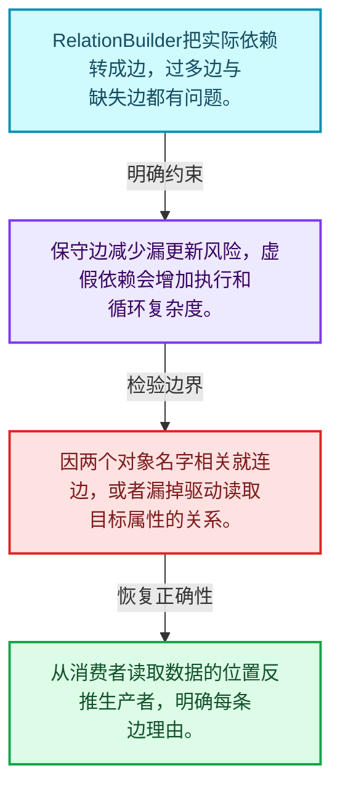
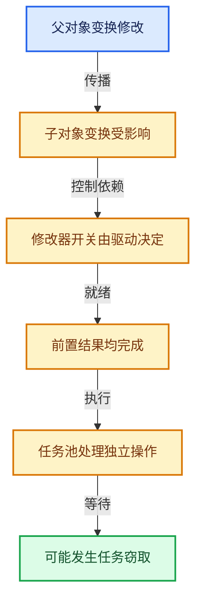

# 11-04 关系构建器

[方向导航](README.md) · [总目录](../README.md) · [实现索引](../%E7%AC%A6%E5%8F%B7%E4%BE%9D%E8%B5%96%E4%B8%8E%E5%AE%9E%E7%8E%B0%E7%B4%A2%E5%BC%95.md)

## 从问题到实现

关系边如何对应真实读取依赖？

边应表达一个操作需要另一个结果，不应仅因对象相关就任意连边；环需要诊断和特定处理。

**数据模型**

RelationBuilder把实际依赖转成边，过多边与缺失边都有问题。

**设计取舍**

保守边减少漏更新风险，虚假依赖会增加执行和循环复杂度。

**最小反例**

因两个对象名字相关就连边，或者漏掉驱动读取目标属性的关系。

**推导**

从消费者读取数据的位置反推生产者，明确每条边理由。

## 阅读地图与执行推演

```mermaid
flowchart LR
  F0["blender::deg::is_time_dependent_scene_driver_target"]:::input
  F1["blender::deg::driver_target_depends_on_time"]:::compute
  F2["blender::deg::driver_variable_depends_on_time"]:::compute
  F3["blender::deg::driver_variables_depends_on_time"]:::compute
  F4["blender::deg::driver_depends_on_time"]:::compute
  F5["blender::deg::particle_system_depends_on_time"]:::compute
  F6["blender::deg::object_particles_depends_on_time"]:::compute
  F7["blender::deg::check_id_has_anim_component"]:::compute
  F1 -->|"实现调用"| F0
  F2 -->|"实现调用"| F1
  F3 -->|"实现调用"| F2
  F4 -->|"实现调用"| F3
  F6 -->|"实现调用"| F5
  classDef input fill:#DBEAFE,stroke:#2563EB,color:#172554,stroke-width:2px;
  classDef data fill:#CFFAFE,stroke:#0891B2,color:#164E63,stroke-width:2px;
  classDef abstraction fill:#EDE9FE,stroke:#7C3AED,color:#3B0764,stroke-width:2px;
  classDef compute fill:#FEF3C7,stroke:#D97706,color:#78350F,stroke-width:2px;
  classDef result fill:#DCFCE7,stroke:#16A34A,color:#14532D,stroke-width:2px;
  classDef error fill:#FEE2E2,stroke:#DC2626,color:#7F1D1D,stroke-width:2px;
```








图中的数值推演是本方向的教学模型；实际函数之间的调用边与概念分析边分别标注，不能把概念关系当作运行时调度顺序。

## 完整源码单元与就地讲解

中文讲解直接放在相关代码旁，复杂机制在代码下展开。原文折叠区保留基准行号；不需要在行号表和函数之间来回查找。类布局可分段展示，函数实现不按固定行数切开。

### 类型布局、声明与编译条件 · deg_builder_relations.cc L1—L117

<!-- annotated:4af9086bd59172 -->

```cpp
/* SPDX-FileCopyrightText: 2013 Blender Authors
 *
 * SPDX-License-Identifier: GPL-2.0-or-later */

/** \file
 * \ingroup depsgraph
 *
 * Methods for constructing depsgraph
 */

#include "intern/builder/deg_builder_relations.h"

#include <cstdio>
#include <cstdlib>
#include <cstring> /* required for STREQ later on. */
#include <optional>

#include "BKE_global.hh"
#include "DNA_modifier_types.h"

#include "BLI_listbase.hh"
#include "BLI_span.hh"
#include "BLI_utildefines.hh"

#include "DNA_action_types.h"
#include "DNA_anim_types.h"
#include "DNA_armature_types.h"
#include "DNA_cachefile_types.h"
#include "DNA_camera_types.h"
#include "DNA_cloth_types.h"
#include "DNA_collection_types.h"
#include "DNA_constraint_types.h"
#include "DNA_curve_types.h"
#include "DNA_curves_types.h"
#include "DNA_gpencil_legacy_types.h"
#include "DNA_key_types.h"
#include "DNA_light_types.h"
#include "DNA_lightprobe_types.h"
#include "DNA_linestyle_types.h"
#include "DNA_mask_types.h"
#include "DNA_material_types.h"
#include "DNA_mesh_types.h"
#include "DNA_movieclip_types.h"
#include "DNA_node_types.h"
#include "DNA_object_force_types.h"
#include "DNA_object_types.h"
#include "DNA_particle_types.h"
#include "DNA_rigidbody_types.h"
#include "DNA_scene_types.h"
#include "DNA_sequence_types.h"
#include "DNA_sound_types.h"
#include "DNA_speaker_types.h"
#include "DNA_texture_types.h"
#include "DNA_vfont_types.h"
#include "DNA_volume_types.h"
#include "DNA_world_types.h"

#include "BKE_action.hh"
#include "BKE_anim_data.hh"
#include "BKE_collection.hh"
#include "BKE_collision.h"
#include "BKE_constraint.h"
#include "BKE_effect.h"
#include "BKE_fcurve_driver.h"
#include "BKE_grease_pencil.hh"
#include "BKE_grease_pencil_modifiers.h"
#include "BKE_idprop.hh"
#include "BKE_image.hh"
#include "BKE_key.hh"
#include "BKE_layer.hh"
#include "BKE_lib_query.hh"
#include "BKE_mask.hh"
#include "BKE_material.hh"
#include "BKE_mball.hh"
#include "BKE_modifier.hh"
#include "BKE_nla.hh"
#include "BKE_node.hh"
#include "BKE_node_runtime.hh"
#include "BKE_pointcache.h"
#include "BKE_shader_fx.hh"
#include "BKE_shrinkwrap.hh"

#include "RNA_access.hh"
#include "RNA_prototypes.hh"
#include "RNA_types.hh"

#include "ANIM_action.hh"
#include "SEQ_iterator.hh"

#include "DEG_depsgraph.hh"
#include "DEG_depsgraph_build.hh"
#include "DEG_depsgraph_debug.hh"

#include "intern/builder/deg_builder.h"
#include "intern/builder/deg_builder_pchanmap.h"
#include "intern/builder/deg_builder_relations_drivers.h"
#include "intern/debug/deg_debug.h"
#include "intern/depsgraph_physics.hh"
#include "intern/eval/deg_eval_copy_on_write.h"

#include "intern/node/deg_node.hh"
#include "intern/node/deg_node_component.hh"
#include "intern/node/deg_node_id.hh"
#include "intern/node/deg_node_operation.hh"
#include "intern/node/deg_node_time.hh"

#include "intern/depsgraph.hh"
#include "intern/depsgraph_relation.hh"
#include "intern/depsgraph_type.hh"

namespace blender::deg {

/* ***************** */
/* Relations Builder */

namespace {

```

<details>
<summary>核对原始源码：source/blender/depsgraph/intern/builder/deg_builder_relations.cc · L1—L117</summary>

<!-- original:4af9086bd59172:source/blender/depsgraph/intern/builder/deg_builder_relations.cc:1:117 -->

```cpp
/* SPDX-FileCopyrightText: 2013 Blender Authors
 *
 * SPDX-License-Identifier: GPL-2.0-or-later */

/** \file
 * \ingroup depsgraph
 *
 * Methods for constructing depsgraph
 */

#include "intern/builder/deg_builder_relations.h"

#include <cstdio>
#include <cstdlib>
#include <cstring> /* required for STREQ later on. */
#include <optional>

#include "BKE_global.hh"
#include "DNA_modifier_types.h"

#include "BLI_listbase.hh"
#include "BLI_span.hh"
#include "BLI_utildefines.hh"

#include "DNA_action_types.h"
#include "DNA_anim_types.h"
#include "DNA_armature_types.h"
#include "DNA_cachefile_types.h"
#include "DNA_camera_types.h"
#include "DNA_cloth_types.h"
#include "DNA_collection_types.h"
#include "DNA_constraint_types.h"
#include "DNA_curve_types.h"
#include "DNA_curves_types.h"
#include "DNA_gpencil_legacy_types.h"
#include "DNA_key_types.h"
#include "DNA_light_types.h"
#include "DNA_lightprobe_types.h"
#include "DNA_linestyle_types.h"
#include "DNA_mask_types.h"
#include "DNA_material_types.h"
#include "DNA_mesh_types.h"
#include "DNA_movieclip_types.h"
#include "DNA_node_types.h"
#include "DNA_object_force_types.h"
#include "DNA_object_types.h"
#include "DNA_particle_types.h"
#include "DNA_rigidbody_types.h"
#include "DNA_scene_types.h"
#include "DNA_sequence_types.h"
#include "DNA_sound_types.h"
#include "DNA_speaker_types.h"
#include "DNA_texture_types.h"
#include "DNA_vfont_types.h"
#include "DNA_volume_types.h"
#include "DNA_world_types.h"

#include "BKE_action.hh"
#include "BKE_anim_data.hh"
#include "BKE_collection.hh"
#include "BKE_collision.h"
#include "BKE_constraint.h"
#include "BKE_effect.h"
#include "BKE_fcurve_driver.h"
#include "BKE_grease_pencil.hh"
#include "BKE_grease_pencil_modifiers.h"
#include "BKE_idprop.hh"
#include "BKE_image.hh"
#include "BKE_key.hh"
#include "BKE_layer.hh"
#include "BKE_lib_query.hh"
#include "BKE_mask.hh"
#include "BKE_material.hh"
#include "BKE_mball.hh"
#include "BKE_modifier.hh"
#include "BKE_nla.hh"
#include "BKE_node.hh"
#include "BKE_node_runtime.hh"
#include "BKE_pointcache.h"
#include "BKE_shader_fx.hh"
#include "BKE_shrinkwrap.hh"

#include "RNA_access.hh"
#include "RNA_prototypes.hh"
#include "RNA_types.hh"

#include "ANIM_action.hh"
#include "SEQ_iterator.hh"

#include "DEG_depsgraph.hh"
#include "DEG_depsgraph_build.hh"
#include "DEG_depsgraph_debug.hh"

#include "intern/builder/deg_builder.h"
#include "intern/builder/deg_builder_pchanmap.h"
#include "intern/builder/deg_builder_relations_drivers.h"
#include "intern/debug/deg_debug.h"
#include "intern/depsgraph_physics.hh"
#include "intern/eval/deg_eval_copy_on_write.h"

#include "intern/node/deg_node.hh"
#include "intern/node/deg_node_component.hh"
#include "intern/node/deg_node_id.hh"
#include "intern/node/deg_node_operation.hh"
#include "intern/node/deg_node_time.hh"

#include "intern/depsgraph.hh"
#include "intern/depsgraph_relation.hh"
#include "intern/depsgraph_type.hh"

namespace blender::deg {

/* ***************** */
/* Relations Builder */

namespace {

```

</details>

<a id="f-641d001ff7055001"></a>

### `blender::deg::is_time_dependent_scene_driver_target`

实现位置：[source/blender/depsgraph/intern/builder/deg_builder_relations.cc](../../../../../source/blender/depsgraph/intern/builder/deg_builder_relations.cc) · L118—L121。

接口参数：

- `const DriverTarget *target`

**教学注释版**

<!-- annotated:85108c95b09ed0 -->

```cpp
bool is_time_dependent_scene_driver_target(const DriverTarget *target)
{
  return target->rna_path != nullptr && STREQ(target->rna_path, "frame_current");
}
```

<details>
<summary>核对原始源码：source/blender/depsgraph/intern/builder/deg_builder_relations.cc · L118—L121</summary>

<!-- original:85108c95b09ed0:source/blender/depsgraph/intern/builder/deg_builder_relations.cc:118:121 -->

```cpp
bool is_time_dependent_scene_driver_target(const DriverTarget *target)
{
  return target->rna_path != nullptr && STREQ(target->rna_path, "frame_current");
}
```

</details>

**结果出口**

- `return target->rna_path != nullptr && STREQ(target->rna_path, "frame_current");`

**继续追踪实现**

- `STREQ` → [STREQ · L112](../05-%E5%87%A0%E4%BD%95%E5%AD%98%E5%82%A8%E4%B8%8E%E6%8B%93%E6%89%91%E6%98%A0%E5%B0%84/%E4%BE%9D%E8%B5%96-GHOST_utildefines-34b996.md#m-9549fb6aafd2)；[STREQ · L451](../01-%E5%9F%BA%E7%A1%80%E5%AE%B9%E5%99%A8%E4%B8%8E%E7%8E%B0%E4%BB%A3CPP/%E4%BE%9D%E8%B5%96-BLI_utildefines-293a0a.md#m-c7b745bcfad2)；[STREQ · L55](../05-%E5%87%A0%E4%BD%95%E5%AD%98%E5%82%A8%E4%B8%8E%E6%8B%93%E6%89%91%E6%98%A0%E5%B0%84/%E4%BE%9D%E8%B5%96-clog-a0bec8.md#m-96e78f386894)。宏定义由构建条件选择。

<!-- annotated:2c954f7f7d5ed3 -->

```cpp

```

<details>
<summary>核对原始源码：source/blender/depsgraph/intern/builder/deg_builder_relations.cc · L122—L122</summary>

<!-- original:2c954f7f7d5ed3:source/blender/depsgraph/intern/builder/deg_builder_relations.cc:122:122 -->

```cpp

```

</details>

<a id="f-1a91d510c2d5d720"></a>

### `blender::deg::driver_target_depends_on_time`

实现位置：[source/blender/depsgraph/intern/builder/deg_builder_relations.cc](../../../../../source/blender/depsgraph/intern/builder/deg_builder_relations.cc) · L123—L136。

接口参数：

- `const DriverVar *variable`
- `const DriverTarget *target`

**教学注释版**

<!-- annotated:38765c229b69e2 -->

```cpp
bool driver_target_depends_on_time(const DriverVar *variable, const DriverTarget *target)
{
  if (variable->type == DVAR_TYPE_CONTEXT_PROP &&
      target->context_property == DTAR_CONTEXT_PROPERTY_ACTIVE_SCENE)
  {
    return is_time_dependent_scene_driver_target(target);
  }

  if (target->idtype == ID_SCE) {
    return is_time_dependent_scene_driver_target(target);
  }

  return false;
}
```

<details>
<summary>核对原始源码：source/blender/depsgraph/intern/builder/deg_builder_relations.cc · L123—L136</summary>

<!-- original:38765c229b69e2:source/blender/depsgraph/intern/builder/deg_builder_relations.cc:123:136 -->

```cpp
bool driver_target_depends_on_time(const DriverVar *variable, const DriverTarget *target)
{
  if (variable->type == DVAR_TYPE_CONTEXT_PROP &&
      target->context_property == DTAR_CONTEXT_PROPERTY_ACTIVE_SCENE)
  {
    return is_time_dependent_scene_driver_target(target);
  }

  if (target->idtype == ID_SCE) {
    return is_time_dependent_scene_driver_target(target);
  }

  return false;
}
```

</details>

**结果出口**

- `return is_time_dependent_scene_driver_target(target);`
- `return false;`

**继续追踪实现**

- `is_time_dependent_scene_driver_target` → [blender::deg::is_time_dependent_scene_driver_target · L118](04-%E5%85%B3%E7%B3%BB%E6%9E%84%E5%BB%BA%E5%99%A8.md#f-641d001ff7055001)。

<!-- annotated:d4effda7aa4e7a -->

```cpp

```

<details>
<summary>核对原始源码：source/blender/depsgraph/intern/builder/deg_builder_relations.cc · L137—L137</summary>

<!-- original:d4effda7aa4e7a:source/blender/depsgraph/intern/builder/deg_builder_relations.cc:137:137 -->

```cpp

```

</details>

<a id="f-88aecb00c9ff8ca0"></a>

### `blender::deg::driver_variable_depends_on_time`

实现位置：[source/blender/depsgraph/intern/builder/deg_builder_relations.cc](../../../../../source/blender/depsgraph/intern/builder/deg_builder_relations.cc) · L138—L146。

接口参数：

- `const DriverVar *variable`

**教学注释版**

<!-- annotated:9e1cbe0b4a72a0 -->

```cpp
bool driver_variable_depends_on_time(const DriverVar *variable)
{
  for (int i = 0; i < variable->num_targets; ++i) {
    if (driver_target_depends_on_time(variable, &variable->targets[i])) {
      return true;
    }
  }
  return false;
}
```

<details>
<summary>核对原始源码：source/blender/depsgraph/intern/builder/deg_builder_relations.cc · L138—L146</summary>

<!-- original:9e1cbe0b4a72a0:source/blender/depsgraph/intern/builder/deg_builder_relations.cc:138:146 -->

```cpp
bool driver_variable_depends_on_time(const DriverVar *variable)
{
  for (int i = 0; i < variable->num_targets; ++i) {
    if (driver_target_depends_on_time(variable, &variable->targets[i])) {
      return true;
    }
  }
  return false;
}
```

</details>

**结果出口**

- `return true;`
- `return false;`

**继续追踪实现**

- `driver_target_depends_on_time` → [blender::deg::driver_target_depends_on_time · L123](04-%E5%85%B3%E7%B3%BB%E6%9E%84%E5%BB%BA%E5%99%A8.md#f-1a91d510c2d5d720)。

<!-- annotated:17094d2af26c50 -->

```cpp

```

<details>
<summary>核对原始源码：source/blender/depsgraph/intern/builder/deg_builder_relations.cc · L147—L147</summary>

<!-- original:17094d2af26c50:source/blender/depsgraph/intern/builder/deg_builder_relations.cc:147:147 -->

```cpp

```

</details>

<a id="f-ab0fe7640428d9f5"></a>

### `blender::deg::driver_variables_depends_on_time`

实现位置：[source/blender/depsgraph/intern/builder/deg_builder_relations.cc](../../../../../source/blender/depsgraph/intern/builder/deg_builder_relations.cc) · L148—L156。

接口参数：

- `const ListBaseT<DriverVar> *variables`

**教学注释版**

<!-- annotated:b431b51a82fcfe -->

```cpp
bool driver_variables_depends_on_time(const ListBaseT<DriverVar> *variables)
{
  for (const DriverVar &variable : *variables) {
    if (driver_variable_depends_on_time(&variable)) {
      return true;
    }
  }
  return false;
}
```

<details>
<summary>核对原始源码：source/blender/depsgraph/intern/builder/deg_builder_relations.cc · L148—L156</summary>

<!-- original:b431b51a82fcfe:source/blender/depsgraph/intern/builder/deg_builder_relations.cc:148:156 -->

```cpp
bool driver_variables_depends_on_time(const ListBaseT<DriverVar> *variables)
{
  for (const DriverVar &variable : *variables) {
    if (driver_variable_depends_on_time(&variable)) {
      return true;
    }
  }
  return false;
}
```

</details>

**结果出口**

- `return true;`
- `return false;`

**继续追踪实现**

- `driver_variable_depends_on_time` → [blender::deg::driver_variable_depends_on_time · L138](04-%E5%85%B3%E7%B3%BB%E6%9E%84%E5%BB%BA%E5%99%A8.md#f-88aecb00c9ff8ca0)。

<!-- annotated:6867ee6de483d7 -->

```cpp

```

<details>
<summary>核对原始源码：source/blender/depsgraph/intern/builder/deg_builder_relations.cc · L157—L157</summary>

<!-- original:6867ee6de483d7:source/blender/depsgraph/intern/builder/deg_builder_relations.cc:157:157 -->

```cpp

```

</details>

<a id="f-fced18929487d1ff"></a>

### `blender::deg::driver_depends_on_time`

实现位置：[source/blender/depsgraph/intern/builder/deg_builder_relations.cc](../../../../../source/blender/depsgraph/intern/builder/deg_builder_relations.cc) · L158—L167。

接口参数：

- `ChannelDriver *driver`

**教学注释版**

<!-- annotated:ffd75cbba8caf8 -->

```cpp
bool driver_depends_on_time(ChannelDriver *driver)
{
  if (BKE_driver_expression_depends_on_time(driver)) {
    return true;
  }
  if (driver_variables_depends_on_time(&driver->variables)) {
    return true;
  }
  return false;
}
```

<details>
<summary>核对原始源码：source/blender/depsgraph/intern/builder/deg_builder_relations.cc · L158—L167</summary>

<!-- original:ffd75cbba8caf8:source/blender/depsgraph/intern/builder/deg_builder_relations.cc:158:167 -->

```cpp
bool driver_depends_on_time(ChannelDriver *driver)
{
  if (BKE_driver_expression_depends_on_time(driver)) {
    return true;
  }
  if (driver_variables_depends_on_time(&driver->variables)) {
    return true;
  }
  return false;
}
```

</details>

**结果出口**

- `return true;`
- `return false;`

**继续追踪实现**

- `BKE_driver_expression_depends_on_time` → [blender::BKE_driver_expression_depends_on_time · L1247](../05-%E5%87%A0%E4%BD%95%E5%AD%98%E5%82%A8%E4%B8%8E%E6%8B%93%E6%89%91%E6%98%A0%E5%B0%84/%E4%BE%9D%E8%B5%96-fcurve_driver-ac5bc2.md#f-ec6cef2b6535f349)。
- `driver_variables_depends_on_time` → [blender::deg::driver_variables_depends_on_time · L148](04-%E5%85%B3%E7%B3%BB%E6%9E%84%E5%BB%BA%E5%99%A8.md#f-ab0fe7640428d9f5)。

<!-- annotated:adda623e4e007b -->

```cpp

```

<details>
<summary>核对原始源码：source/blender/depsgraph/intern/builder/deg_builder_relations.cc · L168—L168</summary>

<!-- original:adda623e4e007b:source/blender/depsgraph/intern/builder/deg_builder_relations.cc:168:168 -->

```cpp

```

</details>

<a id="f-a69110eafb3e622f"></a>

### `blender::deg::particle_system_depends_on_time`

实现位置：[source/blender/depsgraph/intern/builder/deg_builder_relations.cc](../../../../../source/blender/depsgraph/intern/builder/deg_builder_relations.cc) · L169—L182。

接口参数：

- `ParticleSystem *psys`

**教学注释版**

<!-- annotated:0a7016136173ec -->

```cpp
bool particle_system_depends_on_time(ParticleSystem *psys)
{
  ParticleSettings *part = psys->part;
  /* Non-hair particles we always consider dependent on time. */
  if (part->type != PART_HAIR) {
    return true;
  }
  /* Dynamics always depends on time. */
  if (psys->flag & PSYS_HAIR_DYNAMICS) {
    return true;
  }
  /* TODO(sergey): Check what else makes hair dependent on time. */
  return false;
}
```

<details>
<summary>核对原始源码：source/blender/depsgraph/intern/builder/deg_builder_relations.cc · L169—L182</summary>

<!-- original:0a7016136173ec:source/blender/depsgraph/intern/builder/deg_builder_relations.cc:169:182 -->

```cpp
bool particle_system_depends_on_time(ParticleSystem *psys)
{
  ParticleSettings *part = psys->part;
  /* Non-hair particles we always consider dependent on time. */
  if (part->type != PART_HAIR) {
    return true;
  }
  /* Dynamics always depends on time. */
  if (psys->flag & PSYS_HAIR_DYNAMICS) {
    return true;
  }
  /* TODO(sergey): Check what else makes hair dependent on time. */
  return false;
}
```

</details>

**结果出口**

- `return true;`
- `return false;`

**继续追踪实现**

本实现没有需要继续展开的显式调用；检查返回表达式、对象转换和调用者前置条件。

<!-- annotated:c88dcfbb0cdb69 -->

```cpp

```

<details>
<summary>核对原始源码：source/blender/depsgraph/intern/builder/deg_builder_relations.cc · L183—L183</summary>

<!-- original:c88dcfbb0cdb69:source/blender/depsgraph/intern/builder/deg_builder_relations.cc:183:183 -->

```cpp

```

</details>

<a id="f-93c5ed14be283e06"></a>

### `blender::deg::object_particles_depends_on_time`

实现位置：[source/blender/depsgraph/intern/builder/deg_builder_relations.cc](../../../../../source/blender/depsgraph/intern/builder/deg_builder_relations.cc) · L184—L195。

接口参数：

- `Object *object`

**教学注释版**

<!-- annotated:a59ff069a8b6e6 -->

```cpp
bool object_particles_depends_on_time(Object *object)
{
  if (object->type != OB_MESH) {
    return false;
  }
  for (ParticleSystem &psys : object->particlesystem) {
    if (particle_system_depends_on_time(&psys)) {
      return true;
    }
  }
  return false;
}
```

<details>
<summary>核对原始源码：source/blender/depsgraph/intern/builder/deg_builder_relations.cc · L184—L195</summary>

<!-- original:a59ff069a8b6e6:source/blender/depsgraph/intern/builder/deg_builder_relations.cc:184:195 -->

```cpp
bool object_particles_depends_on_time(Object *object)
{
  if (object->type != OB_MESH) {
    return false;
  }
  for (ParticleSystem &psys : object->particlesystem) {
    if (particle_system_depends_on_time(&psys)) {
      return true;
    }
  }
  return false;
}
```

</details>

**结果出口**

- `return false;`
- `return true;`

**继续追踪实现**

- `particle_system_depends_on_time` → [blender::deg::particle_system_depends_on_time · L169](04-%E5%85%B3%E7%B3%BB%E6%9E%84%E5%BB%BA%E5%99%A8.md#f-a69110eafb3e622f)。

<!-- annotated:8c5497933a8cbf -->

```cpp

```

<details>
<summary>核对原始源码：source/blender/depsgraph/intern/builder/deg_builder_relations.cc · L196—L196</summary>

<!-- original:8c5497933a8cbf:source/blender/depsgraph/intern/builder/deg_builder_relations.cc:196:196 -->

```cpp

```

</details>

<a id="f-72b20cf66838d898"></a>

### `blender::deg::check_id_has_anim_component`

实现位置：[source/blender/depsgraph/intern/builder/deg_builder_relations.cc](../../../../../source/blender/depsgraph/intern/builder/deg_builder_relations.cc) · L197—L204。

接口参数：

- `ID *id`

**教学注释版**

<!-- annotated:5941b7925ccb1d -->

```cpp
bool check_id_has_anim_component(ID *id)
{
  AnimData *adt = BKE_animdata_from_id(id);
  if (adt == nullptr) {
    return false;
  }
  return (adt->action != nullptr) || !adt->nla_tracks.is_empty();
}
```

<details>
<summary>核对原始源码：source/blender/depsgraph/intern/builder/deg_builder_relations.cc · L197—L204</summary>

<!-- original:5941b7925ccb1d:source/blender/depsgraph/intern/builder/deg_builder_relations.cc:197:204 -->

```cpp
bool check_id_has_anim_component(ID *id)
{
  AnimData *adt = BKE_animdata_from_id(id);
  if (adt == nullptr) {
    return false;
  }
  return (adt->action != nullptr) || !adt->nla_tracks.is_empty();
}
```

</details>

**结果出口**

- `return false;`
- `return (adt->action != nullptr) || !adt->nla_tracks.is_empty();`

**继续追踪实现**

- `BKE_animdata_from_id` → [blender::BKE_animdata_from_id · L93](../05-%E5%87%A0%E4%BD%95%E5%AD%98%E5%82%A8%E4%B8%8E%E6%8B%93%E6%89%91%E6%98%A0%E5%B0%84/%E4%BE%9D%E8%B5%96-anim_data-56c81c.md#f-354e5421ff0a6c96)。
- `adt->nla_tracks.is_empty` → [调用协议](../%E6%A8%A1%E6%9D%BF%E5%AE%8F%E4%B8%8E%E5%8A%A8%E6%80%81%E5%88%86%E6%B4%BE%E5%8D%8F%E8%AE%AE.md)：接收对象类型依赖auto、返回值或模板实例；不按同名猜测目标。调用位置L203。

<!-- annotated:56009286c4bd65 -->

```cpp

```

<details>
<summary>核对原始源码：source/blender/depsgraph/intern/builder/deg_builder_relations.cc · L205—L205</summary>

<!-- original:56009286c4bd65:source/blender/depsgraph/intern/builder/deg_builder_relations.cc:205:205 -->

```cpp

```

</details>

<a id="f-6f9db0b2486406b3"></a>

### `blender::deg::check_id_has_driver_component`

实现位置：[source/blender/depsgraph/intern/builder/deg_builder_relations.cc](../../../../../source/blender/depsgraph/intern/builder/deg_builder_relations.cc) · L206—L213。

接口参数：

- `ID *id`

**教学注释版**

<!-- annotated:0e78a87ea6b28b -->

```cpp
bool check_id_has_driver_component(ID *id)
{
  AnimData *adt = BKE_animdata_from_id(id);
  if (adt == nullptr) {
    return false;
  }
  return !adt->drivers.is_empty();
}
```

<details>
<summary>核对原始源码：source/blender/depsgraph/intern/builder/deg_builder_relations.cc · L206—L213</summary>

<!-- original:0e78a87ea6b28b:source/blender/depsgraph/intern/builder/deg_builder_relations.cc:206:213 -->

```cpp
bool check_id_has_driver_component(ID *id)
{
  AnimData *adt = BKE_animdata_from_id(id);
  if (adt == nullptr) {
    return false;
  }
  return !adt->drivers.is_empty();
}
```

</details>

**结果出口**

- `return false;`
- `return !adt->drivers.is_empty();`

**继续追踪实现**

- `BKE_animdata_from_id` → [blender::BKE_animdata_from_id · L93](../05-%E5%87%A0%E4%BD%95%E5%AD%98%E5%82%A8%E4%B8%8E%E6%8B%93%E6%89%91%E6%98%A0%E5%B0%84/%E4%BE%9D%E8%B5%96-anim_data-56c81c.md#f-354e5421ff0a6c96)。
- `adt->drivers.is_empty` → [调用协议](../%E6%A8%A1%E6%9D%BF%E5%AE%8F%E4%B8%8E%E5%8A%A8%E6%80%81%E5%88%86%E6%B4%BE%E5%8D%8F%E8%AE%AE.md)：接收对象类型依赖auto、返回值或模板实例；不按同名猜测目标。调用位置L212。

<!-- annotated:17380c7cdc77f8 -->

```cpp

```

<details>
<summary>核对原始源码：source/blender/depsgraph/intern/builder/deg_builder_relations.cc · L214—L214</summary>

<!-- original:17380c7cdc77f8:source/blender/depsgraph/intern/builder/deg_builder_relations.cc:214:214 -->

```cpp

```

</details>

<a id="f-13f6d2525cfaf63f"></a>

### `blender::deg::bone_target_opcode`

实现位置：[source/blender/depsgraph/intern/builder/deg_builder_relations.cc](../../../../../source/blender/depsgraph/intern/builder/deg_builder_relations.cc) · L215—L233。

接口参数：

- `ID *target`
- `const char *subtarget`
- `ID *id`
- `const char *component_subdata`
- `RootPChanMap *root_map`

**教学注释版**

<!-- annotated:165a54cd83f9c3 -->

```cpp
OperationCode bone_target_opcode(ID *target,
                                 const char *subtarget,
                                 ID *id,
                                 const char *component_subdata,
                                 RootPChanMap *root_map)
{
  /* Same armature. root_map will be nullptr when building object-level constraints, and in that
   * case we don't need to check for the common chains. */
  if (target == id && root_map != nullptr) {
    /* Using "done" here breaks in-chain deps, while using
     * "ready" here breaks most production rigs instead.
     * So, we do a compromise here, and only do this when an
     * IK chain conflict may occur. */
    if (root_map->has_common_root(component_subdata, subtarget)) {
      return OperationCode::BONE_READY;
    }
  }
  return OperationCode::BONE_DONE;
}
```

<details>
<summary>核对原始源码：source/blender/depsgraph/intern/builder/deg_builder_relations.cc · L215—L233</summary>

<!-- original:165a54cd83f9c3:source/blender/depsgraph/intern/builder/deg_builder_relations.cc:215:233 -->

```cpp
OperationCode bone_target_opcode(ID *target,
                                 const char *subtarget,
                                 ID *id,
                                 const char *component_subdata,
                                 RootPChanMap *root_map)
{
  /* Same armature. root_map will be nullptr when building object-level constraints, and in that
   * case we don't need to check for the common chains. */
  if (target == id && root_map != nullptr) {
    /* Using "done" here breaks in-chain deps, while using
     * "ready" here breaks most production rigs instead.
     * So, we do a compromise here, and only do this when an
     * IK chain conflict may occur. */
    if (root_map->has_common_root(component_subdata, subtarget)) {
      return OperationCode::BONE_READY;
    }
  }
  return OperationCode::BONE_DONE;
}
```

</details>

**结果出口**

- `return OperationCode::BONE_READY;`
- `return OperationCode::BONE_DONE;`

**继续追踪实现**

- `root_map->has_common_root` → [blender::deg::RootPChanMap::has_common_root · L32](%E4%BE%9D%E8%B5%96-deg_builder_pchanmap-f4702f.md#f-da7b201d3e3cf6c2)。

<!-- annotated:7ae8e909341ad5 -->

```cpp

```

<details>
<summary>核对原始源码：source/blender/depsgraph/intern/builder/deg_builder_relations.cc · L234—L234</summary>

<!-- original:7ae8e909341ad5:source/blender/depsgraph/intern/builder/deg_builder_relations.cc:234:234 -->

```cpp

```

</details>

<a id="f-6bf2ae4c23cb4733"></a>

### `blender::deg::object_have_geometry_component`

实现位置：[source/blender/depsgraph/intern/builder/deg_builder_relations.cc](../../../../../source/blender/depsgraph/intern/builder/deg_builder_relations.cc) · L235—L238。

接口参数：

- `const Object *object`

**教学注释版**

<!-- annotated:dc412020f643d5 -->

```cpp
bool object_have_geometry_component(const Object *object)
{
  return ELEM(object->type, OB_MESH, OB_CURVES_LEGACY, OB_FONT, OB_SURF, OB_MBALL, OB_LATTICE);
}
```

<details>
<summary>核对原始源码：source/blender/depsgraph/intern/builder/deg_builder_relations.cc · L235—L238</summary>

<!-- original:dc412020f643d5:source/blender/depsgraph/intern/builder/deg_builder_relations.cc:235:238 -->

```cpp
bool object_have_geometry_component(const Object *object)
{
  return ELEM(object->type, OB_MESH, OB_CURVES_LEGACY, OB_FONT, OB_SURF, OB_MBALL, OB_LATTICE);
}
```

</details>

**结果出口**

- `return ELEM(object->type, OB_MESH, OB_CURVES_LEGACY, OB_FONT, OB_SURF, OB_MBALL, OB_LATTICE);`

**继续追踪实现**

- `ELEM` → [ELEM · L88](../05-%E5%87%A0%E4%BD%95%E5%AD%98%E5%82%A8%E4%B8%8E%E6%8B%93%E6%89%91%E6%98%A0%E5%B0%84/%E4%BE%9D%E8%B5%96-GHOST_utildefines-34b996.md#m-d28724a15928)；[ELEM · L135](../01-%E5%9F%BA%E7%A1%80%E5%AE%B9%E5%99%A8%E4%B8%8E%E7%8E%B0%E4%BB%A3CPP/%E4%BE%9D%E8%B5%96-BLI_utildefines-293a0a.md#m-d6572de7cae0)。宏定义由构建条件选择。

### 类型布局、声明与编译条件 · deg_builder_relations.cc L239—L243

<!-- annotated:5ca03e340fc88d -->

```cpp

}  // namespace

/* **** General purpose functions **** */

```

<details>
<summary>核对原始源码：source/blender/depsgraph/intern/builder/deg_builder_relations.cc · L239—L243</summary>

<!-- original:5ca03e340fc88d:source/blender/depsgraph/intern/builder/deg_builder_relations.cc:239:243 -->

```cpp

}  // namespace

/* **** General purpose functions **** */

```

</details>

<a id="f-2b13242625e2aa71"></a>

### `blender::deg::DepsgraphRelationBuilder::DepsgraphRelationBuilder`

实现位置：[source/blender/depsgraph/intern/builder/deg_builder_relations.cc](../../../../../source/blender/depsgraph/intern/builder/deg_builder_relations.cc) · L244—L249。

接口参数：

- `Main *bmain`
- `Depsgraph *graph`
- `DepsgraphBuilderCache *cache`

**教学注释版**

<!-- annotated:919a046272fd3a -->

```cpp
DepsgraphRelationBuilder::DepsgraphRelationBuilder(Main *bmain,
                                                   Depsgraph *graph,
                                                   DepsgraphBuilderCache *cache)
    : DepsgraphBuilder(bmain, graph, cache), scene_(nullptr), rna_node_query_(graph, this)
{
}
```

<details>
<summary>核对原始源码：source/blender/depsgraph/intern/builder/deg_builder_relations.cc · L244—L249</summary>

<!-- original:919a046272fd3a:source/blender/depsgraph/intern/builder/deg_builder_relations.cc:244:249 -->

```cpp
DepsgraphRelationBuilder::DepsgraphRelationBuilder(Main *bmain,
                                                   Depsgraph *graph,
                                                   DepsgraphBuilderCache *cache)
    : DepsgraphBuilder(bmain, graph, cache), scene_(nullptr), rna_node_query_(graph, this)
{
}
```

</details>

**继续追踪实现**

本实现没有需要继续展开的显式调用；检查返回表达式、对象转换和调用者前置条件。

<!-- annotated:c4c4c7af9c5592 -->

```cpp

```

<details>
<summary>核对原始源码：source/blender/depsgraph/intern/builder/deg_builder_relations.cc · L250—L250</summary>

<!-- original:c4c4c7af9c5592:source/blender/depsgraph/intern/builder/deg_builder_relations.cc:250:250 -->

```cpp

```

</details>

<a id="f-643623ad522e2b50"></a>

### `blender::deg::DepsgraphRelationBuilder::get_node`

实现位置：[source/blender/depsgraph/intern/builder/deg_builder_relations.cc](../../../../../source/blender/depsgraph/intern/builder/deg_builder_relations.cc) · L251—L254。

接口参数：

- `const TimeSourceKey &`

**教学注释版**

<!-- annotated:1fc0754f893b44 -->

```cpp
TimeSourceNode *DepsgraphRelationBuilder::get_node(const TimeSourceKey & /*key*/) const
{
  return graph_->time_source;
}
```

<details>
<summary>核对原始源码：source/blender/depsgraph/intern/builder/deg_builder_relations.cc · L251—L254</summary>

<!-- original:1fc0754f893b44:source/blender/depsgraph/intern/builder/deg_builder_relations.cc:251:254 -->

```cpp
TimeSourceNode *DepsgraphRelationBuilder::get_node(const TimeSourceKey & /*key*/) const
{
  return graph_->time_source;
}
```

</details>

**结果出口**

- `return graph_->time_source;`

**继续追踪实现**

本实现没有需要继续展开的显式调用；检查返回表达式、对象转换和调用者前置条件。

<!-- annotated:5cbac53b173e6d -->

```cpp

```

<details>
<summary>核对原始源码：source/blender/depsgraph/intern/builder/deg_builder_relations.cc · L255—L255</summary>

<!-- original:5cbac53b173e6d:source/blender/depsgraph/intern/builder/deg_builder_relations.cc:255:255 -->

```cpp

```

</details>

<a id="f-3f46f7cef157b43c"></a>

### `blender::deg::DepsgraphRelationBuilder::get_node`

实现位置：[source/blender/depsgraph/intern/builder/deg_builder_relations.cc](../../../../../source/blender/depsgraph/intern/builder/deg_builder_relations.cc) · L256—L268。

接口参数：

- `const ComponentKey &key`

**教学注释版**

<!-- annotated:4fdad1ee7e4e5f -->

```cpp
ComponentNode *DepsgraphRelationBuilder::get_node(const ComponentKey &key) const
{
  IDNode *id_node = graph_->find_id_node(key.id);
  if (!id_node) {
    fprintf(stderr,
            "find_node component: Could not find ID %s\n",
            (key.id != nullptr) ? key.id->name : "<null>");
    return nullptr;
  }

  ComponentNode *node = id_node->find_component(key.type, key.name);
  return node;
}
```

<details>
<summary>核对原始源码：source/blender/depsgraph/intern/builder/deg_builder_relations.cc · L256—L268</summary>

<!-- original:4fdad1ee7e4e5f:source/blender/depsgraph/intern/builder/deg_builder_relations.cc:256:268 -->

```cpp
ComponentNode *DepsgraphRelationBuilder::get_node(const ComponentKey &key) const
{
  IDNode *id_node = graph_->find_id_node(key.id);
  if (!id_node) {
    fprintf(stderr,
            "find_node component: Could not find ID %s\n",
            (key.id != nullptr) ? key.id->name : "<null>");
    return nullptr;
  }

  ComponentNode *node = id_node->find_component(key.type, key.name);
  return node;
}
```

</details>

**结果出口**

- `return nullptr;`
- `return node;`

**继续追踪实现**

- `graph_->find_id_node` → [调用协议](../%E6%A8%A1%E6%9D%BF%E5%AE%8F%E4%B8%8E%E5%8A%A8%E6%80%81%E5%88%86%E6%B4%BE%E5%8D%8F%E8%AE%AE.md)：接收对象类型依赖auto、返回值或模板实例；不按同名猜测目标。调用位置L258。
- `fprintf` → [外部契约](https://eel.is/c++draft/)：这个边界按实际表达式及所属类型核对参数、返回值、寿命与失败行为。这里提供接口入口，不声称已解释该第三方版本的内部实现。
- `id_node->find_component` → [blender::deg::IDNode::find_component · L133](%E4%BE%9D%E8%B5%96-deg_node_id-71dd5e.md#f-9982102eca14b6b6)。

<!-- annotated:1ed21125949e53 -->

```cpp

```

<details>
<summary>核对原始源码：source/blender/depsgraph/intern/builder/deg_builder_relations.cc · L269—L269</summary>

<!-- original:1ed21125949e53:source/blender/depsgraph/intern/builder/deg_builder_relations.cc:269:269 -->

```cpp

```

</details>

<a id="f-bbe823fc394f5d32"></a>

### `blender::deg::DepsgraphRelationBuilder::get_node`

实现位置：[source/blender/depsgraph/intern/builder/deg_builder_relations.cc](../../../../../source/blender/depsgraph/intern/builder/deg_builder_relations.cc) · L270—L280。

接口参数：

- `const OperationKey &key`

**教学注释版**

<!-- annotated:3f8fc2a2267d4a -->

```cpp
OperationNode *DepsgraphRelationBuilder::get_node(const OperationKey &key) const
{
  OperationNode *op_node = find_node(key);
  if (op_node == nullptr) {
    fprintf(stderr,
            "find_node_operation: Failed for (%s, '%s')\n",
            operationCodeAsString(key.opcode),
            key.name);
  }
  return op_node;
}
```

<details>
<summary>核对原始源码：source/blender/depsgraph/intern/builder/deg_builder_relations.cc · L270—L280</summary>

<!-- original:3f8fc2a2267d4a:source/blender/depsgraph/intern/builder/deg_builder_relations.cc:270:280 -->

```cpp
OperationNode *DepsgraphRelationBuilder::get_node(const OperationKey &key) const
{
  OperationNode *op_node = find_node(key);
  if (op_node == nullptr) {
    fprintf(stderr,
            "find_node_operation: Failed for (%s, '%s')\n",
            operationCodeAsString(key.opcode),
            key.name);
  }
  return op_node;
}
```

</details>

**结果出口**

- `return op_node;`

**继续追踪实现**

- `find_node` → [blender::deg::DepsgraphRelationBuilder::find_node · L287](04-%E5%85%B3%E7%B3%BB%E6%9E%84%E5%BB%BA%E5%99%A8.md#f-4f87496b341ba6e5)；[blender::deg::DepsgraphRelationBuilder::find_node · L296](04-%E5%85%B3%E7%B3%BB%E6%9E%84%E5%BB%BA%E5%99%A8.md#f-0638742ed3b55166)。同名重载需按实参类型选择。
- `fprintf` → [外部契约](https://eel.is/c++draft/)：这个边界按实际表达式及所属类型核对参数、返回值、寿命与失败行为。这里提供接口入口，不声称已解释该第三方版本的内部实现。
- `operationCodeAsString` → [blender::deg::operationCodeAsString · L18](%E4%BE%9D%E8%B5%96-deg_node_operation-b37865.md#f-68fb68ebe4b00b3c)。

<!-- annotated:8ca85db21da4a6 -->

```cpp

```

<details>
<summary>核对原始源码：source/blender/depsgraph/intern/builder/deg_builder_relations.cc · L281—L281</summary>

<!-- original:8ca85db21da4a6:source/blender/depsgraph/intern/builder/deg_builder_relations.cc:281:281 -->

```cpp

```

</details>

<a id="f-bf98884d578c6f50"></a>

### `blender::deg::DepsgraphRelationBuilder::get_node`

实现位置：[source/blender/depsgraph/intern/builder/deg_builder_relations.cc](../../../../../source/blender/depsgraph/intern/builder/deg_builder_relations.cc) · L282—L285。

接口参数：

- `const RNAPathKey &key`

**教学注释版**

<!-- annotated:e35bcf94b735a0 -->

```cpp
Node *DepsgraphRelationBuilder::get_node(const RNAPathKey &key)
{
  return rna_node_query_.find_node(&key.ptr, key.prop, key.source);
}
```

<details>
<summary>核对原始源码：source/blender/depsgraph/intern/builder/deg_builder_relations.cc · L282—L285</summary>

<!-- original:e35bcf94b735a0:source/blender/depsgraph/intern/builder/deg_builder_relations.cc:282:285 -->

```cpp
Node *DepsgraphRelationBuilder::get_node(const RNAPathKey &key)
{
  return rna_node_query_.find_node(&key.ptr, key.prop, key.source);
}
```

</details>

**结果出口**

- `return rna_node_query_.find_node(&key.ptr, key.prop, key.source);`

**继续追踪实现**

- `rna_node_query_.find_node` → [调用协议](../%E6%A8%A1%E6%9D%BF%E5%AE%8F%E4%B8%8E%E5%8A%A8%E6%80%81%E5%88%86%E6%B4%BE%E5%8D%8F%E8%AE%AE.md)：接收对象类型依赖auto、返回值或模板实例；不按同名猜测目标。调用位置L284。

<!-- annotated:6d305e23ad59f5 -->

```cpp

```

<details>
<summary>核对原始源码：source/blender/depsgraph/intern/builder/deg_builder_relations.cc · L286—L286</summary>

<!-- original:6d305e23ad59f5:source/blender/depsgraph/intern/builder/deg_builder_relations.cc:286:286 -->

```cpp

```

</details>

<a id="f-4f87496b341ba6e5"></a>

### `blender::deg::DepsgraphRelationBuilder::find_node`

实现位置：[source/blender/depsgraph/intern/builder/deg_builder_relations.cc](../../../../../source/blender/depsgraph/intern/builder/deg_builder_relations.cc) · L287—L294。

接口参数：

- `const ComponentKey &key`

**教学注释版**

<!-- annotated:9a39af5de4e040 -->

```cpp
ComponentNode *DepsgraphRelationBuilder::find_node(const ComponentKey &key) const
{
  IDNode *id_node = graph_->find_id_node(key.id);
  if (!id_node) {
    return nullptr;
  }
  return id_node->find_component(key.type, key.name);
}
```

<details>
<summary>核对原始源码：source/blender/depsgraph/intern/builder/deg_builder_relations.cc · L287—L294</summary>

<!-- original:9a39af5de4e040:source/blender/depsgraph/intern/builder/deg_builder_relations.cc:287:294 -->

```cpp
ComponentNode *DepsgraphRelationBuilder::find_node(const ComponentKey &key) const
{
  IDNode *id_node = graph_->find_id_node(key.id);
  if (!id_node) {
    return nullptr;
  }
  return id_node->find_component(key.type, key.name);
}
```

</details>

**结果出口**

- `return nullptr;`
- `return id_node->find_component(key.type, key.name);`

**继续追踪实现**

- `graph_->find_id_node` → [调用协议](../%E6%A8%A1%E6%9D%BF%E5%AE%8F%E4%B8%8E%E5%8A%A8%E6%80%81%E5%88%86%E6%B4%BE%E5%8D%8F%E8%AE%AE.md)：接收对象类型依赖auto、返回值或模板实例；不按同名猜测目标。调用位置L289。
- `id_node->find_component` → [blender::deg::IDNode::find_component · L133](%E4%BE%9D%E8%B5%96-deg_node_id-71dd5e.md#f-9982102eca14b6b6)。

<!-- annotated:3da626d073be80 -->

```cpp

```

<details>
<summary>核对原始源码：source/blender/depsgraph/intern/builder/deg_builder_relations.cc · L295—L295</summary>

<!-- original:3da626d073be80:source/blender/depsgraph/intern/builder/deg_builder_relations.cc:295:295 -->

```cpp

```

</details>

<a id="f-0638742ed3b55166"></a>

### `blender::deg::DepsgraphRelationBuilder::find_node`

实现位置：[source/blender/depsgraph/intern/builder/deg_builder_relations.cc](../../../../../source/blender/depsgraph/intern/builder/deg_builder_relations.cc) · L296—L307。

接口参数：

- `const OperationKey &key`

**教学注释版**

<!-- annotated:82464ac74f7730 -->

```cpp
OperationNode *DepsgraphRelationBuilder::find_node(const OperationKey &key) const
{
  IDNode *id_node = graph_->find_id_node(key.id);
  if (!id_node) {
    return nullptr;
  }
  ComponentNode *comp_node = id_node->find_component(key.component_type, key.component_name);
  if (!comp_node) {
    return nullptr;
  }
  return comp_node->find_operation(key.opcode, key.name, key.name_tag);
}
```

<details>
<summary>核对原始源码：source/blender/depsgraph/intern/builder/deg_builder_relations.cc · L296—L307</summary>

<!-- original:82464ac74f7730:source/blender/depsgraph/intern/builder/deg_builder_relations.cc:296:307 -->

```cpp
OperationNode *DepsgraphRelationBuilder::find_node(const OperationKey &key) const
{
  IDNode *id_node = graph_->find_id_node(key.id);
  if (!id_node) {
    return nullptr;
  }
  ComponentNode *comp_node = id_node->find_component(key.component_type, key.component_name);
  if (!comp_node) {
    return nullptr;
  }
  return comp_node->find_operation(key.opcode, key.name, key.name_tag);
}
```

</details>

**结果出口**

- `return nullptr;`
- `return comp_node->find_operation(key.opcode, key.name, key.name_tag);`

**继续追踪实现**

- `graph_->find_id_node` → [调用协议](../%E6%A8%A1%E6%9D%BF%E5%AE%8F%E4%B8%8E%E5%8A%A8%E6%80%81%E5%88%86%E6%B4%BE%E5%8D%8F%E8%AE%AE.md)：接收对象类型依赖auto、返回值或模板实例；不按同名猜测目标。调用位置L298。
- `id_node->find_component` → [blender::deg::IDNode::find_component · L133](%E4%BE%9D%E8%B5%96-deg_node_id-71dd5e.md#f-9982102eca14b6b6)。
- `comp_node->find_operation` → [blender::deg::ComponentNode::find_operation · L68](%E4%BE%9D%E8%B5%96-deg_node_component-2075dd.md#f-172b1268e9ce9e59)；[blender::deg::ComponentNode::find_operation · L87](%E4%BE%9D%E8%B5%96-deg_node_component-2075dd.md#f-3fcfe180a922223a)。同名重载需按实参类型选择。

<!-- annotated:88fa5ad957c769 -->

```cpp

```

<details>
<summary>核对原始源码：source/blender/depsgraph/intern/builder/deg_builder_relations.cc · L308—L308</summary>

<!-- original:88fa5ad957c769:source/blender/depsgraph/intern/builder/deg_builder_relations.cc:308:308 -->

```cpp

```

</details>

<a id="f-c217992a198e44d1"></a>

### `blender::deg::DepsgraphRelationBuilder::has_node`

实现位置：[source/blender/depsgraph/intern/builder/deg_builder_relations.cc](../../../../../source/blender/depsgraph/intern/builder/deg_builder_relations.cc) · L309—L312。

接口参数：

- `const OperationKey &key`

**教学注释版**

<!-- annotated:39c7688134276c -->

```cpp
bool DepsgraphRelationBuilder::has_node(const OperationKey &key) const
{
  return find_node(key) != nullptr;
}
```

<details>
<summary>核对原始源码：source/blender/depsgraph/intern/builder/deg_builder_relations.cc · L309—L312</summary>

<!-- original:39c7688134276c:source/blender/depsgraph/intern/builder/deg_builder_relations.cc:309:312 -->

```cpp
bool DepsgraphRelationBuilder::has_node(const OperationKey &key) const
{
  return find_node(key) != nullptr;
}
```

</details>

**结果出口**

- `return find_node(key) != nullptr;`

**继续追踪实现**

- `find_node` → [blender::deg::DepsgraphRelationBuilder::find_node · L287](04-%E5%85%B3%E7%B3%BB%E6%9E%84%E5%BB%BA%E5%99%A8.md#f-4f87496b341ba6e5)；[blender::deg::DepsgraphRelationBuilder::find_node · L296](04-%E5%85%B3%E7%B3%BB%E6%9E%84%E5%BB%BA%E5%99%A8.md#f-0638742ed3b55166)。同名重载需按实参类型选择。

<!-- annotated:0dc518c87ec7ed -->

```cpp

```

<details>
<summary>核对原始源码：source/blender/depsgraph/intern/builder/deg_builder_relations.cc · L313—L313</summary>

<!-- original:0dc518c87ec7ed:source/blender/depsgraph/intern/builder/deg_builder_relations.cc:313:313 -->

```cpp

```

</details>

<a id="f-221fbc8cb9be9333"></a>

### `blender::deg::DepsgraphRelationBuilder::has_node`

实现位置：[source/blender/depsgraph/intern/builder/deg_builder_relations.cc](../../../../../source/blender/depsgraph/intern/builder/deg_builder_relations.cc) · L314—L317。

接口参数：

- `const ComponentKey &key`

**教学注释版**

<!-- annotated:722f7ac717c533 -->

```cpp
bool DepsgraphRelationBuilder::has_node(const ComponentKey &key) const
{
  return find_node(key) != nullptr;
}
```

<details>
<summary>核对原始源码：source/blender/depsgraph/intern/builder/deg_builder_relations.cc · L314—L317</summary>

<!-- original:722f7ac717c533:source/blender/depsgraph/intern/builder/deg_builder_relations.cc:314:317 -->

```cpp
bool DepsgraphRelationBuilder::has_node(const ComponentKey &key) const
{
  return find_node(key) != nullptr;
}
```

</details>

**结果出口**

- `return find_node(key) != nullptr;`

**继续追踪实现**

- `find_node` → [blender::deg::DepsgraphRelationBuilder::find_node · L287](04-%E5%85%B3%E7%B3%BB%E6%9E%84%E5%BB%BA%E5%99%A8.md#f-4f87496b341ba6e5)；[blender::deg::DepsgraphRelationBuilder::find_node · L296](04-%E5%85%B3%E7%B3%BB%E6%9E%84%E5%BB%BA%E5%99%A8.md#f-0638742ed3b55166)。同名重载需按实参类型选择。

<!-- annotated:95db298495075c -->

```cpp

```

<details>
<summary>核对原始源码：source/blender/depsgraph/intern/builder/deg_builder_relations.cc · L318—L318</summary>

<!-- original:95db298495075c:source/blender/depsgraph/intern/builder/deg_builder_relations.cc:318:318 -->

```cpp

```

</details>

<a id="f-7ca601bc392405e0"></a>

### `blender::deg::DepsgraphRelationBuilder::add_node_handle_relation`

实现位置：[source/blender/depsgraph/intern/builder/deg_builder_relations.cc](../../../../../source/blender/depsgraph/intern/builder/deg_builder_relations.cc) · L319—L330。

接口参数：

- `const TimeSourceKey &key_from`
- `const DepsNodeHandle *handle`
- `const char *description`
- `int flags`

**教学注释版**

<!-- annotated:c3efc97814ec74 -->

```cpp
Relation *DepsgraphRelationBuilder::add_node_handle_relation(const TimeSourceKey &key_from,
                                                             const DepsNodeHandle *handle,
                                                             const char *description,
                                                             int flags)
{
  TimeSourceNode *time_from = get_node(key_from);
  OperationNode *op_to = handle->node->get_entry_operation();
  if (time_from != nullptr && op_to != nullptr) {
    return add_time_relation(time_from, op_to, description, flags);
  }
  return nullptr;
}
```

<details>
<summary>核对原始源码：source/blender/depsgraph/intern/builder/deg_builder_relations.cc · L319—L330</summary>

<!-- original:c3efc97814ec74:source/blender/depsgraph/intern/builder/deg_builder_relations.cc:319:330 -->

```cpp
Relation *DepsgraphRelationBuilder::add_node_handle_relation(const TimeSourceKey &key_from,
                                                             const DepsNodeHandle *handle,
                                                             const char *description,
                                                             int flags)
{
  TimeSourceNode *time_from = get_node(key_from);
  OperationNode *op_to = handle->node->get_entry_operation();
  if (time_from != nullptr && op_to != nullptr) {
    return add_time_relation(time_from, op_to, description, flags);
  }
  return nullptr;
}
```

</details>

**结果出口**

- `return add_time_relation(time_from, op_to, description, flags);`
- `return nullptr;`

**继续追踪实现**

- `get_node` → [blender::deg::DepsgraphRelationBuilder::get_node · L251](04-%E5%85%B3%E7%B3%BB%E6%9E%84%E5%BB%BA%E5%99%A8.md#f-643623ad522e2b50)；[blender::deg::DepsgraphRelationBuilder::get_node · L256](04-%E5%85%B3%E7%B3%BB%E6%9E%84%E5%BB%BA%E5%99%A8.md#f-3f46f7cef157b43c)；[blender::deg::DepsgraphRelationBuilder::get_node · L270](04-%E5%85%B3%E7%B3%BB%E6%9E%84%E5%BB%BA%E5%99%A8.md#f-bbe823fc394f5d32)；[blender::deg::DepsgraphRelationBuilder::get_node · L282](04-%E5%85%B3%E7%B3%BB%E6%9E%84%E5%BB%BA%E5%99%A8.md#f-bf98884d578c6f50)。同名重载需按实参类型选择。
- `handle->node->get_entry_operation` → [调用协议](../%E6%A8%A1%E6%9D%BF%E5%AE%8F%E4%B8%8E%E5%8A%A8%E6%80%81%E5%88%86%E6%B4%BE%E5%8D%8F%E8%AE%AE.md)：接收对象类型依赖auto、返回值或模板实例；不按同名猜测目标。调用位置L325。
- `add_time_relation` → [blender::deg::DepsgraphRelationBuilder::add_time_relation · L370](04-%E5%85%B3%E7%B3%BB%E6%9E%84%E5%BB%BA%E5%99%A8.md#f-df1064ecbe8b7ea7)。

<!-- annotated:9518b859f9338a -->

```cpp

```

<details>
<summary>核对原始源码：source/blender/depsgraph/intern/builder/deg_builder_relations.cc · L331—L331</summary>

<!-- original:9518b859f9338a:source/blender/depsgraph/intern/builder/deg_builder_relations.cc:331:331 -->

```cpp

```

</details>

<a id="f-30ea0548acb230fb"></a>

### `blender::deg::DepsgraphRelationBuilder::add_depends_on_transform_relation`

实现位置：[source/blender/depsgraph/intern/builder/deg_builder_relations.cc](../../../../../source/blender/depsgraph/intern/builder/deg_builder_relations.cc) · L332—L341。

接口参数：

- `const DepsNodeHandle *handle`
- `const char *description`

**教学注释版**

<!-- annotated:d882eafcf2595a -->

```cpp
void DepsgraphRelationBuilder::add_depends_on_transform_relation(const DepsNodeHandle *handle,
                                                                 const char *description)
{
  IDNode *id_node = handle->node->owner->owner;
  ID *id = id_node->id_orig;
  const OperationKey geometry_key(
      id, NodeType::GEOMETRY, OperationCode::MODIFIER, handle->node->name.c_str());
  /* Wire up the actual relation. */
  add_depends_on_transform_relation(id, geometry_key, description);
}
```

<details>
<summary>核对原始源码：source/blender/depsgraph/intern/builder/deg_builder_relations.cc · L332—L341</summary>

<!-- original:d882eafcf2595a:source/blender/depsgraph/intern/builder/deg_builder_relations.cc:332:341 -->

```cpp
void DepsgraphRelationBuilder::add_depends_on_transform_relation(const DepsNodeHandle *handle,
                                                                 const char *description)
{
  IDNode *id_node = handle->node->owner->owner;
  ID *id = id_node->id_orig;
  const OperationKey geometry_key(
      id, NodeType::GEOMETRY, OperationCode::MODIFIER, handle->node->name.c_str());
  /* Wire up the actual relation. */
  add_depends_on_transform_relation(id, geometry_key, description);
}
```

</details>

**继续追踪实现**

- `handle->node->name.c_str` → [调用协议](../%E6%A8%A1%E6%9D%BF%E5%AE%8F%E4%B8%8E%E5%8A%A8%E6%80%81%E5%88%86%E6%B4%BE%E5%8D%8F%E8%AE%AE.md)：接收对象类型依赖auto、返回值或模板实例；不按同名猜测目标。调用位置L338。
- `add_depends_on_transform_relation` → [blender::deg::DepsgraphRelationBuilder::add_depends_on_transform_relation · L332](04-%E5%85%B3%E7%B3%BB%E6%9E%84%E5%BB%BA%E5%99%A8.md#f-30ea0548acb230fb)。

<!-- annotated:75f5924c2a82fc -->

```cpp

```

<details>
<summary>核对原始源码：source/blender/depsgraph/intern/builder/deg_builder_relations.cc · L342—L342</summary>

<!-- original:75f5924c2a82fc:source/blender/depsgraph/intern/builder/deg_builder_relations.cc:342:342 -->

```cpp

```

</details>

<a id="f-9d93f68ae452fd31"></a>

### `blender::deg::DepsgraphRelationBuilder::add_customdata_mask`

实现位置：[source/blender/depsgraph/intern/builder/deg_builder_relations.cc](../../../../../source/blender/depsgraph/intern/builder/deg_builder_relations.cc) · L343—L357。

接口参数：

- `Object *object`
- `const DEGCustomDataMeshMasks &customdata_masks`

**教学注释版**

<!-- annotated:63fc6ca7156097 -->

```cpp
void DepsgraphRelationBuilder::add_customdata_mask(Object *object,
                                                   const DEGCustomDataMeshMasks &customdata_masks)
{
  if (customdata_masks != DEGCustomDataMeshMasks() && object != nullptr && object->type == OB_MESH)
  {
    IDNode *id_node = graph_->find_id_node(&object->id);

    if (id_node == nullptr) {
      BLI_assert_msg(0, "ID should always be valid");
    }
    else {
      id_node->customdata_masks |= customdata_masks;
    }
  }
}
```

<details>
<summary>核对原始源码：source/blender/depsgraph/intern/builder/deg_builder_relations.cc · L343—L357</summary>

<!-- original:63fc6ca7156097:source/blender/depsgraph/intern/builder/deg_builder_relations.cc:343:357 -->

```cpp
void DepsgraphRelationBuilder::add_customdata_mask(Object *object,
                                                   const DEGCustomDataMeshMasks &customdata_masks)
{
  if (customdata_masks != DEGCustomDataMeshMasks() && object != nullptr && object->type == OB_MESH)
  {
    IDNode *id_node = graph_->find_id_node(&object->id);

    if (id_node == nullptr) {
      BLI_assert_msg(0, "ID should always be valid");
    }
    else {
      id_node->customdata_masks |= customdata_masks;
    }
  }
}
```

</details>

**沿实际写入检查状态**

- `id_node->customdata_masks |= customdata_masks;`

**继续追踪实现**

- `DEGCustomDataMeshMasks` → [blender::deg::DEGCustomDataMeshMasks::DEGCustomDataMeshMasks · L58](%E4%BE%9D%E8%B5%96-depsgraph_type-a5aead.md#f-0f4a9b8509d55c32)；[blender::deg::DEGCustomDataMeshMasks::DEGCustomDataMeshMasks · L34](%E4%BE%9D%E8%B5%96-depsgraph_type-fccd49.md#f-fc8290099564dd1a)。同名重载需按实参类型选择。
- `graph_->find_id_node` → [调用协议](../%E6%A8%A1%E6%9D%BF%E5%AE%8F%E4%B8%8E%E5%8A%A8%E6%80%81%E5%88%86%E6%B4%BE%E5%8D%8F%E8%AE%AE.md)：接收对象类型依赖auto、返回值或模板实例；不按同名猜测目标。调用位置L348。
- `BLI_assert_msg` → [BLI_assert_msg · L55](../01-%E5%9F%BA%E7%A1%80%E5%AE%B9%E5%99%A8%E4%B8%8E%E7%8E%B0%E4%BB%A3CPP/%E4%BE%9D%E8%B5%96-BLI_assert-cc98e8.md#m-695eed20dceb)；[BLI_assert_msg · L64](../01-%E5%9F%BA%E7%A1%80%E5%AE%B9%E5%99%A8%E4%B8%8E%E7%8E%B0%E4%BB%A3CPP/%E4%BE%9D%E8%B5%96-BLI_assert-cc98e8.md#m-7de5563de4db)。宏定义由构建条件选择。

<!-- annotated:557d9342a7fa5e -->

```cpp

```

<details>
<summary>核对原始源码：source/blender/depsgraph/intern/builder/deg_builder_relations.cc · L358—L358</summary>

<!-- original:557d9342a7fa5e:source/blender/depsgraph/intern/builder/deg_builder_relations.cc:358:358 -->

```cpp

```

</details>

<a id="f-cd0bbc6fad1fc8a3"></a>

### `blender::deg::DepsgraphRelationBuilder::add_special_eval_flag`

实现位置：[source/blender/depsgraph/intern/builder/deg_builder_relations.cc](../../../../../source/blender/depsgraph/intern/builder/deg_builder_relations.cc) · L359—L368。

接口参数：

- `ID *id`
- `uint32_t flag`

**教学注释版**

<!-- annotated:5e5db3ea6f8de7 -->

```cpp
void DepsgraphRelationBuilder::add_special_eval_flag(ID *id, uint32_t flag)
{
  IDNode *id_node = graph_->find_id_node(id);
  if (id_node == nullptr) {
    BLI_assert_msg(0, "ID should always be valid");
  }
  else {
    id_node->eval_flags |= flag;
  }
}
```

<details>
<summary>核对原始源码：source/blender/depsgraph/intern/builder/deg_builder_relations.cc · L359—L368</summary>

<!-- original:5e5db3ea6f8de7:source/blender/depsgraph/intern/builder/deg_builder_relations.cc:359:368 -->

```cpp
void DepsgraphRelationBuilder::add_special_eval_flag(ID *id, uint32_t flag)
{
  IDNode *id_node = graph_->find_id_node(id);
  if (id_node == nullptr) {
    BLI_assert_msg(0, "ID should always be valid");
  }
  else {
    id_node->eval_flags |= flag;
  }
}
```

</details>

**沿实际写入检查状态**

- `id_node->eval_flags |= flag;`

**继续追踪实现**

- `graph_->find_id_node` → [调用协议](../%E6%A8%A1%E6%9D%BF%E5%AE%8F%E4%B8%8E%E5%8A%A8%E6%80%81%E5%88%86%E6%B4%BE%E5%8D%8F%E8%AE%AE.md)：接收对象类型依赖auto、返回值或模板实例；不按同名猜测目标。调用位置L361。
- `BLI_assert_msg` → [BLI_assert_msg · L55](../01-%E5%9F%BA%E7%A1%80%E5%AE%B9%E5%99%A8%E4%B8%8E%E7%8E%B0%E4%BB%A3CPP/%E4%BE%9D%E8%B5%96-BLI_assert-cc98e8.md#m-695eed20dceb)；[BLI_assert_msg · L64](../01-%E5%9F%BA%E7%A1%80%E5%AE%B9%E5%99%A8%E4%B8%8E%E7%8E%B0%E4%BB%A3CPP/%E4%BE%9D%E8%B5%96-BLI_assert-cc98e8.md#m-7de5563de4db)。宏定义由构建条件选择。

<!-- annotated:45ecac2852afc9 -->

```cpp

```

<details>
<summary>核对原始源码：source/blender/depsgraph/intern/builder/deg_builder_relations.cc · L369—L369</summary>

<!-- original:45ecac2852afc9:source/blender/depsgraph/intern/builder/deg_builder_relations.cc:369:369 -->

```cpp

```

</details>

<a id="f-df1064ecbe8b7ea7"></a>

### `blender::deg::DepsgraphRelationBuilder::add_time_relation`

实现位置：[source/blender/depsgraph/intern/builder/deg_builder_relations.cc](../../../../../source/blender/depsgraph/intern/builder/deg_builder_relations.cc) · L370—L389。

接口参数：

- `TimeSourceNode *timesrc`
- `Node *node_to`
- `const char *description`
- `int flags`

**教学注释版**

<!-- annotated:fc7a4e503472c2 -->

```cpp
Relation *DepsgraphRelationBuilder::add_time_relation(TimeSourceNode *timesrc,
                                                      Node *node_to,
                                                      const char *description,
                                                      int flags)
{
  if (timesrc && node_to) {
    return graph_->add_new_relation(timesrc, node_to, description, flags);
  }

  DEG_DEBUG_PRINTF((blender::Depsgraph *)graph_,
                   BUILD,
                   "add_time_relation(%p = %s, %p = %s, %s) Failed\n",
                   timesrc,
                   (timesrc) ? timesrc->identifier().c_str() : "<None>",
                   node_to,
                   (node_to) ? node_to->identifier().c_str() : "<None>",
                   description);

  return nullptr;
}
```

<details>
<summary>核对原始源码：source/blender/depsgraph/intern/builder/deg_builder_relations.cc · L370—L389</summary>

<!-- original:fc7a4e503472c2:source/blender/depsgraph/intern/builder/deg_builder_relations.cc:370:389 -->

```cpp
Relation *DepsgraphRelationBuilder::add_time_relation(TimeSourceNode *timesrc,
                                                      Node *node_to,
                                                      const char *description,
                                                      int flags)
{
  if (timesrc && node_to) {
    return graph_->add_new_relation(timesrc, node_to, description, flags);
  }

  DEG_DEBUG_PRINTF((blender::Depsgraph *)graph_,
                   BUILD,
                   "add_time_relation(%p = %s, %p = %s, %s) Failed\n",
                   timesrc,
                   (timesrc) ? timesrc->identifier().c_str() : "<None>",
                   node_to,
                   (node_to) ? node_to->identifier().c_str() : "<None>",
                   description);

  return nullptr;
}
```

</details>

**结果出口**

- `return graph_->add_new_relation(timesrc, node_to, description, flags);`
- `return nullptr;`

**继续追踪实现**

- `graph_->add_new_relation` → [调用协议](../%E6%A8%A1%E6%9D%BF%E5%AE%8F%E4%B8%8E%E5%8A%A8%E6%80%81%E5%88%86%E6%B4%BE%E5%8D%8F%E8%AE%AE.md)：接收对象类型依赖auto、返回值或模板实例；不按同名猜测目标。调用位置L376。
- `DEG_DEBUG_PRINTF` → [DEG_DEBUG_PRINTF · L47](%E4%BE%9D%E8%B5%96-deg_debug-ad205b.md#m-ef590076cffe)。宏定义由构建条件选择。
- `timesrc->identifier().c_str` → [调用协议](../%E6%A8%A1%E6%9D%BF%E5%AE%8F%E4%B8%8E%E5%8A%A8%E6%80%81%E5%88%86%E6%B4%BE%E5%8D%8F%E8%AE%AE.md)：接收对象类型依赖auto、返回值或模板实例；不按同名猜测目标。调用位置L383。
- `timesrc->identifier` → [blender::deg::TimeSourceKey::identifier · L22](%E4%BE%9D%E8%B5%96-deg_builder_key-367d58.md#f-64a25844f20a974f)；[blender::deg::ComponentKey::identifier · L33](%E4%BE%9D%E8%B5%96-deg_builder_key-367d58.md#f-fa23e63adcfd2e00)；[blender::deg::OperationKey::identifier · L52](%E4%BE%9D%E8%B5%96-deg_builder_key-367d58.md#f-7329810d2cc46846)；[blender::deg::RNAPathKey::identifier · L101](%E4%BE%9D%E8%B5%96-deg_builder_key-367d58.md#f-3dded6cfe70342ea)。同名重载需按实参类型选择。
- `node_to->identifier().c_str` → [调用协议](../%E6%A8%A1%E6%9D%BF%E5%AE%8F%E4%B8%8E%E5%8A%A8%E6%80%81%E5%88%86%E6%B4%BE%E5%8D%8F%E8%AE%AE.md)：接收对象类型依赖auto、返回值或模板实例；不按同名猜测目标。调用位置L385。
- `node_to->identifier` → [blender::deg::Node::identifier · L297](%E4%BE%9D%E8%B5%96-deg_node-35126c.md#f-25dc706a7e9afde2)。

<!-- annotated:1b1c4d27016eb1 -->

```cpp

```

<details>
<summary>核对原始源码：source/blender/depsgraph/intern/builder/deg_builder_relations.cc · L390—L390</summary>

<!-- original:1b1c4d27016eb1:source/blender/depsgraph/intern/builder/deg_builder_relations.cc:390:390 -->

```cpp

```

</details>

<a id="f-021d97766a652a27"></a>

### `blender::deg::DepsgraphRelationBuilder::add_visibility_relation`

实现位置：[source/blender/depsgraph/intern/builder/deg_builder_relations.cc](../../../../../source/blender/depsgraph/intern/builder/deg_builder_relations.cc) · L391—L396。

接口参数：

- `ID *id_from`
- `ID *id_to`

**教学注释版**

<!-- annotated:bf35f87e2e4e8a -->

```cpp
void DepsgraphRelationBuilder::add_visibility_relation(ID *id_from, ID *id_to)
{
  ComponentKey from_key(id_from, NodeType::VISIBILITY);
  ComponentKey to_key(id_to, NodeType::VISIBILITY);
  add_relation(from_key, to_key, "visibility");
}
```

<details>
<summary>核对原始源码：source/blender/depsgraph/intern/builder/deg_builder_relations.cc · L391—L396</summary>

<!-- original:bf35f87e2e4e8a:source/blender/depsgraph/intern/builder/deg_builder_relations.cc:391:396 -->

```cpp
void DepsgraphRelationBuilder::add_visibility_relation(ID *id_from, ID *id_to)
{
  ComponentKey from_key(id_from, NodeType::VISIBILITY);
  ComponentKey to_key(id_to, NodeType::VISIBILITY);
  add_relation(from_key, to_key, "visibility");
}
```

</details>

**继续追踪实现**

- `add_relation` → [blender::deg::DepsgraphRelationBuilder::add_relation · L29](%E4%BE%9D%E8%B5%96-deg_builder_relations_impl-5ae258.md#f-9c9f4ea4be1f8780)；[blender::deg::DepsgraphRelationBuilder::add_relation · L66](%E4%BE%9D%E8%B5%96-deg_builder_relations_impl-5ae258.md#f-5b2ef1e631a55534)。同名重载需按实参类型选择。

<!-- annotated:c2acafb49fec77 -->

```cpp

```

<details>
<summary>核对原始源码：source/blender/depsgraph/intern/builder/deg_builder_relations.cc · L397—L397</summary>

<!-- original:c2acafb49fec77:source/blender/depsgraph/intern/builder/deg_builder_relations.cc:397:397 -->

```cpp

```

</details>

<a id="f-9185b6ea7f68b11e"></a>

### `blender::deg::DepsgraphRelationBuilder::add_operation_relation`

实现位置：[source/blender/depsgraph/intern/builder/deg_builder_relations.cc](../../../../../source/blender/depsgraph/intern/builder/deg_builder_relations.cc) · L398—L417。

接口参数：

- `OperationNode *node_from`
- `OperationNode *node_to`
- `const char *description`
- `int flags`

**教学注释版**

<!-- annotated:7fb50b3af3a04f -->

```cpp
Relation *DepsgraphRelationBuilder::add_operation_relation(OperationNode *node_from,
                                                           OperationNode *node_to,
                                                           const char *description,
                                                           int flags)
{
  if (node_from && node_to) {
    return graph_->add_new_relation(node_from, node_to, description, flags);
  }

  DEG_DEBUG_PRINTF((blender::Depsgraph *)graph_,
                   BUILD,
                   "add_operation_relation(%p = %s, %p = %s, %s) Failed\n",
                   node_from,
                   (node_from) ? node_from->identifier().c_str() : "<None>",
                   node_to,
                   (node_to) ? node_to->identifier().c_str() : "<None>",
                   description);

  return nullptr;
}
```

<details>
<summary>核对原始源码：source/blender/depsgraph/intern/builder/deg_builder_relations.cc · L398—L417</summary>

<!-- original:7fb50b3af3a04f:source/blender/depsgraph/intern/builder/deg_builder_relations.cc:398:417 -->

```cpp
Relation *DepsgraphRelationBuilder::add_operation_relation(OperationNode *node_from,
                                                           OperationNode *node_to,
                                                           const char *description,
                                                           int flags)
{
  if (node_from && node_to) {
    return graph_->add_new_relation(node_from, node_to, description, flags);
  }

  DEG_DEBUG_PRINTF((blender::Depsgraph *)graph_,
                   BUILD,
                   "add_operation_relation(%p = %s, %p = %s, %s) Failed\n",
                   node_from,
                   (node_from) ? node_from->identifier().c_str() : "<None>",
                   node_to,
                   (node_to) ? node_to->identifier().c_str() : "<None>",
                   description);

  return nullptr;
}
```

</details>

**结果出口**

- `return graph_->add_new_relation(node_from, node_to, description, flags);`
- `return nullptr;`

**继续追踪实现**

- `graph_->add_new_relation` → [调用协议](../%E6%A8%A1%E6%9D%BF%E5%AE%8F%E4%B8%8E%E5%8A%A8%E6%80%81%E5%88%86%E6%B4%BE%E5%8D%8F%E8%AE%AE.md)：接收对象类型依赖auto、返回值或模板实例；不按同名猜测目标。调用位置L404。
- `DEG_DEBUG_PRINTF` → [DEG_DEBUG_PRINTF · L47](%E4%BE%9D%E8%B5%96-deg_debug-ad205b.md#m-ef590076cffe)。宏定义由构建条件选择。
- `node_from->identifier().c_str` → [调用协议](../%E6%A8%A1%E6%9D%BF%E5%AE%8F%E4%B8%8E%E5%8A%A8%E6%80%81%E5%88%86%E6%B4%BE%E5%8D%8F%E8%AE%AE.md)：接收对象类型依赖auto、返回值或模板实例；不按同名猜测目标。调用位置L411。
- `node_from->identifier` → [blender::deg::OperationNode::identifier · L218](%E4%BE%9D%E8%B5%96-deg_node_operation-b37865.md#f-d43672cfd145ec54)。
- `node_to->identifier().c_str` → [调用协议](../%E6%A8%A1%E6%9D%BF%E5%AE%8F%E4%B8%8E%E5%8A%A8%E6%80%81%E5%88%86%E6%B4%BE%E5%8D%8F%E8%AE%AE.md)：接收对象类型依赖auto、返回值或模板实例；不按同名猜测目标。调用位置L413。
- `node_to->identifier` → [blender::deg::OperationNode::identifier · L218](%E4%BE%9D%E8%B5%96-deg_node_operation-b37865.md#f-d43672cfd145ec54)。

<!-- annotated:ba704c81c2b791 -->

```cpp

```

<details>
<summary>核对原始源码：source/blender/depsgraph/intern/builder/deg_builder_relations.cc · L418—L418</summary>

<!-- original:ba704c81c2b791:source/blender/depsgraph/intern/builder/deg_builder_relations.cc:418:418 -->

```cpp

```

</details>

<a id="f-85c0183ec5e0b43f"></a>

### `blender::deg::DepsgraphRelationBuilder::add_particle_collision_relations`

实现位置：[source/blender/depsgraph/intern/builder/deg_builder_relations.cc](../../../../../source/blender/depsgraph/intern/builder/deg_builder_relations.cc) · L419—L436。

接口参数：

- `const OperationKey &key`
- `Object *object`
- `Collection *collection`
- `const char *name`

**教学注释版**

<!-- annotated:f03ce6c2bcd11a -->

```cpp
void DepsgraphRelationBuilder::add_particle_collision_relations(const OperationKey &key,
                                                                Object *object,
                                                                Collection *collection,
                                                                const char *name)
{
  ListBaseT<CollisionRelation> *relations = build_collision_relations(
      graph_, collection, eModifierType_Collision);

  for (CollisionRelation &relation : *relations) {
    if (relation.ob != object) {
      ComponentKey trf_key(&relation.ob->id, NodeType::TRANSFORM);
      add_relation(trf_key, key, name);

      ComponentKey coll_key(&relation.ob->id, NodeType::GEOMETRY);
      add_relation(coll_key, key, name);
    }
  }
}
```

<details>
<summary>核对原始源码：source/blender/depsgraph/intern/builder/deg_builder_relations.cc · L419—L436</summary>

<!-- original:f03ce6c2bcd11a:source/blender/depsgraph/intern/builder/deg_builder_relations.cc:419:436 -->

```cpp
void DepsgraphRelationBuilder::add_particle_collision_relations(const OperationKey &key,
                                                                Object *object,
                                                                Collection *collection,
                                                                const char *name)
{
  ListBaseT<CollisionRelation> *relations = build_collision_relations(
      graph_, collection, eModifierType_Collision);

  for (CollisionRelation &relation : *relations) {
    if (relation.ob != object) {
      ComponentKey trf_key(&relation.ob->id, NodeType::TRANSFORM);
      add_relation(trf_key, key, name);

      ComponentKey coll_key(&relation.ob->id, NodeType::GEOMETRY);
      add_relation(coll_key, key, name);
    }
  }
}
```

</details>

**继续追踪实现**

- `build_collision_relations` → [blender::deg::build_collision_relations · L272](%E4%BE%9D%E8%B5%96-depsgraph_physics-40d348.md#f-4fe90f51e758f8ce)。
- `add_relation` → [blender::deg::DepsgraphRelationBuilder::add_relation · L29](%E4%BE%9D%E8%B5%96-deg_builder_relations_impl-5ae258.md#f-9c9f4ea4be1f8780)；[blender::deg::DepsgraphRelationBuilder::add_relation · L66](%E4%BE%9D%E8%B5%96-deg_builder_relations_impl-5ae258.md#f-5b2ef1e631a55534)。同名重载需按实参类型选择。

<!-- annotated:06574bab689c03 -->

```cpp

```

<details>
<summary>核对原始源码：source/blender/depsgraph/intern/builder/deg_builder_relations.cc · L437—L437</summary>

<!-- original:06574bab689c03:source/blender/depsgraph/intern/builder/deg_builder_relations.cc:437:437 -->

```cpp

```

</details>

<a id="f-a80d4cdc3f44367a"></a>

### `blender::deg::DepsgraphRelationBuilder::add_particle_forcefield_relations`

实现位置：[source/blender/depsgraph/intern/builder/deg_builder_relations.cc](../../../../../source/blender/depsgraph/intern/builder/deg_builder_relations.cc) · L438—L508。

接口参数：

- `const OperationKey &key`
- `Object *object`
- `ParticleSystem *psys`
- `EffectorWeights *eff`
- `bool add_absorption`
- `const char *name`

**教学注释版**

<!-- annotated:d420a4c3d819c6 -->

```cpp
void DepsgraphRelationBuilder::add_particle_forcefield_relations(const OperationKey &key,
                                                                 Object *object,
                                                                 ParticleSystem *psys,
                                                                 EffectorWeights *eff,
                                                                 bool add_absorption,
                                                                 const char *name)
{
  ListBaseT<EffectorRelation> *relations = build_effector_relations(graph_, eff->group);

  /* Make sure physics effects like wind are properly re-evaluating the modifier stack. */
  if (!relations->is_empty()) {
    TimeSourceKey time_src_key;
    ComponentKey geometry_key(&object->id, NodeType::GEOMETRY);
    add_relation(
        time_src_key, geometry_key, "Effector Time -> Particle", RELATION_CHECK_BEFORE_ADD);
  }

  for (EffectorRelation &relation : *relations) {
    if (relation.ob != object) {
      /* Relation to forcefield object, optionally including geometry. */
      ComponentKey eff_key(&relation.ob->id, NodeType::TRANSFORM);
      add_relation(eff_key, key, name);

      if (ELEM(relation.pd->shape, PFIELD_SHAPE_SURFACE, PFIELD_SHAPE_POINTS) ||
          relation.pd->forcefield == PFIELD_GUIDE)
      {
        ComponentKey mod_key(&relation.ob->id, NodeType::GEOMETRY);
        add_relation(mod_key, key, name);
      }

      /* Force field Texture. */
      if ((relation.pd != nullptr) && (relation.pd->forcefield == PFIELD_TEXTURE) &&
          (relation.pd->tex != nullptr))
      {
        ComponentKey tex_key(&relation.pd->tex->id, NodeType::GENERIC_DATABLOCK);
        add_relation(tex_key, key, "Force field Texture");
      }

      /* Smoke flow relations. */
      if (relation.pd->forcefield == PFIELD_FLUIDFLOW && relation.pd->f_source) {
        ComponentKey trf_key(&relation.pd->f_source->id, NodeType::TRANSFORM);
        add_relation(trf_key, key, "Smoke Force Domain");
        ComponentKey eff_key(&relation.pd->f_source->id, NodeType::GEOMETRY);
        add_relation(eff_key, key, "Smoke Force Domain");
      }

      /* Absorption forces need collision relation. */
      if (add_absorption && (relation.pd->flag & PFIELD_VISIBILITY)) {
        add_particle_collision_relations(key, object, nullptr, "Force Absorption");
      }
    }

    if (relation.psys) {
      if (relation.ob != object) {
        ComponentKey eff_key(&relation.ob->id, NodeType::PARTICLE_SYSTEM);
        add_relation(eff_key, key, name);
        /* TODO: remove this when/if EVAL_PARTICLES is sufficient
         * for up to date particles. */
        ComponentKey mod_key(&relation.ob->id, NodeType::GEOMETRY);
        add_relation(mod_key, key, name);
      }
      else if (relation.psys != psys) {
        OperationKey eff_key(&relation.ob->id,
                             NodeType::PARTICLE_SYSTEM,
                             OperationCode::PARTICLE_SYSTEM_EVAL,
                             relation.psys->name);
        add_relation(eff_key, key, name);
      }
    }
  }
}
```

<details>
<summary>核对原始源码：source/blender/depsgraph/intern/builder/deg_builder_relations.cc · L438—L508</summary>

<!-- original:d420a4c3d819c6:source/blender/depsgraph/intern/builder/deg_builder_relations.cc:438:508 -->

```cpp
void DepsgraphRelationBuilder::add_particle_forcefield_relations(const OperationKey &key,
                                                                 Object *object,
                                                                 ParticleSystem *psys,
                                                                 EffectorWeights *eff,
                                                                 bool add_absorption,
                                                                 const char *name)
{
  ListBaseT<EffectorRelation> *relations = build_effector_relations(graph_, eff->group);

  /* Make sure physics effects like wind are properly re-evaluating the modifier stack. */
  if (!relations->is_empty()) {
    TimeSourceKey time_src_key;
    ComponentKey geometry_key(&object->id, NodeType::GEOMETRY);
    add_relation(
        time_src_key, geometry_key, "Effector Time -> Particle", RELATION_CHECK_BEFORE_ADD);
  }

  for (EffectorRelation &relation : *relations) {
    if (relation.ob != object) {
      /* Relation to forcefield object, optionally including geometry. */
      ComponentKey eff_key(&relation.ob->id, NodeType::TRANSFORM);
      add_relation(eff_key, key, name);

      if (ELEM(relation.pd->shape, PFIELD_SHAPE_SURFACE, PFIELD_SHAPE_POINTS) ||
          relation.pd->forcefield == PFIELD_GUIDE)
      {
        ComponentKey mod_key(&relation.ob->id, NodeType::GEOMETRY);
        add_relation(mod_key, key, name);
      }

      /* Force field Texture. */
      if ((relation.pd != nullptr) && (relation.pd->forcefield == PFIELD_TEXTURE) &&
          (relation.pd->tex != nullptr))
      {
        ComponentKey tex_key(&relation.pd->tex->id, NodeType::GENERIC_DATABLOCK);
        add_relation(tex_key, key, "Force field Texture");
      }

      /* Smoke flow relations. */
      if (relation.pd->forcefield == PFIELD_FLUIDFLOW && relation.pd->f_source) {
        ComponentKey trf_key(&relation.pd->f_source->id, NodeType::TRANSFORM);
        add_relation(trf_key, key, "Smoke Force Domain");
        ComponentKey eff_key(&relation.pd->f_source->id, NodeType::GEOMETRY);
        add_relation(eff_key, key, "Smoke Force Domain");
      }

      /* Absorption forces need collision relation. */
      if (add_absorption && (relation.pd->flag & PFIELD_VISIBILITY)) {
        add_particle_collision_relations(key, object, nullptr, "Force Absorption");
      }
    }

    if (relation.psys) {
      if (relation.ob != object) {
        ComponentKey eff_key(&relation.ob->id, NodeType::PARTICLE_SYSTEM);
        add_relation(eff_key, key, name);
        /* TODO: remove this when/if EVAL_PARTICLES is sufficient
         * for up to date particles. */
        ComponentKey mod_key(&relation.ob->id, NodeType::GEOMETRY);
        add_relation(mod_key, key, name);
      }
      else if (relation.psys != psys) {
        OperationKey eff_key(&relation.ob->id,
                             NodeType::PARTICLE_SYSTEM,
                             OperationCode::PARTICLE_SYSTEM_EVAL,
                             relation.psys->name);
        add_relation(eff_key, key, name);
      }
    }
  }
}
```

</details>

**继续追踪实现**

- `build_effector_relations` → [blender::deg::build_effector_relations · L254](%E4%BE%9D%E8%B5%96-depsgraph_physics-40d348.md#f-a30c14fad67da117)。
- `relations->is_empty` → [blender::ListBaseT::is_empty · L54](../05-%E5%87%A0%E4%BD%95%E5%AD%98%E5%82%A8%E4%B8%8E%E6%8B%93%E6%89%91%E6%98%A0%E5%B0%84/%E4%BE%9D%E8%B5%96-DNA_listBase-48dbc9.md#f-189938e5bf0f989b)。
- `add_relation` → [blender::deg::DepsgraphRelationBuilder::add_relation · L29](%E4%BE%9D%E8%B5%96-deg_builder_relations_impl-5ae258.md#f-9c9f4ea4be1f8780)；[blender::deg::DepsgraphRelationBuilder::add_relation · L66](%E4%BE%9D%E8%B5%96-deg_builder_relations_impl-5ae258.md#f-5b2ef1e631a55534)。同名重载需按实参类型选择。
- `ELEM` → [ELEM · L88](../05-%E5%87%A0%E4%BD%95%E5%AD%98%E5%82%A8%E4%B8%8E%E6%8B%93%E6%89%91%E6%98%A0%E5%B0%84/%E4%BE%9D%E8%B5%96-GHOST_utildefines-34b996.md#m-d28724a15928)；[ELEM · L135](../01-%E5%9F%BA%E7%A1%80%E5%AE%B9%E5%99%A8%E4%B8%8E%E7%8E%B0%E4%BB%A3CPP/%E4%BE%9D%E8%B5%96-BLI_utildefines-293a0a.md#m-d6572de7cae0)。宏定义由构建条件选择。
- `add_particle_collision_relations` → [blender::deg::DepsgraphRelationBuilder::add_particle_collision_relations · L419](04-%E5%85%B3%E7%B3%BB%E6%9E%84%E5%BB%BA%E5%99%A8.md#f-85c0183ec5e0b43f)。

<!-- annotated:c24abc92639a70 -->

```cpp

```

<details>
<summary>核对原始源码：source/blender/depsgraph/intern/builder/deg_builder_relations.cc · L509—L509</summary>

<!-- original:c24abc92639a70:source/blender/depsgraph/intern/builder/deg_builder_relations.cc:509:509 -->

```cpp

```

</details>

<a id="f-1dc3713b173691bc"></a>

### `blender::deg::DepsgraphRelationBuilder::getGraph`

实现位置：[source/blender/depsgraph/intern/builder/deg_builder_relations.cc](../../../../../source/blender/depsgraph/intern/builder/deg_builder_relations.cc) · L510—L513。

**教学注释版**

<!-- annotated:4e892fc61596b1 -->

```cpp
Depsgraph *DepsgraphRelationBuilder::getGraph()
{
  return graph_;
}
```

<details>
<summary>核对原始源码：source/blender/depsgraph/intern/builder/deg_builder_relations.cc · L510—L513</summary>

<!-- original:4e892fc61596b1:source/blender/depsgraph/intern/builder/deg_builder_relations.cc:510:513 -->

```cpp
Depsgraph *DepsgraphRelationBuilder::getGraph()
{
  return graph_;
}
```

</details>

**结果出口**

- `return graph_;`

**继续追踪实现**

本实现没有需要继续展开的显式调用；检查返回表达式、对象转换和调用者前置条件。

### 类型布局、声明与编译条件 · deg_builder_relations.cc L514—L516

<!-- annotated:2e52d3dc91ddc7 -->

```cpp

/* **** Functions to build relations between entities  **** */

```

<details>
<summary>核对原始源码：source/blender/depsgraph/intern/builder/deg_builder_relations.cc · L514—L516</summary>

<!-- original:2e52d3dc91ddc7:source/blender/depsgraph/intern/builder/deg_builder_relations.cc:514:516 -->

```cpp

/* **** Functions to build relations between entities  **** */

```

</details>

<a id="f-c0eeba9c801be809"></a>

### `blender::deg::DepsgraphRelationBuilder::begin_build`

实现位置：[source/blender/depsgraph/intern/builder/deg_builder_relations.cc](../../../../../source/blender/depsgraph/intern/builder/deg_builder_relations.cc) · L517—L517。

**教学注释版**

<!-- annotated:35d438a50fdadc -->

```cpp
void DepsgraphRelationBuilder::begin_build() {}
```

<details>
<summary>核对原始源码：source/blender/depsgraph/intern/builder/deg_builder_relations.cc · L517—L517</summary>

<!-- original:35d438a50fdadc:source/blender/depsgraph/intern/builder/deg_builder_relations.cc:517:517 -->

```cpp
void DepsgraphRelationBuilder::begin_build() {}
```

</details>

**继续追踪实现**

本实现没有需要继续展开的显式调用；检查返回表达式、对象转换和调用者前置条件。

<!-- annotated:b7b9e161d11d96 -->

```cpp

```

<details>
<summary>核对原始源码：source/blender/depsgraph/intern/builder/deg_builder_relations.cc · L518—L518</summary>

<!-- original:b7b9e161d11d96:source/blender/depsgraph/intern/builder/deg_builder_relations.cc:518:518 -->

```cpp

```

</details>

<a id="f-59a70207e73ac06d"></a>

### `blender::deg::DepsgraphRelationBuilder::build_id`

实现位置：[source/blender/depsgraph/intern/builder/deg_builder_relations.cc](../../../../../source/blender/depsgraph/intern/builder/deg_builder_relations.cc) · L519—L619。

接口参数：

- `ID *id`

**教学注释版**

<!-- annotated:48173c90a2acd8 -->

```cpp
void DepsgraphRelationBuilder::build_id(ID *id)
{
  if (id == nullptr) {
    return;
  }

  const ID_Type id_type = id->id_type();
  switch (id_type) {
    case ID_AC:
      build_action(id_cast<bAction *>(id));
      break;
    case ID_AR:
      build_armature(id_cast<bArmature *>(id));
      break;
    case ID_CA:
      build_camera(id_cast<Camera *>(id));
      break;
    case ID_GR:
      build_collection(nullptr, id_cast<Collection *>(id));
      break;
    case ID_OB:
      build_object(id_cast<Object *>(id));
      break;
    case ID_KE:
      build_shapekeys(id_cast<Key *>(id));
      break;
    case ID_LA:
      build_light(id_cast<Light *>(id));
      break;
    case ID_LP:
      build_lightprobe(id_cast<LightProbe *>(id));
      break;
    case ID_NT:
      build_nodetree(id_cast<bNodeTree *>(id));
      break;
    case ID_MA:
      build_material(id_cast<Material *>(id));
      break;
    case ID_TE:
      build_texture(id_cast<Tex *>(id));
      break;
    case ID_IM:
      build_image(id_cast<Image *>(id));
      break;
    case ID_WO:
      build_world(id_cast<World *>(id));
      break;
    case ID_MSK:
      build_mask(id_cast<Mask *>(id));
      break;
    case ID_LS:
      build_freestyle_linestyle(id_cast<FreestyleLineStyle *>(id));
      break;
    case ID_MC:
      build_movieclip(id_cast<MovieClip *>(id));
      break;
    case ID_ME:
    case ID_MB:
    case ID_CU_LEGACY:
    case ID_LT:
    case ID_CV:
    case ID_PT:
    case ID_VO:
    case ID_GD_LEGACY:
    case ID_GP:
      build_object_data_geometry_datablock(id);
      break;
    case ID_SPK:
      build_speaker(id_cast<Speaker *>(id));
      break;
    case ID_SO:
      build_sound(id_cast<bSound *>(id));
      break;
    case ID_TXT:
      /* Not a part of dependency graph. */
      break;
    case ID_CF:
      build_cachefile(id_cast<CacheFile *>(id));
      break;
    case ID_SCE:
      build_scene_parameters(id_cast<Scene *>(id));
      break;
    case ID_PA:
      build_particle_settings(id_cast<ParticleSettings *>(id));
      break;
    case ID_VF:
      build_vfont((VFont *)id);
      break;

    case ID_LI:
    case ID_SCR:
    case ID_BR:
    case ID_WM:
    case ID_PAL:
    case ID_PC:
    case ID_WS:
      BLI_assert(!deg_eval_copy_is_needed(id_type));
      build_generic_id(id);
      break;
  }
}
```

<details>
<summary>核对原始源码：source/blender/depsgraph/intern/builder/deg_builder_relations.cc · L519—L619</summary>

<!-- original:48173c90a2acd8:source/blender/depsgraph/intern/builder/deg_builder_relations.cc:519:619 -->

```cpp
void DepsgraphRelationBuilder::build_id(ID *id)
{
  if (id == nullptr) {
    return;
  }

  const ID_Type id_type = id->id_type();
  switch (id_type) {
    case ID_AC:
      build_action(id_cast<bAction *>(id));
      break;
    case ID_AR:
      build_armature(id_cast<bArmature *>(id));
      break;
    case ID_CA:
      build_camera(id_cast<Camera *>(id));
      break;
    case ID_GR:
      build_collection(nullptr, id_cast<Collection *>(id));
      break;
    case ID_OB:
      build_object(id_cast<Object *>(id));
      break;
    case ID_KE:
      build_shapekeys(id_cast<Key *>(id));
      break;
    case ID_LA:
      build_light(id_cast<Light *>(id));
      break;
    case ID_LP:
      build_lightprobe(id_cast<LightProbe *>(id));
      break;
    case ID_NT:
      build_nodetree(id_cast<bNodeTree *>(id));
      break;
    case ID_MA:
      build_material(id_cast<Material *>(id));
      break;
    case ID_TE:
      build_texture(id_cast<Tex *>(id));
      break;
    case ID_IM:
      build_image(id_cast<Image *>(id));
      break;
    case ID_WO:
      build_world(id_cast<World *>(id));
      break;
    case ID_MSK:
      build_mask(id_cast<Mask *>(id));
      break;
    case ID_LS:
      build_freestyle_linestyle(id_cast<FreestyleLineStyle *>(id));
      break;
    case ID_MC:
      build_movieclip(id_cast<MovieClip *>(id));
      break;
    case ID_ME:
    case ID_MB:
    case ID_CU_LEGACY:
    case ID_LT:
    case ID_CV:
    case ID_PT:
    case ID_VO:
    case ID_GD_LEGACY:
    case ID_GP:
      build_object_data_geometry_datablock(id);
      break;
    case ID_SPK:
      build_speaker(id_cast<Speaker *>(id));
      break;
    case ID_SO:
      build_sound(id_cast<bSound *>(id));
      break;
    case ID_TXT:
      /* Not a part of dependency graph. */
      break;
    case ID_CF:
      build_cachefile(id_cast<CacheFile *>(id));
      break;
    case ID_SCE:
      build_scene_parameters(id_cast<Scene *>(id));
      break;
    case ID_PA:
      build_particle_settings(id_cast<ParticleSettings *>(id));
      break;
    case ID_VF:
      build_vfont((VFont *)id);
      break;

    case ID_LI:
    case ID_SCR:
    case ID_BR:
    case ID_WM:
    case ID_PAL:
    case ID_PC:
    case ID_WS:
      BLI_assert(!deg_eval_copy_is_needed(id_type));
      build_generic_id(id);
      break;
  }
}
```

</details>

**继续追踪实现**

- `id->id_type` → [blender::ID::id_type · L544](../05-%E5%87%A0%E4%BD%95%E5%AD%98%E5%82%A8%E4%B8%8E%E6%8B%93%E6%89%91%E6%98%A0%E5%B0%84/%E4%BE%9D%E8%B5%96-DNA_ID-3eb091.md#f-ee8fe63f3948aa47)。
- `build_action` → [blender::deg::DepsgraphRelationBuilder::build_action · L1855](04-%E5%85%B3%E7%B3%BB%E6%9E%84%E5%BB%BA%E5%99%A8.md#f-4d610bf92f9c0f7a)。
- `id_cast<bAction *>` → [blender::id_cast · L1417](../05-%E5%87%A0%E4%BD%95%E5%AD%98%E5%82%A8%E4%B8%8E%E6%8B%93%E6%89%91%E6%98%A0%E5%B0%84/%E4%BE%9D%E8%B5%96-DNA_ID-3eb091.md#f-6c8ac6412850ac5a)。
- `build_armature` → [blender::deg::DepsgraphRelationBuilder::build_armature · L2915](04-%E5%85%B3%E7%B3%BB%E6%9E%84%E5%BB%BA%E5%99%A8.md#f-96a6ff7467e2302e)。
- `id_cast<bArmature *>` → [blender::id_cast · L1417](../05-%E5%87%A0%E4%BD%95%E5%AD%98%E5%82%A8%E4%B8%8E%E6%8B%93%E6%89%91%E6%98%A0%E5%B0%84/%E4%BE%9D%E8%B5%96-DNA_ID-3eb091.md#f-6c8ac6412850ac5a)。
- `build_camera` → [blender::deg::DepsgraphRelationBuilder::build_camera · L2948](04-%E5%85%B3%E7%B3%BB%E6%9E%84%E5%BB%BA%E5%99%A8.md#f-a57bc1f1084f83dc)。
- `id_cast<Camera *>` → [blender::id_cast · L1417](../05-%E5%87%A0%E4%BD%95%E5%AD%98%E5%82%A8%E4%B8%8E%E6%8B%93%E6%89%91%E6%98%A0%E5%B0%84/%E4%BE%9D%E8%B5%96-DNA_ID-3eb091.md#f-6c8ac6412850ac5a)。
- `build_collection` → [blender::deg::DepsgraphRelationBuilder::build_collection · L642](04-%E5%85%B3%E7%B3%BB%E6%9E%84%E5%BB%BA%E5%99%A8.md#f-d2e6e38050b906e1)。
- `id_cast<Collection *>` → [blender::id_cast · L1417](../05-%E5%87%A0%E4%BD%95%E5%AD%98%E5%82%A8%E4%B8%8E%E6%8B%93%E6%89%91%E6%98%A0%E5%B0%84/%E4%BE%9D%E8%B5%96-DNA_ID-3eb091.md#f-6c8ac6412850ac5a)。
- `build_object` → [blender::deg::DepsgraphRelationBuilder::build_object · L738](04-%E5%85%B3%E7%B3%BB%E6%9E%84%E5%BB%BA%E5%99%A8.md#f-0ddc4dbd91400df3)。
- `id_cast<Object *>` → [blender::id_cast · L1417](../05-%E5%87%A0%E4%BD%95%E5%AD%98%E5%82%A8%E4%B8%8E%E6%8B%93%E6%89%91%E6%98%A0%E5%B0%84/%E4%BE%9D%E8%B5%96-DNA_ID-3eb091.md#f-6c8ac6412850ac5a)。
- `build_shapekeys` → [blender::deg::DepsgraphRelationBuilder::build_shapekeys · L2558](04-%E5%85%B3%E7%B3%BB%E6%9E%84%E5%BB%BA%E5%99%A8.md#f-04d03a17550218a3)。
- `id_cast<Key *>` → [blender::id_cast · L1417](../05-%E5%87%A0%E4%BD%95%E5%AD%98%E5%82%A8%E4%B8%8E%E6%8B%93%E6%89%91%E6%98%A0%E5%B0%84/%E4%BE%9D%E8%B5%96-DNA_ID-3eb091.md#f-6c8ac6412850ac5a)。
- `build_light` → [blender::deg::DepsgraphRelationBuilder::build_light · L2976](04-%E5%85%B3%E7%B3%BB%E6%9E%84%E5%BB%BA%E5%99%A8.md#f-14f1072a61002442)。
- `id_cast<Light *>` → [blender::id_cast · L1417](../05-%E5%87%A0%E4%BD%95%E5%AD%98%E5%82%A8%E4%B8%8E%E6%8B%93%E6%89%91%E6%98%A0%E5%B0%84/%E4%BE%9D%E8%B5%96-DNA_ID-3eb091.md#f-6c8ac6412850ac5a)。
- `build_lightprobe` → [blender::deg::DepsgraphRelationBuilder::build_lightprobe · L3431](04-%E5%85%B3%E7%B3%BB%E6%9E%84%E5%BB%BA%E5%99%A8.md#f-9bcd1a01ca0bc724)。
- `id_cast<LightProbe *>` → [blender::id_cast · L1417](../05-%E5%87%A0%E4%BD%95%E5%AD%98%E5%82%A8%E4%B8%8E%E6%8B%93%E6%89%91%E6%98%A0%E5%B0%84/%E4%BE%9D%E8%B5%96-DNA_ID-3eb091.md#f-6c8ac6412850ac5a)。
- `build_nodetree` → [blender::deg::DepsgraphRelationBuilder::build_nodetree · L3069](04-%E5%85%B3%E7%B3%BB%E6%9E%84%E5%BB%BA%E5%99%A8.md#f-bc96d036c97cb732)。
- `id_cast<bNodeTree *>` → [blender::id_cast · L1417](../05-%E5%87%A0%E4%BD%95%E5%AD%98%E5%82%A8%E4%B8%8E%E6%8B%93%E6%89%91%E6%98%A0%E5%B0%84/%E4%BE%9D%E8%B5%96-DNA_ID-3eb091.md#f-6c8ac6412850ac5a)。
- `build_material` → [blender::deg::DepsgraphRelationBuilder::build_material · L3220](04-%E5%85%B3%E7%B3%BB%E6%9E%84%E5%BB%BA%E5%99%A8.md#f-d06b28548f0a70cc)。
- `id_cast<Material *>` → [blender::id_cast · L1417](../05-%E5%87%A0%E4%BD%95%E5%AD%98%E5%82%A8%E4%B8%8E%E6%8B%93%E6%89%91%E6%98%A0%E5%B0%84/%E4%BE%9D%E8%B5%96-DNA_ID-3eb091.md#f-6c8ac6412850ac5a)。
- `build_texture` → [blender::deg::DepsgraphRelationBuilder::build_texture · L3266](04-%E5%85%B3%E7%B3%BB%E6%9E%84%E5%BB%BA%E5%99%A8.md#f-ae4e249549cbaffe)。
- `id_cast<Tex *>` → [blender::id_cast · L1417](../05-%E5%87%A0%E4%BD%95%E5%AD%98%E5%82%A8%E4%B8%8E%E6%8B%93%E6%89%91%E6%98%A0%E5%B0%84/%E4%BE%9D%E8%B5%96-DNA_ID-3eb091.md#f-6c8ac6412850ac5a)。
- `build_image` → [blender::deg::DepsgraphRelationBuilder::build_image · L3311](04-%E5%85%B3%E7%B3%BB%E6%9E%84%E5%BB%BA%E5%99%A8.md#f-8004802967902b86)。
- `id_cast<Image *>` → [blender::id_cast · L1417](../05-%E5%87%A0%E4%BD%95%E5%AD%98%E5%82%A8%E4%B8%8E%E6%8B%93%E6%89%91%E6%98%A0%E5%B0%84/%E4%BE%9D%E8%B5%96-DNA_ID-3eb091.md#f-6c8ac6412850ac5a)。
- `build_world` → [blender::deg::DepsgraphRelationBuilder::build_world · L2256](04-%E5%85%B3%E7%B3%BB%E6%9E%84%E5%BB%BA%E5%99%A8.md#f-bd9aef293dc12b9d)。
- `id_cast<World *>` → [blender::id_cast · L1417](../05-%E5%87%A0%E4%BD%95%E5%AD%98%E5%82%A8%E4%B8%8E%E6%8B%93%E6%89%91%E6%98%A0%E5%B0%84/%E4%BE%9D%E8%B5%96-DNA_ID-3eb091.md#f-6c8ac6412850ac5a)。
- `build_mask` → [blender::deg::DepsgraphRelationBuilder::build_mask · L3357](04-%E5%85%B3%E7%B3%BB%E6%9E%84%E5%BB%BA%E5%99%A8.md#f-b2c4d62441a8145c)。
- `id_cast<Mask *>` → [blender::id_cast · L1417](../05-%E5%87%A0%E4%BD%95%E5%AD%98%E5%82%A8%E4%B8%8E%E6%8B%93%E6%89%91%E6%98%A0%E5%B0%84/%E4%BE%9D%E8%B5%96-DNA_ID-3eb091.md#f-6c8ac6412850ac5a)。
- `build_freestyle_linestyle` → [blender::deg::DepsgraphRelationBuilder::build_freestyle_linestyle · L3400](04-%E5%85%B3%E7%B3%BB%E6%9E%84%E5%BB%BA%E5%99%A8.md#f-480636971805b120)。
- `id_cast<FreestyleLineStyle *>` → [blender::id_cast · L1417](../05-%E5%87%A0%E4%BD%95%E5%AD%98%E5%82%A8%E4%B8%8E%E6%8B%93%E6%89%91%E6%98%A0%E5%B0%84/%E4%BE%9D%E8%B5%96-DNA_ID-3eb091.md#f-6c8ac6412850ac5a)。
- `build_movieclip` → [blender::deg::DepsgraphRelationBuilder::build_movieclip · L3416](04-%E5%85%B3%E7%B3%BB%E6%9E%84%E5%BB%BA%E5%99%A8.md#f-bf51d35afd34b057)。
- `id_cast<MovieClip *>` → [blender::id_cast · L1417](../05-%E5%87%A0%E4%BD%95%E5%AD%98%E5%82%A8%E4%B8%8E%E6%8B%93%E6%89%91%E6%98%A0%E5%B0%84/%E4%BE%9D%E8%B5%96-DNA_ID-3eb091.md#f-6c8ac6412850ac5a)。
- `build_object_data_geometry_datablock` → [blender::deg::DepsgraphRelationBuilder::build_object_data_geometry_datablock · L2713](04-%E5%85%B3%E7%B3%BB%E6%9E%84%E5%BB%BA%E5%99%A8.md#f-13b3892fe0cc607f)。
- `build_speaker` → [blender::deg::DepsgraphRelationBuilder::build_speaker · L3445](04-%E5%85%B3%E7%B3%BB%E6%9E%84%E5%BB%BA%E5%99%A8.md#f-34014c9349e45aec)。
- `id_cast<Speaker *>` → [blender::id_cast · L1417](../05-%E5%87%A0%E4%BD%95%E5%AD%98%E5%82%A8%E4%B8%8E%E6%8B%93%E6%89%91%E6%98%A0%E5%B0%84/%E4%BE%9D%E8%B5%96-DNA_ID-3eb091.md#f-6c8ac6412850ac5a)。
- `build_sound` → [blender::deg::DepsgraphRelationBuilder::build_sound · L3465](04-%E5%85%B3%E7%B3%BB%E6%9E%84%E5%BB%BA%E5%99%A8.md#f-a8177a0677d4172b)。
- `id_cast<bSound *>` → [blender::id_cast · L1417](../05-%E5%87%A0%E4%BD%95%E5%AD%98%E5%82%A8%E4%B8%8E%E6%8B%93%E6%89%91%E6%98%A0%E5%B0%84/%E4%BE%9D%E8%B5%96-DNA_ID-3eb091.md#f-6c8ac6412850ac5a)。
- `build_cachefile` → [blender::deg::DepsgraphRelationBuilder::build_cachefile · L3324](04-%E5%85%B3%E7%B3%BB%E6%9E%84%E5%BB%BA%E5%99%A8.md#f-d9b10925cdf2e5d0)。
- `id_cast<CacheFile *>` → [blender::id_cast · L1417](../05-%E5%87%A0%E4%BD%95%E5%AD%98%E5%82%A8%E4%B8%8E%E6%8B%93%E6%89%91%E6%98%A0%E5%B0%84/%E4%BE%9D%E8%B5%96-DNA_ID-3eb091.md#f-6c8ac6412850ac5a)。
- `build_scene_parameters` → [blender::deg::DepsgraphRelationBuilder::build_scene_parameters · L50](%E4%BE%9D%E8%B5%96-deg_builder_relations_scene-73e2fa.md#f-bcacd2e907f5c723)；[blender::deg::DepsgraphNodeBuilder::build_scene_parameters · L52](%E4%BE%9D%E8%B5%96-deg_builder_nodes_scene-66239a.md#f-4102d1fc3efbfc9d)。同名重载需按实参类型选择。
- `id_cast<Scene *>` → [blender::id_cast · L1417](../05-%E5%87%A0%E4%BD%95%E5%AD%98%E5%82%A8%E4%B8%8E%E6%8B%93%E6%89%91%E6%98%A0%E5%B0%84/%E4%BE%9D%E8%B5%96-DNA_ID-3eb091.md#f-6c8ac6412850ac5a)。
- `build_particle_settings` → [blender::deg::DepsgraphRelationBuilder::build_particle_settings · L2497](04-%E5%85%B3%E7%B3%BB%E6%9E%84%E5%BB%BA%E5%99%A8.md#f-529f3b9029d767c0)。
- `id_cast<ParticleSettings *>` → [blender::id_cast · L1417](../05-%E5%87%A0%E4%BD%95%E5%AD%98%E5%82%A8%E4%B8%8E%E6%8B%93%E6%89%91%E6%98%A0%E5%B0%84/%E4%BE%9D%E8%B5%96-DNA_ID-3eb091.md#f-6c8ac6412850ac5a)。
- `build_vfont` → [blender::deg::DepsgraphRelationBuilder::build_vfont · L3599](04-%E5%85%B3%E7%B3%BB%E6%9E%84%E5%BB%BA%E5%99%A8.md#f-dc674bb6ab38ba7f)。
- `BLI_assert` → [BLI_assert · L48](../01-%E5%9F%BA%E7%A1%80%E5%AE%B9%E5%99%A8%E4%B8%8E%E7%8E%B0%E4%BB%A3CPP/%E4%BE%9D%E8%B5%96-BLI_assert-cc98e8.md#m-57a88495704d)；[BLI_assert · L63](../01-%E5%9F%BA%E7%A1%80%E5%AE%B9%E5%99%A8%E4%B8%8E%E7%8E%B0%E4%BB%A3CPP/%E4%BE%9D%E8%B5%96-BLI_assert-cc98e8.md#m-d07050020cb5)。宏定义由构建条件选择。
- `deg_eval_copy_is_needed` → [blender::deg::deg_eval_copy_is_needed · L1045](%E4%BE%9D%E8%B5%96-deg_eval_copy_on_write-5fb7a2.md#f-389a000d46ec5ac9)；[blender::deg::deg_eval_copy_is_needed · L1051](%E4%BE%9D%E8%B5%96-deg_eval_copy_on_write-5fb7a2.md#f-9fd78a9e9f3f8c4c)。同名重载需按实参类型选择。
- `build_generic_id` → [blender::deg::DepsgraphRelationBuilder::build_generic_id · L621](04-%E5%85%B3%E7%B3%BB%E6%9E%84%E5%BB%BA%E5%99%A8.md#f-aeb209898cf2b49d)。

<!-- annotated:95602e45b2321a -->

```cpp

```

<details>
<summary>核对原始源码：source/blender/depsgraph/intern/builder/deg_builder_relations.cc · L620—L620</summary>

<!-- original:95602e45b2321a:source/blender/depsgraph/intern/builder/deg_builder_relations.cc:620:620 -->

```cpp

```

</details>

<a id="f-aeb209898cf2b49d"></a>

### `blender::deg::DepsgraphRelationBuilder::build_generic_id`

实现位置：[source/blender/depsgraph/intern/builder/deg_builder_relations.cc](../../../../../source/blender/depsgraph/intern/builder/deg_builder_relations.cc) · L621—L633。

接口参数：

- `ID *id`

**教学注释版**

<!-- annotated:a4824709cfb931 -->

```cpp
void DepsgraphRelationBuilder::build_generic_id(ID *id)
{
  if (built_map_.check_is_built_and_tag(id)) {
    return;
  }

  const BuilderStack::ScopedEntry stack_entry = stack_.trace(*id);

  build_idproperties(id->properties);
  build_idproperties(id->system_properties);
  build_animdata(id);
  build_parameters(id);
}
```

<details>
<summary>核对原始源码：source/blender/depsgraph/intern/builder/deg_builder_relations.cc · L621—L633</summary>

<!-- original:a4824709cfb931:source/blender/depsgraph/intern/builder/deg_builder_relations.cc:621:633 -->

```cpp
void DepsgraphRelationBuilder::build_generic_id(ID *id)
{
  if (built_map_.check_is_built_and_tag(id)) {
    return;
  }

  const BuilderStack::ScopedEntry stack_entry = stack_.trace(*id);

  build_idproperties(id->properties);
  build_idproperties(id->system_properties);
  build_animdata(id);
  build_parameters(id);
}
```

</details>

**继续追踪实现**

- `built_map_.check_is_built_and_tag` → [调用协议](../%E6%A8%A1%E6%9D%BF%E5%AE%8F%E4%B8%8E%E5%8A%A8%E6%80%81%E5%88%86%E6%B4%BE%E5%8D%8F%E8%AE%AE.md)：接收对象类型依赖auto、返回值或模板实例；不按同名猜测目标。调用位置L623。
- `stack_.trace` → [调用协议](../%E6%A8%A1%E6%9D%BF%E5%AE%8F%E4%B8%8E%E5%8A%A8%E6%80%81%E5%88%86%E6%B4%BE%E5%8D%8F%E8%AE%AE.md)：接收对象类型依赖auto、返回值或模板实例；不按同名猜测目标。调用位置L627。
- `build_idproperties` → [blender::deg::DepsgraphRelationBuilder::build_idproperties · L635](04-%E5%85%B3%E7%B3%BB%E6%9E%84%E5%BB%BA%E5%99%A8.md#f-098c28c24f9a599e)。
- `build_animdata` → [blender::deg::DepsgraphRelationBuilder::build_animdata · L1612](04-%E5%85%B3%E7%B3%BB%E6%9E%84%E5%BB%BA%E5%99%A8.md#f-d91aa8056920fc4e)。
- `build_parameters` → [blender::deg::DepsgraphRelationBuilder::build_parameters · L2238](04-%E5%85%B3%E7%B3%BB%E6%9E%84%E5%BB%BA%E5%99%A8.md#f-a095a33b2fc26d07)。

<!-- annotated:b93b25984334b1 -->

```cpp

```

<details>
<summary>核对原始源码：source/blender/depsgraph/intern/builder/deg_builder_relations.cc · L634—L634</summary>

<!-- original:b93b25984334b1:source/blender/depsgraph/intern/builder/deg_builder_relations.cc:634:634 -->

```cpp

```

</details>

<a id="f-098c28c24f9a599e"></a>

### `blender::deg::DepsgraphRelationBuilder::build_idproperties`

实现位置：[source/blender/depsgraph/intern/builder/deg_builder_relations.cc](../../../../../source/blender/depsgraph/intern/builder/deg_builder_relations.cc) · L635—L640。

接口参数：

- `IDProperty *id_property`

**教学注释版**

<!-- annotated:372b36dbdd4f08 -->

```cpp
void DepsgraphRelationBuilder::build_idproperties(IDProperty *id_property)
{
  IDP_foreach_property(id_property, IDP_TYPE_FILTER_ID, [&](IDProperty *id_property) {
    this->build_id(static_cast<ID *>(id_property->data.pointer));
  });
}
```

<details>
<summary>核对原始源码：source/blender/depsgraph/intern/builder/deg_builder_relations.cc · L635—L640</summary>

<!-- original:372b36dbdd4f08:source/blender/depsgraph/intern/builder/deg_builder_relations.cc:635:640 -->

```cpp
void DepsgraphRelationBuilder::build_idproperties(IDProperty *id_property)
{
  IDP_foreach_property(id_property, IDP_TYPE_FILTER_ID, [&](IDProperty *id_property) {
    this->build_id(static_cast<ID *>(id_property->data.pointer));
  });
}
```

</details>

**继续追踪实现**

- `IDP_foreach_property` → [blender::IDP_foreach_property · L1469](../05-%E5%87%A0%E4%BD%95%E5%AD%98%E5%82%A8%E4%B8%8E%E6%8B%93%E6%89%91%E6%98%A0%E5%B0%84/%E4%BE%9D%E8%B5%96-idprop-006c65.md#f-63095cdb2dc834a9)。
- `this->build_id` → [blender::deg::DepsgraphRelationBuilder::build_id · L519](04-%E5%85%B3%E7%B3%BB%E6%9E%84%E5%BB%BA%E5%99%A8.md#f-59a70207e73ac06d)。

<!-- annotated:69ee3856cc98af -->

```cpp

```

<details>
<summary>核对原始源码：source/blender/depsgraph/intern/builder/deg_builder_relations.cc · L641—L641</summary>

<!-- original:69ee3856cc98af:source/blender/depsgraph/intern/builder/deg_builder_relations.cc:641:641 -->

```cpp

```

</details>

<a id="f-d2e6e38050b906e1"></a>

### `blender::deg::DepsgraphRelationBuilder::build_collection`

实现位置：[source/blender/depsgraph/intern/builder/deg_builder_relations.cc](../../../../../source/blender/depsgraph/intern/builder/deg_builder_relations.cc) · L642—L736。

接口参数：

- `LayerCollection *from_layer_collection`
- `Collection *collection`

**教学注释版**

<!-- annotated:6d1d2cc1042561 -->

```cpp
void DepsgraphRelationBuilder::build_collection(LayerCollection *from_layer_collection,
                                                Collection *collection)
{
  if (!built_map_.check_is_built_and_tag(collection, BuilderMap::TAG_COLLECTION_PROPERTIES)) {
    build_idproperties(collection->id.properties);
    build_idproperties(collection->id.system_properties);
    build_parameters(&collection->id);
  }

  if (from_layer_collection != nullptr) {
    /* If we came from layer collection we don't go deeper, view layer builder takes care of going
     * deeper.
     *
     * NOTE: Do early output before tagging build as done, so possible subsequent builds from
     * outside of the layer collection properly recurses into all the nested objects and
     * collections. */

    if (!built_map_.check_is_built_and_tag(collection,
                                           BuilderMap::TAG_COLLECTION_CHILDREN_HIERARCHY))
    {
      const ComponentKey collection_hierarchy_key{&collection->id, NodeType::HIERARCHY};
      OperationNode *collection_hierarchy_exit =
          this->find_node(collection_hierarchy_key)->get_exit_operation();
      for (CollectionObject &cob : collection->gobject) {
        Object *object = cob.ob;
        const ComponentKey object_hierarchy_key{&object->id, NodeType::HIERARCHY};
        /* Check whether the object hierarchy node exists, because the view layer builder can skip
         * bases if they are constantly excluded from the collections. */
        if (Node *object_hierarchy_node = this->find_node(object_hierarchy_key)) {
          /* Note that while view layer builder ensures objects are built first and only then layer
           * collections are built, it is not possible to assert() here: the object might be pulled
           * into the dependency graph via different indirections, and it might not have been
           * traversed into at this point.
           * This build_object() is more of a safety measure, which follows the common rule in the
           * dependency graph builder: ensure the entity is built when you encounter it. */
          build_object(object);
          this->add_operation_relation(collection_hierarchy_exit,
                                       object_hierarchy_node->get_entry_operation(),
                                       "Collection -> Object hierarchy");
        }
      }
    }

    return;
  }

  if (built_map_.check_is_built_and_tag(collection)) {
    return;
  }

  const BuilderStack::ScopedEntry stack_entry = stack_.trace(collection->id);

  const OperationKey collection_geometry_key{
      &collection->id, NodeType::GEOMETRY, OperationCode::GEOMETRY_EVAL_DONE};

  const ComponentKey collection_hierarchy_key{&collection->id, NodeType::HIERARCHY};
  OperationNode *collection_hierarchy_exit =
      this->find_node(collection_hierarchy_key)->get_exit_operation();

  for (CollectionObject &cob : collection->gobject) {
    Object *object = cob.ob;

    build_object(object);

    /* Unfortunately this may add duplicates with the hierarchy relations added below above. This
     * is necessary though, for collections that are built as layer collections and otherwise,
     * where an object may not be built yet in the layer collection case. */
    const ComponentKey object_hierarchy_key{&object->id, NodeType::HIERARCHY};
    Node *object_hierarchy_node = this->find_node(object_hierarchy_key);
    this->add_operation_relation(collection_hierarchy_exit,
                                 object_hierarchy_node->get_entry_operation(),
                                 "Collection -> Object hierarchy");

    const OperationKey object_instance_geometry_key{
        &object->id, NodeType::INSTANCING, OperationCode::INSTANCE_GEOMETRY};
    add_relation(object_instance_geometry_key, collection_geometry_key, "Collection Geometry");

    /* An instance is part of the geometry of the collection. */
    if (object->type == OB_EMPTY) {
      Collection *collection_instance = cob.ob->instance_collection;
      if (collection_instance != nullptr) {
        const OperationKey collection_instance_key{
            &collection_instance->id, NodeType::GEOMETRY, OperationCode::GEOMETRY_EVAL_DONE};
        add_relation(collection_instance_key, collection_geometry_key, "Collection Geometry");
      }
    }
  }

  for (CollectionChild &child : collection->children) {
    build_collection(nullptr, child.collection);
    const OperationKey child_collection_geometry_key{
        &child.collection->id, NodeType::GEOMETRY, OperationCode::GEOMETRY_EVAL_DONE};
    add_relation(child_collection_geometry_key, collection_geometry_key, "Collection Geometry");
  }
}
```

<details>
<summary>核对原始源码：source/blender/depsgraph/intern/builder/deg_builder_relations.cc · L642—L736</summary>

<!-- original:6d1d2cc1042561:source/blender/depsgraph/intern/builder/deg_builder_relations.cc:642:736 -->

```cpp
void DepsgraphRelationBuilder::build_collection(LayerCollection *from_layer_collection,
                                                Collection *collection)
{
  if (!built_map_.check_is_built_and_tag(collection, BuilderMap::TAG_COLLECTION_PROPERTIES)) {
    build_idproperties(collection->id.properties);
    build_idproperties(collection->id.system_properties);
    build_parameters(&collection->id);
  }

  if (from_layer_collection != nullptr) {
    /* If we came from layer collection we don't go deeper, view layer builder takes care of going
     * deeper.
     *
     * NOTE: Do early output before tagging build as done, so possible subsequent builds from
     * outside of the layer collection properly recurses into all the nested objects and
     * collections. */

    if (!built_map_.check_is_built_and_tag(collection,
                                           BuilderMap::TAG_COLLECTION_CHILDREN_HIERARCHY))
    {
      const ComponentKey collection_hierarchy_key{&collection->id, NodeType::HIERARCHY};
      OperationNode *collection_hierarchy_exit =
          this->find_node(collection_hierarchy_key)->get_exit_operation();
      for (CollectionObject &cob : collection->gobject) {
        Object *object = cob.ob;
        const ComponentKey object_hierarchy_key{&object->id, NodeType::HIERARCHY};
        /* Check whether the object hierarchy node exists, because the view layer builder can skip
         * bases if they are constantly excluded from the collections. */
        if (Node *object_hierarchy_node = this->find_node(object_hierarchy_key)) {
          /* Note that while view layer builder ensures objects are built first and only then layer
           * collections are built, it is not possible to assert() here: the object might be pulled
           * into the dependency graph via different indirections, and it might not have been
           * traversed into at this point.
           * This build_object() is more of a safety measure, which follows the common rule in the
           * dependency graph builder: ensure the entity is built when you encounter it. */
          build_object(object);
          this->add_operation_relation(collection_hierarchy_exit,
                                       object_hierarchy_node->get_entry_operation(),
                                       "Collection -> Object hierarchy");
        }
      }
    }

    return;
  }

  if (built_map_.check_is_built_and_tag(collection)) {
    return;
  }

  const BuilderStack::ScopedEntry stack_entry = stack_.trace(collection->id);

  const OperationKey collection_geometry_key{
      &collection->id, NodeType::GEOMETRY, OperationCode::GEOMETRY_EVAL_DONE};

  const ComponentKey collection_hierarchy_key{&collection->id, NodeType::HIERARCHY};
  OperationNode *collection_hierarchy_exit =
      this->find_node(collection_hierarchy_key)->get_exit_operation();

  for (CollectionObject &cob : collection->gobject) {
    Object *object = cob.ob;

    build_object(object);

    /* Unfortunately this may add duplicates with the hierarchy relations added below above. This
     * is necessary though, for collections that are built as layer collections and otherwise,
     * where an object may not be built yet in the layer collection case. */
    const ComponentKey object_hierarchy_key{&object->id, NodeType::HIERARCHY};
    Node *object_hierarchy_node = this->find_node(object_hierarchy_key);
    this->add_operation_relation(collection_hierarchy_exit,
                                 object_hierarchy_node->get_entry_operation(),
                                 "Collection -> Object hierarchy");

    const OperationKey object_instance_geometry_key{
        &object->id, NodeType::INSTANCING, OperationCode::INSTANCE_GEOMETRY};
    add_relation(object_instance_geometry_key, collection_geometry_key, "Collection Geometry");

    /* An instance is part of the geometry of the collection. */
    if (object->type == OB_EMPTY) {
      Collection *collection_instance = cob.ob->instance_collection;
      if (collection_instance != nullptr) {
        const OperationKey collection_instance_key{
            &collection_instance->id, NodeType::GEOMETRY, OperationCode::GEOMETRY_EVAL_DONE};
        add_relation(collection_instance_key, collection_geometry_key, "Collection Geometry");
      }
    }
  }

  for (CollectionChild &child : collection->children) {
    build_collection(nullptr, child.collection);
    const OperationKey child_collection_geometry_key{
        &child.collection->id, NodeType::GEOMETRY, OperationCode::GEOMETRY_EVAL_DONE};
    add_relation(child_collection_geometry_key, collection_geometry_key, "Collection Geometry");
  }
}
```

</details>

**继续追踪实现**

- `built_map_.check_is_built_and_tag` → [调用协议](../%E6%A8%A1%E6%9D%BF%E5%AE%8F%E4%B8%8E%E5%8A%A8%E6%80%81%E5%88%86%E6%B4%BE%E5%8D%8F%E8%AE%AE.md)：接收对象类型依赖auto、返回值或模板实例；不按同名猜测目标。调用位置L645。
- `build_idproperties` → [blender::deg::DepsgraphRelationBuilder::build_idproperties · L635](04-%E5%85%B3%E7%B3%BB%E6%9E%84%E5%BB%BA%E5%99%A8.md#f-098c28c24f9a599e)。
- `build_parameters` → [blender::deg::DepsgraphRelationBuilder::build_parameters · L2238](04-%E5%85%B3%E7%B3%BB%E6%9E%84%E5%BB%BA%E5%99%A8.md#f-a095a33b2fc26d07)。
- `this->find_node(collection_hierarchy_key)->get_exit_operation` → [调用协议](../%E6%A8%A1%E6%9D%BF%E5%AE%8F%E4%B8%8E%E5%8A%A8%E6%80%81%E5%88%86%E6%B4%BE%E5%8D%8F%E8%AE%AE.md)：接收对象类型依赖auto、返回值或模板实例；不按同名猜测目标。调用位置L664。
- `this->find_node` → [blender::deg::DepsgraphRelationBuilder::find_node · L287](04-%E5%85%B3%E7%B3%BB%E6%9E%84%E5%BB%BA%E5%99%A8.md#f-4f87496b341ba6e5)；[blender::deg::DepsgraphRelationBuilder::find_node · L296](04-%E5%85%B3%E7%B3%BB%E6%9E%84%E5%BB%BA%E5%99%A8.md#f-0638742ed3b55166)。同名重载需按实参类型选择。
- `build_object` → [blender::deg::DepsgraphRelationBuilder::build_object · L738](04-%E5%85%B3%E7%B3%BB%E6%9E%84%E5%BB%BA%E5%99%A8.md#f-0ddc4dbd91400df3)。
- `this->add_operation_relation` → [blender::deg::DepsgraphRelationBuilder::add_operation_relation · L398](04-%E5%85%B3%E7%B3%BB%E6%9E%84%E5%BB%BA%E5%99%A8.md#f-9185b6ea7f68b11e)。
- `object_hierarchy_node->get_entry_operation` → [blender::deg::Node::get_entry_operation · L209](%E4%BE%9D%E8%B5%96-deg_node-496499.md#f-b637e25cf3666a99)。
- `stack_.trace` → [调用协议](../%E6%A8%A1%E6%9D%BF%E5%AE%8F%E4%B8%8E%E5%8A%A8%E6%80%81%E5%88%86%E6%B4%BE%E5%8D%8F%E8%AE%AE.md)：接收对象类型依赖auto、返回值或模板实例；不按同名猜测目标。调用位置L692。
- `add_relation` → [blender::deg::DepsgraphRelationBuilder::add_relation · L29](%E4%BE%9D%E8%B5%96-deg_builder_relations_impl-5ae258.md#f-9c9f4ea4be1f8780)；[blender::deg::DepsgraphRelationBuilder::add_relation · L66](%E4%BE%9D%E8%B5%96-deg_builder_relations_impl-5ae258.md#f-5b2ef1e631a55534)。同名重载需按实参类型选择。
- `build_collection` → [blender::deg::DepsgraphRelationBuilder::build_collection · L642](04-%E5%85%B3%E7%B3%BB%E6%9E%84%E5%BB%BA%E5%99%A8.md#f-d2e6e38050b906e1)。

<!-- annotated:c15bf46663dba8 -->

```cpp

```

<details>
<summary>核对原始源码：source/blender/depsgraph/intern/builder/deg_builder_relations.cc · L737—L737</summary>

<!-- original:c15bf46663dba8:source/blender/depsgraph/intern/builder/deg_builder_relations.cc:737:737 -->

```cpp

```

</details>

<a id="f-0ddc4dbd91400df3"></a>

### `blender::deg::DepsgraphRelationBuilder::build_object`

实现位置：[source/blender/depsgraph/intern/builder/deg_builder_relations.cc](../../../../../source/blender/depsgraph/intern/builder/deg_builder_relations.cc) · L738—L875。

接口参数：

- `Object *object`

**教学注释版**

<!-- annotated:7d12f829f116da -->

```cpp
void DepsgraphRelationBuilder::build_object(Object *object)
{
  if (built_map_.check_is_built_and_tag(object)) {
    return;
  }

  const BuilderStack::ScopedEntry stack_entry = stack_.trace(object->id);

  /* Object Transforms. */
  OperationCode base_op = (object->parent) ? OperationCode::TRANSFORM_PARENT :
                                             OperationCode::TRANSFORM_LOCAL;
  OperationKey base_op_key(&object->id, NodeType::TRANSFORM, base_op);
  OperationKey init_transform_key(&object->id, NodeType::TRANSFORM, OperationCode::TRANSFORM_INIT);
  OperationKey local_transform_key(
      &object->id, NodeType::TRANSFORM, OperationCode::TRANSFORM_LOCAL);
  OperationKey parent_transform_key(
      &object->id, NodeType::TRANSFORM, OperationCode::TRANSFORM_PARENT);
  OperationKey transform_eval_key(&object->id, NodeType::TRANSFORM, OperationCode::TRANSFORM_EVAL);
  OperationKey final_transform_key(
      &object->id, NodeType::TRANSFORM, OperationCode::TRANSFORM_FINAL);
  OperationKey ob_eval_key(&object->id, NodeType::TRANSFORM, OperationCode::TRANSFORM_EVAL);

  add_relation(init_transform_key, local_transform_key, "Transform Init");

  /* Various flags, flushing from bases/collections. */
  build_object_layer_component_relations(object);

  /* Parenting. */
  if (object->parent != nullptr) {
    /* Make sure parent object's relations are built. */
    build_object(object->parent);
    /* Parent relationship. */
    build_object_parent(object);
    /* Local -> parent. */
    add_relation(local_transform_key, parent_transform_key, "ObLocal -> ObParent");
  }

  add_relation(OperationKey{&object->id, NodeType::INSTANCING, OperationCode::INSTANCE_GEOMETRY},
               OperationKey{&object->id, NodeType::INSTANCING, OperationCode::INSTANCE},
               "Instance Geometry -> Geometry");

  add_relation(ComponentKey(&object->id, NodeType::TRANSFORM),
               OperationKey{&object->id, NodeType::INSTANCING, OperationCode::INSTANCE_GEOMETRY},
               "Transform -> Instance Geometry");

  /* Modifiers. */
  build_object_modifiers(object);

  /* Grease Pencil Modifiers. */
  if (object->greasepencil_modifiers.first() != nullptr) {
    BuilderWalkUserData data;
    data.builder = this;
    BKE_grease_pencil_modifiers_foreach_ID_link(object, modifier_walk, &data);
  }

  /* Shader FX. */
  if (object->shader_fx.first() != nullptr) {
    BuilderWalkUserData data;
    data.builder = this;
    BKE_shaderfx_foreach_ID_link(object, modifier_walk, &data);
  }

  /* Constraints. */
  if (object->constraints.first() != nullptr) {
    BuilderWalkUserData data;
    data.builder = this;
    BKE_constraints_id_loop(&object->constraints, constraint_walk, IDWALK_NOP, &data);
  }

  /* Object constraints. */
  OperationKey object_transform_simulation_init_key(
      &object->id, NodeType::TRANSFORM, OperationCode::TRANSFORM_SIMULATION_INIT);
  if (object->constraints.first() != nullptr) {
    OperationKey constraint_key(
        &object->id, NodeType::TRANSFORM, OperationCode::TRANSFORM_CONSTRAINTS);
    /* Constraint relations. */
    build_constraints(&object->id, NodeType::TRANSFORM, "", &object->constraints, nullptr);
    /* operation order */
    add_relation(base_op_key, constraint_key, "ObBase-> Constraint Stack");
    add_relation(constraint_key, final_transform_key, "ObConstraints -> Done");
    add_relation(constraint_key, ob_eval_key, "Constraint -> Transform Eval");
    add_relation(
        ob_eval_key, object_transform_simulation_init_key, "Transform Eval -> Simulation Init");
    add_relation(object_transform_simulation_init_key,
                 final_transform_key,
                 "Simulation -> Final Transform");
  }
  else {
    add_relation(base_op_key, ob_eval_key, "Eval");
    add_relation(
        ob_eval_key, object_transform_simulation_init_key, "Transform Eval -> Simulation Init");
    add_relation(object_transform_simulation_init_key,
                 final_transform_key,
                 "Simulation -> Final Transform");
  }

  build_idproperties(object->id.properties);
  build_idproperties(object->id.system_properties);

  /* Animation data */
  build_animdata(&object->id);

  /* Object data. */
  build_object_data(object);

  /* Particle systems. */
  if (object->particlesystem.first() != nullptr) {
    build_particle_systems(object);
  }

  /* Force field Texture. */
  if ((object->pd != nullptr) && (object->pd->forcefield == PFIELD_TEXTURE) &&
      (object->pd->tex != nullptr))
  {
    build_texture(object->pd->tex);
  }

  build_object_instance_collection(object);
  build_object_pointcache(object);

  build_object_shading(object);
  build_object_light_linking(object);

  /* Synchronization back to original object. */
  OperationKey synchronize_key(
      &object->id, NodeType::SYNCHRONIZATION, OperationCode::SYNCHRONIZE_TO_ORIGINAL);
  add_relation(final_transform_key, synchronize_key, "Synchronize to Original");

  /* Parameters. */
  build_parameters(&object->id);

  /* Visibility.
   * Evaluate visibility node after the object's base_flags has been updated to the current state
   * of collections restrict and object's restrict flags. */
  const ComponentKey object_from_layer_entry_key(&object->id, NodeType::OBJECT_FROM_LAYER);
  const ComponentKey visibility_key(&object->id, NodeType::VISIBILITY);
  add_relation(object_from_layer_entry_key, visibility_key, "Object Visibility");
}
```

<details>
<summary>核对原始源码：source/blender/depsgraph/intern/builder/deg_builder_relations.cc · L738—L875</summary>

<!-- original:7d12f829f116da:source/blender/depsgraph/intern/builder/deg_builder_relations.cc:738:875 -->

```cpp
void DepsgraphRelationBuilder::build_object(Object *object)
{
  if (built_map_.check_is_built_and_tag(object)) {
    return;
  }

  const BuilderStack::ScopedEntry stack_entry = stack_.trace(object->id);

  /* Object Transforms. */
  OperationCode base_op = (object->parent) ? OperationCode::TRANSFORM_PARENT :
                                             OperationCode::TRANSFORM_LOCAL;
  OperationKey base_op_key(&object->id, NodeType::TRANSFORM, base_op);
  OperationKey init_transform_key(&object->id, NodeType::TRANSFORM, OperationCode::TRANSFORM_INIT);
  OperationKey local_transform_key(
      &object->id, NodeType::TRANSFORM, OperationCode::TRANSFORM_LOCAL);
  OperationKey parent_transform_key(
      &object->id, NodeType::TRANSFORM, OperationCode::TRANSFORM_PARENT);
  OperationKey transform_eval_key(&object->id, NodeType::TRANSFORM, OperationCode::TRANSFORM_EVAL);
  OperationKey final_transform_key(
      &object->id, NodeType::TRANSFORM, OperationCode::TRANSFORM_FINAL);
  OperationKey ob_eval_key(&object->id, NodeType::TRANSFORM, OperationCode::TRANSFORM_EVAL);

  add_relation(init_transform_key, local_transform_key, "Transform Init");

  /* Various flags, flushing from bases/collections. */
  build_object_layer_component_relations(object);

  /* Parenting. */
  if (object->parent != nullptr) {
    /* Make sure parent object's relations are built. */
    build_object(object->parent);
    /* Parent relationship. */
    build_object_parent(object);
    /* Local -> parent. */
    add_relation(local_transform_key, parent_transform_key, "ObLocal -> ObParent");
  }

  add_relation(OperationKey{&object->id, NodeType::INSTANCING, OperationCode::INSTANCE_GEOMETRY},
               OperationKey{&object->id, NodeType::INSTANCING, OperationCode::INSTANCE},
               "Instance Geometry -> Geometry");

  add_relation(ComponentKey(&object->id, NodeType::TRANSFORM),
               OperationKey{&object->id, NodeType::INSTANCING, OperationCode::INSTANCE_GEOMETRY},
               "Transform -> Instance Geometry");

  /* Modifiers. */
  build_object_modifiers(object);

  /* Grease Pencil Modifiers. */
  if (object->greasepencil_modifiers.first() != nullptr) {
    BuilderWalkUserData data;
    data.builder = this;
    BKE_grease_pencil_modifiers_foreach_ID_link(object, modifier_walk, &data);
  }

  /* Shader FX. */
  if (object->shader_fx.first() != nullptr) {
    BuilderWalkUserData data;
    data.builder = this;
    BKE_shaderfx_foreach_ID_link(object, modifier_walk, &data);
  }

  /* Constraints. */
  if (object->constraints.first() != nullptr) {
    BuilderWalkUserData data;
    data.builder = this;
    BKE_constraints_id_loop(&object->constraints, constraint_walk, IDWALK_NOP, &data);
  }

  /* Object constraints. */
  OperationKey object_transform_simulation_init_key(
      &object->id, NodeType::TRANSFORM, OperationCode::TRANSFORM_SIMULATION_INIT);
  if (object->constraints.first() != nullptr) {
    OperationKey constraint_key(
        &object->id, NodeType::TRANSFORM, OperationCode::TRANSFORM_CONSTRAINTS);
    /* Constraint relations. */
    build_constraints(&object->id, NodeType::TRANSFORM, "", &object->constraints, nullptr);
    /* operation order */
    add_relation(base_op_key, constraint_key, "ObBase-> Constraint Stack");
    add_relation(constraint_key, final_transform_key, "ObConstraints -> Done");
    add_relation(constraint_key, ob_eval_key, "Constraint -> Transform Eval");
    add_relation(
        ob_eval_key, object_transform_simulation_init_key, "Transform Eval -> Simulation Init");
    add_relation(object_transform_simulation_init_key,
                 final_transform_key,
                 "Simulation -> Final Transform");
  }
  else {
    add_relation(base_op_key, ob_eval_key, "Eval");
    add_relation(
        ob_eval_key, object_transform_simulation_init_key, "Transform Eval -> Simulation Init");
    add_relation(object_transform_simulation_init_key,
                 final_transform_key,
                 "Simulation -> Final Transform");
  }

  build_idproperties(object->id.properties);
  build_idproperties(object->id.system_properties);

  /* Animation data */
  build_animdata(&object->id);

  /* Object data. */
  build_object_data(object);

  /* Particle systems. */
  if (object->particlesystem.first() != nullptr) {
    build_particle_systems(object);
  }

  /* Force field Texture. */
  if ((object->pd != nullptr) && (object->pd->forcefield == PFIELD_TEXTURE) &&
      (object->pd->tex != nullptr))
  {
    build_texture(object->pd->tex);
  }

  build_object_instance_collection(object);
  build_object_pointcache(object);

  build_object_shading(object);
  build_object_light_linking(object);

  /* Synchronization back to original object. */
  OperationKey synchronize_key(
      &object->id, NodeType::SYNCHRONIZATION, OperationCode::SYNCHRONIZE_TO_ORIGINAL);
  add_relation(final_transform_key, synchronize_key, "Synchronize to Original");

  /* Parameters. */
  build_parameters(&object->id);

  /* Visibility.
   * Evaluate visibility node after the object's base_flags has been updated to the current state
   * of collections restrict and object's restrict flags. */
  const ComponentKey object_from_layer_entry_key(&object->id, NodeType::OBJECT_FROM_LAYER);
  const ComponentKey visibility_key(&object->id, NodeType::VISIBILITY);
  add_relation(object_from_layer_entry_key, visibility_key, "Object Visibility");
}
```

</details>

**沿实际写入检查状态**

- `data.builder = this;`

**继续追踪实现**

- `built_map_.check_is_built_and_tag` → [调用协议](../%E6%A8%A1%E6%9D%BF%E5%AE%8F%E4%B8%8E%E5%8A%A8%E6%80%81%E5%88%86%E6%B4%BE%E5%8D%8F%E8%AE%AE.md)：接收对象类型依赖auto、返回值或模板实例；不按同名猜测目标。调用位置L740。
- `stack_.trace` → [调用协议](../%E6%A8%A1%E6%9D%BF%E5%AE%8F%E4%B8%8E%E5%8A%A8%E6%80%81%E5%88%86%E6%B4%BE%E5%8D%8F%E8%AE%AE.md)：接收对象类型依赖auto、返回值或模板实例；不按同名猜测目标。调用位置L744。
- `add_relation` → [blender::deg::DepsgraphRelationBuilder::add_relation · L29](%E4%BE%9D%E8%B5%96-deg_builder_relations_impl-5ae258.md#f-9c9f4ea4be1f8780)；[blender::deg::DepsgraphRelationBuilder::add_relation · L66](%E4%BE%9D%E8%B5%96-deg_builder_relations_impl-5ae258.md#f-5b2ef1e631a55534)。同名重载需按实参类型选择。
- `build_object_layer_component_relations` → [blender::deg::DepsgraphRelationBuilder::build_object_layer_component_relations · L907](04-%E5%85%B3%E7%B3%BB%E6%9E%84%E5%BB%BA%E5%99%A8.md#f-9b1e61ab7002110b)。
- `build_object` → [blender::deg::DepsgraphRelationBuilder::build_object · L738](04-%E5%85%B3%E7%B3%BB%E6%9E%84%E5%BB%BA%E5%99%A8.md#f-0ddc4dbd91400df3)。
- `build_object_parent` → [blender::deg::DepsgraphRelationBuilder::build_object_parent · L1105](04-%E5%85%B3%E7%B3%BB%E6%9E%84%E5%BB%BA%E5%99%A8.md#f-2d480be55ef41eb8)。
- `ComponentKey` → [blender::deg::ComponentKey::ComponentKey · L34](%E4%BE%9D%E8%B5%96-deg_builder_key-402cec.md#f-da71b2acaf83ada7)；[blender::deg::ComponentKey::ComponentKey · L36](%E4%BE%9D%E8%B5%96-deg_builder_key-402cec.md#f-305521a961ee776a)。同名重载需按实参类型选择。
- `build_object_modifiers` → [blender::deg::DepsgraphRelationBuilder::build_object_modifiers · L932](04-%E5%85%B3%E7%B3%BB%E6%9E%84%E5%BB%BA%E5%99%A8.md#f-39f11b5eff18938b)。
- `object->greasepencil_modifiers.first` → [调用协议](../%E6%A8%A1%E6%9D%BF%E5%AE%8F%E4%B8%8E%E5%8A%A8%E6%80%81%E5%88%86%E6%B4%BE%E5%8D%8F%E8%AE%AE.md)：接收对象类型依赖auto、返回值或模板实例；不按同名猜测目标。调用位置L787。
- `BKE_grease_pencil_modifiers_foreach_ID_link` → [blender::BKE_grease_pencil_modifiers_foreach_ID_link · L384](../05-%E5%87%A0%E4%BD%95%E5%AD%98%E5%82%A8%E4%B8%8E%E6%8B%93%E6%89%91%E6%98%A0%E5%B0%84/%E4%BE%9D%E8%B5%96-grease_pencil_modifiers-4584a5.md#f-5fde7b78e7156736)。
- `object->shader_fx.first` → [调用协议](../%E6%A8%A1%E6%9D%BF%E5%AE%8F%E4%B8%8E%E5%8A%A8%E6%80%81%E5%88%86%E6%B4%BE%E5%8D%8F%E8%AE%AE.md)：接收对象类型依赖auto、返回值或模板实例；不按同名猜测目标。调用位置L794。
- `BKE_shaderfx_foreach_ID_link` → [blender::BKE_shaderfx_foreach_ID_link · L239](../05-%E5%87%A0%E4%BD%95%E5%AD%98%E5%82%A8%E4%B8%8E%E6%8B%93%E6%89%91%E6%98%A0%E5%B0%84/%E4%BE%9D%E8%B5%96-shader_fx-c6b033.md#f-639177886584935b)。
- `object->constraints.first` → [调用协议](../%E6%A8%A1%E6%9D%BF%E5%AE%8F%E4%B8%8E%E5%8A%A8%E6%80%81%E5%88%86%E6%B4%BE%E5%8D%8F%E8%AE%AE.md)：接收对象类型依赖auto、返回值或模板实例；不按同名猜测目标。调用位置L801。
- `BKE_constraints_id_loop` → [blender::BKE_constraints_id_loop · L6267](../05-%E5%87%A0%E4%BD%95%E5%AD%98%E5%82%A8%E4%B8%8E%E6%8B%93%E6%89%91%E6%98%A0%E5%B0%84/%E4%BE%9D%E8%B5%96-constraint-42d573.md#f-77ed04bc15846e57)。
- `build_constraints` → [blender::deg::DepsgraphRelationBuilder::build_constraints · L1424](04-%E5%85%B3%E7%B3%BB%E6%9E%84%E5%BB%BA%E5%99%A8.md#f-099364e4eb7b10ee)。
- `build_idproperties` → [blender::deg::DepsgraphRelationBuilder::build_idproperties · L635](04-%E5%85%B3%E7%B3%BB%E6%9E%84%E5%BB%BA%E5%99%A8.md#f-098c28c24f9a599e)。
- `build_animdata` → [blender::deg::DepsgraphRelationBuilder::build_animdata · L1612](04-%E5%85%B3%E7%B3%BB%E6%9E%84%E5%BB%BA%E5%99%A8.md#f-d91aa8056920fc4e)。
- `build_object_data` → [blender::deg::DepsgraphRelationBuilder::build_object_data · L989](04-%E5%85%B3%E7%B3%BB%E6%9E%84%E5%BB%BA%E5%99%A8.md#f-bade3a5260a19cf5)。
- `object->particlesystem.first` → [调用协议](../%E6%A8%A1%E6%9D%BF%E5%AE%8F%E4%B8%8E%E5%8A%A8%E6%80%81%E5%88%86%E6%B4%BE%E5%8D%8F%E8%AE%AE.md)：接收对象类型依赖auto、返回值或模板实例；不按同名猜测目标。调用位置L844。
- `build_particle_systems` → [blender::deg::DepsgraphRelationBuilder::build_particle_systems · L2388](04-%E5%85%B3%E7%B3%BB%E6%9E%84%E5%BB%BA%E5%99%A8.md#f-c3fcd72eb137a63f)。
- `build_texture` → [blender::deg::DepsgraphRelationBuilder::build_texture · L3266](04-%E5%85%B3%E7%B3%BB%E6%9E%84%E5%BB%BA%E5%99%A8.md#f-ae4e249549cbaffe)。
- `build_object_instance_collection` → [blender::deg::DepsgraphRelationBuilder::build_object_instance_collection · L1310](04-%E5%85%B3%E7%B3%BB%E6%9E%84%E5%BB%BA%E5%99%A8.md#f-f42d1f17379f1523)。
- `build_object_pointcache` → [blender::deg::DepsgraphRelationBuilder::build_object_pointcache · L1230](04-%E5%85%B3%E7%B3%BB%E6%9E%84%E5%BB%BA%E5%99%A8.md#f-095773ae3e61627b)。
- `build_object_shading` → [blender::deg::DepsgraphRelationBuilder::build_object_shading · L1336](04-%E5%85%B3%E7%B3%BB%E6%9E%84%E5%BB%BA%E5%99%A8.md#f-cbd8e80156d71a4c)。
- `build_object_light_linking` → [blender::deg::DepsgraphRelationBuilder::build_object_light_linking · L1353](04-%E5%85%B3%E7%B3%BB%E6%9E%84%E5%BB%BA%E5%99%A8.md#f-302b1be899aee8cf)。
- `build_parameters` → [blender::deg::DepsgraphRelationBuilder::build_parameters · L2238](04-%E5%85%B3%E7%B3%BB%E6%9E%84%E5%BB%BA%E5%99%A8.md#f-a095a33b2fc26d07)。

### 类型布局、声明与编译条件 · deg_builder_relations.cc L876—L877

<!-- annotated:ebbdfbd6b7081e -->

```cpp

/* NOTE: Implies that the object has base in the current view layer. */
```

<details>
<summary>核对原始源码：source/blender/depsgraph/intern/builder/deg_builder_relations.cc · L876—L877</summary>

<!-- original:ebbdfbd6b7081e:source/blender/depsgraph/intern/builder/deg_builder_relations.cc:876:877 -->

```cpp

/* NOTE: Implies that the object has base in the current view layer. */
```

</details>

<a id="f-deaaa91a61d264b3"></a>

### `blender::deg::DepsgraphRelationBuilder::build_object_from_view_layer_base`

实现位置：[source/blender/depsgraph/intern/builder/deg_builder_relations.cc](../../../../../source/blender/depsgraph/intern/builder/deg_builder_relations.cc) · L878—L905。

接口参数：

- `Object *object`

**教学注释版**

<!-- annotated:5a179ba5ba3f58 -->

```cpp
void DepsgraphRelationBuilder::build_object_from_view_layer_base(Object *object)
{
  /* It is possible to have situation when an object is pulled into the dependency graph in a
   * few different ways:
   *
   *  - Indirect driver dependency, which doesn't have a Base (or, Base is unknown).
   *  - Via a base from a view layer (view layer of the graph, or view layer of a set scene).
   *  - Possibly other ways, which are not important for decision making here.
   *
   * There needs to be a relation from view layer which has a base with the object so that the
   * order of flags evaluation is correct (object-level base flags evaluation requires view layer
   * to be evaluated first).
   *
   * This build call handles situation when object comes from a view layer, hence has a base, and
   * needs a relation from the view layer. Do the relation prior to check of whether the object
   * relations are built so that the relation is created from every view layer which has a base
   * with this object. */

  OperationKey view_layer_done_key(
      &scene_->id, NodeType::LAYER_COLLECTIONS, OperationCode::VIEW_LAYER_EVAL);
  OperationKey object_from_layer_entry_key(
      &object->id, NodeType::OBJECT_FROM_LAYER, OperationCode::OBJECT_FROM_LAYER_ENTRY);

  add_relation(view_layer_done_key, object_from_layer_entry_key, "View Layer flags to Object");

  /* Regular object building. */
  build_object(object);
}
```

<details>
<summary>核对原始源码：source/blender/depsgraph/intern/builder/deg_builder_relations.cc · L878—L905</summary>

<!-- original:5a179ba5ba3f58:source/blender/depsgraph/intern/builder/deg_builder_relations.cc:878:905 -->

```cpp
void DepsgraphRelationBuilder::build_object_from_view_layer_base(Object *object)
{
  /* It is possible to have situation when an object is pulled into the dependency graph in a
   * few different ways:
   *
   *  - Indirect driver dependency, which doesn't have a Base (or, Base is unknown).
   *  - Via a base from a view layer (view layer of the graph, or view layer of a set scene).
   *  - Possibly other ways, which are not important for decision making here.
   *
   * There needs to be a relation from view layer which has a base with the object so that the
   * order of flags evaluation is correct (object-level base flags evaluation requires view layer
   * to be evaluated first).
   *
   * This build call handles situation when object comes from a view layer, hence has a base, and
   * needs a relation from the view layer. Do the relation prior to check of whether the object
   * relations are built so that the relation is created from every view layer which has a base
   * with this object. */

  OperationKey view_layer_done_key(
      &scene_->id, NodeType::LAYER_COLLECTIONS, OperationCode::VIEW_LAYER_EVAL);
  OperationKey object_from_layer_entry_key(
      &object->id, NodeType::OBJECT_FROM_LAYER, OperationCode::OBJECT_FROM_LAYER_ENTRY);

  add_relation(view_layer_done_key, object_from_layer_entry_key, "View Layer flags to Object");

  /* Regular object building. */
  build_object(object);
}
```

</details>

**继续追踪实现**

- `add_relation` → [blender::deg::DepsgraphRelationBuilder::add_relation · L29](%E4%BE%9D%E8%B5%96-deg_builder_relations_impl-5ae258.md#f-9c9f4ea4be1f8780)；[blender::deg::DepsgraphRelationBuilder::add_relation · L66](%E4%BE%9D%E8%B5%96-deg_builder_relations_impl-5ae258.md#f-5b2ef1e631a55534)。同名重载需按实参类型选择。
- `build_object` → [blender::deg::DepsgraphRelationBuilder::build_object · L738](04-%E5%85%B3%E7%B3%BB%E6%9E%84%E5%BB%BA%E5%99%A8.md#f-0ddc4dbd91400df3)。

<!-- annotated:9a7806dc8502db -->

```cpp

```

<details>
<summary>核对原始源码：source/blender/depsgraph/intern/builder/deg_builder_relations.cc · L906—L906</summary>

<!-- original:9a7806dc8502db:source/blender/depsgraph/intern/builder/deg_builder_relations.cc:906:906 -->

```cpp

```

</details>

<a id="f-9b1e61ab7002110b"></a>

### `blender::deg::DepsgraphRelationBuilder::build_object_layer_component_relations`

实现位置：[source/blender/depsgraph/intern/builder/deg_builder_relations.cc](../../../../../source/blender/depsgraph/intern/builder/deg_builder_relations.cc) · L907—L930。

接口参数：

- `Object *object`

**教学注释版**

<!-- annotated:e968fcc3abc469 -->

```cpp
void DepsgraphRelationBuilder::build_object_layer_component_relations(Object *object)
{
  OperationKey object_from_layer_entry_key(
      &object->id, NodeType::OBJECT_FROM_LAYER, OperationCode::OBJECT_FROM_LAYER_ENTRY);
  OperationKey object_from_layer_exit_key(
      &object->id, NodeType::OBJECT_FROM_LAYER, OperationCode::OBJECT_FROM_LAYER_EXIT);
  OperationKey object_flags_key(
      &object->id, NodeType::OBJECT_FROM_LAYER, OperationCode::OBJECT_BASE_FLAGS);

  if (!has_node(object_flags_key)) {
    /* Just connect Entry -> Exit if there is no OBJECT_BASE_FLAGS node. */
    add_relation(object_from_layer_entry_key, object_from_layer_exit_key, "Object from Layer");
    return;
  }

  /* Entry -> OBJECT_BASE_FLAGS -> Exit */
  add_relation(object_from_layer_entry_key, object_flags_key, "Base flags flush Entry");
  add_relation(object_flags_key, object_from_layer_exit_key, "Base flags flush Exit");

  /* Synchronization back to original object. */
  OperationKey synchronize_key(
      &object->id, NodeType::SYNCHRONIZATION, OperationCode::SYNCHRONIZE_TO_ORIGINAL);
  add_relation(object_from_layer_exit_key, synchronize_key, "Synchronize to Original");
}
```

<details>
<summary>核对原始源码：source/blender/depsgraph/intern/builder/deg_builder_relations.cc · L907—L930</summary>

<!-- original:e968fcc3abc469:source/blender/depsgraph/intern/builder/deg_builder_relations.cc:907:930 -->

```cpp
void DepsgraphRelationBuilder::build_object_layer_component_relations(Object *object)
{
  OperationKey object_from_layer_entry_key(
      &object->id, NodeType::OBJECT_FROM_LAYER, OperationCode::OBJECT_FROM_LAYER_ENTRY);
  OperationKey object_from_layer_exit_key(
      &object->id, NodeType::OBJECT_FROM_LAYER, OperationCode::OBJECT_FROM_LAYER_EXIT);
  OperationKey object_flags_key(
      &object->id, NodeType::OBJECT_FROM_LAYER, OperationCode::OBJECT_BASE_FLAGS);

  if (!has_node(object_flags_key)) {
    /* Just connect Entry -> Exit if there is no OBJECT_BASE_FLAGS node. */
    add_relation(object_from_layer_entry_key, object_from_layer_exit_key, "Object from Layer");
    return;
  }

  /* Entry -> OBJECT_BASE_FLAGS -> Exit */
  add_relation(object_from_layer_entry_key, object_flags_key, "Base flags flush Entry");
  add_relation(object_flags_key, object_from_layer_exit_key, "Base flags flush Exit");

  /* Synchronization back to original object. */
  OperationKey synchronize_key(
      &object->id, NodeType::SYNCHRONIZATION, OperationCode::SYNCHRONIZE_TO_ORIGINAL);
  add_relation(object_from_layer_exit_key, synchronize_key, "Synchronize to Original");
}
```

</details>

**继续追踪实现**

- `has_node` → [blender::deg::DepsgraphRelationBuilder::has_node · L309](04-%E5%85%B3%E7%B3%BB%E6%9E%84%E5%BB%BA%E5%99%A8.md#f-c217992a198e44d1)；[blender::deg::DepsgraphRelationBuilder::has_node · L314](04-%E5%85%B3%E7%B3%BB%E6%9E%84%E5%BB%BA%E5%99%A8.md#f-221fbc8cb9be9333)。同名重载需按实参类型选择。
- `add_relation` → [blender::deg::DepsgraphRelationBuilder::add_relation · L29](%E4%BE%9D%E8%B5%96-deg_builder_relations_impl-5ae258.md#f-9c9f4ea4be1f8780)；[blender::deg::DepsgraphRelationBuilder::add_relation · L66](%E4%BE%9D%E8%B5%96-deg_builder_relations_impl-5ae258.md#f-5b2ef1e631a55534)。同名重载需按实参类型选择。

<!-- annotated:2a44ed807b60e0 -->

```cpp

```

<details>
<summary>核对原始源码：source/blender/depsgraph/intern/builder/deg_builder_relations.cc · L931—L931</summary>

<!-- original:2a44ed807b60e0:source/blender/depsgraph/intern/builder/deg_builder_relations.cc:931:931 -->

```cpp

```

</details>

<a id="f-39f11b5eff18938b"></a>

### `blender::deg::DepsgraphRelationBuilder::build_object_modifiers`

实现位置：[source/blender/depsgraph/intern/builder/deg_builder_relations.cc](../../../../../source/blender/depsgraph/intern/builder/deg_builder_relations.cc) · L932—L987。

接口参数：

- `Object *object`

**教学注释版**

<!-- annotated:71cb0cd9f45294 -->

```cpp
void DepsgraphRelationBuilder::build_object_modifiers(Object *object)
{
  if (object->modifiers.is_empty()) {
    return;
  }

  const OperationKey eval_init_key(
      &object->id, NodeType::GEOMETRY, OperationCode::GEOMETRY_EVAL_INIT);
  const OperationKey eval_key(&object->id, NodeType::GEOMETRY, OperationCode::GEOMETRY_EVAL);

  const ComponentKey object_visibility_key(&object->id, NodeType::VISIBILITY);
  const OperationKey modifier_visibility_key(
      &object->id, NodeType::GEOMETRY, OperationCode::VISIBILITY);
  add_relation(modifier_visibility_key,
               object_visibility_key,
               "modifier -> object visibility",
               RELATION_NO_VISIBILITY_CHANGE);

  add_relation(modifier_visibility_key, eval_key, "modifier visibility -> geometry eval");

  ModifierUpdateDepsgraphContext ctx = {};
  ctx.scene = scene_;
  ctx.object = object;

  OperationKey previous_key = eval_init_key;
  for (ModifierData &modifier : object->modifiers) {
    const OperationKey modifier_key(
        &object->id, NodeType::GEOMETRY, OperationCode::MODIFIER, modifier.name);

    /* Relation for the modifier stack chain. */
    add_relation(previous_key, modifier_key, "Modifier");

    const ModifierTypeInfo *mti = BKE_modifier_get_info(modifier.type);
    if (mti->update_depsgraph) {
      const BuilderStack::ScopedEntry stack_entry = stack_.trace(modifier);

      DepsNodeHandle handle = create_node_handle(modifier_key);
      ctx.node = reinterpret_cast<blender::DepsNodeHandle *>(&handle);
      mti->update_depsgraph(&modifier, &ctx);
    }

    /* Time dependency. */
    if (BKE_modifier_depends_ontime(scene_, &modifier)) {
      const TimeSourceKey time_src_key;
      add_relation(time_src_key, modifier_key, "Time Source -> Modifier");
    }

    previous_key = modifier_key;
  }
  add_relation(previous_key, eval_key, "modifier stack order");

  /* Build IDs referenced by the modifiers. */
  BuilderWalkUserData data;
  data.builder = this;
  BKE_modifiers_foreach_ID_link(object, modifier_walk, &data);
}
```

<details>
<summary>核对原始源码：source/blender/depsgraph/intern/builder/deg_builder_relations.cc · L932—L987</summary>

<!-- original:71cb0cd9f45294:source/blender/depsgraph/intern/builder/deg_builder_relations.cc:932:987 -->

```cpp
void DepsgraphRelationBuilder::build_object_modifiers(Object *object)
{
  if (object->modifiers.is_empty()) {
    return;
  }

  const OperationKey eval_init_key(
      &object->id, NodeType::GEOMETRY, OperationCode::GEOMETRY_EVAL_INIT);
  const OperationKey eval_key(&object->id, NodeType::GEOMETRY, OperationCode::GEOMETRY_EVAL);

  const ComponentKey object_visibility_key(&object->id, NodeType::VISIBILITY);
  const OperationKey modifier_visibility_key(
      &object->id, NodeType::GEOMETRY, OperationCode::VISIBILITY);
  add_relation(modifier_visibility_key,
               object_visibility_key,
               "modifier -> object visibility",
               RELATION_NO_VISIBILITY_CHANGE);

  add_relation(modifier_visibility_key, eval_key, "modifier visibility -> geometry eval");

  ModifierUpdateDepsgraphContext ctx = {};
  ctx.scene = scene_;
  ctx.object = object;

  OperationKey previous_key = eval_init_key;
  for (ModifierData &modifier : object->modifiers) {
    const OperationKey modifier_key(
        &object->id, NodeType::GEOMETRY, OperationCode::MODIFIER, modifier.name);

    /* Relation for the modifier stack chain. */
    add_relation(previous_key, modifier_key, "Modifier");

    const ModifierTypeInfo *mti = BKE_modifier_get_info(modifier.type);
    if (mti->update_depsgraph) {
      const BuilderStack::ScopedEntry stack_entry = stack_.trace(modifier);

      DepsNodeHandle handle = create_node_handle(modifier_key);
      ctx.node = reinterpret_cast<blender::DepsNodeHandle *>(&handle);
      mti->update_depsgraph(&modifier, &ctx);
    }

    /* Time dependency. */
    if (BKE_modifier_depends_ontime(scene_, &modifier)) {
      const TimeSourceKey time_src_key;
      add_relation(time_src_key, modifier_key, "Time Source -> Modifier");
    }

    previous_key = modifier_key;
  }
  add_relation(previous_key, eval_key, "modifier stack order");

  /* Build IDs referenced by the modifiers. */
  BuilderWalkUserData data;
  data.builder = this;
  BKE_modifiers_foreach_ID_link(object, modifier_walk, &data);
}
```

</details>

**沿实际写入检查状态**

- `ctx.scene = scene_;`
- `ctx.object = object;`
- `ctx.node = reinterpret_cast<blender::DepsNodeHandle *>(&handle);`
- `previous_key = modifier_key;`
- `data.builder = this;`

**继续追踪实现**

- `object->modifiers.is_empty` → [调用协议](../%E6%A8%A1%E6%9D%BF%E5%AE%8F%E4%B8%8E%E5%8A%A8%E6%80%81%E5%88%86%E6%B4%BE%E5%8D%8F%E8%AE%AE.md)：接收对象类型依赖auto、返回值或模板实例；不按同名猜测目标。调用位置L934。
- `add_relation` → [blender::deg::DepsgraphRelationBuilder::add_relation · L29](%E4%BE%9D%E8%B5%96-deg_builder_relations_impl-5ae258.md#f-9c9f4ea4be1f8780)；[blender::deg::DepsgraphRelationBuilder::add_relation · L66](%E4%BE%9D%E8%B5%96-deg_builder_relations_impl-5ae258.md#f-5b2ef1e631a55534)。同名重载需按实参类型选择。
- `BKE_modifier_get_info` → [blender::BKE_modifier_get_info · L120](../05-%E5%87%A0%E4%BD%95%E5%AD%98%E5%82%A8%E4%B8%8E%E6%8B%93%E6%89%91%E6%98%A0%E5%B0%84/%E4%BE%9D%E8%B5%96-modifier-ab0273.md#f-88218d6d450f0291)。
- `stack_.trace` → [调用协议](../%E6%A8%A1%E6%9D%BF%E5%AE%8F%E4%B8%8E%E5%8A%A8%E6%80%81%E5%88%86%E6%B4%BE%E5%8D%8F%E8%AE%AE.md)：接收对象类型依赖auto、返回值或模板实例；不按同名猜测目标。调用位置L966。
- `create_node_handle` → [blender::deg::DepsgraphRelationBuilder::create_node_handle · L140](%E4%BE%9D%E8%B5%96-deg_builder_relations_impl-5ae258.md#f-33d589def56c6022)。
- `mti->update_depsgraph` → [blender::update_depsgraph · L45](../05-%E5%87%A0%E4%BD%95%E5%AD%98%E5%82%A8%E4%B8%8E%E6%8B%93%E6%89%91%E6%98%A0%E5%B0%84/%E4%BE%9D%E8%B5%96-FX_shader_swirl-a11837.md#f-4fef01bb50f35acb)；[blender::update_depsgraph · L58](../05-%E5%87%A0%E4%BD%95%E5%AD%98%E5%82%A8%E4%B8%8E%E6%8B%93%E6%89%91%E6%98%A0%E5%B0%84/%E4%BE%9D%E8%B5%96-FX_shader_shadow-af05bc.md#f-b34d41c747102ee1)；[blender::update_depsgraph · L278](../05-%E5%87%A0%E4%BD%95%E5%AD%98%E5%82%A8%E4%B8%8E%E6%8B%93%E6%89%91%E6%98%A0%E5%B0%84/%E4%BE%9D%E8%B5%96-graph_slider_ops-7e325e.md#f-78fb90c2baa1fefe)；[blender::update_depsgraph · L329](../05-%E5%87%A0%E4%BD%95%E5%AD%98%E5%82%A8%E4%B8%8E%E6%8B%93%E6%89%91%E6%98%A0%E5%B0%84/%E4%BE%9D%E8%B5%96-MOD_weightvgproximity-9e7c30.md#f-f0f2f2aa5c013e13)；[blender::update_depsgraph · L168](../05-%E5%87%A0%E4%BD%95%E5%AD%98%E5%82%A8%E4%B8%8E%E6%8B%93%E6%89%91%E6%98%A0%E5%B0%84/%E4%BE%9D%E8%B5%96-MOD_weightvgmix-25acab.md#f-60b54dddfefe1353)；[blender::update_depsgraph · L122](../05-%E5%87%A0%E4%BD%95%E5%AD%98%E5%82%A8%E4%B8%8E%E6%8B%93%E6%89%91%E6%98%A0%E5%B0%84/%E4%BE%9D%E8%B5%96-MOD_weightvgedit-9945f1.md#f-9286a7f213a0d53c)；[blender::update_depsgraph · L72](../05-%E5%87%A0%E4%BD%95%E5%AD%98%E5%82%A8%E4%B8%8E%E6%8B%93%E6%89%91%E6%98%A0%E5%B0%84/%E4%BE%9D%E8%B5%96-MOD_wave-b6885d.md#f-edf5905c80bf5d92)；[blender::update_depsgraph · L69](../05-%E5%87%A0%E4%BD%95%E5%AD%98%E5%82%A8%E4%B8%8E%E6%8B%93%E6%89%91%E6%98%A0%E5%B0%84/%E4%BE%9D%E8%B5%96-MOD_grease_pencil_mirror-70efb7.md#f-d35ccff7a39b09c8)；[blender::update_depsgraph · L137](../05-%E5%87%A0%E4%BD%95%E5%AD%98%E5%82%A8%E4%B8%8E%E6%8B%93%E6%89%91%E6%98%A0%E5%B0%84/%E4%BE%9D%E8%B5%96-MOD_warp-e1832f.md#f-c303707fde7dafe1)；[blender::update_depsgraph · L56](../05-%E5%87%A0%E4%BD%95%E5%AD%98%E5%82%A8%E4%B8%8E%E6%8B%93%E6%89%91%E6%98%A0%E5%B0%84/%E4%BE%9D%E8%B5%96-MOD_volume_to_mesh-299535.md#f-7a9c112708ce6179)；[blender::update_depsgraph · L59](../05-%E5%87%A0%E4%BD%95%E5%AD%98%E5%82%A8%E4%B8%8E%E6%8B%93%E6%89%91%E6%98%A0%E5%B0%84/%E4%BE%9D%E8%B5%96-MOD_volume_displace-d9d5ed.md#f-10d266131f8c370d)；[blender::update_depsgraph · L232](../05-%E5%87%A0%E4%BD%95%E5%AD%98%E5%82%A8%E4%B8%8E%E6%8B%93%E6%89%91%E6%98%A0%E5%B0%84/%E4%BE%9D%E8%B5%96-MOD_uvwarp-2ac084.md#f-770fc96aaf2864cc)；[blender::update_depsgraph · L67](../05-%E5%87%A0%E4%BD%95%E5%AD%98%E5%82%A8%E4%B8%8E%E6%8B%93%E6%89%91%E6%98%A0%E5%B0%84/%E4%BE%9D%E8%B5%96-MOD_uvproject-0da7db.md#f-45460d898dd29262)；[blender::update_depsgraph · L70](../05-%E5%87%A0%E4%BD%95%E5%AD%98%E5%82%A8%E4%B8%8E%E6%8B%93%E6%89%91%E6%98%A0%E5%B0%84/%E4%BE%9D%E8%B5%96-MOD_grease_pencil_lattice-8f886f.md#f-1f28afa06d864afc)；[blender::update_depsgraph · L71](../05-%E5%87%A0%E4%BD%95%E5%AD%98%E5%82%A8%E4%B8%8E%E6%8B%93%E6%89%91%E6%98%A0%E5%B0%84/%E4%BE%9D%E8%B5%96-MOD_grease_pencil_hook-a8b10b.md#f-9417449dc1009b20)；[blender::update_depsgraph · L76](../05-%E5%87%A0%E4%BD%95%E5%AD%98%E5%82%A8%E4%B8%8E%E6%8B%93%E6%89%91%E6%98%A0%E5%B0%84/%E4%BE%9D%E8%B5%96-MOD_grease_pencil_build-c03219.md#f-8abd85f3e6452100)；[blender::update_depsgraph · L76](../05-%E5%87%A0%E4%BD%95%E5%AD%98%E5%82%A8%E4%B8%8E%E6%8B%93%E6%89%91%E6%98%A0%E5%B0%84/%E4%BE%9D%E8%B5%96-MOD_grease_pencil_array-6250c2.md#f-488fd7d7713067d0)；[blender::update_depsgraph · L261](../05-%E5%87%A0%E4%BD%95%E5%AD%98%E5%82%A8%E4%B8%8E%E6%8B%93%E6%89%91%E6%98%A0%E5%B0%84/%E4%BE%9D%E8%B5%96-MOD_surfacedeform-984aaa.md#f-2ef462ca32f17813)；[blender::update_depsgraph · L87](../05-%E5%87%A0%E4%BD%95%E5%AD%98%E5%82%A8%E4%B8%8E%E6%8B%93%E6%89%91%E6%98%A0%E5%B0%84/%E4%BE%9D%E8%B5%96-MOD_grease_pencil_armature-b733ac.md#f-f8171cf1666d3beb)；[blender::update_depsgraph · L155](../05-%E5%87%A0%E4%BD%95%E5%AD%98%E5%82%A8%E4%B8%8E%E6%8B%93%E6%89%91%E6%98%A0%E5%B0%84/%E4%BE%9D%E8%B5%96-MOD_fluid-b54017.md#f-0c4806a071015a67)；[blender::update_depsgraph · L114](../05-%E5%87%A0%E4%BD%95%E5%AD%98%E5%82%A8%E4%B8%8E%E6%8B%93%E6%89%91%E6%98%A0%E5%B0%84/%E4%BE%9D%E8%B5%96-MOD_dynamicpaint-261347.md#f-3658b75913398ba4)；[blender::update_depsgraph · L104](../05-%E5%87%A0%E4%BD%95%E5%AD%98%E5%82%A8%E4%B8%8E%E6%8B%93%E6%89%91%E6%98%A0%E5%B0%84/%E4%BE%9D%E8%B5%96-MOD_displace-57c869.md#f-8679969e87e763df)；[blender::update_depsgraph · L90](../05-%E5%87%A0%E4%BD%95%E5%AD%98%E5%82%A8%E4%B8%8E%E6%8B%93%E6%89%91%E6%98%A0%E5%B0%84/%E4%BE%9D%E8%B5%96-MOD_datatransfer-82a2d8.md#f-01c6ea57393b7ca5)；[blender::update_depsgraph · L74](../05-%E5%87%A0%E4%BD%95%E5%AD%98%E5%82%A8%E4%B8%8E%E6%8B%93%E6%89%91%E6%98%A0%E5%B0%84/%E4%BE%9D%E8%B5%96-MOD_curve-81222f.md#f-40ff17e7df2cd09f)；[blender::update_depsgraph · L222](../05-%E5%87%A0%E4%BD%95%E5%AD%98%E5%82%A8%E4%B8%8E%E6%8B%93%E6%89%91%E6%98%A0%E5%B0%84/%E4%BE%9D%E8%B5%96-MOD_collision-49ad1c.md#f-9ccfa258531f3b93)；[blender::update_depsgraph · L121](../05-%E5%87%A0%E4%BD%95%E5%AD%98%E5%82%A8%E4%B8%8E%E6%8B%93%E6%89%91%E6%98%A0%E5%B0%84/%E4%BE%9D%E8%B5%96-MOD_cloth-232a0e.md#f-d787b79293fff917)；[blender::update_depsgraph · L72](../05-%E5%87%A0%E4%BD%95%E5%AD%98%E5%82%A8%E4%B8%8E%E6%8B%93%E6%89%91%E6%98%A0%E5%B0%84/%E4%BE%9D%E8%B5%96-MOD_cast-c4f475.md#f-8a94f7e968b29689)；[blender::update_depsgraph · L90](../05-%E5%87%A0%E4%BD%95%E5%AD%98%E5%82%A8%E4%B8%8E%E6%8B%93%E6%89%91%E6%98%A0%E5%B0%84/%E4%BE%9D%E8%B5%96-MOD_boolean-e93e01.md#f-2a42b756fba339d5)；[blender::update_depsgraph · L74](../05-%E5%87%A0%E4%BD%95%E5%AD%98%E5%82%A8%E4%B8%8E%E6%8B%93%E6%89%91%E6%98%A0%E5%B0%84/%E4%BE%9D%E8%B5%96-MOD_array-c062b5.md#f-6bd9444e4b37ed0f)；[blender::update_depsgraph · L83](../05-%E5%87%A0%E4%BD%95%E5%AD%98%E5%82%A8%E4%B8%8E%E6%8B%93%E6%89%91%E6%98%A0%E5%B0%84/%E4%BE%9D%E8%B5%96-MOD_armature-a4abb0.md#f-7e55879779d93145)；[blender::update_depsgraph · L50](../05-%E5%87%A0%E4%BD%95%E5%AD%98%E5%82%A8%E4%B8%8E%E6%8B%93%E6%89%91%E6%98%A0%E5%B0%84/%E4%BE%9D%E8%B5%96-MOD_softbody-51bfa6.md#f-7d04637837cfabe8)；[blender::update_depsgraph · L413](../05-%E5%87%A0%E4%BD%95%E5%AD%98%E5%82%A8%E4%B8%8E%E6%8B%93%E6%89%91%E6%98%A0%E5%B0%84/%E4%BE%9D%E8%B5%96-MOD_simpledeform-ac2cad.md#f-9a09454a63121351)；[blender::update_depsgraph · L100](../05-%E5%87%A0%E4%BD%95%E5%AD%98%E5%82%A8%E4%B8%8E%E6%8B%93%E6%89%91%E6%98%A0%E5%B0%84/%E4%BE%9D%E8%B5%96-MOD_shrinkwrap-b862d4.md#f-28e0f66081194320)；[blender::update_depsgraph · L1028](../05-%E5%87%A0%E4%BD%95%E5%AD%98%E5%82%A8%E4%B8%8E%E6%8B%93%E6%89%91%E6%98%A0%E5%B0%84/%E4%BE%9D%E8%B5%96-MOD_screw-6d60f6.md#f-fd75d8159d4fb284)；[blender::update_depsgraph · L108](../05-%E5%87%A0%E4%BD%95%E5%AD%98%E5%82%A8%E4%B8%8E%E6%8B%93%E6%89%91%E6%98%A0%E5%B0%84/%E4%BE%9D%E8%B5%96-MOD_particleinstance-7571a9.md#f-896b709ad0aade9a)；[blender::update_depsgraph · L587](../05-%E5%87%A0%E4%BD%95%E5%AD%98%E5%82%A8%E4%B8%8E%E6%8B%93%E6%89%91%E6%98%A0%E5%B0%84/%E4%BE%9D%E8%B5%96-MOD_normal_edit-e6de24.md#f-e86331a26183792d)；[blender::update_depsgraph · L171](../05-%E5%87%A0%E4%BD%95%E5%AD%98%E5%82%A8%E4%B8%8E%E6%8B%93%E6%89%91%E6%98%A0%E5%B0%84/%E4%BE%9D%E8%B5%96-MOD_nodes-3d10f5.md#f-43e2b37162dda3b3)；[blender::update_depsgraph · L50](../05-%E5%87%A0%E4%BD%95%E5%AD%98%E5%82%A8%E4%B8%8E%E6%8B%93%E6%89%91%E6%98%A0%E5%B0%84/%E4%BE%9D%E8%B5%96-MOD_mirror-c39588.md#f-2d4761aa6e168d0a)；[blender::update_depsgraph · L50](../05-%E5%87%A0%E4%BD%95%E5%AD%98%E5%82%A8%E4%B8%8E%E6%8B%93%E6%89%91%E6%98%A0%E5%B0%84/%E4%BE%9D%E8%B5%96-MOD_mesh_to_volume-98590f.md#f-0131d65544cf326d)；[blender::update_depsgraph · L314](../05-%E5%87%A0%E4%BD%95%E5%AD%98%E5%82%A8%E4%B8%8E%E6%8B%93%E6%89%91%E6%98%A0%E5%B0%84/%E4%BE%9D%E8%B5%96-MOD_meshsequencecache-651784.md#f-56bc180c5b2578d7)；[blender::update_depsgraph · L133](../05-%E5%87%A0%E4%BD%95%E5%AD%98%E5%82%A8%E4%B8%8E%E6%8B%93%E6%89%91%E6%98%A0%E5%B0%84/%E4%BE%9D%E8%B5%96-MOD_meshdeform-fc8efd.md#f-cb5100e6ad0369e1)；[blender::update_depsgraph · L64](../05-%E5%87%A0%E4%BD%95%E5%AD%98%E5%82%A8%E4%B8%8E%E6%8B%93%E6%89%91%E6%98%A0%E5%B0%84/%E4%BE%9D%E8%B5%96-MOD_mask-a069c0.md#f-3db1dac34312e68b)；[blender::update_depsgraph · L199](../05-%E5%87%A0%E4%BD%95%E5%AD%98%E5%82%A8%E4%B8%8E%E6%8B%93%E6%89%91%E6%98%A0%E5%B0%84/%E4%BE%9D%E8%B5%96-MOD_lineart-b0a62c.md#f-59eff399dac4f691)；[blender::update_depsgraph · L73](../05-%E5%87%A0%E4%BD%95%E5%AD%98%E5%82%A8%E4%B8%8E%E6%8B%93%E6%89%91%E6%98%A0%E5%B0%84/%E4%BE%9D%E8%B5%96-MOD_lattice-0787ab.md#f-eaa0b039dd144afd)；[blender::update_depsgraph · L107](../05-%E5%87%A0%E4%BD%95%E5%AD%98%E5%82%A8%E4%B8%8E%E6%8B%93%E6%89%91%E6%98%A0%E5%B0%84/%E4%BE%9D%E8%B5%96-MOD_hook-b76f1b.md#f-280a1b6fda04e190)；[blender::update_depsgraph · L81](../05-%E5%87%A0%E4%BD%95%E5%AD%98%E5%82%A8%E4%B8%8E%E6%8B%93%E6%89%91%E6%98%A0%E5%B0%84/%E4%BE%9D%E8%B5%96-MOD_grease_pencil_weight_proximity-e5bd3c.md#f-fec958340fbad532)；[blender::update_depsgraph · L121](../05-%E5%87%A0%E4%BD%95%E5%AD%98%E5%82%A8%E4%B8%8E%E6%8B%93%E6%89%91%E6%98%A0%E5%B0%84/%E4%BE%9D%E8%B5%96-MOD_grease_pencil_tint-130b42.md#f-e630ae60321eb009)；[blender::update_depsgraph · L103](../05-%E5%87%A0%E4%BD%95%E5%AD%98%E5%82%A8%E4%B8%8E%E6%8B%93%E6%89%91%E6%98%A0%E5%B0%84/%E4%BE%9D%E8%B5%96-MOD_grease_pencil_shrinkwrap-67e646.md#f-1a3690c8ca7b9c0f)；[blender::update_depsgraph · L86](../05-%E5%87%A0%E4%BD%95%E5%AD%98%E5%82%A8%E4%B8%8E%E6%8B%93%E6%89%91%E6%98%A0%E5%B0%84/%E4%BE%9D%E8%B5%96-MOD_grease_pencil_outline-52807d.md#f-59da2459868ef259)；[blender::update_depsgraph · L70](../05-%E5%87%A0%E4%BD%95%E5%AD%98%E5%82%A8%E4%B8%8E%E6%8B%93%E6%89%91%E6%98%A0%E5%B0%84/%E4%BE%9D%E8%B5%96-MOD_grease_pencil_offset-ea9491.md#f-409e062902e11bbc)。同名重载需按实参类型选择。
- `BKE_modifier_depends_ontime` → [blender::BKE_modifier_depends_ontime · L241](../05-%E5%87%A0%E4%BD%95%E5%AD%98%E5%82%A8%E4%B8%8E%E6%8B%93%E6%89%91%E6%98%A0%E5%B0%84/%E4%BE%9D%E8%B5%96-modifier-ab0273.md#f-905137054e21ed36)。
- `BKE_modifiers_foreach_ID_link` → [blender::BKE_modifiers_foreach_ID_link · L292](../05-%E5%87%A0%E4%BD%95%E5%AD%98%E5%82%A8%E4%B8%8E%E6%8B%93%E6%89%91%E6%98%A0%E5%B0%84/%E4%BE%9D%E8%B5%96-modifier-ab0273.md#f-c6237cc55b7ed988)。

<!-- annotated:88852d5788fa14 -->

```cpp

```

<details>
<summary>核对原始源码：source/blender/depsgraph/intern/builder/deg_builder_relations.cc · L988—L988</summary>

<!-- original:88852d5788fa14:source/blender/depsgraph/intern/builder/deg_builder_relations.cc:988:988 -->

```cpp

```

</details>

<a id="f-bade3a5260a19cf5"></a>

### `blender::deg::DepsgraphRelationBuilder::build_object_data`

实现位置：[source/blender/depsgraph/intern/builder/deg_builder_relations.cc](../../../../../source/blender/depsgraph/intern/builder/deg_builder_relations.cc) · L989—L1063。

接口参数：

- `Object *object`

**教学注释版**

<!-- annotated:13beca6d2fd63a -->

```cpp
void DepsgraphRelationBuilder::build_object_data(Object *object)
{
  if (object->type == OB_EMPTY && !BLI_listbase_is_empty(&object->modifiers)) {
    build_object_data_empty(object);
    return;
  }
  if (object->data == nullptr) {
    return;
  }
  ID *obdata_id = object->data;
  /* Object data animation. */
  if (!built_map_.check_is_built(obdata_id)) {
    build_animdata(obdata_id);
  }
  /* type-specific data. */
  switch (object->type) {
    case OB_MESH:
    case OB_CURVES_LEGACY:
    case OB_FONT:
    case OB_SURF:
    case OB_MBALL:
    case OB_LATTICE:
    case OB_CURVES:
    case OB_POINTCLOUD:
    case OB_VOLUME:
    case OB_GREASE_PENCIL: {
      build_object_data_geometry(object);
      /* TODO(sergey): Only for until we support granular
       * update of curves. */
      if (object->type == OB_FONT) {
        Curve *curve = id_cast<Curve *>(object->data);
        if (curve->textoncurve) {
          ComponentKey geometry_key(object->data, NodeType::GEOMETRY);
          ComponentKey transform_key(&object->id, NodeType::TRANSFORM);
          add_relation(transform_key, geometry_key, "Text on Curve own Transform");
          add_special_eval_flag(&curve->textoncurve->id, DAG_EVAL_NEED_CURVE_PATH);
        }
      }
      break;
    }
    case OB_ARMATURE:
      build_rig(object);
      break;
    case OB_LAMP:
      build_object_data_light(object);
      break;
    case OB_CAMERA:
      build_object_data_camera(object);
      break;
    case OB_LIGHTPROBE:
      build_object_data_lightprobe(object);
      break;
    case OB_SPEAKER:
      build_object_data_speaker(object);
      break;
    case OB_EMPTY:
    case OB_GPENCIL_LEGACY:
    case OB_TYPE_MAX:
      break;
  }
  Key *key = BKE_key_from_object(object);
  if (key != nullptr) {
    ComponentKey geometry_key(object->data, NodeType::GEOMETRY);
    ComponentKey key_key(&key->id, NodeType::GEOMETRY);
    add_relation(key_key, geometry_key, "Shapekeys");
    build_nested_shapekey(&object->id, key);
  }
  /* Materials. */
  Material ***materials_ptr = BKE_object_material_array_p(object);
  if (materials_ptr != nullptr) {
    short *num_materials_ptr = BKE_object_material_len_p(object);
    ID *obdata = object->data;
    build_materials(obdata, *materials_ptr, *num_materials_ptr);
  }
}
```

<details>
<summary>核对原始源码：source/blender/depsgraph/intern/builder/deg_builder_relations.cc · L989—L1063</summary>

<!-- original:13beca6d2fd63a:source/blender/depsgraph/intern/builder/deg_builder_relations.cc:989:1063 -->

```cpp
void DepsgraphRelationBuilder::build_object_data(Object *object)
{
  if (object->type == OB_EMPTY && !BLI_listbase_is_empty(&object->modifiers)) {
    build_object_data_empty(object);
    return;
  }
  if (object->data == nullptr) {
    return;
  }
  ID *obdata_id = object->data;
  /* Object data animation. */
  if (!built_map_.check_is_built(obdata_id)) {
    build_animdata(obdata_id);
  }
  /* type-specific data. */
  switch (object->type) {
    case OB_MESH:
    case OB_CURVES_LEGACY:
    case OB_FONT:
    case OB_SURF:
    case OB_MBALL:
    case OB_LATTICE:
    case OB_CURVES:
    case OB_POINTCLOUD:
    case OB_VOLUME:
    case OB_GREASE_PENCIL: {
      build_object_data_geometry(object);
      /* TODO(sergey): Only for until we support granular
       * update of curves. */
      if (object->type == OB_FONT) {
        Curve *curve = id_cast<Curve *>(object->data);
        if (curve->textoncurve) {
          ComponentKey geometry_key(object->data, NodeType::GEOMETRY);
          ComponentKey transform_key(&object->id, NodeType::TRANSFORM);
          add_relation(transform_key, geometry_key, "Text on Curve own Transform");
          add_special_eval_flag(&curve->textoncurve->id, DAG_EVAL_NEED_CURVE_PATH);
        }
      }
      break;
    }
    case OB_ARMATURE:
      build_rig(object);
      break;
    case OB_LAMP:
      build_object_data_light(object);
      break;
    case OB_CAMERA:
      build_object_data_camera(object);
      break;
    case OB_LIGHTPROBE:
      build_object_data_lightprobe(object);
      break;
    case OB_SPEAKER:
      build_object_data_speaker(object);
      break;
    case OB_EMPTY:
    case OB_GPENCIL_LEGACY:
    case OB_TYPE_MAX:
      break;
  }
  Key *key = BKE_key_from_object(object);
  if (key != nullptr) {
    ComponentKey geometry_key(object->data, NodeType::GEOMETRY);
    ComponentKey key_key(&key->id, NodeType::GEOMETRY);
    add_relation(key_key, geometry_key, "Shapekeys");
    build_nested_shapekey(&object->id, key);
  }
  /* Materials. */
  Material ***materials_ptr = BKE_object_material_array_p(object);
  if (materials_ptr != nullptr) {
    short *num_materials_ptr = BKE_object_material_len_p(object);
    ID *obdata = object->data;
    build_materials(obdata, *materials_ptr, *num_materials_ptr);
  }
}
```

</details>

**继续追踪实现**

- `BLI_listbase_is_empty` → [blender::BLI_listbase_is_empty · L302](../01-%E5%9F%BA%E7%A1%80%E5%AE%B9%E5%99%A8%E4%B8%8E%E7%8E%B0%E4%BB%A3CPP/%E4%BE%9D%E8%B5%96-BLI_listbase-7dbed3.md#f-b225ef49078904fd)。
- `build_object_data_empty` → [blender::deg::DepsgraphRelationBuilder::build_object_data_empty · L2887](04-%E5%85%B3%E7%B3%BB%E6%9E%84%E5%BB%BA%E5%99%A8.md#f-4b62840ff96f8696)。
- `built_map_.check_is_built` → [调用协议](../%E6%A8%A1%E6%9D%BF%E5%AE%8F%E4%B8%8E%E5%8A%A8%E6%80%81%E5%88%86%E6%B4%BE%E5%8D%8F%E8%AE%AE.md)：接收对象类型依赖auto、返回值或模板实例；不按同名猜测目标。调用位置L1000。
- `build_animdata` → [blender::deg::DepsgraphRelationBuilder::build_animdata · L1612](04-%E5%85%B3%E7%B3%BB%E6%9E%84%E5%BB%BA%E5%99%A8.md#f-d91aa8056920fc4e)。
- `build_object_data_geometry` → [blender::deg::DepsgraphRelationBuilder::build_object_data_geometry · L2602](04-%E5%85%B3%E7%B3%BB%E6%9E%84%E5%BB%BA%E5%99%A8.md#f-4108080ff1727aa3)。
- `id_cast<Curve *>` → [blender::id_cast · L1417](../05-%E5%87%A0%E4%BD%95%E5%AD%98%E5%82%A8%E4%B8%8E%E6%8B%93%E6%89%91%E6%98%A0%E5%B0%84/%E4%BE%9D%E8%B5%96-DNA_ID-3eb091.md#f-6c8ac6412850ac5a)。
- `add_relation` → [blender::deg::DepsgraphRelationBuilder::add_relation · L29](%E4%BE%9D%E8%B5%96-deg_builder_relations_impl-5ae258.md#f-9c9f4ea4be1f8780)；[blender::deg::DepsgraphRelationBuilder::add_relation · L66](%E4%BE%9D%E8%B5%96-deg_builder_relations_impl-5ae258.md#f-5b2ef1e631a55534)。同名重载需按实参类型选择。
- `add_special_eval_flag` → [blender::deg::DepsgraphRelationBuilder::add_special_eval_flag · L359](04-%E5%85%B3%E7%B3%BB%E6%9E%84%E5%BB%BA%E5%99%A8.md#f-cd0bbc6fad1fc8a3)。
- `build_rig` → [blender::deg::DepsgraphRelationBuilder::build_rig · L289](%E4%BE%9D%E8%B5%96-deg_builder_relations_rig-5239a6.md#f-7a36078fef47376e)；[blender::deg::DepsgraphNodeBuilder::build_rig · L124](%E4%BE%9D%E8%B5%96-deg_builder_nodes_rig-7f79e2.md#f-69b3e49c07d44bfe)。同名重载需按实参类型选择。
- `build_object_data_light` → [blender::deg::DepsgraphRelationBuilder::build_object_data_light · L1074](04-%E5%85%B3%E7%B3%BB%E6%9E%84%E5%BB%BA%E5%99%A8.md#f-825efd791f8f755e)。
- `build_object_data_camera` → [blender::deg::DepsgraphRelationBuilder::build_object_data_camera · L1065](04-%E5%85%B3%E7%B3%BB%E6%9E%84%E5%BB%BA%E5%99%A8.md#f-9c4cc21c016ab612)。
- `build_object_data_lightprobe` → [blender::deg::DepsgraphRelationBuilder::build_object_data_lightprobe · L1085](04-%E5%85%B3%E7%B3%BB%E6%9E%84%E5%BB%BA%E5%99%A8.md#f-70b6086a6a1ac8bd)。
- `build_object_data_speaker` → [blender::deg::DepsgraphRelationBuilder::build_object_data_speaker · L1096](04-%E5%85%B3%E7%B3%BB%E6%9E%84%E5%BB%BA%E5%99%A8.md#f-cc538ca47f67ccc2)。
- `BKE_key_from_object` → [blender::BKE_key_from_object · L1311](../05-%E5%87%A0%E4%BD%95%E5%AD%98%E5%82%A8%E4%B8%8E%E6%8B%93%E6%89%91%E6%98%A0%E5%B0%84/%E4%BE%9D%E8%B5%96-key-2b3be3.md#f-c191304ae3a652d6)。
- `build_nested_shapekey` → [blender::deg::DepsgraphRelationBuilder::build_nested_shapekey · L3647](04-%E5%85%B3%E7%B3%BB%E6%9E%84%E5%BB%BA%E5%99%A8.md#f-3452999dc2a1549c)。
- `BKE_object_material_array_p` → [blender::BKE_object_material_array_p · L372](../05-%E5%87%A0%E4%BD%95%E5%AD%98%E5%82%A8%E4%B8%8E%E6%8B%93%E6%89%91%E6%98%A0%E5%B0%84/%E4%BE%9D%E8%B5%96-material-aea8ec.md#f-278ab1eded35c40e)。
- `BKE_object_material_len_p` → [blender::BKE_object_material_len_p · L405](../05-%E5%87%A0%E4%BD%95%E5%AD%98%E5%82%A8%E4%B8%8E%E6%8B%93%E6%89%91%E6%98%A0%E5%B0%84/%E4%BE%9D%E8%B5%96-material-aea8ec.md#f-4bef3241c966494d)。
- `build_materials` → [blender::deg::DepsgraphRelationBuilder::build_materials · L3255](04-%E5%85%B3%E7%B3%BB%E6%9E%84%E5%BB%BA%E5%99%A8.md#f-325c0e70f4dd8e2c)。

<!-- annotated:6431f69696c8d6 -->

```cpp

```

<details>
<summary>核对原始源码：source/blender/depsgraph/intern/builder/deg_builder_relations.cc · L1064—L1064</summary>

<!-- original:6431f69696c8d6:source/blender/depsgraph/intern/builder/deg_builder_relations.cc:1064:1064 -->

```cpp

```

</details>

<a id="f-9c4cc21c016ab612"></a>

### `blender::deg::DepsgraphRelationBuilder::build_object_data_camera`

实现位置：[source/blender/depsgraph/intern/builder/deg_builder_relations.cc](../../../../../source/blender/depsgraph/intern/builder/deg_builder_relations.cc) · L1065—L1072。

接口参数：

- `Object *object`

**教学注释版**

<!-- annotated:35cd27f8327141 -->

```cpp
void DepsgraphRelationBuilder::build_object_data_camera(Object *object)
{
  Camera *camera = id_cast<Camera *>(object->data);
  build_camera(camera);
  ComponentKey object_parameters_key(&object->id, NodeType::PARAMETERS);
  ComponentKey camera_parameters_key(&camera->id, NodeType::PARAMETERS);
  add_relation(camera_parameters_key, object_parameters_key, "Camera -> Object");
}
```

<details>
<summary>核对原始源码：source/blender/depsgraph/intern/builder/deg_builder_relations.cc · L1065—L1072</summary>

<!-- original:35cd27f8327141:source/blender/depsgraph/intern/builder/deg_builder_relations.cc:1065:1072 -->

```cpp
void DepsgraphRelationBuilder::build_object_data_camera(Object *object)
{
  Camera *camera = id_cast<Camera *>(object->data);
  build_camera(camera);
  ComponentKey object_parameters_key(&object->id, NodeType::PARAMETERS);
  ComponentKey camera_parameters_key(&camera->id, NodeType::PARAMETERS);
  add_relation(camera_parameters_key, object_parameters_key, "Camera -> Object");
}
```

</details>

**继续追踪实现**

- `id_cast<Camera *>` → [blender::id_cast · L1417](../05-%E5%87%A0%E4%BD%95%E5%AD%98%E5%82%A8%E4%B8%8E%E6%8B%93%E6%89%91%E6%98%A0%E5%B0%84/%E4%BE%9D%E8%B5%96-DNA_ID-3eb091.md#f-6c8ac6412850ac5a)。
- `build_camera` → [blender::deg::DepsgraphRelationBuilder::build_camera · L2948](04-%E5%85%B3%E7%B3%BB%E6%9E%84%E5%BB%BA%E5%99%A8.md#f-a57bc1f1084f83dc)。
- `add_relation` → [blender::deg::DepsgraphRelationBuilder::add_relation · L29](%E4%BE%9D%E8%B5%96-deg_builder_relations_impl-5ae258.md#f-9c9f4ea4be1f8780)；[blender::deg::DepsgraphRelationBuilder::add_relation · L66](%E4%BE%9D%E8%B5%96-deg_builder_relations_impl-5ae258.md#f-5b2ef1e631a55534)。同名重载需按实参类型选择。

<!-- annotated:f7f2c06c7af939 -->

```cpp

```

<details>
<summary>核对原始源码：source/blender/depsgraph/intern/builder/deg_builder_relations.cc · L1073—L1073</summary>

<!-- original:f7f2c06c7af939:source/blender/depsgraph/intern/builder/deg_builder_relations.cc:1073:1073 -->

```cpp

```

</details>

<a id="f-825efd791f8f755e"></a>

### `blender::deg::DepsgraphRelationBuilder::build_object_data_light`

实现位置：[source/blender/depsgraph/intern/builder/deg_builder_relations.cc](../../../../../source/blender/depsgraph/intern/builder/deg_builder_relations.cc) · L1074—L1083。

接口参数：

- `Object *object`

**教学注释版**

<!-- annotated:8e7de50352af7e -->

```cpp
void DepsgraphRelationBuilder::build_object_data_light(Object *object)
{
  Light *lamp = id_cast<Light *>(object->data);
  build_light(lamp);
  ComponentKey lamp_parameters_key(&lamp->id, NodeType::PARAMETERS);
  ComponentKey object_parameters_key(&object->id, NodeType::PARAMETERS);
  add_relation(lamp_parameters_key, object_parameters_key, "Light -> Object");
  OperationKey object_shading_key(&object->id, NodeType::SHADING, OperationCode::SHADING);
  add_relation(lamp_parameters_key, object_shading_key, "Light -> Object Shading");
}
```

<details>
<summary>核对原始源码：source/blender/depsgraph/intern/builder/deg_builder_relations.cc · L1074—L1083</summary>

<!-- original:8e7de50352af7e:source/blender/depsgraph/intern/builder/deg_builder_relations.cc:1074:1083 -->

```cpp
void DepsgraphRelationBuilder::build_object_data_light(Object *object)
{
  Light *lamp = id_cast<Light *>(object->data);
  build_light(lamp);
  ComponentKey lamp_parameters_key(&lamp->id, NodeType::PARAMETERS);
  ComponentKey object_parameters_key(&object->id, NodeType::PARAMETERS);
  add_relation(lamp_parameters_key, object_parameters_key, "Light -> Object");
  OperationKey object_shading_key(&object->id, NodeType::SHADING, OperationCode::SHADING);
  add_relation(lamp_parameters_key, object_shading_key, "Light -> Object Shading");
}
```

</details>

**继续追踪实现**

- `id_cast<Light *>` → [blender::id_cast · L1417](../05-%E5%87%A0%E4%BD%95%E5%AD%98%E5%82%A8%E4%B8%8E%E6%8B%93%E6%89%91%E6%98%A0%E5%B0%84/%E4%BE%9D%E8%B5%96-DNA_ID-3eb091.md#f-6c8ac6412850ac5a)。
- `build_light` → [blender::deg::DepsgraphRelationBuilder::build_light · L2976](04-%E5%85%B3%E7%B3%BB%E6%9E%84%E5%BB%BA%E5%99%A8.md#f-14f1072a61002442)。
- `add_relation` → [blender::deg::DepsgraphRelationBuilder::add_relation · L29](%E4%BE%9D%E8%B5%96-deg_builder_relations_impl-5ae258.md#f-9c9f4ea4be1f8780)；[blender::deg::DepsgraphRelationBuilder::add_relation · L66](%E4%BE%9D%E8%B5%96-deg_builder_relations_impl-5ae258.md#f-5b2ef1e631a55534)。同名重载需按实参类型选择。

<!-- annotated:a5658b0062e2e0 -->

```cpp

```

<details>
<summary>核对原始源码：source/blender/depsgraph/intern/builder/deg_builder_relations.cc · L1084—L1084</summary>

<!-- original:a5658b0062e2e0:source/blender/depsgraph/intern/builder/deg_builder_relations.cc:1084:1084 -->

```cpp

```

</details>

<a id="f-70b6086a6a1ac8bd"></a>

### `blender::deg::DepsgraphRelationBuilder::build_object_data_lightprobe`

实现位置：[source/blender/depsgraph/intern/builder/deg_builder_relations.cc](../../../../../source/blender/depsgraph/intern/builder/deg_builder_relations.cc) · L1085—L1094。

接口参数：

- `Object *object`

**教学注释版**

<!-- annotated:4f77a4955f1516 -->

```cpp
void DepsgraphRelationBuilder::build_object_data_lightprobe(Object *object)
{
  LightProbe *probe = id_cast<LightProbe *>(object->data);
  build_lightprobe(probe);
  OperationKey probe_key(&probe->id, NodeType::PARAMETERS, OperationCode::LIGHT_PROBE_EVAL);
  OperationKey object_key(&object->id, NodeType::PARAMETERS, OperationCode::LIGHT_PROBE_EVAL);
  add_relation(probe_key, object_key, "LightProbe Update");
  OperationKey object_shading_key(&object->id, NodeType::SHADING, OperationCode::SHADING);
  add_relation(probe_key, object_shading_key, "LightProbe -> Object Shading");
}
```

<details>
<summary>核对原始源码：source/blender/depsgraph/intern/builder/deg_builder_relations.cc · L1085—L1094</summary>

<!-- original:4f77a4955f1516:source/blender/depsgraph/intern/builder/deg_builder_relations.cc:1085:1094 -->

```cpp
void DepsgraphRelationBuilder::build_object_data_lightprobe(Object *object)
{
  LightProbe *probe = id_cast<LightProbe *>(object->data);
  build_lightprobe(probe);
  OperationKey probe_key(&probe->id, NodeType::PARAMETERS, OperationCode::LIGHT_PROBE_EVAL);
  OperationKey object_key(&object->id, NodeType::PARAMETERS, OperationCode::LIGHT_PROBE_EVAL);
  add_relation(probe_key, object_key, "LightProbe Update");
  OperationKey object_shading_key(&object->id, NodeType::SHADING, OperationCode::SHADING);
  add_relation(probe_key, object_shading_key, "LightProbe -> Object Shading");
}
```

</details>

**继续追踪实现**

- `id_cast<LightProbe *>` → [blender::id_cast · L1417](../05-%E5%87%A0%E4%BD%95%E5%AD%98%E5%82%A8%E4%B8%8E%E6%8B%93%E6%89%91%E6%98%A0%E5%B0%84/%E4%BE%9D%E8%B5%96-DNA_ID-3eb091.md#f-6c8ac6412850ac5a)。
- `build_lightprobe` → [blender::deg::DepsgraphRelationBuilder::build_lightprobe · L3431](04-%E5%85%B3%E7%B3%BB%E6%9E%84%E5%BB%BA%E5%99%A8.md#f-9bcd1a01ca0bc724)。
- `add_relation` → [blender::deg::DepsgraphRelationBuilder::add_relation · L29](%E4%BE%9D%E8%B5%96-deg_builder_relations_impl-5ae258.md#f-9c9f4ea4be1f8780)；[blender::deg::DepsgraphRelationBuilder::add_relation · L66](%E4%BE%9D%E8%B5%96-deg_builder_relations_impl-5ae258.md#f-5b2ef1e631a55534)。同名重载需按实参类型选择。

<!-- annotated:e383a45375e14c -->

```cpp

```

<details>
<summary>核对原始源码：source/blender/depsgraph/intern/builder/deg_builder_relations.cc · L1095—L1095</summary>

<!-- original:e383a45375e14c:source/blender/depsgraph/intern/builder/deg_builder_relations.cc:1095:1095 -->

```cpp

```

</details>

<a id="f-cc538ca47f67ccc2"></a>

### `blender::deg::DepsgraphRelationBuilder::build_object_data_speaker`

实现位置：[source/blender/depsgraph/intern/builder/deg_builder_relations.cc](../../../../../source/blender/depsgraph/intern/builder/deg_builder_relations.cc) · L1096—L1103。

接口参数：

- `Object *object`

**教学注释版**

<!-- annotated:bdda90bd0ca974 -->

```cpp
void DepsgraphRelationBuilder::build_object_data_speaker(Object *object)
{
  Speaker *speaker = id_cast<Speaker *>(object->data);
  build_speaker(speaker);
  ComponentKey speaker_key(&speaker->id, NodeType::AUDIO);
  ComponentKey object_key(&object->id, NodeType::AUDIO);
  add_relation(speaker_key, object_key, "Speaker Update");
}
```

<details>
<summary>核对原始源码：source/blender/depsgraph/intern/builder/deg_builder_relations.cc · L1096—L1103</summary>

<!-- original:bdda90bd0ca974:source/blender/depsgraph/intern/builder/deg_builder_relations.cc:1096:1103 -->

```cpp
void DepsgraphRelationBuilder::build_object_data_speaker(Object *object)
{
  Speaker *speaker = id_cast<Speaker *>(object->data);
  build_speaker(speaker);
  ComponentKey speaker_key(&speaker->id, NodeType::AUDIO);
  ComponentKey object_key(&object->id, NodeType::AUDIO);
  add_relation(speaker_key, object_key, "Speaker Update");
}
```

</details>

**继续追踪实现**

- `id_cast<Speaker *>` → [blender::id_cast · L1417](../05-%E5%87%A0%E4%BD%95%E5%AD%98%E5%82%A8%E4%B8%8E%E6%8B%93%E6%89%91%E6%98%A0%E5%B0%84/%E4%BE%9D%E8%B5%96-DNA_ID-3eb091.md#f-6c8ac6412850ac5a)。
- `build_speaker` → [blender::deg::DepsgraphRelationBuilder::build_speaker · L3445](04-%E5%85%B3%E7%B3%BB%E6%9E%84%E5%BB%BA%E5%99%A8.md#f-34014c9349e45aec)。
- `add_relation` → [blender::deg::DepsgraphRelationBuilder::add_relation · L29](%E4%BE%9D%E8%B5%96-deg_builder_relations_impl-5ae258.md#f-9c9f4ea4be1f8780)；[blender::deg::DepsgraphRelationBuilder::add_relation · L66](%E4%BE%9D%E8%B5%96-deg_builder_relations_impl-5ae258.md#f-5b2ef1e631a55534)。同名重载需按实参类型选择。

<!-- annotated:a9098330baf81a -->

```cpp

```

<details>
<summary>核对原始源码：source/blender/depsgraph/intern/builder/deg_builder_relations.cc · L1104—L1104</summary>

<!-- original:a9098330baf81a:source/blender/depsgraph/intern/builder/deg_builder_relations.cc:1104:1104 -->

```cpp

```

</details>

<a id="f-2d480be55ef41eb8"></a>

### `blender::deg::DepsgraphRelationBuilder::build_object_parent`

实现位置：[source/blender/depsgraph/intern/builder/deg_builder_relations.cc](../../../../../source/blender/depsgraph/intern/builder/deg_builder_relations.cc) · L1105—L1210。

接口参数：

- `Object *object`

**教学注释版**

<!-- annotated:25e139851dbef8 -->

```cpp
void DepsgraphRelationBuilder::build_object_parent(Object *object)
{
  Object *parent = object->parent;
  ID *parent_id = &object->parent->id;
  ComponentKey object_transform_key(&object->id, NodeType::TRANSFORM);
  /* Type-specific links. */
  switch (object->partype) {
    /* Armature Deform (Virtual Modifier) */
    case PARSKEL: {
      ComponentKey parent_transform_key(parent_id, NodeType::TRANSFORM);
      add_relation(parent_transform_key, object_transform_key, "Parent Armature Transform");

      if (parent->type == OB_ARMATURE) {
        ComponentKey object_geometry_key(&object->id, NodeType::GEOMETRY);
        ComponentKey parent_pose_key(parent_id, NodeType::EVAL_POSE);
        add_relation(
            parent_transform_key, object_geometry_key, "Parent Armature Transform -> Geometry");
        add_relation(parent_pose_key, object_geometry_key, "Parent Armature Pose -> Geometry");

        add_depends_on_transform_relation(
            &object->id, object_geometry_key, "Virtual Armature Modifier");
      }

      break;
    }

    /* Vertex Parent */
    case PARVERT1:
    case PARVERT3: {
      ComponentKey parent_key(parent_id, NodeType::GEOMETRY);
      add_relation(parent_key, object_transform_key, "Vertex Parent");
      /* Original index is used for optimizations of lookups for subdiv
       * only meshes.
       * TODO(sergey): This optimization got lost at 2.8, so either verify
       * we can get rid of this mask here, or bring the optimization
       * back. */
      add_customdata_mask(object->parent,
                          DEGCustomDataMeshMasks::MaskVert(CD_MASK_ORIGINDEX) |
                              DEGCustomDataMeshMasks::MaskEdge(CD_MASK_ORIGINDEX) |
                              DEGCustomDataMeshMasks::MaskFace(CD_MASK_ORIGINDEX) |
                              DEGCustomDataMeshMasks::MaskPoly(CD_MASK_ORIGINDEX));
      ComponentKey transform_key(parent_id, NodeType::TRANSFORM);
      add_relation(transform_key, object_transform_key, "Vertex Parent TFM");
      break;
    }

    /* Bone Parent */
    case PARBONE: {
      if (object->parsubstr[0] != '\0') {
        ComponentKey parent_bone_key(parent_id, NodeType::BONE, object->parsubstr);
        OperationKey parent_transform_key(
            parent_id, NodeType::TRANSFORM, OperationCode::TRANSFORM_FINAL);
        add_relation(parent_bone_key, object_transform_key, "Bone Parent");
        add_relation(parent_transform_key, object_transform_key, "Armature Parent");
      }
      break;
    }

    default: {
      if (object->parent->type == OB_LATTICE) {
        /* Lattice Deform Parent - Virtual Modifier. */
        ComponentKey parent_key(parent_id, NodeType::TRANSFORM);
        ComponentKey geom_key(parent_id, NodeType::GEOMETRY);
        add_relation(parent_key, object_transform_key, "Lattice Deform Parent");
        add_relation(geom_key, object_transform_key, "Lattice Deform Parent Geom");
      }
      else if (object->parent->type == OB_CURVES_LEGACY) {
        Curve *cu = id_cast<Curve *>(object->parent->data);

        if (cu->flag & CU_PATH) {
          /* Follow Path. */
          ComponentKey parent_key(parent_id, NodeType::GEOMETRY);
          add_relation(parent_key, object_transform_key, "Curve Follow Parent");
          ComponentKey transform_key(parent_id, NodeType::TRANSFORM);
          add_relation(transform_key, object_transform_key, "Curve Follow TFM");
        }
        else {
          /* Standard Parent. */
          ComponentKey parent_key(parent_id, NodeType::TRANSFORM);
          add_relation(parent_key, object_transform_key, "Curve Parent");
        }
      }
      else {
        /* Standard Parent. */
        ComponentKey parent_key(parent_id, NodeType::TRANSFORM);
        add_relation(parent_key, object_transform_key, "Parent");
      }
      break;
    }
  }
  /* Meta-balls are the odd balls here (no pun intended): they will request
   * instance-list (formerly known as dupli-list) during evaluation. This is
   * their way of interacting with all instanced surfaces, making a nice
   * effect when is used form particle system. */
  if (object->type == OB_MBALL && parent->transflag & OB_DUPLI) {
    ComponentKey parent_geometry_key(parent_id, NodeType::GEOMETRY);
    /* NOTE: Meta-balls are evaluating geometry only after their transform,
     * so we only hook up to transform channel here. */
    add_relation(parent_geometry_key, object_transform_key, "Parent");
  }

  /* Dupliverts uses original vertex index. */
  if (parent->transflag & OB_DUPLIVERTS) {
    add_customdata_mask(parent, DEGCustomDataMeshMasks::MaskVert(CD_MASK_ORIGINDEX));
  }
}
```

<details>
<summary>核对原始源码：source/blender/depsgraph/intern/builder/deg_builder_relations.cc · L1105—L1210</summary>

<!-- original:25e139851dbef8:source/blender/depsgraph/intern/builder/deg_builder_relations.cc:1105:1210 -->

```cpp
void DepsgraphRelationBuilder::build_object_parent(Object *object)
{
  Object *parent = object->parent;
  ID *parent_id = &object->parent->id;
  ComponentKey object_transform_key(&object->id, NodeType::TRANSFORM);
  /* Type-specific links. */
  switch (object->partype) {
    /* Armature Deform (Virtual Modifier) */
    case PARSKEL: {
      ComponentKey parent_transform_key(parent_id, NodeType::TRANSFORM);
      add_relation(parent_transform_key, object_transform_key, "Parent Armature Transform");

      if (parent->type == OB_ARMATURE) {
        ComponentKey object_geometry_key(&object->id, NodeType::GEOMETRY);
        ComponentKey parent_pose_key(parent_id, NodeType::EVAL_POSE);
        add_relation(
            parent_transform_key, object_geometry_key, "Parent Armature Transform -> Geometry");
        add_relation(parent_pose_key, object_geometry_key, "Parent Armature Pose -> Geometry");

        add_depends_on_transform_relation(
            &object->id, object_geometry_key, "Virtual Armature Modifier");
      }

      break;
    }

    /* Vertex Parent */
    case PARVERT1:
    case PARVERT3: {
      ComponentKey parent_key(parent_id, NodeType::GEOMETRY);
      add_relation(parent_key, object_transform_key, "Vertex Parent");
      /* Original index is used for optimizations of lookups for subdiv
       * only meshes.
       * TODO(sergey): This optimization got lost at 2.8, so either verify
       * we can get rid of this mask here, or bring the optimization
       * back. */
      add_customdata_mask(object->parent,
                          DEGCustomDataMeshMasks::MaskVert(CD_MASK_ORIGINDEX) |
                              DEGCustomDataMeshMasks::MaskEdge(CD_MASK_ORIGINDEX) |
                              DEGCustomDataMeshMasks::MaskFace(CD_MASK_ORIGINDEX) |
                              DEGCustomDataMeshMasks::MaskPoly(CD_MASK_ORIGINDEX));
      ComponentKey transform_key(parent_id, NodeType::TRANSFORM);
      add_relation(transform_key, object_transform_key, "Vertex Parent TFM");
      break;
    }

    /* Bone Parent */
    case PARBONE: {
      if (object->parsubstr[0] != '\0') {
        ComponentKey parent_bone_key(parent_id, NodeType::BONE, object->parsubstr);
        OperationKey parent_transform_key(
            parent_id, NodeType::TRANSFORM, OperationCode::TRANSFORM_FINAL);
        add_relation(parent_bone_key, object_transform_key, "Bone Parent");
        add_relation(parent_transform_key, object_transform_key, "Armature Parent");
      }
      break;
    }

    default: {
      if (object->parent->type == OB_LATTICE) {
        /* Lattice Deform Parent - Virtual Modifier. */
        ComponentKey parent_key(parent_id, NodeType::TRANSFORM);
        ComponentKey geom_key(parent_id, NodeType::GEOMETRY);
        add_relation(parent_key, object_transform_key, "Lattice Deform Parent");
        add_relation(geom_key, object_transform_key, "Lattice Deform Parent Geom");
      }
      else if (object->parent->type == OB_CURVES_LEGACY) {
        Curve *cu = id_cast<Curve *>(object->parent->data);

        if (cu->flag & CU_PATH) {
          /* Follow Path. */
          ComponentKey parent_key(parent_id, NodeType::GEOMETRY);
          add_relation(parent_key, object_transform_key, "Curve Follow Parent");
          ComponentKey transform_key(parent_id, NodeType::TRANSFORM);
          add_relation(transform_key, object_transform_key, "Curve Follow TFM");
        }
        else {
          /* Standard Parent. */
          ComponentKey parent_key(parent_id, NodeType::TRANSFORM);
          add_relation(parent_key, object_transform_key, "Curve Parent");
        }
      }
      else {
        /* Standard Parent. */
        ComponentKey parent_key(parent_id, NodeType::TRANSFORM);
        add_relation(parent_key, object_transform_key, "Parent");
      }
      break;
    }
  }
  /* Meta-balls are the odd balls here (no pun intended): they will request
   * instance-list (formerly known as dupli-list) during evaluation. This is
   * their way of interacting with all instanced surfaces, making a nice
   * effect when is used form particle system. */
  if (object->type == OB_MBALL && parent->transflag & OB_DUPLI) {
    ComponentKey parent_geometry_key(parent_id, NodeType::GEOMETRY);
    /* NOTE: Meta-balls are evaluating geometry only after their transform,
     * so we only hook up to transform channel here. */
    add_relation(parent_geometry_key, object_transform_key, "Parent");
  }

  /* Dupliverts uses original vertex index. */
  if (parent->transflag & OB_DUPLIVERTS) {
    add_customdata_mask(parent, DEGCustomDataMeshMasks::MaskVert(CD_MASK_ORIGINDEX));
  }
}
```

</details>

**继续追踪实现**

- `add_relation` → [blender::deg::DepsgraphRelationBuilder::add_relation · L29](%E4%BE%9D%E8%B5%96-deg_builder_relations_impl-5ae258.md#f-9c9f4ea4be1f8780)；[blender::deg::DepsgraphRelationBuilder::add_relation · L66](%E4%BE%9D%E8%B5%96-deg_builder_relations_impl-5ae258.md#f-5b2ef1e631a55534)。同名重载需按实参类型选择。
- `add_depends_on_transform_relation` → [blender::deg::DepsgraphRelationBuilder::add_depends_on_transform_relation · L332](04-%E5%85%B3%E7%B3%BB%E6%9E%84%E5%BB%BA%E5%99%A8.md#f-30ea0548acb230fb)。
- `add_customdata_mask` → [blender::deg::DepsgraphRelationBuilder::add_customdata_mask · L343](04-%E5%85%B3%E7%B3%BB%E6%9E%84%E5%BB%BA%E5%99%A8.md#f-9d93f68ae452fd31)。
- `DEGCustomDataMeshMasks::MaskVert` → [blender::deg::DEGCustomDataMeshMasks::MaskVert · L97](%E4%BE%9D%E8%B5%96-depsgraph_type-a5aead.md#f-289bf024dafc7a55)。
- `DEGCustomDataMeshMasks::MaskEdge` → [blender::deg::DEGCustomDataMeshMasks::MaskEdge · L104](%E4%BE%9D%E8%B5%96-depsgraph_type-a5aead.md#f-35cf4fd80b3fc00d)。
- `DEGCustomDataMeshMasks::MaskFace` → [blender::deg::DEGCustomDataMeshMasks::MaskFace · L111](%E4%BE%9D%E8%B5%96-depsgraph_type-a5aead.md#f-43a8a6165e499ee1)。
- `DEGCustomDataMeshMasks::MaskPoly` → [blender::deg::DEGCustomDataMeshMasks::MaskPoly · L125](%E4%BE%9D%E8%B5%96-depsgraph_type-a5aead.md#f-c0988d0f056b5895)。
- `id_cast<Curve *>` → [blender::id_cast · L1417](../05-%E5%87%A0%E4%BD%95%E5%AD%98%E5%82%A8%E4%B8%8E%E6%8B%93%E6%89%91%E6%98%A0%E5%B0%84/%E4%BE%9D%E8%B5%96-DNA_ID-3eb091.md#f-6c8ac6412850ac5a)。

### 类型布局、声明与编译条件 · deg_builder_relations.cc L1211—L1212

<!-- annotated:2c80da1fd0b10a -->

```cpp

/* Returns the modifier that is last in the modifier stack. */
```

<details>
<summary>核对原始源码：source/blender/depsgraph/intern/builder/deg_builder_relations.cc · L1211—L1212</summary>

<!-- original:2c80da1fd0b10a:source/blender/depsgraph/intern/builder/deg_builder_relations.cc:1211:1212 -->

```cpp

/* Returns the modifier that is last in the modifier stack. */
```

</details>

<a id="f-30ef101eb7c64bf1"></a>

### `blender::deg::get_latter_modifier`

实现位置：[source/blender/depsgraph/intern/builder/deg_builder_relations.cc](../../../../../source/blender/depsgraph/intern/builder/deg_builder_relations.cc) · L1213—L1228。

接口参数：

- `const ModifierData *md1`
- `const ModifierData *md2`

**教学注释版**

<!-- annotated:7045d1047d1a89 -->

```cpp
static const ModifierData *get_latter_modifier(const ModifierData *md1, const ModifierData *md2)
{
  if (md1 == nullptr) {
    return md2;
  }
  if (md2 == nullptr) {
    return md1;
  }

  for (const ModifierData *md = md2->prev; md; md = md->prev) {
    if (md == md1) {
      return md2;
    }
  }
  return md1;
}
```

<details>
<summary>核对原始源码：source/blender/depsgraph/intern/builder/deg_builder_relations.cc · L1213—L1228</summary>

<!-- original:7045d1047d1a89:source/blender/depsgraph/intern/builder/deg_builder_relations.cc:1213:1228 -->

```cpp
static const ModifierData *get_latter_modifier(const ModifierData *md1, const ModifierData *md2)
{
  if (md1 == nullptr) {
    return md2;
  }
  if (md2 == nullptr) {
    return md1;
  }

  for (const ModifierData *md = md2->prev; md; md = md->prev) {
    if (md == md1) {
      return md2;
    }
  }
  return md1;
}
```

</details>

**结果出口**

- `return md2;`
- `return md1;`

**继续追踪实现**

本实现没有需要继续展开的显式调用；检查返回表达式、对象转换和调用者前置条件。

<!-- annotated:c8acdb3aed006b -->

```cpp

```

<details>
<summary>核对原始源码：source/blender/depsgraph/intern/builder/deg_builder_relations.cc · L1229—L1229</summary>

<!-- original:c8acdb3aed006b:source/blender/depsgraph/intern/builder/deg_builder_relations.cc:1229:1229 -->

```cpp

```

</details>

<a id="f-095773ae3e61627b"></a>

### `blender::deg::DepsgraphRelationBuilder::build_object_pointcache`

实现位置：[source/blender/depsgraph/intern/builder/deg_builder_relations.cc](../../../../../source/blender/depsgraph/intern/builder/deg_builder_relations.cc) · L1230—L1308。

接口参数：

- `Object *object`

**教学注释版**

<!-- annotated:0eb572f6abc58c -->

```cpp
void DepsgraphRelationBuilder::build_object_pointcache(Object *object)
{
  std::optional<ComponentKey> point_cache_key;
  bool has_rigid_body_relation = false;
  bool has_geometry_eval_relation = false;
  const ModifierData *last_input_modifier = nullptr;
  BKE_ptcache_foreach_object_cache(
      *object, *scene_, false, [&](PTCacheID &ptcache_id, ModifierData *md) {
        if (!point_cache_key) {
          point_cache_key = ComponentKey(&object->id, NodeType::POINT_CACHE);
        }

        /* Check which components needs the point cache. */
        if (!has_geometry_eval_relation) {
          has_geometry_eval_relation = true;

          OperationKey geometry_key(&object->id, NodeType::GEOMETRY, OperationCode::GEOMETRY_EVAL);
          add_relation(*point_cache_key, geometry_key, "Point Cache -> Geometry");
        }
        if (!has_rigid_body_relation && ptcache_id.type == PTCACHE_TYPE_RIGIDBODY) {
          if (object->rigidbody_object->type == RBO_TYPE_PASSIVE) {
            return true;
          }
          has_rigid_body_relation = true;

          OperationKey transform_key(
              &object->id, NodeType::TRANSFORM, OperationCode::TRANSFORM_SIMULATION_INIT);
          add_relation(*point_cache_key, transform_key, "Point Cache -> Rigid Body");
          /* Manual changes to effectors need to invalidate simulation.
           *
           * Don't add this relation for the render pipeline dependency graph as it does not
           * contain rigid body simulation. Good thing is that there are no user edits in such
           * dependency graph, so the relation is not really needed in it. */
          if (!graph_->is_render_pipeline_depsgraph) {
            OperationKey rigidbody_rebuild_key(
                &scene_->id, NodeType::TRANSFORM, OperationCode::RIGIDBODY_REBUILD);
            add_relation(rigidbody_rebuild_key,
                         *point_cache_key,
                         "Rigid Body Rebuild -> Point Cache Reset",
                         RELATION_FLAG_FLUSH_USER_EDIT_ONLY);
          }
        }

        if (md && md->prev) {
          last_input_modifier = get_latter_modifier(last_input_modifier, md->prev);
        }

        return true;
      });

  /* Manual edits to any dependency (or self) should reset the point cache. */
  if (point_cache_key) {
    OperationKey transform_eval_key(
        &object->id, NodeType::TRANSFORM, OperationCode::TRANSFORM_EVAL);
    add_relation(transform_eval_key,
                 *point_cache_key,
                 "Transform Simulation -> Point Cache",
                 RELATION_FLAG_FLUSH_USER_EDIT_ONLY);

    /* For caches in specific modifiers:
     * Input data changes from previous modifiers require a point cache reset. */
    if (last_input_modifier != nullptr) {
      const OperationKey input_modifier_key(
          &object->id, NodeType::GEOMETRY, OperationCode::MODIFIER, last_input_modifier->name);
      add_relation(input_modifier_key,
                   *point_cache_key,
                   "Previous Modifier -> Point Cache",
                   RELATION_FLAG_FLUSH_USER_EDIT_ONLY);
    }
    else {
      OperationKey geometry_init_key(
          &object->id, NodeType::GEOMETRY, OperationCode::GEOMETRY_EVAL_INIT);
      add_relation(geometry_init_key,
                   *point_cache_key,
                   "Geometry Init -> Point Cache",
                   RELATION_FLAG_FLUSH_USER_EDIT_ONLY);
    }
  }
}
```

<details>
<summary>核对原始源码：source/blender/depsgraph/intern/builder/deg_builder_relations.cc · L1230—L1308</summary>

<!-- original:0eb572f6abc58c:source/blender/depsgraph/intern/builder/deg_builder_relations.cc:1230:1308 -->

```cpp
void DepsgraphRelationBuilder::build_object_pointcache(Object *object)
{
  std::optional<ComponentKey> point_cache_key;
  bool has_rigid_body_relation = false;
  bool has_geometry_eval_relation = false;
  const ModifierData *last_input_modifier = nullptr;
  BKE_ptcache_foreach_object_cache(
      *object, *scene_, false, [&](PTCacheID &ptcache_id, ModifierData *md) {
        if (!point_cache_key) {
          point_cache_key = ComponentKey(&object->id, NodeType::POINT_CACHE);
        }

        /* Check which components needs the point cache. */
        if (!has_geometry_eval_relation) {
          has_geometry_eval_relation = true;

          OperationKey geometry_key(&object->id, NodeType::GEOMETRY, OperationCode::GEOMETRY_EVAL);
          add_relation(*point_cache_key, geometry_key, "Point Cache -> Geometry");
        }
        if (!has_rigid_body_relation && ptcache_id.type == PTCACHE_TYPE_RIGIDBODY) {
          if (object->rigidbody_object->type == RBO_TYPE_PASSIVE) {
            return true;
          }
          has_rigid_body_relation = true;

          OperationKey transform_key(
              &object->id, NodeType::TRANSFORM, OperationCode::TRANSFORM_SIMULATION_INIT);
          add_relation(*point_cache_key, transform_key, "Point Cache -> Rigid Body");
          /* Manual changes to effectors need to invalidate simulation.
           *
           * Don't add this relation for the render pipeline dependency graph as it does not
           * contain rigid body simulation. Good thing is that there are no user edits in such
           * dependency graph, so the relation is not really needed in it. */
          if (!graph_->is_render_pipeline_depsgraph) {
            OperationKey rigidbody_rebuild_key(
                &scene_->id, NodeType::TRANSFORM, OperationCode::RIGIDBODY_REBUILD);
            add_relation(rigidbody_rebuild_key,
                         *point_cache_key,
                         "Rigid Body Rebuild -> Point Cache Reset",
                         RELATION_FLAG_FLUSH_USER_EDIT_ONLY);
          }
        }

        if (md && md->prev) {
          last_input_modifier = get_latter_modifier(last_input_modifier, md->prev);
        }

        return true;
      });

  /* Manual edits to any dependency (or self) should reset the point cache. */
  if (point_cache_key) {
    OperationKey transform_eval_key(
        &object->id, NodeType::TRANSFORM, OperationCode::TRANSFORM_EVAL);
    add_relation(transform_eval_key,
                 *point_cache_key,
                 "Transform Simulation -> Point Cache",
                 RELATION_FLAG_FLUSH_USER_EDIT_ONLY);

    /* For caches in specific modifiers:
     * Input data changes from previous modifiers require a point cache reset. */
    if (last_input_modifier != nullptr) {
      const OperationKey input_modifier_key(
          &object->id, NodeType::GEOMETRY, OperationCode::MODIFIER, last_input_modifier->name);
      add_relation(input_modifier_key,
                   *point_cache_key,
                   "Previous Modifier -> Point Cache",
                   RELATION_FLAG_FLUSH_USER_EDIT_ONLY);
    }
    else {
      OperationKey geometry_init_key(
          &object->id, NodeType::GEOMETRY, OperationCode::GEOMETRY_EVAL_INIT);
      add_relation(geometry_init_key,
                   *point_cache_key,
                   "Geometry Init -> Point Cache",
                   RELATION_FLAG_FLUSH_USER_EDIT_ONLY);
    }
  }
}
```

</details>

**沿实际写入检查状态**

- `point_cache_key = ComponentKey(&object->id, NodeType::POINT_CACHE);`
- `has_geometry_eval_relation = true;`
- `has_rigid_body_relation = true;`
- `last_input_modifier = get_latter_modifier(last_input_modifier, md->prev);`

**结果出口**

- `return true;`

**继续追踪实现**

- `BKE_ptcache_foreach_object_cache` → [blender::BKE_ptcache_foreach_object_cache · L1255](../05-%E5%87%A0%E4%BD%95%E5%AD%98%E5%82%A8%E4%B8%8E%E6%8B%93%E6%89%91%E6%98%A0%E5%B0%84/%E4%BE%9D%E8%B5%96-pointcache-0bc3be.md#f-c671f9ebbadeaaa4)。
- `ComponentKey` → [blender::deg::ComponentKey::ComponentKey · L34](%E4%BE%9D%E8%B5%96-deg_builder_key-402cec.md#f-da71b2acaf83ada7)；[blender::deg::ComponentKey::ComponentKey · L36](%E4%BE%9D%E8%B5%96-deg_builder_key-402cec.md#f-305521a961ee776a)。同名重载需按实参类型选择。
- `add_relation` → [blender::deg::DepsgraphRelationBuilder::add_relation · L29](%E4%BE%9D%E8%B5%96-deg_builder_relations_impl-5ae258.md#f-9c9f4ea4be1f8780)；[blender::deg::DepsgraphRelationBuilder::add_relation · L66](%E4%BE%9D%E8%B5%96-deg_builder_relations_impl-5ae258.md#f-5b2ef1e631a55534)。同名重载需按实参类型选择。
- `get_latter_modifier` → [blender::deg::get_latter_modifier · L1213](04-%E5%85%B3%E7%B3%BB%E6%9E%84%E5%BB%BA%E5%99%A8.md#f-30ef101eb7c64bf1)。

<!-- annotated:51df68fc070d7d -->

```cpp

```

<details>
<summary>核对原始源码：source/blender/depsgraph/intern/builder/deg_builder_relations.cc · L1309—L1309</summary>

<!-- original:51df68fc070d7d:source/blender/depsgraph/intern/builder/deg_builder_relations.cc:1309:1309 -->

```cpp

```

</details>

<a id="f-f42d1f17379f1523"></a>

### `blender::deg::DepsgraphRelationBuilder::build_object_instance_collection`

实现位置：[source/blender/depsgraph/intern/builder/deg_builder_relations.cc](../../../../../source/blender/depsgraph/intern/builder/deg_builder_relations.cc) · L1310—L1334。

接口参数：

- `Object *object`

**教学注释版**

<!-- annotated:98bac6a1e33188 -->

```cpp
void DepsgraphRelationBuilder::build_object_instance_collection(Object *object)
{
  if (object->instance_collection == nullptr) {
    return;
  }

  Collection *instance_collection = object->instance_collection;

  build_collection(nullptr, instance_collection);

  const OperationKey object_transform_final_key(
      &object->id, NodeType::TRANSFORM, OperationCode::TRANSFORM_FINAL);
  const OperationKey instancer_key(&object->id, NodeType::INSTANCING, OperationCode::INSTANCER);

  FOREACH_COLLECTION_VISIBLE_OBJECT_RECURSIVE_BEGIN (instance_collection, ob, graph_->mode) {
    const ComponentKey dupli_transform_key(&ob->id, NodeType::TRANSFORM);
    add_relation(dupli_transform_key, object_transform_final_key, "Dupligroup");

    /* Hook to special component, to ensure proper visibility/evaluation optimizations. */
    add_relation(OperationKey(&ob->id, NodeType::INSTANCING, OperationCode::INSTANCE),
                 instancer_key,
                 "Instance -> Instancer");
  }
  FOREACH_COLLECTION_VISIBLE_OBJECT_RECURSIVE_END;
}
```

<details>
<summary>核对原始源码：source/blender/depsgraph/intern/builder/deg_builder_relations.cc · L1310—L1334</summary>

<!-- original:98bac6a1e33188:source/blender/depsgraph/intern/builder/deg_builder_relations.cc:1310:1334 -->

```cpp
void DepsgraphRelationBuilder::build_object_instance_collection(Object *object)
{
  if (object->instance_collection == nullptr) {
    return;
  }

  Collection *instance_collection = object->instance_collection;

  build_collection(nullptr, instance_collection);

  const OperationKey object_transform_final_key(
      &object->id, NodeType::TRANSFORM, OperationCode::TRANSFORM_FINAL);
  const OperationKey instancer_key(&object->id, NodeType::INSTANCING, OperationCode::INSTANCER);

  FOREACH_COLLECTION_VISIBLE_OBJECT_RECURSIVE_BEGIN (instance_collection, ob, graph_->mode) {
    const ComponentKey dupli_transform_key(&ob->id, NodeType::TRANSFORM);
    add_relation(dupli_transform_key, object_transform_final_key, "Dupligroup");

    /* Hook to special component, to ensure proper visibility/evaluation optimizations. */
    add_relation(OperationKey(&ob->id, NodeType::INSTANCING, OperationCode::INSTANCE),
                 instancer_key,
                 "Instance -> Instancer");
  }
  FOREACH_COLLECTION_VISIBLE_OBJECT_RECURSIVE_END;
}
```

</details>

**继续追踪实现**

- `build_collection` → [blender::deg::DepsgraphRelationBuilder::build_collection · L642](04-%E5%85%B3%E7%B3%BB%E6%9E%84%E5%BB%BA%E5%99%A8.md#f-d2e6e38050b906e1)。
- `FOREACH_COLLECTION_VISIBLE_OBJECT_RECURSIVE_BEGIN` → [FOREACH_COLLECTION_VISIBLE_OBJECT_RECURSIVE_BEGIN · L465](../05-%E5%87%A0%E4%BD%95%E5%AD%98%E5%82%A8%E4%B8%8E%E6%8B%93%E6%89%91%E6%98%A0%E5%B0%84/%E4%BE%9D%E8%B5%96-BKE_collection-5db915.md#m-ee3da0f42433)。宏定义由构建条件选择。
- `add_relation` → [blender::deg::DepsgraphRelationBuilder::add_relation · L29](%E4%BE%9D%E8%B5%96-deg_builder_relations_impl-5ae258.md#f-9c9f4ea4be1f8780)；[blender::deg::DepsgraphRelationBuilder::add_relation · L66](%E4%BE%9D%E8%B5%96-deg_builder_relations_impl-5ae258.md#f-5b2ef1e631a55534)。同名重载需按实参类型选择。
- `OperationKey` → [blender::deg::OperationKey::OperationKey · L48](%E4%BE%9D%E8%B5%96-deg_builder_key-402cec.md#f-d8bb07cb3cfed5ab)；[blender::deg::OperationKey::OperationKey · L50](%E4%BE%9D%E8%B5%96-deg_builder_key-402cec.md#f-f611119dc9d01313)；[blender::deg::OperationKey::OperationKey · L55](%E4%BE%9D%E8%B5%96-deg_builder_key-402cec.md#f-33ebfe0833037fb4)；[blender::deg::OperationKey::OperationKey · L68](%E4%BE%9D%E8%B5%96-deg_builder_key-402cec.md#f-b564888d888f20c2)；[blender::deg::OperationKey::OperationKey · L73](%E4%BE%9D%E8%B5%96-deg_builder_key-402cec.md#f-2d4db06305a0e8b1)；[blender::deg::OperationKey::OperationKey · L81](%E4%BE%9D%E8%B5%96-deg_builder_key-402cec.md#f-c71d51a108287e88)；[blender::deg::OperationKey::OperationKey · L89](%E4%BE%9D%E8%B5%96-deg_builder_key-402cec.md#f-dcb9df30cafe00ed)；[blender::deg::OperationKey::OperationKey · L104](%E4%BE%9D%E8%B5%96-deg_builder_key-402cec.md#f-fd644c902add589a)；[blender::deg::OperationKey::OperationKey · L107](%E4%BE%9D%E8%B5%96-deg_builder_key-402cec.md#f-111f3c179bc45e54)。同名重载需按实参类型选择。

<!-- annotated:ac118adab13be9 -->

```cpp

```

<details>
<summary>核对原始源码：source/blender/depsgraph/intern/builder/deg_builder_relations.cc · L1335—L1335</summary>

<!-- original:ac118adab13be9:source/blender/depsgraph/intern/builder/deg_builder_relations.cc:1335:1335 -->

```cpp

```

</details>

<a id="f-cbd8e80156d71a4c"></a>

### `blender::deg::DepsgraphRelationBuilder::build_object_shading`

实现位置：[source/blender/depsgraph/intern/builder/deg_builder_relations.cc](../../../../../source/blender/depsgraph/intern/builder/deg_builder_relations.cc) · L1336—L1351。

接口参数：

- `Object *object`

**教学注释版**

<!-- annotated:bb24bc109060c9 -->

```cpp
void DepsgraphRelationBuilder::build_object_shading(Object *object)
{
  const OperationKey shading_done_key(&object->id, NodeType::SHADING, OperationCode::SHADING_DONE);

  const OperationKey shading_key(&object->id, NodeType::SHADING, OperationCode::SHADING);
  add_relation(shading_key, shading_done_key, "Shading -> Done");

  /* Hook up shading component to the instance, so that if the object is instanced by a visible
   * object the shading component is ensured to be evaluated.
   * Don't to flushing to avoid re-evaluation of geometry when the object is used as part of a
   * collection used as a boolean modifier operand. */
  add_relation(shading_done_key,
               OperationKey(&object->id, NodeType::INSTANCING, OperationCode::INSTANCE),
               "Light Linking -> Instance",
               RELATION_FLAG_NO_FLUSH);
}
```

<details>
<summary>核对原始源码：source/blender/depsgraph/intern/builder/deg_builder_relations.cc · L1336—L1351</summary>

<!-- original:bb24bc109060c9:source/blender/depsgraph/intern/builder/deg_builder_relations.cc:1336:1351 -->

```cpp
void DepsgraphRelationBuilder::build_object_shading(Object *object)
{
  const OperationKey shading_done_key(&object->id, NodeType::SHADING, OperationCode::SHADING_DONE);

  const OperationKey shading_key(&object->id, NodeType::SHADING, OperationCode::SHADING);
  add_relation(shading_key, shading_done_key, "Shading -> Done");

  /* Hook up shading component to the instance, so that if the object is instanced by a visible
   * object the shading component is ensured to be evaluated.
   * Don't to flushing to avoid re-evaluation of geometry when the object is used as part of a
   * collection used as a boolean modifier operand. */
  add_relation(shading_done_key,
               OperationKey(&object->id, NodeType::INSTANCING, OperationCode::INSTANCE),
               "Light Linking -> Instance",
               RELATION_FLAG_NO_FLUSH);
}
```

</details>

**继续追踪实现**

- `add_relation` → [blender::deg::DepsgraphRelationBuilder::add_relation · L29](%E4%BE%9D%E8%B5%96-deg_builder_relations_impl-5ae258.md#f-9c9f4ea4be1f8780)；[blender::deg::DepsgraphRelationBuilder::add_relation · L66](%E4%BE%9D%E8%B5%96-deg_builder_relations_impl-5ae258.md#f-5b2ef1e631a55534)。同名重载需按实参类型选择。
- `OperationKey` → [blender::deg::OperationKey::OperationKey · L48](%E4%BE%9D%E8%B5%96-deg_builder_key-402cec.md#f-d8bb07cb3cfed5ab)；[blender::deg::OperationKey::OperationKey · L50](%E4%BE%9D%E8%B5%96-deg_builder_key-402cec.md#f-f611119dc9d01313)；[blender::deg::OperationKey::OperationKey · L55](%E4%BE%9D%E8%B5%96-deg_builder_key-402cec.md#f-33ebfe0833037fb4)；[blender::deg::OperationKey::OperationKey · L68](%E4%BE%9D%E8%B5%96-deg_builder_key-402cec.md#f-b564888d888f20c2)；[blender::deg::OperationKey::OperationKey · L73](%E4%BE%9D%E8%B5%96-deg_builder_key-402cec.md#f-2d4db06305a0e8b1)；[blender::deg::OperationKey::OperationKey · L81](%E4%BE%9D%E8%B5%96-deg_builder_key-402cec.md#f-c71d51a108287e88)；[blender::deg::OperationKey::OperationKey · L89](%E4%BE%9D%E8%B5%96-deg_builder_key-402cec.md#f-dcb9df30cafe00ed)；[blender::deg::OperationKey::OperationKey · L104](%E4%BE%9D%E8%B5%96-deg_builder_key-402cec.md#f-fd644c902add589a)；[blender::deg::OperationKey::OperationKey · L107](%E4%BE%9D%E8%B5%96-deg_builder_key-402cec.md#f-111f3c179bc45e54)。同名重载需按实参类型选择。

<!-- annotated:5827fa63452239 -->

```cpp

```

<details>
<summary>核对原始源码：source/blender/depsgraph/intern/builder/deg_builder_relations.cc · L1352—L1352</summary>

<!-- original:5827fa63452239:source/blender/depsgraph/intern/builder/deg_builder_relations.cc:1352:1352 -->

```cpp

```

</details>

<a id="f-302b1be899aee8cf"></a>

### `blender::deg::DepsgraphRelationBuilder::build_object_light_linking`

实现位置：[source/blender/depsgraph/intern/builder/deg_builder_relations.cc](../../../../../source/blender/depsgraph/intern/builder/deg_builder_relations.cc) · L1353—L1370。

接口参数：

- `Object *emitter`

**教学注释版**

<!-- annotated:e0ff6dafda6499 -->

```cpp
void DepsgraphRelationBuilder::build_object_light_linking(Object *emitter)
{
  const ComponentKey hierarchy_key(&emitter->id, NodeType::HIERARCHY);
  const OperationKey shading_done_key(
      &emitter->id, NodeType::SHADING, OperationCode::SHADING_DONE);
  const OperationKey light_linking_key(
      &emitter->id, NodeType::SHADING, OperationCode::LIGHT_LINKING_UPDATE);

  add_relation(hierarchy_key, light_linking_key, "Light Linking From Layer");
  add_relation(light_linking_key, shading_done_key, "Light Linking -> Shading Done");

  if (emitter->light_linking) {
    LightLinking &light_linking = *emitter->light_linking;

    build_light_linking_collection(emitter, light_linking.receiver_collection);
    build_light_linking_collection(emitter, light_linking.blocker_collection);
  }
}
```

<details>
<summary>核对原始源码：source/blender/depsgraph/intern/builder/deg_builder_relations.cc · L1353—L1370</summary>

<!-- original:e0ff6dafda6499:source/blender/depsgraph/intern/builder/deg_builder_relations.cc:1353:1370 -->

```cpp
void DepsgraphRelationBuilder::build_object_light_linking(Object *emitter)
{
  const ComponentKey hierarchy_key(&emitter->id, NodeType::HIERARCHY);
  const OperationKey shading_done_key(
      &emitter->id, NodeType::SHADING, OperationCode::SHADING_DONE);
  const OperationKey light_linking_key(
      &emitter->id, NodeType::SHADING, OperationCode::LIGHT_LINKING_UPDATE);

  add_relation(hierarchy_key, light_linking_key, "Light Linking From Layer");
  add_relation(light_linking_key, shading_done_key, "Light Linking -> Shading Done");

  if (emitter->light_linking) {
    LightLinking &light_linking = *emitter->light_linking;

    build_light_linking_collection(emitter, light_linking.receiver_collection);
    build_light_linking_collection(emitter, light_linking.blocker_collection);
  }
}
```

</details>

**继续追踪实现**

- `add_relation` → [blender::deg::DepsgraphRelationBuilder::add_relation · L29](%E4%BE%9D%E8%B5%96-deg_builder_relations_impl-5ae258.md#f-9c9f4ea4be1f8780)；[blender::deg::DepsgraphRelationBuilder::add_relation · L66](%E4%BE%9D%E8%B5%96-deg_builder_relations_impl-5ae258.md#f-5b2ef1e631a55534)。同名重载需按实参类型选择。
- `build_light_linking_collection` → [blender::deg::DepsgraphRelationBuilder::build_light_linking_collection · L1372](04-%E5%85%B3%E7%B3%BB%E6%9E%84%E5%BB%BA%E5%99%A8.md#f-b232d93f9cf4372f)。

<!-- annotated:ac7f518bb693c3 -->

```cpp

```

<details>
<summary>核对原始源码：source/blender/depsgraph/intern/builder/deg_builder_relations.cc · L1371—L1371</summary>

<!-- original:ac7f518bb693c3:source/blender/depsgraph/intern/builder/deg_builder_relations.cc:1371:1371 -->

```cpp

```

</details>

<a id="f-b232d93f9cf4372f"></a>

### `blender::deg::DepsgraphRelationBuilder::build_light_linking_collection`

实现位置：[source/blender/depsgraph/intern/builder/deg_builder_relations.cc](../../../../../source/blender/depsgraph/intern/builder/deg_builder_relations.cc) · L1372—L1422。

接口参数：

- `Object *emitter`
- `Collection *collection`

**教学注释版**

<!-- annotated:1d170f2d31580d -->

```cpp
void DepsgraphRelationBuilder::build_light_linking_collection(Object *emitter,
                                                              Collection *collection)
{
  if (collection == nullptr) {
    return;
  }

  build_collection(nullptr, collection);

  /* TODO(sergey): Avoid duplicate dependencies if multiple emitters are using the same collection.
   */

  const OperationKey emitter_light_linking_key(
      &emitter->id, NodeType::SHADING, OperationCode::LIGHT_LINKING_UPDATE);

  const OperationKey collection_parameters_entry_key(
      &collection->id, NodeType::PARAMETERS, OperationCode::PARAMETERS_ENTRY);
  const OperationKey collection_parameters_exit_key(
      &collection->id, NodeType::PARAMETERS, OperationCode::PARAMETERS_EXIT);
  const OperationKey collection_hierarchy_key(
      &collection->id, NodeType::HIERARCHY, OperationCode::HIERARCHY);

  const OperationKey collection_light_linking_key(
      &collection->id, NodeType::PARAMETERS, OperationCode::LIGHT_LINKING_UPDATE);

  /* Order of parameters evaluation within the receiver collection. */
  /* TODO(sergey): Can optimize this out by explicitly separating the different built tags. This
   * needs to be done in all places where the collection is built (is not something that can be
   * easily solved from just adding the light linking functionality). */
  add_relation(collection_parameters_entry_key,
               collection_light_linking_key,
               "Entry -> Collection Light Linking",
               RELATION_CHECK_BEFORE_ADD);
  add_relation(collection_light_linking_key,
               collection_parameters_exit_key,
               "Collection Light Linking -> Exit",
               RELATION_CHECK_BEFORE_ADD);

  add_relation(collection_hierarchy_key,
               collection_light_linking_key,
               "Collection Hierarchy -> Light Linking",
               RELATION_CHECK_BEFORE_ADD);

  /* Order to ensure the emitter's light linking is only evaluated after the receiver collection.
   * This is because light linking runtime data is "cached" om the emitter object for the
   * simplicity of access, but the mask is allocated per collection bases (so that if two emitters
   * share the same receiving collection they share the same runtime data). */
  add_relation(collection_light_linking_key,
               emitter_light_linking_key,
               "Collection -> Object Light Linking");
}
```

<details>
<summary>核对原始源码：source/blender/depsgraph/intern/builder/deg_builder_relations.cc · L1372—L1422</summary>

<!-- original:1d170f2d31580d:source/blender/depsgraph/intern/builder/deg_builder_relations.cc:1372:1422 -->

```cpp
void DepsgraphRelationBuilder::build_light_linking_collection(Object *emitter,
                                                              Collection *collection)
{
  if (collection == nullptr) {
    return;
  }

  build_collection(nullptr, collection);

  /* TODO(sergey): Avoid duplicate dependencies if multiple emitters are using the same collection.
   */

  const OperationKey emitter_light_linking_key(
      &emitter->id, NodeType::SHADING, OperationCode::LIGHT_LINKING_UPDATE);

  const OperationKey collection_parameters_entry_key(
      &collection->id, NodeType::PARAMETERS, OperationCode::PARAMETERS_ENTRY);
  const OperationKey collection_parameters_exit_key(
      &collection->id, NodeType::PARAMETERS, OperationCode::PARAMETERS_EXIT);
  const OperationKey collection_hierarchy_key(
      &collection->id, NodeType::HIERARCHY, OperationCode::HIERARCHY);

  const OperationKey collection_light_linking_key(
      &collection->id, NodeType::PARAMETERS, OperationCode::LIGHT_LINKING_UPDATE);

  /* Order of parameters evaluation within the receiver collection. */
  /* TODO(sergey): Can optimize this out by explicitly separating the different built tags. This
   * needs to be done in all places where the collection is built (is not something that can be
   * easily solved from just adding the light linking functionality). */
  add_relation(collection_parameters_entry_key,
               collection_light_linking_key,
               "Entry -> Collection Light Linking",
               RELATION_CHECK_BEFORE_ADD);
  add_relation(collection_light_linking_key,
               collection_parameters_exit_key,
               "Collection Light Linking -> Exit",
               RELATION_CHECK_BEFORE_ADD);

  add_relation(collection_hierarchy_key,
               collection_light_linking_key,
               "Collection Hierarchy -> Light Linking",
               RELATION_CHECK_BEFORE_ADD);

  /* Order to ensure the emitter's light linking is only evaluated after the receiver collection.
   * This is because light linking runtime data is "cached" om the emitter object for the
   * simplicity of access, but the mask is allocated per collection bases (so that if two emitters
   * share the same receiving collection they share the same runtime data). */
  add_relation(collection_light_linking_key,
               emitter_light_linking_key,
               "Collection -> Object Light Linking");
}
```

</details>

**继续追踪实现**

- `build_collection` → [blender::deg::DepsgraphRelationBuilder::build_collection · L642](04-%E5%85%B3%E7%B3%BB%E6%9E%84%E5%BB%BA%E5%99%A8.md#f-d2e6e38050b906e1)。
- `add_relation` → [blender::deg::DepsgraphRelationBuilder::add_relation · L29](%E4%BE%9D%E8%B5%96-deg_builder_relations_impl-5ae258.md#f-9c9f4ea4be1f8780)；[blender::deg::DepsgraphRelationBuilder::add_relation · L66](%E4%BE%9D%E8%B5%96-deg_builder_relations_impl-5ae258.md#f-5b2ef1e631a55534)。同名重载需按实参类型选择。

<!-- annotated:e4d9256a0ffa14 -->

```cpp

```

<details>
<summary>核对原始源码：source/blender/depsgraph/intern/builder/deg_builder_relations.cc · L1423—L1423</summary>

<!-- original:e4d9256a0ffa14:source/blender/depsgraph/intern/builder/deg_builder_relations.cc:1423:1423 -->

```cpp

```

</details>

<a id="f-099364e4eb7b10ee"></a>

### `blender::deg::DepsgraphRelationBuilder::build_constraints`

实现位置：[source/blender/depsgraph/intern/builder/deg_builder_relations.cc](../../../../../source/blender/depsgraph/intern/builder/deg_builder_relations.cc) · L1424—L1610。

接口参数：

- `ID *id`
- `NodeType component_type`
- `const char *component_subdata`
- `ListBaseT<bConstraint> *constraints`
- `RootPChanMap *root_map`

**教学注释版**

<!-- annotated:e3068eb2e94ef5 -->

```cpp
void DepsgraphRelationBuilder::build_constraints(ID *id,
                                                 NodeType component_type,
                                                 const char *component_subdata,
                                                 ListBaseT<bConstraint> *constraints,
                                                 RootPChanMap *root_map)
{
  OperationKey constraint_op_key(id,
                                 component_type,
                                 component_subdata,
                                 (component_type == NodeType::BONE) ?
                                     OperationCode::BONE_CONSTRAINTS :
                                     OperationCode::TRANSFORM_CONSTRAINTS);
  /* Add dependencies for each constraint in turn. */
  for (bConstraint &con : *constraints) {
    const bConstraintTypeInfo *cti = BKE_constraint_typeinfo_get(&con);
    ListBaseT<bConstraintTarget> targets = {nullptr, nullptr};
    /* Invalid constraint type. */
    if (cti == nullptr) {
      continue;
    }

    const BuilderStack::ScopedEntry stack_entry = stack_.trace(con);

    /* Special case for camera tracking -- it doesn't use targets to
     * define relations. */
    /* TODO: we can now represent dependencies in a much richer manner,
     * so review how this is done. */
    if (ELEM(cti->type,
             CONSTRAINT_TYPE_FOLLOWTRACK,
             CONSTRAINT_TYPE_CAMERASOLVER,
             CONSTRAINT_TYPE_OBJECTSOLVER))
    {
      bool depends_on_camera = false;
      if (cti->type == CONSTRAINT_TYPE_FOLLOWTRACK) {
        bFollowTrackConstraint *data = static_cast<bFollowTrackConstraint *>(con.data);
        if (((data->clip) || (data->flag & FOLLOWTRACK_ACTIVECLIP)) && data->track[0]) {
          depends_on_camera = true;
        }
        if (data->depth_ob) {
          ComponentKey depth_transform_key(&data->depth_ob->id, NodeType::TRANSFORM);
          ComponentKey depth_geometry_key(&data->depth_ob->id, NodeType::GEOMETRY);
          add_relation(depth_transform_key, constraint_op_key, cti->name);
          add_relation(depth_geometry_key, constraint_op_key, cti->name);
        }
      }
      else if (cti->type == CONSTRAINT_TYPE_OBJECTSOLVER) {
        depends_on_camera = true;
      }
      if (depends_on_camera && scene_->camera != nullptr) {
        ComponentKey camera_key(&scene_->camera->id, NodeType::TRANSFORM);
        add_relation(camera_key, constraint_op_key, cti->name);
      }
      /* TODO(sergey): This is more a TimeSource -> MovieClip ->
       * Constraint dependency chain. */
      TimeSourceKey time_src_key;
      add_relation(time_src_key, constraint_op_key, "TimeSrc -> Animation");
    }
    else if (cti->type == CONSTRAINT_TYPE_TRANSFORM_CACHE) {
      /* TODO(kevin): This is more a TimeSource -> CacheFile -> Constraint
       * dependency chain. */
      TimeSourceKey time_src_key;
      add_relation(time_src_key, constraint_op_key, "TimeSrc -> Animation");
      bTransformCacheConstraint *data = static_cast<bTransformCacheConstraint *>(con.data);
      if (data->cache_file) {
        ComponentKey cache_key(&data->cache_file->id, NodeType::CACHE);
        add_relation(cache_key, constraint_op_key, cti->name);
      }
    }
    else if (BKE_constraint_targets_get(&con, &targets)) {
      for (bConstraintTarget &ct : targets) {
        if (ct.tar == nullptr) {
          continue;
        }
        if (ELEM(con.type, CONSTRAINT_TYPE_KINEMATIC, CONSTRAINT_TYPE_SPLINEIK)) {
          /* Ignore IK constraints - these are handled separately
           * (on pose level). */
        }
        else if (ELEM(con.type, CONSTRAINT_TYPE_FOLLOWPATH, CONSTRAINT_TYPE_CLAMPTO)) {
          /* These constraints require path geometry data. */
          ComponentKey target_key(&ct.tar->id, NodeType::GEOMETRY);
          add_relation(target_key, constraint_op_key, cti->name);
          ComponentKey target_transform_key(&ct.tar->id, NodeType::TRANSFORM);
          add_relation(target_transform_key, constraint_op_key, cti->name);
        }
        else if ((ct.tar->type == OB_ARMATURE) && (ct.subtarget[0])) {
          OperationCode opcode;
          /* relation to bone */
          opcode = bone_target_opcode(&ct.tar->id, ct.subtarget, id, component_subdata, root_map);
          /* Armature constraint always wants the final position and chan_mat. */
          if (ELEM(con.type, CONSTRAINT_TYPE_ARMATURE)) {
            opcode = OperationCode::BONE_DONE;
          }
          /* if needs bbone shape, reference the segment computation */
          if (BKE_constraint_target_uses_bbone(&con, &ct) &&
              check_pchan_has_bbone_segments(ct.tar, ct.subtarget))
          {
            opcode = OperationCode::BONE_SEGMENTS;
          }
          OperationKey target_key(&ct.tar->id, NodeType::BONE, ct.subtarget, opcode);
          add_relation(target_key, constraint_op_key, cti->name);
        }
        else if (ELEM(ct.tar->type, OB_MESH, OB_LATTICE) && (ct.subtarget[0])) {
          /* Vertex group. */
          /* NOTE: Vertex group is likely to be used to get vertices
           * in a world space. This requires to know both geometry
           * and transformation of the target object. */
          ComponentKey target_transform_key(&ct.tar->id, NodeType::TRANSFORM);
          ComponentKey target_geometry_key(&ct.tar->id, NodeType::GEOMETRY);
          add_relation(target_transform_key, constraint_op_key, cti->name);
          add_relation(target_geometry_key, constraint_op_key, cti->name);
          add_customdata_mask(ct.tar, DEGCustomDataMeshMasks::MaskVert(CD_MASK_MDEFORMVERT));
        }
        else if (con.type == CONSTRAINT_TYPE_SHRINKWRAP) {
          bShrinkwrapConstraint *scon = static_cast<bShrinkwrapConstraint *>(con.data);

          /* Constraints which requires the target object surface. */
          ComponentKey target_key(&ct.tar->id, NodeType::GEOMETRY);
          add_relation(target_key, constraint_op_key, cti->name);

          /* Add dependency on normal layers if necessary. */
          if (ct.tar->type == OB_MESH && scon->shrinkType != MOD_SHRINKWRAP_NEAREST_VERTEX) {
            if (scon->shrinkType == MOD_SHRINKWRAP_TARGET_PROJECT) {
              add_special_eval_flag(&ct.tar->id, DAG_EVAL_NEED_SHRINKWRAP_BOUNDARY);
            }
          }

          /* NOTE: obdata eval now doesn't necessarily depend on the
           * object's transform. */
          ComponentKey target_transform_key(&ct.tar->id, NodeType::TRANSFORM);
          add_relation(target_transform_key, constraint_op_key, cti->name);
        }
        else if (con.type == CONSTRAINT_TYPE_GEOMETRY_ATTRIBUTE) {
          /* Constraints which require the target object geometry attributes. */
          ComponentKey target_key(&ct.tar->id, NodeType::GEOMETRY);
          add_relation(target_key, constraint_op_key, cti->name);

          /* NOTE: The target object's transform is used when the 'Apply target transform' flag
           * is set.*/
          ComponentKey target_transform_key(&ct.tar->id, NodeType::TRANSFORM);
          add_relation(target_transform_key, constraint_op_key, cti->name);
        }
        else {
          /* Standard object relation. */
          /* TODO: loc vs rot vs scale? */
          if (&ct.tar->id == id) {
            /* Constraint targeting its own object:
             * - This case is fine IF we're dealing with a bone
             *   constraint pointing to its own armature. In that
             *   case, it's just transform -> bone.
             * - If however it is a real self targeting case, just
             *   make it depend on the previous constraint (or the
             *   pre-constraint state). */
            if ((ct.tar->type == OB_ARMATURE) && (component_type == NodeType::BONE)) {
              OperationKey target_key(
                  &ct.tar->id, NodeType::TRANSFORM, OperationCode::TRANSFORM_FINAL);
              add_relation(target_key, constraint_op_key, cti->name);
            }
            else {
              OperationKey target_key(
                  &ct.tar->id, NodeType::TRANSFORM, OperationCode::TRANSFORM_LOCAL);
              add_relation(target_key, constraint_op_key, cti->name);
            }
          }
          else {
            /* Normal object dependency. */
            OperationKey target_key(
                &ct.tar->id, NodeType::TRANSFORM, OperationCode::TRANSFORM_FINAL);
            add_relation(target_key, constraint_op_key, cti->name);
          }
        }
        /* Constraints which needs world's matrix for transform.
         * TODO(sergey): More constraints here? */
        if (ELEM(con.type,
                 CONSTRAINT_TYPE_ROTLIKE,
                 CONSTRAINT_TYPE_SIZELIKE,
                 CONSTRAINT_TYPE_LOCLIKE,
                 CONSTRAINT_TYPE_TRANSLIKE))
        {
          /* TODO(sergey): Add used space check. */
          ComponentKey target_transform_key(&ct.tar->id, NodeType::TRANSFORM);
          add_relation(target_transform_key, constraint_op_key, cti->name);
        }
      }
      BKE_constraint_targets_flush(&con, &targets, true);
    }
  }
}
```

<details>
<summary>核对原始源码：source/blender/depsgraph/intern/builder/deg_builder_relations.cc · L1424—L1610</summary>

<!-- original:e3068eb2e94ef5:source/blender/depsgraph/intern/builder/deg_builder_relations.cc:1424:1610 -->

```cpp
void DepsgraphRelationBuilder::build_constraints(ID *id,
                                                 NodeType component_type,
                                                 const char *component_subdata,
                                                 ListBaseT<bConstraint> *constraints,
                                                 RootPChanMap *root_map)
{
  OperationKey constraint_op_key(id,
                                 component_type,
                                 component_subdata,
                                 (component_type == NodeType::BONE) ?
                                     OperationCode::BONE_CONSTRAINTS :
                                     OperationCode::TRANSFORM_CONSTRAINTS);
  /* Add dependencies for each constraint in turn. */
  for (bConstraint &con : *constraints) {
    const bConstraintTypeInfo *cti = BKE_constraint_typeinfo_get(&con);
    ListBaseT<bConstraintTarget> targets = {nullptr, nullptr};
    /* Invalid constraint type. */
    if (cti == nullptr) {
      continue;
    }

    const BuilderStack::ScopedEntry stack_entry = stack_.trace(con);

    /* Special case for camera tracking -- it doesn't use targets to
     * define relations. */
    /* TODO: we can now represent dependencies in a much richer manner,
     * so review how this is done. */
    if (ELEM(cti->type,
             CONSTRAINT_TYPE_FOLLOWTRACK,
             CONSTRAINT_TYPE_CAMERASOLVER,
             CONSTRAINT_TYPE_OBJECTSOLVER))
    {
      bool depends_on_camera = false;
      if (cti->type == CONSTRAINT_TYPE_FOLLOWTRACK) {
        bFollowTrackConstraint *data = static_cast<bFollowTrackConstraint *>(con.data);
        if (((data->clip) || (data->flag & FOLLOWTRACK_ACTIVECLIP)) && data->track[0]) {
          depends_on_camera = true;
        }
        if (data->depth_ob) {
          ComponentKey depth_transform_key(&data->depth_ob->id, NodeType::TRANSFORM);
          ComponentKey depth_geometry_key(&data->depth_ob->id, NodeType::GEOMETRY);
          add_relation(depth_transform_key, constraint_op_key, cti->name);
          add_relation(depth_geometry_key, constraint_op_key, cti->name);
        }
      }
      else if (cti->type == CONSTRAINT_TYPE_OBJECTSOLVER) {
        depends_on_camera = true;
      }
      if (depends_on_camera && scene_->camera != nullptr) {
        ComponentKey camera_key(&scene_->camera->id, NodeType::TRANSFORM);
        add_relation(camera_key, constraint_op_key, cti->name);
      }
      /* TODO(sergey): This is more a TimeSource -> MovieClip ->
       * Constraint dependency chain. */
      TimeSourceKey time_src_key;
      add_relation(time_src_key, constraint_op_key, "TimeSrc -> Animation");
    }
    else if (cti->type == CONSTRAINT_TYPE_TRANSFORM_CACHE) {
      /* TODO(kevin): This is more a TimeSource -> CacheFile -> Constraint
       * dependency chain. */
      TimeSourceKey time_src_key;
      add_relation(time_src_key, constraint_op_key, "TimeSrc -> Animation");
      bTransformCacheConstraint *data = static_cast<bTransformCacheConstraint *>(con.data);
      if (data->cache_file) {
        ComponentKey cache_key(&data->cache_file->id, NodeType::CACHE);
        add_relation(cache_key, constraint_op_key, cti->name);
      }
    }
    else if (BKE_constraint_targets_get(&con, &targets)) {
      for (bConstraintTarget &ct : targets) {
        if (ct.tar == nullptr) {
          continue;
        }
        if (ELEM(con.type, CONSTRAINT_TYPE_KINEMATIC, CONSTRAINT_TYPE_SPLINEIK)) {
          /* Ignore IK constraints - these are handled separately
           * (on pose level). */
        }
        else if (ELEM(con.type, CONSTRAINT_TYPE_FOLLOWPATH, CONSTRAINT_TYPE_CLAMPTO)) {
          /* These constraints require path geometry data. */
          ComponentKey target_key(&ct.tar->id, NodeType::GEOMETRY);
          add_relation(target_key, constraint_op_key, cti->name);
          ComponentKey target_transform_key(&ct.tar->id, NodeType::TRANSFORM);
          add_relation(target_transform_key, constraint_op_key, cti->name);
        }
        else if ((ct.tar->type == OB_ARMATURE) && (ct.subtarget[0])) {
          OperationCode opcode;
          /* relation to bone */
          opcode = bone_target_opcode(&ct.tar->id, ct.subtarget, id, component_subdata, root_map);
          /* Armature constraint always wants the final position and chan_mat. */
          if (ELEM(con.type, CONSTRAINT_TYPE_ARMATURE)) {
            opcode = OperationCode::BONE_DONE;
          }
          /* if needs bbone shape, reference the segment computation */
          if (BKE_constraint_target_uses_bbone(&con, &ct) &&
              check_pchan_has_bbone_segments(ct.tar, ct.subtarget))
          {
            opcode = OperationCode::BONE_SEGMENTS;
          }
          OperationKey target_key(&ct.tar->id, NodeType::BONE, ct.subtarget, opcode);
          add_relation(target_key, constraint_op_key, cti->name);
        }
        else if (ELEM(ct.tar->type, OB_MESH, OB_LATTICE) && (ct.subtarget[0])) {
          /* Vertex group. */
          /* NOTE: Vertex group is likely to be used to get vertices
           * in a world space. This requires to know both geometry
           * and transformation of the target object. */
          ComponentKey target_transform_key(&ct.tar->id, NodeType::TRANSFORM);
          ComponentKey target_geometry_key(&ct.tar->id, NodeType::GEOMETRY);
          add_relation(target_transform_key, constraint_op_key, cti->name);
          add_relation(target_geometry_key, constraint_op_key, cti->name);
          add_customdata_mask(ct.tar, DEGCustomDataMeshMasks::MaskVert(CD_MASK_MDEFORMVERT));
        }
        else if (con.type == CONSTRAINT_TYPE_SHRINKWRAP) {
          bShrinkwrapConstraint *scon = static_cast<bShrinkwrapConstraint *>(con.data);

          /* Constraints which requires the target object surface. */
          ComponentKey target_key(&ct.tar->id, NodeType::GEOMETRY);
          add_relation(target_key, constraint_op_key, cti->name);

          /* Add dependency on normal layers if necessary. */
          if (ct.tar->type == OB_MESH && scon->shrinkType != MOD_SHRINKWRAP_NEAREST_VERTEX) {
            if (scon->shrinkType == MOD_SHRINKWRAP_TARGET_PROJECT) {
              add_special_eval_flag(&ct.tar->id, DAG_EVAL_NEED_SHRINKWRAP_BOUNDARY);
            }
          }

          /* NOTE: obdata eval now doesn't necessarily depend on the
           * object's transform. */
          ComponentKey target_transform_key(&ct.tar->id, NodeType::TRANSFORM);
          add_relation(target_transform_key, constraint_op_key, cti->name);
        }
        else if (con.type == CONSTRAINT_TYPE_GEOMETRY_ATTRIBUTE) {
          /* Constraints which require the target object geometry attributes. */
          ComponentKey target_key(&ct.tar->id, NodeType::GEOMETRY);
          add_relation(target_key, constraint_op_key, cti->name);

          /* NOTE: The target object's transform is used when the 'Apply target transform' flag
           * is set.*/
          ComponentKey target_transform_key(&ct.tar->id, NodeType::TRANSFORM);
          add_relation(target_transform_key, constraint_op_key, cti->name);
        }
        else {
          /* Standard object relation. */
          /* TODO: loc vs rot vs scale? */
          if (&ct.tar->id == id) {
            /* Constraint targeting its own object:
             * - This case is fine IF we're dealing with a bone
             *   constraint pointing to its own armature. In that
             *   case, it's just transform -> bone.
             * - If however it is a real self targeting case, just
             *   make it depend on the previous constraint (or the
             *   pre-constraint state). */
            if ((ct.tar->type == OB_ARMATURE) && (component_type == NodeType::BONE)) {
              OperationKey target_key(
                  &ct.tar->id, NodeType::TRANSFORM, OperationCode::TRANSFORM_FINAL);
              add_relation(target_key, constraint_op_key, cti->name);
            }
            else {
              OperationKey target_key(
                  &ct.tar->id, NodeType::TRANSFORM, OperationCode::TRANSFORM_LOCAL);
              add_relation(target_key, constraint_op_key, cti->name);
            }
          }
          else {
            /* Normal object dependency. */
            OperationKey target_key(
                &ct.tar->id, NodeType::TRANSFORM, OperationCode::TRANSFORM_FINAL);
            add_relation(target_key, constraint_op_key, cti->name);
          }
        }
        /* Constraints which needs world's matrix for transform.
         * TODO(sergey): More constraints here? */
        if (ELEM(con.type,
                 CONSTRAINT_TYPE_ROTLIKE,
                 CONSTRAINT_TYPE_SIZELIKE,
                 CONSTRAINT_TYPE_LOCLIKE,
                 CONSTRAINT_TYPE_TRANSLIKE))
        {
          /* TODO(sergey): Add used space check. */
          ComponentKey target_transform_key(&ct.tar->id, NodeType::TRANSFORM);
          add_relation(target_transform_key, constraint_op_key, cti->name);
        }
      }
      BKE_constraint_targets_flush(&con, &targets, true);
    }
  }
}
```

</details>

**沿实际写入检查状态**

- `depends_on_camera = true;`
- `opcode = bone_target_opcode(&ct.tar->id, ct.subtarget, id, component_subdata, root_map);`
- `opcode = OperationCode::BONE_DONE;`
- `opcode = OperationCode::BONE_SEGMENTS;`

**继续追踪实现**

- `BKE_constraint_typeinfo_get` → [blender::BKE_constraint_typeinfo_get · L5886](../05-%E5%87%A0%E4%BD%95%E5%AD%98%E5%82%A8%E4%B8%8E%E6%8B%93%E6%89%91%E6%98%A0%E5%B0%84/%E4%BE%9D%E8%B5%96-constraint-42d573.md#f-aca82cacc5fd968b)。
- `stack_.trace` → [调用协议](../%E6%A8%A1%E6%9D%BF%E5%AE%8F%E4%B8%8E%E5%8A%A8%E6%80%81%E5%88%86%E6%B4%BE%E5%8D%8F%E8%AE%AE.md)：接收对象类型依赖auto、返回值或模板实例；不按同名猜测目标。调用位置L1445。
- `ELEM` → [ELEM · L88](../05-%E5%87%A0%E4%BD%95%E5%AD%98%E5%82%A8%E4%B8%8E%E6%8B%93%E6%89%91%E6%98%A0%E5%B0%84/%E4%BE%9D%E8%B5%96-GHOST_utildefines-34b996.md#m-d28724a15928)；[ELEM · L135](../01-%E5%9F%BA%E7%A1%80%E5%AE%B9%E5%99%A8%E4%B8%8E%E7%8E%B0%E4%BB%A3CPP/%E4%BE%9D%E8%B5%96-BLI_utildefines-293a0a.md#m-d6572de7cae0)。宏定义由构建条件选择。
- `add_relation` → [blender::deg::DepsgraphRelationBuilder::add_relation · L29](%E4%BE%9D%E8%B5%96-deg_builder_relations_impl-5ae258.md#f-9c9f4ea4be1f8780)；[blender::deg::DepsgraphRelationBuilder::add_relation · L66](%E4%BE%9D%E8%B5%96-deg_builder_relations_impl-5ae258.md#f-5b2ef1e631a55534)。同名重载需按实参类型选择。
- `BKE_constraint_targets_get` → [blender::BKE_constraint_targets_get · L6576](../05-%E5%87%A0%E4%BD%95%E5%AD%98%E5%82%A8%E4%B8%8E%E6%8B%93%E6%89%91%E6%98%A0%E5%B0%84/%E4%BE%9D%E8%B5%96-constraint-42d573.md#f-df4e30e4953111a0)。
- `bone_target_opcode` → [blender::deg::bone_target_opcode · L215](04-%E5%85%B3%E7%B3%BB%E6%9E%84%E5%BB%BA%E5%99%A8.md#f-13f6d2525cfaf63f)。
- `BKE_constraint_target_uses_bbone` → [blender::BKE_constraint_target_uses_bbone · L6237](../05-%E5%87%A0%E4%BD%95%E5%AD%98%E5%82%A8%E4%B8%8E%E6%8B%93%E6%89%91%E6%98%A0%E5%B0%84/%E4%BE%9D%E8%B5%96-constraint-42d573.md#f-52b3bac59c2095da)。
- `check_pchan_has_bbone_segments` → [blender::deg::DepsgraphBuilder::check_pchan_has_bbone_segments · L141](%E4%BE%9D%E8%B5%96-deg_builder-c9ef5e.md#f-d544610faa56d2c9)；[blender::deg::DepsgraphBuilder::check_pchan_has_bbone_segments · L147](%E4%BE%9D%E8%B5%96-deg_builder-c9ef5e.md#f-9bbc17caf0c5ee2d)。同名重载需按实参类型选择。
- `add_customdata_mask` → [blender::deg::DepsgraphRelationBuilder::add_customdata_mask · L343](04-%E5%85%B3%E7%B3%BB%E6%9E%84%E5%BB%BA%E5%99%A8.md#f-9d93f68ae452fd31)。
- `DEGCustomDataMeshMasks::MaskVert` → [blender::deg::DEGCustomDataMeshMasks::MaskVert · L97](%E4%BE%9D%E8%B5%96-depsgraph_type-a5aead.md#f-289bf024dafc7a55)。
- `add_special_eval_flag` → [blender::deg::DepsgraphRelationBuilder::add_special_eval_flag · L359](04-%E5%85%B3%E7%B3%BB%E6%9E%84%E5%BB%BA%E5%99%A8.md#f-cd0bbc6fad1fc8a3)。
- `BKE_constraint_targets_flush` → [blender::BKE_constraint_targets_flush · L6605](../05-%E5%87%A0%E4%BD%95%E5%AD%98%E5%82%A8%E4%B8%8E%E6%8B%93%E6%89%91%E6%98%A0%E5%B0%84/%E4%BE%9D%E8%B5%96-constraint-42d573.md#f-44b6841be1a69a72)。

<!-- annotated:9e5483ed857385 -->

```cpp

```

<details>
<summary>核对原始源码：source/blender/depsgraph/intern/builder/deg_builder_relations.cc · L1611—L1611</summary>

<!-- original:9e5483ed857385:source/blender/depsgraph/intern/builder/deg_builder_relations.cc:1611:1611 -->

```cpp

```

</details>

<a id="f-d91aa8056920fc4e"></a>

### `blender::deg::DepsgraphRelationBuilder::build_animdata`

实现位置：[source/blender/depsgraph/intern/builder/deg_builder_relations.cc](../../../../../source/blender/depsgraph/intern/builder/deg_builder_relations.cc) · L1612—L1627。

接口参数：

- `ID *id`

**教学注释版**

<!-- annotated:03bfb4d628c575 -->

```cpp
void DepsgraphRelationBuilder::build_animdata(ID *id)
{
  /* Images. */
  build_animation_images(id);
  /* Animation curves, NLA, and Animation datablock. */
  build_animdata_curves(id);
  /* Drivers. */
  build_animdata_drivers(id);

  if (check_id_has_anim_component(id)) {
    ComponentKey animation_key(id, NodeType::ANIMATION);
    ComponentKey parameters_key(id, NodeType::PARAMETERS);
    add_relation(animation_key, parameters_key, "Animation -> Parameters");
    build_animdata_force(id);
  }
}
```

<details>
<summary>核对原始源码：source/blender/depsgraph/intern/builder/deg_builder_relations.cc · L1612—L1627</summary>

<!-- original:03bfb4d628c575:source/blender/depsgraph/intern/builder/deg_builder_relations.cc:1612:1627 -->

```cpp
void DepsgraphRelationBuilder::build_animdata(ID *id)
{
  /* Images. */
  build_animation_images(id);
  /* Animation curves, NLA, and Animation datablock. */
  build_animdata_curves(id);
  /* Drivers. */
  build_animdata_drivers(id);

  if (check_id_has_anim_component(id)) {
    ComponentKey animation_key(id, NodeType::ANIMATION);
    ComponentKey parameters_key(id, NodeType::PARAMETERS);
    add_relation(animation_key, parameters_key, "Animation -> Parameters");
    build_animdata_force(id);
  }
}
```

</details>

**继续追踪实现**

- `build_animation_images` → [blender::deg::DepsgraphRelationBuilder::build_animation_images · L1802](04-%E5%85%B3%E7%B3%BB%E6%9E%84%E5%BB%BA%E5%99%A8.md#f-b88e42d76f3b7999)。
- `build_animdata_curves` → [blender::deg::DepsgraphRelationBuilder::build_animdata_curves · L1629](04-%E5%85%B3%E7%B3%BB%E6%9E%84%E5%BB%BA%E5%99%A8.md#f-4c30583eefedb771)。
- `build_animdata_drivers` → [blender::deg::DepsgraphRelationBuilder::build_animdata_drivers · L1775](04-%E5%85%B3%E7%B3%BB%E6%9E%84%E5%BB%BA%E5%99%A8.md#f-beb1fac506de15ac)。
- `check_id_has_anim_component` → [blender::deg::check_id_has_anim_component · L197](04-%E5%85%B3%E7%B3%BB%E6%9E%84%E5%BB%BA%E5%99%A8.md#f-72b20cf66838d898)。
- `add_relation` → [blender::deg::DepsgraphRelationBuilder::add_relation · L29](%E4%BE%9D%E8%B5%96-deg_builder_relations_impl-5ae258.md#f-9c9f4ea4be1f8780)；[blender::deg::DepsgraphRelationBuilder::add_relation · L66](%E4%BE%9D%E8%B5%96-deg_builder_relations_impl-5ae258.md#f-5b2ef1e631a55534)。同名重载需按实参类型选择。
- `build_animdata_force` → [blender::deg::DepsgraphRelationBuilder::build_animdata_force · L1837](04-%E5%85%B3%E7%B3%BB%E6%9E%84%E5%BB%BA%E5%99%A8.md#f-2de1225247a6d966)。

<!-- annotated:b7d0099e693f97 -->

```cpp

```

<details>
<summary>核对原始源码：source/blender/depsgraph/intern/builder/deg_builder_relations.cc · L1628—L1628</summary>

<!-- original:b7d0099e693f97:source/blender/depsgraph/intern/builder/deg_builder_relations.cc:1628:1628 -->

```cpp

```

</details>

<a id="f-4c30583eefedb771"></a>

### `blender::deg::DepsgraphRelationBuilder::build_animdata_curves`

实现位置：[source/blender/depsgraph/intern/builder/deg_builder_relations.cc](../../../../../source/blender/depsgraph/intern/builder/deg_builder_relations.cc) · L1629—L1672。

接口参数：

- `ID *id`

**教学注释版**

<!-- annotated:7090f96d215b4f -->

```cpp
void DepsgraphRelationBuilder::build_animdata_curves(ID *id)
{
  AnimData *adt = BKE_animdata_from_id(id);
  if (adt == nullptr) {
    return;
  }
  if (adt->action != nullptr) {
    build_action(adt->action);
  }
  if (adt->action == nullptr && adt->nla_tracks.is_empty()) {
    return;
  }
  /* Ensure evaluation order from entry to exit. */
  OperationKey animation_entry_key(id, NodeType::ANIMATION, OperationCode::ANIMATION_ENTRY);
  OperationKey animation_eval_key(id, NodeType::ANIMATION, OperationCode::ANIMATION_EVAL);
  OperationKey animation_exit_key(id, NodeType::ANIMATION, OperationCode::ANIMATION_EXIT);
  add_relation(animation_entry_key, animation_eval_key, "Init -> Eval");
  add_relation(animation_eval_key, animation_exit_key, "Eval -> Exit");
  /* Wire up dependency from Actions. */
  ComponentKey adt_key(id, NodeType::ANIMATION);
  /* Relation from action itself. */
  if (adt->action != nullptr) {
    ComponentKey action_key(&adt->action->id, NodeType::ANIMATION);
    add_relation(action_key, adt_key, "Action -> Animation");
  }
  /* Get source operations. */
  Node *node_from = get_node(adt_key);
  BLI_assert(node_from != nullptr);
  if (node_from == nullptr) {
    return;
  }
  OperationNode *operation_from = node_from->get_exit_operation();
  BLI_assert(operation_from != nullptr);
  /* Build relations from animation operation to properties it changes. */
  if (adt->action != nullptr) {
    build_animdata_action_targets(id, adt->slot_handle, adt_key, operation_from, adt->action);
  }
  for (NlaTrack &nlt : adt->nla_tracks) {
    if (!BKE_nlatrack_is_enabled(*adt, nlt)) {
      continue;
    }
    build_animdata_nlastrip_targets(id, adt_key, operation_from, &nlt.strips);
  }
}
```

<details>
<summary>核对原始源码：source/blender/depsgraph/intern/builder/deg_builder_relations.cc · L1629—L1672</summary>

<!-- original:7090f96d215b4f:source/blender/depsgraph/intern/builder/deg_builder_relations.cc:1629:1672 -->

```cpp
void DepsgraphRelationBuilder::build_animdata_curves(ID *id)
{
  AnimData *adt = BKE_animdata_from_id(id);
  if (adt == nullptr) {
    return;
  }
  if (adt->action != nullptr) {
    build_action(adt->action);
  }
  if (adt->action == nullptr && adt->nla_tracks.is_empty()) {
    return;
  }
  /* Ensure evaluation order from entry to exit. */
  OperationKey animation_entry_key(id, NodeType::ANIMATION, OperationCode::ANIMATION_ENTRY);
  OperationKey animation_eval_key(id, NodeType::ANIMATION, OperationCode::ANIMATION_EVAL);
  OperationKey animation_exit_key(id, NodeType::ANIMATION, OperationCode::ANIMATION_EXIT);
  add_relation(animation_entry_key, animation_eval_key, "Init -> Eval");
  add_relation(animation_eval_key, animation_exit_key, "Eval -> Exit");
  /* Wire up dependency from Actions. */
  ComponentKey adt_key(id, NodeType::ANIMATION);
  /* Relation from action itself. */
  if (adt->action != nullptr) {
    ComponentKey action_key(&adt->action->id, NodeType::ANIMATION);
    add_relation(action_key, adt_key, "Action -> Animation");
  }
  /* Get source operations. */
  Node *node_from = get_node(adt_key);
  BLI_assert(node_from != nullptr);
  if (node_from == nullptr) {
    return;
  }
  OperationNode *operation_from = node_from->get_exit_operation();
  BLI_assert(operation_from != nullptr);
  /* Build relations from animation operation to properties it changes. */
  if (adt->action != nullptr) {
    build_animdata_action_targets(id, adt->slot_handle, adt_key, operation_from, adt->action);
  }
  for (NlaTrack &nlt : adt->nla_tracks) {
    if (!BKE_nlatrack_is_enabled(*adt, nlt)) {
      continue;
    }
    build_animdata_nlastrip_targets(id, adt_key, operation_from, &nlt.strips);
  }
}
```

</details>

**继续追踪实现**

- `BKE_animdata_from_id` → [blender::BKE_animdata_from_id · L93](../05-%E5%87%A0%E4%BD%95%E5%AD%98%E5%82%A8%E4%B8%8E%E6%8B%93%E6%89%91%E6%98%A0%E5%B0%84/%E4%BE%9D%E8%B5%96-anim_data-56c81c.md#f-354e5421ff0a6c96)。
- `build_action` → [blender::deg::DepsgraphRelationBuilder::build_action · L1855](04-%E5%85%B3%E7%B3%BB%E6%9E%84%E5%BB%BA%E5%99%A8.md#f-4d610bf92f9c0f7a)。
- `adt->nla_tracks.is_empty` → [调用协议](../%E6%A8%A1%E6%9D%BF%E5%AE%8F%E4%B8%8E%E5%8A%A8%E6%80%81%E5%88%86%E6%B4%BE%E5%8D%8F%E8%AE%AE.md)：接收对象类型依赖auto、返回值或模板实例；不按同名猜测目标。调用位置L1638。
- `add_relation` → [blender::deg::DepsgraphRelationBuilder::add_relation · L29](%E4%BE%9D%E8%B5%96-deg_builder_relations_impl-5ae258.md#f-9c9f4ea4be1f8780)；[blender::deg::DepsgraphRelationBuilder::add_relation · L66](%E4%BE%9D%E8%B5%96-deg_builder_relations_impl-5ae258.md#f-5b2ef1e631a55534)。同名重载需按实参类型选择。
- `get_node` → [blender::deg::DepsgraphRelationBuilder::get_node · L251](04-%E5%85%B3%E7%B3%BB%E6%9E%84%E5%BB%BA%E5%99%A8.md#f-643623ad522e2b50)；[blender::deg::DepsgraphRelationBuilder::get_node · L256](04-%E5%85%B3%E7%B3%BB%E6%9E%84%E5%BB%BA%E5%99%A8.md#f-3f46f7cef157b43c)；[blender::deg::DepsgraphRelationBuilder::get_node · L270](04-%E5%85%B3%E7%B3%BB%E6%9E%84%E5%BB%BA%E5%99%A8.md#f-bbe823fc394f5d32)；[blender::deg::DepsgraphRelationBuilder::get_node · L282](04-%E5%85%B3%E7%B3%BB%E6%9E%84%E5%BB%BA%E5%99%A8.md#f-bf98884d578c6f50)。同名重载需按实参类型选择。
- `BLI_assert` → [BLI_assert · L48](../01-%E5%9F%BA%E7%A1%80%E5%AE%B9%E5%99%A8%E4%B8%8E%E7%8E%B0%E4%BB%A3CPP/%E4%BE%9D%E8%B5%96-BLI_assert-cc98e8.md#m-57a88495704d)；[BLI_assert · L63](../01-%E5%9F%BA%E7%A1%80%E5%AE%B9%E5%99%A8%E4%B8%8E%E7%8E%B0%E4%BB%A3CPP/%E4%BE%9D%E8%B5%96-BLI_assert-cc98e8.md#m-d07050020cb5)。宏定义由构建条件选择。
- `node_from->get_exit_operation` → [blender::deg::Node::get_exit_operation · L213](%E4%BE%9D%E8%B5%96-deg_node-496499.md#f-d9039fab783f3922)。
- `build_animdata_action_targets` → [blender::deg::DepsgraphRelationBuilder::build_animdata_action_targets · L1711](04-%E5%85%B3%E7%B3%BB%E6%9E%84%E5%BB%BA%E5%99%A8.md#f-eec75611531bbe60)。
- `BKE_nlatrack_is_enabled` → [blender::BKE_nlatrack_is_enabled · L685](../05-%E5%87%A0%E4%BD%95%E5%AD%98%E5%82%A8%E4%B8%8E%E6%8B%93%E6%89%91%E6%98%A0%E5%B0%84/%E4%BE%9D%E8%B5%96-nla-763f5d.md#f-fc2b05e308bb67ac)。
- `build_animdata_nlastrip_targets` → [blender::deg::DepsgraphRelationBuilder::build_animdata_nlastrip_targets · L1754](04-%E5%85%B3%E7%B3%BB%E6%9E%84%E5%BB%BA%E5%99%A8.md#f-443d55448bb1fe3f)。

<!-- annotated:48be935bdeb604 -->

```cpp

```

<details>
<summary>核对原始源码：source/blender/depsgraph/intern/builder/deg_builder_relations.cc · L1673—L1673</summary>

<!-- original:48be935bdeb604:source/blender/depsgraph/intern/builder/deg_builder_relations.cc:1673:1673 -->

```cpp

```

</details>

<a id="f-dfafb6a10318e4b4"></a>

### `blender::deg::DepsgraphRelationBuilder::build_animdata_fcurve_target`

实现位置：[source/blender/depsgraph/intern/builder/deg_builder_relations.cc](../../../../../source/blender/depsgraph/intern/builder/deg_builder_relations.cc) · L1674—L1709。

接口参数：

- `ID *id`
- `PointerRNA id_ptr`
- `ComponentKey &adt_key`
- `OperationNode *operation_from`
- `FCurve *fcu`

**教学注释版**

<!-- annotated:7c6950462b813a -->

```cpp
void DepsgraphRelationBuilder::build_animdata_fcurve_target(
    ID *id, PointerRNA id_ptr, ComponentKey &adt_key, OperationNode *operation_from, FCurve *fcu)
{
  PointerRNA ptr;
  PropertyRNA *prop;
  int index;
  if (!RNA_path_resolve_full(&id_ptr, fcu->rna_path().c_str(), &ptr, &prop, &index)) {
    return;
  }
  Node *node_to = rna_node_query_.find_node(&ptr, prop, RNAPointerSource::ENTRY);
  if (node_to == nullptr) {
    return;
  }
  OperationNode *operation_to = node_to->get_entry_operation();
  /* NOTE: Special case for bones, avoid relation from animation to
   * each of the bones. Bone evaluation could only start from pose
   * init anyway. */
  if (operation_to->opcode == OperationCode::BONE_LOCAL) {
    OperationKey pose_init_key(id, NodeType::EVAL_POSE, OperationCode::POSE_INIT);
    add_relation(adt_key, pose_init_key, "Animation -> Prop", RELATION_CHECK_BEFORE_ADD);
    return;
  }
  graph_->add_new_relation(
      operation_from, operation_to, "Animation -> Prop", RELATION_CHECK_BEFORE_ADD);
  /* It is possible that animation is writing to a nested ID data-block,
   * need to make sure animation is evaluated after target ID is copied. */
  const IDNode *id_node_from = operation_from->owner->owner;
  const IDNode *id_node_to = operation_to->owner->owner;
  if (id_node_from != id_node_to) {
    ComponentKey cow_key(id_node_to->id_orig, NodeType::COPY_ON_EVAL);
    add_relation(cow_key,
                 adt_key,
                 "Animated Copy-on-Eval -> Animation",
                 RELATION_CHECK_BEFORE_ADD | RELATION_FLAG_NO_FLUSH);
  }
}
```

<details>
<summary>核对原始源码：source/blender/depsgraph/intern/builder/deg_builder_relations.cc · L1674—L1709</summary>

<!-- original:7c6950462b813a:source/blender/depsgraph/intern/builder/deg_builder_relations.cc:1674:1709 -->

```cpp
void DepsgraphRelationBuilder::build_animdata_fcurve_target(
    ID *id, PointerRNA id_ptr, ComponentKey &adt_key, OperationNode *operation_from, FCurve *fcu)
{
  PointerRNA ptr;
  PropertyRNA *prop;
  int index;
  if (!RNA_path_resolve_full(&id_ptr, fcu->rna_path().c_str(), &ptr, &prop, &index)) {
    return;
  }
  Node *node_to = rna_node_query_.find_node(&ptr, prop, RNAPointerSource::ENTRY);
  if (node_to == nullptr) {
    return;
  }
  OperationNode *operation_to = node_to->get_entry_operation();
  /* NOTE: Special case for bones, avoid relation from animation to
   * each of the bones. Bone evaluation could only start from pose
   * init anyway. */
  if (operation_to->opcode == OperationCode::BONE_LOCAL) {
    OperationKey pose_init_key(id, NodeType::EVAL_POSE, OperationCode::POSE_INIT);
    add_relation(adt_key, pose_init_key, "Animation -> Prop", RELATION_CHECK_BEFORE_ADD);
    return;
  }
  graph_->add_new_relation(
      operation_from, operation_to, "Animation -> Prop", RELATION_CHECK_BEFORE_ADD);
  /* It is possible that animation is writing to a nested ID data-block,
   * need to make sure animation is evaluated after target ID is copied. */
  const IDNode *id_node_from = operation_from->owner->owner;
  const IDNode *id_node_to = operation_to->owner->owner;
  if (id_node_from != id_node_to) {
    ComponentKey cow_key(id_node_to->id_orig, NodeType::COPY_ON_EVAL);
    add_relation(cow_key,
                 adt_key,
                 "Animated Copy-on-Eval -> Animation",
                 RELATION_CHECK_BEFORE_ADD | RELATION_FLAG_NO_FLUSH);
  }
}
```

</details>

**继续追踪实现**

- `RNA_path_resolve_full` → [blender::RNA_path_resolve_full · L545](../05-%E5%87%A0%E4%BD%95%E5%AD%98%E5%82%A8%E4%B8%8E%E6%8B%93%E6%89%91%E6%98%A0%E5%B0%84/%E4%BE%9D%E8%B5%96-rna_path-495878.md#f-df07a240b3b9a13a)。
- `fcu->rna_path().c_str` → [调用协议](../%E6%A8%A1%E6%9D%BF%E5%AE%8F%E4%B8%8E%E5%8A%A8%E6%80%81%E5%88%86%E6%B4%BE%E5%8D%8F%E8%AE%AE.md)：接收对象类型依赖auto、返回值或模板实例；不按同名猜测目标。调用位置L1680。
- `fcu->rna_path` → [blender::FCurve::rna_path · L189](../05-%E5%87%A0%E4%BD%95%E5%AD%98%E5%82%A8%E4%B8%8E%E6%8B%93%E6%89%91%E6%98%A0%E5%B0%84/%E4%BE%9D%E8%B5%96-fcurve-593e2e.md#f-b3be61588d36ab9c)。
- `rna_node_query_.find_node` → [调用协议](../%E6%A8%A1%E6%9D%BF%E5%AE%8F%E4%B8%8E%E5%8A%A8%E6%80%81%E5%88%86%E6%B4%BE%E5%8D%8F%E8%AE%AE.md)：接收对象类型依赖auto、返回值或模板实例；不按同名猜测目标。调用位置L1683。
- `node_to->get_entry_operation` → [blender::deg::Node::get_entry_operation · L209](%E4%BE%9D%E8%B5%96-deg_node-496499.md#f-b637e25cf3666a99)。
- `add_relation` → [blender::deg::DepsgraphRelationBuilder::add_relation · L29](%E4%BE%9D%E8%B5%96-deg_builder_relations_impl-5ae258.md#f-9c9f4ea4be1f8780)；[blender::deg::DepsgraphRelationBuilder::add_relation · L66](%E4%BE%9D%E8%B5%96-deg_builder_relations_impl-5ae258.md#f-5b2ef1e631a55534)。同名重载需按实参类型选择。
- `graph_->add_new_relation` → [调用协议](../%E6%A8%A1%E6%9D%BF%E5%AE%8F%E4%B8%8E%E5%8A%A8%E6%80%81%E5%88%86%E6%B4%BE%E5%8D%8F%E8%AE%AE.md)：接收对象类型依赖auto、返回值或模板实例；不按同名猜测目标。调用位置L1696。

<!-- annotated:2f5f1c377a0be5 -->

```cpp

```

<details>
<summary>核对原始源码：source/blender/depsgraph/intern/builder/deg_builder_relations.cc · L1710—L1710</summary>

<!-- original:2f5f1c377a0be5:source/blender/depsgraph/intern/builder/deg_builder_relations.cc:1710:1710 -->

```cpp

```

</details>

<a id="f-eec75611531bbe60"></a>

### `blender::deg::DepsgraphRelationBuilder::build_animdata_action_targets`

实现位置：[source/blender/depsgraph/intern/builder/deg_builder_relations.cc](../../../../../source/blender/depsgraph/intern/builder/deg_builder_relations.cc) · L1711—L1752。

接口参数：

- `ID *id`
- `const int32_t slot_handle`
- `ComponentKey &adt_key`
- `OperationNode *operation_from`
- `bAction *dna_action`

**教学注释版**

<!-- annotated:ff6e0d570d81b2 -->

```cpp
void DepsgraphRelationBuilder::build_animdata_action_targets(ID *id,
                                                             const int32_t slot_handle,
                                                             ComponentKey &adt_key,
                                                             OperationNode *operation_from,
                                                             bAction *dna_action)
{
  BLI_assert(id != nullptr);
  BLI_assert(operation_from != nullptr);
  BLI_assert(dna_action != nullptr);
  animrig::Action &action = dna_action->wrap();

  if (action.is_empty()) {
    return;
  }

  const animrig::Slot *slot = action.slot_for_handle(slot_handle);
  if (slot == nullptr) {
    /* If there's no matching slot, there's no Action dependency. */
    return;
  }

  PointerRNA id_ptr = RNA_id_pointer_create(id);

  for (animrig::Layer *layer : action.layers()) {
    for (animrig::Strip *strip : layer->strips()) {
      switch (strip->type()) {
        case animrig::Strip::Type::Keyframe: {
          animrig::StripKeyframeData &strip_data = strip->data<animrig::StripKeyframeData>(action);
          animrig::Channelbag *channels = strip_data.channelbag_for_slot(*slot);
          if (channels == nullptr) {
            /* Go to next strip. */
            break;
          }
          for (FCurve *fcu : channels->fcurves()) {
            build_animdata_fcurve_target(id, id_ptr, adt_key, operation_from, fcu);
          }
          break;
        }
      }
    }
  }
}
```

<details>
<summary>核对原始源码：source/blender/depsgraph/intern/builder/deg_builder_relations.cc · L1711—L1752</summary>

<!-- original:ff6e0d570d81b2:source/blender/depsgraph/intern/builder/deg_builder_relations.cc:1711:1752 -->

```cpp
void DepsgraphRelationBuilder::build_animdata_action_targets(ID *id,
                                                             const int32_t slot_handle,
                                                             ComponentKey &adt_key,
                                                             OperationNode *operation_from,
                                                             bAction *dna_action)
{
  BLI_assert(id != nullptr);
  BLI_assert(operation_from != nullptr);
  BLI_assert(dna_action != nullptr);
  animrig::Action &action = dna_action->wrap();

  if (action.is_empty()) {
    return;
  }

  const animrig::Slot *slot = action.slot_for_handle(slot_handle);
  if (slot == nullptr) {
    /* If there's no matching slot, there's no Action dependency. */
    return;
  }

  PointerRNA id_ptr = RNA_id_pointer_create(id);

  for (animrig::Layer *layer : action.layers()) {
    for (animrig::Strip *strip : layer->strips()) {
      switch (strip->type()) {
        case animrig::Strip::Type::Keyframe: {
          animrig::StripKeyframeData &strip_data = strip->data<animrig::StripKeyframeData>(action);
          animrig::Channelbag *channels = strip_data.channelbag_for_slot(*slot);
          if (channels == nullptr) {
            /* Go to next strip. */
            break;
          }
          for (FCurve *fcu : channels->fcurves()) {
            build_animdata_fcurve_target(id, id_ptr, adt_key, operation_from, fcu);
          }
          break;
        }
      }
    }
  }
}
```

</details>

**继续追踪实现**

- `BLI_assert` → [BLI_assert · L48](../01-%E5%9F%BA%E7%A1%80%E5%AE%B9%E5%99%A8%E4%B8%8E%E7%8E%B0%E4%BB%A3CPP/%E4%BE%9D%E8%B5%96-BLI_assert-cc98e8.md#m-57a88495704d)；[BLI_assert · L63](../01-%E5%9F%BA%E7%A1%80%E5%AE%B9%E5%99%A8%E4%B8%8E%E7%8E%B0%E4%BB%A3CPP/%E4%BE%9D%E8%B5%96-BLI_assert-cc98e8.md#m-d07050020cb5)。宏定义由构建条件选择。
- `dna_action->wrap` → [blender::bAction::wrap · L1929](../05-%E5%87%A0%E4%BD%95%E5%AD%98%E5%82%A8%E4%B8%8E%E6%8B%93%E6%89%91%E6%98%A0%E5%B0%84/%E4%BE%9D%E8%B5%96-ANIM_action-8e402f.md#f-f049614274fd7a45)；[blender::bAction::wrap · L1933](../05-%E5%87%A0%E4%BD%95%E5%AD%98%E5%82%A8%E4%B8%8E%E6%8B%93%E6%89%91%E6%98%A0%E5%B0%84/%E4%BE%9D%E8%B5%96-ANIM_action-8e402f.md#f-2d697d1983fd282f)。同名重载需按实参类型选择。
- `action.is_empty` → [blender::animrig::Action::is_empty · L218](../05-%E5%87%A0%E4%BD%95%E5%AD%98%E5%82%A8%E4%B8%8E%E6%8B%93%E6%89%91%E6%98%A0%E5%B0%84/%E4%BE%9D%E8%B5%96-action-a70714.md#f-ac5fa5477cb9b770)。
- `action.slot_for_handle` → [blender::animrig::Action::slot_for_handle · L352](../05-%E5%87%A0%E4%BD%95%E5%AD%98%E5%82%A8%E4%B8%8E%E6%8B%93%E6%89%91%E6%98%A0%E5%B0%84/%E4%BE%9D%E8%B5%96-action-a70714.md#f-0ca66427ea102118)；[blender::animrig::Action::slot_for_handle · L358](../05-%E5%87%A0%E4%BD%95%E5%AD%98%E5%82%A8%E4%B8%8E%E6%8B%93%E6%89%91%E6%98%A0%E5%B0%84/%E4%BE%9D%E8%B5%96-action-a70714.md#f-85ad4c7b53315484)。同名重载需按实参类型选择。
- `RNA_id_pointer_create` → [blender::RNA_id_pointer_create · L170](../05-%E5%87%A0%E4%BD%95%E5%AD%98%E5%82%A8%E4%B8%8E%E6%8B%93%E6%89%91%E6%98%A0%E5%B0%84/%E4%BE%9D%E8%B5%96-rna_access-706bea.md#f-d41a2d612ae3a7b6)。
- `action.layers` → [blender::animrig::Action::layers · L228](../05-%E5%87%A0%E4%BD%95%E5%AD%98%E5%82%A8%E4%B8%8E%E6%8B%93%E6%89%91%E6%98%A0%E5%B0%84/%E4%BE%9D%E8%B5%96-action-a70714.md#f-acb1b8fd444e908c)；[blender::animrig::Action::layers · L232](../05-%E5%87%A0%E4%BD%95%E5%AD%98%E5%82%A8%E4%B8%8E%E6%8B%93%E6%89%91%E6%98%A0%E5%B0%84/%E4%BE%9D%E8%B5%96-action-a70714.md#f-dbffb3af38ca8b15)。同名重载需按实参类型选择。
- `layer->strips` → [调用协议](../%E6%A8%A1%E6%9D%BF%E5%AE%8F%E4%B8%8E%E5%8A%A8%E6%80%81%E5%88%86%E6%B4%BE%E5%8D%8F%E8%AE%AE.md)：接收对象类型依赖auto、返回值或模板实例；不按同名猜测目标。调用位置L1735。
- `strip->type` → [调用协议](../%E6%A8%A1%E6%9D%BF%E5%AE%8F%E4%B8%8E%E5%8A%A8%E6%80%81%E5%88%86%E6%B4%BE%E5%8D%8F%E8%AE%AE.md)：接收对象类型依赖auto、返回值或模板实例；不按同名猜测目标。调用位置L1736。
- `strip->data<animrig::StripKeyframeData>` → [调用协议](../%E6%A8%A1%E6%9D%BF%E5%AE%8F%E4%B8%8E%E5%8A%A8%E6%80%81%E5%88%86%E6%B4%BE%E5%8D%8F%E8%AE%AE.md)：接收对象类型依赖auto、返回值或模板实例；不按同名猜测目标。调用位置L1738。
- `strip_data.channelbag_for_slot` → [blender::animrig::StripKeyframeData::channelbag_for_slot · L1664](../05-%E5%87%A0%E4%BD%95%E5%AD%98%E5%82%A8%E4%B8%8E%E6%8B%93%E6%89%91%E6%98%A0%E5%B0%84/%E4%BE%9D%E8%B5%96-action-a70714.md#f-c1bde2de7a2a96b0)；[blender::animrig::StripKeyframeData::channelbag_for_slot · L1682](../05-%E5%87%A0%E4%BD%95%E5%AD%98%E5%82%A8%E4%B8%8E%E6%8B%93%E6%89%91%E6%98%A0%E5%B0%84/%E4%BE%9D%E8%B5%96-action-a70714.md#f-b1bab77ef5f16980)；[blender::animrig::StripKeyframeData::channelbag_for_slot · L1688](../05-%E5%87%A0%E4%BD%95%E5%AD%98%E5%82%A8%E4%B8%8E%E6%8B%93%E6%89%91%E6%98%A0%E5%B0%84/%E4%BE%9D%E8%B5%96-action-a70714.md#f-ec49acc29f60cdaa)；[blender::animrig::StripKeyframeData::channelbag_for_slot · L1692](../05-%E5%87%A0%E4%BD%95%E5%AD%98%E5%82%A8%E4%B8%8E%E6%8B%93%E6%89%91%E6%98%A0%E5%B0%84/%E4%BE%9D%E8%B5%96-action-a70714.md#f-b63b7a5a45d56971)。同名重载需按实参类型选择。
- `channels->fcurves` → [blender::animrig::Channelbag::fcurves · L2230](../05-%E5%87%A0%E4%BD%95%E5%AD%98%E5%82%A8%E4%B8%8E%E6%8B%93%E6%89%91%E6%98%A0%E5%B0%84/%E4%BE%9D%E8%B5%96-action-a70714.md#f-d3bca85b565c58e9)；[blender::animrig::Channelbag::fcurves · L2234](../05-%E5%87%A0%E4%BD%95%E5%AD%98%E5%82%A8%E4%B8%8E%E6%8B%93%E6%89%91%E6%98%A0%E5%B0%84/%E4%BE%9D%E8%B5%96-action-a70714.md#f-dcfb89e067173b12)。同名重载需按实参类型选择。
- `build_animdata_fcurve_target` → [blender::deg::DepsgraphRelationBuilder::build_animdata_fcurve_target · L1674](04-%E5%85%B3%E7%B3%BB%E6%9E%84%E5%BB%BA%E5%99%A8.md#f-dfafb6a10318e4b4)。

<!-- annotated:b0300521e0c498 -->

```cpp

```

<details>
<summary>核对原始源码：source/blender/depsgraph/intern/builder/deg_builder_relations.cc · L1753—L1753</summary>

<!-- original:b0300521e0c498:source/blender/depsgraph/intern/builder/deg_builder_relations.cc:1753:1753 -->

```cpp

```

</details>

<a id="f-443d55448bb1fe3f"></a>

### `blender::deg::DepsgraphRelationBuilder::build_animdata_nlastrip_targets`

实现位置：[source/blender/depsgraph/intern/builder/deg_builder_relations.cc](../../../../../source/blender/depsgraph/intern/builder/deg_builder_relations.cc) · L1754—L1773。

接口参数：

- `ID *id`
- `ComponentKey &adt_key`
- `OperationNode *operation_from`
- `ListBaseT<NlaStrip> *strips`

**教学注释版**

<!-- annotated:13c594b3cdabd3 -->

```cpp
void DepsgraphRelationBuilder::build_animdata_nlastrip_targets(ID *id,
                                                               ComponentKey &adt_key,
                                                               OperationNode *operation_from,
                                                               ListBaseT<NlaStrip> *strips)
{
  for (NlaStrip &strip : *strips) {
    if (strip.act != nullptr) {
      build_action(strip.act);

      ComponentKey action_key(&strip.act->id, NodeType::ANIMATION);
      add_relation(action_key, adt_key, "Action -> Animation");

      build_animdata_action_targets(
          id, strip.action_slot_handle, adt_key, operation_from, strip.act);
    }
    else if (strip.strips.first() != nullptr) {
      build_animdata_nlastrip_targets(id, adt_key, operation_from, &strip.strips);
    }
  }
}
```

<details>
<summary>核对原始源码：source/blender/depsgraph/intern/builder/deg_builder_relations.cc · L1754—L1773</summary>

<!-- original:13c594b3cdabd3:source/blender/depsgraph/intern/builder/deg_builder_relations.cc:1754:1773 -->

```cpp
void DepsgraphRelationBuilder::build_animdata_nlastrip_targets(ID *id,
                                                               ComponentKey &adt_key,
                                                               OperationNode *operation_from,
                                                               ListBaseT<NlaStrip> *strips)
{
  for (NlaStrip &strip : *strips) {
    if (strip.act != nullptr) {
      build_action(strip.act);

      ComponentKey action_key(&strip.act->id, NodeType::ANIMATION);
      add_relation(action_key, adt_key, "Action -> Animation");

      build_animdata_action_targets(
          id, strip.action_slot_handle, adt_key, operation_from, strip.act);
    }
    else if (strip.strips.first() != nullptr) {
      build_animdata_nlastrip_targets(id, adt_key, operation_from, &strip.strips);
    }
  }
}
```

</details>

**继续追踪实现**

- `build_action` → [blender::deg::DepsgraphRelationBuilder::build_action · L1855](04-%E5%85%B3%E7%B3%BB%E6%9E%84%E5%BB%BA%E5%99%A8.md#f-4d610bf92f9c0f7a)。
- `add_relation` → [blender::deg::DepsgraphRelationBuilder::add_relation · L29](%E4%BE%9D%E8%B5%96-deg_builder_relations_impl-5ae258.md#f-9c9f4ea4be1f8780)；[blender::deg::DepsgraphRelationBuilder::add_relation · L66](%E4%BE%9D%E8%B5%96-deg_builder_relations_impl-5ae258.md#f-5b2ef1e631a55534)。同名重载需按实参类型选择。
- `build_animdata_action_targets` → [blender::deg::DepsgraphRelationBuilder::build_animdata_action_targets · L1711](04-%E5%85%B3%E7%B3%BB%E6%9E%84%E5%BB%BA%E5%99%A8.md#f-eec75611531bbe60)。
- `strip.strips.first` → [调用协议](../%E6%A8%A1%E6%9D%BF%E5%AE%8F%E4%B8%8E%E5%8A%A8%E6%80%81%E5%88%86%E6%B4%BE%E5%8D%8F%E8%AE%AE.md)：接收对象类型依赖auto、返回值或模板实例；不按同名猜测目标。调用位置L1769。
- `build_animdata_nlastrip_targets` → [blender::deg::DepsgraphRelationBuilder::build_animdata_nlastrip_targets · L1754](04-%E5%85%B3%E7%B3%BB%E6%9E%84%E5%BB%BA%E5%99%A8.md#f-443d55448bb1fe3f)。

<!-- annotated:907621d9fc1652 -->

```cpp

```

<details>
<summary>核对原始源码：source/blender/depsgraph/intern/builder/deg_builder_relations.cc · L1774—L1774</summary>

<!-- original:907621d9fc1652:source/blender/depsgraph/intern/builder/deg_builder_relations.cc:1774:1774 -->

```cpp

```

</details>

<a id="f-beb1fac506de15ac"></a>

### `blender::deg::DepsgraphRelationBuilder::build_animdata_drivers`

实现位置：[source/blender/depsgraph/intern/builder/deg_builder_relations.cc](../../../../../source/blender/depsgraph/intern/builder/deg_builder_relations.cc) · L1775—L1800。

接口参数：

- `ID *id`

**教学注释版**

<!-- annotated:1daf802b8f4dec -->

```cpp
void DepsgraphRelationBuilder::build_animdata_drivers(ID *id)
{
  AnimData *adt = BKE_animdata_from_id(id);
  if (adt == nullptr || adt->drivers.is_empty()) {
    return;
  }
  ComponentKey adt_key(id, NodeType::ANIMATION);
  OperationKey driver_unshare_key(id, NodeType::PARAMETERS, OperationCode::DRIVER_UNSHARE);

  for (FCurve &fcu : adt->drivers) {
    OperationKey driver_key(
        id, NodeType::PARAMETERS, OperationCode::DRIVER, fcu.rna_path().c_str(), fcu.array_index);

    /* create the driver's relations to targets */
    build_driver(id, &fcu);

    /* prevent driver from occurring before its own animation... */
    if (adt->action || adt->nla_tracks.first_) {
      add_relation(adt_key, driver_key, "AnimData Before Drivers");
    }

    if (data_path_maybe_shared(*id, fcu.rna_path())) {
      add_relation(driver_unshare_key, driver_key, "Un-share shared data before drivers");
    }
  }
}
```

<details>
<summary>核对原始源码：source/blender/depsgraph/intern/builder/deg_builder_relations.cc · L1775—L1800</summary>

<!-- original:1daf802b8f4dec:source/blender/depsgraph/intern/builder/deg_builder_relations.cc:1775:1800 -->

```cpp
void DepsgraphRelationBuilder::build_animdata_drivers(ID *id)
{
  AnimData *adt = BKE_animdata_from_id(id);
  if (adt == nullptr || adt->drivers.is_empty()) {
    return;
  }
  ComponentKey adt_key(id, NodeType::ANIMATION);
  OperationKey driver_unshare_key(id, NodeType::PARAMETERS, OperationCode::DRIVER_UNSHARE);

  for (FCurve &fcu : adt->drivers) {
    OperationKey driver_key(
        id, NodeType::PARAMETERS, OperationCode::DRIVER, fcu.rna_path().c_str(), fcu.array_index);

    /* create the driver's relations to targets */
    build_driver(id, &fcu);

    /* prevent driver from occurring before its own animation... */
    if (adt->action || adt->nla_tracks.first_) {
      add_relation(adt_key, driver_key, "AnimData Before Drivers");
    }

    if (data_path_maybe_shared(*id, fcu.rna_path())) {
      add_relation(driver_unshare_key, driver_key, "Un-share shared data before drivers");
    }
  }
}
```

</details>

**继续追踪实现**

- `BKE_animdata_from_id` → [blender::BKE_animdata_from_id · L93](../05-%E5%87%A0%E4%BD%95%E5%AD%98%E5%82%A8%E4%B8%8E%E6%8B%93%E6%89%91%E6%98%A0%E5%B0%84/%E4%BE%9D%E8%B5%96-anim_data-56c81c.md#f-354e5421ff0a6c96)。
- `adt->drivers.is_empty` → [调用协议](../%E6%A8%A1%E6%9D%BF%E5%AE%8F%E4%B8%8E%E5%8A%A8%E6%80%81%E5%88%86%E6%B4%BE%E5%8D%8F%E8%AE%AE.md)：接收对象类型依赖auto、返回值或模板实例；不按同名猜测目标。调用位置L1778。
- `fcu.rna_path().c_str` → [调用协议](../%E6%A8%A1%E6%9D%BF%E5%AE%8F%E4%B8%8E%E5%8A%A8%E6%80%81%E5%88%86%E6%B4%BE%E5%8D%8F%E8%AE%AE.md)：接收对象类型依赖auto、返回值或模板实例；不按同名猜测目标。调用位置L1786。
- `fcu.rna_path` → [调用协议](../%E6%A8%A1%E6%9D%BF%E5%AE%8F%E4%B8%8E%E5%8A%A8%E6%80%81%E5%88%86%E6%B4%BE%E5%8D%8F%E8%AE%AE.md)：接收对象类型依赖auto、返回值或模板实例；不按同名猜测目标。调用位置L1786。
- `build_driver` → [blender::deg::DepsgraphRelationBuilder::build_driver · L1875](04-%E5%85%B3%E7%B3%BB%E6%9E%84%E5%BB%BA%E5%99%A8.md#f-4066e543b1a836c5)。
- `add_relation` → [blender::deg::DepsgraphRelationBuilder::add_relation · L29](%E4%BE%9D%E8%B5%96-deg_builder_relations_impl-5ae258.md#f-9c9f4ea4be1f8780)；[blender::deg::DepsgraphRelationBuilder::add_relation · L66](%E4%BE%9D%E8%B5%96-deg_builder_relations_impl-5ae258.md#f-5b2ef1e631a55534)。同名重载需按实参类型选择。
- `data_path_maybe_shared` → [blender::deg::data_path_maybe_shared · L245](%E4%BE%9D%E8%B5%96-deg_builder_relations_drivers-dcbcdf.md#f-5aaf6bc3532b9248)。

<!-- annotated:267c5545fb712a -->

```cpp

```

<details>
<summary>核对原始源码：source/blender/depsgraph/intern/builder/deg_builder_relations.cc · L1801—L1801</summary>

<!-- original:267c5545fb712a:source/blender/depsgraph/intern/builder/deg_builder_relations.cc:1801:1801 -->

```cpp

```

</details>

<a id="f-b88e42d76f3b7999"></a>

### `blender::deg::DepsgraphRelationBuilder::build_animation_images`

实现位置：[source/blender/depsgraph/intern/builder/deg_builder_relations.cc](../../../../../source/blender/depsgraph/intern/builder/deg_builder_relations.cc) · L1802—L1835。

接口参数：

- `ID *id`

**教学注释版**

<!-- annotated:7a9bc9176afeda -->

```cpp
void DepsgraphRelationBuilder::build_animation_images(ID *id)
{
  /* See #DepsgraphNodeBuilder::build_animation_images. */
  bool has_image_animation = false;
  if (ELEM(id->id_type(), ID_MA, ID_WO)) {
    bNodeTree *ntree = *bke::node_tree_ptr_from_id(id);
    if (ntree != nullptr && ntree->runtime->runtime_flag & NTREE_RUNTIME_FLAG_HAS_IMAGE_ANIMATION)
    {
      has_image_animation = true;
    }
  }

  if (has_image_animation || BKE_image_user_id_has_animation(id)) {
    OperationKey image_animation_key(
        id, NodeType::IMAGE_ANIMATION, OperationCode::IMAGE_ANIMATION);
    TimeSourceKey time_src_key;
    add_relation(time_src_key, image_animation_key, "TimeSrc -> Image Animation");

    /* The image users of these ids may change during evaluation. Make sure that the image
     * animation update happens after evaluation. */
    if (id->id_type() == ID_MA) {
      OperationKey material_update_key(id, NodeType::SHADING, OperationCode::MATERIAL_UPDATE);
      add_relation(material_update_key, image_animation_key, "Material Update -> Image Animation");
    }
    else if (id->id_type() == ID_WO) {
      OperationKey world_update_key(id, NodeType::SHADING, OperationCode::WORLD_UPDATE);
      add_relation(world_update_key, image_animation_key, "World Update -> Image Animation");
    }
    else if (id->id_type() == ID_NT) {
      OperationKey ntree_output_key(id, NodeType::NTREE_OUTPUT, OperationCode::NTREE_OUTPUT);
      add_relation(ntree_output_key, image_animation_key, "NTree Output -> Image Animation");
    }
  }
}
```

<details>
<summary>核对原始源码：source/blender/depsgraph/intern/builder/deg_builder_relations.cc · L1802—L1835</summary>

<!-- original:7a9bc9176afeda:source/blender/depsgraph/intern/builder/deg_builder_relations.cc:1802:1835 -->

```cpp
void DepsgraphRelationBuilder::build_animation_images(ID *id)
{
  /* See #DepsgraphNodeBuilder::build_animation_images. */
  bool has_image_animation = false;
  if (ELEM(id->id_type(), ID_MA, ID_WO)) {
    bNodeTree *ntree = *bke::node_tree_ptr_from_id(id);
    if (ntree != nullptr && ntree->runtime->runtime_flag & NTREE_RUNTIME_FLAG_HAS_IMAGE_ANIMATION)
    {
      has_image_animation = true;
    }
  }

  if (has_image_animation || BKE_image_user_id_has_animation(id)) {
    OperationKey image_animation_key(
        id, NodeType::IMAGE_ANIMATION, OperationCode::IMAGE_ANIMATION);
    TimeSourceKey time_src_key;
    add_relation(time_src_key, image_animation_key, "TimeSrc -> Image Animation");

    /* The image users of these ids may change during evaluation. Make sure that the image
     * animation update happens after evaluation. */
    if (id->id_type() == ID_MA) {
      OperationKey material_update_key(id, NodeType::SHADING, OperationCode::MATERIAL_UPDATE);
      add_relation(material_update_key, image_animation_key, "Material Update -> Image Animation");
    }
    else if (id->id_type() == ID_WO) {
      OperationKey world_update_key(id, NodeType::SHADING, OperationCode::WORLD_UPDATE);
      add_relation(world_update_key, image_animation_key, "World Update -> Image Animation");
    }
    else if (id->id_type() == ID_NT) {
      OperationKey ntree_output_key(id, NodeType::NTREE_OUTPUT, OperationCode::NTREE_OUTPUT);
      add_relation(ntree_output_key, image_animation_key, "NTree Output -> Image Animation");
    }
  }
}
```

</details>

**沿实际写入检查状态**

- `has_image_animation = true;`

**继续追踪实现**

- `ELEM` → [ELEM · L88](../05-%E5%87%A0%E4%BD%95%E5%AD%98%E5%82%A8%E4%B8%8E%E6%8B%93%E6%89%91%E6%98%A0%E5%B0%84/%E4%BE%9D%E8%B5%96-GHOST_utildefines-34b996.md#m-d28724a15928)；[ELEM · L135](../01-%E5%9F%BA%E7%A1%80%E5%AE%B9%E5%99%A8%E4%B8%8E%E7%8E%B0%E4%BB%A3CPP/%E4%BE%9D%E8%B5%96-BLI_utildefines-293a0a.md#m-d6572de7cae0)。宏定义由构建条件选择。
- `id->id_type` → [blender::ID::id_type · L544](../05-%E5%87%A0%E4%BD%95%E5%AD%98%E5%82%A8%E4%B8%8E%E6%8B%93%E6%89%91%E6%98%A0%E5%B0%84/%E4%BE%9D%E8%B5%96-DNA_ID-3eb091.md#f-ee8fe63f3948aa47)。
- `bke::node_tree_ptr_from_id` → [blender::bke::node_tree_ptr_from_id · L5312](../05-%E5%87%A0%E4%BD%95%E5%AD%98%E5%82%A8%E4%B8%8E%E6%8B%93%E6%89%91%E6%98%A0%E5%B0%84/%E4%BE%9D%E8%B5%96-node-89d753.md#f-6fe4dd9e6b4e65e2)。
- `BKE_image_user_id_has_animation` → [blender::BKE_image_user_id_has_animation · L5438](../05-%E5%87%A0%E4%BD%95%E5%AD%98%E5%82%A8%E4%B8%8E%E6%8B%93%E6%89%91%E6%98%A0%E5%B0%84/%E4%BE%9D%E8%B5%96-image-4859ac.md#f-eedd528fa7d3c06e)。
- `add_relation` → [blender::deg::DepsgraphRelationBuilder::add_relation · L29](%E4%BE%9D%E8%B5%96-deg_builder_relations_impl-5ae258.md#f-9c9f4ea4be1f8780)；[blender::deg::DepsgraphRelationBuilder::add_relation · L66](%E4%BE%9D%E8%B5%96-deg_builder_relations_impl-5ae258.md#f-5b2ef1e631a55534)。同名重载需按实参类型选择。

<!-- annotated:df1219f3432f82 -->

```cpp

```

<details>
<summary>核对原始源码：source/blender/depsgraph/intern/builder/deg_builder_relations.cc · L1836—L1836</summary>

<!-- original:df1219f3432f82:source/blender/depsgraph/intern/builder/deg_builder_relations.cc:1836:1836 -->

```cpp

```

</details>

<a id="f-2de1225247a6d966"></a>

### `blender::deg::DepsgraphRelationBuilder::build_animdata_force`

实现位置：[source/blender/depsgraph/intern/builder/deg_builder_relations.cc](../../../../../source/blender/depsgraph/intern/builder/deg_builder_relations.cc) · L1837—L1853。

接口参数：

- `ID *id`

**教学注释版**

<!-- annotated:b6285c196864a6 -->

```cpp
void DepsgraphRelationBuilder::build_animdata_force(ID *id)
{
  if (id->id_type() != ID_OB) {
    return;
  }

  const Object *object = id_cast<Object *>(id);
  if (object->pd == nullptr || object->pd->forcefield == PFIELD_NULL) {
    return;
  }

  /* Updates to animation data (in the UI, for example by altering FCurve Modifier parameters
   * animating force field strength) may need to rebuild the rigid body world. */
  ComponentKey animation_key(id, NodeType::ANIMATION);
  OperationKey rigidbody_key(&scene_->id, NodeType::TRANSFORM, OperationCode::RIGIDBODY_REBUILD);
  add_relation(animation_key, rigidbody_key, "Animation -> Rigid Body");
}
```

<details>
<summary>核对原始源码：source/blender/depsgraph/intern/builder/deg_builder_relations.cc · L1837—L1853</summary>

<!-- original:b6285c196864a6:source/blender/depsgraph/intern/builder/deg_builder_relations.cc:1837:1853 -->

```cpp
void DepsgraphRelationBuilder::build_animdata_force(ID *id)
{
  if (id->id_type() != ID_OB) {
    return;
  }

  const Object *object = id_cast<Object *>(id);
  if (object->pd == nullptr || object->pd->forcefield == PFIELD_NULL) {
    return;
  }

  /* Updates to animation data (in the UI, for example by altering FCurve Modifier parameters
   * animating force field strength) may need to rebuild the rigid body world. */
  ComponentKey animation_key(id, NodeType::ANIMATION);
  OperationKey rigidbody_key(&scene_->id, NodeType::TRANSFORM, OperationCode::RIGIDBODY_REBUILD);
  add_relation(animation_key, rigidbody_key, "Animation -> Rigid Body");
}
```

</details>

**继续追踪实现**

- `id->id_type` → [blender::ID::id_type · L544](../05-%E5%87%A0%E4%BD%95%E5%AD%98%E5%82%A8%E4%B8%8E%E6%8B%93%E6%89%91%E6%98%A0%E5%B0%84/%E4%BE%9D%E8%B5%96-DNA_ID-3eb091.md#f-ee8fe63f3948aa47)。
- `id_cast<Object *>` → [blender::id_cast · L1417](../05-%E5%87%A0%E4%BD%95%E5%AD%98%E5%82%A8%E4%B8%8E%E6%8B%93%E6%89%91%E6%98%A0%E5%B0%84/%E4%BE%9D%E8%B5%96-DNA_ID-3eb091.md#f-6c8ac6412850ac5a)。
- `add_relation` → [blender::deg::DepsgraphRelationBuilder::add_relation · L29](%E4%BE%9D%E8%B5%96-deg_builder_relations_impl-5ae258.md#f-9c9f4ea4be1f8780)；[blender::deg::DepsgraphRelationBuilder::add_relation · L66](%E4%BE%9D%E8%B5%96-deg_builder_relations_impl-5ae258.md#f-5b2ef1e631a55534)。同名重载需按实参类型选择。

<!-- annotated:a0d996c81a6dc1 -->

```cpp

```

<details>
<summary>核对原始源码：source/blender/depsgraph/intern/builder/deg_builder_relations.cc · L1854—L1854</summary>

<!-- original:a0d996c81a6dc1:source/blender/depsgraph/intern/builder/deg_builder_relations.cc:1854:1854 -->

```cpp

```

</details>

<a id="f-4d610bf92f9c0f7a"></a>

### `blender::deg::DepsgraphRelationBuilder::build_action`

实现位置：[source/blender/depsgraph/intern/builder/deg_builder_relations.cc](../../../../../source/blender/depsgraph/intern/builder/deg_builder_relations.cc) · L1855—L1873。

接口参数：

- `bAction *dna_action`

**教学注释版**

<!-- annotated:a92039eb574945 -->

```cpp
void DepsgraphRelationBuilder::build_action(bAction *dna_action)
{
  if (built_map_.check_is_built_and_tag(dna_action)) {
    return;
  }

  const BuilderStack::ScopedEntry stack_entry = stack_.trace(dna_action->id);

  build_parameters(&dna_action->id);
  build_idproperties(dna_action->id.properties);
  build_idproperties(dna_action->id.system_properties);

  animrig::Action &action = dna_action->wrap();
  if (!action.is_empty()) {
    TimeSourceKey time_src_key;
    ComponentKey animation_key(&dna_action->id, NodeType::ANIMATION);
    add_relation(time_src_key, animation_key, "TimeSrc -> Animation");
  }
}
```

<details>
<summary>核对原始源码：source/blender/depsgraph/intern/builder/deg_builder_relations.cc · L1855—L1873</summary>

<!-- original:a92039eb574945:source/blender/depsgraph/intern/builder/deg_builder_relations.cc:1855:1873 -->

```cpp
void DepsgraphRelationBuilder::build_action(bAction *dna_action)
{
  if (built_map_.check_is_built_and_tag(dna_action)) {
    return;
  }

  const BuilderStack::ScopedEntry stack_entry = stack_.trace(dna_action->id);

  build_parameters(&dna_action->id);
  build_idproperties(dna_action->id.properties);
  build_idproperties(dna_action->id.system_properties);

  animrig::Action &action = dna_action->wrap();
  if (!action.is_empty()) {
    TimeSourceKey time_src_key;
    ComponentKey animation_key(&dna_action->id, NodeType::ANIMATION);
    add_relation(time_src_key, animation_key, "TimeSrc -> Animation");
  }
}
```

</details>

**继续追踪实现**

- `built_map_.check_is_built_and_tag` → [调用协议](../%E6%A8%A1%E6%9D%BF%E5%AE%8F%E4%B8%8E%E5%8A%A8%E6%80%81%E5%88%86%E6%B4%BE%E5%8D%8F%E8%AE%AE.md)：接收对象类型依赖auto、返回值或模板实例；不按同名猜测目标。调用位置L1857。
- `stack_.trace` → [调用协议](../%E6%A8%A1%E6%9D%BF%E5%AE%8F%E4%B8%8E%E5%8A%A8%E6%80%81%E5%88%86%E6%B4%BE%E5%8D%8F%E8%AE%AE.md)：接收对象类型依赖auto、返回值或模板实例；不按同名猜测目标。调用位置L1861。
- `build_parameters` → [blender::deg::DepsgraphRelationBuilder::build_parameters · L2238](04-%E5%85%B3%E7%B3%BB%E6%9E%84%E5%BB%BA%E5%99%A8.md#f-a095a33b2fc26d07)。
- `build_idproperties` → [blender::deg::DepsgraphRelationBuilder::build_idproperties · L635](04-%E5%85%B3%E7%B3%BB%E6%9E%84%E5%BB%BA%E5%99%A8.md#f-098c28c24f9a599e)。
- `dna_action->wrap` → [blender::bAction::wrap · L1929](../05-%E5%87%A0%E4%BD%95%E5%AD%98%E5%82%A8%E4%B8%8E%E6%8B%93%E6%89%91%E6%98%A0%E5%B0%84/%E4%BE%9D%E8%B5%96-ANIM_action-8e402f.md#f-f049614274fd7a45)；[blender::bAction::wrap · L1933](../05-%E5%87%A0%E4%BD%95%E5%AD%98%E5%82%A8%E4%B8%8E%E6%8B%93%E6%89%91%E6%98%A0%E5%B0%84/%E4%BE%9D%E8%B5%96-ANIM_action-8e402f.md#f-2d697d1983fd282f)。同名重载需按实参类型选择。
- `action.is_empty` → [blender::animrig::Action::is_empty · L218](../05-%E5%87%A0%E4%BD%95%E5%AD%98%E5%82%A8%E4%B8%8E%E6%8B%93%E6%89%91%E6%98%A0%E5%B0%84/%E4%BE%9D%E8%B5%96-action-a70714.md#f-ac5fa5477cb9b770)。
- `add_relation` → [blender::deg::DepsgraphRelationBuilder::add_relation · L29](%E4%BE%9D%E8%B5%96-deg_builder_relations_impl-5ae258.md#f-9c9f4ea4be1f8780)；[blender::deg::DepsgraphRelationBuilder::add_relation · L66](%E4%BE%9D%E8%B5%96-deg_builder_relations_impl-5ae258.md#f-5b2ef1e631a55534)。同名重载需按实参类型选择。

<!-- annotated:7e650aa395981d -->

```cpp

```

<details>
<summary>核对原始源码：source/blender/depsgraph/intern/builder/deg_builder_relations.cc · L1874—L1874</summary>

<!-- original:7e650aa395981d:source/blender/depsgraph/intern/builder/deg_builder_relations.cc:1874:1874 -->

```cpp

```

</details>

<a id="f-4066e543b1a836c5"></a>

### `blender::deg::DepsgraphRelationBuilder::build_driver`

实现位置：[source/blender/depsgraph/intern/builder/deg_builder_relations.cc](../../../../../source/blender/depsgraph/intern/builder/deg_builder_relations.cc) · L1875—L1892。

接口参数：

- `ID *id`
- `FCurve *fcu`

**教学注释版**

<!-- annotated:f6a18d9bf21b4e -->

```cpp
void DepsgraphRelationBuilder::build_driver(ID *id, FCurve *fcu)
{
  ChannelDriver *driver = fcu->driver;
  OperationKey driver_key(
      id, NodeType::PARAMETERS, OperationCode::DRIVER, fcu->rna_path().c_str(), fcu->array_index);
  /* Driver -> data components (for interleaved evaluation
   * bones/constraints/modifiers). */
  build_driver_data(id, fcu);
  /* Loop over variables to get the target relationships. */
  build_driver_variables(id, fcu);
  /* It's quite tricky to detect if the driver actually depends on time or
   * not, so for now we'll be quite conservative here about optimization and
   * consider all python drivers to be depending on time. */
  if (driver_depends_on_time(driver)) {
    TimeSourceKey time_src_key;
    add_relation(time_src_key, driver_key, "TimeSrc -> Driver");
  }
}
```

<details>
<summary>核对原始源码：source/blender/depsgraph/intern/builder/deg_builder_relations.cc · L1875—L1892</summary>

<!-- original:f6a18d9bf21b4e:source/blender/depsgraph/intern/builder/deg_builder_relations.cc:1875:1892 -->

```cpp
void DepsgraphRelationBuilder::build_driver(ID *id, FCurve *fcu)
{
  ChannelDriver *driver = fcu->driver;
  OperationKey driver_key(
      id, NodeType::PARAMETERS, OperationCode::DRIVER, fcu->rna_path().c_str(), fcu->array_index);
  /* Driver -> data components (for interleaved evaluation
   * bones/constraints/modifiers). */
  build_driver_data(id, fcu);
  /* Loop over variables to get the target relationships. */
  build_driver_variables(id, fcu);
  /* It's quite tricky to detect if the driver actually depends on time or
   * not, so for now we'll be quite conservative here about optimization and
   * consider all python drivers to be depending on time. */
  if (driver_depends_on_time(driver)) {
    TimeSourceKey time_src_key;
    add_relation(time_src_key, driver_key, "TimeSrc -> Driver");
  }
}
```

</details>

**继续追踪实现**

- `fcu->rna_path().c_str` → [调用协议](../%E6%A8%A1%E6%9D%BF%E5%AE%8F%E4%B8%8E%E5%8A%A8%E6%80%81%E5%88%86%E6%B4%BE%E5%8D%8F%E8%AE%AE.md)：接收对象类型依赖auto、返回值或模板实例；不按同名猜测目标。调用位置L1879。
- `fcu->rna_path` → [blender::FCurve::rna_path · L189](../05-%E5%87%A0%E4%BD%95%E5%AD%98%E5%82%A8%E4%B8%8E%E6%8B%93%E6%89%91%E6%98%A0%E5%B0%84/%E4%BE%9D%E8%B5%96-fcurve-593e2e.md#f-b3be61588d36ab9c)。
- `build_driver_data` → [blender::deg::DepsgraphRelationBuilder::build_driver_data · L1894](04-%E5%85%B3%E7%B3%BB%E6%9E%84%E5%BB%BA%E5%99%A8.md#f-89c70f1292b42260)。
- `build_driver_variables` → [blender::deg::DepsgraphRelationBuilder::build_driver_variables · L2014](04-%E5%85%B3%E7%B3%BB%E6%9E%84%E5%BB%BA%E5%99%A8.md#f-45a7f5b49d07b912)。
- `driver_depends_on_time` → [blender::deg::driver_depends_on_time · L158](04-%E5%85%B3%E7%B3%BB%E6%9E%84%E5%BB%BA%E5%99%A8.md#f-fced18929487d1ff)。
- `add_relation` → [blender::deg::DepsgraphRelationBuilder::add_relation · L29](%E4%BE%9D%E8%B5%96-deg_builder_relations_impl-5ae258.md#f-9c9f4ea4be1f8780)；[blender::deg::DepsgraphRelationBuilder::add_relation · L66](%E4%BE%9D%E8%B5%96-deg_builder_relations_impl-5ae258.md#f-5b2ef1e631a55534)。同名重载需按实参类型选择。

<!-- annotated:dc2ca7865ddc5e -->

```cpp

```

<details>
<summary>核对原始源码：source/blender/depsgraph/intern/builder/deg_builder_relations.cc · L1893—L1893</summary>

<!-- original:dc2ca7865ddc5e:source/blender/depsgraph/intern/builder/deg_builder_relations.cc:1893:1893 -->

```cpp

```

</details>

<a id="f-89c70f1292b42260"></a>

### `blender::deg::DepsgraphRelationBuilder::build_driver_data`

实现位置：[source/blender/depsgraph/intern/builder/deg_builder_relations.cc](../../../../../source/blender/depsgraph/intern/builder/deg_builder_relations.cc) · L1894—L2012。

接口参数：

- `ID *id`
- `FCurve *fcu`

**教学注释版**

<!-- annotated:ba3dd566b41ff7 -->

```cpp
void DepsgraphRelationBuilder::build_driver_data(ID *id, FCurve *fcu)
{
  /* Validate the RNA path pointer just in case. */
  const StringRefNull rna_path = fcu->rna_path();
  if (rna_path.is_empty()) {
    return;
  }
  /* Parse the RNA path to find the target property pointer. */
  RNAPathKey property_entry_key(id, rna_path.c_str(), RNAPointerSource::ENTRY);
  if (!property_entry_key.ptr) {
    /* TODO(sergey): This would only mean that driver is broken.
     * so we can't create relation anyway. However, we need to avoid
     * adding drivers which are known to be buggy to a dependency
     * graph, in order to save computational power. */
    return;
  }
  OperationKey driver_key(
      id, NodeType::PARAMETERS, OperationCode::DRIVER, rna_path.c_str(), fcu->array_index);
  /* If the target of the driver is a Bone property, find the Armature data,
   * and then link the driver to all pose bone evaluation components that use
   * it. This is necessary to provide more granular dependencies specifically for
   * Bone objects, because the armature data doesn't have per-bone components,
   * and generic add_relation can only add one link. */
  ID *id_ptr = property_entry_key.ptr.owner_id;
  bool is_bone = id_ptr && property_entry_key.ptr.type == RNA_Bone;
  /* If the Bone property is referenced via obj.pose.bones[].bone,
   * the RNA pointer refers to the Object ID, so skip to data. */
  if (is_bone && id_ptr->id_type() == ID_OB) {
    id_ptr = (id_cast<Object *>(id_ptr))->data;
  }
  if (is_bone && id_ptr->id_type() == ID_AR) {
    /* Drivers on armature-level bone settings (i.e. bbone stuff),
     * which will affect the evaluation of corresponding pose bones. */
    Bone *bone = static_cast<Bone *>(property_entry_key.ptr.data);
    if (bone == nullptr) {
      fprintf(
          stderr, "Couldn't find armature bone name for driver path - '%s'\n", rna_path.c_str());
      return;
    }

    const char *prop_identifier = RNA_property_identifier(property_entry_key.prop);
    const bool driver_targets_bbone = STRPREFIX(prop_identifier, "bbone_");

    /* Find objects which use this, and make their eval callbacks depend on this. */
    for (IDNode *to_node : graph_->id_nodes) {
      if (to_node->id_orig->id_type() != ID_OB) {
        continue;
      }

      /* We only care about objects with pose data which use this. */
      Object *object = id_cast<Object *>(to_node->id_orig);
      if (object->data != id_ptr || object->pose == nullptr) {
        continue;
      }

      bPoseChannel *pchan = BKE_pose_channel_find_name(object->pose, bone->name);
      if (pchan == nullptr) {
        continue;
      }

      OperationCode target_op = OperationCode::BONE_LOCAL;
      if (driver_targets_bbone) {
        target_op = check_pchan_has_bbone_segments(object, pchan) ? OperationCode::BONE_SEGMENTS :
                                                                    OperationCode::BONE_DONE;
      }
      OperationKey bone_key(&object->id, NodeType::BONE, pchan->name, target_op);
      add_relation(driver_key, bone_key, "Arm Bone -> Driver -> Bone");
    }
    /* Make the driver depend on copy-on-eval, similar to the generic case below. */
    if (id_ptr != id) {
      ComponentKey cow_key(id_ptr, NodeType::COPY_ON_EVAL);
      add_relation(
          cow_key, driver_key, "Driven Copy-on-Eval -> Driver", RELATION_CHECK_BEFORE_ADD);
    }
  }
  else {
    /* If it's not a Bone, handle the generic single dependency case. */
    Node *node_to = get_node(property_entry_key);
    if (node_to != nullptr) {
      add_relation(driver_key, property_entry_key, "Driver -> Driven Property");
    }

    /* Similar to the case with f-curves, driver might drive a nested
     * data-block, which means driver execution should wait for that
     * data-block to be copied. */
    {
      PointerRNA id_ptr = RNA_id_pointer_create(id);
      PointerRNA ptr;
      if (RNA_path_resolve_full(&id_ptr, rna_path.c_str(), &ptr, nullptr, nullptr)) {
        if (id_ptr.owner_id != ptr.owner_id) {
          ComponentKey cow_key(ptr.owner_id, NodeType::COPY_ON_EVAL);
          add_relation(
              cow_key, driver_key, "Driven Copy-on-Eval -> Driver", RELATION_CHECK_BEFORE_ADD);
        }
      }
    }
    if (rna_prop_affects_parameters_node(&property_entry_key.ptr, property_entry_key.prop)) {
      RNAPathKey property_exit_key(property_entry_key.id,
                                   property_entry_key.ptr,
                                   property_entry_key.prop,
                                   RNAPointerSource::EXIT);
      OperationKey parameters_key(id, NodeType::PARAMETERS, OperationCode::PARAMETERS_EVAL);
      add_relation(property_exit_key, parameters_key, "Driven Property -> Properties");
    }
  }

  /* Assume drivers on a node tree affect the evaluated output of the node tree. In theory we could
   * check if the driven value actually affects the output, i.e. if it drives a node that is linked
   * to the output. */
  if (id_ptr->id_type() == ID_NT) {
    ComponentKey ntree_output_key(id_ptr, NodeType::NTREE_OUTPUT);
    add_relation(driver_key, ntree_output_key, "Drivers -> NTree Output");
    if (reinterpret_cast<bNodeTree *>(id_ptr)->type == NTREE_GEOMETRY) {
      OperationKey ntree_geo_preprocess_key(
          id, NodeType::NTREE_GEOMETRY_PREPROCESS, OperationCode::NTREE_GEOMETRY_PREPROCESS);
      add_relation(driver_key, ntree_geo_preprocess_key, "Drivers -> NTree Geo Preprocess");
    }
  }
}
```

<details>
<summary>核对原始源码：source/blender/depsgraph/intern/builder/deg_builder_relations.cc · L1894—L2012</summary>

<!-- original:ba3dd566b41ff7:source/blender/depsgraph/intern/builder/deg_builder_relations.cc:1894:2012 -->

```cpp
void DepsgraphRelationBuilder::build_driver_data(ID *id, FCurve *fcu)
{
  /* Validate the RNA path pointer just in case. */
  const StringRefNull rna_path = fcu->rna_path();
  if (rna_path.is_empty()) {
    return;
  }
  /* Parse the RNA path to find the target property pointer. */
  RNAPathKey property_entry_key(id, rna_path.c_str(), RNAPointerSource::ENTRY);
  if (!property_entry_key.ptr) {
    /* TODO(sergey): This would only mean that driver is broken.
     * so we can't create relation anyway. However, we need to avoid
     * adding drivers which are known to be buggy to a dependency
     * graph, in order to save computational power. */
    return;
  }
  OperationKey driver_key(
      id, NodeType::PARAMETERS, OperationCode::DRIVER, rna_path.c_str(), fcu->array_index);
  /* If the target of the driver is a Bone property, find the Armature data,
   * and then link the driver to all pose bone evaluation components that use
   * it. This is necessary to provide more granular dependencies specifically for
   * Bone objects, because the armature data doesn't have per-bone components,
   * and generic add_relation can only add one link. */
  ID *id_ptr = property_entry_key.ptr.owner_id;
  bool is_bone = id_ptr && property_entry_key.ptr.type == RNA_Bone;
  /* If the Bone property is referenced via obj.pose.bones[].bone,
   * the RNA pointer refers to the Object ID, so skip to data. */
  if (is_bone && id_ptr->id_type() == ID_OB) {
    id_ptr = (id_cast<Object *>(id_ptr))->data;
  }
  if (is_bone && id_ptr->id_type() == ID_AR) {
    /* Drivers on armature-level bone settings (i.e. bbone stuff),
     * which will affect the evaluation of corresponding pose bones. */
    Bone *bone = static_cast<Bone *>(property_entry_key.ptr.data);
    if (bone == nullptr) {
      fprintf(
          stderr, "Couldn't find armature bone name for driver path - '%s'\n", rna_path.c_str());
      return;
    }

    const char *prop_identifier = RNA_property_identifier(property_entry_key.prop);
    const bool driver_targets_bbone = STRPREFIX(prop_identifier, "bbone_");

    /* Find objects which use this, and make their eval callbacks depend on this. */
    for (IDNode *to_node : graph_->id_nodes) {
      if (to_node->id_orig->id_type() != ID_OB) {
        continue;
      }

      /* We only care about objects with pose data which use this. */
      Object *object = id_cast<Object *>(to_node->id_orig);
      if (object->data != id_ptr || object->pose == nullptr) {
        continue;
      }

      bPoseChannel *pchan = BKE_pose_channel_find_name(object->pose, bone->name);
      if (pchan == nullptr) {
        continue;
      }

      OperationCode target_op = OperationCode::BONE_LOCAL;
      if (driver_targets_bbone) {
        target_op = check_pchan_has_bbone_segments(object, pchan) ? OperationCode::BONE_SEGMENTS :
                                                                    OperationCode::BONE_DONE;
      }
      OperationKey bone_key(&object->id, NodeType::BONE, pchan->name, target_op);
      add_relation(driver_key, bone_key, "Arm Bone -> Driver -> Bone");
    }
    /* Make the driver depend on copy-on-eval, similar to the generic case below. */
    if (id_ptr != id) {
      ComponentKey cow_key(id_ptr, NodeType::COPY_ON_EVAL);
      add_relation(
          cow_key, driver_key, "Driven Copy-on-Eval -> Driver", RELATION_CHECK_BEFORE_ADD);
    }
  }
  else {
    /* If it's not a Bone, handle the generic single dependency case. */
    Node *node_to = get_node(property_entry_key);
    if (node_to != nullptr) {
      add_relation(driver_key, property_entry_key, "Driver -> Driven Property");
    }

    /* Similar to the case with f-curves, driver might drive a nested
     * data-block, which means driver execution should wait for that
     * data-block to be copied. */
    {
      PointerRNA id_ptr = RNA_id_pointer_create(id);
      PointerRNA ptr;
      if (RNA_path_resolve_full(&id_ptr, rna_path.c_str(), &ptr, nullptr, nullptr)) {
        if (id_ptr.owner_id != ptr.owner_id) {
          ComponentKey cow_key(ptr.owner_id, NodeType::COPY_ON_EVAL);
          add_relation(
              cow_key, driver_key, "Driven Copy-on-Eval -> Driver", RELATION_CHECK_BEFORE_ADD);
        }
      }
    }
    if (rna_prop_affects_parameters_node(&property_entry_key.ptr, property_entry_key.prop)) {
      RNAPathKey property_exit_key(property_entry_key.id,
                                   property_entry_key.ptr,
                                   property_entry_key.prop,
                                   RNAPointerSource::EXIT);
      OperationKey parameters_key(id, NodeType::PARAMETERS, OperationCode::PARAMETERS_EVAL);
      add_relation(property_exit_key, parameters_key, "Driven Property -> Properties");
    }
  }

  /* Assume drivers on a node tree affect the evaluated output of the node tree. In theory we could
   * check if the driven value actually affects the output, i.e. if it drives a node that is linked
   * to the output. */
  if (id_ptr->id_type() == ID_NT) {
    ComponentKey ntree_output_key(id_ptr, NodeType::NTREE_OUTPUT);
    add_relation(driver_key, ntree_output_key, "Drivers -> NTree Output");
    if (reinterpret_cast<bNodeTree *>(id_ptr)->type == NTREE_GEOMETRY) {
      OperationKey ntree_geo_preprocess_key(
          id, NodeType::NTREE_GEOMETRY_PREPROCESS, OperationCode::NTREE_GEOMETRY_PREPROCESS);
      add_relation(driver_key, ntree_geo_preprocess_key, "Drivers -> NTree Geo Preprocess");
    }
  }
}
```

</details>

**沿实际写入检查状态**

- `id_ptr = (id_cast<Object *>(id_ptr))->data;`
- `target_op = check_pchan_has_bbone_segments(object, pchan) ? OperationCode::BONE_SEGMENTS :`

**继续追踪实现**

- `fcu->rna_path` → [blender::FCurve::rna_path · L189](../05-%E5%87%A0%E4%BD%95%E5%AD%98%E5%82%A8%E4%B8%8E%E6%8B%93%E6%89%91%E6%98%A0%E5%B0%84/%E4%BE%9D%E8%B5%96-fcurve-593e2e.md#f-b3be61588d36ab9c)。
- `rna_path.is_empty` → [调用协议](../%E6%A8%A1%E6%9D%BF%E5%AE%8F%E4%B8%8E%E5%8A%A8%E6%80%81%E5%88%86%E6%B4%BE%E5%8D%8F%E8%AE%AE.md)：由接收对象具体类型或运行时策略提供实现。调用位置L1898。
- `rna_path.c_str` → [blender::StringRefNull::c_str · L544](../01-%E5%9F%BA%E7%A1%80%E5%AE%B9%E5%99%A8%E4%B8%8E%E7%8E%B0%E4%BB%A3CPP/15-StringRef%E5%AD%97%E7%AC%A6%E4%B8%B2%E8%A7%86%E5%9B%BE.md#f-4a8bbfe1e6d00757)。
- `id_ptr->id_type` → [调用协议](../%E6%A8%A1%E6%9D%BF%E5%AE%8F%E4%B8%8E%E5%8A%A8%E6%80%81%E5%88%86%E6%B4%BE%E5%8D%8F%E8%AE%AE.md)：由接收对象具体类型或运行时策略提供实现。调用位置L1921。
- `id_cast<Object *>` → [blender::id_cast · L1417](../05-%E5%87%A0%E4%BD%95%E5%AD%98%E5%82%A8%E4%B8%8E%E6%8B%93%E6%89%91%E6%98%A0%E5%B0%84/%E4%BE%9D%E8%B5%96-DNA_ID-3eb091.md#f-6c8ac6412850ac5a)。
- `fprintf` → [外部契约](https://eel.is/c++draft/)：这个边界按实际表达式及所属类型核对参数、返回值、寿命与失败行为。这里提供接口入口，不声称已解释该第三方版本的内部实现。
- `RNA_property_identifier` → [blender::RNA_property_identifier · L1275](../05-%E5%87%A0%E4%BD%95%E5%AD%98%E5%82%A8%E4%B8%8E%E6%8B%93%E6%89%91%E6%98%A0%E5%B0%84/%E4%BE%9D%E8%B5%96-rna_access-706bea.md#f-67de6dc6c76092df)。
- `STRPREFIX` → [STRPREFIX · L117](../05-%E5%87%A0%E4%BD%95%E5%AD%98%E5%82%A8%E4%B8%8E%E6%8B%93%E6%89%91%E6%98%A0%E5%B0%84/%E4%BE%9D%E8%B5%96-GHOST_utildefines-34b996.md#m-f15302dd736a)；[STRPREFIX · L456](../01-%E5%9F%BA%E7%A1%80%E5%AE%B9%E5%99%A8%E4%B8%8E%E7%8E%B0%E4%BB%A3CPP/%E4%BE%9D%E8%B5%96-BLI_utildefines-293a0a.md#m-afbbeb066fe7)；[STRPREFIX · L18](../05-%E5%87%A0%E4%BD%95%E5%AD%98%E5%82%A8%E4%B8%8E%E6%8B%93%E6%89%91%E6%98%A0%E5%B0%84/%E4%BE%9D%E8%B5%96-datatoc-5ae3c3.md#m-cc9a805e5520)。宏定义由构建条件选择。
- `to_node->id_orig->id_type` → [调用协议](../%E6%A8%A1%E6%9D%BF%E5%AE%8F%E4%B8%8E%E5%8A%A8%E6%80%81%E5%88%86%E6%B4%BE%E5%8D%8F%E8%AE%AE.md)：接收对象类型依赖auto、返回值或模板实例；不按同名猜测目标。调用位置L1939。
- `BKE_pose_channel_find_name` → [blender::BKE_pose_channel_find_name · L895](../05-%E5%87%A0%E4%BD%95%E5%AD%98%E5%82%A8%E4%B8%8E%E6%8B%93%E6%89%91%E6%98%A0%E5%B0%84/%E4%BE%9D%E8%B5%96-action-b3a47a.md#f-5997206551bfc9f9)。
- `check_pchan_has_bbone_segments` → [blender::deg::DepsgraphBuilder::check_pchan_has_bbone_segments · L141](%E4%BE%9D%E8%B5%96-deg_builder-c9ef5e.md#f-d544610faa56d2c9)；[blender::deg::DepsgraphBuilder::check_pchan_has_bbone_segments · L147](%E4%BE%9D%E8%B5%96-deg_builder-c9ef5e.md#f-9bbc17caf0c5ee2d)。同名重载需按实参类型选择。
- `add_relation` → [blender::deg::DepsgraphRelationBuilder::add_relation · L29](%E4%BE%9D%E8%B5%96-deg_builder_relations_impl-5ae258.md#f-9c9f4ea4be1f8780)；[blender::deg::DepsgraphRelationBuilder::add_relation · L66](%E4%BE%9D%E8%B5%96-deg_builder_relations_impl-5ae258.md#f-5b2ef1e631a55534)。同名重载需按实参类型选择。
- `get_node` → [blender::deg::DepsgraphRelationBuilder::get_node · L251](04-%E5%85%B3%E7%B3%BB%E6%9E%84%E5%BB%BA%E5%99%A8.md#f-643623ad522e2b50)；[blender::deg::DepsgraphRelationBuilder::get_node · L256](04-%E5%85%B3%E7%B3%BB%E6%9E%84%E5%BB%BA%E5%99%A8.md#f-3f46f7cef157b43c)；[blender::deg::DepsgraphRelationBuilder::get_node · L270](04-%E5%85%B3%E7%B3%BB%E6%9E%84%E5%BB%BA%E5%99%A8.md#f-bbe823fc394f5d32)；[blender::deg::DepsgraphRelationBuilder::get_node · L282](04-%E5%85%B3%E7%B3%BB%E6%9E%84%E5%BB%BA%E5%99%A8.md#f-bf98884d578c6f50)。同名重载需按实参类型选择。
- `RNA_id_pointer_create` → [blender::RNA_id_pointer_create · L170](../05-%E5%87%A0%E4%BD%95%E5%AD%98%E5%82%A8%E4%B8%8E%E6%8B%93%E6%89%91%E6%98%A0%E5%B0%84/%E4%BE%9D%E8%B5%96-rna_access-706bea.md#f-d41a2d612ae3a7b6)。
- `RNA_path_resolve_full` → [blender::RNA_path_resolve_full · L545](../05-%E5%87%A0%E4%BD%95%E5%AD%98%E5%82%A8%E4%B8%8E%E6%8B%93%E6%89%91%E6%98%A0%E5%B0%84/%E4%BE%9D%E8%B5%96-rna_path-495878.md#f-df07a240b3b9a13a)。
- `rna_prop_affects_parameters_node` → [blender::deg::rna_prop_affects_parameters_node · L418](%E4%BE%9D%E8%B5%96-deg_builder_rna-02a729.md#f-d2151049d8e47fa0)。

<!-- annotated:c8b3750fe27967 -->

```cpp

```

<details>
<summary>核对原始源码：source/blender/depsgraph/intern/builder/deg_builder_relations.cc · L2013—L2013</summary>

<!-- original:c8b3750fe27967:source/blender/depsgraph/intern/builder/deg_builder_relations.cc:2013:2013 -->

```cpp

```

</details>

<a id="f-45a7f5b49d07b912"></a>

### `blender::deg::DepsgraphRelationBuilder::build_driver_variables`

实现位置：[source/blender/depsgraph/intern/builder/deg_builder_relations.cc](../../../../../source/blender/depsgraph/intern/builder/deg_builder_relations.cc) · L2014—L2108。

接口参数：

- `ID *id`
- `FCurve *fcu`

**教学注释版**

<!-- annotated:147092c7d5b811 -->

```cpp
void DepsgraphRelationBuilder::build_driver_variables(ID *id, FCurve *fcu)
{
  ChannelDriver *driver = fcu->driver;
  const StringRefNull rna_path = fcu->rna_path();
  OperationKey driver_key(
      id, NodeType::PARAMETERS, OperationCode::DRIVER, rna_path.c_str(), fcu->array_index);

  const RNAPathKey self_key(id, rna_path.c_str(), RNAPointerSource::ENTRY);

  DriverTargetContext driver_target_context;
  driver_target_context.scene = graph_->scene;
  driver_target_context.view_layer = graph_->view_layer;

  for (DriverVar &dvar : driver->variables) {
    /* Only used targets. */
    DRIVER_TARGETS_USED_LOOPER_BEGIN (&dvar) {
      PointerRNA target_prop;
      if (!driver_get_target_property(&driver_target_context, &dvar, dtar, &target_prop)) {
        continue;
      }

      /* Property is always expected to be resolved to a non-null RNA property, which is always
       * relative to some ID. */
      BLI_assert(target_prop.owner_id);

      ID *target_id = target_prop.owner_id;

      build_id(target_id);
      build_driver_id_property(target_prop, dtar->rna_path);

      Object *object = nullptr;
      if (target_id->id_type() == ID_OB) {
        object = id_cast<Object *>(target_id);
      }
      /* Special handling for directly-named bones. */
      if ((dtar->flag & DTAR_FLAG_STRUCT_REF) && (object && object->type == OB_ARMATURE) &&
          (dtar->pchan_name[0]))
      {
        bPoseChannel *target_pchan = BKE_pose_channel_find_name(object->pose, dtar->pchan_name);
        if (target_pchan == nullptr) {
          continue;
        }
        OperationKey variable_key(
            target_id, NodeType::BONE, target_pchan->name, OperationCode::BONE_DONE);
        if (is_same_bone_dependency(variable_key, self_key)) {
          continue;
        }
        add_relation(variable_key, driver_key, "Bone Target -> Driver");
      }
      else if (dtar->flag & DTAR_FLAG_STRUCT_REF) {
        /* Get node associated with the object's transforms. */
        if (target_id == id) {
          /* Ignore input dependency if we're driving properties of
           * the same ID, otherwise we'll be ending up in a cyclic
           * dependency here. */
          continue;
        }
        OperationKey target_key(target_id, NodeType::TRANSFORM, OperationCode::TRANSFORM_FINAL);
        add_relation(target_key, driver_key, "Target -> Driver");
      }
      else if (dtar->rna_path != nullptr && dtar->rna_path[0] != '\0') {
        build_driver_rna_path_variable(
            driver_key, self_key, target_id, target_prop, dtar->rna_path);

        /* Add relations to all other cameras used by the scene timeline if applicable. */
        if (const char *camera_path = get_rna_path_relative_to_scene_camera(
                scene_, target_prop, dtar->rna_path))
        {
          build_driver_scene_camera_variable(driver_key, self_key, scene_, camera_path);
        }

        /* The RNA getter for `object.data` can write to the mesh datablock due
         * to the call to `BKE_mesh_wrapper_ensure_subdivision()`. This relation
         * ensures it is safe to call when the driver is evaluated.
         *
         * For the sake of making the code more generic/defensive, the relation
         * is added for any geometry type.
         *
         * See #96289 for more info. */
        if (object != nullptr && OB_TYPE_IS_GEOMETRY(object->type)) {
          StringRef rna_path(dtar->rna_path);
          if (rna_path == "data" || rna_path.startswith("data.")) {
            ComponentKey ob_key(target_id, NodeType::GEOMETRY);
            add_relation(ob_key, driver_key, "ID -> Driver");
          }
        }
      }
      else {
        /* If rna_path is nullptr, and DTAR_FLAG_STRUCT_REF isn't set, this
         * is an incomplete target reference, so nothing to do here. */
      }
    }
    DRIVER_TARGETS_LOOPER_END;
  }
}
```

<details>
<summary>核对原始源码：source/blender/depsgraph/intern/builder/deg_builder_relations.cc · L2014—L2108</summary>

<!-- original:147092c7d5b811:source/blender/depsgraph/intern/builder/deg_builder_relations.cc:2014:2108 -->

```cpp
void DepsgraphRelationBuilder::build_driver_variables(ID *id, FCurve *fcu)
{
  ChannelDriver *driver = fcu->driver;
  const StringRefNull rna_path = fcu->rna_path();
  OperationKey driver_key(
      id, NodeType::PARAMETERS, OperationCode::DRIVER, rna_path.c_str(), fcu->array_index);

  const RNAPathKey self_key(id, rna_path.c_str(), RNAPointerSource::ENTRY);

  DriverTargetContext driver_target_context;
  driver_target_context.scene = graph_->scene;
  driver_target_context.view_layer = graph_->view_layer;

  for (DriverVar &dvar : driver->variables) {
    /* Only used targets. */
    DRIVER_TARGETS_USED_LOOPER_BEGIN (&dvar) {
      PointerRNA target_prop;
      if (!driver_get_target_property(&driver_target_context, &dvar, dtar, &target_prop)) {
        continue;
      }

      /* Property is always expected to be resolved to a non-null RNA property, which is always
       * relative to some ID. */
      BLI_assert(target_prop.owner_id);

      ID *target_id = target_prop.owner_id;

      build_id(target_id);
      build_driver_id_property(target_prop, dtar->rna_path);

      Object *object = nullptr;
      if (target_id->id_type() == ID_OB) {
        object = id_cast<Object *>(target_id);
      }
      /* Special handling for directly-named bones. */
      if ((dtar->flag & DTAR_FLAG_STRUCT_REF) && (object && object->type == OB_ARMATURE) &&
          (dtar->pchan_name[0]))
      {
        bPoseChannel *target_pchan = BKE_pose_channel_find_name(object->pose, dtar->pchan_name);
        if (target_pchan == nullptr) {
          continue;
        }
        OperationKey variable_key(
            target_id, NodeType::BONE, target_pchan->name, OperationCode::BONE_DONE);
        if (is_same_bone_dependency(variable_key, self_key)) {
          continue;
        }
        add_relation(variable_key, driver_key, "Bone Target -> Driver");
      }
      else if (dtar->flag & DTAR_FLAG_STRUCT_REF) {
        /* Get node associated with the object's transforms. */
        if (target_id == id) {
          /* Ignore input dependency if we're driving properties of
           * the same ID, otherwise we'll be ending up in a cyclic
           * dependency here. */
          continue;
        }
        OperationKey target_key(target_id, NodeType::TRANSFORM, OperationCode::TRANSFORM_FINAL);
        add_relation(target_key, driver_key, "Target -> Driver");
      }
      else if (dtar->rna_path != nullptr && dtar->rna_path[0] != '\0') {
        build_driver_rna_path_variable(
            driver_key, self_key, target_id, target_prop, dtar->rna_path);

        /* Add relations to all other cameras used by the scene timeline if applicable. */
        if (const char *camera_path = get_rna_path_relative_to_scene_camera(
                scene_, target_prop, dtar->rna_path))
        {
          build_driver_scene_camera_variable(driver_key, self_key, scene_, camera_path);
        }

        /* The RNA getter for `object.data` can write to the mesh datablock due
         * to the call to `BKE_mesh_wrapper_ensure_subdivision()`. This relation
         * ensures it is safe to call when the driver is evaluated.
         *
         * For the sake of making the code more generic/defensive, the relation
         * is added for any geometry type.
         *
         * See #96289 for more info. */
        if (object != nullptr && OB_TYPE_IS_GEOMETRY(object->type)) {
          StringRef rna_path(dtar->rna_path);
          if (rna_path == "data" || rna_path.startswith("data.")) {
            ComponentKey ob_key(target_id, NodeType::GEOMETRY);
            add_relation(ob_key, driver_key, "ID -> Driver");
          }
        }
      }
      else {
        /* If rna_path is nullptr, and DTAR_FLAG_STRUCT_REF isn't set, this
         * is an incomplete target reference, so nothing to do here. */
      }
    }
    DRIVER_TARGETS_LOOPER_END;
  }
}
```

</details>

**沿实际写入检查状态**

- `driver_target_context.scene = graph_->scene;`
- `driver_target_context.view_layer = graph_->view_layer;`
- `object = id_cast<Object *>(target_id);`

**继续追踪实现**

- `fcu->rna_path` → [blender::FCurve::rna_path · L189](../05-%E5%87%A0%E4%BD%95%E5%AD%98%E5%82%A8%E4%B8%8E%E6%8B%93%E6%89%91%E6%98%A0%E5%B0%84/%E4%BE%9D%E8%B5%96-fcurve-593e2e.md#f-b3be61588d36ab9c)。
- `rna_path.c_str` → [调用协议](../%E6%A8%A1%E6%9D%BF%E5%AE%8F%E4%B8%8E%E5%8A%A8%E6%80%81%E5%88%86%E6%B4%BE%E5%8D%8F%E8%AE%AE.md)：由接收对象具体类型或运行时策略提供实现。调用位置L2019。
- `driver_get_target_property` → [blender::driver_get_target_property · L131](../05-%E5%87%A0%E4%BD%95%E5%AD%98%E5%82%A8%E4%B8%8E%E6%8B%93%E6%89%91%E6%98%A0%E5%B0%84/%E4%BE%9D%E8%B5%96-fcurve_driver-ac5bc2.md#f-b8e38630a6ebe192)。
- `BLI_assert` → [BLI_assert · L48](../01-%E5%9F%BA%E7%A1%80%E5%AE%B9%E5%99%A8%E4%B8%8E%E7%8E%B0%E4%BB%A3CPP/%E4%BE%9D%E8%B5%96-BLI_assert-cc98e8.md#m-57a88495704d)；[BLI_assert · L63](../01-%E5%9F%BA%E7%A1%80%E5%AE%B9%E5%99%A8%E4%B8%8E%E7%8E%B0%E4%BB%A3CPP/%E4%BE%9D%E8%B5%96-BLI_assert-cc98e8.md#m-d07050020cb5)。宏定义由构建条件选择。
- `build_id` → [blender::deg::DepsgraphRelationBuilder::build_id · L519](04-%E5%85%B3%E7%B3%BB%E6%9E%84%E5%BB%BA%E5%99%A8.md#f-59a70207e73ac06d)。
- `build_driver_id_property` → [blender::deg::DepsgraphRelationBuilder::build_driver_id_property · L2192](04-%E5%85%B3%E7%B3%BB%E6%9E%84%E5%BB%BA%E5%99%A8.md#f-e57513403b6505cb)。
- `target_id->id_type` → [blender::ID::id_type · L544](../05-%E5%87%A0%E4%BD%95%E5%AD%98%E5%82%A8%E4%B8%8E%E6%8B%93%E6%89%91%E6%98%A0%E5%B0%84/%E4%BE%9D%E8%B5%96-DNA_ID-3eb091.md#f-ee8fe63f3948aa47)。
- `id_cast<Object *>` → [blender::id_cast · L1417](../05-%E5%87%A0%E4%BD%95%E5%AD%98%E5%82%A8%E4%B8%8E%E6%8B%93%E6%89%91%E6%98%A0%E5%B0%84/%E4%BE%9D%E8%B5%96-DNA_ID-3eb091.md#f-6c8ac6412850ac5a)。
- `BKE_pose_channel_find_name` → [blender::BKE_pose_channel_find_name · L895](../05-%E5%87%A0%E4%BD%95%E5%AD%98%E5%82%A8%E4%B8%8E%E6%8B%93%E6%89%91%E6%98%A0%E5%B0%84/%E4%BE%9D%E8%B5%96-action-b3a47a.md#f-5997206551bfc9f9)。
- `is_same_bone_dependency` → [blender::deg::DepsgraphRelationBuilder::is_same_bone_dependency · L151](%E4%BE%9D%E8%B5%96-deg_builder_relations_impl-5ae258.md#f-d75ce7744e8d2b00)。
- `add_relation` → [blender::deg::DepsgraphRelationBuilder::add_relation · L29](%E4%BE%9D%E8%B5%96-deg_builder_relations_impl-5ae258.md#f-9c9f4ea4be1f8780)；[blender::deg::DepsgraphRelationBuilder::add_relation · L66](%E4%BE%9D%E8%B5%96-deg_builder_relations_impl-5ae258.md#f-5b2ef1e631a55534)。同名重载需按实参类型选择。
- `build_driver_rna_path_variable` → [blender::deg::DepsgraphRelationBuilder::build_driver_rna_path_variable · L2135](04-%E5%85%B3%E7%B3%BB%E6%9E%84%E5%BB%BA%E5%99%A8.md#f-9bf73f810c12be3a)。
- `get_rna_path_relative_to_scene_camera` → [blender::deg::DepsgraphBuilder::get_rna_path_relative_to_scene_camera · L153](%E4%BE%9D%E8%B5%96-deg_builder-c9ef5e.md#f-0f440d462571d6b9)。
- `build_driver_scene_camera_variable` → [blender::deg::DepsgraphRelationBuilder::build_driver_scene_camera_variable · L2110](04-%E5%85%B3%E7%B3%BB%E6%9E%84%E5%BB%BA%E5%99%A8.md#f-d4e51bdcb8a299f7)。
- `OB_TYPE_IS_GEOMETRY` → [OB_TYPE_IS_GEOMETRY · L722](../05-%E5%87%A0%E4%BD%95%E5%AD%98%E5%82%A8%E4%B8%8E%E6%8B%93%E6%89%91%E6%98%A0%E5%B0%84/%E4%BE%9D%E8%B5%96-DNA_object_types-2c8fa3.md#m-d7d958f8bae9)。宏定义由构建条件选择。
- `rna_path.startswith` → [blender::StringRefBase::startswith · L269](../01-%E5%9F%BA%E7%A1%80%E5%AE%B9%E5%99%A8%E4%B8%8E%E7%8E%B0%E4%BB%A3CPP/15-StringRef%E5%AD%97%E7%AC%A6%E4%B8%B2%E8%A7%86%E5%9B%BE.md#f-78237ccfe249bfa5)。

<!-- annotated:bf65f3d5835ae2 -->

```cpp

```

<details>
<summary>核对原始源码：source/blender/depsgraph/intern/builder/deg_builder_relations.cc · L2109—L2109</summary>

<!-- original:bf65f3d5835ae2:source/blender/depsgraph/intern/builder/deg_builder_relations.cc:2109:2109 -->

```cpp

```

</details>

<a id="f-d4e51bdcb8a299f7"></a>

### `blender::deg::DepsgraphRelationBuilder::build_driver_scene_camera_variable`

实现位置：[source/blender/depsgraph/intern/builder/deg_builder_relations.cc](../../../../../source/blender/depsgraph/intern/builder/deg_builder_relations.cc) · L2110—L2133。

接口参数：

- `const OperationKey &driver_key`
- `const RNAPathKey &self_key`
- `Scene *scene`
- `const char *rna_path`

**教学注释版**

<!-- annotated:16fdc233312be6 -->

```cpp
void DepsgraphRelationBuilder::build_driver_scene_camera_variable(const OperationKey &driver_key,
                                                                  const RNAPathKey &self_key,
                                                                  Scene *scene,
                                                                  const char *rna_path)
{
  /* First, add relations to all cameras used in the timeline,
   * excluding scene->camera which was already handled by the caller. */
  bool animated = false;

  for (TimeMarker &marker : scene->markers) {
    if (!ELEM(marker.camera, nullptr, scene->camera)) {
      PointerRNA camera_ptr = RNA_id_pointer_create(&marker.camera->id);
      build_driver_id_property(camera_ptr, rna_path);
      build_driver_rna_path_variable(driver_key, self_key, &scene->id, camera_ptr, rna_path);
      animated = true;
    }
  }

  /* If timeline indeed switches the camera, this variable also implicitly depends on time. */
  if (animated) {
    TimeSourceKey time_src_key;
    add_relation(time_src_key, driver_key, "TimeSrc -> Driver Camera Ref");
  }
}
```

<details>
<summary>核对原始源码：source/blender/depsgraph/intern/builder/deg_builder_relations.cc · L2110—L2133</summary>

<!-- original:16fdc233312be6:source/blender/depsgraph/intern/builder/deg_builder_relations.cc:2110:2133 -->

```cpp
void DepsgraphRelationBuilder::build_driver_scene_camera_variable(const OperationKey &driver_key,
                                                                  const RNAPathKey &self_key,
                                                                  Scene *scene,
                                                                  const char *rna_path)
{
  /* First, add relations to all cameras used in the timeline,
   * excluding scene->camera which was already handled by the caller. */
  bool animated = false;

  for (TimeMarker &marker : scene->markers) {
    if (!ELEM(marker.camera, nullptr, scene->camera)) {
      PointerRNA camera_ptr = RNA_id_pointer_create(&marker.camera->id);
      build_driver_id_property(camera_ptr, rna_path);
      build_driver_rna_path_variable(driver_key, self_key, &scene->id, camera_ptr, rna_path);
      animated = true;
    }
  }

  /* If timeline indeed switches the camera, this variable also implicitly depends on time. */
  if (animated) {
    TimeSourceKey time_src_key;
    add_relation(time_src_key, driver_key, "TimeSrc -> Driver Camera Ref");
  }
}
```

</details>

**沿实际写入检查状态**

- `animated = true;`

**继续追踪实现**

- `ELEM` → [ELEM · L88](../05-%E5%87%A0%E4%BD%95%E5%AD%98%E5%82%A8%E4%B8%8E%E6%8B%93%E6%89%91%E6%98%A0%E5%B0%84/%E4%BE%9D%E8%B5%96-GHOST_utildefines-34b996.md#m-d28724a15928)；[ELEM · L135](../01-%E5%9F%BA%E7%A1%80%E5%AE%B9%E5%99%A8%E4%B8%8E%E7%8E%B0%E4%BB%A3CPP/%E4%BE%9D%E8%B5%96-BLI_utildefines-293a0a.md#m-d6572de7cae0)。宏定义由构建条件选择。
- `RNA_id_pointer_create` → [blender::RNA_id_pointer_create · L170](../05-%E5%87%A0%E4%BD%95%E5%AD%98%E5%82%A8%E4%B8%8E%E6%8B%93%E6%89%91%E6%98%A0%E5%B0%84/%E4%BE%9D%E8%B5%96-rna_access-706bea.md#f-d41a2d612ae3a7b6)。
- `build_driver_id_property` → [blender::deg::DepsgraphRelationBuilder::build_driver_id_property · L2192](04-%E5%85%B3%E7%B3%BB%E6%9E%84%E5%BB%BA%E5%99%A8.md#f-e57513403b6505cb)。
- `build_driver_rna_path_variable` → [blender::deg::DepsgraphRelationBuilder::build_driver_rna_path_variable · L2135](04-%E5%85%B3%E7%B3%BB%E6%9E%84%E5%BB%BA%E5%99%A8.md#f-9bf73f810c12be3a)。
- `add_relation` → [blender::deg::DepsgraphRelationBuilder::add_relation · L29](%E4%BE%9D%E8%B5%96-deg_builder_relations_impl-5ae258.md#f-9c9f4ea4be1f8780)；[blender::deg::DepsgraphRelationBuilder::add_relation · L66](%E4%BE%9D%E8%B5%96-deg_builder_relations_impl-5ae258.md#f-5b2ef1e631a55534)。同名重载需按实参类型选择。

<!-- annotated:d5e2c80b5e16a1 -->

```cpp

```

<details>
<summary>核对原始源码：source/blender/depsgraph/intern/builder/deg_builder_relations.cc · L2134—L2134</summary>

<!-- original:d5e2c80b5e16a1:source/blender/depsgraph/intern/builder/deg_builder_relations.cc:2134:2134 -->

```cpp

```

</details>

<a id="f-9bf73f810c12be3a"></a>

### `blender::deg::DepsgraphRelationBuilder::build_driver_rna_path_variable`

实现位置：[source/blender/depsgraph/intern/builder/deg_builder_relations.cc](../../../../../source/blender/depsgraph/intern/builder/deg_builder_relations.cc) · L2135—L2190。

接口参数：

- `const OperationKey &driver_key`
- `const RNAPathKey &self_key`
- `ID *target_id`
- `const PointerRNA &target_prop`
- `const char *rna_path`

**教学注释版**

<!-- annotated:cf833c250bd6eb -->

```cpp
void DepsgraphRelationBuilder::build_driver_rna_path_variable(const OperationKey &driver_key,
                                                              const RNAPathKey &self_key,
                                                              ID *target_id,
                                                              const PointerRNA &target_prop,
                                                              const char *rna_path)
{
  RNAPathKey variable_exit_key(target_prop, rna_path, RNAPointerSource::EXIT);
  if (!variable_exit_key.ptr) {
    return;
  }
  if (is_same_bone_dependency(variable_exit_key, self_key) ||
      is_same_nodetree_node_dependency(variable_exit_key, self_key))
  {
    return;
  }
  add_relation(variable_exit_key, driver_key, "RNA Target -> Driver");

  /* It is possible that RNA path points to a property of a different ID than the target_id:
   * for example, paths like "data" on Object, "camera" on Scene.
   *
   * For the demonstration purposes lets consider a driver variable uses Scene ID as target
   * and "camera.location.x" as its RNA path. If the scene has 2 different cameras at
   * 2 different locations changing the active scene camera is expected to immediately be
   * reflected in the variable value. In order to achieve this behavior we create a relation
   * from the target ID to the driver so that if the ID property of the target ID changes the
   * driver is re-evaluated.
   *
   * The most straightforward (at the moment of writing this comment) way of figuring out
   * such relation is to use copy-on-evaluation operation of the target ID. There are two down
   * sides of this approach which are considered a design limitation as there is a belief
   * that they are not common in practice or are not reliable due to other issues:
   *
   * - IDs which are not covered with the copy-on-evaluation mechanism.
   *
   *   Such IDs are either do not have ID properties, or are not part of the dependency
   *   graph.
   *
   * - Modifications of evaluated IDs from a Python handler.
   *   Such modifications are not fully integrated in the dependency graph evaluation as it
   *   has issues with copy-on-evaluation tagging and the fact that relations are defined by the
   *   original main database status.
   *
   * The original report for this is #98618.
   *
   * The not-so-obvious part is that we don't do such relation for the context properties.
   * They are resolved at the graph build time and do not change at runtime (#107081).
   * Thus scene has to be excluded as a special case; this is OK because changes to
   * scene.camera not caused by animation should actually force a dependency graph rebuild.
   */
  if (target_id != variable_exit_key.ptr.owner_id && target_id->id_type() != ID_SCE) {
    if (deg_eval_copy_is_needed(target_id->id_type())) {
      ComponentKey target_id_key(target_id, NodeType::COPY_ON_EVAL);
      add_relation(target_id_key, driver_key, "Target ID -> Driver");
    }
  }
}
```

<details>
<summary>核对原始源码：source/blender/depsgraph/intern/builder/deg_builder_relations.cc · L2135—L2190</summary>

<!-- original:cf833c250bd6eb:source/blender/depsgraph/intern/builder/deg_builder_relations.cc:2135:2190 -->

```cpp
void DepsgraphRelationBuilder::build_driver_rna_path_variable(const OperationKey &driver_key,
                                                              const RNAPathKey &self_key,
                                                              ID *target_id,
                                                              const PointerRNA &target_prop,
                                                              const char *rna_path)
{
  RNAPathKey variable_exit_key(target_prop, rna_path, RNAPointerSource::EXIT);
  if (!variable_exit_key.ptr) {
    return;
  }
  if (is_same_bone_dependency(variable_exit_key, self_key) ||
      is_same_nodetree_node_dependency(variable_exit_key, self_key))
  {
    return;
  }
  add_relation(variable_exit_key, driver_key, "RNA Target -> Driver");

  /* It is possible that RNA path points to a property of a different ID than the target_id:
   * for example, paths like "data" on Object, "camera" on Scene.
   *
   * For the demonstration purposes lets consider a driver variable uses Scene ID as target
   * and "camera.location.x" as its RNA path. If the scene has 2 different cameras at
   * 2 different locations changing the active scene camera is expected to immediately be
   * reflected in the variable value. In order to achieve this behavior we create a relation
   * from the target ID to the driver so that if the ID property of the target ID changes the
   * driver is re-evaluated.
   *
   * The most straightforward (at the moment of writing this comment) way of figuring out
   * such relation is to use copy-on-evaluation operation of the target ID. There are two down
   * sides of this approach which are considered a design limitation as there is a belief
   * that they are not common in practice or are not reliable due to other issues:
   *
   * - IDs which are not covered with the copy-on-evaluation mechanism.
   *
   *   Such IDs are either do not have ID properties, or are not part of the dependency
   *   graph.
   *
   * - Modifications of evaluated IDs from a Python handler.
   *   Such modifications are not fully integrated in the dependency graph evaluation as it
   *   has issues with copy-on-evaluation tagging and the fact that relations are defined by the
   *   original main database status.
   *
   * The original report for this is #98618.
   *
   * The not-so-obvious part is that we don't do such relation for the context properties.
   * They are resolved at the graph build time and do not change at runtime (#107081).
   * Thus scene has to be excluded as a special case; this is OK because changes to
   * scene.camera not caused by animation should actually force a dependency graph rebuild.
   */
  if (target_id != variable_exit_key.ptr.owner_id && target_id->id_type() != ID_SCE) {
    if (deg_eval_copy_is_needed(target_id->id_type())) {
      ComponentKey target_id_key(target_id, NodeType::COPY_ON_EVAL);
      add_relation(target_id_key, driver_key, "Target ID -> Driver");
    }
  }
}
```

</details>

**继续追踪实现**

- `is_same_bone_dependency` → [blender::deg::DepsgraphRelationBuilder::is_same_bone_dependency · L151](%E4%BE%9D%E8%B5%96-deg_builder_relations_impl-5ae258.md#f-d75ce7744e8d2b00)。
- `is_same_nodetree_node_dependency` → [blender::deg::DepsgraphRelationBuilder::is_same_nodetree_node_dependency · L182](%E4%BE%9D%E8%B5%96-deg_builder_relations_impl-5ae258.md#f-f051e46e64c896fd)。
- `add_relation` → [blender::deg::DepsgraphRelationBuilder::add_relation · L29](%E4%BE%9D%E8%B5%96-deg_builder_relations_impl-5ae258.md#f-9c9f4ea4be1f8780)；[blender::deg::DepsgraphRelationBuilder::add_relation · L66](%E4%BE%9D%E8%B5%96-deg_builder_relations_impl-5ae258.md#f-5b2ef1e631a55534)。同名重载需按实参类型选择。
- `target_id->id_type` → [blender::ID::id_type · L544](../05-%E5%87%A0%E4%BD%95%E5%AD%98%E5%82%A8%E4%B8%8E%E6%8B%93%E6%89%91%E6%98%A0%E5%B0%84/%E4%BE%9D%E8%B5%96-DNA_ID-3eb091.md#f-ee8fe63f3948aa47)。
- `deg_eval_copy_is_needed` → [blender::deg::deg_eval_copy_is_needed · L1045](%E4%BE%9D%E8%B5%96-deg_eval_copy_on_write-5fb7a2.md#f-389a000d46ec5ac9)；[blender::deg::deg_eval_copy_is_needed · L1051](%E4%BE%9D%E8%B5%96-deg_eval_copy_on_write-5fb7a2.md#f-9fd78a9e9f3f8c4c)。同名重载需按实参类型选择。

<!-- annotated:056f5563525e6f -->

```cpp

```

<details>
<summary>核对原始源码：source/blender/depsgraph/intern/builder/deg_builder_relations.cc · L2191—L2191</summary>

<!-- original:056f5563525e6f:source/blender/depsgraph/intern/builder/deg_builder_relations.cc:2191:2191 -->

```cpp

```

</details>

<a id="f-e57513403b6505cb"></a>

### `blender::deg::DepsgraphRelationBuilder::build_driver_id_property`

实现位置：[source/blender/depsgraph/intern/builder/deg_builder_relations.cc](../../../../../source/blender/depsgraph/intern/builder/deg_builder_relations.cc) · L2192—L2236。

接口参数：

- `const PointerRNA &target_prop`
- `const char *rna_path_from_target_prop`

**教学注释版**

<!-- annotated:3cccb30a58b3c6 -->

```cpp
void DepsgraphRelationBuilder::build_driver_id_property(const PointerRNA &target_prop,
                                                        const char *rna_path_from_target_prop)
{
  if (rna_path_from_target_prop == nullptr || rna_path_from_target_prop[0] == '\0') {
    return;
  }

  PointerRNA ptr;
  PropertyRNA *prop;
  int index;
  if (!RNA_path_resolve_full(&target_prop, rna_path_from_target_prop, &ptr, &prop, &index)) {
    return;
  }
  if (prop == nullptr) {
    return;
  }
  if (!rna_prop_affects_parameters_node(&ptr, prop)) {
    return;
  }
  if (ptr.owner_id) {
    build_id(ptr.owner_id);
  }
  const char *prop_identifier = RNA_property_identifier(prop);
  /* Custom properties of bones are placed in their components to improve granularity. */
  OperationKey id_property_key;
  if (RNA_struct_is_a(ptr.type, RNA_PoseBone)) {
    const bPoseChannel *pchan = static_cast<const bPoseChannel *>(ptr.data);
    id_property_key = OperationKey(
        ptr.owner_id, NodeType::BONE, pchan->name, OperationCode::ID_PROPERTY, prop_identifier);
    /* Create relation from the parameters component so that tagging armature for parameters update
     * properly propagates updates to all properties on bones and deeper (if needed). */
    OperationKey parameters_init_key(
        ptr.owner_id, NodeType::PARAMETERS, OperationCode::PARAMETERS_ENTRY);
    add_relation(
        parameters_init_key, id_property_key, "Init -> ID Property", RELATION_CHECK_BEFORE_ADD);
  }
  else {
    id_property_key = OperationKey(
        ptr.owner_id, NodeType::PARAMETERS, OperationCode::ID_PROPERTY, prop_identifier);
  }
  OperationKey parameters_exit_key(
      ptr.owner_id, NodeType::PARAMETERS, OperationCode::PARAMETERS_EXIT);
  add_relation(
      id_property_key, parameters_exit_key, "ID Property -> Done", RELATION_CHECK_BEFORE_ADD);
}
```

<details>
<summary>核对原始源码：source/blender/depsgraph/intern/builder/deg_builder_relations.cc · L2192—L2236</summary>

<!-- original:3cccb30a58b3c6:source/blender/depsgraph/intern/builder/deg_builder_relations.cc:2192:2236 -->

```cpp
void DepsgraphRelationBuilder::build_driver_id_property(const PointerRNA &target_prop,
                                                        const char *rna_path_from_target_prop)
{
  if (rna_path_from_target_prop == nullptr || rna_path_from_target_prop[0] == '\0') {
    return;
  }

  PointerRNA ptr;
  PropertyRNA *prop;
  int index;
  if (!RNA_path_resolve_full(&target_prop, rna_path_from_target_prop, &ptr, &prop, &index)) {
    return;
  }
  if (prop == nullptr) {
    return;
  }
  if (!rna_prop_affects_parameters_node(&ptr, prop)) {
    return;
  }
  if (ptr.owner_id) {
    build_id(ptr.owner_id);
  }
  const char *prop_identifier = RNA_property_identifier(prop);
  /* Custom properties of bones are placed in their components to improve granularity. */
  OperationKey id_property_key;
  if (RNA_struct_is_a(ptr.type, RNA_PoseBone)) {
    const bPoseChannel *pchan = static_cast<const bPoseChannel *>(ptr.data);
    id_property_key = OperationKey(
        ptr.owner_id, NodeType::BONE, pchan->name, OperationCode::ID_PROPERTY, prop_identifier);
    /* Create relation from the parameters component so that tagging armature for parameters update
     * properly propagates updates to all properties on bones and deeper (if needed). */
    OperationKey parameters_init_key(
        ptr.owner_id, NodeType::PARAMETERS, OperationCode::PARAMETERS_ENTRY);
    add_relation(
        parameters_init_key, id_property_key, "Init -> ID Property", RELATION_CHECK_BEFORE_ADD);
  }
  else {
    id_property_key = OperationKey(
        ptr.owner_id, NodeType::PARAMETERS, OperationCode::ID_PROPERTY, prop_identifier);
  }
  OperationKey parameters_exit_key(
      ptr.owner_id, NodeType::PARAMETERS, OperationCode::PARAMETERS_EXIT);
  add_relation(
      id_property_key, parameters_exit_key, "ID Property -> Done", RELATION_CHECK_BEFORE_ADD);
}
```

</details>

**沿实际写入检查状态**

- `id_property_key = OperationKey(`

**继续追踪实现**

- `RNA_path_resolve_full` → [blender::RNA_path_resolve_full · L545](../05-%E5%87%A0%E4%BD%95%E5%AD%98%E5%82%A8%E4%B8%8E%E6%8B%93%E6%89%91%E6%98%A0%E5%B0%84/%E4%BE%9D%E8%B5%96-rna_path-495878.md#f-df07a240b3b9a13a)。
- `rna_prop_affects_parameters_node` → [blender::deg::rna_prop_affects_parameters_node · L418](%E4%BE%9D%E8%B5%96-deg_builder_rna-02a729.md#f-d2151049d8e47fa0)。
- `build_id` → [blender::deg::DepsgraphRelationBuilder::build_id · L519](04-%E5%85%B3%E7%B3%BB%E6%9E%84%E5%BB%BA%E5%99%A8.md#f-59a70207e73ac06d)。
- `RNA_property_identifier` → [blender::RNA_property_identifier · L1275](../05-%E5%87%A0%E4%BD%95%E5%AD%98%E5%82%A8%E4%B8%8E%E6%8B%93%E6%89%91%E6%98%A0%E5%B0%84/%E4%BE%9D%E8%B5%96-rna_access-706bea.md#f-67de6dc6c76092df)。
- `RNA_struct_is_a` → [blender::RNA_struct_is_a · L833](../05-%E5%87%A0%E4%BD%95%E5%AD%98%E5%82%A8%E4%B8%8E%E6%8B%93%E6%89%91%E6%98%A0%E5%B0%84/%E4%BE%9D%E8%B5%96-rna_access-706bea.md#f-9eaabe3c6e731ea5)。
- `OperationKey` → [blender::deg::OperationKey::OperationKey · L48](%E4%BE%9D%E8%B5%96-deg_builder_key-402cec.md#f-d8bb07cb3cfed5ab)；[blender::deg::OperationKey::OperationKey · L50](%E4%BE%9D%E8%B5%96-deg_builder_key-402cec.md#f-f611119dc9d01313)；[blender::deg::OperationKey::OperationKey · L55](%E4%BE%9D%E8%B5%96-deg_builder_key-402cec.md#f-33ebfe0833037fb4)；[blender::deg::OperationKey::OperationKey · L68](%E4%BE%9D%E8%B5%96-deg_builder_key-402cec.md#f-b564888d888f20c2)；[blender::deg::OperationKey::OperationKey · L73](%E4%BE%9D%E8%B5%96-deg_builder_key-402cec.md#f-2d4db06305a0e8b1)；[blender::deg::OperationKey::OperationKey · L81](%E4%BE%9D%E8%B5%96-deg_builder_key-402cec.md#f-c71d51a108287e88)；[blender::deg::OperationKey::OperationKey · L89](%E4%BE%9D%E8%B5%96-deg_builder_key-402cec.md#f-dcb9df30cafe00ed)；[blender::deg::OperationKey::OperationKey · L104](%E4%BE%9D%E8%B5%96-deg_builder_key-402cec.md#f-fd644c902add589a)；[blender::deg::OperationKey::OperationKey · L107](%E4%BE%9D%E8%B5%96-deg_builder_key-402cec.md#f-111f3c179bc45e54)。同名重载需按实参类型选择。
- `add_relation` → [blender::deg::DepsgraphRelationBuilder::add_relation · L29](%E4%BE%9D%E8%B5%96-deg_builder_relations_impl-5ae258.md#f-9c9f4ea4be1f8780)；[blender::deg::DepsgraphRelationBuilder::add_relation · L66](%E4%BE%9D%E8%B5%96-deg_builder_relations_impl-5ae258.md#f-5b2ef1e631a55534)。同名重载需按实参类型选择。

<!-- annotated:30ea80381acfc9 -->

```cpp

```

<details>
<summary>核对原始源码：source/blender/depsgraph/intern/builder/deg_builder_relations.cc · L2237—L2237</summary>

<!-- original:30ea80381acfc9:source/blender/depsgraph/intern/builder/deg_builder_relations.cc:2237:2237 -->

```cpp

```

</details>

<a id="f-a095a33b2fc26d07"></a>

### `blender::deg::DepsgraphRelationBuilder::build_parameters`

实现位置：[source/blender/depsgraph/intern/builder/deg_builder_relations.cc](../../../../../source/blender/depsgraph/intern/builder/deg_builder_relations.cc) · L2238—L2245。

接口参数：

- `ID *id`

**教学注释版**

<!-- annotated:896d789c347417 -->

```cpp
void DepsgraphRelationBuilder::build_parameters(ID *id)
{
  OperationKey parameters_entry_key(id, NodeType::PARAMETERS, OperationCode::PARAMETERS_ENTRY);
  OperationKey parameters_eval_key(id, NodeType::PARAMETERS, OperationCode::PARAMETERS_EVAL);
  OperationKey parameters_exit_key(id, NodeType::PARAMETERS, OperationCode::PARAMETERS_EXIT);
  add_relation(parameters_entry_key, parameters_eval_key, "Entry -> Eval");
  add_relation(parameters_eval_key, parameters_exit_key, "Entry -> Exit");
}
```

<details>
<summary>核对原始源码：source/blender/depsgraph/intern/builder/deg_builder_relations.cc · L2238—L2245</summary>

<!-- original:896d789c347417:source/blender/depsgraph/intern/builder/deg_builder_relations.cc:2238:2245 -->

```cpp
void DepsgraphRelationBuilder::build_parameters(ID *id)
{
  OperationKey parameters_entry_key(id, NodeType::PARAMETERS, OperationCode::PARAMETERS_ENTRY);
  OperationKey parameters_eval_key(id, NodeType::PARAMETERS, OperationCode::PARAMETERS_EVAL);
  OperationKey parameters_exit_key(id, NodeType::PARAMETERS, OperationCode::PARAMETERS_EXIT);
  add_relation(parameters_entry_key, parameters_eval_key, "Entry -> Eval");
  add_relation(parameters_eval_key, parameters_exit_key, "Entry -> Exit");
}
```

</details>

**继续追踪实现**

- `add_relation` → [blender::deg::DepsgraphRelationBuilder::add_relation · L29](%E4%BE%9D%E8%B5%96-deg_builder_relations_impl-5ae258.md#f-9c9f4ea4be1f8780)；[blender::deg::DepsgraphRelationBuilder::add_relation · L66](%E4%BE%9D%E8%B5%96-deg_builder_relations_impl-5ae258.md#f-5b2ef1e631a55534)。同名重载需按实参类型选择。

<!-- annotated:e4744e61633105 -->

```cpp

```

<details>
<summary>核对原始源码：source/blender/depsgraph/intern/builder/deg_builder_relations.cc · L2246—L2246</summary>

<!-- original:e4744e61633105:source/blender/depsgraph/intern/builder/deg_builder_relations.cc:2246:2246 -->

```cpp

```

</details>

<a id="f-b83bb8d4916ee54c"></a>

### `blender::deg::DepsgraphRelationBuilder::build_dimensions`

实现位置：[source/blender/depsgraph/intern/builder/deg_builder_relations.cc](../../../../../source/blender/depsgraph/intern/builder/deg_builder_relations.cc) · L2247—L2254。

接口参数：

- `Object *object`

**教学注释版**

<!-- annotated:f7dd29fd802f11 -->

```cpp
void DepsgraphRelationBuilder::build_dimensions(Object *object)
{
  OperationKey dimensions_key(&object->id, NodeType::PARAMETERS, OperationCode::DIMENSIONS);
  ComponentKey geometry_key(&object->id, NodeType::GEOMETRY);
  ComponentKey transform_key(&object->id, NodeType::TRANSFORM);
  add_relation(geometry_key, dimensions_key, "Geometry -> Dimensions");
  add_relation(transform_key, dimensions_key, "Transform -> Dimensions");
}
```

<details>
<summary>核对原始源码：source/blender/depsgraph/intern/builder/deg_builder_relations.cc · L2247—L2254</summary>

<!-- original:f7dd29fd802f11:source/blender/depsgraph/intern/builder/deg_builder_relations.cc:2247:2254 -->

```cpp
void DepsgraphRelationBuilder::build_dimensions(Object *object)
{
  OperationKey dimensions_key(&object->id, NodeType::PARAMETERS, OperationCode::DIMENSIONS);
  ComponentKey geometry_key(&object->id, NodeType::GEOMETRY);
  ComponentKey transform_key(&object->id, NodeType::TRANSFORM);
  add_relation(geometry_key, dimensions_key, "Geometry -> Dimensions");
  add_relation(transform_key, dimensions_key, "Transform -> Dimensions");
}
```

</details>

**继续追踪实现**

- `add_relation` → [blender::deg::DepsgraphRelationBuilder::add_relation · L29](%E4%BE%9D%E8%B5%96-deg_builder_relations_impl-5ae258.md#f-9c9f4ea4be1f8780)；[blender::deg::DepsgraphRelationBuilder::add_relation · L66](%E4%BE%9D%E8%B5%96-deg_builder_relations_impl-5ae258.md#f-5b2ef1e631a55534)。同名重载需按实参类型选择。

<!-- annotated:334de712ad2040 -->

```cpp

```

<details>
<summary>核对原始源码：source/blender/depsgraph/intern/builder/deg_builder_relations.cc · L2255—L2255</summary>

<!-- original:334de712ad2040:source/blender/depsgraph/intern/builder/deg_builder_relations.cc:2255:2255 -->

```cpp

```

</details>

<a id="f-bd9aef293dc12b9d"></a>

### `blender::deg::DepsgraphRelationBuilder::build_world`

实现位置：[source/blender/depsgraph/intern/builder/deg_builder_relations.cc](../../../../../source/blender/depsgraph/intern/builder/deg_builder_relations.cc) · L2256—L2283。

接口参数：

- `World *world`

**教学注释版**

<!-- annotated:778a6457c5b7a0 -->

```cpp
void DepsgraphRelationBuilder::build_world(World *world)
{
  if (built_map_.check_is_built_and_tag(world)) {
    return;
  }

  const BuilderStack::ScopedEntry stack_entry = stack_.trace(world->id);

  build_idproperties(world->id.properties);
  build_idproperties(world->id.system_properties);
  /* animation */
  build_animdata(&world->id);
  build_parameters(&world->id);

  /* Animated / driven parameters (without nodetree). */
  OperationKey world_key(&world->id, NodeType::SHADING, OperationCode::WORLD_UPDATE);
  ComponentKey parameters_key(&world->id, NodeType::PARAMETERS);
  add_relation(parameters_key, world_key, "World's parameters");

  /* world's nodetree */
  if (world->nodetree != nullptr) {
    build_nodetree(world->nodetree);
    OperationKey ntree_key(
        &world->nodetree->id, NodeType::NTREE_OUTPUT, OperationCode::NTREE_OUTPUT);
    add_relation(ntree_key, world_key, "World's NTree");
    build_nested_nodetree(&world->id, world->nodetree);
  }
}
```

<details>
<summary>核对原始源码：source/blender/depsgraph/intern/builder/deg_builder_relations.cc · L2256—L2283</summary>

<!-- original:778a6457c5b7a0:source/blender/depsgraph/intern/builder/deg_builder_relations.cc:2256:2283 -->

```cpp
void DepsgraphRelationBuilder::build_world(World *world)
{
  if (built_map_.check_is_built_and_tag(world)) {
    return;
  }

  const BuilderStack::ScopedEntry stack_entry = stack_.trace(world->id);

  build_idproperties(world->id.properties);
  build_idproperties(world->id.system_properties);
  /* animation */
  build_animdata(&world->id);
  build_parameters(&world->id);

  /* Animated / driven parameters (without nodetree). */
  OperationKey world_key(&world->id, NodeType::SHADING, OperationCode::WORLD_UPDATE);
  ComponentKey parameters_key(&world->id, NodeType::PARAMETERS);
  add_relation(parameters_key, world_key, "World's parameters");

  /* world's nodetree */
  if (world->nodetree != nullptr) {
    build_nodetree(world->nodetree);
    OperationKey ntree_key(
        &world->nodetree->id, NodeType::NTREE_OUTPUT, OperationCode::NTREE_OUTPUT);
    add_relation(ntree_key, world_key, "World's NTree");
    build_nested_nodetree(&world->id, world->nodetree);
  }
}
```

</details>

**继续追踪实现**

- `built_map_.check_is_built_and_tag` → [调用协议](../%E6%A8%A1%E6%9D%BF%E5%AE%8F%E4%B8%8E%E5%8A%A8%E6%80%81%E5%88%86%E6%B4%BE%E5%8D%8F%E8%AE%AE.md)：接收对象类型依赖auto、返回值或模板实例；不按同名猜测目标。调用位置L2258。
- `stack_.trace` → [调用协议](../%E6%A8%A1%E6%9D%BF%E5%AE%8F%E4%B8%8E%E5%8A%A8%E6%80%81%E5%88%86%E6%B4%BE%E5%8D%8F%E8%AE%AE.md)：接收对象类型依赖auto、返回值或模板实例；不按同名猜测目标。调用位置L2262。
- `build_idproperties` → [blender::deg::DepsgraphRelationBuilder::build_idproperties · L635](04-%E5%85%B3%E7%B3%BB%E6%9E%84%E5%BB%BA%E5%99%A8.md#f-098c28c24f9a599e)。
- `build_animdata` → [blender::deg::DepsgraphRelationBuilder::build_animdata · L1612](04-%E5%85%B3%E7%B3%BB%E6%9E%84%E5%BB%BA%E5%99%A8.md#f-d91aa8056920fc4e)。
- `build_parameters` → [blender::deg::DepsgraphRelationBuilder::build_parameters · L2238](04-%E5%85%B3%E7%B3%BB%E6%9E%84%E5%BB%BA%E5%99%A8.md#f-a095a33b2fc26d07)。
- `add_relation` → [blender::deg::DepsgraphRelationBuilder::add_relation · L29](%E4%BE%9D%E8%B5%96-deg_builder_relations_impl-5ae258.md#f-9c9f4ea4be1f8780)；[blender::deg::DepsgraphRelationBuilder::add_relation · L66](%E4%BE%9D%E8%B5%96-deg_builder_relations_impl-5ae258.md#f-5b2ef1e631a55534)。同名重载需按实参类型选择。
- `build_nodetree` → [blender::deg::DepsgraphRelationBuilder::build_nodetree · L3069](04-%E5%85%B3%E7%B3%BB%E6%9E%84%E5%BB%BA%E5%99%A8.md#f-bc96d036c97cb732)。
- `build_nested_nodetree` → [blender::deg::DepsgraphRelationBuilder::build_nested_nodetree · L3636](04-%E5%85%B3%E7%B3%BB%E6%9E%84%E5%BB%BA%E5%99%A8.md#f-54983fe9af60f5d7)。

<!-- annotated:6c403be0568863 -->

```cpp

```

<details>
<summary>核对原始源码：source/blender/depsgraph/intern/builder/deg_builder_relations.cc · L2284—L2284</summary>

<!-- original:6c403be0568863:source/blender/depsgraph/intern/builder/deg_builder_relations.cc:2284:2284 -->

```cpp

```

</details>

<a id="f-00eb294b8ee2940c"></a>

### `blender::deg::DepsgraphRelationBuilder::build_rigidbody`

实现位置：[source/blender/depsgraph/intern/builder/deg_builder_relations.cc](../../../../../source/blender/depsgraph/intern/builder/deg_builder_relations.cc) · L2285—L2386。

接口参数：

- `Scene *scene`

**教学注释版**

<!-- annotated:e320190a36d869 -->

```cpp
void DepsgraphRelationBuilder::build_rigidbody(Scene *scene)
{
  RigidBodyWorld *rbw = scene->rigidbody_world;
  OperationKey rb_init_key(&scene->id, NodeType::TRANSFORM, OperationCode::RIGIDBODY_REBUILD);
  OperationKey rb_simulate_key(&scene->id, NodeType::TRANSFORM, OperationCode::RIGIDBODY_SIM);
  /* Simulation depends on time. */
  TimeSourceKey time_src_key;
  add_relation(time_src_key, rb_init_key, "TimeSrc -> Rigidbody Init");
  /* Simulation should always be run after initialization. */
  /* NOTE: It is possible in theory to have dependency cycle which involves
   * this relation. We never want it to be killed. */
  add_relation(rb_init_key, rb_simulate_key, "Rigidbody [Init -> SimStep]", RELATION_FLAG_GODMODE);
  /* Effectors should be evaluated at the time simulation is being
   * initialized.
   * TODO(sergey): Verify that it indeed goes to initialization and not to a
   * simulation. */
  ListBaseT<EffectorRelation> *effector_relations = build_effector_relations(
      graph_, rbw->effector_weights->group);
  for (EffectorRelation &effector_relation : *effector_relations) {
    ComponentKey effector_transform_key(&effector_relation.ob->id, NodeType::TRANSFORM);
    add_relation(effector_transform_key, rb_init_key, "RigidBody Field");
    if (effector_relation.pd != nullptr) {
      const short shape = effector_relation.pd->shape;
      if (ELEM(shape, PFIELD_SHAPE_SURFACE, PFIELD_SHAPE_POINTS)) {
        ComponentKey effector_geometry_key(&effector_relation.ob->id, NodeType::GEOMETRY);
        add_relation(effector_geometry_key, rb_init_key, "RigidBody Field");
      }
      if ((effector_relation.pd->forcefield == PFIELD_TEXTURE) &&
          (effector_relation.pd->tex != nullptr))
      {
        ComponentKey tex_key(&effector_relation.pd->tex->id, NodeType::GENERIC_DATABLOCK);
        add_relation(tex_key, rb_init_key, "Force field Texture");
      }
    }
  }
  /* Objects. */
  if (rbw->group != nullptr) {
    build_collection(nullptr, rbw->group);
    FOREACH_COLLECTION_OBJECT_RECURSIVE_BEGIN (rbw->group, object) {
      if (object->type != OB_MESH) {
        continue;
      }
      if (object->rigidbody_object == nullptr) {
        continue;
      }

      if (object->parent != nullptr && object->parent->rigidbody_object != nullptr &&
          object->parent->rigidbody_object->shape == RB_SHAPE_COMPOUND)
      {
        /* If we are a child of a compound shape object, the transforms and sim evaluation will be
         * handled by the parent compound shape object. Do not add any evaluation triggers
         * for the child objects.
         */
        continue;
      }

      /* Simulation uses object transformation after parenting and solving constraints. */
      OperationKey object_transform_simulation_init_key(
          &object->id, NodeType::TRANSFORM, OperationCode::TRANSFORM_SIMULATION_INIT);
      OperationKey object_transform_eval_key(
          &object->id, NodeType::TRANSFORM, OperationCode::TRANSFORM_EVAL);
      add_relation(object_transform_simulation_init_key,
                   rb_simulate_key,
                   "Object Transform -> Rigidbody Sim Eval");
      /* Geometry must be known to create the rigid body. RBO_MESH_BASE
       * uses the non-evaluated mesh, so then the evaluation is
       * unnecessary. */
      if (rigidbody_object_depends_on_evaluated_geometry(object->rigidbody_object)) {
        /* NOTE: We prefer this relation to be never killed, to avoid
         * access partially evaluated mesh from solver. */
        ComponentKey object_geometry_key(&object->id, NodeType::GEOMETRY);
        add_relation(object_geometry_key,
                     rb_simulate_key,
                     "Object Geom Eval -> Rigidbody Sim Eval",
                     RELATION_FLAG_GODMODE);
      }

      /* Final transform is whatever the solver gave to us. */
      if (object->rigidbody_object->type == RBO_TYPE_ACTIVE) {
        /* We do not have to update the objects final transform after the simulation if it is
         * passive or controlled by the animation system in blender.
         * (Bullet doesn't move the object at all in these cases).
         * But we can't update the depsgraph when the animated property in changed during playback.
         * So always assume that active bodies needs updating. */
        OperationKey rb_transform_copy_key(
            &object->id, NodeType::TRANSFORM, OperationCode::RIGIDBODY_TRANSFORM_COPY);
        /* Rigid body synchronization depends on the actual simulation. */
        add_relation(rb_simulate_key, rb_transform_copy_key, "Rigidbody Sim Eval -> RBO Sync");

        OperationKey object_transform_final_key(
            &object->id, NodeType::TRANSFORM, OperationCode::TRANSFORM_FINAL);
        add_relation(rb_transform_copy_key,
                     object_transform_final_key,
                     "Rigidbody Sync -> Transform Final");
      }

      /* Relations between colliders and force fields, needed for force field absorption. */
      build_collision_relations(graph_, nullptr, eModifierType_Collision);
    }
    FOREACH_COLLECTION_OBJECT_RECURSIVE_END;
  }
}
```

<details>
<summary>核对原始源码：source/blender/depsgraph/intern/builder/deg_builder_relations.cc · L2285—L2386</summary>

<!-- original:e320190a36d869:source/blender/depsgraph/intern/builder/deg_builder_relations.cc:2285:2386 -->

```cpp
void DepsgraphRelationBuilder::build_rigidbody(Scene *scene)
{
  RigidBodyWorld *rbw = scene->rigidbody_world;
  OperationKey rb_init_key(&scene->id, NodeType::TRANSFORM, OperationCode::RIGIDBODY_REBUILD);
  OperationKey rb_simulate_key(&scene->id, NodeType::TRANSFORM, OperationCode::RIGIDBODY_SIM);
  /* Simulation depends on time. */
  TimeSourceKey time_src_key;
  add_relation(time_src_key, rb_init_key, "TimeSrc -> Rigidbody Init");
  /* Simulation should always be run after initialization. */
  /* NOTE: It is possible in theory to have dependency cycle which involves
   * this relation. We never want it to be killed. */
  add_relation(rb_init_key, rb_simulate_key, "Rigidbody [Init -> SimStep]", RELATION_FLAG_GODMODE);
  /* Effectors should be evaluated at the time simulation is being
   * initialized.
   * TODO(sergey): Verify that it indeed goes to initialization and not to a
   * simulation. */
  ListBaseT<EffectorRelation> *effector_relations = build_effector_relations(
      graph_, rbw->effector_weights->group);
  for (EffectorRelation &effector_relation : *effector_relations) {
    ComponentKey effector_transform_key(&effector_relation.ob->id, NodeType::TRANSFORM);
    add_relation(effector_transform_key, rb_init_key, "RigidBody Field");
    if (effector_relation.pd != nullptr) {
      const short shape = effector_relation.pd->shape;
      if (ELEM(shape, PFIELD_SHAPE_SURFACE, PFIELD_SHAPE_POINTS)) {
        ComponentKey effector_geometry_key(&effector_relation.ob->id, NodeType::GEOMETRY);
        add_relation(effector_geometry_key, rb_init_key, "RigidBody Field");
      }
      if ((effector_relation.pd->forcefield == PFIELD_TEXTURE) &&
          (effector_relation.pd->tex != nullptr))
      {
        ComponentKey tex_key(&effector_relation.pd->tex->id, NodeType::GENERIC_DATABLOCK);
        add_relation(tex_key, rb_init_key, "Force field Texture");
      }
    }
  }
  /* Objects. */
  if (rbw->group != nullptr) {
    build_collection(nullptr, rbw->group);
    FOREACH_COLLECTION_OBJECT_RECURSIVE_BEGIN (rbw->group, object) {
      if (object->type != OB_MESH) {
        continue;
      }
      if (object->rigidbody_object == nullptr) {
        continue;
      }

      if (object->parent != nullptr && object->parent->rigidbody_object != nullptr &&
          object->parent->rigidbody_object->shape == RB_SHAPE_COMPOUND)
      {
        /* If we are a child of a compound shape object, the transforms and sim evaluation will be
         * handled by the parent compound shape object. Do not add any evaluation triggers
         * for the child objects.
         */
        continue;
      }

      /* Simulation uses object transformation after parenting and solving constraints. */
      OperationKey object_transform_simulation_init_key(
          &object->id, NodeType::TRANSFORM, OperationCode::TRANSFORM_SIMULATION_INIT);
      OperationKey object_transform_eval_key(
          &object->id, NodeType::TRANSFORM, OperationCode::TRANSFORM_EVAL);
      add_relation(object_transform_simulation_init_key,
                   rb_simulate_key,
                   "Object Transform -> Rigidbody Sim Eval");
      /* Geometry must be known to create the rigid body. RBO_MESH_BASE
       * uses the non-evaluated mesh, so then the evaluation is
       * unnecessary. */
      if (rigidbody_object_depends_on_evaluated_geometry(object->rigidbody_object)) {
        /* NOTE: We prefer this relation to be never killed, to avoid
         * access partially evaluated mesh from solver. */
        ComponentKey object_geometry_key(&object->id, NodeType::GEOMETRY);
        add_relation(object_geometry_key,
                     rb_simulate_key,
                     "Object Geom Eval -> Rigidbody Sim Eval",
                     RELATION_FLAG_GODMODE);
      }

      /* Final transform is whatever the solver gave to us. */
      if (object->rigidbody_object->type == RBO_TYPE_ACTIVE) {
        /* We do not have to update the objects final transform after the simulation if it is
         * passive or controlled by the animation system in blender.
         * (Bullet doesn't move the object at all in these cases).
         * But we can't update the depsgraph when the animated property in changed during playback.
         * So always assume that active bodies needs updating. */
        OperationKey rb_transform_copy_key(
            &object->id, NodeType::TRANSFORM, OperationCode::RIGIDBODY_TRANSFORM_COPY);
        /* Rigid body synchronization depends on the actual simulation. */
        add_relation(rb_simulate_key, rb_transform_copy_key, "Rigidbody Sim Eval -> RBO Sync");

        OperationKey object_transform_final_key(
            &object->id, NodeType::TRANSFORM, OperationCode::TRANSFORM_FINAL);
        add_relation(rb_transform_copy_key,
                     object_transform_final_key,
                     "Rigidbody Sync -> Transform Final");
      }

      /* Relations between colliders and force fields, needed for force field absorption. */
      build_collision_relations(graph_, nullptr, eModifierType_Collision);
    }
    FOREACH_COLLECTION_OBJECT_RECURSIVE_END;
  }
}
```

</details>

**继续追踪实现**

- `add_relation` → [blender::deg::DepsgraphRelationBuilder::add_relation · L29](%E4%BE%9D%E8%B5%96-deg_builder_relations_impl-5ae258.md#f-9c9f4ea4be1f8780)；[blender::deg::DepsgraphRelationBuilder::add_relation · L66](%E4%BE%9D%E8%B5%96-deg_builder_relations_impl-5ae258.md#f-5b2ef1e631a55534)。同名重载需按实参类型选择。
- `build_effector_relations` → [blender::deg::build_effector_relations · L254](%E4%BE%9D%E8%B5%96-depsgraph_physics-40d348.md#f-a30c14fad67da117)。
- `ELEM` → [ELEM · L88](../05-%E5%87%A0%E4%BD%95%E5%AD%98%E5%82%A8%E4%B8%8E%E6%8B%93%E6%89%91%E6%98%A0%E5%B0%84/%E4%BE%9D%E8%B5%96-GHOST_utildefines-34b996.md#m-d28724a15928)；[ELEM · L135](../01-%E5%9F%BA%E7%A1%80%E5%AE%B9%E5%99%A8%E4%B8%8E%E7%8E%B0%E4%BB%A3CPP/%E4%BE%9D%E8%B5%96-BLI_utildefines-293a0a.md#m-d6572de7cae0)。宏定义由构建条件选择。
- `build_collection` → [blender::deg::DepsgraphRelationBuilder::build_collection · L642](04-%E5%85%B3%E7%B3%BB%E6%9E%84%E5%BB%BA%E5%99%A8.md#f-d2e6e38050b906e1)。
- `FOREACH_COLLECTION_OBJECT_RECURSIVE_BEGIN` → [FOREACH_COLLECTION_OBJECT_RECURSIVE_BEGIN · L485](../05-%E5%87%A0%E4%BD%95%E5%AD%98%E5%82%A8%E4%B8%8E%E6%8B%93%E6%89%91%E6%98%A0%E5%B0%84/%E4%BE%9D%E8%B5%96-BKE_collection-5db915.md#m-056dd72ee5fb)。宏定义由构建条件选择。
- `rigidbody_object_depends_on_evaluated_geometry` → [blender::deg::rigidbody_object_depends_on_evaluated_geometry · L110](%E4%BE%9D%E8%B5%96-deg_builder_relations_impl-5ae258.md#f-b73e1b0988bfec4a)。
- `build_collision_relations` → [blender::deg::build_collision_relations · L272](%E4%BE%9D%E8%B5%96-depsgraph_physics-40d348.md#f-4fe90f51e758f8ce)。

<!-- annotated:2cbee300faf4e0 -->

```cpp

```

<details>
<summary>核对原始源码：source/blender/depsgraph/intern/builder/deg_builder_relations.cc · L2387—L2387</summary>

<!-- original:2cbee300faf4e0:source/blender/depsgraph/intern/builder/deg_builder_relations.cc:2387:2387 -->

```cpp

```

</details>

<a id="f-c3fcd72eb137a63f"></a>

### `blender::deg::DepsgraphRelationBuilder::build_particle_systems`

实现位置：[source/blender/depsgraph/intern/builder/deg_builder_relations.cc](../../../../../source/blender/depsgraph/intern/builder/deg_builder_relations.cc) · L2388—L2495。

接口参数：

- `Object *object`

**教学注释版**

<!-- annotated:280e814cd4fd1c -->

```cpp
void DepsgraphRelationBuilder::build_particle_systems(Object *object)
{
  OperationKey obdata_ubereval_key(&object->id, NodeType::GEOMETRY, OperationCode::GEOMETRY_EVAL);
  OperationKey eval_init_key(
      &object->id, NodeType::PARTICLE_SYSTEM, OperationCode::PARTICLE_SYSTEM_INIT);
  OperationKey eval_done_key(
      &object->id, NodeType::PARTICLE_SYSTEM, OperationCode::PARTICLE_SYSTEM_DONE);
  ComponentKey eval_key(&object->id, NodeType::PARTICLE_SYSTEM);
  if (BKE_ptcache_object_has(scene_, object, 0)) {
    ComponentKey point_cache_key(&object->id, NodeType::POINT_CACHE);
    add_relation(
        eval_key, point_cache_key, "Particle Point Cache", RELATION_FLAG_FLUSH_USER_EDIT_ONLY);
  }
  /* Particle systems. */
  for (ParticleSystem &psys : object->particlesystem) {
    ParticleSettings *part = psys.part;
    /* Build particle settings relations.
     * NOTE: The call itself ensures settings are only build once. */
    build_particle_settings(part);
    /* This particle system. */
    OperationKey psys_key(
        &object->id, NodeType::PARTICLE_SYSTEM, OperationCode::PARTICLE_SYSTEM_EVAL, psys.name);
    /* Update particle system when settings changes. */
    OperationKey particle_settings_key(
        &part->id, NodeType::PARTICLE_SETTINGS, OperationCode::PARTICLE_SETTINGS_EVAL);
    add_relation(particle_settings_key, eval_init_key, "Particle Settings Change");
    add_relation(eval_init_key, psys_key, "Init -> PSys");
    add_relation(psys_key, eval_done_key, "PSys -> Done");
    /* TODO(sergey): Currently particle update is just a placeholder,
     * hook it to the ubereval node so particle system is getting updated
     * on playback. */
    add_relation(psys_key, obdata_ubereval_key, "PSys -> UberEval");
    /* Collisions. */
    if (part->type != PART_HAIR) {
      add_particle_collision_relations(
          psys_key, object, part->collision_group, "Particle Collision");
    }
    else if ((psys.flag & PSYS_HAIR_DYNAMICS) && psys.clmd != nullptr &&
             psys.clmd->coll_parms != nullptr)
    {
      add_particle_collision_relations(
          psys_key, object, psys.clmd->coll_parms->group, "Hair Collision");
    }
    /* Effectors. */
    add_particle_forcefield_relations(psys_key,
                                      object,
                                      &psys,
                                      part->effector_weights,
                                      part->type == PART_HAIR,
                                      "Particle Field");
    /* Boids. */
    if (part->boids != nullptr) {
      for (BoidState &state : part->boids->states) {
        for (BoidRule &rule : state.rules) {
          Object *ruleob = nullptr;
          if (rule.type == eBoidRuleType_Avoid) {
            ruleob = (reinterpret_cast<BoidRuleGoalAvoid *>(&rule))->ob;
          }
          else if (rule.type == eBoidRuleType_FollowLeader) {
            ruleob = (reinterpret_cast<BoidRuleFollowLeader *>(&rule))->ob;
          }
          if (ruleob != nullptr) {
            ComponentKey ruleob_key(&ruleob->id, NodeType::TRANSFORM);
            add_relation(ruleob_key, psys_key, "Boid Rule");
          }
        }
      }
    }
    /* Keyed particle targets. */
    if (ELEM(part->phystype, PART_PHYS_KEYED, PART_PHYS_BOIDS)) {
      for (ParticleTarget &particle_target : psys.targets) {
        if (ELEM(particle_target.ob, nullptr, object)) {
          continue;
        }
        /* Make sure target object is pulled into the graph. */
        build_object(particle_target.ob);
        /* Use geometry component, since that's where particles are
         * actually evaluated. */
        ComponentKey target_key(&particle_target.ob->id, NodeType::GEOMETRY);
        add_relation(target_key, psys_key, "Keyed Target");
      }
    }
    /* Visualization. */
    switch (part->ren_as) {
      case PART_DRAW_OB:
        if (part->instance_object != nullptr) {
          /* Make sure object's relations are all built. */
          build_object(part->instance_object);
          /* Build relation for the particle visualization. */
          build_particle_system_visualization_object(object, &psys, part->instance_object);
        }
        break;
      case PART_DRAW_GR:
        if (part->instance_collection != nullptr) {
          build_collection(nullptr, part->instance_collection);
          for (CollectionObject &go : part->instance_collection->gobject) {
            build_particle_system_visualization_object(object, &psys, go.ob);
          }
        }
        break;
      default:
        break;
    }
  }
  /* Particle depends on the object transform, so that channel is to be ready
   * first. */
  add_depends_on_transform_relation(&object->id, obdata_ubereval_key, "Particle Eval");
}
```

<details>
<summary>核对原始源码：source/blender/depsgraph/intern/builder/deg_builder_relations.cc · L2388—L2495</summary>

<!-- original:280e814cd4fd1c:source/blender/depsgraph/intern/builder/deg_builder_relations.cc:2388:2495 -->

```cpp
void DepsgraphRelationBuilder::build_particle_systems(Object *object)
{
  OperationKey obdata_ubereval_key(&object->id, NodeType::GEOMETRY, OperationCode::GEOMETRY_EVAL);
  OperationKey eval_init_key(
      &object->id, NodeType::PARTICLE_SYSTEM, OperationCode::PARTICLE_SYSTEM_INIT);
  OperationKey eval_done_key(
      &object->id, NodeType::PARTICLE_SYSTEM, OperationCode::PARTICLE_SYSTEM_DONE);
  ComponentKey eval_key(&object->id, NodeType::PARTICLE_SYSTEM);
  if (BKE_ptcache_object_has(scene_, object, 0)) {
    ComponentKey point_cache_key(&object->id, NodeType::POINT_CACHE);
    add_relation(
        eval_key, point_cache_key, "Particle Point Cache", RELATION_FLAG_FLUSH_USER_EDIT_ONLY);
  }
  /* Particle systems. */
  for (ParticleSystem &psys : object->particlesystem) {
    ParticleSettings *part = psys.part;
    /* Build particle settings relations.
     * NOTE: The call itself ensures settings are only build once. */
    build_particle_settings(part);
    /* This particle system. */
    OperationKey psys_key(
        &object->id, NodeType::PARTICLE_SYSTEM, OperationCode::PARTICLE_SYSTEM_EVAL, psys.name);
    /* Update particle system when settings changes. */
    OperationKey particle_settings_key(
        &part->id, NodeType::PARTICLE_SETTINGS, OperationCode::PARTICLE_SETTINGS_EVAL);
    add_relation(particle_settings_key, eval_init_key, "Particle Settings Change");
    add_relation(eval_init_key, psys_key, "Init -> PSys");
    add_relation(psys_key, eval_done_key, "PSys -> Done");
    /* TODO(sergey): Currently particle update is just a placeholder,
     * hook it to the ubereval node so particle system is getting updated
     * on playback. */
    add_relation(psys_key, obdata_ubereval_key, "PSys -> UberEval");
    /* Collisions. */
    if (part->type != PART_HAIR) {
      add_particle_collision_relations(
          psys_key, object, part->collision_group, "Particle Collision");
    }
    else if ((psys.flag & PSYS_HAIR_DYNAMICS) && psys.clmd != nullptr &&
             psys.clmd->coll_parms != nullptr)
    {
      add_particle_collision_relations(
          psys_key, object, psys.clmd->coll_parms->group, "Hair Collision");
    }
    /* Effectors. */
    add_particle_forcefield_relations(psys_key,
                                      object,
                                      &psys,
                                      part->effector_weights,
                                      part->type == PART_HAIR,
                                      "Particle Field");
    /* Boids. */
    if (part->boids != nullptr) {
      for (BoidState &state : part->boids->states) {
        for (BoidRule &rule : state.rules) {
          Object *ruleob = nullptr;
          if (rule.type == eBoidRuleType_Avoid) {
            ruleob = (reinterpret_cast<BoidRuleGoalAvoid *>(&rule))->ob;
          }
          else if (rule.type == eBoidRuleType_FollowLeader) {
            ruleob = (reinterpret_cast<BoidRuleFollowLeader *>(&rule))->ob;
          }
          if (ruleob != nullptr) {
            ComponentKey ruleob_key(&ruleob->id, NodeType::TRANSFORM);
            add_relation(ruleob_key, psys_key, "Boid Rule");
          }
        }
      }
    }
    /* Keyed particle targets. */
    if (ELEM(part->phystype, PART_PHYS_KEYED, PART_PHYS_BOIDS)) {
      for (ParticleTarget &particle_target : psys.targets) {
        if (ELEM(particle_target.ob, nullptr, object)) {
          continue;
        }
        /* Make sure target object is pulled into the graph. */
        build_object(particle_target.ob);
        /* Use geometry component, since that's where particles are
         * actually evaluated. */
        ComponentKey target_key(&particle_target.ob->id, NodeType::GEOMETRY);
        add_relation(target_key, psys_key, "Keyed Target");
      }
    }
    /* Visualization. */
    switch (part->ren_as) {
      case PART_DRAW_OB:
        if (part->instance_object != nullptr) {
          /* Make sure object's relations are all built. */
          build_object(part->instance_object);
          /* Build relation for the particle visualization. */
          build_particle_system_visualization_object(object, &psys, part->instance_object);
        }
        break;
      case PART_DRAW_GR:
        if (part->instance_collection != nullptr) {
          build_collection(nullptr, part->instance_collection);
          for (CollectionObject &go : part->instance_collection->gobject) {
            build_particle_system_visualization_object(object, &psys, go.ob);
          }
        }
        break;
      default:
        break;
    }
  }
  /* Particle depends on the object transform, so that channel is to be ready
   * first. */
  add_depends_on_transform_relation(&object->id, obdata_ubereval_key, "Particle Eval");
}
```

</details>

**沿实际写入检查状态**

- `ruleob = (reinterpret_cast<BoidRuleGoalAvoid *>(&rule))->ob;`
- `ruleob = (reinterpret_cast<BoidRuleFollowLeader *>(&rule))->ob;`

**继续追踪实现**

- `BKE_ptcache_object_has` → [blender::BKE_ptcache_object_has · L1260](../05-%E5%87%A0%E4%BD%95%E5%AD%98%E5%82%A8%E4%B8%8E%E6%8B%93%E6%89%91%E6%98%A0%E5%B0%84/%E4%BE%9D%E8%B5%96-pointcache-0bc3be.md#f-a3f9a9df2d9c316c)。
- `add_relation` → [blender::deg::DepsgraphRelationBuilder::add_relation · L29](%E4%BE%9D%E8%B5%96-deg_builder_relations_impl-5ae258.md#f-9c9f4ea4be1f8780)；[blender::deg::DepsgraphRelationBuilder::add_relation · L66](%E4%BE%9D%E8%B5%96-deg_builder_relations_impl-5ae258.md#f-5b2ef1e631a55534)。同名重载需按实参类型选择。
- `build_particle_settings` → [blender::deg::DepsgraphRelationBuilder::build_particle_settings · L2497](04-%E5%85%B3%E7%B3%BB%E6%9E%84%E5%BB%BA%E5%99%A8.md#f-529f3b9029d767c0)。
- `add_particle_collision_relations` → [blender::deg::DepsgraphRelationBuilder::add_particle_collision_relations · L419](04-%E5%85%B3%E7%B3%BB%E6%9E%84%E5%BB%BA%E5%99%A8.md#f-85c0183ec5e0b43f)。
- `add_particle_forcefield_relations` → [blender::deg::DepsgraphRelationBuilder::add_particle_forcefield_relations · L438](04-%E5%85%B3%E7%B3%BB%E6%9E%84%E5%BB%BA%E5%99%A8.md#f-a80d4cdc3f44367a)。
- `ELEM` → [ELEM · L88](../05-%E5%87%A0%E4%BD%95%E5%AD%98%E5%82%A8%E4%B8%8E%E6%8B%93%E6%89%91%E6%98%A0%E5%B0%84/%E4%BE%9D%E8%B5%96-GHOST_utildefines-34b996.md#m-d28724a15928)；[ELEM · L135](../01-%E5%9F%BA%E7%A1%80%E5%AE%B9%E5%99%A8%E4%B8%8E%E7%8E%B0%E4%BB%A3CPP/%E4%BE%9D%E8%B5%96-BLI_utildefines-293a0a.md#m-d6572de7cae0)。宏定义由构建条件选择。
- `build_object` → [blender::deg::DepsgraphRelationBuilder::build_object · L738](04-%E5%85%B3%E7%B3%BB%E6%9E%84%E5%BB%BA%E5%99%A8.md#f-0ddc4dbd91400df3)。
- `build_particle_system_visualization_object` → [blender::deg::DepsgraphRelationBuilder::build_particle_system_visualization_object · L2542](04-%E5%85%B3%E7%B3%BB%E6%9E%84%E5%BB%BA%E5%99%A8.md#f-3262f6653d56f133)。
- `build_collection` → [blender::deg::DepsgraphRelationBuilder::build_collection · L642](04-%E5%85%B3%E7%B3%BB%E6%9E%84%E5%BB%BA%E5%99%A8.md#f-d2e6e38050b906e1)。
- `add_depends_on_transform_relation` → [blender::deg::DepsgraphRelationBuilder::add_depends_on_transform_relation · L332](04-%E5%85%B3%E7%B3%BB%E6%9E%84%E5%BB%BA%E5%99%A8.md#f-30ea0548acb230fb)。

<!-- annotated:f3b8c2d501b295 -->

```cpp

```

<details>
<summary>核对原始源码：source/blender/depsgraph/intern/builder/deg_builder_relations.cc · L2496—L2496</summary>

<!-- original:f3b8c2d501b295:source/blender/depsgraph/intern/builder/deg_builder_relations.cc:2496:2496 -->

```cpp

```

</details>

<a id="f-529f3b9029d767c0"></a>

### `blender::deg::DepsgraphRelationBuilder::build_particle_settings`

实现位置：[source/blender/depsgraph/intern/builder/deg_builder_relations.cc](../../../../../source/blender/depsgraph/intern/builder/deg_builder_relations.cc) · L2497—L2540。

接口参数：

- `ParticleSettings *part`

**教学注释版**

<!-- annotated:6e208736c2922a -->

```cpp
void DepsgraphRelationBuilder::build_particle_settings(ParticleSettings *part)
{
  if (built_map_.check_is_built_and_tag(part)) {
    return;
  }

  const BuilderStack::ScopedEntry stack_entry = stack_.trace(part->id);

  /* Animation data relations. */
  build_animdata(&part->id);
  build_parameters(&part->id);
  OperationKey particle_settings_init_key(
      &part->id, NodeType::PARTICLE_SETTINGS, OperationCode::PARTICLE_SETTINGS_INIT);
  OperationKey particle_settings_eval_key(
      &part->id, NodeType::PARTICLE_SETTINGS, OperationCode::PARTICLE_SETTINGS_EVAL);
  OperationKey particle_settings_reset_key(
      &part->id, NodeType::PARTICLE_SETTINGS, OperationCode::PARTICLE_SETTINGS_RESET);
  add_relation(
      particle_settings_init_key, particle_settings_eval_key, "Particle Settings Init Order");
  add_relation(particle_settings_reset_key, particle_settings_eval_key, "Particle Settings Reset");
  /* Texture slots. */
  for (MTex *mtex : part->mtex) {
    if (mtex == nullptr || mtex->tex == nullptr) {
      continue;
    }
    build_texture(mtex->tex);
    ComponentKey texture_key(&mtex->tex->id, NodeType::GENERIC_DATABLOCK);
    add_relation(texture_key,
                 particle_settings_reset_key,
                 "Particle Texture -> Particle Reset",
                 RELATION_FLAG_FLUSH_USER_EDIT_ONLY);
    add_relation(texture_key, particle_settings_eval_key, "Particle Texture -> Particle Eval");
    /* TODO(sergey): Consider moving texture space handling to its own
     * function. */
    if (mtex->texco == TEXCO_OBJECT && mtex->object != nullptr) {
      ComponentKey object_key(&mtex->object->id, NodeType::TRANSFORM);
      add_relation(object_key, particle_settings_eval_key, "Particle Texture Space");
    }
  }
  if (check_id_has_anim_component(&part->id)) {
    ComponentKey animation_key(&part->id, NodeType::ANIMATION);
    add_relation(animation_key, particle_settings_eval_key, "Particle Settings Animation");
  }
}
```

<details>
<summary>核对原始源码：source/blender/depsgraph/intern/builder/deg_builder_relations.cc · L2497—L2540</summary>

<!-- original:6e208736c2922a:source/blender/depsgraph/intern/builder/deg_builder_relations.cc:2497:2540 -->

```cpp
void DepsgraphRelationBuilder::build_particle_settings(ParticleSettings *part)
{
  if (built_map_.check_is_built_and_tag(part)) {
    return;
  }

  const BuilderStack::ScopedEntry stack_entry = stack_.trace(part->id);

  /* Animation data relations. */
  build_animdata(&part->id);
  build_parameters(&part->id);
  OperationKey particle_settings_init_key(
      &part->id, NodeType::PARTICLE_SETTINGS, OperationCode::PARTICLE_SETTINGS_INIT);
  OperationKey particle_settings_eval_key(
      &part->id, NodeType::PARTICLE_SETTINGS, OperationCode::PARTICLE_SETTINGS_EVAL);
  OperationKey particle_settings_reset_key(
      &part->id, NodeType::PARTICLE_SETTINGS, OperationCode::PARTICLE_SETTINGS_RESET);
  add_relation(
      particle_settings_init_key, particle_settings_eval_key, "Particle Settings Init Order");
  add_relation(particle_settings_reset_key, particle_settings_eval_key, "Particle Settings Reset");
  /* Texture slots. */
  for (MTex *mtex : part->mtex) {
    if (mtex == nullptr || mtex->tex == nullptr) {
      continue;
    }
    build_texture(mtex->tex);
    ComponentKey texture_key(&mtex->tex->id, NodeType::GENERIC_DATABLOCK);
    add_relation(texture_key,
                 particle_settings_reset_key,
                 "Particle Texture -> Particle Reset",
                 RELATION_FLAG_FLUSH_USER_EDIT_ONLY);
    add_relation(texture_key, particle_settings_eval_key, "Particle Texture -> Particle Eval");
    /* TODO(sergey): Consider moving texture space handling to its own
     * function. */
    if (mtex->texco == TEXCO_OBJECT && mtex->object != nullptr) {
      ComponentKey object_key(&mtex->object->id, NodeType::TRANSFORM);
      add_relation(object_key, particle_settings_eval_key, "Particle Texture Space");
    }
  }
  if (check_id_has_anim_component(&part->id)) {
    ComponentKey animation_key(&part->id, NodeType::ANIMATION);
    add_relation(animation_key, particle_settings_eval_key, "Particle Settings Animation");
  }
}
```

</details>

**继续追踪实现**

- `built_map_.check_is_built_and_tag` → [调用协议](../%E6%A8%A1%E6%9D%BF%E5%AE%8F%E4%B8%8E%E5%8A%A8%E6%80%81%E5%88%86%E6%B4%BE%E5%8D%8F%E8%AE%AE.md)：接收对象类型依赖auto、返回值或模板实例；不按同名猜测目标。调用位置L2499。
- `stack_.trace` → [调用协议](../%E6%A8%A1%E6%9D%BF%E5%AE%8F%E4%B8%8E%E5%8A%A8%E6%80%81%E5%88%86%E6%B4%BE%E5%8D%8F%E8%AE%AE.md)：接收对象类型依赖auto、返回值或模板实例；不按同名猜测目标。调用位置L2503。
- `build_animdata` → [blender::deg::DepsgraphRelationBuilder::build_animdata · L1612](04-%E5%85%B3%E7%B3%BB%E6%9E%84%E5%BB%BA%E5%99%A8.md#f-d91aa8056920fc4e)。
- `build_parameters` → [blender::deg::DepsgraphRelationBuilder::build_parameters · L2238](04-%E5%85%B3%E7%B3%BB%E6%9E%84%E5%BB%BA%E5%99%A8.md#f-a095a33b2fc26d07)。
- `add_relation` → [blender::deg::DepsgraphRelationBuilder::add_relation · L29](%E4%BE%9D%E8%B5%96-deg_builder_relations_impl-5ae258.md#f-9c9f4ea4be1f8780)；[blender::deg::DepsgraphRelationBuilder::add_relation · L66](%E4%BE%9D%E8%B5%96-deg_builder_relations_impl-5ae258.md#f-5b2ef1e631a55534)。同名重载需按实参类型选择。
- `build_texture` → [blender::deg::DepsgraphRelationBuilder::build_texture · L3266](04-%E5%85%B3%E7%B3%BB%E6%9E%84%E5%BB%BA%E5%99%A8.md#f-ae4e249549cbaffe)。
- `check_id_has_anim_component` → [blender::deg::check_id_has_anim_component · L197](04-%E5%85%B3%E7%B3%BB%E6%9E%84%E5%BB%BA%E5%99%A8.md#f-72b20cf66838d898)。

<!-- annotated:245f543f8b191d -->

```cpp

```

<details>
<summary>核对原始源码：source/blender/depsgraph/intern/builder/deg_builder_relations.cc · L2541—L2541</summary>

<!-- original:245f543f8b191d:source/blender/depsgraph/intern/builder/deg_builder_relations.cc:2541:2541 -->

```cpp

```

</details>

<a id="f-3262f6653d56f133"></a>

### `blender::deg::DepsgraphRelationBuilder::build_particle_system_visualization_object`

实现位置：[source/blender/depsgraph/intern/builder/deg_builder_relations.cc](../../../../../source/blender/depsgraph/intern/builder/deg_builder_relations.cc) · L2542—L2555。

接口参数：

- `Object *object`
- `ParticleSystem *psys`
- `Object *draw_object`

**教学注释版**

<!-- annotated:15160ce9a62ab5 -->

```cpp
void DepsgraphRelationBuilder::build_particle_system_visualization_object(Object *object,
                                                                          ParticleSystem *psys,
                                                                          Object *draw_object)
{
  OperationKey psys_key(
      &object->id, NodeType::PARTICLE_SYSTEM, OperationCode::PARTICLE_SYSTEM_EVAL, psys->name);
  OperationKey obdata_ubereval_key(&object->id, NodeType::GEOMETRY, OperationCode::GEOMETRY_EVAL);
  ComponentKey dup_ob_key(&draw_object->id, NodeType::TRANSFORM);
  add_relation(dup_ob_key, psys_key, "Particle Object Visualization");
  if (draw_object->type == OB_MBALL) {
    ComponentKey dup_geometry_key(&draw_object->id, NodeType::GEOMETRY);
    add_relation(obdata_ubereval_key, dup_geometry_key, "Particle MBall Visualization");
  }
}
```

<details>
<summary>核对原始源码：source/blender/depsgraph/intern/builder/deg_builder_relations.cc · L2542—L2555</summary>

<!-- original:15160ce9a62ab5:source/blender/depsgraph/intern/builder/deg_builder_relations.cc:2542:2555 -->

```cpp
void DepsgraphRelationBuilder::build_particle_system_visualization_object(Object *object,
                                                                          ParticleSystem *psys,
                                                                          Object *draw_object)
{
  OperationKey psys_key(
      &object->id, NodeType::PARTICLE_SYSTEM, OperationCode::PARTICLE_SYSTEM_EVAL, psys->name);
  OperationKey obdata_ubereval_key(&object->id, NodeType::GEOMETRY, OperationCode::GEOMETRY_EVAL);
  ComponentKey dup_ob_key(&draw_object->id, NodeType::TRANSFORM);
  add_relation(dup_ob_key, psys_key, "Particle Object Visualization");
  if (draw_object->type == OB_MBALL) {
    ComponentKey dup_geometry_key(&draw_object->id, NodeType::GEOMETRY);
    add_relation(obdata_ubereval_key, dup_geometry_key, "Particle MBall Visualization");
  }
}
```

</details>

**继续追踪实现**

- `add_relation` → [blender::deg::DepsgraphRelationBuilder::add_relation · L29](%E4%BE%9D%E8%B5%96-deg_builder_relations_impl-5ae258.md#f-9c9f4ea4be1f8780)；[blender::deg::DepsgraphRelationBuilder::add_relation · L66](%E4%BE%9D%E8%B5%96-deg_builder_relations_impl-5ae258.md#f-5b2ef1e631a55534)。同名重载需按实参类型选择。

### 类型布局、声明与编译条件 · deg_builder_relations.cc L2556—L2557

<!-- annotated:33d6368531657f -->

```cpp

/* Shapekeys */
```

<details>
<summary>核对原始源码：source/blender/depsgraph/intern/builder/deg_builder_relations.cc · L2556—L2557</summary>

<!-- original:33d6368531657f:source/blender/depsgraph/intern/builder/deg_builder_relations.cc:2556:2557 -->

```cpp

/* Shapekeys */
```

</details>

<a id="f-04d03a17550218a3"></a>

### `blender::deg::DepsgraphRelationBuilder::build_shapekeys`

实现位置：[source/blender/depsgraph/intern/builder/deg_builder_relations.cc](../../../../../source/blender/depsgraph/intern/builder/deg_builder_relations.cc) · L2558—L2580。

接口参数：

- `Key *key`

**教学注释版**

<!-- annotated:6cde20621adea8 -->

```cpp
void DepsgraphRelationBuilder::build_shapekeys(Key *key)
{
  if (built_map_.check_is_built_and_tag(key)) {
    return;
  }

  const BuilderStack::ScopedEntry stack_entry = stack_.trace(key->id);

  build_idproperties(key->id.properties);
  build_idproperties(key->id.system_properties);
  /* Attach animdata to geometry. */
  build_animdata(&key->id);
  build_parameters(&key->id);
  /* Connect all blocks properties to the final result evaluation. */
  ComponentKey geometry_key(&key->id, NodeType::GEOMETRY);
  OperationKey parameters_eval_key(&key->id, NodeType::PARAMETERS, OperationCode::PARAMETERS_EVAL);
  for (KeyBlock &key_block : key->block) {
    OperationKey key_block_key(
        &key->id, NodeType::PARAMETERS, OperationCode::PARAMETERS_EVAL, key_block.name);
    add_relation(key_block_key, geometry_key, "Key Block Properties");
    add_relation(key_block_key, parameters_eval_key, "Key Block Properties");
  }
}
```

<details>
<summary>核对原始源码：source/blender/depsgraph/intern/builder/deg_builder_relations.cc · L2558—L2580</summary>

<!-- original:6cde20621adea8:source/blender/depsgraph/intern/builder/deg_builder_relations.cc:2558:2580 -->

```cpp
void DepsgraphRelationBuilder::build_shapekeys(Key *key)
{
  if (built_map_.check_is_built_and_tag(key)) {
    return;
  }

  const BuilderStack::ScopedEntry stack_entry = stack_.trace(key->id);

  build_idproperties(key->id.properties);
  build_idproperties(key->id.system_properties);
  /* Attach animdata to geometry. */
  build_animdata(&key->id);
  build_parameters(&key->id);
  /* Connect all blocks properties to the final result evaluation. */
  ComponentKey geometry_key(&key->id, NodeType::GEOMETRY);
  OperationKey parameters_eval_key(&key->id, NodeType::PARAMETERS, OperationCode::PARAMETERS_EVAL);
  for (KeyBlock &key_block : key->block) {
    OperationKey key_block_key(
        &key->id, NodeType::PARAMETERS, OperationCode::PARAMETERS_EVAL, key_block.name);
    add_relation(key_block_key, geometry_key, "Key Block Properties");
    add_relation(key_block_key, parameters_eval_key, "Key Block Properties");
  }
}
```

</details>

**继续追踪实现**

- `built_map_.check_is_built_and_tag` → [调用协议](../%E6%A8%A1%E6%9D%BF%E5%AE%8F%E4%B8%8E%E5%8A%A8%E6%80%81%E5%88%86%E6%B4%BE%E5%8D%8F%E8%AE%AE.md)：接收对象类型依赖auto、返回值或模板实例；不按同名猜测目标。调用位置L2560。
- `stack_.trace` → [调用协议](../%E6%A8%A1%E6%9D%BF%E5%AE%8F%E4%B8%8E%E5%8A%A8%E6%80%81%E5%88%86%E6%B4%BE%E5%8D%8F%E8%AE%AE.md)：接收对象类型依赖auto、返回值或模板实例；不按同名猜测目标。调用位置L2564。
- `build_idproperties` → [blender::deg::DepsgraphRelationBuilder::build_idproperties · L635](04-%E5%85%B3%E7%B3%BB%E6%9E%84%E5%BB%BA%E5%99%A8.md#f-098c28c24f9a599e)。
- `build_animdata` → [blender::deg::DepsgraphRelationBuilder::build_animdata · L1612](04-%E5%85%B3%E7%B3%BB%E6%9E%84%E5%BB%BA%E5%99%A8.md#f-d91aa8056920fc4e)。
- `build_parameters` → [blender::deg::DepsgraphRelationBuilder::build_parameters · L2238](04-%E5%85%B3%E7%B3%BB%E6%9E%84%E5%BB%BA%E5%99%A8.md#f-a095a33b2fc26d07)。
- `add_relation` → [blender::deg::DepsgraphRelationBuilder::add_relation · L29](%E4%BE%9D%E8%B5%96-deg_builder_relations_impl-5ae258.md#f-9c9f4ea4be1f8780)；[blender::deg::DepsgraphRelationBuilder::add_relation · L66](%E4%BE%9D%E8%B5%96-deg_builder_relations_impl-5ae258.md#f-5b2ef1e631a55534)。同名重载需按实参类型选择。

### 类型布局、声明与编译条件 · deg_builder_relations.cc L2581—L2601

<!-- annotated:96cf90d08f0ba2 -->

```cpp

/**
 * ObData Geometry Evaluation
 * ==========================
 *
 * The evaluation of geometry on objects is as follows:
 * - The actual evaluated of the derived geometry (e.g. #Mesh, #Curves, etc.)
 *   occurs in the Geometry component of the object which references this.
 *   This includes modifiers, and the temporary "ubereval" for geometry.
 *   Therefore, each user of a piece of shared geometry data ends up evaluating
 *   its own version of the stuff, complete with whatever modifiers it may use.
 *
 * - The data-blocks for the geometry data - "obdata" (e.g. ID_ME, ID_CU_LEGACY, ID_LT.)
 *   are used for
 *     1) calculating the bounding boxes of the geometry data,
 *     2) aggregating inward links from other objects (e.g. for text on curve)
 *        and also for the links coming from the shapekey data-blocks
 * - Animation/Drivers affecting the parameters of the geometry are made to
 *   trigger updates on the obdata geometry component, which then trigger
 *   downstream re-evaluation of the individual instances of this geometry.
 */
```

<details>
<summary>核对原始源码：source/blender/depsgraph/intern/builder/deg_builder_relations.cc · L2581—L2601</summary>

<!-- original:96cf90d08f0ba2:source/blender/depsgraph/intern/builder/deg_builder_relations.cc:2581:2601 -->

```cpp

/**
 * ObData Geometry Evaluation
 * ==========================
 *
 * The evaluation of geometry on objects is as follows:
 * - The actual evaluated of the derived geometry (e.g. #Mesh, #Curves, etc.)
 *   occurs in the Geometry component of the object which references this.
 *   This includes modifiers, and the temporary "ubereval" for geometry.
 *   Therefore, each user of a piece of shared geometry data ends up evaluating
 *   its own version of the stuff, complete with whatever modifiers it may use.
 *
 * - The data-blocks for the geometry data - "obdata" (e.g. ID_ME, ID_CU_LEGACY, ID_LT.)
 *   are used for
 *     1) calculating the bounding boxes of the geometry data,
 *     2) aggregating inward links from other objects (e.g. for text on curve)
 *        and also for the links coming from the shapekey data-blocks
 * - Animation/Drivers affecting the parameters of the geometry are made to
 *   trigger updates on the obdata geometry component, which then trigger
 *   downstream re-evaluation of the individual instances of this geometry.
 */
```

</details>

<a id="f-4108080ff1727aa3"></a>

### `blender::deg::DepsgraphRelationBuilder::build_object_data_geometry`

实现位置：[source/blender/depsgraph/intern/builder/deg_builder_relations.cc](../../../../../source/blender/depsgraph/intern/builder/deg_builder_relations.cc) · L2602—L2711。

接口参数：

- `Object *object`

**教学注释版**

<!-- annotated:9baecef2874264 -->

```cpp
void DepsgraphRelationBuilder::build_object_data_geometry(Object *object)
{
  ID *obdata = object->data;
  /* Init operation of object-level geometry evaluation. */
  OperationKey geom_init_key(&object->id, NodeType::GEOMETRY, OperationCode::GEOMETRY_EVAL_INIT);
  /* Get nodes for result of obdata's evaluation, and geometry evaluation
   * on object. */
  ComponentKey obdata_geom_key(obdata, NodeType::GEOMETRY);
  ComponentKey geom_key(&object->id, NodeType::GEOMETRY);
  /* Link components to each other. */
  add_relation(obdata_geom_key, geom_key, "Object Geometry Base Data");
  OperationKey obdata_ubereval_key(&object->id, NodeType::GEOMETRY, OperationCode::GEOMETRY_EVAL);
  /* Special case: modifiers evaluation queries scene for various things like
   * data mask to be used. We add relation here to ensure object is never
   * evaluated prior to Scene's evaluated copy is ready. */
  ComponentKey scene_key(&scene_->id, NodeType::SCENE);
  add_relation(scene_key, obdata_ubereval_key, "Copy-on-Eval Relation", RELATION_FLAG_NO_FLUSH);
  /* Relation to the instance, so that instancer can use geometry of this object. */
  add_relation(ComponentKey(&object->id, NodeType::GEOMETRY),
               OperationKey(&object->id, NodeType::INSTANCING, OperationCode::INSTANCE_GEOMETRY),
               "Transform -> Instance Geometry");
  /* Shader FX. */
  if (object->shader_fx.first() != nullptr) {
    ModifierUpdateDepsgraphContext ctx = {};
    ctx.scene = scene_;
    ctx.object = object;
    for (ShaderFxData &fx : object->shader_fx) {
      const ShaderFxTypeInfo *fxi = BKE_shaderfx_get_info(ShaderFxType(fx.type));
      if (fxi->update_depsgraph) {
        DepsNodeHandle handle = create_node_handle(obdata_ubereval_key);
        ctx.node = reinterpret_cast<blender::DepsNodeHandle *>(&handle);
        fxi->update_depsgraph(&fx, &ctx);
      }
      if (BKE_shaderfx_depends_ontime(&fx)) {
        TimeSourceKey time_src_key;
        add_relation(time_src_key, obdata_ubereval_key, "Time Source");
      }
    }
  }
  /* Materials. */
  build_materials(&object->id, object->mat, object->totcol);
  /* Geometry collision. */
  if (ELEM(object->type, OB_MESH, OB_CURVES_LEGACY, OB_LATTICE)) {
    // add geometry collider relations
  }
  /* Make sure uber update is the last in the dependencies.
   * Only do it here unless there are modifiers. This avoids transitive relations. */
  if (object->modifiers.is_empty()) {
    OperationKey obdata_ubereval_key(
        &object->id, NodeType::GEOMETRY, OperationCode::GEOMETRY_EVAL);
    add_relation(geom_init_key, obdata_ubereval_key, "Object Geometry UberEval");
  }
  if (object->type == OB_MBALL) {
    Object *mom = BKE_mball_basis_find(*bmain_, scene_, object);
    ComponentKey mom_geom_key(&mom->id, NodeType::GEOMETRY);
    /* motherball - mom depends on children! */
    if (mom == object) {
      ComponentKey mom_transform_key(&mom->id, NodeType::TRANSFORM);
      add_relation(mom_transform_key, mom_geom_key, "Metaball Motherball Transform -> Geometry");
    }
    else {
      ComponentKey transform_key(&object->id, NodeType::TRANSFORM);
      add_relation(geom_key, mom_geom_key, "Metaball Motherball");
      add_relation(transform_key, mom_geom_key, "Metaball Motherball");
    }
  }
  /* NOTE: This is compatibility code to support particle systems
   *
   * for viewport being properly rendered in final render mode.
   * This relation is similar to what dag_object_time_update_flags()
   * was doing for mesh objects with particle system.
   *
   * Ideally we need to get rid of this relation. */
  if (object_particles_depends_on_time(object)) {
    TimeSourceKey time_key;
    OperationKey obdata_ubereval_key(
        &object->id, NodeType::GEOMETRY, OperationCode::GEOMETRY_EVAL);
    add_relation(time_key, obdata_ubereval_key, "Legacy particle time");
  }
  /* Object data data-block. */
  build_object_data_geometry_datablock(object->data);
  Key *key = BKE_key_from_object(object);
  if (key != nullptr) {
    if (key->adt != nullptr) {
      if (key->adt->action || key->adt->nla_tracks.first_) {
        ComponentKey obdata_key(object->data, NodeType::GEOMETRY);
        ComponentKey adt_key(&key->id, NodeType::ANIMATION);
        add_relation(adt_key, obdata_key, "Animation");
      }
    }
  }
  build_dimensions(object);
  /* Synchronization back to original object. */
  ComponentKey final_geometry_key(&object->id, NodeType::GEOMETRY);
  OperationKey synchronize_key(
      &object->id, NodeType::SYNCHRONIZATION, OperationCode::SYNCHRONIZE_TO_ORIGINAL);
  add_relation(final_geometry_key, synchronize_key, "Synchronize to Original");
  /* Batch cache. */
  OperationKey object_data_select_key(
      obdata, NodeType::BATCH_CACHE, OperationCode::GEOMETRY_SELECT_UPDATE);
  OperationKey object_select_key(
      &object->id, NodeType::BATCH_CACHE, OperationCode::GEOMETRY_SELECT_UPDATE);
  add_relation(object_data_select_key, object_select_key, "Data Selection -> Object Selection");
  add_relation(
      geom_key, object_select_key, "Object Geometry -> Select Update", RELATION_FLAG_NO_FLUSH);
  /* Shading. */
  ComponentKey geometry_shading_key(obdata, NodeType::SHADING);
  OperationKey object_shading_key(&object->id, NodeType::SHADING, OperationCode::SHADING);
  add_relation(geometry_shading_key, object_shading_key, "Geometry Shading -> Object Shading");
}
```

<details>
<summary>核对原始源码：source/blender/depsgraph/intern/builder/deg_builder_relations.cc · L2602—L2711</summary>

<!-- original:9baecef2874264:source/blender/depsgraph/intern/builder/deg_builder_relations.cc:2602:2711 -->

```cpp
void DepsgraphRelationBuilder::build_object_data_geometry(Object *object)
{
  ID *obdata = object->data;
  /* Init operation of object-level geometry evaluation. */
  OperationKey geom_init_key(&object->id, NodeType::GEOMETRY, OperationCode::GEOMETRY_EVAL_INIT);
  /* Get nodes for result of obdata's evaluation, and geometry evaluation
   * on object. */
  ComponentKey obdata_geom_key(obdata, NodeType::GEOMETRY);
  ComponentKey geom_key(&object->id, NodeType::GEOMETRY);
  /* Link components to each other. */
  add_relation(obdata_geom_key, geom_key, "Object Geometry Base Data");
  OperationKey obdata_ubereval_key(&object->id, NodeType::GEOMETRY, OperationCode::GEOMETRY_EVAL);
  /* Special case: modifiers evaluation queries scene for various things like
   * data mask to be used. We add relation here to ensure object is never
   * evaluated prior to Scene's evaluated copy is ready. */
  ComponentKey scene_key(&scene_->id, NodeType::SCENE);
  add_relation(scene_key, obdata_ubereval_key, "Copy-on-Eval Relation", RELATION_FLAG_NO_FLUSH);
  /* Relation to the instance, so that instancer can use geometry of this object. */
  add_relation(ComponentKey(&object->id, NodeType::GEOMETRY),
               OperationKey(&object->id, NodeType::INSTANCING, OperationCode::INSTANCE_GEOMETRY),
               "Transform -> Instance Geometry");
  /* Shader FX. */
  if (object->shader_fx.first() != nullptr) {
    ModifierUpdateDepsgraphContext ctx = {};
    ctx.scene = scene_;
    ctx.object = object;
    for (ShaderFxData &fx : object->shader_fx) {
      const ShaderFxTypeInfo *fxi = BKE_shaderfx_get_info(ShaderFxType(fx.type));
      if (fxi->update_depsgraph) {
        DepsNodeHandle handle = create_node_handle(obdata_ubereval_key);
        ctx.node = reinterpret_cast<blender::DepsNodeHandle *>(&handle);
        fxi->update_depsgraph(&fx, &ctx);
      }
      if (BKE_shaderfx_depends_ontime(&fx)) {
        TimeSourceKey time_src_key;
        add_relation(time_src_key, obdata_ubereval_key, "Time Source");
      }
    }
  }
  /* Materials. */
  build_materials(&object->id, object->mat, object->totcol);
  /* Geometry collision. */
  if (ELEM(object->type, OB_MESH, OB_CURVES_LEGACY, OB_LATTICE)) {
    // add geometry collider relations
  }
  /* Make sure uber update is the last in the dependencies.
   * Only do it here unless there are modifiers. This avoids transitive relations. */
  if (object->modifiers.is_empty()) {
    OperationKey obdata_ubereval_key(
        &object->id, NodeType::GEOMETRY, OperationCode::GEOMETRY_EVAL);
    add_relation(geom_init_key, obdata_ubereval_key, "Object Geometry UberEval");
  }
  if (object->type == OB_MBALL) {
    Object *mom = BKE_mball_basis_find(*bmain_, scene_, object);
    ComponentKey mom_geom_key(&mom->id, NodeType::GEOMETRY);
    /* motherball - mom depends on children! */
    if (mom == object) {
      ComponentKey mom_transform_key(&mom->id, NodeType::TRANSFORM);
      add_relation(mom_transform_key, mom_geom_key, "Metaball Motherball Transform -> Geometry");
    }
    else {
      ComponentKey transform_key(&object->id, NodeType::TRANSFORM);
      add_relation(geom_key, mom_geom_key, "Metaball Motherball");
      add_relation(transform_key, mom_geom_key, "Metaball Motherball");
    }
  }
  /* NOTE: This is compatibility code to support particle systems
   *
   * for viewport being properly rendered in final render mode.
   * This relation is similar to what dag_object_time_update_flags()
   * was doing for mesh objects with particle system.
   *
   * Ideally we need to get rid of this relation. */
  if (object_particles_depends_on_time(object)) {
    TimeSourceKey time_key;
    OperationKey obdata_ubereval_key(
        &object->id, NodeType::GEOMETRY, OperationCode::GEOMETRY_EVAL);
    add_relation(time_key, obdata_ubereval_key, "Legacy particle time");
  }
  /* Object data data-block. */
  build_object_data_geometry_datablock(object->data);
  Key *key = BKE_key_from_object(object);
  if (key != nullptr) {
    if (key->adt != nullptr) {
      if (key->adt->action || key->adt->nla_tracks.first_) {
        ComponentKey obdata_key(object->data, NodeType::GEOMETRY);
        ComponentKey adt_key(&key->id, NodeType::ANIMATION);
        add_relation(adt_key, obdata_key, "Animation");
      }
    }
  }
  build_dimensions(object);
  /* Synchronization back to original object. */
  ComponentKey final_geometry_key(&object->id, NodeType::GEOMETRY);
  OperationKey synchronize_key(
      &object->id, NodeType::SYNCHRONIZATION, OperationCode::SYNCHRONIZE_TO_ORIGINAL);
  add_relation(final_geometry_key, synchronize_key, "Synchronize to Original");
  /* Batch cache. */
  OperationKey object_data_select_key(
      obdata, NodeType::BATCH_CACHE, OperationCode::GEOMETRY_SELECT_UPDATE);
  OperationKey object_select_key(
      &object->id, NodeType::BATCH_CACHE, OperationCode::GEOMETRY_SELECT_UPDATE);
  add_relation(object_data_select_key, object_select_key, "Data Selection -> Object Selection");
  add_relation(
      geom_key, object_select_key, "Object Geometry -> Select Update", RELATION_FLAG_NO_FLUSH);
  /* Shading. */
  ComponentKey geometry_shading_key(obdata, NodeType::SHADING);
  OperationKey object_shading_key(&object->id, NodeType::SHADING, OperationCode::SHADING);
  add_relation(geometry_shading_key, object_shading_key, "Geometry Shading -> Object Shading");
}
```

</details>

**沿实际写入检查状态**

- `ctx.scene = scene_;`
- `ctx.object = object;`
- `ctx.node = reinterpret_cast<blender::DepsNodeHandle *>(&handle);`

**继续追踪实现**

- `add_relation` → [blender::deg::DepsgraphRelationBuilder::add_relation · L29](%E4%BE%9D%E8%B5%96-deg_builder_relations_impl-5ae258.md#f-9c9f4ea4be1f8780)；[blender::deg::DepsgraphRelationBuilder::add_relation · L66](%E4%BE%9D%E8%B5%96-deg_builder_relations_impl-5ae258.md#f-5b2ef1e631a55534)。同名重载需按实参类型选择。
- `ComponentKey` → [blender::deg::ComponentKey::ComponentKey · L34](%E4%BE%9D%E8%B5%96-deg_builder_key-402cec.md#f-da71b2acaf83ada7)；[blender::deg::ComponentKey::ComponentKey · L36](%E4%BE%9D%E8%B5%96-deg_builder_key-402cec.md#f-305521a961ee776a)。同名重载需按实参类型选择。
- `OperationKey` → [blender::deg::OperationKey::OperationKey · L48](%E4%BE%9D%E8%B5%96-deg_builder_key-402cec.md#f-d8bb07cb3cfed5ab)；[blender::deg::OperationKey::OperationKey · L50](%E4%BE%9D%E8%B5%96-deg_builder_key-402cec.md#f-f611119dc9d01313)；[blender::deg::OperationKey::OperationKey · L55](%E4%BE%9D%E8%B5%96-deg_builder_key-402cec.md#f-33ebfe0833037fb4)；[blender::deg::OperationKey::OperationKey · L68](%E4%BE%9D%E8%B5%96-deg_builder_key-402cec.md#f-b564888d888f20c2)；[blender::deg::OperationKey::OperationKey · L73](%E4%BE%9D%E8%B5%96-deg_builder_key-402cec.md#f-2d4db06305a0e8b1)；[blender::deg::OperationKey::OperationKey · L81](%E4%BE%9D%E8%B5%96-deg_builder_key-402cec.md#f-c71d51a108287e88)；[blender::deg::OperationKey::OperationKey · L89](%E4%BE%9D%E8%B5%96-deg_builder_key-402cec.md#f-dcb9df30cafe00ed)；[blender::deg::OperationKey::OperationKey · L104](%E4%BE%9D%E8%B5%96-deg_builder_key-402cec.md#f-fd644c902add589a)；[blender::deg::OperationKey::OperationKey · L107](%E4%BE%9D%E8%B5%96-deg_builder_key-402cec.md#f-111f3c179bc45e54)。同名重载需按实参类型选择。
- `object->shader_fx.first` → [调用协议](../%E6%A8%A1%E6%9D%BF%E5%AE%8F%E4%B8%8E%E5%8A%A8%E6%80%81%E5%88%86%E6%B4%BE%E5%8D%8F%E8%AE%AE.md)：接收对象类型依赖auto、返回值或模板实例；不按同名猜测目标。调用位置L2624。
- `BKE_shaderfx_get_info` → [blender::BKE_shaderfx_get_info · L134](../05-%E5%87%A0%E4%BD%95%E5%AD%98%E5%82%A8%E4%B8%8E%E6%8B%93%E6%89%91%E6%98%A0%E5%B0%84/%E4%BE%9D%E8%B5%96-shader_fx-c6b033.md#f-09b14e788d683a6b)。
- `ShaderFxType` → [blender::ShaderFxType](../05-%E5%87%A0%E4%BD%95%E5%AD%98%E5%82%A8%E4%B8%8E%E6%8B%93%E6%89%91%E6%98%A0%E5%B0%84/%E4%BE%9D%E8%B5%96-DNA_shader_fx_types-2b7ffc.md#t-ac85e8b68fec)。
- `create_node_handle` → [blender::deg::DepsgraphRelationBuilder::create_node_handle · L140](%E4%BE%9D%E8%B5%96-deg_builder_relations_impl-5ae258.md#f-33d589def56c6022)。
- `fxi->update_depsgraph` → [blender::update_depsgraph · L45](../05-%E5%87%A0%E4%BD%95%E5%AD%98%E5%82%A8%E4%B8%8E%E6%8B%93%E6%89%91%E6%98%A0%E5%B0%84/%E4%BE%9D%E8%B5%96-FX_shader_swirl-a11837.md#f-4fef01bb50f35acb)；[blender::update_depsgraph · L58](../05-%E5%87%A0%E4%BD%95%E5%AD%98%E5%82%A8%E4%B8%8E%E6%8B%93%E6%89%91%E6%98%A0%E5%B0%84/%E4%BE%9D%E8%B5%96-FX_shader_shadow-af05bc.md#f-b34d41c747102ee1)；[blender::update_depsgraph · L278](../05-%E5%87%A0%E4%BD%95%E5%AD%98%E5%82%A8%E4%B8%8E%E6%8B%93%E6%89%91%E6%98%A0%E5%B0%84/%E4%BE%9D%E8%B5%96-graph_slider_ops-7e325e.md#f-78fb90c2baa1fefe)；[blender::update_depsgraph · L329](../05-%E5%87%A0%E4%BD%95%E5%AD%98%E5%82%A8%E4%B8%8E%E6%8B%93%E6%89%91%E6%98%A0%E5%B0%84/%E4%BE%9D%E8%B5%96-MOD_weightvgproximity-9e7c30.md#f-f0f2f2aa5c013e13)；[blender::update_depsgraph · L168](../05-%E5%87%A0%E4%BD%95%E5%AD%98%E5%82%A8%E4%B8%8E%E6%8B%93%E6%89%91%E6%98%A0%E5%B0%84/%E4%BE%9D%E8%B5%96-MOD_weightvgmix-25acab.md#f-60b54dddfefe1353)；[blender::update_depsgraph · L122](../05-%E5%87%A0%E4%BD%95%E5%AD%98%E5%82%A8%E4%B8%8E%E6%8B%93%E6%89%91%E6%98%A0%E5%B0%84/%E4%BE%9D%E8%B5%96-MOD_weightvgedit-9945f1.md#f-9286a7f213a0d53c)；[blender::update_depsgraph · L72](../05-%E5%87%A0%E4%BD%95%E5%AD%98%E5%82%A8%E4%B8%8E%E6%8B%93%E6%89%91%E6%98%A0%E5%B0%84/%E4%BE%9D%E8%B5%96-MOD_wave-b6885d.md#f-edf5905c80bf5d92)；[blender::update_depsgraph · L69](../05-%E5%87%A0%E4%BD%95%E5%AD%98%E5%82%A8%E4%B8%8E%E6%8B%93%E6%89%91%E6%98%A0%E5%B0%84/%E4%BE%9D%E8%B5%96-MOD_grease_pencil_mirror-70efb7.md#f-d35ccff7a39b09c8)；[blender::update_depsgraph · L137](../05-%E5%87%A0%E4%BD%95%E5%AD%98%E5%82%A8%E4%B8%8E%E6%8B%93%E6%89%91%E6%98%A0%E5%B0%84/%E4%BE%9D%E8%B5%96-MOD_warp-e1832f.md#f-c303707fde7dafe1)；[blender::update_depsgraph · L56](../05-%E5%87%A0%E4%BD%95%E5%AD%98%E5%82%A8%E4%B8%8E%E6%8B%93%E6%89%91%E6%98%A0%E5%B0%84/%E4%BE%9D%E8%B5%96-MOD_volume_to_mesh-299535.md#f-7a9c112708ce6179)；[blender::update_depsgraph · L59](../05-%E5%87%A0%E4%BD%95%E5%AD%98%E5%82%A8%E4%B8%8E%E6%8B%93%E6%89%91%E6%98%A0%E5%B0%84/%E4%BE%9D%E8%B5%96-MOD_volume_displace-d9d5ed.md#f-10d266131f8c370d)；[blender::update_depsgraph · L232](../05-%E5%87%A0%E4%BD%95%E5%AD%98%E5%82%A8%E4%B8%8E%E6%8B%93%E6%89%91%E6%98%A0%E5%B0%84/%E4%BE%9D%E8%B5%96-MOD_uvwarp-2ac084.md#f-770fc96aaf2864cc)；[blender::update_depsgraph · L67](../05-%E5%87%A0%E4%BD%95%E5%AD%98%E5%82%A8%E4%B8%8E%E6%8B%93%E6%89%91%E6%98%A0%E5%B0%84/%E4%BE%9D%E8%B5%96-MOD_uvproject-0da7db.md#f-45460d898dd29262)；[blender::update_depsgraph · L70](../05-%E5%87%A0%E4%BD%95%E5%AD%98%E5%82%A8%E4%B8%8E%E6%8B%93%E6%89%91%E6%98%A0%E5%B0%84/%E4%BE%9D%E8%B5%96-MOD_grease_pencil_lattice-8f886f.md#f-1f28afa06d864afc)；[blender::update_depsgraph · L71](../05-%E5%87%A0%E4%BD%95%E5%AD%98%E5%82%A8%E4%B8%8E%E6%8B%93%E6%89%91%E6%98%A0%E5%B0%84/%E4%BE%9D%E8%B5%96-MOD_grease_pencil_hook-a8b10b.md#f-9417449dc1009b20)；[blender::update_depsgraph · L76](../05-%E5%87%A0%E4%BD%95%E5%AD%98%E5%82%A8%E4%B8%8E%E6%8B%93%E6%89%91%E6%98%A0%E5%B0%84/%E4%BE%9D%E8%B5%96-MOD_grease_pencil_build-c03219.md#f-8abd85f3e6452100)；[blender::update_depsgraph · L76](../05-%E5%87%A0%E4%BD%95%E5%AD%98%E5%82%A8%E4%B8%8E%E6%8B%93%E6%89%91%E6%98%A0%E5%B0%84/%E4%BE%9D%E8%B5%96-MOD_grease_pencil_array-6250c2.md#f-488fd7d7713067d0)；[blender::update_depsgraph · L261](../05-%E5%87%A0%E4%BD%95%E5%AD%98%E5%82%A8%E4%B8%8E%E6%8B%93%E6%89%91%E6%98%A0%E5%B0%84/%E4%BE%9D%E8%B5%96-MOD_surfacedeform-984aaa.md#f-2ef462ca32f17813)；[blender::update_depsgraph · L87](../05-%E5%87%A0%E4%BD%95%E5%AD%98%E5%82%A8%E4%B8%8E%E6%8B%93%E6%89%91%E6%98%A0%E5%B0%84/%E4%BE%9D%E8%B5%96-MOD_grease_pencil_armature-b733ac.md#f-f8171cf1666d3beb)；[blender::update_depsgraph · L155](../05-%E5%87%A0%E4%BD%95%E5%AD%98%E5%82%A8%E4%B8%8E%E6%8B%93%E6%89%91%E6%98%A0%E5%B0%84/%E4%BE%9D%E8%B5%96-MOD_fluid-b54017.md#f-0c4806a071015a67)；[blender::update_depsgraph · L114](../05-%E5%87%A0%E4%BD%95%E5%AD%98%E5%82%A8%E4%B8%8E%E6%8B%93%E6%89%91%E6%98%A0%E5%B0%84/%E4%BE%9D%E8%B5%96-MOD_dynamicpaint-261347.md#f-3658b75913398ba4)；[blender::update_depsgraph · L104](../05-%E5%87%A0%E4%BD%95%E5%AD%98%E5%82%A8%E4%B8%8E%E6%8B%93%E6%89%91%E6%98%A0%E5%B0%84/%E4%BE%9D%E8%B5%96-MOD_displace-57c869.md#f-8679969e87e763df)；[blender::update_depsgraph · L90](../05-%E5%87%A0%E4%BD%95%E5%AD%98%E5%82%A8%E4%B8%8E%E6%8B%93%E6%89%91%E6%98%A0%E5%B0%84/%E4%BE%9D%E8%B5%96-MOD_datatransfer-82a2d8.md#f-01c6ea57393b7ca5)；[blender::update_depsgraph · L74](../05-%E5%87%A0%E4%BD%95%E5%AD%98%E5%82%A8%E4%B8%8E%E6%8B%93%E6%89%91%E6%98%A0%E5%B0%84/%E4%BE%9D%E8%B5%96-MOD_curve-81222f.md#f-40ff17e7df2cd09f)；[blender::update_depsgraph · L222](../05-%E5%87%A0%E4%BD%95%E5%AD%98%E5%82%A8%E4%B8%8E%E6%8B%93%E6%89%91%E6%98%A0%E5%B0%84/%E4%BE%9D%E8%B5%96-MOD_collision-49ad1c.md#f-9ccfa258531f3b93)；[blender::update_depsgraph · L121](../05-%E5%87%A0%E4%BD%95%E5%AD%98%E5%82%A8%E4%B8%8E%E6%8B%93%E6%89%91%E6%98%A0%E5%B0%84/%E4%BE%9D%E8%B5%96-MOD_cloth-232a0e.md#f-d787b79293fff917)；[blender::update_depsgraph · L72](../05-%E5%87%A0%E4%BD%95%E5%AD%98%E5%82%A8%E4%B8%8E%E6%8B%93%E6%89%91%E6%98%A0%E5%B0%84/%E4%BE%9D%E8%B5%96-MOD_cast-c4f475.md#f-8a94f7e968b29689)；[blender::update_depsgraph · L90](../05-%E5%87%A0%E4%BD%95%E5%AD%98%E5%82%A8%E4%B8%8E%E6%8B%93%E6%89%91%E6%98%A0%E5%B0%84/%E4%BE%9D%E8%B5%96-MOD_boolean-e93e01.md#f-2a42b756fba339d5)；[blender::update_depsgraph · L74](../05-%E5%87%A0%E4%BD%95%E5%AD%98%E5%82%A8%E4%B8%8E%E6%8B%93%E6%89%91%E6%98%A0%E5%B0%84/%E4%BE%9D%E8%B5%96-MOD_array-c062b5.md#f-6bd9444e4b37ed0f)；[blender::update_depsgraph · L83](../05-%E5%87%A0%E4%BD%95%E5%AD%98%E5%82%A8%E4%B8%8E%E6%8B%93%E6%89%91%E6%98%A0%E5%B0%84/%E4%BE%9D%E8%B5%96-MOD_armature-a4abb0.md#f-7e55879779d93145)；[blender::update_depsgraph · L50](../05-%E5%87%A0%E4%BD%95%E5%AD%98%E5%82%A8%E4%B8%8E%E6%8B%93%E6%89%91%E6%98%A0%E5%B0%84/%E4%BE%9D%E8%B5%96-MOD_softbody-51bfa6.md#f-7d04637837cfabe8)；[blender::update_depsgraph · L413](../05-%E5%87%A0%E4%BD%95%E5%AD%98%E5%82%A8%E4%B8%8E%E6%8B%93%E6%89%91%E6%98%A0%E5%B0%84/%E4%BE%9D%E8%B5%96-MOD_simpledeform-ac2cad.md#f-9a09454a63121351)；[blender::update_depsgraph · L100](../05-%E5%87%A0%E4%BD%95%E5%AD%98%E5%82%A8%E4%B8%8E%E6%8B%93%E6%89%91%E6%98%A0%E5%B0%84/%E4%BE%9D%E8%B5%96-MOD_shrinkwrap-b862d4.md#f-28e0f66081194320)；[blender::update_depsgraph · L1028](../05-%E5%87%A0%E4%BD%95%E5%AD%98%E5%82%A8%E4%B8%8E%E6%8B%93%E6%89%91%E6%98%A0%E5%B0%84/%E4%BE%9D%E8%B5%96-MOD_screw-6d60f6.md#f-fd75d8159d4fb284)；[blender::update_depsgraph · L108](../05-%E5%87%A0%E4%BD%95%E5%AD%98%E5%82%A8%E4%B8%8E%E6%8B%93%E6%89%91%E6%98%A0%E5%B0%84/%E4%BE%9D%E8%B5%96-MOD_particleinstance-7571a9.md#f-896b709ad0aade9a)；[blender::update_depsgraph · L587](../05-%E5%87%A0%E4%BD%95%E5%AD%98%E5%82%A8%E4%B8%8E%E6%8B%93%E6%89%91%E6%98%A0%E5%B0%84/%E4%BE%9D%E8%B5%96-MOD_normal_edit-e6de24.md#f-e86331a26183792d)；[blender::update_depsgraph · L171](../05-%E5%87%A0%E4%BD%95%E5%AD%98%E5%82%A8%E4%B8%8E%E6%8B%93%E6%89%91%E6%98%A0%E5%B0%84/%E4%BE%9D%E8%B5%96-MOD_nodes-3d10f5.md#f-43e2b37162dda3b3)；[blender::update_depsgraph · L50](../05-%E5%87%A0%E4%BD%95%E5%AD%98%E5%82%A8%E4%B8%8E%E6%8B%93%E6%89%91%E6%98%A0%E5%B0%84/%E4%BE%9D%E8%B5%96-MOD_mirror-c39588.md#f-2d4761aa6e168d0a)；[blender::update_depsgraph · L50](../05-%E5%87%A0%E4%BD%95%E5%AD%98%E5%82%A8%E4%B8%8E%E6%8B%93%E6%89%91%E6%98%A0%E5%B0%84/%E4%BE%9D%E8%B5%96-MOD_mesh_to_volume-98590f.md#f-0131d65544cf326d)；[blender::update_depsgraph · L314](../05-%E5%87%A0%E4%BD%95%E5%AD%98%E5%82%A8%E4%B8%8E%E6%8B%93%E6%89%91%E6%98%A0%E5%B0%84/%E4%BE%9D%E8%B5%96-MOD_meshsequencecache-651784.md#f-56bc180c5b2578d7)；[blender::update_depsgraph · L133](../05-%E5%87%A0%E4%BD%95%E5%AD%98%E5%82%A8%E4%B8%8E%E6%8B%93%E6%89%91%E6%98%A0%E5%B0%84/%E4%BE%9D%E8%B5%96-MOD_meshdeform-fc8efd.md#f-cb5100e6ad0369e1)；[blender::update_depsgraph · L64](../05-%E5%87%A0%E4%BD%95%E5%AD%98%E5%82%A8%E4%B8%8E%E6%8B%93%E6%89%91%E6%98%A0%E5%B0%84/%E4%BE%9D%E8%B5%96-MOD_mask-a069c0.md#f-3db1dac34312e68b)；[blender::update_depsgraph · L199](../05-%E5%87%A0%E4%BD%95%E5%AD%98%E5%82%A8%E4%B8%8E%E6%8B%93%E6%89%91%E6%98%A0%E5%B0%84/%E4%BE%9D%E8%B5%96-MOD_lineart-b0a62c.md#f-59eff399dac4f691)；[blender::update_depsgraph · L73](../05-%E5%87%A0%E4%BD%95%E5%AD%98%E5%82%A8%E4%B8%8E%E6%8B%93%E6%89%91%E6%98%A0%E5%B0%84/%E4%BE%9D%E8%B5%96-MOD_lattice-0787ab.md#f-eaa0b039dd144afd)；[blender::update_depsgraph · L107](../05-%E5%87%A0%E4%BD%95%E5%AD%98%E5%82%A8%E4%B8%8E%E6%8B%93%E6%89%91%E6%98%A0%E5%B0%84/%E4%BE%9D%E8%B5%96-MOD_hook-b76f1b.md#f-280a1b6fda04e190)；[blender::update_depsgraph · L81](../05-%E5%87%A0%E4%BD%95%E5%AD%98%E5%82%A8%E4%B8%8E%E6%8B%93%E6%89%91%E6%98%A0%E5%B0%84/%E4%BE%9D%E8%B5%96-MOD_grease_pencil_weight_proximity-e5bd3c.md#f-fec958340fbad532)；[blender::update_depsgraph · L121](../05-%E5%87%A0%E4%BD%95%E5%AD%98%E5%82%A8%E4%B8%8E%E6%8B%93%E6%89%91%E6%98%A0%E5%B0%84/%E4%BE%9D%E8%B5%96-MOD_grease_pencil_tint-130b42.md#f-e630ae60321eb009)；[blender::update_depsgraph · L103](../05-%E5%87%A0%E4%BD%95%E5%AD%98%E5%82%A8%E4%B8%8E%E6%8B%93%E6%89%91%E6%98%A0%E5%B0%84/%E4%BE%9D%E8%B5%96-MOD_grease_pencil_shrinkwrap-67e646.md#f-1a3690c8ca7b9c0f)；[blender::update_depsgraph · L86](../05-%E5%87%A0%E4%BD%95%E5%AD%98%E5%82%A8%E4%B8%8E%E6%8B%93%E6%89%91%E6%98%A0%E5%B0%84/%E4%BE%9D%E8%B5%96-MOD_grease_pencil_outline-52807d.md#f-59da2459868ef259)；[blender::update_depsgraph · L70](../05-%E5%87%A0%E4%BD%95%E5%AD%98%E5%82%A8%E4%B8%8E%E6%8B%93%E6%89%91%E6%98%A0%E5%B0%84/%E4%BE%9D%E8%B5%96-MOD_grease_pencil_offset-ea9491.md#f-409e062902e11bbc)。同名重载需按实参类型选择。
- `BKE_shaderfx_depends_ontime` → [blender::BKE_shaderfx_depends_ontime · L127](../05-%E5%87%A0%E4%BD%95%E5%AD%98%E5%82%A8%E4%B8%8E%E6%8B%93%E6%89%91%E6%98%A0%E5%B0%84/%E4%BE%9D%E8%B5%96-shader_fx-c6b033.md#f-3219b7a51f50dcd3)。
- `build_materials` → [blender::deg::DepsgraphRelationBuilder::build_materials · L3255](04-%E5%85%B3%E7%B3%BB%E6%9E%84%E5%BB%BA%E5%99%A8.md#f-325c0e70f4dd8e2c)。
- `ELEM` → [ELEM · L88](../05-%E5%87%A0%E4%BD%95%E5%AD%98%E5%82%A8%E4%B8%8E%E6%8B%93%E6%89%91%E6%98%A0%E5%B0%84/%E4%BE%9D%E8%B5%96-GHOST_utildefines-34b996.md#m-d28724a15928)；[ELEM · L135](../01-%E5%9F%BA%E7%A1%80%E5%AE%B9%E5%99%A8%E4%B8%8E%E7%8E%B0%E4%BB%A3CPP/%E4%BE%9D%E8%B5%96-BLI_utildefines-293a0a.md#m-d6572de7cae0)。宏定义由构建条件选择。
- `object->modifiers.is_empty` → [调用协议](../%E6%A8%A1%E6%9D%BF%E5%AE%8F%E4%B8%8E%E5%8A%A8%E6%80%81%E5%88%86%E6%B4%BE%E5%8D%8F%E8%AE%AE.md)：接收对象类型依赖auto、返回值或模板实例；不按同名猜测目标。调用位置L2649。
- `BKE_mball_basis_find` → [blender::BKE_mball_basis_find · L417](../05-%E5%87%A0%E4%BD%95%E5%AD%98%E5%82%A8%E4%B8%8E%E6%8B%93%E6%89%91%E6%98%A0%E5%B0%84/%E4%BE%9D%E8%B5%96-mball-9a7f23.md#f-2f1e93e05413ab67)。
- `object_particles_depends_on_time` → [blender::deg::object_particles_depends_on_time · L184](04-%E5%85%B3%E7%B3%BB%E6%9E%84%E5%BB%BA%E5%99%A8.md#f-93c5ed14be283e06)。
- `build_object_data_geometry_datablock` → [blender::deg::DepsgraphRelationBuilder::build_object_data_geometry_datablock · L2713](04-%E5%85%B3%E7%B3%BB%E6%9E%84%E5%BB%BA%E5%99%A8.md#f-13b3892fe0cc607f)。
- `BKE_key_from_object` → [blender::BKE_key_from_object · L1311](../05-%E5%87%A0%E4%BD%95%E5%AD%98%E5%82%A8%E4%B8%8E%E6%8B%93%E6%89%91%E6%98%A0%E5%B0%84/%E4%BE%9D%E8%B5%96-key-2b3be3.md#f-c191304ae3a652d6)。
- `build_dimensions` → [blender::deg::DepsgraphRelationBuilder::build_dimensions · L2247](04-%E5%85%B3%E7%B3%BB%E6%9E%84%E5%BB%BA%E5%99%A8.md#f-b83bb8d4916ee54c)。

<!-- annotated:dc2fa6e806ccf5 -->

```cpp

```

<details>
<summary>核对原始源码：source/blender/depsgraph/intern/builder/deg_builder_relations.cc · L2712—L2712</summary>

<!-- original:dc2fa6e806ccf5:source/blender/depsgraph/intern/builder/deg_builder_relations.cc:2712:2712 -->

```cpp

```

</details>

<a id="f-13b3892fe0cc607f"></a>

### `blender::deg::DepsgraphRelationBuilder::build_object_data_geometry_datablock`

实现位置：[source/blender/depsgraph/intern/builder/deg_builder_relations.cc](../../../../../source/blender/depsgraph/intern/builder/deg_builder_relations.cc) · L2713—L2884。

接口参数：

- `ID *obdata`

**教学注释版**

<!-- annotated:c8830261881bb1 -->

```cpp
void DepsgraphRelationBuilder::build_object_data_geometry_datablock(ID *obdata)
{
  if (built_map_.check_is_built_and_tag(obdata)) {
    return;
  }

  const BuilderStack::ScopedEntry stack_entry = stack_.trace(*obdata);

  build_idproperties(obdata->properties);
  build_idproperties(obdata->system_properties);
  /* Animation. */
  build_animdata(obdata);
  build_parameters(obdata);
  /* ShapeKeys. */
  Key *key = BKE_key_from_id(obdata);
  if (key != nullptr) {
    build_shapekeys(key);
  }
  /* Link object data evaluation node to exit operation. */
  OperationKey obdata_geom_eval_key(obdata, NodeType::GEOMETRY, OperationCode::GEOMETRY_EVAL);
  OperationKey obdata_geom_done_key(obdata, NodeType::GEOMETRY, OperationCode::GEOMETRY_EVAL_DONE);
  add_relation(obdata_geom_eval_key, obdata_geom_done_key, "ObData Geom Eval Done");

  /* Link object data evaluation to parameter evaluation. */
  ComponentKey parameters_key(obdata, NodeType::PARAMETERS);
  add_relation(parameters_key, obdata_geom_eval_key, "ObData Geom Params");

  /* Type-specific links. */
  const ID_Type id_type = obdata->id_type();
  switch (id_type) {
    case ID_ME:
      break;
    case ID_MB:
      break;
    case ID_CU_LEGACY: {
      Curve *cu = id_cast<Curve *>(obdata);
      if (cu->bevobj != nullptr) {
        ComponentKey bevob_geom_key(&cu->bevobj->id, NodeType::GEOMETRY);
        add_relation(bevob_geom_key, obdata_geom_eval_key, "Curve Bevel Geometry");
        ComponentKey bevob_key(&cu->bevobj->id, NodeType::TRANSFORM);
        add_relation(bevob_key, obdata_geom_eval_key, "Curve Bevel Transform");
        build_object(cu->bevobj);
      }
      if (cu->taperobj != nullptr) {
        ComponentKey taperob_key(&cu->taperobj->id, NodeType::GEOMETRY);
        add_relation(taperob_key, obdata_geom_eval_key, "Curve Taper");
        build_object(cu->taperobj);
      }
      if (cu->textoncurve != nullptr) {
        ComponentKey textoncurve_geom_key(&cu->textoncurve->id, NodeType::GEOMETRY);
        add_relation(textoncurve_geom_key, obdata_geom_eval_key, "Text on Curve Geometry");
        ComponentKey textoncurve_key(&cu->textoncurve->id, NodeType::TRANSFORM);
        add_relation(textoncurve_key, obdata_geom_eval_key, "Text on Curve Transform");
        build_object(cu->textoncurve);
      }
      /* Special relation to ensure active spline index gets properly updated.
       *
       * The active spline index is stored on the Curve data-block, and the curve evaluation might
       * create a new curve data-block for the result, which does not intrinsically sharing the
       * active spline index. Hence a special relation is added to ensure the modifier stack is
       * evaluated when selection changes. */
      {
        const OperationKey object_data_select_key(
            obdata, NodeType::BATCH_CACHE, OperationCode::GEOMETRY_SELECT_UPDATE);
        add_relation(object_data_select_key, obdata_geom_eval_key, "Active Spline Update");
      }
      break;
    }
    case ID_LT:
      break;
    case ID_GD_LEGACY: /* Grease Pencil */
    {
      bGPdata *gpd = id_cast<bGPdata *>(obdata);

      /* Geometry cache needs to be recalculated on frame change
       * (e.g. to fix crashes after scrubbing the timeline when
       * onion skinning is enabled, since the ghosts need to be
       * re-added to the cache once scrubbing ends). */
      TimeSourceKey time_key;
      ComponentKey geometry_key(obdata, NodeType::GEOMETRY);
      add_relation(time_key, geometry_key, "GP Frame Change");

      /* Geometry cache also needs to be recalculated when Material
       * settings change (e.g. when fill.opacity changes on/off,
       * we need to rebuild the bGPDstroke->triangles caches). */
      for (int i = 0; i < gpd->totcol; i++) {
        Material *ma = gpd->mat[i];
        if ((ma != nullptr) && (ma->gp_style != nullptr)) {
          OperationKey material_key(&ma->id, NodeType::SHADING, OperationCode::MATERIAL_UPDATE);
          add_relation(material_key, geometry_key, "Material -> GP Data");
        }
      }

      /* Layer parenting need react to the parent object transformation. */
      for (bGPDlayer &gpl : gpd->layers) {
        if (gpl.parent != nullptr) {
          ComponentKey gpd_geom_key(&gpd->id, NodeType::GEOMETRY);

          if (gpl.partype == PARBONE) {
            ComponentKey bone_key(&gpl.parent->id, NodeType::BONE, gpl.parsubstr);
            OperationKey armature_key(
                &gpl.parent->id, NodeType::TRANSFORM, OperationCode::TRANSFORM_FINAL);

            add_relation(bone_key, gpd_geom_key, "Bone Parent");
            add_relation(armature_key, gpd_geom_key, "Armature Parent");
          }
          else {
            ComponentKey transform_key(&gpl.parent->id, NodeType::TRANSFORM);
            add_relation(transform_key, gpd_geom_key, "GPencil Parent Layer");
          }
        }
      }
      break;
    }
    case ID_CV: {
      Curves *curves_id = reinterpret_cast<Curves *>(obdata);
      if (curves_id->surface != nullptr) {
        build_object(curves_id->surface);

        ComponentKey surface_geometry_key(&curves_id->surface->id, NodeType::GEOMETRY);
        add_relation(surface_geometry_key, obdata_geom_eval_key, "Curves Object Surface");

        ComponentKey surface_transform_key(&curves_id->surface->id, NodeType::TRANSFORM);
        add_relation(surface_transform_key, obdata_geom_eval_key, "Curves Object Surface");
      }
      break;
    }
    case ID_PT:
      break;
    case ID_VO: {
      Volume *volume = id_cast<Volume *>(obdata);
      if (volume->is_sequence) {
        TimeSourceKey time_key;
        ComponentKey geometry_key(obdata, NodeType::GEOMETRY);
        add_relation(time_key, geometry_key, "Volume sequence time");
      }
      break;
    }
    case ID_GP: {
      GreasePencil &grease_pencil = *reinterpret_cast<GreasePencil *>(obdata);

      /* Update geometry when time is changed. */
      TimeSourceKey time_key;
      ComponentKey geometry_key(&grease_pencil.id, NodeType::GEOMETRY);
      add_relation(time_key, geometry_key, "Grease Pencil Frame Change");

      /* Add relations for layer parents. */
      for (const bke::greasepencil::Layer *layer : grease_pencil.layers()) {
        Object *parent = layer->parent;
        if (parent == nullptr) {
          continue;
        }
        if (parent->type == OB_ARMATURE && !layer->parent_bone_name().is_empty()) {
          ComponentKey bone_key(&parent->id, NodeType::BONE, layer->parent_bone_name().c_str());
          OperationKey armature_key(
              &parent->id, NodeType::TRANSFORM, OperationCode::TRANSFORM_FINAL);

          add_relation(bone_key, geometry_key, "Grease Pencil Layer Bone Parent");
          add_relation(armature_key, geometry_key, "Grease Pencil Layer Armature Parent");
        }
        else {
          ComponentKey transform_key(&parent->id, NodeType::TRANSFORM);
          add_relation(transform_key, geometry_key, "Grease Pencil Layer Object Parent");
        }
      }
      break;
    }
    default:
      BLI_assert_msg(0, "Should not happen");
      break;
  }
}
```

<details>
<summary>核对原始源码：source/blender/depsgraph/intern/builder/deg_builder_relations.cc · L2713—L2884</summary>

<!-- original:c8830261881bb1:source/blender/depsgraph/intern/builder/deg_builder_relations.cc:2713:2884 -->

```cpp
void DepsgraphRelationBuilder::build_object_data_geometry_datablock(ID *obdata)
{
  if (built_map_.check_is_built_and_tag(obdata)) {
    return;
  }

  const BuilderStack::ScopedEntry stack_entry = stack_.trace(*obdata);

  build_idproperties(obdata->properties);
  build_idproperties(obdata->system_properties);
  /* Animation. */
  build_animdata(obdata);
  build_parameters(obdata);
  /* ShapeKeys. */
  Key *key = BKE_key_from_id(obdata);
  if (key != nullptr) {
    build_shapekeys(key);
  }
  /* Link object data evaluation node to exit operation. */
  OperationKey obdata_geom_eval_key(obdata, NodeType::GEOMETRY, OperationCode::GEOMETRY_EVAL);
  OperationKey obdata_geom_done_key(obdata, NodeType::GEOMETRY, OperationCode::GEOMETRY_EVAL_DONE);
  add_relation(obdata_geom_eval_key, obdata_geom_done_key, "ObData Geom Eval Done");

  /* Link object data evaluation to parameter evaluation. */
  ComponentKey parameters_key(obdata, NodeType::PARAMETERS);
  add_relation(parameters_key, obdata_geom_eval_key, "ObData Geom Params");

  /* Type-specific links. */
  const ID_Type id_type = obdata->id_type();
  switch (id_type) {
    case ID_ME:
      break;
    case ID_MB:
      break;
    case ID_CU_LEGACY: {
      Curve *cu = id_cast<Curve *>(obdata);
      if (cu->bevobj != nullptr) {
        ComponentKey bevob_geom_key(&cu->bevobj->id, NodeType::GEOMETRY);
        add_relation(bevob_geom_key, obdata_geom_eval_key, "Curve Bevel Geometry");
        ComponentKey bevob_key(&cu->bevobj->id, NodeType::TRANSFORM);
        add_relation(bevob_key, obdata_geom_eval_key, "Curve Bevel Transform");
        build_object(cu->bevobj);
      }
      if (cu->taperobj != nullptr) {
        ComponentKey taperob_key(&cu->taperobj->id, NodeType::GEOMETRY);
        add_relation(taperob_key, obdata_geom_eval_key, "Curve Taper");
        build_object(cu->taperobj);
      }
      if (cu->textoncurve != nullptr) {
        ComponentKey textoncurve_geom_key(&cu->textoncurve->id, NodeType::GEOMETRY);
        add_relation(textoncurve_geom_key, obdata_geom_eval_key, "Text on Curve Geometry");
        ComponentKey textoncurve_key(&cu->textoncurve->id, NodeType::TRANSFORM);
        add_relation(textoncurve_key, obdata_geom_eval_key, "Text on Curve Transform");
        build_object(cu->textoncurve);
      }
      /* Special relation to ensure active spline index gets properly updated.
       *
       * The active spline index is stored on the Curve data-block, and the curve evaluation might
       * create a new curve data-block for the result, which does not intrinsically sharing the
       * active spline index. Hence a special relation is added to ensure the modifier stack is
       * evaluated when selection changes. */
      {
        const OperationKey object_data_select_key(
            obdata, NodeType::BATCH_CACHE, OperationCode::GEOMETRY_SELECT_UPDATE);
        add_relation(object_data_select_key, obdata_geom_eval_key, "Active Spline Update");
      }
      break;
    }
    case ID_LT:
      break;
    case ID_GD_LEGACY: /* Grease Pencil */
    {
      bGPdata *gpd = id_cast<bGPdata *>(obdata);

      /* Geometry cache needs to be recalculated on frame change
       * (e.g. to fix crashes after scrubbing the timeline when
       * onion skinning is enabled, since the ghosts need to be
       * re-added to the cache once scrubbing ends). */
      TimeSourceKey time_key;
      ComponentKey geometry_key(obdata, NodeType::GEOMETRY);
      add_relation(time_key, geometry_key, "GP Frame Change");

      /* Geometry cache also needs to be recalculated when Material
       * settings change (e.g. when fill.opacity changes on/off,
       * we need to rebuild the bGPDstroke->triangles caches). */
      for (int i = 0; i < gpd->totcol; i++) {
        Material *ma = gpd->mat[i];
        if ((ma != nullptr) && (ma->gp_style != nullptr)) {
          OperationKey material_key(&ma->id, NodeType::SHADING, OperationCode::MATERIAL_UPDATE);
          add_relation(material_key, geometry_key, "Material -> GP Data");
        }
      }

      /* Layer parenting need react to the parent object transformation. */
      for (bGPDlayer &gpl : gpd->layers) {
        if (gpl.parent != nullptr) {
          ComponentKey gpd_geom_key(&gpd->id, NodeType::GEOMETRY);

          if (gpl.partype == PARBONE) {
            ComponentKey bone_key(&gpl.parent->id, NodeType::BONE, gpl.parsubstr);
            OperationKey armature_key(
                &gpl.parent->id, NodeType::TRANSFORM, OperationCode::TRANSFORM_FINAL);

            add_relation(bone_key, gpd_geom_key, "Bone Parent");
            add_relation(armature_key, gpd_geom_key, "Armature Parent");
          }
          else {
            ComponentKey transform_key(&gpl.parent->id, NodeType::TRANSFORM);
            add_relation(transform_key, gpd_geom_key, "GPencil Parent Layer");
          }
        }
      }
      break;
    }
    case ID_CV: {
      Curves *curves_id = reinterpret_cast<Curves *>(obdata);
      if (curves_id->surface != nullptr) {
        build_object(curves_id->surface);

        ComponentKey surface_geometry_key(&curves_id->surface->id, NodeType::GEOMETRY);
        add_relation(surface_geometry_key, obdata_geom_eval_key, "Curves Object Surface");

        ComponentKey surface_transform_key(&curves_id->surface->id, NodeType::TRANSFORM);
        add_relation(surface_transform_key, obdata_geom_eval_key, "Curves Object Surface");
      }
      break;
    }
    case ID_PT:
      break;
    case ID_VO: {
      Volume *volume = id_cast<Volume *>(obdata);
      if (volume->is_sequence) {
        TimeSourceKey time_key;
        ComponentKey geometry_key(obdata, NodeType::GEOMETRY);
        add_relation(time_key, geometry_key, "Volume sequence time");
      }
      break;
    }
    case ID_GP: {
      GreasePencil &grease_pencil = *reinterpret_cast<GreasePencil *>(obdata);

      /* Update geometry when time is changed. */
      TimeSourceKey time_key;
      ComponentKey geometry_key(&grease_pencil.id, NodeType::GEOMETRY);
      add_relation(time_key, geometry_key, "Grease Pencil Frame Change");

      /* Add relations for layer parents. */
      for (const bke::greasepencil::Layer *layer : grease_pencil.layers()) {
        Object *parent = layer->parent;
        if (parent == nullptr) {
          continue;
        }
        if (parent->type == OB_ARMATURE && !layer->parent_bone_name().is_empty()) {
          ComponentKey bone_key(&parent->id, NodeType::BONE, layer->parent_bone_name().c_str());
          OperationKey armature_key(
              &parent->id, NodeType::TRANSFORM, OperationCode::TRANSFORM_FINAL);

          add_relation(bone_key, geometry_key, "Grease Pencil Layer Bone Parent");
          add_relation(armature_key, geometry_key, "Grease Pencil Layer Armature Parent");
        }
        else {
          ComponentKey transform_key(&parent->id, NodeType::TRANSFORM);
          add_relation(transform_key, geometry_key, "Grease Pencil Layer Object Parent");
        }
      }
      break;
    }
    default:
      BLI_assert_msg(0, "Should not happen");
      break;
  }
}
```

</details>

**继续追踪实现**

- `built_map_.check_is_built_and_tag` → [调用协议](../%E6%A8%A1%E6%9D%BF%E5%AE%8F%E4%B8%8E%E5%8A%A8%E6%80%81%E5%88%86%E6%B4%BE%E5%8D%8F%E8%AE%AE.md)：接收对象类型依赖auto、返回值或模板实例；不按同名猜测目标。调用位置L2715。
- `stack_.trace` → [调用协议](../%E6%A8%A1%E6%9D%BF%E5%AE%8F%E4%B8%8E%E5%8A%A8%E6%80%81%E5%88%86%E6%B4%BE%E5%8D%8F%E8%AE%AE.md)：接收对象类型依赖auto、返回值或模板实例；不按同名猜测目标。调用位置L2719。
- `build_idproperties` → [blender::deg::DepsgraphRelationBuilder::build_idproperties · L635](04-%E5%85%B3%E7%B3%BB%E6%9E%84%E5%BB%BA%E5%99%A8.md#f-098c28c24f9a599e)。
- `build_animdata` → [blender::deg::DepsgraphRelationBuilder::build_animdata · L1612](04-%E5%85%B3%E7%B3%BB%E6%9E%84%E5%BB%BA%E5%99%A8.md#f-d91aa8056920fc4e)。
- `build_parameters` → [blender::deg::DepsgraphRelationBuilder::build_parameters · L2238](04-%E5%85%B3%E7%B3%BB%E6%9E%84%E5%BB%BA%E5%99%A8.md#f-a095a33b2fc26d07)。
- `BKE_key_from_id` → [blender::BKE_key_from_id · L1291](../05-%E5%87%A0%E4%BD%95%E5%AD%98%E5%82%A8%E4%B8%8E%E6%8B%93%E6%89%91%E6%98%A0%E5%B0%84/%E4%BE%9D%E8%B5%96-key-2b3be3.md#f-2050edb37f3ef7b0)。
- `build_shapekeys` → [blender::deg::DepsgraphRelationBuilder::build_shapekeys · L2558](04-%E5%85%B3%E7%B3%BB%E6%9E%84%E5%BB%BA%E5%99%A8.md#f-04d03a17550218a3)。
- `add_relation` → [blender::deg::DepsgraphRelationBuilder::add_relation · L29](%E4%BE%9D%E8%B5%96-deg_builder_relations_impl-5ae258.md#f-9c9f4ea4be1f8780)；[blender::deg::DepsgraphRelationBuilder::add_relation · L66](%E4%BE%9D%E8%B5%96-deg_builder_relations_impl-5ae258.md#f-5b2ef1e631a55534)。同名重载需按实参类型选择。
- `obdata->id_type` → [blender::ID::id_type · L544](../05-%E5%87%A0%E4%BD%95%E5%AD%98%E5%82%A8%E4%B8%8E%E6%8B%93%E6%89%91%E6%98%A0%E5%B0%84/%E4%BE%9D%E8%B5%96-DNA_ID-3eb091.md#f-ee8fe63f3948aa47)。
- `id_cast<Curve *>` → [blender::id_cast · L1417](../05-%E5%87%A0%E4%BD%95%E5%AD%98%E5%82%A8%E4%B8%8E%E6%8B%93%E6%89%91%E6%98%A0%E5%B0%84/%E4%BE%9D%E8%B5%96-DNA_ID-3eb091.md#f-6c8ac6412850ac5a)。
- `build_object` → [blender::deg::DepsgraphRelationBuilder::build_object · L738](04-%E5%85%B3%E7%B3%BB%E6%9E%84%E5%BB%BA%E5%99%A8.md#f-0ddc4dbd91400df3)。
- `id_cast<bGPdata *>` → [blender::id_cast · L1417](../05-%E5%87%A0%E4%BD%95%E5%AD%98%E5%82%A8%E4%B8%8E%E6%8B%93%E6%89%91%E6%98%A0%E5%B0%84/%E4%BE%9D%E8%B5%96-DNA_ID-3eb091.md#f-6c8ac6412850ac5a)。
- `id_cast<Volume *>` → [blender::id_cast · L1417](../05-%E5%87%A0%E4%BD%95%E5%AD%98%E5%82%A8%E4%B8%8E%E6%8B%93%E6%89%91%E6%98%A0%E5%B0%84/%E4%BE%9D%E8%B5%96-DNA_ID-3eb091.md#f-6c8ac6412850ac5a)。
- `grease_pencil.layers` → [blender::GreasePencil::layers · L3983](../05-%E5%87%A0%E4%BD%95%E5%AD%98%E5%82%A8%E4%B8%8E%E6%8B%93%E6%89%91%E6%98%A0%E5%B0%84/%E4%BE%9D%E8%B5%96-grease_pencil-f750d6.md#f-15d64ed11a2babc0)。
- `layer->parent_bone_name().is_empty` → [调用协议](../%E6%A8%A1%E6%9D%BF%E5%AE%8F%E4%B8%8E%E5%8A%A8%E6%80%81%E5%88%86%E6%B4%BE%E5%8D%8F%E8%AE%AE.md)：接收对象类型依赖auto、返回值或模板实例；不按同名猜测目标。调用位置L2865。
- `layer->parent_bone_name` → [调用协议](../%E6%A8%A1%E6%9D%BF%E5%AE%8F%E4%B8%8E%E5%8A%A8%E6%80%81%E5%88%86%E6%B4%BE%E5%8D%8F%E8%AE%AE.md)：接收对象类型依赖auto、返回值或模板实例；不按同名猜测目标。调用位置L2865。
- `layer->parent_bone_name().c_str` → [调用协议](../%E6%A8%A1%E6%9D%BF%E5%AE%8F%E4%B8%8E%E5%8A%A8%E6%80%81%E5%88%86%E6%B4%BE%E5%8D%8F%E8%AE%AE.md)：接收对象类型依赖auto、返回值或模板实例；不按同名猜测目标。调用位置L2866。
- `BLI_assert_msg` → [BLI_assert_msg · L55](../01-%E5%9F%BA%E7%A1%80%E5%AE%B9%E5%99%A8%E4%B8%8E%E7%8E%B0%E4%BB%A3CPP/%E4%BE%9D%E8%B5%96-BLI_assert-cc98e8.md#m-695eed20dceb)；[BLI_assert_msg · L64](../01-%E5%9F%BA%E7%A1%80%E5%AE%B9%E5%99%A8%E4%B8%8E%E7%8E%B0%E4%BB%A3CPP/%E4%BE%9D%E8%B5%96-BLI_assert-cc98e8.md#m-7de5563de4db)。宏定义由构建条件选择。

### 类型布局、声明与编译条件 · deg_builder_relations.cc L2885—L2886

<!-- annotated:a80b80daad34e7 -->

```cpp

/* Empties can have geometry nodes modifiers which require specific relations to work correctly. */
```

<details>
<summary>核对原始源码：source/blender/depsgraph/intern/builder/deg_builder_relations.cc · L2885—L2886</summary>

<!-- original:a80b80daad34e7:source/blender/depsgraph/intern/builder/deg_builder_relations.cc:2885:2886 -->

```cpp

/* Empties can have geometry nodes modifiers which require specific relations to work correctly. */
```

</details>

<a id="f-4b62840ff96f8696"></a>

### `blender::deg::DepsgraphRelationBuilder::build_object_data_empty`

实现位置：[source/blender/depsgraph/intern/builder/deg_builder_relations.cc](../../../../../source/blender/depsgraph/intern/builder/deg_builder_relations.cc) · L2887—L2913。

接口参数：

- `Object *object`

**教学注释版**

<!-- annotated:c4c346c6f81c81 -->

```cpp
void DepsgraphRelationBuilder::build_object_data_empty(Object *object)
{
  OperationKey obdata_ubereval_key(&object->id, NodeType::GEOMETRY, OperationCode::GEOMETRY_EVAL);
  /* Special case: modifiers evaluation queries scene for various things like
   * data mask to be used. We add relation here to ensure object is never
   * evaluated prior to Scene's evaluated copy is ready. */
  ComponentKey scene_key(&scene_->id, NodeType::SCENE);
  add_relation(scene_key, obdata_ubereval_key, "Copy-on-Eval Relation", RELATION_FLAG_NO_FLUSH);
  /* Relation to the instance, so that instancer can use geometry of this object. */
  add_relation(ComponentKey(&object->id, NodeType::GEOMETRY),
               OperationKey(&object->id, NodeType::INSTANCING, OperationCode::INSTANCE_GEOMETRY),
               "Transform -> Instance Geometry");
  /* Synchronization back to original object. This is needed for the modifier errors to be copied
   * back for example. */
  ComponentKey final_geometry_key(&object->id, NodeType::GEOMETRY);
  OperationKey synchronize_key(
      &object->id, NodeType::SYNCHRONIZATION, OperationCode::SYNCHRONIZE_TO_ORIGINAL);
  add_relation(final_geometry_key, synchronize_key, "Synchronize to Original");

  /* If the empty is an instanced collection, the geometry of the empty depends on the geometry of
   * the collection (and hence all the geometry of all contained objects).*/
  if (object->instance_collection) {
    ComponentKey collection_geometry_key(&object->instance_collection->id, NodeType::GEOMETRY);
    add_relation(
        collection_geometry_key, final_geometry_key, "Collection Geometry -> Empty Geometry");
  }
}
```

<details>
<summary>核对原始源码：source/blender/depsgraph/intern/builder/deg_builder_relations.cc · L2887—L2913</summary>

<!-- original:c4c346c6f81c81:source/blender/depsgraph/intern/builder/deg_builder_relations.cc:2887:2913 -->

```cpp
void DepsgraphRelationBuilder::build_object_data_empty(Object *object)
{
  OperationKey obdata_ubereval_key(&object->id, NodeType::GEOMETRY, OperationCode::GEOMETRY_EVAL);
  /* Special case: modifiers evaluation queries scene for various things like
   * data mask to be used. We add relation here to ensure object is never
   * evaluated prior to Scene's evaluated copy is ready. */
  ComponentKey scene_key(&scene_->id, NodeType::SCENE);
  add_relation(scene_key, obdata_ubereval_key, "Copy-on-Eval Relation", RELATION_FLAG_NO_FLUSH);
  /* Relation to the instance, so that instancer can use geometry of this object. */
  add_relation(ComponentKey(&object->id, NodeType::GEOMETRY),
               OperationKey(&object->id, NodeType::INSTANCING, OperationCode::INSTANCE_GEOMETRY),
               "Transform -> Instance Geometry");
  /* Synchronization back to original object. This is needed for the modifier errors to be copied
   * back for example. */
  ComponentKey final_geometry_key(&object->id, NodeType::GEOMETRY);
  OperationKey synchronize_key(
      &object->id, NodeType::SYNCHRONIZATION, OperationCode::SYNCHRONIZE_TO_ORIGINAL);
  add_relation(final_geometry_key, synchronize_key, "Synchronize to Original");

  /* If the empty is an instanced collection, the geometry of the empty depends on the geometry of
   * the collection (and hence all the geometry of all contained objects).*/
  if (object->instance_collection) {
    ComponentKey collection_geometry_key(&object->instance_collection->id, NodeType::GEOMETRY);
    add_relation(
        collection_geometry_key, final_geometry_key, "Collection Geometry -> Empty Geometry");
  }
}
```

</details>

**继续追踪实现**

- `add_relation` → [blender::deg::DepsgraphRelationBuilder::add_relation · L29](%E4%BE%9D%E8%B5%96-deg_builder_relations_impl-5ae258.md#f-9c9f4ea4be1f8780)；[blender::deg::DepsgraphRelationBuilder::add_relation · L66](%E4%BE%9D%E8%B5%96-deg_builder_relations_impl-5ae258.md#f-5b2ef1e631a55534)。同名重载需按实参类型选择。
- `ComponentKey` → [blender::deg::ComponentKey::ComponentKey · L34](%E4%BE%9D%E8%B5%96-deg_builder_key-402cec.md#f-da71b2acaf83ada7)；[blender::deg::ComponentKey::ComponentKey · L36](%E4%BE%9D%E8%B5%96-deg_builder_key-402cec.md#f-305521a961ee776a)。同名重载需按实参类型选择。
- `OperationKey` → [blender::deg::OperationKey::OperationKey · L48](%E4%BE%9D%E8%B5%96-deg_builder_key-402cec.md#f-d8bb07cb3cfed5ab)；[blender::deg::OperationKey::OperationKey · L50](%E4%BE%9D%E8%B5%96-deg_builder_key-402cec.md#f-f611119dc9d01313)；[blender::deg::OperationKey::OperationKey · L55](%E4%BE%9D%E8%B5%96-deg_builder_key-402cec.md#f-33ebfe0833037fb4)；[blender::deg::OperationKey::OperationKey · L68](%E4%BE%9D%E8%B5%96-deg_builder_key-402cec.md#f-b564888d888f20c2)；[blender::deg::OperationKey::OperationKey · L73](%E4%BE%9D%E8%B5%96-deg_builder_key-402cec.md#f-2d4db06305a0e8b1)；[blender::deg::OperationKey::OperationKey · L81](%E4%BE%9D%E8%B5%96-deg_builder_key-402cec.md#f-c71d51a108287e88)；[blender::deg::OperationKey::OperationKey · L89](%E4%BE%9D%E8%B5%96-deg_builder_key-402cec.md#f-dcb9df30cafe00ed)；[blender::deg::OperationKey::OperationKey · L104](%E4%BE%9D%E8%B5%96-deg_builder_key-402cec.md#f-fd644c902add589a)；[blender::deg::OperationKey::OperationKey · L107](%E4%BE%9D%E8%B5%96-deg_builder_key-402cec.md#f-111f3c179bc45e54)。同名重载需按实参类型选择。

<!-- annotated:c96707130b35b8 -->

```cpp

```

<details>
<summary>核对原始源码：source/blender/depsgraph/intern/builder/deg_builder_relations.cc · L2914—L2914</summary>

<!-- original:c96707130b35b8:source/blender/depsgraph/intern/builder/deg_builder_relations.cc:2914:2914 -->

```cpp

```

</details>

<a id="f-96a6ff7467e2302e"></a>

### `blender::deg::DepsgraphRelationBuilder::build_armature`

实现位置：[source/blender/depsgraph/intern/builder/deg_builder_relations.cc](../../../../../source/blender/depsgraph/intern/builder/deg_builder_relations.cc) · L2915—L2929。

接口参数：

- `bArmature *armature`

**教学注释版**

<!-- annotated:23b856333d6fe5 -->

```cpp
void DepsgraphRelationBuilder::build_armature(bArmature *armature)
{
  if (built_map_.check_is_built_and_tag(armature)) {
    return;
  }

  const BuilderStack::ScopedEntry stack_entry = stack_.trace(armature->id);

  build_idproperties(armature->id.properties);
  build_idproperties(armature->id.system_properties);
  build_animdata(&armature->id);
  build_parameters(&armature->id);
  build_armature_bones(&armature->bonebase);
  build_armature_bone_collections(armature->collections_span());
}
```

<details>
<summary>核对原始源码：source/blender/depsgraph/intern/builder/deg_builder_relations.cc · L2915—L2929</summary>

<!-- original:23b856333d6fe5:source/blender/depsgraph/intern/builder/deg_builder_relations.cc:2915:2929 -->

```cpp
void DepsgraphRelationBuilder::build_armature(bArmature *armature)
{
  if (built_map_.check_is_built_and_tag(armature)) {
    return;
  }

  const BuilderStack::ScopedEntry stack_entry = stack_.trace(armature->id);

  build_idproperties(armature->id.properties);
  build_idproperties(armature->id.system_properties);
  build_animdata(&armature->id);
  build_parameters(&armature->id);
  build_armature_bones(&armature->bonebase);
  build_armature_bone_collections(armature->collections_span());
}
```

</details>

**继续追踪实现**

- `built_map_.check_is_built_and_tag` → [调用协议](../%E6%A8%A1%E6%9D%BF%E5%AE%8F%E4%B8%8E%E5%8A%A8%E6%80%81%E5%88%86%E6%B4%BE%E5%8D%8F%E8%AE%AE.md)：接收对象类型依赖auto、返回值或模板实例；不按同名猜测目标。调用位置L2917。
- `stack_.trace` → [调用协议](../%E6%A8%A1%E6%9D%BF%E5%AE%8F%E4%B8%8E%E5%8A%A8%E6%80%81%E5%88%86%E6%B4%BE%E5%8D%8F%E8%AE%AE.md)：接收对象类型依赖auto、返回值或模板实例；不按同名猜测目标。调用位置L2921。
- `build_idproperties` → [blender::deg::DepsgraphRelationBuilder::build_idproperties · L635](04-%E5%85%B3%E7%B3%BB%E6%9E%84%E5%BB%BA%E5%99%A8.md#f-098c28c24f9a599e)。
- `build_animdata` → [blender::deg::DepsgraphRelationBuilder::build_animdata · L1612](04-%E5%85%B3%E7%B3%BB%E6%9E%84%E5%BB%BA%E5%99%A8.md#f-d91aa8056920fc4e)。
- `build_parameters` → [blender::deg::DepsgraphRelationBuilder::build_parameters · L2238](04-%E5%85%B3%E7%B3%BB%E6%9E%84%E5%BB%BA%E5%99%A8.md#f-a095a33b2fc26d07)。
- `build_armature_bones` → [blender::deg::DepsgraphRelationBuilder::build_armature_bones · L2931](04-%E5%85%B3%E7%B3%BB%E6%9E%84%E5%BB%BA%E5%99%A8.md#f-58c0e80892d0ef37)。
- `build_armature_bone_collections` → [blender::deg::DepsgraphRelationBuilder::build_armature_bone_collections · L2940](04-%E5%85%B3%E7%B3%BB%E6%9E%84%E5%BB%BA%E5%99%A8.md#f-6e9eac48dc099e2e)。
- `armature->collections_span` → [blender::bArmature::collections_span · L3467](../05-%E5%87%A0%E4%BD%95%E5%AD%98%E5%82%A8%E4%B8%8E%E6%8B%93%E6%89%91%E6%98%A0%E5%B0%84/%E4%BE%9D%E8%B5%96-armature-cc8366.md#f-f6eaa0848c5c882f)；[blender::bArmature::collections_span · L3472](../05-%E5%87%A0%E4%BD%95%E5%AD%98%E5%82%A8%E4%B8%8E%E6%8B%93%E6%89%91%E6%98%A0%E5%B0%84/%E4%BE%9D%E8%B5%96-armature-cc8366.md#f-725f491e0502fef3)。同名重载需按实参类型选择。

<!-- annotated:2cb3de57fbd45b -->

```cpp

```

<details>
<summary>核对原始源码：source/blender/depsgraph/intern/builder/deg_builder_relations.cc · L2930—L2930</summary>

<!-- original:2cb3de57fbd45b:source/blender/depsgraph/intern/builder/deg_builder_relations.cc:2930:2930 -->

```cpp

```

</details>

<a id="f-58c0e80892d0ef37"></a>

### `blender::deg::DepsgraphRelationBuilder::build_armature_bones`

实现位置：[source/blender/depsgraph/intern/builder/deg_builder_relations.cc](../../../../../source/blender/depsgraph/intern/builder/deg_builder_relations.cc) · L2931—L2938。

接口参数：

- `ListBaseT<Bone> *bones`

**教学注释版**

<!-- annotated:68dbbd960f421d -->

```cpp
void DepsgraphRelationBuilder::build_armature_bones(ListBaseT<Bone> *bones)
{
  for (Bone &bone : *bones) {
    build_idproperties(bone.prop);
    build_idproperties(bone.system_properties);
    build_armature_bones(&bone.childbase);
  }
}
```

<details>
<summary>核对原始源码：source/blender/depsgraph/intern/builder/deg_builder_relations.cc · L2931—L2938</summary>

<!-- original:68dbbd960f421d:source/blender/depsgraph/intern/builder/deg_builder_relations.cc:2931:2938 -->

```cpp
void DepsgraphRelationBuilder::build_armature_bones(ListBaseT<Bone> *bones)
{
  for (Bone &bone : *bones) {
    build_idproperties(bone.prop);
    build_idproperties(bone.system_properties);
    build_armature_bones(&bone.childbase);
  }
}
```

</details>

**继续追踪实现**

- `build_idproperties` → [blender::deg::DepsgraphRelationBuilder::build_idproperties · L635](04-%E5%85%B3%E7%B3%BB%E6%9E%84%E5%BB%BA%E5%99%A8.md#f-098c28c24f9a599e)。
- `build_armature_bones` → [blender::deg::DepsgraphRelationBuilder::build_armature_bones · L2931](04-%E5%85%B3%E7%B3%BB%E6%9E%84%E5%BB%BA%E5%99%A8.md#f-58c0e80892d0ef37)。

<!-- annotated:0964b334f8a265 -->

```cpp

```

<details>
<summary>核对原始源码：source/blender/depsgraph/intern/builder/deg_builder_relations.cc · L2939—L2939</summary>

<!-- original:0964b334f8a265:source/blender/depsgraph/intern/builder/deg_builder_relations.cc:2939:2939 -->

```cpp

```

</details>

<a id="f-6e9eac48dc099e2e"></a>

### `blender::deg::DepsgraphRelationBuilder::build_armature_bone_collections`

实现位置：[source/blender/depsgraph/intern/builder/deg_builder_relations.cc](../../../../../source/blender/depsgraph/intern/builder/deg_builder_relations.cc) · L2940—L2946。

接口参数：

- `Span<BoneCollection *> collections`

**教学注释版**

<!-- annotated:231cbadf02ef04 -->

```cpp
void DepsgraphRelationBuilder::build_armature_bone_collections(Span<BoneCollection *> collections)
{
  for (BoneCollection *bcoll : collections) {
    build_idproperties(bcoll->prop);
    build_idproperties(bcoll->system_properties);
  }
}
```

<details>
<summary>核对原始源码：source/blender/depsgraph/intern/builder/deg_builder_relations.cc · L2940—L2946</summary>

<!-- original:231cbadf02ef04:source/blender/depsgraph/intern/builder/deg_builder_relations.cc:2940:2946 -->

```cpp
void DepsgraphRelationBuilder::build_armature_bone_collections(Span<BoneCollection *> collections)
{
  for (BoneCollection *bcoll : collections) {
    build_idproperties(bcoll->prop);
    build_idproperties(bcoll->system_properties);
  }
}
```

</details>

**继续追踪实现**

- `build_idproperties` → [blender::deg::DepsgraphRelationBuilder::build_idproperties · L635](04-%E5%85%B3%E7%B3%BB%E6%9E%84%E5%BB%BA%E5%99%A8.md#f-098c28c24f9a599e)。

<!-- annotated:34c749c00b8869 -->

```cpp

```

<details>
<summary>核对原始源码：source/blender/depsgraph/intern/builder/deg_builder_relations.cc · L2947—L2947</summary>

<!-- original:34c749c00b8869:source/blender/depsgraph/intern/builder/deg_builder_relations.cc:2947:2947 -->

```cpp

```

</details>

<a id="f-a57bc1f1084f83dc"></a>

### `blender::deg::DepsgraphRelationBuilder::build_camera`

实现位置：[source/blender/depsgraph/intern/builder/deg_builder_relations.cc](../../../../../source/blender/depsgraph/intern/builder/deg_builder_relations.cc) · L2948—L2973。

接口参数：

- `Camera *camera`

**教学注释版**

<!-- annotated:a047f838f5e912 -->

```cpp
void DepsgraphRelationBuilder::build_camera(Camera *camera)
{
  if (built_map_.check_is_built_and_tag(camera)) {
    return;
  }

  const BuilderStack::ScopedEntry stack_entry = stack_.trace(camera->id);

  build_idproperties(camera->id.properties);
  build_idproperties(camera->id.system_properties);
  build_animdata(&camera->id);
  build_parameters(&camera->id);
  if (camera->dof.focus_object != nullptr) {
    build_object(camera->dof.focus_object);
    ComponentKey camera_parameters_key(&camera->id, NodeType::PARAMETERS);
    ComponentKey dof_ob_key(&camera->dof.focus_object->id, NodeType::TRANSFORM);
    add_relation(dof_ob_key, camera_parameters_key, "Camera DOF");
    if (camera->dof.focus_object->type == OB_ARMATURE && camera->dof.focus_subtarget[0]) {
      OperationKey target_key(&camera->dof.focus_object->id,
                              NodeType::BONE,
                              camera->dof.focus_subtarget,
                              OperationCode::BONE_DONE);
      add_relation(target_key, camera_parameters_key, "Camera DOF subtarget");
    }
  }
}
```

<details>
<summary>核对原始源码：source/blender/depsgraph/intern/builder/deg_builder_relations.cc · L2948—L2973</summary>

<!-- original:a047f838f5e912:source/blender/depsgraph/intern/builder/deg_builder_relations.cc:2948:2973 -->

```cpp
void DepsgraphRelationBuilder::build_camera(Camera *camera)
{
  if (built_map_.check_is_built_and_tag(camera)) {
    return;
  }

  const BuilderStack::ScopedEntry stack_entry = stack_.trace(camera->id);

  build_idproperties(camera->id.properties);
  build_idproperties(camera->id.system_properties);
  build_animdata(&camera->id);
  build_parameters(&camera->id);
  if (camera->dof.focus_object != nullptr) {
    build_object(camera->dof.focus_object);
    ComponentKey camera_parameters_key(&camera->id, NodeType::PARAMETERS);
    ComponentKey dof_ob_key(&camera->dof.focus_object->id, NodeType::TRANSFORM);
    add_relation(dof_ob_key, camera_parameters_key, "Camera DOF");
    if (camera->dof.focus_object->type == OB_ARMATURE && camera->dof.focus_subtarget[0]) {
      OperationKey target_key(&camera->dof.focus_object->id,
                              NodeType::BONE,
                              camera->dof.focus_subtarget,
                              OperationCode::BONE_DONE);
      add_relation(target_key, camera_parameters_key, "Camera DOF subtarget");
    }
  }
}
```

</details>

**继续追踪实现**

- `built_map_.check_is_built_and_tag` → [调用协议](../%E6%A8%A1%E6%9D%BF%E5%AE%8F%E4%B8%8E%E5%8A%A8%E6%80%81%E5%88%86%E6%B4%BE%E5%8D%8F%E8%AE%AE.md)：接收对象类型依赖auto、返回值或模板实例；不按同名猜测目标。调用位置L2950。
- `stack_.trace` → [调用协议](../%E6%A8%A1%E6%9D%BF%E5%AE%8F%E4%B8%8E%E5%8A%A8%E6%80%81%E5%88%86%E6%B4%BE%E5%8D%8F%E8%AE%AE.md)：接收对象类型依赖auto、返回值或模板实例；不按同名猜测目标。调用位置L2954。
- `build_idproperties` → [blender::deg::DepsgraphRelationBuilder::build_idproperties · L635](04-%E5%85%B3%E7%B3%BB%E6%9E%84%E5%BB%BA%E5%99%A8.md#f-098c28c24f9a599e)。
- `build_animdata` → [blender::deg::DepsgraphRelationBuilder::build_animdata · L1612](04-%E5%85%B3%E7%B3%BB%E6%9E%84%E5%BB%BA%E5%99%A8.md#f-d91aa8056920fc4e)。
- `build_parameters` → [blender::deg::DepsgraphRelationBuilder::build_parameters · L2238](04-%E5%85%B3%E7%B3%BB%E6%9E%84%E5%BB%BA%E5%99%A8.md#f-a095a33b2fc26d07)。
- `build_object` → [blender::deg::DepsgraphRelationBuilder::build_object · L738](04-%E5%85%B3%E7%B3%BB%E6%9E%84%E5%BB%BA%E5%99%A8.md#f-0ddc4dbd91400df3)。
- `add_relation` → [blender::deg::DepsgraphRelationBuilder::add_relation · L29](%E4%BE%9D%E8%B5%96-deg_builder_relations_impl-5ae258.md#f-9c9f4ea4be1f8780)；[blender::deg::DepsgraphRelationBuilder::add_relation · L66](%E4%BE%9D%E8%B5%96-deg_builder_relations_impl-5ae258.md#f-5b2ef1e631a55534)。同名重载需按实参类型选择。

### 类型布局、声明与编译条件 · deg_builder_relations.cc L2974—L2975

<!-- annotated:a0f4eec735943d -->

```cpp

/* Lights */
```

<details>
<summary>核对原始源码：source/blender/depsgraph/intern/builder/deg_builder_relations.cc · L2974—L2975</summary>

<!-- original:a0f4eec735943d:source/blender/depsgraph/intern/builder/deg_builder_relations.cc:2974:2975 -->

```cpp

/* Lights */
```

</details>

<a id="f-14f1072a61002442"></a>

### `blender::deg::DepsgraphRelationBuilder::build_light`

实现位置：[source/blender/depsgraph/intern/builder/deg_builder_relations.cc](../../../../../source/blender/depsgraph/intern/builder/deg_builder_relations.cc) · L2976—L3003。

接口参数：

- `Light *lamp`

**教学注释版**

<!-- annotated:d70b612e32b615 -->

```cpp
void DepsgraphRelationBuilder::build_light(Light *lamp)
{
  if (built_map_.check_is_built_and_tag(lamp)) {
    return;
  }

  const BuilderStack::ScopedEntry stack_entry = stack_.trace(lamp->id);

  build_idproperties(lamp->id.properties);
  build_idproperties(lamp->id.system_properties);
  build_animdata(&lamp->id);
  build_parameters(&lamp->id);

  ComponentKey lamp_parameters_key(&lamp->id, NodeType::PARAMETERS);

  /* For allowing drivers on lamp properties. */
  ComponentKey shading_key(&lamp->id, NodeType::SHADING);
  add_relation(lamp_parameters_key, shading_key, "Light Shading Parameters");

  /* light's nodetree */
  if (lamp->nodetree != nullptr) {
    build_nodetree(lamp->nodetree);
    OperationKey ntree_key(
        &lamp->nodetree->id, NodeType::NTREE_OUTPUT, OperationCode::NTREE_OUTPUT);
    add_relation(ntree_key, shading_key, "NTree->Light Parameters");
    build_nested_nodetree(&lamp->id, lamp->nodetree);
  }
}
```

<details>
<summary>核对原始源码：source/blender/depsgraph/intern/builder/deg_builder_relations.cc · L2976—L3003</summary>

<!-- original:d70b612e32b615:source/blender/depsgraph/intern/builder/deg_builder_relations.cc:2976:3003 -->

```cpp
void DepsgraphRelationBuilder::build_light(Light *lamp)
{
  if (built_map_.check_is_built_and_tag(lamp)) {
    return;
  }

  const BuilderStack::ScopedEntry stack_entry = stack_.trace(lamp->id);

  build_idproperties(lamp->id.properties);
  build_idproperties(lamp->id.system_properties);
  build_animdata(&lamp->id);
  build_parameters(&lamp->id);

  ComponentKey lamp_parameters_key(&lamp->id, NodeType::PARAMETERS);

  /* For allowing drivers on lamp properties. */
  ComponentKey shading_key(&lamp->id, NodeType::SHADING);
  add_relation(lamp_parameters_key, shading_key, "Light Shading Parameters");

  /* light's nodetree */
  if (lamp->nodetree != nullptr) {
    build_nodetree(lamp->nodetree);
    OperationKey ntree_key(
        &lamp->nodetree->id, NodeType::NTREE_OUTPUT, OperationCode::NTREE_OUTPUT);
    add_relation(ntree_key, shading_key, "NTree->Light Parameters");
    build_nested_nodetree(&lamp->id, lamp->nodetree);
  }
}
```

</details>

**继续追踪实现**

- `built_map_.check_is_built_and_tag` → [调用协议](../%E6%A8%A1%E6%9D%BF%E5%AE%8F%E4%B8%8E%E5%8A%A8%E6%80%81%E5%88%86%E6%B4%BE%E5%8D%8F%E8%AE%AE.md)：接收对象类型依赖auto、返回值或模板实例；不按同名猜测目标。调用位置L2978。
- `stack_.trace` → [调用协议](../%E6%A8%A1%E6%9D%BF%E5%AE%8F%E4%B8%8E%E5%8A%A8%E6%80%81%E5%88%86%E6%B4%BE%E5%8D%8F%E8%AE%AE.md)：接收对象类型依赖auto、返回值或模板实例；不按同名猜测目标。调用位置L2982。
- `build_idproperties` → [blender::deg::DepsgraphRelationBuilder::build_idproperties · L635](04-%E5%85%B3%E7%B3%BB%E6%9E%84%E5%BB%BA%E5%99%A8.md#f-098c28c24f9a599e)。
- `build_animdata` → [blender::deg::DepsgraphRelationBuilder::build_animdata · L1612](04-%E5%85%B3%E7%B3%BB%E6%9E%84%E5%BB%BA%E5%99%A8.md#f-d91aa8056920fc4e)。
- `build_parameters` → [blender::deg::DepsgraphRelationBuilder::build_parameters · L2238](04-%E5%85%B3%E7%B3%BB%E6%9E%84%E5%BB%BA%E5%99%A8.md#f-a095a33b2fc26d07)。
- `add_relation` → [blender::deg::DepsgraphRelationBuilder::add_relation · L29](%E4%BE%9D%E8%B5%96-deg_builder_relations_impl-5ae258.md#f-9c9f4ea4be1f8780)；[blender::deg::DepsgraphRelationBuilder::add_relation · L66](%E4%BE%9D%E8%B5%96-deg_builder_relations_impl-5ae258.md#f-5b2ef1e631a55534)。同名重载需按实参类型选择。
- `build_nodetree` → [blender::deg::DepsgraphRelationBuilder::build_nodetree · L3069](04-%E5%85%B3%E7%B3%BB%E6%9E%84%E5%BB%BA%E5%99%A8.md#f-bc96d036c97cb732)。
- `build_nested_nodetree` → [blender::deg::DepsgraphRelationBuilder::build_nested_nodetree · L3636](04-%E5%85%B3%E7%B3%BB%E6%9E%84%E5%BB%BA%E5%99%A8.md#f-54983fe9af60f5d7)。

<!-- annotated:c677b595d3a186 -->

```cpp

```

<details>
<summary>核对原始源码：source/blender/depsgraph/intern/builder/deg_builder_relations.cc · L3004—L3004</summary>

<!-- original:c677b595d3a186:source/blender/depsgraph/intern/builder/deg_builder_relations.cc:3004:3004 -->

```cpp

```

</details>

<a id="f-9d4598c97ab6a487"></a>

### `blender::deg::DepsgraphRelationBuilder::build_nodetree_socket`

实现位置：[source/blender/depsgraph/intern/builder/deg_builder_relations.cc](../../../../../source/blender/depsgraph/intern/builder/deg_builder_relations.cc) · L3005—L3067。

接口参数：

- `bNodeSocket *socket`

**教学注释版**

<!-- annotated:1fa24ef6b88a28 -->

```cpp
void DepsgraphRelationBuilder::build_nodetree_socket(bNodeSocket *socket)
{
  build_idproperties(socket->prop);

  if (socket->type == SOCK_OBJECT) {
    Object *object = (static_cast<bNodeSocketValueObject *>(socket->default_value))->value;
    if (object != nullptr) {
      build_object(object);
    }
  }
  else if (socket->type == SOCK_IMAGE) {
    Image *image = (static_cast<bNodeSocketValueImage *>(socket->default_value))->value;
    if (image != nullptr) {
      build_image(image);
    }
  }
  else if (socket->type == SOCK_COLLECTION) {
    Collection *collection =
        (static_cast<bNodeSocketValueCollection *>(socket->default_value))->value;
    if (collection != nullptr) {
      build_collection(nullptr, collection);
    }
  }
  else if (socket->type == SOCK_TEXTURE) {
    Tex *texture = (static_cast<bNodeSocketValueTexture *>(socket->default_value))->value;
    if (texture != nullptr) {
      build_texture(texture);
    }
  }
  else if (socket->type == SOCK_MATERIAL) {
    Material *material = (static_cast<bNodeSocketValueMaterial *>(socket->default_value))->value;
    if (material != nullptr) {
      build_material(material);
    }
  }
  else if (socket->type == SOCK_FONT) {
    VFont *font = (static_cast<bNodeSocketValueFont *>(socket->default_value))->value;
    if (font != nullptr) {
      build_vfont(font);
    }
  }
  else if (socket->type == SOCK_SCENE) {
    Scene *scene = (static_cast<bNodeSocketValueScene *>(socket->default_value))->value;
    if (scene != nullptr) {
      build_scene_parameters(scene);
    }
  }
  else if (socket->type == SOCK_TEXT_ID) {
    /* Text data-blocks don't use the depsgraph. */
  }
  else if (socket->type == SOCK_MASK) {
    Mask *mask = (static_cast<bNodeSocketValueMask *>(socket->default_value))->value;
    if (mask != nullptr) {
      build_mask(mask);
    }
  }
  else if (socket->type == SOCK_SOUND) {
    bSound *sound = (static_cast<bNodeSocketValueSound *>(socket->default_value))->value;
    if (sound != nullptr) {
      build_sound(sound);
    }
  }
}
```

<details>
<summary>核对原始源码：source/blender/depsgraph/intern/builder/deg_builder_relations.cc · L3005—L3067</summary>

<!-- original:1fa24ef6b88a28:source/blender/depsgraph/intern/builder/deg_builder_relations.cc:3005:3067 -->

```cpp
void DepsgraphRelationBuilder::build_nodetree_socket(bNodeSocket *socket)
{
  build_idproperties(socket->prop);

  if (socket->type == SOCK_OBJECT) {
    Object *object = (static_cast<bNodeSocketValueObject *>(socket->default_value))->value;
    if (object != nullptr) {
      build_object(object);
    }
  }
  else if (socket->type == SOCK_IMAGE) {
    Image *image = (static_cast<bNodeSocketValueImage *>(socket->default_value))->value;
    if (image != nullptr) {
      build_image(image);
    }
  }
  else if (socket->type == SOCK_COLLECTION) {
    Collection *collection =
        (static_cast<bNodeSocketValueCollection *>(socket->default_value))->value;
    if (collection != nullptr) {
      build_collection(nullptr, collection);
    }
  }
  else if (socket->type == SOCK_TEXTURE) {
    Tex *texture = (static_cast<bNodeSocketValueTexture *>(socket->default_value))->value;
    if (texture != nullptr) {
      build_texture(texture);
    }
  }
  else if (socket->type == SOCK_MATERIAL) {
    Material *material = (static_cast<bNodeSocketValueMaterial *>(socket->default_value))->value;
    if (material != nullptr) {
      build_material(material);
    }
  }
  else if (socket->type == SOCK_FONT) {
    VFont *font = (static_cast<bNodeSocketValueFont *>(socket->default_value))->value;
    if (font != nullptr) {
      build_vfont(font);
    }
  }
  else if (socket->type == SOCK_SCENE) {
    Scene *scene = (static_cast<bNodeSocketValueScene *>(socket->default_value))->value;
    if (scene != nullptr) {
      build_scene_parameters(scene);
    }
  }
  else if (socket->type == SOCK_TEXT_ID) {
    /* Text data-blocks don't use the depsgraph. */
  }
  else if (socket->type == SOCK_MASK) {
    Mask *mask = (static_cast<bNodeSocketValueMask *>(socket->default_value))->value;
    if (mask != nullptr) {
      build_mask(mask);
    }
  }
  else if (socket->type == SOCK_SOUND) {
    bSound *sound = (static_cast<bNodeSocketValueSound *>(socket->default_value))->value;
    if (sound != nullptr) {
      build_sound(sound);
    }
  }
}
```

</details>

**继续追踪实现**

- `build_idproperties` → [blender::deg::DepsgraphRelationBuilder::build_idproperties · L635](04-%E5%85%B3%E7%B3%BB%E6%9E%84%E5%BB%BA%E5%99%A8.md#f-098c28c24f9a599e)。
- `build_object` → [blender::deg::DepsgraphRelationBuilder::build_object · L738](04-%E5%85%B3%E7%B3%BB%E6%9E%84%E5%BB%BA%E5%99%A8.md#f-0ddc4dbd91400df3)。
- `build_image` → [blender::deg::DepsgraphRelationBuilder::build_image · L3311](04-%E5%85%B3%E7%B3%BB%E6%9E%84%E5%BB%BA%E5%99%A8.md#f-8004802967902b86)。
- `build_collection` → [blender::deg::DepsgraphRelationBuilder::build_collection · L642](04-%E5%85%B3%E7%B3%BB%E6%9E%84%E5%BB%BA%E5%99%A8.md#f-d2e6e38050b906e1)。
- `build_texture` → [blender::deg::DepsgraphRelationBuilder::build_texture · L3266](04-%E5%85%B3%E7%B3%BB%E6%9E%84%E5%BB%BA%E5%99%A8.md#f-ae4e249549cbaffe)。
- `build_material` → [blender::deg::DepsgraphRelationBuilder::build_material · L3220](04-%E5%85%B3%E7%B3%BB%E6%9E%84%E5%BB%BA%E5%99%A8.md#f-d06b28548f0a70cc)。
- `build_vfont` → [blender::deg::DepsgraphRelationBuilder::build_vfont · L3599](04-%E5%85%B3%E7%B3%BB%E6%9E%84%E5%BB%BA%E5%99%A8.md#f-dc674bb6ab38ba7f)。
- `build_scene_parameters` → [blender::deg::DepsgraphRelationBuilder::build_scene_parameters · L50](%E4%BE%9D%E8%B5%96-deg_builder_relations_scene-73e2fa.md#f-bcacd2e907f5c723)；[blender::deg::DepsgraphNodeBuilder::build_scene_parameters · L52](%E4%BE%9D%E8%B5%96-deg_builder_nodes_scene-66239a.md#f-4102d1fc3efbfc9d)。同名重载需按实参类型选择。
- `build_mask` → [blender::deg::DepsgraphRelationBuilder::build_mask · L3357](04-%E5%85%B3%E7%B3%BB%E6%9E%84%E5%BB%BA%E5%99%A8.md#f-b2c4d62441a8145c)。
- `build_sound` → [blender::deg::DepsgraphRelationBuilder::build_sound · L3465](04-%E5%85%B3%E7%B3%BB%E6%9E%84%E5%BB%BA%E5%99%A8.md#f-a8177a0677d4172b)。

<!-- annotated:5f80005de1f56b -->

```cpp

```

<details>
<summary>核对原始源码：source/blender/depsgraph/intern/builder/deg_builder_relations.cc · L3068—L3068</summary>

<!-- original:5f80005de1f56b:source/blender/depsgraph/intern/builder/deg_builder_relations.cc:3068:3068 -->

```cpp

```

</details>

<a id="f-bc96d036c97cb732"></a>

### `blender::deg::DepsgraphRelationBuilder::build_nodetree`

实现位置：[source/blender/depsgraph/intern/builder/deg_builder_relations.cc](../../../../../source/blender/depsgraph/intern/builder/deg_builder_relations.cc) · L3069—L3217。

接口参数：

- `bNodeTree *ntree`

**教学注释版**

<!-- annotated:e95e0023d8528a -->

```cpp
void DepsgraphRelationBuilder::build_nodetree(bNodeTree *ntree)
{
  if (ntree == nullptr) {
    return;
  }
  if (built_map_.check_is_built_and_tag(ntree)) {
    return;
  }

  const BuilderStack::ScopedEntry stack_entry = stack_.trace(ntree->id);

  build_idproperties(ntree->id.properties);
  build_idproperties(ntree->id.system_properties);
  build_animdata(&ntree->id);
  build_parameters(&ntree->id);
  OperationKey ntree_output_key(&ntree->id, NodeType::NTREE_OUTPUT, OperationCode::NTREE_OUTPUT);
  OperationKey ntree_geo_preprocess_key(
      &ntree->id, NodeType::NTREE_GEOMETRY_PREPROCESS, OperationCode::NTREE_GEOMETRY_PREPROCESS);
  if (ntree->type == NTREE_GEOMETRY) {
    OperationKey ntree_cow_key(&ntree->id, NodeType::COPY_ON_EVAL, OperationCode::COPY_ON_EVAL);
    add_relation(ntree_cow_key, ntree_geo_preprocess_key, "Copy-on-Eval -> Preprocess");
    add_relation(ntree_geo_preprocess_key,
                 ntree_output_key,
                 "Preprocess -> Output",
                 RELATION_FLAG_NO_FLUSH);
  }
  /* nodetree's nodes... */
  for (bNode *bnode : ntree->all_nodes()) {
    build_idproperties(bnode->prop);
    for (bNodeSocket &socket : bnode->inputs) {
      build_nodetree_socket(&socket);
    }
    for (bNodeSocket &socket : bnode->outputs) {
      build_nodetree_socket(&socket);
    }

    if (ntree->type == NTREE_SHADER && bnode->is_type("ShaderNodeAttribute"_ustr)) {
      NodeShaderAttribute *attr = static_cast<NodeShaderAttribute *>(bnode->storage);
      if (attr->type == SHD_ATTRIBUTE_VIEW_LAYER && STREQ(attr->name, "frame_current")) {
        TimeSourceKey time_src_key;
        add_relation(time_src_key, ntree_output_key, "TimeSrc -> Node");
      }
    }

    ID *id = bnode->id;
    if (id == nullptr) {
      continue;
    }
    ID_Type id_type = id->id_type();
    if (id_type == ID_MA) {
      build_material(id_cast<Material *>(id));
      ComponentKey material_key(id, NodeType::SHADING);
      add_relation(material_key, ntree_output_key, "Material -> Node");
    }
    else if (id_type == ID_TE) {
      build_texture(id_cast<Tex *>(id));
      ComponentKey texture_key(id, NodeType::GENERIC_DATABLOCK);
      add_relation(texture_key, ntree_output_key, "Texture -> Node");
    }
    else if (id_type == ID_IM) {
      build_image(id_cast<Image *>(id));
      ComponentKey image_key(id, NodeType::GENERIC_DATABLOCK);
      add_relation(image_key, ntree_output_key, "Image -> Node");
    }
    else if (id_type == ID_OB) {
      build_object(id_cast<Object *>(id));
      ComponentKey object_transform_key(id, NodeType::TRANSFORM);
      add_relation(object_transform_key, ntree_output_key, "Object Transform -> Node");
      if (object_have_geometry_component(reinterpret_cast<Object *>(id))) {
        ComponentKey object_geometry_key(id, NodeType::GEOMETRY);
        add_relation(object_geometry_key, ntree_output_key, "Object Geometry -> Node");
      }
    }
    else if (id_type == ID_SCE) {
      Scene *node_scene = id_cast<Scene *>(id);
      build_scene_parameters(node_scene);
      /* Camera is used by defocus node.
       *
       * On the one hand it's annoying to always pull it in, but on another hand it's also annoying
       * to have hardcoded node-type exception here. */
      if (node_scene->camera != nullptr) {
        build_object(node_scene->camera);
      }
    }
    else if (id_type == ID_TXT) {
      /* Ignore script nodes. */
    }
    else if (id_type == ID_MSK) {
      build_mask(id_cast<Mask *>(id));
      OperationKey mask_key(id, NodeType::PARAMETERS, OperationCode::MASK_EVAL);
      add_relation(mask_key, ntree_output_key, "Mask -> Node");
    }
    else if (id_type == ID_MC) {
      build_movieclip(id_cast<MovieClip *>(id));
      OperationKey clip_key(id, NodeType::PARAMETERS, OperationCode::MOVIECLIP_EVAL);
      add_relation(clip_key, ntree_output_key, "Clip -> Node");
    }
    else if (id_type == ID_VF) {
      build_vfont(id_cast<VFont *>(id));
      ComponentKey vfont_key(id, NodeType::PARAMETERS);
      add_relation(vfont_key, ntree_output_key, "VFont -> Node");
    }
    else if (id_type == ID_GR) {
      /* Build relations in the collection itself, but don't hook it up to the tree.
       * Relations from the collection to the tree are handled by the modifier's update_depsgraph()
       * callback.
       *
       * Other node trees do not currently support references to collections. Once they do this
       * code needs to be reconsidered. */
      build_collection(nullptr, reinterpret_cast<Collection *>(id));
    }
    else if (bnode->is_group()) {
      bNodeTree *group_ntree = id_cast<bNodeTree *>(id);
      build_nodetree(group_ntree);
      ComponentKey group_output_key(&group_ntree->id, NodeType::NTREE_OUTPUT);
      /* This relation is not necessary in all cases (e.g. when the group node is not connected to
       * the output). Currently, we lack the infrastructure to check for these cases efficiently.
       * That can be added later. */
      add_relation(group_output_key, ntree_output_key, "Group Node");
      if (group_ntree->type == NTREE_GEOMETRY) {
        OperationKey group_preprocess_key(&group_ntree->id,
                                          NodeType::NTREE_GEOMETRY_PREPROCESS,
                                          OperationCode::NTREE_GEOMETRY_PREPROCESS);
        add_relation(group_preprocess_key, ntree_geo_preprocess_key, "Group Node Preprocess");
      }
    }
    else {
      /* Ignore this case. It can happen when the node type is not known currently. Either because
       * it belongs to an add-on or because it comes from a different Blender version that does
       * support the ID type here already. */
    }
  }

  ntree->ensure_interface_cache();
  for (bNodeTreeInterfaceSocket *socket : ntree->interface_inputs()) {
    build_idproperties(socket->properties);
  }
  for (bNodeTreeInterfaceSocket *socket : ntree->interface_outputs()) {
    build_idproperties(socket->properties);
  }

  if (check_id_has_anim_component(&ntree->id)) {
    ComponentKey animation_key(&ntree->id, NodeType::ANIMATION);
    add_relation(animation_key, ntree_output_key, "NTree Shading Parameters");
    if (ntree->type == NTREE_GEOMETRY) {
      add_relation(animation_key, ntree_geo_preprocess_key, "NTree Animation -> Preprocess");
    }
  }
}
```

<details>
<summary>核对原始源码：source/blender/depsgraph/intern/builder/deg_builder_relations.cc · L3069—L3217</summary>

<!-- original:e95e0023d8528a:source/blender/depsgraph/intern/builder/deg_builder_relations.cc:3069:3217 -->

```cpp
void DepsgraphRelationBuilder::build_nodetree(bNodeTree *ntree)
{
  if (ntree == nullptr) {
    return;
  }
  if (built_map_.check_is_built_and_tag(ntree)) {
    return;
  }

  const BuilderStack::ScopedEntry stack_entry = stack_.trace(ntree->id);

  build_idproperties(ntree->id.properties);
  build_idproperties(ntree->id.system_properties);
  build_animdata(&ntree->id);
  build_parameters(&ntree->id);
  OperationKey ntree_output_key(&ntree->id, NodeType::NTREE_OUTPUT, OperationCode::NTREE_OUTPUT);
  OperationKey ntree_geo_preprocess_key(
      &ntree->id, NodeType::NTREE_GEOMETRY_PREPROCESS, OperationCode::NTREE_GEOMETRY_PREPROCESS);
  if (ntree->type == NTREE_GEOMETRY) {
    OperationKey ntree_cow_key(&ntree->id, NodeType::COPY_ON_EVAL, OperationCode::COPY_ON_EVAL);
    add_relation(ntree_cow_key, ntree_geo_preprocess_key, "Copy-on-Eval -> Preprocess");
    add_relation(ntree_geo_preprocess_key,
                 ntree_output_key,
                 "Preprocess -> Output",
                 RELATION_FLAG_NO_FLUSH);
  }
  /* nodetree's nodes... */
  for (bNode *bnode : ntree->all_nodes()) {
    build_idproperties(bnode->prop);
    for (bNodeSocket &socket : bnode->inputs) {
      build_nodetree_socket(&socket);
    }
    for (bNodeSocket &socket : bnode->outputs) {
      build_nodetree_socket(&socket);
    }

    if (ntree->type == NTREE_SHADER && bnode->is_type("ShaderNodeAttribute"_ustr)) {
      NodeShaderAttribute *attr = static_cast<NodeShaderAttribute *>(bnode->storage);
      if (attr->type == SHD_ATTRIBUTE_VIEW_LAYER && STREQ(attr->name, "frame_current")) {
        TimeSourceKey time_src_key;
        add_relation(time_src_key, ntree_output_key, "TimeSrc -> Node");
      }
    }

    ID *id = bnode->id;
    if (id == nullptr) {
      continue;
    }
    ID_Type id_type = id->id_type();
    if (id_type == ID_MA) {
      build_material(id_cast<Material *>(id));
      ComponentKey material_key(id, NodeType::SHADING);
      add_relation(material_key, ntree_output_key, "Material -> Node");
    }
    else if (id_type == ID_TE) {
      build_texture(id_cast<Tex *>(id));
      ComponentKey texture_key(id, NodeType::GENERIC_DATABLOCK);
      add_relation(texture_key, ntree_output_key, "Texture -> Node");
    }
    else if (id_type == ID_IM) {
      build_image(id_cast<Image *>(id));
      ComponentKey image_key(id, NodeType::GENERIC_DATABLOCK);
      add_relation(image_key, ntree_output_key, "Image -> Node");
    }
    else if (id_type == ID_OB) {
      build_object(id_cast<Object *>(id));
      ComponentKey object_transform_key(id, NodeType::TRANSFORM);
      add_relation(object_transform_key, ntree_output_key, "Object Transform -> Node");
      if (object_have_geometry_component(reinterpret_cast<Object *>(id))) {
        ComponentKey object_geometry_key(id, NodeType::GEOMETRY);
        add_relation(object_geometry_key, ntree_output_key, "Object Geometry -> Node");
      }
    }
    else if (id_type == ID_SCE) {
      Scene *node_scene = id_cast<Scene *>(id);
      build_scene_parameters(node_scene);
      /* Camera is used by defocus node.
       *
       * On the one hand it's annoying to always pull it in, but on another hand it's also annoying
       * to have hardcoded node-type exception here. */
      if (node_scene->camera != nullptr) {
        build_object(node_scene->camera);
      }
    }
    else if (id_type == ID_TXT) {
      /* Ignore script nodes. */
    }
    else if (id_type == ID_MSK) {
      build_mask(id_cast<Mask *>(id));
      OperationKey mask_key(id, NodeType::PARAMETERS, OperationCode::MASK_EVAL);
      add_relation(mask_key, ntree_output_key, "Mask -> Node");
    }
    else if (id_type == ID_MC) {
      build_movieclip(id_cast<MovieClip *>(id));
      OperationKey clip_key(id, NodeType::PARAMETERS, OperationCode::MOVIECLIP_EVAL);
      add_relation(clip_key, ntree_output_key, "Clip -> Node");
    }
    else if (id_type == ID_VF) {
      build_vfont(id_cast<VFont *>(id));
      ComponentKey vfont_key(id, NodeType::PARAMETERS);
      add_relation(vfont_key, ntree_output_key, "VFont -> Node");
    }
    else if (id_type == ID_GR) {
      /* Build relations in the collection itself, but don't hook it up to the tree.
       * Relations from the collection to the tree are handled by the modifier's update_depsgraph()
       * callback.
       *
       * Other node trees do not currently support references to collections. Once they do this
       * code needs to be reconsidered. */
      build_collection(nullptr, reinterpret_cast<Collection *>(id));
    }
    else if (bnode->is_group()) {
      bNodeTree *group_ntree = id_cast<bNodeTree *>(id);
      build_nodetree(group_ntree);
      ComponentKey group_output_key(&group_ntree->id, NodeType::NTREE_OUTPUT);
      /* This relation is not necessary in all cases (e.g. when the group node is not connected to
       * the output). Currently, we lack the infrastructure to check for these cases efficiently.
       * That can be added later. */
      add_relation(group_output_key, ntree_output_key, "Group Node");
      if (group_ntree->type == NTREE_GEOMETRY) {
        OperationKey group_preprocess_key(&group_ntree->id,
                                          NodeType::NTREE_GEOMETRY_PREPROCESS,
                                          OperationCode::NTREE_GEOMETRY_PREPROCESS);
        add_relation(group_preprocess_key, ntree_geo_preprocess_key, "Group Node Preprocess");
      }
    }
    else {
      /* Ignore this case. It can happen when the node type is not known currently. Either because
       * it belongs to an add-on or because it comes from a different Blender version that does
       * support the ID type here already. */
    }
  }

  ntree->ensure_interface_cache();
  for (bNodeTreeInterfaceSocket *socket : ntree->interface_inputs()) {
    build_idproperties(socket->properties);
  }
  for (bNodeTreeInterfaceSocket *socket : ntree->interface_outputs()) {
    build_idproperties(socket->properties);
  }

  if (check_id_has_anim_component(&ntree->id)) {
    ComponentKey animation_key(&ntree->id, NodeType::ANIMATION);
    add_relation(animation_key, ntree_output_key, "NTree Shading Parameters");
    if (ntree->type == NTREE_GEOMETRY) {
      add_relation(animation_key, ntree_geo_preprocess_key, "NTree Animation -> Preprocess");
    }
  }
}
```

</details>

**继续追踪实现**

- `built_map_.check_is_built_and_tag` → [调用协议](../%E6%A8%A1%E6%9D%BF%E5%AE%8F%E4%B8%8E%E5%8A%A8%E6%80%81%E5%88%86%E6%B4%BE%E5%8D%8F%E8%AE%AE.md)：接收对象类型依赖auto、返回值或模板实例；不按同名猜测目标。调用位置L3074。
- `stack_.trace` → [调用协议](../%E6%A8%A1%E6%9D%BF%E5%AE%8F%E4%B8%8E%E5%8A%A8%E6%80%81%E5%88%86%E6%B4%BE%E5%8D%8F%E8%AE%AE.md)：接收对象类型依赖auto、返回值或模板实例；不按同名猜测目标。调用位置L3078。
- `build_idproperties` → [blender::deg::DepsgraphRelationBuilder::build_idproperties · L635](04-%E5%85%B3%E7%B3%BB%E6%9E%84%E5%BB%BA%E5%99%A8.md#f-098c28c24f9a599e)。
- `build_animdata` → [blender::deg::DepsgraphRelationBuilder::build_animdata · L1612](04-%E5%85%B3%E7%B3%BB%E6%9E%84%E5%BB%BA%E5%99%A8.md#f-d91aa8056920fc4e)。
- `build_parameters` → [blender::deg::DepsgraphRelationBuilder::build_parameters · L2238](04-%E5%85%B3%E7%B3%BB%E6%9E%84%E5%BB%BA%E5%99%A8.md#f-a095a33b2fc26d07)。
- `add_relation` → [blender::deg::DepsgraphRelationBuilder::add_relation · L29](%E4%BE%9D%E8%B5%96-deg_builder_relations_impl-5ae258.md#f-9c9f4ea4be1f8780)；[blender::deg::DepsgraphRelationBuilder::add_relation · L66](%E4%BE%9D%E8%B5%96-deg_builder_relations_impl-5ae258.md#f-5b2ef1e631a55534)。同名重载需按实参类型选择。
- `ntree->all_nodes` → [blender::bNodeTree::all_nodes · L500](../05-%E5%87%A0%E4%BD%95%E5%AD%98%E5%82%A8%E4%B8%8E%E6%8B%93%E6%89%91%E6%98%A0%E5%B0%84/%E4%BE%9D%E8%B5%96-BKE_node_runtime-ee561b.md#f-cda455cbcc6c7f36)；[blender::bNodeTree::all_nodes · L505](../05-%E5%87%A0%E4%BD%95%E5%AD%98%E5%82%A8%E4%B8%8E%E6%8B%93%E6%89%91%E6%98%A0%E5%B0%84/%E4%BE%9D%E8%B5%96-BKE_node_runtime-ee561b.md#f-358b65e5678f8a32)。同名重载需按实参类型选择。
- `build_nodetree_socket` → [blender::deg::DepsgraphRelationBuilder::build_nodetree_socket · L3005](04-%E5%85%B3%E7%B3%BB%E6%9E%84%E5%BB%BA%E5%99%A8.md#f-9d4598c97ab6a487)。
- `bnode->is_type` → [调用协议](../%E6%A8%A1%E6%9D%BF%E5%AE%8F%E4%B8%8E%E5%8A%A8%E6%80%81%E5%88%86%E6%B4%BE%E5%8D%8F%E8%AE%AE.md)：接收对象类型依赖auto、返回值或模板实例；不按同名猜测目标。调用位置L3105。
- `STREQ` → [STREQ · L112](../05-%E5%87%A0%E4%BD%95%E5%AD%98%E5%82%A8%E4%B8%8E%E6%8B%93%E6%89%91%E6%98%A0%E5%B0%84/%E4%BE%9D%E8%B5%96-GHOST_utildefines-34b996.md#m-9549fb6aafd2)；[STREQ · L451](../01-%E5%9F%BA%E7%A1%80%E5%AE%B9%E5%99%A8%E4%B8%8E%E7%8E%B0%E4%BB%A3CPP/%E4%BE%9D%E8%B5%96-BLI_utildefines-293a0a.md#m-c7b745bcfad2)；[STREQ · L55](../05-%E5%87%A0%E4%BD%95%E5%AD%98%E5%82%A8%E4%B8%8E%E6%8B%93%E6%89%91%E6%98%A0%E5%B0%84/%E4%BE%9D%E8%B5%96-clog-a0bec8.md#m-96e78f386894)。宏定义由构建条件选择。
- `id->id_type` → [blender::ID::id_type · L544](../05-%E5%87%A0%E4%BD%95%E5%AD%98%E5%82%A8%E4%B8%8E%E6%8B%93%E6%89%91%E6%98%A0%E5%B0%84/%E4%BE%9D%E8%B5%96-DNA_ID-3eb091.md#f-ee8fe63f3948aa47)。
- `build_material` → [blender::deg::DepsgraphRelationBuilder::build_material · L3220](04-%E5%85%B3%E7%B3%BB%E6%9E%84%E5%BB%BA%E5%99%A8.md#f-d06b28548f0a70cc)。
- `id_cast<Material *>` → [blender::id_cast · L1417](../05-%E5%87%A0%E4%BD%95%E5%AD%98%E5%82%A8%E4%B8%8E%E6%8B%93%E6%89%91%E6%98%A0%E5%B0%84/%E4%BE%9D%E8%B5%96-DNA_ID-3eb091.md#f-6c8ac6412850ac5a)。
- `build_texture` → [blender::deg::DepsgraphRelationBuilder::build_texture · L3266](04-%E5%85%B3%E7%B3%BB%E6%9E%84%E5%BB%BA%E5%99%A8.md#f-ae4e249549cbaffe)。
- `id_cast<Tex *>` → [blender::id_cast · L1417](../05-%E5%87%A0%E4%BD%95%E5%AD%98%E5%82%A8%E4%B8%8E%E6%8B%93%E6%89%91%E6%98%A0%E5%B0%84/%E4%BE%9D%E8%B5%96-DNA_ID-3eb091.md#f-6c8ac6412850ac5a)。
- `build_image` → [blender::deg::DepsgraphRelationBuilder::build_image · L3311](04-%E5%85%B3%E7%B3%BB%E6%9E%84%E5%BB%BA%E5%99%A8.md#f-8004802967902b86)。
- `id_cast<Image *>` → [blender::id_cast · L1417](../05-%E5%87%A0%E4%BD%95%E5%AD%98%E5%82%A8%E4%B8%8E%E6%8B%93%E6%89%91%E6%98%A0%E5%B0%84/%E4%BE%9D%E8%B5%96-DNA_ID-3eb091.md#f-6c8ac6412850ac5a)。
- `build_object` → [blender::deg::DepsgraphRelationBuilder::build_object · L738](04-%E5%85%B3%E7%B3%BB%E6%9E%84%E5%BB%BA%E5%99%A8.md#f-0ddc4dbd91400df3)。
- `id_cast<Object *>` → [blender::id_cast · L1417](../05-%E5%87%A0%E4%BD%95%E5%AD%98%E5%82%A8%E4%B8%8E%E6%8B%93%E6%89%91%E6%98%A0%E5%B0%84/%E4%BE%9D%E8%B5%96-DNA_ID-3eb091.md#f-6c8ac6412850ac5a)。
- `object_have_geometry_component` → [blender::deg::object_have_geometry_component · L235](04-%E5%85%B3%E7%B3%BB%E6%9E%84%E5%BB%BA%E5%99%A8.md#f-6bf2ae4c23cb4733)。
- `id_cast<Scene *>` → [blender::id_cast · L1417](../05-%E5%87%A0%E4%BD%95%E5%AD%98%E5%82%A8%E4%B8%8E%E6%8B%93%E6%89%91%E6%98%A0%E5%B0%84/%E4%BE%9D%E8%B5%96-DNA_ID-3eb091.md#f-6c8ac6412850ac5a)。
- `build_scene_parameters` → [blender::deg::DepsgraphRelationBuilder::build_scene_parameters · L50](%E4%BE%9D%E8%B5%96-deg_builder_relations_scene-73e2fa.md#f-bcacd2e907f5c723)；[blender::deg::DepsgraphNodeBuilder::build_scene_parameters · L52](%E4%BE%9D%E8%B5%96-deg_builder_nodes_scene-66239a.md#f-4102d1fc3efbfc9d)。同名重载需按实参类型选择。
- `build_mask` → [blender::deg::DepsgraphRelationBuilder::build_mask · L3357](04-%E5%85%B3%E7%B3%BB%E6%9E%84%E5%BB%BA%E5%99%A8.md#f-b2c4d62441a8145c)。
- `id_cast<Mask *>` → [blender::id_cast · L1417](../05-%E5%87%A0%E4%BD%95%E5%AD%98%E5%82%A8%E4%B8%8E%E6%8B%93%E6%89%91%E6%98%A0%E5%B0%84/%E4%BE%9D%E8%B5%96-DNA_ID-3eb091.md#f-6c8ac6412850ac5a)。
- `build_movieclip` → [blender::deg::DepsgraphRelationBuilder::build_movieclip · L3416](04-%E5%85%B3%E7%B3%BB%E6%9E%84%E5%BB%BA%E5%99%A8.md#f-bf51d35afd34b057)。
- `id_cast<MovieClip *>` → [blender::id_cast · L1417](../05-%E5%87%A0%E4%BD%95%E5%AD%98%E5%82%A8%E4%B8%8E%E6%8B%93%E6%89%91%E6%98%A0%E5%B0%84/%E4%BE%9D%E8%B5%96-DNA_ID-3eb091.md#f-6c8ac6412850ac5a)。
- `build_vfont` → [blender::deg::DepsgraphRelationBuilder::build_vfont · L3599](04-%E5%85%B3%E7%B3%BB%E6%9E%84%E5%BB%BA%E5%99%A8.md#f-dc674bb6ab38ba7f)。
- `id_cast<VFont *>` → [blender::id_cast · L1417](../05-%E5%87%A0%E4%BD%95%E5%AD%98%E5%82%A8%E4%B8%8E%E6%8B%93%E6%89%91%E6%98%A0%E5%B0%84/%E4%BE%9D%E8%B5%96-DNA_ID-3eb091.md#f-6c8ac6412850ac5a)。
- `build_collection` → [blender::deg::DepsgraphRelationBuilder::build_collection · L642](04-%E5%85%B3%E7%B3%BB%E6%9E%84%E5%BB%BA%E5%99%A8.md#f-d2e6e38050b906e1)。
- `bnode->is_group` → [调用协议](../%E6%A8%A1%E6%9D%BF%E5%AE%8F%E4%B8%8E%E5%8A%A8%E6%80%81%E5%88%86%E6%B4%BE%E5%8D%8F%E8%AE%AE.md)：接收对象类型依赖auto、返回值或模板实例；不按同名猜测目标。调用位置L3180。
- `id_cast<bNodeTree *>` → [blender::id_cast · L1417](../05-%E5%87%A0%E4%BD%95%E5%AD%98%E5%82%A8%E4%B8%8E%E6%8B%93%E6%89%91%E6%98%A0%E5%B0%84/%E4%BE%9D%E8%B5%96-DNA_ID-3eb091.md#f-6c8ac6412850ac5a)。
- `build_nodetree` → [blender::deg::DepsgraphRelationBuilder::build_nodetree · L3069](04-%E5%85%B3%E7%B3%BB%E6%9E%84%E5%BB%BA%E5%99%A8.md#f-bc96d036c97cb732)。
- `ntree->ensure_interface_cache` → [blender::bNodeTree::ensure_interface_cache · L670](../05-%E5%87%A0%E4%BD%95%E5%AD%98%E5%82%A8%E4%B8%8E%E6%8B%93%E6%89%91%E6%98%A0%E5%B0%84/%E4%BE%9D%E8%B5%96-BKE_node_runtime-ee561b.md#f-73fea7b58035b1f9)。
- `ntree->interface_inputs` → [blender::bNodeTree::interface_inputs · L675](../05-%E5%87%A0%E4%BD%95%E5%AD%98%E5%82%A8%E4%B8%8E%E6%8B%93%E6%89%91%E6%98%A0%E5%B0%84/%E4%BE%9D%E8%B5%96-BKE_node_runtime-ee561b.md#f-b5decde7a09fbf57)；[blender::bNodeTree::interface_inputs · L681](../05-%E5%87%A0%E4%BD%95%E5%AD%98%E5%82%A8%E4%B8%8E%E6%8B%93%E6%89%91%E6%98%A0%E5%B0%84/%E4%BE%9D%E8%B5%96-BKE_node_runtime-ee561b.md#f-f999995c05009884)。同名重载需按实参类型选择。
- `ntree->interface_outputs` → [blender::bNodeTree::interface_outputs · L687](../05-%E5%87%A0%E4%BD%95%E5%AD%98%E5%82%A8%E4%B8%8E%E6%8B%93%E6%89%91%E6%98%A0%E5%B0%84/%E4%BE%9D%E8%B5%96-BKE_node_runtime-ee561b.md#f-6ce8b655d24a2365)；[blender::bNodeTree::interface_outputs · L693](../05-%E5%87%A0%E4%BD%95%E5%AD%98%E5%82%A8%E4%B8%8E%E6%8B%93%E6%89%91%E6%98%A0%E5%B0%84/%E4%BE%9D%E8%B5%96-BKE_node_runtime-ee561b.md#f-64e16fb2a089e741)。同名重载需按实参类型选择。
- `check_id_has_anim_component` → [blender::deg::check_id_has_anim_component · L197](04-%E5%85%B3%E7%B3%BB%E6%9E%84%E5%BB%BA%E5%99%A8.md#f-72b20cf66838d898)。

### 类型布局、声明与编译条件 · deg_builder_relations.cc L3218—L3219

<!-- annotated:f2fcf81f3731b4 -->

```cpp

/* Recursively build graph for material */
```

<details>
<summary>核对原始源码：source/blender/depsgraph/intern/builder/deg_builder_relations.cc · L3218—L3219</summary>

<!-- original:f2fcf81f3731b4:source/blender/depsgraph/intern/builder/deg_builder_relations.cc:3218:3219 -->

```cpp

/* Recursively build graph for material */
```

</details>

<a id="f-d06b28548f0a70cc"></a>

### `blender::deg::DepsgraphRelationBuilder::build_material`

实现位置：[source/blender/depsgraph/intern/builder/deg_builder_relations.cc](../../../../../source/blender/depsgraph/intern/builder/deg_builder_relations.cc) · L3220—L3253。

接口参数：

- `Material *material`
- `ID *owner`

**教学注释版**

<!-- annotated:40875c207d8ca8 -->

```cpp
void DepsgraphRelationBuilder::build_material(Material *material, ID *owner)
{
  if (owner) {
    ComponentKey material_key(&material->id, NodeType::SHADING);
    OperationKey owner_shading_key(owner, NodeType::SHADING, OperationCode::SHADING);
    add_relation(material_key, owner_shading_key, "Material -> Owner Shading");
  }

  if (built_map_.check_is_built_and_tag(material)) {
    return;
  }

  const BuilderStack::ScopedEntry stack_entry = stack_.trace(material->id);

  build_idproperties(material->id.properties);
  build_idproperties(material->id.system_properties);
  /* animation */
  build_animdata(&material->id);
  build_parameters(&material->id);

  /* Animated / driven parameters (without nodetree). */
  OperationKey material_key(&material->id, NodeType::SHADING, OperationCode::MATERIAL_UPDATE);
  ComponentKey parameters_key(&material->id, NodeType::PARAMETERS);
  add_relation(parameters_key, material_key, "Material's parameters");

  /* material's nodetree */
  if (material->nodetree != nullptr) {
    build_nodetree(material->nodetree);
    OperationKey ntree_key(
        &material->nodetree->id, NodeType::NTREE_OUTPUT, OperationCode::NTREE_OUTPUT);
    add_relation(ntree_key, material_key, "Material's NTree");
    build_nested_nodetree(&material->id, material->nodetree);
  }
}
```

<details>
<summary>核对原始源码：source/blender/depsgraph/intern/builder/deg_builder_relations.cc · L3220—L3253</summary>

<!-- original:40875c207d8ca8:source/blender/depsgraph/intern/builder/deg_builder_relations.cc:3220:3253 -->

```cpp
void DepsgraphRelationBuilder::build_material(Material *material, ID *owner)
{
  if (owner) {
    ComponentKey material_key(&material->id, NodeType::SHADING);
    OperationKey owner_shading_key(owner, NodeType::SHADING, OperationCode::SHADING);
    add_relation(material_key, owner_shading_key, "Material -> Owner Shading");
  }

  if (built_map_.check_is_built_and_tag(material)) {
    return;
  }

  const BuilderStack::ScopedEntry stack_entry = stack_.trace(material->id);

  build_idproperties(material->id.properties);
  build_idproperties(material->id.system_properties);
  /* animation */
  build_animdata(&material->id);
  build_parameters(&material->id);

  /* Animated / driven parameters (without nodetree). */
  OperationKey material_key(&material->id, NodeType::SHADING, OperationCode::MATERIAL_UPDATE);
  ComponentKey parameters_key(&material->id, NodeType::PARAMETERS);
  add_relation(parameters_key, material_key, "Material's parameters");

  /* material's nodetree */
  if (material->nodetree != nullptr) {
    build_nodetree(material->nodetree);
    OperationKey ntree_key(
        &material->nodetree->id, NodeType::NTREE_OUTPUT, OperationCode::NTREE_OUTPUT);
    add_relation(ntree_key, material_key, "Material's NTree");
    build_nested_nodetree(&material->id, material->nodetree);
  }
}
```

</details>

**继续追踪实现**

- `add_relation` → [blender::deg::DepsgraphRelationBuilder::add_relation · L29](%E4%BE%9D%E8%B5%96-deg_builder_relations_impl-5ae258.md#f-9c9f4ea4be1f8780)；[blender::deg::DepsgraphRelationBuilder::add_relation · L66](%E4%BE%9D%E8%B5%96-deg_builder_relations_impl-5ae258.md#f-5b2ef1e631a55534)。同名重载需按实参类型选择。
- `built_map_.check_is_built_and_tag` → [调用协议](../%E6%A8%A1%E6%9D%BF%E5%AE%8F%E4%B8%8E%E5%8A%A8%E6%80%81%E5%88%86%E6%B4%BE%E5%8D%8F%E8%AE%AE.md)：接收对象类型依赖auto、返回值或模板实例；不按同名猜测目标。调用位置L3228。
- `stack_.trace` → [调用协议](../%E6%A8%A1%E6%9D%BF%E5%AE%8F%E4%B8%8E%E5%8A%A8%E6%80%81%E5%88%86%E6%B4%BE%E5%8D%8F%E8%AE%AE.md)：接收对象类型依赖auto、返回值或模板实例；不按同名猜测目标。调用位置L3232。
- `build_idproperties` → [blender::deg::DepsgraphRelationBuilder::build_idproperties · L635](04-%E5%85%B3%E7%B3%BB%E6%9E%84%E5%BB%BA%E5%99%A8.md#f-098c28c24f9a599e)。
- `build_animdata` → [blender::deg::DepsgraphRelationBuilder::build_animdata · L1612](04-%E5%85%B3%E7%B3%BB%E6%9E%84%E5%BB%BA%E5%99%A8.md#f-d91aa8056920fc4e)。
- `build_parameters` → [blender::deg::DepsgraphRelationBuilder::build_parameters · L2238](04-%E5%85%B3%E7%B3%BB%E6%9E%84%E5%BB%BA%E5%99%A8.md#f-a095a33b2fc26d07)。
- `build_nodetree` → [blender::deg::DepsgraphRelationBuilder::build_nodetree · L3069](04-%E5%85%B3%E7%B3%BB%E6%9E%84%E5%BB%BA%E5%99%A8.md#f-bc96d036c97cb732)。
- `build_nested_nodetree` → [blender::deg::DepsgraphRelationBuilder::build_nested_nodetree · L3636](04-%E5%85%B3%E7%B3%BB%E6%9E%84%E5%BB%BA%E5%99%A8.md#f-54983fe9af60f5d7)。

<!-- annotated:d0b1f1d166e688 -->

```cpp

```

<details>
<summary>核对原始源码：source/blender/depsgraph/intern/builder/deg_builder_relations.cc · L3254—L3254</summary>

<!-- original:d0b1f1d166e688:source/blender/depsgraph/intern/builder/deg_builder_relations.cc:3254:3254 -->

```cpp

```

</details>

<a id="f-325c0e70f4dd8e2c"></a>

### `blender::deg::DepsgraphRelationBuilder::build_materials`

实现位置：[source/blender/depsgraph/intern/builder/deg_builder_relations.cc](../../../../../source/blender/depsgraph/intern/builder/deg_builder_relations.cc) · L3255—L3263。

接口参数：

- `ID *owner`
- `Material **materials`
- `int num_materials`

**教学注释版**

<!-- annotated:0ae7d52bb66fc7 -->

```cpp
void DepsgraphRelationBuilder::build_materials(ID *owner, Material **materials, int num_materials)
{
  for (int i = 0; i < num_materials; i++) {
    if (materials[i] == nullptr) {
      continue;
    }
    build_material(materials[i], owner);
  }
}
```

<details>
<summary>核对原始源码：source/blender/depsgraph/intern/builder/deg_builder_relations.cc · L3255—L3263</summary>

<!-- original:0ae7d52bb66fc7:source/blender/depsgraph/intern/builder/deg_builder_relations.cc:3255:3263 -->

```cpp
void DepsgraphRelationBuilder::build_materials(ID *owner, Material **materials, int num_materials)
{
  for (int i = 0; i < num_materials; i++) {
    if (materials[i] == nullptr) {
      continue;
    }
    build_material(materials[i], owner);
  }
}
```

</details>

**继续追踪实现**

- `build_material` → [blender::deg::DepsgraphRelationBuilder::build_material · L3220](04-%E5%85%B3%E7%B3%BB%E6%9E%84%E5%BB%BA%E5%99%A8.md#f-d06b28548f0a70cc)。

### 类型布局、声明与编译条件 · deg_builder_relations.cc L3264—L3265

<!-- annotated:79d3b3ff530855 -->

```cpp

/* Recursively build graph for texture */
```

<details>
<summary>核对原始源码：source/blender/depsgraph/intern/builder/deg_builder_relations.cc · L3264—L3265</summary>

<!-- original:79d3b3ff530855:source/blender/depsgraph/intern/builder/deg_builder_relations.cc:3264:3265 -->

```cpp

/* Recursively build graph for texture */
```

</details>

<a id="f-ae4e249549cbaffe"></a>

### `blender::deg::DepsgraphRelationBuilder::build_texture`

实现位置：[source/blender/depsgraph/intern/builder/deg_builder_relations.cc](../../../../../source/blender/depsgraph/intern/builder/deg_builder_relations.cc) · L3266—L3309。

接口参数：

- `Tex *texture`

**教学注释版**

<!-- annotated:c1d9974eb20ff0 -->

```cpp
void DepsgraphRelationBuilder::build_texture(Tex *texture)
{
  if (built_map_.check_is_built_and_tag(texture)) {
    return;
  }

  const BuilderStack::ScopedEntry stack_entry = stack_.trace(texture->id);

  /* texture itself */
  ComponentKey texture_key(&texture->id, NodeType::GENERIC_DATABLOCK);
  build_idproperties(texture->id.properties);
  build_idproperties(texture->id.system_properties);
  build_animdata(&texture->id);
  build_parameters(&texture->id);

  /* texture's nodetree */
  if (texture->nodetree) {
    build_nodetree(texture->nodetree);
    OperationKey ntree_key(
        &texture->nodetree->id, NodeType::NTREE_OUTPUT, OperationCode::NTREE_OUTPUT);
    add_relation(ntree_key, texture_key, "Texture's NTree");
    build_nested_nodetree(&texture->id, texture->nodetree);
  }

  /* Special cases for different IDs which texture uses. */
  if (texture->type == TEX_IMAGE) {
    if (texture->ima != nullptr) {
      build_image(texture->ima);

      ComponentKey image_key(&texture->ima->id, NodeType::GENERIC_DATABLOCK);
      add_relation(image_key, texture_key, "Texture Image");
    }
  }

  if (check_id_has_anim_component(&texture->id)) {
    ComponentKey animation_key(&texture->id, NodeType::ANIMATION);
    add_relation(animation_key, texture_key, "Datablock Animation");
  }

  if (BKE_image_user_id_has_animation(&texture->id)) {
    ComponentKey image_animation_key(&texture->id, NodeType::IMAGE_ANIMATION);
    add_relation(image_animation_key, texture_key, "Datablock Image Animation");
  }
}
```

<details>
<summary>核对原始源码：source/blender/depsgraph/intern/builder/deg_builder_relations.cc · L3266—L3309</summary>

<!-- original:c1d9974eb20ff0:source/blender/depsgraph/intern/builder/deg_builder_relations.cc:3266:3309 -->

```cpp
void DepsgraphRelationBuilder::build_texture(Tex *texture)
{
  if (built_map_.check_is_built_and_tag(texture)) {
    return;
  }

  const BuilderStack::ScopedEntry stack_entry = stack_.trace(texture->id);

  /* texture itself */
  ComponentKey texture_key(&texture->id, NodeType::GENERIC_DATABLOCK);
  build_idproperties(texture->id.properties);
  build_idproperties(texture->id.system_properties);
  build_animdata(&texture->id);
  build_parameters(&texture->id);

  /* texture's nodetree */
  if (texture->nodetree) {
    build_nodetree(texture->nodetree);
    OperationKey ntree_key(
        &texture->nodetree->id, NodeType::NTREE_OUTPUT, OperationCode::NTREE_OUTPUT);
    add_relation(ntree_key, texture_key, "Texture's NTree");
    build_nested_nodetree(&texture->id, texture->nodetree);
  }

  /* Special cases for different IDs which texture uses. */
  if (texture->type == TEX_IMAGE) {
    if (texture->ima != nullptr) {
      build_image(texture->ima);

      ComponentKey image_key(&texture->ima->id, NodeType::GENERIC_DATABLOCK);
      add_relation(image_key, texture_key, "Texture Image");
    }
  }

  if (check_id_has_anim_component(&texture->id)) {
    ComponentKey animation_key(&texture->id, NodeType::ANIMATION);
    add_relation(animation_key, texture_key, "Datablock Animation");
  }

  if (BKE_image_user_id_has_animation(&texture->id)) {
    ComponentKey image_animation_key(&texture->id, NodeType::IMAGE_ANIMATION);
    add_relation(image_animation_key, texture_key, "Datablock Image Animation");
  }
}
```

</details>

**继续追踪实现**

- `built_map_.check_is_built_and_tag` → [调用协议](../%E6%A8%A1%E6%9D%BF%E5%AE%8F%E4%B8%8E%E5%8A%A8%E6%80%81%E5%88%86%E6%B4%BE%E5%8D%8F%E8%AE%AE.md)：接收对象类型依赖auto、返回值或模板实例；不按同名猜测目标。调用位置L3268。
- `stack_.trace` → [调用协议](../%E6%A8%A1%E6%9D%BF%E5%AE%8F%E4%B8%8E%E5%8A%A8%E6%80%81%E5%88%86%E6%B4%BE%E5%8D%8F%E8%AE%AE.md)：接收对象类型依赖auto、返回值或模板实例；不按同名猜测目标。调用位置L3272。
- `build_idproperties` → [blender::deg::DepsgraphRelationBuilder::build_idproperties · L635](04-%E5%85%B3%E7%B3%BB%E6%9E%84%E5%BB%BA%E5%99%A8.md#f-098c28c24f9a599e)。
- `build_animdata` → [blender::deg::DepsgraphRelationBuilder::build_animdata · L1612](04-%E5%85%B3%E7%B3%BB%E6%9E%84%E5%BB%BA%E5%99%A8.md#f-d91aa8056920fc4e)。
- `build_parameters` → [blender::deg::DepsgraphRelationBuilder::build_parameters · L2238](04-%E5%85%B3%E7%B3%BB%E6%9E%84%E5%BB%BA%E5%99%A8.md#f-a095a33b2fc26d07)。
- `build_nodetree` → [blender::deg::DepsgraphRelationBuilder::build_nodetree · L3069](04-%E5%85%B3%E7%B3%BB%E6%9E%84%E5%BB%BA%E5%99%A8.md#f-bc96d036c97cb732)。
- `add_relation` → [blender::deg::DepsgraphRelationBuilder::add_relation · L29](%E4%BE%9D%E8%B5%96-deg_builder_relations_impl-5ae258.md#f-9c9f4ea4be1f8780)；[blender::deg::DepsgraphRelationBuilder::add_relation · L66](%E4%BE%9D%E8%B5%96-deg_builder_relations_impl-5ae258.md#f-5b2ef1e631a55534)。同名重载需按实参类型选择。
- `build_nested_nodetree` → [blender::deg::DepsgraphRelationBuilder::build_nested_nodetree · L3636](04-%E5%85%B3%E7%B3%BB%E6%9E%84%E5%BB%BA%E5%99%A8.md#f-54983fe9af60f5d7)。
- `build_image` → [blender::deg::DepsgraphRelationBuilder::build_image · L3311](04-%E5%85%B3%E7%B3%BB%E6%9E%84%E5%BB%BA%E5%99%A8.md#f-8004802967902b86)。
- `check_id_has_anim_component` → [blender::deg::check_id_has_anim_component · L197](04-%E5%85%B3%E7%B3%BB%E6%9E%84%E5%BB%BA%E5%99%A8.md#f-72b20cf66838d898)。
- `BKE_image_user_id_has_animation` → [blender::BKE_image_user_id_has_animation · L5438](../05-%E5%87%A0%E4%BD%95%E5%AD%98%E5%82%A8%E4%B8%8E%E6%8B%93%E6%89%91%E6%98%A0%E5%B0%84/%E4%BE%9D%E8%B5%96-image-4859ac.md#f-eedd528fa7d3c06e)。

<!-- annotated:88d215a7401b30 -->

```cpp

```

<details>
<summary>核对原始源码：source/blender/depsgraph/intern/builder/deg_builder_relations.cc · L3310—L3310</summary>

<!-- original:88d215a7401b30:source/blender/depsgraph/intern/builder/deg_builder_relations.cc:3310:3310 -->

```cpp

```

</details>

<a id="f-8004802967902b86"></a>

### `blender::deg::DepsgraphRelationBuilder::build_image`

实现位置：[source/blender/depsgraph/intern/builder/deg_builder_relations.cc](../../../../../source/blender/depsgraph/intern/builder/deg_builder_relations.cc) · L3311—L3322。

接口参数：

- `Image *image`

**教学注释版**

<!-- annotated:5f870cd90488e5 -->

```cpp
void DepsgraphRelationBuilder::build_image(Image *image)
{
  if (built_map_.check_is_built_and_tag(image)) {
    return;
  }

  const BuilderStack::ScopedEntry stack_entry = stack_.trace(image->id);

  build_idproperties(image->id.properties);
  build_idproperties(image->id.system_properties);
  build_parameters(&image->id);
}
```

<details>
<summary>核对原始源码：source/blender/depsgraph/intern/builder/deg_builder_relations.cc · L3311—L3322</summary>

<!-- original:5f870cd90488e5:source/blender/depsgraph/intern/builder/deg_builder_relations.cc:3311:3322 -->

```cpp
void DepsgraphRelationBuilder::build_image(Image *image)
{
  if (built_map_.check_is_built_and_tag(image)) {
    return;
  }

  const BuilderStack::ScopedEntry stack_entry = stack_.trace(image->id);

  build_idproperties(image->id.properties);
  build_idproperties(image->id.system_properties);
  build_parameters(&image->id);
}
```

</details>

**继续追踪实现**

- `built_map_.check_is_built_and_tag` → [调用协议](../%E6%A8%A1%E6%9D%BF%E5%AE%8F%E4%B8%8E%E5%8A%A8%E6%80%81%E5%88%86%E6%B4%BE%E5%8D%8F%E8%AE%AE.md)：接收对象类型依赖auto、返回值或模板实例；不按同名猜测目标。调用位置L3313。
- `stack_.trace` → [调用协议](../%E6%A8%A1%E6%9D%BF%E5%AE%8F%E4%B8%8E%E5%8A%A8%E6%80%81%E5%88%86%E6%B4%BE%E5%8D%8F%E8%AE%AE.md)：接收对象类型依赖auto、返回值或模板实例；不按同名猜测目标。调用位置L3317。
- `build_idproperties` → [blender::deg::DepsgraphRelationBuilder::build_idproperties · L635](04-%E5%85%B3%E7%B3%BB%E6%9E%84%E5%BB%BA%E5%99%A8.md#f-098c28c24f9a599e)。
- `build_parameters` → [blender::deg::DepsgraphRelationBuilder::build_parameters · L2238](04-%E5%85%B3%E7%B3%BB%E6%9E%84%E5%BB%BA%E5%99%A8.md#f-a095a33b2fc26d07)。

<!-- annotated:f6678b6d118075 -->

```cpp

```

<details>
<summary>核对原始源码：source/blender/depsgraph/intern/builder/deg_builder_relations.cc · L3323—L3323</summary>

<!-- original:f6678b6d118075:source/blender/depsgraph/intern/builder/deg_builder_relations.cc:3323:3323 -->

```cpp

```

</details>

<a id="f-d9b10925cdf2e5d0"></a>

### `blender::deg::DepsgraphRelationBuilder::build_cachefile`

实现位置：[source/blender/depsgraph/intern/builder/deg_builder_relations.cc](../../../../../source/blender/depsgraph/intern/builder/deg_builder_relations.cc) · L3324—L3355。

接口参数：

- `CacheFile *cache_file`

**教学注释版**

<!-- annotated:e0dd28cf2b7f5b -->

```cpp
void DepsgraphRelationBuilder::build_cachefile(CacheFile *cache_file)
{
  if (built_map_.check_is_built_and_tag(cache_file)) {
    return;
  }

  const BuilderStack::ScopedEntry stack_entry = stack_.trace(cache_file->id);

  build_idproperties(cache_file->id.properties);
  build_idproperties(cache_file->id.system_properties);
  /* Animation. */
  build_animdata(&cache_file->id);
  build_parameters(&cache_file->id);
  if (check_id_has_anim_component(&cache_file->id)) {
    ComponentKey animation_key(&cache_file->id, NodeType::ANIMATION);
    ComponentKey datablock_key(&cache_file->id, NodeType::CACHE);
    add_relation(animation_key, datablock_key, "Datablock Animation");
  }
  if (check_id_has_driver_component(&cache_file->id)) {
    ComponentKey animation_key(&cache_file->id, NodeType::PARAMETERS);
    ComponentKey datablock_key(&cache_file->id, NodeType::CACHE);
    add_relation(animation_key, datablock_key, "Drivers -> Cache Eval");
  }

  /* Cache file updates */
  if (cache_file->is_sequence) {
    OperationKey cache_update_key(
        &cache_file->id, NodeType::CACHE, OperationCode::FILE_CACHE_UPDATE);
    TimeSourceKey time_src_key;
    add_relation(time_src_key, cache_update_key, "TimeSrc -> Cache File Eval");
  }
}
```

<details>
<summary>核对原始源码：source/blender/depsgraph/intern/builder/deg_builder_relations.cc · L3324—L3355</summary>

<!-- original:e0dd28cf2b7f5b:source/blender/depsgraph/intern/builder/deg_builder_relations.cc:3324:3355 -->

```cpp
void DepsgraphRelationBuilder::build_cachefile(CacheFile *cache_file)
{
  if (built_map_.check_is_built_and_tag(cache_file)) {
    return;
  }

  const BuilderStack::ScopedEntry stack_entry = stack_.trace(cache_file->id);

  build_idproperties(cache_file->id.properties);
  build_idproperties(cache_file->id.system_properties);
  /* Animation. */
  build_animdata(&cache_file->id);
  build_parameters(&cache_file->id);
  if (check_id_has_anim_component(&cache_file->id)) {
    ComponentKey animation_key(&cache_file->id, NodeType::ANIMATION);
    ComponentKey datablock_key(&cache_file->id, NodeType::CACHE);
    add_relation(animation_key, datablock_key, "Datablock Animation");
  }
  if (check_id_has_driver_component(&cache_file->id)) {
    ComponentKey animation_key(&cache_file->id, NodeType::PARAMETERS);
    ComponentKey datablock_key(&cache_file->id, NodeType::CACHE);
    add_relation(animation_key, datablock_key, "Drivers -> Cache Eval");
  }

  /* Cache file updates */
  if (cache_file->is_sequence) {
    OperationKey cache_update_key(
        &cache_file->id, NodeType::CACHE, OperationCode::FILE_CACHE_UPDATE);
    TimeSourceKey time_src_key;
    add_relation(time_src_key, cache_update_key, "TimeSrc -> Cache File Eval");
  }
}
```

</details>

**继续追踪实现**

- `built_map_.check_is_built_and_tag` → [调用协议](../%E6%A8%A1%E6%9D%BF%E5%AE%8F%E4%B8%8E%E5%8A%A8%E6%80%81%E5%88%86%E6%B4%BE%E5%8D%8F%E8%AE%AE.md)：接收对象类型依赖auto、返回值或模板实例；不按同名猜测目标。调用位置L3326。
- `stack_.trace` → [调用协议](../%E6%A8%A1%E6%9D%BF%E5%AE%8F%E4%B8%8E%E5%8A%A8%E6%80%81%E5%88%86%E6%B4%BE%E5%8D%8F%E8%AE%AE.md)：接收对象类型依赖auto、返回值或模板实例；不按同名猜测目标。调用位置L3330。
- `build_idproperties` → [blender::deg::DepsgraphRelationBuilder::build_idproperties · L635](04-%E5%85%B3%E7%B3%BB%E6%9E%84%E5%BB%BA%E5%99%A8.md#f-098c28c24f9a599e)。
- `build_animdata` → [blender::deg::DepsgraphRelationBuilder::build_animdata · L1612](04-%E5%85%B3%E7%B3%BB%E6%9E%84%E5%BB%BA%E5%99%A8.md#f-d91aa8056920fc4e)。
- `build_parameters` → [blender::deg::DepsgraphRelationBuilder::build_parameters · L2238](04-%E5%85%B3%E7%B3%BB%E6%9E%84%E5%BB%BA%E5%99%A8.md#f-a095a33b2fc26d07)。
- `check_id_has_anim_component` → [blender::deg::check_id_has_anim_component · L197](04-%E5%85%B3%E7%B3%BB%E6%9E%84%E5%BB%BA%E5%99%A8.md#f-72b20cf66838d898)。
- `add_relation` → [blender::deg::DepsgraphRelationBuilder::add_relation · L29](%E4%BE%9D%E8%B5%96-deg_builder_relations_impl-5ae258.md#f-9c9f4ea4be1f8780)；[blender::deg::DepsgraphRelationBuilder::add_relation · L66](%E4%BE%9D%E8%B5%96-deg_builder_relations_impl-5ae258.md#f-5b2ef1e631a55534)。同名重载需按实参类型选择。
- `check_id_has_driver_component` → [blender::deg::check_id_has_driver_component · L206](04-%E5%85%B3%E7%B3%BB%E6%9E%84%E5%BB%BA%E5%99%A8.md#f-6f9db0b2486406b3)。

<!-- annotated:e6f182657053b4 -->

```cpp

```

<details>
<summary>核对原始源码：source/blender/depsgraph/intern/builder/deg_builder_relations.cc · L3356—L3356</summary>

<!-- original:e6f182657053b4:source/blender/depsgraph/intern/builder/deg_builder_relations.cc:3356:3356 -->

```cpp

```

</details>

<a id="f-b2c4d62441a8145c"></a>

### `blender::deg::DepsgraphRelationBuilder::build_mask`

实现位置：[source/blender/depsgraph/intern/builder/deg_builder_relations.cc](../../../../../source/blender/depsgraph/intern/builder/deg_builder_relations.cc) · L3357—L3398。

接口参数：

- `Mask *mask`

**教学注释版**

<!-- annotated:94c9b510b743ff -->

```cpp
void DepsgraphRelationBuilder::build_mask(Mask *mask)
{
  if (built_map_.check_is_built_and_tag(mask)) {
    return;
  }

  const BuilderStack::ScopedEntry stack_entry = stack_.trace(mask->id);

  ID *mask_id = &mask->id;
  build_idproperties(mask_id->properties);
  build_idproperties(mask_id->system_properties);
  /* F-Curve animation. */
  build_animdata(mask_id);
  build_parameters(mask_id);
  /* Own mask animation. */
  OperationKey mask_animation_key(mask_id, NodeType::ANIMATION, OperationCode::MASK_ANIMATION);
  if (BKE_mask_is_animated(*mask)) {
    TimeSourceKey time_src_key;
    add_relation(time_src_key, mask_animation_key, "TimeSrc -> Mask Animation");
  }
  /* Final mask evaluation. */
  OperationKey mask_eval_key(mask_id, NodeType::PARAMETERS, OperationCode::MASK_EVAL);
  add_relation(mask_animation_key, mask_eval_key, "Mask Animation -> Mask Eval");
  /* Build parents. */
  for (MaskLayer &mask_layer : mask->masklayers) {
    for (MaskSpline &spline : mask_layer.splines) {
      for (int i = 0; i < spline.tot_point; i++) {
        MaskSplinePoint *point = &spline.points[i];
        MaskParent *parent = &point->parent;
        if (parent == nullptr || parent->id == nullptr) {
          continue;
        }
        build_id(parent->id);
        if (parent->id_type == ID_MC) {
          OperationKey movieclip_eval_key(
              parent->id, NodeType::PARAMETERS, OperationCode::MOVIECLIP_EVAL);
          add_relation(movieclip_eval_key, mask_eval_key, "Movie Clip -> Mask Eval");
        }
      }
    }
  }
}
```

<details>
<summary>核对原始源码：source/blender/depsgraph/intern/builder/deg_builder_relations.cc · L3357—L3398</summary>

<!-- original:94c9b510b743ff:source/blender/depsgraph/intern/builder/deg_builder_relations.cc:3357:3398 -->

```cpp
void DepsgraphRelationBuilder::build_mask(Mask *mask)
{
  if (built_map_.check_is_built_and_tag(mask)) {
    return;
  }

  const BuilderStack::ScopedEntry stack_entry = stack_.trace(mask->id);

  ID *mask_id = &mask->id;
  build_idproperties(mask_id->properties);
  build_idproperties(mask_id->system_properties);
  /* F-Curve animation. */
  build_animdata(mask_id);
  build_parameters(mask_id);
  /* Own mask animation. */
  OperationKey mask_animation_key(mask_id, NodeType::ANIMATION, OperationCode::MASK_ANIMATION);
  if (BKE_mask_is_animated(*mask)) {
    TimeSourceKey time_src_key;
    add_relation(time_src_key, mask_animation_key, "TimeSrc -> Mask Animation");
  }
  /* Final mask evaluation. */
  OperationKey mask_eval_key(mask_id, NodeType::PARAMETERS, OperationCode::MASK_EVAL);
  add_relation(mask_animation_key, mask_eval_key, "Mask Animation -> Mask Eval");
  /* Build parents. */
  for (MaskLayer &mask_layer : mask->masklayers) {
    for (MaskSpline &spline : mask_layer.splines) {
      for (int i = 0; i < spline.tot_point; i++) {
        MaskSplinePoint *point = &spline.points[i];
        MaskParent *parent = &point->parent;
        if (parent == nullptr || parent->id == nullptr) {
          continue;
        }
        build_id(parent->id);
        if (parent->id_type == ID_MC) {
          OperationKey movieclip_eval_key(
              parent->id, NodeType::PARAMETERS, OperationCode::MOVIECLIP_EVAL);
          add_relation(movieclip_eval_key, mask_eval_key, "Movie Clip -> Mask Eval");
        }
      }
    }
  }
}
```

</details>

**继续追踪实现**

- `built_map_.check_is_built_and_tag` → [调用协议](../%E6%A8%A1%E6%9D%BF%E5%AE%8F%E4%B8%8E%E5%8A%A8%E6%80%81%E5%88%86%E6%B4%BE%E5%8D%8F%E8%AE%AE.md)：接收对象类型依赖auto、返回值或模板实例；不按同名猜测目标。调用位置L3359。
- `stack_.trace` → [调用协议](../%E6%A8%A1%E6%9D%BF%E5%AE%8F%E4%B8%8E%E5%8A%A8%E6%80%81%E5%88%86%E6%B4%BE%E5%8D%8F%E8%AE%AE.md)：接收对象类型依赖auto、返回值或模板实例；不按同名猜测目标。调用位置L3363。
- `build_idproperties` → [blender::deg::DepsgraphRelationBuilder::build_idproperties · L635](04-%E5%85%B3%E7%B3%BB%E6%9E%84%E5%BB%BA%E5%99%A8.md#f-098c28c24f9a599e)。
- `build_animdata` → [blender::deg::DepsgraphRelationBuilder::build_animdata · L1612](04-%E5%85%B3%E7%B3%BB%E6%9E%84%E5%BB%BA%E5%99%A8.md#f-d91aa8056920fc4e)。
- `build_parameters` → [blender::deg::DepsgraphRelationBuilder::build_parameters · L2238](04-%E5%85%B3%E7%B3%BB%E6%9E%84%E5%BB%BA%E5%99%A8.md#f-a095a33b2fc26d07)。
- `BKE_mask_is_animated` → [blender::BKE_mask_is_animated · L1552](../05-%E5%87%A0%E4%BD%95%E5%AD%98%E5%82%A8%E4%B8%8E%E6%8B%93%E6%89%91%E6%98%A0%E5%B0%84/%E4%BE%9D%E8%B5%96-mask-6d7faa.md#f-560f292349777c57)。
- `add_relation` → [blender::deg::DepsgraphRelationBuilder::add_relation · L29](%E4%BE%9D%E8%B5%96-deg_builder_relations_impl-5ae258.md#f-9c9f4ea4be1f8780)；[blender::deg::DepsgraphRelationBuilder::add_relation · L66](%E4%BE%9D%E8%B5%96-deg_builder_relations_impl-5ae258.md#f-5b2ef1e631a55534)。同名重载需按实参类型选择。
- `build_id` → [blender::deg::DepsgraphRelationBuilder::build_id · L519](04-%E5%85%B3%E7%B3%BB%E6%9E%84%E5%BB%BA%E5%99%A8.md#f-59a70207e73ac06d)。

<!-- annotated:7e2d0ed08575b4 -->

```cpp

```

<details>
<summary>核对原始源码：source/blender/depsgraph/intern/builder/deg_builder_relations.cc · L3399—L3399</summary>

<!-- original:7e2d0ed08575b4:source/blender/depsgraph/intern/builder/deg_builder_relations.cc:3399:3399 -->

```cpp

```

</details>

<a id="f-480636971805b120"></a>

### `blender::deg::DepsgraphRelationBuilder::build_freestyle_linestyle`

实现位置：[source/blender/depsgraph/intern/builder/deg_builder_relations.cc](../../../../../source/blender/depsgraph/intern/builder/deg_builder_relations.cc) · L3400—L3414。

接口参数：

- `FreestyleLineStyle *linestyle`

**教学注释版**

<!-- annotated:1456682e21ce81 -->

```cpp
void DepsgraphRelationBuilder::build_freestyle_linestyle(FreestyleLineStyle *linestyle)
{
  if (built_map_.check_is_built_and_tag(linestyle)) {
    return;
  }

  const BuilderStack::ScopedEntry stack_entry = stack_.trace(linestyle->id);

  ID *linestyle_id = &linestyle->id;
  build_parameters(linestyle_id);
  build_idproperties(linestyle_id->properties);
  build_idproperties(linestyle_id->system_properties);
  build_animdata(linestyle_id);
  build_nodetree(linestyle->nodetree);
}
```

<details>
<summary>核对原始源码：source/blender/depsgraph/intern/builder/deg_builder_relations.cc · L3400—L3414</summary>

<!-- original:1456682e21ce81:source/blender/depsgraph/intern/builder/deg_builder_relations.cc:3400:3414 -->

```cpp
void DepsgraphRelationBuilder::build_freestyle_linestyle(FreestyleLineStyle *linestyle)
{
  if (built_map_.check_is_built_and_tag(linestyle)) {
    return;
  }

  const BuilderStack::ScopedEntry stack_entry = stack_.trace(linestyle->id);

  ID *linestyle_id = &linestyle->id;
  build_parameters(linestyle_id);
  build_idproperties(linestyle_id->properties);
  build_idproperties(linestyle_id->system_properties);
  build_animdata(linestyle_id);
  build_nodetree(linestyle->nodetree);
}
```

</details>

**继续追踪实现**

- `built_map_.check_is_built_and_tag` → [调用协议](../%E6%A8%A1%E6%9D%BF%E5%AE%8F%E4%B8%8E%E5%8A%A8%E6%80%81%E5%88%86%E6%B4%BE%E5%8D%8F%E8%AE%AE.md)：接收对象类型依赖auto、返回值或模板实例；不按同名猜测目标。调用位置L3402。
- `stack_.trace` → [调用协议](../%E6%A8%A1%E6%9D%BF%E5%AE%8F%E4%B8%8E%E5%8A%A8%E6%80%81%E5%88%86%E6%B4%BE%E5%8D%8F%E8%AE%AE.md)：接收对象类型依赖auto、返回值或模板实例；不按同名猜测目标。调用位置L3406。
- `build_parameters` → [blender::deg::DepsgraphRelationBuilder::build_parameters · L2238](04-%E5%85%B3%E7%B3%BB%E6%9E%84%E5%BB%BA%E5%99%A8.md#f-a095a33b2fc26d07)。
- `build_idproperties` → [blender::deg::DepsgraphRelationBuilder::build_idproperties · L635](04-%E5%85%B3%E7%B3%BB%E6%9E%84%E5%BB%BA%E5%99%A8.md#f-098c28c24f9a599e)。
- `build_animdata` → [blender::deg::DepsgraphRelationBuilder::build_animdata · L1612](04-%E5%85%B3%E7%B3%BB%E6%9E%84%E5%BB%BA%E5%99%A8.md#f-d91aa8056920fc4e)。
- `build_nodetree` → [blender::deg::DepsgraphRelationBuilder::build_nodetree · L3069](04-%E5%85%B3%E7%B3%BB%E6%9E%84%E5%BB%BA%E5%99%A8.md#f-bc96d036c97cb732)。

<!-- annotated:c79a84e7d33623 -->

```cpp

```

<details>
<summary>核对原始源码：source/blender/depsgraph/intern/builder/deg_builder_relations.cc · L3415—L3415</summary>

<!-- original:c79a84e7d33623:source/blender/depsgraph/intern/builder/deg_builder_relations.cc:3415:3415 -->

```cpp

```

</details>

<a id="f-bf51d35afd34b057"></a>

### `blender::deg::DepsgraphRelationBuilder::build_movieclip`

实现位置：[source/blender/depsgraph/intern/builder/deg_builder_relations.cc](../../../../../source/blender/depsgraph/intern/builder/deg_builder_relations.cc) · L3416—L3429。

接口参数：

- `MovieClip *clip`

**教学注释版**

<!-- annotated:dbe646c3228289 -->

```cpp
void DepsgraphRelationBuilder::build_movieclip(MovieClip *clip)
{
  if (built_map_.check_is_built_and_tag(clip)) {
    return;
  }

  const BuilderStack::ScopedEntry stack_entry = stack_.trace(clip->id);

  /* Animation. */
  build_idproperties(clip->id.properties);
  build_idproperties(clip->id.system_properties);
  build_animdata(&clip->id);
  build_parameters(&clip->id);
}
```

<details>
<summary>核对原始源码：source/blender/depsgraph/intern/builder/deg_builder_relations.cc · L3416—L3429</summary>

<!-- original:dbe646c3228289:source/blender/depsgraph/intern/builder/deg_builder_relations.cc:3416:3429 -->

```cpp
void DepsgraphRelationBuilder::build_movieclip(MovieClip *clip)
{
  if (built_map_.check_is_built_and_tag(clip)) {
    return;
  }

  const BuilderStack::ScopedEntry stack_entry = stack_.trace(clip->id);

  /* Animation. */
  build_idproperties(clip->id.properties);
  build_idproperties(clip->id.system_properties);
  build_animdata(&clip->id);
  build_parameters(&clip->id);
}
```

</details>

**继续追踪实现**

- `built_map_.check_is_built_and_tag` → [调用协议](../%E6%A8%A1%E6%9D%BF%E5%AE%8F%E4%B8%8E%E5%8A%A8%E6%80%81%E5%88%86%E6%B4%BE%E5%8D%8F%E8%AE%AE.md)：接收对象类型依赖auto、返回值或模板实例；不按同名猜测目标。调用位置L3418。
- `stack_.trace` → [调用协议](../%E6%A8%A1%E6%9D%BF%E5%AE%8F%E4%B8%8E%E5%8A%A8%E6%80%81%E5%88%86%E6%B4%BE%E5%8D%8F%E8%AE%AE.md)：接收对象类型依赖auto、返回值或模板实例；不按同名猜测目标。调用位置L3422。
- `build_idproperties` → [blender::deg::DepsgraphRelationBuilder::build_idproperties · L635](04-%E5%85%B3%E7%B3%BB%E6%9E%84%E5%BB%BA%E5%99%A8.md#f-098c28c24f9a599e)。
- `build_animdata` → [blender::deg::DepsgraphRelationBuilder::build_animdata · L1612](04-%E5%85%B3%E7%B3%BB%E6%9E%84%E5%BB%BA%E5%99%A8.md#f-d91aa8056920fc4e)。
- `build_parameters` → [blender::deg::DepsgraphRelationBuilder::build_parameters · L2238](04-%E5%85%B3%E7%B3%BB%E6%9E%84%E5%BB%BA%E5%99%A8.md#f-a095a33b2fc26d07)。

<!-- annotated:11de0e87df8f68 -->

```cpp

```

<details>
<summary>核对原始源码：source/blender/depsgraph/intern/builder/deg_builder_relations.cc · L3430—L3430</summary>

<!-- original:11de0e87df8f68:source/blender/depsgraph/intern/builder/deg_builder_relations.cc:3430:3430 -->

```cpp

```

</details>

<a id="f-9bcd1a01ca0bc724"></a>

### `blender::deg::DepsgraphRelationBuilder::build_lightprobe`

实现位置：[source/blender/depsgraph/intern/builder/deg_builder_relations.cc](../../../../../source/blender/depsgraph/intern/builder/deg_builder_relations.cc) · L3431—L3443。

接口参数：

- `LightProbe *probe`

**教学注释版**

<!-- annotated:555e0958257b1f -->

```cpp
void DepsgraphRelationBuilder::build_lightprobe(LightProbe *probe)
{
  if (built_map_.check_is_built_and_tag(probe)) {
    return;
  }

  const BuilderStack::ScopedEntry stack_entry = stack_.trace(probe->id);

  build_idproperties(probe->id.properties);
  build_idproperties(probe->id.system_properties);
  build_animdata(&probe->id);
  build_parameters(&probe->id);
}
```

<details>
<summary>核对原始源码：source/blender/depsgraph/intern/builder/deg_builder_relations.cc · L3431—L3443</summary>

<!-- original:555e0958257b1f:source/blender/depsgraph/intern/builder/deg_builder_relations.cc:3431:3443 -->

```cpp
void DepsgraphRelationBuilder::build_lightprobe(LightProbe *probe)
{
  if (built_map_.check_is_built_and_tag(probe)) {
    return;
  }

  const BuilderStack::ScopedEntry stack_entry = stack_.trace(probe->id);

  build_idproperties(probe->id.properties);
  build_idproperties(probe->id.system_properties);
  build_animdata(&probe->id);
  build_parameters(&probe->id);
}
```

</details>

**继续追踪实现**

- `built_map_.check_is_built_and_tag` → [调用协议](../%E6%A8%A1%E6%9D%BF%E5%AE%8F%E4%B8%8E%E5%8A%A8%E6%80%81%E5%88%86%E6%B4%BE%E5%8D%8F%E8%AE%AE.md)：接收对象类型依赖auto、返回值或模板实例；不按同名猜测目标。调用位置L3433。
- `stack_.trace` → [调用协议](../%E6%A8%A1%E6%9D%BF%E5%AE%8F%E4%B8%8E%E5%8A%A8%E6%80%81%E5%88%86%E6%B4%BE%E5%8D%8F%E8%AE%AE.md)：接收对象类型依赖auto、返回值或模板实例；不按同名猜测目标。调用位置L3437。
- `build_idproperties` → [blender::deg::DepsgraphRelationBuilder::build_idproperties · L635](04-%E5%85%B3%E7%B3%BB%E6%9E%84%E5%BB%BA%E5%99%A8.md#f-098c28c24f9a599e)。
- `build_animdata` → [blender::deg::DepsgraphRelationBuilder::build_animdata · L1612](04-%E5%85%B3%E7%B3%BB%E6%9E%84%E5%BB%BA%E5%99%A8.md#f-d91aa8056920fc4e)。
- `build_parameters` → [blender::deg::DepsgraphRelationBuilder::build_parameters · L2238](04-%E5%85%B3%E7%B3%BB%E6%9E%84%E5%BB%BA%E5%99%A8.md#f-a095a33b2fc26d07)。

<!-- annotated:74d0378f9fd1d3 -->

```cpp

```

<details>
<summary>核对原始源码：source/blender/depsgraph/intern/builder/deg_builder_relations.cc · L3444—L3444</summary>

<!-- original:74d0378f9fd1d3:source/blender/depsgraph/intern/builder/deg_builder_relations.cc:3444:3444 -->

```cpp

```

</details>

<a id="f-34014c9349e45aec"></a>

### `blender::deg::DepsgraphRelationBuilder::build_speaker`

实现位置：[source/blender/depsgraph/intern/builder/deg_builder_relations.cc](../../../../../source/blender/depsgraph/intern/builder/deg_builder_relations.cc) · L3445—L3463。

接口参数：

- `Speaker *speaker`

**教学注释版**

<!-- annotated:290af62934cb2b -->

```cpp
void DepsgraphRelationBuilder::build_speaker(Speaker *speaker)
{
  if (built_map_.check_is_built_and_tag(speaker)) {
    return;
  }

  const BuilderStack::ScopedEntry stack_entry = stack_.trace(speaker->id);

  build_idproperties(speaker->id.properties);
  build_idproperties(speaker->id.system_properties);
  build_animdata(&speaker->id);
  build_parameters(&speaker->id);
  if (speaker->sound != nullptr) {
    build_sound(speaker->sound);
    ComponentKey speaker_key(&speaker->id, NodeType::AUDIO);
    ComponentKey sound_key(&speaker->sound->id, NodeType::AUDIO);
    add_relation(sound_key, speaker_key, "Sound -> Speaker");
  }
}
```

<details>
<summary>核对原始源码：source/blender/depsgraph/intern/builder/deg_builder_relations.cc · L3445—L3463</summary>

<!-- original:290af62934cb2b:source/blender/depsgraph/intern/builder/deg_builder_relations.cc:3445:3463 -->

```cpp
void DepsgraphRelationBuilder::build_speaker(Speaker *speaker)
{
  if (built_map_.check_is_built_and_tag(speaker)) {
    return;
  }

  const BuilderStack::ScopedEntry stack_entry = stack_.trace(speaker->id);

  build_idproperties(speaker->id.properties);
  build_idproperties(speaker->id.system_properties);
  build_animdata(&speaker->id);
  build_parameters(&speaker->id);
  if (speaker->sound != nullptr) {
    build_sound(speaker->sound);
    ComponentKey speaker_key(&speaker->id, NodeType::AUDIO);
    ComponentKey sound_key(&speaker->sound->id, NodeType::AUDIO);
    add_relation(sound_key, speaker_key, "Sound -> Speaker");
  }
}
```

</details>

**继续追踪实现**

- `built_map_.check_is_built_and_tag` → [调用协议](../%E6%A8%A1%E6%9D%BF%E5%AE%8F%E4%B8%8E%E5%8A%A8%E6%80%81%E5%88%86%E6%B4%BE%E5%8D%8F%E8%AE%AE.md)：接收对象类型依赖auto、返回值或模板实例；不按同名猜测目标。调用位置L3447。
- `stack_.trace` → [调用协议](../%E6%A8%A1%E6%9D%BF%E5%AE%8F%E4%B8%8E%E5%8A%A8%E6%80%81%E5%88%86%E6%B4%BE%E5%8D%8F%E8%AE%AE.md)：接收对象类型依赖auto、返回值或模板实例；不按同名猜测目标。调用位置L3451。
- `build_idproperties` → [blender::deg::DepsgraphRelationBuilder::build_idproperties · L635](04-%E5%85%B3%E7%B3%BB%E6%9E%84%E5%BB%BA%E5%99%A8.md#f-098c28c24f9a599e)。
- `build_animdata` → [blender::deg::DepsgraphRelationBuilder::build_animdata · L1612](04-%E5%85%B3%E7%B3%BB%E6%9E%84%E5%BB%BA%E5%99%A8.md#f-d91aa8056920fc4e)。
- `build_parameters` → [blender::deg::DepsgraphRelationBuilder::build_parameters · L2238](04-%E5%85%B3%E7%B3%BB%E6%9E%84%E5%BB%BA%E5%99%A8.md#f-a095a33b2fc26d07)。
- `build_sound` → [blender::deg::DepsgraphRelationBuilder::build_sound · L3465](04-%E5%85%B3%E7%B3%BB%E6%9E%84%E5%BB%BA%E5%99%A8.md#f-a8177a0677d4172b)。
- `add_relation` → [blender::deg::DepsgraphRelationBuilder::add_relation · L29](%E4%BE%9D%E8%B5%96-deg_builder_relations_impl-5ae258.md#f-9c9f4ea4be1f8780)；[blender::deg::DepsgraphRelationBuilder::add_relation · L66](%E4%BE%9D%E8%B5%96-deg_builder_relations_impl-5ae258.md#f-5b2ef1e631a55534)。同名重载需按实参类型选择。

<!-- annotated:6b19f9a1c811ac -->

```cpp

```

<details>
<summary>核对原始源码：source/blender/depsgraph/intern/builder/deg_builder_relations.cc · L3464—L3464</summary>

<!-- original:6b19f9a1c811ac:source/blender/depsgraph/intern/builder/deg_builder_relations.cc:3464:3464 -->

```cpp

```

</details>

<a id="f-a8177a0677d4172b"></a>

### `blender::deg::DepsgraphRelationBuilder::build_sound`

实现位置：[source/blender/depsgraph/intern/builder/deg_builder_relations.cc](../../../../../source/blender/depsgraph/intern/builder/deg_builder_relations.cc) · L3465—L3482。

接口参数：

- `bSound *sound`

**教学注释版**

<!-- annotated:916ad1391c1d12 -->

```cpp
void DepsgraphRelationBuilder::build_sound(bSound *sound)
{
  if (built_map_.check_is_built_and_tag(sound)) {
    return;
  }

  const BuilderStack::ScopedEntry stack_entry = stack_.trace(sound->id);

  build_idproperties(sound->id.properties);
  build_idproperties(sound->id.system_properties);
  build_animdata(&sound->id);
  build_parameters(&sound->id);

  const ComponentKey parameters_key(&sound->id, NodeType::PARAMETERS);
  const ComponentKey audio_key(&sound->id, NodeType::AUDIO);

  add_relation(parameters_key, audio_key, "Parameters -> Audio");
}
```

<details>
<summary>核对原始源码：source/blender/depsgraph/intern/builder/deg_builder_relations.cc · L3465—L3482</summary>

<!-- original:916ad1391c1d12:source/blender/depsgraph/intern/builder/deg_builder_relations.cc:3465:3482 -->

```cpp
void DepsgraphRelationBuilder::build_sound(bSound *sound)
{
  if (built_map_.check_is_built_and_tag(sound)) {
    return;
  }

  const BuilderStack::ScopedEntry stack_entry = stack_.trace(sound->id);

  build_idproperties(sound->id.properties);
  build_idproperties(sound->id.system_properties);
  build_animdata(&sound->id);
  build_parameters(&sound->id);

  const ComponentKey parameters_key(&sound->id, NodeType::PARAMETERS);
  const ComponentKey audio_key(&sound->id, NodeType::AUDIO);

  add_relation(parameters_key, audio_key, "Parameters -> Audio");
}
```

</details>

**继续追踪实现**

- `built_map_.check_is_built_and_tag` → [调用协议](../%E6%A8%A1%E6%9D%BF%E5%AE%8F%E4%B8%8E%E5%8A%A8%E6%80%81%E5%88%86%E6%B4%BE%E5%8D%8F%E8%AE%AE.md)：接收对象类型依赖auto、返回值或模板实例；不按同名猜测目标。调用位置L3467。
- `stack_.trace` → [调用协议](../%E6%A8%A1%E6%9D%BF%E5%AE%8F%E4%B8%8E%E5%8A%A8%E6%80%81%E5%88%86%E6%B4%BE%E5%8D%8F%E8%AE%AE.md)：接收对象类型依赖auto、返回值或模板实例；不按同名猜测目标。调用位置L3471。
- `build_idproperties` → [blender::deg::DepsgraphRelationBuilder::build_idproperties · L635](04-%E5%85%B3%E7%B3%BB%E6%9E%84%E5%BB%BA%E5%99%A8.md#f-098c28c24f9a599e)。
- `build_animdata` → [blender::deg::DepsgraphRelationBuilder::build_animdata · L1612](04-%E5%85%B3%E7%B3%BB%E6%9E%84%E5%BB%BA%E5%99%A8.md#f-d91aa8056920fc4e)。
- `build_parameters` → [blender::deg::DepsgraphRelationBuilder::build_parameters · L2238](04-%E5%85%B3%E7%B3%BB%E6%9E%84%E5%BB%BA%E5%99%A8.md#f-a095a33b2fc26d07)。
- `add_relation` → [blender::deg::DepsgraphRelationBuilder::add_relation · L29](%E4%BE%9D%E8%B5%96-deg_builder_relations_impl-5ae258.md#f-9c9f4ea4be1f8780)；[blender::deg::DepsgraphRelationBuilder::add_relation · L66](%E4%BE%9D%E8%B5%96-deg_builder_relations_impl-5ae258.md#f-5b2ef1e631a55534)。同名重载需按实参类型选择。

### 类型布局、声明与编译条件 · deg_builder_relations.cc L3483—L3489

<a id="t-be32941d1392"></a>

`Seq_build_prop_cb_data`在这里声明的数据成员：

- `DepsgraphRelationBuilder builder`
- `ComponentKey sequencer_key`
- `bool has_audio_strips`

<!-- annotated:1ad397977a8e0b -->

```cpp

struct Seq_build_prop_cb_data {
  DepsgraphRelationBuilder *builder;
  ComponentKey sequencer_key;
  bool has_audio_strips;
};

```

<details>
<summary>核对原始源码：source/blender/depsgraph/intern/builder/deg_builder_relations.cc · L3483—L3489</summary>

<!-- original:1ad397977a8e0b:source/blender/depsgraph/intern/builder/deg_builder_relations.cc:3483:3489 -->

```cpp

struct Seq_build_prop_cb_data {
  DepsgraphRelationBuilder *builder;
  ComponentKey sequencer_key;
  bool has_audio_strips;
};

```

</details>

<a id="f-1b3e72b477729969"></a>

### `blender::deg::strip_build_prop_cb`

实现位置：[source/blender/depsgraph/intern/builder/deg_builder_relations.cc](../../../../../source/blender/depsgraph/intern/builder/deg_builder_relations.cc) · L3490—L3547。

接口参数：

- `Strip *strip`
- `void *user_data`

**教学注释版**

<!-- annotated:ca02b972f74718 -->

```cpp
static bool strip_build_prop_cb(Strip *strip, void *user_data)
{
  Seq_build_prop_cb_data *cd = static_cast<Seq_build_prop_cb_data *>(user_data);

  cd->builder->build_idproperties(strip->prop);
  cd->builder->build_idproperties(strip->system_properties);
  if (strip->sound != nullptr) {
    cd->builder->build_sound(strip->sound);
    ComponentKey sound_key(&strip->sound->id, NodeType::AUDIO);
    cd->builder->add_relation(sound_key, cd->sequencer_key, "Sound -> Sequencer");
    cd->has_audio_strips = true;
  }
  if (strip->scene != nullptr) {
    cd->builder->build_scene_parameters(strip->scene);
    /* This is to support 3D audio. */
    cd->has_audio_strips = true;
  }
  if (strip->type == STRIP_TYPE_SCENE && strip->scene != nullptr) {
    BLI_assert(strip->scene_view_layer_name != nullptr);
    if (strip->flag & SEQ_SCENE_STRIPS) {
      cd->builder->build_scene_sequencer(strip->scene);
      ComponentKey sequence_scene_audio_key(&strip->scene->id, NodeType::AUDIO);
      cd->builder->add_relation(
          sequence_scene_audio_key, cd->sequencer_key, "Sequence Scene Audio -> Sequencer");
      ComponentKey sequence_scene_key(&strip->scene->id, NodeType::SEQUENCER);
      cd->builder->add_relation(
          sequence_scene_key, cd->sequencer_key, "Sequence Scene -> Sequencer");
    }
    ViewLayer *strip_view_layer = BKE_view_layer_find(strip->scene, strip->scene_view_layer_name);
    cd->builder->build_scene_speakers(strip->scene, strip_view_layer);
  }
  if (strip->type == STRIP_TYPE_COMPOSITOR && strip->effectdata) {
    const CompositorEffectVars *comp_data = static_cast<CompositorEffectVars *>(strip->effectdata);
    if (comp_data->node_group) {
      cd->builder->build_nodetree(comp_data->node_group);
      OperationKey node_tree_key(
          &comp_data->node_group->id, NodeType::NTREE_OUTPUT, OperationCode::NTREE_OUTPUT);
      cd->builder->add_relation(node_tree_key, cd->sequencer_key, "Effect's Node Group");
    }
  }
  for (StripModifierData &modifier : strip->modifiers) {
    if (modifier.type != eSeqModifierType_Compositor) {
      continue;
    }

    const SequencerCompositorModifierData *modifier_data =
        reinterpret_cast<SequencerCompositorModifierData *>(&modifier);
    if (!modifier_data->node_group) {
      continue;
    }
    cd->builder->build_nodetree(modifier_data->node_group);
    OperationKey node_tree_key(
        &modifier_data->node_group->id, NodeType::NTREE_OUTPUT, OperationCode::NTREE_OUTPUT);
    cd->builder->add_relation(node_tree_key, cd->sequencer_key, "Modifier's Node Group");
  }
  /* TODO(sergey): Movie clip, camera, mask. */
  return true;
}
```

<details>
<summary>核对原始源码：source/blender/depsgraph/intern/builder/deg_builder_relations.cc · L3490—L3547</summary>

<!-- original:ca02b972f74718:source/blender/depsgraph/intern/builder/deg_builder_relations.cc:3490:3547 -->

```cpp
static bool strip_build_prop_cb(Strip *strip, void *user_data)
{
  Seq_build_prop_cb_data *cd = static_cast<Seq_build_prop_cb_data *>(user_data);

  cd->builder->build_idproperties(strip->prop);
  cd->builder->build_idproperties(strip->system_properties);
  if (strip->sound != nullptr) {
    cd->builder->build_sound(strip->sound);
    ComponentKey sound_key(&strip->sound->id, NodeType::AUDIO);
    cd->builder->add_relation(sound_key, cd->sequencer_key, "Sound -> Sequencer");
    cd->has_audio_strips = true;
  }
  if (strip->scene != nullptr) {
    cd->builder->build_scene_parameters(strip->scene);
    /* This is to support 3D audio. */
    cd->has_audio_strips = true;
  }
  if (strip->type == STRIP_TYPE_SCENE && strip->scene != nullptr) {
    BLI_assert(strip->scene_view_layer_name != nullptr);
    if (strip->flag & SEQ_SCENE_STRIPS) {
      cd->builder->build_scene_sequencer(strip->scene);
      ComponentKey sequence_scene_audio_key(&strip->scene->id, NodeType::AUDIO);
      cd->builder->add_relation(
          sequence_scene_audio_key, cd->sequencer_key, "Sequence Scene Audio -> Sequencer");
      ComponentKey sequence_scene_key(&strip->scene->id, NodeType::SEQUENCER);
      cd->builder->add_relation(
          sequence_scene_key, cd->sequencer_key, "Sequence Scene -> Sequencer");
    }
    ViewLayer *strip_view_layer = BKE_view_layer_find(strip->scene, strip->scene_view_layer_name);
    cd->builder->build_scene_speakers(strip->scene, strip_view_layer);
  }
  if (strip->type == STRIP_TYPE_COMPOSITOR && strip->effectdata) {
    const CompositorEffectVars *comp_data = static_cast<CompositorEffectVars *>(strip->effectdata);
    if (comp_data->node_group) {
      cd->builder->build_nodetree(comp_data->node_group);
      OperationKey node_tree_key(
          &comp_data->node_group->id, NodeType::NTREE_OUTPUT, OperationCode::NTREE_OUTPUT);
      cd->builder->add_relation(node_tree_key, cd->sequencer_key, "Effect's Node Group");
    }
  }
  for (StripModifierData &modifier : strip->modifiers) {
    if (modifier.type != eSeqModifierType_Compositor) {
      continue;
    }

    const SequencerCompositorModifierData *modifier_data =
        reinterpret_cast<SequencerCompositorModifierData *>(&modifier);
    if (!modifier_data->node_group) {
      continue;
    }
    cd->builder->build_nodetree(modifier_data->node_group);
    OperationKey node_tree_key(
        &modifier_data->node_group->id, NodeType::NTREE_OUTPUT, OperationCode::NTREE_OUTPUT);
    cd->builder->add_relation(node_tree_key, cd->sequencer_key, "Modifier's Node Group");
  }
  /* TODO(sergey): Movie clip, camera, mask. */
  return true;
}
```

</details>

**沿实际写入检查状态**

- `cd->has_audio_strips = true;`

**结果出口**

- `return true;`

**继续追踪实现**

- `cd->builder->build_idproperties` → [调用协议](../%E6%A8%A1%E6%9D%BF%E5%AE%8F%E4%B8%8E%E5%8A%A8%E6%80%81%E5%88%86%E6%B4%BE%E5%8D%8F%E8%AE%AE.md)：接收对象类型依赖auto、返回值或模板实例；不按同名猜测目标。调用位置L3494。
- `cd->builder->build_sound` → [调用协议](../%E6%A8%A1%E6%9D%BF%E5%AE%8F%E4%B8%8E%E5%8A%A8%E6%80%81%E5%88%86%E6%B4%BE%E5%8D%8F%E8%AE%AE.md)：接收对象类型依赖auto、返回值或模板实例；不按同名猜测目标。调用位置L3497。
- `cd->builder->add_relation` → [调用协议](../%E6%A8%A1%E6%9D%BF%E5%AE%8F%E4%B8%8E%E5%8A%A8%E6%80%81%E5%88%86%E6%B4%BE%E5%8D%8F%E8%AE%AE.md)：接收对象类型依赖auto、返回值或模板实例；不按同名猜测目标。调用位置L3499。
- `cd->builder->build_scene_parameters` → [调用协议](../%E6%A8%A1%E6%9D%BF%E5%AE%8F%E4%B8%8E%E5%8A%A8%E6%80%81%E5%88%86%E6%B4%BE%E5%8D%8F%E8%AE%AE.md)：接收对象类型依赖auto、返回值或模板实例；不按同名猜测目标。调用位置L3503。
- `BLI_assert` → [BLI_assert · L48](../01-%E5%9F%BA%E7%A1%80%E5%AE%B9%E5%99%A8%E4%B8%8E%E7%8E%B0%E4%BB%A3CPP/%E4%BE%9D%E8%B5%96-BLI_assert-cc98e8.md#m-57a88495704d)；[BLI_assert · L63](../01-%E5%9F%BA%E7%A1%80%E5%AE%B9%E5%99%A8%E4%B8%8E%E7%8E%B0%E4%BB%A3CPP/%E4%BE%9D%E8%B5%96-BLI_assert-cc98e8.md#m-d07050020cb5)。宏定义由构建条件选择。
- `cd->builder->build_scene_sequencer` → [调用协议](../%E6%A8%A1%E6%9D%BF%E5%AE%8F%E4%B8%8E%E5%8A%A8%E6%80%81%E5%88%86%E6%B4%BE%E5%8D%8F%E8%AE%AE.md)：接收对象类型依赖auto、返回值或模板实例；不按同名猜测目标。调用位置L3510。
- `BKE_view_layer_find` → [blender::BKE_view_layer_find · L150](../05-%E5%87%A0%E4%BD%95%E5%AD%98%E5%82%A8%E4%B8%8E%E6%8B%93%E6%89%91%E6%98%A0%E5%B0%84/%E4%BE%9D%E8%B5%96-layer-0bc136.md#f-886c6c7025b5b68b)。
- `cd->builder->build_scene_speakers` → [调用协议](../%E6%A8%A1%E6%9D%BF%E5%AE%8F%E4%B8%8E%E5%8A%A8%E6%80%81%E5%88%86%E6%B4%BE%E5%8D%8F%E8%AE%AE.md)：接收对象类型依赖auto、返回值或模板实例；不按同名猜测目标。调用位置L3519。
- `cd->builder->build_nodetree` → [调用协议](../%E6%A8%A1%E6%9D%BF%E5%AE%8F%E4%B8%8E%E5%8A%A8%E6%80%81%E5%88%86%E6%B4%BE%E5%8D%8F%E8%AE%AE.md)：接收对象类型依赖auto、返回值或模板实例；不按同名猜测目标。调用位置L3524。

<!-- annotated:1595812fa21a1d -->

```cpp

```

<details>
<summary>核对原始源码：source/blender/depsgraph/intern/builder/deg_builder_relations.cc · L3548—L3548</summary>

<!-- original:1595812fa21a1d:source/blender/depsgraph/intern/builder/deg_builder_relations.cc:3548:3548 -->

```cpp

```

</details>

<a id="f-22f1643b67cfb62c"></a>

### `blender::deg::DepsgraphRelationBuilder::build_scene_sequencer`

实现位置：[source/blender/depsgraph/intern/builder/deg_builder_relations.cc](../../../../../source/blender/depsgraph/intern/builder/deg_builder_relations.cc) · L3549—L3571。

接口参数：

- `Scene *scene`

**教学注释版**

<!-- annotated:629e3d51bc8379 -->

```cpp
void DepsgraphRelationBuilder::build_scene_sequencer(Scene *scene)
{
  if (scene->ed == nullptr) {
    return;
  }
  if (built_map_.check_is_built_and_tag(scene, BuilderMap::TAG_SCENE_SEQUENCER)) {
    return;
  }

  /* TODO(sergey): Trace as a scene sequencer. */

  build_scene_audio(scene);
  ComponentKey scene_audio_key(&scene->id, NodeType::AUDIO);
  /* Make sure dependencies from sequences data goes to the sequencer evaluation. */
  ComponentKey sequencer_key(&scene->id, NodeType::SEQUENCER);

  Seq_build_prop_cb_data cb_data = {this, sequencer_key, false};

  seq::foreach_strip(&scene->ed->seqbase, strip_build_prop_cb, &cb_data);
  if (cb_data.has_audio_strips) {
    add_relation(sequencer_key, scene_audio_key, "Sequencer -> Audio");
  }
}
```

<details>
<summary>核对原始源码：source/blender/depsgraph/intern/builder/deg_builder_relations.cc · L3549—L3571</summary>

<!-- original:629e3d51bc8379:source/blender/depsgraph/intern/builder/deg_builder_relations.cc:3549:3571 -->

```cpp
void DepsgraphRelationBuilder::build_scene_sequencer(Scene *scene)
{
  if (scene->ed == nullptr) {
    return;
  }
  if (built_map_.check_is_built_and_tag(scene, BuilderMap::TAG_SCENE_SEQUENCER)) {
    return;
  }

  /* TODO(sergey): Trace as a scene sequencer. */

  build_scene_audio(scene);
  ComponentKey scene_audio_key(&scene->id, NodeType::AUDIO);
  /* Make sure dependencies from sequences data goes to the sequencer evaluation. */
  ComponentKey sequencer_key(&scene->id, NodeType::SEQUENCER);

  Seq_build_prop_cb_data cb_data = {this, sequencer_key, false};

  seq::foreach_strip(&scene->ed->seqbase, strip_build_prop_cb, &cb_data);
  if (cb_data.has_audio_strips) {
    add_relation(sequencer_key, scene_audio_key, "Sequencer -> Audio");
  }
}
```

</details>

**继续追踪实现**

- `built_map_.check_is_built_and_tag` → [调用协议](../%E6%A8%A1%E6%9D%BF%E5%AE%8F%E4%B8%8E%E5%8A%A8%E6%80%81%E5%88%86%E6%B4%BE%E5%8D%8F%E8%AE%AE.md)：接收对象类型依赖auto、返回值或模板实例；不按同名猜测目标。调用位置L3554。
- `build_scene_audio` → [blender::deg::DepsgraphRelationBuilder::build_scene_audio · L3573](04-%E5%85%B3%E7%B3%BB%E6%9E%84%E5%BB%BA%E5%99%A8.md#f-1dfd6af6b8a0d79b)。
- `seq::foreach_strip` → [blender::seq::foreach_strip · L60](../05-%E5%87%A0%E4%BD%95%E5%AD%98%E5%82%A8%E4%B8%8E%E6%8B%93%E6%89%91%E6%98%A0%E5%B0%84/%E4%BE%9D%E8%B5%96-iterator-5c8b05.md#f-86cee6cf86eb707c)；[blender::seq::foreach_strip · L65](../05-%E5%87%A0%E4%BD%95%E5%AD%98%E5%82%A8%E4%B8%8E%E6%8B%93%E6%89%91%E6%98%A0%E5%B0%84/%E4%BE%9D%E8%B5%96-iterator-5c8b05.md#f-f628b6218602a592)。同名重载需按实参类型选择。
- `add_relation` → [blender::deg::DepsgraphRelationBuilder::add_relation · L29](%E4%BE%9D%E8%B5%96-deg_builder_relations_impl-5ae258.md#f-9c9f4ea4be1f8780)；[blender::deg::DepsgraphRelationBuilder::add_relation · L66](%E4%BE%9D%E8%B5%96-deg_builder_relations_impl-5ae258.md#f-5b2ef1e631a55534)。同名重载需按实参类型选择。

<!-- annotated:476dd86e501ea3 -->

```cpp

```

<details>
<summary>核对原始源码：source/blender/depsgraph/intern/builder/deg_builder_relations.cc · L3572—L3572</summary>

<!-- original:476dd86e501ea3:source/blender/depsgraph/intern/builder/deg_builder_relations.cc:3572:3572 -->

```cpp

```

</details>

<a id="f-1dfd6af6b8a0d79b"></a>

### `blender::deg::DepsgraphRelationBuilder::build_scene_audio`

实现位置：[source/blender/depsgraph/intern/builder/deg_builder_relations.cc](../../../../../source/blender/depsgraph/intern/builder/deg_builder_relations.cc) · L3573—L3585。

接口参数：

- `Scene *scene`

**教学注释版**

<!-- annotated:4cd6eee1af8311 -->

```cpp
void DepsgraphRelationBuilder::build_scene_audio(Scene *scene)
{
  OperationKey scene_audio_entry_key(&scene->id, NodeType::AUDIO, OperationCode::AUDIO_ENTRY);
  OperationKey scene_audio_volume_key(&scene->id, NodeType::AUDIO, OperationCode::AUDIO_VOLUME);
  OperationKey scene_sound_eval_key(&scene->id, NodeType::AUDIO, OperationCode::SOUND_EVAL);
  add_relation(scene_audio_entry_key, scene_audio_volume_key, "Audio Entry -> Volume");
  add_relation(scene_audio_volume_key, scene_sound_eval_key, "Audio Volume -> Sound");

  if (scene->audio.flag & AUDIO_VOLUME_ANIMATED) {
    ComponentKey scene_anim_key(&scene->id, NodeType::ANIMATION);
    add_relation(scene_anim_key, scene_audio_volume_key, "Animation -> Audio Volume");
  }
}
```

<details>
<summary>核对原始源码：source/blender/depsgraph/intern/builder/deg_builder_relations.cc · L3573—L3585</summary>

<!-- original:4cd6eee1af8311:source/blender/depsgraph/intern/builder/deg_builder_relations.cc:3573:3585 -->

```cpp
void DepsgraphRelationBuilder::build_scene_audio(Scene *scene)
{
  OperationKey scene_audio_entry_key(&scene->id, NodeType::AUDIO, OperationCode::AUDIO_ENTRY);
  OperationKey scene_audio_volume_key(&scene->id, NodeType::AUDIO, OperationCode::AUDIO_VOLUME);
  OperationKey scene_sound_eval_key(&scene->id, NodeType::AUDIO, OperationCode::SOUND_EVAL);
  add_relation(scene_audio_entry_key, scene_audio_volume_key, "Audio Entry -> Volume");
  add_relation(scene_audio_volume_key, scene_sound_eval_key, "Audio Volume -> Sound");

  if (scene->audio.flag & AUDIO_VOLUME_ANIMATED) {
    ComponentKey scene_anim_key(&scene->id, NodeType::ANIMATION);
    add_relation(scene_anim_key, scene_audio_volume_key, "Animation -> Audio Volume");
  }
}
```

</details>

**继续追踪实现**

- `add_relation` → [blender::deg::DepsgraphRelationBuilder::add_relation · L29](%E4%BE%9D%E8%B5%96-deg_builder_relations_impl-5ae258.md#f-9c9f4ea4be1f8780)；[blender::deg::DepsgraphRelationBuilder::add_relation · L66](%E4%BE%9D%E8%B5%96-deg_builder_relations_impl-5ae258.md#f-5b2ef1e631a55534)。同名重载需按实参类型选择。

<!-- annotated:f048f05c0cfb80 -->

```cpp

```

<details>
<summary>核对原始源码：source/blender/depsgraph/intern/builder/deg_builder_relations.cc · L3586—L3586</summary>

<!-- original:f048f05c0cfb80:source/blender/depsgraph/intern/builder/deg_builder_relations.cc:3586:3586 -->

```cpp

```

</details>

<a id="f-4c4a47796976aff1"></a>

### `blender::deg::DepsgraphRelationBuilder::build_scene_speakers`

实现位置：[source/blender/depsgraph/intern/builder/deg_builder_relations.cc](../../../../../source/blender/depsgraph/intern/builder/deg_builder_relations.cc) · L3587—L3597。

接口参数：

- `Scene *scene`
- `ViewLayer *view_layer`

**教学注释版**

<!-- annotated:531522c4bf5157 -->

```cpp
void DepsgraphRelationBuilder::build_scene_speakers(Scene *scene, ViewLayer *view_layer)
{
  BKE_view_layer_synced_ensure(*bmain_, scene, view_layer);
  for (Base &base : *BKE_view_layer_object_bases_get(view_layer)) {
    Object *object = base.object;
    if (object->type != OB_SPEAKER || !need_pull_base_into_graph(&base)) {
      continue;
    }
    build_object(base.object);
  }
}
```

<details>
<summary>核对原始源码：source/blender/depsgraph/intern/builder/deg_builder_relations.cc · L3587—L3597</summary>

<!-- original:531522c4bf5157:source/blender/depsgraph/intern/builder/deg_builder_relations.cc:3587:3597 -->

```cpp
void DepsgraphRelationBuilder::build_scene_speakers(Scene *scene, ViewLayer *view_layer)
{
  BKE_view_layer_synced_ensure(*bmain_, scene, view_layer);
  for (Base &base : *BKE_view_layer_object_bases_get(view_layer)) {
    Object *object = base.object;
    if (object->type != OB_SPEAKER || !need_pull_base_into_graph(&base)) {
      continue;
    }
    build_object(base.object);
  }
}
```

</details>

**继续追踪实现**

- `BKE_view_layer_synced_ensure` → [blender::BKE_view_layer_synced_ensure · L1035](../05-%E5%87%A0%E4%BD%95%E5%AD%98%E5%82%A8%E4%B8%8E%E6%8B%93%E6%89%91%E6%98%A0%E5%B0%84/%E4%BE%9D%E8%B5%96-layer-0bc136.md#f-602c088654ebcb63)。
- `BKE_view_layer_object_bases_get` → [blender::BKE_view_layer_object_bases_get · L202](../05-%E5%87%A0%E4%BD%95%E5%AD%98%E5%82%A8%E4%B8%8E%E6%8B%93%E6%89%91%E6%98%A0%E5%B0%84/%E4%BE%9D%E8%B5%96-layer_utils-31ba6d.md#f-f7b3adc8941172e4)。
- `need_pull_base_into_graph` → [blender::deg::DepsgraphBuilder::need_pull_base_into_graph · L67](%E4%BE%9D%E8%B5%96-deg_builder-c9ef5e.md#f-977d34fae963f813)。
- `build_object` → [blender::deg::DepsgraphRelationBuilder::build_object · L738](04-%E5%85%B3%E7%B3%BB%E6%9E%84%E5%BB%BA%E5%99%A8.md#f-0ddc4dbd91400df3)。

<!-- annotated:98ffc41b05fafd -->

```cpp

```

<details>
<summary>核对原始源码：source/blender/depsgraph/intern/builder/deg_builder_relations.cc · L3598—L3598</summary>

<!-- original:98ffc41b05fafd:source/blender/depsgraph/intern/builder/deg_builder_relations.cc:3598:3598 -->

```cpp

```

</details>

<a id="f-dc674bb6ab38ba7f"></a>

### `blender::deg::DepsgraphRelationBuilder::build_vfont`

实现位置：[source/blender/depsgraph/intern/builder/deg_builder_relations.cc](../../../../../source/blender/depsgraph/intern/builder/deg_builder_relations.cc) · L3599—L3610。

接口参数：

- `VFont *vfont`

**教学注释版**

<!-- annotated:8d7203c8dbf10b -->

```cpp
void DepsgraphRelationBuilder::build_vfont(VFont *vfont)
{
  if (built_map_.check_is_built_and_tag(vfont)) {
    return;
  }

  const BuilderStack::ScopedEntry stack_entry = stack_.trace(vfont->id);

  build_parameters(&vfont->id);
  build_idproperties(vfont->id.properties);
  build_idproperties(vfont->id.system_properties);
}
```

<details>
<summary>核对原始源码：source/blender/depsgraph/intern/builder/deg_builder_relations.cc · L3599—L3610</summary>

<!-- original:8d7203c8dbf10b:source/blender/depsgraph/intern/builder/deg_builder_relations.cc:3599:3610 -->

```cpp
void DepsgraphRelationBuilder::build_vfont(VFont *vfont)
{
  if (built_map_.check_is_built_and_tag(vfont)) {
    return;
  }

  const BuilderStack::ScopedEntry stack_entry = stack_.trace(vfont->id);

  build_parameters(&vfont->id);
  build_idproperties(vfont->id.properties);
  build_idproperties(vfont->id.system_properties);
}
```

</details>

**继续追踪实现**

- `built_map_.check_is_built_and_tag` → [调用协议](../%E6%A8%A1%E6%9D%BF%E5%AE%8F%E4%B8%8E%E5%8A%A8%E6%80%81%E5%88%86%E6%B4%BE%E5%8D%8F%E8%AE%AE.md)：接收对象类型依赖auto、返回值或模板实例；不按同名猜测目标。调用位置L3601。
- `stack_.trace` → [调用协议](../%E6%A8%A1%E6%9D%BF%E5%AE%8F%E4%B8%8E%E5%8A%A8%E6%80%81%E5%88%86%E6%B4%BE%E5%8D%8F%E8%AE%AE.md)：接收对象类型依赖auto、返回值或模板实例；不按同名猜测目标。调用位置L3605。
- `build_parameters` → [blender::deg::DepsgraphRelationBuilder::build_parameters · L2238](04-%E5%85%B3%E7%B3%BB%E6%9E%84%E5%BB%BA%E5%99%A8.md#f-a095a33b2fc26d07)。
- `build_idproperties` → [blender::deg::DepsgraphRelationBuilder::build_idproperties · L635](04-%E5%85%B3%E7%B3%BB%E6%9E%84%E5%BB%BA%E5%99%A8.md#f-098c28c24f9a599e)。

<!-- annotated:47480977ed4f6c -->

```cpp

```

<details>
<summary>核对原始源码：source/blender/depsgraph/intern/builder/deg_builder_relations.cc · L3611—L3611</summary>

<!-- original:47480977ed4f6c:source/blender/depsgraph/intern/builder/deg_builder_relations.cc:3611:3611 -->

```cpp

```

</details>

<a id="f-106539e44d5619ad"></a>

### `blender::deg::DepsgraphRelationBuilder::build_copy_on_write_relations`

实现位置：[source/blender/depsgraph/intern/builder/deg_builder_relations.cc](../../../../../source/blender/depsgraph/intern/builder/deg_builder_relations.cc) · L3612—L3617。

**教学注释版**

<!-- annotated:4bb9fa58c0b6b5 -->

```cpp
void DepsgraphRelationBuilder::build_copy_on_write_relations()
{
  for (IDNode *id_node : graph_->id_nodes) {
    build_copy_on_write_relations(id_node);
  }
}
```

<details>
<summary>核对原始源码：source/blender/depsgraph/intern/builder/deg_builder_relations.cc · L3612—L3617</summary>

<!-- original:4bb9fa58c0b6b5:source/blender/depsgraph/intern/builder/deg_builder_relations.cc:3612:3617 -->

```cpp
void DepsgraphRelationBuilder::build_copy_on_write_relations()
{
  for (IDNode *id_node : graph_->id_nodes) {
    build_copy_on_write_relations(id_node);
  }
}
```

</details>

**继续追踪实现**

- `build_copy_on_write_relations` → [blender::deg::DepsgraphRelationBuilder::build_copy_on_write_relations · L3612](04-%E5%85%B3%E7%B3%BB%E6%9E%84%E5%BB%BA%E5%99%A8.md#f-106539e44d5619ad)；[blender::deg::DepsgraphRelationBuilder::build_copy_on_write_relations · L3655](04-%E5%85%B3%E7%B3%BB%E6%9E%84%E5%BB%BA%E5%99%A8.md#f-4199198eedad3465)。同名重载需按实参类型选择。

### 类型布局、声明与编译条件 · deg_builder_relations.cc L3618—L3624

<!-- annotated:d9f475f5f7feca -->

```cpp

/**
 * Nested datablocks (node trees, shape keys) requires special relation to
 * ensure owner's datablock remapping happens after node tree itself is ready.
 *
 * This is similar to what happens in ntree_hack_remap_pointers().
 */
```

<details>
<summary>核对原始源码：source/blender/depsgraph/intern/builder/deg_builder_relations.cc · L3618—L3624</summary>

<!-- original:d9f475f5f7feca:source/blender/depsgraph/intern/builder/deg_builder_relations.cc:3618:3624 -->

```cpp

/**
 * Nested datablocks (node trees, shape keys) requires special relation to
 * ensure owner's datablock remapping happens after node tree itself is ready.
 *
 * This is similar to what happens in ntree_hack_remap_pointers().
 */
```

</details>

<a id="f-ce4a6d03e41da9ac"></a>

### `blender::deg::DepsgraphRelationBuilder::build_nested_datablock`

实现位置：[source/blender/depsgraph/intern/builder/deg_builder_relations.cc](../../../../../source/blender/depsgraph/intern/builder/deg_builder_relations.cc) · L3625—L3634。

接口参数：

- `ID *owner`
- `ID *id`
- `bool flush_cow_changes`

**教学注释版**

<!-- annotated:2265a85e1c217c -->

```cpp
void DepsgraphRelationBuilder::build_nested_datablock(ID *owner, ID *id, bool flush_cow_changes)
{
  int relation_flag = 0;
  if (!flush_cow_changes) {
    relation_flag |= RELATION_FLAG_NO_FLUSH;
  }
  OperationKey owner_copy_on_write_key(owner, NodeType::COPY_ON_EVAL, OperationCode::COPY_ON_EVAL);
  OperationKey id_copy_on_write_key(id, NodeType::COPY_ON_EVAL, OperationCode::COPY_ON_EVAL);
  add_relation(id_copy_on_write_key, owner_copy_on_write_key, "Eval Order", relation_flag);
}
```

<details>
<summary>核对原始源码：source/blender/depsgraph/intern/builder/deg_builder_relations.cc · L3625—L3634</summary>

<!-- original:2265a85e1c217c:source/blender/depsgraph/intern/builder/deg_builder_relations.cc:3625:3634 -->

```cpp
void DepsgraphRelationBuilder::build_nested_datablock(ID *owner, ID *id, bool flush_cow_changes)
{
  int relation_flag = 0;
  if (!flush_cow_changes) {
    relation_flag |= RELATION_FLAG_NO_FLUSH;
  }
  OperationKey owner_copy_on_write_key(owner, NodeType::COPY_ON_EVAL, OperationCode::COPY_ON_EVAL);
  OperationKey id_copy_on_write_key(id, NodeType::COPY_ON_EVAL, OperationCode::COPY_ON_EVAL);
  add_relation(id_copy_on_write_key, owner_copy_on_write_key, "Eval Order", relation_flag);
}
```

</details>

**沿实际写入检查状态**

- `relation_flag |= RELATION_FLAG_NO_FLUSH;`

**继续追踪实现**

- `add_relation` → [blender::deg::DepsgraphRelationBuilder::add_relation · L29](%E4%BE%9D%E8%B5%96-deg_builder_relations_impl-5ae258.md#f-9c9f4ea4be1f8780)；[blender::deg::DepsgraphRelationBuilder::add_relation · L66](%E4%BE%9D%E8%B5%96-deg_builder_relations_impl-5ae258.md#f-5b2ef1e631a55534)。同名重载需按实参类型选择。

<!-- annotated:df8d37fa5c475d -->

```cpp

```

<details>
<summary>核对原始源码：source/blender/depsgraph/intern/builder/deg_builder_relations.cc · L3635—L3635</summary>

<!-- original:df8d37fa5c475d:source/blender/depsgraph/intern/builder/deg_builder_relations.cc:3635:3635 -->

```cpp

```

</details>

<a id="f-54983fe9af60f5d7"></a>

### `blender::deg::DepsgraphRelationBuilder::build_nested_nodetree`

实现位置：[source/blender/depsgraph/intern/builder/deg_builder_relations.cc](../../../../../source/blender/depsgraph/intern/builder/deg_builder_relations.cc) · L3636—L3645。

接口参数：

- `ID *owner`
- `bNodeTree *ntree`

**教学注释版**

<!-- annotated:cc5ae027537af7 -->

```cpp
void DepsgraphRelationBuilder::build_nested_nodetree(ID *owner, bNodeTree *ntree)
{
  if (ntree == nullptr) {
    return;
  }
  /* Don't flush cow changes, because the node tree may change in ways that do not affect the
   * owner data block (e.g. when a node is deleted that is not connected to any output).
   * Data blocks owning node trees should add a relation to the `NTREE_OUTPUT` node instead. */
  build_nested_datablock(owner, &ntree->id, false);
}
```

<details>
<summary>核对原始源码：source/blender/depsgraph/intern/builder/deg_builder_relations.cc · L3636—L3645</summary>

<!-- original:cc5ae027537af7:source/blender/depsgraph/intern/builder/deg_builder_relations.cc:3636:3645 -->

```cpp
void DepsgraphRelationBuilder::build_nested_nodetree(ID *owner, bNodeTree *ntree)
{
  if (ntree == nullptr) {
    return;
  }
  /* Don't flush cow changes, because the node tree may change in ways that do not affect the
   * owner data block (e.g. when a node is deleted that is not connected to any output).
   * Data blocks owning node trees should add a relation to the `NTREE_OUTPUT` node instead. */
  build_nested_datablock(owner, &ntree->id, false);
}
```

</details>

**继续追踪实现**

- `build_nested_datablock` → [blender::deg::DepsgraphRelationBuilder::build_nested_datablock · L3625](04-%E5%85%B3%E7%B3%BB%E6%9E%84%E5%BB%BA%E5%99%A8.md#f-ce4a6d03e41da9ac)。

<!-- annotated:be56520e574f4d -->

```cpp

```

<details>
<summary>核对原始源码：source/blender/depsgraph/intern/builder/deg_builder_relations.cc · L3646—L3646</summary>

<!-- original:be56520e574f4d:source/blender/depsgraph/intern/builder/deg_builder_relations.cc:3646:3646 -->

```cpp

```

</details>

<a id="f-3452999dc2a1549c"></a>

### `blender::deg::DepsgraphRelationBuilder::build_nested_shapekey`

实现位置：[source/blender/depsgraph/intern/builder/deg_builder_relations.cc](../../../../../source/blender/depsgraph/intern/builder/deg_builder_relations.cc) · L3647—L3653。

接口参数：

- `ID *owner`
- `Key *key`

**教学注释版**

<!-- annotated:df15c074809ecb -->

```cpp
void DepsgraphRelationBuilder::build_nested_shapekey(ID *owner, Key *key)
{
  if (key == nullptr) {
    return;
  }
  build_nested_datablock(owner, &key->id, true);
}
```

<details>
<summary>核对原始源码：source/blender/depsgraph/intern/builder/deg_builder_relations.cc · L3647—L3653</summary>

<!-- original:df15c074809ecb:source/blender/depsgraph/intern/builder/deg_builder_relations.cc:3647:3653 -->

```cpp
void DepsgraphRelationBuilder::build_nested_shapekey(ID *owner, Key *key)
{
  if (key == nullptr) {
    return;
  }
  build_nested_datablock(owner, &key->id, true);
}
```

</details>

**继续追踪实现**

- `build_nested_datablock` → [blender::deg::DepsgraphRelationBuilder::build_nested_datablock · L3625](04-%E5%85%B3%E7%B3%BB%E6%9E%84%E5%BB%BA%E5%99%A8.md#f-ce4a6d03e41da9ac)。

<!-- annotated:3318a116189e04 -->

```cpp

```

<details>
<summary>核对原始源码：source/blender/depsgraph/intern/builder/deg_builder_relations.cc · L3654—L3654</summary>

<!-- original:3318a116189e04:source/blender/depsgraph/intern/builder/deg_builder_relations.cc:3654:3654 -->

```cpp

```

</details>

<a id="f-4199198eedad3465"></a>

### `blender::deg::DepsgraphRelationBuilder::build_copy_on_write_relations`

实现位置：[source/blender/depsgraph/intern/builder/deg_builder_relations.cc](../../../../../source/blender/depsgraph/intern/builder/deg_builder_relations.cc) · L3655—L3794。

接口参数：

- `IDNode *id_node`

**教学注释版**

<!-- annotated:ffa0c587c6dbb8 -->

```cpp
void DepsgraphRelationBuilder::build_copy_on_write_relations(IDNode *id_node)
{
  ID *id_orig = id_node->id_orig;

  const ID_Type id_type = id_orig->id_type();

  if (!deg_eval_copy_is_needed(id_type)) {
    return;
  }

  OperationKey copy_on_write_key(id_orig, NodeType::COPY_ON_EVAL, OperationCode::COPY_ON_EVAL);
  /* XXX: This is a quick hack to make Alt-A to work. */
  // add_relation(time_source_key, copy_on_write_key, "Fluxgate capacitor hack");
  /* Resat of code is using rather low level trickery, so need to get some
   * explicit pointers. */
  Node *node_cow = find_node(copy_on_write_key);
  OperationNode *op_cow = node_cow->get_exit_operation();
  /* Plug any other components to this one. */
  for (ComponentNode *comp_node : id_node->components.values()) {
    if (comp_node->type == NodeType::COPY_ON_EVAL) {
      /* Copy-on-eval component never depends on itself. */
      continue;
    }
    if (!comp_node->depends_on_cow()) {
      /* Component explicitly requests to not add relation. */
      continue;
    }
    int rel_flag = (RELATION_FLAG_NO_FLUSH | RELATION_FLAG_GODMODE);
    if ((ELEM(id_type, ID_ME, ID_CV, ID_PT, ID_VO) && comp_node->type == NodeType::GEOMETRY) ||
        (id_type == ID_CF && comp_node->type == NodeType::CACHE))
    {
      rel_flag &= ~RELATION_FLAG_NO_FLUSH;
    }
    /* TODO(sergey): Needs better solution for this. */
    if (id_type == ID_SO) {
      rel_flag &= ~RELATION_FLAG_NO_FLUSH;
    }
    /* Notes on exceptions:
     * - View layers have cached array of bases in them, which is not
     *   copied by copy-on-evaluation, and not preserved. PROBABLY it is better
     *   to preserve that cache in copy-on-evaluation, but for the time being
     *   we allow flush to layer collections component which will ensure
     *   that cached array of bases exists and is up-to-date. */
    if (ELEM(comp_node->type, NodeType::LAYER_COLLECTIONS)) {
      rel_flag &= ~RELATION_FLAG_NO_FLUSH;
    }
    /* Mask evaluation operation is part of parameters, and it needs to be re-evaluated when the
     * mask is tagged for copy-on-eval.
     *
     * TODO(@sergey): This needs to be moved out of here.
     * In order to do so, moving mask evaluation out of parameters would be helpful and
     * semantically correct. */
    if (comp_node->type == NodeType::PARAMETERS && id_type == ID_MSK) {
      rel_flag &= ~RELATION_FLAG_NO_FLUSH;
    }
    /* Compatibility with the legacy tagging: groups are only tagged for Copy-on-Write when their
     * hierarchy changes, and it needs to be flushed downstream. */
    if (id_type == ID_GR && comp_node->type == NodeType::HIERARCHY) {
      rel_flag &= ~RELATION_FLAG_NO_FLUSH;
    }
    /* All entry operations of each component should wait for a proper
     * copy of ID. */
    OperationNode *op_entry = comp_node->get_entry_operation();
    if (op_entry != nullptr) {
      Relation *rel = graph_->add_new_relation(op_cow, op_entry, "Copy-on-Eval Dependency");
      rel->flag |= rel_flag;
    }
    /* All dangling operations should also be executed after copy-on-evaluation. */
    for (OperationNode *op_node : comp_node->operations_map->values()) {
      if (op_node == op_entry) {
        continue;
      }
      if (op_node->inlinks.is_empty()) {
        Relation *rel = graph_->add_new_relation(op_cow, op_node, "Copy-on-Eval Dependency");
        rel->flag |= rel_flag;
      }
      else {
        bool has_same_comp_dependency = false;
        for (Relation *rel_current : op_node->inlinks) {
          if (rel_current->from->type != NodeType::OPERATION) {
            continue;
          }
          OperationNode *op_node_from = static_cast<OperationNode *>(rel_current->from);
          if (op_node_from->owner == op_node->owner) {
            has_same_comp_dependency = true;
            break;
          }
        }
        if (!has_same_comp_dependency) {
          Relation *rel = graph_->add_new_relation(op_cow, op_node, "Copy-on-Eval Dependency");
          rel->flag |= rel_flag;
        }
      }
    }
    /* NOTE: We currently ignore implicit relations to an external
     * data-blocks for copy-on-evaluation operations. This means, for example,
     * copy-on-evaluation component of Object will not wait for copy-on-evaluation
     * component of its Mesh. This is because pointers are all known
     * already so remapping will happen all correct. And then If some object
     * evaluation step needs geometry, it will have transitive dependency
     * to Mesh copy-on-evaluation already. */
  }
  /* TODO(sergey): This solves crash for now, but causes too many
   * updates potentially. */
  if (id_orig->id_type() == ID_OB) {
    Object *object = id_cast<Object *>(id_orig);
    ID *object_data_id = object->data;
    if (object_data_id != nullptr) {
      if (deg_eval_copy_is_needed(object_data_id)) {
        OperationKey data_copy_on_write_key(
            object_data_id, NodeType::COPY_ON_EVAL, OperationCode::COPY_ON_EVAL);
        add_relation(
            data_copy_on_write_key, copy_on_write_key, "Eval Order", RELATION_FLAG_GODMODE);
      }
    }
    else {
      BLI_assert(object->type == OB_EMPTY);
    }
  }

#if 0
  /* NOTE: Relation is disabled since #AnimationBackup() is disabled.
   * See comment in #AnimationBackup:init_from_id(). */

  /* Copy-on-eval of write will iterate over f-curves to store current values corresponding
   * to their RNA path. This means that action must be copied prior to the ID's copy-on-evaluation,
   * otherwise depsgraph might try to access freed data. */
  AnimData *animation_data = BKE_animdata_from_id(id_orig);
  if (animation_data != nullptr) {
    if (animation_data->action != nullptr) {
      OperationKey action_copy_on_write_key(
          &animation_data->action->id, NodeType::COPY_ON_EVAL, OperationCode::COPY_ON_EVAL);
      add_relation(action_copy_on_write_key,
                   copy_on_write_key,
                   "Eval Order",
                   RELATION_FLAG_GODMODE | RELATION_FLAG_NO_FLUSH);
    }
  }
#endif
}
```

<details>
<summary>核对原始源码：source/blender/depsgraph/intern/builder/deg_builder_relations.cc · L3655—L3794</summary>

<!-- original:ffa0c587c6dbb8:source/blender/depsgraph/intern/builder/deg_builder_relations.cc:3655:3794 -->

```cpp
void DepsgraphRelationBuilder::build_copy_on_write_relations(IDNode *id_node)
{
  ID *id_orig = id_node->id_orig;

  const ID_Type id_type = id_orig->id_type();

  if (!deg_eval_copy_is_needed(id_type)) {
    return;
  }

  OperationKey copy_on_write_key(id_orig, NodeType::COPY_ON_EVAL, OperationCode::COPY_ON_EVAL);
  /* XXX: This is a quick hack to make Alt-A to work. */
  // add_relation(time_source_key, copy_on_write_key, "Fluxgate capacitor hack");
  /* Resat of code is using rather low level trickery, so need to get some
   * explicit pointers. */
  Node *node_cow = find_node(copy_on_write_key);
  OperationNode *op_cow = node_cow->get_exit_operation();
  /* Plug any other components to this one. */
  for (ComponentNode *comp_node : id_node->components.values()) {
    if (comp_node->type == NodeType::COPY_ON_EVAL) {
      /* Copy-on-eval component never depends on itself. */
      continue;
    }
    if (!comp_node->depends_on_cow()) {
      /* Component explicitly requests to not add relation. */
      continue;
    }
    int rel_flag = (RELATION_FLAG_NO_FLUSH | RELATION_FLAG_GODMODE);
    if ((ELEM(id_type, ID_ME, ID_CV, ID_PT, ID_VO) && comp_node->type == NodeType::GEOMETRY) ||
        (id_type == ID_CF && comp_node->type == NodeType::CACHE))
    {
      rel_flag &= ~RELATION_FLAG_NO_FLUSH;
    }
    /* TODO(sergey): Needs better solution for this. */
    if (id_type == ID_SO) {
      rel_flag &= ~RELATION_FLAG_NO_FLUSH;
    }
    /* Notes on exceptions:
     * - View layers have cached array of bases in them, which is not
     *   copied by copy-on-evaluation, and not preserved. PROBABLY it is better
     *   to preserve that cache in copy-on-evaluation, but for the time being
     *   we allow flush to layer collections component which will ensure
     *   that cached array of bases exists and is up-to-date. */
    if (ELEM(comp_node->type, NodeType::LAYER_COLLECTIONS)) {
      rel_flag &= ~RELATION_FLAG_NO_FLUSH;
    }
    /* Mask evaluation operation is part of parameters, and it needs to be re-evaluated when the
     * mask is tagged for copy-on-eval.
     *
     * TODO(@sergey): This needs to be moved out of here.
     * In order to do so, moving mask evaluation out of parameters would be helpful and
     * semantically correct. */
    if (comp_node->type == NodeType::PARAMETERS && id_type == ID_MSK) {
      rel_flag &= ~RELATION_FLAG_NO_FLUSH;
    }
    /* Compatibility with the legacy tagging: groups are only tagged for Copy-on-Write when their
     * hierarchy changes, and it needs to be flushed downstream. */
    if (id_type == ID_GR && comp_node->type == NodeType::HIERARCHY) {
      rel_flag &= ~RELATION_FLAG_NO_FLUSH;
    }
    /* All entry operations of each component should wait for a proper
     * copy of ID. */
    OperationNode *op_entry = comp_node->get_entry_operation();
    if (op_entry != nullptr) {
      Relation *rel = graph_->add_new_relation(op_cow, op_entry, "Copy-on-Eval Dependency");
      rel->flag |= rel_flag;
    }
    /* All dangling operations should also be executed after copy-on-evaluation. */
    for (OperationNode *op_node : comp_node->operations_map->values()) {
      if (op_node == op_entry) {
        continue;
      }
      if (op_node->inlinks.is_empty()) {
        Relation *rel = graph_->add_new_relation(op_cow, op_node, "Copy-on-Eval Dependency");
        rel->flag |= rel_flag;
      }
      else {
        bool has_same_comp_dependency = false;
        for (Relation *rel_current : op_node->inlinks) {
          if (rel_current->from->type != NodeType::OPERATION) {
            continue;
          }
          OperationNode *op_node_from = static_cast<OperationNode *>(rel_current->from);
          if (op_node_from->owner == op_node->owner) {
            has_same_comp_dependency = true;
            break;
          }
        }
        if (!has_same_comp_dependency) {
          Relation *rel = graph_->add_new_relation(op_cow, op_node, "Copy-on-Eval Dependency");
          rel->flag |= rel_flag;
        }
      }
    }
    /* NOTE: We currently ignore implicit relations to an external
     * data-blocks for copy-on-evaluation operations. This means, for example,
     * copy-on-evaluation component of Object will not wait for copy-on-evaluation
     * component of its Mesh. This is because pointers are all known
     * already so remapping will happen all correct. And then If some object
     * evaluation step needs geometry, it will have transitive dependency
     * to Mesh copy-on-evaluation already. */
  }
  /* TODO(sergey): This solves crash for now, but causes too many
   * updates potentially. */
  if (id_orig->id_type() == ID_OB) {
    Object *object = id_cast<Object *>(id_orig);
    ID *object_data_id = object->data;
    if (object_data_id != nullptr) {
      if (deg_eval_copy_is_needed(object_data_id)) {
        OperationKey data_copy_on_write_key(
            object_data_id, NodeType::COPY_ON_EVAL, OperationCode::COPY_ON_EVAL);
        add_relation(
            data_copy_on_write_key, copy_on_write_key, "Eval Order", RELATION_FLAG_GODMODE);
      }
    }
    else {
      BLI_assert(object->type == OB_EMPTY);
    }
  }

#if 0
  /* NOTE: Relation is disabled since #AnimationBackup() is disabled.
   * See comment in #AnimationBackup:init_from_id(). */

  /* Copy-on-eval of write will iterate over f-curves to store current values corresponding
   * to their RNA path. This means that action must be copied prior to the ID's copy-on-evaluation,
   * otherwise depsgraph might try to access freed data. */
  AnimData *animation_data = BKE_animdata_from_id(id_orig);
  if (animation_data != nullptr) {
    if (animation_data->action != nullptr) {
      OperationKey action_copy_on_write_key(
          &animation_data->action->id, NodeType::COPY_ON_EVAL, OperationCode::COPY_ON_EVAL);
      add_relation(action_copy_on_write_key,
                   copy_on_write_key,
                   "Eval Order",
                   RELATION_FLAG_GODMODE | RELATION_FLAG_NO_FLUSH);
    }
  }
#endif
}
```

</details>

**沿实际写入检查状态**

- `rel_flag &= ~RELATION_FLAG_NO_FLUSH;`
- `rel->flag |= rel_flag;`
- `has_same_comp_dependency = true;`

**继续追踪实现**

- `id_orig->id_type` → [blender::ID::id_type · L544](../05-%E5%87%A0%E4%BD%95%E5%AD%98%E5%82%A8%E4%B8%8E%E6%8B%93%E6%89%91%E6%98%A0%E5%B0%84/%E4%BE%9D%E8%B5%96-DNA_ID-3eb091.md#f-ee8fe63f3948aa47)。
- `deg_eval_copy_is_needed` → [blender::deg::deg_eval_copy_is_needed · L1045](%E4%BE%9D%E8%B5%96-deg_eval_copy_on_write-5fb7a2.md#f-389a000d46ec5ac9)；[blender::deg::deg_eval_copy_is_needed · L1051](%E4%BE%9D%E8%B5%96-deg_eval_copy_on_write-5fb7a2.md#f-9fd78a9e9f3f8c4c)。同名重载需按实参类型选择。
- `find_node` → [blender::deg::DepsgraphRelationBuilder::find_node · L287](04-%E5%85%B3%E7%B3%BB%E6%9E%84%E5%BB%BA%E5%99%A8.md#f-4f87496b341ba6e5)；[blender::deg::DepsgraphRelationBuilder::find_node · L296](04-%E5%85%B3%E7%B3%BB%E6%9E%84%E5%BB%BA%E5%99%A8.md#f-0638742ed3b55166)。同名重载需按实参类型选择。
- `node_cow->get_exit_operation` → [blender::deg::Node::get_exit_operation · L213](%E4%BE%9D%E8%B5%96-deg_node-496499.md#f-d9039fab783f3922)。
- `id_node->components.values` → [调用协议](../%E6%A8%A1%E6%9D%BF%E5%AE%8F%E4%B8%8E%E5%8A%A8%E6%80%81%E5%88%86%E6%B4%BE%E5%8D%8F%E8%AE%AE.md)：接收对象类型依赖auto、返回值或模板实例；不按同名猜测目标。调用位置L3673。
- `comp_node->depends_on_cow` → [调用协议](../%E6%A8%A1%E6%9D%BF%E5%AE%8F%E4%B8%8E%E5%8A%A8%E6%80%81%E5%88%86%E6%B4%BE%E5%8D%8F%E8%AE%AE.md)：接收对象类型依赖auto、返回值或模板实例；不按同名猜测目标。调用位置L3678。
- `ELEM` → [ELEM · L88](../05-%E5%87%A0%E4%BD%95%E5%AD%98%E5%82%A8%E4%B8%8E%E6%8B%93%E6%89%91%E6%98%A0%E5%B0%84/%E4%BE%9D%E8%B5%96-GHOST_utildefines-34b996.md#m-d28724a15928)；[ELEM · L135](../01-%E5%9F%BA%E7%A1%80%E5%AE%B9%E5%99%A8%E4%B8%8E%E7%8E%B0%E4%BB%A3CPP/%E4%BE%9D%E8%B5%96-BLI_utildefines-293a0a.md#m-d6572de7cae0)。宏定义由构建条件选择。
- `comp_node->get_entry_operation` → [调用协议](../%E6%A8%A1%E6%9D%BF%E5%AE%8F%E4%B8%8E%E5%8A%A8%E6%80%81%E5%88%86%E6%B4%BE%E5%8D%8F%E8%AE%AE.md)：接收对象类型依赖auto、返回值或模板实例；不按同名猜测目标。调用位置L3717。
- `graph_->add_new_relation` → [调用协议](../%E6%A8%A1%E6%9D%BF%E5%AE%8F%E4%B8%8E%E5%8A%A8%E6%80%81%E5%88%86%E6%B4%BE%E5%8D%8F%E8%AE%AE.md)：接收对象类型依赖auto、返回值或模板实例；不按同名猜测目标。调用位置L3719。
- `comp_node->operations_map->values` → [调用协议](../%E6%A8%A1%E6%9D%BF%E5%AE%8F%E4%B8%8E%E5%8A%A8%E6%80%81%E5%88%86%E6%B4%BE%E5%8D%8F%E8%AE%AE.md)：接收对象类型依赖auto、返回值或模板实例；不按同名猜测目标。调用位置L3723。
- `op_node->inlinks.is_empty` → [调用协议](../%E6%A8%A1%E6%9D%BF%E5%AE%8F%E4%B8%8E%E5%8A%A8%E6%80%81%E5%88%86%E6%B4%BE%E5%8D%8F%E8%AE%AE.md)：接收对象类型依赖auto、返回值或模板实例；不按同名猜测目标。调用位置L3727。
- `id_cast<Object *>` → [blender::id_cast · L1417](../05-%E5%87%A0%E4%BD%95%E5%AD%98%E5%82%A8%E4%B8%8E%E6%8B%93%E6%89%91%E6%98%A0%E5%B0%84/%E4%BE%9D%E8%B5%96-DNA_ID-3eb091.md#f-6c8ac6412850ac5a)。
- `add_relation` → [blender::deg::DepsgraphRelationBuilder::add_relation · L29](%E4%BE%9D%E8%B5%96-deg_builder_relations_impl-5ae258.md#f-9c9f4ea4be1f8780)；[blender::deg::DepsgraphRelationBuilder::add_relation · L66](%E4%BE%9D%E8%B5%96-deg_builder_relations_impl-5ae258.md#f-5b2ef1e631a55534)。同名重载需按实参类型选择。
- `BLI_assert` → [BLI_assert · L48](../01-%E5%9F%BA%E7%A1%80%E5%AE%B9%E5%99%A8%E4%B8%8E%E7%8E%B0%E4%BB%A3CPP/%E4%BE%9D%E8%B5%96-BLI_assert-cc98e8.md#m-57a88495704d)；[BLI_assert · L63](../01-%E5%9F%BA%E7%A1%80%E5%AE%B9%E5%99%A8%E4%B8%8E%E7%8E%B0%E4%BB%A3CPP/%E4%BE%9D%E8%B5%96-BLI_assert-cc98e8.md#m-d07050020cb5)。宏定义由构建条件选择。
- `BKE_animdata_from_id` → [blender::BKE_animdata_from_id · L93](../05-%E5%87%A0%E4%BD%95%E5%AD%98%E5%82%A8%E4%B8%8E%E6%8B%93%E6%89%91%E6%98%A0%E5%B0%84/%E4%BE%9D%E8%B5%96-anim_data-56c81c.md#f-354e5421ff0a6c96)。

### 类型布局、声明与编译条件 · deg_builder_relations.cc L3795—L3797

<!-- annotated:f9902149be29bd -->

```cpp

/* **** ID traversal callbacks functions **** */

```

<details>
<summary>核对原始源码：source/blender/depsgraph/intern/builder/deg_builder_relations.cc · L3795—L3797</summary>

<!-- original:f9902149be29bd:source/blender/depsgraph/intern/builder/deg_builder_relations.cc:3795:3797 -->

```cpp

/* **** ID traversal callbacks functions **** */

```

</details>

<a id="f-b9c94034445d2b84"></a>

### `blender::deg::DepsgraphRelationBuilder::modifier_walk`

实现位置：[source/blender/depsgraph/intern/builder/deg_builder_relations.cc](../../../../../source/blender/depsgraph/intern/builder/deg_builder_relations.cc) · L3798—L3809。

接口参数：

- `void *user_data`
- `Object *`
- `ID **idpoin`
- `LibraryForeachIDCallbackFlag`

**教学注释版**

<!-- annotated:5c1cafbd436fb0 -->

```cpp
void DepsgraphRelationBuilder::modifier_walk(void *user_data,
                                             Object * /*object*/,
                                             ID **idpoin,
                                             LibraryForeachIDCallbackFlag /*cb_flag*/)
{
  BuilderWalkUserData *data = static_cast<BuilderWalkUserData *>(user_data);
  ID *id = *idpoin;
  if (id == nullptr) {
    return;
  }
  data->builder->build_id(id);
}
```

<details>
<summary>核对原始源码：source/blender/depsgraph/intern/builder/deg_builder_relations.cc · L3798—L3809</summary>

<!-- original:5c1cafbd436fb0:source/blender/depsgraph/intern/builder/deg_builder_relations.cc:3798:3809 -->

```cpp
void DepsgraphRelationBuilder::modifier_walk(void *user_data,
                                             Object * /*object*/,
                                             ID **idpoin,
                                             LibraryForeachIDCallbackFlag /*cb_flag*/)
{
  BuilderWalkUserData *data = static_cast<BuilderWalkUserData *>(user_data);
  ID *id = *idpoin;
  if (id == nullptr) {
    return;
  }
  data->builder->build_id(id);
}
```

</details>

**继续追踪实现**

- `data->builder->build_id` → [调用协议](../%E6%A8%A1%E6%9D%BF%E5%AE%8F%E4%B8%8E%E5%8A%A8%E6%80%81%E5%88%86%E6%B4%BE%E5%8D%8F%E8%AE%AE.md)：接收对象类型依赖auto、返回值或模板实例；不按同名猜测目标。调用位置L3808。

<!-- annotated:230ab342f8e2ac -->

```cpp

```

<details>
<summary>核对原始源码：source/blender/depsgraph/intern/builder/deg_builder_relations.cc · L3810—L3810</summary>

<!-- original:230ab342f8e2ac:source/blender/depsgraph/intern/builder/deg_builder_relations.cc:3810:3810 -->

```cpp

```

</details>

<a id="f-5e28e3c600c2b79d"></a>

### `blender::deg::DepsgraphRelationBuilder::constraint_walk`

实现位置：[source/blender/depsgraph/intern/builder/deg_builder_relations.cc](../../../../../source/blender/depsgraph/intern/builder/deg_builder_relations.cc) · L3811—L3822。

接口参数：

- `bConstraint *`
- `ID **idpoin`
- `bool`
- `void *user_data`

**教学注释版**

<!-- annotated:8efc5baa0c03ec -->

```cpp
void DepsgraphRelationBuilder::constraint_walk(bConstraint * /*con*/,
                                               ID **idpoin,
                                               bool /*is_reference*/,
                                               void *user_data)
{
  BuilderWalkUserData *data = static_cast<BuilderWalkUserData *>(user_data);
  ID *id = *idpoin;
  if (id == nullptr) {
    return;
  }
  data->builder->build_id(id);
}
```

<details>
<summary>核对原始源码：source/blender/depsgraph/intern/builder/deg_builder_relations.cc · L3811—L3822</summary>

<!-- original:8efc5baa0c03ec:source/blender/depsgraph/intern/builder/deg_builder_relations.cc:3811:3822 -->

```cpp
void DepsgraphRelationBuilder::constraint_walk(bConstraint * /*con*/,
                                               ID **idpoin,
                                               bool /*is_reference*/,
                                               void *user_data)
{
  BuilderWalkUserData *data = static_cast<BuilderWalkUserData *>(user_data);
  ID *id = *idpoin;
  if (id == nullptr) {
    return;
  }
  data->builder->build_id(id);
}
```

</details>

**继续追踪实现**

- `data->builder->build_id` → [调用协议](../%E6%A8%A1%E6%9D%BF%E5%AE%8F%E4%B8%8E%E5%8A%A8%E6%80%81%E5%88%86%E6%B4%BE%E5%8D%8F%E8%AE%AE.md)：接收对象类型依赖auto、返回值或模板实例；不按同名猜测目标。调用位置L3821。

<!-- annotated:f3fd3a93723de8 -->

```cpp

```

<details>
<summary>核对原始源码：source/blender/depsgraph/intern/builder/deg_builder_relations.cc · L3823—L3823</summary>

<!-- original:f3fd3a93723de8:source/blender/depsgraph/intern/builder/deg_builder_relations.cc:3823:3823 -->

```cpp

```

</details>

<a id="f-3239cea74d710ebe"></a>

### `blender::deg::DepsgraphRelationBuilder::get_built_ids`

实现位置：[source/blender/depsgraph/intern/builder/deg_builder_relations.cc](../../../../../source/blender/depsgraph/intern/builder/deg_builder_relations.cc) · L3824—L3827。

**教学注释版**

<!-- annotated:0a147f1dbdfad2 -->

```cpp
Set<const ID *> DepsgraphRelationBuilder::get_built_ids() const
{
  return built_map_.get_ids();
}
```

<details>
<summary>核对原始源码：source/blender/depsgraph/intern/builder/deg_builder_relations.cc · L3824—L3827</summary>

<!-- original:0a147f1dbdfad2:source/blender/depsgraph/intern/builder/deg_builder_relations.cc:3824:3827 -->

```cpp
Set<const ID *> DepsgraphRelationBuilder::get_built_ids() const
{
  return built_map_.get_ids();
}
```

</details>

**结果出口**

- `return built_map_.get_ids();`

**继续追踪实现**

- `built_map_.get_ids` → [调用协议](../%E6%A8%A1%E6%9D%BF%E5%AE%8F%E4%B8%8E%E5%8A%A8%E6%80%81%E5%88%86%E6%B4%BE%E5%8D%8F%E8%AE%AE.md)：接收对象类型依赖auto、返回值或模板实例；不按同名猜测目标。调用位置L3826。

### 类型布局、声明与编译条件 · deg_builder_relations.cc L3828—L3829

<!-- annotated:949c304ac9e432 -->

```cpp

}  // namespace blender::deg
```

<details>
<summary>核对原始源码：source/blender/depsgraph/intern/builder/deg_builder_relations.cc · L3828—L3829</summary>

<!-- original:949c304ac9e432:source/blender/depsgraph/intern/builder/deg_builder_relations.cc:3828:3829 -->

```cpp

}  // namespace blender::deg
```

</details>

### 类型布局、声明与编译条件 · deg_builder_relations.h L1—L359

<a id="t-99f31952ed15"></a>

<a id="t-9e04e86dec42"></a>

<a id="t-dea61d7d3c6b"></a>

<a id="t-bc3e21099efc"></a>

<a id="t-5cdfc2824cf6"></a>

<a id="t-d8bbb40fb048"></a>

<a id="t-6f6b5471db82"></a>

<a id="t-3d72fab5fc17"></a>

<a id="t-b9d366ca81d1"></a>

<a id="t-4f666bc09613"></a>

<a id="t-ed0388dbfde1"></a>

<a id="t-618247606929"></a>

<a id="t-6fa9038745bf"></a>

<a id="t-149d8521e6e8"></a>

<a id="t-0d74cabf0c4b"></a>

<a id="t-172389c7bb55"></a>

<a id="t-ac329a034e20"></a>

<a id="t-b38e7245fbfd"></a>

<a id="t-02c0fc861cbd"></a>

<a id="t-269f4f18cfbc"></a>

<a id="t-bbe40e2e061c"></a>

<a id="t-b93eaad20a81"></a>

<a id="t-e395c02fe34c"></a>

<a id="t-fb9cf371fc69"></a>

<a id="t-9870e4354462"></a>

<a id="t-18520957503d"></a>

<a id="t-63b3b0ee5c10"></a>

<a id="t-2ce7efebd729"></a>

<a id="t-90ce3633e87d"></a>

<a id="t-d969717fbc43"></a>

<a id="t-75e8d135fed9"></a>

<a id="t-8b2d15226602"></a>

<a id="t-951415ae30ba"></a>

<a id="t-8d73bf01b799"></a>

<a id="t-7c2d51d23202"></a>

<a id="t-0cab57d1c7ae"></a>

<a id="t-6062595aa4f5"></a>

<a id="t-f8d59f874b66"></a>

<a id="t-f3f5f3eb991d"></a>

<a id="t-d3b6ca98fbd8"></a>

<a id="t-5e0a22eb69af"></a>

<a id="t-a2a89c23cd52"></a>

<a id="t-c33be0bc3e11"></a>

<a id="t-40f9fdd68f44"></a>

<a id="t-7a71a7ac7a9c"></a>

<a id="t-325a05c51e0a"></a>

`DepsgraphRelationBuilder`在这里声明的数据成员：

- `void begin_build`
- `Relation add_node_handle_relation`
- `void add_depends_on_transform_relation`
- `void add_customdata_mask`
- `void add_special_eval_flag`
- `void build_id`
- `void build_generic_id`
- `void build_idproperties`
- `void build_scene_camera`
- `void build_scene_render`
- `void build_scene_parameters`
- `void build_scene_compositor`
- `void build_layer_collections`
- `void build_view_layer_collections`
- `void build_view_layer`
- `void build_collection`
- `void build_object`
- `void build_object_from_view_layer_base`
- `void build_object_layer_component_relations`
- `void build_object_modifiers`
- `void build_object_data`
- `void build_object_data_camera`
- `void build_object_data_geometry`
- `void build_object_data_geometry_datablock`
- `void build_object_data_empty`
- `void build_object_data_light`
- `void build_object_data_lightprobe`
- `void build_object_data_speaker`
- `void build_object_parent`
- `void build_object_pointcache`
- `void build_object_instance_collection`
- `void build_object_shading`
- `void build_object_light_linking`
- `void build_light_linking_collection`
- `void build_constraints`
- `void build_animdata`
- `void build_animdata_curves`
- `void build_animdata_fcurve_target`
- `void build_animdata_action_targets`
- `void build_animdata_nlastrip_targets`
- `void build_animdata_drivers`
- `void build_animdata_force`
- `void build_animation_images`
- `void build_action`
- `void build_driver`
- `void build_driver_data`
- `void build_driver_variables`
- `void build_driver_scene_camera_variable`
- `void build_driver_rna_path_variable`
- `void build_driver_id_property`
- `void build_parameters`
- `void build_dimensions`
- `void build_world`
- `void build_rigidbody`
- `void build_particle_systems`
- `void build_particle_settings`
- `void build_particle_system_visualization_object`
- `void build_ik_pose`
- `void build_splineik_pose`
- `void build_inter_ik_chains`
- `void build_rig`
- `void build_shapekeys`
- `void build_armature`
- `void build_armature_bones`
- `void build_armature_bone_collections`
- `void build_camera`
- `void build_light`
- `void build_nodetree`
- `void build_nodetree_socket`
- `void build_material`
- `void build_materials`
- `void build_freestyle_lineset`
- `void build_freestyle_linestyle`
- `void build_texture`
- `void build_image`
- `void build_cachefile`
- `void build_mask`
- `void build_movieclip`
- `void build_lightprobe`
- `void build_speaker`
- `void build_sound`
- `void build_scene_sequencer`
- `void build_scene_audio`
- `void build_scene_speakers`
- `void build_vfont`
- `void build_nested_datablock`
- `void build_nested_nodetree`
- `void build_nested_shapekey`
- `void add_particle_collision_relations`
- `void add_particle_forcefield_relations`
- `void build_copy_on_write_relations`
- `void build_copy_on_write_relations`
- `void build_driver_relations`
- `void build_driver_relations`
- `Depsgraph getGraph`
- `Set<const ID *> get_built_ids`
- `TimeSourceNode get_node`
- `ComponentNode get_node`
- `OperationNode get_node`
- `Node get_node`
- `OperationNode find_node`
- `ComponentNode find_node`
- `bool has_node`
- `bool has_node`
- `Relation add_time_relation`
- `void add_visibility_relation`
- `Relation add_operation_relation`
- `void modifier_walk`
- `void constraint_walk`
- `Scene scene_`
- `BuilderMap built_map_`
- `RNANodeQuery rna_node_query_`
- `BuilderStack stack_`

<a id="t-5313b0b99bb3"></a>

`BuilderWalkUserData`在这里声明的数据成员：

- `DepsgraphRelationBuilder builder`

<a id="t-e623431ebf9c"></a>

<a id="t-1fac9b079607"></a>

<a id="t-e3af0880eb86"></a>

<!-- annotated:44922f70bd0e56 -->

```cpp
/* SPDX-FileCopyrightText: 2013 Blender Authors
 *
 * SPDX-License-Identifier: GPL-2.0-or-later */

/** \file
 * \ingroup depsgraph
 */

#pragma once

#include <cstring>

#include "intern/depsgraph_type.hh"

#include "DNA_ID.h"
#include "DNA_listBase.h"

#include "BLI_span.hh"

#include "BKE_lib_query.hh" /* For LibraryForeachIDCallbackFlag enum. */

#include "intern/builder/deg_builder.h"
#include "intern/builder/deg_builder_key.h"
#include "intern/builder/deg_builder_map.h"
#include "intern/builder/deg_builder_rna.h"
#include "intern/builder/deg_builder_stack.h"
#include "intern/depsgraph.hh"
#include "intern/node/deg_node.hh"
#include "intern/node/deg_node_component.hh"
#include "intern/node/deg_node_id.hh"
#include "intern/node/deg_node_operation.hh"

namespace blender {

struct CacheFile;
struct Camera;
struct Collection;
struct EffectorWeights;
struct FCurve;
struct FreestyleLineSet;
struct FreestyleLineStyle;
struct ID;
struct IDProperty;
struct Image;
struct Key;
struct LayerCollection;
struct Light;
struct LightProbe;
struct Main;
struct Mask;
struct Material;
struct MovieClip;
struct NlaStrip;
struct Object;
struct ParticleSettings;
struct ParticleSystem;
struct Scene;
struct Speaker;
struct Tex;
struct VFont;
struct ViewLayer;
struct World;
struct bAction;
struct bArmature;
struct bConstraint;
struct bNodeSocket;
struct bNodeTree;
struct bPoseChannel;
struct bSound;

namespace deg {

struct ComponentNode;
struct DepsNodeHandle;
struct Depsgraph;
class DepsgraphBuilderCache;
struct IDNode;
struct Node;
struct OperationNode;
struct Relation;
struct RootPChanMap;
struct TimeSourceNode;

class DepsgraphRelationBuilder : public DepsgraphBuilder {
 public:
  DepsgraphRelationBuilder(Main *bmain, Depsgraph *graph, DepsgraphBuilderCache *cache);

  void begin_build();

  template<typename KeyFrom, typename KeyTo>
  Relation *add_relation(const KeyFrom &key_from,
                         const KeyTo &key_to,
                         const char *description,
                         int flags = 0);

  template<typename KeyTo>
  Relation *add_relation(const TimeSourceKey &key_from,
                         const KeyTo &key_to,
                         const char *description,
                         int flags = 0);

  template<typename KeyType>
    requires(!std::is_same_v<KeyType, TimeSourceKey>)
  Relation *add_node_handle_relation(const KeyType &key_from,
                                     const DepsNodeHandle *handle,
                                     const char *description,
                                     int flags = 0);

  Relation *add_node_handle_relation(const TimeSourceKey &key_from,
                                     const DepsNodeHandle *handle,
                                     const char *description,
                                     int flags = 0);

  template<typename KeyTo>
  Relation *add_depends_on_transform_relation(ID *id,
                                              const KeyTo &key_to,
                                              const char *description,
                                              int flags = 0);

  /* Adds relation from proper transformation operation to the modifier.
   * Takes care of checking for possible physics solvers modifying position
   * of this object. */
  void add_depends_on_transform_relation(const DepsNodeHandle *handle, const char *description);

  void add_customdata_mask(Object *object, const DEGCustomDataMeshMasks &customdata_masks);
  void add_special_eval_flag(ID *id, uint32_t flag);

  virtual void build_id(ID *id);

  /* Build function for ID types that do not need their own build_xxx() function. */
  virtual void build_generic_id(ID *id);

  virtual void build_idproperties(IDProperty *id_property);

  virtual void build_scene_camera(Scene *scene);
  virtual void build_scene_render(Scene *scene, ViewLayer *view_layer);
  virtual void build_scene_parameters(Scene *scene);
  virtual void build_scene_compositor(Scene *scene);

  /* Excluded layer collections are not built themselves, but their children are, attached to
   * `parent_hierarchy_key`: the nearest non-excluded ancestor (or the scene). */
  virtual void build_layer_collections(LayerCollection *layer_collection,
                                       const ComponentKey &parent_hierarchy_key);
  virtual void build_view_layer_collections(ViewLayer *view_layer);

  virtual void build_view_layer(Scene *scene,
                                ViewLayer *view_layer,
                                eDepsNode_LinkedState_Type linked_state);
  virtual void build_collection(LayerCollection *from_layer_collection, Collection *collection);
  virtual void build_object(Object *object);
  virtual void build_object_from_view_layer_base(Object *object);
  virtual void build_object_layer_component_relations(Object *object);
  virtual void build_object_modifiers(Object *object);
  virtual void build_object_data(Object *object);
  virtual void build_object_data_camera(Object *object);
  virtual void build_object_data_geometry(Object *object);
  virtual void build_object_data_geometry_datablock(ID *obdata);
  virtual void build_object_data_empty(Object *object);
  virtual void build_object_data_light(Object *object);
  virtual void build_object_data_lightprobe(Object *object);
  virtual void build_object_data_speaker(Object *object);
  virtual void build_object_parent(Object *object);
  virtual void build_object_pointcache(Object *object);
  virtual void build_object_instance_collection(Object *object);

  virtual void build_object_shading(Object *object);

  virtual void build_object_light_linking(Object *emitter);
  virtual void build_light_linking_collection(Object *emitter, Collection *collection);

  virtual void build_constraints(ID *id,
                                 NodeType component_type,
                                 const char *component_subdata,
                                 ListBaseT<bConstraint> *constraints,
                                 RootPChanMap *root_map);
  virtual void build_animdata(ID *id);
  virtual void build_animdata_curves(ID *id);
  virtual void build_animdata_fcurve_target(ID *id,
                                            PointerRNA id_ptr,
                                            ComponentKey &adt_key,
                                            OperationNode *operation_from,
                                            FCurve *fcu);
  virtual void build_animdata_action_targets(ID *id,
                                             int32_t slot_handle,
                                             ComponentKey &adt_key,
                                             OperationNode *operation_from,
                                             bAction *action);
  virtual void build_animdata_nlastrip_targets(ID *id,
                                               ComponentKey &adt_key,
                                               OperationNode *operation_from,
                                               ListBaseT<NlaStrip> *strips);
  virtual void build_animdata_drivers(ID *id);
  virtual void build_animdata_force(ID *id);
  virtual void build_animation_images(ID *id);
  virtual void build_action(bAction *action);
  virtual void build_driver(ID *id, FCurve *fcurve);
  virtual void build_driver_data(ID *id, FCurve *fcurve);
  virtual void build_driver_variables(ID *id, FCurve *fcurve);

  virtual void build_driver_scene_camera_variable(const OperationKey &driver_key,
                                                  const RNAPathKey &self_key,
                                                  Scene *scene,
                                                  const char *rna_path);
  virtual void build_driver_rna_path_variable(const OperationKey &driver_key,
                                              const RNAPathKey &self_key,
                                              ID *target_id,
                                              const PointerRNA &target_prop,
                                              const char *rna_path);

  /* Build operations of a property value from which is read by a driver target.
   *
   * The driver target points to a data-block (or a sub-data-block like View Layer).
   * This data-block is presented in the interface as a "Prop" and its resolved RNA pointer is
   * passed here as `target_prop`.
   *
   * The tricky part (and a bit confusing naming) is that the driver target accesses a property of
   * the `target_prop` to get its value. The property which is read to give an actual target value
   * is denoted by its RNA path relative to the `target_prop`. In the interface it is called "Path"
   * and here it is called `rna_path_from_target_prop`. */
  virtual void build_driver_id_property(const PointerRNA &target_prop,
                                        const char *rna_path_from_target_prop);

  virtual void build_parameters(ID *id);
  virtual void build_dimensions(Object *object);
  virtual void build_world(World *world);
  virtual void build_rigidbody(Scene *scene);
  virtual void build_particle_systems(Object *object);
  virtual void build_particle_settings(ParticleSettings *part);
  virtual void build_particle_system_visualization_object(Object *object,
                                                          ParticleSystem *psys,
                                                          Object *draw_object);
  virtual void build_ik_pose(Object *object,
                             bPoseChannel *pchan,
                             bConstraint *con,
                             RootPChanMap *root_map);
  virtual void build_splineik_pose(Object *object,
                                   bPoseChannel *pchan,
                                   bConstraint *con,
                                   RootPChanMap *root_map);
  virtual void build_inter_ik_chains(Object *object,
                                     const OperationKey &solver_key,
                                     const bPoseChannel *rootchan,
                                     const RootPChanMap *root_map);
  virtual void build_rig(Object *object);
  virtual void build_shapekeys(Key *key);
  virtual void build_armature(bArmature *armature);
  virtual void build_armature_bones(ListBaseT<Bone> *bones);
  virtual void build_armature_bone_collections(Span<BoneCollection *> collections);
  virtual void build_camera(Camera *camera);
  virtual void build_light(Light *lamp);
  virtual void build_nodetree(bNodeTree *ntree);
  virtual void build_nodetree_socket(bNodeSocket *socket);
  virtual void build_material(Material *ma, ID *owner = nullptr);
  virtual void build_materials(ID *owner, Material **materials, int num_materials);
  virtual void build_freestyle_lineset(FreestyleLineSet *fls);
  virtual void build_freestyle_linestyle(FreestyleLineStyle *linestyle);
  virtual void build_texture(Tex *tex);
  virtual void build_image(Image *image);
  virtual void build_cachefile(CacheFile *cache_file);
  virtual void build_mask(Mask *mask);
  virtual void build_movieclip(MovieClip *clip);
  virtual void build_lightprobe(LightProbe *probe);
  virtual void build_speaker(Speaker *speaker);
  virtual void build_sound(bSound *sound);
  virtual void build_scene_sequencer(Scene *scene);
  virtual void build_scene_audio(Scene *scene);
  virtual void build_scene_speakers(Scene *scene, ViewLayer *view_layer);
  virtual void build_vfont(VFont *vfont);

  virtual void build_nested_datablock(ID *owner, ID *id, bool flush_cow_changes);
  virtual void build_nested_nodetree(ID *owner, bNodeTree *ntree);
  virtual void build_nested_shapekey(ID *owner, Key *key);

  void add_particle_collision_relations(const OperationKey &key,
                                        Object *object,
                                        Collection *collection,
                                        const char *name);
  void add_particle_forcefield_relations(const OperationKey &key,
                                         Object *object,
                                         ParticleSystem *psys,
                                         EffectorWeights *eff,
                                         bool add_absorption,
                                         const char *name);

  virtual void build_copy_on_write_relations();
  virtual void build_copy_on_write_relations(IDNode *id_node);
  virtual void build_driver_relations();
  virtual void build_driver_relations(IDNode *id_node);

  template<typename KeyType> OperationNode *find_operation_node(const KeyType &key);

  Depsgraph *getGraph();

  virtual Set<const ID *> get_built_ids() const;

 protected:
  TimeSourceNode *get_node(const TimeSourceKey &key) const;
  ComponentNode *get_node(const ComponentKey &key) const;
  OperationNode *get_node(const OperationKey &key) const;
  Node *get_node(const RNAPathKey &key);

  OperationNode *find_node(const OperationKey &key) const;
  ComponentNode *find_node(const ComponentKey &key) const;
  bool has_node(const ComponentKey &key) const;
  bool has_node(const OperationKey &key) const;

  Relation *add_time_relation(TimeSourceNode *timesrc,
                              Node *node_to,
                              const char *description,
                              int flags = 0);

  /* Add relation which ensures visibility of `id_from` when `id_to` is visible.
   * For the more detailed explanation see comment for `NodeType::VISIBILITY`. */
  void add_visibility_relation(ID *id_from, ID *id_to);

  Relation *add_operation_relation(OperationNode *node_from,
                                   OperationNode *node_to,
                                   const char *description,
                                   int flags = 0);

  template<typename KeyType>
  DepsNodeHandle create_node_handle(const KeyType &key, const char *default_name = "");

  /* TODO(sergey): All those is_same* functions are to be generalized. */

  /* Check whether two keys corresponds to the same bone from same armature.
   *
   * This is used by drivers relations builder to avoid possible fake
   * dependency cycle when one bone property drives another property of the
   * same bone. */
  template<typename KeyFrom, typename KeyTo>
  bool is_same_bone_dependency(const KeyFrom &key_from, const KeyTo &key_to);

  /* Similar to above, but used to check whether driver is using node from
   * the same node tree as a driver variable. */
  template<typename KeyFrom, typename KeyTo>
  bool is_same_nodetree_node_dependency(const KeyFrom &key_from, const KeyTo &key_to);

 private:
  struct BuilderWalkUserData {
    DepsgraphRelationBuilder *builder;
  };

  static void modifier_walk(void *user_data,
                            struct Object *object,
                            struct ID **idpoin,
                            LibraryForeachIDCallbackFlag cb_flag);

  static void constraint_walk(bConstraint *con, ID **idpoin, bool is_reference, void *user_data);

  /* State which demotes currently built entities. */
  Scene *scene_;

  BuilderMap built_map_;
  RNANodeQuery rna_node_query_;
  BuilderStack stack_;
};

struct DepsNodeHandle {
```

<details>
<summary>核对原始源码：source/blender/depsgraph/intern/builder/deg_builder_relations.h · L1—L359</summary>

<!-- original:44922f70bd0e56:source/blender/depsgraph/intern/builder/deg_builder_relations.h:1:359 -->

```cpp
/* SPDX-FileCopyrightText: 2013 Blender Authors
 *
 * SPDX-License-Identifier: GPL-2.0-or-later */

/** \file
 * \ingroup depsgraph
 */

#pragma once

#include <cstring>

#include "intern/depsgraph_type.hh"

#include "DNA_ID.h"
#include "DNA_listBase.h"

#include "BLI_span.hh"

#include "BKE_lib_query.hh" /* For LibraryForeachIDCallbackFlag enum. */

#include "intern/builder/deg_builder.h"
#include "intern/builder/deg_builder_key.h"
#include "intern/builder/deg_builder_map.h"
#include "intern/builder/deg_builder_rna.h"
#include "intern/builder/deg_builder_stack.h"
#include "intern/depsgraph.hh"
#include "intern/node/deg_node.hh"
#include "intern/node/deg_node_component.hh"
#include "intern/node/deg_node_id.hh"
#include "intern/node/deg_node_operation.hh"

namespace blender {

struct CacheFile;
struct Camera;
struct Collection;
struct EffectorWeights;
struct FCurve;
struct FreestyleLineSet;
struct FreestyleLineStyle;
struct ID;
struct IDProperty;
struct Image;
struct Key;
struct LayerCollection;
struct Light;
struct LightProbe;
struct Main;
struct Mask;
struct Material;
struct MovieClip;
struct NlaStrip;
struct Object;
struct ParticleSettings;
struct ParticleSystem;
struct Scene;
struct Speaker;
struct Tex;
struct VFont;
struct ViewLayer;
struct World;
struct bAction;
struct bArmature;
struct bConstraint;
struct bNodeSocket;
struct bNodeTree;
struct bPoseChannel;
struct bSound;

namespace deg {

struct ComponentNode;
struct DepsNodeHandle;
struct Depsgraph;
class DepsgraphBuilderCache;
struct IDNode;
struct Node;
struct OperationNode;
struct Relation;
struct RootPChanMap;
struct TimeSourceNode;

class DepsgraphRelationBuilder : public DepsgraphBuilder {
 public:
  DepsgraphRelationBuilder(Main *bmain, Depsgraph *graph, DepsgraphBuilderCache *cache);

  void begin_build();

  template<typename KeyFrom, typename KeyTo>
  Relation *add_relation(const KeyFrom &key_from,
                         const KeyTo &key_to,
                         const char *description,
                         int flags = 0);

  template<typename KeyTo>
  Relation *add_relation(const TimeSourceKey &key_from,
                         const KeyTo &key_to,
                         const char *description,
                         int flags = 0);

  template<typename KeyType>
    requires(!std::is_same_v<KeyType, TimeSourceKey>)
  Relation *add_node_handle_relation(const KeyType &key_from,
                                     const DepsNodeHandle *handle,
                                     const char *description,
                                     int flags = 0);

  Relation *add_node_handle_relation(const TimeSourceKey &key_from,
                                     const DepsNodeHandle *handle,
                                     const char *description,
                                     int flags = 0);

  template<typename KeyTo>
  Relation *add_depends_on_transform_relation(ID *id,
                                              const KeyTo &key_to,
                                              const char *description,
                                              int flags = 0);

  /* Adds relation from proper transformation operation to the modifier.
   * Takes care of checking for possible physics solvers modifying position
   * of this object. */
  void add_depends_on_transform_relation(const DepsNodeHandle *handle, const char *description);

  void add_customdata_mask(Object *object, const DEGCustomDataMeshMasks &customdata_masks);
  void add_special_eval_flag(ID *id, uint32_t flag);

  virtual void build_id(ID *id);

  /* Build function for ID types that do not need their own build_xxx() function. */
  virtual void build_generic_id(ID *id);

  virtual void build_idproperties(IDProperty *id_property);

  virtual void build_scene_camera(Scene *scene);
  virtual void build_scene_render(Scene *scene, ViewLayer *view_layer);
  virtual void build_scene_parameters(Scene *scene);
  virtual void build_scene_compositor(Scene *scene);

  /* Excluded layer collections are not built themselves, but their children are, attached to
   * `parent_hierarchy_key`: the nearest non-excluded ancestor (or the scene). */
  virtual void build_layer_collections(LayerCollection *layer_collection,
                                       const ComponentKey &parent_hierarchy_key);
  virtual void build_view_layer_collections(ViewLayer *view_layer);

  virtual void build_view_layer(Scene *scene,
                                ViewLayer *view_layer,
                                eDepsNode_LinkedState_Type linked_state);
  virtual void build_collection(LayerCollection *from_layer_collection, Collection *collection);
  virtual void build_object(Object *object);
  virtual void build_object_from_view_layer_base(Object *object);
  virtual void build_object_layer_component_relations(Object *object);
  virtual void build_object_modifiers(Object *object);
  virtual void build_object_data(Object *object);
  virtual void build_object_data_camera(Object *object);
  virtual void build_object_data_geometry(Object *object);
  virtual void build_object_data_geometry_datablock(ID *obdata);
  virtual void build_object_data_empty(Object *object);
  virtual void build_object_data_light(Object *object);
  virtual void build_object_data_lightprobe(Object *object);
  virtual void build_object_data_speaker(Object *object);
  virtual void build_object_parent(Object *object);
  virtual void build_object_pointcache(Object *object);
  virtual void build_object_instance_collection(Object *object);

  virtual void build_object_shading(Object *object);

  virtual void build_object_light_linking(Object *emitter);
  virtual void build_light_linking_collection(Object *emitter, Collection *collection);

  virtual void build_constraints(ID *id,
                                 NodeType component_type,
                                 const char *component_subdata,
                                 ListBaseT<bConstraint> *constraints,
                                 RootPChanMap *root_map);
  virtual void build_animdata(ID *id);
  virtual void build_animdata_curves(ID *id);
  virtual void build_animdata_fcurve_target(ID *id,
                                            PointerRNA id_ptr,
                                            ComponentKey &adt_key,
                                            OperationNode *operation_from,
                                            FCurve *fcu);
  virtual void build_animdata_action_targets(ID *id,
                                             int32_t slot_handle,
                                             ComponentKey &adt_key,
                                             OperationNode *operation_from,
                                             bAction *action);
  virtual void build_animdata_nlastrip_targets(ID *id,
                                               ComponentKey &adt_key,
                                               OperationNode *operation_from,
                                               ListBaseT<NlaStrip> *strips);
  virtual void build_animdata_drivers(ID *id);
  virtual void build_animdata_force(ID *id);
  virtual void build_animation_images(ID *id);
  virtual void build_action(bAction *action);
  virtual void build_driver(ID *id, FCurve *fcurve);
  virtual void build_driver_data(ID *id, FCurve *fcurve);
  virtual void build_driver_variables(ID *id, FCurve *fcurve);

  virtual void build_driver_scene_camera_variable(const OperationKey &driver_key,
                                                  const RNAPathKey &self_key,
                                                  Scene *scene,
                                                  const char *rna_path);
  virtual void build_driver_rna_path_variable(const OperationKey &driver_key,
                                              const RNAPathKey &self_key,
                                              ID *target_id,
                                              const PointerRNA &target_prop,
                                              const char *rna_path);

  /* Build operations of a property value from which is read by a driver target.
   *
   * The driver target points to a data-block (or a sub-data-block like View Layer).
   * This data-block is presented in the interface as a "Prop" and its resolved RNA pointer is
   * passed here as `target_prop`.
   *
   * The tricky part (and a bit confusing naming) is that the driver target accesses a property of
   * the `target_prop` to get its value. The property which is read to give an actual target value
   * is denoted by its RNA path relative to the `target_prop`. In the interface it is called "Path"
   * and here it is called `rna_path_from_target_prop`. */
  virtual void build_driver_id_property(const PointerRNA &target_prop,
                                        const char *rna_path_from_target_prop);

  virtual void build_parameters(ID *id);
  virtual void build_dimensions(Object *object);
  virtual void build_world(World *world);
  virtual void build_rigidbody(Scene *scene);
  virtual void build_particle_systems(Object *object);
  virtual void build_particle_settings(ParticleSettings *part);
  virtual void build_particle_system_visualization_object(Object *object,
                                                          ParticleSystem *psys,
                                                          Object *draw_object);
  virtual void build_ik_pose(Object *object,
                             bPoseChannel *pchan,
                             bConstraint *con,
                             RootPChanMap *root_map);
  virtual void build_splineik_pose(Object *object,
                                   bPoseChannel *pchan,
                                   bConstraint *con,
                                   RootPChanMap *root_map);
  virtual void build_inter_ik_chains(Object *object,
                                     const OperationKey &solver_key,
                                     const bPoseChannel *rootchan,
                                     const RootPChanMap *root_map);
  virtual void build_rig(Object *object);
  virtual void build_shapekeys(Key *key);
  virtual void build_armature(bArmature *armature);
  virtual void build_armature_bones(ListBaseT<Bone> *bones);
  virtual void build_armature_bone_collections(Span<BoneCollection *> collections);
  virtual void build_camera(Camera *camera);
  virtual void build_light(Light *lamp);
  virtual void build_nodetree(bNodeTree *ntree);
  virtual void build_nodetree_socket(bNodeSocket *socket);
  virtual void build_material(Material *ma, ID *owner = nullptr);
  virtual void build_materials(ID *owner, Material **materials, int num_materials);
  virtual void build_freestyle_lineset(FreestyleLineSet *fls);
  virtual void build_freestyle_linestyle(FreestyleLineStyle *linestyle);
  virtual void build_texture(Tex *tex);
  virtual void build_image(Image *image);
  virtual void build_cachefile(CacheFile *cache_file);
  virtual void build_mask(Mask *mask);
  virtual void build_movieclip(MovieClip *clip);
  virtual void build_lightprobe(LightProbe *probe);
  virtual void build_speaker(Speaker *speaker);
  virtual void build_sound(bSound *sound);
  virtual void build_scene_sequencer(Scene *scene);
  virtual void build_scene_audio(Scene *scene);
  virtual void build_scene_speakers(Scene *scene, ViewLayer *view_layer);
  virtual void build_vfont(VFont *vfont);

  virtual void build_nested_datablock(ID *owner, ID *id, bool flush_cow_changes);
  virtual void build_nested_nodetree(ID *owner, bNodeTree *ntree);
  virtual void build_nested_shapekey(ID *owner, Key *key);

  void add_particle_collision_relations(const OperationKey &key,
                                        Object *object,
                                        Collection *collection,
                                        const char *name);
  void add_particle_forcefield_relations(const OperationKey &key,
                                         Object *object,
                                         ParticleSystem *psys,
                                         EffectorWeights *eff,
                                         bool add_absorption,
                                         const char *name);

  virtual void build_copy_on_write_relations();
  virtual void build_copy_on_write_relations(IDNode *id_node);
  virtual void build_driver_relations();
  virtual void build_driver_relations(IDNode *id_node);

  template<typename KeyType> OperationNode *find_operation_node(const KeyType &key);

  Depsgraph *getGraph();

  virtual Set<const ID *> get_built_ids() const;

 protected:
  TimeSourceNode *get_node(const TimeSourceKey &key) const;
  ComponentNode *get_node(const ComponentKey &key) const;
  OperationNode *get_node(const OperationKey &key) const;
  Node *get_node(const RNAPathKey &key);

  OperationNode *find_node(const OperationKey &key) const;
  ComponentNode *find_node(const ComponentKey &key) const;
  bool has_node(const ComponentKey &key) const;
  bool has_node(const OperationKey &key) const;

  Relation *add_time_relation(TimeSourceNode *timesrc,
                              Node *node_to,
                              const char *description,
                              int flags = 0);

  /* Add relation which ensures visibility of `id_from` when `id_to` is visible.
   * For the more detailed explanation see comment for `NodeType::VISIBILITY`. */
  void add_visibility_relation(ID *id_from, ID *id_to);

  Relation *add_operation_relation(OperationNode *node_from,
                                   OperationNode *node_to,
                                   const char *description,
                                   int flags = 0);

  template<typename KeyType>
  DepsNodeHandle create_node_handle(const KeyType &key, const char *default_name = "");

  /* TODO(sergey): All those is_same* functions are to be generalized. */

  /* Check whether two keys corresponds to the same bone from same armature.
   *
   * This is used by drivers relations builder to avoid possible fake
   * dependency cycle when one bone property drives another property of the
   * same bone. */
  template<typename KeyFrom, typename KeyTo>
  bool is_same_bone_dependency(const KeyFrom &key_from, const KeyTo &key_to);

  /* Similar to above, but used to check whether driver is using node from
   * the same node tree as a driver variable. */
  template<typename KeyFrom, typename KeyTo>
  bool is_same_nodetree_node_dependency(const KeyFrom &key_from, const KeyTo &key_to);

 private:
  struct BuilderWalkUserData {
    DepsgraphRelationBuilder *builder;
  };

  static void modifier_walk(void *user_data,
                            struct Object *object,
                            struct ID **idpoin,
                            LibraryForeachIDCallbackFlag cb_flag);

  static void constraint_walk(bConstraint *con, ID **idpoin, bool is_reference, void *user_data);

  /* State which demotes currently built entities. */
  Scene *scene_;

  BuilderMap built_map_;
  RNANodeQuery rna_node_query_;
  BuilderStack stack_;
};

struct DepsNodeHandle {
```

</details>

<a id="f-fa49525c0b319e20"></a>

### `blender::deg::DepsNodeHandle::DepsNodeHandle`

实现位置：[source/blender/depsgraph/intern/builder/deg_builder_relations.h](../../../../../source/blender/depsgraph/intern/builder/deg_builder_relations.h) · L360—L366。

接口参数：

- `DepsgraphRelationBuilder *builder`
- `OperationNode *node`
- `const char *default_name = ""`

**教学注释版**

<!-- annotated:6a0257428ffbce -->

```cpp
  DepsNodeHandle(DepsgraphRelationBuilder *builder,
                 OperationNode *node,
                 const char *default_name = "")
      : builder(builder), node(node), default_name(default_name)
  {
    BLI_assert(node != nullptr);
  }
```

<details>
<summary>核对原始源码：source/blender/depsgraph/intern/builder/deg_builder_relations.h · L360—L366</summary>

<!-- original:6a0257428ffbce:source/blender/depsgraph/intern/builder/deg_builder_relations.h:360:366 -->

```cpp
  DepsNodeHandle(DepsgraphRelationBuilder *builder,
                 OperationNode *node,
                 const char *default_name = "")
      : builder(builder), node(node), default_name(default_name)
  {
    BLI_assert(node != nullptr);
  }
```

</details>

**继续追踪实现**

- `BLI_assert` → [BLI_assert · L48](../01-%E5%9F%BA%E7%A1%80%E5%AE%B9%E5%99%A8%E4%B8%8E%E7%8E%B0%E4%BB%A3CPP/%E4%BE%9D%E8%B5%96-BLI_assert-cc98e8.md#m-57a88495704d)；[BLI_assert · L63](../01-%E5%9F%BA%E7%A1%80%E5%AE%B9%E5%99%A8%E4%B8%8E%E7%8E%B0%E4%BB%A3CPP/%E4%BE%9D%E8%B5%96-BLI_assert-cc98e8.md#m-d07050020cb5)。宏定义由构建条件选择。

### 类型布局、声明与编译条件 · deg_builder_relations.h L367—L376

<!-- annotated:311fb5cff1d5e5 -->

```cpp

  DepsgraphRelationBuilder *builder;
  OperationNode *node;
  const char *default_name;
};

}  // namespace deg
}  // namespace blender

#include "intern/builder/deg_builder_relations_impl.h"  // IWYU pragma: export
```

<details>
<summary>核对原始源码：source/blender/depsgraph/intern/builder/deg_builder_relations.h · L367—L376</summary>

<!-- original:311fb5cff1d5e5:source/blender/depsgraph/intern/builder/deg_builder_relations.h:367:376 -->

```cpp

  DepsgraphRelationBuilder *builder;
  OperationNode *node;
  const char *default_name;
};

}  // namespace deg
}  // namespace blender

#include "intern/builder/deg_builder_relations_impl.h"  // IWYU pragma: export
```

</details>

## 语法与相关类型

### 模板 template

模板把类型或常量作为生成实现的参数。读声明时先列出类型参数、非类型参数和默认值，再看使用者实际实例化了什么。模板声明本身不意味着每种T都支持其全部成员。

把T替换为int、string、只能移动的类型，分别检查每个被调用操作是否成立。

### 依赖名称 typename

typename既可引入类型模板参数，也可告诉编译器某个依赖名称是类型。它不创建运行时对象；解析期确认语法类别与实例化期检查具体类型是不同阶段。

区分typename T::value_type和T::size()，前者标记类型，后者是表达式。

### 约束 requires

requires表达式或requires子句限制模板参与重载的条件。它提供编译期可用性检查，不是运行时if，不能指望输入到达程序后再被这一机制验证。

构造满足和不满足约束的两个类型，观察候选被排除而不是在函数内返回错误。

### 只读限定 const

const约束当前访问路径可做的修改。const指针、指向const的指针、const视图对象、const元素是不同位置的限定；其他别名可能仍可修改原对象。

分别写T* const、const T*与const T* const，并画出不可修改的层次。

### 异常边界 try与catch

try定义异常传播的局部边界。失败路径需要销毁已经成功构造的部分并释放相应存储；未构造的对象不能被析构。

在第k次构造失败，列出已经存在的对象集合与待释放缓冲。

### 显式静态转换 static_cast

static_cast表达编译期允许的转换，不会自动验证运行时真实类型、指针寿命或索引边界。由void指针恢复T指针时，调用者仍须保证实际存储中确有合法T对象。

标出转换前后的类型以及正确性依据来自哪里。

### 表示层转换 reinterpret_cast

reinterpret_cast不能自动开始任意对象的生命周期，也不能豁免对齐和别名规则。读这类代码需要追溯原始分配与实际构造操作。

分别检查大小、对齐、生命周期和可访问类型，四项不能互相替代。

### 运行时多态 virtual

虚调用根据实际动态类型选择实现；经基类指针销毁对象时通常需要相应虚析构契约。每元素虚调用和循环外一次分派有不同开销。

找出虚接口的实现类和调用频率，再讨论是否值得去虚拟化。

### 可选值 optional

optional把不存在与存在的T区分开，T的构造和析构跟随engaged状态变化。访问前应由has_value或条件分支证明存在。

把空Field状态与合法常量零区分，不能用某个普通值代替不存在。

### 构造与new表达式

普通new可能分配并构造；placement new在给定地址构造，存储由其他机制提供。失败回滚应区分两类责任。

追踪地址来自哪里、构造何时成功、由谁析构、由谁释放。

### 内部断言 assert

断言表达开发者预期成立的内部契约，发布构建可能关闭。它不能替代对不可信输入的完整错误处理，也不保证后续操作被运行时保护。

对每条断言构造违反条件的输入，区分调用者错误与应向用户报告的错误。

### 类型别名 using

类型别名为已有类型建立名字，不创建运行期对象。它常把模板内部使用的类型统一暴露给泛型调用者。

展开别名直到基础类型，区分类型别名和变量声明。

## 实现练习与验证

为约束读取目标变换建立最小依赖集合。

参考推理：从消费者读取数据的位置反推生产者，明确每条边理由。

依赖结果先于消费者可见；禁用节点仍保留必要控制计算；没有同时持有锁的循环等待。

## 历史、跨库比较与证据

与构建系统依赖图、oneTBB任务与几何节点图比较：场景更新需要处理源变化和可见性，具体图执行还受领域语义影响。

[历史提交索引](../%E5%8E%86%E5%8F%B2%E6%8F%90%E4%BA%A4%E4%B8%8E%E8%AE%BE%E8%AE%A1%E6%BC%94%E5%8C%96%E7%B4%A2%E5%BC%95.md) · [源码基准](../%E6%BA%90%E7%A0%81%E7%89%88%E6%9C%AC%E4%B8%8E%E8%A6%86%E7%9B%96%E7%B4%A2%E5%BC%95.md) · [验收报告](../%E9%AA%8C%E6%94%B6%E6%8A%A5%E5%91%8A.md)
