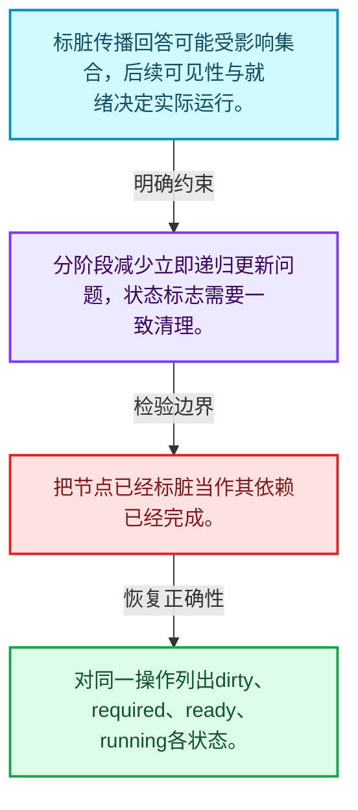
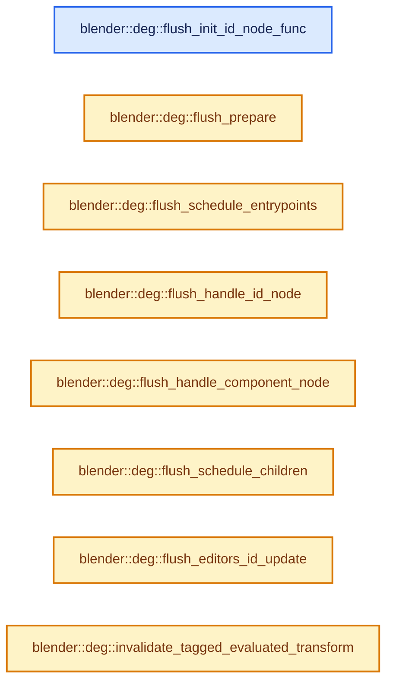
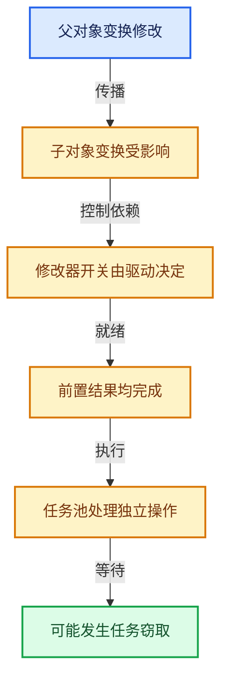

# 11-05 失效传播

[方向导航](README.md) · [总目录](../README.md) · [实现索引](../00-课程指南/02-源码与提交索引/符号依赖与实现索引.md)

## 从问题到实现

标记变化与实际执行为什么分开？

更新传播先确定受影响操作，执行阶段再考虑就绪、可见性和依赖；标脏不等于立即计算。

**数据模型**

标脏传播回答可能受影响集合，后续可见性与就绪决定实际运行。

**设计取舍**

分阶段减少立即递归更新问题，状态标志需要一致清理。

**最小反例**

把节点已经标脏当作其依赖已经完成。

**推导**

对同一操作列出dirty、required、ready、running各状态。

## 阅读地图与执行推演








图中的数值推演是本方向的教学模型；实际函数之间的调用边与概念分析边分别标注，不能把概念关系当作运行时调度顺序。

## 完整源码单元与就地讲解

中文讲解直接放在相关代码旁，复杂机制在代码下展开。原文折叠区保留基准行号；不需要在行号表和函数之间来回查找。类布局可分段展示，函数实现不按固定行数切开。

### 类型布局、声明与编译条件 · deg_eval_flush.cc L1—L70

<!-- annotated:9fdbfa71eff414 -->

```cpp
/* SPDX-FileCopyrightText: 2013 Blender Authors
 *
 * SPDX-License-Identifier: GPL-2.0-or-later */

/** \file
 * \ingroup depsgraph
 *
 * Core routines for how the Depsgraph works.
 */

#include "intern/eval/deg_eval_flush.h"

#include <algorithm>
#include <deque>

#include "BLI_listbase.hh"
#include "BLI_task_c.hh"
#include "BLI_utildefines.hh"

#include "BKE_global.hh"
#include "BKE_key.hh"
#include "BKE_object.hh"
#include "BKE_scene.hh"

#include "DRW_engine.hh"

#include "DEG_depsgraph.hh"
#include "DEG_depsgraph_debug.hh"

#include "intern/debug/deg_debug.h"
#include "intern/depsgraph.hh"
#include "intern/depsgraph_relation.hh"
#include "intern/depsgraph_update.hh"
#include "intern/node/deg_node.hh"
#include "intern/node/deg_node_component.hh"
#include "intern/node/deg_node_factory.hh"
#include "intern/node/deg_node_id.hh"
#include "intern/node/deg_node_operation.hh"
#include "intern/node/deg_node_time.hh"

#include "intern/eval/deg_eval_copy_on_write.h"

/* Invalidate data-block data when update is flushed on it.
 *
 * The idea of this is to help catching cases when area is accessing data which
 * is not yet evaluated, which could happen due to missing relations. The issue
 * is that usually that data will be kept from previous frame, and it looks to
 * be plausible.
 *
 * This ensures that data does not look plausible, making it much easier to
 * catch usage of invalid state. */
#undef INVALIDATE_ON_FLUSH

namespace blender::deg {

enum {
  ID_STATE_NONE = 0,
  ID_STATE_MODIFIED = 1,
};

enum {
  COMPONENT_STATE_NONE = 0,
  COMPONENT_STATE_SCHEDULED = 1,
  COMPONENT_STATE_DONE = 2,
};

using FlushQueue = std::deque<OperationNode *>;

namespace {

```

<details>
<summary>核对原始源码：source/blender/depsgraph/intern/eval/deg_eval_flush.cc · L1—L70</summary>

<!-- original:9fdbfa71eff414:source/blender/depsgraph/intern/eval/deg_eval_flush.cc:1:70 -->

```cpp
/* SPDX-FileCopyrightText: 2013 Blender Authors
 *
 * SPDX-License-Identifier: GPL-2.0-or-later */

/** \file
 * \ingroup depsgraph
 *
 * Core routines for how the Depsgraph works.
 */

#include "intern/eval/deg_eval_flush.h"

#include <algorithm>
#include <deque>

#include "BLI_listbase.hh"
#include "BLI_task_c.hh"
#include "BLI_utildefines.hh"

#include "BKE_global.hh"
#include "BKE_key.hh"
#include "BKE_object.hh"
#include "BKE_scene.hh"

#include "DRW_engine.hh"

#include "DEG_depsgraph.hh"
#include "DEG_depsgraph_debug.hh"

#include "intern/debug/deg_debug.h"
#include "intern/depsgraph.hh"
#include "intern/depsgraph_relation.hh"
#include "intern/depsgraph_update.hh"
#include "intern/node/deg_node.hh"
#include "intern/node/deg_node_component.hh"
#include "intern/node/deg_node_factory.hh"
#include "intern/node/deg_node_id.hh"
#include "intern/node/deg_node_operation.hh"
#include "intern/node/deg_node_time.hh"

#include "intern/eval/deg_eval_copy_on_write.h"

/* Invalidate data-block data when update is flushed on it.
 *
 * The idea of this is to help catching cases when area is accessing data which
 * is not yet evaluated, which could happen due to missing relations. The issue
 * is that usually that data will be kept from previous frame, and it looks to
 * be plausible.
 *
 * This ensures that data does not look plausible, making it much easier to
 * catch usage of invalid state. */
#undef INVALIDATE_ON_FLUSH

namespace blender::deg {

enum {
  ID_STATE_NONE = 0,
  ID_STATE_MODIFIED = 1,
};

enum {
  COMPONENT_STATE_NONE = 0,
  COMPONENT_STATE_SCHEDULED = 1,
  COMPONENT_STATE_DONE = 2,
};

using FlushQueue = std::deque<OperationNode *>;

namespace {

```

</details>

<a id="f-bf9058bda264a201"></a>

### `blender::deg::flush_init_id_node_func`

实现位置：[source/blender/depsgraph/intern/eval/deg_eval_flush.cc](../../../../../source/blender/depsgraph/intern/eval/deg_eval_flush.cc) · L71—L81。

接口参数：

- `void *__restrict data_v`
- `const int i`
- `const TaskParallelTLS *__restrict`

**教学注释版**

<!-- annotated:11fd23a1efcaa4 -->

```cpp
void flush_init_id_node_func(void *__restrict data_v,
                             const int i,
                             const TaskParallelTLS *__restrict /*tls*/)
{
  Depsgraph *graph = static_cast<Depsgraph *>(data_v);
  IDNode *id_node = graph->id_nodes[i];
  id_node->custom_flags = ID_STATE_NONE;
  for (ComponentNode *comp_node : id_node->components.values()) {
    comp_node->custom_flags = COMPONENT_STATE_NONE;
  }
}
```

<details>
<summary>核对原始源码：source/blender/depsgraph/intern/eval/deg_eval_flush.cc · L71—L81</summary>

<!-- original:11fd23a1efcaa4:source/blender/depsgraph/intern/eval/deg_eval_flush.cc:71:81 -->

```cpp
void flush_init_id_node_func(void *__restrict data_v,
                             const int i,
                             const TaskParallelTLS *__restrict /*tls*/)
{
  Depsgraph *graph = static_cast<Depsgraph *>(data_v);
  IDNode *id_node = graph->id_nodes[i];
  id_node->custom_flags = ID_STATE_NONE;
  for (ComponentNode *comp_node : id_node->components.values()) {
    comp_node->custom_flags = COMPONENT_STATE_NONE;
  }
}
```

</details>

**沿实际写入检查状态**

- `id_node->custom_flags = ID_STATE_NONE;`
- `comp_node->custom_flags = COMPONENT_STATE_NONE;`

**继续追踪实现**

- `id_node->components.values` → [调用协议](../00-课程指南/01-路线与规范/模板宏与动态分派协议.md)：接收对象类型依赖auto、返回值或模板实例；不按同名猜测目标。调用位置L78。

<!-- annotated:dea2b8736ffba2 -->

```cpp

```

<details>
<summary>核对原始源码：source/blender/depsgraph/intern/eval/deg_eval_flush.cc · L82—L82</summary>

<!-- original:dea2b8736ffba2:source/blender/depsgraph/intern/eval/deg_eval_flush.cc:82:82 -->

```cpp

```

</details>

<a id="f-f176258900395102"></a>

### `blender::deg::flush_prepare`

实现位置：[source/blender/depsgraph/intern/eval/deg_eval_flush.cc](../../../../../source/blender/depsgraph/intern/eval/deg_eval_flush.cc) · L83—L96。

接口参数：

- `Depsgraph *graph`

**教学注释版**

<!-- annotated:ab0f6e31aae52c -->

```cpp
inline void flush_prepare(Depsgraph *graph)
{
  for (OperationNode *node : graph->operations) {
    node->scheduled = false;
  }

  {
    const int num_id_nodes = graph->id_nodes.size();
    TaskParallelSettings settings;
    BLI_parallel_range_settings_defaults(&settings);
    settings.min_iter_per_thread = 1024;
    BLI_task_parallel_range(0, num_id_nodes, graph, flush_init_id_node_func, &settings);
  }
}
```

<details>
<summary>核对原始源码：source/blender/depsgraph/intern/eval/deg_eval_flush.cc · L83—L96</summary>

<!-- original:ab0f6e31aae52c:source/blender/depsgraph/intern/eval/deg_eval_flush.cc:83:96 -->

```cpp
inline void flush_prepare(Depsgraph *graph)
{
  for (OperationNode *node : graph->operations) {
    node->scheduled = false;
  }

  {
    const int num_id_nodes = graph->id_nodes.size();
    TaskParallelSettings settings;
    BLI_parallel_range_settings_defaults(&settings);
    settings.min_iter_per_thread = 1024;
    BLI_task_parallel_range(0, num_id_nodes, graph, flush_init_id_node_func, &settings);
  }
}
```

</details>

**沿实际写入检查状态**

- `node->scheduled = false;`
- `settings.min_iter_per_thread = 1024;`

**继续追踪实现**

- `graph->id_nodes.size` → [调用协议](../00-课程指南/01-路线与规范/模板宏与动态分派协议.md)：接收对象类型依赖auto、返回值或模板实例；不按同名猜测目标。调用位置L90。
- `BLI_parallel_range_settings_defaults` → [blender::BLI_parallel_range_settings_defaults · L218](../90-实现依赖专题/01-BLI基础库/BLI_task_c.hh.md#f-3858ad801a98e123)。
- `BLI_task_parallel_range` → [blender::BLI_task_parallel_range · L101](08-任务隔离死锁与实战.md#f-9d237d7e4e78d7e2)。

<!-- annotated:db9a5856d76735 -->

```cpp

```

<details>
<summary>核对原始源码：source/blender/depsgraph/intern/eval/deg_eval_flush.cc · L97—L97</summary>

<!-- original:db9a5856d76735:source/blender/depsgraph/intern/eval/deg_eval_flush.cc:97:97 -->

```cpp

```

</details>

<a id="f-1a5d53dc2b140eef"></a>

### `blender::deg::flush_schedule_entrypoints`

实现位置：[source/blender/depsgraph/intern/eval/deg_eval_flush.cc](../../../../../source/blender/depsgraph/intern/eval/deg_eval_flush.cc) · L98—L108。

接口参数：

- `Depsgraph *graph`
- `FlushQueue *queue`

**教学注释版**

<!-- annotated:9e5eaaab9349aa -->

```cpp
inline void flush_schedule_entrypoints(Depsgraph *graph, FlushQueue *queue)
{
  for (OperationNode *op_node : graph->entry_tags) {
    queue->push_back(op_node);
    op_node->scheduled = true;
    DEG_DEBUG_PRINTF((::blender::Depsgraph *)graph,
                     EVAL,
                     "Operation is entry point for update: %s\n",
                     op_node->identifier().c_str());
  }
}
```

<details>
<summary>核对原始源码：source/blender/depsgraph/intern/eval/deg_eval_flush.cc · L98—L108</summary>

<!-- original:9e5eaaab9349aa:source/blender/depsgraph/intern/eval/deg_eval_flush.cc:98:108 -->

```cpp
inline void flush_schedule_entrypoints(Depsgraph *graph, FlushQueue *queue)
{
  for (OperationNode *op_node : graph->entry_tags) {
    queue->push_back(op_node);
    op_node->scheduled = true;
    DEG_DEBUG_PRINTF((::blender::Depsgraph *)graph,
                     EVAL,
                     "Operation is entry point for update: %s\n",
                     op_node->identifier().c_str());
  }
}
```

</details>

**沿实际写入检查状态**

- `op_node->scheduled = true;`

**继续追踪实现**

- `queue->push_back` → [调用协议](../00-课程指南/01-路线与规范/模板宏与动态分派协议.md)：由接收对象具体类型或运行时策略提供实现。调用位置L101。
- `DEG_DEBUG_PRINTF` → [DEG_DEBUG_PRINTF · L47](../90-实现依赖专题/06-Depsgraph依赖图/intern/debug/deg_debug.h.md#m-ef590076cffe)。宏定义由构建条件选择。
- `op_node->identifier().c_str` → [调用协议](../00-课程指南/01-路线与规范/模板宏与动态分派协议.md)：接收对象类型依赖auto、返回值或模板实例；不按同名猜测目标。调用位置L106。
- `op_node->identifier` → [调用协议](../00-课程指南/01-路线与规范/模板宏与动态分派协议.md)：接收对象类型依赖auto、返回值或模板实例；不按同名猜测目标。调用位置L106。

<!-- annotated:f826742a9d70d4 -->

```cpp

```

<details>
<summary>核对原始源码：source/blender/depsgraph/intern/eval/deg_eval_flush.cc · L109—L109</summary>

<!-- original:f826742a9d70d4:source/blender/depsgraph/intern/eval/deg_eval_flush.cc:109:109 -->

```cpp

```

</details>

<a id="f-0f00b47f844bee88"></a>

### `blender::deg::flush_handle_id_node`

实现位置：[source/blender/depsgraph/intern/eval/deg_eval_flush.cc](../../../../../source/blender/depsgraph/intern/eval/deg_eval_flush.cc) · L110—L113。

接口参数：

- `IDNode *id_node`

**教学注释版**

<!-- annotated:ec6aab107b73d1 -->

```cpp
inline void flush_handle_id_node(IDNode *id_node)
{
  id_node->custom_flags = ID_STATE_MODIFIED;
}
```

<details>
<summary>核对原始源码：source/blender/depsgraph/intern/eval/deg_eval_flush.cc · L110—L113</summary>

<!-- original:ec6aab107b73d1:source/blender/depsgraph/intern/eval/deg_eval_flush.cc:110:113 -->

```cpp
inline void flush_handle_id_node(IDNode *id_node)
{
  id_node->custom_flags = ID_STATE_MODIFIED;
}
```

</details>

**沿实际写入检查状态**

- `id_node->custom_flags = ID_STATE_MODIFIED;`

**继续追踪实现**

本实现没有需要继续展开的显式调用；检查返回表达式、对象转换和调用者前置条件。

### 类型布局、声明与编译条件 · deg_eval_flush.cc L114—L115

<!-- annotated:013cd3a84be6ef -->

```cpp

/* TODO(sergey): We can reduce number of arguments here. */
```

<details>
<summary>核对原始源码：source/blender/depsgraph/intern/eval/deg_eval_flush.cc · L114—L115</summary>

<!-- original:013cd3a84be6ef:source/blender/depsgraph/intern/eval/deg_eval_flush.cc:114:115 -->

```cpp

/* TODO(sergey): We can reduce number of arguments here. */
```

</details>

<a id="f-302ab63d309e0953"></a>

### `blender::deg::flush_handle_component_node`

实现位置：[source/blender/depsgraph/intern/eval/deg_eval_flush.cc](../../../../../source/blender/depsgraph/intern/eval/deg_eval_flush.cc) · L116—L155。

接口参数：

- `IDNode *id_node`
- `ComponentNode *comp_node`
- `FlushQueue *queue`

**教学注释版**

<!-- annotated:8d3ca693866998 -->

```cpp
inline void flush_handle_component_node(IDNode *id_node,
                                        ComponentNode *comp_node,
                                        FlushQueue *queue)
{
  /* We only handle component once. */
  if (comp_node->custom_flags == COMPONENT_STATE_DONE) {
    return;
  }
  comp_node->custom_flags = COMPONENT_STATE_DONE;
  /* Tag all required operations in component for update, unless this is a
   * special component where we don't want all operations to be tagged.
   *
   * TODO(sergey): Make this a more generic solution. */
  if (!ELEM(comp_node->type, NodeType::PARTICLE_SETTINGS, NodeType::PARTICLE_SYSTEM)) {
    const bool is_geometry_component = comp_node->type == NodeType::GEOMETRY;
    for (OperationNode *op : comp_node->operations) {
      /* Special case for the visibility operation in the geometry component.
       *
       * This operation is a part of the geometry component so that manual tag for geometry recalc
       * ensures that the visibility is re-evaluated. This operation is not to be re-evaluated when
       * an update is flushed to the geometry component via a time dependency or a driver targeting
       * a modifier. Skipping update in this case avoids CPU time unnecessarily spent looping over
       * modifiers and looking up operations by name in the visibility evaluation function. */
      if (is_geometry_component && op->opcode == OperationCode::VISIBILITY) {
        continue;
      }
      op->flag |= DEPSOP_FLAG_NEEDS_UPDATE;
    }
  }
  /* when some target changes bone, we might need to re-run the
   * whole IK solver, otherwise result might be unpredictable. */
  if (comp_node->type == NodeType::BONE) {
    ComponentNode *pose_comp = id_node->find_component(NodeType::EVAL_POSE);
    BLI_assert(pose_comp != nullptr);
    if (pose_comp->custom_flags == COMPONENT_STATE_NONE) {
      queue->push_front(pose_comp->get_entry_operation());
      pose_comp->custom_flags = COMPONENT_STATE_SCHEDULED;
    }
  }
}
```

<details>
<summary>核对原始源码：source/blender/depsgraph/intern/eval/deg_eval_flush.cc · L116—L155</summary>

<!-- original:8d3ca693866998:source/blender/depsgraph/intern/eval/deg_eval_flush.cc:116:155 -->

```cpp
inline void flush_handle_component_node(IDNode *id_node,
                                        ComponentNode *comp_node,
                                        FlushQueue *queue)
{
  /* We only handle component once. */
  if (comp_node->custom_flags == COMPONENT_STATE_DONE) {
    return;
  }
  comp_node->custom_flags = COMPONENT_STATE_DONE;
  /* Tag all required operations in component for update, unless this is a
   * special component where we don't want all operations to be tagged.
   *
   * TODO(sergey): Make this a more generic solution. */
  if (!ELEM(comp_node->type, NodeType::PARTICLE_SETTINGS, NodeType::PARTICLE_SYSTEM)) {
    const bool is_geometry_component = comp_node->type == NodeType::GEOMETRY;
    for (OperationNode *op : comp_node->operations) {
      /* Special case for the visibility operation in the geometry component.
       *
       * This operation is a part of the geometry component so that manual tag for geometry recalc
       * ensures that the visibility is re-evaluated. This operation is not to be re-evaluated when
       * an update is flushed to the geometry component via a time dependency or a driver targeting
       * a modifier. Skipping update in this case avoids CPU time unnecessarily spent looping over
       * modifiers and looking up operations by name in the visibility evaluation function. */
      if (is_geometry_component && op->opcode == OperationCode::VISIBILITY) {
        continue;
      }
      op->flag |= DEPSOP_FLAG_NEEDS_UPDATE;
    }
  }
  /* when some target changes bone, we might need to re-run the
   * whole IK solver, otherwise result might be unpredictable. */
  if (comp_node->type == NodeType::BONE) {
    ComponentNode *pose_comp = id_node->find_component(NodeType::EVAL_POSE);
    BLI_assert(pose_comp != nullptr);
    if (pose_comp->custom_flags == COMPONENT_STATE_NONE) {
      queue->push_front(pose_comp->get_entry_operation());
      pose_comp->custom_flags = COMPONENT_STATE_SCHEDULED;
    }
  }
}
```

</details>

**沿实际写入检查状态**

- `comp_node->custom_flags = COMPONENT_STATE_DONE;`
- `op->flag |= DEPSOP_FLAG_NEEDS_UPDATE;`
- `pose_comp->custom_flags = COMPONENT_STATE_SCHEDULED;`

**继续追踪实现**

- `ELEM` → [ELEM · L88](../90-实现依赖专题/07-Intern运行时与平台/ghost/intern/GHOST_utildefines.hh.md#m-d28724a15928)；[ELEM · L135](../90-实现依赖专题/01-BLI基础库/BLI_utildefines.hh.md#m-d6572de7cae0)。宏定义由构建条件选择。
- `id_node->find_component` → [blender::deg::IDNode::find_component · L133](../90-实现依赖专题/06-Depsgraph依赖图/intern/node/deg_node_id.cc.md#f-9982102eca14b6b6)。
- `BLI_assert` → [BLI_assert · L48](../90-实现依赖专题/01-BLI基础库/BLI_assert.hh.md#m-57a88495704d)；[BLI_assert · L63](../90-实现依赖专题/01-BLI基础库/BLI_assert.hh.md#m-d07050020cb5)。宏定义由构建条件选择。
- `queue->push_front` → [调用协议](../00-课程指南/01-路线与规范/模板宏与动态分派协议.md)：由接收对象具体类型或运行时策略提供实现。调用位置L151。
- `pose_comp->get_entry_operation` → [blender::deg::ComponentNode::get_entry_operation · L205](../90-实现依赖专题/06-Depsgraph依赖图/intern/node/deg_node_component.cc.md#f-1d3e2b785b1fccd5)。

### 类型布局、声明与编译条件 · deg_eval_flush.cc L156—L162

<!-- annotated:e089a5bf5d6b7e -->

```cpp

/* Schedule children of the given operation node for traversal.
 *
 * One of the children will bypass the queue and will be returned as a function
 * return value, so it can start being handled right away, without building too
 * much of a queue.
 */
```

<details>
<summary>核对原始源码：source/blender/depsgraph/intern/eval/deg_eval_flush.cc · L156—L162</summary>

<!-- original:e089a5bf5d6b7e:source/blender/depsgraph/intern/eval/deg_eval_flush.cc:156:162 -->

```cpp

/* Schedule children of the given operation node for traversal.
 *
 * One of the children will bypass the queue and will be returned as a function
 * return value, so it can start being handled right away, without building too
 * much of a queue.
 */
```

</details>

<a id="f-0bd9e4f3133863d8"></a>

### `blender::deg::flush_schedule_children`

实现位置：[source/blender/depsgraph/intern/eval/deg_eval_flush.cc](../../../../../source/blender/depsgraph/intern/eval/deg_eval_flush.cc) · L163—L201。

接口参数：

- `OperationNode *op_node`
- `FlushQueue *queue`

**教学注释版**

<!-- annotated:9439ad748bb028 -->

```cpp
inline OperationNode *flush_schedule_children(OperationNode *op_node, FlushQueue *queue)
{
  if (op_node->flag & DEPSOP_FLAG_USER_MODIFIED) {
    ComponentNode *component_node = op_node->owner;
    component_node->is_user_modified = true;
    component_node->owner->is_user_modified = true;
  }

  OperationNode *result = nullptr;
  for (Relation *rel : op_node->outlinks) {
    /* Flush is forbidden, completely. */
    if (rel->flag & RELATION_FLAG_NO_FLUSH) {
      continue;
    }
    /* Relation only allows flushes on user changes, but the node was not
     * affected by user. */
    if ((rel->flag & RELATION_FLAG_FLUSH_USER_EDIT_ONLY) &&
        (op_node->flag & DEPSOP_FLAG_USER_MODIFIED) == 0)
    {
      continue;
    }
    OperationNode *to_node = static_cast<OperationNode *>(rel->to);
    /* Always flush flushable flags, so children always know what happened
     * to their parents. */
    to_node->flag |= (op_node->flag & DEPSOP_FLAG_FLUSH);
    /* Flush update over the relation, if it was not flushed yet. */
    if (to_node->scheduled) {
      continue;
    }
    if (result != nullptr) {
      queue->push_front(to_node);
    }
    else {
      result = to_node;
    }
    to_node->scheduled = true;
  }
  return result;
}
```

<details>
<summary>核对原始源码：source/blender/depsgraph/intern/eval/deg_eval_flush.cc · L163—L201</summary>

<!-- original:9439ad748bb028:source/blender/depsgraph/intern/eval/deg_eval_flush.cc:163:201 -->

```cpp
inline OperationNode *flush_schedule_children(OperationNode *op_node, FlushQueue *queue)
{
  if (op_node->flag & DEPSOP_FLAG_USER_MODIFIED) {
    ComponentNode *component_node = op_node->owner;
    component_node->is_user_modified = true;
    component_node->owner->is_user_modified = true;
  }

  OperationNode *result = nullptr;
  for (Relation *rel : op_node->outlinks) {
    /* Flush is forbidden, completely. */
    if (rel->flag & RELATION_FLAG_NO_FLUSH) {
      continue;
    }
    /* Relation only allows flushes on user changes, but the node was not
     * affected by user. */
    if ((rel->flag & RELATION_FLAG_FLUSH_USER_EDIT_ONLY) &&
        (op_node->flag & DEPSOP_FLAG_USER_MODIFIED) == 0)
    {
      continue;
    }
    OperationNode *to_node = static_cast<OperationNode *>(rel->to);
    /* Always flush flushable flags, so children always know what happened
     * to their parents. */
    to_node->flag |= (op_node->flag & DEPSOP_FLAG_FLUSH);
    /* Flush update over the relation, if it was not flushed yet. */
    if (to_node->scheduled) {
      continue;
    }
    if (result != nullptr) {
      queue->push_front(to_node);
    }
    else {
      result = to_node;
    }
    to_node->scheduled = true;
  }
  return result;
}
```

</details>

**沿实际写入检查状态**

- `component_node->is_user_modified = true;`
- `component_node->owner->is_user_modified = true;`
- `to_node->flag |= (op_node->flag & DEPSOP_FLAG_FLUSH);`
- `result = to_node;`
- `to_node->scheduled = true;`

**结果出口**

- `return result;`

**继续追踪实现**

- `queue->push_front` → [调用协议](../00-课程指南/01-路线与规范/模板宏与动态分派协议.md)：由接收对象具体类型或运行时策略提供实现。调用位置L193。

### 类型布局、声明与编译条件 · deg_eval_flush.cc L202—L203

<!-- annotated:c92ed28d841c07 -->

```cpp

/* NOTE: It will also accumulate flags from changed components. */
```

<details>
<summary>核对原始源码：source/blender/depsgraph/intern/eval/deg_eval_flush.cc · L202—L203</summary>

<!-- original:c92ed28d841c07:source/blender/depsgraph/intern/eval/deg_eval_flush.cc:202:203 -->

```cpp

/* NOTE: It will also accumulate flags from changed components. */
```

</details>

<a id="f-c540a8b05b302686"></a>

### `blender::deg::flush_editors_id_update`

实现位置：[source/blender/depsgraph/intern/eval/deg_eval_flush.cc](../../../../../source/blender/depsgraph/intern/eval/deg_eval_flush.cc) · L204—L242。

接口参数：

- `Depsgraph *graph`
- `const DEGEditorUpdateContext *update_ctx`

**教学注释版**

<!-- annotated:19a171f39d6f60 -->

```cpp
void flush_editors_id_update(Depsgraph *graph, const DEGEditorUpdateContext *update_ctx)
{
  for (IDNode *id_node : graph->id_nodes) {
    if (id_node->custom_flags != ID_STATE_MODIFIED) {
      continue;
    }
    DEG_graph_id_type_tag(reinterpret_cast<::blender::Depsgraph *>(graph),
                          GS(id_node->id_orig->name));
    /* TODO(sergey): Do we need to pass original or evaluated ID here? */
    ID *id_orig = id_node->id_orig;
    ID *id_cow = id_node->id_cow;
    /* Gather recalc flags from all changed components. */
    for (ComponentNode *comp_node : id_node->components.values()) {
      if (comp_node->custom_flags != COMPONENT_STATE_DONE) {
        continue;
      }
      DepsNodeFactory *factory = type_get_factory(comp_node->type);
      BLI_assert(factory != nullptr);
      id_cow->recalc |= factory->id_recalc_tag();
    }
    DEG_DEBUG_PRINTF((blender::Depsgraph *)graph,
                     EVAL,
                     "Accumulated recalc bits for %s: %u\n",
                     id_orig->name,
                     uint(id_cow->recalc));

    /* Inform editors. Only if the data-block is being evaluated a second
     * time, to distinguish between user edits and initial evaluation when
     * the data-block becomes visible.
     *
     * TODO: image data-blocks do not use copy-on-eval, so might not be detected
     * correctly. */
    if (deg_eval_copy_is_expanded(id_cow)) {
      if (graph->is_active && id_node->is_user_modified) {
        deg_editors_id_update(update_ctx, id_orig);
      }
    }
  }
}
```

<details>
<summary>核对原始源码：source/blender/depsgraph/intern/eval/deg_eval_flush.cc · L204—L242</summary>

<!-- original:19a171f39d6f60:source/blender/depsgraph/intern/eval/deg_eval_flush.cc:204:242 -->

```cpp
void flush_editors_id_update(Depsgraph *graph, const DEGEditorUpdateContext *update_ctx)
{
  for (IDNode *id_node : graph->id_nodes) {
    if (id_node->custom_flags != ID_STATE_MODIFIED) {
      continue;
    }
    DEG_graph_id_type_tag(reinterpret_cast<::blender::Depsgraph *>(graph),
                          GS(id_node->id_orig->name));
    /* TODO(sergey): Do we need to pass original or evaluated ID here? */
    ID *id_orig = id_node->id_orig;
    ID *id_cow = id_node->id_cow;
    /* Gather recalc flags from all changed components. */
    for (ComponentNode *comp_node : id_node->components.values()) {
      if (comp_node->custom_flags != COMPONENT_STATE_DONE) {
        continue;
      }
      DepsNodeFactory *factory = type_get_factory(comp_node->type);
      BLI_assert(factory != nullptr);
      id_cow->recalc |= factory->id_recalc_tag();
    }
    DEG_DEBUG_PRINTF((blender::Depsgraph *)graph,
                     EVAL,
                     "Accumulated recalc bits for %s: %u\n",
                     id_orig->name,
                     uint(id_cow->recalc));

    /* Inform editors. Only if the data-block is being evaluated a second
     * time, to distinguish between user edits and initial evaluation when
     * the data-block becomes visible.
     *
     * TODO: image data-blocks do not use copy-on-eval, so might not be detected
     * correctly. */
    if (deg_eval_copy_is_expanded(id_cow)) {
      if (graph->is_active && id_node->is_user_modified) {
        deg_editors_id_update(update_ctx, id_orig);
      }
    }
  }
}
```

</details>

**沿实际写入检查状态**

- `id_cow->recalc |= factory->id_recalc_tag();`

**继续追踪实现**

- `DEG_graph_id_type_tag` → [blender::DEG_graph_id_type_tag · L886](../90-实现依赖专题/06-Depsgraph依赖图/intern/depsgraph_tag.cc.md#f-c6fa23250da27ba5)。
- `GS` → [blender::GS · L410](../90-实现依赖专题/08-其他Blender模块/makesdna/DNA_ID.h.md#f-c3ff509f79f21b05)。
- `id_node->components.values` → [调用协议](../00-课程指南/01-路线与规范/模板宏与动态分派协议.md)：接收对象类型依赖auto、返回值或模板实例；不按同名猜测目标。调用位置L216。
- `type_get_factory` → [blender::deg::type_get_factory · L23](../90-实现依赖专题/06-Depsgraph依赖图/intern/node/deg_node_factory.cc.md#f-5af7c2ca11c54f63)。
- `BLI_assert` → [BLI_assert · L48](../90-实现依赖专题/01-BLI基础库/BLI_assert.hh.md#m-57a88495704d)；[BLI_assert · L63](../90-实现依赖专题/01-BLI基础库/BLI_assert.hh.md#m-d07050020cb5)。宏定义由构建条件选择。
- `factory->id_recalc_tag` → [blender::deg::DepsNodeFactoryImpl<ModeObjectType>::id_recalc_tag · L29](../90-实现依赖专题/06-Depsgraph依赖图/intern/node/deg_node_factory_impl.hh.md#f-150f0311c1d40232)。
- `DEG_DEBUG_PRINTF` → [DEG_DEBUG_PRINTF · L47](../90-实现依赖专题/06-Depsgraph依赖图/intern/debug/deg_debug.h.md#m-ef590076cffe)。宏定义由构建条件选择。
- `deg_eval_copy_is_expanded` → [blender::deg::deg_eval_copy_is_expanded · L1040](../90-实现依赖专题/06-Depsgraph依赖图/intern/eval/deg_eval_copy_on_write.cc.md#f-1e059be54ffbb837)。
- `deg_editors_id_update` → [blender::deg::deg_editors_id_update · L20](../90-实现依赖专题/06-Depsgraph依赖图/intern/depsgraph_update.cc.md#f-70718d1cdd03c14d)。

### 类型布局、声明与编译条件 · deg_eval_flush.cc L243—L244

<!-- annotated:d3724a9bcf62c2 -->

```cpp

#ifdef INVALIDATE_ON_FLUSH
```

<details>
<summary>核对原始源码：source/blender/depsgraph/intern/eval/deg_eval_flush.cc · L243—L244</summary>

<!-- original:d3724a9bcf62c2:source/blender/depsgraph/intern/eval/deg_eval_flush.cc:243:244 -->

```cpp

#ifdef INVALIDATE_ON_FLUSH
```

</details>

<a id="f-eb8fad1c201596e2"></a>

### `blender::deg::invalidate_tagged_evaluated_transform`

实现位置：[source/blender/depsgraph/intern/eval/deg_eval_flush.cc](../../../../../source/blender/depsgraph/intern/eval/deg_eval_flush.cc) · L245—L257。

接口参数：

- `ID *id`

**教学注释版**

<!-- annotated:d32ec23977346d -->

```cpp
void invalidate_tagged_evaluated_transform(ID *id)
{
  const ID_Type id_type = GS(id->name);
  switch (id_type) {
    case ID_OB: {
      Object *object = (Object *)id;
      std::fill_n((float *)object->object_to_world().ptr(), 16, NAN);
      break;
    }
    default:
      break;
  }
}
```

<details>
<summary>核对原始源码：source/blender/depsgraph/intern/eval/deg_eval_flush.cc · L245—L257</summary>

<!-- original:d32ec23977346d:source/blender/depsgraph/intern/eval/deg_eval_flush.cc:245:257 -->

```cpp
void invalidate_tagged_evaluated_transform(ID *id)
{
  const ID_Type id_type = GS(id->name);
  switch (id_type) {
    case ID_OB: {
      Object *object = (Object *)id;
      std::fill_n((float *)object->object_to_world().ptr(), 16, NAN);
      break;
    }
    default:
      break;
  }
}
```

</details>

**继续追踪实现**

- `GS` → [blender::GS · L410](../90-实现依赖专题/08-其他Blender模块/makesdna/DNA_ID.h.md#f-c3ff509f79f21b05)。
- `std::fill_n` → [外部契约](https://eel.is/c++draft/)：这个边界按实际表达式及所属类型核对参数、返回值、寿命与失败行为。这里提供接口入口，不声称已解释该第三方版本的内部实现。
- `object->object_to_world().ptr` → [调用协议](../00-课程指南/01-路线与规范/模板宏与动态分派协议.md)：接收对象类型依赖auto、返回值或模板实例；不按同名猜测目标。调用位置L251。
- `object->object_to_world` → [blender::Object::object_to_world · L5761](../90-实现依赖专题/02-BKE几何与数据/intern/object.cc.md#f-12fc20026327d50c)。

<!-- annotated:719ea0e86de1c4 -->

```cpp

```

<details>
<summary>核对原始源码：source/blender/depsgraph/intern/eval/deg_eval_flush.cc · L258—L258</summary>

<!-- original:719ea0e86de1c4:source/blender/depsgraph/intern/eval/deg_eval_flush.cc:258:258 -->

```cpp

```

</details>

<a id="f-6a1124f6a5fa3356"></a>

### `blender::deg::invalidate_tagged_evaluated_geometry`

实现位置：[source/blender/depsgraph/intern/eval/deg_eval_flush.cc](../../../../../source/blender/depsgraph/intern/eval/deg_eval_flush.cc) · L259—L271。

接口参数：

- `ID *id`

**教学注释版**

<!-- annotated:a29ce1b80318df -->

```cpp
void invalidate_tagged_evaluated_geometry(ID *id)
{
  const ID_Type id_type = GS(id->name);
  switch (id_type) {
    case ID_OB: {
      Object *object = (Object *)id;
      BKE_object_free_derived_caches(object);
      break;
    }
    default:
      break;
  }
}
```

<details>
<summary>核对原始源码：source/blender/depsgraph/intern/eval/deg_eval_flush.cc · L259—L271</summary>

<!-- original:a29ce1b80318df:source/blender/depsgraph/intern/eval/deg_eval_flush.cc:259:271 -->

```cpp
void invalidate_tagged_evaluated_geometry(ID *id)
{
  const ID_Type id_type = GS(id->name);
  switch (id_type) {
    case ID_OB: {
      Object *object = (Object *)id;
      BKE_object_free_derived_caches(object);
      break;
    }
    default:
      break;
  }
}
```

</details>

**继续追踪实现**

- `GS` → [blender::GS · L410](../90-实现依赖专题/08-其他Blender模块/makesdna/DNA_ID.h.md#f-c3ff509f79f21b05)。
- `BKE_object_free_derived_caches` → [blender::BKE_object_free_derived_caches · L1810](../90-实现依赖专题/02-BKE几何与数据/intern/object.cc.md#f-74071902e41326eb)。

### 类型布局、声明与编译条件 · deg_eval_flush.cc L272—L273

<!-- annotated:83734b5a03344c -->

```cpp
#endif

```

<details>
<summary>核对原始源码：source/blender/depsgraph/intern/eval/deg_eval_flush.cc · L272—L273</summary>

<!-- original:83734b5a03344c:source/blender/depsgraph/intern/eval/deg_eval_flush.cc:272:273 -->

```cpp
#endif

```

</details>

<a id="f-f96110400e2fcf55"></a>

### `blender::deg::invalidate_tagged_evaluated_data`

实现位置：[source/blender/depsgraph/intern/eval/deg_eval_flush.cc](../../../../../source/blender/depsgraph/intern/eval/deg_eval_flush.cc) · L274—L304。

接口参数：

- `Depsgraph *graph`

**教学注释版**

<!-- annotated:e6966577aac63e -->

```cpp
void invalidate_tagged_evaluated_data(Depsgraph *graph)
{
#ifdef INVALIDATE_ON_FLUSH
  for (IDNode *id_node : graph->id_nodes) {
    if (id_node->custom_flags != ID_STATE_MODIFIED) {
      continue;
    }
    ID *id_cow = id_node->id_cow;
    if (!deg_eval_copy_is_expanded(id_cow)) {
      continue;
    }
    for (ComponentNode *comp_node : id_node->components.values()) {
      if (comp_node->custom_flags != COMPONENT_STATE_DONE) {
        continue;
      }
      switch (comp_node->type) {
        case ID_RECALC_TRANSFORM:
          invalidate_tagged_evaluated_transform(id_cow);
          break;
        case ID_RECALC_GEOMETRY:
          invalidate_tagged_evaluated_geometry(id_cow);
          break;
        default:
          break;
      }
    }
  }
#else
  (void)graph;
#endif
}
```

<details>
<summary>核对原始源码：source/blender/depsgraph/intern/eval/deg_eval_flush.cc · L274—L304</summary>

<!-- original:e6966577aac63e:source/blender/depsgraph/intern/eval/deg_eval_flush.cc:274:304 -->

```cpp
void invalidate_tagged_evaluated_data(Depsgraph *graph)
{
#ifdef INVALIDATE_ON_FLUSH
  for (IDNode *id_node : graph->id_nodes) {
    if (id_node->custom_flags != ID_STATE_MODIFIED) {
      continue;
    }
    ID *id_cow = id_node->id_cow;
    if (!deg_eval_copy_is_expanded(id_cow)) {
      continue;
    }
    for (ComponentNode *comp_node : id_node->components.values()) {
      if (comp_node->custom_flags != COMPONENT_STATE_DONE) {
        continue;
      }
      switch (comp_node->type) {
        case ID_RECALC_TRANSFORM:
          invalidate_tagged_evaluated_transform(id_cow);
          break;
        case ID_RECALC_GEOMETRY:
          invalidate_tagged_evaluated_geometry(id_cow);
          break;
        default:
          break;
      }
    }
  }
#else
  (void)graph;
#endif
}
```

</details>

**继续追踪实现**

- `deg_eval_copy_is_expanded` → [blender::deg::deg_eval_copy_is_expanded · L1040](../90-实现依赖专题/06-Depsgraph依赖图/intern/eval/deg_eval_copy_on_write.cc.md#f-1e059be54ffbb837)。
- `id_node->components.values` → [调用协议](../00-课程指南/01-路线与规范/模板宏与动态分派协议.md)：接收对象类型依赖auto、返回值或模板实例；不按同名猜测目标。调用位置L285。
- `invalidate_tagged_evaluated_transform` → [blender::deg::invalidate_tagged_evaluated_transform · L245](05-失效传播.md#f-eb8fad1c201596e2)。
- `invalidate_tagged_evaluated_geometry` → [blender::deg::invalidate_tagged_evaluated_geometry · L259](05-失效传播.md#f-6a1124f6a5fa3356)。

### 类型布局、声明与编译条件 · deg_eval_flush.cc L305—L307

<!-- annotated:eb11a7a1b82cd0 -->

```cpp

}  // namespace

```

<details>
<summary>核对原始源码：source/blender/depsgraph/intern/eval/deg_eval_flush.cc · L305—L307</summary>

<!-- original:eb11a7a1b82cd0:source/blender/depsgraph/intern/eval/deg_eval_flush.cc:305:307 -->

```cpp

}  // namespace

```

</details>

<a id="f-459f7b4fd56db2ff"></a>

### `blender::deg::deg_graph_flush_updates`

实现位置：[source/blender/depsgraph/intern/eval/deg_eval_flush.cc](../../../../../source/blender/depsgraph/intern/eval/deg_eval_flush.cc) · L308—L352。

接口参数：

- `Depsgraph *graph`

**教学注释版**

<!-- annotated:10e7f3ff40c250 -->

```cpp
void deg_graph_flush_updates(Depsgraph *graph)
{
  /* Sanity checks. */
  BLI_assert(graph != nullptr);
  Main *bmain = graph->bmain;

  graph->time_source->flush_update_tag(graph);

  /* Nothing to update, early out. */
  if (graph->entry_tags.is_empty()) {
    return;
  }
  /* Reset all flags, get ready for the flush. */
  flush_prepare(graph);
  /* Starting from the tagged "entry" nodes, flush outwards. */
  FlushQueue queue;
  flush_schedule_entrypoints(graph, &queue);
  /* Prepare update context for editors. */
  DEGEditorUpdateContext update_ctx;
  update_ctx.bmain = bmain;
  update_ctx.depsgraph = reinterpret_cast<::blender::Depsgraph *>(graph);
  update_ctx.scene = graph->scene;
  update_ctx.view_layer = graph->view_layer;
  /* Do actual flush. */
  while (!queue.empty()) {
    OperationNode *op_node = queue.front();
    queue.pop_front();
    while (op_node != nullptr) {
      /* Tag operation as required for update. */
      op_node->flag |= DEPSOP_FLAG_NEEDS_UPDATE;
      /* Inform corresponding ID and component nodes about the change. */
      ComponentNode *comp_node = op_node->owner;
      IDNode *id_node = comp_node->owner;
      flush_handle_id_node(id_node);
      flush_handle_component_node(id_node, comp_node, &queue);
      /* Flush to nodes along links. */
      op_node = flush_schedule_children(op_node, &queue);
    }
  }
  /* Inform editors about all changes. */
  flush_editors_id_update(graph, &update_ctx);
  /* Reset evaluation result tagged which is tagged for update to some state
   * which is obvious to catch. */
  invalidate_tagged_evaluated_data(graph);
}
```

<details>
<summary>核对原始源码：source/blender/depsgraph/intern/eval/deg_eval_flush.cc · L308—L352</summary>

<!-- original:10e7f3ff40c250:source/blender/depsgraph/intern/eval/deg_eval_flush.cc:308:352 -->

```cpp
void deg_graph_flush_updates(Depsgraph *graph)
{
  /* Sanity checks. */
  BLI_assert(graph != nullptr);
  Main *bmain = graph->bmain;

  graph->time_source->flush_update_tag(graph);

  /* Nothing to update, early out. */
  if (graph->entry_tags.is_empty()) {
    return;
  }
  /* Reset all flags, get ready for the flush. */
  flush_prepare(graph);
  /* Starting from the tagged "entry" nodes, flush outwards. */
  FlushQueue queue;
  flush_schedule_entrypoints(graph, &queue);
  /* Prepare update context for editors. */
  DEGEditorUpdateContext update_ctx;
  update_ctx.bmain = bmain;
  update_ctx.depsgraph = reinterpret_cast<::blender::Depsgraph *>(graph);
  update_ctx.scene = graph->scene;
  update_ctx.view_layer = graph->view_layer;
  /* Do actual flush. */
  while (!queue.empty()) {
    OperationNode *op_node = queue.front();
    queue.pop_front();
    while (op_node != nullptr) {
      /* Tag operation as required for update. */
      op_node->flag |= DEPSOP_FLAG_NEEDS_UPDATE;
      /* Inform corresponding ID and component nodes about the change. */
      ComponentNode *comp_node = op_node->owner;
      IDNode *id_node = comp_node->owner;
      flush_handle_id_node(id_node);
      flush_handle_component_node(id_node, comp_node, &queue);
      /* Flush to nodes along links. */
      op_node = flush_schedule_children(op_node, &queue);
    }
  }
  /* Inform editors about all changes. */
  flush_editors_id_update(graph, &update_ctx);
  /* Reset evaluation result tagged which is tagged for update to some state
   * which is obvious to catch. */
  invalidate_tagged_evaluated_data(graph);
}
```

</details>

**沿实际写入检查状态**

- `update_ctx.bmain = bmain;`
- `update_ctx.depsgraph = reinterpret_cast<::blender::Depsgraph *>(graph);`
- `update_ctx.scene = graph->scene;`
- `update_ctx.view_layer = graph->view_layer;`
- `op_node->flag |= DEPSOP_FLAG_NEEDS_UPDATE;`
- `op_node = flush_schedule_children(op_node, &queue);`

**继续追踪实现**

- `BLI_assert` → [BLI_assert · L48](../90-实现依赖专题/01-BLI基础库/BLI_assert.hh.md#m-57a88495704d)；[BLI_assert · L63](../90-实现依赖专题/01-BLI基础库/BLI_assert.hh.md#m-d07050020cb5)。宏定义由构建条件选择。
- `graph->time_source->flush_update_tag` → [调用协议](../00-课程指南/01-路线与规范/模板宏与动态分派协议.md)：接收对象类型依赖auto、返回值或模板实例；不按同名猜测目标。调用位置L314。
- `graph->entry_tags.is_empty` → [调用协议](../00-课程指南/01-路线与规范/模板宏与动态分派协议.md)：接收对象类型依赖auto、返回值或模板实例；不按同名猜测目标。调用位置L317。
- `flush_prepare` → [blender::deg::flush_prepare · L83](05-失效传播.md#f-f176258900395102)。
- `flush_schedule_entrypoints` → [blender::deg::flush_schedule_entrypoints · L98](05-失效传播.md#f-1a5d53dc2b140eef)。
- `queue.empty` → [调用协议](../00-课程指南/01-路线与规范/模板宏与动态分派协议.md)：由接收对象具体类型或运行时策略提供实现。调用位置L332。
- `queue.front` → [调用协议](../00-课程指南/01-路线与规范/模板宏与动态分派协议.md)：由接收对象具体类型或运行时策略提供实现。调用位置L333。
- `queue.pop_front` → [调用协议](../00-课程指南/01-路线与规范/模板宏与动态分派协议.md)：由接收对象具体类型或运行时策略提供实现。调用位置L334。
- `flush_handle_id_node` → [blender::deg::flush_handle_id_node · L110](05-失效传播.md#f-0f00b47f844bee88)。
- `flush_handle_component_node` → [blender::deg::flush_handle_component_node · L116](05-失效传播.md#f-302ab63d309e0953)。
- `flush_schedule_children` → [blender::deg::flush_schedule_children · L163](05-失效传播.md#f-0bd9e4f3133863d8)。
- `flush_editors_id_update` → [blender::deg::flush_editors_id_update · L204](05-失效传播.md#f-c540a8b05b302686)。
- `invalidate_tagged_evaluated_data` → [blender::deg::invalidate_tagged_evaluated_data · L274](05-失效传播.md#f-f96110400e2fcf55)。

<!-- annotated:fe8243723a59d6 -->

```cpp

```

<details>
<summary>核对原始源码：source/blender/depsgraph/intern/eval/deg_eval_flush.cc · L353—L353</summary>

<!-- original:fe8243723a59d6:source/blender/depsgraph/intern/eval/deg_eval_flush.cc:353:353 -->

```cpp

```

</details>

<a id="f-6c186684a053f2a1"></a>

### `blender::deg::deg_graph_clear_tags`

实现位置：[source/blender/depsgraph/intern/eval/deg_eval_flush.cc](../../../../../source/blender/depsgraph/intern/eval/deg_eval_flush.cc) · L354—L360。

接口参数：

- `Depsgraph *graph`

**教学注释版**

<!-- annotated:5c896e79bc8b7c -->

```cpp
void deg_graph_clear_tags(Depsgraph *graph)
{
  /* Clear any entry tags which haven't been flushed. */
  graph->entry_tags.clear();

  graph->time_source->tagged_for_update = false;
}
```

<details>
<summary>核对原始源码：source/blender/depsgraph/intern/eval/deg_eval_flush.cc · L354—L360</summary>

<!-- original:5c896e79bc8b7c:source/blender/depsgraph/intern/eval/deg_eval_flush.cc:354:360 -->

```cpp
void deg_graph_clear_tags(Depsgraph *graph)
{
  /* Clear any entry tags which haven't been flushed. */
  graph->entry_tags.clear();

  graph->time_source->tagged_for_update = false;
}
```

</details>

**沿实际写入检查状态**

- `graph->time_source->tagged_for_update = false;`

**继续追踪实现**

- `graph->entry_tags.clear` → [调用协议](../00-课程指南/01-路线与规范/模板宏与动态分派协议.md)：接收对象类型依赖auto、返回值或模板实例；不按同名猜测目标。调用位置L357。

### 类型布局、声明与编译条件 · deg_eval_flush.cc L361—L362

<!-- annotated:c7fe421833840d -->

```cpp

}  // namespace blender::deg
```

<details>
<summary>核对原始源码：source/blender/depsgraph/intern/eval/deg_eval_flush.cc · L361—L362</summary>

<!-- original:c7fe421833840d:source/blender/depsgraph/intern/eval/deg_eval_flush.cc:361:362 -->

```cpp

}  // namespace blender::deg
```

</details>

## 语法与相关类型

### 只读限定 const

const约束当前访问路径可做的修改。const指针、指向const的指针、const视图对象、const元素是不同位置的限定；其他别名可能仍可修改原对象。

分别写T* const、const T*与const T* const，并画出不可修改的层次。

### 异常边界 try与catch

try定义异常传播的局部边界。失败路径需要销毁已经成功构造的部分并释放相应存储；未构造的对象不能被析构。

在第k次构造失败，列出已经存在的对象集合与待释放缓冲。

### 显式静态转换 static_cast

static_cast表达编译期允许的转换，不会自动验证运行时真实类型、指针寿命或索引边界。由void指针恢复T指针时，调用者仍须保证实际存储中确有合法T对象。

标出转换前后的类型以及正确性依据来自哪里。

### 表示层转换 reinterpret_cast

reinterpret_cast不能自动开始任意对象的生命周期，也不能豁免对齐和别名规则。读这类代码需要追溯原始分配与实际构造操作。

分别检查大小、对齐、生命周期和可访问类型，四项不能互相替代。

### 内部断言 assert

断言表达开发者预期成立的内部契约，发布构建可能关闭。它不能替代对不可信输入的完整错误处理，也不保证后续操作被运行时保护。

对每条断言构造违反条件的输入，区分调用者错误与应向用户报告的错误。

### 类型别名 using

类型别名为已有类型建立名字，不创建运行期对象。它常把模板内部使用的类型统一暴露给泛型调用者。

展开别名直到基础类型，区分类型别名和变量声明。

### 枚举与状态模型 enum

枚举把有限状态命名；enum class避免许多隐式整数转换。状态机正确性还依赖允许的转移，不能只看有哪些枚举项。

列出每个状态的进入条件和离开条件，检查终止状态是否仍可能被调度。

## 实现练习与验证

源变化后列出标脏集合与最终执行集合。

参考推理：对同一操作列出dirty、required、ready、running各状态。

依赖结果先于消费者可见；禁用节点仍保留必要控制计算；没有同时持有锁的循环等待。

## 历史、跨库比较与证据

与构建系统依赖图、oneTBB任务与几何节点图比较：场景更新需要处理源变化和可见性，具体图执行还受领域语义影响。

[历史提交索引](../00-课程指南/02-源码与提交索引/历史提交与设计演化索引.md) · [源码基准](../00-课程指南/02-源码与提交索引/源码版本与覆盖索引.md) · [验收报告](../00-课程指南/03-验收报告/验收报告.md)
