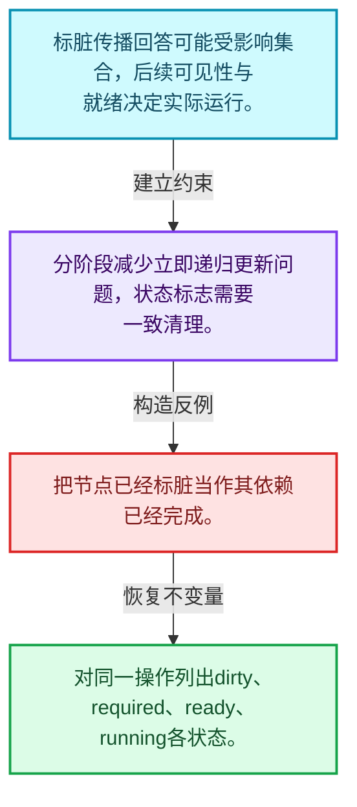
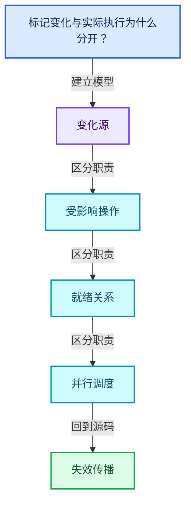
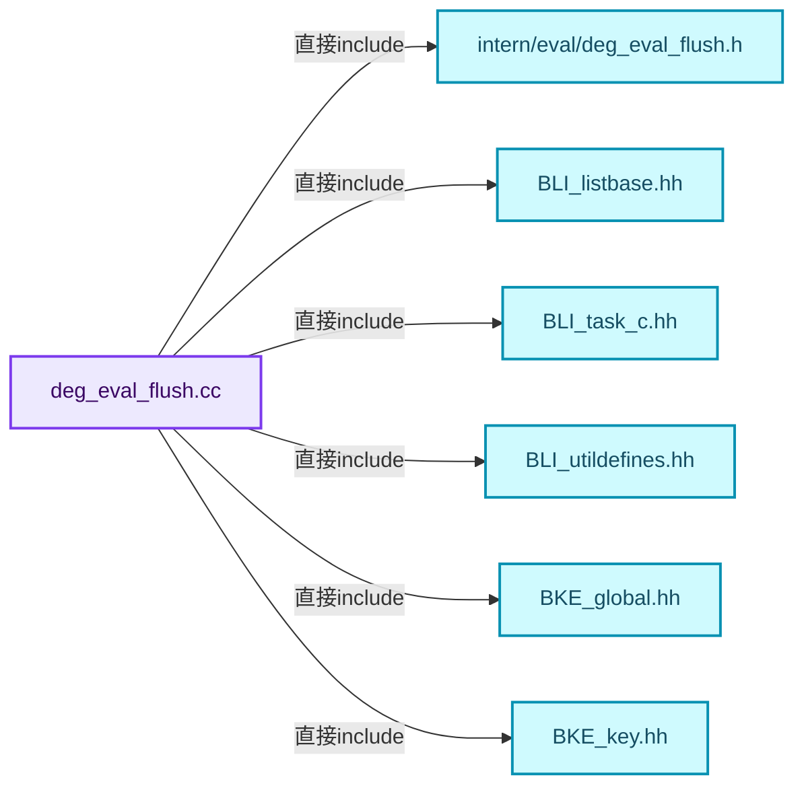
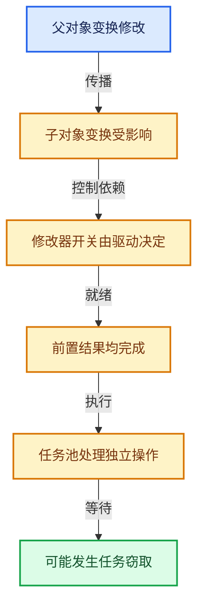

# 11-05 失效传播

[方向导航](README.md) · [总目录](../README.md) · [覆盖索引](../%E6%BA%90%E7%A0%81%E7%89%88%E6%9C%AC%E4%B8%8E%E8%A6%86%E7%9B%96%E7%B4%A2%E5%BC%95.md)

> 阅读顺序：问题与数据模型 → 语法与类型 → 源码逐行 → 调用线索 → 历史与取舍 → 推演和练习。

- 基准 HEAD：`cbda6b96c26c0dee3c3b5cbb93960c4ac06a6b30`。
- 记录日期：2026-10-14。
- 教学示例状态：正文中的推演不是本机性能实测；已运行练习见验收报告。

## 一、从问题到设计

标记变化与实际执行为什么分开？

更新传播先确定受影响操作，执行阶段再考虑就绪、可见性和依赖；标脏不等于立即计算。

本篇把语法、数据语义和系统取舍连接起来。标记更新、判断需求、依赖满足和任务执行是分开的阶段。

### 本篇独立模型与设计推理

标脏传播回答可能受影响集合，后续可见性与就绪决定实际运行。

设计取舍：分阶段减少立即递归更新问题，状态标志需要一致清理。

最小反例：把节点已经标脏当作其依赖已经完成。

推导与处理：对同一操作列出dirty、required、ready、running各状态。



### 源码范围与相邻篇章

| 文件 | 本篇逐行范围 | 基准SHA-256 |
|---|---|---|
| [source/blender/depsgraph/intern/eval/deg_eval_flush.cc](../../../../../source/blender/depsgraph/intern/eval/deg_eval_flush.cc) | L1—L362 | `b5ba4420788422d665b015d0b8874acb06f19a723db0e3d3ee600b661e65949c` |

同一主讲文件可能分多篇覆盖；超出本篇范围的符号通过覆盖索引定位。空行与纯注释保留在源码摘录中，逐行表解释有效语句与语法边界；许可证头统一保留。

前篇：[关系构建器](04-%E5%85%B3%E7%B3%BB%E6%9E%84%E5%BB%BA%E5%99%A8.md).

后篇：[可见性与求值调度](06-%E5%8F%AF%E8%A7%81%E6%80%A7%E4%B8%8E%E6%B1%82%E5%80%BC%E8%B0%83%E5%BA%A6.md).

## 二、类型、数据与阅读地图



这是概念依赖图，边表示阅读关系，不声称是运行时调用顺序。

### 直接编译依赖



箭头只表示头文件包含关系；完整调用线索见后面的符号定位表。

## 三、关键词、语法与类型角色

### 只读限定 const

const约束当前访问路径可做的修改。const指针、指向const的指针、const视图对象、const元素是不同位置的限定；其他别名可能仍可修改原对象。

具体检查：分别写T* const、const T*与const T* const，并画出不可修改的层次。

### 异常边界 try与catch

try定义异常传播的局部边界。失败路径需要销毁已经成功构造的部分并释放相应存储；未构造的对象不能被析构。

具体检查：在第k次构造失败，列出已经存在的对象集合与待释放缓冲。

### 显式静态转换 static_cast

static_cast表达编译期允许的转换，不会自动验证运行时真实类型、指针寿命或索引边界。由void指针恢复T指针时，调用者仍须保证实际存储中确有合法T对象。

具体检查：标出转换前后的类型以及正确性依据来自哪里。

### 表示层转换 reinterpret_cast

reinterpret_cast不能自动开始任意对象的生命周期，也不能豁免对齐和别名规则。读这类代码需要追溯原始分配与实际构造操作。

具体检查：分别检查大小、对齐、生命周期和可访问类型，四项不能互相替代。

### 内部断言 assert

断言表达开发者预期成立的内部契约，发布构建可能关闭。它不能替代对不可信输入的完整错误处理，也不保证后续操作被运行时保护。

具体检查：对每条断言构造违反条件的输入，区分调用者错误与应向用户报告的错误。

### 类型别名 using

类型别名为已有类型建立名字，不创建运行期对象。它常把模板内部使用的类型统一暴露给泛型调用者。

具体检查：展开别名直到基础类型，区分类型别名和变量声明。

### 枚举与状态模型 enum

枚举把有限状态命名；enum class避免许多隐式整数转换。状态机正确性还依赖允许的转移，不能只看有哪些枚举项。

具体检查：列出每个状态的进入条件和离开条件，检查终止状态是否仍可能被调度。

## 四、真实源码与逐行讲解

源码块保持原行内容，原始行号由小节标题及逐行表给出。表中的调用定位是静态阅读辅助；重载、模板实例化、宏展开和虚调用需结合完整声明，不能仅凭词法出现证明动态调用。

### deg_eval_flush.cc：L1—L52

<!-- source:source/blender/depsgraph/intern/eval/deg_eval_flush.cc:1:52 -->

```cpp
/* SPDX-FileCopyrightText: 2013 Blender Authors
 *
 * SPDX-License-Identifier: GPL-2.0-or-later */

/** \file
 * \ingroup depsgraph
 *
 * Core routines for how the Depsgraph works.
 */

#include "intern/eval/deg_eval_flush.h"

#include <algorithm>
#include <deque>

#include "BLI_listbase.hh"
#include "BLI_task_c.hh"
#include "BLI_utildefines.hh"

#include "BKE_global.hh"
#include "BKE_key.hh"
#include "BKE_object.hh"
#include "BKE_scene.hh"

#include "DRW_engine.hh"

#include "DEG_depsgraph.hh"
#include "DEG_depsgraph_debug.hh"

#include "intern/debug/deg_debug.h"
#include "intern/depsgraph.hh"
#include "intern/depsgraph_relation.hh"
#include "intern/depsgraph_update.hh"
#include "intern/node/deg_node.hh"
#include "intern/node/deg_node_component.hh"
#include "intern/node/deg_node_factory.hh"
#include "intern/node/deg_node_id.hh"
#include "intern/node/deg_node_operation.hh"
#include "intern/node/deg_node_time.hh"

#include "intern/eval/deg_eval_copy_on_write.h"

/* Invalidate data-block data when update is flushed on it.
 *
 * The idea of this is to help catching cases when area is accessing data which
 * is not yet evaluated, which could happen due to missing relations. The issue
 * is that usually that data will be kept from previous frame, and it looks to
 * be plausible.
 *
 * This ensures that data does not look plausible, making it much easier to
 * catch usage of invalid state. */
#undef INVALIDATE_ON_FLUSH
```

| 原始行 | 语义、约束与检查 |
|---|---|
| L11 | 引入编译依赖 "intern/eval/deg_eval_flush.h"；这是声明可见性关系，不表示运行时一定调用该文件的所有接口。 |
| L13 | 引入编译依赖 <algorithm>；这是声明可见性关系，不表示运行时一定调用该文件的所有接口。 |
| L14 | 引入编译依赖 <deque>；这是声明可见性关系，不表示运行时一定调用该文件的所有接口。 |
| L16 | 引入编译依赖 "BLI_listbase.hh"；这是声明可见性关系，不表示运行时一定调用该文件的所有接口。 |
| L17 | 引入编译依赖 "BLI_task_c.hh"；这是声明可见性关系，不表示运行时一定调用该文件的所有接口。 |
| L18 | 引入编译依赖 "BLI_utildefines.hh"；这是声明可见性关系，不表示运行时一定调用该文件的所有接口。 |
| L20 | 引入编译依赖 "BKE_global.hh"；这是声明可见性关系，不表示运行时一定调用该文件的所有接口。 |
| L21 | 引入编译依赖 "BKE_key.hh"；这是声明可见性关系，不表示运行时一定调用该文件的所有接口。 |
| L22 | 引入编译依赖 "BKE_object.hh"；这是声明可见性关系，不表示运行时一定调用该文件的所有接口。 |
| L23 | 引入编译依赖 "BKE_scene.hh"；这是声明可见性关系，不表示运行时一定调用该文件的所有接口。 |
| L25 | 引入编译依赖 "DRW_engine.hh"；这是声明可见性关系，不表示运行时一定调用该文件的所有接口。 |
| L27 | 引入编译依赖 "DEG_depsgraph.hh"；这是声明可见性关系，不表示运行时一定调用该文件的所有接口。 |
| L28 | 引入编译依赖 "DEG_depsgraph_debug.hh"；这是声明可见性关系，不表示运行时一定调用该文件的所有接口。 |
| L30 | 引入编译依赖 "intern/debug/deg_debug.h"；这是声明可见性关系，不表示运行时一定调用该文件的所有接口。 |
| L31 | 引入编译依赖 "intern/depsgraph.hh"；这是声明可见性关系，不表示运行时一定调用该文件的所有接口。 |
| L32 | 引入编译依赖 "intern/depsgraph_relation.hh"；这是声明可见性关系，不表示运行时一定调用该文件的所有接口。 |
| L33 | 引入编译依赖 "intern/depsgraph_update.hh"；这是声明可见性关系，不表示运行时一定调用该文件的所有接口。 |
| L34 | 引入编译依赖 "intern/node/deg_node.hh"；这是声明可见性关系，不表示运行时一定调用该文件的所有接口。 |
| L35 | 引入编译依赖 "intern/node/deg_node_component.hh"；这是声明可见性关系，不表示运行时一定调用该文件的所有接口。 |
| L36 | 引入编译依赖 "intern/node/deg_node_factory.hh"；这是声明可见性关系，不表示运行时一定调用该文件的所有接口。 |
| L37 | 引入编译依赖 "intern/node/deg_node_id.hh"；这是声明可见性关系，不表示运行时一定调用该文件的所有接口。 |
| L38 | 引入编译依赖 "intern/node/deg_node_operation.hh"；这是声明可见性关系，不表示运行时一定调用该文件的所有接口。 |
| L39 | 引入编译依赖 "intern/node/deg_node_time.hh"；这是声明可见性关系，不表示运行时一定调用该文件的所有接口。 |
| L41 | 引入编译依赖 "intern/eval/deg_eval_copy_on_write.h"；这是声明可见性关系，不表示运行时一定调用该文件的所有接口。 |
| L52 | 预处理阶段处理 #undef INVALIDATE_ON_FLUSH。它决定哪些代码进入编译，不是运行时分支；阅读行为时必须结合实际构建宏。 |

### deg_eval_flush.cc：L53—L96

<!-- source:source/blender/depsgraph/intern/eval/deg_eval_flush.cc:53:96 -->

```cpp

namespace blender::deg {

enum {
  ID_STATE_NONE = 0,
  ID_STATE_MODIFIED = 1,
};

enum {
  COMPONENT_STATE_NONE = 0,
  COMPONENT_STATE_SCHEDULED = 1,
  COMPONENT_STATE_DONE = 2,
};

using FlushQueue = std::deque<OperationNode *>;

namespace {

void flush_init_id_node_func(void *__restrict data_v,
                             const int i,
                             const TaskParallelTLS *__restrict /*tls*/)
{
  Depsgraph *graph = static_cast<Depsgraph *>(data_v);
  IDNode *id_node = graph->id_nodes[i];
  id_node->custom_flags = ID_STATE_NONE;
  for (ComponentNode *comp_node : id_node->components.values()) {
    comp_node->custom_flags = COMPONENT_STATE_NONE;
  }
}

inline void flush_prepare(Depsgraph *graph)
{
  for (OperationNode *node : graph->operations) {
    node->scheduled = false;
  }

  {
    const int num_id_nodes = graph->id_nodes.size();
    TaskParallelSettings settings;
    BLI_parallel_range_settings_defaults(&settings);
    settings.min_iter_per_thread = 1024;
    BLI_task_parallel_range(0, num_id_nodes, graph, flush_init_id_node_func, &settings);
  }
}
```

| 原始行 | 语义、约束与检查 |
|---|---|
| L54 | 把后续声明放入 blender::deg 命名空间，影响名称查找和符号归属，不创建运行时对象。 |
| L56 | 声明或定义类型 `enum`。结合继承、访问权限和成员布局确认接口与拥有关系；前向声明本身没有完整对象布局。 |
| L57 | 把右侧 `0,` 用于初始化或更新左侧 `ID_STATE_NONE`。声明初始化与已有对象赋值应按上下文区分；有资源的类型会调用相应特殊成员。 |
| L58 | 把右侧 `1,` 用于初始化或更新左侧 `ID_STATE_MODIFIED`。声明初始化与已有对象赋值应按上下文区分；有资源的类型会调用相应特殊成员。 |
| L59 | 结束当前语法单元。局部自动对象在离开其作用域时按规则销毁；这不等于所有被引用的外部数据也被释放。 |
| L61 | 声明或定义类型 `enum`。结合继承、访问权限和成员布局确认接口与拥有关系；前向声明本身没有完整对象布局。 |
| L62 | 把右侧 `0,` 用于初始化或更新左侧 `COMPONENT_STATE_NONE`。声明初始化与已有对象赋值应按上下文区分；有资源的类型会调用相应特殊成员。 |
| L63 | 把右侧 `1,` 用于初始化或更新左侧 `COMPONENT_STATE_SCHEDULED`。声明初始化与已有对象赋值应按上下文区分；有资源的类型会调用相应特殊成员。 |
| L64 | 把右侧 `2,` 用于初始化或更新左侧 `COMPONENT_STATE_DONE`。声明初始化与已有对象赋值应按上下文区分；有资源的类型会调用相应特殊成员。 |
| L65 | 结束当前语法单元。局部自动对象在离开其作用域时按规则销毁；这不等于所有被引用的外部数据也被释放。 |
| L67 | 定义类型别名 `using FlushQueue = std::deque<OperationNode *>`，为模板接口或内部实现统一命名；本行不分配该类型对象。 |
| L69 | 把后续声明放入  命名空间，影响名称查找和符号归属，不创建运行时对象。 |
| L71 | 出现调用或函数声明 `flush_init_id_node_func`，对应表达式为 `void flush_init_id_node_func(void *__restrict data_v,`。参数求值、返回类型与重载需结合前后完整语句；静态文本引用不能证明动态目标。 |
| L72 | 本行是连续声明或表达式的一部分：`const int i,`。与本段前后行合读；逗号、括号和限定符决定它属于参数、初始化列表还是实际计算。 |
| L73 | 本行是连续声明或表达式的一部分：`const TaskParallelTLS *__restrict )`。与本段前后行合读；逗号、括号和限定符决定它属于参数、初始化列表还是实际计算。 |
| L74 | 连接上一行的声明或控制结构与其语句块；后续行在这个作用域中执行或声明。 |
| L75 | 把右侧 `static_cast<Depsgraph *>(data_v)` 用于初始化或更新左侧 `Depsgraph *graph`。声明初始化与已有对象赋值应按上下文区分；有资源的类型会调用相应特殊成员。 |
| L76 | 把右侧 `graph->id_nodes[i]` 用于初始化或更新左侧 `IDNode *id_node`。声明初始化与已有对象赋值应按上下文区分；有资源的类型会调用相应特殊成员。 |
| L77 | 把右侧 `ID_STATE_NONE` 用于初始化或更新左侧 `id_node->custom_flags`。声明初始化与已有对象赋值应按上下文区分；有资源的类型会调用相应特殊成员。 |
| L78 | 按 `for (ComponentNode *comp_node : id_node->components.values())` 指定的范围或条件重复执行。对照循环变量与真实元素编号；循环内调用成本乘以实际迭代次数。 |
| L79 | 把右侧 `COMPONENT_STATE_NONE` 用于初始化或更新左侧 `comp_node->custom_flags`。声明初始化与已有对象赋值应按上下文区分；有资源的类型会调用相应特殊成员。 |
| L80 | 结束当前语法单元。局部自动对象在离开其作用域时按规则销毁；这不等于所有被引用的外部数据也被释放。 |
| L81 | 结束当前语法单元。局部自动对象在离开其作用域时按规则销毁；这不等于所有被引用的外部数据也被释放。 |
| L83 | 出现调用或函数声明 `flush_prepare`，对应表达式为 `inline void flush_prepare(Depsgraph *graph)`。参数求值、返回类型与重载需结合前后完整语句；静态文本引用不能证明动态目标。 |
| L84 | 连接上一行的声明或控制结构与其语句块；后续行在这个作用域中执行或声明。 |
| L85 | 按 `for (OperationNode *node : graph->operations)` 指定的范围或条件重复执行。对照循环变量与真实元素编号；循环内调用成本乘以实际迭代次数。 |
| L86 | 把右侧 `false` 用于初始化或更新左侧 `node->scheduled`。声明初始化与已有对象赋值应按上下文区分；有资源的类型会调用相应特殊成员。 |
| L87 | 结束当前语法单元。局部自动对象在离开其作用域时按规则销毁；这不等于所有被引用的外部数据也被释放。 |
| L89 | 连接上一行的声明或控制结构与其语句块；后续行在这个作用域中执行或声明。 |
| L90 | 把右侧 `graph->id_nodes.size()` 用于初始化或更新左侧 `const int num_id_nodes`。声明初始化与已有对象赋值应按上下文区分；有资源的类型会调用相应特殊成员。 |
| L91 | 声明成员、局部对象或完成语句 `TaskParallelSettings settings`。若为指针或引用，它本身不说明拥有；若为值对象，其构造析构由所在作用域或外层对象管理。 |
| L92 | 出现调用或函数声明 `BLI_parallel_range_settings_defaults`，对应表达式为 `BLI_parallel_range_settings_defaults(&settings);`。参数求值、返回类型与重载需结合前后完整语句；静态文本引用不能证明动态目标。 |
| L93 | 把右侧 `1024` 用于初始化或更新左侧 `settings.min_iter_per_thread`。声明初始化与已有对象赋值应按上下文区分；有资源的类型会调用相应特殊成员。 |
| L94 | 出现调用或函数声明 `BLI_task_parallel_range`，对应表达式为 `BLI_task_parallel_range(0, num_id_nodes, graph, flush_init_id_node_func, &settings);`。参数求值、返回类型与重载需结合前后完整语句；静态文本引用不能证明动态目标。 |
| L95 | 结束当前语法单元。局部自动对象在离开其作用域时按规则销毁；这不等于所有被引用的外部数据也被释放。 |
| L96 | 结束当前语法单元。局部自动对象在离开其作用域时按规则销毁；这不等于所有被引用的外部数据也被释放。 |

### deg_eval_flush.cc：L97—L155

<!-- source:source/blender/depsgraph/intern/eval/deg_eval_flush.cc:97:155 -->

```cpp

inline void flush_schedule_entrypoints(Depsgraph *graph, FlushQueue *queue)
{
  for (OperationNode *op_node : graph->entry_tags) {
    queue->push_back(op_node);
    op_node->scheduled = true;
    DEG_DEBUG_PRINTF((::blender::Depsgraph *)graph,
                     EVAL,
                     "Operation is entry point for update: %s\n",
                     op_node->identifier().c_str());
  }
}

inline void flush_handle_id_node(IDNode *id_node)
{
  id_node->custom_flags = ID_STATE_MODIFIED;
}

/* TODO(sergey): We can reduce number of arguments here. */
inline void flush_handle_component_node(IDNode *id_node,
                                        ComponentNode *comp_node,
                                        FlushQueue *queue)
{
  /* We only handle component once. */
  if (comp_node->custom_flags == COMPONENT_STATE_DONE) {
    return;
  }
  comp_node->custom_flags = COMPONENT_STATE_DONE;
  /* Tag all required operations in component for update, unless this is a
   * special component where we don't want all operations to be tagged.
   *
   * TODO(sergey): Make this a more generic solution. */
  if (!ELEM(comp_node->type, NodeType::PARTICLE_SETTINGS, NodeType::PARTICLE_SYSTEM)) {
    const bool is_geometry_component = comp_node->type == NodeType::GEOMETRY;
    for (OperationNode *op : comp_node->operations) {
      /* Special case for the visibility operation in the geometry component.
       *
       * This operation is a part of the geometry component so that manual tag for geometry recalc
       * ensures that the visibility is re-evaluated. This operation is not to be re-evaluated when
       * an update is flushed to the geometry component via a time dependency or a driver targeting
       * a modifier. Skipping update in this case avoids CPU time unnecessarily spent looping over
       * modifiers and looking up operations by name in the visibility evaluation function. */
      if (is_geometry_component && op->opcode == OperationCode::VISIBILITY) {
        continue;
      }
      op->flag |= DEPSOP_FLAG_NEEDS_UPDATE;
    }
  }
  /* when some target changes bone, we might need to re-run the
   * whole IK solver, otherwise result might be unpredictable. */
  if (comp_node->type == NodeType::BONE) {
    ComponentNode *pose_comp = id_node->find_component(NodeType::EVAL_POSE);
    BLI_assert(pose_comp != nullptr);
    if (pose_comp->custom_flags == COMPONENT_STATE_NONE) {
      queue->push_front(pose_comp->get_entry_operation());
      pose_comp->custom_flags = COMPONENT_STATE_SCHEDULED;
    }
  }
}
```

本段语义重点：

- 分支证据 `comp_node->custom_flags == COMPONENT_STATE_DONE)`：分别推演条件成立与不成立，核对相同出口处的状态。
- 分支证据 `!ELEM(comp_node->type, NodeType::PARTICLE_SETTINGS, NodeType::PARTICLE_SYSTEM))`：分别推演条件成立与不成立，核对相同出口处的状态。

| 原始行 | 语义、约束与检查 |
|---|---|
| L98 | 出现调用或函数声明 `flush_schedule_entrypoints`，对应表达式为 `inline void flush_schedule_entrypoints(Depsgraph *graph, FlushQueue *queue)`。参数求值、返回类型与重载需结合前后完整语句；静态文本引用不能证明动态目标。 |
| L99 | 连接上一行的声明或控制结构与其语句块；后续行在这个作用域中执行或声明。 |
| L100 | 按 `for (OperationNode *op_node : graph->entry_tags)` 指定的范围或条件重复执行。对照循环变量与真实元素编号；循环内调用成本乘以实际迭代次数。 |
| L101 | 出现调用或函数声明 `push_back`，对应表达式为 `queue->push_back(op_node);`。参数求值、返回类型与重载需结合前后完整语句；静态文本引用不能证明动态目标。 |
| L102 | 把右侧 `true` 用于初始化或更新左侧 `op_node->scheduled`。声明初始化与已有对象赋值应按上下文区分；有资源的类型会调用相应特殊成员。 |
| L103 | 出现调用或函数声明 `DEG_DEBUG_PRINTF`，对应表达式为 `DEG_DEBUG_PRINTF((::blender::Depsgraph *)graph,`。参数求值、返回类型与重载需结合前后完整语句；静态文本引用不能证明动态目标。 |
| L104 | 本行是连续声明或表达式的一部分：`EVAL,`。与本段前后行合读；逗号、括号和限定符决定它属于参数、初始化列表还是实际计算。 |
| L105 | 本行是连续声明或表达式的一部分：`"Operation is entry point for update: %s\n",`。与本段前后行合读；逗号、括号和限定符决定它属于参数、初始化列表还是实际计算。 |
| L106 | 出现调用或函数声明 `identifier`，对应表达式为 `op_node->identifier().c_str());`。参数求值、返回类型与重载需结合前后完整语句；静态文本引用不能证明动态目标。 |
| L107 | 结束当前语法单元。局部自动对象在离开其作用域时按规则销毁；这不等于所有被引用的外部数据也被释放。 |
| L108 | 结束当前语法单元。局部自动对象在离开其作用域时按规则销毁；这不等于所有被引用的外部数据也被释放。 |
| L110 | 出现调用或函数声明 `flush_handle_id_node`，对应表达式为 `inline void flush_handle_id_node(IDNode *id_node)`。参数求值、返回类型与重载需结合前后完整语句；静态文本引用不能证明动态目标。 |
| L111 | 连接上一行的声明或控制结构与其语句块；后续行在这个作用域中执行或声明。 |
| L112 | 把右侧 `ID_STATE_MODIFIED` 用于初始化或更新左侧 `id_node->custom_flags`。声明初始化与已有对象赋值应按上下文区分；有资源的类型会调用相应特殊成员。 |
| L113 | 结束当前语法单元。局部自动对象在离开其作用域时按规则销毁；这不等于所有被引用的外部数据也被释放。 |
| L116 | 出现调用或函数声明 `flush_handle_component_node`，对应表达式为 `inline void flush_handle_component_node(IDNode *id_node,`。参数求值、返回类型与重载需结合前后完整语句；静态文本引用不能证明动态目标。 |
| L117 | 本行是连续声明或表达式的一部分：`ComponentNode *comp_node,`。与本段前后行合读；逗号、括号和限定符决定它属于参数、初始化列表还是实际计算。 |
| L118 | 本行是连续声明或表达式的一部分：`FlushQueue *queue)`。与本段前后行合读；逗号、括号和限定符决定它属于参数、初始化列表还是实际计算。 |
| L119 | 连接上一行的声明或控制结构与其语句块；后续行在这个作用域中执行或声明。 |
| L121 | 判断 `comp_node->custom_flags == COMPONENT_STATE_DONE`，成立时进入本分支，否则继续后续路径。 |
| L122 | 结束当前函数，本路径不再执行后续语句；局部对象按作用域规则清理。 |
| L123 | 结束当前语法单元。局部自动对象在离开其作用域时按规则销毁；这不等于所有被引用的外部数据也被释放。 |
| L124 | 把右侧 `COMPONENT_STATE_DONE` 用于初始化或更新左侧 `comp_node->custom_flags`。声明初始化与已有对象赋值应按上下文区分；有资源的类型会调用相应特殊成员。 |
| L129 | 判断 `!ELEM(comp_node->type, NodeType::PARTICLE_SETTINGS, NodeType::PARTICLE_SYSTEM)`，成立时进入本分支，否则继续后续路径。 |
| L130 | 把右侧 `comp_node->type == NodeType::GEOMETRY` 用于初始化或更新左侧 `const bool is_geometry_component`。声明初始化与已有对象赋值应按上下文区分；有资源的类型会调用相应特殊成员。 |
| L131 | 按 `for (OperationNode *op : comp_node->operations)` 指定的范围或条件重复执行。对照循环变量与真实元素编号；循环内调用成本乘以实际迭代次数。 |
| L139 | 判断 `is_geometry_component && op->opcode == OperationCode::VISIBILITY`，成立时进入本分支，否则继续后续路径。 |
| L140 | 结束本轮循环并进入下一轮；核对本轮已经取得的资源是否由作用域或显式代码清理。 |
| L141 | 结束当前语法单元。局部自动对象在离开其作用域时按规则销毁；这不等于所有被引用的外部数据也被释放。 |
| L142 | 复合更新 `op->flag &#124;= DEPSOP_FLAG_NEEDS_UPDATE`：读取左侧现有值，与右侧按`&#124;=`对应操作组合后写回。检查数值边界、位掩码或共享状态保护；它不是新对象的构造。 |
| L143 | 结束当前语法单元。局部自动对象在离开其作用域时按规则销毁；这不等于所有被引用的外部数据也被释放。 |
| L144 | 结束当前语法单元。局部自动对象在离开其作用域时按规则销毁；这不等于所有被引用的外部数据也被释放。 |
| L147 | 判断 `comp_node->type == NodeType::BONE`，成立时进入本分支，否则继续后续路径。 |
| L148 | 把右侧 `id_node->find_component(NodeType::EVAL_POSE)` 用于初始化或更新左侧 `ComponentNode *pose_comp`。声明初始化与已有对象赋值应按上下文区分；有资源的类型会调用相应特殊成员。 |
| L149 | 断言约束 `BLI_assert(pose_comp != nullptr);`。条件是后续访问的内部前置条件；发布构建可能不执行，不能把断言当作输入修复。 |
| L150 | 判断 `pose_comp->custom_flags == COMPONENT_STATE_NONE`，成立时进入本分支，否则继续后续路径。 |
| L151 | 出现调用或函数声明 `push_front`，对应表达式为 `queue->push_front(pose_comp->get_entry_operation());`。参数求值、返回类型与重载需结合前后完整语句；静态文本引用不能证明动态目标。 |
| L152 | 把右侧 `COMPONENT_STATE_SCHEDULED` 用于初始化或更新左侧 `pose_comp->custom_flags`。声明初始化与已有对象赋值应按上下文区分；有资源的类型会调用相应特殊成员。 |
| L153 | 结束当前语法单元。局部自动对象在离开其作用域时按规则销毁；这不等于所有被引用的外部数据也被释放。 |
| L154 | 结束当前语法单元。局部自动对象在离开其作用域时按规则销毁；这不等于所有被引用的外部数据也被释放。 |
| L155 | 结束当前语法单元。局部自动对象在离开其作用域时按规则销毁；这不等于所有被引用的外部数据也被释放。 |

### deg_eval_flush.cc：L156—L201

<!-- source:source/blender/depsgraph/intern/eval/deg_eval_flush.cc:156:201 -->

```cpp

/* Schedule children of the given operation node for traversal.
 *
 * One of the children will bypass the queue and will be returned as a function
 * return value, so it can start being handled right away, without building too
 * much of a queue.
 */
inline OperationNode *flush_schedule_children(OperationNode *op_node, FlushQueue *queue)
{
  if (op_node->flag & DEPSOP_FLAG_USER_MODIFIED) {
    ComponentNode *component_node = op_node->owner;
    component_node->is_user_modified = true;
    component_node->owner->is_user_modified = true;
  }

  OperationNode *result = nullptr;
  for (Relation *rel : op_node->outlinks) {
    /* Flush is forbidden, completely. */
    if (rel->flag & RELATION_FLAG_NO_FLUSH) {
      continue;
    }
    /* Relation only allows flushes on user changes, but the node was not
     * affected by user. */
    if ((rel->flag & RELATION_FLAG_FLUSH_USER_EDIT_ONLY) &&
        (op_node->flag & DEPSOP_FLAG_USER_MODIFIED) == 0)
    {
      continue;
    }
    OperationNode *to_node = static_cast<OperationNode *>(rel->to);
    /* Always flush flushable flags, so children always know what happened
     * to their parents. */
    to_node->flag |= (op_node->flag & DEPSOP_FLAG_FLUSH);
    /* Flush update over the relation, if it was not flushed yet. */
    if (to_node->scheduled) {
      continue;
    }
    if (result != nullptr) {
      queue->push_front(to_node);
    }
    else {
      result = to_node;
    }
    to_node->scheduled = true;
  }
  return result;
}
```

本段语义重点：

- 分支证据 `op_node->flag & DEPSOP_FLAG_USER_MODIFIED)`：分别推演条件成立与不成立，核对相同出口处的状态。
- 分支证据 `rel->flag & RELATION_FLAG_NO_FLUSH)`：分别推演条件成立与不成立，核对相同出口处的状态。

| 原始行 | 语义、约束与检查 |
|---|---|
| L163 | 出现调用或函数声明 `flush_schedule_children`，对应表达式为 `inline OperationNode *flush_schedule_children(OperationNode *op_node, FlushQueue *queue)`。参数求值、返回类型与重载需结合前后完整语句；静态文本引用不能证明动态目标。 |
| L164 | 连接上一行的声明或控制结构与其语句块；后续行在这个作用域中执行或声明。 |
| L165 | 判断 `op_node->flag & DEPSOP_FLAG_USER_MODIFIED`，成立时进入本分支，否则继续后续路径。 |
| L166 | 把右侧 `op_node->owner` 用于初始化或更新左侧 `ComponentNode *component_node`。声明初始化与已有对象赋值应按上下文区分；有资源的类型会调用相应特殊成员。 |
| L167 | 把右侧 `true` 用于初始化或更新左侧 `component_node->is_user_modified`。声明初始化与已有对象赋值应按上下文区分；有资源的类型会调用相应特殊成员。 |
| L168 | 把右侧 `true` 用于初始化或更新左侧 `component_node->owner->is_user_modified`。声明初始化与已有对象赋值应按上下文区分；有资源的类型会调用相应特殊成员。 |
| L169 | 结束当前语法单元。局部自动对象在离开其作用域时按规则销毁；这不等于所有被引用的外部数据也被释放。 |
| L171 | 把右侧 `nullptr` 用于初始化或更新左侧 `OperationNode *result`。声明初始化与已有对象赋值应按上下文区分；有资源的类型会调用相应特殊成员。 |
| L172 | 按 `for (Relation *rel : op_node->outlinks)` 指定的范围或条件重复执行。对照循环变量与真实元素编号；循环内调用成本乘以实际迭代次数。 |
| L174 | 判断 `rel->flag & RELATION_FLAG_NO_FLUSH`，成立时进入本分支，否则继续后续路径。 |
| L175 | 结束本轮循环并进入下一轮；核对本轮已经取得的资源是否由作用域或显式代码清理。 |
| L176 | 结束当前语法单元。局部自动对象在离开其作用域时按规则销毁；这不等于所有被引用的外部数据也被释放。 |
| L179 | 判断 `(rel->flag & RELATION_FLAG_FLUSH_USER_EDIT_ONLY`，成立时进入本分支，否则继续后续路径。 |
| L180 | 本行是连续声明或表达式的一部分：`(op_node->flag & DEPSOP_FLAG_USER_MODIFIED) == 0)`。与本段前后行合读；逗号、括号和限定符决定它属于参数、初始化列表还是实际计算。 |
| L181 | 连接上一行的声明或控制结构与其语句块；后续行在这个作用域中执行或声明。 |
| L182 | 结束本轮循环并进入下一轮；核对本轮已经取得的资源是否由作用域或显式代码清理。 |
| L183 | 结束当前语法单元。局部自动对象在离开其作用域时按规则销毁；这不等于所有被引用的外部数据也被释放。 |
| L184 | 把右侧 `static_cast<OperationNode *>(rel->to)` 用于初始化或更新左侧 `OperationNode *to_node`。声明初始化与已有对象赋值应按上下文区分；有资源的类型会调用相应特殊成员。 |
| L187 | 复合更新 `to_node->flag &#124;= (op_node->flag & DEPSOP_FLAG_FLUSH)`：读取左侧现有值，与右侧按`&#124;=`对应操作组合后写回。检查数值边界、位掩码或共享状态保护；它不是新对象的构造。 |
| L189 | 判断 `to_node->scheduled`，成立时进入本分支，否则继续后续路径。 |
| L190 | 结束本轮循环并进入下一轮；核对本轮已经取得的资源是否由作用域或显式代码清理。 |
| L191 | 结束当前语法单元。局部自动对象在离开其作用域时按规则销毁；这不等于所有被引用的外部数据也被释放。 |
| L192 | 判断 `result != nullptr`，成立时进入本分支，否则继续后续路径。这里区分空地址与可用地址，但非空本身仍不能证明对象存活。 |
| L193 | 出现调用或函数声明 `push_front`，对应表达式为 `queue->push_front(to_node);`。参数求值、返回类型与重载需结合前后完整语句；静态文本引用不能证明动态目标。 |
| L194 | 结束当前语法单元。局部自动对象在离开其作用域时按规则销毁；这不等于所有被引用的外部数据也被释放。 |
| L195 | 处理前一条件不成立的互补路径。比较两条路径最后是否恢复同一不变量，以及是否产生不同的资源责任。 |
| L196 | 把右侧 `to_node` 用于初始化或更新左侧 `result`。声明初始化与已有对象赋值应按上下文区分；有资源的类型会调用相应特殊成员。 |
| L197 | 结束当前语法单元。局部自动对象在离开其作用域时按规则销毁；这不等于所有被引用的外部数据也被释放。 |
| L198 | 把右侧 `true` 用于初始化或更新左侧 `to_node->scheduled`。声明初始化与已有对象赋值应按上下文区分；有资源的类型会调用相应特殊成员。 |
| L199 | 结束当前语法单元。局部自动对象在离开其作用域时按规则销毁；这不等于所有被引用的外部数据也被释放。 |
| L200 | 返回表达式 `result`。 |
| L201 | 结束当前语法单元。局部自动对象在离开其作用域时按规则销毁；这不等于所有被引用的外部数据也被释放。 |

### deg_eval_flush.cc：L202—L244

<!-- source:source/blender/depsgraph/intern/eval/deg_eval_flush.cc:202:244 -->

```cpp

/* NOTE: It will also accumulate flags from changed components. */
void flush_editors_id_update(Depsgraph *graph, const DEGEditorUpdateContext *update_ctx)
{
  for (IDNode *id_node : graph->id_nodes) {
    if (id_node->custom_flags != ID_STATE_MODIFIED) {
      continue;
    }
    DEG_graph_id_type_tag(reinterpret_cast<::blender::Depsgraph *>(graph),
                          GS(id_node->id_orig->name));
    /* TODO(sergey): Do we need to pass original or evaluated ID here? */
    ID *id_orig = id_node->id_orig;
    ID *id_cow = id_node->id_cow;
    /* Gather recalc flags from all changed components. */
    for (ComponentNode *comp_node : id_node->components.values()) {
      if (comp_node->custom_flags != COMPONENT_STATE_DONE) {
        continue;
      }
      DepsNodeFactory *factory = type_get_factory(comp_node->type);
      BLI_assert(factory != nullptr);
      id_cow->recalc |= factory->id_recalc_tag();
    }
    DEG_DEBUG_PRINTF((blender::Depsgraph *)graph,
                     EVAL,
                     "Accumulated recalc bits for %s: %u\n",
                     id_orig->name,
                     uint(id_cow->recalc));

    /* Inform editors. Only if the data-block is being evaluated a second
     * time, to distinguish between user edits and initial evaluation when
     * the data-block becomes visible.
     *
     * TODO: image data-blocks do not use copy-on-eval, so might not be detected
     * correctly. */
    if (deg_eval_copy_is_expanded(id_cow)) {
      if (graph->is_active && id_node->is_user_modified) {
        deg_editors_id_update(update_ctx, id_orig);
      }
    }
  }
}

#ifdef INVALIDATE_ON_FLUSH
```

本段语义重点：

- 分支证据 `id_node->custom_flags != ID_STATE_MODIFIED)`：分别推演条件成立与不成立，核对相同出口处的状态。
- 分支证据 `comp_node->custom_flags != COMPONENT_STATE_DONE)`：分别推演条件成立与不成立，核对相同出口处的状态。

| 原始行 | 语义、约束与检查 |
|---|---|
| L204 | 出现调用或函数声明 `flush_editors_id_update`，对应表达式为 `void flush_editors_id_update(Depsgraph *graph, const DEGEditorUpdateContext *update_ctx)`。参数求值、返回类型与重载需结合前后完整语句；静态文本引用不能证明动态目标。 |
| L205 | 连接上一行的声明或控制结构与其语句块；后续行在这个作用域中执行或声明。 |
| L206 | 按 `for (IDNode *id_node : graph->id_nodes)` 指定的范围或条件重复执行。对照循环变量与真实元素编号；循环内调用成本乘以实际迭代次数。 |
| L207 | 判断 `id_node->custom_flags != ID_STATE_MODIFIED`，成立时进入本分支，否则继续后续路径。 |
| L208 | 结束本轮循环并进入下一轮；核对本轮已经取得的资源是否由作用域或显式代码清理。 |
| L209 | 结束当前语法单元。局部自动对象在离开其作用域时按规则销毁；这不等于所有被引用的外部数据也被释放。 |
| L210 | 出现调用或函数声明 `DEG_graph_id_type_tag`，对应表达式为 `DEG_graph_id_type_tag(reinterpret_cast<::blender::Depsgraph *>(graph),`。参数求值、返回类型与重载需结合前后完整语句；静态文本引用不能证明动态目标。 |
| L211 | 出现调用或函数声明 `GS`，对应表达式为 `GS(id_node->id_orig->name));`。参数求值、返回类型与重载需结合前后完整语句；静态文本引用不能证明动态目标。 |
| L213 | 把右侧 `id_node->id_orig` 用于初始化或更新左侧 `ID *id_orig`。声明初始化与已有对象赋值应按上下文区分；有资源的类型会调用相应特殊成员。 |
| L214 | 把右侧 `id_node->id_cow` 用于初始化或更新左侧 `ID *id_cow`。声明初始化与已有对象赋值应按上下文区分；有资源的类型会调用相应特殊成员。 |
| L216 | 按 `for (ComponentNode *comp_node : id_node->components.values())` 指定的范围或条件重复执行。对照循环变量与真实元素编号；循环内调用成本乘以实际迭代次数。 |
| L217 | 判断 `comp_node->custom_flags != COMPONENT_STATE_DONE`，成立时进入本分支，否则继续后续路径。 |
| L218 | 结束本轮循环并进入下一轮；核对本轮已经取得的资源是否由作用域或显式代码清理。 |
| L219 | 结束当前语法单元。局部自动对象在离开其作用域时按规则销毁；这不等于所有被引用的外部数据也被释放。 |
| L220 | 把右侧 `type_get_factory(comp_node->type)` 用于初始化或更新左侧 `DepsNodeFactory *factory`。声明初始化与已有对象赋值应按上下文区分；有资源的类型会调用相应特殊成员。 |
| L221 | 断言约束 `BLI_assert(factory != nullptr);`。条件是后续访问的内部前置条件；发布构建可能不执行，不能把断言当作输入修复。 |
| L222 | 复合更新 `id_cow->recalc &#124;= factory->id_recalc_tag()`：读取左侧现有值，与右侧按`&#124;=`对应操作组合后写回。检查数值边界、位掩码或共享状态保护；它不是新对象的构造。 |
| L223 | 结束当前语法单元。局部自动对象在离开其作用域时按规则销毁；这不等于所有被引用的外部数据也被释放。 |
| L224 | 出现调用或函数声明 `DEG_DEBUG_PRINTF`，对应表达式为 `DEG_DEBUG_PRINTF((blender::Depsgraph *)graph,`。参数求值、返回类型与重载需结合前后完整语句；静态文本引用不能证明动态目标。 |
| L225 | 本行是连续声明或表达式的一部分：`EVAL,`。与本段前后行合读；逗号、括号和限定符决定它属于参数、初始化列表还是实际计算。 |
| L226 | 本行是连续声明或表达式的一部分：`"Accumulated recalc bits for %s: %u\n",`。与本段前后行合读；逗号、括号和限定符决定它属于参数、初始化列表还是实际计算。 |
| L227 | 本行是连续声明或表达式的一部分：`id_orig->name,`。与本段前后行合读；逗号、括号和限定符决定它属于参数、初始化列表还是实际计算。 |
| L228 | 出现调用或函数声明 `uint`，对应表达式为 `uint(id_cow->recalc));`。参数求值、返回类型与重载需结合前后完整语句；静态文本引用不能证明动态目标。 |
| L236 | 判断 `deg_eval_copy_is_expanded(id_cow)`，成立时进入本分支，否则继续后续路径。 |
| L237 | 判断 `graph->is_active && id_node->is_user_modified`，成立时进入本分支，否则继续后续路径。 |
| L238 | 出现调用或函数声明 `deg_editors_id_update`，对应表达式为 `deg_editors_id_update(update_ctx, id_orig);`。参数求值、返回类型与重载需结合前后完整语句；静态文本引用不能证明动态目标。 |
| L239 | 结束当前语法单元。局部自动对象在离开其作用域时按规则销毁；这不等于所有被引用的外部数据也被释放。 |
| L240 | 结束当前语法单元。局部自动对象在离开其作用域时按规则销毁；这不等于所有被引用的外部数据也被释放。 |
| L241 | 结束当前语法单元。局部自动对象在离开其作用域时按规则销毁；这不等于所有被引用的外部数据也被释放。 |
| L242 | 结束当前语法单元。局部自动对象在离开其作用域时按规则销毁；这不等于所有被引用的外部数据也被释放。 |
| L244 | 预处理阶段处理 #ifdef INVALIDATE_ON_FLUSH。它决定哪些代码进入编译，不是运行时分支；阅读行为时必须结合实际构建宏。 |

### deg_eval_flush.cc：L245—L304

<!-- source:source/blender/depsgraph/intern/eval/deg_eval_flush.cc:245:304 -->

```cpp
void invalidate_tagged_evaluated_transform(ID *id)
{
  const ID_Type id_type = GS(id->name);
  switch (id_type) {
    case ID_OB: {
      Object *object = (Object *)id;
      std::fill_n((float *)object->object_to_world().ptr(), 16, NAN);
      break;
    }
    default:
      break;
  }
}

void invalidate_tagged_evaluated_geometry(ID *id)
{
  const ID_Type id_type = GS(id->name);
  switch (id_type) {
    case ID_OB: {
      Object *object = (Object *)id;
      BKE_object_free_derived_caches(object);
      break;
    }
    default:
      break;
  }
}
#endif

void invalidate_tagged_evaluated_data(Depsgraph *graph)
{
#ifdef INVALIDATE_ON_FLUSH
  for (IDNode *id_node : graph->id_nodes) {
    if (id_node->custom_flags != ID_STATE_MODIFIED) {
      continue;
    }
    ID *id_cow = id_node->id_cow;
    if (!deg_eval_copy_is_expanded(id_cow)) {
      continue;
    }
    for (ComponentNode *comp_node : id_node->components.values()) {
      if (comp_node->custom_flags != COMPONENT_STATE_DONE) {
        continue;
      }
      switch (comp_node->type) {
        case ID_RECALC_TRANSFORM:
          invalidate_tagged_evaluated_transform(id_cow);
          break;
        case ID_RECALC_GEOMETRY:
          invalidate_tagged_evaluated_geometry(id_cow);
          break;
        default:
          break;
      }
    }
  }
#else
  (void)graph;
#endif
}
```

本段语义重点：

- 分支证据 `id_node->custom_flags != ID_STATE_MODIFIED)`：分别推演条件成立与不成立，核对相同出口处的状态。
- 分支证据 `!deg_eval_copy_is_expanded(id_cow))`：分别推演条件成立与不成立，核对相同出口处的状态。

| 原始行 | 语义、约束与检查 |
|---|---|
| L245 | 出现调用或函数声明 `invalidate_tagged_evaluated_transform`，对应表达式为 `void invalidate_tagged_evaluated_transform(ID *id)`。参数求值、返回类型与重载需结合前后完整语句；静态文本引用不能证明动态目标。 |
| L246 | 连接上一行的声明或控制结构与其语句块；后续行在这个作用域中执行或声明。 |
| L247 | 把右侧 `GS(id->name)` 用于初始化或更新左侧 `const ID_Type id_type`。声明初始化与已有对象赋值应按上下文区分；有资源的类型会调用相应特殊成员。 |
| L248 | 按 switch (id_type) 选择状态处理路径；每个case的break、return或贯穿行为决定下一步。 |
| L249 | 进入枚举或判别值对应分支 case ID_OB: {；结合状态定义和后续更新判断允许的转移。 |
| L250 | 把右侧 `(Object *)id` 用于初始化或更新左侧 `Object *object`。声明初始化与已有对象赋值应按上下文区分；有资源的类型会调用相应特殊成员。 |
| L251 | 出现调用或函数声明 `std::fill_n`，对应表达式为 `std::fill_n((float *)object->object_to_world().ptr(), 16, NAN);`。参数求值、返回类型与重载需结合前后完整语句；静态文本引用不能证明动态目标。 |
| L252 | 离开最近的循环或switch；不是离开整个函数，后续清理和提交代码可能仍会执行。 |
| L253 | 结束当前语法单元。局部自动对象在离开其作用域时按规则销毁；这不等于所有被引用的外部数据也被释放。 |
| L254 | 进入枚举或判别值对应分支 default:；结合状态定义和后续更新判断允许的转移。 |
| L255 | 离开最近的循环或switch；不是离开整个函数，后续清理和提交代码可能仍会执行。 |
| L256 | 结束当前语法单元。局部自动对象在离开其作用域时按规则销毁；这不等于所有被引用的外部数据也被释放。 |
| L257 | 结束当前语法单元。局部自动对象在离开其作用域时按规则销毁；这不等于所有被引用的外部数据也被释放。 |
| L259 | 出现调用或函数声明 `invalidate_tagged_evaluated_geometry`，对应表达式为 `void invalidate_tagged_evaluated_geometry(ID *id)`。参数求值、返回类型与重载需结合前后完整语句；静态文本引用不能证明动态目标。 |
| L260 | 连接上一行的声明或控制结构与其语句块；后续行在这个作用域中执行或声明。 |
| L261 | 把右侧 `GS(id->name)` 用于初始化或更新左侧 `const ID_Type id_type`。声明初始化与已有对象赋值应按上下文区分；有资源的类型会调用相应特殊成员。 |
| L262 | 按 switch (id_type) 选择状态处理路径；每个case的break、return或贯穿行为决定下一步。 |
| L263 | 进入枚举或判别值对应分支 case ID_OB: {；结合状态定义和后续更新判断允许的转移。 |
| L264 | 把右侧 `(Object *)id` 用于初始化或更新左侧 `Object *object`。声明初始化与已有对象赋值应按上下文区分；有资源的类型会调用相应特殊成员。 |
| L265 | 出现调用或函数声明 `BKE_object_free_derived_caches`，对应表达式为 `BKE_object_free_derived_caches(object);`。参数求值、返回类型与重载需结合前后完整语句；静态文本引用不能证明动态目标。 |
| L266 | 离开最近的循环或switch；不是离开整个函数，后续清理和提交代码可能仍会执行。 |
| L267 | 结束当前语法单元。局部自动对象在离开其作用域时按规则销毁；这不等于所有被引用的外部数据也被释放。 |
| L268 | 进入枚举或判别值对应分支 default:；结合状态定义和后续更新判断允许的转移。 |
| L269 | 离开最近的循环或switch；不是离开整个函数，后续清理和提交代码可能仍会执行。 |
| L270 | 结束当前语法单元。局部自动对象在离开其作用域时按规则销毁；这不等于所有被引用的外部数据也被释放。 |
| L271 | 结束当前语法单元。局部自动对象在离开其作用域时按规则销毁；这不等于所有被引用的外部数据也被释放。 |
| L272 | 预处理阶段处理 #endif。它决定哪些代码进入编译，不是运行时分支；阅读行为时必须结合实际构建宏。 |
| L274 | 出现调用或函数声明 `invalidate_tagged_evaluated_data`，对应表达式为 `void invalidate_tagged_evaluated_data(Depsgraph *graph)`。参数求值、返回类型与重载需结合前后完整语句；静态文本引用不能证明动态目标。 |
| L275 | 连接上一行的声明或控制结构与其语句块；后续行在这个作用域中执行或声明。 |
| L276 | 预处理阶段处理 #ifdef INVALIDATE_ON_FLUSH。它决定哪些代码进入编译，不是运行时分支；阅读行为时必须结合实际构建宏。 |
| L277 | 按 `for (IDNode *id_node : graph->id_nodes)` 指定的范围或条件重复执行。对照循环变量与真实元素编号；循环内调用成本乘以实际迭代次数。 |
| L278 | 判断 `id_node->custom_flags != ID_STATE_MODIFIED`，成立时进入本分支，否则继续后续路径。 |
| L279 | 结束本轮循环并进入下一轮；核对本轮已经取得的资源是否由作用域或显式代码清理。 |
| L280 | 结束当前语法单元。局部自动对象在离开其作用域时按规则销毁；这不等于所有被引用的外部数据也被释放。 |
| L281 | 把右侧 `id_node->id_cow` 用于初始化或更新左侧 `ID *id_cow`。声明初始化与已有对象赋值应按上下文区分；有资源的类型会调用相应特殊成员。 |
| L282 | 判断 `!deg_eval_copy_is_expanded(id_cow)`，成立时进入本分支，否则继续后续路径。 |
| L283 | 结束本轮循环并进入下一轮；核对本轮已经取得的资源是否由作用域或显式代码清理。 |
| L284 | 结束当前语法单元。局部自动对象在离开其作用域时按规则销毁；这不等于所有被引用的外部数据也被释放。 |
| L285 | 按 `for (ComponentNode *comp_node : id_node->components.values())` 指定的范围或条件重复执行。对照循环变量与真实元素编号；循环内调用成本乘以实际迭代次数。 |
| L286 | 判断 `comp_node->custom_flags != COMPONENT_STATE_DONE`，成立时进入本分支，否则继续后续路径。 |
| L287 | 结束本轮循环并进入下一轮；核对本轮已经取得的资源是否由作用域或显式代码清理。 |
| L288 | 结束当前语法单元。局部自动对象在离开其作用域时按规则销毁；这不等于所有被引用的外部数据也被释放。 |
| L289 | 按 switch (comp_node->type) 选择状态处理路径；每个case的break、return或贯穿行为决定下一步。 |
| L290 | 进入枚举或判别值对应分支 case ID_RECALC_TRANSFORM:；结合状态定义和后续更新判断允许的转移。 |
| L291 | 出现调用或函数声明 `invalidate_tagged_evaluated_transform`，对应表达式为 `invalidate_tagged_evaluated_transform(id_cow);`。参数求值、返回类型与重载需结合前后完整语句；静态文本引用不能证明动态目标。 |
| L292 | 离开最近的循环或switch；不是离开整个函数，后续清理和提交代码可能仍会执行。 |
| L293 | 进入枚举或判别值对应分支 case ID_RECALC_GEOMETRY:；结合状态定义和后续更新判断允许的转移。 |
| L294 | 出现调用或函数声明 `invalidate_tagged_evaluated_geometry`，对应表达式为 `invalidate_tagged_evaluated_geometry(id_cow);`。参数求值、返回类型与重载需结合前后完整语句；静态文本引用不能证明动态目标。 |
| L295 | 离开最近的循环或switch；不是离开整个函数，后续清理和提交代码可能仍会执行。 |
| L296 | 进入枚举或判别值对应分支 default:；结合状态定义和后续更新判断允许的转移。 |
| L297 | 离开最近的循环或switch；不是离开整个函数，后续清理和提交代码可能仍会执行。 |
| L298 | 结束当前语法单元。局部自动对象在离开其作用域时按规则销毁；这不等于所有被引用的外部数据也被释放。 |
| L299 | 结束当前语法单元。局部自动对象在离开其作用域时按规则销毁；这不等于所有被引用的外部数据也被释放。 |
| L300 | 结束当前语法单元。局部自动对象在离开其作用域时按规则销毁；这不等于所有被引用的外部数据也被释放。 |
| L301 | 预处理阶段处理 #else。它决定哪些代码进入编译，不是运行时分支；阅读行为时必须结合实际构建宏。 |
| L302 | 声明成员、局部对象或完成语句 `(void)graph`。若为指针或引用，它本身不说明拥有；若为值对象，其构造析构由所在作用域或外层对象管理。 |
| L303 | 预处理阶段处理 #endif。它决定哪些代码进入编译，不是运行时分支；阅读行为时必须结合实际构建宏。 |
| L304 | 结束当前语法单元。局部自动对象在离开其作用域时按规则销毁；这不等于所有被引用的外部数据也被释放。 |

### deg_eval_flush.cc：L305—L362

<!-- source:source/blender/depsgraph/intern/eval/deg_eval_flush.cc:305:362 -->

```cpp

}  // namespace

void deg_graph_flush_updates(Depsgraph *graph)
{
  /* Sanity checks. */
  BLI_assert(graph != nullptr);
  Main *bmain = graph->bmain;

  graph->time_source->flush_update_tag(graph);

  /* Nothing to update, early out. */
  if (graph->entry_tags.is_empty()) {
    return;
  }
  /* Reset all flags, get ready for the flush. */
  flush_prepare(graph);
  /* Starting from the tagged "entry" nodes, flush outwards. */
  FlushQueue queue;
  flush_schedule_entrypoints(graph, &queue);
  /* Prepare update context for editors. */
  DEGEditorUpdateContext update_ctx;
  update_ctx.bmain = bmain;
  update_ctx.depsgraph = reinterpret_cast<::blender::Depsgraph *>(graph);
  update_ctx.scene = graph->scene;
  update_ctx.view_layer = graph->view_layer;
  /* Do actual flush. */
  while (!queue.empty()) {
    OperationNode *op_node = queue.front();
    queue.pop_front();
    while (op_node != nullptr) {
      /* Tag operation as required for update. */
      op_node->flag |= DEPSOP_FLAG_NEEDS_UPDATE;
      /* Inform corresponding ID and component nodes about the change. */
      ComponentNode *comp_node = op_node->owner;
      IDNode *id_node = comp_node->owner;
      flush_handle_id_node(id_node);
      flush_handle_component_node(id_node, comp_node, &queue);
      /* Flush to nodes along links. */
      op_node = flush_schedule_children(op_node, &queue);
    }
  }
  /* Inform editors about all changes. */
  flush_editors_id_update(graph, &update_ctx);
  /* Reset evaluation result tagged which is tagged for update to some state
   * which is obvious to catch. */
  invalidate_tagged_evaluated_data(graph);
}

void deg_graph_clear_tags(Depsgraph *graph)
{
  /* Clear any entry tags which haven't been flushed. */
  graph->entry_tags.clear();

  graph->time_source->tagged_for_update = false;
}

}  // namespace blender::deg
```

本段语义重点：

- 分支证据 `graph->entry_tags.is_empty())`：分别推演条件成立与不成立，核对相同出口处的状态。
- 分支证据 `!queue.empty())`：分别推演条件成立与不成立，核对相同出口处的状态。

| 原始行 | 语义、约束与检查 |
|---|---|
| L306 | 结束当前语法单元。局部自动对象在离开其作用域时按规则销毁；这不等于所有被引用的外部数据也被释放。 |
| L308 | 出现调用或函数声明 `deg_graph_flush_updates`，对应表达式为 `void deg_graph_flush_updates(Depsgraph *graph)`。参数求值、返回类型与重载需结合前后完整语句；静态文本引用不能证明动态目标。 |
| L309 | 连接上一行的声明或控制结构与其语句块；后续行在这个作用域中执行或声明。 |
| L311 | 断言约束 `BLI_assert(graph != nullptr);`。条件是后续访问的内部前置条件；发布构建可能不执行，不能把断言当作输入修复。 |
| L312 | 把右侧 `graph->bmain` 用于初始化或更新左侧 `Main *bmain`。声明初始化与已有对象赋值应按上下文区分；有资源的类型会调用相应特殊成员。 |
| L314 | 出现调用或函数声明 `flush_update_tag`，对应表达式为 `graph->time_source->flush_update_tag(graph);`。参数求值、返回类型与重载需结合前后完整语句；静态文本引用不能证明动态目标。 |
| L317 | 判断 `graph->entry_tags.is_empty()`，成立时进入本分支，否则继续后续路径。 |
| L318 | 结束当前函数，本路径不再执行后续语句；局部对象按作用域规则清理。 |
| L319 | 结束当前语法单元。局部自动对象在离开其作用域时按规则销毁；这不等于所有被引用的外部数据也被释放。 |
| L321 | 出现调用或函数声明 `flush_prepare`，对应表达式为 `flush_prepare(graph);`。参数求值、返回类型与重载需结合前后完整语句；静态文本引用不能证明动态目标。 |
| L323 | 声明成员、局部对象或完成语句 `FlushQueue queue`。若为指针或引用，它本身不说明拥有；若为值对象，其构造析构由所在作用域或外层对象管理。 |
| L324 | 出现调用或函数声明 `flush_schedule_entrypoints`，对应表达式为 `flush_schedule_entrypoints(graph, &queue);`。参数求值、返回类型与重载需结合前后完整语句；静态文本引用不能证明动态目标。 |
| L326 | 声明成员、局部对象或完成语句 `DEGEditorUpdateContext update_ctx`。若为指针或引用，它本身不说明拥有；若为值对象，其构造析构由所在作用域或外层对象管理。 |
| L327 | 把右侧 `bmain` 用于初始化或更新左侧 `update_ctx.bmain`。声明初始化与已有对象赋值应按上下文区分；有资源的类型会调用相应特殊成员。 |
| L328 | 把右侧 `reinterpret_cast<::blender::Depsgraph *>(graph)` 用于初始化或更新左侧 `update_ctx.depsgraph`。声明初始化与已有对象赋值应按上下文区分；有资源的类型会调用相应特殊成员。 |
| L329 | 把右侧 `graph->scene` 用于初始化或更新左侧 `update_ctx.scene`。声明初始化与已有对象赋值应按上下文区分；有资源的类型会调用相应特殊成员。 |
| L330 | 把右侧 `graph->view_layer` 用于初始化或更新左侧 `update_ctx.view_layer`。声明初始化与已有对象赋值应按上下文区分；有资源的类型会调用相应特殊成员。 |
| L332 | 按 `while (!queue.empty())` 指定的范围或条件重复执行。对照循环变量与真实元素编号；循环内调用成本乘以实际迭代次数。 |
| L333 | 把右侧 `queue.front()` 用于初始化或更新左侧 `OperationNode *op_node`。声明初始化与已有对象赋值应按上下文区分；有资源的类型会调用相应特殊成员。 |
| L334 | 出现调用或函数声明 `pop_front`，对应表达式为 `queue.pop_front();`。参数求值、返回类型与重载需结合前后完整语句；静态文本引用不能证明动态目标。 |
| L335 | 按 `while (op_node != nullptr)` 指定的范围或条件重复执行。对照循环变量与真实元素编号；循环内调用成本乘以实际迭代次数。 |
| L337 | 复合更新 `op_node->flag &#124;= DEPSOP_FLAG_NEEDS_UPDATE`：读取左侧现有值，与右侧按`&#124;=`对应操作组合后写回。检查数值边界、位掩码或共享状态保护；它不是新对象的构造。 |
| L339 | 把右侧 `op_node->owner` 用于初始化或更新左侧 `ComponentNode *comp_node`。声明初始化与已有对象赋值应按上下文区分；有资源的类型会调用相应特殊成员。 |
| L340 | 把右侧 `comp_node->owner` 用于初始化或更新左侧 `IDNode *id_node`。声明初始化与已有对象赋值应按上下文区分；有资源的类型会调用相应特殊成员。 |
| L341 | 出现调用或函数声明 `flush_handle_id_node`，对应表达式为 `flush_handle_id_node(id_node);`。参数求值、返回类型与重载需结合前后完整语句；静态文本引用不能证明动态目标。 |
| L342 | 出现调用或函数声明 `flush_handle_component_node`，对应表达式为 `flush_handle_component_node(id_node, comp_node, &queue);`。参数求值、返回类型与重载需结合前后完整语句；静态文本引用不能证明动态目标。 |
| L344 | 把右侧 `flush_schedule_children(op_node, &queue)` 用于初始化或更新左侧 `op_node`。声明初始化与已有对象赋值应按上下文区分；有资源的类型会调用相应特殊成员。 |
| L345 | 结束当前语法单元。局部自动对象在离开其作用域时按规则销毁；这不等于所有被引用的外部数据也被释放。 |
| L346 | 结束当前语法单元。局部自动对象在离开其作用域时按规则销毁；这不等于所有被引用的外部数据也被释放。 |
| L348 | 出现调用或函数声明 `flush_editors_id_update`，对应表达式为 `flush_editors_id_update(graph, &update_ctx);`。参数求值、返回类型与重载需结合前后完整语句；静态文本引用不能证明动态目标。 |
| L351 | 出现调用或函数声明 `invalidate_tagged_evaluated_data`，对应表达式为 `invalidate_tagged_evaluated_data(graph);`。参数求值、返回类型与重载需结合前后完整语句；静态文本引用不能证明动态目标。 |
| L352 | 结束当前语法单元。局部自动对象在离开其作用域时按规则销毁；这不等于所有被引用的外部数据也被释放。 |
| L354 | 出现调用或函数声明 `deg_graph_clear_tags`，对应表达式为 `void deg_graph_clear_tags(Depsgraph *graph)`。参数求值、返回类型与重载需结合前后完整语句；静态文本引用不能证明动态目标。 |
| L355 | 连接上一行的声明或控制结构与其语句块；后续行在这个作用域中执行或声明。 |
| L357 | 出现调用或函数声明 `clear`，对应表达式为 `graph->entry_tags.clear();`。参数求值、返回类型与重载需结合前后完整语句；静态文本引用不能证明动态目标。 |
| L359 | 把右侧 `false` 用于初始化或更新左侧 `graph->time_source->tagged_for_update`。声明初始化与已有对象赋值应按上下文区分；有资源的类型会调用相应特殊成员。 |
| L360 | 结束当前语法单元。局部自动对象在离开其作用域时按规则销毁；这不等于所有被引用的外部数据也被释放。 |
| L362 | 结束当前语法单元。局部自动对象在离开其作用域时按规则销毁；这不等于所有被引用的外部数据也被释放。 |

## 五、接口定位、调用线索与生命周期

### 本篇声明与实现入口

| 源码位置 | 实际声明片段 |
|---|---|
| [deg_eval_flush.cc:L71](../../../../../source/blender/depsgraph/intern/eval/deg_eval_flush.cc#L71) | `void flush_init_id_node_func(void *__restrict data_v,` |
| [deg_eval_flush.cc:L83](../../../../../source/blender/depsgraph/intern/eval/deg_eval_flush.cc#L83) | `inline void flush_prepare(Depsgraph *graph)` |
| [deg_eval_flush.cc:L92](../../../../../source/blender/depsgraph/intern/eval/deg_eval_flush.cc#L92) | `BLI_parallel_range_settings_defaults(&settings);` |
| [deg_eval_flush.cc:L94](../../../../../source/blender/depsgraph/intern/eval/deg_eval_flush.cc#L94) | `BLI_task_parallel_range(0, num_id_nodes, graph, flush_init_id_node_func, &settings);` |
| [deg_eval_flush.cc:L98](../../../../../source/blender/depsgraph/intern/eval/deg_eval_flush.cc#L98) | `inline void flush_schedule_entrypoints(Depsgraph *graph, FlushQueue *queue)` |
| [deg_eval_flush.cc:L103](../../../../../source/blender/depsgraph/intern/eval/deg_eval_flush.cc#L103) | `DEG_DEBUG_PRINTF((::blender::Depsgraph *)graph,` |
| [deg_eval_flush.cc:L110](../../../../../source/blender/depsgraph/intern/eval/deg_eval_flush.cc#L110) | `inline void flush_handle_id_node(IDNode *id_node)` |
| [deg_eval_flush.cc:L116](../../../../../source/blender/depsgraph/intern/eval/deg_eval_flush.cc#L116) | `inline void flush_handle_component_node(IDNode *id_node,` |
| [deg_eval_flush.cc:L163](../../../../../source/blender/depsgraph/intern/eval/deg_eval_flush.cc#L163) | `inline OperationNode *flush_schedule_children(OperationNode *op_node, FlushQueue *queue)` |
| [deg_eval_flush.cc:L204](../../../../../source/blender/depsgraph/intern/eval/deg_eval_flush.cc#L204) | `void flush_editors_id_update(Depsgraph *graph, const DEGEditorUpdateContext *update_ctx)` |
| [deg_eval_flush.cc:L210](../../../../../source/blender/depsgraph/intern/eval/deg_eval_flush.cc#L210) | `DEG_graph_id_type_tag(reinterpret_cast<::blender::Depsgraph *>(graph),` |
| [deg_eval_flush.cc:L211](../../../../../source/blender/depsgraph/intern/eval/deg_eval_flush.cc#L211) | `GS(id_node->id_orig->name));` |
| [deg_eval_flush.cc:L224](../../../../../source/blender/depsgraph/intern/eval/deg_eval_flush.cc#L224) | `DEG_DEBUG_PRINTF((blender::Depsgraph *)graph,` |
| [deg_eval_flush.cc:L245](../../../../../source/blender/depsgraph/intern/eval/deg_eval_flush.cc#L245) | `void invalidate_tagged_evaluated_transform(ID *id)` |
| [deg_eval_flush.cc:L259](../../../../../source/blender/depsgraph/intern/eval/deg_eval_flush.cc#L259) | `void invalidate_tagged_evaluated_geometry(ID *id)` |
| [deg_eval_flush.cc:L265](../../../../../source/blender/depsgraph/intern/eval/deg_eval_flush.cc#L265) | `BKE_object_free_derived_caches(object);` |
| [deg_eval_flush.cc:L274](../../../../../source/blender/depsgraph/intern/eval/deg_eval_flush.cc#L274) | `void invalidate_tagged_evaluated_data(Depsgraph *graph)` |
| [deg_eval_flush.cc:L308](../../../../../source/blender/depsgraph/intern/eval/deg_eval_flush.cc#L308) | `void deg_graph_flush_updates(Depsgraph *graph)` |
| [deg_eval_flush.cc:L354](../../../../../source/blender/depsgraph/intern/eval/deg_eval_flush.cc#L354) | `void deg_graph_clear_tags(Depsgraph *graph)` |

### 同名符号出现位置

以下表提供跨文件阅读入口，包含声明、调用或测试使用；没有经过完整C++名称解析，不把它命名为已证明的运行时调用图。

| 符号 | 位置 | 文本证据 |
|---|---|---|
| `BLI_task_parallel_range` | [task_range.cc:L101](../../../../../source/blender/blenlib/intern/task_range.cc#L101) | `void BLI_task_parallel_range(const int start,` |
| `DEG_DEBUG_PRINTF` | [deg_builder_relations.cc:L379](../../../../../source/blender/depsgraph/intern/builder/deg_builder_relations.cc#L379) | `DEG_DEBUG_PRINTF((blender::Depsgraph *)graph_,` |
| `DEG_DEBUG_PRINTF` | [deg_builder_relations.cc:L407](../../../../../source/blender/depsgraph/intern/builder/deg_builder_relations.cc#L407) | `DEG_DEBUG_PRINTF((blender::Depsgraph *)graph_,` |
| `GS` | [deg_eval.cc:L205](../../../../../source/blender/depsgraph/intern/eval/deg_eval.cc#L205) | `if (GS(id_node->id_cow->name) != ID_OB) {` |
| `GS` | [deg_eval.cc:L222](../../../../../source/blender/depsgraph/intern/eval/deg_eval.cc#L222) | `if (GS(id_node->id_cow->name) != ID_OB) {` |
| `GS` | [deg_eval_visibility.cc:L32](../../../../../source/blender/depsgraph/intern/eval/deg_eval_visibility.cc#L32) | `BLI_assert(GS(id_node->id_cow->name) == ID_OB);` |
| `BKE_object_free_derived_caches` | [deg_builder_nodes.cc:L1743](../../../../../source/blender/depsgraph/intern/builder/deg_builder_nodes.cc#L1743) | `BKE_object_free_derived_caches(object_cow);` |
| `deg_graph_clear_tags` | [deg_eval.cc:L508](../../../../../source/blender/depsgraph/intern/eval/deg_eval.cc#L508) | `deg_graph_clear_tags(graph);` |

### 生命周期推理图


这是审查生命周期的通用模型。具体类是否拥有数据由本篇成员、构造、析构和调用者一起证明；任何箭头都不自动代表shared_ptr。

## 六、把代码放进具体数据中推演

本方向的共同数值模型如下。本篇的专门检查是：源变化后列出标脏集合与最终执行集合。

| 步骤 | 数据或状态 | 为什么需要这一步 |
|---|---|---|
| 变化 | 父对象变换修改 | 只记录相关源变化 |
| 传播 | 子对象变换受影响 | 标记不等于立即运行 |
| 控制依赖 | 修改器开关由驱动决定 | 需要先更新控制状态 |
| 就绪 | 前置结果均完成 | 操作才能加入可运行集合 |
| 执行 | 任务池处理独立操作 | 小任务不一定从并行获益 |
| 等待 | 可能发生任务窃取 | 检查嵌套锁与外部运行时约束 |



图是教学推演模型；精确分支与状态更新以本篇摘录及调用契约为准。

### 本篇独立练习与参考思路

源变化后列出标脏集合与最终执行集合。

参考思路：更新传播先确定受影响操作，执行阶段再考虑就绪、可见性和依赖；标脏不等于立即计算。

将输入、预期结果和资源责任分成三张清单。先用最直接的实现给出可核对的答案，再替换成对应源码使用的表示；比较结果不变的条件，而不是只比较接口名字。

验收依据：依赖结果先于消费者可见；禁用节点仍保留必要控制计算；没有同时持有锁的循环等待。

## 七、复杂度、设计取舍与其他基础库

与构建系统依赖图、oneTBB任务与几何节点图比较：场景更新需要处理源变化和可见性，具体图执行还受领域语义影响。

本篇的具体取舍：更新传播先确定受影响操作，执行阶段再考虑就绪、可见性和依赖；标脏不等于立即计算。

| 观察维度 | 从源码取得证据的方法 | 本篇要避免的误判 |
|---|---|---|
| 时间 | 对循环次数、分派次数和重建频率分别计数 | 看到单次常数操作就断定整个操作序列是常数成本 |
| 内存 | 区分对象本体、容量存储、间接资源和共享控制块 | 用sizeof代替总内存 |
| 安全 | 沿构造、失败回滚、销毁与失效逐路径检查 | 把断言或非空指针当作完整安全证明 |
| 并发 | 逐字段确认锁、发布顺序和借用寿命 | 把引用计数线程安全等同数据读写线程安全 |

相关一手资料：

- [C++公开工作草案](https://eel.is/c++draft/)：持续更新的工作草案；语言与标准库语义以相应章节为准。
- [oneTBB官方文档](https://uxlfoundation.github.io/oneTBB/)：在线入口；实现细节以实际依赖版本为准。

资料用于核对契约和进一步阅读；这里没有声称外部库与Blender实现相同，也没有把上游性能数字当作本机实测。

## 八、历史提交与设计演化

本篇主要讲当前接口或辅助实现，方向导航给出相关架构演化提交；没有把不涉及本篇文件的提交硬写成该实现的引入证据。

## 九、反例、测试入口与掌握标准

需要实际构造的反例：

- 空输入或没有结果需求：确认接口允许的空状态与不允许访问的操作。
- 边界位置和退化结构：把长度为1、末尾位置、重复值或深链代入真实分支。
- 生命周期结束或修改之后：检查保存的指针、引用、结果视图是否仍有效。
- 与本篇核心不变量相冲突的输入：源变化后列出标脏集合与最终执行集合。

### 可运行的教学参考程序

[reference_exercises.cc](../_tools/reference_exercises.cc)包含独立于Blender的C++20参考检查：视图、简化SmallVector、异常回滚、哈希碰撞与删除、偏移数组、拓扑映射、共享缓存、表达式、惰性分支、闭包和暴力最近邻。

参考程序有意省略生产实现的完整能力。例如SmallVector禁止复制移动容器，不支持只能移动的元素，并禁止append参数别名到自身元素；TinyMap固定8槽，不提供增长。程序通过不能替代Blender实现测试。实际运行结果、编译器与命令见验收报告。

掌握标准：离开源码解释“标记变化与实际执行为什么分开？”；独立完成上述练习；能指出一个会破坏变化源相关约束的最小反例，并用具体代码行说明检查或修复应放在哪里。
