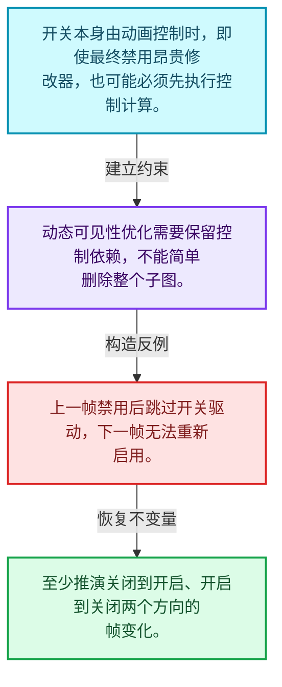
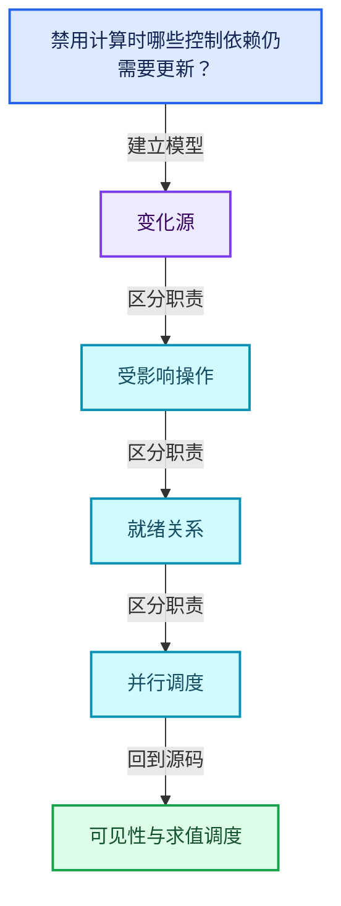
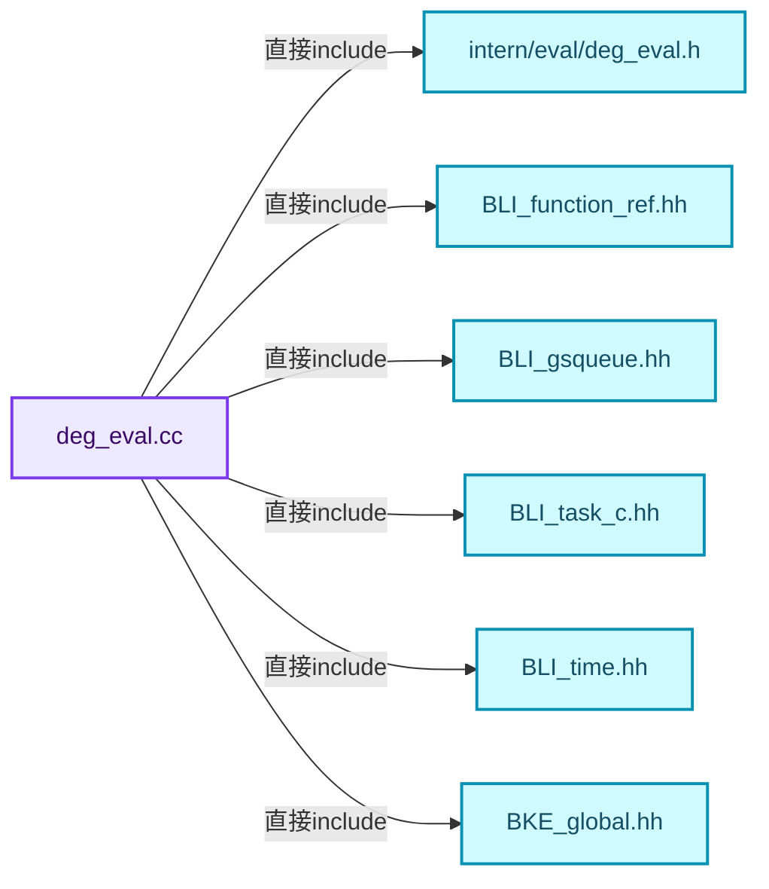
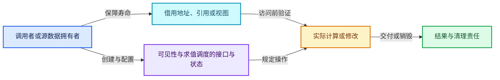
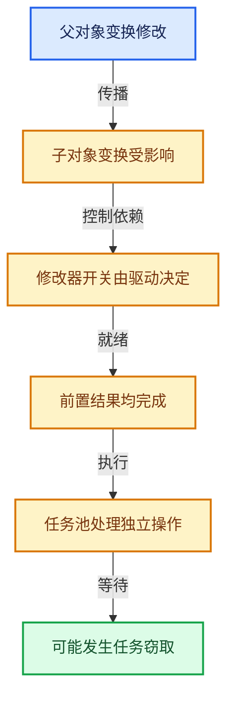

# 11-06 可见性与求值调度

[方向导航](README.md) · [总目录](../README.md) · [覆盖索引](../%E6%BA%90%E7%A0%81%E7%89%88%E6%9C%AC%E4%B8%8E%E8%A6%86%E7%9B%96%E7%B4%A2%E5%BC%95.md)

> 阅读顺序：问题与数据模型 → 语法与类型 → 源码逐行 → 调用线索 → 历史与取舍 → 推演和练习。

- 基准 HEAD：`cbda6b96c26c0dee3c3b5cbb93960c4ac06a6b30`。
- 记录日期：2026-10-14。
- 教学示例状态：正文中的推演不是本机性能实测；已运行练习见验收报告。

## 一、从问题到设计

禁用计算时哪些控制依赖仍需要更新？

动态可见性本身可能依赖动画或驱动，不能先跳过所有相关计算；需求判断有执行阶段顺序。

本篇把语法、数据语义和系统取舍连接起来。标记更新、判断需求、依赖满足和任务执行是分开的阶段。

### 本篇独立模型与设计推理

开关本身由动画控制时，即使最终禁用昂贵修改器，也可能必须先执行控制计算。

设计取舍：动态可见性优化需要保留控制依赖，不能简单删除整个子图。

最小反例：上一帧禁用后跳过开关驱动，下一帧无法重新启用。

推导与处理：至少推演关闭到开启、开启到关闭两个方向的帧变化。



### 源码范围与相邻篇章

| 文件 | 本篇逐行范围 | 基准SHA-256 |
|---|---|---|
| [source/blender/depsgraph/intern/eval/deg_eval.cc](../../../../../source/blender/depsgraph/intern/eval/deg_eval.cc) | L1—L518 | `af73ab6297c059b4601ecb1b2a88c2613cc124d772182f183f82992fd3173154` |
| [source/blender/depsgraph/intern/eval/deg_eval_visibility.cc](../../../../../source/blender/depsgraph/intern/eval/deg_eval_visibility.cc) | L1—L235 | `909ba098e2e0d1882855810320ccd3503e7d613b9e2e46cd4db3f15e6d1f0c5f` |

同一主讲文件可能分多篇覆盖；超出本篇范围的符号通过覆盖索引定位。空行与纯注释保留在源码摘录中，逐行表解释有效语句与语法边界；许可证头统一保留。

前篇：[失效传播](05-%E5%A4%B1%E6%95%88%E4%BC%A0%E6%92%AD.md).

后篇：[任务池与TBB接入](07-%E4%BB%BB%E5%8A%A1%E6%B1%A0%E4%B8%8ETBB%E6%8E%A5%E5%85%A5.md).

## 二、类型、数据与阅读地图



这是概念依赖图，边表示阅读关系，不声称是运行时调用顺序。

### 直接编译依赖



箭头只表示头文件包含关系；完整调用线索见后面的符号定位表。

## 三、关键词、语法与类型角色

### 约束 requires

requires表达式或requires子句限制模板参与重载的条件。它提供编译期可用性检查，不是运行时if，不能指望输入到达程序后再被这一机制验证。

具体检查：构造满足和不满足约束的两个类型，观察候选被排除而不是在函数内返回错误。

### 只读限定 const

const约束当前访问路径可做的修改。const指针、指向const的指针、const视图对象、const元素是不同位置的限定；其他别名可能仍可修改原对象。

具体检查：分别写T* const、const T*与const T* const，并画出不可修改的层次。

### 异常边界 try与catch

try定义异常传播的局部边界。失败路径需要销毁已经成功构造的部分并释放相应存储；未构造的对象不能被析构。

具体检查：在第k次构造失败，列出已经存在的对象集合与待释放缓冲。

### 显式静态转换 static_cast

static_cast表达编译期允许的转换，不会自动验证运行时真实类型、指针寿命或索引边界。由void指针恢复T指针时，调用者仍须保证实际存储中确有合法T对象。

具体检查：标出转换前后的类型以及正确性依据来自哪里。

### 表示层转换 reinterpret_cast

reinterpret_cast不能自动开始任意对象的生命周期，也不能豁免对齐和别名规则。读这类代码需要追溯原始分配与实际构造操作。

具体检查：分别检查大小、对齐、生命周期和可访问类型，四项不能互相替代。

### 原子操作 atomic

原子性保护相应原子对象的访问；发布其他普通数据还要分析内存序。多个原子字段分别安全不等于复合不变量整体原子。

具体检查：画出写数据、发布ready与读ready、读数据的顺序关系。

### 对象表示 sizeof

sizeof给出对象表示大小，不是其引用的所有堆内存总量。sizeof视图很小并不说明底层数组很小。

具体检查：分别统计容器对象、容量字节和元素拥有的间接资源。

### 内部断言 assert

断言表达开发者预期成立的内部契约，发布构建可能关闭。它不能替代对不可信输入的完整错误处理，也不保证后续操作被运行时保护。

具体检查：对每条断言构造违反条件的输入，区分调用者错误与应向用户报告的错误。

### 类型别名 using

类型别名为已有类型建立名字，不创建运行期对象。它常把模板内部使用的类型统一暴露给泛型调用者。

具体检查：展开别名直到基础类型，区分类型别名和变量声明。

### 枚举与状态模型 enum

枚举把有限状态命名；enum class避免许多隐式整数转换。状态机正确性还依赖允许的转移，不能只看有哪些枚举项。

具体检查：列出每个状态的进入条件和离开条件，检查终止状态是否仍可能被调度。

## 四、真实源码与逐行讲解

源码块保持原行内容，原始行号由小节标题及逐行表给出。表中的调用定位是静态阅读辅助；重载、模板实例化、宏展开和虚调用需结合完整声明，不能仅凭词法出现证明动态调用。

### deg_eval.cc：L1—L46

<!-- source:source/blender/depsgraph/intern/eval/deg_eval.cc:1:46 -->

```cpp
/* SPDX-FileCopyrightText: 2013 Blender Authors
 *
 * SPDX-License-Identifier: GPL-2.0-or-later */

/** \file
 * \ingroup depsgraph
 *
 * Evaluation engine entry-points for Depsgraph Engine.
 */

#include <atomic>
#include <cstdint>

#include "intern/eval/deg_eval.h"

#include "BLI_function_ref.hh"
#include "BLI_gsqueue.hh"
#include "BLI_task_c.hh"
#include "BLI_time.hh"

#include "BKE_global.hh"

#include "DNA_modifier_types.h"
#include "DNA_object_types.h"
#include "DNA_scene_types.h"

#include "DEG_depsgraph.hh"
#include "DEG_depsgraph_query.hh"

#ifdef WITH_PYTHON
#  include "BPY_extern.hh"
#endif

#include "atomic_ops.h"

#include "intern/depsgraph.hh"
#include "intern/depsgraph_relation.hh"
#include "intern/depsgraph_tag.hh"
#include "intern/eval/deg_eval_copy_on_write.h"
#include "intern/eval/deg_eval_flush.h"
#include "intern/eval/deg_eval_stats.h"
#include "intern/eval/deg_eval_visibility.h"
#include "intern/node/deg_node.hh"
#include "intern/node/deg_node_component.hh"
#include "intern/node/deg_node_id.hh"
#include "intern/node/deg_node_operation.hh"
```

| 原始行 | 语义、约束与检查 |
|---|---|
| L11 | 引入编译依赖 <atomic>；这是声明可见性关系，不表示运行时一定调用该文件的所有接口。 |
| L12 | 引入编译依赖 <cstdint>；这是声明可见性关系，不表示运行时一定调用该文件的所有接口。 |
| L14 | 引入编译依赖 "intern/eval/deg_eval.h"；这是声明可见性关系，不表示运行时一定调用该文件的所有接口。 |
| L16 | 引入编译依赖 "BLI_function_ref.hh"；这是声明可见性关系，不表示运行时一定调用该文件的所有接口。 |
| L17 | 引入编译依赖 "BLI_gsqueue.hh"；这是声明可见性关系，不表示运行时一定调用该文件的所有接口。 |
| L18 | 引入编译依赖 "BLI_task_c.hh"；这是声明可见性关系，不表示运行时一定调用该文件的所有接口。 |
| L19 | 引入编译依赖 "BLI_time.hh"；这是声明可见性关系，不表示运行时一定调用该文件的所有接口。 |
| L21 | 引入编译依赖 "BKE_global.hh"；这是声明可见性关系，不表示运行时一定调用该文件的所有接口。 |
| L23 | 引入编译依赖 "DNA_modifier_types.h"；这是声明可见性关系，不表示运行时一定调用该文件的所有接口。 |
| L24 | 引入编译依赖 "DNA_object_types.h"；这是声明可见性关系，不表示运行时一定调用该文件的所有接口。 |
| L25 | 引入编译依赖 "DNA_scene_types.h"；这是声明可见性关系，不表示运行时一定调用该文件的所有接口。 |
| L27 | 引入编译依赖 "DEG_depsgraph.hh"；这是声明可见性关系，不表示运行时一定调用该文件的所有接口。 |
| L28 | 引入编译依赖 "DEG_depsgraph_query.hh"；这是声明可见性关系，不表示运行时一定调用该文件的所有接口。 |
| L30 | 预处理阶段处理 #ifdef WITH_PYTHON。它决定哪些代码进入编译，不是运行时分支；阅读行为时必须结合实际构建宏。 |
| L31 | 本行是连续声明或表达式的一部分：`#  include "BPY_extern.hh"`。与本段前后行合读；逗号、括号和限定符决定它属于参数、初始化列表还是实际计算。 |
| L32 | 预处理阶段处理 #endif。它决定哪些代码进入编译，不是运行时分支；阅读行为时必须结合实际构建宏。 |
| L34 | 引入编译依赖 "atomic_ops.h"；这是声明可见性关系，不表示运行时一定调用该文件的所有接口。 |
| L36 | 引入编译依赖 "intern/depsgraph.hh"；这是声明可见性关系，不表示运行时一定调用该文件的所有接口。 |
| L37 | 引入编译依赖 "intern/depsgraph_relation.hh"；这是声明可见性关系，不表示运行时一定调用该文件的所有接口。 |
| L38 | 引入编译依赖 "intern/depsgraph_tag.hh"；这是声明可见性关系，不表示运行时一定调用该文件的所有接口。 |
| L39 | 引入编译依赖 "intern/eval/deg_eval_copy_on_write.h"；这是声明可见性关系，不表示运行时一定调用该文件的所有接口。 |
| L40 | 引入编译依赖 "intern/eval/deg_eval_flush.h"；这是声明可见性关系，不表示运行时一定调用该文件的所有接口。 |
| L41 | 引入编译依赖 "intern/eval/deg_eval_stats.h"；这是声明可见性关系，不表示运行时一定调用该文件的所有接口。 |
| L42 | 引入编译依赖 "intern/eval/deg_eval_visibility.h"；这是声明可见性关系，不表示运行时一定调用该文件的所有接口。 |
| L43 | 引入编译依赖 "intern/node/deg_node.hh"；这是声明可见性关系，不表示运行时一定调用该文件的所有接口。 |
| L44 | 引入编译依赖 "intern/node/deg_node_component.hh"；这是声明可见性关系，不表示运行时一定调用该文件的所有接口。 |
| L45 | 引入编译依赖 "intern/node/deg_node_id.hh"；这是声明可见性关系，不表示运行时一定调用该文件的所有接口。 |
| L46 | 引入编译依赖 "intern/node/deg_node_operation.hh"；这是声明可见性关系，不表示运行时一定调用该文件的所有接口。 |

### deg_eval.cc：L47—L86

<!-- source:source/blender/depsgraph/intern/eval/deg_eval.cc:47:86 -->

```cpp

namespace blender::deg {

namespace {

struct DepsgraphEvalState;

void deg_task_run_func(TaskPool *pool, void *taskdata);

void schedule_children(DepsgraphEvalState *state,
                       OperationNode *node,
                       FunctionRef<void(OperationNode *node)> schedule_fn);

/* Denotes which part of dependency graph is being evaluated. */
enum class EvaluationStage {
  /* Stage 1: Only Copy-on-Write operations are to be evaluated, prior to anything else.
   * This allows other operations to access its dependencies when there is a dependency cycle
   * involved. */
  COPY_ON_EVAL,

  /* Evaluate actual ID nodes visibility based on the current state of animation and drivers. */
  DYNAMIC_VISIBILITY,

  /* Threaded evaluation of all possible operations. */
  THREADED_EVALUATION,

  /* Workaround for areas which can not be evaluated in threads.
   *
   * For example, meta-balls, which are iterating over all bases and are requesting dupli-lists
   * to see whether there are meta-balls inside. */
  SINGLE_THREADED_WORKAROUND,
};

struct DepsgraphEvalState {
  Depsgraph *graph;
  bool do_stats;
  EvaluationStage stage;
  bool need_update_pending_parents = true;
  bool need_single_thread_pass = false;
};
```

| 原始行 | 语义、约束与检查 |
|---|---|
| L48 | 把后续声明放入 blender::deg 命名空间，影响名称查找和符号归属，不创建运行时对象。 |
| L50 | 把后续声明放入  命名空间，影响名称查找和符号归属，不创建运行时对象。 |
| L52 | 声明或定义类型 `struct DepsgraphEvalState`。结合继承、访问权限和成员布局确认接口与拥有关系；前向声明本身没有完整对象布局。 |
| L54 | 声明接口 `void deg_task_run_func(TaskPool *pool, void *taskdata)`，本行没有对应函数体；返回类型、参数限定和const/noexcept共同组成调用契约，实际行为需继续定位实现。 |
| L56 | 出现调用或函数声明 `schedule_children`，对应表达式为 `void schedule_children(DepsgraphEvalState *state,`。参数求值、返回类型与重载需结合前后完整语句；静态文本引用不能证明动态目标。 |
| L57 | 本行是连续声明或表达式的一部分：`OperationNode *node,`。与本段前后行合读；逗号、括号和限定符决定它属于参数、初始化列表还是实际计算。 |
| L58 | 出现调用或函数声明 `void`，对应表达式为 `FunctionRef<void(OperationNode *node)> schedule_fn);`。参数求值、返回类型与重载需结合前后完整语句；静态文本引用不能证明动态目标。 |
| L61 | 声明或定义类型 `enum class EvaluationStage`。结合继承、访问权限和成员布局确认接口与拥有关系；前向声明本身没有完整对象布局。 |
| L65 | 本行是连续声明或表达式的一部分：`COPY_ON_EVAL,`。与本段前后行合读；逗号、括号和限定符决定它属于参数、初始化列表还是实际计算。 |
| L68 | 本行是连续声明或表达式的一部分：`DYNAMIC_VISIBILITY,`。与本段前后行合读；逗号、括号和限定符决定它属于参数、初始化列表还是实际计算。 |
| L71 | 本行是连续声明或表达式的一部分：`THREADED_EVALUATION,`。与本段前后行合读；逗号、括号和限定符决定它属于参数、初始化列表还是实际计算。 |
| L77 | 本行是连续声明或表达式的一部分：`SINGLE_THREADED_WORKAROUND,`。与本段前后行合读；逗号、括号和限定符决定它属于参数、初始化列表还是实际计算。 |
| L78 | 结束当前语法单元。局部自动对象在离开其作用域时按规则销毁；这不等于所有被引用的外部数据也被释放。 |
| L80 | 声明或定义类型 `struct DepsgraphEvalState`。结合继承、访问权限和成员布局确认接口与拥有关系；前向声明本身没有完整对象布局。 |
| L81 | 声明成员、局部对象或完成语句 `Depsgraph *graph`。若为指针或引用，它本身不说明拥有；若为值对象，其构造析构由所在作用域或外层对象管理。 |
| L82 | 声明成员、局部对象或完成语句 `bool do_stats`。若为指针或引用，它本身不说明拥有；若为值对象，其构造析构由所在作用域或外层对象管理。 |
| L83 | 声明成员、局部对象或完成语句 `EvaluationStage stage`。若为指针或引用，它本身不说明拥有；若为值对象，其构造析构由所在作用域或外层对象管理。 |
| L84 | 把右侧 `true` 用于初始化或更新左侧 `bool need_update_pending_parents`。声明初始化与已有对象赋值应按上下文区分；有资源的类型会调用相应特殊成员。 |
| L85 | 把右侧 `false` 用于初始化或更新左侧 `bool need_single_thread_pass`。声明初始化与已有对象赋值应按上下文区分；有资源的类型会调用相应特殊成员。 |
| L86 | 结束当前语法单元。局部自动对象在离开其作用域时按规则销毁；这不等于所有被引用的外部数据也被释放。 |

### deg_eval.cc：L87—L142

<!-- source:source/blender/depsgraph/intern/eval/deg_eval.cc:87:142 -->

```cpp

void evaluate_node(const DepsgraphEvalState *state, OperationNode *operation_node)
{
  blender::Depsgraph *depsgraph = reinterpret_cast<blender::Depsgraph *>(state->graph);

  /* Sanity checks. */
  BLI_assert_msg(!operation_node->is_noop(), "NOOP nodes should not actually be scheduled");
  /* Perform operation. */
  if (state->do_stats) {
    const double start_time = BLI_time_now_seconds();
    operation_node->evaluate(depsgraph);
    operation_node->stats.current_time += BLI_time_now_seconds() - start_time;
  }
  else {
    operation_node->evaluate(depsgraph);
  }

  /* Clear the flag early on, allowing partial updates without re-evaluating the same node multiple
   * times.
   * This is a thread-safe modification as the node's flags are only read for a non-scheduled nodes
   * and this node has been scheduled. */
  operation_node->flag &= ~DEPSOP_FLAG_CLEAR_ON_EVAL;
}

void deg_task_run_func(TaskPool *pool, void *taskdata)
{
  void *userdata_v = BLI_task_pool_user_data(pool);
  DepsgraphEvalState *state = static_cast<DepsgraphEvalState *>(userdata_v);

  /* Evaluate node. */
  OperationNode *operation_node = reinterpret_cast<OperationNode *>(taskdata);
  evaluate_node(state, operation_node);

  /* Schedule children. */
  schedule_children(state, operation_node, [&](OperationNode *node) {
    BLI_task_pool_push(pool, deg_task_run_func, node, false, nullptr);
  });
}

bool check_operation_node_visible(const DepsgraphEvalState *state, OperationNode *op_node)
{
  const ComponentNode *comp_node = op_node->owner;
  /* Special case for copy-on-eval component: it is to be always evaluated, to keep copied
   * "database" in a consistent state. */
  if (comp_node->type == NodeType::COPY_ON_EVAL) {
    return true;
  }

  /* Special case for dynamic visibility pass: the actual visibility is not yet known, so limit to
   * only operations which affects visibility. */
  if (state->stage == EvaluationStage::DYNAMIC_VISIBILITY) {
    return op_node->flag & OperationFlag::DEPSOP_FLAG_AFFECTS_VISIBILITY;
  }

  return comp_node->affects_visible_id;
}
```

本段语义重点：

- 分支证据 `state->do_stats)`：分别推演条件成立与不成立，核对相同出口处的状态。
- 分支证据 `comp_node->type == NodeType::COPY_ON_EVAL)`：分别推演条件成立与不成立，核对相同出口处的状态。

| 原始行 | 语义、约束与检查 |
|---|---|
| L88 | 出现调用或函数声明 `evaluate_node`，对应表达式为 `void evaluate_node(const DepsgraphEvalState *state, OperationNode *operation_node)`。参数求值、返回类型与重载需结合前后完整语句；静态文本引用不能证明动态目标。 |
| L89 | 连接上一行的声明或控制结构与其语句块；后续行在这个作用域中执行或声明。 |
| L90 | 把右侧 `reinterpret_cast<blender::Depsgraph *>(state->graph)` 用于初始化或更新左侧 `blender::Depsgraph *depsgraph`。声明初始化与已有对象赋值应按上下文区分；有资源的类型会调用相应特殊成员。 |
| L93 | 断言约束 `BLI_assert_msg(!operation_node->is_noop(), "NOOP nodes should not actually be scheduled");`。条件是后续访问的内部前置条件；发布构建可能不执行，不能把断言当作输入修复。 |
| L95 | 判断 `state->do_stats`，成立时进入本分支，否则继续后续路径。 |
| L96 | 把右侧 `BLI_time_now_seconds()` 用于初始化或更新左侧 `const double start_time`。声明初始化与已有对象赋值应按上下文区分；有资源的类型会调用相应特殊成员。 |
| L97 | 出现调用或函数声明 `evaluate`，对应表达式为 `operation_node->evaluate(depsgraph);`。参数求值、返回类型与重载需结合前后完整语句；静态文本引用不能证明动态目标。 |
| L98 | 复合更新 `operation_node->stats.current_time += BLI_time_now_seconds() - start_time`：读取左侧现有值，与右侧按`+=`对应操作组合后写回。检查数值边界、位掩码或共享状态保护；它不是新对象的构造。 |
| L99 | 结束当前语法单元。局部自动对象在离开其作用域时按规则销毁；这不等于所有被引用的外部数据也被释放。 |
| L100 | 处理前一条件不成立的互补路径。比较两条路径最后是否恢复同一不变量，以及是否产生不同的资源责任。 |
| L101 | 出现调用或函数声明 `evaluate`，对应表达式为 `operation_node->evaluate(depsgraph);`。参数求值、返回类型与重载需结合前后完整语句；静态文本引用不能证明动态目标。 |
| L102 | 结束当前语法单元。局部自动对象在离开其作用域时按规则销毁；这不等于所有被引用的外部数据也被释放。 |
| L108 | 复合更新 `operation_node->flag &= ~DEPSOP_FLAG_CLEAR_ON_EVAL`：读取左侧现有值，与右侧按`&=`对应操作组合后写回。检查数值边界、位掩码或共享状态保护；它不是新对象的构造。 |
| L109 | 结束当前语法单元。局部自动对象在离开其作用域时按规则销毁；这不等于所有被引用的外部数据也被释放。 |
| L111 | 出现调用或函数声明 `deg_task_run_func`，对应表达式为 `void deg_task_run_func(TaskPool *pool, void *taskdata)`。参数求值、返回类型与重载需结合前后完整语句；静态文本引用不能证明动态目标。 |
| L112 | 连接上一行的声明或控制结构与其语句块；后续行在这个作用域中执行或声明。 |
| L113 | 把右侧 `BLI_task_pool_user_data(pool)` 用于初始化或更新左侧 `void *userdata_v`。声明初始化与已有对象赋值应按上下文区分；有资源的类型会调用相应特殊成员。 |
| L114 | 把右侧 `static_cast<DepsgraphEvalState *>(userdata_v)` 用于初始化或更新左侧 `DepsgraphEvalState *state`。声明初始化与已有对象赋值应按上下文区分；有资源的类型会调用相应特殊成员。 |
| L117 | 把右侧 `reinterpret_cast<OperationNode *>(taskdata)` 用于初始化或更新左侧 `OperationNode *operation_node`。声明初始化与已有对象赋值应按上下文区分；有资源的类型会调用相应特殊成员。 |
| L118 | 出现调用或函数声明 `evaluate_node`，对应表达式为 `evaluate_node(state, operation_node);`。参数求值、返回类型与重载需结合前后完整语句；静态文本引用不能证明动态目标。 |
| L121 | 出现调用或函数声明 `schedule_children`，对应表达式为 `schedule_children(state, operation_node, [&](OperationNode *node) {`。参数求值、返回类型与重载需结合前后完整语句；静态文本引用不能证明动态目标。 |
| L122 | 出现调用或函数声明 `BLI_task_pool_push`，对应表达式为 `BLI_task_pool_push(pool, deg_task_run_func, node, false, nullptr);`。参数求值、返回类型与重载需结合前后完整语句；静态文本引用不能证明动态目标。 |
| L123 | 结束当前语法单元。局部自动对象在离开其作用域时按规则销毁；这不等于所有被引用的外部数据也被释放。 |
| L124 | 结束当前语法单元。局部自动对象在离开其作用域时按规则销毁；这不等于所有被引用的外部数据也被释放。 |
| L126 | 出现调用或函数声明 `check_operation_node_visible`，对应表达式为 `bool check_operation_node_visible(const DepsgraphEvalState *state, OperationNode *op_node)`。参数求值、返回类型与重载需结合前后完整语句；静态文本引用不能证明动态目标。 |
| L127 | 连接上一行的声明或控制结构与其语句块；后续行在这个作用域中执行或声明。 |
| L128 | 把右侧 `op_node->owner` 用于初始化或更新左侧 `const ComponentNode *comp_node`。声明初始化与已有对象赋值应按上下文区分；有资源的类型会调用相应特殊成员。 |
| L131 | 判断 `comp_node->type == NodeType::COPY_ON_EVAL`，成立时进入本分支，否则继续后续路径。 |
| L132 | 返回表达式 `true`。这是本路径的布尔结果，具体成功、存在或状态含义由函数接口规定。 |
| L133 | 结束当前语法单元。局部自动对象在离开其作用域时按规则销毁；这不等于所有被引用的外部数据也被释放。 |
| L137 | 判断 `state->stage == EvaluationStage::DYNAMIC_VISIBILITY`，成立时进入本分支，否则继续后续路径。 |
| L138 | 返回表达式 `op_node->flag & OperationFlag::DEPSOP_FLAG_AFFECTS_VISIBILITY`。 |
| L139 | 结束当前语法单元。局部自动对象在离开其作用域时按规则销毁；这不等于所有被引用的外部数据也被释放。 |
| L141 | 返回表达式 `comp_node->affects_visible_id`。 |
| L142 | 结束当前语法单元。局部自动对象在离开其作用域时按规则销毁；这不等于所有被引用的外部数据也被释放。 |

### deg_eval.cc：L143—L187

<!-- source:source/blender/depsgraph/intern/eval/deg_eval.cc:143:187 -->

```cpp

void calculate_pending_parents_for_node(const DepsgraphEvalState *state, OperationNode *node)
{
  /* Update counters, applies for both visible and invisible IDs. */
  node->num_links_pending = 0;
  node->scheduled = false;
  /* Invisible IDs requires no pending operations. */
  if (!check_operation_node_visible(state, node)) {
    return;
  }
  /* No need to bother with anything if node is not tagged for update. */
  if ((node->flag & DEPSOP_FLAG_NEEDS_UPDATE) == 0) {
    return;
  }
  for (Relation *rel : node->inlinks) {
    if (rel->from->type == NodeType::OPERATION && (rel->flag & RELATION_FLAG_CYCLIC) == 0) {
      OperationNode *from = static_cast<OperationNode *>(rel->from);
      /* TODO(sergey): This is how old layer system was checking for the
       * calculation, but how is it possible that visible object depends
       * on an invisible? This is something what is prohibited after
       * deg_graph_build_flush_layers(). */
      if (!check_operation_node_visible(state, from)) {
        continue;
      }
      /* No need to wait for operation which is up to date. */
      if ((from->flag & DEPSOP_FLAG_NEEDS_UPDATE) == 0) {
        continue;
      }
      ++node->num_links_pending;
    }
  }
}

void calculate_pending_parents_if_needed(DepsgraphEvalState *state)
{
  if (!state->need_update_pending_parents) {
    return;
  }

  for (OperationNode *node : state->graph->operations) {
    calculate_pending_parents_for_node(state, node);
  }

  state->need_update_pending_parents = false;
}
```

本段语义重点：

- 分支证据 `!check_operation_node_visible(state, node))`：分别推演条件成立与不成立，核对相同出口处的状态。
- 分支证据 `(node->flag & DEPSOP_FLAG_NEEDS_UPDATE) == 0)`：分别推演条件成立与不成立，核对相同出口处的状态。

| 原始行 | 语义、约束与检查 |
|---|---|
| L144 | 出现调用或函数声明 `calculate_pending_parents_for_node`，对应表达式为 `void calculate_pending_parents_for_node(const DepsgraphEvalState *state, OperationNode *node)`。参数求值、返回类型与重载需结合前后完整语句；静态文本引用不能证明动态目标。 |
| L145 | 连接上一行的声明或控制结构与其语句块；后续行在这个作用域中执行或声明。 |
| L147 | 把右侧 `0` 用于初始化或更新左侧 `node->num_links_pending`。声明初始化与已有对象赋值应按上下文区分；有资源的类型会调用相应特殊成员。 |
| L148 | 把右侧 `false` 用于初始化或更新左侧 `node->scheduled`。声明初始化与已有对象赋值应按上下文区分；有资源的类型会调用相应特殊成员。 |
| L150 | 判断 `!check_operation_node_visible(state, node)`，成立时进入本分支，否则继续后续路径。 |
| L151 | 结束当前函数，本路径不再执行后续语句；局部对象按作用域规则清理。 |
| L152 | 结束当前语法单元。局部自动对象在离开其作用域时按规则销毁；这不等于所有被引用的外部数据也被释放。 |
| L154 | 判断 `(node->flag & DEPSOP_FLAG_NEEDS_UPDATE) == 0`，成立时进入本分支，否则继续后续路径。 |
| L155 | 结束当前函数，本路径不再执行后续语句；局部对象按作用域规则清理。 |
| L156 | 结束当前语法单元。局部自动对象在离开其作用域时按规则销毁；这不等于所有被引用的外部数据也被释放。 |
| L157 | 按 `for (Relation *rel : node->inlinks)` 指定的范围或条件重复执行。对照循环变量与真实元素编号；循环内调用成本乘以实际迭代次数。 |
| L158 | 判断 `rel->from->type == NodeType::OPERATION && (rel->flag & RELATION_FLAG_CYCLIC) == 0`，成立时进入本分支，否则继续后续路径。 |
| L159 | 把右侧 `static_cast<OperationNode *>(rel->from)` 用于初始化或更新左侧 `OperationNode *from`。声明初始化与已有对象赋值应按上下文区分；有资源的类型会调用相应特殊成员。 |
| L164 | 判断 `!check_operation_node_visible(state, from)`，成立时进入本分支，否则继续后续路径。 |
| L165 | 结束本轮循环并进入下一轮；核对本轮已经取得的资源是否由作用域或显式代码清理。 |
| L166 | 结束当前语法单元。局部自动对象在离开其作用域时按规则销毁；这不等于所有被引用的外部数据也被释放。 |
| L168 | 判断 `(from->flag & DEPSOP_FLAG_NEEDS_UPDATE) == 0`，成立时进入本分支，否则继续后续路径。 |
| L169 | 结束本轮循环并进入下一轮；核对本轮已经取得的资源是否由作用域或显式代码清理。 |
| L170 | 结束当前语法单元。局部自动对象在离开其作用域时按规则销毁；这不等于所有被引用的外部数据也被释放。 |
| L171 | 递增或递减现有状态：`++node->num_links_pending;`。这改变计数或游标；检查边界、计数单位，以及并发访问是否有相应保护。 |
| L172 | 结束当前语法单元。局部自动对象在离开其作用域时按规则销毁；这不等于所有被引用的外部数据也被释放。 |
| L173 | 结束当前语法单元。局部自动对象在离开其作用域时按规则销毁；这不等于所有被引用的外部数据也被释放。 |
| L174 | 结束当前语法单元。局部自动对象在离开其作用域时按规则销毁；这不等于所有被引用的外部数据也被释放。 |
| L176 | 出现调用或函数声明 `calculate_pending_parents_if_needed`，对应表达式为 `void calculate_pending_parents_if_needed(DepsgraphEvalState *state)`。参数求值、返回类型与重载需结合前后完整语句；静态文本引用不能证明动态目标。 |
| L177 | 连接上一行的声明或控制结构与其语句块；后续行在这个作用域中执行或声明。 |
| L178 | 判断 `!state->need_update_pending_parents`，成立时进入本分支，否则继续后续路径。 |
| L179 | 结束当前函数，本路径不再执行后续语句；局部对象按作用域规则清理。 |
| L180 | 结束当前语法单元。局部自动对象在离开其作用域时按规则销毁；这不等于所有被引用的外部数据也被释放。 |
| L182 | 按 `for (OperationNode *node : state->graph->operations)` 指定的范围或条件重复执行。对照循环变量与真实元素编号；循环内调用成本乘以实际迭代次数。 |
| L183 | 出现调用或函数声明 `calculate_pending_parents_for_node`，对应表达式为 `calculate_pending_parents_for_node(state, node);`。参数求值、返回类型与重载需结合前后完整语句；静态文本引用不能证明动态目标。 |
| L184 | 结束当前语法单元。局部自动对象在离开其作用域时按规则销毁；这不等于所有被引用的外部数据也被释放。 |
| L186 | 把右侧 `false` 用于初始化或更新左侧 `state->need_update_pending_parents`。声明初始化与已有对象赋值应按上下文区分；有资源的类型会调用相应特殊成员。 |
| L187 | 结束当前语法单元。局部自动对象在离开其作用域时按规则销毁；这不等于所有被引用的外部数据也被释放。 |

### deg_eval.cc：L188—L241

<!-- source:source/blender/depsgraph/intern/eval/deg_eval.cc:188:241 -->

```cpp

void initialize_execution(DepsgraphEvalState *state, Depsgraph *graph)
{
  /* Clear tags and other things which needs to be clear. */
  if (state->do_stats) {
    for (OperationNode *node : graph->operations) {
      node->stats.reset_current();
    }
  }
}

bool is_metaball_object_operation(const OperationNode *operation_node)
{
  const ComponentNode *component_node = operation_node->owner;
  const IDNode *id_node = component_node->owner;
  /* This runs after the COPY_ON_EVAL stage which creates id_cow. */
  BLI_assert(id_node->id_cow);
  if (GS(id_node->id_cow->name) != ID_OB) {
    return false;
  }
  const Object *object = reinterpret_cast<const Object *>(id_node->id_cow);
  return object->type == OB_MBALL;
}

/* Simulation modifiers with sub-frames (fluid domain, dynamic paint canvas) perform direct updates
 * of other objects, which can cause race conditions over certain data (#115636). Unless and until
 * sub-steps are fully supported in depsgraph evaluation such objects must use single-threaded
 * evaluation. */
bool is_modifier_subframe_operation(const OperationNode *operation_node)
{
  const ComponentNode *component_node = operation_node->owner;
  const IDNode *id_node = component_node->owner;
  /* This runs after the COPY_ON_EVAL stage which creates id_cow. */
  BLI_assert(id_node->id_cow);
  if (GS(id_node->id_cow->name) != ID_OB) {
    return false;
  }
  const Object *object = reinterpret_cast<const Object *>(id_node->id_cow);
  for (const ModifierData &md : object->modifiers) {
    if (md.type == eModifierType_Fluid) {
      const auto &fmd = reinterpret_cast<const FluidModifierData &>(md);
      if (fmd.type == MOD_FLUID_TYPE_DOMAIN) {
        return true;
      }
    }
    if (md.type == eModifierType_DynamicPaint) {
      const auto &dmd = reinterpret_cast<const DynamicPaintModifierData &>(md);
      if (dmd.type == MOD_DYNAMICPAINT_TYPE_CANVAS) {
        return true;
      }
    }
  }
  return false;
}
```

本段语义重点：

- 分支证据 `state->do_stats)`：分别推演条件成立与不成立，核对相同出口处的状态。
- 分支证据 `GS(id_node->id_cow->name) != ID_OB)`：分别推演条件成立与不成立，核对相同出口处的状态。

| 原始行 | 语义、约束与检查 |
|---|---|
| L189 | 出现调用或函数声明 `initialize_execution`，对应表达式为 `void initialize_execution(DepsgraphEvalState *state, Depsgraph *graph)`。参数求值、返回类型与重载需结合前后完整语句；静态文本引用不能证明动态目标。 |
| L190 | 连接上一行的声明或控制结构与其语句块；后续行在这个作用域中执行或声明。 |
| L192 | 判断 `state->do_stats`，成立时进入本分支，否则继续后续路径。 |
| L193 | 按 `for (OperationNode *node : graph->operations)` 指定的范围或条件重复执行。对照循环变量与真实元素编号；循环内调用成本乘以实际迭代次数。 |
| L194 | 出现调用或函数声明 `reset_current`，对应表达式为 `node->stats.reset_current();`。参数求值、返回类型与重载需结合前后完整语句；静态文本引用不能证明动态目标。 |
| L195 | 结束当前语法单元。局部自动对象在离开其作用域时按规则销毁；这不等于所有被引用的外部数据也被释放。 |
| L196 | 结束当前语法单元。局部自动对象在离开其作用域时按规则销毁；这不等于所有被引用的外部数据也被释放。 |
| L197 | 结束当前语法单元。局部自动对象在离开其作用域时按规则销毁；这不等于所有被引用的外部数据也被释放。 |
| L199 | 出现调用或函数声明 `is_metaball_object_operation`，对应表达式为 `bool is_metaball_object_operation(const OperationNode *operation_node)`。参数求值、返回类型与重载需结合前后完整语句；静态文本引用不能证明动态目标。 |
| L200 | 连接上一行的声明或控制结构与其语句块；后续行在这个作用域中执行或声明。 |
| L201 | 把右侧 `operation_node->owner` 用于初始化或更新左侧 `const ComponentNode *component_node`。声明初始化与已有对象赋值应按上下文区分；有资源的类型会调用相应特殊成员。 |
| L202 | 把右侧 `component_node->owner` 用于初始化或更新左侧 `const IDNode *id_node`。声明初始化与已有对象赋值应按上下文区分；有资源的类型会调用相应特殊成员。 |
| L204 | 断言约束 `BLI_assert(id_node->id_cow);`。条件是后续访问的内部前置条件；发布构建可能不执行，不能把断言当作输入修复。 |
| L205 | 判断 `GS(id_node->id_cow->name) != ID_OB`，成立时进入本分支，否则继续后续路径。 |
| L206 | 返回表达式 `false`。这是本路径的布尔结果，具体成功、存在或状态含义由函数接口规定。 |
| L207 | 结束当前语法单元。局部自动对象在离开其作用域时按规则销毁；这不等于所有被引用的外部数据也被释放。 |
| L208 | 把右侧 `reinterpret_cast<const Object *>(id_node->id_cow)` 用于初始化或更新左侧 `const Object *object`。声明初始化与已有对象赋值应按上下文区分；有资源的类型会调用相应特殊成员。 |
| L209 | 返回表达式 `object->type == OB_MBALL`。结合函数声明检查返回值是否借用原存储，借用值不会自动延长其寿命。 |
| L210 | 结束当前语法单元。局部自动对象在离开其作用域时按规则销毁；这不等于所有被引用的外部数据也被释放。 |
| L216 | 出现调用或函数声明 `is_modifier_subframe_operation`，对应表达式为 `bool is_modifier_subframe_operation(const OperationNode *operation_node)`。参数求值、返回类型与重载需结合前后完整语句；静态文本引用不能证明动态目标。 |
| L217 | 连接上一行的声明或控制结构与其语句块；后续行在这个作用域中执行或声明。 |
| L218 | 把右侧 `operation_node->owner` 用于初始化或更新左侧 `const ComponentNode *component_node`。声明初始化与已有对象赋值应按上下文区分；有资源的类型会调用相应特殊成员。 |
| L219 | 把右侧 `component_node->owner` 用于初始化或更新左侧 `const IDNode *id_node`。声明初始化与已有对象赋值应按上下文区分；有资源的类型会调用相应特殊成员。 |
| L221 | 断言约束 `BLI_assert(id_node->id_cow);`。条件是后续访问的内部前置条件；发布构建可能不执行，不能把断言当作输入修复。 |
| L222 | 判断 `GS(id_node->id_cow->name) != ID_OB`，成立时进入本分支，否则继续后续路径。 |
| L223 | 返回表达式 `false`。这是本路径的布尔结果，具体成功、存在或状态含义由函数接口规定。 |
| L224 | 结束当前语法单元。局部自动对象在离开其作用域时按规则销毁；这不等于所有被引用的外部数据也被释放。 |
| L225 | 把右侧 `reinterpret_cast<const Object *>(id_node->id_cow)` 用于初始化或更新左侧 `const Object *object`。声明初始化与已有对象赋值应按上下文区分；有资源的类型会调用相应特殊成员。 |
| L226 | 按 `for (const ModifierData &md : object->modifiers)` 指定的范围或条件重复执行。对照循环变量与真实元素编号；循环内调用成本乘以实际迭代次数。 |
| L227 | 判断 `md.type == eModifierType_Fluid`，成立时进入本分支，否则继续后续路径。 |
| L228 | 把右侧 `reinterpret_cast<const FluidModifierData &>(md)` 用于初始化或更新左侧 `const auto &fmd`。声明初始化与已有对象赋值应按上下文区分；有资源的类型会调用相应特殊成员。 |
| L229 | 判断 `fmd.type == MOD_FLUID_TYPE_DOMAIN`，成立时进入本分支，否则继续后续路径。 |
| L230 | 返回表达式 `true`。这是本路径的布尔结果，具体成功、存在或状态含义由函数接口规定。 |
| L231 | 结束当前语法单元。局部自动对象在离开其作用域时按规则销毁；这不等于所有被引用的外部数据也被释放。 |
| L232 | 结束当前语法单元。局部自动对象在离开其作用域时按规则销毁；这不等于所有被引用的外部数据也被释放。 |
| L233 | 判断 `md.type == eModifierType_DynamicPaint`，成立时进入本分支，否则继续后续路径。 |
| L234 | 把右侧 `reinterpret_cast<const DynamicPaintModifierData &>(md)` 用于初始化或更新左侧 `const auto &dmd`。声明初始化与已有对象赋值应按上下文区分；有资源的类型会调用相应特殊成员。 |
| L235 | 判断 `dmd.type == MOD_DYNAMICPAINT_TYPE_CANVAS`，成立时进入本分支，否则继续后续路径。 |
| L236 | 返回表达式 `true`。这是本路径的布尔结果，具体成功、存在或状态含义由函数接口规定。 |
| L237 | 结束当前语法单元。局部自动对象在离开其作用域时按规则销毁；这不等于所有被引用的外部数据也被释放。 |
| L238 | 结束当前语法单元。局部自动对象在离开其作用域时按规则销毁；这不等于所有被引用的外部数据也被释放。 |
| L239 | 结束当前语法单元。局部自动对象在离开其作用域时按规则销毁；这不等于所有被引用的外部数据也被释放。 |
| L240 | 返回表达式 `false`。这是本路径的布尔结果，具体成功、存在或状态含义由函数接口规定。 |
| L241 | 结束当前语法单元。局部自动对象在离开其作用域时按规则销毁；这不等于所有被引用的外部数据也被释放。 |

### deg_eval.cc：L242—L270

<!-- source:source/blender/depsgraph/intern/eval/deg_eval.cc:242:270 -->

```cpp

bool need_evaluate_operation_at_stage(DepsgraphEvalState *state,
                                      const OperationNode *operation_node)
{
  const ComponentNode *component_node = operation_node->owner;
  switch (state->stage) {
    case EvaluationStage::COPY_ON_EVAL:
      return (component_node->type == NodeType::COPY_ON_EVAL);

    case EvaluationStage::DYNAMIC_VISIBILITY:
      return operation_node->flag & OperationFlag::DEPSOP_FLAG_AFFECTS_VISIBILITY;

    case EvaluationStage::THREADED_EVALUATION:
      if (is_metaball_object_operation(operation_node)) {
        state->need_single_thread_pass = true;
        return false;
      }
      if (is_modifier_subframe_operation(operation_node)) {
        state->need_single_thread_pass = true;
        return false;
      }
      return true;

    case EvaluationStage::SINGLE_THREADED_WORKAROUND:
      return true;
  }
  BLI_assert_msg(0, "Unhandled evaluation stage, should never happen.");
  return false;
}
```

本段语义重点：

- 分支证据 `is_metaball_object_operation(operation_node))`：分别推演条件成立与不成立，核对相同出口处的状态。
- 分支证据 `is_modifier_subframe_operation(operation_node))`：分别推演条件成立与不成立，核对相同出口处的状态。

| 原始行 | 语义、约束与检查 |
|---|---|
| L243 | 出现调用或函数声明 `need_evaluate_operation_at_stage`，对应表达式为 `bool need_evaluate_operation_at_stage(DepsgraphEvalState *state,`。参数求值、返回类型与重载需结合前后完整语句；静态文本引用不能证明动态目标。 |
| L244 | 本行是连续声明或表达式的一部分：`const OperationNode *operation_node)`。与本段前后行合读；逗号、括号和限定符决定它属于参数、初始化列表还是实际计算。 |
| L245 | 连接上一行的声明或控制结构与其语句块；后续行在这个作用域中执行或声明。 |
| L246 | 把右侧 `operation_node->owner` 用于初始化或更新左侧 `const ComponentNode *component_node`。声明初始化与已有对象赋值应按上下文区分；有资源的类型会调用相应特殊成员。 |
| L247 | 按 switch (state->stage) 选择状态处理路径；每个case的break、return或贯穿行为决定下一步。 |
| L248 | 进入枚举或判别值对应分支 case EvaluationStage::COPY_ON_EVAL:；结合状态定义和后续更新判断允许的转移。 |
| L249 | 返回表达式 `(component_node->type == NodeType::COPY_ON_EVAL)`。 |
| L251 | 进入枚举或判别值对应分支 case EvaluationStage::DYNAMIC_VISIBILITY:；结合状态定义和后续更新判断允许的转移。 |
| L252 | 返回表达式 `operation_node->flag & OperationFlag::DEPSOP_FLAG_AFFECTS_VISIBILITY`。 |
| L254 | 进入枚举或判别值对应分支 case EvaluationStage::THREADED_EVALUATION:；结合状态定义和后续更新判断允许的转移。 |
| L255 | 判断 `is_metaball_object_operation(operation_node)`，成立时进入本分支，否则继续后续路径。 |
| L256 | 把右侧 `true` 用于初始化或更新左侧 `state->need_single_thread_pass`。声明初始化与已有对象赋值应按上下文区分；有资源的类型会调用相应特殊成员。 |
| L257 | 返回表达式 `false`。这是本路径的布尔结果，具体成功、存在或状态含义由函数接口规定。 |
| L258 | 结束当前语法单元。局部自动对象在离开其作用域时按规则销毁；这不等于所有被引用的外部数据也被释放。 |
| L259 | 判断 `is_modifier_subframe_operation(operation_node)`，成立时进入本分支，否则继续后续路径。 |
| L260 | 把右侧 `true` 用于初始化或更新左侧 `state->need_single_thread_pass`。声明初始化与已有对象赋值应按上下文区分；有资源的类型会调用相应特殊成员。 |
| L261 | 返回表达式 `false`。这是本路径的布尔结果，具体成功、存在或状态含义由函数接口规定。 |
| L262 | 结束当前语法单元。局部自动对象在离开其作用域时按规则销毁；这不等于所有被引用的外部数据也被释放。 |
| L263 | 返回表达式 `true`。这是本路径的布尔结果，具体成功、存在或状态含义由函数接口规定。 |
| L265 | 进入枚举或判别值对应分支 case EvaluationStage::SINGLE_THREADED_WORKAROUND:；结合状态定义和后续更新判断允许的转移。 |
| L266 | 返回表达式 `true`。这是本路径的布尔结果，具体成功、存在或状态含义由函数接口规定。 |
| L267 | 结束当前语法单元。局部自动对象在离开其作用域时按规则销毁；这不等于所有被引用的外部数据也被释放。 |
| L268 | 断言约束 `BLI_assert_msg(0, "Unhandled evaluation stage, should never happen.");`。条件是后续访问的内部前置条件；发布构建可能不执行，不能把断言当作输入修复。 |
| L269 | 返回表达式 `false`。这是本路径的布尔结果，具体成功、存在或状态含义由函数接口规定。 |
| L270 | 结束当前语法单元。局部自动对象在离开其作用域时按规则销毁；这不等于所有被引用的外部数据也被释放。 |

### deg_eval.cc：L271—L322

<!-- source:source/blender/depsgraph/intern/eval/deg_eval.cc:271:322 -->

```cpp

/* Schedule a node if it needs evaluation.
 *   dec_parents: Decrement pending parents count, true when child nodes are
 *                scheduled after a task has been completed.
 */
void schedule_node(DepsgraphEvalState *state,
                   OperationNode *node,
                   bool dec_parents,
                   const FunctionRef<void(OperationNode *node)> schedule_fn)
{
  /* No need to schedule nodes of invisible ID. */
  if (!check_operation_node_visible(state, node)) {
    return;
  }
  /* No need to schedule operations which are not tagged for update, they are
   * considered to be up to date. */
  if ((node->flag & DEPSOP_FLAG_NEEDS_UPDATE) == 0) {
    return;
  }
  /* TODO(sergey): This is not strictly speaking safe to read
   * num_links_pending. */
  if (dec_parents) {
    BLI_assert(node->num_links_pending > 0);
    atomic_sub_and_fetch_uint32(&node->num_links_pending, 1);
  }
  /* Cal not schedule operation while its dependencies are not yet
   * evaluated. */
  if (node->num_links_pending != 0) {
    return;
  }
  /* During the copy-on-eval stage only schedule copy-on-eval nodes. */
  if (!need_evaluate_operation_at_stage(state, node)) {
    return;
  }
  /* Actually schedule the node. */
  bool is_scheduled = atomic_fetch_and_or_uint8(reinterpret_cast<uint8_t *>(&node->scheduled),
                                                uint8_t(true));
  if (!is_scheduled) {
    if (node->is_noop()) {
      /* Clear flags to avoid affecting subsequent update propagation.
       * For normal nodes these are cleared when it is evaluated. */
      node->flag &= ~DEPSOP_FLAG_CLEAR_ON_EVAL;

      /* skip NOOP node, schedule children right away */
      schedule_children(state, node, schedule_fn);
    }
    else {
      /* children are scheduled once this task is completed */
      schedule_fn(node);
    }
  }
}
```

本段语义重点：

- 分支证据 `!check_operation_node_visible(state, node))`：分别推演条件成立与不成立，核对相同出口处的状态。
- 分支证据 `(node->flag & DEPSOP_FLAG_NEEDS_UPDATE) == 0)`：分别推演条件成立与不成立，核对相同出口处的状态。

| 原始行 | 语义、约束与检查 |
|---|---|
| L276 | 出现调用或函数声明 `schedule_node`，对应表达式为 `void schedule_node(DepsgraphEvalState *state,`。参数求值、返回类型与重载需结合前后完整语句；静态文本引用不能证明动态目标。 |
| L277 | 本行是连续声明或表达式的一部分：`OperationNode *node,`。与本段前后行合读；逗号、括号和限定符决定它属于参数、初始化列表还是实际计算。 |
| L278 | 本行是连续声明或表达式的一部分：`bool dec_parents,`。与本段前后行合读；逗号、括号和限定符决定它属于参数、初始化列表还是实际计算。 |
| L279 | 出现调用或函数声明 `void`，对应表达式为 `const FunctionRef<void(OperationNode *node)> schedule_fn)`。参数求值、返回类型与重载需结合前后完整语句；静态文本引用不能证明动态目标。 |
| L280 | 连接上一行的声明或控制结构与其语句块；后续行在这个作用域中执行或声明。 |
| L282 | 判断 `!check_operation_node_visible(state, node)`，成立时进入本分支，否则继续后续路径。 |
| L283 | 结束当前函数，本路径不再执行后续语句；局部对象按作用域规则清理。 |
| L284 | 结束当前语法单元。局部自动对象在离开其作用域时按规则销毁；这不等于所有被引用的外部数据也被释放。 |
| L287 | 判断 `(node->flag & DEPSOP_FLAG_NEEDS_UPDATE) == 0`，成立时进入本分支，否则继续后续路径。 |
| L288 | 结束当前函数，本路径不再执行后续语句；局部对象按作用域规则清理。 |
| L289 | 结束当前语法单元。局部自动对象在离开其作用域时按规则销毁；这不等于所有被引用的外部数据也被释放。 |
| L292 | 判断 `dec_parents`，成立时进入本分支，否则继续后续路径。 |
| L293 | 断言约束 `BLI_assert(node->num_links_pending > 0);`。条件是后续访问的内部前置条件；发布构建可能不执行，不能把断言当作输入修复。 |
| L294 | 出现调用或函数声明 `atomic_sub_and_fetch_uint32`，对应表达式为 `atomic_sub_and_fetch_uint32(&node->num_links_pending, 1);`。参数求值、返回类型与重载需结合前后完整语句；静态文本引用不能证明动态目标。 |
| L295 | 结束当前语法单元。局部自动对象在离开其作用域时按规则销毁；这不等于所有被引用的外部数据也被释放。 |
| L298 | 判断 `node->num_links_pending != 0`，成立时进入本分支，否则继续后续路径。 |
| L299 | 结束当前函数，本路径不再执行后续语句；局部对象按作用域规则清理。 |
| L300 | 结束当前语法单元。局部自动对象在离开其作用域时按规则销毁；这不等于所有被引用的外部数据也被释放。 |
| L302 | 判断 `!need_evaluate_operation_at_stage(state, node)`，成立时进入本分支，否则继续后续路径。 |
| L303 | 结束当前函数，本路径不再执行后续语句；局部对象按作用域规则清理。 |
| L304 | 结束当前语法单元。局部自动对象在离开其作用域时按规则销毁；这不等于所有被引用的外部数据也被释放。 |
| L306 | 把右侧 `atomic_fetch_and_or_uint8(reinterpret_cast<uint8_t *>(&node->scheduled),` 用于初始化或更新左侧 `bool is_scheduled`。声明初始化与已有对象赋值应按上下文区分；有资源的类型会调用相应特殊成员。 |
| L307 | 出现调用或函数声明 `uint8_t`，对应表达式为 `uint8_t(true));`。参数求值、返回类型与重载需结合前后完整语句；静态文本引用不能证明动态目标。 |
| L308 | 判断 `!is_scheduled`，成立时进入本分支，否则继续后续路径。 |
| L309 | 判断 `node->is_noop()`，成立时进入本分支，否则继续后续路径。 |
| L312 | 复合更新 `node->flag &= ~DEPSOP_FLAG_CLEAR_ON_EVAL`：读取左侧现有值，与右侧按`&=`对应操作组合后写回。检查数值边界、位掩码或共享状态保护；它不是新对象的构造。 |
| L315 | 出现调用或函数声明 `schedule_children`，对应表达式为 `schedule_children(state, node, schedule_fn);`。参数求值、返回类型与重载需结合前后完整语句；静态文本引用不能证明动态目标。 |
| L316 | 结束当前语法单元。局部自动对象在离开其作用域时按规则销毁；这不等于所有被引用的外部数据也被释放。 |
| L317 | 处理前一条件不成立的互补路径。比较两条路径最后是否恢复同一不变量，以及是否产生不同的资源责任。 |
| L319 | 出现调用或函数声明 `schedule_fn`，对应表达式为 `schedule_fn(node);`。参数求值、返回类型与重载需结合前后完整语句；静态文本引用不能证明动态目标。 |
| L320 | 结束当前语法单元。局部自动对象在离开其作用域时按规则销毁；这不等于所有被引用的外部数据也被释放。 |
| L321 | 结束当前语法单元。局部自动对象在离开其作用域时按规则销毁；这不等于所有被引用的外部数据也被释放。 |
| L322 | 结束当前语法单元。局部自动对象在离开其作用域时按规则销毁；这不等于所有被引用的外部数据也被释放。 |

### deg_eval.cc：L323—L362

<!-- source:source/blender/depsgraph/intern/eval/deg_eval.cc:323:362 -->

```cpp

void schedule_graph(DepsgraphEvalState *state,
                    const FunctionRef<void(OperationNode *node)> schedule_fn)
{
  for (OperationNode *node : state->graph->operations) {
    schedule_node(state, node, false, schedule_fn);
  }
}

void schedule_children(DepsgraphEvalState *state,
                       OperationNode *node,
                       const FunctionRef<void(OperationNode *node)> schedule_fn)
{
  for (Relation *rel : node->outlinks) {
    OperationNode *child = static_cast<OperationNode *>(rel->to);
    BLI_assert(child->type == NodeType::OPERATION);
    if (child->scheduled) {
      /* Happens when having cyclic dependencies. */
      continue;
    }
    schedule_node(state, child, (rel->flag & RELATION_FLAG_CYCLIC) == 0, schedule_fn);
  }
}

/* Evaluate given stage of the dependency graph evaluation using multiple threads.
 *
 * NOTE: Will assign the `state->stage` to the given stage. */
void evaluate_graph_threaded_stage(DepsgraphEvalState *state,
                                   TaskPool *task_pool,
                                   const EvaluationStage stage)
{
  state->stage = stage;

  calculate_pending_parents_if_needed(state);

  schedule_graph(state, [&](OperationNode *node) {
    BLI_task_pool_push(task_pool, deg_task_run_func, node, false, nullptr);
  });
  BLI_task_pool_work_and_wait(task_pool);
}
```

本段语义重点：

- 分支证据 `child->scheduled)`：分别推演条件成立与不成立，核对相同出口处的状态。

| 原始行 | 语义、约束与检查 |
|---|---|
| L324 | 出现调用或函数声明 `schedule_graph`，对应表达式为 `void schedule_graph(DepsgraphEvalState *state,`。参数求值、返回类型与重载需结合前后完整语句；静态文本引用不能证明动态目标。 |
| L325 | 出现调用或函数声明 `void`，对应表达式为 `const FunctionRef<void(OperationNode *node)> schedule_fn)`。参数求值、返回类型与重载需结合前后完整语句；静态文本引用不能证明动态目标。 |
| L326 | 连接上一行的声明或控制结构与其语句块；后续行在这个作用域中执行或声明。 |
| L327 | 按 `for (OperationNode *node : state->graph->operations)` 指定的范围或条件重复执行。对照循环变量与真实元素编号；循环内调用成本乘以实际迭代次数。 |
| L328 | 出现调用或函数声明 `schedule_node`，对应表达式为 `schedule_node(state, node, false, schedule_fn);`。参数求值、返回类型与重载需结合前后完整语句；静态文本引用不能证明动态目标。 |
| L329 | 结束当前语法单元。局部自动对象在离开其作用域时按规则销毁；这不等于所有被引用的外部数据也被释放。 |
| L330 | 结束当前语法单元。局部自动对象在离开其作用域时按规则销毁；这不等于所有被引用的外部数据也被释放。 |
| L332 | 出现调用或函数声明 `schedule_children`，对应表达式为 `void schedule_children(DepsgraphEvalState *state,`。参数求值、返回类型与重载需结合前后完整语句；静态文本引用不能证明动态目标。 |
| L333 | 本行是连续声明或表达式的一部分：`OperationNode *node,`。与本段前后行合读；逗号、括号和限定符决定它属于参数、初始化列表还是实际计算。 |
| L334 | 出现调用或函数声明 `void`，对应表达式为 `const FunctionRef<void(OperationNode *node)> schedule_fn)`。参数求值、返回类型与重载需结合前后完整语句；静态文本引用不能证明动态目标。 |
| L335 | 连接上一行的声明或控制结构与其语句块；后续行在这个作用域中执行或声明。 |
| L336 | 按 `for (Relation *rel : node->outlinks)` 指定的范围或条件重复执行。对照循环变量与真实元素编号；循环内调用成本乘以实际迭代次数。 |
| L337 | 把右侧 `static_cast<OperationNode *>(rel->to)` 用于初始化或更新左侧 `OperationNode *child`。声明初始化与已有对象赋值应按上下文区分；有资源的类型会调用相应特殊成员。 |
| L338 | 断言约束 `BLI_assert(child->type == NodeType::OPERATION);`。条件是后续访问的内部前置条件；发布构建可能不执行，不能把断言当作输入修复。 |
| L339 | 判断 `child->scheduled`，成立时进入本分支，否则继续后续路径。 |
| L341 | 结束本轮循环并进入下一轮；核对本轮已经取得的资源是否由作用域或显式代码清理。 |
| L342 | 结束当前语法单元。局部自动对象在离开其作用域时按规则销毁；这不等于所有被引用的外部数据也被释放。 |
| L343 | 出现调用或函数声明 `schedule_node`，对应表达式为 `schedule_node(state, child, (rel->flag & RELATION_FLAG_CYCLIC) == 0, schedule_fn);`。参数求值、返回类型与重载需结合前后完整语句；静态文本引用不能证明动态目标。 |
| L344 | 结束当前语法单元。局部自动对象在离开其作用域时按规则销毁；这不等于所有被引用的外部数据也被释放。 |
| L345 | 结束当前语法单元。局部自动对象在离开其作用域时按规则销毁；这不等于所有被引用的外部数据也被释放。 |
| L350 | 出现调用或函数声明 `evaluate_graph_threaded_stage`，对应表达式为 `void evaluate_graph_threaded_stage(DepsgraphEvalState *state,`。参数求值、返回类型与重载需结合前后完整语句；静态文本引用不能证明动态目标。 |
| L351 | 本行是连续声明或表达式的一部分：`TaskPool *task_pool,`。与本段前后行合读；逗号、括号和限定符决定它属于参数、初始化列表还是实际计算。 |
| L352 | 本行是连续声明或表达式的一部分：`const EvaluationStage stage)`。与本段前后行合读；逗号、括号和限定符决定它属于参数、初始化列表还是实际计算。 |
| L353 | 连接上一行的声明或控制结构与其语句块；后续行在这个作用域中执行或声明。 |
| L354 | 把右侧 `stage` 用于初始化或更新左侧 `state->stage`。声明初始化与已有对象赋值应按上下文区分；有资源的类型会调用相应特殊成员。 |
| L356 | 出现调用或函数声明 `calculate_pending_parents_if_needed`，对应表达式为 `calculate_pending_parents_if_needed(state);`。参数求值、返回类型与重载需结合前后完整语句；静态文本引用不能证明动态目标。 |
| L358 | 出现调用或函数声明 `schedule_graph`，对应表达式为 `schedule_graph(state, [&](OperationNode *node) {`。参数求值、返回类型与重载需结合前后完整语句；静态文本引用不能证明动态目标。 |
| L359 | 出现调用或函数声明 `BLI_task_pool_push`，对应表达式为 `BLI_task_pool_push(task_pool, deg_task_run_func, node, false, nullptr);`。参数求值、返回类型与重载需结合前后完整语句；静态文本引用不能证明动态目标。 |
| L360 | 结束当前语法单元。局部自动对象在离开其作用域时按规则销毁；这不等于所有被引用的外部数据也被释放。 |
| L361 | 出现调用或函数声明 `BLI_task_pool_work_and_wait`，对应表达式为 `BLI_task_pool_work_and_wait(task_pool);`。参数求值、返回类型与重载需结合前后完整语句；静态文本引用不能证明动态目标。 |
| L362 | 结束当前语法单元。局部自动对象在离开其作用域时按规则销毁；这不等于所有被引用的外部数据也被释放。 |

### deg_eval.cc：L363—L407

<!-- source:source/blender/depsgraph/intern/eval/deg_eval.cc:363:407 -->

```cpp

/* Evaluate remaining operations of the dependency graph in a single threaded manner. */
void evaluate_graph_single_threaded_if_needed(DepsgraphEvalState *state)
{
  if (!state->need_single_thread_pass) {
    return;
  }

  BLI_assert(!state->need_update_pending_parents);

  state->stage = EvaluationStage::SINGLE_THREADED_WORKAROUND;

  GSQueue *evaluation_queue = BLI_gsqueue_new(sizeof(OperationNode *));
  auto schedule_node_to_queue = [&](OperationNode *node) {
    BLI_gsqueue_push(evaluation_queue, &node);
  };
  schedule_graph(state, schedule_node_to_queue);

  while (!BLI_gsqueue_is_empty(evaluation_queue)) {
    OperationNode *operation_node;
    BLI_gsqueue_pop(evaluation_queue, &operation_node);

    evaluate_node(state, operation_node);
    schedule_children(state, operation_node, schedule_node_to_queue);
  }

  BLI_gsqueue_free(evaluation_queue);
}

void depsgraph_ensure_view_layer(Depsgraph *graph)
{
  /* We update evaluated scene in the following cases:
   * - It was not expanded yet.
   * - It was tagged for update of evaluated component.
   * This allows us to have proper view layer pointer. */
  Scene *scene_cow = graph->scene_cow;
  if (deg_eval_copy_is_expanded(&scene_cow->id) &&
      (scene_cow->id.recalc & ID_RECALC_SYNC_TO_EVAL) == 0)
  {
    return;
  }

  const IDNode *scene_id_node = graph->find_id_node(&graph->scene->id);
  deg_update_eval_copy_datablock(graph, scene_id_node);
}
```

本段语义重点：

- 分支证据 `!state->need_single_thread_pass)`：分别推演条件成立与不成立，核对相同出口处的状态。
- 分支证据 `!BLI_gsqueue_is_empty(evaluation_queue))`：分别推演条件成立与不成立，核对相同出口处的状态。

| 原始行 | 语义、约束与检查 |
|---|---|
| L365 | 出现调用或函数声明 `evaluate_graph_single_threaded_if_needed`，对应表达式为 `void evaluate_graph_single_threaded_if_needed(DepsgraphEvalState *state)`。参数求值、返回类型与重载需结合前后完整语句；静态文本引用不能证明动态目标。 |
| L366 | 连接上一行的声明或控制结构与其语句块；后续行在这个作用域中执行或声明。 |
| L367 | 判断 `!state->need_single_thread_pass`，成立时进入本分支，否则继续后续路径。 |
| L368 | 结束当前函数，本路径不再执行后续语句；局部对象按作用域规则清理。 |
| L369 | 结束当前语法单元。局部自动对象在离开其作用域时按规则销毁；这不等于所有被引用的外部数据也被释放。 |
| L371 | 断言约束 `BLI_assert(!state->need_update_pending_parents);`。条件是后续访问的内部前置条件；发布构建可能不执行，不能把断言当作输入修复。 |
| L373 | 把右侧 `EvaluationStage::SINGLE_THREADED_WORKAROUND` 用于初始化或更新左侧 `state->stage`。声明初始化与已有对象赋值应按上下文区分；有资源的类型会调用相应特殊成员。 |
| L375 | 把右侧 `BLI_gsqueue_new(sizeof(OperationNode *))` 用于初始化或更新左侧 `GSQueue *evaluation_queue`。声明初始化与已有对象赋值应按上下文区分；有资源的类型会调用相应特殊成员。 |
| L376 | 把右侧 `[&](OperationNode *node) {` 用于初始化或更新左侧 `auto schedule_node_to_queue`。声明初始化与已有对象赋值应按上下文区分；有资源的类型会调用相应特殊成员。 |
| L377 | 出现调用或函数声明 `BLI_gsqueue_push`，对应表达式为 `BLI_gsqueue_push(evaluation_queue, &node);`。参数求值、返回类型与重载需结合前后完整语句；静态文本引用不能证明动态目标。 |
| L378 | 结束当前语法单元。局部自动对象在离开其作用域时按规则销毁；这不等于所有被引用的外部数据也被释放。 |
| L379 | 出现调用或函数声明 `schedule_graph`，对应表达式为 `schedule_graph(state, schedule_node_to_queue);`。参数求值、返回类型与重载需结合前后完整语句；静态文本引用不能证明动态目标。 |
| L381 | 按 `while (!BLI_gsqueue_is_empty(evaluation_queue))` 指定的范围或条件重复执行。对照循环变量与真实元素编号；循环内调用成本乘以实际迭代次数。 |
| L382 | 声明成员、局部对象或完成语句 `OperationNode *operation_node`。若为指针或引用，它本身不说明拥有；若为值对象，其构造析构由所在作用域或外层对象管理。 |
| L383 | 出现调用或函数声明 `BLI_gsqueue_pop`，对应表达式为 `BLI_gsqueue_pop(evaluation_queue, &operation_node);`。参数求值、返回类型与重载需结合前后完整语句；静态文本引用不能证明动态目标。 |
| L385 | 出现调用或函数声明 `evaluate_node`，对应表达式为 `evaluate_node(state, operation_node);`。参数求值、返回类型与重载需结合前后完整语句；静态文本引用不能证明动态目标。 |
| L386 | 出现调用或函数声明 `schedule_children`，对应表达式为 `schedule_children(state, operation_node, schedule_node_to_queue);`。参数求值、返回类型与重载需结合前后完整语句；静态文本引用不能证明动态目标。 |
| L387 | 结束当前语法单元。局部自动对象在离开其作用域时按规则销毁；这不等于所有被引用的外部数据也被释放。 |
| L389 | 出现调用或函数声明 `BLI_gsqueue_free`，对应表达式为 `BLI_gsqueue_free(evaluation_queue);`。参数求值、返回类型与重载需结合前后完整语句；静态文本引用不能证明动态目标。 |
| L390 | 结束当前语法单元。局部自动对象在离开其作用域时按规则销毁；这不等于所有被引用的外部数据也被释放。 |
| L392 | 出现调用或函数声明 `depsgraph_ensure_view_layer`，对应表达式为 `void depsgraph_ensure_view_layer(Depsgraph *graph)`。参数求值、返回类型与重载需结合前后完整语句；静态文本引用不能证明动态目标。 |
| L393 | 连接上一行的声明或控制结构与其语句块；后续行在这个作用域中执行或声明。 |
| L398 | 把右侧 `graph->scene_cow` 用于初始化或更新左侧 `Scene *scene_cow`。声明初始化与已有对象赋值应按上下文区分；有资源的类型会调用相应特殊成员。 |
| L399 | 判断 `deg_eval_copy_is_expanded(&scene_cow->id`，成立时进入本分支，否则继续后续路径。 |
| L400 | 本行是连续声明或表达式的一部分：`(scene_cow->id.recalc & ID_RECALC_SYNC_TO_EVAL) == 0)`。与本段前后行合读；逗号、括号和限定符决定它属于参数、初始化列表还是实际计算。 |
| L401 | 连接上一行的声明或控制结构与其语句块；后续行在这个作用域中执行或声明。 |
| L402 | 结束当前函数，本路径不再执行后续语句；局部对象按作用域规则清理。 |
| L403 | 结束当前语法单元。局部自动对象在离开其作用域时按规则销毁；这不等于所有被引用的外部数据也被释放。 |
| L405 | 把右侧 `graph->find_id_node(&graph->scene->id)` 用于初始化或更新左侧 `const IDNode *scene_id_node`。声明初始化与已有对象赋值应按上下文区分；有资源的类型会调用相应特殊成员。 |
| L406 | 出现调用或函数声明 `deg_update_eval_copy_datablock`，对应表达式为 `deg_update_eval_copy_datablock(graph, scene_id_node);`。参数求值、返回类型与重载需结合前后完整语句；静态文本引用不能证明动态目标。 |
| L407 | 结束当前语法单元。局部自动对象在离开其作用域时按规则销毁；这不等于所有被引用的外部数据也被释放。 |

### deg_eval.cc：L408—L516

<!-- source:source/blender/depsgraph/intern/eval/deg_eval.cc:408:516 -->

```cpp

TaskPool *deg_evaluate_task_pool_create(DepsgraphEvalState *state)
{
  if (G.debug & G_DEBUG_DEPSGRAPH_NO_THREADS) {
    return BLI_task_pool_create_no_threads(state);
  }

  return BLI_task_pool_create_suspended(state, TASK_PRIORITY_HIGH);
}

}  // namespace

void deg_evaluate_on_refresh(Depsgraph *graph)
{
  /* Nothing to update, early out. */
  if (graph->entry_tags.is_empty()) {
    return;
  }

  /* The update counts can be used to check if the Depsgraph was changed since the last time it was
   * cached by comparing its current update count with the one stored at the moment the Depsgraph
   * data were cached.
   *
   * A global atomic is used as opposed to incrementing the update count per Depsgraph to protect
   * against the case where the Depsgraph is being recreated for each update and used to feed the
   * same running engine instances. This can happen when using a brute force update pattern (see
   * #135635). */
  static std::atomic<uint64_t> global_update_count = 0;
  graph->update_count = global_update_count.fetch_add(1) + 1;

  graph->debug.begin_graph_evaluation();

#ifdef WITH_PYTHON
  /* Release the GIL so that Python drivers can be evaluated. See #91046. */
  BPy_BEGIN_ALLOW_THREADS;
#endif

  graph->is_evaluating = true;
  depsgraph_ensure_view_layer(graph);

  /* Set up evaluation state. */
  DepsgraphEvalState state;
  state.graph = graph;
  state.do_stats = graph->debug.do_time_debug();

  /* Prepare all nodes for evaluation. */
  initialize_execution(&state, graph);

  /* Evaluation happens in several incremental steps:
   *
   * - Start with the copy-on-evaluation operations which never form dependency cycles. This will
   *   ensure that if a dependency graph has a cycle evaluation functions will always "see" valid
   *   expanded datablock. It might not be evaluated yet, but at least the datablock will be valid.
   *
   * - If there is potentially dynamically changing visibility in the graph update the actual
   *   nodes visibilities, so that actual heavy data evaluation can benefit from knowledge that
   *   something heavy is not currently visible.
   *
   * - Multi-threaded evaluation of all possible nodes.
   *   Certain operations (and their subtrees) could be ignored. For example, meta-balls are not
   *   safe from threading point of view, so the threaded evaluation will stop at the metaball
   *   operation node.
   *
   * - Single-threaded pass of all remaining operations. */

  TaskPool *task_pool = deg_evaluate_task_pool_create(&state);

  evaluate_graph_threaded_stage(&state, task_pool, EvaluationStage::COPY_ON_EVAL);

  if (graph->has_animated_visibility || graph->need_update_nodes_visibility) {
    /* Update pending parents including only the ones which are affecting operations which are
     * affecting visibility. */
    state.need_update_pending_parents = true;

    evaluate_graph_threaded_stage(&state, task_pool, EvaluationStage::DYNAMIC_VISIBILITY);

    deg_graph_flush_visibility_flags_if_needed(graph);

    /* Update parents to an updated visibility and evaluation stage.
     *
     * Need to do it regardless of whether visibility is actually changed or not: current state of
     * the pending parents are all zeroes because it was previously calculated for only visibility
     * related nodes and those are fully evaluated by now. */
    state.need_update_pending_parents = true;
  }

  evaluate_graph_threaded_stage(&state, task_pool, EvaluationStage::THREADED_EVALUATION);

  BLI_task_pool_free(task_pool);

  evaluate_graph_single_threaded_if_needed(&state);

  /* Finalize statistics gathering. This is because we only gather single
   * operation timing here, without aggregating anything to avoid any extra
   * synchronization. */
  if (state.do_stats) {
    deg_eval_stats_aggregate(graph);
  }

  /* Clear any uncleared tags. */
  deg_graph_clear_tags(graph);
  graph->is_evaluating = false;

#ifdef WITH_PYTHON
  BPy_END_ALLOW_THREADS;
#endif

  graph->debug.end_graph_evaluation();
}
```

本段语义重点：

- 分支证据 `G.debug & G_DEBUG_DEPSGRAPH_NO_THREADS)`：分别推演条件成立与不成立，核对相同出口处的状态。
- 分支证据 `graph->entry_tags.is_empty())`：分别推演条件成立与不成立，核对相同出口处的状态。

| 原始行 | 语义、约束与检查 |
|---|---|
| L409 | 出现调用或函数声明 `deg_evaluate_task_pool_create`，对应表达式为 `TaskPool *deg_evaluate_task_pool_create(DepsgraphEvalState *state)`。参数求值、返回类型与重载需结合前后完整语句；静态文本引用不能证明动态目标。 |
| L410 | 连接上一行的声明或控制结构与其语句块；后续行在这个作用域中执行或声明。 |
| L411 | 判断 `G.debug & G_DEBUG_DEPSGRAPH_NO_THREADS`，成立时进入本分支，否则继续后续路径。 |
| L412 | 返回表达式 `BLI_task_pool_create_no_threads(state)`。结合函数声明检查返回值是否借用原存储，借用值不会自动延长其寿命。 |
| L413 | 结束当前语法单元。局部自动对象在离开其作用域时按规则销毁；这不等于所有被引用的外部数据也被释放。 |
| L415 | 返回表达式 `BLI_task_pool_create_suspended(state, TASK_PRIORITY_HIGH)`。 |
| L416 | 结束当前语法单元。局部自动对象在离开其作用域时按规则销毁；这不等于所有被引用的外部数据也被释放。 |
| L418 | 结束当前语法单元。局部自动对象在离开其作用域时按规则销毁；这不等于所有被引用的外部数据也被释放。 |
| L420 | 出现调用或函数声明 `deg_evaluate_on_refresh`，对应表达式为 `void deg_evaluate_on_refresh(Depsgraph *graph)`。参数求值、返回类型与重载需结合前后完整语句；静态文本引用不能证明动态目标。 |
| L421 | 连接上一行的声明或控制结构与其语句块；后续行在这个作用域中执行或声明。 |
| L423 | 判断 `graph->entry_tags.is_empty()`，成立时进入本分支，否则继续后续路径。 |
| L424 | 结束当前函数，本路径不再执行后续语句；局部对象按作用域规则清理。 |
| L425 | 结束当前语法单元。局部自动对象在离开其作用域时按规则销毁；这不等于所有被引用的外部数据也被释放。 |
| L435 | 把右侧 `0` 用于初始化或更新左侧 `static std::atomic<uint64_t> global_update_count`。声明初始化与已有对象赋值应按上下文区分；有资源的类型会调用相应特殊成员。 |
| L436 | 把右侧 `global_update_count.fetch_add(1) + 1` 用于初始化或更新左侧 `graph->update_count`。声明初始化与已有对象赋值应按上下文区分；有资源的类型会调用相应特殊成员。 |
| L438 | 出现调用或函数声明 `begin_graph_evaluation`，对应表达式为 `graph->debug.begin_graph_evaluation();`。参数求值、返回类型与重载需结合前后完整语句；静态文本引用不能证明动态目标。 |
| L440 | 预处理阶段处理 #ifdef WITH_PYTHON。它决定哪些代码进入编译，不是运行时分支；阅读行为时必须结合实际构建宏。 |
| L442 | 声明成员、局部对象或完成语句 `BPy_BEGIN_ALLOW_THREADS`。若为指针或引用，它本身不说明拥有；若为值对象，其构造析构由所在作用域或外层对象管理。 |
| L443 | 预处理阶段处理 #endif。它决定哪些代码进入编译，不是运行时分支；阅读行为时必须结合实际构建宏。 |
| L445 | 把右侧 `true` 用于初始化或更新左侧 `graph->is_evaluating`。声明初始化与已有对象赋值应按上下文区分；有资源的类型会调用相应特殊成员。 |
| L446 | 出现调用或函数声明 `depsgraph_ensure_view_layer`，对应表达式为 `depsgraph_ensure_view_layer(graph);`。参数求值、返回类型与重载需结合前后完整语句；静态文本引用不能证明动态目标。 |
| L449 | 声明成员、局部对象或完成语句 `DepsgraphEvalState state`。若为指针或引用，它本身不说明拥有；若为值对象，其构造析构由所在作用域或外层对象管理。 |
| L450 | 把右侧 `graph` 用于初始化或更新左侧 `state.graph`。声明初始化与已有对象赋值应按上下文区分；有资源的类型会调用相应特殊成员。 |
| L451 | 把右侧 `graph->debug.do_time_debug()` 用于初始化或更新左侧 `state.do_stats`。声明初始化与已有对象赋值应按上下文区分；有资源的类型会调用相应特殊成员。 |
| L454 | 出现调用或函数声明 `initialize_execution`，对应表达式为 `initialize_execution(&state, graph);`。参数求值、返回类型与重载需结合前后完整语句；静态文本引用不能证明动态目标。 |
| L473 | 把右侧 `deg_evaluate_task_pool_create(&state)` 用于初始化或更新左侧 `TaskPool *task_pool`。声明初始化与已有对象赋值应按上下文区分；有资源的类型会调用相应特殊成员。 |
| L475 | 出现调用或函数声明 `evaluate_graph_threaded_stage`，对应表达式为 `evaluate_graph_threaded_stage(&state, task_pool, EvaluationStage::COPY_ON_EVAL);`。参数求值、返回类型与重载需结合前后完整语句；静态文本引用不能证明动态目标。 |
| L477 | 判断 `graph->has_animated_visibility &#124;&#124; graph->need_update_nodes_visibility`，成立时进入本分支，否则继续后续路径。 |
| L480 | 把右侧 `true` 用于初始化或更新左侧 `state.need_update_pending_parents`。声明初始化与已有对象赋值应按上下文区分；有资源的类型会调用相应特殊成员。 |
| L482 | 出现调用或函数声明 `evaluate_graph_threaded_stage`，对应表达式为 `evaluate_graph_threaded_stage(&state, task_pool, EvaluationStage::DYNAMIC_VISIBILITY);`。参数求值、返回类型与重载需结合前后完整语句；静态文本引用不能证明动态目标。 |
| L484 | 出现调用或函数声明 `deg_graph_flush_visibility_flags_if_needed`，对应表达式为 `deg_graph_flush_visibility_flags_if_needed(graph);`。参数求值、返回类型与重载需结合前后完整语句；静态文本引用不能证明动态目标。 |
| L491 | 把右侧 `true` 用于初始化或更新左侧 `state.need_update_pending_parents`。声明初始化与已有对象赋值应按上下文区分；有资源的类型会调用相应特殊成员。 |
| L492 | 结束当前语法单元。局部自动对象在离开其作用域时按规则销毁；这不等于所有被引用的外部数据也被释放。 |
| L494 | 出现调用或函数声明 `evaluate_graph_threaded_stage`，对应表达式为 `evaluate_graph_threaded_stage(&state, task_pool, EvaluationStage::THREADED_EVALUATION);`。参数求值、返回类型与重载需结合前后完整语句；静态文本引用不能证明动态目标。 |
| L496 | 出现调用或函数声明 `BLI_task_pool_free`，对应表达式为 `BLI_task_pool_free(task_pool);`。参数求值、返回类型与重载需结合前后完整语句；静态文本引用不能证明动态目标。 |
| L498 | 出现调用或函数声明 `evaluate_graph_single_threaded_if_needed`，对应表达式为 `evaluate_graph_single_threaded_if_needed(&state);`。参数求值、返回类型与重载需结合前后完整语句；静态文本引用不能证明动态目标。 |
| L503 | 判断 `state.do_stats`，成立时进入本分支，否则继续后续路径。 |
| L504 | 出现调用或函数声明 `deg_eval_stats_aggregate`，对应表达式为 `deg_eval_stats_aggregate(graph);`。参数求值、返回类型与重载需结合前后完整语句；静态文本引用不能证明动态目标。 |
| L505 | 结束当前语法单元。局部自动对象在离开其作用域时按规则销毁；这不等于所有被引用的外部数据也被释放。 |
| L508 | 出现调用或函数声明 `deg_graph_clear_tags`，对应表达式为 `deg_graph_clear_tags(graph);`。参数求值、返回类型与重载需结合前后完整语句；静态文本引用不能证明动态目标。 |
| L509 | 把右侧 `false` 用于初始化或更新左侧 `graph->is_evaluating`。声明初始化与已有对象赋值应按上下文区分；有资源的类型会调用相应特殊成员。 |
| L511 | 预处理阶段处理 #ifdef WITH_PYTHON。它决定哪些代码进入编译，不是运行时分支；阅读行为时必须结合实际构建宏。 |
| L512 | 声明成员、局部对象或完成语句 `BPy_END_ALLOW_THREADS`。若为指针或引用，它本身不说明拥有；若为值对象，其构造析构由所在作用域或外层对象管理。 |
| L513 | 预处理阶段处理 #endif。它决定哪些代码进入编译，不是运行时分支；阅读行为时必须结合实际构建宏。 |
| L515 | 出现调用或函数声明 `end_graph_evaluation`，对应表达式为 `graph->debug.end_graph_evaluation();`。参数求值、返回类型与重载需结合前后完整语句；静态文本引用不能证明动态目标。 |
| L516 | 结束当前语法单元。局部自动对象在离开其作用域时按规则销毁；这不等于所有被引用的外部数据也被释放。 |

### deg_eval.cc：L517—L518

<!-- source:source/blender/depsgraph/intern/eval/deg_eval.cc:517:518 -->

```cpp

}  // namespace blender::deg
```

| 原始行 | 语义、约束与检查 |
|---|---|
| L518 | 结束当前语法单元。局部自动对象在离开其作用域时按规则销毁；这不等于所有被引用的外部数据也被释放。 |

### deg_eval_visibility.cc：L1—L52

<!-- source:source/blender/depsgraph/intern/eval/deg_eval_visibility.cc:1:52 -->

```cpp
/* SPDX-FileCopyrightText: 2022 Blender Authors
 *
 * SPDX-License-Identifier: GPL-2.0-or-later */

/** \file
 * \ingroup depsgraph
 */

#include "intern/eval/deg_eval_visibility.h"

#include "DNA_layer_types.h"
#include "DNA_modifier_types.h"
#include "DNA_object_types.h"

#include "BLI_assert.hh"
#include "BLI_listbase.hh"
#include "BLI_stack.hh"

#include "DEG_depsgraph.hh"

#include "intern/depsgraph.hh"
#include "intern/depsgraph_relation.hh"
#include "intern/node/deg_node.hh"
#include "intern/node/deg_node_component.hh"
#include "intern/node/deg_node_id.hh"
#include "intern/node/deg_node_operation.hh"

namespace blender::deg {

void deg_evaluate_object_node_visibility(blender::Depsgraph *depsgraph, IDNode *id_node)
{
  BLI_assert(GS(id_node->id_cow->name) == ID_OB);

  Depsgraph *graph = reinterpret_cast<Depsgraph *>(depsgraph);
  const Object *object = reinterpret_cast<const Object *>(id_node->id_cow);

  DEG_debug_print_eval(depsgraph, __func__, object->id.name, &object->id);

  const int required_flags = (graph->mode == DAG_EVAL_VIEWPORT) ? BASE_ENABLED_VIEWPORT :
                                                                  BASE_ENABLED_RENDER;

  const bool is_enabled = !graph->use_visibility_optimization ||
                          object->base_flag & required_flags;

  if (id_node->is_enabled_on_eval != is_enabled) {
    id_node->is_enabled_on_eval = is_enabled;

    /* Tag dependency graph for changed visibility, so that it is updated on all dependencies prior
     * to a pass of an actual evaluation. */
    graph->need_update_nodes_visibility = true;
  }
}
```

本段语义重点：

- 分支证据 `id_node->is_enabled_on_eval != is_enabled)`：分别推演条件成立与不成立，核对相同出口处的状态。

| 原始行 | 语义、约束与检查 |
|---|---|
| L9 | 引入编译依赖 "intern/eval/deg_eval_visibility.h"；这是声明可见性关系，不表示运行时一定调用该文件的所有接口。 |
| L11 | 引入编译依赖 "DNA_layer_types.h"；这是声明可见性关系，不表示运行时一定调用该文件的所有接口。 |
| L12 | 引入编译依赖 "DNA_modifier_types.h"；这是声明可见性关系，不表示运行时一定调用该文件的所有接口。 |
| L13 | 引入编译依赖 "DNA_object_types.h"；这是声明可见性关系，不表示运行时一定调用该文件的所有接口。 |
| L15 | 引入编译依赖 "BLI_assert.hh"；这是声明可见性关系，不表示运行时一定调用该文件的所有接口。 |
| L16 | 引入编译依赖 "BLI_listbase.hh"；这是声明可见性关系，不表示运行时一定调用该文件的所有接口。 |
| L17 | 引入编译依赖 "BLI_stack.hh"；这是声明可见性关系，不表示运行时一定调用该文件的所有接口。 |
| L19 | 引入编译依赖 "DEG_depsgraph.hh"；这是声明可见性关系，不表示运行时一定调用该文件的所有接口。 |
| L21 | 引入编译依赖 "intern/depsgraph.hh"；这是声明可见性关系，不表示运行时一定调用该文件的所有接口。 |
| L22 | 引入编译依赖 "intern/depsgraph_relation.hh"；这是声明可见性关系，不表示运行时一定调用该文件的所有接口。 |
| L23 | 引入编译依赖 "intern/node/deg_node.hh"；这是声明可见性关系，不表示运行时一定调用该文件的所有接口。 |
| L24 | 引入编译依赖 "intern/node/deg_node_component.hh"；这是声明可见性关系，不表示运行时一定调用该文件的所有接口。 |
| L25 | 引入编译依赖 "intern/node/deg_node_id.hh"；这是声明可见性关系，不表示运行时一定调用该文件的所有接口。 |
| L26 | 引入编译依赖 "intern/node/deg_node_operation.hh"；这是声明可见性关系，不表示运行时一定调用该文件的所有接口。 |
| L28 | 把后续声明放入 blender::deg 命名空间，影响名称查找和符号归属，不创建运行时对象。 |
| L30 | 出现调用或函数声明 `deg_evaluate_object_node_visibility`，对应表达式为 `void deg_evaluate_object_node_visibility(blender::Depsgraph *depsgraph, IDNode *id_node)`。参数求值、返回类型与重载需结合前后完整语句；静态文本引用不能证明动态目标。 |
| L31 | 连接上一行的声明或控制结构与其语句块；后续行在这个作用域中执行或声明。 |
| L32 | 断言约束 `BLI_assert(GS(id_node->id_cow->name) == ID_OB);`。条件是后续访问的内部前置条件；发布构建可能不执行，不能把断言当作输入修复。 |
| L34 | 把右侧 `reinterpret_cast<Depsgraph *>(depsgraph)` 用于初始化或更新左侧 `Depsgraph *graph`。声明初始化与已有对象赋值应按上下文区分；有资源的类型会调用相应特殊成员。 |
| L35 | 把右侧 `reinterpret_cast<const Object *>(id_node->id_cow)` 用于初始化或更新左侧 `const Object *object`。声明初始化与已有对象赋值应按上下文区分；有资源的类型会调用相应特殊成员。 |
| L37 | 出现调用或函数声明 `DEG_debug_print_eval`，对应表达式为 `DEG_debug_print_eval(depsgraph, __func__, object->id.name, &object->id);`。参数求值、返回类型与重载需结合前后完整语句；静态文本引用不能证明动态目标。 |
| L39 | 把右侧 `(graph->mode == DAG_EVAL_VIEWPORT) ? BASE_ENABLED_VIEWPORT :` 用于初始化或更新左侧 `const int required_flags`。声明初始化与已有对象赋值应按上下文区分；有资源的类型会调用相应特殊成员。 |
| L40 | 声明成员、局部对象或完成语句 `BASE_ENABLED_RENDER`。若为指针或引用，它本身不说明拥有；若为值对象，其构造析构由所在作用域或外层对象管理。 |
| L42 | 把右侧 `!graph->use_visibility_optimization &#124;&#124;` 用于初始化或更新左侧 `const bool is_enabled`。声明初始化与已有对象赋值应按上下文区分；有资源的类型会调用相应特殊成员。 |
| L43 | 声明成员、局部对象或完成语句 `object->base_flag & required_flags`。若为指针或引用，它本身不说明拥有；若为值对象，其构造析构由所在作用域或外层对象管理。 |
| L45 | 判断 `id_node->is_enabled_on_eval != is_enabled`，成立时进入本分支，否则继续后续路径。 |
| L46 | 把右侧 `is_enabled` 用于初始化或更新左侧 `id_node->is_enabled_on_eval`。声明初始化与已有对象赋值应按上下文区分；有资源的类型会调用相应特殊成员。 |
| L50 | 把右侧 `true` 用于初始化或更新左侧 `graph->need_update_nodes_visibility`。声明初始化与已有对象赋值应按上下文区分；有资源的类型会调用相应特殊成员。 |
| L51 | 结束当前语法单元。局部自动对象在离开其作用域时按规则销毁；这不等于所有被引用的外部数据也被释放。 |
| L52 | 结束当前语法单元。局部自动对象在离开其作用域时按规则销毁；这不等于所有被引用的外部数据也被释放。 |

### deg_eval_visibility.cc：L53—L90

<!-- source:source/blender/depsgraph/intern/eval/deg_eval_visibility.cc:53:90 -->

```cpp

void deg_evaluate_object_modifiers_mode_node_visibility(blender::Depsgraph *depsgraph,
                                                        IDNode *id_node)
{
  BLI_assert(GS(id_node->id_cow->name) == ID_OB);

  Depsgraph *graph = reinterpret_cast<Depsgraph *>(depsgraph);
  const Object *object = reinterpret_cast<const Object *>(id_node->id_cow);

  DEG_debug_print_eval(depsgraph, __func__, object->id.name, &object->id);

  if (object->modifiers.is_empty()) {
    return;
  }

  const ModifierMode modifier_mode = (graph->mode == DAG_EVAL_VIEWPORT) ? eModifierMode_Realtime :
                                                                          eModifierMode_Render;

  const ComponentNode *geometry_component = id_node->find_component(NodeType::GEOMETRY);
  for (ModifierData &modifier : object->modifiers) {
    OperationNode *modifier_node = geometry_component->find_operation(OperationCode::MODIFIER,
                                                                      modifier.name);

    BLI_assert_msg(modifier_node != nullptr,
                   "Modifier node in depsgraph is not found. Likely due to missing "
                   "DEG_relations_tag_update().");

    const bool modifier_enabled = !graph->use_visibility_optimization ||
                                  (modifier.mode & modifier_mode);
    const int mute_flag = modifier_enabled ? 0 : DEPSOP_FLAG_MUTE;
    if ((modifier_node->flag & DEPSOP_FLAG_MUTE) != mute_flag) {
      modifier_node->flag &= ~DEPSOP_FLAG_MUTE;
      modifier_node->flag |= mute_flag;

      graph->need_update_nodes_visibility = true;
    }
  }
}
```

本段语义重点：

- 分支证据 `object->modifiers.is_empty())`：分别推演条件成立与不成立，核对相同出口处的状态。
- 分支证据 `(modifier_node->flag & DEPSOP_FLAG_MUTE) != mute_flag)`：分别推演条件成立与不成立，核对相同出口处的状态。

| 原始行 | 语义、约束与检查 |
|---|---|
| L54 | 出现调用或函数声明 `deg_evaluate_object_modifiers_mode_node_visibility`，对应表达式为 `void deg_evaluate_object_modifiers_mode_node_visibility(blender::Depsgraph *depsgraph,`。参数求值、返回类型与重载需结合前后完整语句；静态文本引用不能证明动态目标。 |
| L55 | 本行是连续声明或表达式的一部分：`IDNode *id_node)`。与本段前后行合读；逗号、括号和限定符决定它属于参数、初始化列表还是实际计算。 |
| L56 | 连接上一行的声明或控制结构与其语句块；后续行在这个作用域中执行或声明。 |
| L57 | 断言约束 `BLI_assert(GS(id_node->id_cow->name) == ID_OB);`。条件是后续访问的内部前置条件；发布构建可能不执行，不能把断言当作输入修复。 |
| L59 | 把右侧 `reinterpret_cast<Depsgraph *>(depsgraph)` 用于初始化或更新左侧 `Depsgraph *graph`。声明初始化与已有对象赋值应按上下文区分；有资源的类型会调用相应特殊成员。 |
| L60 | 把右侧 `reinterpret_cast<const Object *>(id_node->id_cow)` 用于初始化或更新左侧 `const Object *object`。声明初始化与已有对象赋值应按上下文区分；有资源的类型会调用相应特殊成员。 |
| L62 | 出现调用或函数声明 `DEG_debug_print_eval`，对应表达式为 `DEG_debug_print_eval(depsgraph, __func__, object->id.name, &object->id);`。参数求值、返回类型与重载需结合前后完整语句；静态文本引用不能证明动态目标。 |
| L64 | 判断 `object->modifiers.is_empty()`，成立时进入本分支，否则继续后续路径。 |
| L65 | 结束当前函数，本路径不再执行后续语句；局部对象按作用域规则清理。 |
| L66 | 结束当前语法单元。局部自动对象在离开其作用域时按规则销毁；这不等于所有被引用的外部数据也被释放。 |
| L68 | 把右侧 `(graph->mode == DAG_EVAL_VIEWPORT) ? eModifierMode_Realtime :` 用于初始化或更新左侧 `const ModifierMode modifier_mode`。声明初始化与已有对象赋值应按上下文区分；有资源的类型会调用相应特殊成员。 |
| L69 | 声明成员、局部对象或完成语句 `eModifierMode_Render`。若为指针或引用，它本身不说明拥有；若为值对象，其构造析构由所在作用域或外层对象管理。 |
| L71 | 把右侧 `id_node->find_component(NodeType::GEOMETRY)` 用于初始化或更新左侧 `const ComponentNode *geometry_component`。声明初始化与已有对象赋值应按上下文区分；有资源的类型会调用相应特殊成员。 |
| L72 | 按 `for (ModifierData &modifier : object->modifiers)` 指定的范围或条件重复执行。对照循环变量与真实元素编号；循环内调用成本乘以实际迭代次数。 |
| L73 | 把右侧 `geometry_component->find_operation(OperationCode::MODIFIER,` 用于初始化或更新左侧 `OperationNode *modifier_node`。声明初始化与已有对象赋值应按上下文区分；有资源的类型会调用相应特殊成员。 |
| L74 | 声明成员、局部对象或完成语句 `modifier.name)`。若为指针或引用，它本身不说明拥有；若为值对象，其构造析构由所在作用域或外层对象管理。 |
| L76 | 断言约束 `BLI_assert_msg(modifier_node != nullptr,`。条件是后续访问的内部前置条件；发布构建可能不执行，不能把断言当作输入修复。 |
| L77 | 本行是连续声明或表达式的一部分：`"Modifier node in depsgraph is not found. Likely due to missing "`。与本段前后行合读；逗号、括号和限定符决定它属于参数、初始化列表还是实际计算。 |
| L78 | 出现调用或函数声明 `DEG_relations_tag_update`，对应表达式为 `"DEG_relations_tag_update().");`。参数求值、返回类型与重载需结合前后完整语句；静态文本引用不能证明动态目标。 |
| L80 | 把右侧 `!graph->use_visibility_optimization &#124;&#124;` 用于初始化或更新左侧 `const bool modifier_enabled`。声明初始化与已有对象赋值应按上下文区分；有资源的类型会调用相应特殊成员。 |
| L81 | 声明成员、局部对象或完成语句 `(modifier.mode & modifier_mode)`。若为指针或引用，它本身不说明拥有；若为值对象，其构造析构由所在作用域或外层对象管理。 |
| L82 | 把右侧 `modifier_enabled ? 0 : DEPSOP_FLAG_MUTE` 用于初始化或更新左侧 `const int mute_flag`。声明初始化与已有对象赋值应按上下文区分；有资源的类型会调用相应特殊成员。 |
| L83 | 判断 `(modifier_node->flag & DEPSOP_FLAG_MUTE) != mute_flag`，成立时进入本分支，否则继续后续路径。 |
| L84 | 复合更新 `modifier_node->flag &= ~DEPSOP_FLAG_MUTE`：读取左侧现有值，与右侧按`&=`对应操作组合后写回。检查数值边界、位掩码或共享状态保护；它不是新对象的构造。 |
| L85 | 复合更新 `modifier_node->flag &#124;= mute_flag`：读取左侧现有值，与右侧按`&#124;=`对应操作组合后写回。检查数值边界、位掩码或共享状态保护；它不是新对象的构造。 |
| L87 | 把右侧 `true` 用于初始化或更新左侧 `graph->need_update_nodes_visibility`。声明初始化与已有对象赋值应按上下文区分；有资源的类型会调用相应特殊成员。 |
| L88 | 结束当前语法单元。局部自动对象在离开其作用域时按规则销毁；这不等于所有被引用的外部数据也被释放。 |
| L89 | 结束当前语法单元。局部自动对象在离开其作用域时按规则销毁；这不等于所有被引用的外部数据也被释放。 |
| L90 | 结束当前语法单元。局部自动对象在离开其作用域时按规则销毁；这不等于所有被引用的外部数据也被释放。 |

### deg_eval_visibility.cc：L91—L224

<!-- source:source/blender/depsgraph/intern/eval/deg_eval_visibility.cc:91:224 -->

```cpp

void deg_graph_flush_visibility_flags(Depsgraph *graph)
{
  enum {
    DEG_NODE_VISITED = (1 << 0),
  };

  for (IDNode *id_node : graph->id_nodes) {
    for (ComponentNode *comp_node : id_node->components.values()) {
      comp_node->possibly_affects_visible_id = id_node->is_visible_on_build;
      comp_node->affects_visible_id = id_node->is_visible_on_build && id_node->is_enabled_on_eval;

      /* Visibility component is always to be considered to have the same visibility as the
       * `id_node->is_visible_on_build`. This is because the visibility is to be evaluated
       * regardless of its current state as it might get changed due to animation. */
      if (comp_node->type == NodeType::VISIBILITY) {
        comp_node->affects_visible_id = id_node->is_visible_on_build;
      }

      /* Enforce "visibility" of the synchronization component.
       *
       * This component is never connected to other ID nodes, and hence can not be handled in the
       * same way as other components needed for evaluation. It is only needed for proper
       * evaluation of the ID node it belongs to.
       *
       * The design is such that the synchronization is supposed to happen whenever any part of the
       * ID changed/evaluated. Here we mark the component as "visible" so that genetic recalc flag
       * flushing and scheduling will handle the component in a generic manner. */
      if (comp_node->type == NodeType::SYNCHRONIZATION) {
        comp_node->possibly_affects_visible_id = true;
        comp_node->affects_visible_id = true;
      }
    }
  }

  Stack<OperationNode *> stack;

  for (OperationNode *op_node : graph->operations) {
    op_node->custom_flags = 0;
    op_node->num_links_pending = 0;
    for (Relation *rel : op_node->outlinks) {
      if ((rel->to->type == NodeType::OPERATION) && (rel->flag & RELATION_FLAG_CYCLIC) == 0) {
        ++op_node->num_links_pending;
      }
    }
    if (op_node->num_links_pending == 0) {
      stack.push(op_node);
      op_node->custom_flags |= DEG_NODE_VISITED;
    }
  }

  while (!stack.is_empty()) {
    OperationNode *op_node = stack.pop();

    /* Flush flags to parents. */
    for (Relation *rel : op_node->inlinks) {
      if (rel->from->type == NodeType::OPERATION) {
        const OperationNode *op_to = reinterpret_cast<const OperationNode *>(rel->to);
        const ComponentNode *comp_to = op_to->owner;

        /* Ignore the synchronization target.
         * It is always visible and should not affect on other components. */
        if (comp_to->type == NodeType::SYNCHRONIZATION) {
          continue;
        }

        OperationNode *op_from = reinterpret_cast<OperationNode *>(rel->from);
        ComponentNode *comp_from = op_from->owner;

        op_from->flag |= (op_to->flag & OperationFlag::DEPSOP_FLAG_AFFECTS_VISIBILITY);

        if (rel->flag & RELATION_NO_VISIBILITY_CHANGE) {
          continue;
        }

        const bool target_possibly_affects_visible_id = comp_to->possibly_affects_visible_id;

        bool target_affects_visible_id = comp_to->affects_visible_id;

        /* This is a bit arbitrary but the idea here is following:
         *
         *  - When another object is used by a disabled modifier we do not want that object to
         *    be considered needed for evaluation.
         *
         *  - However, we do not want to take mute flag during visibility propagation within the
         *    same object. Otherwise drivers and transform dependencies of the geometry component
         *    entry component might not be properly handled.
         *
         * This code works fine for muting modifiers, but might need tweaks when mute is used for
         * something else. */
        if (comp_from != comp_to && (op_to->flag & DEPSOP_FLAG_MUTE)) {
          target_affects_visible_id = false;
        }

        /* Visibility component forces all components of the current ID to be considered as
         * affecting directly visible. */
        if (comp_from->type == NodeType::VISIBILITY) {
          const IDNode *id_node_from = comp_from->owner;
          if (target_possibly_affects_visible_id) {
            for (ComponentNode *comp_node : id_node_from->components.values()) {
              comp_node->possibly_affects_visible_id |= target_possibly_affects_visible_id;
            }
          }
          if (target_affects_visible_id) {
            for (ComponentNode *comp_node : id_node_from->components.values()) {
              comp_node->affects_visible_id |= target_affects_visible_id;
            }
          }
        }
        else {
          comp_from->possibly_affects_visible_id |= target_possibly_affects_visible_id;
          comp_from->affects_visible_id |= target_affects_visible_id;
        }
      }
    }

    /* Schedule parent nodes. */
    for (Relation *rel : op_node->inlinks) {
      if (rel->from->type == NodeType::OPERATION) {
        OperationNode *op_from = static_cast<OperationNode *>(rel->from);
        if ((rel->flag & RELATION_FLAG_CYCLIC) == 0) {
          BLI_assert(op_from->num_links_pending > 0);
          --op_from->num_links_pending;
        }
        if ((op_from->num_links_pending == 0) && (op_from->custom_flags & DEG_NODE_VISITED) == 0) {
          stack.push(op_from);
          op_from->custom_flags |= DEG_NODE_VISITED;
        }
      }
    }
  }

  graph->need_update_nodes_visibility = false;
}
```

本段语义重点：

- 分支证据 `comp_node->type == NodeType::VISIBILITY)`：分别推演条件成立与不成立，核对相同出口处的状态。
- 分支证据 `comp_node->type == NodeType::SYNCHRONIZATION)`：分别推演条件成立与不成立，核对相同出口处的状态。

| 原始行 | 语义、约束与检查 |
|---|---|
| L92 | 出现调用或函数声明 `deg_graph_flush_visibility_flags`，对应表达式为 `void deg_graph_flush_visibility_flags(Depsgraph *graph)`。参数求值、返回类型与重载需结合前后完整语句；静态文本引用不能证明动态目标。 |
| L93 | 连接上一行的声明或控制结构与其语句块；后续行在这个作用域中执行或声明。 |
| L94 | 声明或定义类型 `enum`。结合继承、访问权限和成员布局确认接口与拥有关系；前向声明本身没有完整对象布局。 |
| L95 | 把右侧 `(1 << 0),` 用于初始化或更新左侧 `DEG_NODE_VISITED`。声明初始化与已有对象赋值应按上下文区分；有资源的类型会调用相应特殊成员。 |
| L96 | 结束当前语法单元。局部自动对象在离开其作用域时按规则销毁；这不等于所有被引用的外部数据也被释放。 |
| L98 | 按 `for (IDNode *id_node : graph->id_nodes)` 指定的范围或条件重复执行。对照循环变量与真实元素编号；循环内调用成本乘以实际迭代次数。 |
| L99 | 按 `for (ComponentNode *comp_node : id_node->components.values())` 指定的范围或条件重复执行。对照循环变量与真实元素编号；循环内调用成本乘以实际迭代次数。 |
| L100 | 把右侧 `id_node->is_visible_on_build` 用于初始化或更新左侧 `comp_node->possibly_affects_visible_id`。声明初始化与已有对象赋值应按上下文区分；有资源的类型会调用相应特殊成员。 |
| L101 | 把右侧 `id_node->is_visible_on_build && id_node->is_enabled_on_eval` 用于初始化或更新左侧 `comp_node->affects_visible_id`。声明初始化与已有对象赋值应按上下文区分；有资源的类型会调用相应特殊成员。 |
| L106 | 判断 `comp_node->type == NodeType::VISIBILITY`，成立时进入本分支，否则继续后续路径。 |
| L107 | 把右侧 `id_node->is_visible_on_build` 用于初始化或更新左侧 `comp_node->affects_visible_id`。声明初始化与已有对象赋值应按上下文区分；有资源的类型会调用相应特殊成员。 |
| L108 | 结束当前语法单元。局部自动对象在离开其作用域时按规则销毁；这不等于所有被引用的外部数据也被释放。 |
| L119 | 判断 `comp_node->type == NodeType::SYNCHRONIZATION`，成立时进入本分支，否则继续后续路径。 |
| L120 | 把右侧 `true` 用于初始化或更新左侧 `comp_node->possibly_affects_visible_id`。声明初始化与已有对象赋值应按上下文区分；有资源的类型会调用相应特殊成员。 |
| L121 | 把右侧 `true` 用于初始化或更新左侧 `comp_node->affects_visible_id`。声明初始化与已有对象赋值应按上下文区分；有资源的类型会调用相应特殊成员。 |
| L122 | 结束当前语法单元。局部自动对象在离开其作用域时按规则销毁；这不等于所有被引用的外部数据也被释放。 |
| L123 | 结束当前语法单元。局部自动对象在离开其作用域时按规则销毁；这不等于所有被引用的外部数据也被释放。 |
| L124 | 结束当前语法单元。局部自动对象在离开其作用域时按规则销毁；这不等于所有被引用的外部数据也被释放。 |
| L126 | 声明成员、局部对象或完成语句 `Stack<OperationNode *> stack`。若为指针或引用，它本身不说明拥有；若为值对象，其构造析构由所在作用域或外层对象管理。 |
| L128 | 按 `for (OperationNode *op_node : graph->operations)` 指定的范围或条件重复执行。对照循环变量与真实元素编号；循环内调用成本乘以实际迭代次数。 |
| L129 | 把右侧 `0` 用于初始化或更新左侧 `op_node->custom_flags`。声明初始化与已有对象赋值应按上下文区分；有资源的类型会调用相应特殊成员。 |
| L130 | 把右侧 `0` 用于初始化或更新左侧 `op_node->num_links_pending`。声明初始化与已有对象赋值应按上下文区分；有资源的类型会调用相应特殊成员。 |
| L131 | 按 `for (Relation *rel : op_node->outlinks)` 指定的范围或条件重复执行。对照循环变量与真实元素编号；循环内调用成本乘以实际迭代次数。 |
| L132 | 判断 `(rel->to->type == NodeType::OPERATION) && (rel->flag & RELATION_FLAG_CYCLIC) == 0`，成立时进入本分支，否则继续后续路径。 |
| L133 | 递增或递减现有状态：`++op_node->num_links_pending;`。这改变计数或游标；检查边界、计数单位，以及并发访问是否有相应保护。 |
| L134 | 结束当前语法单元。局部自动对象在离开其作用域时按规则销毁；这不等于所有被引用的外部数据也被释放。 |
| L135 | 结束当前语法单元。局部自动对象在离开其作用域时按规则销毁；这不等于所有被引用的外部数据也被释放。 |
| L136 | 判断 `op_node->num_links_pending == 0`，成立时进入本分支，否则继续后续路径。 |
| L137 | 出现调用或函数声明 `push`，对应表达式为 `stack.push(op_node);`。参数求值、返回类型与重载需结合前后完整语句；静态文本引用不能证明动态目标。 |
| L138 | 复合更新 `op_node->custom_flags &#124;= DEG_NODE_VISITED`：读取左侧现有值，与右侧按`&#124;=`对应操作组合后写回。检查数值边界、位掩码或共享状态保护；它不是新对象的构造。 |
| L139 | 结束当前语法单元。局部自动对象在离开其作用域时按规则销毁；这不等于所有被引用的外部数据也被释放。 |
| L140 | 结束当前语法单元。局部自动对象在离开其作用域时按规则销毁；这不等于所有被引用的外部数据也被释放。 |
| L142 | 按 `while (!stack.is_empty())` 指定的范围或条件重复执行。对照循环变量与真实元素编号；循环内调用成本乘以实际迭代次数。 |
| L143 | 把右侧 `stack.pop()` 用于初始化或更新左侧 `OperationNode *op_node`。声明初始化与已有对象赋值应按上下文区分；有资源的类型会调用相应特殊成员。 |
| L146 | 按 `for (Relation *rel : op_node->inlinks)` 指定的范围或条件重复执行。对照循环变量与真实元素编号；循环内调用成本乘以实际迭代次数。 |
| L147 | 判断 `rel->from->type == NodeType::OPERATION`，成立时进入本分支，否则继续后续路径。 |
| L148 | 把右侧 `reinterpret_cast<const OperationNode *>(rel->to)` 用于初始化或更新左侧 `const OperationNode *op_to`。声明初始化与已有对象赋值应按上下文区分；有资源的类型会调用相应特殊成员。 |
| L149 | 把右侧 `op_to->owner` 用于初始化或更新左侧 `const ComponentNode *comp_to`。声明初始化与已有对象赋值应按上下文区分；有资源的类型会调用相应特殊成员。 |
| L153 | 判断 `comp_to->type == NodeType::SYNCHRONIZATION`，成立时进入本分支，否则继续后续路径。 |
| L154 | 结束本轮循环并进入下一轮；核对本轮已经取得的资源是否由作用域或显式代码清理。 |
| L155 | 结束当前语法单元。局部自动对象在离开其作用域时按规则销毁；这不等于所有被引用的外部数据也被释放。 |
| L157 | 把右侧 `reinterpret_cast<OperationNode *>(rel->from)` 用于初始化或更新左侧 `OperationNode *op_from`。声明初始化与已有对象赋值应按上下文区分；有资源的类型会调用相应特殊成员。 |
| L158 | 把右侧 `op_from->owner` 用于初始化或更新左侧 `ComponentNode *comp_from`。声明初始化与已有对象赋值应按上下文区分；有资源的类型会调用相应特殊成员。 |
| L160 | 复合更新 `op_from->flag &#124;= (op_to->flag & OperationFlag::DEPSOP_FLAG_AFFECTS_VISIBILITY)`：读取左侧现有值，与右侧按`&#124;=`对应操作组合后写回。检查数值边界、位掩码或共享状态保护；它不是新对象的构造。 |
| L162 | 判断 `rel->flag & RELATION_NO_VISIBILITY_CHANGE`，成立时进入本分支，否则继续后续路径。 |
| L163 | 结束本轮循环并进入下一轮；核对本轮已经取得的资源是否由作用域或显式代码清理。 |
| L164 | 结束当前语法单元。局部自动对象在离开其作用域时按规则销毁；这不等于所有被引用的外部数据也被释放。 |
| L166 | 把右侧 `comp_to->possibly_affects_visible_id` 用于初始化或更新左侧 `const bool target_possibly_affects_visible_id`。声明初始化与已有对象赋值应按上下文区分；有资源的类型会调用相应特殊成员。 |
| L168 | 把右侧 `comp_to->affects_visible_id` 用于初始化或更新左侧 `bool target_affects_visible_id`。声明初始化与已有对象赋值应按上下文区分；有资源的类型会调用相应特殊成员。 |
| L181 | 判断 `comp_from != comp_to && (op_to->flag & DEPSOP_FLAG_MUTE)`，成立时进入本分支，否则继续后续路径。 |
| L182 | 把右侧 `false` 用于初始化或更新左侧 `target_affects_visible_id`。声明初始化与已有对象赋值应按上下文区分；有资源的类型会调用相应特殊成员。 |
| L183 | 结束当前语法单元。局部自动对象在离开其作用域时按规则销毁；这不等于所有被引用的外部数据也被释放。 |
| L187 | 判断 `comp_from->type == NodeType::VISIBILITY`，成立时进入本分支，否则继续后续路径。 |
| L188 | 把右侧 `comp_from->owner` 用于初始化或更新左侧 `const IDNode *id_node_from`。声明初始化与已有对象赋值应按上下文区分；有资源的类型会调用相应特殊成员。 |
| L189 | 判断 `target_possibly_affects_visible_id`，成立时进入本分支，否则继续后续路径。 |
| L190 | 按 `for (ComponentNode *comp_node : id_node_from->components.values())` 指定的范围或条件重复执行。对照循环变量与真实元素编号；循环内调用成本乘以实际迭代次数。 |
| L191 | 复合更新 `comp_node->possibly_affects_visible_id &#124;= target_possibly_affects_visible_id`：读取左侧现有值，与右侧按`&#124;=`对应操作组合后写回。检查数值边界、位掩码或共享状态保护；它不是新对象的构造。 |
| L192 | 结束当前语法单元。局部自动对象在离开其作用域时按规则销毁；这不等于所有被引用的外部数据也被释放。 |
| L193 | 结束当前语法单元。局部自动对象在离开其作用域时按规则销毁；这不等于所有被引用的外部数据也被释放。 |
| L194 | 判断 `target_affects_visible_id`，成立时进入本分支，否则继续后续路径。 |
| L195 | 按 `for (ComponentNode *comp_node : id_node_from->components.values())` 指定的范围或条件重复执行。对照循环变量与真实元素编号；循环内调用成本乘以实际迭代次数。 |
| L196 | 复合更新 `comp_node->affects_visible_id &#124;= target_affects_visible_id`：读取左侧现有值，与右侧按`&#124;=`对应操作组合后写回。检查数值边界、位掩码或共享状态保护；它不是新对象的构造。 |
| L197 | 结束当前语法单元。局部自动对象在离开其作用域时按规则销毁；这不等于所有被引用的外部数据也被释放。 |
| L198 | 结束当前语法单元。局部自动对象在离开其作用域时按规则销毁；这不等于所有被引用的外部数据也被释放。 |
| L199 | 结束当前语法单元。局部自动对象在离开其作用域时按规则销毁；这不等于所有被引用的外部数据也被释放。 |
| L200 | 处理前一条件不成立的互补路径。比较两条路径最后是否恢复同一不变量，以及是否产生不同的资源责任。 |
| L201 | 复合更新 `comp_from->possibly_affects_visible_id &#124;= target_possibly_affects_visible_id`：读取左侧现有值，与右侧按`&#124;=`对应操作组合后写回。检查数值边界、位掩码或共享状态保护；它不是新对象的构造。 |
| L202 | 复合更新 `comp_from->affects_visible_id &#124;= target_affects_visible_id`：读取左侧现有值，与右侧按`&#124;=`对应操作组合后写回。检查数值边界、位掩码或共享状态保护；它不是新对象的构造。 |
| L203 | 结束当前语法单元。局部自动对象在离开其作用域时按规则销毁；这不等于所有被引用的外部数据也被释放。 |
| L204 | 结束当前语法单元。局部自动对象在离开其作用域时按规则销毁；这不等于所有被引用的外部数据也被释放。 |
| L205 | 结束当前语法单元。局部自动对象在离开其作用域时按规则销毁；这不等于所有被引用的外部数据也被释放。 |
| L208 | 按 `for (Relation *rel : op_node->inlinks)` 指定的范围或条件重复执行。对照循环变量与真实元素编号；循环内调用成本乘以实际迭代次数。 |
| L209 | 判断 `rel->from->type == NodeType::OPERATION`，成立时进入本分支，否则继续后续路径。 |
| L210 | 把右侧 `static_cast<OperationNode *>(rel->from)` 用于初始化或更新左侧 `OperationNode *op_from`。声明初始化与已有对象赋值应按上下文区分；有资源的类型会调用相应特殊成员。 |
| L211 | 判断 `(rel->flag & RELATION_FLAG_CYCLIC) == 0`，成立时进入本分支，否则继续后续路径。 |
| L212 | 断言约束 `BLI_assert(op_from->num_links_pending > 0);`。条件是后续访问的内部前置条件；发布构建可能不执行，不能把断言当作输入修复。 |
| L213 | 递增或递减现有状态：`--op_from->num_links_pending;`。这改变计数或游标；检查边界、计数单位，以及并发访问是否有相应保护。 |
| L214 | 结束当前语法单元。局部自动对象在离开其作用域时按规则销毁；这不等于所有被引用的外部数据也被释放。 |
| L215 | 判断 `(op_from->num_links_pending == 0) && (op_from->custom_flags & DEG_NODE_VISITED) == 0`，成立时进入本分支，否则继续后续路径。 |
| L216 | 出现调用或函数声明 `push`，对应表达式为 `stack.push(op_from);`。参数求值、返回类型与重载需结合前后完整语句；静态文本引用不能证明动态目标。 |
| L217 | 复合更新 `op_from->custom_flags &#124;= DEG_NODE_VISITED`：读取左侧现有值，与右侧按`&#124;=`对应操作组合后写回。检查数值边界、位掩码或共享状态保护；它不是新对象的构造。 |
| L218 | 结束当前语法单元。局部自动对象在离开其作用域时按规则销毁；这不等于所有被引用的外部数据也被释放。 |
| L219 | 结束当前语法单元。局部自动对象在离开其作用域时按规则销毁；这不等于所有被引用的外部数据也被释放。 |
| L220 | 结束当前语法单元。局部自动对象在离开其作用域时按规则销毁；这不等于所有被引用的外部数据也被释放。 |
| L221 | 结束当前语法单元。局部自动对象在离开其作用域时按规则销毁；这不等于所有被引用的外部数据也被释放。 |
| L223 | 把右侧 `false` 用于初始化或更新左侧 `graph->need_update_nodes_visibility`。声明初始化与已有对象赋值应按上下文区分；有资源的类型会调用相应特殊成员。 |
| L224 | 结束当前语法单元。局部自动对象在离开其作用域时按规则销毁；这不等于所有被引用的外部数据也被释放。 |

### deg_eval_visibility.cc：L225—L235

<!-- source:source/blender/depsgraph/intern/eval/deg_eval_visibility.cc:225:235 -->

```cpp

void deg_graph_flush_visibility_flags_if_needed(Depsgraph *graph)
{
  if (!graph->need_update_nodes_visibility) {
    return;
  }

  deg_graph_flush_visibility_flags(graph);
}

}  // namespace blender::deg
```

本段语义重点：

- 分支证据 `!graph->need_update_nodes_visibility)`：分别推演条件成立与不成立，核对相同出口处的状态。

| 原始行 | 语义、约束与检查 |
|---|---|
| L226 | 出现调用或函数声明 `deg_graph_flush_visibility_flags_if_needed`，对应表达式为 `void deg_graph_flush_visibility_flags_if_needed(Depsgraph *graph)`。参数求值、返回类型与重载需结合前后完整语句；静态文本引用不能证明动态目标。 |
| L227 | 连接上一行的声明或控制结构与其语句块；后续行在这个作用域中执行或声明。 |
| L228 | 判断 `!graph->need_update_nodes_visibility`，成立时进入本分支，否则继续后续路径。 |
| L229 | 结束当前函数，本路径不再执行后续语句；局部对象按作用域规则清理。 |
| L230 | 结束当前语法单元。局部自动对象在离开其作用域时按规则销毁；这不等于所有被引用的外部数据也被释放。 |
| L232 | 出现调用或函数声明 `deg_graph_flush_visibility_flags`，对应表达式为 `deg_graph_flush_visibility_flags(graph);`。参数求值、返回类型与重载需结合前后完整语句；静态文本引用不能证明动态目标。 |
| L233 | 结束当前语法单元。局部自动对象在离开其作用域时按规则销毁；这不等于所有被引用的外部数据也被释放。 |
| L235 | 结束当前语法单元。局部自动对象在离开其作用域时按规则销毁；这不等于所有被引用的外部数据也被释放。 |

## 五、接口定位、调用线索与生命周期

### 本篇声明与实现入口

| 源码位置 | 实际声明片段 |
|---|---|
| [deg_eval.cc:L52](../../../../../source/blender/depsgraph/intern/eval/deg_eval.cc#L52) | `struct DepsgraphEvalState;` |
| [deg_eval.cc:L54](../../../../../source/blender/depsgraph/intern/eval/deg_eval.cc#L54) | `void deg_task_run_func(TaskPool *pool, void *taskdata);` |
| [deg_eval.cc:L56](../../../../../source/blender/depsgraph/intern/eval/deg_eval.cc#L56) | `void schedule_children(DepsgraphEvalState *state,` |
| [deg_eval.cc:L61](../../../../../source/blender/depsgraph/intern/eval/deg_eval.cc#L61) | `enum class EvaluationStage` |
| [deg_eval.cc:L80](../../../../../source/blender/depsgraph/intern/eval/deg_eval.cc#L80) | `struct DepsgraphEvalState` |
| [deg_eval.cc:L88](../../../../../source/blender/depsgraph/intern/eval/deg_eval.cc#L88) | `void evaluate_node(const DepsgraphEvalState *state, OperationNode *operation_node)` |
| [deg_eval.cc:L111](../../../../../source/blender/depsgraph/intern/eval/deg_eval.cc#L111) | `void deg_task_run_func(TaskPool *pool, void *taskdata)` |
| [deg_eval.cc:L122](../../../../../source/blender/depsgraph/intern/eval/deg_eval.cc#L122) | `BLI_task_pool_push(pool, deg_task_run_func, node, false, nullptr);` |
| [deg_eval.cc:L126](../../../../../source/blender/depsgraph/intern/eval/deg_eval.cc#L126) | `bool check_operation_node_visible(const DepsgraphEvalState *state, OperationNode *op_node)` |
| [deg_eval.cc:L144](../../../../../source/blender/depsgraph/intern/eval/deg_eval.cc#L144) | `void calculate_pending_parents_for_node(const DepsgraphEvalState *state, OperationNode *node)` |
| [deg_eval.cc:L176](../../../../../source/blender/depsgraph/intern/eval/deg_eval.cc#L176) | `void calculate_pending_parents_if_needed(DepsgraphEvalState *state)` |
| [deg_eval.cc:L189](../../../../../source/blender/depsgraph/intern/eval/deg_eval.cc#L189) | `void initialize_execution(DepsgraphEvalState *state, Depsgraph *graph)` |
| [deg_eval.cc:L199](../../../../../source/blender/depsgraph/intern/eval/deg_eval.cc#L199) | `bool is_metaball_object_operation(const OperationNode *operation_node)` |
| [deg_eval.cc:L216](../../../../../source/blender/depsgraph/intern/eval/deg_eval.cc#L216) | `bool is_modifier_subframe_operation(const OperationNode *operation_node)` |
| [deg_eval.cc:L243](../../../../../source/blender/depsgraph/intern/eval/deg_eval.cc#L243) | `bool need_evaluate_operation_at_stage(DepsgraphEvalState *state,` |
| [deg_eval.cc:L276](../../../../../source/blender/depsgraph/intern/eval/deg_eval.cc#L276) | `void schedule_node(DepsgraphEvalState *state,` |
| [deg_eval.cc:L324](../../../../../source/blender/depsgraph/intern/eval/deg_eval.cc#L324) | `void schedule_graph(DepsgraphEvalState *state,` |
| [deg_eval.cc:L332](../../../../../source/blender/depsgraph/intern/eval/deg_eval.cc#L332) | `void schedule_children(DepsgraphEvalState *state,` |
| [deg_eval.cc:L350](../../../../../source/blender/depsgraph/intern/eval/deg_eval.cc#L350) | `void evaluate_graph_threaded_stage(DepsgraphEvalState *state,` |
| [deg_eval.cc:L359](../../../../../source/blender/depsgraph/intern/eval/deg_eval.cc#L359) | `BLI_task_pool_push(task_pool, deg_task_run_func, node, false, nullptr);` |
| [deg_eval.cc:L361](../../../../../source/blender/depsgraph/intern/eval/deg_eval.cc#L361) | `BLI_task_pool_work_and_wait(task_pool);` |
| [deg_eval.cc:L365](../../../../../source/blender/depsgraph/intern/eval/deg_eval.cc#L365) | `void evaluate_graph_single_threaded_if_needed(DepsgraphEvalState *state)` |
| [deg_eval.cc:L377](../../../../../source/blender/depsgraph/intern/eval/deg_eval.cc#L377) | `BLI_gsqueue_push(evaluation_queue, &node);` |
| [deg_eval.cc:L383](../../../../../source/blender/depsgraph/intern/eval/deg_eval.cc#L383) | `BLI_gsqueue_pop(evaluation_queue, &operation_node);` |
| [deg_eval.cc:L389](../../../../../source/blender/depsgraph/intern/eval/deg_eval.cc#L389) | `BLI_gsqueue_free(evaluation_queue);` |
| [deg_eval.cc:L392](../../../../../source/blender/depsgraph/intern/eval/deg_eval.cc#L392) | `void depsgraph_ensure_view_layer(Depsgraph *graph)` |
| [deg_eval.cc:L409](../../../../../source/blender/depsgraph/intern/eval/deg_eval.cc#L409) | `TaskPool *deg_evaluate_task_pool_create(DepsgraphEvalState *state)` |
| [deg_eval.cc:L420](../../../../../source/blender/depsgraph/intern/eval/deg_eval.cc#L420) | `void deg_evaluate_on_refresh(Depsgraph *graph)` |
| [deg_eval.cc:L496](../../../../../source/blender/depsgraph/intern/eval/deg_eval.cc#L496) | `BLI_task_pool_free(task_pool);` |
| [deg_eval_visibility.cc:L30](../../../../../source/blender/depsgraph/intern/eval/deg_eval_visibility.cc#L30) | `void deg_evaluate_object_node_visibility(blender::Depsgraph *depsgraph, IDNode *id_node)` |
| [deg_eval_visibility.cc:L37](../../../../../source/blender/depsgraph/intern/eval/deg_eval_visibility.cc#L37) | `DEG_debug_print_eval(depsgraph, __func__, object->id.name, &object->id);` |
| [deg_eval_visibility.cc:L54](../../../../../source/blender/depsgraph/intern/eval/deg_eval_visibility.cc#L54) | `void deg_evaluate_object_modifiers_mode_node_visibility(blender::Depsgraph *depsgraph,` |
| [deg_eval_visibility.cc:L62](../../../../../source/blender/depsgraph/intern/eval/deg_eval_visibility.cc#L62) | `DEG_debug_print_eval(depsgraph, __func__, object->id.name, &object->id);` |
| [deg_eval_visibility.cc:L92](../../../../../source/blender/depsgraph/intern/eval/deg_eval_visibility.cc#L92) | `void deg_graph_flush_visibility_flags(Depsgraph *graph)` |
| [deg_eval_visibility.cc:L226](../../../../../source/blender/depsgraph/intern/eval/deg_eval_visibility.cc#L226) | `void deg_graph_flush_visibility_flags_if_needed(Depsgraph *graph)` |

### 同名符号出现位置

以下表提供跨文件阅读入口，包含声明、调用或测试使用；没有经过完整C++名称解析，不把它命名为已证明的运行时调用图。

| 符号 | 位置 | 文本证据 |
|---|---|---|
| `BLI_task_pool_push` | [task_pool.cc:L446](../../../../../source/blender/blenlib/intern/task_pool.cc#L446) | `void BLI_task_pool_push(TaskPool *pool,` |
| `BLI_task_pool_push` | [lazy_function_graph_executor_generic.hh:L1319](../../../../../source/blender/functions/intern/lazy_function_graph_executor_generic.hh#L1319) | `BLI_task_pool_push(` |
| `schedule_node` | [lazy_function_graph_executor_generic.hh:L670](../../../../../source/blender/functions/intern/lazy_function_graph_executor_generic.hh#L670) | `this->schedule_node(locked_node, current_task, false);` |
| `schedule_node` | [lazy_function_graph_executor_generic.hh:L742](../../../../../source/blender/functions/intern/lazy_function_graph_executor_generic.hh#L742) | `this->schedule_node(locked_node, current_task, false);` |
| `schedule_node` | [lazy_function_graph_executor_generic.hh:L770](../../../../../source/blender/functions/intern/lazy_function_graph_executor_generic.hh#L770) | `this->schedule_node(locked_node, current_task, true);` |
| `BLI_task_pool_work_and_wait` | [task_pool.cc:L455](../../../../../source/blender/blenlib/intern/task_pool.cc#L455) | `void BLI_task_pool_work_and_wait(TaskPool *pool)` |
| `BLI_task_pool_work_and_wait` | [lazy_function_graph_executor_generic.hh:L436](../../../../../source/blender/functions/intern/lazy_function_graph_executor_generic.hh#L436) | `BLI_task_pool_work_and_wait(task_pool);` |
| `BLI_task_pool_free` | [task_pool.cc:L441](../../../../../source/blender/blenlib/intern/task_pool.cc#L441) | `void BLI_task_pool_free(TaskPool *pool)` |
| `BLI_task_pool_free` | [lazy_function_graph_executor_generic.hh:L360](../../../../../source/blender/functions/intern/lazy_function_graph_executor_generic.hh#L360) | `BLI_task_pool_free(task_pool);` |
| `deg_evaluate_object_node_visibility` | [deg_builder_nodes.cc:L190](../../../../../source/blender/depsgraph/intern/builder/deg_builder_nodes.cc#L190) | `deg_evaluate_object_node_visibility(depsgraph, id_node);` |
| `DEG_debug_print_eval` | [mesh.cc:L2251](../../../../../source/blender/blenkernel/intern/mesh.cc#L2251) | `DEG_debug_print_eval(depsgraph, __func__, mesh->id.name, mesh);` |
| `deg_evaluate_object_modifiers_mode_node_visibility` | [deg_builder_nodes.cc:L940](../../../../../source/blender/depsgraph/intern/builder/deg_builder_nodes.cc#L940) | `deg_evaluate_object_modifiers_mode_node_visibility(depsgraph, id_node);` |
| `deg_graph_flush_visibility_flags_if_needed` | [deg_eval.cc:L484](../../../../../source/blender/depsgraph/intern/eval/deg_eval.cc#L484) | `deg_graph_flush_visibility_flags_if_needed(graph);` |

### 生命周期推理图



这是审查生命周期的通用模型。具体类是否拥有数据由本篇成员、构造、析构和调用者一起证明；任何箭头都不自动代表shared_ptr。

## 六、把代码放进具体数据中推演

本方向的共同数值模型如下。本篇的专门检查是：对动画控制的修改器开关推演两帧状态。

| 步骤 | 数据或状态 | 为什么需要这一步 |
|---|---|---|
| 变化 | 父对象变换修改 | 只记录相关源变化 |
| 传播 | 子对象变换受影响 | 标记不等于立即运行 |
| 控制依赖 | 修改器开关由驱动决定 | 需要先更新控制状态 |
| 就绪 | 前置结果均完成 | 操作才能加入可运行集合 |
| 执行 | 任务池处理独立操作 | 小任务不一定从并行获益 |
| 等待 | 可能发生任务窃取 | 检查嵌套锁与外部运行时约束 |



图是教学推演模型；精确分支与状态更新以本篇摘录及调用契约为准。

### 本篇独立练习与参考思路

对动画控制的修改器开关推演两帧状态。

参考思路：动态可见性本身可能依赖动画或驱动，不能先跳过所有相关计算；需求判断有执行阶段顺序。

将输入、预期结果和资源责任分成三张清单。先用最直接的实现给出可核对的答案，再替换成对应源码使用的表示；比较结果不变的条件，而不是只比较接口名字。

验收依据：依赖结果先于消费者可见；禁用节点仍保留必要控制计算；没有同时持有锁的循环等待。

## 七、复杂度、设计取舍与其他基础库

与构建系统依赖图、oneTBB任务与几何节点图比较：场景更新需要处理源变化和可见性，具体图执行还受领域语义影响。

本篇的具体取舍：动态可见性本身可能依赖动画或驱动，不能先跳过所有相关计算；需求判断有执行阶段顺序。

| 观察维度 | 从源码取得证据的方法 | 本篇要避免的误判 |
|---|---|---|
| 时间 | 对循环次数、分派次数和重建频率分别计数 | 看到单次常数操作就断定整个操作序列是常数成本 |
| 内存 | 区分对象本体、容量存储、间接资源和共享控制块 | 用sizeof代替总内存 |
| 安全 | 沿构造、失败回滚、销毁与失效逐路径检查 | 把断言或非空指针当作完整安全证明 |
| 并发 | 逐字段确认锁、发布顺序和借用寿命 | 把引用计数线程安全等同数据读写线程安全 |

相关一手资料：

- [C++公开工作草案](https://eel.is/c++draft/)：持续更新的工作草案；语言与标准库语义以相应章节为准。
- [oneTBB官方文档](https://uxlfoundation.github.io/oneTBB/)：在线入口；实现细节以实际依赖版本为准。

资料用于核对契约和进一步阅读；这里没有声称外部库与Blender实现相同，也没有把上游性能数字当作本机实测。

## 八、历史提交与设计演化

### 2022-07-19 · Sergey Sharybin

[Depsgraph: Refactor evaluation into smaller reusable functions](https://projects.blender.org/blender/blender/commit/2280a71f900eb7907c243f76930a7e9779a90d7d)

完整哈希：`2280a71f900eb7907c243f76930a7e9779a90d7d`。提交标题与作者日期来自本地Git对象。

提交说明原文（历史证据，不能直接作为当前API说明）：

```text
Depsgraph: Refactor evaluation into smaller reusable functions

Should be no functional changes.
```

阅读任务：先根据说明复述旧问题，提出一个自己的修复方案，再对照diff。结合本篇重点“禁用计算时哪些控制依赖仍需要更新？”判断方案改变的是表示、接口、生命周期还是调度。

### 2022-08-04 · Sergey Sharybin

[Depsgraph: Optimize evaluation of dependencies of disabled modifiers](https://projects.blender.org/blender/blender/commit/f12f7800c2965c721a4eb4baeb6b1ab129bfa375)

完整哈希：`f12f7800c2965c721a4eb4baeb6b1ab129bfa375`。提交标题与作者日期来自本地Git对象。

提交说明原文（历史证据，不能直接作为当前API说明）：

```text
Depsgraph: Optimize evaluation of dependencies of disabled modifiers

Solves long-standing issue when dependencies of disabled modifiers are
evaluated.

Simple test case: no drivers or animation. Manually enabling modifier
is expected to bring FPS up, enabling modifier will bring FPS (sine
evaluation can not be avoided)

F13336690

More complex test case: modifier visibility is driven by an animated
property. In am ideal world FPS during property being zero is fast
and when property is 1 the FPS is low.

F13336691.

Differential Revision: https://developer.blender.org/D15625
```

阅读任务：先根据说明复述旧问题，提出一个自己的修复方案，再对照diff。结合本篇重点“禁用计算时哪些控制依赖仍需要更新？”判断方案改变的是表示、接口、生命周期还是调度。

### 2020-04-30 · Brecht Van Lommel

[Task: Use TBB as Task Scheduler](https://projects.blender.org/blender/blender/commit/d8a3f3595af0fb3ca5937e41c2728fd750d986ef)

完整哈希：`d8a3f3595af0fb3ca5937e41c2728fd750d986ef`。提交标题与作者日期来自本地Git对象。

提交说明原文（历史证据，不能直接作为当前API说明）：

```text
Task: Use TBB as Task Scheduler

This patch enables TBB as the default task scheduler. TBB stands for Threading Building Blocks and is developed by Intel. The library contains several threading patters. This patch maps blenders BLI_task_* function to their counterpart. After this patch we can add more patterns. A promising one is TBB:graph that can be used for depsgraph, draw manager and compositor.

Performance changes depends on the actual hardware. It was tested on different hardwares from laptops to workstations and we didn't detected any downgrade of the performance.
* Linux Xeon E5-2699 v4 got FPS boost from 12 to 17 using Spring's 04_010_A.anim.blend.
* AMD Ryzen Threadripper 2990WX 32-Core Animation playback goes from 9.5-10.5 FPS to 13.0-14.0 FPS on Agent 327 , 10_03_B.anim.blend.

Reviewed By: brecht, sergey

Differential Revision: https://developer.blender.org/D7475
```

阅读任务：先根据说明复述旧问题，提出一个自己的修复方案，再对照diff。结合本篇重点“禁用计算时哪些控制依赖仍需要更新？”判断方案改变的是表示、接口、生命周期还是调度。

## 九、反例、测试入口与掌握标准

需要实际构造的反例：

- 空输入或没有结果需求：确认接口允许的空状态与不允许访问的操作。
- 边界位置和退化结构：把长度为1、末尾位置、重复值或深链代入真实分支。
- 生命周期结束或修改之后：检查保存的指针、引用、结果视图是否仍有效。
- 与本篇核心不变量相冲突的输入：对动画控制的修改器开关推演两帧状态。

### 可运行的教学参考程序

[reference_exercises.cc](../_tools/reference_exercises.cc)包含独立于Blender的C++20参考检查：视图、简化SmallVector、异常回滚、哈希碰撞与删除、偏移数组、拓扑映射、共享缓存、表达式、惰性分支、闭包和暴力最近邻。

参考程序有意省略生产实现的完整能力。例如SmallVector禁止复制移动容器，不支持只能移动的元素，并禁止append参数别名到自身元素；TinyMap固定8槽，不提供增长。程序通过不能替代Blender实现测试。实际运行结果、编译器与命令见验收报告。

掌握标准：离开源码解释“禁用计算时哪些控制依赖仍需要更新？”；独立完成上述练习；能指出一个会破坏变化源相关约束的最小反例，并用具体代码行说明检查或修复应放在哪里。
