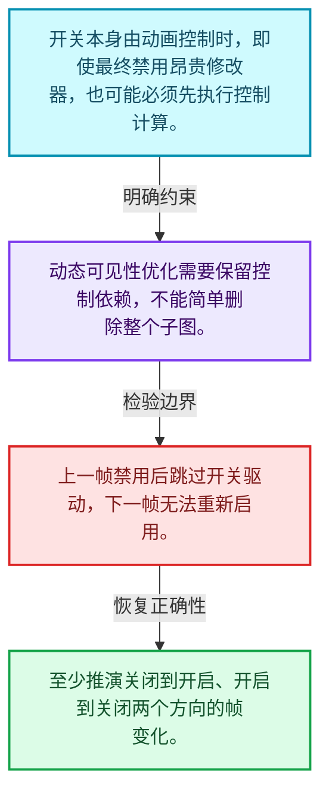
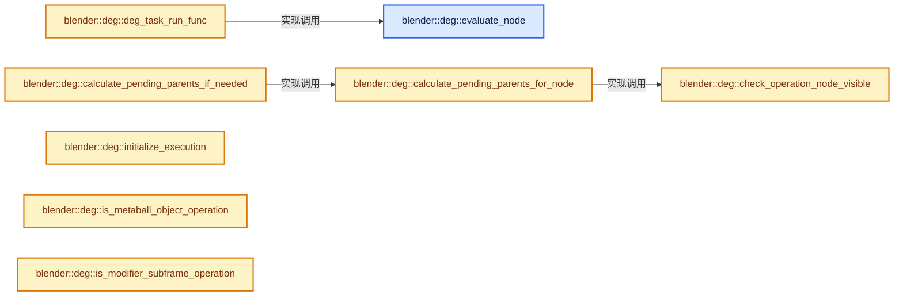
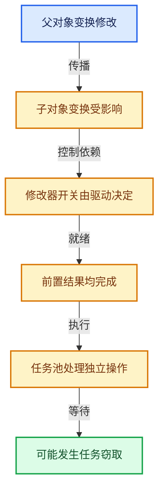

# 11-06 可见性与求值调度

[方向导航](README.md) · [总目录](../README.md) · [实现索引](../00-课程指南/02-源码与提交索引/符号依赖与实现索引.md)

## 从问题到实现

禁用计算时哪些控制依赖仍需要更新？

动态可见性本身可能依赖动画或驱动，不能先跳过所有相关计算；需求判断有执行阶段顺序。

**数据模型**

开关本身由动画控制时，即使最终禁用昂贵修改器，也可能必须先执行控制计算。

**设计取舍**

动态可见性优化需要保留控制依赖，不能简单删除整个子图。

**最小反例**

上一帧禁用后跳过开关驱动，下一帧无法重新启用。

**推导**

至少推演关闭到开启、开启到关闭两个方向的帧变化。

## 阅读地图与执行推演








图中的数值推演是本方向的教学模型；实际函数之间的调用边与概念分析边分别标注，不能把概念关系当作运行时调度顺序。

## 完整源码单元与就地讲解

中文讲解直接放在相关代码旁，复杂机制在代码下展开。原文折叠区保留基准行号；不需要在行号表和函数之间来回查找。类布局可分段展示，函数实现不按固定行数切开。

### 类型布局、声明与编译条件 · deg_eval.cc L1—L87

<a id="t-cdbb577119e1"></a>

`DepsgraphEvalState`在这里声明的数据成员：

- `Depsgraph graph`
- `bool do_stats`
- `EvaluationStage stage`
- `bool need_update_pending_parents`
- `bool need_single_thread_pass`

<a id="t-0abdcae42708"></a>

<a id="t-f6c6d5da4236"></a>

`DepsgraphEvalState`在这里声明的数据成员：

- `Depsgraph graph`
- `bool do_stats`
- `EvaluationStage stage`
- `bool need_update_pending_parents`
- `bool need_single_thread_pass`

<!-- annotated:808762f933e4c5 -->

```cpp
/* SPDX-FileCopyrightText: 2013 Blender Authors
 *
 * SPDX-License-Identifier: GPL-2.0-or-later */

/** \file
 * \ingroup depsgraph
 *
 * Evaluation engine entry-points for Depsgraph Engine.
 */

#include <atomic>
#include <cstdint>

#include "intern/eval/deg_eval.h"

#include "BLI_function_ref.hh"
#include "BLI_gsqueue.hh"
#include "BLI_task_c.hh"
#include "BLI_time.hh"

#include "BKE_global.hh"

#include "DNA_modifier_types.h"
#include "DNA_object_types.h"
#include "DNA_scene_types.h"

#include "DEG_depsgraph.hh"
#include "DEG_depsgraph_query.hh"

#ifdef WITH_PYTHON
#  include "BPY_extern.hh"
#endif

#include "atomic_ops.h"

#include "intern/depsgraph.hh"
#include "intern/depsgraph_relation.hh"
#include "intern/depsgraph_tag.hh"
#include "intern/eval/deg_eval_copy_on_write.h"
#include "intern/eval/deg_eval_flush.h"
#include "intern/eval/deg_eval_stats.h"
#include "intern/eval/deg_eval_visibility.h"
#include "intern/node/deg_node.hh"
#include "intern/node/deg_node_component.hh"
#include "intern/node/deg_node_id.hh"
#include "intern/node/deg_node_operation.hh"

namespace blender::deg {

namespace {

struct DepsgraphEvalState;

void deg_task_run_func(TaskPool *pool, void *taskdata);

void schedule_children(DepsgraphEvalState *state,
                       OperationNode *node,
                       FunctionRef<void(OperationNode *node)> schedule_fn);

/* Denotes which part of dependency graph is being evaluated. */
enum class EvaluationStage {
  /* Stage 1: Only Copy-on-Write operations are to be evaluated, prior to anything else.
   * This allows other operations to access its dependencies when there is a dependency cycle
   * involved. */
  COPY_ON_EVAL,

  /* Evaluate actual ID nodes visibility based on the current state of animation and drivers. */
  DYNAMIC_VISIBILITY,

  /* Threaded evaluation of all possible operations. */
  THREADED_EVALUATION,

  /* Workaround for areas which can not be evaluated in threads.
   *
   * For example, meta-balls, which are iterating over all bases and are requesting dupli-lists
   * to see whether there are meta-balls inside. */
  SINGLE_THREADED_WORKAROUND,
};

struct DepsgraphEvalState {
  Depsgraph *graph;
  bool do_stats;
  EvaluationStage stage;
  bool need_update_pending_parents = true;
  bool need_single_thread_pass = false;
};

```

<details>
<summary>核对原始源码：source/blender/depsgraph/intern/eval/deg_eval.cc · L1—L87</summary>

<!-- original:808762f933e4c5:source/blender/depsgraph/intern/eval/deg_eval.cc:1:87 -->

```cpp
/* SPDX-FileCopyrightText: 2013 Blender Authors
 *
 * SPDX-License-Identifier: GPL-2.0-or-later */

/** \file
 * \ingroup depsgraph
 *
 * Evaluation engine entry-points for Depsgraph Engine.
 */

#include <atomic>
#include <cstdint>

#include "intern/eval/deg_eval.h"

#include "BLI_function_ref.hh"
#include "BLI_gsqueue.hh"
#include "BLI_task_c.hh"
#include "BLI_time.hh"

#include "BKE_global.hh"

#include "DNA_modifier_types.h"
#include "DNA_object_types.h"
#include "DNA_scene_types.h"

#include "DEG_depsgraph.hh"
#include "DEG_depsgraph_query.hh"

#ifdef WITH_PYTHON
#  include "BPY_extern.hh"
#endif

#include "atomic_ops.h"

#include "intern/depsgraph.hh"
#include "intern/depsgraph_relation.hh"
#include "intern/depsgraph_tag.hh"
#include "intern/eval/deg_eval_copy_on_write.h"
#include "intern/eval/deg_eval_flush.h"
#include "intern/eval/deg_eval_stats.h"
#include "intern/eval/deg_eval_visibility.h"
#include "intern/node/deg_node.hh"
#include "intern/node/deg_node_component.hh"
#include "intern/node/deg_node_id.hh"
#include "intern/node/deg_node_operation.hh"

namespace blender::deg {

namespace {

struct DepsgraphEvalState;

void deg_task_run_func(TaskPool *pool, void *taskdata);

void schedule_children(DepsgraphEvalState *state,
                       OperationNode *node,
                       FunctionRef<void(OperationNode *node)> schedule_fn);

/* Denotes which part of dependency graph is being evaluated. */
enum class EvaluationStage {
  /* Stage 1: Only Copy-on-Write operations are to be evaluated, prior to anything else.
   * This allows other operations to access its dependencies when there is a dependency cycle
   * involved. */
  COPY_ON_EVAL,

  /* Evaluate actual ID nodes visibility based on the current state of animation and drivers. */
  DYNAMIC_VISIBILITY,

  /* Threaded evaluation of all possible operations. */
  THREADED_EVALUATION,

  /* Workaround for areas which can not be evaluated in threads.
   *
   * For example, meta-balls, which are iterating over all bases and are requesting dupli-lists
   * to see whether there are meta-balls inside. */
  SINGLE_THREADED_WORKAROUND,
};

struct DepsgraphEvalState {
  Depsgraph *graph;
  bool do_stats;
  EvaluationStage stage;
  bool need_update_pending_parents = true;
  bool need_single_thread_pass = false;
};

```

</details>

<a id="f-2cc0421a43322bbf"></a>

### `blender::deg::evaluate_node`

实现位置：[source/blender/depsgraph/intern/eval/deg_eval.cc](../../../../../source/blender/depsgraph/intern/eval/deg_eval.cc) · L88—L109。

接口参数：

- `const DepsgraphEvalState *state`
- `OperationNode *operation_node`

**教学注释版**

<!-- annotated:ff7e1ddf5ff201 -->

```cpp
void evaluate_node(const DepsgraphEvalState *state, OperationNode *operation_node)
{
  blender::Depsgraph *depsgraph = reinterpret_cast<blender::Depsgraph *>(state->graph);

  /* Sanity checks. */
  BLI_assert_msg(!operation_node->is_noop(), "NOOP nodes should not actually be scheduled");
  /* Perform operation. */
  if (state->do_stats) {
    const double start_time = BLI_time_now_seconds();
    operation_node->evaluate(depsgraph);
    operation_node->stats.current_time += BLI_time_now_seconds() - start_time;
  }
  else {
    operation_node->evaluate(depsgraph);
  }

  /* Clear the flag early on, allowing partial updates without re-evaluating the same node multiple
   * times.
   * This is a thread-safe modification as the node's flags are only read for a non-scheduled nodes
   * and this node has been scheduled. */
  operation_node->flag &= ~DEPSOP_FLAG_CLEAR_ON_EVAL;
}
```

<details>
<summary>核对原始源码：source/blender/depsgraph/intern/eval/deg_eval.cc · L88—L109</summary>

<!-- original:ff7e1ddf5ff201:source/blender/depsgraph/intern/eval/deg_eval.cc:88:109 -->

```cpp
void evaluate_node(const DepsgraphEvalState *state, OperationNode *operation_node)
{
  blender::Depsgraph *depsgraph = reinterpret_cast<blender::Depsgraph *>(state->graph);

  /* Sanity checks. */
  BLI_assert_msg(!operation_node->is_noop(), "NOOP nodes should not actually be scheduled");
  /* Perform operation. */
  if (state->do_stats) {
    const double start_time = BLI_time_now_seconds();
    operation_node->evaluate(depsgraph);
    operation_node->stats.current_time += BLI_time_now_seconds() - start_time;
  }
  else {
    operation_node->evaluate(depsgraph);
  }

  /* Clear the flag early on, allowing partial updates without re-evaluating the same node multiple
   * times.
   * This is a thread-safe modification as the node's flags are only read for a non-scheduled nodes
   * and this node has been scheduled. */
  operation_node->flag &= ~DEPSOP_FLAG_CLEAR_ON_EVAL;
}
```

</details>

**沿实际写入检查状态**

- `operation_node->stats.current_time += BLI_time_now_seconds() - start_time;`
- `operation_node->flag &= ~DEPSOP_FLAG_CLEAR_ON_EVAL;`

**继续追踪实现**

- `BLI_assert_msg` → [BLI_assert_msg · L55](../90-实现依赖专题/01-BLI基础库/BLI_assert.hh.md#m-695eed20dceb)；[BLI_assert_msg · L64](../90-实现依赖专题/01-BLI基础库/BLI_assert.hh.md#m-7de5563de4db)。宏定义由构建条件选择。
- `operation_node->is_noop` → [blender::deg::OperationNode::is_noop · L269](02-ID组件与操作节点.md#f-61716786eb343cd9)。
- `BLI_time_now_seconds` → [blender::BLI_time_now_seconds · L30](../90-实现依赖专题/01-BLI基础库/intern/time.cc.md#f-78479f031bcc3c53)。
- `operation_node->evaluate` → [调用协议](../00-课程指南/01-路线与规范/模板宏与动态分派协议.md)：由接收对象具体类型或运行时策略提供实现。调用位置L97。

<!-- annotated:91b57132138f6c -->

```cpp

```

<details>
<summary>核对原始源码：source/blender/depsgraph/intern/eval/deg_eval.cc · L110—L110</summary>

<!-- original:91b57132138f6c:source/blender/depsgraph/intern/eval/deg_eval.cc:110:110 -->

```cpp

```

</details>

<a id="f-b682a9dde0ef89a0"></a>

### `blender::deg::deg_task_run_func`

实现位置：[source/blender/depsgraph/intern/eval/deg_eval.cc](../../../../../source/blender/depsgraph/intern/eval/deg_eval.cc) · L111—L124。

接口参数：

- `TaskPool *pool`
- `void *taskdata`

**教学注释版**

<!-- annotated:976591f9e74817 -->

```cpp
void deg_task_run_func(TaskPool *pool, void *taskdata)
{
  void *userdata_v = BLI_task_pool_user_data(pool);
  DepsgraphEvalState *state = static_cast<DepsgraphEvalState *>(userdata_v);

  /* Evaluate node. */
  OperationNode *operation_node = reinterpret_cast<OperationNode *>(taskdata);
  evaluate_node(state, operation_node);

  /* Schedule children. */
  schedule_children(state, operation_node, [&](OperationNode *node) {
    BLI_task_pool_push(pool, deg_task_run_func, node, false, nullptr);
  });
}
```

<details>
<summary>核对原始源码：source/blender/depsgraph/intern/eval/deg_eval.cc · L111—L124</summary>

<!-- original:976591f9e74817:source/blender/depsgraph/intern/eval/deg_eval.cc:111:124 -->

```cpp
void deg_task_run_func(TaskPool *pool, void *taskdata)
{
  void *userdata_v = BLI_task_pool_user_data(pool);
  DepsgraphEvalState *state = static_cast<DepsgraphEvalState *>(userdata_v);

  /* Evaluate node. */
  OperationNode *operation_node = reinterpret_cast<OperationNode *>(taskdata);
  evaluate_node(state, operation_node);

  /* Schedule children. */
  schedule_children(state, operation_node, [&](OperationNode *node) {
    BLI_task_pool_push(pool, deg_task_run_func, node, false, nullptr);
  });
}
```

</details>

**继续追踪实现**

- `BLI_task_pool_user_data` → [BLI_task_pool_user_data · L460](07-任务池与TBB接入.md#f-f4e86036a25f60c7)。
- `evaluate_node` → [blender::deg::evaluate_node · L88](06-可见性与求值调度.md#f-2cc0421a43322bbf)。
- `schedule_children` → [blender::deg::schedule_children · L332](06-可见性与求值调度.md#f-34c6de1e2d5d13af)。
- `BLI_task_pool_push` → [BLI_task_pool_push · L446](07-任务池与TBB接入.md#f-16c248b3ea6653d2)。

<!-- annotated:e8f7490d75b37b -->

```cpp

```

<details>
<summary>核对原始源码：source/blender/depsgraph/intern/eval/deg_eval.cc · L125—L125</summary>

<!-- original:e8f7490d75b37b:source/blender/depsgraph/intern/eval/deg_eval.cc:125:125 -->

```cpp

```

</details>

<a id="f-f3fd0ccd594670d0"></a>

### `blender::deg::check_operation_node_visible`

实现位置：[source/blender/depsgraph/intern/eval/deg_eval.cc](../../../../../source/blender/depsgraph/intern/eval/deg_eval.cc) · L126—L142。

接口参数：

- `const DepsgraphEvalState *state`
- `OperationNode *op_node`

**教学注释版**

<!-- annotated:0907d028e02451 -->

```cpp
bool check_operation_node_visible(const DepsgraphEvalState *state, OperationNode *op_node)
{
  const ComponentNode *comp_node = op_node->owner;
  /* Special case for copy-on-eval component: it is to be always evaluated, to keep copied
   * "database" in a consistent state. */
  if (comp_node->type == NodeType::COPY_ON_EVAL) {
    return true;
  }

  /* Special case for dynamic visibility pass: the actual visibility is not yet known, so limit to
   * only operations which affects visibility. */
  if (state->stage == EvaluationStage::DYNAMIC_VISIBILITY) {
    return op_node->flag & OperationFlag::DEPSOP_FLAG_AFFECTS_VISIBILITY;
  }

  return comp_node->affects_visible_id;
}
```

<details>
<summary>核对原始源码：source/blender/depsgraph/intern/eval/deg_eval.cc · L126—L142</summary>

<!-- original:0907d028e02451:source/blender/depsgraph/intern/eval/deg_eval.cc:126:142 -->

```cpp
bool check_operation_node_visible(const DepsgraphEvalState *state, OperationNode *op_node)
{
  const ComponentNode *comp_node = op_node->owner;
  /* Special case for copy-on-eval component: it is to be always evaluated, to keep copied
   * "database" in a consistent state. */
  if (comp_node->type == NodeType::COPY_ON_EVAL) {
    return true;
  }

  /* Special case for dynamic visibility pass: the actual visibility is not yet known, so limit to
   * only operations which affects visibility. */
  if (state->stage == EvaluationStage::DYNAMIC_VISIBILITY) {
    return op_node->flag & OperationFlag::DEPSOP_FLAG_AFFECTS_VISIBILITY;
  }

  return comp_node->affects_visible_id;
}
```

</details>

**结果出口**

- `return true;`
- `return op_node->flag & OperationFlag::DEPSOP_FLAG_AFFECTS_VISIBILITY;`
- `return comp_node->affects_visible_id;`

**继续追踪实现**

本实现没有需要继续展开的显式调用；检查返回表达式、对象转换和调用者前置条件。

<!-- annotated:0cf6d6f90d30bd -->

```cpp

```

<details>
<summary>核对原始源码：source/blender/depsgraph/intern/eval/deg_eval.cc · L143—L143</summary>

<!-- original:0cf6d6f90d30bd:source/blender/depsgraph/intern/eval/deg_eval.cc:143:143 -->

```cpp

```

</details>

<a id="f-5d6de181a8a40ac4"></a>

### `blender::deg::calculate_pending_parents_for_node`

实现位置：[source/blender/depsgraph/intern/eval/deg_eval.cc](../../../../../source/blender/depsgraph/intern/eval/deg_eval.cc) · L144—L174。

接口参数：

- `const DepsgraphEvalState *state`
- `OperationNode *node`

**教学注释版**

<!-- annotated:32751a8744629a -->

```cpp
void calculate_pending_parents_for_node(const DepsgraphEvalState *state, OperationNode *node)
{
  /* Update counters, applies for both visible and invisible IDs. */
  node->num_links_pending = 0;
  node->scheduled = false;
  /* Invisible IDs requires no pending operations. */
  if (!check_operation_node_visible(state, node)) {
    return;
  }
  /* No need to bother with anything if node is not tagged for update. */
  if ((node->flag & DEPSOP_FLAG_NEEDS_UPDATE) == 0) {
    return;
  }
  for (Relation *rel : node->inlinks) {
    if (rel->from->type == NodeType::OPERATION && (rel->flag & RELATION_FLAG_CYCLIC) == 0) {
      OperationNode *from = static_cast<OperationNode *>(rel->from);
      /* TODO(sergey): This is how old layer system was checking for the
       * calculation, but how is it possible that visible object depends
       * on an invisible? This is something what is prohibited after
       * deg_graph_build_flush_layers(). */
      if (!check_operation_node_visible(state, from)) {
        continue;
      }
      /* No need to wait for operation which is up to date. */
      if ((from->flag & DEPSOP_FLAG_NEEDS_UPDATE) == 0) {
        continue;
      }
      ++node->num_links_pending;
    }
  }
}
```

<details>
<summary>核对原始源码：source/blender/depsgraph/intern/eval/deg_eval.cc · L144—L174</summary>

<!-- original:32751a8744629a:source/blender/depsgraph/intern/eval/deg_eval.cc:144:174 -->

```cpp
void calculate_pending_parents_for_node(const DepsgraphEvalState *state, OperationNode *node)
{
  /* Update counters, applies for both visible and invisible IDs. */
  node->num_links_pending = 0;
  node->scheduled = false;
  /* Invisible IDs requires no pending operations. */
  if (!check_operation_node_visible(state, node)) {
    return;
  }
  /* No need to bother with anything if node is not tagged for update. */
  if ((node->flag & DEPSOP_FLAG_NEEDS_UPDATE) == 0) {
    return;
  }
  for (Relation *rel : node->inlinks) {
    if (rel->from->type == NodeType::OPERATION && (rel->flag & RELATION_FLAG_CYCLIC) == 0) {
      OperationNode *from = static_cast<OperationNode *>(rel->from);
      /* TODO(sergey): This is how old layer system was checking for the
       * calculation, but how is it possible that visible object depends
       * on an invisible? This is something what is prohibited after
       * deg_graph_build_flush_layers(). */
      if (!check_operation_node_visible(state, from)) {
        continue;
      }
      /* No need to wait for operation which is up to date. */
      if ((from->flag & DEPSOP_FLAG_NEEDS_UPDATE) == 0) {
        continue;
      }
      ++node->num_links_pending;
    }
  }
}
```

</details>

**沿实际写入检查状态**

- `node->num_links_pending = 0;`
- `node->scheduled = false;`

**继续追踪实现**

- `check_operation_node_visible` → [blender::deg::check_operation_node_visible · L126](06-可见性与求值调度.md#f-f3fd0ccd594670d0)。

<!-- annotated:0f64e9330283f9 -->

```cpp

```

<details>
<summary>核对原始源码：source/blender/depsgraph/intern/eval/deg_eval.cc · L175—L175</summary>

<!-- original:0f64e9330283f9:source/blender/depsgraph/intern/eval/deg_eval.cc:175:175 -->

```cpp

```

</details>

<a id="f-7692423bd504f3c2"></a>

### `blender::deg::calculate_pending_parents_if_needed`

实现位置：[source/blender/depsgraph/intern/eval/deg_eval.cc](../../../../../source/blender/depsgraph/intern/eval/deg_eval.cc) · L176—L187。

接口参数：

- `DepsgraphEvalState *state`

**教学注释版**

<!-- annotated:72da7e0fb1442f -->

```cpp
void calculate_pending_parents_if_needed(DepsgraphEvalState *state)
{
  if (!state->need_update_pending_parents) {
    return;
  }

  for (OperationNode *node : state->graph->operations) {
    calculate_pending_parents_for_node(state, node);
  }

  state->need_update_pending_parents = false;
}
```

<details>
<summary>核对原始源码：source/blender/depsgraph/intern/eval/deg_eval.cc · L176—L187</summary>

<!-- original:72da7e0fb1442f:source/blender/depsgraph/intern/eval/deg_eval.cc:176:187 -->

```cpp
void calculate_pending_parents_if_needed(DepsgraphEvalState *state)
{
  if (!state->need_update_pending_parents) {
    return;
  }

  for (OperationNode *node : state->graph->operations) {
    calculate_pending_parents_for_node(state, node);
  }

  state->need_update_pending_parents = false;
}
```

</details>

**沿实际写入检查状态**

- `state->need_update_pending_parents = false;`

**继续追踪实现**

- `calculate_pending_parents_for_node` → [blender::deg::calculate_pending_parents_for_node · L144](06-可见性与求值调度.md#f-5d6de181a8a40ac4)。

<!-- annotated:53c4e9fd2d2dc4 -->

```cpp

```

<details>
<summary>核对原始源码：source/blender/depsgraph/intern/eval/deg_eval.cc · L188—L188</summary>

<!-- original:53c4e9fd2d2dc4:source/blender/depsgraph/intern/eval/deg_eval.cc:188:188 -->

```cpp

```

</details>

<a id="f-5b6b96bd82176be9"></a>

### `blender::deg::initialize_execution`

实现位置：[source/blender/depsgraph/intern/eval/deg_eval.cc](../../../../../source/blender/depsgraph/intern/eval/deg_eval.cc) · L189—L197。

接口参数：

- `DepsgraphEvalState *state`
- `Depsgraph *graph`

**教学注释版**

<!-- annotated:6862cacca41cd3 -->

```cpp
void initialize_execution(DepsgraphEvalState *state, Depsgraph *graph)
{
  /* Clear tags and other things which needs to be clear. */
  if (state->do_stats) {
    for (OperationNode *node : graph->operations) {
      node->stats.reset_current();
    }
  }
}
```

<details>
<summary>核对原始源码：source/blender/depsgraph/intern/eval/deg_eval.cc · L189—L197</summary>

<!-- original:6862cacca41cd3:source/blender/depsgraph/intern/eval/deg_eval.cc:189:197 -->

```cpp
void initialize_execution(DepsgraphEvalState *state, Depsgraph *graph)
{
  /* Clear tags and other things which needs to be clear. */
  if (state->do_stats) {
    for (OperationNode *node : graph->operations) {
      node->stats.reset_current();
    }
  }
}
```

</details>

**继续追踪实现**

- `node->stats.reset_current` → [调用协议](../00-课程指南/01-路线与规范/模板宏与动态分派协议.md)：接收对象类型依赖auto、返回值或模板实例；不按同名猜测目标。调用位置L194。

<!-- annotated:ed9392c9cff5ed -->

```cpp

```

<details>
<summary>核对原始源码：source/blender/depsgraph/intern/eval/deg_eval.cc · L198—L198</summary>

<!-- original:ed9392c9cff5ed:source/blender/depsgraph/intern/eval/deg_eval.cc:198:198 -->

```cpp

```

</details>

<a id="f-46f802f4eabf2aa0"></a>

### `blender::deg::is_metaball_object_operation`

实现位置：[source/blender/depsgraph/intern/eval/deg_eval.cc](../../../../../source/blender/depsgraph/intern/eval/deg_eval.cc) · L199—L210。

接口参数：

- `const OperationNode *operation_node`

**教学注释版**

<!-- annotated:70e39fc02999e9 -->

```cpp
bool is_metaball_object_operation(const OperationNode *operation_node)
{
  const ComponentNode *component_node = operation_node->owner;
  const IDNode *id_node = component_node->owner;
  /* This runs after the COPY_ON_EVAL stage which creates id_cow. */
  BLI_assert(id_node->id_cow);
  if (GS(id_node->id_cow->name) != ID_OB) {
    return false;
  }
  const Object *object = reinterpret_cast<const Object *>(id_node->id_cow);
  return object->type == OB_MBALL;
}
```

<details>
<summary>核对原始源码：source/blender/depsgraph/intern/eval/deg_eval.cc · L199—L210</summary>

<!-- original:70e39fc02999e9:source/blender/depsgraph/intern/eval/deg_eval.cc:199:210 -->

```cpp
bool is_metaball_object_operation(const OperationNode *operation_node)
{
  const ComponentNode *component_node = operation_node->owner;
  const IDNode *id_node = component_node->owner;
  /* This runs after the COPY_ON_EVAL stage which creates id_cow. */
  BLI_assert(id_node->id_cow);
  if (GS(id_node->id_cow->name) != ID_OB) {
    return false;
  }
  const Object *object = reinterpret_cast<const Object *>(id_node->id_cow);
  return object->type == OB_MBALL;
}
```

</details>

**结果出口**

- `return false;`
- `return object->type == OB_MBALL;`

**继续追踪实现**

- `BLI_assert` → [BLI_assert · L48](../90-实现依赖专题/01-BLI基础库/BLI_assert.hh.md#m-57a88495704d)；[BLI_assert · L63](../90-实现依赖专题/01-BLI基础库/BLI_assert.hh.md#m-d07050020cb5)。宏定义由构建条件选择。
- `GS` → [blender::GS · L410](../90-实现依赖专题/08-其他Blender模块/makesdna/DNA_ID.h.md#f-c3ff509f79f21b05)。

### 类型布局、声明与编译条件 · deg_eval.cc L211—L215

<!-- annotated:c621edcd62a238 -->

```cpp

/* Simulation modifiers with sub-frames (fluid domain, dynamic paint canvas) perform direct updates
 * of other objects, which can cause race conditions over certain data (#115636). Unless and until
 * sub-steps are fully supported in depsgraph evaluation such objects must use single-threaded
 * evaluation. */
```

<details>
<summary>核对原始源码：source/blender/depsgraph/intern/eval/deg_eval.cc · L211—L215</summary>

<!-- original:c621edcd62a238:source/blender/depsgraph/intern/eval/deg_eval.cc:211:215 -->

```cpp

/* Simulation modifiers with sub-frames (fluid domain, dynamic paint canvas) perform direct updates
 * of other objects, which can cause race conditions over certain data (#115636). Unless and until
 * sub-steps are fully supported in depsgraph evaluation such objects must use single-threaded
 * evaluation. */
```

</details>

<a id="f-33c71b8ce4bdea62"></a>

### `blender::deg::is_modifier_subframe_operation`

实现位置：[source/blender/depsgraph/intern/eval/deg_eval.cc](../../../../../source/blender/depsgraph/intern/eval/deg_eval.cc) · L216—L241。

接口参数：

- `const OperationNode *operation_node`

**教学注释版**

<!-- annotated:e28eacd2a3610f -->

```cpp
bool is_modifier_subframe_operation(const OperationNode *operation_node)
{
  const ComponentNode *component_node = operation_node->owner;
  const IDNode *id_node = component_node->owner;
  /* This runs after the COPY_ON_EVAL stage which creates id_cow. */
  BLI_assert(id_node->id_cow);
  if (GS(id_node->id_cow->name) != ID_OB) {
    return false;
  }
  const Object *object = reinterpret_cast<const Object *>(id_node->id_cow);
  for (const ModifierData &md : object->modifiers) {
    if (md.type == eModifierType_Fluid) {
      const auto &fmd = reinterpret_cast<const FluidModifierData &>(md);
      if (fmd.type == MOD_FLUID_TYPE_DOMAIN) {
        return true;
      }
    }
    if (md.type == eModifierType_DynamicPaint) {
      const auto &dmd = reinterpret_cast<const DynamicPaintModifierData &>(md);
      if (dmd.type == MOD_DYNAMICPAINT_TYPE_CANVAS) {
        return true;
      }
    }
  }
  return false;
}
```

<details>
<summary>核对原始源码：source/blender/depsgraph/intern/eval/deg_eval.cc · L216—L241</summary>

<!-- original:e28eacd2a3610f:source/blender/depsgraph/intern/eval/deg_eval.cc:216:241 -->

```cpp
bool is_modifier_subframe_operation(const OperationNode *operation_node)
{
  const ComponentNode *component_node = operation_node->owner;
  const IDNode *id_node = component_node->owner;
  /* This runs after the COPY_ON_EVAL stage which creates id_cow. */
  BLI_assert(id_node->id_cow);
  if (GS(id_node->id_cow->name) != ID_OB) {
    return false;
  }
  const Object *object = reinterpret_cast<const Object *>(id_node->id_cow);
  for (const ModifierData &md : object->modifiers) {
    if (md.type == eModifierType_Fluid) {
      const auto &fmd = reinterpret_cast<const FluidModifierData &>(md);
      if (fmd.type == MOD_FLUID_TYPE_DOMAIN) {
        return true;
      }
    }
    if (md.type == eModifierType_DynamicPaint) {
      const auto &dmd = reinterpret_cast<const DynamicPaintModifierData &>(md);
      if (dmd.type == MOD_DYNAMICPAINT_TYPE_CANVAS) {
        return true;
      }
    }
  }
  return false;
}
```

</details>

**结果出口**

- `return false;`
- `return true;`

**继续追踪实现**

- `BLI_assert` → [BLI_assert · L48](../90-实现依赖专题/01-BLI基础库/BLI_assert.hh.md#m-57a88495704d)；[BLI_assert · L63](../90-实现依赖专题/01-BLI基础库/BLI_assert.hh.md#m-d07050020cb5)。宏定义由构建条件选择。
- `GS` → [blender::GS · L410](../90-实现依赖专题/08-其他Blender模块/makesdna/DNA_ID.h.md#f-c3ff509f79f21b05)。

<!-- annotated:18cead04629726 -->

```cpp

```

<details>
<summary>核对原始源码：source/blender/depsgraph/intern/eval/deg_eval.cc · L242—L242</summary>

<!-- original:18cead04629726:source/blender/depsgraph/intern/eval/deg_eval.cc:242:242 -->

```cpp

```

</details>

<a id="f-60f370526d6a613d"></a>

### `blender::deg::need_evaluate_operation_at_stage`

实现位置：[source/blender/depsgraph/intern/eval/deg_eval.cc](../../../../../source/blender/depsgraph/intern/eval/deg_eval.cc) · L243—L270。

接口参数：

- `DepsgraphEvalState *state`
- `const OperationNode *operation_node`

**教学注释版**

<!-- annotated:9e885694b2d410 -->

```cpp
bool need_evaluate_operation_at_stage(DepsgraphEvalState *state,
                                      const OperationNode *operation_node)
{
  const ComponentNode *component_node = operation_node->owner;
  switch (state->stage) {
    case EvaluationStage::COPY_ON_EVAL:
      return (component_node->type == NodeType::COPY_ON_EVAL);

    case EvaluationStage::DYNAMIC_VISIBILITY:
      return operation_node->flag & OperationFlag::DEPSOP_FLAG_AFFECTS_VISIBILITY;

    case EvaluationStage::THREADED_EVALUATION:
      if (is_metaball_object_operation(operation_node)) {
        state->need_single_thread_pass = true;
        return false;
      }
      if (is_modifier_subframe_operation(operation_node)) {
        state->need_single_thread_pass = true;
        return false;
      }
      return true;

    case EvaluationStage::SINGLE_THREADED_WORKAROUND:
      return true;
  }
  BLI_assert_msg(0, "Unhandled evaluation stage, should never happen.");
  return false;
}
```

<details>
<summary>核对原始源码：source/blender/depsgraph/intern/eval/deg_eval.cc · L243—L270</summary>

<!-- original:9e885694b2d410:source/blender/depsgraph/intern/eval/deg_eval.cc:243:270 -->

```cpp
bool need_evaluate_operation_at_stage(DepsgraphEvalState *state,
                                      const OperationNode *operation_node)
{
  const ComponentNode *component_node = operation_node->owner;
  switch (state->stage) {
    case EvaluationStage::COPY_ON_EVAL:
      return (component_node->type == NodeType::COPY_ON_EVAL);

    case EvaluationStage::DYNAMIC_VISIBILITY:
      return operation_node->flag & OperationFlag::DEPSOP_FLAG_AFFECTS_VISIBILITY;

    case EvaluationStage::THREADED_EVALUATION:
      if (is_metaball_object_operation(operation_node)) {
        state->need_single_thread_pass = true;
        return false;
      }
      if (is_modifier_subframe_operation(operation_node)) {
        state->need_single_thread_pass = true;
        return false;
      }
      return true;

    case EvaluationStage::SINGLE_THREADED_WORKAROUND:
      return true;
  }
  BLI_assert_msg(0, "Unhandled evaluation stage, should never happen.");
  return false;
}
```

</details>

**沿实际写入检查状态**

- `state->need_single_thread_pass = true;`

**结果出口**

- `return (component_node->type == NodeType::COPY_ON_EVAL);`
- `return operation_node->flag & OperationFlag::DEPSOP_FLAG_AFFECTS_VISIBILITY;`
- `return false;`
- `return true;`

**继续追踪实现**

- `is_metaball_object_operation` → [blender::deg::is_metaball_object_operation · L199](06-可见性与求值调度.md#f-46f802f4eabf2aa0)。
- `is_modifier_subframe_operation` → [blender::deg::is_modifier_subframe_operation · L216](06-可见性与求值调度.md#f-33c71b8ce4bdea62)。
- `BLI_assert_msg` → [BLI_assert_msg · L55](../90-实现依赖专题/01-BLI基础库/BLI_assert.hh.md#m-695eed20dceb)；[BLI_assert_msg · L64](../90-实现依赖专题/01-BLI基础库/BLI_assert.hh.md#m-7de5563de4db)。宏定义由构建条件选择。

### 类型布局、声明与编译条件 · deg_eval.cc L271—L275

<!-- annotated:acbe9a10a29bf2 -->

```cpp

/* Schedule a node if it needs evaluation.
 *   dec_parents: Decrement pending parents count, true when child nodes are
 *                scheduled after a task has been completed.
 */
```

<details>
<summary>核对原始源码：source/blender/depsgraph/intern/eval/deg_eval.cc · L271—L275</summary>

<!-- original:acbe9a10a29bf2:source/blender/depsgraph/intern/eval/deg_eval.cc:271:275 -->

```cpp

/* Schedule a node if it needs evaluation.
 *   dec_parents: Decrement pending parents count, true when child nodes are
 *                scheduled after a task has been completed.
 */
```

</details>

<a id="f-7efcd07ebddc8929"></a>

### `blender::deg::schedule_node`

实现位置：[source/blender/depsgraph/intern/eval/deg_eval.cc](../../../../../source/blender/depsgraph/intern/eval/deg_eval.cc) · L276—L322。

接口参数：

- `DepsgraphEvalState *state`
- `OperationNode *node`
- `bool dec_parents`
- `const FunctionRef<void(OperationNode *node)> schedule_fn`
- `OperationNode *node`

**教学注释版**

<!-- annotated:a1f043fcc432a2 -->

```cpp
void schedule_node(DepsgraphEvalState *state,
                   OperationNode *node,
                   bool dec_parents,
                   const FunctionRef<void(OperationNode *node)> schedule_fn)
{
  /* No need to schedule nodes of invisible ID. */
  if (!check_operation_node_visible(state, node)) {
    return;
  }
  /* No need to schedule operations which are not tagged for update, they are
   * considered to be up to date. */
  if ((node->flag & DEPSOP_FLAG_NEEDS_UPDATE) == 0) {
    return;
  }
  /* TODO(sergey): This is not strictly speaking safe to read
   * num_links_pending. */
  if (dec_parents) {
    BLI_assert(node->num_links_pending > 0);
    atomic_sub_and_fetch_uint32(&node->num_links_pending, 1);
  }
  /* Cal not schedule operation while its dependencies are not yet
   * evaluated. */
  if (node->num_links_pending != 0) {
    return;
  }
  /* During the copy-on-eval stage only schedule copy-on-eval nodes. */
  if (!need_evaluate_operation_at_stage(state, node)) {
    return;
  }
  /* Actually schedule the node. */
  bool is_scheduled = atomic_fetch_and_or_uint8(reinterpret_cast<uint8_t *>(&node->scheduled),
                                                uint8_t(true));
  if (!is_scheduled) {
    if (node->is_noop()) {
      /* Clear flags to avoid affecting subsequent update propagation.
       * For normal nodes these are cleared when it is evaluated. */
      node->flag &= ~DEPSOP_FLAG_CLEAR_ON_EVAL;

      /* skip NOOP node, schedule children right away */
      schedule_children(state, node, schedule_fn);
    }
    else {
      /* children are scheduled once this task is completed */
      schedule_fn(node);
    }
  }
}
```

<details>
<summary>核对原始源码：source/blender/depsgraph/intern/eval/deg_eval.cc · L276—L322</summary>

<!-- original:a1f043fcc432a2:source/blender/depsgraph/intern/eval/deg_eval.cc:276:322 -->

```cpp
void schedule_node(DepsgraphEvalState *state,
                   OperationNode *node,
                   bool dec_parents,
                   const FunctionRef<void(OperationNode *node)> schedule_fn)
{
  /* No need to schedule nodes of invisible ID. */
  if (!check_operation_node_visible(state, node)) {
    return;
  }
  /* No need to schedule operations which are not tagged for update, they are
   * considered to be up to date. */
  if ((node->flag & DEPSOP_FLAG_NEEDS_UPDATE) == 0) {
    return;
  }
  /* TODO(sergey): This is not strictly speaking safe to read
   * num_links_pending. */
  if (dec_parents) {
    BLI_assert(node->num_links_pending > 0);
    atomic_sub_and_fetch_uint32(&node->num_links_pending, 1);
  }
  /* Cal not schedule operation while its dependencies are not yet
   * evaluated. */
  if (node->num_links_pending != 0) {
    return;
  }
  /* During the copy-on-eval stage only schedule copy-on-eval nodes. */
  if (!need_evaluate_operation_at_stage(state, node)) {
    return;
  }
  /* Actually schedule the node. */
  bool is_scheduled = atomic_fetch_and_or_uint8(reinterpret_cast<uint8_t *>(&node->scheduled),
                                                uint8_t(true));
  if (!is_scheduled) {
    if (node->is_noop()) {
      /* Clear flags to avoid affecting subsequent update propagation.
       * For normal nodes these are cleared when it is evaluated. */
      node->flag &= ~DEPSOP_FLAG_CLEAR_ON_EVAL;

      /* skip NOOP node, schedule children right away */
      schedule_children(state, node, schedule_fn);
    }
    else {
      /* children are scheduled once this task is completed */
      schedule_fn(node);
    }
  }
}
```

</details>

**沿实际写入检查状态**

- `node->flag &= ~DEPSOP_FLAG_CLEAR_ON_EVAL;`

**继续追踪实现**

- `check_operation_node_visible` → [blender::deg::check_operation_node_visible · L126](06-可见性与求值调度.md#f-f3fd0ccd594670d0)。
- `BLI_assert` → [BLI_assert · L48](../90-实现依赖专题/01-BLI基础库/BLI_assert.hh.md#m-57a88495704d)；[BLI_assert · L63](../90-实现依赖专题/01-BLI基础库/BLI_assert.hh.md#m-d07050020cb5)。宏定义由构建条件选择。
- `atomic_sub_and_fetch_uint32` → [atomic_sub_and_fetch_uint32 · L410](../90-实现依赖专题/07-Intern运行时与平台/atomic/intern/atomic_ops_unix.h.md#f-c400b1566e8f4953)；[atomic_sub_and_fetch_uint32 · L469](../90-实现依赖专题/07-Intern运行时与平台/atomic/intern/atomic_ops_unix.h.md#f-01b2d8596dfdfe65)；[atomic_sub_and_fetch_uint32 · L142](../90-实现依赖专题/07-Intern运行时与平台/atomic/intern/atomic_ops_msvc.h.md#f-4b20d18e04ff9a8f)。同名重载需按实参类型选择。
- `need_evaluate_operation_at_stage` → [blender::deg::need_evaluate_operation_at_stage · L243](06-可见性与求值调度.md#f-60f370526d6a613d)。
- `atomic_fetch_and_or_uint8` → [atomic_fetch_and_or_uint8 · L646](../90-实现依赖专题/07-Intern运行时与平台/atomic/intern/atomic_ops_unix.h.md#f-af6f4e014fe22ba9)；[atomic_fetch_and_or_uint8 · L247](../90-实现依赖专题/07-Intern运行时与平台/atomic/intern/atomic_ops_msvc.h.md#f-dc78f7729f3b81c2)。同名重载需按实参类型选择。
- `node->is_noop` → [blender::deg::OperationNode::is_noop · L269](02-ID组件与操作节点.md#f-61716786eb343cd9)。
- `schedule_children` → [blender::deg::schedule_children · L332](06-可见性与求值调度.md#f-34c6de1e2d5d13af)。
- `schedule_fn` → [调用协议](../00-课程指南/01-路线与规范/模板宏与动态分派协议.md)：局部可调用对象，须结合其初始化与捕获环境。调用位置L319。

<!-- annotated:430ac7a7271296 -->

```cpp

```

<details>
<summary>核对原始源码：source/blender/depsgraph/intern/eval/deg_eval.cc · L323—L323</summary>

<!-- original:430ac7a7271296:source/blender/depsgraph/intern/eval/deg_eval.cc:323:323 -->

```cpp

```

</details>

<a id="f-73698249d4377958"></a>

### `blender::deg::schedule_graph`

实现位置：[source/blender/depsgraph/intern/eval/deg_eval.cc](../../../../../source/blender/depsgraph/intern/eval/deg_eval.cc) · L324—L330。

接口参数：

- `DepsgraphEvalState *state`
- `const FunctionRef<void(OperationNode *node)> schedule_fn`
- `OperationNode *node`

**教学注释版**

<!-- annotated:cb08db2126245d -->

```cpp
void schedule_graph(DepsgraphEvalState *state,
                    const FunctionRef<void(OperationNode *node)> schedule_fn)
{
  for (OperationNode *node : state->graph->operations) {
    schedule_node(state, node, false, schedule_fn);
  }
}
```

<details>
<summary>核对原始源码：source/blender/depsgraph/intern/eval/deg_eval.cc · L324—L330</summary>

<!-- original:cb08db2126245d:source/blender/depsgraph/intern/eval/deg_eval.cc:324:330 -->

```cpp
void schedule_graph(DepsgraphEvalState *state,
                    const FunctionRef<void(OperationNode *node)> schedule_fn)
{
  for (OperationNode *node : state->graph->operations) {
    schedule_node(state, node, false, schedule_fn);
  }
}
```

</details>

**继续追踪实现**

- `schedule_node` → [blender::deg::schedule_node · L276](06-可见性与求值调度.md#f-7efcd07ebddc8929)。

<!-- annotated:b5ec40f1b8dfcc -->

```cpp

```

<details>
<summary>核对原始源码：source/blender/depsgraph/intern/eval/deg_eval.cc · L331—L331</summary>

<!-- original:b5ec40f1b8dfcc:source/blender/depsgraph/intern/eval/deg_eval.cc:331:331 -->

```cpp

```

</details>

<a id="f-34c6de1e2d5d13af"></a>

### `blender::deg::schedule_children`

实现位置：[source/blender/depsgraph/intern/eval/deg_eval.cc](../../../../../source/blender/depsgraph/intern/eval/deg_eval.cc) · L332—L345。

接口参数：

- `DepsgraphEvalState *state`
- `OperationNode *node`
- `const FunctionRef<void(OperationNode *node)> schedule_fn`
- `OperationNode *node`

**教学注释版**

<!-- annotated:aa36b8ee8ebcba -->

```cpp
void schedule_children(DepsgraphEvalState *state,
                       OperationNode *node,
                       const FunctionRef<void(OperationNode *node)> schedule_fn)
{
  for (Relation *rel : node->outlinks) {
    OperationNode *child = static_cast<OperationNode *>(rel->to);
    BLI_assert(child->type == NodeType::OPERATION);
    if (child->scheduled) {
      /* Happens when having cyclic dependencies. */
      continue;
    }
    schedule_node(state, child, (rel->flag & RELATION_FLAG_CYCLIC) == 0, schedule_fn);
  }
}
```

<details>
<summary>核对原始源码：source/blender/depsgraph/intern/eval/deg_eval.cc · L332—L345</summary>

<!-- original:aa36b8ee8ebcba:source/blender/depsgraph/intern/eval/deg_eval.cc:332:345 -->

```cpp
void schedule_children(DepsgraphEvalState *state,
                       OperationNode *node,
                       const FunctionRef<void(OperationNode *node)> schedule_fn)
{
  for (Relation *rel : node->outlinks) {
    OperationNode *child = static_cast<OperationNode *>(rel->to);
    BLI_assert(child->type == NodeType::OPERATION);
    if (child->scheduled) {
      /* Happens when having cyclic dependencies. */
      continue;
    }
    schedule_node(state, child, (rel->flag & RELATION_FLAG_CYCLIC) == 0, schedule_fn);
  }
}
```

</details>

**继续追踪实现**

- `BLI_assert` → [BLI_assert · L48](../90-实现依赖专题/01-BLI基础库/BLI_assert.hh.md#m-57a88495704d)；[BLI_assert · L63](../90-实现依赖专题/01-BLI基础库/BLI_assert.hh.md#m-d07050020cb5)。宏定义由构建条件选择。
- `schedule_node` → [blender::deg::schedule_node · L276](06-可见性与求值调度.md#f-7efcd07ebddc8929)。

### 类型布局、声明与编译条件 · deg_eval.cc L346—L349

<!-- annotated:9e0cbf5ddeaf28 -->

```cpp

/* Evaluate given stage of the dependency graph evaluation using multiple threads.
 *
 * NOTE: Will assign the `state->stage` to the given stage. */
```

<details>
<summary>核对原始源码：source/blender/depsgraph/intern/eval/deg_eval.cc · L346—L349</summary>

<!-- original:9e0cbf5ddeaf28:source/blender/depsgraph/intern/eval/deg_eval.cc:346:349 -->

```cpp

/* Evaluate given stage of the dependency graph evaluation using multiple threads.
 *
 * NOTE: Will assign the `state->stage` to the given stage. */
```

</details>

<a id="f-26eb2db1571a2a13"></a>

### `blender::deg::evaluate_graph_threaded_stage`

实现位置：[source/blender/depsgraph/intern/eval/deg_eval.cc](../../../../../source/blender/depsgraph/intern/eval/deg_eval.cc) · L350—L362。

接口参数：

- `DepsgraphEvalState *state`
- `TaskPool *task_pool`
- `const EvaluationStage stage`

**教学注释版**

<!-- annotated:a040c26fa080e1 -->

```cpp
void evaluate_graph_threaded_stage(DepsgraphEvalState *state,
                                   TaskPool *task_pool,
                                   const EvaluationStage stage)
{
  state->stage = stage;

  calculate_pending_parents_if_needed(state);

  schedule_graph(state, [&](OperationNode *node) {
    BLI_task_pool_push(task_pool, deg_task_run_func, node, false, nullptr);
  });
  BLI_task_pool_work_and_wait(task_pool);
}
```

<details>
<summary>核对原始源码：source/blender/depsgraph/intern/eval/deg_eval.cc · L350—L362</summary>

<!-- original:a040c26fa080e1:source/blender/depsgraph/intern/eval/deg_eval.cc:350:362 -->

```cpp
void evaluate_graph_threaded_stage(DepsgraphEvalState *state,
                                   TaskPool *task_pool,
                                   const EvaluationStage stage)
{
  state->stage = stage;

  calculate_pending_parents_if_needed(state);

  schedule_graph(state, [&](OperationNode *node) {
    BLI_task_pool_push(task_pool, deg_task_run_func, node, false, nullptr);
  });
  BLI_task_pool_work_and_wait(task_pool);
}
```

</details>

**沿实际写入检查状态**

- `state->stage = stage;`

**继续追踪实现**

- `calculate_pending_parents_if_needed` → [blender::deg::calculate_pending_parents_if_needed · L176](06-可见性与求值调度.md#f-7692423bd504f3c2)。
- `schedule_graph` → [blender::deg::schedule_graph · L324](06-可见性与求值调度.md#f-73698249d4377958)。
- `BLI_task_pool_push` → [BLI_task_pool_push · L446](07-任务池与TBB接入.md#f-16c248b3ea6653d2)。
- `BLI_task_pool_work_and_wait` → [BLI_task_pool_work_and_wait · L455](07-任务池与TBB接入.md#f-cece9e6aa22a9121)。

### 类型布局、声明与编译条件 · deg_eval.cc L363—L364

<!-- annotated:de6639ea1f2795 -->

```cpp

/* Evaluate remaining operations of the dependency graph in a single threaded manner. */
```

<details>
<summary>核对原始源码：source/blender/depsgraph/intern/eval/deg_eval.cc · L363—L364</summary>

<!-- original:de6639ea1f2795:source/blender/depsgraph/intern/eval/deg_eval.cc:363:364 -->

```cpp

/* Evaluate remaining operations of the dependency graph in a single threaded manner. */
```

</details>

<a id="f-9667080880856711"></a>

### `blender::deg::evaluate_graph_single_threaded_if_needed`

实现位置：[source/blender/depsgraph/intern/eval/deg_eval.cc](../../../../../source/blender/depsgraph/intern/eval/deg_eval.cc) · L365—L390。

接口参数：

- `DepsgraphEvalState *state`

**教学注释版**

<!-- annotated:10dd5160354151 -->

```cpp
void evaluate_graph_single_threaded_if_needed(DepsgraphEvalState *state)
{
  if (!state->need_single_thread_pass) {
    return;
  }

  BLI_assert(!state->need_update_pending_parents);

  state->stage = EvaluationStage::SINGLE_THREADED_WORKAROUND;

  GSQueue *evaluation_queue = BLI_gsqueue_new(sizeof(OperationNode *));
  auto schedule_node_to_queue = [&](OperationNode *node) {
    BLI_gsqueue_push(evaluation_queue, &node);
  };
  schedule_graph(state, schedule_node_to_queue);

  while (!BLI_gsqueue_is_empty(evaluation_queue)) {
    OperationNode *operation_node;
    BLI_gsqueue_pop(evaluation_queue, &operation_node);

    evaluate_node(state, operation_node);
    schedule_children(state, operation_node, schedule_node_to_queue);
  }

  BLI_gsqueue_free(evaluation_queue);
}
```

<details>
<summary>核对原始源码：source/blender/depsgraph/intern/eval/deg_eval.cc · L365—L390</summary>

<!-- original:10dd5160354151:source/blender/depsgraph/intern/eval/deg_eval.cc:365:390 -->

```cpp
void evaluate_graph_single_threaded_if_needed(DepsgraphEvalState *state)
{
  if (!state->need_single_thread_pass) {
    return;
  }

  BLI_assert(!state->need_update_pending_parents);

  state->stage = EvaluationStage::SINGLE_THREADED_WORKAROUND;

  GSQueue *evaluation_queue = BLI_gsqueue_new(sizeof(OperationNode *));
  auto schedule_node_to_queue = [&](OperationNode *node) {
    BLI_gsqueue_push(evaluation_queue, &node);
  };
  schedule_graph(state, schedule_node_to_queue);

  while (!BLI_gsqueue_is_empty(evaluation_queue)) {
    OperationNode *operation_node;
    BLI_gsqueue_pop(evaluation_queue, &operation_node);

    evaluate_node(state, operation_node);
    schedule_children(state, operation_node, schedule_node_to_queue);
  }

  BLI_gsqueue_free(evaluation_queue);
}
```

</details>

**沿实际写入检查状态**

- `state->stage = EvaluationStage::SINGLE_THREADED_WORKAROUND;`

**继续追踪实现**

- `BLI_assert` → [BLI_assert · L48](../90-实现依赖专题/01-BLI基础库/BLI_assert.hh.md#m-57a88495704d)；[BLI_assert · L63](../90-实现依赖专题/01-BLI基础库/BLI_assert.hh.md#m-d07050020cb5)。宏定义由构建条件选择。
- `BLI_gsqueue_new` → [blender::BLI_gsqueue_new · L76](../90-实现依赖专题/01-BLI基础库/intern/gsqueue.cc.md#f-0784ba179c50f4a9)。
- `BLI_gsqueue_push` → [blender::BLI_gsqueue_push · L104](../90-实现依赖专题/01-BLI基础库/intern/gsqueue.cc.md#f-5c4c4af2669da17b)。
- `schedule_graph` → [blender::deg::schedule_graph · L324](06-可见性与求值调度.md#f-73698249d4377958)。
- `BLI_gsqueue_is_empty` → [blender::BLI_gsqueue_is_empty · L167](../90-实现依赖专题/01-BLI基础库/intern/gsqueue.cc.md#f-5373757860133915)。
- `BLI_gsqueue_pop` → [blender::BLI_gsqueue_pop · L139](../90-实现依赖专题/01-BLI基础库/intern/gsqueue.cc.md#f-090155cf38b544eb)。
- `evaluate_node` → [blender::deg::evaluate_node · L88](06-可见性与求值调度.md#f-2cc0421a43322bbf)。
- `schedule_children` → [blender::deg::schedule_children · L332](06-可见性与求值调度.md#f-34c6de1e2d5d13af)。
- `BLI_gsqueue_free` → [blender::BLI_gsqueue_free · L97](../90-实现依赖专题/01-BLI基础库/intern/gsqueue.cc.md#f-d0db7f08e5e50100)。

<!-- annotated:769beb184fafe8 -->

```cpp

```

<details>
<summary>核对原始源码：source/blender/depsgraph/intern/eval/deg_eval.cc · L391—L391</summary>

<!-- original:769beb184fafe8:source/blender/depsgraph/intern/eval/deg_eval.cc:391:391 -->

```cpp

```

</details>

<a id="f-2130a7104205c237"></a>

### `blender::deg::depsgraph_ensure_view_layer`

实现位置：[source/blender/depsgraph/intern/eval/deg_eval.cc](../../../../../source/blender/depsgraph/intern/eval/deg_eval.cc) · L392—L407。

接口参数：

- `Depsgraph *graph`

**教学注释版**

<!-- annotated:25d718d7648e6d -->

```cpp
void depsgraph_ensure_view_layer(Depsgraph *graph)
{
  /* We update evaluated scene in the following cases:
   * - It was not expanded yet.
   * - It was tagged for update of evaluated component.
   * This allows us to have proper view layer pointer. */
  Scene *scene_cow = graph->scene_cow;
  if (deg_eval_copy_is_expanded(&scene_cow->id) &&
      (scene_cow->id.recalc & ID_RECALC_SYNC_TO_EVAL) == 0)
  {
    return;
  }

  const IDNode *scene_id_node = graph->find_id_node(&graph->scene->id);
  deg_update_eval_copy_datablock(graph, scene_id_node);
}
```

<details>
<summary>核对原始源码：source/blender/depsgraph/intern/eval/deg_eval.cc · L392—L407</summary>

<!-- original:25d718d7648e6d:source/blender/depsgraph/intern/eval/deg_eval.cc:392:407 -->

```cpp
void depsgraph_ensure_view_layer(Depsgraph *graph)
{
  /* We update evaluated scene in the following cases:
   * - It was not expanded yet.
   * - It was tagged for update of evaluated component.
   * This allows us to have proper view layer pointer. */
  Scene *scene_cow = graph->scene_cow;
  if (deg_eval_copy_is_expanded(&scene_cow->id) &&
      (scene_cow->id.recalc & ID_RECALC_SYNC_TO_EVAL) == 0)
  {
    return;
  }

  const IDNode *scene_id_node = graph->find_id_node(&graph->scene->id);
  deg_update_eval_copy_datablock(graph, scene_id_node);
}
```

</details>

**继续追踪实现**

- `deg_eval_copy_is_expanded` → [blender::deg::deg_eval_copy_is_expanded · L1040](../90-实现依赖专题/06-Depsgraph依赖图/intern/eval/deg_eval_copy_on_write.cc.md#f-1e059be54ffbb837)。
- `graph->find_id_node` → [blender::deg::Depsgraph::find_id_node · L102](../90-实现依赖专题/06-Depsgraph依赖图/intern/depsgraph.cc.md#f-09bf92ea2c269980)。
- `deg_update_eval_copy_datablock` → [blender::deg::deg_update_eval_copy_datablock · L845](../90-实现依赖专题/06-Depsgraph依赖图/intern/eval/deg_eval_copy_on_write.cc.md#f-eba626390ed3568a)；[blender::deg::deg_update_eval_copy_datablock · L886](../90-实现依赖专题/06-Depsgraph依赖图/intern/eval/deg_eval_copy_on_write.cc.md#f-415c969b23d469ad)。同名重载需按实参类型选择。

<!-- annotated:f01c02a99a0ce4 -->

```cpp

```

<details>
<summary>核对原始源码：source/blender/depsgraph/intern/eval/deg_eval.cc · L408—L408</summary>

<!-- original:f01c02a99a0ce4:source/blender/depsgraph/intern/eval/deg_eval.cc:408:408 -->

```cpp

```

</details>

<a id="f-3d25e6e6daed5388"></a>

### `blender::deg::deg_evaluate_task_pool_create`

实现位置：[source/blender/depsgraph/intern/eval/deg_eval.cc](../../../../../source/blender/depsgraph/intern/eval/deg_eval.cc) · L409—L416。

接口参数：

- `DepsgraphEvalState *state`

**教学注释版**

<!-- annotated:3ab060d5fa823b -->

```cpp
TaskPool *deg_evaluate_task_pool_create(DepsgraphEvalState *state)
{
  if (G.debug & G_DEBUG_DEPSGRAPH_NO_THREADS) {
    return BLI_task_pool_create_no_threads(state);
  }

  return BLI_task_pool_create_suspended(state, TASK_PRIORITY_HIGH);
}
```

<details>
<summary>核对原始源码：source/blender/depsgraph/intern/eval/deg_eval.cc · L409—L416</summary>

<!-- original:3ab060d5fa823b:source/blender/depsgraph/intern/eval/deg_eval.cc:409:416 -->

```cpp
TaskPool *deg_evaluate_task_pool_create(DepsgraphEvalState *state)
{
  if (G.debug & G_DEBUG_DEPSGRAPH_NO_THREADS) {
    return BLI_task_pool_create_no_threads(state);
  }

  return BLI_task_pool_create_suspended(state, TASK_PRIORITY_HIGH);
}
```

</details>

**结果出口**

- `return BLI_task_pool_create_no_threads(state);`
- `return BLI_task_pool_create_suspended(state, TASK_PRIORITY_HIGH);`

**继续追踪实现**

- `BLI_task_pool_create_no_threads` → [BLI_task_pool_create_no_threads · L431](07-任务池与TBB接入.md#f-924b86e55e2c790d)。
- `BLI_task_pool_create_suspended` → [BLI_task_pool_create_suspended · L423](07-任务池与TBB接入.md#f-4a09a2e3e7e6d25d)。

### 类型布局、声明与编译条件 · deg_eval.cc L417—L419

<!-- annotated:511eb780b909d5 -->

```cpp

}  // namespace

```

<details>
<summary>核对原始源码：source/blender/depsgraph/intern/eval/deg_eval.cc · L417—L419</summary>

<!-- original:511eb780b909d5:source/blender/depsgraph/intern/eval/deg_eval.cc:417:419 -->

```cpp

}  // namespace

```

</details>

<a id="f-2b87a4f8f79cfb07"></a>

### `blender::deg::deg_evaluate_on_refresh`

实现位置：[source/blender/depsgraph/intern/eval/deg_eval.cc](../../../../../source/blender/depsgraph/intern/eval/deg_eval.cc) · L420—L516。

接口参数：

- `Depsgraph *graph`

**教学注释版**

<!-- annotated:f63734c70d251e -->

```cpp
void deg_evaluate_on_refresh(Depsgraph *graph)
{
  /* Nothing to update, early out. */
  if (graph->entry_tags.is_empty()) {
    return;
  }

  /* The update counts can be used to check if the Depsgraph was changed since the last time it was
   * cached by comparing its current update count with the one stored at the moment the Depsgraph
   * data were cached.
   *
   * A global atomic is used as opposed to incrementing the update count per Depsgraph to protect
   * against the case where the Depsgraph is being recreated for each update and used to feed the
   * same running engine instances. This can happen when using a brute force update pattern (see
   * #135635). */
  static std::atomic<uint64_t> global_update_count = 0;
  graph->update_count = global_update_count.fetch_add(1) + 1;

  graph->debug.begin_graph_evaluation();

#ifdef WITH_PYTHON
  /* Release the GIL so that Python drivers can be evaluated. See #91046. */
  BPy_BEGIN_ALLOW_THREADS;
#endif

  graph->is_evaluating = true;
  depsgraph_ensure_view_layer(graph);

  /* Set up evaluation state. */
  DepsgraphEvalState state;
  state.graph = graph;
  state.do_stats = graph->debug.do_time_debug();

  /* Prepare all nodes for evaluation. */
  initialize_execution(&state, graph);

  /* Evaluation happens in several incremental steps:
   *
   * - Start with the copy-on-evaluation operations which never form dependency cycles. This will
   *   ensure that if a dependency graph has a cycle evaluation functions will always "see" valid
   *   expanded datablock. It might not be evaluated yet, but at least the datablock will be valid.
   *
   * - If there is potentially dynamically changing visibility in the graph update the actual
   *   nodes visibilities, so that actual heavy data evaluation can benefit from knowledge that
   *   something heavy is not currently visible.
   *
   * - Multi-threaded evaluation of all possible nodes.
   *   Certain operations (and their subtrees) could be ignored. For example, meta-balls are not
   *   safe from threading point of view, so the threaded evaluation will stop at the metaball
   *   operation node.
   *
   * - Single-threaded pass of all remaining operations. */

  TaskPool *task_pool = deg_evaluate_task_pool_create(&state);

  evaluate_graph_threaded_stage(&state, task_pool, EvaluationStage::COPY_ON_EVAL);

  if (graph->has_animated_visibility || graph->need_update_nodes_visibility) {
    /* Update pending parents including only the ones which are affecting operations which are
     * affecting visibility. */
    state.need_update_pending_parents = true;

    evaluate_graph_threaded_stage(&state, task_pool, EvaluationStage::DYNAMIC_VISIBILITY);

    deg_graph_flush_visibility_flags_if_needed(graph);

    /* Update parents to an updated visibility and evaluation stage.
     *
     * Need to do it regardless of whether visibility is actually changed or not: current state of
     * the pending parents are all zeroes because it was previously calculated for only visibility
     * related nodes and those are fully evaluated by now. */
    state.need_update_pending_parents = true;
  }

  evaluate_graph_threaded_stage(&state, task_pool, EvaluationStage::THREADED_EVALUATION);

  BLI_task_pool_free(task_pool);

  evaluate_graph_single_threaded_if_needed(&state);

  /* Finalize statistics gathering. This is because we only gather single
   * operation timing here, without aggregating anything to avoid any extra
   * synchronization. */
  if (state.do_stats) {
    deg_eval_stats_aggregate(graph);
  }

  /* Clear any uncleared tags. */
  deg_graph_clear_tags(graph);
  graph->is_evaluating = false;

#ifdef WITH_PYTHON
  BPy_END_ALLOW_THREADS;
#endif

  graph->debug.end_graph_evaluation();
}
```

<details>
<summary>核对原始源码：source/blender/depsgraph/intern/eval/deg_eval.cc · L420—L516</summary>

<!-- original:f63734c70d251e:source/blender/depsgraph/intern/eval/deg_eval.cc:420:516 -->

```cpp
void deg_evaluate_on_refresh(Depsgraph *graph)
{
  /* Nothing to update, early out. */
  if (graph->entry_tags.is_empty()) {
    return;
  }

  /* The update counts can be used to check if the Depsgraph was changed since the last time it was
   * cached by comparing its current update count with the one stored at the moment the Depsgraph
   * data were cached.
   *
   * A global atomic is used as opposed to incrementing the update count per Depsgraph to protect
   * against the case where the Depsgraph is being recreated for each update and used to feed the
   * same running engine instances. This can happen when using a brute force update pattern (see
   * #135635). */
  static std::atomic<uint64_t> global_update_count = 0;
  graph->update_count = global_update_count.fetch_add(1) + 1;

  graph->debug.begin_graph_evaluation();

#ifdef WITH_PYTHON
  /* Release the GIL so that Python drivers can be evaluated. See #91046. */
  BPy_BEGIN_ALLOW_THREADS;
#endif

  graph->is_evaluating = true;
  depsgraph_ensure_view_layer(graph);

  /* Set up evaluation state. */
  DepsgraphEvalState state;
  state.graph = graph;
  state.do_stats = graph->debug.do_time_debug();

  /* Prepare all nodes for evaluation. */
  initialize_execution(&state, graph);

  /* Evaluation happens in several incremental steps:
   *
   * - Start with the copy-on-evaluation operations which never form dependency cycles. This will
   *   ensure that if a dependency graph has a cycle evaluation functions will always "see" valid
   *   expanded datablock. It might not be evaluated yet, but at least the datablock will be valid.
   *
   * - If there is potentially dynamically changing visibility in the graph update the actual
   *   nodes visibilities, so that actual heavy data evaluation can benefit from knowledge that
   *   something heavy is not currently visible.
   *
   * - Multi-threaded evaluation of all possible nodes.
   *   Certain operations (and their subtrees) could be ignored. For example, meta-balls are not
   *   safe from threading point of view, so the threaded evaluation will stop at the metaball
   *   operation node.
   *
   * - Single-threaded pass of all remaining operations. */

  TaskPool *task_pool = deg_evaluate_task_pool_create(&state);

  evaluate_graph_threaded_stage(&state, task_pool, EvaluationStage::COPY_ON_EVAL);

  if (graph->has_animated_visibility || graph->need_update_nodes_visibility) {
    /* Update pending parents including only the ones which are affecting operations which are
     * affecting visibility. */
    state.need_update_pending_parents = true;

    evaluate_graph_threaded_stage(&state, task_pool, EvaluationStage::DYNAMIC_VISIBILITY);

    deg_graph_flush_visibility_flags_if_needed(graph);

    /* Update parents to an updated visibility and evaluation stage.
     *
     * Need to do it regardless of whether visibility is actually changed or not: current state of
     * the pending parents are all zeroes because it was previously calculated for only visibility
     * related nodes and those are fully evaluated by now. */
    state.need_update_pending_parents = true;
  }

  evaluate_graph_threaded_stage(&state, task_pool, EvaluationStage::THREADED_EVALUATION);

  BLI_task_pool_free(task_pool);

  evaluate_graph_single_threaded_if_needed(&state);

  /* Finalize statistics gathering. This is because we only gather single
   * operation timing here, without aggregating anything to avoid any extra
   * synchronization. */
  if (state.do_stats) {
    deg_eval_stats_aggregate(graph);
  }

  /* Clear any uncleared tags. */
  deg_graph_clear_tags(graph);
  graph->is_evaluating = false;

#ifdef WITH_PYTHON
  BPy_END_ALLOW_THREADS;
#endif

  graph->debug.end_graph_evaluation();
}
```

</details>

**沿实际写入检查状态**

- `graph->update_count = global_update_count.fetch_add(1) + 1;`
- `graph->is_evaluating = true;`
- `state.graph = graph;`
- `state.do_stats = graph->debug.do_time_debug();`
- `state.need_update_pending_parents = true;`
- `graph->is_evaluating = false;`

**继续追踪实现**

- `graph->entry_tags.is_empty` → [调用协议](../00-课程指南/01-路线与规范/模板宏与动态分派协议.md)：接收对象类型依赖auto、返回值或模板实例；不按同名猜测目标。调用位置L423。
- `global_update_count.fetch_add` → [外部契约](https://eel.is/c++draft/)：这个边界按实际表达式及所属类型核对参数、返回值、寿命与失败行为。这里提供接口入口，不声称已解释该第三方版本的内部实现。
- `graph->debug.begin_graph_evaluation` → [调用协议](../00-课程指南/01-路线与规范/模板宏与动态分派协议.md)：接收对象类型依赖auto、返回值或模板实例；不按同名猜测目标。调用位置L438。
- `depsgraph_ensure_view_layer` → [blender::deg::depsgraph_ensure_view_layer · L392](06-可见性与求值调度.md#f-2130a7104205c237)。
- `graph->debug.do_time_debug` → [调用协议](../00-课程指南/01-路线与规范/模板宏与动态分派协议.md)：接收对象类型依赖auto、返回值或模板实例；不按同名猜测目标。调用位置L451。
- `initialize_execution` → [blender::deg::initialize_execution · L189](06-可见性与求值调度.md#f-5b6b96bd82176be9)。
- `deg_evaluate_task_pool_create` → [blender::deg::deg_evaluate_task_pool_create · L409](06-可见性与求值调度.md#f-3d25e6e6daed5388)。
- `evaluate_graph_threaded_stage` → [blender::deg::evaluate_graph_threaded_stage · L350](06-可见性与求值调度.md#f-26eb2db1571a2a13)。
- `deg_graph_flush_visibility_flags_if_needed` → [blender::deg::deg_graph_flush_visibility_flags_if_needed · L226](06-可见性与求值调度.md#f-ff57a7e78a6d406e)。
- `BLI_task_pool_free` → [BLI_task_pool_free · L441](07-任务池与TBB接入.md#f-b9af08e8b1362aaa)。
- `evaluate_graph_single_threaded_if_needed` → [blender::deg::evaluate_graph_single_threaded_if_needed · L365](06-可见性与求值调度.md#f-9667080880856711)。
- `deg_eval_stats_aggregate` → [blender::deg::deg_eval_stats_aggregate · L20](../90-实现依赖专题/06-Depsgraph依赖图/intern/eval/deg_eval_stats.cc.md#f-bda18eeb58d4a24a)。
- `deg_graph_clear_tags` → [blender::deg::deg_graph_clear_tags · L354](05-失效传播.md#f-6c186684a053f2a1)。
- `graph->debug.end_graph_evaluation` → [调用协议](../00-课程指南/01-路线与规范/模板宏与动态分派协议.md)：接收对象类型依赖auto、返回值或模板实例；不按同名猜测目标。调用位置L515。

### 类型布局、声明与编译条件 · deg_eval.cc L517—L518

<!-- annotated:be32fea32c0008 -->

```cpp

}  // namespace blender::deg
```

<details>
<summary>核对原始源码：source/blender/depsgraph/intern/eval/deg_eval.cc · L517—L518</summary>

<!-- original:be32fea32c0008:source/blender/depsgraph/intern/eval/deg_eval.cc:517:518 -->

```cpp

}  // namespace blender::deg
```

</details>

### 类型布局、声明与编译条件 · deg_eval_visibility.cc L1—L29

<!-- annotated:e165d227e73271 -->

```cpp
/* SPDX-FileCopyrightText: 2022 Blender Authors
 *
 * SPDX-License-Identifier: GPL-2.0-or-later */

/** \file
 * \ingroup depsgraph
 */

#include "intern/eval/deg_eval_visibility.h"

#include "DNA_layer_types.h"
#include "DNA_modifier_types.h"
#include "DNA_object_types.h"

#include "BLI_assert.hh"
#include "BLI_listbase.hh"
#include "BLI_stack.hh"

#include "DEG_depsgraph.hh"

#include "intern/depsgraph.hh"
#include "intern/depsgraph_relation.hh"
#include "intern/node/deg_node.hh"
#include "intern/node/deg_node_component.hh"
#include "intern/node/deg_node_id.hh"
#include "intern/node/deg_node_operation.hh"

namespace blender::deg {

```

<details>
<summary>核对原始源码：source/blender/depsgraph/intern/eval/deg_eval_visibility.cc · L1—L29</summary>

<!-- original:e165d227e73271:source/blender/depsgraph/intern/eval/deg_eval_visibility.cc:1:29 -->

```cpp
/* SPDX-FileCopyrightText: 2022 Blender Authors
 *
 * SPDX-License-Identifier: GPL-2.0-or-later */

/** \file
 * \ingroup depsgraph
 */

#include "intern/eval/deg_eval_visibility.h"

#include "DNA_layer_types.h"
#include "DNA_modifier_types.h"
#include "DNA_object_types.h"

#include "BLI_assert.hh"
#include "BLI_listbase.hh"
#include "BLI_stack.hh"

#include "DEG_depsgraph.hh"

#include "intern/depsgraph.hh"
#include "intern/depsgraph_relation.hh"
#include "intern/node/deg_node.hh"
#include "intern/node/deg_node_component.hh"
#include "intern/node/deg_node_id.hh"
#include "intern/node/deg_node_operation.hh"

namespace blender::deg {

```

</details>

<a id="f-572c40065e28fd6f"></a>

### `blender::deg::deg_evaluate_object_node_visibility`

实现位置：[source/blender/depsgraph/intern/eval/deg_eval_visibility.cc](../../../../../source/blender/depsgraph/intern/eval/deg_eval_visibility.cc) · L30—L52。

接口参数：

- `blender::Depsgraph *depsgraph`
- `IDNode *id_node`

**教学注释版**

<!-- annotated:f25e65f9109035 -->

```cpp
void deg_evaluate_object_node_visibility(blender::Depsgraph *depsgraph, IDNode *id_node)
{
  BLI_assert(GS(id_node->id_cow->name) == ID_OB);

  Depsgraph *graph = reinterpret_cast<Depsgraph *>(depsgraph);
  const Object *object = reinterpret_cast<const Object *>(id_node->id_cow);

  DEG_debug_print_eval(depsgraph, __func__, object->id.name, &object->id);

  const int required_flags = (graph->mode == DAG_EVAL_VIEWPORT) ? BASE_ENABLED_VIEWPORT :
                                                                  BASE_ENABLED_RENDER;

  const bool is_enabled = !graph->use_visibility_optimization ||
                          object->base_flag & required_flags;

  if (id_node->is_enabled_on_eval != is_enabled) {
    id_node->is_enabled_on_eval = is_enabled;

    /* Tag dependency graph for changed visibility, so that it is updated on all dependencies prior
     * to a pass of an actual evaluation. */
    graph->need_update_nodes_visibility = true;
  }
}
```

<details>
<summary>核对原始源码：source/blender/depsgraph/intern/eval/deg_eval_visibility.cc · L30—L52</summary>

<!-- original:f25e65f9109035:source/blender/depsgraph/intern/eval/deg_eval_visibility.cc:30:52 -->

```cpp
void deg_evaluate_object_node_visibility(blender::Depsgraph *depsgraph, IDNode *id_node)
{
  BLI_assert(GS(id_node->id_cow->name) == ID_OB);

  Depsgraph *graph = reinterpret_cast<Depsgraph *>(depsgraph);
  const Object *object = reinterpret_cast<const Object *>(id_node->id_cow);

  DEG_debug_print_eval(depsgraph, __func__, object->id.name, &object->id);

  const int required_flags = (graph->mode == DAG_EVAL_VIEWPORT) ? BASE_ENABLED_VIEWPORT :
                                                                  BASE_ENABLED_RENDER;

  const bool is_enabled = !graph->use_visibility_optimization ||
                          object->base_flag & required_flags;

  if (id_node->is_enabled_on_eval != is_enabled) {
    id_node->is_enabled_on_eval = is_enabled;

    /* Tag dependency graph for changed visibility, so that it is updated on all dependencies prior
     * to a pass of an actual evaluation. */
    graph->need_update_nodes_visibility = true;
  }
}
```

</details>

**沿实际写入检查状态**

- `id_node->is_enabled_on_eval = is_enabled;`
- `graph->need_update_nodes_visibility = true;`

**继续追踪实现**

- `BLI_assert` → [BLI_assert · L48](../90-实现依赖专题/01-BLI基础库/BLI_assert.hh.md#m-57a88495704d)；[BLI_assert · L63](../90-实现依赖专题/01-BLI基础库/BLI_assert.hh.md#m-d07050020cb5)。宏定义由构建条件选择。
- `GS` → [blender::GS · L410](../90-实现依赖专题/08-其他Blender模块/makesdna/DNA_ID.h.md#f-c3ff509f79f21b05)。
- `DEG_debug_print_eval` → [blender::DEG_debug_print_eval · L240](../90-实现依赖专题/06-Depsgraph依赖图/intern/depsgraph_debug.cc.md#f-f2c4ea506dd14a2f)。

<!-- annotated:01447edab5cf81 -->

```cpp

```

<details>
<summary>核对原始源码：source/blender/depsgraph/intern/eval/deg_eval_visibility.cc · L53—L53</summary>

<!-- original:01447edab5cf81:source/blender/depsgraph/intern/eval/deg_eval_visibility.cc:53:53 -->

```cpp

```

</details>

<a id="f-9165b73b63dde096"></a>

### `blender::deg::deg_evaluate_object_modifiers_mode_node_visibility`

实现位置：[source/blender/depsgraph/intern/eval/deg_eval_visibility.cc](../../../../../source/blender/depsgraph/intern/eval/deg_eval_visibility.cc) · L54—L90。

接口参数：

- `blender::Depsgraph *depsgraph`
- `IDNode *id_node`

**教学注释版**

<!-- annotated:627b2a0cbd4420 -->

```cpp
void deg_evaluate_object_modifiers_mode_node_visibility(blender::Depsgraph *depsgraph,
                                                        IDNode *id_node)
{
  BLI_assert(GS(id_node->id_cow->name) == ID_OB);

  Depsgraph *graph = reinterpret_cast<Depsgraph *>(depsgraph);
  const Object *object = reinterpret_cast<const Object *>(id_node->id_cow);

  DEG_debug_print_eval(depsgraph, __func__, object->id.name, &object->id);

  if (object->modifiers.is_empty()) {
    return;
  }

  const ModifierMode modifier_mode = (graph->mode == DAG_EVAL_VIEWPORT) ? eModifierMode_Realtime :
                                                                          eModifierMode_Render;

  const ComponentNode *geometry_component = id_node->find_component(NodeType::GEOMETRY);
  for (ModifierData &modifier : object->modifiers) {
    OperationNode *modifier_node = geometry_component->find_operation(OperationCode::MODIFIER,
                                                                      modifier.name);

    BLI_assert_msg(modifier_node != nullptr,
                   "Modifier node in depsgraph is not found. Likely due to missing "
                   "DEG_relations_tag_update().");

    const bool modifier_enabled = !graph->use_visibility_optimization ||
                                  (modifier.mode & modifier_mode);
    const int mute_flag = modifier_enabled ? 0 : DEPSOP_FLAG_MUTE;
    if ((modifier_node->flag & DEPSOP_FLAG_MUTE) != mute_flag) {
      modifier_node->flag &= ~DEPSOP_FLAG_MUTE;
      modifier_node->flag |= mute_flag;

      graph->need_update_nodes_visibility = true;
    }
  }
}
```

<details>
<summary>核对原始源码：source/blender/depsgraph/intern/eval/deg_eval_visibility.cc · L54—L90</summary>

<!-- original:627b2a0cbd4420:source/blender/depsgraph/intern/eval/deg_eval_visibility.cc:54:90 -->

```cpp
void deg_evaluate_object_modifiers_mode_node_visibility(blender::Depsgraph *depsgraph,
                                                        IDNode *id_node)
{
  BLI_assert(GS(id_node->id_cow->name) == ID_OB);

  Depsgraph *graph = reinterpret_cast<Depsgraph *>(depsgraph);
  const Object *object = reinterpret_cast<const Object *>(id_node->id_cow);

  DEG_debug_print_eval(depsgraph, __func__, object->id.name, &object->id);

  if (object->modifiers.is_empty()) {
    return;
  }

  const ModifierMode modifier_mode = (graph->mode == DAG_EVAL_VIEWPORT) ? eModifierMode_Realtime :
                                                                          eModifierMode_Render;

  const ComponentNode *geometry_component = id_node->find_component(NodeType::GEOMETRY);
  for (ModifierData &modifier : object->modifiers) {
    OperationNode *modifier_node = geometry_component->find_operation(OperationCode::MODIFIER,
                                                                      modifier.name);

    BLI_assert_msg(modifier_node != nullptr,
                   "Modifier node in depsgraph is not found. Likely due to missing "
                   "DEG_relations_tag_update().");

    const bool modifier_enabled = !graph->use_visibility_optimization ||
                                  (modifier.mode & modifier_mode);
    const int mute_flag = modifier_enabled ? 0 : DEPSOP_FLAG_MUTE;
    if ((modifier_node->flag & DEPSOP_FLAG_MUTE) != mute_flag) {
      modifier_node->flag &= ~DEPSOP_FLAG_MUTE;
      modifier_node->flag |= mute_flag;

      graph->need_update_nodes_visibility = true;
    }
  }
}
```

</details>

**沿实际写入检查状态**

- `modifier_node->flag &= ~DEPSOP_FLAG_MUTE;`
- `modifier_node->flag |= mute_flag;`
- `graph->need_update_nodes_visibility = true;`

**继续追踪实现**

- `BLI_assert` → [BLI_assert · L48](../90-实现依赖专题/01-BLI基础库/BLI_assert.hh.md#m-57a88495704d)；[BLI_assert · L63](../90-实现依赖专题/01-BLI基础库/BLI_assert.hh.md#m-d07050020cb5)。宏定义由构建条件选择。
- `GS` → [blender::GS · L410](../90-实现依赖专题/08-其他Blender模块/makesdna/DNA_ID.h.md#f-c3ff509f79f21b05)。
- `DEG_debug_print_eval` → [blender::DEG_debug_print_eval · L240](../90-实现依赖专题/06-Depsgraph依赖图/intern/depsgraph_debug.cc.md#f-f2c4ea506dd14a2f)。
- `object->modifiers.is_empty` → [调用协议](../00-课程指南/01-路线与规范/模板宏与动态分派协议.md)：接收对象类型依赖auto、返回值或模板实例；不按同名猜测目标。调用位置L64。
- `id_node->find_component` → [blender::deg::IDNode::find_component · L133](../90-实现依赖专题/06-Depsgraph依赖图/intern/node/deg_node_id.cc.md#f-9982102eca14b6b6)。
- `geometry_component->find_operation` → [blender::deg::ComponentNode::find_operation · L68](../90-实现依赖专题/06-Depsgraph依赖图/intern/node/deg_node_component.cc.md#f-172b1268e9ce9e59)；[blender::deg::ComponentNode::find_operation · L87](../90-实现依赖专题/06-Depsgraph依赖图/intern/node/deg_node_component.cc.md#f-3fcfe180a922223a)。同名重载需按实参类型选择。
- `BLI_assert_msg` → [BLI_assert_msg · L55](../90-实现依赖专题/01-BLI基础库/BLI_assert.hh.md#m-695eed20dceb)；[BLI_assert_msg · L64](../90-实现依赖专题/01-BLI基础库/BLI_assert.hh.md#m-7de5563de4db)。宏定义由构建条件选择。

<!-- annotated:958a89fdf61a57 -->

```cpp

```

<details>
<summary>核对原始源码：source/blender/depsgraph/intern/eval/deg_eval_visibility.cc · L91—L91</summary>

<!-- original:958a89fdf61a57:source/blender/depsgraph/intern/eval/deg_eval_visibility.cc:91:91 -->

```cpp

```

</details>

<a id="f-fb55a328df6a0415"></a>

### `blender::deg::deg_graph_flush_visibility_flags`

实现位置：[source/blender/depsgraph/intern/eval/deg_eval_visibility.cc](../../../../../source/blender/depsgraph/intern/eval/deg_eval_visibility.cc) · L92—L224。

接口参数：

- `Depsgraph *graph`

**教学注释版**

<!-- annotated:3cd1b3b41dfaaa -->

```cpp
void deg_graph_flush_visibility_flags(Depsgraph *graph)
{
  enum {
    DEG_NODE_VISITED = (1 << 0),
  };

  for (IDNode *id_node : graph->id_nodes) {
    for (ComponentNode *comp_node : id_node->components.values()) {
      comp_node->possibly_affects_visible_id = id_node->is_visible_on_build;
      comp_node->affects_visible_id = id_node->is_visible_on_build && id_node->is_enabled_on_eval;

      /* Visibility component is always to be considered to have the same visibility as the
       * `id_node->is_visible_on_build`. This is because the visibility is to be evaluated
       * regardless of its current state as it might get changed due to animation. */
      if (comp_node->type == NodeType::VISIBILITY) {
        comp_node->affects_visible_id = id_node->is_visible_on_build;
      }

      /* Enforce "visibility" of the synchronization component.
       *
       * This component is never connected to other ID nodes, and hence can not be handled in the
       * same way as other components needed for evaluation. It is only needed for proper
       * evaluation of the ID node it belongs to.
       *
       * The design is such that the synchronization is supposed to happen whenever any part of the
       * ID changed/evaluated. Here we mark the component as "visible" so that genetic recalc flag
       * flushing and scheduling will handle the component in a generic manner. */
      if (comp_node->type == NodeType::SYNCHRONIZATION) {
        comp_node->possibly_affects_visible_id = true;
        comp_node->affects_visible_id = true;
      }
    }
  }

  Stack<OperationNode *> stack;

  for (OperationNode *op_node : graph->operations) {
    op_node->custom_flags = 0;
    op_node->num_links_pending = 0;
    for (Relation *rel : op_node->outlinks) {
      if ((rel->to->type == NodeType::OPERATION) && (rel->flag & RELATION_FLAG_CYCLIC) == 0) {
        ++op_node->num_links_pending;
      }
    }
    if (op_node->num_links_pending == 0) {
      stack.push(op_node);
      op_node->custom_flags |= DEG_NODE_VISITED;
    }
  }

  while (!stack.is_empty()) {
    OperationNode *op_node = stack.pop();

    /* Flush flags to parents. */
    for (Relation *rel : op_node->inlinks) {
      if (rel->from->type == NodeType::OPERATION) {
        const OperationNode *op_to = reinterpret_cast<const OperationNode *>(rel->to);
        const ComponentNode *comp_to = op_to->owner;

        /* Ignore the synchronization target.
         * It is always visible and should not affect on other components. */
        if (comp_to->type == NodeType::SYNCHRONIZATION) {
          continue;
        }

        OperationNode *op_from = reinterpret_cast<OperationNode *>(rel->from);
        ComponentNode *comp_from = op_from->owner;

        op_from->flag |= (op_to->flag & OperationFlag::DEPSOP_FLAG_AFFECTS_VISIBILITY);

        if (rel->flag & RELATION_NO_VISIBILITY_CHANGE) {
          continue;
        }

        const bool target_possibly_affects_visible_id = comp_to->possibly_affects_visible_id;

        bool target_affects_visible_id = comp_to->affects_visible_id;

        /* This is a bit arbitrary but the idea here is following:
         *
         *  - When another object is used by a disabled modifier we do not want that object to
         *    be considered needed for evaluation.
         *
         *  - However, we do not want to take mute flag during visibility propagation within the
         *    same object. Otherwise drivers and transform dependencies of the geometry component
         *    entry component might not be properly handled.
         *
         * This code works fine for muting modifiers, but might need tweaks when mute is used for
         * something else. */
        if (comp_from != comp_to && (op_to->flag & DEPSOP_FLAG_MUTE)) {
          target_affects_visible_id = false;
        }

        /* Visibility component forces all components of the current ID to be considered as
         * affecting directly visible. */
        if (comp_from->type == NodeType::VISIBILITY) {
          const IDNode *id_node_from = comp_from->owner;
          if (target_possibly_affects_visible_id) {
            for (ComponentNode *comp_node : id_node_from->components.values()) {
              comp_node->possibly_affects_visible_id |= target_possibly_affects_visible_id;
            }
          }
          if (target_affects_visible_id) {
            for (ComponentNode *comp_node : id_node_from->components.values()) {
              comp_node->affects_visible_id |= target_affects_visible_id;
            }
          }
        }
        else {
          comp_from->possibly_affects_visible_id |= target_possibly_affects_visible_id;
          comp_from->affects_visible_id |= target_affects_visible_id;
        }
      }
    }

    /* Schedule parent nodes. */
    for (Relation *rel : op_node->inlinks) {
      if (rel->from->type == NodeType::OPERATION) {
        OperationNode *op_from = static_cast<OperationNode *>(rel->from);
        if ((rel->flag & RELATION_FLAG_CYCLIC) == 0) {
          BLI_assert(op_from->num_links_pending > 0);
          --op_from->num_links_pending;
        }
        if ((op_from->num_links_pending == 0) && (op_from->custom_flags & DEG_NODE_VISITED) == 0) {
          stack.push(op_from);
          op_from->custom_flags |= DEG_NODE_VISITED;
        }
      }
    }
  }

  graph->need_update_nodes_visibility = false;
}
```

<details>
<summary>核对原始源码：source/blender/depsgraph/intern/eval/deg_eval_visibility.cc · L92—L224</summary>

<!-- original:3cd1b3b41dfaaa:source/blender/depsgraph/intern/eval/deg_eval_visibility.cc:92:224 -->

```cpp
void deg_graph_flush_visibility_flags(Depsgraph *graph)
{
  enum {
    DEG_NODE_VISITED = (1 << 0),
  };

  for (IDNode *id_node : graph->id_nodes) {
    for (ComponentNode *comp_node : id_node->components.values()) {
      comp_node->possibly_affects_visible_id = id_node->is_visible_on_build;
      comp_node->affects_visible_id = id_node->is_visible_on_build && id_node->is_enabled_on_eval;

      /* Visibility component is always to be considered to have the same visibility as the
       * `id_node->is_visible_on_build`. This is because the visibility is to be evaluated
       * regardless of its current state as it might get changed due to animation. */
      if (comp_node->type == NodeType::VISIBILITY) {
        comp_node->affects_visible_id = id_node->is_visible_on_build;
      }

      /* Enforce "visibility" of the synchronization component.
       *
       * This component is never connected to other ID nodes, and hence can not be handled in the
       * same way as other components needed for evaluation. It is only needed for proper
       * evaluation of the ID node it belongs to.
       *
       * The design is such that the synchronization is supposed to happen whenever any part of the
       * ID changed/evaluated. Here we mark the component as "visible" so that genetic recalc flag
       * flushing and scheduling will handle the component in a generic manner. */
      if (comp_node->type == NodeType::SYNCHRONIZATION) {
        comp_node->possibly_affects_visible_id = true;
        comp_node->affects_visible_id = true;
      }
    }
  }

  Stack<OperationNode *> stack;

  for (OperationNode *op_node : graph->operations) {
    op_node->custom_flags = 0;
    op_node->num_links_pending = 0;
    for (Relation *rel : op_node->outlinks) {
      if ((rel->to->type == NodeType::OPERATION) && (rel->flag & RELATION_FLAG_CYCLIC) == 0) {
        ++op_node->num_links_pending;
      }
    }
    if (op_node->num_links_pending == 0) {
      stack.push(op_node);
      op_node->custom_flags |= DEG_NODE_VISITED;
    }
  }

  while (!stack.is_empty()) {
    OperationNode *op_node = stack.pop();

    /* Flush flags to parents. */
    for (Relation *rel : op_node->inlinks) {
      if (rel->from->type == NodeType::OPERATION) {
        const OperationNode *op_to = reinterpret_cast<const OperationNode *>(rel->to);
        const ComponentNode *comp_to = op_to->owner;

        /* Ignore the synchronization target.
         * It is always visible and should not affect on other components. */
        if (comp_to->type == NodeType::SYNCHRONIZATION) {
          continue;
        }

        OperationNode *op_from = reinterpret_cast<OperationNode *>(rel->from);
        ComponentNode *comp_from = op_from->owner;

        op_from->flag |= (op_to->flag & OperationFlag::DEPSOP_FLAG_AFFECTS_VISIBILITY);

        if (rel->flag & RELATION_NO_VISIBILITY_CHANGE) {
          continue;
        }

        const bool target_possibly_affects_visible_id = comp_to->possibly_affects_visible_id;

        bool target_affects_visible_id = comp_to->affects_visible_id;

        /* This is a bit arbitrary but the idea here is following:
         *
         *  - When another object is used by a disabled modifier we do not want that object to
         *    be considered needed for evaluation.
         *
         *  - However, we do not want to take mute flag during visibility propagation within the
         *    same object. Otherwise drivers and transform dependencies of the geometry component
         *    entry component might not be properly handled.
         *
         * This code works fine for muting modifiers, but might need tweaks when mute is used for
         * something else. */
        if (comp_from != comp_to && (op_to->flag & DEPSOP_FLAG_MUTE)) {
          target_affects_visible_id = false;
        }

        /* Visibility component forces all components of the current ID to be considered as
         * affecting directly visible. */
        if (comp_from->type == NodeType::VISIBILITY) {
          const IDNode *id_node_from = comp_from->owner;
          if (target_possibly_affects_visible_id) {
            for (ComponentNode *comp_node : id_node_from->components.values()) {
              comp_node->possibly_affects_visible_id |= target_possibly_affects_visible_id;
            }
          }
          if (target_affects_visible_id) {
            for (ComponentNode *comp_node : id_node_from->components.values()) {
              comp_node->affects_visible_id |= target_affects_visible_id;
            }
          }
        }
        else {
          comp_from->possibly_affects_visible_id |= target_possibly_affects_visible_id;
          comp_from->affects_visible_id |= target_affects_visible_id;
        }
      }
    }

    /* Schedule parent nodes. */
    for (Relation *rel : op_node->inlinks) {
      if (rel->from->type == NodeType::OPERATION) {
        OperationNode *op_from = static_cast<OperationNode *>(rel->from);
        if ((rel->flag & RELATION_FLAG_CYCLIC) == 0) {
          BLI_assert(op_from->num_links_pending > 0);
          --op_from->num_links_pending;
        }
        if ((op_from->num_links_pending == 0) && (op_from->custom_flags & DEG_NODE_VISITED) == 0) {
          stack.push(op_from);
          op_from->custom_flags |= DEG_NODE_VISITED;
        }
      }
    }
  }

  graph->need_update_nodes_visibility = false;
}
```

</details>

**沿实际写入检查状态**

- `DEG_NODE_VISITED = (1 << 0),`
- `comp_node->possibly_affects_visible_id = id_node->is_visible_on_build;`
- `comp_node->affects_visible_id = id_node->is_visible_on_build && id_node->is_enabled_on_eval;`
- `comp_node->affects_visible_id = id_node->is_visible_on_build;`
- `comp_node->possibly_affects_visible_id = true;`
- `comp_node->affects_visible_id = true;`
- `op_node->custom_flags = 0;`
- `op_node->num_links_pending = 0;`
- `op_node->custom_flags |= DEG_NODE_VISITED;`
- `op_from->flag |= (op_to->flag & OperationFlag::DEPSOP_FLAG_AFFECTS_VISIBILITY);`
- `target_affects_visible_id = false;`
- `comp_node->possibly_affects_visible_id |= target_possibly_affects_visible_id;`
- `comp_node->affects_visible_id |= target_affects_visible_id;`
- `comp_from->possibly_affects_visible_id |= target_possibly_affects_visible_id;`
- `comp_from->affects_visible_id |= target_affects_visible_id;`
- `op_from->custom_flags |= DEG_NODE_VISITED;`
- `graph->need_update_nodes_visibility = false;`

**继续追踪实现**

- `id_node->components.values` → [调用协议](../00-课程指南/01-路线与规范/模板宏与动态分派协议.md)：接收对象类型依赖auto、返回值或模板实例；不按同名猜测目标。调用位置L99。
- `stack.push` → [blender::Stack::push · L215](../01-基础容器与现代CPP/13-Stack与栈接口.md#f-4e2f52822df4658e)；[blender::Stack::push · L219](../01-基础容器与现代CPP/13-Stack与栈接口.md#f-6eb0d6a78e38b4e8)。同名重载需按实参类型选择。
- `stack.is_empty` → [blender::Stack::is_empty · L310](../01-基础容器与现代CPP/13-Stack与栈接口.md#f-0dbc636232316093)。
- `stack.pop` → [blender::Stack::pop · L244](../01-基础容器与现代CPP/13-Stack与栈接口.md#f-6ef6c36a2a0aa986)。
- `id_node_from->components.values` → [调用协议](../00-课程指南/01-路线与规范/模板宏与动态分派协议.md)：接收对象类型依赖auto、返回值或模板实例；不按同名猜测目标。调用位置L190。
- `BLI_assert` → [BLI_assert · L48](../90-实现依赖专题/01-BLI基础库/BLI_assert.hh.md#m-57a88495704d)；[BLI_assert · L63](../90-实现依赖专题/01-BLI基础库/BLI_assert.hh.md#m-d07050020cb5)。宏定义由构建条件选择。

<!-- annotated:a1bec7845fd32d -->

```cpp

```

<details>
<summary>核对原始源码：source/blender/depsgraph/intern/eval/deg_eval_visibility.cc · L225—L225</summary>

<!-- original:a1bec7845fd32d:source/blender/depsgraph/intern/eval/deg_eval_visibility.cc:225:225 -->

```cpp

```

</details>

<a id="f-ff57a7e78a6d406e"></a>

### `blender::deg::deg_graph_flush_visibility_flags_if_needed`

实现位置：[source/blender/depsgraph/intern/eval/deg_eval_visibility.cc](../../../../../source/blender/depsgraph/intern/eval/deg_eval_visibility.cc) · L226—L233。

接口参数：

- `Depsgraph *graph`

**教学注释版**

<!-- annotated:5f96c13c7906c3 -->

```cpp
void deg_graph_flush_visibility_flags_if_needed(Depsgraph *graph)
{
  if (!graph->need_update_nodes_visibility) {
    return;
  }

  deg_graph_flush_visibility_flags(graph);
}
```

<details>
<summary>核对原始源码：source/blender/depsgraph/intern/eval/deg_eval_visibility.cc · L226—L233</summary>

<!-- original:5f96c13c7906c3:source/blender/depsgraph/intern/eval/deg_eval_visibility.cc:226:233 -->

```cpp
void deg_graph_flush_visibility_flags_if_needed(Depsgraph *graph)
{
  if (!graph->need_update_nodes_visibility) {
    return;
  }

  deg_graph_flush_visibility_flags(graph);
}
```

</details>

**继续追踪实现**

- `deg_graph_flush_visibility_flags` → [blender::deg::deg_graph_flush_visibility_flags · L92](06-可见性与求值调度.md#f-fb55a328df6a0415)。

### 类型布局、声明与编译条件 · deg_eval_visibility.cc L234—L235

<!-- annotated:b67ae7a2605223 -->

```cpp

}  // namespace blender::deg
```

<details>
<summary>核对原始源码：source/blender/depsgraph/intern/eval/deg_eval_visibility.cc · L234—L235</summary>

<!-- original:b67ae7a2605223:source/blender/depsgraph/intern/eval/deg_eval_visibility.cc:234:235 -->

```cpp

}  // namespace blender::deg
```

</details>

## 语法与相关类型

### 约束 requires

requires表达式或requires子句限制模板参与重载的条件。它提供编译期可用性检查，不是运行时if，不能指望输入到达程序后再被这一机制验证。

构造满足和不满足约束的两个类型，观察候选被排除而不是在函数内返回错误。

### 只读限定 const

const约束当前访问路径可做的修改。const指针、指向const的指针、const视图对象、const元素是不同位置的限定；其他别名可能仍可修改原对象。

分别写T* const、const T*与const T* const，并画出不可修改的层次。

### 异常边界 try与catch

try定义异常传播的局部边界。失败路径需要销毁已经成功构造的部分并释放相应存储；未构造的对象不能被析构。

在第k次构造失败，列出已经存在的对象集合与待释放缓冲。

### 显式静态转换 static_cast

static_cast表达编译期允许的转换，不会自动验证运行时真实类型、指针寿命或索引边界。由void指针恢复T指针时，调用者仍须保证实际存储中确有合法T对象。

标出转换前后的类型以及正确性依据来自哪里。

### 表示层转换 reinterpret_cast

reinterpret_cast不能自动开始任意对象的生命周期，也不能豁免对齐和别名规则。读这类代码需要追溯原始分配与实际构造操作。

分别检查大小、对齐、生命周期和可访问类型，四项不能互相替代。

### 原子操作 atomic

原子性保护相应原子对象的访问；发布其他普通数据还要分析内存序。多个原子字段分别安全不等于复合不变量整体原子。

画出写数据、发布ready与读ready、读数据的顺序关系。

### 对象表示 sizeof

sizeof给出对象表示大小，不是其引用的所有堆内存总量。sizeof视图很小并不说明底层数组很小。

分别统计容器对象、容量字节和元素拥有的间接资源。

### 内部断言 assert

断言表达开发者预期成立的内部契约，发布构建可能关闭。它不能替代对不可信输入的完整错误处理，也不保证后续操作被运行时保护。

对每条断言构造违反条件的输入，区分调用者错误与应向用户报告的错误。

### 类型别名 using

类型别名为已有类型建立名字，不创建运行期对象。它常把模板内部使用的类型统一暴露给泛型调用者。

展开别名直到基础类型，区分类型别名和变量声明。

### 枚举与状态模型 enum

枚举把有限状态命名；enum class避免许多隐式整数转换。状态机正确性还依赖允许的转移，不能只看有哪些枚举项。

列出每个状态的进入条件和离开条件，检查终止状态是否仍可能被调度。

## 实现练习与验证

对动画控制的修改器开关推演两帧状态。

参考推理：至少推演关闭到开启、开启到关闭两个方向的帧变化。

依赖结果先于消费者可见；禁用节点仍保留必要控制计算；没有同时持有锁的循环等待。

## 历史、跨库比较与证据

与构建系统依赖图、oneTBB任务与几何节点图比较：场景更新需要处理源变化和可见性，具体图执行还受领域语义影响。

[历史提交索引](../00-课程指南/02-源码与提交索引/历史提交与设计演化索引.md) · [源码基准](../00-课程指南/02-源码与提交索引/源码版本与覆盖索引.md) · [验收报告](../00-课程指南/03-验收报告/验收报告.md)
