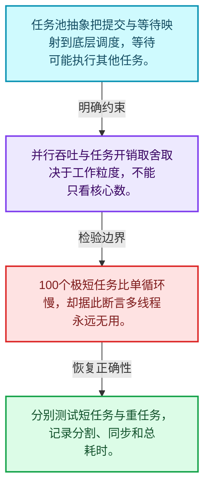
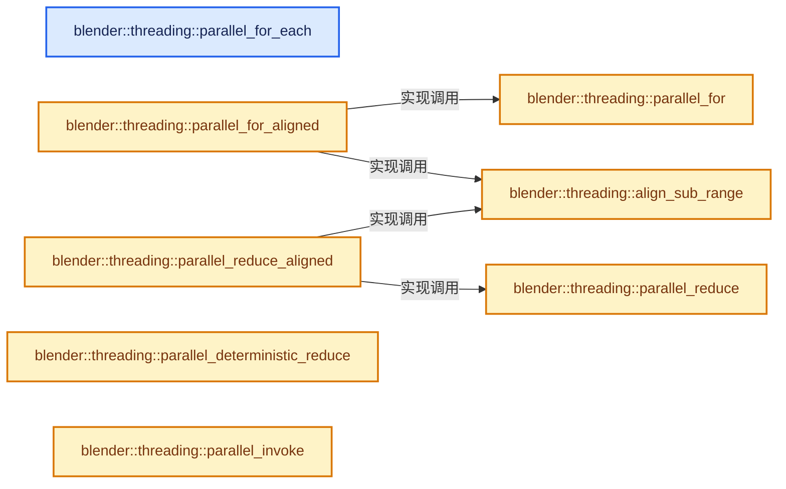
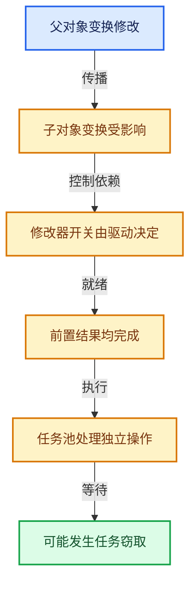

# 11-07 任务池与TBB接入

[方向导航](README.md) · [总目录](../README.md) · [实现索引](../00-课程指南/02-源码与提交索引/符号依赖与实现索引.md)

## 从问题到实现

上层任务接口怎样隐藏调度器细节？

任务提交、等待与隔离表达不同能力；并行成本包含分割、同步和调度，不只有线程数。

**数据模型**

任务池抽象把提交与等待映射到底层调度，等待可能执行其他任务。

**设计取舍**

并行吞吐与任务开销取舍取决于工作粒度，不能只看核心数。

**最小反例**

100个极短任务比单循环慢，却据此断言多线程永远无用。

**推导**

分别测试短任务与重任务，记录分割、同步和总耗时。

## 阅读地图与执行推演








图中的数值推演是本方向的教学模型；实际函数之间的调用边与概念分析边分别标注，不能把概念关系当作运行时调度顺序。

## 完整源码单元与就地讲解

中文讲解直接放在相关代码旁，复杂机制在代码下展开。原文折叠区保留基准行号；不需要在行号表和函数之间来回查找。类布局可分段展示，函数实现不按固定行数切开。

### 类型布局、声明与编译条件 · BLI_task.hh L1—L29

<!-- annotated:48d5023b028738 -->

```cpp
/* SPDX-FileCopyrightText: 2023 Blender Authors
 *
 * SPDX-License-Identifier: GPL-2.0-or-later */

#pragma once

/** \file
 * \ingroup bli
 */

#ifdef WITH_TBB
/* Quiet top level deprecation message, unrelated to API usage here. */
#  include <tbb/blocked_range.h>
#  include <tbb/parallel_for.h>
#  include <tbb/parallel_for_each.h>
#  include <tbb/parallel_invoke.h>
#  include <tbb/parallel_reduce.h>
#  include <tbb/task_arena.h>
#endif

#include "BLI_function_ref.hh"
#include "BLI_index_range.hh"
#include "BLI_lazy_threading.hh"
#include "BLI_task_size_hints.hh"

namespace blender {

namespace threading {

```

<details>
<summary>核对原始源码：source/blender/blenlib/BLI_task.hh · L1—L29</summary>

<!-- original:48d5023b028738:source/blender/blenlib/BLI_task.hh:1:29 -->

```cpp
/* SPDX-FileCopyrightText: 2023 Blender Authors
 *
 * SPDX-License-Identifier: GPL-2.0-or-later */

#pragma once

/** \file
 * \ingroup bli
 */

#ifdef WITH_TBB
/* Quiet top level deprecation message, unrelated to API usage here. */
#  include <tbb/blocked_range.h>
#  include <tbb/parallel_for.h>
#  include <tbb/parallel_for_each.h>
#  include <tbb/parallel_invoke.h>
#  include <tbb/parallel_reduce.h>
#  include <tbb/task_arena.h>
#endif

#include "BLI_function_ref.hh"
#include "BLI_index_range.hh"
#include "BLI_lazy_threading.hh"
#include "BLI_task_size_hints.hh"

namespace blender {

namespace threading {

```

</details>

<a id="f-d5604027445ef0f5"></a>

### `blender::threading::parallel_for_each`

实现位置：[source/blender/blenlib/BLI_task.hh](../../../../../source/blender/blenlib/BLI_task.hh) · L30—L40。

接口参数：

- `Range &&range`
- `const Function &function`

**教学注释版**

<!-- annotated:6ff4d34338df7c -->

```cpp
template<typename Range, typename Function>
inline void parallel_for_each(Range &&range, const Function &function)
{
#ifdef WITH_TBB
  tbb::parallel_for_each(range, function);
#else
  for (auto &&value : range) {
    function(value);
  }
#endif
}
```

<details>
<summary>核对原始源码：source/blender/blenlib/BLI_task.hh · L30—L40</summary>

<!-- original:6ff4d34338df7c:source/blender/blenlib/BLI_task.hh:30:40 -->

```cpp
template<typename Range, typename Function>
inline void parallel_for_each(Range &&range, const Function &function)
{
#ifdef WITH_TBB
  tbb::parallel_for_each(range, function);
#else
  for (auto &&value : range) {
    function(value);
  }
#endif
}
```

</details>

**继续追踪实现**

- `tbb::parallel_for_each` → [外部契约](https://uxlfoundation.github.io/oneTBB/)：任务调度属于第三方运行时；检查任务寿命、等待与隔离规则，不能把并行等待当作普通同步函数调用。
- `function` → [调用协议](../00-课程指南/01-路线与规范/模板宏与动态分派协议.md)：局部可调用对象，须结合其初始化与捕获环境。调用位置L37。

### 类型布局、声明与编译条件 · BLI_task.hh L41—L67

<!-- annotated:60dc63c21078f1 -->

```cpp

namespace detail {
void parallel_for_impl(IndexRange range,
                       int64_t grain_size,
                       FunctionRef<void(IndexRange)> function,
                       const TaskSizeHints &size_hints);
void memory_bandwidth_bound_task_impl(FunctionRef<void()> function);
void max_threads_task_impl(int max_threads, FunctionRef<void()> function);
}  // namespace detail

/**
 * Executes the given function for sub-ranges of the given range, potentially in parallel.
 * This is the main primitive for parallelizing code.
 *
 * \param range: The indices that should be iterated over in parallel.
 * \param grain_size: The approximate amount of work that should be scheduled at once.
 *   For example of the range is [0 - 1000] and the grain size is 200, then the function will be
 *   called 5 times with [0 - 200], [201 - 400], ... (approximately). The `size_hints` parameter
 *   can be used to adjust how the work is split up if the tasks have different sizes.
 * \param function: A callback that actually does the work in parallel. It should have one
 *   #IndexRange parameter.
 * \param size_hints: Can be used to specify the size of the tasks *relative to* each other and the
 *   grain size. If all tasks have approximately the same size, this can be ignored. Otherwise, one
 *   can use `threading::individual_task_sizes(...)` or `threading::accumulated_task_sizes(...)`.
 *   If the grain size is e.g. 200 and each task has the size 100, then only two tasks will be
 *   scheduled at once.
 */
```

<details>
<summary>核对原始源码：source/blender/blenlib/BLI_task.hh · L41—L67</summary>

<!-- original:60dc63c21078f1:source/blender/blenlib/BLI_task.hh:41:67 -->

```cpp

namespace detail {
void parallel_for_impl(IndexRange range,
                       int64_t grain_size,
                       FunctionRef<void(IndexRange)> function,
                       const TaskSizeHints &size_hints);
void memory_bandwidth_bound_task_impl(FunctionRef<void()> function);
void max_threads_task_impl(int max_threads, FunctionRef<void()> function);
}  // namespace detail

/**
 * Executes the given function for sub-ranges of the given range, potentially in parallel.
 * This is the main primitive for parallelizing code.
 *
 * \param range: The indices that should be iterated over in parallel.
 * \param grain_size: The approximate amount of work that should be scheduled at once.
 *   For example of the range is [0 - 1000] and the grain size is 200, then the function will be
 *   called 5 times with [0 - 200], [201 - 400], ... (approximately). The `size_hints` parameter
 *   can be used to adjust how the work is split up if the tasks have different sizes.
 * \param function: A callback that actually does the work in parallel. It should have one
 *   #IndexRange parameter.
 * \param size_hints: Can be used to specify the size of the tasks *relative to* each other and the
 *   grain size. If all tasks have approximately the same size, this can be ignored. Otherwise, one
 *   can use `threading::individual_task_sizes(...)` or `threading::accumulated_task_sizes(...)`.
 *   If the grain size is e.g. 200 and each task has the size 100, then only two tasks will be
 *   scheduled at once.
 */
```

</details>

<a id="f-838294754c24426c"></a>

### `blender::threading::parallel_for`

实现位置：[source/blender/blenlib/BLI_task.hh](../../../../../source/blender/blenlib/BLI_task.hh) · L68—L83。

接口参数：

- `const IndexRange range`
- `const int64_t grain_size`
- `const Function &function`
- `const TaskSizeHints &size_hints = detail::TaskSizeHints_Static(1)`

**教学注释版**

<!-- annotated:866f1b3a6fdfe7 -->

```cpp
template<typename Function>
inline void parallel_for(const IndexRange range,
                         const int64_t grain_size,
                         const Function &function,
                         const TaskSizeHints &size_hints = detail::TaskSizeHints_Static(1))
{
  // [讲解] range.is_empty：读取连续区间或分组的边界信息。
  if (range.is_empty()) {
    return;
  }
  /* Invoking tbb for small workloads has a large overhead. */
  if (use_single_thread(size_hints, range, grain_size)) {
    function(range);
    return;
  }
  detail::parallel_for_impl(range, grain_size, function, size_hints);
}
```

<details>
<summary>核对原始源码：source/blender/blenlib/BLI_task.hh · L68—L83</summary>

<!-- original:866f1b3a6fdfe7:source/blender/blenlib/BLI_task.hh:68:83 -->

```cpp
template<typename Function>
inline void parallel_for(const IndexRange range,
                         const int64_t grain_size,
                         const Function &function,
                         const TaskSizeHints &size_hints = detail::TaskSizeHints_Static(1))
{
  if (range.is_empty()) {
    return;
  }
  /* Invoking tbb for small workloads has a large overhead. */
  if (use_single_thread(size_hints, range, grain_size)) {
    function(range);
    return;
  }
  detail::parallel_for_impl(range, grain_size, function, size_hints);
}
```

</details>

**继续追踪实现**

- `range.is_empty` → [blender::IndexRange::is_empty · L169](../01-基础容器与现代CPP/04-IndexRange连续整数区间.md#f-9501e070be01ff71)。
- `use_single_thread` → [blender::threading::use_single_thread · L110](../90-实现依赖专题/01-BLI基础库/BLI_task_size_hints.hh.md#f-312425a5f9a68a41)。
- `function` → [调用协议](../00-课程指南/01-路线与规范/模板宏与动态分派协议.md)：局部可调用对象，须结合其初始化与捕获环境。调用位置L79。
- `detail::parallel_for_impl` → [blender::threading::detail::parallel_for_impl · L251](08-任务隔离死锁与实战.md#f-238230997dc52c53)。

### 类型布局、声明与编译条件 · BLI_task.hh L84—L88

<!-- annotated:10cfd565632b69 -->

```cpp

/**
 * Move the sub-range boundaries down to the next aligned index. The "global" begin and end
 * remain fixed though.
 */
```

<details>
<summary>核对原始源码：source/blender/blenlib/BLI_task.hh · L84—L88</summary>

<!-- original:10cfd565632b69:source/blender/blenlib/BLI_task.hh:84:88 -->

```cpp

/**
 * Move the sub-range boundaries down to the next aligned index. The "global" begin and end
 * remain fixed though.
 */
```

</details>

<a id="f-09ad8ee7b1041e00"></a>

### `blender::threading::align_sub_range`

实现位置：[source/blender/blenlib/BLI_task.hh](../../../../../source/blender/blenlib/BLI_task.hh) · L89—L105。

接口参数：

- `const IndexRange unaligned_range`
- `const int64_t alignment`
- `const IndexRange global_range`

**教学注释版**

<!-- annotated:177afe1a508e56 -->

```cpp
inline IndexRange align_sub_range(const IndexRange unaligned_range,
                                  const int64_t alignment,
                                  const IndexRange global_range)
{
  // [讲解] global_range.start：读取连续区间或分组的边界信息。
  const int64_t global_begin = global_range.start();
  // [讲解] global_range.one_after_last：读取连续区间或分组的边界信息。
  const int64_t global_end = global_range.one_after_last();
  const int64_t alignment_mask = ~(alignment - 1);

  const int64_t unaligned_begin = unaligned_range.start();
  const int64_t unaligned_end = unaligned_range.one_after_last();
  // [讲解] std::max：按比较关系选取较大值。本讲解中的增长公式同时满足最低请求和几何增长；若保存返回引用，还需注意实参寿命。
  const int64_t aligned_begin = std::max(global_begin, unaligned_begin & alignment_mask);
  const int64_t aligned_end = unaligned_end == global_end ?
                                  unaligned_end :
                                  std::max(global_begin, unaligned_end & alignment_mask);
  const IndexRange aligned_range = IndexRange::from_begin_end(aligned_begin, aligned_end);
  return aligned_range;
}
```

<details>
<summary>核对原始源码：source/blender/blenlib/BLI_task.hh · L89—L105</summary>

<!-- original:177afe1a508e56:source/blender/blenlib/BLI_task.hh:89:105 -->

```cpp
inline IndexRange align_sub_range(const IndexRange unaligned_range,
                                  const int64_t alignment,
                                  const IndexRange global_range)
{
  const int64_t global_begin = global_range.start();
  const int64_t global_end = global_range.one_after_last();
  const int64_t alignment_mask = ~(alignment - 1);

  const int64_t unaligned_begin = unaligned_range.start();
  const int64_t unaligned_end = unaligned_range.one_after_last();
  const int64_t aligned_begin = std::max(global_begin, unaligned_begin & alignment_mask);
  const int64_t aligned_end = unaligned_end == global_end ?
                                  unaligned_end :
                                  std::max(global_begin, unaligned_end & alignment_mask);
  const IndexRange aligned_range = IndexRange::from_begin_end(aligned_begin, aligned_end);
  return aligned_range;
}
```

</details>

**结果出口**

- `return aligned_range;`

**继续追踪实现**

- `global_range.start` → [blender::IndexRange::start · L243](../01-基础容器与现代CPP/04-IndexRange连续整数区间.md#f-99d2195bd9cfd1f0)。
- `global_range.one_after_last` → [blender::IndexRange::one_after_last · L235](../01-基础容器与现代CPP/04-IndexRange连续整数区间.md#f-ed04bec9c731fc86)。
- `unaligned_range.start` → [blender::IndexRange::start · L243](../01-基础容器与现代CPP/04-IndexRange连续整数区间.md#f-99d2195bd9cfd1f0)。
- `unaligned_range.one_after_last` → [blender::IndexRange::one_after_last · L235](../01-基础容器与现代CPP/04-IndexRange连续整数区间.md#f-ed04bec9c731fc86)。
- `std::max` → [外部契约](https://eel.is/c++draft/alg.min.max)：按比较关系选取较大值。本讲解中的增长公式同时满足最低请求和几何增长；若保存返回引用，还需注意实参寿命。
- `IndexRange::from_begin_end` → [blender::IndexRange::from_begin_end · L78](../01-基础容器与现代CPP/04-IndexRange连续整数区间.md#f-a523839fb9650253)。

### 类型布局、声明与编译条件 · BLI_task.hh L106—L113

<!-- annotated:4edd83b9191937 -->

```cpp

/**
 * Same as #parallel_for but tries to make the sub-range sizes multiples of the given alignment.
 * This can improve performance when the range is processed using vectorized and/or unrolled loops,
 * because the fallback loop that processes remaining values is used less often. A disadvantage of
 * using this instead of #parallel_for is that the size differences between sub-ranges can be
 * larger, which means that work is distributed less evenly.
 */
```

<details>
<summary>核对原始源码：source/blender/blenlib/BLI_task.hh · L106—L113</summary>

<!-- original:4edd83b9191937:source/blender/blenlib/BLI_task.hh:106:113 -->

```cpp

/**
 * Same as #parallel_for but tries to make the sub-range sizes multiples of the given alignment.
 * This can improve performance when the range is processed using vectorized and/or unrolled loops,
 * because the fallback loop that processes remaining values is used less often. A disadvantage of
 * using this instead of #parallel_for is that the size differences between sub-ranges can be
 * larger, which means that work is distributed less evenly.
 */
```

</details>

<a id="f-247ed9610f9d2b09"></a>

### `blender::threading::parallel_for_aligned`

实现位置：[source/blender/blenlib/BLI_task.hh](../../../../../source/blender/blenlib/BLI_task.hh) · L114—L124。

接口参数：

- `const IndexRange range`
- `const int64_t grain_size`
- `const int64_t alignment`
- `const Function &function`

**教学注释版**

<!-- annotated:8b2f0c7c1b831b -->

```cpp
template<typename Function>
inline void parallel_for_aligned(const IndexRange range,
                                 const int64_t grain_size,
                                 const int64_t alignment,
                                 const Function &function)
{
  parallel_for(range, grain_size, [&](const IndexRange unaligned_range) {
    const IndexRange aligned_range = align_sub_range(unaligned_range, alignment, range);
    function(aligned_range);
  });
}
```

<details>
<summary>核对原始源码：source/blender/blenlib/BLI_task.hh · L114—L124</summary>

<!-- original:8b2f0c7c1b831b:source/blender/blenlib/BLI_task.hh:114:124 -->

```cpp
template<typename Function>
inline void parallel_for_aligned(const IndexRange range,
                                 const int64_t grain_size,
                                 const int64_t alignment,
                                 const Function &function)
{
  parallel_for(range, grain_size, [&](const IndexRange unaligned_range) {
    const IndexRange aligned_range = align_sub_range(unaligned_range, alignment, range);
    function(aligned_range);
  });
}
```

</details>

**继续追踪实现**

- `parallel_for` → [blender::threading::parallel_for · L68](07-任务池与TBB接入.md#f-838294754c24426c)。
- `align_sub_range` → [blender::threading::align_sub_range · L89](07-任务池与TBB接入.md#f-09ad8ee7b1041e00)。
- `function` → [调用协议](../00-课程指南/01-路线与规范/模板宏与动态分派协议.md)：局部可调用对象，须结合其初始化与捕获环境。调用位置L122。

<!-- annotated:a45d41b78fa352 -->

```cpp

```

<details>
<summary>核对原始源码：source/blender/blenlib/BLI_task.hh · L125—L125</summary>

<!-- original:a45d41b78fa352:source/blender/blenlib/BLI_task.hh:125:125 -->

```cpp

```

</details>

<a id="f-9225ddb5efb97fcc"></a>

### `blender::threading::parallel_reduce`

实现位置：[source/blender/blenlib/BLI_task.hh](../../../../../source/blender/blenlib/BLI_task.hh) · L126—L148。

接口参数：

- `IndexRange range`
- `int64_t grain_size`
- `const Value &identity`
- `const Function &function`
- `const Reduction &reduction`

**教学注释版**

<!-- annotated:907608a6d260c3 -->

```cpp
template<typename Value, typename Function, typename Reduction>
inline Value parallel_reduce(IndexRange range,
                             int64_t grain_size,
                             const Value &identity,
                             const Function &function,
                             const Reduction &reduction)
{
#ifdef WITH_TBB
  // [讲解] range.size：读取连续区间或分组的边界信息。
  if (range.size() >= grain_size) {
    lazy_threading::send_hint();
    return tbb::parallel_reduce(
        // [讲解] range.first：读取范围两端的有效索引或值。
        tbb::blocked_range<int64_t>(range.first(), range.one_after_last(), grain_size),
        identity,
        [&](const tbb::blocked_range<int64_t> &subrange, const Value &ident) {
          return function(IndexRange(subrange.begin(), subrange.size()), ident);
        },
        reduction);
  }
#else
  UNUSED_VARS(grain_size, reduction);
#endif
  return function(range, identity);
}
```

<details>
<summary>核对原始源码：source/blender/blenlib/BLI_task.hh · L126—L148</summary>

<!-- original:907608a6d260c3:source/blender/blenlib/BLI_task.hh:126:148 -->

```cpp
template<typename Value, typename Function, typename Reduction>
inline Value parallel_reduce(IndexRange range,
                             int64_t grain_size,
                             const Value &identity,
                             const Function &function,
                             const Reduction &reduction)
{
#ifdef WITH_TBB
  if (range.size() >= grain_size) {
    lazy_threading::send_hint();
    return tbb::parallel_reduce(
        tbb::blocked_range<int64_t>(range.first(), range.one_after_last(), grain_size),
        identity,
        [&](const tbb::blocked_range<int64_t> &subrange, const Value &ident) {
          return function(IndexRange(subrange.begin(), subrange.size()), ident);
        },
        reduction);
  }
#else
  UNUSED_VARS(grain_size, reduction);
#endif
  return function(range, identity);
}
```

</details>

**结果出口**

- `return tbb::parallel_reduce(`
- `return function(IndexRange(subrange.begin(), subrange.size()), ident);`
- `return function(range, identity);`

**继续追踪实现**

- `range.size` → [blender::IndexRange::size · L156](../01-基础容器与现代CPP/04-IndexRange连续整数区间.md#f-05f66c3ebb2fdfec)。
- `lazy_threading::send_hint` → [blender::lazy_threading::send_hint · L28](../90-实现依赖专题/01-BLI基础库/intern/lazy_threading.cc.md#f-5f17245e2a06695e)。
- `tbb::parallel_reduce` → [外部契约](https://uxlfoundation.github.io/oneTBB/)：任务调度属于第三方运行时；检查任务寿命、等待与隔离规则，不能把并行等待当作普通同步函数调用。
- `tbb::blocked_range<int64_t>` → [外部契约](https://uxlfoundation.github.io/oneTBB/)：任务调度属于第三方运行时；检查任务寿命、等待与隔离规则，不能把并行等待当作普通同步函数调用。
- `range.first` → [blender::IndexRange::first · L204](../01-基础容器与现代CPP/04-IndexRange连续整数区间.md#f-ab443c94e531befa)。
- `range.one_after_last` → [blender::IndexRange::one_after_last · L235](../01-基础容器与现代CPP/04-IndexRange连续整数区间.md#f-ed04bec9c731fc86)。
- `function` → [调用协议](../00-课程指南/01-路线与规范/模板宏与动态分派协议.md)：局部可调用对象，须结合其初始化与捕获环境。调用位置L140。
- `IndexRange` → [blender::IndexRange](../90-实现依赖专题/01-BLI基础库/BLI_index_range.hh.md#t-caa3466d6776)；[blender::gpu::shader::parser::IndexRange](../90-实现依赖专题/08-其他Blender模块/gpu/shader_tool/utils.hh.md#t-82d2bd4ea71c)；[blender::IndexRange](../90-实现依赖专题/08-其他Blender模块/makesdna/DNA_node_types.h.md#t-0448cc889d39)。
- `subrange.begin` → [外部契约](https://eel.is/c++draft/)：这个边界按实际表达式及所属类型核对参数、返回值、寿命与失败行为。这里提供接口入口，不声称已解释该第三方版本的内部实现。
- `subrange.size` → [外部契约](https://eel.is/c++draft/)：这个边界按实际表达式及所属类型核对参数、返回值、寿命与失败行为。这里提供接口入口，不声称已解释该第三方版本的内部实现。
- `UNUSED_VARS` → [UNUSED_VARS · L522](../90-实现依赖专题/01-BLI基础库/BLI_utildefines.hh.md#m-013582537634)；[UNUSED_VARS · L41](../90-实现依赖专题/08-其他Blender模块/gpu/GPU_shader_shared_utils.hh.md#m-05d9d7a33da0)；[UNUSED_VARS · L62](../90-实现依赖专题/08-其他Blender模块/gpu/GPU_shader_shared_utils.hh.md#m-e12c683a4aca)。宏定义由构建条件选择。

<!-- annotated:997309c7e78393 -->

```cpp

```

<details>
<summary>核对原始源码：source/blender/blenlib/BLI_task.hh · L149—L149</summary>

<!-- original:997309c7e78393:source/blender/blenlib/BLI_task.hh:149:149 -->

```cpp

```

</details>

<a id="f-b7bcaba57aab9b5f"></a>

### `blender::threading::parallel_reduce_aligned`

实现位置：[source/blender/blenlib/BLI_task.hh](../../../../../source/blender/blenlib/BLI_task.hh) · L150—L167。

接口参数：

- `const IndexRange range`
- `const int64_t grain_size`
- `const int64_t alignment`
- `const Value &identity`
- `const Function &function`
- `const Reduction &reduction`

**教学注释版**

<!-- annotated:18ead7202ee6c6 -->

```cpp
template<typename Value, typename Function, typename Reduction>
inline Value parallel_reduce_aligned(const IndexRange range,
                                     const int64_t grain_size,
                                     const int64_t alignment,
                                     const Value &identity,
                                     const Function &function,
                                     const Reduction &reduction)
{
  parallel_reduce(
      range,
      grain_size,
      identity,
      [&](const IndexRange unaligned_range, const Value &ident) {
        const IndexRange aligned_range = align_sub_range(unaligned_range, alignment, range);
        function(aligned_range, ident);
      },
      reduction);
}
```

<details>
<summary>核对原始源码：source/blender/blenlib/BLI_task.hh · L150—L167</summary>

<!-- original:18ead7202ee6c6:source/blender/blenlib/BLI_task.hh:150:167 -->

```cpp
template<typename Value, typename Function, typename Reduction>
inline Value parallel_reduce_aligned(const IndexRange range,
                                     const int64_t grain_size,
                                     const int64_t alignment,
                                     const Value &identity,
                                     const Function &function,
                                     const Reduction &reduction)
{
  parallel_reduce(
      range,
      grain_size,
      identity,
      [&](const IndexRange unaligned_range, const Value &ident) {
        const IndexRange aligned_range = align_sub_range(unaligned_range, alignment, range);
        function(aligned_range, ident);
      },
      reduction);
}
```

</details>

**继续追踪实现**

- `parallel_reduce` → [blender::threading::parallel_reduce · L126](07-任务池与TBB接入.md#f-9225ddb5efb97fcc)。
- `align_sub_range` → [blender::threading::align_sub_range · L89](07-任务池与TBB接入.md#f-09ad8ee7b1041e00)。
- `function` → [调用协议](../00-课程指南/01-路线与规范/模板宏与动态分派协议.md)：局部可调用对象，须结合其初始化与捕获环境。调用位置L164。

<!-- annotated:08150ef8a901a3 -->

```cpp

```

<details>
<summary>核对原始源码：source/blender/blenlib/BLI_task.hh · L168—L168</summary>

<!-- original:08150ef8a901a3:source/blender/blenlib/BLI_task.hh:168:168 -->

```cpp

```

</details>

<a id="f-a0f79812a52b6a46"></a>

### `blender::threading::parallel_deterministic_reduce`

实现位置：[source/blender/blenlib/BLI_task.hh](../../../../../source/blender/blenlib/BLI_task.hh) · L169—L191。

接口参数：

- `IndexRange range`
- `int64_t grain_size`
- `const Value &identity`
- `const Function &function`
- `const Reduction &reduction`

**教学注释版**

<!-- annotated:4838aecc0f9cbe -->

```cpp
template<typename Value, typename Function, typename Reduction>
inline Value parallel_deterministic_reduce(IndexRange range,
                                           int64_t grain_size,
                                           const Value &identity,
                                           const Function &function,
                                           const Reduction &reduction)
{
#ifdef WITH_TBB
  // [讲解] range.size：读取连续区间或分组的边界信息。
  if (range.size() >= grain_size) {
    lazy_threading::send_hint();
    return tbb::parallel_deterministic_reduce(
        // [讲解] range.first：读取范围两端的有效索引或值。
        tbb::blocked_range<int64_t>(range.first(), range.one_after_last(), grain_size),
        identity,
        [&](const tbb::blocked_range<int64_t> &subrange, const Value &ident) {
          return function(IndexRange(subrange.begin(), subrange.size()), ident);
        },
        reduction);
  }
#else
  UNUSED_VARS(grain_size, reduction);
#endif
  return function(range, identity);
}
```

<details>
<summary>核对原始源码：source/blender/blenlib/BLI_task.hh · L169—L191</summary>

<!-- original:4838aecc0f9cbe:source/blender/blenlib/BLI_task.hh:169:191 -->

```cpp
template<typename Value, typename Function, typename Reduction>
inline Value parallel_deterministic_reduce(IndexRange range,
                                           int64_t grain_size,
                                           const Value &identity,
                                           const Function &function,
                                           const Reduction &reduction)
{
#ifdef WITH_TBB
  if (range.size() >= grain_size) {
    lazy_threading::send_hint();
    return tbb::parallel_deterministic_reduce(
        tbb::blocked_range<int64_t>(range.first(), range.one_after_last(), grain_size),
        identity,
        [&](const tbb::blocked_range<int64_t> &subrange, const Value &ident) {
          return function(IndexRange(subrange.begin(), subrange.size()), ident);
        },
        reduction);
  }
#else
  UNUSED_VARS(grain_size, reduction);
#endif
  return function(range, identity);
}
```

</details>

**结果出口**

- `return tbb::parallel_deterministic_reduce(`
- `return function(IndexRange(subrange.begin(), subrange.size()), ident);`
- `return function(range, identity);`

**继续追踪实现**

- `range.size` → [blender::IndexRange::size · L156](../01-基础容器与现代CPP/04-IndexRange连续整数区间.md#f-05f66c3ebb2fdfec)。
- `lazy_threading::send_hint` → [blender::lazy_threading::send_hint · L28](../90-实现依赖专题/01-BLI基础库/intern/lazy_threading.cc.md#f-5f17245e2a06695e)。
- `tbb::parallel_deterministic_reduce` → [外部契约](https://uxlfoundation.github.io/oneTBB/)：任务调度属于第三方运行时；检查任务寿命、等待与隔离规则，不能把并行等待当作普通同步函数调用。
- `tbb::blocked_range<int64_t>` → [外部契约](https://uxlfoundation.github.io/oneTBB/)：任务调度属于第三方运行时；检查任务寿命、等待与隔离规则，不能把并行等待当作普通同步函数调用。
- `range.first` → [blender::IndexRange::first · L204](../01-基础容器与现代CPP/04-IndexRange连续整数区间.md#f-ab443c94e531befa)。
- `range.one_after_last` → [blender::IndexRange::one_after_last · L235](../01-基础容器与现代CPP/04-IndexRange连续整数区间.md#f-ed04bec9c731fc86)。
- `function` → [调用协议](../00-课程指南/01-路线与规范/模板宏与动态分派协议.md)：局部可调用对象，须结合其初始化与捕获环境。调用位置L183。
- `IndexRange` → [blender::IndexRange](../90-实现依赖专题/01-BLI基础库/BLI_index_range.hh.md#t-caa3466d6776)；[blender::gpu::shader::parser::IndexRange](../90-实现依赖专题/08-其他Blender模块/gpu/shader_tool/utils.hh.md#t-82d2bd4ea71c)；[blender::IndexRange](../90-实现依赖专题/08-其他Blender模块/makesdna/DNA_node_types.h.md#t-0448cc889d39)。
- `subrange.begin` → [外部契约](https://eel.is/c++draft/)：这个边界按实际表达式及所属类型核对参数、返回值、寿命与失败行为。这里提供接口入口，不声称已解释该第三方版本的内部实现。
- `subrange.size` → [外部契约](https://eel.is/c++draft/)：这个边界按实际表达式及所属类型核对参数、返回值、寿命与失败行为。这里提供接口入口，不声称已解释该第三方版本的内部实现。
- `UNUSED_VARS` → [UNUSED_VARS · L522](../90-实现依赖专题/01-BLI基础库/BLI_utildefines.hh.md#m-013582537634)；[UNUSED_VARS · L41](../90-实现依赖专题/08-其他Blender模块/gpu/GPU_shader_shared_utils.hh.md#m-05d9d7a33da0)；[UNUSED_VARS · L62](../90-实现依赖专题/08-其他Blender模块/gpu/GPU_shader_shared_utils.hh.md#m-e12c683a4aca)。宏定义由构建条件选择。

### 类型布局、声明与编译条件 · BLI_task.hh L192—L196

<!-- annotated:f719b072d0f84d -->

```cpp

/**
 * Execute all of the provided functions. The functions might be executed in parallel or in serial
 * or some combination of both.
 */
```

<details>
<summary>核对原始源码：source/blender/blenlib/BLI_task.hh · L192—L196</summary>

<!-- original:f719b072d0f84d:source/blender/blenlib/BLI_task.hh:192:196 -->

```cpp

/**
 * Execute all of the provided functions. The functions might be executed in parallel or in serial
 * or some combination of both.
 */
```

</details>

<a id="f-82fe32e383788161"></a>

### `blender::threading::parallel_invoke`

实现位置：[source/blender/blenlib/BLI_task.hh](../../../../../source/blender/blenlib/BLI_task.hh) · L197—L204。

**教学注释版**

<!-- annotated:0c930900768855 -->

```cpp
template<typename... Functions> inline void parallel_invoke(Functions &&...functions)
{
#ifdef WITH_TBB
  // [讲解] std::forward<Functions>：在转发引用中恢复调用者传入的值类别；依赖推导类型，不能与无条件move互换。
  tbb::parallel_invoke(std::forward<Functions>(functions)...);
#else
  (functions(), ...);
#endif
}
```

<details>
<summary>核对原始源码：source/blender/blenlib/BLI_task.hh · L197—L204</summary>

<!-- original:0c930900768855:source/blender/blenlib/BLI_task.hh:197:204 -->

```cpp
template<typename... Functions> inline void parallel_invoke(Functions &&...functions)
{
#ifdef WITH_TBB
  tbb::parallel_invoke(std::forward<Functions>(functions)...);
#else
  (functions(), ...);
#endif
}
```

</details>

**继续追踪实现**

- `tbb::parallel_invoke` → [外部契约](https://uxlfoundation.github.io/oneTBB/)：任务调度属于第三方运行时；检查任务寿命、等待与隔离规则，不能把并行等待当作普通同步函数调用。
- `std::forward<Functions>` → [外部契约](https://eel.is/c++draft/utility.forward)：在转发引用中恢复调用者传入的值类别；依赖推导类型，不能与无条件move互换。
- `functions` → [调用协议](../00-课程指南/01-路线与规范/模板宏与动态分派协议.md)：函数指针、局部可调用对象或未展开的宏；必须结合调用者环境。调用位置L202。

### 类型布局、声明与编译条件 · BLI_task.hh L205—L210

<!-- annotated:89581e7b9ba5c3 -->

```cpp

/**
 * Same #parallel_invoke, but allows disabling threading dynamically. This is useful because when
 * the individual functions do very little work, there is a lot of overhead from starting parallel
 * tasks.
 */
```

<details>
<summary>核对原始源码：source/blender/blenlib/BLI_task.hh · L205—L210</summary>

<!-- original:89581e7b9ba5c3:source/blender/blenlib/BLI_task.hh:205:210 -->

```cpp

/**
 * Same #parallel_invoke, but allows disabling threading dynamically. This is useful because when
 * the individual functions do very little work, there is a lot of overhead from starting parallel
 * tasks.
 */
```

</details>

<a id="f-8600ab96e862d7e4"></a>

### `blender::threading::parallel_invoke`

实现位置：[source/blender/blenlib/BLI_task.hh](../../../../../source/blender/blenlib/BLI_task.hh) · L211—L221。

接口参数：

- `const bool use_threading`

**教学注释版**

<!-- annotated:83b9f2c29676af -->

```cpp
template<typename... Functions>
inline void parallel_invoke(const bool use_threading, Functions &&...functions)
{
  if (use_threading) {
    lazy_threading::send_hint();
    // [讲解] std::forward<Functions>：在转发引用中恢复调用者传入的值类别；依赖推导类型，不能与无条件move互换。
    parallel_invoke(std::forward<Functions>(functions)...);
  }
  else {
    (functions(), ...);
  }
}
```

<details>
<summary>核对原始源码：source/blender/blenlib/BLI_task.hh · L211—L221</summary>

<!-- original:83b9f2c29676af:source/blender/blenlib/BLI_task.hh:211:221 -->

```cpp
template<typename... Functions>
inline void parallel_invoke(const bool use_threading, Functions &&...functions)
{
  if (use_threading) {
    lazy_threading::send_hint();
    parallel_invoke(std::forward<Functions>(functions)...);
  }
  else {
    (functions(), ...);
  }
}
```

</details>

**继续追踪实现**

- `lazy_threading::send_hint` → [blender::lazy_threading::send_hint · L28](../90-实现依赖专题/01-BLI基础库/intern/lazy_threading.cc.md#f-5f17245e2a06695e)。
- `parallel_invoke` → [blender::threading::parallel_invoke · L197](07-任务池与TBB接入.md#f-82fe32e383788161)；[blender::threading::parallel_invoke · L211](07-任务池与TBB接入.md#f-8600ab96e862d7e4)。同名重载需按实参类型选择。
- `std::forward<Functions>` → [外部契约](https://eel.is/c++draft/utility.forward)：在转发引用中恢复调用者传入的值类别；依赖推导类型，不能与无条件move互换。
- `functions` → [调用协议](../00-课程指南/01-路线与规范/模板宏与动态分派协议.md)：函数指针、局部可调用对象或未展开的宏；必须结合调用者环境。调用位置L219。

### 类型布局、声明与编译条件 · BLI_task.hh L222—L223

<!-- annotated:e28d6d1107df7e -->

```cpp

/** See #BLI_task_isolate for a description of what isolating a task means. */
```

<details>
<summary>核对原始源码：source/blender/blenlib/BLI_task.hh · L222—L223</summary>

<!-- original:e28d6d1107df7e:source/blender/blenlib/BLI_task.hh:222:223 -->

```cpp

/** See #BLI_task_isolate for a description of what isolating a task means. */
```

</details>

<a id="f-c13dd3df595aa4f8"></a>

### `blender::threading::isolate_task`

实现位置：[source/blender/blenlib/BLI_task.hh](../../../../../source/blender/blenlib/BLI_task.hh) · L224—L232。

接口参数：

- `const Function &function`

**教学注释版**

<!-- annotated:29f6ade78bf6b4 -->

```cpp
template<typename Function> inline auto isolate_task(const Function &function)
{
#ifdef WITH_TBB
  lazy_threading::ReceiverIsolation isolation;
  return tbb::this_task_arena::isolate(function);
#else
  return function();
#endif
}
```

<details>
<summary>核对原始源码：source/blender/blenlib/BLI_task.hh · L224—L232</summary>

<!-- original:29f6ade78bf6b4:source/blender/blenlib/BLI_task.hh:224:232 -->

```cpp
template<typename Function> inline auto isolate_task(const Function &function)
{
#ifdef WITH_TBB
  lazy_threading::ReceiverIsolation isolation;
  return tbb::this_task_arena::isolate(function);
#else
  return function();
#endif
}
```

</details>

**结果出口**

- `return tbb::this_task_arena::isolate(function);`
- `return function();`

**继续追踪实现**

- `tbb::this_task_arena::isolate` → [外部契约](https://uxlfoundation.github.io/oneTBB/)：任务调度属于第三方运行时；检查任务寿命、等待与隔离规则，不能把并行等待当作普通同步函数调用。
- `function` → [调用协议](../00-课程指南/01-路线与规范/模板宏与动态分派协议.md)：局部可调用对象，须结合其初始化与捕获环境。调用位置L230。

### 类型布局、声明与编译条件 · BLI_task.hh L233—L237

<!-- annotated:47d11900054b0d -->

```cpp

/**
 * Runs the function with at most #max_threads threads participating in parallel work,
 * including the calling thread.
 */
```

<details>
<summary>核对原始源码：source/blender/blenlib/BLI_task.hh · L233—L237</summary>

<!-- original:47d11900054b0d:source/blender/blenlib/BLI_task.hh:233:237 -->

```cpp

/**
 * Runs the function with at most #max_threads threads participating in parallel work,
 * including the calling thread.
 */
```

</details>

<a id="f-caf66416559a5d62"></a>

### `blender::threading::max_threads_task`

实现位置：[source/blender/blenlib/BLI_task.hh](../../../../../source/blender/blenlib/BLI_task.hh) · L238—L242。

接口参数：

- `const int max_threads`
- `const Function &function`

**教学注释版**

<!-- annotated:7cb4b76a182833 -->

```cpp
template<typename Function>
inline void max_threads_task(const int max_threads, const Function &function)
{
  detail::max_threads_task_impl(max_threads, function);
}
```

<details>
<summary>核对原始源码：source/blender/blenlib/BLI_task.hh · L238—L242</summary>

<!-- original:7cb4b76a182833:source/blender/blenlib/BLI_task.hh:238:242 -->

```cpp
template<typename Function>
inline void max_threads_task(const int max_threads, const Function &function)
{
  detail::max_threads_task_impl(max_threads, function);
}
```

</details>

**继续追踪实现**

- `detail::max_threads_task_impl` → [blender::threading::detail::max_threads_task_impl · L319](08-任务隔离死锁与实战.md#f-9f107d09692b64f8)。

### 类型布局、声明与编译条件 · BLI_task.hh L243—L249

<!-- annotated:ff4626a1d4b9c0 -->

```cpp

/**
 * Should surround parallel code that is highly bandwidth intensive, e.g. it just fills a buffer
 * with no or just few additional operations. If the buffers are large, it's beneficial to limit
 * the number of threads doing the work because that just creates more overhead on the hardware
 * level and doesn't provide a notable performance benefit beyond a certain point.
 */
```

<details>
<summary>核对原始源码：source/blender/blenlib/BLI_task.hh · L243—L249</summary>

<!-- original:ff4626a1d4b9c0:source/blender/blenlib/BLI_task.hh:243:249 -->

```cpp

/**
 * Should surround parallel code that is highly bandwidth intensive, e.g. it just fills a buffer
 * with no or just few additional operations. If the buffers are large, it's beneficial to limit
 * the number of threads doing the work because that just creates more overhead on the hardware
 * level and doesn't provide a notable performance benefit beyond a certain point.
 */
```

</details>

<a id="f-aa412ccec656928d"></a>

### `blender::threading::memory_bandwidth_bound_task`

实现位置：[source/blender/blenlib/BLI_task.hh](../../../../../source/blender/blenlib/BLI_task.hh) · L250—L264。

接口参数：

- `const int64_t approximate_bytes_touched`
- `const Function &function`

**教学注释版**

<!-- annotated:6c17b55f047677 -->

```cpp
template<typename Function>
inline void memory_bandwidth_bound_task(const int64_t approximate_bytes_touched,
                                        const Function &function)
{
  /* Don't limit threading when all touched memory can stay in the CPU cache, because there a much
   * higher memory bandwidth is available compared to accessing RAM. This value is supposed to be
   * on the order of the L3 cache size. Accessing that value is not quite straight forward and even
   * if it was, it's not clear if using the exact cache size would be beneficial because there is
   * often more stuff going on the CPU at the same time. */
  if (approximate_bytes_touched <= 8 * 1024 * 1024) {
    function();
    return;
  }
  detail::memory_bandwidth_bound_task_impl(function);
}
```

<details>
<summary>核对原始源码：source/blender/blenlib/BLI_task.hh · L250—L264</summary>

<!-- original:6c17b55f047677:source/blender/blenlib/BLI_task.hh:250:264 -->

```cpp
template<typename Function>
inline void memory_bandwidth_bound_task(const int64_t approximate_bytes_touched,
                                        const Function &function)
{
  /* Don't limit threading when all touched memory can stay in the CPU cache, because there a much
   * higher memory bandwidth is available compared to accessing RAM. This value is supposed to be
   * on the order of the L3 cache size. Accessing that value is not quite straight forward and even
   * if it was, it's not clear if using the exact cache size would be beneficial because there is
   * often more stuff going on the CPU at the same time. */
  if (approximate_bytes_touched <= 8 * 1024 * 1024) {
    function();
    return;
  }
  detail::memory_bandwidth_bound_task_impl(function);
}
```

</details>

**继续追踪实现**

- `function` → [调用协议](../00-课程指南/01-路线与规范/模板宏与动态分派协议.md)：局部可调用对象，须结合其初始化与捕获环境。调用位置L260。
- `detail::memory_bandwidth_bound_task_impl` → [blender::threading::detail::memory_bandwidth_bound_task_impl · L291](08-任务隔离死锁与实战.md#f-1a3c280ff004f38d)。

### 类型布局、声明与编译条件 · BLI_task.hh L265—L267

<!-- annotated:c344ed9ed76d98 -->

```cpp

}  // namespace threading
}  // namespace blender
```

<details>
<summary>核对原始源码：source/blender/blenlib/BLI_task.hh · L265—L267</summary>

<!-- original:c344ed9ed76d98:source/blender/blenlib/BLI_task.hh:265:267 -->

```cpp

}  // namespace threading
}  // namespace blender
```

</details>

### 类型布局、声明与编译条件 · task_pool.cc L1—L48

<a id="t-b3e532c43c2c"></a>

<a id="t-340ad5e36815"></a>

`Task`在这里声明的数据成员：

- `TaskPool pool`
- `TaskRunFunction run`
- `void taskdata`
- `bool free_taskdata`
- `TaskFreeFunction freedata`

<!-- annotated:366a1f6a0657c7 -->

```cpp
/* SPDX-FileCopyrightText: 2023 Blender Authors
 *
 * SPDX-License-Identifier: GPL-2.0-or-later */

/** \file
 * \ingroup bli
 *
 * Task pool to run tasks in parallel.
 */

#include <atomic>
#include <cstdlib>
#include <memory>
#include <utility>

#include "MEM_guardedalloc.h"

#include "DNA_listBase.h"

#include "BLI_assert.hh"
#include "BLI_mempool.hh"
#include "BLI_task_c.hh"
#include "BLI_threads.hh"
#include "BLI_vector.hh"

#ifdef WITH_TBB
#  include <tbb/blocked_range.h>
#  include <tbb/task_arena.h>
#  include <tbb/task_group.h>
#endif

namespace blender {

struct ThreadSlot;

/**
 * Task
 *
 * Unit of work to execute. This is a C++ class to work with TBB.
 */
class Task {
 public:
  TaskPool *pool;
  TaskRunFunction run;
  void *taskdata;
  bool free_taskdata;
  TaskFreeFunction freedata;

```

<details>
<summary>核对原始源码：source/blender/blenlib/intern/task_pool.cc · L1—L48</summary>

<!-- original:366a1f6a0657c7:source/blender/blenlib/intern/task_pool.cc:1:48 -->

```cpp
/* SPDX-FileCopyrightText: 2023 Blender Authors
 *
 * SPDX-License-Identifier: GPL-2.0-or-later */

/** \file
 * \ingroup bli
 *
 * Task pool to run tasks in parallel.
 */

#include <atomic>
#include <cstdlib>
#include <memory>
#include <utility>

#include "MEM_guardedalloc.h"

#include "DNA_listBase.h"

#include "BLI_assert.hh"
#include "BLI_mempool.hh"
#include "BLI_task_c.hh"
#include "BLI_threads.hh"
#include "BLI_vector.hh"

#ifdef WITH_TBB
#  include <tbb/blocked_range.h>
#  include <tbb/task_arena.h>
#  include <tbb/task_group.h>
#endif

namespace blender {

struct ThreadSlot;

/**
 * Task
 *
 * Unit of work to execute. This is a C++ class to work with TBB.
 */
class Task {
 public:
  TaskPool *pool;
  TaskRunFunction run;
  void *taskdata;
  bool free_taskdata;
  TaskFreeFunction freedata;

```

</details>

<a id="f-be2ba00170b3cb29"></a>

### `blender::Task::Task`

实现位置：[source/blender/blenlib/intern/task_pool.cc](../../../../../source/blender/blenlib/intern/task_pool.cc) · L49—L56。

接口参数：

- `TaskPool *pool`
- `TaskRunFunction run`
- `void *taskdata`
- `bool free_taskdata`
- `TaskFreeFunction freedata`

**教学注释版**

<!-- annotated:e001d3f966809a -->

```cpp
  Task(TaskPool *pool,
       TaskRunFunction run,
       void *taskdata,
       bool free_taskdata,
       TaskFreeFunction freedata)
      : pool(pool), run(run), taskdata(taskdata), free_taskdata(free_taskdata), freedata(freedata)
  {
  }
```

<details>
<summary>核对原始源码：source/blender/blenlib/intern/task_pool.cc · L49—L56</summary>

<!-- original:e001d3f966809a:source/blender/blenlib/intern/task_pool.cc:49:56 -->

```cpp
  Task(TaskPool *pool,
       TaskRunFunction run,
       void *taskdata,
       bool free_taskdata,
       TaskFreeFunction freedata)
      : pool(pool), run(run), taskdata(taskdata), free_taskdata(free_taskdata), freedata(freedata)
  {
  }
```

</details>

**继续追踪实现**

本实现没有需要继续展开的显式调用；检查返回表达式、对象转换和调用者前置条件。

<!-- annotated:e1ffc7d5f7d507 -->

```cpp

```

<details>
<summary>核对原始源码：source/blender/blenlib/intern/task_pool.cc · L57—L57</summary>

<!-- original:e1ffc7d5f7d507:source/blender/blenlib/intern/task_pool.cc:57:57 -->

```cpp

```

</details>

<a id="f-dde30cb5cd141b36"></a>

### `blender::Task::~Task`

实现位置：[source/blender/blenlib/intern/task_pool.cc](../../../../../source/blender/blenlib/intern/task_pool.cc) · L58—L68。

**教学注释版**

<!-- annotated:9531122137bcf3 -->

```cpp
  ~Task()
  {
    if (free_taskdata) {
      if (freedata) {
        freedata(pool, taskdata);
      }
      else {
        // [讲解] MEM_delete_void：以原始存储释放约定调用当前后端。
        MEM_delete_void(taskdata);
      }
    }
  }
```

<details>
<summary>核对原始源码：source/blender/blenlib/intern/task_pool.cc · L58—L68</summary>

<!-- original:9531122137bcf3:source/blender/blenlib/intern/task_pool.cc:58:68 -->

```cpp
  ~Task()
  {
    if (free_taskdata) {
      if (freedata) {
        freedata(pool, taskdata);
      }
      else {
        MEM_delete_void(taskdata);
      }
    }
  }
```

</details>

**继续追踪实现**

- `freedata` → [调用协议](../00-课程指南/01-路线与规范/模板宏与动态分派协议.md)：函数指针、局部可调用对象或未展开的宏；必须结合调用者环境。调用位置L62。
- `MEM_delete_void` → [MEM_delete_void · L647](../90-实现依赖专题/07-Intern运行时与平台/guardedalloc/MEM_guardedalloc.h.md#f-642896c7c62ff8b9)；[MEM_delete_void · L109](../90-实现依赖专题/07-Intern运行时与平台/guardedalloc/intern/mallocn.cc.md#f-9a07b26421f2bee6)。同名重载需按实参类型选择。

### 类型布局、声明与编译条件 · task_pool.cc L69—L73

<!-- annotated:17da44918958b0 -->

```cpp

  /* Move constructor.
   * For performance, ensure we never copy the task and only move it.
   * For TBB version 2017 and earlier we apply a workaround to make up for
   * the lack of move constructor support. */
```

<details>
<summary>核对原始源码：source/blender/blenlib/intern/task_pool.cc · L69—L73</summary>

<!-- original:17da44918958b0:source/blender/blenlib/intern/task_pool.cc:69:73 -->

```cpp

  /* Move constructor.
   * For performance, ensure we never copy the task and only move it.
   * For TBB version 2017 and earlier we apply a workaround to make up for
   * the lack of move constructor support. */
```

</details>

<a id="f-a6f9145b4862e84a"></a>

### `blender::Task::Task`

实现位置：[source/blender/blenlib/intern/task_pool.cc](../../../../../source/blender/blenlib/intern/task_pool.cc) · L74—L86。

接口参数：

- `Task &&other`

**教学注释版**

<!-- annotated:56634e4bdef150 -->

```cpp
  Task(Task &&other)
      : pool(other.pool),
        run(other.run),
        taskdata(other.taskdata),
        free_taskdata(other.free_taskdata),
        freedata(other.freedata)
  {
    other.pool = nullptr;
    other.run = nullptr;
    other.taskdata = nullptr;
    other.free_taskdata = false;
    other.freedata = nullptr;
  }
```

<details>
<summary>核对原始源码：source/blender/blenlib/intern/task_pool.cc · L74—L86</summary>

<!-- original:56634e4bdef150:source/blender/blenlib/intern/task_pool.cc:74:86 -->

```cpp
  Task(Task &&other)
      : pool(other.pool),
        run(other.run),
        taskdata(other.taskdata),
        free_taskdata(other.free_taskdata),
        freedata(other.freedata)
  {
    other.pool = nullptr;
    other.run = nullptr;
    other.taskdata = nullptr;
    other.free_taskdata = false;
    other.freedata = nullptr;
  }
```

</details>

**沿实际写入检查状态**

- `other.pool = nullptr;`
- `other.run = nullptr;`
- `other.taskdata = nullptr;`
- `other.free_taskdata = false;`
- `other.freedata = nullptr;`

**继续追踪实现**

本实现没有需要继续展开的显式调用；检查返回表达式、对象转换和调用者前置条件。

### 类型布局、声明与编译条件 · task_pool.cc L87—L93

<!-- annotated:92e5eba9118a39 -->

```cpp

/* TBB has a check in `tbb/include/task_group.h` where `__TBB_CPP11_RVALUE_REF_PRESENT` should
 * evaluate to true as with the other MSVC build. However, because of the clang compiler
 * it does not and we attempt to call a deleted constructor in the tbb_task_pool_run function.
 * This check fixes this issue and keeps our Task constructor valid. */
#if (defined(WITH_TBB) && TBB_INTERFACE_VERSION_MAJOR < 10) || \
    (defined(_MSC_VER) && defined(__clang__) && TBB_INTERFACE_VERSION_MAJOR < 12)
```

<details>
<summary>核对原始源码：source/blender/blenlib/intern/task_pool.cc · L87—L93</summary>

<!-- original:92e5eba9118a39:source/blender/blenlib/intern/task_pool.cc:87:93 -->

```cpp

/* TBB has a check in `tbb/include/task_group.h` where `__TBB_CPP11_RVALUE_REF_PRESENT` should
 * evaluate to true as with the other MSVC build. However, because of the clang compiler
 * it does not and we attempt to call a deleted constructor in the tbb_task_pool_run function.
 * This check fixes this issue and keeps our Task constructor valid. */
#if (defined(WITH_TBB) && TBB_INTERFACE_VERSION_MAJOR < 10) || \
    (defined(_MSC_VER) && defined(__clang__) && TBB_INTERFACE_VERSION_MAJOR < 12)
```

</details>

<a id="f-e2eab17b9c04f0e9"></a>

### `blender::Task::Task`

实现位置：[source/blender/blenlib/intern/task_pool.cc](../../../../../source/blender/blenlib/intern/task_pool.cc) · L94—L106。

接口参数：

- `const Task &other`

**教学注释版**

<!-- annotated:5750897848073a -->

```cpp
  Task(const Task &other)
      : pool(other.pool),
        run(other.run),
        taskdata(other.taskdata),
        free_taskdata(other.free_taskdata),
        freedata(other.freedata)
  {
    ((Task &)other).pool = nullptr;
    ((Task &)other).run = nullptr;
    ((Task &)other).taskdata = nullptr;
    ((Task &)other).free_taskdata = false;
    ((Task &)other).freedata = nullptr;
  }
```

<details>
<summary>核对原始源码：source/blender/blenlib/intern/task_pool.cc · L94—L106</summary>

<!-- original:5750897848073a:source/blender/blenlib/intern/task_pool.cc:94:106 -->

```cpp
  Task(const Task &other)
      : pool(other.pool),
        run(other.run),
        taskdata(other.taskdata),
        free_taskdata(other.free_taskdata),
        freedata(other.freedata)
  {
    ((Task &)other).pool = nullptr;
    ((Task &)other).run = nullptr;
    ((Task &)other).taskdata = nullptr;
    ((Task &)other).free_taskdata = false;
    ((Task &)other).freedata = nullptr;
  }
```

</details>

**继续追踪实现**

本实现没有需要继续展开的显式调用；检查返回表达式、对象转换和调用者前置条件。

### 类型布局、声明与编译条件 · task_pool.cc L107—L107

<!-- annotated:f31065428231c4 -->

```cpp
#else
```

<details>
<summary>核对原始源码：source/blender/blenlib/intern/task_pool.cc · L107—L107</summary>

<!-- original:f31065428231c4:source/blender/blenlib/intern/task_pool.cc:107:107 -->

```cpp
#else
```

</details>

<a id="f-cf8f82f313f854d2"></a>

### `blender::Task::Task`

实现位置：[source/blender/blenlib/intern/task_pool.cc](../../../../../source/blender/blenlib/intern/task_pool.cc) · L108—L108。

接口参数：

- `const Task &other`

**教学注释版**

<!-- annotated:4349573ee525eb -->

```cpp
  Task(const Task &other) = delete;
```

<details>
<summary>核对原始源码：source/blender/blenlib/intern/task_pool.cc · L108—L108</summary>

<!-- original:4349573ee525eb:source/blender/blenlib/intern/task_pool.cc:108:108 -->

```cpp
  Task(const Task &other) = delete;
```

</details>

**继续追踪实现**

本实现没有需要继续展开的显式调用；检查返回表达式、对象转换和调用者前置条件。

### 类型布局、声明与编译条件 · task_pool.cc L109—L110

<!-- annotated:570d0111c6ce67 -->

```cpp
#endif

```

<details>
<summary>核对原始源码：source/blender/blenlib/intern/task_pool.cc · L109—L110</summary>

<!-- original:570d0111c6ce67:source/blender/blenlib/intern/task_pool.cc:109:110 -->

```cpp
#endif

```

</details>

<a id="f-ef40f0da690eb9a3"></a>

### `blender::Task::operator=`

实现位置：[source/blender/blenlib/intern/task_pool.cc](../../../../../source/blender/blenlib/intern/task_pool.cc) · L111—L111。

接口参数：

- `const Task &other`

**教学注释版**

<!-- annotated:633e72d48e615d -->

```cpp
  Task &operator=(const Task &other) = delete;
```

<details>
<summary>核对原始源码：source/blender/blenlib/intern/task_pool.cc · L111—L111</summary>

<!-- original:633e72d48e615d:source/blender/blenlib/intern/task_pool.cc:111:111 -->

```cpp
  Task &operator=(const Task &other) = delete;
```

</details>

**继续追踪实现**

本实现没有需要继续展开的显式调用；检查返回表达式、对象转换和调用者前置条件。

<a id="f-e6b387c21603e2f2"></a>

### `blender::Task::operator=`

实现位置：[source/blender/blenlib/intern/task_pool.cc](../../../../../source/blender/blenlib/intern/task_pool.cc) · L112—L112。

接口参数：

- `Task &&other`

**教学注释版**

<!-- annotated:461f5237dfb35c -->

```cpp
  Task &operator=(Task &&other) = delete;
```

<details>
<summary>核对原始源码：source/blender/blenlib/intern/task_pool.cc · L112—L112</summary>

<!-- original:461f5237dfb35c:source/blender/blenlib/intern/task_pool.cc:112:112 -->

```cpp
  Task &operator=(Task &&other) = delete;
```

</details>

**继续追踪实现**

本实现没有需要继续展开的显式调用；检查返回表达式、对象转换和调用者前置条件。

### 类型布局、声明与编译条件 · task_pool.cc L113—L117

<!-- annotated:66c179c307b3ad -->

```cpp

  void operator()() const;
};

/* Execute task. */
```

<details>
<summary>核对原始源码：source/blender/blenlib/intern/task_pool.cc · L113—L117</summary>

<!-- original:66c179c307b3ad:source/blender/blenlib/intern/task_pool.cc:113:117 -->

```cpp

  void operator()() const;
};

/* Execute task. */
```

</details>

<a id="f-c05b54195be0238f"></a>

### `blender::Task::operator()`

实现位置：[source/blender/blenlib/intern/task_pool.cc](../../../../../source/blender/blenlib/intern/task_pool.cc) · L118—L121。

**教学注释版**

<!-- annotated:f92cf8628703de -->

```cpp
void Task::operator()() const
{
  run(pool, taskdata);
}
```

<details>
<summary>核对原始源码：source/blender/blenlib/intern/task_pool.cc · L118—L121</summary>

<!-- original:f92cf8628703de:source/blender/blenlib/intern/task_pool.cc:118:121 -->

```cpp
void Task::operator()() const
{
  run(pool, taskdata);
}
```

</details>

**继续追踪实现**

- `run` → [blender::run · L80](08-任务隔离死锁与实战.md#f-e0a9311a21289c7b)。

### 类型布局、声明与编译条件 · task_pool.cc L122—L129

<a id="t-6ca7f415b1e6"></a>

<!-- annotated:c6f3ab776b0603 -->

```cpp

/* TBB Task Group.
 *
 * Subclass since there seems to be no other way to set priority. */

#ifdef WITH_TBB
class TBBTaskGroup : public tbb::task_group {
 public:
```

<details>
<summary>核对原始源码：source/blender/blenlib/intern/task_pool.cc · L122—L129</summary>

<!-- original:c6f3ab776b0603:source/blender/blenlib/intern/task_pool.cc:122:129 -->

```cpp

/* TBB Task Group.
 *
 * Subclass since there seems to be no other way to set priority. */

#ifdef WITH_TBB
class TBBTaskGroup : public tbb::task_group {
 public:
```

</details>

<a id="f-0e4272814046168f"></a>

### `blender::TBBTaskGroup::TBBTaskGroup`

实现位置：[source/blender/blenlib/intern/task_pool.cc](../../../../../source/blender/blenlib/intern/task_pool.cc) · L130—L147。

接口参数：

- `eTaskPriority priority`

**教学注释版**

<!-- annotated:b382dbb4009e24 -->

```cpp
  TBBTaskGroup(eTaskPriority priority)
  {
#  if TBB_INTERFACE_VERSION_MAJOR >= 12
    /* TODO: support priorities in TBB 2021, where they are only available as
     * part of task arenas, no longer for task groups. Or remove support for
     * task priorities if they are no longer useful. */
    UNUSED_VARS(priority);
#  else
    switch (priority) {
      case TASK_PRIORITY_LOW:
        my_context.set_priority(tbb::priority_low);
        break;
      case TASK_PRIORITY_HIGH:
        my_context.set_priority(tbb::priority_normal);
        break;
    }
#  endif
  }
```

<details>
<summary>核对原始源码：source/blender/blenlib/intern/task_pool.cc · L130—L147</summary>

<!-- original:b382dbb4009e24:source/blender/blenlib/intern/task_pool.cc:130:147 -->

```cpp
  TBBTaskGroup(eTaskPriority priority)
  {
#  if TBB_INTERFACE_VERSION_MAJOR >= 12
    /* TODO: support priorities in TBB 2021, where they are only available as
     * part of task arenas, no longer for task groups. Or remove support for
     * task priorities if they are no longer useful. */
    UNUSED_VARS(priority);
#  else
    switch (priority) {
      case TASK_PRIORITY_LOW:
        my_context.set_priority(tbb::priority_low);
        break;
      case TASK_PRIORITY_HIGH:
        my_context.set_priority(tbb::priority_normal);
        break;
    }
#  endif
  }
```

</details>

**继续追踪实现**

- `UNUSED_VARS` → [UNUSED_VARS · L522](../90-实现依赖专题/01-BLI基础库/BLI_utildefines.hh.md#m-013582537634)；[UNUSED_VARS · L41](../90-实现依赖专题/08-其他Blender模块/gpu/GPU_shader_shared_utils.hh.md#m-05d9d7a33da0)；[UNUSED_VARS · L62](../90-实现依赖专题/08-其他Blender模块/gpu/GPU_shader_shared_utils.hh.md#m-e12c683a4aca)。宏定义由构建条件选择。
- `my_context.set_priority` → [调用协议](../00-课程指南/01-路线与规范/模板宏与动态分派协议.md)：接收对象类型依赖auto、返回值或模板实例；不按同名猜测目标。调用位置L140。

### 类型布局、声明与编译条件 · task_pool.cc L148—L179

<a id="t-c81ed3f263e8"></a>

<a id="t-f673c7364ef9"></a>

`TaskPool`在这里声明的数据成员：

- `TaskPoolType type`
- `bool use_threads`
- `void userdata`
- `std::unique_ptr<TBBTaskGroup> tbb_group`
- `bool is_suspended`
- `Vector<Task> suspended_tasks`
- `ListBaseT<ThreadSlot> background_threads`
- `ThreadQueue background_queue`
- `eTaskPriority priority`

<!-- annotated:045f9ea365a2a0 -->

```cpp
};
#endif

/* Task Pool */

enum TaskPoolType {
  TASK_POOL_TBB,
  TASK_POOL_TBB_SUSPENDED,
  TASK_POOL_NO_THREADS,
  TASK_POOL_BACKGROUND,
  TASK_POOL_BACKGROUND_SERIAL,
};

struct TaskPool {
  TaskPoolType type;
  bool use_threads;

  void *userdata;

#ifdef WITH_TBB
  /* TBB task pool. */
  std::unique_ptr<TBBTaskGroup> tbb_group;
#endif
  volatile bool is_suspended = false;
  Vector<Task> suspended_tasks;

  /* Background task pool. */
  ListBaseT<ThreadSlot> background_threads;
  ThreadQueue *background_queue;

  eTaskPriority priority;

```

<details>
<summary>核对原始源码：source/blender/blenlib/intern/task_pool.cc · L148—L179</summary>

<!-- original:045f9ea365a2a0:source/blender/blenlib/intern/task_pool.cc:148:179 -->

```cpp
};
#endif

/* Task Pool */

enum TaskPoolType {
  TASK_POOL_TBB,
  TASK_POOL_TBB_SUSPENDED,
  TASK_POOL_NO_THREADS,
  TASK_POOL_BACKGROUND,
  TASK_POOL_BACKGROUND_SERIAL,
};

struct TaskPool {
  TaskPoolType type;
  bool use_threads;

  void *userdata;

#ifdef WITH_TBB
  /* TBB task pool. */
  std::unique_ptr<TBBTaskGroup> tbb_group;
#endif
  volatile bool is_suspended = false;
  Vector<Task> suspended_tasks;

  /* Background task pool. */
  ListBaseT<ThreadSlot> background_threads;
  ThreadQueue *background_queue;

  eTaskPriority priority;

```

</details>

<a id="f-a6ea13407110dd69"></a>

### `blender::TaskPool::TaskPool`

实现位置：[source/blender/blenlib/intern/task_pool.cc](../../../../../source/blender/blenlib/intern/task_pool.cc) · L180—L214。

接口参数：

- `const TaskPoolType type`
- `const eTaskPriority priority`
- `void *userdata`

**教学注释版**

<!-- annotated:fa80347beb9089 -->

```cpp
  TaskPool(const TaskPoolType type, const eTaskPriority priority, void *userdata)
      : type(type), userdata(userdata), priority(priority)
  {
    this->use_threads = BLI_task_scheduler_num_threads() > 1 && type != TASK_POOL_NO_THREADS;

    /* Background task pool uses regular TBB scheduling if available. Only when
     * building without TBB or running with -t 1 do we need to ensure these tasks
     * do not block the main thread. */
    if (this->type == TASK_POOL_BACKGROUND && this->use_threads) {
      this->type = TASK_POOL_TBB;
    }

    switch (this->type) {
      case TASK_POOL_TBB:
      case TASK_POOL_TBB_SUSPENDED:
      case TASK_POOL_NO_THREADS: {
        if (type == TASK_POOL_TBB_SUSPENDED) {
          this->is_suspended = true;
        }

#ifdef WITH_TBB
        if (use_threads) {
          // [讲解] std::make_unique<TBBTaskGroup>：创建独占拥有的对象，拥有关系可移动，get返回的借用指针不自动延长寿命。
          this->tbb_group = std::make_unique<TBBTaskGroup>(priority);
        }
#endif
        break;
      }
      case TASK_POOL_BACKGROUND:
      case TASK_POOL_BACKGROUND_SERIAL: {
        this->background_queue = BLI_thread_queue_init();
        BLI_threadpool_init(&this->background_threads, this->background_task_run, 1);
        break;
      }
    }
  }
```

<details>
<summary>核对原始源码：source/blender/blenlib/intern/task_pool.cc · L180—L214</summary>

<!-- original:fa80347beb9089:source/blender/blenlib/intern/task_pool.cc:180:214 -->

```cpp
  TaskPool(const TaskPoolType type, const eTaskPriority priority, void *userdata)
      : type(type), userdata(userdata), priority(priority)
  {
    this->use_threads = BLI_task_scheduler_num_threads() > 1 && type != TASK_POOL_NO_THREADS;

    /* Background task pool uses regular TBB scheduling if available. Only when
     * building without TBB or running with -t 1 do we need to ensure these tasks
     * do not block the main thread. */
    if (this->type == TASK_POOL_BACKGROUND && this->use_threads) {
      this->type = TASK_POOL_TBB;
    }

    switch (this->type) {
      case TASK_POOL_TBB:
      case TASK_POOL_TBB_SUSPENDED:
      case TASK_POOL_NO_THREADS: {
        if (type == TASK_POOL_TBB_SUSPENDED) {
          this->is_suspended = true;
        }

#ifdef WITH_TBB
        if (use_threads) {
          this->tbb_group = std::make_unique<TBBTaskGroup>(priority);
        }
#endif
        break;
      }
      case TASK_POOL_BACKGROUND:
      case TASK_POOL_BACKGROUND_SERIAL: {
        this->background_queue = BLI_thread_queue_init();
        BLI_threadpool_init(&this->background_threads, this->background_task_run, 1);
        break;
      }
    }
  }
```

</details>

**沿实际写入检查状态**

- `this->use_threads = BLI_task_scheduler_num_threads() > 1 && type != TASK_POOL_NO_THREADS;`
- `this->type = TASK_POOL_TBB;`
- `this->is_suspended = true;`
- `this->tbb_group = std::make_unique<TBBTaskGroup>(priority);`
- `this->background_queue = BLI_thread_queue_init();`

**继续追踪实现**

- `BLI_task_scheduler_num_threads` → [blender::BLI_task_scheduler_num_threads · L110](07-任务池与TBB接入.md#f-3c1a5dc8137998ab)。
- `std::make_unique<TBBTaskGroup>` → [外部契约](https://eel.is/c++draft/unique.ptr.create)：创建独占拥有的对象，拥有关系可移动，get返回的借用指针不自动延长寿命。
- `BLI_thread_queue_init` → [BLI_thread_queue_init · L627](../90-实现依赖专题/01-BLI基础库/intern/threads.cc.md#f-898f4610019583c0)。
- `BLI_threadpool_init` → [BLI_threadpool_init · L123](../90-实现依赖专题/01-BLI基础库/intern/threads.cc.md#f-8cd7d1cb805be904)。

<!-- annotated:13a45fd1ed3c68 -->

```cpp

```

<details>
<summary>核对原始源码：source/blender/blenlib/intern/task_pool.cc · L215—L215</summary>

<!-- original:13a45fd1ed3c68:source/blender/blenlib/intern/task_pool.cc:215:215 -->

```cpp

```

</details>

<a id="f-378035ed03998e66"></a>

### `blender::TaskPool::~TaskPool`

实现位置：[source/blender/blenlib/intern/task_pool.cc](../../../../../source/blender/blenlib/intern/task_pool.cc) · L216—L232。

**教学注释版**

<!-- annotated:5120d2772b3c74 -->

```cpp
  ~TaskPool()
  {
    switch (type) {
      case TASK_POOL_TBB:
      case TASK_POOL_TBB_SUSPENDED:
      case TASK_POOL_NO_THREADS:
        break;
      case TASK_POOL_BACKGROUND:
      case TASK_POOL_BACKGROUND_SERIAL: {
        this->background_task_pool_work_and_wait();

        BLI_threadpool_end(&this->background_threads);
        BLI_thread_queue_free(this->background_queue);
        break;
      }
    }
  }
```

<details>
<summary>核对原始源码：source/blender/blenlib/intern/task_pool.cc · L216—L232</summary>

<!-- original:5120d2772b3c74:source/blender/blenlib/intern/task_pool.cc:216:232 -->

```cpp
  ~TaskPool()
  {
    switch (type) {
      case TASK_POOL_TBB:
      case TASK_POOL_TBB_SUSPENDED:
      case TASK_POOL_NO_THREADS:
        break;
      case TASK_POOL_BACKGROUND:
      case TASK_POOL_BACKGROUND_SERIAL: {
        this->background_task_pool_work_and_wait();

        BLI_threadpool_end(&this->background_threads);
        BLI_thread_queue_free(this->background_queue);
        break;
      }
    }
  }
```

</details>

**继续追踪实现**

- `this->background_task_pool_work_and_wait` → [TaskPool::background_task_pool_work_and_wait · L381](07-任务池与TBB接入.md#f-911240bda2553ebe)。
- `BLI_threadpool_end` → [BLI_threadpool_end · L239](../90-实现依赖专题/01-BLI基础库/intern/threads.cc.md#f-e4be8f92ee41d794)。
- `BLI_thread_queue_free` → [BLI_thread_queue_free · L638](../90-实现依赖专题/01-BLI基础库/intern/threads.cc.md#f-dbd52ce351a51b00)。

<!-- annotated:6fc39d0f23ea74 -->

```cpp

```

<details>
<summary>核对原始源码：source/blender/blenlib/intern/task_pool.cc · L233—L233</summary>

<!-- original:6fc39d0f23ea74:source/blender/blenlib/intern/task_pool.cc:233:233 -->

```cpp

```

</details>

<a id="f-b787fb68aba043f5"></a>

### `blender::TaskPool::TaskPool`

实现位置：[source/blender/blenlib/intern/task_pool.cc](../../../../../source/blender/blenlib/intern/task_pool.cc) · L234—L234。

接口参数：

- `TaskPool &&other`

**教学注释版**

<!-- annotated:de0662db5861a5 -->

```cpp
  TaskPool(TaskPool &&other) = delete;
```

<details>
<summary>核对原始源码：source/blender/blenlib/intern/task_pool.cc · L234—L234</summary>

<!-- original:de0662db5861a5:source/blender/blenlib/intern/task_pool.cc:234:234 -->

```cpp
  TaskPool(TaskPool &&other) = delete;
```

</details>

**继续追踪实现**

本实现没有需要继续展开的显式调用；检查返回表达式、对象转换和调用者前置条件。

### 类型布局、声明与编译条件 · task_pool.cc L235—L245

<!-- annotated:1830f51800565a -->

```cpp
#if 0
        : type(other.type), use_threads(other.use_threads), userdata(other.userdata)
    {
      other.pool = nullptr;
      other.run = nullptr;
      other.taskdata = nullptr;
      other.free_taskdata = false;
      other.freedata = nullptr;
    }
#endif

```

<details>
<summary>核对原始源码：source/blender/blenlib/intern/task_pool.cc · L235—L245</summary>

<!-- original:1830f51800565a:source/blender/blenlib/intern/task_pool.cc:235:245 -->

```cpp
#if 0
        : type(other.type), use_threads(other.use_threads), userdata(other.userdata)
    {
      other.pool = nullptr;
      other.run = nullptr;
      other.taskdata = nullptr;
      other.free_taskdata = false;
      other.freedata = nullptr;
    }
#endif

```

</details>

<a id="f-7953f179d10cd6e6"></a>

### `blender::TaskPool::TaskPool`

实现位置：[source/blender/blenlib/intern/task_pool.cc](../../../../../source/blender/blenlib/intern/task_pool.cc) · L246—L246。

接口参数：

- `const TaskPool &other`

**教学注释版**

<!-- annotated:7f79e05e24d26b -->

```cpp
  TaskPool(const TaskPool &other) = delete;
```

<details>
<summary>核对原始源码：source/blender/blenlib/intern/task_pool.cc · L246—L246</summary>

<!-- original:7f79e05e24d26b:source/blender/blenlib/intern/task_pool.cc:246:246 -->

```cpp
  TaskPool(const TaskPool &other) = delete;
```

</details>

**继续追踪实现**

本实现没有需要继续展开的显式调用；检查返回表达式、对象转换和调用者前置条件。

<!-- annotated:d1954c181ecd8b -->

```cpp

```

<details>
<summary>核对原始源码：source/blender/blenlib/intern/task_pool.cc · L247—L247</summary>

<!-- original:d1954c181ecd8b:source/blender/blenlib/intern/task_pool.cc:247:247 -->

```cpp

```

</details>

<a id="f-8389733365aae239"></a>

### `blender::TaskPool::operator=`

实现位置：[source/blender/blenlib/intern/task_pool.cc](../../../../../source/blender/blenlib/intern/task_pool.cc) · L248—L248。

接口参数：

- `const TaskPool &other`

**教学注释版**

<!-- annotated:fd24a27c98388d -->

```cpp
  TaskPool &operator=(const TaskPool &other) = delete;
```

<details>
<summary>核对原始源码：source/blender/blenlib/intern/task_pool.cc · L248—L248</summary>

<!-- original:fd24a27c98388d:source/blender/blenlib/intern/task_pool.cc:248:248 -->

```cpp
  TaskPool &operator=(const TaskPool &other) = delete;
```

</details>

**继续追踪实现**

本实现没有需要继续展开的显式调用；检查返回表达式、对象转换和调用者前置条件。

<a id="f-db8826e2b315a517"></a>

### `blender::TaskPool::operator=`

实现位置：[source/blender/blenlib/intern/task_pool.cc](../../../../../source/blender/blenlib/intern/task_pool.cc) · L249—L249。

接口参数：

- `TaskPool &&other`

**教学注释版**

<!-- annotated:1af5839e0e3989 -->

```cpp
  TaskPool &operator=(TaskPool &&other) = delete;
```

<details>
<summary>核对原始源码：source/blender/blenlib/intern/task_pool.cc · L249—L249</summary>

<!-- original:1af5839e0e3989:source/blender/blenlib/intern/task_pool.cc:249:249 -->

```cpp
  TaskPool &operator=(TaskPool &&other) = delete;
```

</details>

**继续追踪实现**

本实现没有需要继续展开的显式调用；检查返回表达式、对象转换和调用者前置条件。

### 类型布局、声明与编译条件 · task_pool.cc L250—L253

<!-- annotated:32148daa44b2cb -->

```cpp

  /**
   * Create and add a new task to the pool.
   */
```

<details>
<summary>核对原始源码：source/blender/blenlib/intern/task_pool.cc · L250—L253</summary>

<!-- original:32148daa44b2cb:source/blender/blenlib/intern/task_pool.cc:250:253 -->

```cpp

  /**
   * Create and add a new task to the pool.
   */
```

</details>

<a id="f-39285aac5009c990"></a>

### `blender::TaskPool::task_push`

实现位置：[source/blender/blenlib/intern/task_pool.cc](../../../../../source/blender/blenlib/intern/task_pool.cc) · L254—L270。

接口参数：

- `TaskRunFunction run`
- `void *taskdata`
- `bool free_taskdata`
- `TaskFreeFunction freedata`

**教学注释版**

<!-- annotated:476d696c9e9f6c -->

```cpp
  void task_push(TaskRunFunction run,
                 void *taskdata,
                 bool free_taskdata,
                 TaskFreeFunction freedata)
  {
    switch (this->type) {
      case TASK_POOL_TBB:
      case TASK_POOL_TBB_SUSPENDED:
      case TASK_POOL_NO_THREADS:
        this->tbb_task_pool_run({this, run, taskdata, free_taskdata, freedata});
        break;
      case TASK_POOL_BACKGROUND:
      case TASK_POOL_BACKGROUND_SERIAL:
        this->background_task_pool_run({this, run, taskdata, free_taskdata, freedata});
        break;
    }
  }
```

<details>
<summary>核对原始源码：source/blender/blenlib/intern/task_pool.cc · L254—L270</summary>

<!-- original:476d696c9e9f6c:source/blender/blenlib/intern/task_pool.cc:254:270 -->

```cpp
  void task_push(TaskRunFunction run,
                 void *taskdata,
                 bool free_taskdata,
                 TaskFreeFunction freedata)
  {
    switch (this->type) {
      case TASK_POOL_TBB:
      case TASK_POOL_TBB_SUSPENDED:
      case TASK_POOL_NO_THREADS:
        this->tbb_task_pool_run({this, run, taskdata, free_taskdata, freedata});
        break;
      case TASK_POOL_BACKGROUND:
      case TASK_POOL_BACKGROUND_SERIAL:
        this->background_task_pool_run({this, run, taskdata, free_taskdata, freedata});
        break;
    }
  }
```

</details>

**继续追踪实现**

- `this->tbb_task_pool_run` → [blender::TaskPool::tbb_task_pool_run · L309](07-任务池与TBB接入.md#f-7b69247b35fb765b)。
- `this->background_task_pool_run` → [TaskPool::background_task_pool_run · L365](07-任务池与TBB接入.md#f-40fa7f10bbd71e15)。

### 类型布局、声明与编译条件 · task_pool.cc L271—L274

<!-- annotated:48f29523301fd5 -->

```cpp

  /**
   * Work and wait until all tasks are done.
   */
```

<details>
<summary>核对原始源码：source/blender/blenlib/intern/task_pool.cc · L271—L274</summary>

<!-- original:48f29523301fd5:source/blender/blenlib/intern/task_pool.cc:271:274 -->

```cpp

  /**
   * Work and wait until all tasks are done.
   */
```

</details>

<a id="f-1312bba9b3d56019"></a>

### `blender::TaskPool::work_and_wait`

实现位置：[source/blender/blenlib/intern/task_pool.cc](../../../../../source/blender/blenlib/intern/task_pool.cc) · L275—L288。

**教学注释版**

<!-- annotated:924730e50a4194 -->

```cpp
  void work_and_wait()
  {
    switch (this->type) {
      case TASK_POOL_TBB:
      case TASK_POOL_TBB_SUSPENDED:
      case TASK_POOL_NO_THREADS:
        this->tbb_task_pool_work_and_wait();
        break;
      case TASK_POOL_BACKGROUND:
      case TASK_POOL_BACKGROUND_SERIAL:
        this->background_task_pool_work_and_wait();
        break;
    }
  }
```

<details>
<summary>核对原始源码：source/blender/blenlib/intern/task_pool.cc · L275—L288</summary>

<!-- original:924730e50a4194:source/blender/blenlib/intern/task_pool.cc:275:288 -->

```cpp
  void work_and_wait()
  {
    switch (this->type) {
      case TASK_POOL_TBB:
      case TASK_POOL_TBB_SUSPENDED:
      case TASK_POOL_NO_THREADS:
        this->tbb_task_pool_work_and_wait();
        break;
      case TASK_POOL_BACKGROUND:
      case TASK_POOL_BACKGROUND_SERIAL:
        this->background_task_pool_work_and_wait();
        break;
    }
  }
```

</details>

**继续追踪实现**

- `this->tbb_task_pool_work_and_wait` → [TaskPool::tbb_task_pool_work_and_wait · L341](07-任务池与TBB接入.md#f-8727a9f0e91d4cac)。
- `this->background_task_pool_work_and_wait` → [TaskPool::background_task_pool_work_and_wait · L381](07-任务池与TBB接入.md#f-911240bda2553ebe)。

### 类型布局、声明与编译条件 · task_pool.cc L289—L308

<!-- annotated:f8f666ce1c4c7e -->

```cpp

 private:
  /* TBB Task Pool.
   *
   * Task pool using the TBB scheduler for tasks. When building without TBB
   * support or running Blender with -t 1, this reverts to single threaded.
   *
   * Tasks may be suspended until in all are created, to make it possible to
   * initialize data structures and create tasks in a single pass. */
  void tbb_task_pool_run(Task &&task);
  void tbb_task_pool_work_and_wait();

  /* Background Task Pool.
   *
   * Fallback for running background tasks when building without TBB. */
  void background_task_pool_run(Task &&task);
  void background_task_pool_work_and_wait();
  static void *background_task_run(void *userdata);
};

```

<details>
<summary>核对原始源码：source/blender/blenlib/intern/task_pool.cc · L289—L308</summary>

<!-- original:f8f666ce1c4c7e:source/blender/blenlib/intern/task_pool.cc:289:308 -->

```cpp

 private:
  /* TBB Task Pool.
   *
   * Task pool using the TBB scheduler for tasks. When building without TBB
   * support or running Blender with -t 1, this reverts to single threaded.
   *
   * Tasks may be suspended until in all are created, to make it possible to
   * initialize data structures and create tasks in a single pass. */
  void tbb_task_pool_run(Task &&task);
  void tbb_task_pool_work_and_wait();

  /* Background Task Pool.
   *
   * Fallback for running background tasks when building without TBB. */
  void background_task_pool_run(Task &&task);
  void background_task_pool_work_and_wait();
  static void *background_task_run(void *userdata);
};

```

</details>

<a id="f-7b69247b35fb765b"></a>

### `blender::TaskPool::tbb_task_pool_run`

实现位置：[source/blender/blenlib/intern/task_pool.cc](../../../../../source/blender/blenlib/intern/task_pool.cc) · L309—L338。

接口参数：

- `Task &&task`

**教学注释版**

<!-- annotated:67308083e01e87 -->

```cpp
void TaskPool::tbb_task_pool_run(Task &&task)
{
  BLI_assert(ELEM(this->type, TASK_POOL_TBB, TASK_POOL_TBB_SUSPENDED, TASK_POOL_NO_THREADS));
  if (this->is_suspended) {
    /* Suspended task that will be executed in work_and_wait(). */
    // [讲解] std::move：把表达式转换成可供移动重载选择的值类别；不保证真的移动，不结束源对象寿命，对const值可能选择复制。
    this->suspended_tasks.append(std::move(task));

    /* Added as part of original 'use TBB' commit (d8a3f3595af0fb). Unclear whether this is still
     * needed, tests are passing on linux buildbot, but not sure if any would trigger the issue
     * addressed by this code. So keeping around for now. */
#if 0
#  ifdef __GNUC__
    /* Work around apparent compiler bug where task is not properly copied
     * to task_mem. This appears unrelated to the use of placement new or
     * move semantics, happens even writing to a plain C struct. Rather the
     * call into TBB seems to have some indirect effect. */
    std::atomic_thread_fence(std::memory_order_release);
#  endif
#endif
  }
#ifdef WITH_TBB
  else if (this->use_threads) {
    /* Execute in TBB task group. */
    this->tbb_group->run(std::move(task));
  }
#endif
  else {
    /* Execute immediately. */
    task();
  }
```

<details>
<summary>核对原始源码：source/blender/blenlib/intern/task_pool.cc · L309—L338</summary>

<!-- original:67308083e01e87:source/blender/blenlib/intern/task_pool.cc:309:338 -->

```cpp
void TaskPool::tbb_task_pool_run(Task &&task)
{
  BLI_assert(ELEM(this->type, TASK_POOL_TBB, TASK_POOL_TBB_SUSPENDED, TASK_POOL_NO_THREADS));
  if (this->is_suspended) {
    /* Suspended task that will be executed in work_and_wait(). */
    this->suspended_tasks.append(std::move(task));

    /* Added as part of original 'use TBB' commit (d8a3f3595af0fb). Unclear whether this is still
     * needed, tests are passing on linux buildbot, but not sure if any would trigger the issue
     * addressed by this code. So keeping around for now. */
#if 0
#  ifdef __GNUC__
    /* Work around apparent compiler bug where task is not properly copied
     * to task_mem. This appears unrelated to the use of placement new or
     * move semantics, happens even writing to a plain C struct. Rather the
     * call into TBB seems to have some indirect effect. */
    std::atomic_thread_fence(std::memory_order_release);
#  endif
#endif
  }
#ifdef WITH_TBB
  else if (this->use_threads) {
    /* Execute in TBB task group. */
    this->tbb_group->run(std::move(task));
  }
#endif
  else {
    /* Execute immediately. */
    task();
  }
```

</details>

**继续追踪实现**

- `BLI_assert` → [BLI_assert · L48](../90-实现依赖专题/01-BLI基础库/BLI_assert.hh.md#m-57a88495704d)；[BLI_assert · L63](../90-实现依赖专题/01-BLI基础库/BLI_assert.hh.md#m-d07050020cb5)。宏定义由构建条件选择。
- `ELEM` → [ELEM · L88](../90-实现依赖专题/07-Intern运行时与平台/ghost/intern/GHOST_utildefines.hh.md#m-d28724a15928)；[ELEM · L135](../90-实现依赖专题/01-BLI基础库/BLI_utildefines.hh.md#m-d6572de7cae0)。宏定义由构建条件选择。
- `this->suspended_tasks.append` → [调用协议](../00-课程指南/01-路线与规范/模板宏与动态分派协议.md)：接收对象类型依赖auto、返回值或模板实例；不按同名猜测目标。调用位置L314。
- `std::move` → [外部契约](https://eel.is/c++draft/utility.forward)：把表达式转换成可供移动重载选择的值类别；不保证真的移动，不结束源对象寿命，对const值可能选择复制。
- `std::atomic_thread_fence` → [外部契约](https://eel.is/c++draft/)：这个边界按实际表达式及所属类型核对参数、返回值、寿命与失败行为。这里提供接口入口，不声称已解释该第三方版本的内部实现。
- `this->tbb_group->run` → [调用协议](../00-课程指南/01-路线与规范/模板宏与动态分派协议.md)：接收对象类型依赖auto、返回值或模板实例；不按同名猜测目标。调用位置L332。
- `task` → [调用协议](../00-课程指南/01-路线与规范/模板宏与动态分派协议.md)：局部可调用对象，须结合其初始化与捕获环境。调用位置L337。

### 类型布局、声明与编译条件 · task_pool.cc L339—L340

<!-- annotated:8dcf9b6f21b922 -->

```cpp
}

```

<details>
<summary>核对原始源码：source/blender/blenlib/intern/task_pool.cc · L339—L340</summary>

<!-- original:8dcf9b6f21b922:source/blender/blenlib/intern/task_pool.cc:339:340 -->

```cpp
}

```

</details>

<a id="f-8727a9f0e91d4cac"></a>

### `TaskPool::tbb_task_pool_work_and_wait`

实现位置：[source/blender/blenlib/intern/task_pool.cc](../../../../../source/blender/blenlib/intern/task_pool.cc) · L341—L363。

**教学注释版**

<!-- annotated:695e66758e165c -->

```cpp
void TaskPool::tbb_task_pool_work_and_wait()
{
  BLI_assert(ELEM(this->type, TASK_POOL_TBB, TASK_POOL_TBB_SUSPENDED, TASK_POOL_NO_THREADS));
  /* Start any suspended task now. */
  if (!this->suspended_tasks.is_empty()) {
    BLI_assert(this->is_suspended);
    this->is_suspended = false;

    for (Task &task : this->suspended_tasks) {
      // [讲解] std::move：把表达式转换成可供移动重载选择的值类别；不保证真的移动，不结束源对象寿命，对const值可能选择复制。
      this->tbb_task_pool_run(std::move(task));
    }
    this->suspended_tasks.clear();
  }

#ifdef WITH_TBB
  if (this->use_threads) {
    /* This is called wait(), but internally it can actually do work. This
     * matters because we don't want recursive usage of task pools to run
     * out of threads and get stuck. */
    this->tbb_group->wait();
  }
#endif
}
```

<details>
<summary>核对原始源码：source/blender/blenlib/intern/task_pool.cc · L341—L363</summary>

<!-- original:695e66758e165c:source/blender/blenlib/intern/task_pool.cc:341:363 -->

```cpp
void TaskPool::tbb_task_pool_work_and_wait()
{
  BLI_assert(ELEM(this->type, TASK_POOL_TBB, TASK_POOL_TBB_SUSPENDED, TASK_POOL_NO_THREADS));
  /* Start any suspended task now. */
  if (!this->suspended_tasks.is_empty()) {
    BLI_assert(this->is_suspended);
    this->is_suspended = false;

    for (Task &task : this->suspended_tasks) {
      this->tbb_task_pool_run(std::move(task));
    }
    this->suspended_tasks.clear();
  }

#ifdef WITH_TBB
  if (this->use_threads) {
    /* This is called wait(), but internally it can actually do work. This
     * matters because we don't want recursive usage of task pools to run
     * out of threads and get stuck. */
    this->tbb_group->wait();
  }
#endif
}
```

</details>

**沿实际写入检查状态**

- `this->is_suspended = false;`

**继续追踪实现**

- `BLI_assert` → [BLI_assert · L48](../90-实现依赖专题/01-BLI基础库/BLI_assert.hh.md#m-57a88495704d)；[BLI_assert · L63](../90-实现依赖专题/01-BLI基础库/BLI_assert.hh.md#m-d07050020cb5)。宏定义由构建条件选择。
- `ELEM` → [ELEM · L88](../90-实现依赖专题/07-Intern运行时与平台/ghost/intern/GHOST_utildefines.hh.md#m-d28724a15928)；[ELEM · L135](../90-实现依赖专题/01-BLI基础库/BLI_utildefines.hh.md#m-d6572de7cae0)。宏定义由构建条件选择。
- `this->suspended_tasks.is_empty` → [调用协议](../00-课程指南/01-路线与规范/模板宏与动态分派协议.md)：接收对象类型依赖auto、返回值或模板实例；不按同名猜测目标。调用位置L345。
- `this->tbb_task_pool_run` → [blender::TaskPool::tbb_task_pool_run · L309](07-任务池与TBB接入.md#f-7b69247b35fb765b)。
- `std::move` → [外部契约](https://eel.is/c++draft/utility.forward)：把表达式转换成可供移动重载选择的值类别；不保证真的移动，不结束源对象寿命，对const值可能选择复制。
- `this->suspended_tasks.clear` → [调用协议](../00-课程指南/01-路线与规范/模板宏与动态分派协议.md)：接收对象类型依赖auto、返回值或模板实例；不按同名猜测目标。调用位置L352。
- `this->tbb_group->wait` → [调用协议](../00-课程指南/01-路线与规范/模板宏与动态分派协议.md)：接收对象类型依赖auto、返回值或模板实例；不按同名猜测目标。调用位置L360。

<!-- annotated:81363aff6356c2 -->

```cpp

```

<details>
<summary>核对原始源码：source/blender/blenlib/intern/task_pool.cc · L364—L364</summary>

<!-- original:81363aff6356c2:source/blender/blenlib/intern/task_pool.cc:364:364 -->

```cpp

```

</details>

<a id="f-40fa7f10bbd71e15"></a>

### `TaskPool::background_task_pool_run`

实现位置：[source/blender/blenlib/intern/task_pool.cc](../../../../../source/blender/blenlib/intern/task_pool.cc) · L365—L379。

接口参数：

- `Task &&task`

**教学注释版**

<!-- annotated:003a7d09f86747 -->

```cpp
void TaskPool::background_task_pool_run(Task &&task)
{
  BLI_assert(ELEM(this->type, TASK_POOL_BACKGROUND, TASK_POOL_BACKGROUND_SERIAL));

  // [讲解] std::move：把表达式转换成可供移动重载选择的值类别；不保证真的移动，不结束源对象寿命，对const值可能选择复制。
  Task *task_mem = MEM_new<Task>(__func__, std::move(task));
  BLI_thread_queue_push(this->background_queue,
                        task_mem,
                        this->priority == TASK_PRIORITY_HIGH ?
                            BLI_THREAD_QUEUE_WORK_PRIORITY_HIGH :
                            BLI_THREAD_QUEUE_WORK_PRIORITY_NORMAL);

  if (BLI_available_threads(&this->background_threads)) {
    BLI_threadpool_insert(&this->background_threads, this);
  }
}
```

<details>
<summary>核对原始源码：source/blender/blenlib/intern/task_pool.cc · L365—L379</summary>

<!-- original:003a7d09f86747:source/blender/blenlib/intern/task_pool.cc:365:379 -->

```cpp
void TaskPool::background_task_pool_run(Task &&task)
{
  BLI_assert(ELEM(this->type, TASK_POOL_BACKGROUND, TASK_POOL_BACKGROUND_SERIAL));

  Task *task_mem = MEM_new<Task>(__func__, std::move(task));
  BLI_thread_queue_push(this->background_queue,
                        task_mem,
                        this->priority == TASK_PRIORITY_HIGH ?
                            BLI_THREAD_QUEUE_WORK_PRIORITY_HIGH :
                            BLI_THREAD_QUEUE_WORK_PRIORITY_NORMAL);

  if (BLI_available_threads(&this->background_threads)) {
    BLI_threadpool_insert(&this->background_threads, this);
  }
}
```

</details>

**继续追踪实现**

- `BLI_assert` → [BLI_assert · L48](../90-实现依赖专题/01-BLI基础库/BLI_assert.hh.md#m-57a88495704d)；[BLI_assert · L63](../90-实现依赖专题/01-BLI基础库/BLI_assert.hh.md#m-d07050020cb5)。宏定义由构建条件选择。
- `ELEM` → [ELEM · L88](../90-实现依赖专题/07-Intern运行时与平台/ghost/intern/GHOST_utildefines.hh.md#m-d28724a15928)；[ELEM · L135](../90-实现依赖专题/01-BLI基础库/BLI_utildefines.hh.md#m-d6572de7cae0)。宏定义由构建条件选择。
- `MEM_new<Task>` → [MEM_new · L351](../90-实现依赖专题/07-Intern运行时与平台/guardedalloc/MEM_guardedalloc.h.md#f-115f9b6784f89912)。
- `std::move` → [外部契约](https://eel.is/c++draft/utility.forward)：把表达式转换成可供移动重载选择的值类别；不保证真的移动，不结束源对象寿命，对const值可能选择复制。
- `BLI_thread_queue_push` → [BLI_thread_queue_push · L648](../90-实现依赖专题/01-BLI基础库/intern/threads.cc.md#f-07282fc3aa368002)。
- `BLI_available_threads` → [BLI_available_threads · L148](../90-实现依赖专题/01-BLI基础库/intern/threads.cc.md#f-3be0fe91623a6b7d)。
- `BLI_threadpool_insert` → [BLI_threadpool_insert · L189](../90-实现依赖专题/01-BLI基础库/intern/threads.cc.md#f-e28be3630192cc51)。

<!-- annotated:7af42cc3ec4be4 -->

```cpp

```

<details>
<summary>核对原始源码：source/blender/blenlib/intern/task_pool.cc · L380—L380</summary>

<!-- original:7af42cc3ec4be4:source/blender/blenlib/intern/task_pool.cc:380:380 -->

```cpp

```

</details>

<a id="f-911240bda2553ebe"></a>

### `TaskPool::background_task_pool_work_and_wait`

实现位置：[source/blender/blenlib/intern/task_pool.cc](../../../../../source/blender/blenlib/intern/task_pool.cc) · L381—L390。

**教学注释版**

<!-- annotated:8c0dc531450399 -->

```cpp
void TaskPool::background_task_pool_work_and_wait()
{
  BLI_assert(ELEM(this->type, TASK_POOL_BACKGROUND, TASK_POOL_BACKGROUND_SERIAL));

  /* Signal background thread to stop waiting for new tasks if none are
   * left, and wait for tasks and thread to finish. */
  BLI_thread_queue_nowait(this->background_queue);
  BLI_thread_queue_wait_finish(this->background_queue);
  BLI_threadpool_clear(&this->background_threads);
}
```

<details>
<summary>核对原始源码：source/blender/blenlib/intern/task_pool.cc · L381—L390</summary>

<!-- original:8c0dc531450399:source/blender/blenlib/intern/task_pool.cc:381:390 -->

```cpp
void TaskPool::background_task_pool_work_and_wait()
{
  BLI_assert(ELEM(this->type, TASK_POOL_BACKGROUND, TASK_POOL_BACKGROUND_SERIAL));

  /* Signal background thread to stop waiting for new tasks if none are
   * left, and wait for tasks and thread to finish. */
  BLI_thread_queue_nowait(this->background_queue);
  BLI_thread_queue_wait_finish(this->background_queue);
  BLI_threadpool_clear(&this->background_threads);
}
```

</details>

**继续追踪实现**

- `BLI_assert` → [BLI_assert · L48](../90-实现依赖专题/01-BLI基础库/BLI_assert.hh.md#m-57a88495704d)；[BLI_assert · L63](../90-实现依赖专题/01-BLI基础库/BLI_assert.hh.md#m-d07050020cb5)。宏定义由构建条件选择。
- `ELEM` → [ELEM · L88](../90-实现依赖专题/07-Intern运行时与平台/ghost/intern/GHOST_utildefines.hh.md#m-d28724a15928)；[ELEM · L135](../90-实现依赖专题/01-BLI基础库/BLI_utildefines.hh.md#m-d6572de7cae0)。宏定义由构建条件选择。
- `BLI_thread_queue_nowait` → [BLI_thread_queue_nowait · L856](../90-实现依赖专题/01-BLI基础库/intern/threads.cc.md#f-3291008250d7df5a)。
- `BLI_thread_queue_wait_finish` → [BLI_thread_queue_wait_finish · L867](../90-实现依赖专题/01-BLI基础库/intern/threads.cc.md#f-42cdeb752361f274)。
- `BLI_threadpool_clear` → [BLI_threadpool_clear · L228](../90-实现依赖专题/01-BLI基础库/intern/threads.cc.md#f-97161668e0bb7165)。

<!-- annotated:7f9c729d41520e -->

```cpp

```

<details>
<summary>核对原始源码：source/blender/blenlib/intern/task_pool.cc · L391—L391</summary>

<!-- original:7f9c729d41520e:source/blender/blenlib/intern/task_pool.cc:391:391 -->

```cpp

```

</details>

<a id="f-54f2b8e439ce0935"></a>

### `TaskPool::background_task_run`

实现位置：[source/blender/blenlib/intern/task_pool.cc](../../../../../source/blender/blenlib/intern/task_pool.cc) · L392—L400。

接口参数：

- `void *userdata`

**教学注释版**

<!-- annotated:a4f795ec9c5f11 -->

```cpp
void *TaskPool::background_task_run(void *userdata)
{
  TaskPool *pool = static_cast<TaskPool *>(userdata);
  while (Task *task = static_cast<Task *>(BLI_thread_queue_pop(pool->background_queue))) {
    (*task)();
    MEM_delete(task);
  }
  return nullptr;
}
```

<details>
<summary>核对原始源码：source/blender/blenlib/intern/task_pool.cc · L392—L400</summary>

<!-- original:a4f795ec9c5f11:source/blender/blenlib/intern/task_pool.cc:392:400 -->

```cpp
void *TaskPool::background_task_run(void *userdata)
{
  TaskPool *pool = static_cast<TaskPool *>(userdata);
  while (Task *task = static_cast<Task *>(BLI_thread_queue_pop(pool->background_queue))) {
    (*task)();
    MEM_delete(task);
  }
  return nullptr;
}
```

</details>

**结果出口**

- `return nullptr;`

**继续追踪实现**

- `BLI_thread_queue_pop` → [BLI_thread_queue_pop · L717](../90-实现依赖专题/01-BLI基础库/intern/threads.cc.md#f-6378c352bb86ccd7)。
- `(*task)` → [调用协议](../00-课程指南/01-路线与规范/模板宏与动态分派协议.md)：局部可调用对象，须结合其初始化与捕获环境。调用位置L396。
- `MEM_delete` → [MEM_delete · L400](../90-实现依赖专题/07-Intern运行时与平台/guardedalloc/MEM_guardedalloc.h.md#f-9049ffdd1682887c)。

### 类型布局、声明与编译条件 · task_pool.cc L401—L403

<!-- annotated:d44a7bb63cd5fc -->

```cpp

/* Task Pool public API. */

```

<details>
<summary>核对原始源码：source/blender/blenlib/intern/task_pool.cc · L401—L403</summary>

<!-- original:d44a7bb63cd5fc:source/blender/blenlib/intern/task_pool.cc:401:403 -->

```cpp

/* Task Pool public API. */

```

</details>

<a id="f-1bbb9c0703fd163c"></a>

### `BLI_task_pool_create`

实现位置：[source/blender/blenlib/intern/task_pool.cc](../../../../../source/blender/blenlib/intern/task_pool.cc) · L404—L407。

接口参数：

- `void *userdata`
- `eTaskPriority priority`

**教学注释版**

<!-- annotated:35431de0223d90 -->

```cpp
TaskPool *BLI_task_pool_create(void *userdata, eTaskPriority priority)
{
  return MEM_new<TaskPool>(__func__, TASK_POOL_TBB, priority, userdata);
}
```

<details>
<summary>核对原始源码：source/blender/blenlib/intern/task_pool.cc · L404—L407</summary>

<!-- original:35431de0223d90:source/blender/blenlib/intern/task_pool.cc:404:407 -->

```cpp
TaskPool *BLI_task_pool_create(void *userdata, eTaskPriority priority)
{
  return MEM_new<TaskPool>(__func__, TASK_POOL_TBB, priority, userdata);
}
```

</details>

**结果出口**

- `return MEM_new<TaskPool>(__func__, TASK_POOL_TBB, priority, userdata);`

**继续追踪实现**

- `MEM_new<TaskPool>` → [MEM_new · L351](../90-实现依赖专题/07-Intern运行时与平台/guardedalloc/MEM_guardedalloc.h.md#f-115f9b6784f89912)。

<!-- annotated:a2ef130ea56624 -->

```cpp

```

<details>
<summary>核对原始源码：source/blender/blenlib/intern/task_pool.cc · L408—L408</summary>

<!-- original:a2ef130ea56624:source/blender/blenlib/intern/task_pool.cc:408:408 -->

```cpp

```

</details>

<a id="f-abf2820e6cdcaec7"></a>

### `BLI_task_pool_create_background`

实现位置：[source/blender/blenlib/intern/task_pool.cc](../../../../../source/blender/blenlib/intern/task_pool.cc) · L409—L421。

接口参数：

- `void *userdata`
- `eTaskPriority priority`

**教学注释版**

<!-- annotated:6581a8165bc8eb -->

```cpp
TaskPool *BLI_task_pool_create_background(void *userdata, eTaskPriority priority)
{
  /* NOTE: In multi-threaded context, there is no differences with #BLI_task_pool_create(),
   * but in single-threaded case it is ensured to have at least one worker thread to run on
   * (i.e. you don't have to call #BLI_task_pool_work_and_wait
   * on it to be sure it will be processed).
   *
   * NOTE: Background pools are non-recursive
   * (that is, you should not create other background pools in tasks assigned to a background pool,
   * they could end never being executed, since the 'fallback' background thread is already
   * busy with parent task in single-threaded context). */
  return MEM_new<TaskPool>(__func__, TASK_POOL_BACKGROUND, priority, userdata);
}
```

<details>
<summary>核对原始源码：source/blender/blenlib/intern/task_pool.cc · L409—L421</summary>

<!-- original:6581a8165bc8eb:source/blender/blenlib/intern/task_pool.cc:409:421 -->

```cpp
TaskPool *BLI_task_pool_create_background(void *userdata, eTaskPriority priority)
{
  /* NOTE: In multi-threaded context, there is no differences with #BLI_task_pool_create(),
   * but in single-threaded case it is ensured to have at least one worker thread to run on
   * (i.e. you don't have to call #BLI_task_pool_work_and_wait
   * on it to be sure it will be processed).
   *
   * NOTE: Background pools are non-recursive
   * (that is, you should not create other background pools in tasks assigned to a background pool,
   * they could end never being executed, since the 'fallback' background thread is already
   * busy with parent task in single-threaded context). */
  return MEM_new<TaskPool>(__func__, TASK_POOL_BACKGROUND, priority, userdata);
}
```

</details>

**结果出口**

- `return MEM_new<TaskPool>(__func__, TASK_POOL_BACKGROUND, priority, userdata);`

**继续追踪实现**

- `MEM_new<TaskPool>` → [MEM_new · L351](../90-实现依赖专题/07-Intern运行时与平台/guardedalloc/MEM_guardedalloc.h.md#f-115f9b6784f89912)。

<!-- annotated:4b6e80b3e3391e -->

```cpp

```

<details>
<summary>核对原始源码：source/blender/blenlib/intern/task_pool.cc · L422—L422</summary>

<!-- original:4b6e80b3e3391e:source/blender/blenlib/intern/task_pool.cc:422:422 -->

```cpp

```

</details>

<a id="f-4a09a2e3e7e6d25d"></a>

### `BLI_task_pool_create_suspended`

实现位置：[source/blender/blenlib/intern/task_pool.cc](../../../../../source/blender/blenlib/intern/task_pool.cc) · L423—L429。

接口参数：

- `void *userdata`
- `eTaskPriority priority`

**教学注释版**

<!-- annotated:c5de7e02caa376 -->

```cpp
TaskPool *BLI_task_pool_create_suspended(void *userdata, eTaskPriority priority)
{
  /* NOTE: Similar to #BLI_task_pool_create() but does not schedule any tasks for execution
   * for until BLI_task_pool_work_and_wait() is called. This helps reducing threading
   * overhead when pushing huge amount of small initial tasks from the main thread. */
  return MEM_new<TaskPool>(__func__, TASK_POOL_TBB_SUSPENDED, priority, userdata);
}
```

<details>
<summary>核对原始源码：source/blender/blenlib/intern/task_pool.cc · L423—L429</summary>

<!-- original:c5de7e02caa376:source/blender/blenlib/intern/task_pool.cc:423:429 -->

```cpp
TaskPool *BLI_task_pool_create_suspended(void *userdata, eTaskPriority priority)
{
  /* NOTE: Similar to #BLI_task_pool_create() but does not schedule any tasks for execution
   * for until BLI_task_pool_work_and_wait() is called. This helps reducing threading
   * overhead when pushing huge amount of small initial tasks from the main thread. */
  return MEM_new<TaskPool>(__func__, TASK_POOL_TBB_SUSPENDED, priority, userdata);
}
```

</details>

**结果出口**

- `return MEM_new<TaskPool>(__func__, TASK_POOL_TBB_SUSPENDED, priority, userdata);`

**继续追踪实现**

- `MEM_new<TaskPool>` → [MEM_new · L351](../90-实现依赖专题/07-Intern运行时与平台/guardedalloc/MEM_guardedalloc.h.md#f-115f9b6784f89912)。

<!-- annotated:651b7f51375342 -->

```cpp

```

<details>
<summary>核对原始源码：source/blender/blenlib/intern/task_pool.cc · L430—L430</summary>

<!-- original:651b7f51375342:source/blender/blenlib/intern/task_pool.cc:430:430 -->

```cpp

```

</details>

<a id="f-924b86e55e2c790d"></a>

### `BLI_task_pool_create_no_threads`

实现位置：[source/blender/blenlib/intern/task_pool.cc](../../../../../source/blender/blenlib/intern/task_pool.cc) · L431—L434。

接口参数：

- `void *userdata`

**教学注释版**

<!-- annotated:a07a6ab29d01bd -->

```cpp
TaskPool *BLI_task_pool_create_no_threads(void *userdata)
{
  return MEM_new<TaskPool>(__func__, TASK_POOL_NO_THREADS, TASK_PRIORITY_HIGH, userdata);
}
```

<details>
<summary>核对原始源码：source/blender/blenlib/intern/task_pool.cc · L431—L434</summary>

<!-- original:a07a6ab29d01bd:source/blender/blenlib/intern/task_pool.cc:431:434 -->

```cpp
TaskPool *BLI_task_pool_create_no_threads(void *userdata)
{
  return MEM_new<TaskPool>(__func__, TASK_POOL_NO_THREADS, TASK_PRIORITY_HIGH, userdata);
}
```

</details>

**结果出口**

- `return MEM_new<TaskPool>(__func__, TASK_POOL_NO_THREADS, TASK_PRIORITY_HIGH, userdata);`

**继续追踪实现**

- `MEM_new<TaskPool>` → [MEM_new · L351](../90-实现依赖专题/07-Intern运行时与平台/guardedalloc/MEM_guardedalloc.h.md#f-115f9b6784f89912)。

<!-- annotated:99c8e425ba7e63 -->

```cpp

```

<details>
<summary>核对原始源码：source/blender/blenlib/intern/task_pool.cc · L435—L435</summary>

<!-- original:99c8e425ba7e63:source/blender/blenlib/intern/task_pool.cc:435:435 -->

```cpp

```

</details>

<a id="f-26abbc160f60386d"></a>

### `BLI_task_pool_create_background_serial`

实现位置：[source/blender/blenlib/intern/task_pool.cc](../../../../../source/blender/blenlib/intern/task_pool.cc) · L436—L439。

接口参数：

- `void *userdata`
- `eTaskPriority priority`

**教学注释版**

<!-- annotated:b2c48d7745121a -->

```cpp
TaskPool *BLI_task_pool_create_background_serial(void *userdata, eTaskPriority priority)
{
  return MEM_new<TaskPool>(__func__, TASK_POOL_BACKGROUND_SERIAL, priority, userdata);
}
```

<details>
<summary>核对原始源码：source/blender/blenlib/intern/task_pool.cc · L436—L439</summary>

<!-- original:b2c48d7745121a:source/blender/blenlib/intern/task_pool.cc:436:439 -->

```cpp
TaskPool *BLI_task_pool_create_background_serial(void *userdata, eTaskPriority priority)
{
  return MEM_new<TaskPool>(__func__, TASK_POOL_BACKGROUND_SERIAL, priority, userdata);
}
```

</details>

**结果出口**

- `return MEM_new<TaskPool>(__func__, TASK_POOL_BACKGROUND_SERIAL, priority, userdata);`

**继续追踪实现**

- `MEM_new<TaskPool>` → [MEM_new · L351](../90-实现依赖专题/07-Intern运行时与平台/guardedalloc/MEM_guardedalloc.h.md#f-115f9b6784f89912)。

<!-- annotated:7a67186af00bc2 -->

```cpp

```

<details>
<summary>核对原始源码：source/blender/blenlib/intern/task_pool.cc · L440—L440</summary>

<!-- original:7a67186af00bc2:source/blender/blenlib/intern/task_pool.cc:440:440 -->

```cpp

```

</details>

<a id="f-b9af08e8b1362aaa"></a>

### `BLI_task_pool_free`

实现位置：[source/blender/blenlib/intern/task_pool.cc](../../../../../source/blender/blenlib/intern/task_pool.cc) · L441—L444。

接口参数：

- `TaskPool *pool`

**教学注释版**

<!-- annotated:61ef70c62f4386 -->

```cpp
void BLI_task_pool_free(TaskPool *pool)
{
  MEM_delete(pool);
}
```

<details>
<summary>核对原始源码：source/blender/blenlib/intern/task_pool.cc · L441—L444</summary>

<!-- original:61ef70c62f4386:source/blender/blenlib/intern/task_pool.cc:441:444 -->

```cpp
void BLI_task_pool_free(TaskPool *pool)
{
  MEM_delete(pool);
}
```

</details>

**继续追踪实现**

- `MEM_delete` → [MEM_delete · L400](../90-实现依赖专题/07-Intern运行时与平台/guardedalloc/MEM_guardedalloc.h.md#f-9049ffdd1682887c)。

<!-- annotated:f657b52683f5e1 -->

```cpp

```

<details>
<summary>核对原始源码：source/blender/blenlib/intern/task_pool.cc · L445—L445</summary>

<!-- original:f657b52683f5e1:source/blender/blenlib/intern/task_pool.cc:445:445 -->

```cpp

```

</details>

<a id="f-16c248b3ea6653d2"></a>

### `BLI_task_pool_push`

实现位置：[source/blender/blenlib/intern/task_pool.cc](../../../../../source/blender/blenlib/intern/task_pool.cc) · L446—L453。

接口参数：

- `TaskPool *pool`
- `TaskRunFunction run`
- `void *taskdata`
- `bool free_taskdata`
- `TaskFreeFunction freedata`

**教学注释版**

<!-- annotated:c74c2be52180b7 -->

```cpp
void BLI_task_pool_push(TaskPool *pool,
                        TaskRunFunction run,
                        void *taskdata,
                        bool free_taskdata,
                        TaskFreeFunction freedata)
{
  pool->task_push(run, taskdata, free_taskdata, freedata);
}
```

<details>
<summary>核对原始源码：source/blender/blenlib/intern/task_pool.cc · L446—L453</summary>

<!-- original:c74c2be52180b7:source/blender/blenlib/intern/task_pool.cc:446:453 -->

```cpp
void BLI_task_pool_push(TaskPool *pool,
                        TaskRunFunction run,
                        void *taskdata,
                        bool free_taskdata,
                        TaskFreeFunction freedata)
{
  pool->task_push(run, taskdata, free_taskdata, freedata);
}
```

</details>

**继续追踪实现**

- `pool->task_push` → [blender::TaskPool::task_push · L254](07-任务池与TBB接入.md#f-39285aac5009c990)。

<!-- annotated:93d446782e466c -->

```cpp

```

<details>
<summary>核对原始源码：source/blender/blenlib/intern/task_pool.cc · L454—L454</summary>

<!-- original:93d446782e466c:source/blender/blenlib/intern/task_pool.cc:454:454 -->

```cpp

```

</details>

<a id="f-cece9e6aa22a9121"></a>

### `BLI_task_pool_work_and_wait`

实现位置：[source/blender/blenlib/intern/task_pool.cc](../../../../../source/blender/blenlib/intern/task_pool.cc) · L455—L458。

接口参数：

- `TaskPool *pool`

**教学注释版**

<!-- annotated:3a4d906f84cb98 -->

```cpp
void BLI_task_pool_work_and_wait(TaskPool *pool)
{
  pool->work_and_wait();
}
```

<details>
<summary>核对原始源码：source/blender/blenlib/intern/task_pool.cc · L455—L458</summary>

<!-- original:3a4d906f84cb98:source/blender/blenlib/intern/task_pool.cc:455:458 -->

```cpp
void BLI_task_pool_work_and_wait(TaskPool *pool)
{
  pool->work_and_wait();
}
```

</details>

**继续追踪实现**

- `pool->work_and_wait` → [blender::TaskPool::work_and_wait · L275](07-任务池与TBB接入.md#f-1312bba9b3d56019)。

<!-- annotated:869d948c362ba1 -->

```cpp

```

<details>
<summary>核对原始源码：source/blender/blenlib/intern/task_pool.cc · L459—L459</summary>

<!-- original:869d948c362ba1:source/blender/blenlib/intern/task_pool.cc:459:459 -->

```cpp

```

</details>

<a id="f-f4e86036a25f60c7"></a>

### `BLI_task_pool_user_data`

实现位置：[source/blender/blenlib/intern/task_pool.cc](../../../../../source/blender/blenlib/intern/task_pool.cc) · L460—L463。

接口参数：

- `TaskPool *pool`

**教学注释版**

<!-- annotated:8baba064ff2fe0 -->

```cpp
void *BLI_task_pool_user_data(TaskPool *pool)
{
  return pool->userdata;
}
```

<details>
<summary>核对原始源码：source/blender/blenlib/intern/task_pool.cc · L460—L463</summary>

<!-- original:8baba064ff2fe0:source/blender/blenlib/intern/task_pool.cc:460:463 -->

```cpp
void *BLI_task_pool_user_data(TaskPool *pool)
{
  return pool->userdata;
}
```

</details>

**结果出口**

- `return pool->userdata;`

**继续追踪实现**

本实现没有需要继续展开的显式调用；检查返回表达式、对象转换和调用者前置条件。

### 类型布局、声明与编译条件 · task_pool.cc L464—L465

<!-- annotated:257d0452827154 -->

```cpp

}  // namespace blender
```

<details>
<summary>核对原始源码：source/blender/blenlib/intern/task_pool.cc · L464—L465</summary>

<!-- original:257d0452827154:source/blender/blenlib/intern/task_pool.cc:464:465 -->

```cpp

}  // namespace blender
```

</details>

### 类型布局、声明与编译条件 · task_scheduler.cc L1—L47

<a id="t-5d757178782d"></a>

<!-- annotated:42dc7e441f112a -->

```cpp
/* SPDX-FileCopyrightText: 2023 Blender Authors
 *
 * SPDX-License-Identifier: GPL-2.0-or-later */

/** \file
 * \ingroup bli
 *
 * Task scheduler initialization.
 */

#include "MEM_guardedalloc.h"

#include "BLI_lazy_threading.hh"
#include "BLI_simd.hh"
#include "BLI_task_c.hh"
#include "BLI_threads.hh"

#ifdef WITH_TBB
/* Need to include at least one header to get the version define. */
#  include <tbb/blocked_range.h>
#  include <tbb/task_arena.h>
#  include <tbb/task_scheduler_observer.h>
#  if TBB_INTERFACE_VERSION_MAJOR >= 10
#    include <tbb/global_control.h>
#    define WITH_TBB_GLOBAL_CONTROL
#  endif
#endif

namespace blender {

/* Task Scheduler */

static int task_scheduler_num_threads = 1;
#ifdef WITH_TBB_GLOBAL_CONTROL
static tbb::global_control *task_scheduler_global_control = nullptr;
#endif

#ifdef WITH_TBB
/**
 * Enables flush-to-zero and denormals-are-zero on every task scheduler thread.
 *
 * Denormal handling is part of the per-thread floating point state, so it has to be set on each
 * thread rather than once at startup. Applying it consistently everywhere makes results
 * reproducible no matter which thread a computation uses.
 */
class FlushDenormalsObserver : public tbb::task_scheduler_observer {
 public:
```

<details>
<summary>核对原始源码：source/blender/blenlib/intern/task_scheduler.cc · L1—L47</summary>

<!-- original:42dc7e441f112a:source/blender/blenlib/intern/task_scheduler.cc:1:47 -->

```cpp
/* SPDX-FileCopyrightText: 2023 Blender Authors
 *
 * SPDX-License-Identifier: GPL-2.0-or-later */

/** \file
 * \ingroup bli
 *
 * Task scheduler initialization.
 */

#include "MEM_guardedalloc.h"

#include "BLI_lazy_threading.hh"
#include "BLI_simd.hh"
#include "BLI_task_c.hh"
#include "BLI_threads.hh"

#ifdef WITH_TBB
/* Need to include at least one header to get the version define. */
#  include <tbb/blocked_range.h>
#  include <tbb/task_arena.h>
#  include <tbb/task_scheduler_observer.h>
#  if TBB_INTERFACE_VERSION_MAJOR >= 10
#    include <tbb/global_control.h>
#    define WITH_TBB_GLOBAL_CONTROL
#  endif
#endif

namespace blender {

/* Task Scheduler */

static int task_scheduler_num_threads = 1;
#ifdef WITH_TBB_GLOBAL_CONTROL
static tbb::global_control *task_scheduler_global_control = nullptr;
#endif

#ifdef WITH_TBB
/**
 * Enables flush-to-zero and denormals-are-zero on every task scheduler thread.
 *
 * Denormal handling is part of the per-thread floating point state, so it has to be set on each
 * thread rather than once at startup. Applying it consistently everywhere makes results
 * reproducible no matter which thread a computation uses.
 */
class FlushDenormalsObserver : public tbb::task_scheduler_observer {
 public:
```

</details>

<a id="f-ff5dc789ad13d8eb"></a>

### `blender::FlushDenormalsObserver::FlushDenormalsObserver`

实现位置：[source/blender/blenlib/intern/task_scheduler.cc](../../../../../source/blender/blenlib/intern/task_scheduler.cc) · L48—L51。

**教学注释版**

<!-- annotated:fb1f7ee29e865b -->

```cpp
  FlushDenormalsObserver()
  {
    this->observe(true);
  }
```

<details>
<summary>核对原始源码：source/blender/blenlib/intern/task_scheduler.cc · L48—L51</summary>

<!-- original:fb1f7ee29e865b:source/blender/blenlib/intern/task_scheduler.cc:48:51 -->

```cpp
  FlushDenormalsObserver()
  {
    this->observe(true);
  }
```

</details>

**继续追踪实现**

- `this->observe` → [调用协议](../00-课程指南/01-路线与规范/模板宏与动态分派协议.md)：由接收对象具体类型或运行时策略提供实现。调用位置L50。

<!-- annotated:16a30f9ce375b7 -->

```cpp

```

<details>
<summary>核对原始源码：source/blender/blenlib/intern/task_scheduler.cc · L52—L52</summary>

<!-- original:16a30f9ce375b7:source/blender/blenlib/intern/task_scheduler.cc:52:52 -->

```cpp

```

</details>

<a id="f-03931f4641132345"></a>

### `blender::FlushDenormalsObserver::~FlushDenormalsObserver`

实现位置：[source/blender/blenlib/intern/task_scheduler.cc](../../../../../source/blender/blenlib/intern/task_scheduler.cc) · L53—L56。

**教学注释版**

<!-- annotated:47bd10a1b596cb -->

```cpp
  ~FlushDenormalsObserver() override
  {
    this->observe(false);
  }
```

<details>
<summary>核对原始源码：source/blender/blenlib/intern/task_scheduler.cc · L53—L56</summary>

<!-- original:47bd10a1b596cb:source/blender/blenlib/intern/task_scheduler.cc:53:56 -->

```cpp
  ~FlushDenormalsObserver() override
  {
    this->observe(false);
  }
```

</details>

**继续追踪实现**

- `this->observe` → [调用协议](../00-课程指南/01-路线与规范/模板宏与动态分派协议.md)：由接收对象具体类型或运行时策略提供实现。调用位置L55。

<!-- annotated:6de0ae17422cb6 -->

```cpp

```

<details>
<summary>核对原始源码：source/blender/blenlib/intern/task_scheduler.cc · L57—L57</summary>

<!-- original:6de0ae17422cb6:source/blender/blenlib/intern/task_scheduler.cc:57:57 -->

```cpp

```

</details>

<a id="f-17a563159ebddcad"></a>

### `blender::FlushDenormalsObserver::on_scheduler_entry`

实现位置：[source/blender/blenlib/intern/task_scheduler.cc](../../../../../source/blender/blenlib/intern/task_scheduler.cc) · L58—L61。

接口参数：

- `bool`

**教学注释版**

<!-- annotated:615ba2a6ee5b1a -->

```cpp
  void on_scheduler_entry(bool /*is_worker*/) override
  {
    SIMD_SET_FLUSH_TO_ZERO;
  }
```

<details>
<summary>核对原始源码：source/blender/blenlib/intern/task_scheduler.cc · L58—L61</summary>

<!-- original:615ba2a6ee5b1a:source/blender/blenlib/intern/task_scheduler.cc:58:61 -->

```cpp
  void on_scheduler_entry(bool /*is_worker*/) override
  {
    SIMD_SET_FLUSH_TO_ZERO;
  }
```

</details>

**继续追踪实现**

本实现没有需要继续展开的显式调用；检查返回表达式、对象转换和调用者前置条件。

### 类型布局、声明与编译条件 · task_scheduler.cc L62—L63

<!-- annotated:4ca5ef7186f822 -->

```cpp
};

```

<details>
<summary>核对原始源码：source/blender/blenlib/intern/task_scheduler.cc · L62—L63</summary>

<!-- original:4ca5ef7186f822:source/blender/blenlib/intern/task_scheduler.cc:62:63 -->

```cpp
};

```

</details>

<a id="f-46d3c115eb3e1766"></a>

### `blender::ensure_flush_denormals_observer`

实现位置：[source/blender/blenlib/intern/task_scheduler.cc](../../../../../source/blender/blenlib/intern/task_scheduler.cc) · L64—L67。

**教学注释版**

<!-- annotated:7499adc4707b3f -->

```cpp
static void ensure_flush_denormals_observer()
{
  static FlushDenormalsObserver observer;
}
```

<details>
<summary>核对原始源码：source/blender/blenlib/intern/task_scheduler.cc · L64—L67</summary>

<!-- original:7499adc4707b3f:source/blender/blenlib/intern/task_scheduler.cc:64:67 -->

```cpp
static void ensure_flush_denormals_observer()
{
  static FlushDenormalsObserver observer;
}
```

</details>

**继续追踪实现**

本实现没有需要继续展开的显式调用；检查返回表达式、对象转换和调用者前置条件。

### 类型布局、声明与编译条件 · task_scheduler.cc L68—L69

<!-- annotated:2aa255c9b3ecc7 -->

```cpp
#endif

```

<details>
<summary>核对原始源码：source/blender/blenlib/intern/task_scheduler.cc · L68—L69</summary>

<!-- original:2aa255c9b3ecc7:source/blender/blenlib/intern/task_scheduler.cc:68:69 -->

```cpp
#endif

```

</details>

<a id="f-2a9b04d296c08d20"></a>

### `blender::BLI_task_scheduler_init`

实现位置：[source/blender/blenlib/intern/task_scheduler.cc](../../../../../source/blender/blenlib/intern/task_scheduler.cc) · L70—L101。

接口参数：

- `const bool use_flush_denormals_to_zero`

**教学注释版**

<!-- annotated:ae156b3f8943f1 -->

```cpp
void BLI_task_scheduler_init(const bool use_flush_denormals_to_zero)
{
  if (use_flush_denormals_to_zero) {
    /* The main thread is not observed by the task scheduler, set it directly. */
    SIMD_SET_FLUSH_TO_ZERO;

#ifdef WITH_TBB
    ensure_flush_denormals_observer();
#endif
  }

#ifdef WITH_TBB_GLOBAL_CONTROL
  const int threads_override_num = BLI_system_num_threads_override_get();

  if (threads_override_num > 0) {
    /* Override number of threads. This settings is used within the lifetime
     * of tbb::global_control, so we allocate it on the heap. */
    task_scheduler_global_control = MEM_new<tbb::global_control>(
        __func__, tbb::global_control::max_allowed_parallelism, threads_override_num);
    task_scheduler_num_threads = threads_override_num;
  }
  else {
    /* Let TBB choose the number of threads. For (legacy) code that calls
     * BLI_task_scheduler_num_threads() we provide the system thread count.
     * Ideally such code should be rewritten not to use the number of threads
     * at all. */
    task_scheduler_num_threads = BLI_system_thread_count();
  }
#else
  task_scheduler_num_threads = BLI_system_thread_count();
#endif
}
```

<details>
<summary>核对原始源码：source/blender/blenlib/intern/task_scheduler.cc · L70—L101</summary>

<!-- original:ae156b3f8943f1:source/blender/blenlib/intern/task_scheduler.cc:70:101 -->

```cpp
void BLI_task_scheduler_init(const bool use_flush_denormals_to_zero)
{
  if (use_flush_denormals_to_zero) {
    /* The main thread is not observed by the task scheduler, set it directly. */
    SIMD_SET_FLUSH_TO_ZERO;

#ifdef WITH_TBB
    ensure_flush_denormals_observer();
#endif
  }

#ifdef WITH_TBB_GLOBAL_CONTROL
  const int threads_override_num = BLI_system_num_threads_override_get();

  if (threads_override_num > 0) {
    /* Override number of threads. This settings is used within the lifetime
     * of tbb::global_control, so we allocate it on the heap. */
    task_scheduler_global_control = MEM_new<tbb::global_control>(
        __func__, tbb::global_control::max_allowed_parallelism, threads_override_num);
    task_scheduler_num_threads = threads_override_num;
  }
  else {
    /* Let TBB choose the number of threads. For (legacy) code that calls
     * BLI_task_scheduler_num_threads() we provide the system thread count.
     * Ideally such code should be rewritten not to use the number of threads
     * at all. */
    task_scheduler_num_threads = BLI_system_thread_count();
  }
#else
  task_scheduler_num_threads = BLI_system_thread_count();
#endif
}
```

</details>

**沿实际写入检查状态**

- `task_scheduler_global_control = MEM_new<tbb::global_control>(`
- `task_scheduler_num_threads = threads_override_num;`
- `task_scheduler_num_threads = BLI_system_thread_count();`

**继续追踪实现**

- `ensure_flush_denormals_observer` → [blender::ensure_flush_denormals_observer · L64](07-任务池与TBB接入.md#f-46d3c115eb3e1766)。
- `BLI_system_num_threads_override_get` → [BLI_system_num_threads_override_get · L299](../90-实现依赖专题/01-BLI基础库/intern/threads.cc.md#f-60300d2554231109)。
- `MEM_new<tbb::global_control>` → [MEM_new · L351](../90-实现依赖专题/07-Intern运行时与平台/guardedalloc/MEM_guardedalloc.h.md#f-115f9b6784f89912)。
- `BLI_system_thread_count` → [BLI_system_thread_count · L258](../90-实现依赖专题/01-BLI基础库/intern/threads.cc.md#f-12aff71a24fecec4)。

<!-- annotated:568a00fa9e5c98 -->

```cpp

```

<details>
<summary>核对原始源码：source/blender/blenlib/intern/task_scheduler.cc · L102—L102</summary>

<!-- original:568a00fa9e5c98:source/blender/blenlib/intern/task_scheduler.cc:102:102 -->

```cpp

```

</details>

<a id="f-18b11f0ce15cd616"></a>

### `blender::BLI_task_scheduler_exit`

实现位置：[source/blender/blenlib/intern/task_scheduler.cc](../../../../../source/blender/blenlib/intern/task_scheduler.cc) · L103—L108。

**教学注释版**

<!-- annotated:9de6626c4bf5b5 -->

```cpp
void BLI_task_scheduler_exit()
{
#ifdef WITH_TBB_GLOBAL_CONTROL
  MEM_delete(task_scheduler_global_control);
#endif
}
```

<details>
<summary>核对原始源码：source/blender/blenlib/intern/task_scheduler.cc · L103—L108</summary>

<!-- original:9de6626c4bf5b5:source/blender/blenlib/intern/task_scheduler.cc:103:108 -->

```cpp
void BLI_task_scheduler_exit()
{
#ifdef WITH_TBB_GLOBAL_CONTROL
  MEM_delete(task_scheduler_global_control);
#endif
}
```

</details>

**继续追踪实现**

- `MEM_delete` → [MEM_delete · L400](../90-实现依赖专题/07-Intern运行时与平台/guardedalloc/MEM_guardedalloc.h.md#f-9049ffdd1682887c)。

<!-- annotated:64473e0696a6f7 -->

```cpp

```

<details>
<summary>核对原始源码：source/blender/blenlib/intern/task_scheduler.cc · L109—L109</summary>

<!-- original:64473e0696a6f7:source/blender/blenlib/intern/task_scheduler.cc:109:109 -->

```cpp

```

</details>

<a id="f-3c1a5dc8137998ab"></a>

### `blender::BLI_task_scheduler_num_threads`

实现位置：[source/blender/blenlib/intern/task_scheduler.cc](../../../../../source/blender/blenlib/intern/task_scheduler.cc) · L110—L113。

**教学注释版**

<!-- annotated:5c5f28524cbdcf -->

```cpp
int BLI_task_scheduler_num_threads()
{
  return task_scheduler_num_threads;
}
```

<details>
<summary>核对原始源码：source/blender/blenlib/intern/task_scheduler.cc · L110—L113</summary>

<!-- original:5c5f28524cbdcf:source/blender/blenlib/intern/task_scheduler.cc:110:113 -->

```cpp
int BLI_task_scheduler_num_threads()
{
  return task_scheduler_num_threads;
}
```

</details>

**结果出口**

- `return task_scheduler_num_threads;`

**继续追踪实现**

本实现没有需要继续展开的显式调用；检查返回表达式、对象转换和调用者前置条件。

<!-- annotated:19bdcc6de7f923 -->

```cpp

```

<details>
<summary>核对原始源码：source/blender/blenlib/intern/task_scheduler.cc · L114—L114</summary>

<!-- original:19bdcc6de7f923:source/blender/blenlib/intern/task_scheduler.cc:114:114 -->

```cpp

```

</details>

<a id="f-a745b4ecb6c311ab"></a>

### `blender::BLI_task_isolate`

实现位置：[source/blender/blenlib/intern/task_scheduler.cc](../../../../../source/blender/blenlib/intern/task_scheduler.cc) · L115—L123。

接口参数：

- `void (*func)(void *userdata)`
- `void *userdata`
- `void *userdata`

**教学注释版**

<!-- annotated:95d236d0a3697d -->

```cpp
void BLI_task_isolate(void (*func)(void *userdata), void *userdata)
{
#ifdef WITH_TBB
  lazy_threading::ReceiverIsolation isolation;
  tbb::this_task_arena::isolate([&] { func(userdata); });
#else
  func(userdata);
#endif
}
```

<details>
<summary>核对原始源码：source/blender/blenlib/intern/task_scheduler.cc · L115—L123</summary>

<!-- original:95d236d0a3697d:source/blender/blenlib/intern/task_scheduler.cc:115:123 -->

```cpp
void BLI_task_isolate(void (*func)(void *userdata), void *userdata)
{
#ifdef WITH_TBB
  lazy_threading::ReceiverIsolation isolation;
  tbb::this_task_arena::isolate([&] { func(userdata); });
#else
  func(userdata);
#endif
}
```

</details>

**继续追踪实现**

- `tbb::this_task_arena::isolate` → [外部契约](https://uxlfoundation.github.io/oneTBB/)：任务调度属于第三方运行时；检查任务寿命、等待与隔离规则，不能把并行等待当作普通同步函数调用。
- `func` → [调用协议](../00-课程指南/01-路线与规范/模板宏与动态分派协议.md)：局部可调用对象，须结合其初始化与捕获环境。调用位置L119。

### 类型布局、声明与编译条件 · task_scheduler.cc L124—L125

<!-- annotated:abec0994d8cc52 -->

```cpp

}  // namespace blender
```

<details>
<summary>核对原始源码：source/blender/blenlib/intern/task_scheduler.cc · L124—L125</summary>

<!-- original:abec0994d8cc52:source/blender/blenlib/intern/task_scheduler.cc:124:125 -->

```cpp

}  // namespace blender
```

</details>

## 语法与相关类型

### 模板 template

模板把类型或常量作为生成实现的参数。读声明时先列出类型参数、非类型参数和默认值，再看使用者实际实例化了什么。模板声明本身不意味着每种T都支持其全部成员。

把T替换为int、string、只能移动的类型，分别检查每个被调用操作是否成立。

### 依赖名称 typename

typename既可引入类型模板参数，也可告诉编译器某个依赖名称是类型。它不创建运行时对象；解析期确认语法类别与实例化期检查具体类型是不同阶段。

区分typename T::value_type和T::size()，前者标记类型，后者是表达式。

### 只读限定 const

const约束当前访问路径可做的修改。const指针、指向const的指针、const视图对象、const元素是不同位置的限定；其他别名可能仍可修改原对象。

分别写T* const、const T*与const T* const，并画出不可修改的层次。

### 移动转换 std::move

std::move把表达式转换为可供移动重载选择的值类别，实际资源转移发生在被选中的构造或赋值中。对const对象move可能仍调用复制，对视图move也不会获得底层数据所有权。

记录移动构造调用次数，不用变量名或std::move的出现次数替代测量。

### 完美转发 std::forward

std::forward在转发引用模板中恢复调用者原来的值类别。它依赖推导出的模板实参；无条件move会改变左值调用者的语义。

对同一接口分别传入左值、临时对象和const左值，记录实际重载。

### 异常边界 try与catch

try定义异常传播的局部边界。失败路径需要销毁已经成功构造的部分并释放相应存储；未构造的对象不能被析构。

在第k次构造失败，列出已经存在的对象集合与待释放缓冲。

### 显式静态转换 static_cast

static_cast表达编译期允许的转换，不会自动验证运行时真实类型、指针寿命或索引边界。由void指针恢复T指针时，调用者仍须保证实际存储中确有合法T对象。

标出转换前后的类型以及正确性依据来自哪里。

### 覆写检查 override

override要求函数确实覆盖基类虚函数，可捕获参数类型和const限定不匹配。它不改变基类规定的生命周期或线程约束。

故意改变一个参数或const，观察编译器如何拒绝误写的新函数。

### 原子操作 atomic

原子性保护相应原子对象的访问；发布其他普通数据还要分析内存序。多个原子字段分别安全不等于复合不变量整体原子。

画出写数据、发布ready与读ready、读数据的顺序关系。

### 构造与new表达式

普通new可能分配并构造；placement new在给定地址构造，存储由其他机制提供。失败回滚应区分两类责任。

追踪地址来自哪里、构造何时成功、由谁析构、由谁释放。

### 内部断言 assert

断言表达开发者预期成立的内部契约，发布构建可能关闭。它不能替代对不可信输入的完整错误处理，也不保证后续操作被运行时保护。

对每条断言构造违反条件的输入，区分调用者错误与应向用户报告的错误。

### 独占拥有 unique_ptr

unique_ptr通过移动转移拥有关系，默认删除策略必须与资源来源匹配。get返回借用指针，release交出责任而不销毁。

区分move、get、release和reset后谁负责销毁。

### 类型别名 using

类型别名为已有类型建立名字，不创建运行期对象。它常把模板内部使用的类型统一暴露给泛型调用者。

展开别名直到基础类型，区分类型别名和变量声明。

### 枚举与状态模型 enum

枚举把有限状态命名；enum class避免许多隐式整数转换。状态机正确性还依赖允许的转移，不能只看有哪些枚举项。

列出每个状态的进入条件和离开条件，检查终止状态是否仍可能被调度。

## 实现练习与验证

对小任务与重任务分别比较串行和并行基线。

参考推理：分别测试短任务与重任务，记录分割、同步和总耗时。

依赖结果先于消费者可见；禁用节点仍保留必要控制计算；没有同时持有锁的循环等待。

## 历史、跨库比较与证据

与构建系统依赖图、oneTBB任务与几何节点图比较：场景更新需要处理源变化和可见性，具体图执行还受领域语义影响。

[历史提交索引](../00-课程指南/02-源码与提交索引/历史提交与设计演化索引.md) · [源码基准](../00-课程指南/02-源码与提交索引/源码版本与覆盖索引.md) · [验收报告](../00-课程指南/03-验收报告/验收报告.md)
