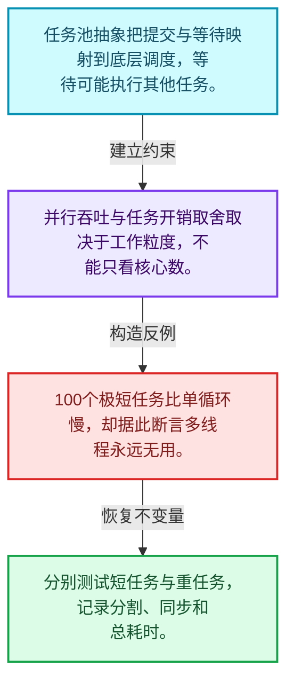
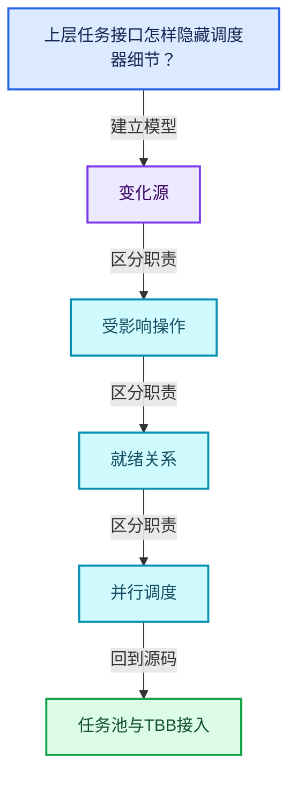
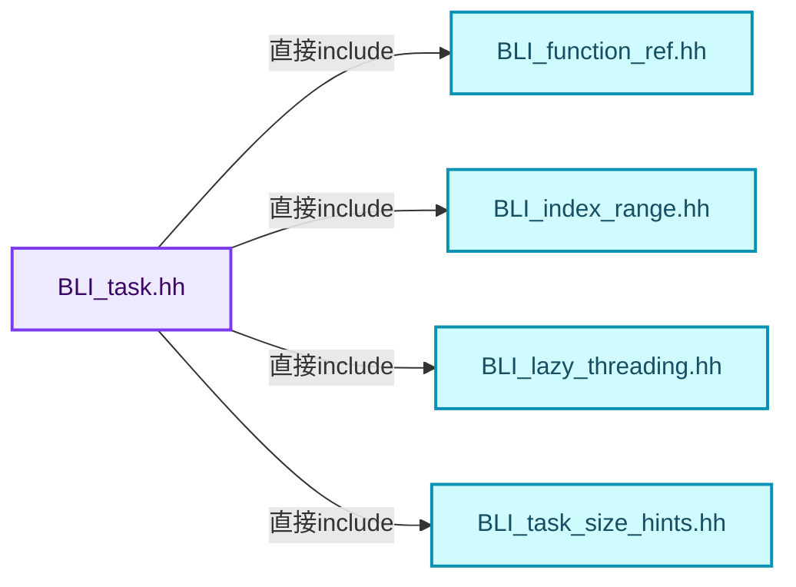
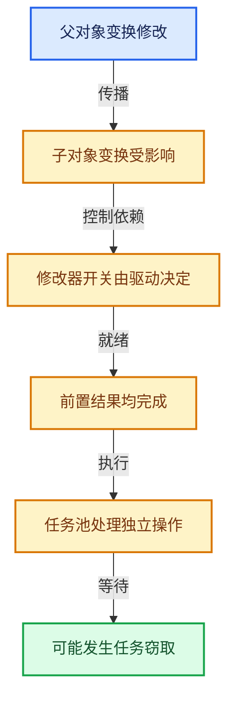

# 11-07 任务池与TBB接入

[方向导航](README.md) · [总目录](../README.md) · [覆盖索引](../%E6%BA%90%E7%A0%81%E7%89%88%E6%9C%AC%E4%B8%8E%E8%A6%86%E7%9B%96%E7%B4%A2%E5%BC%95.md)

> 阅读顺序：问题与数据模型 → 语法与类型 → 源码逐行 → 调用线索 → 历史与取舍 → 推演和练习。

- 基准 HEAD：`cbda6b96c26c0dee3c3b5cbb93960c4ac06a6b30`。
- 记录日期：2026-10-14。
- 教学示例状态：正文中的推演不是本机性能实测；已运行练习见验收报告。

## 一、从问题到设计

上层任务接口怎样隐藏调度器细节？

任务提交、等待与隔离表达不同能力；并行成本包含分割、同步和调度，不只有线程数。

本篇把语法、数据语义和系统取舍连接起来。标记更新、判断需求、依赖满足和任务执行是分开的阶段。

### 本篇独立模型与设计推理

任务池抽象把提交与等待映射到底层调度，等待可能执行其他任务。

设计取舍：并行吞吐与任务开销取舍取决于工作粒度，不能只看核心数。

最小反例：100个极短任务比单循环慢，却据此断言多线程永远无用。

推导与处理：分别测试短任务与重任务，记录分割、同步和总耗时。



### 源码范围与相邻篇章

| 文件 | 本篇逐行范围 | 基准SHA-256 |
|---|---|---|
| [source/blender/blenlib/BLI_task.hh](../../../../../source/blender/blenlib/BLI_task.hh) | L1—L267 | `acc7e83bc7c92bd9a02d82c1d3ab2f7c8f92e303245110b02a2381de3e4f459c` |
| [source/blender/blenlib/intern/task_pool.cc](../../../../../source/blender/blenlib/intern/task_pool.cc) | L1—L465 | `d4207625ca4bf21db7d926110b5980f9a4d31a15ca410565710a63a1ccccc40b` |
| [source/blender/blenlib/intern/task_scheduler.cc](../../../../../source/blender/blenlib/intern/task_scheduler.cc) | L1—L125 | `31eafef1822006357a2b20434e9cfda871a73614516c2a92c32cd668b6a77de7` |

同一主讲文件可能分多篇覆盖；超出本篇范围的符号通过覆盖索引定位。空行与纯注释保留在源码摘录中，逐行表解释有效语句与语法边界；许可证头统一保留。

前篇：[可见性与求值调度](06-%E5%8F%AF%E8%A7%81%E6%80%A7%E4%B8%8E%E6%B1%82%E5%80%BC%E8%B0%83%E5%BA%A6.md).

后篇：[任务隔离死锁与实战](08-%E4%BB%BB%E5%8A%A1%E9%9A%94%E7%A6%BB%E6%AD%BB%E9%94%81%E4%B8%8E%E5%AE%9E%E6%88%98.md).

## 二、类型、数据与阅读地图



这是概念依赖图，边表示阅读关系，不声称是运行时调用顺序。

### 直接编译依赖



箭头只表示头文件包含关系；完整调用线索见后面的符号定位表。

## 三、关键词、语法与类型角色

### 模板 template

模板把类型或常量作为生成实现的参数。读声明时先列出类型参数、非类型参数和默认值，再看使用者实际实例化了什么。模板声明本身不意味着每种T都支持其全部成员。

具体检查：把T替换为int、string、只能移动的类型，分别检查每个被调用操作是否成立。

### 依赖名称 typename

typename既可引入类型模板参数，也可告诉编译器某个依赖名称是类型。它不创建运行时对象；解析期确认语法类别与实例化期检查具体类型是不同阶段。

具体检查：区分typename T::value_type和T::size()，前者标记类型，后者是表达式。

### 只读限定 const

const约束当前访问路径可做的修改。const指针、指向const的指针、const视图对象、const元素是不同位置的限定；其他别名可能仍可修改原对象。

具体检查：分别写T* const、const T*与const T* const，并画出不可修改的层次。

### 移动转换 std::move

std::move把表达式转换为可供移动重载选择的值类别，实际资源转移发生在被选中的构造或赋值中。对const对象move可能仍调用复制，对视图move也不会获得底层数据所有权。

具体检查：记录移动构造调用次数，不用变量名或std::move的出现次数替代测量。

### 完美转发 std::forward

std::forward在转发引用模板中恢复调用者原来的值类别。它依赖推导出的模板实参；无条件move会改变左值调用者的语义。

具体检查：对同一接口分别传入左值、临时对象和const左值，记录实际重载。

### 异常边界 try与catch

try定义异常传播的局部边界。失败路径需要销毁已经成功构造的部分并释放相应存储；未构造的对象不能被析构。

具体检查：在第k次构造失败，列出已经存在的对象集合与待释放缓冲。

### 显式静态转换 static_cast

static_cast表达编译期允许的转换，不会自动验证运行时真实类型、指针寿命或索引边界。由void指针恢复T指针时，调用者仍须保证实际存储中确有合法T对象。

具体检查：标出转换前后的类型以及正确性依据来自哪里。

### 覆写检查 override

override要求函数确实覆盖基类虚函数，可捕获参数类型和const限定不匹配。它不改变基类规定的生命周期或线程约束。

具体检查：故意改变一个参数或const，观察编译器如何拒绝误写的新函数。

### 原子操作 atomic

原子性保护相应原子对象的访问；发布其他普通数据还要分析内存序。多个原子字段分别安全不等于复合不变量整体原子。

具体检查：画出写数据、发布ready与读ready、读数据的顺序关系。

### 构造与new表达式

普通new可能分配并构造；placement new在给定地址构造，存储由其他机制提供。失败回滚应区分两类责任。

具体检查：追踪地址来自哪里、构造何时成功、由谁析构、由谁释放。

### 内部断言 assert

断言表达开发者预期成立的内部契约，发布构建可能关闭。它不能替代对不可信输入的完整错误处理，也不保证后续操作被运行时保护。

具体检查：对每条断言构造违反条件的输入，区分调用者错误与应向用户报告的错误。

### 独占拥有 unique_ptr

unique_ptr通过移动转移拥有关系，默认删除策略必须与资源来源匹配。get返回借用指针，release交出责任而不销毁。

具体检查：区分move、get、release和reset后谁负责销毁。

### 类型别名 using

类型别名为已有类型建立名字，不创建运行期对象。它常把模板内部使用的类型统一暴露给泛型调用者。

具体检查：展开别名直到基础类型，区分类型别名和变量声明。

### 枚举与状态模型 enum

枚举把有限状态命名；enum class避免许多隐式整数转换。状态机正确性还依赖允许的转移，不能只看有哪些枚举项。

具体检查：列出每个状态的进入条件和离开条件，检查终止状态是否仍可能被调度。

## 四、真实源码与逐行讲解

源码块保持原行内容，原始行号由小节标题及逐行表给出。表中的调用定位是静态阅读辅助；重载、模板实例化、宏展开和虚调用需结合完整声明，不能仅凭词法出现证明动态调用。

### BLI_task.hh：L1—L48

<!-- source:source/blender/blenlib/BLI_task.hh:1:48 -->

```cpp
/* SPDX-FileCopyrightText: 2023 Blender Authors
 *
 * SPDX-License-Identifier: GPL-2.0-or-later */

#pragma once

/** \file
 * \ingroup bli
 */

#ifdef WITH_TBB
/* Quiet top level deprecation message, unrelated to API usage here. */
#  include <tbb/blocked_range.h>
#  include <tbb/parallel_for.h>
#  include <tbb/parallel_for_each.h>
#  include <tbb/parallel_invoke.h>
#  include <tbb/parallel_reduce.h>
#  include <tbb/task_arena.h>
#endif

#include "BLI_function_ref.hh"
#include "BLI_index_range.hh"
#include "BLI_lazy_threading.hh"
#include "BLI_task_size_hints.hh"

namespace blender {

namespace threading {

template<typename Range, typename Function>
inline void parallel_for_each(Range &&range, const Function &function)
{
#ifdef WITH_TBB
  tbb::parallel_for_each(range, function);
#else
  for (auto &&value : range) {
    function(value);
  }
#endif
}

namespace detail {
void parallel_for_impl(IndexRange range,
                       int64_t grain_size,
                       FunctionRef<void(IndexRange)> function,
                       const TaskSizeHints &size_hints);
void memory_bandwidth_bound_task_impl(FunctionRef<void()> function);
void max_threads_task_impl(int max_threads, FunctionRef<void()> function);
```

| 原始行 | 语义、约束与检查 |
|---|---|
| L5 | 防止同一头文件在一个翻译单元中重复展开；不控制多个源文件之间的链接或对象寿命。 |
| L11 | 预处理阶段处理 #ifdef WITH_TBB。它决定哪些代码进入编译，不是运行时分支；阅读行为时必须结合实际构建宏。 |
| L13 | 本行是连续声明或表达式的一部分：`#  include <tbb/blocked_range.h>`。与本段前后行合读；逗号、括号和限定符决定它属于参数、初始化列表还是实际计算。 |
| L14 | 本行是连续声明或表达式的一部分：`#  include <tbb/parallel_for.h>`。与本段前后行合读；逗号、括号和限定符决定它属于参数、初始化列表还是实际计算。 |
| L15 | 本行是连续声明或表达式的一部分：`#  include <tbb/parallel_for_each.h>`。与本段前后行合读；逗号、括号和限定符决定它属于参数、初始化列表还是实际计算。 |
| L16 | 本行是连续声明或表达式的一部分：`#  include <tbb/parallel_invoke.h>`。与本段前后行合读；逗号、括号和限定符决定它属于参数、初始化列表还是实际计算。 |
| L17 | 本行是连续声明或表达式的一部分：`#  include <tbb/parallel_reduce.h>`。与本段前后行合读；逗号、括号和限定符决定它属于参数、初始化列表还是实际计算。 |
| L18 | 本行是连续声明或表达式的一部分：`#  include <tbb/task_arena.h>`。与本段前后行合读；逗号、括号和限定符决定它属于参数、初始化列表还是实际计算。 |
| L19 | 预处理阶段处理 #endif。它决定哪些代码进入编译，不是运行时分支；阅读行为时必须结合实际构建宏。 |
| L21 | 引入编译依赖 "BLI_function_ref.hh"；这是声明可见性关系，不表示运行时一定调用该文件的所有接口。 |
| L22 | 引入编译依赖 "BLI_index_range.hh"；这是声明可见性关系，不表示运行时一定调用该文件的所有接口。 |
| L23 | 引入编译依赖 "BLI_lazy_threading.hh"；这是声明可见性关系，不表示运行时一定调用该文件的所有接口。 |
| L24 | 引入编译依赖 "BLI_task_size_hints.hh"；这是声明可见性关系，不表示运行时一定调用该文件的所有接口。 |
| L26 | 把后续声明放入 blender 命名空间，影响名称查找和符号归属，不创建运行时对象。 |
| L28 | 把后续声明放入 threading 命名空间，影响名称查找和符号归属，不创建运行时对象。 |
| L30 | 声明模板参数 `template<typename Range, typename Function>`。类型参数决定生成操作的类型，非类型参数可决定内嵌容量或编译期分支。 |
| L31 | 出现调用或函数声明 `parallel_for_each`，对应表达式为 `inline void parallel_for_each(Range &&range, const Function &function)`。参数求值、返回类型与重载需结合前后完整语句；静态文本引用不能证明动态目标。 |
| L32 | 连接上一行的声明或控制结构与其语句块；后续行在这个作用域中执行或声明。 |
| L33 | 预处理阶段处理 #ifdef WITH_TBB。它决定哪些代码进入编译，不是运行时分支；阅读行为时必须结合实际构建宏。 |
| L34 | 出现调用或函数声明 `tbb::parallel_for_each`，对应表达式为 `tbb::parallel_for_each(range, function);`。参数求值、返回类型与重载需结合前后完整语句；静态文本引用不能证明动态目标。 |
| L35 | 预处理阶段处理 #else。它决定哪些代码进入编译，不是运行时分支；阅读行为时必须结合实际构建宏。 |
| L36 | 按 `for (auto &&value : range)` 指定的范围或条件重复执行。对照循环变量与真实元素编号；循环内调用成本乘以实际迭代次数。 |
| L37 | 出现调用或函数声明 `function`，对应表达式为 `function(value);`。参数求值、返回类型与重载需结合前后完整语句；静态文本引用不能证明动态目标。 |
| L38 | 结束当前语法单元。局部自动对象在离开其作用域时按规则销毁；这不等于所有被引用的外部数据也被释放。 |
| L39 | 预处理阶段处理 #endif。它决定哪些代码进入编译，不是运行时分支；阅读行为时必须结合实际构建宏。 |
| L40 | 结束当前语法单元。局部自动对象在离开其作用域时按规则销毁；这不等于所有被引用的外部数据也被释放。 |
| L42 | 把后续声明放入 detail 命名空间，影响名称查找和符号归属，不创建运行时对象。 |
| L43 | 出现调用或函数声明 `parallel_for_impl`，对应表达式为 `void parallel_for_impl(IndexRange range,`。参数求值、返回类型与重载需结合前后完整语句；静态文本引用不能证明动态目标。 |
| L44 | 本行是连续声明或表达式的一部分：`int64_t grain_size,`。与本段前后行合读；逗号、括号和限定符决定它属于参数、初始化列表还是实际计算。 |
| L45 | 出现调用或函数声明 `void`，对应表达式为 `FunctionRef<void(IndexRange)> function,`。参数求值、返回类型与重载需结合前后完整语句；静态文本引用不能证明动态目标。 |
| L46 | 声明成员、局部对象或完成语句 `const TaskSizeHints &size_hints)`。若为指针或引用，它本身不说明拥有；若为值对象，其构造析构由所在作用域或外层对象管理。 |
| L47 | 声明接口 `void memory_bandwidth_bound_task_impl(FunctionRef<void()> function)`，本行没有对应函数体；返回类型、参数限定和const/noexcept共同组成调用契约，实际行为需继续定位实现。 |
| L48 | 声明接口 `void max_threads_task_impl(int max_threads, FunctionRef<void()> function)`，本行没有对应函数体；返回类型、参数限定和const/noexcept共同组成调用契约，实际行为需继续定位实现。 |

### BLI_task.hh：L49—L105

<!-- source:source/blender/blenlib/BLI_task.hh:49:105 -->

```cpp
}  // namespace detail

/**
 * Executes the given function for sub-ranges of the given range, potentially in parallel.
 * This is the main primitive for parallelizing code.
 *
 * \param range: The indices that should be iterated over in parallel.
 * \param grain_size: The approximate amount of work that should be scheduled at once.
 *   For example of the range is [0 - 1000] and the grain size is 200, then the function will be
 *   called 5 times with [0 - 200], [201 - 400], ... (approximately). The `size_hints` parameter
 *   can be used to adjust how the work is split up if the tasks have different sizes.
 * \param function: A callback that actually does the work in parallel. It should have one
 *   #IndexRange parameter.
 * \param size_hints: Can be used to specify the size of the tasks *relative to* each other and the
 *   grain size. If all tasks have approximately the same size, this can be ignored. Otherwise, one
 *   can use `threading::individual_task_sizes(...)` or `threading::accumulated_task_sizes(...)`.
 *   If the grain size is e.g. 200 and each task has the size 100, then only two tasks will be
 *   scheduled at once.
 */
template<typename Function>
inline void parallel_for(const IndexRange range,
                         const int64_t grain_size,
                         const Function &function,
                         const TaskSizeHints &size_hints = detail::TaskSizeHints_Static(1))
{
  if (range.is_empty()) {
    return;
  }
  /* Invoking tbb for small workloads has a large overhead. */
  if (use_single_thread(size_hints, range, grain_size)) {
    function(range);
    return;
  }
  detail::parallel_for_impl(range, grain_size, function, size_hints);
}

/**
 * Move the sub-range boundaries down to the next aligned index. The "global" begin and end
 * remain fixed though.
 */
inline IndexRange align_sub_range(const IndexRange unaligned_range,
                                  const int64_t alignment,
                                  const IndexRange global_range)
{
  const int64_t global_begin = global_range.start();
  const int64_t global_end = global_range.one_after_last();
  const int64_t alignment_mask = ~(alignment - 1);

  const int64_t unaligned_begin = unaligned_range.start();
  const int64_t unaligned_end = unaligned_range.one_after_last();
  const int64_t aligned_begin = std::max(global_begin, unaligned_begin & alignment_mask);
  const int64_t aligned_end = unaligned_end == global_end ?
                                  unaligned_end :
                                  std::max(global_begin, unaligned_end & alignment_mask);
  const IndexRange aligned_range = IndexRange::from_begin_end(aligned_begin, aligned_end);
  return aligned_range;
}
```

本段语义重点：

- `std::max`：取较大值，在容量计算中常用于同时满足请求量和增长策略。

| 原始行 | 语义、约束与检查 |
|---|---|
| L49 | 结束当前语法单元。局部自动对象在离开其作用域时按规则销毁；这不等于所有被引用的外部数据也被释放。 |
| L68 | 声明模板参数 `template<typename Function>`。类型参数决定生成操作的类型，非类型参数可决定内嵌容量或编译期分支。 |
| L69 | 出现调用或函数声明 `parallel_for`，对应表达式为 `inline void parallel_for(const IndexRange range,`。参数求值、返回类型与重载需结合前后完整语句；静态文本引用不能证明动态目标。 |
| L70 | 本行是连续声明或表达式的一部分：`const int64_t grain_size,`。与本段前后行合读；逗号、括号和限定符决定它属于参数、初始化列表还是实际计算。 |
| L71 | 本行是连续声明或表达式的一部分：`const Function &function,`。与本段前后行合读；逗号、括号和限定符决定它属于参数、初始化列表还是实际计算。 |
| L72 | 把右侧 `detail::TaskSizeHints_Static(1))` 用于初始化或更新左侧 `const TaskSizeHints &size_hints`。声明初始化与已有对象赋值应按上下文区分；有资源的类型会调用相应特殊成员。 |
| L73 | 连接上一行的声明或控制结构与其语句块；后续行在这个作用域中执行或声明。 |
| L74 | 判断 `range.is_empty()`，成立时进入本分支，否则继续后续路径。 |
| L75 | 结束当前函数，本路径不再执行后续语句；局部对象按作用域规则清理。 |
| L76 | 结束当前语法单元。局部自动对象在离开其作用域时按规则销毁；这不等于所有被引用的外部数据也被释放。 |
| L78 | 判断 `use_single_thread(size_hints, range, grain_size)`，成立时进入本分支，否则继续后续路径。该边界影响可访问元素或可用容量，两者要按各变量的定义区分。 |
| L79 | 出现调用或函数声明 `function`，对应表达式为 `function(range);`。参数求值、返回类型与重载需结合前后完整语句；静态文本引用不能证明动态目标。 |
| L80 | 结束当前函数，本路径不再执行后续语句；局部对象按作用域规则清理。 |
| L81 | 结束当前语法单元。局部自动对象在离开其作用域时按规则销毁；这不等于所有被引用的外部数据也被释放。 |
| L82 | 出现调用或函数声明 `detail::parallel_for_impl`，对应表达式为 `detail::parallel_for_impl(range, grain_size, function, size_hints);`。参数求值、返回类型与重载需结合前后完整语句；静态文本引用不能证明动态目标。 |
| L83 | 结束当前语法单元。局部自动对象在离开其作用域时按规则销毁；这不等于所有被引用的外部数据也被释放。 |
| L89 | 出现调用或函数声明 `align_sub_range`，对应表达式为 `inline IndexRange align_sub_range(const IndexRange unaligned_range,`。参数求值、返回类型与重载需结合前后完整语句；静态文本引用不能证明动态目标。 |
| L90 | 本行是连续声明或表达式的一部分：`const int64_t alignment,`。与本段前后行合读；逗号、括号和限定符决定它属于参数、初始化列表还是实际计算。 |
| L91 | 本行是连续声明或表达式的一部分：`const IndexRange global_range)`。与本段前后行合读；逗号、括号和限定符决定它属于参数、初始化列表还是实际计算。 |
| L92 | 连接上一行的声明或控制结构与其语句块；后续行在这个作用域中执行或声明。 |
| L93 | 把右侧 `global_range.start()` 用于初始化或更新左侧 `const int64_t global_begin`。声明初始化与已有对象赋值应按上下文区分；有资源的类型会调用相应特殊成员。 |
| L94 | 把右侧 `global_range.one_after_last()` 用于初始化或更新左侧 `const int64_t global_end`。声明初始化与已有对象赋值应按上下文区分；有资源的类型会调用相应特殊成员。 |
| L95 | 涉及析构接口或显式析构：`const int64_t alignment_mask = ~(alignment - 1);`。检查目标对象已成功构造，且资源不会在另一条清理路径再次销毁。 |
| L97 | 把右侧 `unaligned_range.start()` 用于初始化或更新左侧 `const int64_t unaligned_begin`。声明初始化与已有对象赋值应按上下文区分；有资源的类型会调用相应特殊成员。 |
| L98 | 把右侧 `unaligned_range.one_after_last()` 用于初始化或更新左侧 `const int64_t unaligned_end`。声明初始化与已有对象赋值应按上下文区分；有资源的类型会调用相应特殊成员。 |
| L99 | 本行使用 `std::max`：取较大值，在容量计算中常用于同时满足请求量和增长策略。 |
| L100 | 把右侧 `unaligned_end == global_end ?` 用于初始化或更新左侧 `const int64_t aligned_end`。声明初始化与已有对象赋值应按上下文区分；有资源的类型会调用相应特殊成员。 |
| L101 | 本行是连续声明或表达式的一部分：`unaligned_end :`。与本段前后行合读；逗号、括号和限定符决定它属于参数、初始化列表还是实际计算。 |
| L102 | 本行使用 `std::max`：取较大值，在容量计算中常用于同时满足请求量和增长策略。 |
| L103 | 把右侧 `IndexRange::from_begin_end(aligned_begin, aligned_end)` 用于初始化或更新左侧 `const IndexRange aligned_range`。声明初始化与已有对象赋值应按上下文区分；有资源的类型会调用相应特殊成员。 |
| L104 | 返回表达式 `aligned_range`。 |
| L105 | 结束当前语法单元。局部自动对象在离开其作用域时按规则销毁；这不等于所有被引用的外部数据也被释放。 |

### BLI_task.hh：L106—L148

<!-- source:source/blender/blenlib/BLI_task.hh:106:148 -->

```cpp

/**
 * Same as #parallel_for but tries to make the sub-range sizes multiples of the given alignment.
 * This can improve performance when the range is processed using vectorized and/or unrolled loops,
 * because the fallback loop that processes remaining values is used less often. A disadvantage of
 * using this instead of #parallel_for is that the size differences between sub-ranges can be
 * larger, which means that work is distributed less evenly.
 */
template<typename Function>
inline void parallel_for_aligned(const IndexRange range,
                                 const int64_t grain_size,
                                 const int64_t alignment,
                                 const Function &function)
{
  parallel_for(range, grain_size, [&](const IndexRange unaligned_range) {
    const IndexRange aligned_range = align_sub_range(unaligned_range, alignment, range);
    function(aligned_range);
  });
}

template<typename Value, typename Function, typename Reduction>
inline Value parallel_reduce(IndexRange range,
                             int64_t grain_size,
                             const Value &identity,
                             const Function &function,
                             const Reduction &reduction)
{
#ifdef WITH_TBB
  if (range.size() >= grain_size) {
    lazy_threading::send_hint();
    return tbb::parallel_reduce(
        tbb::blocked_range<int64_t>(range.first(), range.one_after_last(), grain_size),
        identity,
        [&](const tbb::blocked_range<int64_t> &subrange, const Value &ident) {
          return function(IndexRange(subrange.begin(), subrange.size()), ident);
        },
        reduction);
  }
#else
  UNUSED_VARS(grain_size, reduction);
#endif
  return function(range, identity);
}
```

本段语义重点：

- 分支证据 `range.size() >= grain_size)`：分别推演条件成立与不成立，核对相同出口处的状态。

| 原始行 | 语义、约束与检查 |
|---|---|
| L114 | 声明模板参数 `template<typename Function>`。类型参数决定生成操作的类型，非类型参数可决定内嵌容量或编译期分支。 |
| L115 | 出现调用或函数声明 `parallel_for_aligned`，对应表达式为 `inline void parallel_for_aligned(const IndexRange range,`。参数求值、返回类型与重载需结合前后完整语句；静态文本引用不能证明动态目标。 |
| L116 | 本行是连续声明或表达式的一部分：`const int64_t grain_size,`。与本段前后行合读；逗号、括号和限定符决定它属于参数、初始化列表还是实际计算。 |
| L117 | 本行是连续声明或表达式的一部分：`const int64_t alignment,`。与本段前后行合读；逗号、括号和限定符决定它属于参数、初始化列表还是实际计算。 |
| L118 | 本行是连续声明或表达式的一部分：`const Function &function)`。与本段前后行合读；逗号、括号和限定符决定它属于参数、初始化列表还是实际计算。 |
| L119 | 连接上一行的声明或控制结构与其语句块；后续行在这个作用域中执行或声明。 |
| L120 | 出现调用或函数声明 `parallel_for`，对应表达式为 `parallel_for(range, grain_size, [&](const IndexRange unaligned_range) {`。参数求值、返回类型与重载需结合前后完整语句；静态文本引用不能证明动态目标。 |
| L121 | 把右侧 `align_sub_range(unaligned_range, alignment, range)` 用于初始化或更新左侧 `const IndexRange aligned_range`。声明初始化与已有对象赋值应按上下文区分；有资源的类型会调用相应特殊成员。 |
| L122 | 出现调用或函数声明 `function`，对应表达式为 `function(aligned_range);`。参数求值、返回类型与重载需结合前后完整语句；静态文本引用不能证明动态目标。 |
| L123 | 结束当前语法单元。局部自动对象在离开其作用域时按规则销毁；这不等于所有被引用的外部数据也被释放。 |
| L124 | 结束当前语法单元。局部自动对象在离开其作用域时按规则销毁；这不等于所有被引用的外部数据也被释放。 |
| L126 | 声明模板参数 `template<typename Value, typename Function, typename Reduction>`。类型参数决定生成操作的类型，非类型参数可决定内嵌容量或编译期分支。 |
| L127 | 出现调用或函数声明 `parallel_reduce`，对应表达式为 `inline Value parallel_reduce(IndexRange range,`。参数求值、返回类型与重载需结合前后完整语句；静态文本引用不能证明动态目标。 |
| L128 | 本行是连续声明或表达式的一部分：`int64_t grain_size,`。与本段前后行合读；逗号、括号和限定符决定它属于参数、初始化列表还是实际计算。 |
| L129 | 本行是连续声明或表达式的一部分：`const Value &identity,`。与本段前后行合读；逗号、括号和限定符决定它属于参数、初始化列表还是实际计算。 |
| L130 | 本行是连续声明或表达式的一部分：`const Function &function,`。与本段前后行合读；逗号、括号和限定符决定它属于参数、初始化列表还是实际计算。 |
| L131 | 本行是连续声明或表达式的一部分：`const Reduction &reduction)`。与本段前后行合读；逗号、括号和限定符决定它属于参数、初始化列表还是实际计算。 |
| L132 | 连接上一行的声明或控制结构与其语句块；后续行在这个作用域中执行或声明。 |
| L133 | 预处理阶段处理 #ifdef WITH_TBB。它决定哪些代码进入编译，不是运行时分支；阅读行为时必须结合实际构建宏。 |
| L134 | 判断 `range.size() >= grain_size`，成立时进入本分支，否则继续后续路径。该边界影响可访问元素或可用容量，两者要按各变量的定义区分。 |
| L135 | 出现调用或函数声明 `lazy_threading::send_hint`，对应表达式为 `lazy_threading::send_hint();`。参数求值、返回类型与重载需结合前后完整语句；静态文本引用不能证明动态目标。 |
| L136 | 返回表达式 `tbb::parallel_reduce(`。 |
| L137 | 出现调用或函数声明 `tbb::blocked_range`，对应表达式为 `tbb::blocked_range<int64_t>(range.first(), range.one_after_last(), grain_size),`。参数求值、返回类型与重载需结合前后完整语句；静态文本引用不能证明动态目标。 |
| L138 | 本行是连续声明或表达式的一部分：`identity,`。与本段前后行合读；逗号、括号和限定符决定它属于参数、初始化列表还是实际计算。 |
| L139 | 本行是连续声明或表达式的一部分：`[&](const tbb::blocked_range<int64_t> &subrange, const Value &ident) {`。与本段前后行合读；逗号、括号和限定符决定它属于参数、初始化列表还是实际计算。 |
| L140 | 返回表达式 `function(IndexRange(subrange.begin(), subrange.size()), ident)`。结合函数声明检查返回值是否借用原存储，借用值不会自动延长其寿命。 |
| L141 | 结束当前语法单元。局部自动对象在离开其作用域时按规则销毁；这不等于所有被引用的外部数据也被释放。 |
| L142 | 声明成员、局部对象或完成语句 `reduction)`。若为指针或引用，它本身不说明拥有；若为值对象，其构造析构由所在作用域或外层对象管理。 |
| L143 | 结束当前语法单元。局部自动对象在离开其作用域时按规则销毁；这不等于所有被引用的外部数据也被释放。 |
| L144 | 预处理阶段处理 #else。它决定哪些代码进入编译，不是运行时分支；阅读行为时必须结合实际构建宏。 |
| L145 | 出现调用或函数声明 `UNUSED_VARS`，对应表达式为 `UNUSED_VARS(grain_size, reduction);`。参数求值、返回类型与重载需结合前后完整语句；静态文本引用不能证明动态目标。 |
| L146 | 预处理阶段处理 #endif。它决定哪些代码进入编译，不是运行时分支；阅读行为时必须结合实际构建宏。 |
| L147 | 返回表达式 `function(range, identity)`。 |
| L148 | 结束当前语法单元。局部自动对象在离开其作用域时按规则销毁；这不等于所有被引用的外部数据也被释放。 |

### BLI_task.hh：L149—L191

<!-- source:source/blender/blenlib/BLI_task.hh:149:191 -->

```cpp

template<typename Value, typename Function, typename Reduction>
inline Value parallel_reduce_aligned(const IndexRange range,
                                     const int64_t grain_size,
                                     const int64_t alignment,
                                     const Value &identity,
                                     const Function &function,
                                     const Reduction &reduction)
{
  parallel_reduce(
      range,
      grain_size,
      identity,
      [&](const IndexRange unaligned_range, const Value &ident) {
        const IndexRange aligned_range = align_sub_range(unaligned_range, alignment, range);
        function(aligned_range, ident);
      },
      reduction);
}

template<typename Value, typename Function, typename Reduction>
inline Value parallel_deterministic_reduce(IndexRange range,
                                           int64_t grain_size,
                                           const Value &identity,
                                           const Function &function,
                                           const Reduction &reduction)
{
#ifdef WITH_TBB
  if (range.size() >= grain_size) {
    lazy_threading::send_hint();
    return tbb::parallel_deterministic_reduce(
        tbb::blocked_range<int64_t>(range.first(), range.one_after_last(), grain_size),
        identity,
        [&](const tbb::blocked_range<int64_t> &subrange, const Value &ident) {
          return function(IndexRange(subrange.begin(), subrange.size()), ident);
        },
        reduction);
  }
#else
  UNUSED_VARS(grain_size, reduction);
#endif
  return function(range, identity);
}
```

本段语义重点：

- 分支证据 `range.size() >= grain_size)`：分别推演条件成立与不成立，核对相同出口处的状态。

| 原始行 | 语义、约束与检查 |
|---|---|
| L150 | 声明模板参数 `template<typename Value, typename Function, typename Reduction>`。类型参数决定生成操作的类型，非类型参数可决定内嵌容量或编译期分支。 |
| L151 | 出现调用或函数声明 `parallel_reduce_aligned`，对应表达式为 `inline Value parallel_reduce_aligned(const IndexRange range,`。参数求值、返回类型与重载需结合前后完整语句；静态文本引用不能证明动态目标。 |
| L152 | 本行是连续声明或表达式的一部分：`const int64_t grain_size,`。与本段前后行合读；逗号、括号和限定符决定它属于参数、初始化列表还是实际计算。 |
| L153 | 本行是连续声明或表达式的一部分：`const int64_t alignment,`。与本段前后行合读；逗号、括号和限定符决定它属于参数、初始化列表还是实际计算。 |
| L154 | 本行是连续声明或表达式的一部分：`const Value &identity,`。与本段前后行合读；逗号、括号和限定符决定它属于参数、初始化列表还是实际计算。 |
| L155 | 本行是连续声明或表达式的一部分：`const Function &function,`。与本段前后行合读；逗号、括号和限定符决定它属于参数、初始化列表还是实际计算。 |
| L156 | 本行是连续声明或表达式的一部分：`const Reduction &reduction)`。与本段前后行合读；逗号、括号和限定符决定它属于参数、初始化列表还是实际计算。 |
| L157 | 连接上一行的声明或控制结构与其语句块；后续行在这个作用域中执行或声明。 |
| L158 | 出现调用或函数声明 `parallel_reduce`，对应表达式为 `parallel_reduce(`。参数求值、返回类型与重载需结合前后完整语句；静态文本引用不能证明动态目标。 |
| L159 | 本行是连续声明或表达式的一部分：`range,`。与本段前后行合读；逗号、括号和限定符决定它属于参数、初始化列表还是实际计算。 |
| L160 | 本行是连续声明或表达式的一部分：`grain_size,`。与本段前后行合读；逗号、括号和限定符决定它属于参数、初始化列表还是实际计算。 |
| L161 | 本行是连续声明或表达式的一部分：`identity,`。与本段前后行合读；逗号、括号和限定符决定它属于参数、初始化列表还是实际计算。 |
| L162 | 本行是连续声明或表达式的一部分：`[&](const IndexRange unaligned_range, const Value &ident) {`。与本段前后行合读；逗号、括号和限定符决定它属于参数、初始化列表还是实际计算。 |
| L163 | 把右侧 `align_sub_range(unaligned_range, alignment, range)` 用于初始化或更新左侧 `const IndexRange aligned_range`。声明初始化与已有对象赋值应按上下文区分；有资源的类型会调用相应特殊成员。 |
| L164 | 出现调用或函数声明 `function`，对应表达式为 `function(aligned_range, ident);`。参数求值、返回类型与重载需结合前后完整语句；静态文本引用不能证明动态目标。 |
| L165 | 结束当前语法单元。局部自动对象在离开其作用域时按规则销毁；这不等于所有被引用的外部数据也被释放。 |
| L166 | 声明成员、局部对象或完成语句 `reduction)`。若为指针或引用，它本身不说明拥有；若为值对象，其构造析构由所在作用域或外层对象管理。 |
| L167 | 结束当前语法单元。局部自动对象在离开其作用域时按规则销毁；这不等于所有被引用的外部数据也被释放。 |
| L169 | 声明模板参数 `template<typename Value, typename Function, typename Reduction>`。类型参数决定生成操作的类型，非类型参数可决定内嵌容量或编译期分支。 |
| L170 | 出现调用或函数声明 `parallel_deterministic_reduce`，对应表达式为 `inline Value parallel_deterministic_reduce(IndexRange range,`。参数求值、返回类型与重载需结合前后完整语句；静态文本引用不能证明动态目标。 |
| L171 | 本行是连续声明或表达式的一部分：`int64_t grain_size,`。与本段前后行合读；逗号、括号和限定符决定它属于参数、初始化列表还是实际计算。 |
| L172 | 本行是连续声明或表达式的一部分：`const Value &identity,`。与本段前后行合读；逗号、括号和限定符决定它属于参数、初始化列表还是实际计算。 |
| L173 | 本行是连续声明或表达式的一部分：`const Function &function,`。与本段前后行合读；逗号、括号和限定符决定它属于参数、初始化列表还是实际计算。 |
| L174 | 本行是连续声明或表达式的一部分：`const Reduction &reduction)`。与本段前后行合读；逗号、括号和限定符决定它属于参数、初始化列表还是实际计算。 |
| L175 | 连接上一行的声明或控制结构与其语句块；后续行在这个作用域中执行或声明。 |
| L176 | 预处理阶段处理 #ifdef WITH_TBB。它决定哪些代码进入编译，不是运行时分支；阅读行为时必须结合实际构建宏。 |
| L177 | 判断 `range.size() >= grain_size`，成立时进入本分支，否则继续后续路径。该边界影响可访问元素或可用容量，两者要按各变量的定义区分。 |
| L178 | 出现调用或函数声明 `lazy_threading::send_hint`，对应表达式为 `lazy_threading::send_hint();`。参数求值、返回类型与重载需结合前后完整语句；静态文本引用不能证明动态目标。 |
| L179 | 返回表达式 `tbb::parallel_deterministic_reduce(`。 |
| L180 | 出现调用或函数声明 `tbb::blocked_range`，对应表达式为 `tbb::blocked_range<int64_t>(range.first(), range.one_after_last(), grain_size),`。参数求值、返回类型与重载需结合前后完整语句；静态文本引用不能证明动态目标。 |
| L181 | 本行是连续声明或表达式的一部分：`identity,`。与本段前后行合读；逗号、括号和限定符决定它属于参数、初始化列表还是实际计算。 |
| L182 | 本行是连续声明或表达式的一部分：`[&](const tbb::blocked_range<int64_t> &subrange, const Value &ident) {`。与本段前后行合读；逗号、括号和限定符决定它属于参数、初始化列表还是实际计算。 |
| L183 | 返回表达式 `function(IndexRange(subrange.begin(), subrange.size()), ident)`。结合函数声明检查返回值是否借用原存储，借用值不会自动延长其寿命。 |
| L184 | 结束当前语法单元。局部自动对象在离开其作用域时按规则销毁；这不等于所有被引用的外部数据也被释放。 |
| L185 | 声明成员、局部对象或完成语句 `reduction)`。若为指针或引用，它本身不说明拥有；若为值对象，其构造析构由所在作用域或外层对象管理。 |
| L186 | 结束当前语法单元。局部自动对象在离开其作用域时按规则销毁；这不等于所有被引用的外部数据也被释放。 |
| L187 | 预处理阶段处理 #else。它决定哪些代码进入编译，不是运行时分支；阅读行为时必须结合实际构建宏。 |
| L188 | 出现调用或函数声明 `UNUSED_VARS`，对应表达式为 `UNUSED_VARS(grain_size, reduction);`。参数求值、返回类型与重载需结合前后完整语句；静态文本引用不能证明动态目标。 |
| L189 | 预处理阶段处理 #endif。它决定哪些代码进入编译，不是运行时分支；阅读行为时必须结合实际构建宏。 |
| L190 | 返回表达式 `function(range, identity)`。 |
| L191 | 结束当前语法单元。局部自动对象在离开其作用域时按规则销毁；这不等于所有被引用的外部数据也被释放。 |

### BLI_task.hh：L192—L242

<!-- source:source/blender/blenlib/BLI_task.hh:192:242 -->

```cpp

/**
 * Execute all of the provided functions. The functions might be executed in parallel or in serial
 * or some combination of both.
 */
template<typename... Functions> inline void parallel_invoke(Functions &&...functions)
{
#ifdef WITH_TBB
  tbb::parallel_invoke(std::forward<Functions>(functions)...);
#else
  (functions(), ...);
#endif
}

/**
 * Same #parallel_invoke, but allows disabling threading dynamically. This is useful because when
 * the individual functions do very little work, there is a lot of overhead from starting parallel
 * tasks.
 */
template<typename... Functions>
inline void parallel_invoke(const bool use_threading, Functions &&...functions)
{
  if (use_threading) {
    lazy_threading::send_hint();
    parallel_invoke(std::forward<Functions>(functions)...);
  }
  else {
    (functions(), ...);
  }
}

/** See #BLI_task_isolate for a description of what isolating a task means. */
template<typename Function> inline auto isolate_task(const Function &function)
{
#ifdef WITH_TBB
  lazy_threading::ReceiverIsolation isolation;
  return tbb::this_task_arena::isolate(function);
#else
  return function();
#endif
}

/**
 * Runs the function with at most #max_threads threads participating in parallel work,
 * including the calling thread.
 */
template<typename Function>
inline void max_threads_task(const int max_threads, const Function &function)
{
  detail::max_threads_task_impl(max_threads, function);
}
```

本段语义重点：

- 分支证据 `use_threading)`：分别推演条件成立与不成立，核对相同出口处的状态。

| 原始行 | 语义、约束与检查 |
|---|---|
| L197 | 声明模板参数 `template<typename... Functions> inline void parallel_invoke(Functions &&...functions)`。类型参数决定生成操作的类型，非类型参数可决定内嵌容量或编译期分支。 |
| L198 | 连接上一行的声明或控制结构与其语句块；后续行在这个作用域中执行或声明。 |
| L199 | 预处理阶段处理 #ifdef WITH_TBB。它决定哪些代码进入编译，不是运行时分支；阅读行为时必须结合实际构建宏。 |
| L200 | 出现调用或函数声明 `tbb::parallel_invoke`，对应表达式为 `tbb::parallel_invoke(std::forward<Functions>(functions)...);`。参数求值、返回类型与重载需结合前后完整语句；静态文本引用不能证明动态目标。 |
| L201 | 预处理阶段处理 #else。它决定哪些代码进入编译，不是运行时分支；阅读行为时必须结合实际构建宏。 |
| L202 | 出现调用或函数声明 `functions`，对应表达式为 `(functions(), ...);`。参数求值、返回类型与重载需结合前后完整语句；静态文本引用不能证明动态目标。 |
| L203 | 预处理阶段处理 #endif。它决定哪些代码进入编译，不是运行时分支；阅读行为时必须结合实际构建宏。 |
| L204 | 结束当前语法单元。局部自动对象在离开其作用域时按规则销毁；这不等于所有被引用的外部数据也被释放。 |
| L211 | 声明模板参数 `template<typename... Functions>`。类型参数决定生成操作的类型，非类型参数可决定内嵌容量或编译期分支。 |
| L212 | 出现调用或函数声明 `parallel_invoke`，对应表达式为 `inline void parallel_invoke(const bool use_threading, Functions &&...functions)`。参数求值、返回类型与重载需结合前后完整语句；静态文本引用不能证明动态目标。 |
| L213 | 连接上一行的声明或控制结构与其语句块；后续行在这个作用域中执行或声明。 |
| L214 | 判断 `use_threading`，成立时进入本分支，否则继续后续路径。 |
| L215 | 出现调用或函数声明 `lazy_threading::send_hint`，对应表达式为 `lazy_threading::send_hint();`。参数求值、返回类型与重载需结合前后完整语句；静态文本引用不能证明动态目标。 |
| L216 | 出现调用或函数声明 `parallel_invoke`，对应表达式为 `parallel_invoke(std::forward<Functions>(functions)...);`。参数求值、返回类型与重载需结合前后完整语句；静态文本引用不能证明动态目标。 |
| L217 | 结束当前语法单元。局部自动对象在离开其作用域时按规则销毁；这不等于所有被引用的外部数据也被释放。 |
| L218 | 处理前一条件不成立的互补路径。比较两条路径最后是否恢复同一不变量，以及是否产生不同的资源责任。 |
| L219 | 出现调用或函数声明 `functions`，对应表达式为 `(functions(), ...);`。参数求值、返回类型与重载需结合前后完整语句；静态文本引用不能证明动态目标。 |
| L220 | 结束当前语法单元。局部自动对象在离开其作用域时按规则销毁；这不等于所有被引用的外部数据也被释放。 |
| L221 | 结束当前语法单元。局部自动对象在离开其作用域时按规则销毁；这不等于所有被引用的外部数据也被释放。 |
| L224 | 声明模板参数 `template<typename Function> inline auto isolate_task(const Function &function)`。类型参数决定生成操作的类型，非类型参数可决定内嵌容量或编译期分支。 |
| L225 | 连接上一行的声明或控制结构与其语句块；后续行在这个作用域中执行或声明。 |
| L226 | 预处理阶段处理 #ifdef WITH_TBB。它决定哪些代码进入编译，不是运行时分支；阅读行为时必须结合实际构建宏。 |
| L227 | 声明成员、局部对象或完成语句 `lazy_threading::ReceiverIsolation isolation`。若为指针或引用，它本身不说明拥有；若为值对象，其构造析构由所在作用域或外层对象管理。 |
| L228 | 返回表达式 `tbb::this_task_arena::isolate(function)`。 |
| L229 | 预处理阶段处理 #else。它决定哪些代码进入编译，不是运行时分支；阅读行为时必须结合实际构建宏。 |
| L230 | 返回表达式 `function()`。 |
| L231 | 预处理阶段处理 #endif。它决定哪些代码进入编译，不是运行时分支；阅读行为时必须结合实际构建宏。 |
| L232 | 结束当前语法单元。局部自动对象在离开其作用域时按规则销毁；这不等于所有被引用的外部数据也被释放。 |
| L238 | 声明模板参数 `template<typename Function>`。类型参数决定生成操作的类型，非类型参数可决定内嵌容量或编译期分支。 |
| L239 | 出现调用或函数声明 `max_threads_task`，对应表达式为 `inline void max_threads_task(const int max_threads, const Function &function)`。参数求值、返回类型与重载需结合前后完整语句；静态文本引用不能证明动态目标。 |
| L240 | 连接上一行的声明或控制结构与其语句块；后续行在这个作用域中执行或声明。 |
| L241 | 出现调用或函数声明 `detail::max_threads_task_impl`，对应表达式为 `detail::max_threads_task_impl(max_threads, function);`。参数求值、返回类型与重载需结合前后完整语句；静态文本引用不能证明动态目标。 |
| L242 | 结束当前语法单元。局部自动对象在离开其作用域时按规则销毁；这不等于所有被引用的外部数据也被释放。 |

### BLI_task.hh：L243—L267

<!-- source:source/blender/blenlib/BLI_task.hh:243:267 -->

```cpp

/**
 * Should surround parallel code that is highly bandwidth intensive, e.g. it just fills a buffer
 * with no or just few additional operations. If the buffers are large, it's beneficial to limit
 * the number of threads doing the work because that just creates more overhead on the hardware
 * level and doesn't provide a notable performance benefit beyond a certain point.
 */
template<typename Function>
inline void memory_bandwidth_bound_task(const int64_t approximate_bytes_touched,
                                        const Function &function)
{
  /* Don't limit threading when all touched memory can stay in the CPU cache, because there a much
   * higher memory bandwidth is available compared to accessing RAM. This value is supposed to be
   * on the order of the L3 cache size. Accessing that value is not quite straight forward and even
   * if it was, it's not clear if using the exact cache size would be beneficial because there is
   * often more stuff going on the CPU at the same time. */
  if (approximate_bytes_touched <= 8 * 1024 * 1024) {
    function();
    return;
  }
  detail::memory_bandwidth_bound_task_impl(function);
}

}  // namespace threading
}  // namespace blender
```

本段语义重点：

- 分支证据 `approximate_bytes_touched <= 8 * 1024 * 1024)`：分别推演条件成立与不成立，核对相同出口处的状态。

| 原始行 | 语义、约束与检查 |
|---|---|
| L250 | 声明模板参数 `template<typename Function>`。类型参数决定生成操作的类型，非类型参数可决定内嵌容量或编译期分支。 |
| L251 | 出现调用或函数声明 `memory_bandwidth_bound_task`，对应表达式为 `inline void memory_bandwidth_bound_task(const int64_t approximate_bytes_touched,`。参数求值、返回类型与重载需结合前后完整语句；静态文本引用不能证明动态目标。 |
| L252 | 本行是连续声明或表达式的一部分：`const Function &function)`。与本段前后行合读；逗号、括号和限定符决定它属于参数、初始化列表还是实际计算。 |
| L253 | 连接上一行的声明或控制结构与其语句块；后续行在这个作用域中执行或声明。 |
| L259 | 判断 `approximate_bytes_touched <= 8 * 1024 * 1024`，成立时进入本分支，否则继续后续路径。 |
| L260 | 出现调用或函数声明 `function`，对应表达式为 `function();`。参数求值、返回类型与重载需结合前后完整语句；静态文本引用不能证明动态目标。 |
| L261 | 结束当前函数，本路径不再执行后续语句；局部对象按作用域规则清理。 |
| L262 | 结束当前语法单元。局部自动对象在离开其作用域时按规则销毁；这不等于所有被引用的外部数据也被释放。 |
| L263 | 出现调用或函数声明 `detail::memory_bandwidth_bound_task_impl`，对应表达式为 `detail::memory_bandwidth_bound_task_impl(function);`。参数求值、返回类型与重载需结合前后完整语句；静态文本引用不能证明动态目标。 |
| L264 | 结束当前语法单元。局部自动对象在离开其作用域时按规则销毁；这不等于所有被引用的外部数据也被释放。 |
| L266 | 结束当前语法单元。局部自动对象在离开其作用域时按规则销毁；这不等于所有被引用的外部数据也被释放。 |
| L267 | 结束当前语法单元。局部自动对象在离开其作用域时按规则销毁；这不等于所有被引用的外部数据也被释放。 |

### task_pool.cc：L1—L47

<!-- source:source/blender/blenlib/intern/task_pool.cc:1:47 -->

```cpp
/* SPDX-FileCopyrightText: 2023 Blender Authors
 *
 * SPDX-License-Identifier: GPL-2.0-or-later */

/** \file
 * \ingroup bli
 *
 * Task pool to run tasks in parallel.
 */

#include <atomic>
#include <cstdlib>
#include <memory>
#include <utility>

#include "MEM_guardedalloc.h"

#include "DNA_listBase.h"

#include "BLI_assert.hh"
#include "BLI_mempool.hh"
#include "BLI_task_c.hh"
#include "BLI_threads.hh"
#include "BLI_vector.hh"

#ifdef WITH_TBB
#  include <tbb/blocked_range.h>
#  include <tbb/task_arena.h>
#  include <tbb/task_group.h>
#endif

namespace blender {

struct ThreadSlot;

/**
 * Task
 *
 * Unit of work to execute. This is a C++ class to work with TBB.
 */
class Task {
 public:
  TaskPool *pool;
  TaskRunFunction run;
  void *taskdata;
  bool free_taskdata;
  TaskFreeFunction freedata;
```

| 原始行 | 语义、约束与检查 |
|---|---|
| L11 | 引入编译依赖 <atomic>；这是声明可见性关系，不表示运行时一定调用该文件的所有接口。 |
| L12 | 引入编译依赖 <cstdlib>；这是声明可见性关系，不表示运行时一定调用该文件的所有接口。 |
| L13 | 引入编译依赖 <memory>；这是声明可见性关系，不表示运行时一定调用该文件的所有接口。 |
| L14 | 引入编译依赖 <utility>；这是声明可见性关系，不表示运行时一定调用该文件的所有接口。 |
| L16 | 引入编译依赖 "MEM_guardedalloc.h"；这是声明可见性关系，不表示运行时一定调用该文件的所有接口。 |
| L18 | 引入编译依赖 "DNA_listBase.h"；这是声明可见性关系，不表示运行时一定调用该文件的所有接口。 |
| L20 | 引入编译依赖 "BLI_assert.hh"；这是声明可见性关系，不表示运行时一定调用该文件的所有接口。 |
| L21 | 引入编译依赖 "BLI_mempool.hh"；这是声明可见性关系，不表示运行时一定调用该文件的所有接口。 |
| L22 | 引入编译依赖 "BLI_task_c.hh"；这是声明可见性关系，不表示运行时一定调用该文件的所有接口。 |
| L23 | 引入编译依赖 "BLI_threads.hh"；这是声明可见性关系，不表示运行时一定调用该文件的所有接口。 |
| L24 | 引入编译依赖 "BLI_vector.hh"；这是声明可见性关系，不表示运行时一定调用该文件的所有接口。 |
| L26 | 预处理阶段处理 #ifdef WITH_TBB。它决定哪些代码进入编译，不是运行时分支；阅读行为时必须结合实际构建宏。 |
| L27 | 本行是连续声明或表达式的一部分：`#  include <tbb/blocked_range.h>`。与本段前后行合读；逗号、括号和限定符决定它属于参数、初始化列表还是实际计算。 |
| L28 | 本行是连续声明或表达式的一部分：`#  include <tbb/task_arena.h>`。与本段前后行合读；逗号、括号和限定符决定它属于参数、初始化列表还是实际计算。 |
| L29 | 本行是连续声明或表达式的一部分：`#  include <tbb/task_group.h>`。与本段前后行合读；逗号、括号和限定符决定它属于参数、初始化列表还是实际计算。 |
| L30 | 预处理阶段处理 #endif。它决定哪些代码进入编译，不是运行时分支；阅读行为时必须结合实际构建宏。 |
| L32 | 把后续声明放入 blender 命名空间，影响名称查找和符号归属，不创建运行时对象。 |
| L34 | 声明或定义类型 `struct ThreadSlot`。结合继承、访问权限和成员布局确认接口与拥有关系；前向声明本身没有完整对象布局。 |
| L41 | 声明或定义类型 `class Task`。结合继承、访问权限和成员布局确认接口与拥有关系；前向声明本身没有完整对象布局。 |
| L42 | 切换成员访问权限为 public；它是编译期接口边界，不是线程同步或内存保护。 |
| L43 | 声明成员、局部对象或完成语句 `TaskPool *pool`。若为指针或引用，它本身不说明拥有；若为值对象，其构造析构由所在作用域或外层对象管理。 |
| L44 | 声明成员、局部对象或完成语句 `TaskRunFunction run`。若为指针或引用，它本身不说明拥有；若为值对象，其构造析构由所在作用域或外层对象管理。 |
| L45 | 声明成员、局部对象或完成语句 `void *taskdata`。若为指针或引用，它本身不说明拥有；若为值对象，其构造析构由所在作用域或外层对象管理。 |
| L46 | 声明成员、局部对象或完成语句 `bool free_taskdata`。若为指针或引用，它本身不说明拥有；若为值对象，其构造析构由所在作用域或外层对象管理。 |
| L47 | 声明成员、局部对象或完成语句 `TaskFreeFunction freedata`。若为指针或引用，它本身不说明拥有；若为值对象，其构造析构由所在作用域或外层对象管理。 |

### task_pool.cc：L48—L92

<!-- source:source/blender/blenlib/intern/task_pool.cc:48:92 -->

```cpp

  Task(TaskPool *pool,
       TaskRunFunction run,
       void *taskdata,
       bool free_taskdata,
       TaskFreeFunction freedata)
      : pool(pool), run(run), taskdata(taskdata), free_taskdata(free_taskdata), freedata(freedata)
  {
  }

  ~Task()
  {
    if (free_taskdata) {
      if (freedata) {
        freedata(pool, taskdata);
      }
      else {
        MEM_delete_void(taskdata);
      }
    }
  }

  /* Move constructor.
   * For performance, ensure we never copy the task and only move it.
   * For TBB version 2017 and earlier we apply a workaround to make up for
   * the lack of move constructor support. */
  Task(Task &&other)
      : pool(other.pool),
        run(other.run),
        taskdata(other.taskdata),
        free_taskdata(other.free_taskdata),
        freedata(other.freedata)
  {
    other.pool = nullptr;
    other.run = nullptr;
    other.taskdata = nullptr;
    other.free_taskdata = false;
    other.freedata = nullptr;
  }

/* TBB has a check in `tbb/include/task_group.h` where `__TBB_CPP11_RVALUE_REF_PRESENT` should
 * evaluate to true as with the other MSVC build. However, because of the clang compiler
 * it does not and we attempt to call a deleted constructor in the tbb_task_pool_run function.
 * This check fixes this issue and keeps our Task constructor valid. */
#if (defined(WITH_TBB) && TBB_INTERFACE_VERSION_MAJOR < 10) || \
```

本段语义重点：

- 分支证据 `free_taskdata)`：分别推演条件成立与不成立，核对相同出口处的状态。
- 分支证据 `freedata)`：分别推演条件成立与不成立，核对相同出口处的状态。

| 原始行 | 语义、约束与检查 |
|---|---|
| L49 | 出现调用或函数声明 `Task`，对应表达式为 `Task(TaskPool *pool,`。参数求值、返回类型与重载需结合前后完整语句；静态文本引用不能证明动态目标。 |
| L50 | 本行是连续声明或表达式的一部分：`TaskRunFunction run,`。与本段前后行合读；逗号、括号和限定符决定它属于参数、初始化列表还是实际计算。 |
| L51 | 本行是连续声明或表达式的一部分：`void *taskdata,`。与本段前后行合读；逗号、括号和限定符决定它属于参数、初始化列表还是实际计算。 |
| L52 | 本行是连续声明或表达式的一部分：`bool free_taskdata,`。与本段前后行合读；逗号、括号和限定符决定它属于参数、初始化列表还是实际计算。 |
| L53 | 本行是连续声明或表达式的一部分：`TaskFreeFunction freedata)`。与本段前后行合读；逗号、括号和限定符决定它属于参数、初始化列表还是实际计算。 |
| L54 | 出现调用或函数声明 `pool`，对应表达式为 `: pool(pool), run(run), taskdata(taskdata), free_taskdata(free_taskdata), freedata(freedata)`。参数求值、返回类型与重载需结合前后完整语句；静态文本引用不能证明动态目标。 |
| L55 | 连接上一行的声明或控制结构与其语句块；后续行在这个作用域中执行或声明。 |
| L56 | 结束当前语法单元。局部自动对象在离开其作用域时按规则销毁；这不等于所有被引用的外部数据也被释放。 |
| L58 | 涉及析构接口或显式析构：`~Task()`。检查目标对象已成功构造，且资源不会在另一条清理路径再次销毁。 |
| L59 | 连接上一行的声明或控制结构与其语句块；后续行在这个作用域中执行或声明。 |
| L60 | 判断 `free_taskdata`，成立时进入本分支，否则继续后续路径。 |
| L61 | 判断 `freedata`，成立时进入本分支，否则继续后续路径。 |
| L62 | 出现调用或函数声明 `freedata`，对应表达式为 `freedata(pool, taskdata);`。参数求值、返回类型与重载需结合前后完整语句；静态文本引用不能证明动态目标。 |
| L63 | 结束当前语法单元。局部自动对象在离开其作用域时按规则销毁；这不等于所有被引用的外部数据也被释放。 |
| L64 | 处理前一条件不成立的互补路径。比较两条路径最后是否恢复同一不变量，以及是否产生不同的资源责任。 |
| L65 | 出现调用或函数声明 `MEM_delete_void`，对应表达式为 `MEM_delete_void(taskdata);`。参数求值、返回类型与重载需结合前后完整语句；静态文本引用不能证明动态目标。 |
| L66 | 结束当前语法单元。局部自动对象在离开其作用域时按规则销毁；这不等于所有被引用的外部数据也被释放。 |
| L67 | 结束当前语法单元。局部自动对象在离开其作用域时按规则销毁；这不等于所有被引用的外部数据也被释放。 |
| L68 | 结束当前语法单元。局部自动对象在离开其作用域时按规则销毁；这不等于所有被引用的外部数据也被释放。 |
| L74 | 出现调用或函数声明 `Task`，对应表达式为 `Task(Task &&other)`。参数求值、返回类型与重载需结合前后完整语句；静态文本引用不能证明动态目标。 |
| L75 | 出现调用或函数声明 `pool`，对应表达式为 `: pool(other.pool),`。参数求值、返回类型与重载需结合前后完整语句；静态文本引用不能证明动态目标。 |
| L76 | 出现调用或函数声明 `run`，对应表达式为 `run(other.run),`。参数求值、返回类型与重载需结合前后完整语句；静态文本引用不能证明动态目标。 |
| L77 | 出现调用或函数声明 `taskdata`，对应表达式为 `taskdata(other.taskdata),`。参数求值、返回类型与重载需结合前后完整语句；静态文本引用不能证明动态目标。 |
| L78 | 出现调用或函数声明 `free_taskdata`，对应表达式为 `free_taskdata(other.free_taskdata),`。参数求值、返回类型与重载需结合前后完整语句；静态文本引用不能证明动态目标。 |
| L79 | 出现调用或函数声明 `freedata`，对应表达式为 `freedata(other.freedata)`。参数求值、返回类型与重载需结合前后完整语句；静态文本引用不能证明动态目标。 |
| L80 | 连接上一行的声明或控制结构与其语句块；后续行在这个作用域中执行或声明。 |
| L81 | 把右侧 `nullptr` 用于初始化或更新左侧 `other.pool`。声明初始化与已有对象赋值应按上下文区分；有资源的类型会调用相应特殊成员。 |
| L82 | 把右侧 `nullptr` 用于初始化或更新左侧 `other.run`。声明初始化与已有对象赋值应按上下文区分；有资源的类型会调用相应特殊成员。 |
| L83 | 把右侧 `nullptr` 用于初始化或更新左侧 `other.taskdata`。声明初始化与已有对象赋值应按上下文区分；有资源的类型会调用相应特殊成员。 |
| L84 | 把右侧 `false` 用于初始化或更新左侧 `other.free_taskdata`。声明初始化与已有对象赋值应按上下文区分；有资源的类型会调用相应特殊成员。 |
| L85 | 把右侧 `nullptr` 用于初始化或更新左侧 `other.freedata`。声明初始化与已有对象赋值应按上下文区分；有资源的类型会调用相应特殊成员。 |
| L86 | 结束当前语法单元。局部自动对象在离开其作用域时按规则销毁；这不等于所有被引用的外部数据也被释放。 |
| L92 | 预处理阶段处理 #if (defined(WITH_TBB) && TBB_INTERFACE_VERSION_MAJOR < 10) &#124;&#124; \。它决定哪些代码进入编译，不是运行时分支；阅读行为时必须结合实际构建宏。 |

### task_pool.cc：L93—L147

<!-- source:source/blender/blenlib/intern/task_pool.cc:93:147 -->

```cpp
    (defined(_MSC_VER) && defined(__clang__) && TBB_INTERFACE_VERSION_MAJOR < 12)
  Task(const Task &other)
      : pool(other.pool),
        run(other.run),
        taskdata(other.taskdata),
        free_taskdata(other.free_taskdata),
        freedata(other.freedata)
  {
    ((Task &)other).pool = nullptr;
    ((Task &)other).run = nullptr;
    ((Task &)other).taskdata = nullptr;
    ((Task &)other).free_taskdata = false;
    ((Task &)other).freedata = nullptr;
  }
#else
  Task(const Task &other) = delete;
#endif

  Task &operator=(const Task &other) = delete;
  Task &operator=(Task &&other) = delete;

  void operator()() const;
};

/* Execute task. */
void Task::operator()() const
{
  run(pool, taskdata);
}

/* TBB Task Group.
 *
 * Subclass since there seems to be no other way to set priority. */

#ifdef WITH_TBB
class TBBTaskGroup : public tbb::task_group {
 public:
  TBBTaskGroup(eTaskPriority priority)
  {
#  if TBB_INTERFACE_VERSION_MAJOR >= 12
    /* TODO: support priorities in TBB 2021, where they are only available as
     * part of task arenas, no longer for task groups. Or remove support for
     * task priorities if they are no longer useful. */
    UNUSED_VARS(priority);
#  else
    switch (priority) {
      case TASK_PRIORITY_LOW:
        my_context.set_priority(tbb::priority_low);
        break;
      case TASK_PRIORITY_HIGH:
        my_context.set_priority(tbb::priority_normal);
        break;
    }
#  endif
  }
```

| 原始行 | 语义、约束与检查 |
|---|---|
| L93 | 出现调用或函数声明 `defined`，对应表达式为 `(defined(_MSC_VER) && defined(__clang__) && TBB_INTERFACE_VERSION_MAJOR < 12)`。参数求值、返回类型与重载需结合前后完整语句；静态文本引用不能证明动态目标。 |
| L94 | 出现调用或函数声明 `Task`，对应表达式为 `Task(const Task &other)`。参数求值、返回类型与重载需结合前后完整语句；静态文本引用不能证明动态目标。 |
| L95 | 出现调用或函数声明 `pool`，对应表达式为 `: pool(other.pool),`。参数求值、返回类型与重载需结合前后完整语句；静态文本引用不能证明动态目标。 |
| L96 | 出现调用或函数声明 `run`，对应表达式为 `run(other.run),`。参数求值、返回类型与重载需结合前后完整语句；静态文本引用不能证明动态目标。 |
| L97 | 出现调用或函数声明 `taskdata`，对应表达式为 `taskdata(other.taskdata),`。参数求值、返回类型与重载需结合前后完整语句；静态文本引用不能证明动态目标。 |
| L98 | 出现调用或函数声明 `free_taskdata`，对应表达式为 `free_taskdata(other.free_taskdata),`。参数求值、返回类型与重载需结合前后完整语句；静态文本引用不能证明动态目标。 |
| L99 | 出现调用或函数声明 `freedata`，对应表达式为 `freedata(other.freedata)`。参数求值、返回类型与重载需结合前后完整语句；静态文本引用不能证明动态目标。 |
| L100 | 连接上一行的声明或控制结构与其语句块；后续行在这个作用域中执行或声明。 |
| L101 | 把右侧 `nullptr` 用于初始化或更新左侧 `((Task &)other).pool`。声明初始化与已有对象赋值应按上下文区分；有资源的类型会调用相应特殊成员。 |
| L102 | 把右侧 `nullptr` 用于初始化或更新左侧 `((Task &)other).run`。声明初始化与已有对象赋值应按上下文区分；有资源的类型会调用相应特殊成员。 |
| L103 | 把右侧 `nullptr` 用于初始化或更新左侧 `((Task &)other).taskdata`。声明初始化与已有对象赋值应按上下文区分；有资源的类型会调用相应特殊成员。 |
| L104 | 把右侧 `false` 用于初始化或更新左侧 `((Task &)other).free_taskdata`。声明初始化与已有对象赋值应按上下文区分；有资源的类型会调用相应特殊成员。 |
| L105 | 把右侧 `nullptr` 用于初始化或更新左侧 `((Task &)other).freedata`。声明初始化与已有对象赋值应按上下文区分；有资源的类型会调用相应特殊成员。 |
| L106 | 结束当前语法单元。局部自动对象在离开其作用域时按规则销毁；这不等于所有被引用的外部数据也被释放。 |
| L107 | 预处理阶段处理 #else。它决定哪些代码进入编译，不是运行时分支；阅读行为时必须结合实际构建宏。 |
| L108 | 显式禁止接口：`Task(const Task &other) = delete;`。调用会在编译期被拒绝，常用于禁止复制或移动；这里没有释放对象或删除文件的运行时动作。 |
| L109 | 预处理阶段处理 #endif。它决定哪些代码进入编译，不是运行时分支；阅读行为时必须结合实际构建宏。 |
| L111 | 显式禁止接口：`Task &operator=(const Task &other) = delete;`。调用会在编译期被拒绝，常用于禁止复制或移动；这里没有释放对象或删除文件的运行时动作。 |
| L112 | 显式禁止接口：`Task &operator=(Task &&other) = delete;`。调用会在编译期被拒绝，常用于禁止复制或移动；这里没有释放对象或删除文件的运行时动作。 |
| L114 | 运算符重载声明、定义或显式调用：`void operator()() const;`。结合参数和返回类型判断是赋值、索引、比较还是转换；operator=声明中的等号不是在给名为operator的变量赋值。 |
| L115 | 结束当前语法单元。局部自动对象在离开其作用域时按规则销毁；这不等于所有被引用的外部数据也被释放。 |
| L118 | 运算符重载声明、定义或显式调用：`void Task::operator()() const`。结合参数和返回类型判断是赋值、索引、比较还是转换；operator=声明中的等号不是在给名为operator的变量赋值。 |
| L119 | 连接上一行的声明或控制结构与其语句块；后续行在这个作用域中执行或声明。 |
| L120 | 出现调用或函数声明 `run`，对应表达式为 `run(pool, taskdata);`。参数求值、返回类型与重载需结合前后完整语句；静态文本引用不能证明动态目标。 |
| L121 | 结束当前语法单元。局部自动对象在离开其作用域时按规则销毁；这不等于所有被引用的外部数据也被释放。 |
| L127 | 预处理阶段处理 #ifdef WITH_TBB。它决定哪些代码进入编译，不是运行时分支；阅读行为时必须结合实际构建宏。 |
| L128 | 声明或定义类型 `class TBBTaskGroup : public tbb::task_group`。结合继承、访问权限和成员布局确认接口与拥有关系；前向声明本身没有完整对象布局。 |
| L129 | 切换成员访问权限为 public；它是编译期接口边界，不是线程同步或内存保护。 |
| L130 | 出现调用或函数声明 `TBBTaskGroup`，对应表达式为 `TBBTaskGroup(eTaskPriority priority)`。参数求值、返回类型与重载需结合前后完整语句；静态文本引用不能证明动态目标。 |
| L131 | 连接上一行的声明或控制结构与其语句块；后续行在这个作用域中执行或声明。 |
| L132 | 本行是连续声明或表达式的一部分：`#  if TBB_INTERFACE_VERSION_MAJOR >= 12`。与本段前后行合读；逗号、括号和限定符决定它属于参数、初始化列表还是实际计算。 |
| L136 | 出现调用或函数声明 `UNUSED_VARS`，对应表达式为 `UNUSED_VARS(priority);`。参数求值、返回类型与重载需结合前后完整语句；静态文本引用不能证明动态目标。 |
| L137 | 本行是连续声明或表达式的一部分：`#  else`。与本段前后行合读；逗号、括号和限定符决定它属于参数、初始化列表还是实际计算。 |
| L138 | 按 switch (priority) 选择状态处理路径；每个case的break、return或贯穿行为决定下一步。 |
| L139 | 进入枚举或判别值对应分支 case TASK_PRIORITY_LOW:；结合状态定义和后续更新判断允许的转移。 |
| L140 | 出现调用或函数声明 `set_priority`，对应表达式为 `my_context.set_priority(tbb::priority_low);`。参数求值、返回类型与重载需结合前后完整语句；静态文本引用不能证明动态目标。 |
| L141 | 离开最近的循环或switch；不是离开整个函数，后续清理和提交代码可能仍会执行。 |
| L142 | 进入枚举或判别值对应分支 case TASK_PRIORITY_HIGH:；结合状态定义和后续更新判断允许的转移。 |
| L143 | 出现调用或函数声明 `set_priority`，对应表达式为 `my_context.set_priority(tbb::priority_normal);`。参数求值、返回类型与重载需结合前后完整语句；静态文本引用不能证明动态目标。 |
| L144 | 离开最近的循环或switch；不是离开整个函数，后续清理和提交代码可能仍会执行。 |
| L145 | 结束当前语法单元。局部自动对象在离开其作用域时按规则销毁；这不等于所有被引用的外部数据也被释放。 |
| L146 | 本行是连续声明或表达式的一部分：`#  endif`。与本段前后行合读；逗号、括号和限定符决定它属于参数、初始化列表还是实际计算。 |
| L147 | 结束当前语法单元。局部自动对象在离开其作用域时按规则销毁；这不等于所有被引用的外部数据也被释放。 |

### task_pool.cc：L148—L178

<!-- source:source/blender/blenlib/intern/task_pool.cc:148:178 -->

```cpp
};
#endif

/* Task Pool */

enum TaskPoolType {
  TASK_POOL_TBB,
  TASK_POOL_TBB_SUSPENDED,
  TASK_POOL_NO_THREADS,
  TASK_POOL_BACKGROUND,
  TASK_POOL_BACKGROUND_SERIAL,
};

struct TaskPool {
  TaskPoolType type;
  bool use_threads;

  void *userdata;

#ifdef WITH_TBB
  /* TBB task pool. */
  std::unique_ptr<TBBTaskGroup> tbb_group;
#endif
  volatile bool is_suspended = false;
  Vector<Task> suspended_tasks;

  /* Background task pool. */
  ListBaseT<ThreadSlot> background_threads;
  ThreadQueue *background_queue;

  eTaskPriority priority;
```

| 原始行 | 语义、约束与检查 |
|---|---|
| L148 | 结束当前语法单元。局部自动对象在离开其作用域时按规则销毁；这不等于所有被引用的外部数据也被释放。 |
| L149 | 预处理阶段处理 #endif。它决定哪些代码进入编译，不是运行时分支；阅读行为时必须结合实际构建宏。 |
| L153 | 声明或定义类型 `enum TaskPoolType`。结合继承、访问权限和成员布局确认接口与拥有关系；前向声明本身没有完整对象布局。 |
| L154 | 本行是连续声明或表达式的一部分：`TASK_POOL_TBB,`。与本段前后行合读；逗号、括号和限定符决定它属于参数、初始化列表还是实际计算。 |
| L155 | 本行是连续声明或表达式的一部分：`TASK_POOL_TBB_SUSPENDED,`。与本段前后行合读；逗号、括号和限定符决定它属于参数、初始化列表还是实际计算。 |
| L156 | 本行是连续声明或表达式的一部分：`TASK_POOL_NO_THREADS,`。与本段前后行合读；逗号、括号和限定符决定它属于参数、初始化列表还是实际计算。 |
| L157 | 本行是连续声明或表达式的一部分：`TASK_POOL_BACKGROUND,`。与本段前后行合读；逗号、括号和限定符决定它属于参数、初始化列表还是实际计算。 |
| L158 | 本行是连续声明或表达式的一部分：`TASK_POOL_BACKGROUND_SERIAL,`。与本段前后行合读；逗号、括号和限定符决定它属于参数、初始化列表还是实际计算。 |
| L159 | 结束当前语法单元。局部自动对象在离开其作用域时按规则销毁；这不等于所有被引用的外部数据也被释放。 |
| L161 | 声明或定义类型 `struct TaskPool`。结合继承、访问权限和成员布局确认接口与拥有关系；前向声明本身没有完整对象布局。 |
| L162 | 声明成员、局部对象或完成语句 `TaskPoolType type`。若为指针或引用，它本身不说明拥有；若为值对象，其构造析构由所在作用域或外层对象管理。 |
| L163 | 声明成员、局部对象或完成语句 `bool use_threads`。若为指针或引用，它本身不说明拥有；若为值对象，其构造析构由所在作用域或外层对象管理。 |
| L165 | 声明成员、局部对象或完成语句 `void *userdata`。若为指针或引用，它本身不说明拥有；若为值对象，其构造析构由所在作用域或外层对象管理。 |
| L167 | 预处理阶段处理 #ifdef WITH_TBB。它决定哪些代码进入编译，不是运行时分支；阅读行为时必须结合实际构建宏。 |
| L169 | 声明成员、局部对象或完成语句 `std::unique_ptr<TBBTaskGroup> tbb_group`。若为指针或引用，它本身不说明拥有；若为值对象，其构造析构由所在作用域或外层对象管理。 |
| L170 | 预处理阶段处理 #endif。它决定哪些代码进入编译，不是运行时分支；阅读行为时必须结合实际构建宏。 |
| L171 | 把右侧 `false` 用于初始化或更新左侧 `volatile bool is_suspended`。声明初始化与已有对象赋值应按上下文区分；有资源的类型会调用相应特殊成员。 |
| L172 | 声明成员、局部对象或完成语句 `Vector<Task> suspended_tasks`。若为指针或引用，它本身不说明拥有；若为值对象，其构造析构由所在作用域或外层对象管理。 |
| L175 | 声明成员、局部对象或完成语句 `ListBaseT<ThreadSlot> background_threads`。若为指针或引用，它本身不说明拥有；若为值对象，其构造析构由所在作用域或外层对象管理。 |
| L176 | 声明成员、局部对象或完成语句 `ThreadQueue *background_queue`。若为指针或引用，它本身不说明拥有；若为值对象，其构造析构由所在作用域或外层对象管理。 |
| L178 | 声明成员、局部对象或完成语句 `eTaskPriority priority`。若为指针或引用，它本身不说明拥有；若为值对象，其构造析构由所在作用域或外层对象管理。 |

### task_pool.cc：L179—L232

<!-- source:source/blender/blenlib/intern/task_pool.cc:179:232 -->

```cpp

  TaskPool(const TaskPoolType type, const eTaskPriority priority, void *userdata)
      : type(type), userdata(userdata), priority(priority)
  {
    this->use_threads = BLI_task_scheduler_num_threads() > 1 && type != TASK_POOL_NO_THREADS;

    /* Background task pool uses regular TBB scheduling if available. Only when
     * building without TBB or running with -t 1 do we need to ensure these tasks
     * do not block the main thread. */
    if (this->type == TASK_POOL_BACKGROUND && this->use_threads) {
      this->type = TASK_POOL_TBB;
    }

    switch (this->type) {
      case TASK_POOL_TBB:
      case TASK_POOL_TBB_SUSPENDED:
      case TASK_POOL_NO_THREADS: {
        if (type == TASK_POOL_TBB_SUSPENDED) {
          this->is_suspended = true;
        }

#ifdef WITH_TBB
        if (use_threads) {
          this->tbb_group = std::make_unique<TBBTaskGroup>(priority);
        }
#endif
        break;
      }
      case TASK_POOL_BACKGROUND:
      case TASK_POOL_BACKGROUND_SERIAL: {
        this->background_queue = BLI_thread_queue_init();
        BLI_threadpool_init(&this->background_threads, this->background_task_run, 1);
        break;
      }
    }
  }

  ~TaskPool()
  {
    switch (type) {
      case TASK_POOL_TBB:
      case TASK_POOL_TBB_SUSPENDED:
      case TASK_POOL_NO_THREADS:
        break;
      case TASK_POOL_BACKGROUND:
      case TASK_POOL_BACKGROUND_SERIAL: {
        this->background_task_pool_work_and_wait();

        BLI_threadpool_end(&this->background_threads);
        BLI_thread_queue_free(this->background_queue);
        break;
      }
    }
  }
```

本段语义重点：

- 分支证据 `this->type == TASK_POOL_BACKGROUND && this->use_threads)`：分别推演条件成立与不成立，核对相同出口处的状态。
- 分支证据 `type == TASK_POOL_TBB_SUSPENDED)`：分别推演条件成立与不成立，核对相同出口处的状态。

| 原始行 | 语义、约束与检查 |
|---|---|
| L180 | 出现调用或函数声明 `TaskPool`，对应表达式为 `TaskPool(const TaskPoolType type, const eTaskPriority priority, void *userdata)`。参数求值、返回类型与重载需结合前后完整语句；静态文本引用不能证明动态目标。 |
| L181 | 出现调用或函数声明 `type`，对应表达式为 `: type(type), userdata(userdata), priority(priority)`。参数求值、返回类型与重载需结合前后完整语句；静态文本引用不能证明动态目标。 |
| L182 | 连接上一行的声明或控制结构与其语句块；后续行在这个作用域中执行或声明。 |
| L183 | 把右侧 `BLI_task_scheduler_num_threads() > 1 && type != TASK_POOL_NO_THREADS` 用于初始化或更新左侧 `this->use_threads`。声明初始化与已有对象赋值应按上下文区分；有资源的类型会调用相应特殊成员。 |
| L188 | 判断 `this->type == TASK_POOL_BACKGROUND && this->use_threads`，成立时进入本分支，否则继续后续路径。 |
| L189 | 把右侧 `TASK_POOL_TBB` 用于初始化或更新左侧 `this->type`。声明初始化与已有对象赋值应按上下文区分；有资源的类型会调用相应特殊成员。 |
| L190 | 结束当前语法单元。局部自动对象在离开其作用域时按规则销毁；这不等于所有被引用的外部数据也被释放。 |
| L192 | 按 switch (this->type) 选择状态处理路径；每个case的break、return或贯穿行为决定下一步。 |
| L193 | 进入枚举或判别值对应分支 case TASK_POOL_TBB:；结合状态定义和后续更新判断允许的转移。 |
| L194 | 进入枚举或判别值对应分支 case TASK_POOL_TBB_SUSPENDED:；结合状态定义和后续更新判断允许的转移。 |
| L195 | 进入枚举或判别值对应分支 case TASK_POOL_NO_THREADS: {；结合状态定义和后续更新判断允许的转移。 |
| L196 | 判断 `type == TASK_POOL_TBB_SUSPENDED`，成立时进入本分支，否则继续后续路径。 |
| L197 | 把右侧 `true` 用于初始化或更新左侧 `this->is_suspended`。声明初始化与已有对象赋值应按上下文区分；有资源的类型会调用相应特殊成员。 |
| L198 | 结束当前语法单元。局部自动对象在离开其作用域时按规则销毁；这不等于所有被引用的外部数据也被释放。 |
| L200 | 预处理阶段处理 #ifdef WITH_TBB。它决定哪些代码进入编译，不是运行时分支；阅读行为时必须结合实际构建宏。 |
| L201 | 判断 `use_threads`，成立时进入本分支，否则继续后续路径。 |
| L202 | 把右侧 `std::make_unique<TBBTaskGroup>(priority)` 用于初始化或更新左侧 `this->tbb_group`。声明初始化与已有对象赋值应按上下文区分；有资源的类型会调用相应特殊成员。 |
| L203 | 结束当前语法单元。局部自动对象在离开其作用域时按规则销毁；这不等于所有被引用的外部数据也被释放。 |
| L204 | 预处理阶段处理 #endif。它决定哪些代码进入编译，不是运行时分支；阅读行为时必须结合实际构建宏。 |
| L205 | 离开最近的循环或switch；不是离开整个函数，后续清理和提交代码可能仍会执行。 |
| L206 | 结束当前语法单元。局部自动对象在离开其作用域时按规则销毁；这不等于所有被引用的外部数据也被释放。 |
| L207 | 进入枚举或判别值对应分支 case TASK_POOL_BACKGROUND:；结合状态定义和后续更新判断允许的转移。 |
| L208 | 进入枚举或判别值对应分支 case TASK_POOL_BACKGROUND_SERIAL: {；结合状态定义和后续更新判断允许的转移。 |
| L209 | 把右侧 `BLI_thread_queue_init()` 用于初始化或更新左侧 `this->background_queue`。声明初始化与已有对象赋值应按上下文区分；有资源的类型会调用相应特殊成员。 |
| L210 | 出现调用或函数声明 `BLI_threadpool_init`，对应表达式为 `BLI_threadpool_init(&this->background_threads, this->background_task_run, 1);`。参数求值、返回类型与重载需结合前后完整语句；静态文本引用不能证明动态目标。 |
| L211 | 离开最近的循环或switch；不是离开整个函数，后续清理和提交代码可能仍会执行。 |
| L212 | 结束当前语法单元。局部自动对象在离开其作用域时按规则销毁；这不等于所有被引用的外部数据也被释放。 |
| L213 | 结束当前语法单元。局部自动对象在离开其作用域时按规则销毁；这不等于所有被引用的外部数据也被释放。 |
| L214 | 结束当前语法单元。局部自动对象在离开其作用域时按规则销毁；这不等于所有被引用的外部数据也被释放。 |
| L216 | 涉及析构接口或显式析构：`~TaskPool()`。检查目标对象已成功构造，且资源不会在另一条清理路径再次销毁。 |
| L217 | 连接上一行的声明或控制结构与其语句块；后续行在这个作用域中执行或声明。 |
| L218 | 按 switch (type) 选择状态处理路径；每个case的break、return或贯穿行为决定下一步。 |
| L219 | 进入枚举或判别值对应分支 case TASK_POOL_TBB:；结合状态定义和后续更新判断允许的转移。 |
| L220 | 进入枚举或判别值对应分支 case TASK_POOL_TBB_SUSPENDED:；结合状态定义和后续更新判断允许的转移。 |
| L221 | 进入枚举或判别值对应分支 case TASK_POOL_NO_THREADS:；结合状态定义和后续更新判断允许的转移。 |
| L222 | 离开最近的循环或switch；不是离开整个函数，后续清理和提交代码可能仍会执行。 |
| L223 | 进入枚举或判别值对应分支 case TASK_POOL_BACKGROUND:；结合状态定义和后续更新判断允许的转移。 |
| L224 | 进入枚举或判别值对应分支 case TASK_POOL_BACKGROUND_SERIAL: {；结合状态定义和后续更新判断允许的转移。 |
| L225 | 出现调用或函数声明 `background_task_pool_work_and_wait`，对应表达式为 `this->background_task_pool_work_and_wait();`。参数求值、返回类型与重载需结合前后完整语句；静态文本引用不能证明动态目标。 |
| L227 | 出现调用或函数声明 `BLI_threadpool_end`，对应表达式为 `BLI_threadpool_end(&this->background_threads);`。参数求值、返回类型与重载需结合前后完整语句；静态文本引用不能证明动态目标。 |
| L228 | 出现调用或函数声明 `BLI_thread_queue_free`，对应表达式为 `BLI_thread_queue_free(this->background_queue);`。参数求值、返回类型与重载需结合前后完整语句；静态文本引用不能证明动态目标。 |
| L229 | 离开最近的循环或switch；不是离开整个函数，后续清理和提交代码可能仍会执行。 |
| L230 | 结束当前语法单元。局部自动对象在离开其作用域时按规则销毁；这不等于所有被引用的外部数据也被释放。 |
| L231 | 结束当前语法单元。局部自动对象在离开其作用域时按规则销毁；这不等于所有被引用的外部数据也被释放。 |
| L232 | 结束当前语法单元。局部自动对象在离开其作用域时按规则销毁；这不等于所有被引用的外部数据也被释放。 |

### task_pool.cc：L233—L288

<!-- source:source/blender/blenlib/intern/task_pool.cc:233:288 -->

```cpp

  TaskPool(TaskPool &&other) = delete;
#if 0
        : type(other.type), use_threads(other.use_threads), userdata(other.userdata)
    {
      other.pool = nullptr;
      other.run = nullptr;
      other.taskdata = nullptr;
      other.free_taskdata = false;
      other.freedata = nullptr;
    }
#endif

  TaskPool(const TaskPool &other) = delete;

  TaskPool &operator=(const TaskPool &other) = delete;
  TaskPool &operator=(TaskPool &&other) = delete;

  /**
   * Create and add a new task to the pool.
   */
  void task_push(TaskRunFunction run,
                 void *taskdata,
                 bool free_taskdata,
                 TaskFreeFunction freedata)
  {
    switch (this->type) {
      case TASK_POOL_TBB:
      case TASK_POOL_TBB_SUSPENDED:
      case TASK_POOL_NO_THREADS:
        this->tbb_task_pool_run({this, run, taskdata, free_taskdata, freedata});
        break;
      case TASK_POOL_BACKGROUND:
      case TASK_POOL_BACKGROUND_SERIAL:
        this->background_task_pool_run({this, run, taskdata, free_taskdata, freedata});
        break;
    }
  }

  /**
   * Work and wait until all tasks are done.
   */
  void work_and_wait()
  {
    switch (this->type) {
      case TASK_POOL_TBB:
      case TASK_POOL_TBB_SUSPENDED:
      case TASK_POOL_NO_THREADS:
        this->tbb_task_pool_work_and_wait();
        break;
      case TASK_POOL_BACKGROUND:
      case TASK_POOL_BACKGROUND_SERIAL:
        this->background_task_pool_work_and_wait();
        break;
    }
  }
```

| 原始行 | 语义、约束与检查 |
|---|---|
| L234 | 显式禁止接口：`TaskPool(TaskPool &&other) = delete;`。调用会在编译期被拒绝，常用于禁止复制或移动；这里没有释放对象或删除文件的运行时动作。 |
| L235 | 预处理阶段处理 #if 0。它决定哪些代码进入编译，不是运行时分支；阅读行为时必须结合实际构建宏。 |
| L236 | 出现调用或函数声明 `type`，对应表达式为 `: type(other.type), use_threads(other.use_threads), userdata(other.userdata)`。参数求值、返回类型与重载需结合前后完整语句；静态文本引用不能证明动态目标。 |
| L237 | 连接上一行的声明或控制结构与其语句块；后续行在这个作用域中执行或声明。 |
| L238 | 把右侧 `nullptr` 用于初始化或更新左侧 `other.pool`。声明初始化与已有对象赋值应按上下文区分；有资源的类型会调用相应特殊成员。 |
| L239 | 把右侧 `nullptr` 用于初始化或更新左侧 `other.run`。声明初始化与已有对象赋值应按上下文区分；有资源的类型会调用相应特殊成员。 |
| L240 | 把右侧 `nullptr` 用于初始化或更新左侧 `other.taskdata`。声明初始化与已有对象赋值应按上下文区分；有资源的类型会调用相应特殊成员。 |
| L241 | 把右侧 `false` 用于初始化或更新左侧 `other.free_taskdata`。声明初始化与已有对象赋值应按上下文区分；有资源的类型会调用相应特殊成员。 |
| L242 | 把右侧 `nullptr` 用于初始化或更新左侧 `other.freedata`。声明初始化与已有对象赋值应按上下文区分；有资源的类型会调用相应特殊成员。 |
| L243 | 结束当前语法单元。局部自动对象在离开其作用域时按规则销毁；这不等于所有被引用的外部数据也被释放。 |
| L244 | 预处理阶段处理 #endif。它决定哪些代码进入编译，不是运行时分支；阅读行为时必须结合实际构建宏。 |
| L246 | 显式禁止接口：`TaskPool(const TaskPool &other) = delete;`。调用会在编译期被拒绝，常用于禁止复制或移动；这里没有释放对象或删除文件的运行时动作。 |
| L248 | 显式禁止接口：`TaskPool &operator=(const TaskPool &other) = delete;`。调用会在编译期被拒绝，常用于禁止复制或移动；这里没有释放对象或删除文件的运行时动作。 |
| L249 | 显式禁止接口：`TaskPool &operator=(TaskPool &&other) = delete;`。调用会在编译期被拒绝，常用于禁止复制或移动；这里没有释放对象或删除文件的运行时动作。 |
| L254 | 出现调用或函数声明 `task_push`，对应表达式为 `void task_push(TaskRunFunction run,`。参数求值、返回类型与重载需结合前后完整语句；静态文本引用不能证明动态目标。 |
| L255 | 本行是连续声明或表达式的一部分：`void *taskdata,`。与本段前后行合读；逗号、括号和限定符决定它属于参数、初始化列表还是实际计算。 |
| L256 | 本行是连续声明或表达式的一部分：`bool free_taskdata,`。与本段前后行合读；逗号、括号和限定符决定它属于参数、初始化列表还是实际计算。 |
| L257 | 本行是连续声明或表达式的一部分：`TaskFreeFunction freedata)`。与本段前后行合读；逗号、括号和限定符决定它属于参数、初始化列表还是实际计算。 |
| L258 | 连接上一行的声明或控制结构与其语句块；后续行在这个作用域中执行或声明。 |
| L259 | 按 switch (this->type) 选择状态处理路径；每个case的break、return或贯穿行为决定下一步。 |
| L260 | 进入枚举或判别值对应分支 case TASK_POOL_TBB:；结合状态定义和后续更新判断允许的转移。 |
| L261 | 进入枚举或判别值对应分支 case TASK_POOL_TBB_SUSPENDED:；结合状态定义和后续更新判断允许的转移。 |
| L262 | 进入枚举或判别值对应分支 case TASK_POOL_NO_THREADS:；结合状态定义和后续更新判断允许的转移。 |
| L263 | 出现调用或函数声明 `tbb_task_pool_run`，对应表达式为 `this->tbb_task_pool_run({this, run, taskdata, free_taskdata, freedata});`。参数求值、返回类型与重载需结合前后完整语句；静态文本引用不能证明动态目标。 |
| L264 | 离开最近的循环或switch；不是离开整个函数，后续清理和提交代码可能仍会执行。 |
| L265 | 进入枚举或判别值对应分支 case TASK_POOL_BACKGROUND:；结合状态定义和后续更新判断允许的转移。 |
| L266 | 进入枚举或判别值对应分支 case TASK_POOL_BACKGROUND_SERIAL:；结合状态定义和后续更新判断允许的转移。 |
| L267 | 出现调用或函数声明 `background_task_pool_run`，对应表达式为 `this->background_task_pool_run({this, run, taskdata, free_taskdata, freedata});`。参数求值、返回类型与重载需结合前后完整语句；静态文本引用不能证明动态目标。 |
| L268 | 离开最近的循环或switch；不是离开整个函数，后续清理和提交代码可能仍会执行。 |
| L269 | 结束当前语法单元。局部自动对象在离开其作用域时按规则销毁；这不等于所有被引用的外部数据也被释放。 |
| L270 | 结束当前语法单元。局部自动对象在离开其作用域时按规则销毁；这不等于所有被引用的外部数据也被释放。 |
| L275 | 出现调用或函数声明 `work_and_wait`，对应表达式为 `void work_and_wait()`。参数求值、返回类型与重载需结合前后完整语句；静态文本引用不能证明动态目标。 |
| L276 | 连接上一行的声明或控制结构与其语句块；后续行在这个作用域中执行或声明。 |
| L277 | 按 switch (this->type) 选择状态处理路径；每个case的break、return或贯穿行为决定下一步。 |
| L278 | 进入枚举或判别值对应分支 case TASK_POOL_TBB:；结合状态定义和后续更新判断允许的转移。 |
| L279 | 进入枚举或判别值对应分支 case TASK_POOL_TBB_SUSPENDED:；结合状态定义和后续更新判断允许的转移。 |
| L280 | 进入枚举或判别值对应分支 case TASK_POOL_NO_THREADS:；结合状态定义和后续更新判断允许的转移。 |
| L281 | 出现调用或函数声明 `tbb_task_pool_work_and_wait`，对应表达式为 `this->tbb_task_pool_work_and_wait();`。参数求值、返回类型与重载需结合前后完整语句；静态文本引用不能证明动态目标。 |
| L282 | 离开最近的循环或switch；不是离开整个函数，后续清理和提交代码可能仍会执行。 |
| L283 | 进入枚举或判别值对应分支 case TASK_POOL_BACKGROUND:；结合状态定义和后续更新判断允许的转移。 |
| L284 | 进入枚举或判别值对应分支 case TASK_POOL_BACKGROUND_SERIAL:；结合状态定义和后续更新判断允许的转移。 |
| L285 | 出现调用或函数声明 `background_task_pool_work_and_wait`，对应表达式为 `this->background_task_pool_work_and_wait();`。参数求值、返回类型与重载需结合前后完整语句；静态文本引用不能证明动态目标。 |
| L286 | 离开最近的循环或switch；不是离开整个函数，后续清理和提交代码可能仍会执行。 |
| L287 | 结束当前语法单元。局部自动对象在离开其作用域时按规则销毁；这不等于所有被引用的外部数据也被释放。 |
| L288 | 结束当前语法单元。局部自动对象在离开其作用域时按规则销毁；这不等于所有被引用的外部数据也被释放。 |

### task_pool.cc：L289—L339

<!-- source:source/blender/blenlib/intern/task_pool.cc:289:339 -->

```cpp

 private:
  /* TBB Task Pool.
   *
   * Task pool using the TBB scheduler for tasks. When building without TBB
   * support or running Blender with -t 1, this reverts to single threaded.
   *
   * Tasks may be suspended until in all are created, to make it possible to
   * initialize data structures and create tasks in a single pass. */
  void tbb_task_pool_run(Task &&task);
  void tbb_task_pool_work_and_wait();

  /* Background Task Pool.
   *
   * Fallback for running background tasks when building without TBB. */
  void background_task_pool_run(Task &&task);
  void background_task_pool_work_and_wait();
  static void *background_task_run(void *userdata);
};

void TaskPool::tbb_task_pool_run(Task &&task)
{
  BLI_assert(ELEM(this->type, TASK_POOL_TBB, TASK_POOL_TBB_SUSPENDED, TASK_POOL_NO_THREADS));
  if (this->is_suspended) {
    /* Suspended task that will be executed in work_and_wait(). */
    this->suspended_tasks.append(std::move(task));

    /* Added as part of original 'use TBB' commit (d8a3f3595af0fb). Unclear whether this is still
     * needed, tests are passing on linux buildbot, but not sure if any would trigger the issue
     * addressed by this code. So keeping around for now. */
#if 0
#  ifdef __GNUC__
    /* Work around apparent compiler bug where task is not properly copied
     * to task_mem. This appears unrelated to the use of placement new or
     * move semantics, happens even writing to a plain C struct. Rather the
     * call into TBB seems to have some indirect effect. */
    std::atomic_thread_fence(std::memory_order_release);
#  endif
#endif
  }
#ifdef WITH_TBB
  else if (this->use_threads) {
    /* Execute in TBB task group. */
    this->tbb_group->run(std::move(task));
  }
#endif
  else {
    /* Execute immediately. */
    task();
  }
}
```

本段语义重点：

- 分支证据 `this->is_suspended)`：分别推演条件成立与不成立，核对相同出口处的状态。
- 分支证据 `this->use_threads)`：分别推演条件成立与不成立，核对相同出口处的状态。

| 原始行 | 语义、约束与检查 |
|---|---|
| L290 | 切换成员访问权限为 private；它是编译期接口边界，不是线程同步或内存保护。 |
| L298 | 声明接口 `void tbb_task_pool_run(Task &&task)`，本行没有对应函数体；返回类型、参数限定和const/noexcept共同组成调用契约，实际行为需继续定位实现。 |
| L299 | 声明接口 `void tbb_task_pool_work_and_wait()`，本行没有对应函数体；返回类型、参数限定和const/noexcept共同组成调用契约，实际行为需继续定位实现。 |
| L304 | 声明接口 `void background_task_pool_run(Task &&task)`，本行没有对应函数体；返回类型、参数限定和const/noexcept共同组成调用契约，实际行为需继续定位实现。 |
| L305 | 声明接口 `void background_task_pool_work_and_wait()`，本行没有对应函数体；返回类型、参数限定和const/noexcept共同组成调用契约，实际行为需继续定位实现。 |
| L306 | 声明接口 `static void *background_task_run(void *userdata)`，本行没有对应函数体；返回类型、参数限定和const/noexcept共同组成调用契约，实际行为需继续定位实现。 |
| L307 | 结束当前语法单元。局部自动对象在离开其作用域时按规则销毁；这不等于所有被引用的外部数据也被释放。 |
| L309 | 出现调用或函数声明 `TaskPool::tbb_task_pool_run`，对应表达式为 `void TaskPool::tbb_task_pool_run(Task &&task)`。参数求值、返回类型与重载需结合前后完整语句；静态文本引用不能证明动态目标。 |
| L310 | 连接上一行的声明或控制结构与其语句块；后续行在这个作用域中执行或声明。 |
| L311 | 断言约束 `BLI_assert(ELEM(this->type, TASK_POOL_TBB, TASK_POOL_TBB_SUSPENDED, TASK_POOL_NO_THREADS));`。条件是后续访问的内部前置条件；发布构建可能不执行，不能把断言当作输入修复。 |
| L312 | 判断 `this->is_suspended`，成立时进入本分支，否则继续后续路径。 |
| L314 | 出现调用或函数声明 `append`，对应表达式为 `this->suspended_tasks.append(std::move(task));`。参数求值、返回类型与重载需结合前后完整语句；静态文本引用不能证明动态目标。 |
| L319 | 预处理阶段处理 #if 0。它决定哪些代码进入编译，不是运行时分支；阅读行为时必须结合实际构建宏。 |
| L320 | 本行是连续声明或表达式的一部分：`#  ifdef __GNUC__`。与本段前后行合读；逗号、括号和限定符决定它属于参数、初始化列表还是实际计算。 |
| L325 | 出现调用或函数声明 `std::atomic_thread_fence`，对应表达式为 `std::atomic_thread_fence(std::memory_order_release);`。参数求值、返回类型与重载需结合前后完整语句；静态文本引用不能证明动态目标。 |
| L326 | 本行是连续声明或表达式的一部分：`#  endif`。与本段前后行合读；逗号、括号和限定符决定它属于参数、初始化列表还是实际计算。 |
| L327 | 预处理阶段处理 #endif。它决定哪些代码进入编译，不是运行时分支；阅读行为时必须结合实际构建宏。 |
| L328 | 结束当前语法单元。局部自动对象在离开其作用域时按规则销毁；这不等于所有被引用的外部数据也被释放。 |
| L329 | 预处理阶段处理 #ifdef WITH_TBB。它决定哪些代码进入编译，不是运行时分支；阅读行为时必须结合实际构建宏。 |
| L330 | 判断 `this->use_threads`，成立时进入本分支，否则继续后续路径。 |
| L332 | 出现调用或函数声明 `run`，对应表达式为 `this->tbb_group->run(std::move(task));`。参数求值、返回类型与重载需结合前后完整语句；静态文本引用不能证明动态目标。 |
| L333 | 结束当前语法单元。局部自动对象在离开其作用域时按规则销毁；这不等于所有被引用的外部数据也被释放。 |
| L334 | 预处理阶段处理 #endif。它决定哪些代码进入编译，不是运行时分支；阅读行为时必须结合实际构建宏。 |
| L335 | 处理前一条件不成立的互补路径。比较两条路径最后是否恢复同一不变量，以及是否产生不同的资源责任。 |
| L337 | 出现调用或函数声明 `task`，对应表达式为 `task();`。参数求值、返回类型与重载需结合前后完整语句；静态文本引用不能证明动态目标。 |
| L338 | 结束当前语法单元。局部自动对象在离开其作用域时按规则销毁；这不等于所有被引用的外部数据也被释放。 |
| L339 | 结束当前语法单元。局部自动对象在离开其作用域时按规则销毁；这不等于所有被引用的外部数据也被释放。 |

### task_pool.cc：L340—L390

<!-- source:source/blender/blenlib/intern/task_pool.cc:340:390 -->

```cpp

void TaskPool::tbb_task_pool_work_and_wait()
{
  BLI_assert(ELEM(this->type, TASK_POOL_TBB, TASK_POOL_TBB_SUSPENDED, TASK_POOL_NO_THREADS));
  /* Start any suspended task now. */
  if (!this->suspended_tasks.is_empty()) {
    BLI_assert(this->is_suspended);
    this->is_suspended = false;

    for (Task &task : this->suspended_tasks) {
      this->tbb_task_pool_run(std::move(task));
    }
    this->suspended_tasks.clear();
  }

#ifdef WITH_TBB
  if (this->use_threads) {
    /* This is called wait(), but internally it can actually do work. This
     * matters because we don't want recursive usage of task pools to run
     * out of threads and get stuck. */
    this->tbb_group->wait();
  }
#endif
}

void TaskPool::background_task_pool_run(Task &&task)
{
  BLI_assert(ELEM(this->type, TASK_POOL_BACKGROUND, TASK_POOL_BACKGROUND_SERIAL));

  Task *task_mem = MEM_new<Task>(__func__, std::move(task));
  BLI_thread_queue_push(this->background_queue,
                        task_mem,
                        this->priority == TASK_PRIORITY_HIGH ?
                            BLI_THREAD_QUEUE_WORK_PRIORITY_HIGH :
                            BLI_THREAD_QUEUE_WORK_PRIORITY_NORMAL);

  if (BLI_available_threads(&this->background_threads)) {
    BLI_threadpool_insert(&this->background_threads, this);
  }
}

void TaskPool::background_task_pool_work_and_wait()
{
  BLI_assert(ELEM(this->type, TASK_POOL_BACKGROUND, TASK_POOL_BACKGROUND_SERIAL));

  /* Signal background thread to stop waiting for new tasks if none are
   * left, and wait for tasks and thread to finish. */
  BLI_thread_queue_nowait(this->background_queue);
  BLI_thread_queue_wait_finish(this->background_queue);
  BLI_threadpool_clear(&this->background_threads);
}
```

本段语义重点：

- 分支证据 `!this->suspended_tasks.is_empty())`：分别推演条件成立与不成立，核对相同出口处的状态。
- 分支证据 `this->use_threads)`：分别推演条件成立与不成立，核对相同出口处的状态。

| 原始行 | 语义、约束与检查 |
|---|---|
| L341 | 出现调用或函数声明 `TaskPool::tbb_task_pool_work_and_wait`，对应表达式为 `void TaskPool::tbb_task_pool_work_and_wait()`。参数求值、返回类型与重载需结合前后完整语句；静态文本引用不能证明动态目标。 |
| L342 | 连接上一行的声明或控制结构与其语句块；后续行在这个作用域中执行或声明。 |
| L343 | 断言约束 `BLI_assert(ELEM(this->type, TASK_POOL_TBB, TASK_POOL_TBB_SUSPENDED, TASK_POOL_NO_THREADS));`。条件是后续访问的内部前置条件；发布构建可能不执行，不能把断言当作输入修复。 |
| L345 | 判断 `!this->suspended_tasks.is_empty()`，成立时进入本分支，否则继续后续路径。 |
| L346 | 断言约束 `BLI_assert(this->is_suspended);`。条件是后续访问的内部前置条件；发布构建可能不执行，不能把断言当作输入修复。 |
| L347 | 把右侧 `false` 用于初始化或更新左侧 `this->is_suspended`。声明初始化与已有对象赋值应按上下文区分；有资源的类型会调用相应特殊成员。 |
| L349 | 按 `for (Task &task : this->suspended_tasks)` 指定的范围或条件重复执行。对照循环变量与真实元素编号；循环内调用成本乘以实际迭代次数。 |
| L350 | 出现调用或函数声明 `tbb_task_pool_run`，对应表达式为 `this->tbb_task_pool_run(std::move(task));`。参数求值、返回类型与重载需结合前后完整语句；静态文本引用不能证明动态目标。 |
| L351 | 结束当前语法单元。局部自动对象在离开其作用域时按规则销毁；这不等于所有被引用的外部数据也被释放。 |
| L352 | 出现调用或函数声明 `clear`，对应表达式为 `this->suspended_tasks.clear();`。参数求值、返回类型与重载需结合前后完整语句；静态文本引用不能证明动态目标。 |
| L353 | 结束当前语法单元。局部自动对象在离开其作用域时按规则销毁；这不等于所有被引用的外部数据也被释放。 |
| L355 | 预处理阶段处理 #ifdef WITH_TBB。它决定哪些代码进入编译，不是运行时分支；阅读行为时必须结合实际构建宏。 |
| L356 | 判断 `this->use_threads`，成立时进入本分支，否则继续后续路径。 |
| L360 | 出现调用或函数声明 `wait`，对应表达式为 `this->tbb_group->wait();`。参数求值、返回类型与重载需结合前后完整语句；静态文本引用不能证明动态目标。 |
| L361 | 结束当前语法单元。局部自动对象在离开其作用域时按规则销毁；这不等于所有被引用的外部数据也被释放。 |
| L362 | 预处理阶段处理 #endif。它决定哪些代码进入编译，不是运行时分支；阅读行为时必须结合实际构建宏。 |
| L363 | 结束当前语法单元。局部自动对象在离开其作用域时按规则销毁；这不等于所有被引用的外部数据也被释放。 |
| L365 | 出现调用或函数声明 `TaskPool::background_task_pool_run`，对应表达式为 `void TaskPool::background_task_pool_run(Task &&task)`。参数求值、返回类型与重载需结合前后完整语句；静态文本引用不能证明动态目标。 |
| L366 | 连接上一行的声明或控制结构与其语句块；后续行在这个作用域中执行或声明。 |
| L367 | 断言约束 `BLI_assert(ELEM(this->type, TASK_POOL_BACKGROUND, TASK_POOL_BACKGROUND_SERIAL));`。条件是后续访问的内部前置条件；发布构建可能不执行，不能把断言当作输入修复。 |
| L369 | 把右侧 `MEM_new<Task>(__func__, std::move(task))` 用于初始化或更新左侧 `Task *task_mem`。声明初始化与已有对象赋值应按上下文区分；有资源的类型会调用相应特殊成员。 |
| L370 | 出现调用或函数声明 `BLI_thread_queue_push`，对应表达式为 `BLI_thread_queue_push(this->background_queue,`。参数求值、返回类型与重载需结合前后完整语句；静态文本引用不能证明动态目标。 |
| L371 | 本行是连续声明或表达式的一部分：`task_mem,`。与本段前后行合读；逗号、括号和限定符决定它属于参数、初始化列表还是实际计算。 |
| L372 | 本行是连续声明或表达式的一部分：`this->priority == TASK_PRIORITY_HIGH ?`。与本段前后行合读；逗号、括号和限定符决定它属于参数、初始化列表还是实际计算。 |
| L373 | 本行是连续声明或表达式的一部分：`BLI_THREAD_QUEUE_WORK_PRIORITY_HIGH :`。与本段前后行合读；逗号、括号和限定符决定它属于参数、初始化列表还是实际计算。 |
| L374 | 声明成员、局部对象或完成语句 `BLI_THREAD_QUEUE_WORK_PRIORITY_NORMAL)`。若为指针或引用，它本身不说明拥有；若为值对象，其构造析构由所在作用域或外层对象管理。 |
| L376 | 判断 `BLI_available_threads(&this->background_threads)`，成立时进入本分支，否则继续后续路径。 |
| L377 | 出现调用或函数声明 `BLI_threadpool_insert`，对应表达式为 `BLI_threadpool_insert(&this->background_threads, this);`。参数求值、返回类型与重载需结合前后完整语句；静态文本引用不能证明动态目标。 |
| L378 | 结束当前语法单元。局部自动对象在离开其作用域时按规则销毁；这不等于所有被引用的外部数据也被释放。 |
| L379 | 结束当前语法单元。局部自动对象在离开其作用域时按规则销毁；这不等于所有被引用的外部数据也被释放。 |
| L381 | 出现调用或函数声明 `TaskPool::background_task_pool_work_and_wait`，对应表达式为 `void TaskPool::background_task_pool_work_and_wait()`。参数求值、返回类型与重载需结合前后完整语句；静态文本引用不能证明动态目标。 |
| L382 | 连接上一行的声明或控制结构与其语句块；后续行在这个作用域中执行或声明。 |
| L383 | 断言约束 `BLI_assert(ELEM(this->type, TASK_POOL_BACKGROUND, TASK_POOL_BACKGROUND_SERIAL));`。条件是后续访问的内部前置条件；发布构建可能不执行，不能把断言当作输入修复。 |
| L387 | 出现调用或函数声明 `BLI_thread_queue_nowait`，对应表达式为 `BLI_thread_queue_nowait(this->background_queue);`。参数求值、返回类型与重载需结合前后完整语句；静态文本引用不能证明动态目标。 |
| L388 | 出现调用或函数声明 `BLI_thread_queue_wait_finish`，对应表达式为 `BLI_thread_queue_wait_finish(this->background_queue);`。参数求值、返回类型与重载需结合前后完整语句；静态文本引用不能证明动态目标。 |
| L389 | 出现调用或函数声明 `BLI_threadpool_clear`，对应表达式为 `BLI_threadpool_clear(&this->background_threads);`。参数求值、返回类型与重载需结合前后完整语句；静态文本引用不能证明动态目标。 |
| L390 | 结束当前语法单元。局部自动对象在离开其作用域时按规则销毁；这不等于所有被引用的外部数据也被释放。 |

### task_pool.cc：L391—L439

<!-- source:source/blender/blenlib/intern/task_pool.cc:391:439 -->

```cpp

void *TaskPool::background_task_run(void *userdata)
{
  TaskPool *pool = static_cast<TaskPool *>(userdata);
  while (Task *task = static_cast<Task *>(BLI_thread_queue_pop(pool->background_queue))) {
    (*task)();
    MEM_delete(task);
  }
  return nullptr;
}

/* Task Pool public API. */

TaskPool *BLI_task_pool_create(void *userdata, eTaskPriority priority)
{
  return MEM_new<TaskPool>(__func__, TASK_POOL_TBB, priority, userdata);
}

TaskPool *BLI_task_pool_create_background(void *userdata, eTaskPriority priority)
{
  /* NOTE: In multi-threaded context, there is no differences with #BLI_task_pool_create(),
   * but in single-threaded case it is ensured to have at least one worker thread to run on
   * (i.e. you don't have to call #BLI_task_pool_work_and_wait
   * on it to be sure it will be processed).
   *
   * NOTE: Background pools are non-recursive
   * (that is, you should not create other background pools in tasks assigned to a background pool,
   * they could end never being executed, since the 'fallback' background thread is already
   * busy with parent task in single-threaded context). */
  return MEM_new<TaskPool>(__func__, TASK_POOL_BACKGROUND, priority, userdata);
}

TaskPool *BLI_task_pool_create_suspended(void *userdata, eTaskPriority priority)
{
  /* NOTE: Similar to #BLI_task_pool_create() but does not schedule any tasks for execution
   * for until BLI_task_pool_work_and_wait() is called. This helps reducing threading
   * overhead when pushing huge amount of small initial tasks from the main thread. */
  return MEM_new<TaskPool>(__func__, TASK_POOL_TBB_SUSPENDED, priority, userdata);
}

TaskPool *BLI_task_pool_create_no_threads(void *userdata)
{
  return MEM_new<TaskPool>(__func__, TASK_POOL_NO_THREADS, TASK_PRIORITY_HIGH, userdata);
}

TaskPool *BLI_task_pool_create_background_serial(void *userdata, eTaskPriority priority)
{
  return MEM_new<TaskPool>(__func__, TASK_POOL_BACKGROUND_SERIAL, priority, userdata);
}
```

本段语义重点：

- 分支证据 `Task *task = static_cast<Task *>(BLI_thread_queue_pop(pool->background_queue)))`：分别推演条件成立与不成立，核对相同出口处的状态。

| 原始行 | 语义、约束与检查 |
|---|---|
| L392 | 出现调用或函数声明 `TaskPool::background_task_run`，对应表达式为 `void *TaskPool::background_task_run(void *userdata)`。参数求值、返回类型与重载需结合前后完整语句；静态文本引用不能证明动态目标。 |
| L393 | 连接上一行的声明或控制结构与其语句块；后续行在这个作用域中执行或声明。 |
| L394 | 把右侧 `static_cast<TaskPool *>(userdata)` 用于初始化或更新左侧 `TaskPool *pool`。声明初始化与已有对象赋值应按上下文区分；有资源的类型会调用相应特殊成员。 |
| L395 | 按 `while (Task *task = static_cast<Task *>(BLI_thread_queue_pop(pool->background_queue)))` 指定的范围或条件重复执行。对照循环变量与真实元素编号；循环内调用成本乘以实际迭代次数。 |
| L396 | 声明成员、局部对象或完成语句 `(*task)()`。若为指针或引用，它本身不说明拥有；若为值对象，其构造析构由所在作用域或外层对象管理。 |
| L397 | 出现调用或函数声明 `MEM_delete`，对应表达式为 `MEM_delete(task);`。参数求值、返回类型与重载需结合前后完整语句；静态文本引用不能证明动态目标。 |
| L398 | 结束当前语法单元。局部自动对象在离开其作用域时按规则销毁；这不等于所有被引用的外部数据也被释放。 |
| L399 | 返回表达式 `nullptr`。 |
| L400 | 结束当前语法单元。局部自动对象在离开其作用域时按规则销毁；这不等于所有被引用的外部数据也被释放。 |
| L404 | 出现调用或函数声明 `BLI_task_pool_create`，对应表达式为 `TaskPool *BLI_task_pool_create(void *userdata, eTaskPriority priority)`。参数求值、返回类型与重载需结合前后完整语句；静态文本引用不能证明动态目标。 |
| L405 | 连接上一行的声明或控制结构与其语句块；后续行在这个作用域中执行或声明。 |
| L406 | 返回表达式 `MEM_new<TaskPool>(__func__, TASK_POOL_TBB, priority, userdata)`。 |
| L407 | 结束当前语法单元。局部自动对象在离开其作用域时按规则销毁；这不等于所有被引用的外部数据也被释放。 |
| L409 | 出现调用或函数声明 `BLI_task_pool_create_background`，对应表达式为 `TaskPool *BLI_task_pool_create_background(void *userdata, eTaskPriority priority)`。参数求值、返回类型与重载需结合前后完整语句；静态文本引用不能证明动态目标。 |
| L410 | 连接上一行的声明或控制结构与其语句块；后续行在这个作用域中执行或声明。 |
| L420 | 返回表达式 `MEM_new<TaskPool>(__func__, TASK_POOL_BACKGROUND, priority, userdata)`。 |
| L421 | 结束当前语法单元。局部自动对象在离开其作用域时按规则销毁；这不等于所有被引用的外部数据也被释放。 |
| L423 | 出现调用或函数声明 `BLI_task_pool_create_suspended`，对应表达式为 `TaskPool *BLI_task_pool_create_suspended(void *userdata, eTaskPriority priority)`。参数求值、返回类型与重载需结合前后完整语句；静态文本引用不能证明动态目标。 |
| L424 | 连接上一行的声明或控制结构与其语句块；后续行在这个作用域中执行或声明。 |
| L428 | 返回表达式 `MEM_new<TaskPool>(__func__, TASK_POOL_TBB_SUSPENDED, priority, userdata)`。 |
| L429 | 结束当前语法单元。局部自动对象在离开其作用域时按规则销毁；这不等于所有被引用的外部数据也被释放。 |
| L431 | 出现调用或函数声明 `BLI_task_pool_create_no_threads`，对应表达式为 `TaskPool *BLI_task_pool_create_no_threads(void *userdata)`。参数求值、返回类型与重载需结合前后完整语句；静态文本引用不能证明动态目标。 |
| L432 | 连接上一行的声明或控制结构与其语句块；后续行在这个作用域中执行或声明。 |
| L433 | 返回表达式 `MEM_new<TaskPool>(__func__, TASK_POOL_NO_THREADS, TASK_PRIORITY_HIGH, userdata)`。 |
| L434 | 结束当前语法单元。局部自动对象在离开其作用域时按规则销毁；这不等于所有被引用的外部数据也被释放。 |
| L436 | 出现调用或函数声明 `BLI_task_pool_create_background_serial`，对应表达式为 `TaskPool *BLI_task_pool_create_background_serial(void *userdata, eTaskPriority priority)`。参数求值、返回类型与重载需结合前后完整语句；静态文本引用不能证明动态目标。 |
| L437 | 连接上一行的声明或控制结构与其语句块；后续行在这个作用域中执行或声明。 |
| L438 | 返回表达式 `MEM_new<TaskPool>(__func__, TASK_POOL_BACKGROUND_SERIAL, priority, userdata)`。 |
| L439 | 结束当前语法单元。局部自动对象在离开其作用域时按规则销毁；这不等于所有被引用的外部数据也被释放。 |

### task_pool.cc：L440—L465

<!-- source:source/blender/blenlib/intern/task_pool.cc:440:465 -->

```cpp

void BLI_task_pool_free(TaskPool *pool)
{
  MEM_delete(pool);
}

void BLI_task_pool_push(TaskPool *pool,
                        TaskRunFunction run,
                        void *taskdata,
                        bool free_taskdata,
                        TaskFreeFunction freedata)
{
  pool->task_push(run, taskdata, free_taskdata, freedata);
}

void BLI_task_pool_work_and_wait(TaskPool *pool)
{
  pool->work_and_wait();
}

void *BLI_task_pool_user_data(TaskPool *pool)
{
  return pool->userdata;
}

}  // namespace blender
```

| 原始行 | 语义、约束与检查 |
|---|---|
| L441 | 出现调用或函数声明 `BLI_task_pool_free`，对应表达式为 `void BLI_task_pool_free(TaskPool *pool)`。参数求值、返回类型与重载需结合前后完整语句；静态文本引用不能证明动态目标。 |
| L442 | 连接上一行的声明或控制结构与其语句块；后续行在这个作用域中执行或声明。 |
| L443 | 出现调用或函数声明 `MEM_delete`，对应表达式为 `MEM_delete(pool);`。参数求值、返回类型与重载需结合前后完整语句；静态文本引用不能证明动态目标。 |
| L444 | 结束当前语法单元。局部自动对象在离开其作用域时按规则销毁；这不等于所有被引用的外部数据也被释放。 |
| L446 | 出现调用或函数声明 `BLI_task_pool_push`，对应表达式为 `void BLI_task_pool_push(TaskPool *pool,`。参数求值、返回类型与重载需结合前后完整语句；静态文本引用不能证明动态目标。 |
| L447 | 本行是连续声明或表达式的一部分：`TaskRunFunction run,`。与本段前后行合读；逗号、括号和限定符决定它属于参数、初始化列表还是实际计算。 |
| L448 | 本行是连续声明或表达式的一部分：`void *taskdata,`。与本段前后行合读；逗号、括号和限定符决定它属于参数、初始化列表还是实际计算。 |
| L449 | 本行是连续声明或表达式的一部分：`bool free_taskdata,`。与本段前后行合读；逗号、括号和限定符决定它属于参数、初始化列表还是实际计算。 |
| L450 | 本行是连续声明或表达式的一部分：`TaskFreeFunction freedata)`。与本段前后行合读；逗号、括号和限定符决定它属于参数、初始化列表还是实际计算。 |
| L451 | 连接上一行的声明或控制结构与其语句块；后续行在这个作用域中执行或声明。 |
| L452 | 出现调用或函数声明 `task_push`，对应表达式为 `pool->task_push(run, taskdata, free_taskdata, freedata);`。参数求值、返回类型与重载需结合前后完整语句；静态文本引用不能证明动态目标。 |
| L453 | 结束当前语法单元。局部自动对象在离开其作用域时按规则销毁；这不等于所有被引用的外部数据也被释放。 |
| L455 | 出现调用或函数声明 `BLI_task_pool_work_and_wait`，对应表达式为 `void BLI_task_pool_work_and_wait(TaskPool *pool)`。参数求值、返回类型与重载需结合前后完整语句；静态文本引用不能证明动态目标。 |
| L456 | 连接上一行的声明或控制结构与其语句块；后续行在这个作用域中执行或声明。 |
| L457 | 出现调用或函数声明 `work_and_wait`，对应表达式为 `pool->work_and_wait();`。参数求值、返回类型与重载需结合前后完整语句；静态文本引用不能证明动态目标。 |
| L458 | 结束当前语法单元。局部自动对象在离开其作用域时按规则销毁；这不等于所有被引用的外部数据也被释放。 |
| L460 | 出现调用或函数声明 `BLI_task_pool_user_data`，对应表达式为 `void *BLI_task_pool_user_data(TaskPool *pool)`。参数求值、返回类型与重载需结合前后完整语句；静态文本引用不能证明动态目标。 |
| L461 | 连接上一行的声明或控制结构与其语句块；后续行在这个作用域中执行或声明。 |
| L462 | 返回表达式 `pool->userdata`。 |
| L463 | 结束当前语法单元。局部自动对象在离开其作用域时按规则销毁；这不等于所有被引用的外部数据也被释放。 |
| L465 | 结束当前语法单元。局部自动对象在离开其作用域时按规则销毁；这不等于所有被引用的外部数据也被释放。 |

### task_scheduler.cc：L1—L47

<!-- source:source/blender/blenlib/intern/task_scheduler.cc:1:47 -->

```cpp
/* SPDX-FileCopyrightText: 2023 Blender Authors
 *
 * SPDX-License-Identifier: GPL-2.0-or-later */

/** \file
 * \ingroup bli
 *
 * Task scheduler initialization.
 */

#include "MEM_guardedalloc.h"

#include "BLI_lazy_threading.hh"
#include "BLI_simd.hh"
#include "BLI_task_c.hh"
#include "BLI_threads.hh"

#ifdef WITH_TBB
/* Need to include at least one header to get the version define. */
#  include <tbb/blocked_range.h>
#  include <tbb/task_arena.h>
#  include <tbb/task_scheduler_observer.h>
#  if TBB_INTERFACE_VERSION_MAJOR >= 10
#    include <tbb/global_control.h>
#    define WITH_TBB_GLOBAL_CONTROL
#  endif
#endif

namespace blender {

/* Task Scheduler */

static int task_scheduler_num_threads = 1;
#ifdef WITH_TBB_GLOBAL_CONTROL
static tbb::global_control *task_scheduler_global_control = nullptr;
#endif

#ifdef WITH_TBB
/**
 * Enables flush-to-zero and denormals-are-zero on every task scheduler thread.
 *
 * Denormal handling is part of the per-thread floating point state, so it has to be set on each
 * thread rather than once at startup. Applying it consistently everywhere makes results
 * reproducible no matter which thread a computation uses.
 */
class FlushDenormalsObserver : public tbb::task_scheduler_observer {
 public:
```

| 原始行 | 语义、约束与检查 |
|---|---|
| L11 | 引入编译依赖 "MEM_guardedalloc.h"；这是声明可见性关系，不表示运行时一定调用该文件的所有接口。 |
| L13 | 引入编译依赖 "BLI_lazy_threading.hh"；这是声明可见性关系，不表示运行时一定调用该文件的所有接口。 |
| L14 | 引入编译依赖 "BLI_simd.hh"；这是声明可见性关系，不表示运行时一定调用该文件的所有接口。 |
| L15 | 引入编译依赖 "BLI_task_c.hh"；这是声明可见性关系，不表示运行时一定调用该文件的所有接口。 |
| L16 | 引入编译依赖 "BLI_threads.hh"；这是声明可见性关系，不表示运行时一定调用该文件的所有接口。 |
| L18 | 预处理阶段处理 #ifdef WITH_TBB。它决定哪些代码进入编译，不是运行时分支；阅读行为时必须结合实际构建宏。 |
| L20 | 本行是连续声明或表达式的一部分：`#  include <tbb/blocked_range.h>`。与本段前后行合读；逗号、括号和限定符决定它属于参数、初始化列表还是实际计算。 |
| L21 | 本行是连续声明或表达式的一部分：`#  include <tbb/task_arena.h>`。与本段前后行合读；逗号、括号和限定符决定它属于参数、初始化列表还是实际计算。 |
| L22 | 本行是连续声明或表达式的一部分：`#  include <tbb/task_scheduler_observer.h>`。与本段前后行合读；逗号、括号和限定符决定它属于参数、初始化列表还是实际计算。 |
| L23 | 本行是连续声明或表达式的一部分：`#  if TBB_INTERFACE_VERSION_MAJOR >= 10`。与本段前后行合读；逗号、括号和限定符决定它属于参数、初始化列表还是实际计算。 |
| L24 | 本行是连续声明或表达式的一部分：`#    include <tbb/global_control.h>`。与本段前后行合读；逗号、括号和限定符决定它属于参数、初始化列表还是实际计算。 |
| L25 | 本行是连续声明或表达式的一部分：`#    define WITH_TBB_GLOBAL_CONTROL`。与本段前后行合读；逗号、括号和限定符决定它属于参数、初始化列表还是实际计算。 |
| L26 | 本行是连续声明或表达式的一部分：`#  endif`。与本段前后行合读；逗号、括号和限定符决定它属于参数、初始化列表还是实际计算。 |
| L27 | 预处理阶段处理 #endif。它决定哪些代码进入编译，不是运行时分支；阅读行为时必须结合实际构建宏。 |
| L29 | 把后续声明放入 blender 命名空间，影响名称查找和符号归属，不创建运行时对象。 |
| L33 | 把右侧 `1` 用于初始化或更新左侧 `static int task_scheduler_num_threads`。声明初始化与已有对象赋值应按上下文区分；有资源的类型会调用相应特殊成员。 |
| L34 | 预处理阶段处理 #ifdef WITH_TBB_GLOBAL_CONTROL。它决定哪些代码进入编译，不是运行时分支；阅读行为时必须结合实际构建宏。 |
| L35 | 把右侧 `nullptr` 用于初始化或更新左侧 `static tbb::global_control *task_scheduler_global_control`。声明初始化与已有对象赋值应按上下文区分；有资源的类型会调用相应特殊成员。 |
| L36 | 预处理阶段处理 #endif。它决定哪些代码进入编译，不是运行时分支；阅读行为时必须结合实际构建宏。 |
| L38 | 预处理阶段处理 #ifdef WITH_TBB。它决定哪些代码进入编译，不是运行时分支；阅读行为时必须结合实际构建宏。 |
| L46 | 声明或定义类型 `class FlushDenormalsObserver : public tbb::task_scheduler_observer`。结合继承、访问权限和成员布局确认接口与拥有关系；前向声明本身没有完整对象布局。 |
| L47 | 切换成员访问权限为 public；它是编译期接口边界，不是线程同步或内存保护。 |

### task_scheduler.cc：L48—L101

<!-- source:source/blender/blenlib/intern/task_scheduler.cc:48:101 -->

```cpp
  FlushDenormalsObserver()
  {
    this->observe(true);
  }

  ~FlushDenormalsObserver() override
  {
    this->observe(false);
  }

  void on_scheduler_entry(bool /*is_worker*/) override
  {
    SIMD_SET_FLUSH_TO_ZERO;
  }
};

static void ensure_flush_denormals_observer()
{
  static FlushDenormalsObserver observer;
}
#endif

void BLI_task_scheduler_init(const bool use_flush_denormals_to_zero)
{
  if (use_flush_denormals_to_zero) {
    /* The main thread is not observed by the task scheduler, set it directly. */
    SIMD_SET_FLUSH_TO_ZERO;

#ifdef WITH_TBB
    ensure_flush_denormals_observer();
#endif
  }

#ifdef WITH_TBB_GLOBAL_CONTROL
  const int threads_override_num = BLI_system_num_threads_override_get();

  if (threads_override_num > 0) {
    /* Override number of threads. This settings is used within the lifetime
     * of tbb::global_control, so we allocate it on the heap. */
    task_scheduler_global_control = MEM_new<tbb::global_control>(
        __func__, tbb::global_control::max_allowed_parallelism, threads_override_num);
    task_scheduler_num_threads = threads_override_num;
  }
  else {
    /* Let TBB choose the number of threads. For (legacy) code that calls
     * BLI_task_scheduler_num_threads() we provide the system thread count.
     * Ideally such code should be rewritten not to use the number of threads
     * at all. */
    task_scheduler_num_threads = BLI_system_thread_count();
  }
#else
  task_scheduler_num_threads = BLI_system_thread_count();
#endif
}
```

本段语义重点：

- 分支证据 `use_flush_denormals_to_zero)`：分别推演条件成立与不成立，核对相同出口处的状态。
- 分支证据 `threads_override_num > 0)`：分别推演条件成立与不成立，核对相同出口处的状态。

| 原始行 | 语义、约束与检查 |
|---|---|
| L48 | 出现调用或函数声明 `FlushDenormalsObserver`，对应表达式为 `FlushDenormalsObserver()`。参数求值、返回类型与重载需结合前后完整语句；静态文本引用不能证明动态目标。 |
| L49 | 连接上一行的声明或控制结构与其语句块；后续行在这个作用域中执行或声明。 |
| L50 | 出现调用或函数声明 `observe`，对应表达式为 `this->observe(true);`。参数求值、返回类型与重载需结合前后完整语句；静态文本引用不能证明动态目标。 |
| L51 | 结束当前语法单元。局部自动对象在离开其作用域时按规则销毁；这不等于所有被引用的外部数据也被释放。 |
| L53 | 涉及析构接口或显式析构：`~FlushDenormalsObserver() override`。检查目标对象已成功构造，且资源不会在另一条清理路径再次销毁。 |
| L54 | 连接上一行的声明或控制结构与其语句块；后续行在这个作用域中执行或声明。 |
| L55 | 出现调用或函数声明 `observe`，对应表达式为 `this->observe(false);`。参数求值、返回类型与重载需结合前后完整语句；静态文本引用不能证明动态目标。 |
| L56 | 结束当前语法单元。局部自动对象在离开其作用域时按规则销毁；这不等于所有被引用的外部数据也被释放。 |
| L58 | 出现调用或函数声明 `on_scheduler_entry`，对应表达式为 `void on_scheduler_entry(bool ) override`。参数求值、返回类型与重载需结合前后完整语句；静态文本引用不能证明动态目标。 |
| L59 | 连接上一行的声明或控制结构与其语句块；后续行在这个作用域中执行或声明。 |
| L60 | 声明成员、局部对象或完成语句 `SIMD_SET_FLUSH_TO_ZERO`。若为指针或引用，它本身不说明拥有；若为值对象，其构造析构由所在作用域或外层对象管理。 |
| L61 | 结束当前语法单元。局部自动对象在离开其作用域时按规则销毁；这不等于所有被引用的外部数据也被释放。 |
| L62 | 结束当前语法单元。局部自动对象在离开其作用域时按规则销毁；这不等于所有被引用的外部数据也被释放。 |
| L64 | 出现调用或函数声明 `ensure_flush_denormals_observer`，对应表达式为 `static void ensure_flush_denormals_observer()`。参数求值、返回类型与重载需结合前后完整语句；静态文本引用不能证明动态目标。 |
| L65 | 连接上一行的声明或控制结构与其语句块；后续行在这个作用域中执行或声明。 |
| L66 | 声明成员、局部对象或完成语句 `static FlushDenormalsObserver observer`。若为指针或引用，它本身不说明拥有；若为值对象，其构造析构由所在作用域或外层对象管理。 |
| L67 | 结束当前语法单元。局部自动对象在离开其作用域时按规则销毁；这不等于所有被引用的外部数据也被释放。 |
| L68 | 预处理阶段处理 #endif。它决定哪些代码进入编译，不是运行时分支；阅读行为时必须结合实际构建宏。 |
| L70 | 出现调用或函数声明 `BLI_task_scheduler_init`，对应表达式为 `void BLI_task_scheduler_init(const bool use_flush_denormals_to_zero)`。参数求值、返回类型与重载需结合前后完整语句；静态文本引用不能证明动态目标。 |
| L71 | 连接上一行的声明或控制结构与其语句块；后续行在这个作用域中执行或声明。 |
| L72 | 判断 `use_flush_denormals_to_zero`，成立时进入本分支，否则继续后续路径。 |
| L74 | 声明成员、局部对象或完成语句 `SIMD_SET_FLUSH_TO_ZERO`。若为指针或引用，它本身不说明拥有；若为值对象，其构造析构由所在作用域或外层对象管理。 |
| L76 | 预处理阶段处理 #ifdef WITH_TBB。它决定哪些代码进入编译，不是运行时分支；阅读行为时必须结合实际构建宏。 |
| L77 | 出现调用或函数声明 `ensure_flush_denormals_observer`，对应表达式为 `ensure_flush_denormals_observer();`。参数求值、返回类型与重载需结合前后完整语句；静态文本引用不能证明动态目标。 |
| L78 | 预处理阶段处理 #endif。它决定哪些代码进入编译，不是运行时分支；阅读行为时必须结合实际构建宏。 |
| L79 | 结束当前语法单元。局部自动对象在离开其作用域时按规则销毁；这不等于所有被引用的外部数据也被释放。 |
| L81 | 预处理阶段处理 #ifdef WITH_TBB_GLOBAL_CONTROL。它决定哪些代码进入编译，不是运行时分支；阅读行为时必须结合实际构建宏。 |
| L82 | 把右侧 `BLI_system_num_threads_override_get()` 用于初始化或更新左侧 `const int threads_override_num`。声明初始化与已有对象赋值应按上下文区分；有资源的类型会调用相应特殊成员。 |
| L84 | 判断 `threads_override_num > 0`，成立时进入本分支，否则继续后续路径。 |
| L87 | 把右侧 `MEM_new<tbb::global_control>(` 用于初始化或更新左侧 `task_scheduler_global_control`。声明初始化与已有对象赋值应按上下文区分；有资源的类型会调用相应特殊成员。 |
| L88 | 声明成员、局部对象或完成语句 `__func__, tbb::global_control::max_allowed_parallelism, threads_override_num)`。若为指针或引用，它本身不说明拥有；若为值对象，其构造析构由所在作用域或外层对象管理。 |
| L89 | 把右侧 `threads_override_num` 用于初始化或更新左侧 `task_scheduler_num_threads`。声明初始化与已有对象赋值应按上下文区分；有资源的类型会调用相应特殊成员。 |
| L90 | 结束当前语法单元。局部自动对象在离开其作用域时按规则销毁；这不等于所有被引用的外部数据也被释放。 |
| L91 | 处理前一条件不成立的互补路径。比较两条路径最后是否恢复同一不变量，以及是否产生不同的资源责任。 |
| L96 | 把右侧 `BLI_system_thread_count()` 用于初始化或更新左侧 `task_scheduler_num_threads`。声明初始化与已有对象赋值应按上下文区分；有资源的类型会调用相应特殊成员。 |
| L97 | 结束当前语法单元。局部自动对象在离开其作用域时按规则销毁；这不等于所有被引用的外部数据也被释放。 |
| L98 | 预处理阶段处理 #else。它决定哪些代码进入编译，不是运行时分支；阅读行为时必须结合实际构建宏。 |
| L99 | 把右侧 `BLI_system_thread_count()` 用于初始化或更新左侧 `task_scheduler_num_threads`。声明初始化与已有对象赋值应按上下文区分；有资源的类型会调用相应特殊成员。 |
| L100 | 预处理阶段处理 #endif。它决定哪些代码进入编译，不是运行时分支；阅读行为时必须结合实际构建宏。 |
| L101 | 结束当前语法单元。局部自动对象在离开其作用域时按规则销毁；这不等于所有被引用的外部数据也被释放。 |

### task_scheduler.cc：L102—L125

<!-- source:source/blender/blenlib/intern/task_scheduler.cc:102:125 -->

```cpp

void BLI_task_scheduler_exit()
{
#ifdef WITH_TBB_GLOBAL_CONTROL
  MEM_delete(task_scheduler_global_control);
#endif
}

int BLI_task_scheduler_num_threads()
{
  return task_scheduler_num_threads;
}

void BLI_task_isolate(void (*func)(void *userdata), void *userdata)
{
#ifdef WITH_TBB
  lazy_threading::ReceiverIsolation isolation;
  tbb::this_task_arena::isolate([&] { func(userdata); });
#else
  func(userdata);
#endif
}

}  // namespace blender
```

| 原始行 | 语义、约束与检查 |
|---|---|
| L103 | 出现调用或函数声明 `BLI_task_scheduler_exit`，对应表达式为 `void BLI_task_scheduler_exit()`。参数求值、返回类型与重载需结合前后完整语句；静态文本引用不能证明动态目标。 |
| L104 | 连接上一行的声明或控制结构与其语句块；后续行在这个作用域中执行或声明。 |
| L105 | 预处理阶段处理 #ifdef WITH_TBB_GLOBAL_CONTROL。它决定哪些代码进入编译，不是运行时分支；阅读行为时必须结合实际构建宏。 |
| L106 | 出现调用或函数声明 `MEM_delete`，对应表达式为 `MEM_delete(task_scheduler_global_control);`。参数求值、返回类型与重载需结合前后完整语句；静态文本引用不能证明动态目标。 |
| L107 | 预处理阶段处理 #endif。它决定哪些代码进入编译，不是运行时分支；阅读行为时必须结合实际构建宏。 |
| L108 | 结束当前语法单元。局部自动对象在离开其作用域时按规则销毁；这不等于所有被引用的外部数据也被释放。 |
| L110 | 出现调用或函数声明 `BLI_task_scheduler_num_threads`，对应表达式为 `int BLI_task_scheduler_num_threads()`。参数求值、返回类型与重载需结合前后完整语句；静态文本引用不能证明动态目标。 |
| L111 | 连接上一行的声明或控制结构与其语句块；后续行在这个作用域中执行或声明。 |
| L112 | 返回表达式 `task_scheduler_num_threads`。 |
| L113 | 结束当前语法单元。局部自动对象在离开其作用域时按规则销毁；这不等于所有被引用的外部数据也被释放。 |
| L115 | 出现调用或函数声明 `BLI_task_isolate`，对应表达式为 `void BLI_task_isolate(void (*func)(void *userdata), void *userdata)`。参数求值、返回类型与重载需结合前后完整语句；静态文本引用不能证明动态目标。 |
| L116 | 连接上一行的声明或控制结构与其语句块；后续行在这个作用域中执行或声明。 |
| L117 | 预处理阶段处理 #ifdef WITH_TBB。它决定哪些代码进入编译，不是运行时分支；阅读行为时必须结合实际构建宏。 |
| L118 | 声明成员、局部对象或完成语句 `lazy_threading::ReceiverIsolation isolation`。若为指针或引用，它本身不说明拥有；若为值对象，其构造析构由所在作用域或外层对象管理。 |
| L119 | 出现调用或函数声明 `tbb::this_task_arena::isolate`，对应表达式为 `tbb::this_task_arena::isolate([&] { func(userdata); });`。参数求值、返回类型与重载需结合前后完整语句；静态文本引用不能证明动态目标。 |
| L120 | 预处理阶段处理 #else。它决定哪些代码进入编译，不是运行时分支；阅读行为时必须结合实际构建宏。 |
| L121 | 出现调用或函数声明 `func`，对应表达式为 `func(userdata);`。参数求值、返回类型与重载需结合前后完整语句；静态文本引用不能证明动态目标。 |
| L122 | 预处理阶段处理 #endif。它决定哪些代码进入编译，不是运行时分支；阅读行为时必须结合实际构建宏。 |
| L123 | 结束当前语法单元。局部自动对象在离开其作用域时按规则销毁；这不等于所有被引用的外部数据也被释放。 |
| L125 | 结束当前语法单元。局部自动对象在离开其作用域时按规则销毁；这不等于所有被引用的外部数据也被释放。 |

## 五、接口定位、调用线索与生命周期

### 本篇声明与实现入口

| 源码位置 | 实际声明片段 |
|---|---|
| [BLI_task.hh:L31](../../../../../source/blender/blenlib/BLI_task.hh#L31) | `inline void parallel_for_each(Range &&range, const Function &function)` |
| [BLI_task.hh:L43](../../../../../source/blender/blenlib/BLI_task.hh#L43) | `void parallel_for_impl(IndexRange range,` |
| [BLI_task.hh:L47](../../../../../source/blender/blenlib/BLI_task.hh#L47) | `void memory_bandwidth_bound_task_impl(FunctionRef<void()> function);` |
| [BLI_task.hh:L48](../../../../../source/blender/blenlib/BLI_task.hh#L48) | `void max_threads_task_impl(int max_threads, FunctionRef<void()> function);` |
| [BLI_task.hh:L69](../../../../../source/blender/blenlib/BLI_task.hh#L69) | `inline void parallel_for(const IndexRange range,` |
| [BLI_task.hh:L89](../../../../../source/blender/blenlib/BLI_task.hh#L89) | `inline IndexRange align_sub_range(const IndexRange unaligned_range,` |
| [BLI_task.hh:L115](../../../../../source/blender/blenlib/BLI_task.hh#L115) | `inline void parallel_for_aligned(const IndexRange range,` |
| [BLI_task.hh:L127](../../../../../source/blender/blenlib/BLI_task.hh#L127) | `inline Value parallel_reduce(IndexRange range,` |
| [BLI_task.hh:L145](../../../../../source/blender/blenlib/BLI_task.hh#L145) | `UNUSED_VARS(grain_size, reduction);` |
| [BLI_task.hh:L151](../../../../../source/blender/blenlib/BLI_task.hh#L151) | `inline Value parallel_reduce_aligned(const IndexRange range,` |
| [BLI_task.hh:L170](../../../../../source/blender/blenlib/BLI_task.hh#L170) | `inline Value parallel_deterministic_reduce(IndexRange range,` |
| [BLI_task.hh:L188](../../../../../source/blender/blenlib/BLI_task.hh#L188) | `UNUSED_VARS(grain_size, reduction);` |
| [BLI_task.hh:L212](../../../../../source/blender/blenlib/BLI_task.hh#L212) | `inline void parallel_invoke(const bool use_threading, Functions &&...functions)` |
| [BLI_task.hh:L224](../../../../../source/blender/blenlib/BLI_task.hh#L224) | `template<typename Function> inline auto isolate_task(const Function &function)` |
| [BLI_task.hh:L239](../../../../../source/blender/blenlib/BLI_task.hh#L239) | `inline void max_threads_task(const int max_threads, const Function &function)` |
| [BLI_task.hh:L251](../../../../../source/blender/blenlib/BLI_task.hh#L251) | `inline void memory_bandwidth_bound_task(const int64_t approximate_bytes_touched,` |
| [task_pool.cc:L34](../../../../../source/blender/blenlib/intern/task_pool.cc#L34) | `struct ThreadSlot;` |
| [task_pool.cc:L41](../../../../../source/blender/blenlib/intern/task_pool.cc#L41) | `class Task` |
| [task_pool.cc:L49](../../../../../source/blender/blenlib/intern/task_pool.cc#L49) | `Task(TaskPool *pool,` |
| [task_pool.cc:L54](../../../../../source/blender/blenlib/intern/task_pool.cc#L54) | `: pool(pool), run(run), taskdata(taskdata), free_taskdata(free_taskdata), freedata(freedata)` |
| [task_pool.cc:L65](../../../../../source/blender/blenlib/intern/task_pool.cc#L65) | `MEM_delete_void(taskdata);` |
| [task_pool.cc:L74](../../../../../source/blender/blenlib/intern/task_pool.cc#L74) | `Task(Task &&other)` |
| [task_pool.cc:L75](../../../../../source/blender/blenlib/intern/task_pool.cc#L75) | `: pool(other.pool),` |
| [task_pool.cc:L94](../../../../../source/blender/blenlib/intern/task_pool.cc#L94) | `Task(const Task &other)` |
| [task_pool.cc:L95](../../../../../source/blender/blenlib/intern/task_pool.cc#L95) | `: pool(other.pool),` |
| [task_pool.cc:L108](../../../../../source/blender/blenlib/intern/task_pool.cc#L108) | `Task(const Task &other) = delete;` |
| [task_pool.cc:L114](../../../../../source/blender/blenlib/intern/task_pool.cc#L114) | `void operator()() const;` |
| [task_pool.cc:L118](../../../../../source/blender/blenlib/intern/task_pool.cc#L118) | `void Task::operator()() const` |
| [task_pool.cc:L128](../../../../../source/blender/blenlib/intern/task_pool.cc#L128) | `class TBBTaskGroup : public tbb::task_group` |
| [task_pool.cc:L130](../../../../../source/blender/blenlib/intern/task_pool.cc#L130) | `TBBTaskGroup(eTaskPriority priority)` |
| [task_pool.cc:L136](../../../../../source/blender/blenlib/intern/task_pool.cc#L136) | `UNUSED_VARS(priority);` |
| [task_pool.cc:L161](../../../../../source/blender/blenlib/intern/task_pool.cc#L161) | `struct TaskPool` |
| [task_pool.cc:L180](../../../../../source/blender/blenlib/intern/task_pool.cc#L180) | `TaskPool(const TaskPoolType type, const eTaskPriority priority, void *userdata)` |
| [task_pool.cc:L181](../../../../../source/blender/blenlib/intern/task_pool.cc#L181) | `: type(type), userdata(userdata), priority(priority)` |
| [task_pool.cc:L210](../../../../../source/blender/blenlib/intern/task_pool.cc#L210) | `BLI_threadpool_init(&this->background_threads, this->background_task_run, 1);` |
| [task_pool.cc:L227](../../../../../source/blender/blenlib/intern/task_pool.cc#L227) | `BLI_threadpool_end(&this->background_threads);` |
| [task_pool.cc:L228](../../../../../source/blender/blenlib/intern/task_pool.cc#L228) | `BLI_thread_queue_free(this->background_queue);` |
| [task_pool.cc:L234](../../../../../source/blender/blenlib/intern/task_pool.cc#L234) | `TaskPool(TaskPool &&other) = delete;` |
| [task_pool.cc:L236](../../../../../source/blender/blenlib/intern/task_pool.cc#L236) | `: type(other.type), use_threads(other.use_threads), userdata(other.userdata)` |
| [task_pool.cc:L246](../../../../../source/blender/blenlib/intern/task_pool.cc#L246) | `TaskPool(const TaskPool &other) = delete;` |
| [task_pool.cc:L254](../../../../../source/blender/blenlib/intern/task_pool.cc#L254) | `void task_push(TaskRunFunction run,` |
| [task_pool.cc:L275](../../../../../source/blender/blenlib/intern/task_pool.cc#L275) | `void work_and_wait()` |
| [task_pool.cc:L298](../../../../../source/blender/blenlib/intern/task_pool.cc#L298) | `void tbb_task_pool_run(Task &&task);` |
| [task_pool.cc:L299](../../../../../source/blender/blenlib/intern/task_pool.cc#L299) | `void tbb_task_pool_work_and_wait();` |
| [task_pool.cc:L304](../../../../../source/blender/blenlib/intern/task_pool.cc#L304) | `void background_task_pool_run(Task &&task);` |
| [task_pool.cc:L305](../../../../../source/blender/blenlib/intern/task_pool.cc#L305) | `void background_task_pool_work_and_wait();` |
| [task_pool.cc:L306](../../../../../source/blender/blenlib/intern/task_pool.cc#L306) | `static void *background_task_run(void *userdata);` |
| [task_pool.cc:L309](../../../../../source/blender/blenlib/intern/task_pool.cc#L309) | `void TaskPool::tbb_task_pool_run(Task &&task)` |
| [task_pool.cc:L330](../../../../../source/blender/blenlib/intern/task_pool.cc#L330) | `else if (this->use_threads)` |
| [task_pool.cc:L341](../../../../../source/blender/blenlib/intern/task_pool.cc#L341) | `void TaskPool::tbb_task_pool_work_and_wait()` |
| [task_pool.cc:L365](../../../../../source/blender/blenlib/intern/task_pool.cc#L365) | `void TaskPool::background_task_pool_run(Task &&task)` |
| [task_pool.cc:L370](../../../../../source/blender/blenlib/intern/task_pool.cc#L370) | `BLI_thread_queue_push(this->background_queue,` |
| [task_pool.cc:L377](../../../../../source/blender/blenlib/intern/task_pool.cc#L377) | `BLI_threadpool_insert(&this->background_threads, this);` |
| [task_pool.cc:L381](../../../../../source/blender/blenlib/intern/task_pool.cc#L381) | `void TaskPool::background_task_pool_work_and_wait()` |
| [task_pool.cc:L387](../../../../../source/blender/blenlib/intern/task_pool.cc#L387) | `BLI_thread_queue_nowait(this->background_queue);` |
| [task_pool.cc:L388](../../../../../source/blender/blenlib/intern/task_pool.cc#L388) | `BLI_thread_queue_wait_finish(this->background_queue);` |
| [task_pool.cc:L389](../../../../../source/blender/blenlib/intern/task_pool.cc#L389) | `BLI_threadpool_clear(&this->background_threads);` |
| [task_pool.cc:L392](../../../../../source/blender/blenlib/intern/task_pool.cc#L392) | `void *TaskPool::background_task_run(void *userdata)` |
| [task_pool.cc:L397](../../../../../source/blender/blenlib/intern/task_pool.cc#L397) | `MEM_delete(task);` |
| [task_pool.cc:L404](../../../../../source/blender/blenlib/intern/task_pool.cc#L404) | `TaskPool *BLI_task_pool_create(void *userdata, eTaskPriority priority)` |
| [task_pool.cc:L409](../../../../../source/blender/blenlib/intern/task_pool.cc#L409) | `TaskPool *BLI_task_pool_create_background(void *userdata, eTaskPriority priority)` |
| [task_pool.cc:L423](../../../../../source/blender/blenlib/intern/task_pool.cc#L423) | `TaskPool *BLI_task_pool_create_suspended(void *userdata, eTaskPriority priority)` |
| [task_pool.cc:L431](../../../../../source/blender/blenlib/intern/task_pool.cc#L431) | `TaskPool *BLI_task_pool_create_no_threads(void *userdata)` |
| [task_pool.cc:L436](../../../../../source/blender/blenlib/intern/task_pool.cc#L436) | `TaskPool *BLI_task_pool_create_background_serial(void *userdata, eTaskPriority priority)` |
| [task_pool.cc:L441](../../../../../source/blender/blenlib/intern/task_pool.cc#L441) | `void BLI_task_pool_free(TaskPool *pool)` |
| [task_pool.cc:L443](../../../../../source/blender/blenlib/intern/task_pool.cc#L443) | `MEM_delete(pool);` |
| [task_pool.cc:L446](../../../../../source/blender/blenlib/intern/task_pool.cc#L446) | `void BLI_task_pool_push(TaskPool *pool,` |
| [task_pool.cc:L455](../../../../../source/blender/blenlib/intern/task_pool.cc#L455) | `void BLI_task_pool_work_and_wait(TaskPool *pool)` |
| [task_pool.cc:L460](../../../../../source/blender/blenlib/intern/task_pool.cc#L460) | `void *BLI_task_pool_user_data(TaskPool *pool)` |
| [task_scheduler.cc:L46](../../../../../source/blender/blenlib/intern/task_scheduler.cc#L46) | `class FlushDenormalsObserver : public tbb::task_scheduler_observer` |
| [task_scheduler.cc:L48](../../../../../source/blender/blenlib/intern/task_scheduler.cc#L48) | `FlushDenormalsObserver()` |
| [task_scheduler.cc:L58](../../../../../source/blender/blenlib/intern/task_scheduler.cc#L58) | `void on_scheduler_entry(bool /*is_worker*/) override` |
| [task_scheduler.cc:L64](../../../../../source/blender/blenlib/intern/task_scheduler.cc#L64) | `static void ensure_flush_denormals_observer()` |
| [task_scheduler.cc:L70](../../../../../source/blender/blenlib/intern/task_scheduler.cc#L70) | `void BLI_task_scheduler_init(const bool use_flush_denormals_to_zero)` |
| [task_scheduler.cc:L103](../../../../../source/blender/blenlib/intern/task_scheduler.cc#L103) | `void BLI_task_scheduler_exit()` |
| [task_scheduler.cc:L106](../../../../../source/blender/blenlib/intern/task_scheduler.cc#L106) | `MEM_delete(task_scheduler_global_control);` |
| [task_scheduler.cc:L110](../../../../../source/blender/blenlib/intern/task_scheduler.cc#L110) | `int BLI_task_scheduler_num_threads()` |
| [task_scheduler.cc:L115](../../../../../source/blender/blenlib/intern/task_scheduler.cc#L115) | `void BLI_task_isolate(void (*func)(void *userdata), void *userdata)` |

### 同名符号出现位置

以下表提供跨文件阅读入口，包含声明、调用或测试使用；没有经过完整C++名称解析，不把它命名为已证明的运行时调用图。

| 符号 | 位置 | 文本证据 |
|---|---|---|
| `parallel_for_impl` | [task_range.cc:L251](../../../../../source/blender/blenlib/intern/task_range.cc#L251) | `void parallel_for_impl(const IndexRange range,` |
| `memory_bandwidth_bound_task_impl` | [task_range.cc:L291](../../../../../source/blender/blenlib/intern/task_range.cc#L291) | `void memory_bandwidth_bound_task_impl(const FunctionRef<void()> function)` |
| `max_threads_task_impl` | [task_range.cc:L319](../../../../../source/blender/blenlib/intern/task_range.cc#L319) | `void max_threads_task_impl(const int max_threads, const FunctionRef<void()> function)` |
| `parallel_for` | [geometry_fields.cc:L1161](../../../../../source/blender/blenkernel/intern/geometry_fields.cc#L1161) | `threading::parallel_for(grease_pencil->layers().index_range(), 8, [&](const IndexRange range) {` |
| `parallel_for` | [mesh.cc:L813](../../../../../source/blender/blenkernel/intern/mesh.cc#L813) | `threading::parallel_for(leaf_indices.index_range(), 8, [&](const IndexRange range) {` |
| `parallel_for` | [mesh.cc:L2035](../../../../../source/blender/blenkernel/intern/mesh.cc#L2035) | `threading::parallel_for(` |
| `parallel_for_aligned` | [multi_function.cc:L150](../../../../../source/blender/functions/intern/multi_function.cc#L150) | `threading::parallel_for_aligned(` |
| `parallel_reduce` | [mesh.cc:L760](../../../../../source/blender/blenkernel/intern/mesh.cc#L760) | `bounds = threading::parallel_reduce(` |
| `parallel_reduce` | [mesh.cc:L877](../../../../../source/blender/blenkernel/intern/mesh.cc#L877) | `const Bounds<float3> bounds = threading::parallel_reduce(` |
| `parallel_reduce` | [BLI_array_utils.hh:L481](../../../../../source/blender/blenlib/BLI_array_utils.hh#L481) | `const T *max_it = threading::parallel_reduce(` |
| `UNUSED_VARS` | [mesh_mapping.cc:L955](../../../../../source/blender/blenkernel/intern/mesh_mapping.cc#L955) | `UNUSED_VARS(vert_positions);` |
| `UNUSED_VARS` | [task_graph.cc:L65](../../../../../source/blender/blenlib/intern/task_graph.cc#L65) | `UNUSED_VARS(task_graph);` |
| `UNUSED_VARS` | [task_graph.cc:L113](../../../../../source/blender/blenlib/intern/task_graph.cc#L113) | `UNUSED_VARS(task_graph);` |
| `parallel_invoke` | [kdtree.cc:L403](../../../../../source/blender/blenlib/intern/kdtree.cc#L403) | `threading::parallel_invoke(` |
| `parallel_invoke` | [task_range.cc:L242](../../../../../source/blender/blenlib/intern/task_range.cc#L242) | `threading::parallel_invoke(` |
| `isolate_task` | [index_mask.cc:L79](../../../../../source/blender/blenlib/intern/index_mask.cc#L79) | `threading::isolate_task([&]() {` |
| `isolate_task` | [lazy_function_graph_executor_generic.hh:L818](../../../../../source/blender/functions/intern/lazy_function_graph_executor_generic.hh#L818) | `threading::isolate_task([&]() { f(locked_node); });` |
| `max_threads_task` | [kdtree.cc:L207](../../../../../source/blender/blenlib/intern/kdtree.cc#L207) | `threading::max_threads_task(parallel_build_threads(size),` |
| `memory_bandwidth_bound_task` | [mesh_runtime.cc:L72](../../../../../source/blender/blenkernel/intern/mesh_runtime.cc#L72) | `threading::memory_bandwidth_bound_task(indices_to_set.size(), [&]() {` |
| `memory_bandwidth_bound_task` | [offset_indices.cc:L70](../../../../../source/blender/blenlib/intern/offset_indices.cc#L70) | `threading::memory_bandwidth_bound_task(offsets.size_in_bytes(), [&]() {` |
| `memory_bandwidth_bound_task` | [offset_indices.cc:L100](../../../../../source/blender/blenlib/intern/offset_indices.cc#L100) | `threading::memory_bandwidth_bound_task(` |
| `MEM_delete_void` | [BLI_allocator.hh:L62](../../../../../source/blender/blenlib/BLI_allocator.hh#L62) | `MEM_delete_void(ptr);` |
| `MEM_delete_void` | [BLI_allocator.hh:L92](../../../../../source/blender/blenlib/BLI_allocator.hh#L92) | `MEM_delete_void(ptr);` |
| `MEM_delete_void` | [generic_virtual_array.cc:L250](../../../../../source/blender/blenlib/intern/generic_virtual_array.cc#L250) | `MEM_delete_void(const_cast<void *>(value_));` |
| `operator` | [BKE_attribute_storage.hh:L127](../../../../../source/blender/blenkernel/BKE_attribute_storage.hh#L127) | `StringRef operator()(const std::unique_ptr<Attribute> &value) const` |
| `operator` | [BLI_cpp_type.hh:L441](../../../../../source/blender/blenlib/BLI_cpp_type.hh#L441) | `fn.template operator()<T>();` |
| `operator` | [BLI_function_ref.hh:L147](../../../../../source/blender/blenlib/BLI_function_ref.hh#L147) | `Ret operator()(Params... params) const` |
| `type` | [BKE_attribute.hh:L82](../../../../../source/blender/blenkernel/BKE_attribute.hh#L82) | `AttributeInit(const Type type) : type(type) {}` |
| `type` | [BKE_attribute.hh:L735](../../../../../source/blender/blenkernel/BKE_attribute.hh#L735) | `if (!attribute.varray.type().is<T>()) {` |
| `type` | [BKE_geometry_fields.hh:L193](../../../../../source/blender/blenkernel/BKE_geometry_fields.hh#L193) | `GeometryComponent::Type type() const` |

### 生命周期推理图


这是审查生命周期的通用模型。具体类是否拥有数据由本篇成员、构造、析构和调用者一起证明；任何箭头都不自动代表shared_ptr。

## 六、把代码放进具体数据中推演

本方向的共同数值模型如下。本篇的专门检查是：对小任务与重任务分别比较串行和并行基线。

| 步骤 | 数据或状态 | 为什么需要这一步 |
|---|---|---|
| 变化 | 父对象变换修改 | 只记录相关源变化 |
| 传播 | 子对象变换受影响 | 标记不等于立即运行 |
| 控制依赖 | 修改器开关由驱动决定 | 需要先更新控制状态 |
| 就绪 | 前置结果均完成 | 操作才能加入可运行集合 |
| 执行 | 任务池处理独立操作 | 小任务不一定从并行获益 |
| 等待 | 可能发生任务窃取 | 检查嵌套锁与外部运行时约束 |



图是教学推演模型；精确分支与状态更新以本篇摘录及调用契约为准。

### 本篇独立练习与参考思路

对小任务与重任务分别比较串行和并行基线。

参考思路：任务提交、等待与隔离表达不同能力；并行成本包含分割、同步和调度，不只有线程数。

将输入、预期结果和资源责任分成三张清单。先用最直接的实现给出可核对的答案，再替换成对应源码使用的表示；比较结果不变的条件，而不是只比较接口名字。

验收依据：依赖结果先于消费者可见；禁用节点仍保留必要控制计算；没有同时持有锁的循环等待。

## 七、复杂度、设计取舍与其他基础库

与构建系统依赖图、oneTBB任务与几何节点图比较：场景更新需要处理源变化和可见性，具体图执行还受领域语义影响。

本篇的具体取舍：任务提交、等待与隔离表达不同能力；并行成本包含分割、同步和调度，不只有线程数。

| 观察维度 | 从源码取得证据的方法 | 本篇要避免的误判 |
|---|---|---|
| 时间 | 对循环次数、分派次数和重建频率分别计数 | 看到单次常数操作就断定整个操作序列是常数成本 |
| 内存 | 区分对象本体、容量存储、间接资源和共享控制块 | 用sizeof代替总内存 |
| 安全 | 沿构造、失败回滚、销毁与失效逐路径检查 | 把断言或非空指针当作完整安全证明 |
| 并发 | 逐字段确认锁、发布顺序和借用寿命 | 把引用计数线程安全等同数据读写线程安全 |

相关一手资料：

- [C++公开工作草案](https://eel.is/c++draft/)：持续更新的工作草案；语言与标准库语义以相应章节为准。
- [oneTBB官方文档](https://uxlfoundation.github.io/oneTBB/)：在线入口；实现细节以实际依赖版本为准。

资料用于核对契约和进一步阅读；这里没有声称外部库与Blender实现相同，也没有把上游性能数字当作本机实测。

## 八、历史提交与设计演化

### 2020-04-30 · Brecht Van Lommel

[Task: Use TBB as Task Scheduler](https://projects.blender.org/blender/blender/commit/d8a3f3595af0fb3ca5937e41c2728fd750d986ef)

完整哈希：`d8a3f3595af0fb3ca5937e41c2728fd750d986ef`。提交标题与作者日期来自本地Git对象。

提交说明原文（历史证据，不能直接作为当前API说明）：

```text
Task: Use TBB as Task Scheduler

This patch enables TBB as the default task scheduler. TBB stands for Threading Building Blocks and is developed by Intel. The library contains several threading patters. This patch maps blenders BLI_task_* function to their counterpart. After this patch we can add more patterns. A promising one is TBB:graph that can be used for depsgraph, draw manager and compositor.

Performance changes depends on the actual hardware. It was tested on different hardwares from laptops to workstations and we didn't detected any downgrade of the performance.
* Linux Xeon E5-2699 v4 got FPS boost from 12 to 17 using Spring's 04_010_A.anim.blend.
* AMD Ryzen Threadripper 2990WX 32-Core Animation playback goes from 9.5-10.5 FPS to 13.0-14.0 FPS on Agent 327 , 10_03_B.anim.blend.

Reviewed By: brecht, sergey

Differential Revision: https://developer.blender.org/D7475
```

阅读任务：先根据说明复述旧问题，提出一个自己的修复方案，再对照diff。结合本篇重点“上层任务接口怎样隐藏调度器细节？”判断方案改变的是表示、接口、生命周期还是调度。

## 九、反例、测试入口与掌握标准

仓库测试入口：

- [BLI_task_test.cc](../../../../../source/blender/blenlib/tests/BLI_task_test.cc)：阅读输入、断言与覆盖边界；本篇不把“存在测试”写成“本轮已运行”。

需要实际构造的反例：

- 空输入或没有结果需求：确认接口允许的空状态与不允许访问的操作。
- 边界位置和退化结构：把长度为1、末尾位置、重复值或深链代入真实分支。
- 生命周期结束或修改之后：检查保存的指针、引用、结果视图是否仍有效。
- 与本篇核心不变量相冲突的输入：对小任务与重任务分别比较串行和并行基线。

### 可运行的教学参考程序

[reference_exercises.cc](../_tools/reference_exercises.cc)包含独立于Blender的C++20参考检查：视图、简化SmallVector、异常回滚、哈希碰撞与删除、偏移数组、拓扑映射、共享缓存、表达式、惰性分支、闭包和暴力最近邻。

参考程序有意省略生产实现的完整能力。例如SmallVector禁止复制移动容器，不支持只能移动的元素，并禁止append参数别名到自身元素；TinyMap固定8槽，不提供增长。程序通过不能替代Blender实现测试。实际运行结果、编译器与命令见验收报告。

掌握标准：离开源码解释“上层任务接口怎样隐藏调度器细节？”；独立完成上述练习；能指出一个会破坏变化源相关约束的最小反例，并用具体代码行说明检查或修复应放在哪里。
