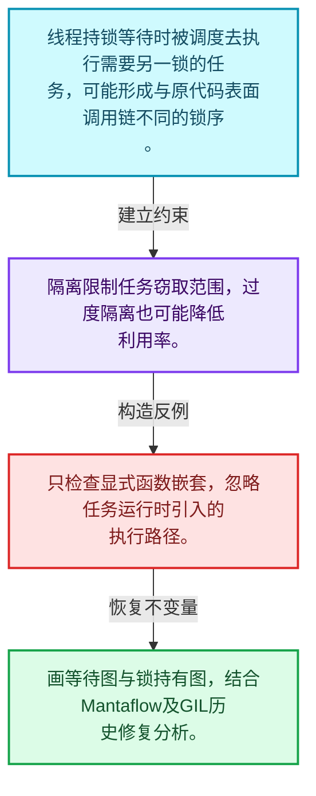
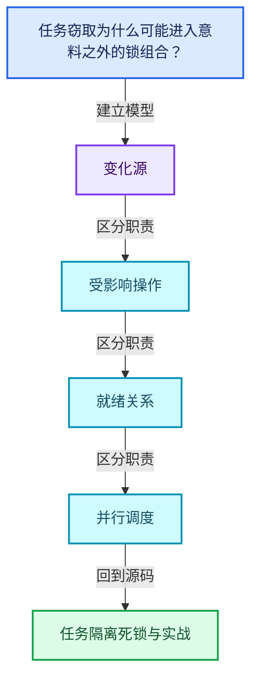
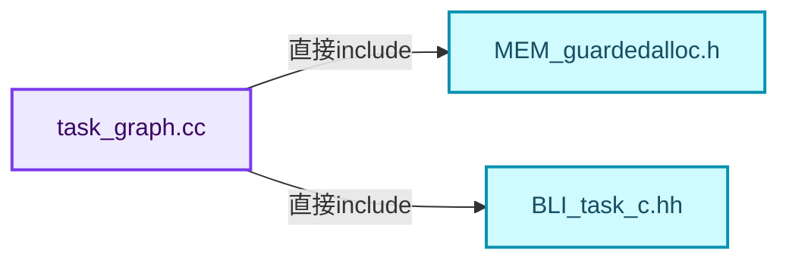
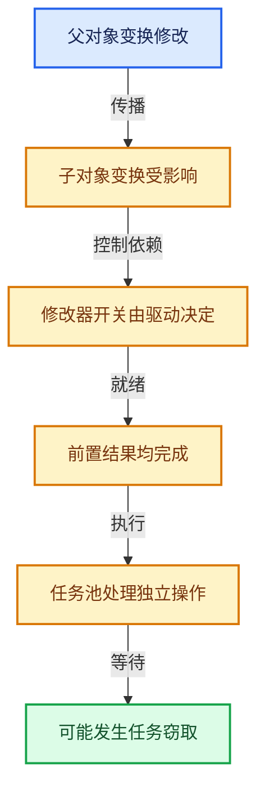

# 11-08 任务隔离死锁与实战

[方向导航](README.md) · [总目录](../README.md) · [覆盖索引](../%E6%BA%90%E7%A0%81%E7%89%88%E6%9C%AC%E4%B8%8E%E8%A6%86%E7%9B%96%E7%B4%A2%E5%BC%95.md)

> 阅读顺序：问题与数据模型 → 语法与类型 → 源码逐行 → 调用线索 → 历史与取舍 → 推演和练习。

- 基准 HEAD：`cbda6b96c26c0dee3c3b5cbb93960c4ac06a6b30`。
- 记录日期：2026-10-14。
- 教学示例状态：正文中的推演不是本机性能实测；已运行练习见验收报告。

## 一、从问题到设计

任务窃取为什么可能进入意料之外的锁组合？

等待期间执行其他任务改变调用路径，嵌套外部运行时或GIL需要分析锁序与隔离边界。

本篇把语法、数据语义和系统取舍连接起来。标记更新、判断需求、依赖满足和任务执行是分开的阶段。

### 本篇独立模型与设计推理

线程持锁等待时被调度去执行需要另一锁的任务，可能形成与原代码表面调用链不同的锁序。

设计取舍：隔离限制任务窃取范围，过度隔离也可能降低利用率。

最小反例：只检查显式函数嵌套，忽略任务运行时引入的执行路径。

推导与处理：画等待图与锁持有图，结合Mantaflow及GIL历史修复分析。



### 源码范围与相邻篇章

| 文件 | 本篇逐行范围 | 基准SHA-256 |
|---|---|---|
| [source/blender/blenlib/intern/task_graph.cc](../../../../../source/blender/blenlib/intern/task_graph.cc) | L1—L151 | `19d4f892d973f74ece771fc73fcec332bd5c7aab4974e522cea7403cc45dfbb2` |
| [source/blender/blenlib/intern/task_range.cc](../../../../../source/blender/blenlib/intern/task_range.cc) | L1—L341 | `842aaa26e71fc47bdd71976fdad57f16528ad8ac97774b8bd6c113d2c42ae609` |

同一主讲文件可能分多篇覆盖；超出本篇范围的符号通过覆盖索引定位。空行与纯注释保留在源码摘录中，逐行表解释有效语句与语法边界；许可证头统一保留。

前篇：[任务池与TBB接入](07-%E4%BB%BB%E5%8A%A1%E6%B1%A0%E4%B8%8ETBB%E6%8E%A5%E5%85%A5.md).

## 二、类型、数据与阅读地图



这是概念依赖图，边表示阅读关系，不声称是运行时调用顺序。

### 直接编译依赖



箭头只表示头文件包含关系；完整调用线索见后面的符号定位表。

## 三、关键词、语法与类型角色

### 只读限定 const

const约束当前访问路径可做的修改。const指针、指向const的指针、const视图对象、const元素是不同位置的限定；其他别名可能仍可修改原对象。

具体检查：分别写T* const、const T*与const T* const，并画出不可修改的层次。

### 异常边界 try与catch

try定义异常传播的局部边界。失败路径需要销毁已经成功构造的部分并释放相应存储；未构造的对象不能被析构。

具体检查：在第k次构造失败，列出已经存在的对象集合与待释放缓冲。

### 显式静态转换 static_cast

static_cast表达编译期允许的转换，不会自动验证运行时真实类型、指针寿命或索引边界。由void指针恢复T指针时，调用者仍须保证实际存储中确有合法T对象。

具体检查：标出转换前后的类型以及正确性依据来自哪里。

### 构造与new表达式

普通new可能分配并构造；placement new在给定地址构造，存储由其他机制提供。失败回滚应区分两类责任。

具体检查：追踪地址来自哪里、构造何时成功、由谁析构、由谁释放。

### 内部断言 assert

断言表达开发者预期成立的内部契约，发布构建可能关闭。它不能替代对不可信输入的完整错误处理，也不保证后续操作被运行时保护。

具体检查：对每条断言构造违反条件的输入，区分调用者错误与应向用户报告的错误。

### 独占拥有 unique_ptr

unique_ptr通过移动转移拥有关系，默认删除策略必须与资源来源匹配。get返回借用指针，release交出责任而不销毁。

具体检查：区分move、get、release和reset后谁负责销毁。

### 类型别名 using

类型别名为已有类型建立名字，不创建运行期对象。它常把模板内部使用的类型统一暴露给泛型调用者。

具体检查：展开别名直到基础类型，区分类型别名和变量声明。

## 四、真实源码与逐行讲解

源码块保持原行内容，原始行号由小节标题及逐行表给出。表中的调用定位是静态阅读辅助；重载、模板实例化、宏展开和虚调用需结合完整声明，不能仅凭词法出现证明动态调用。

### task_graph.cc：L1—L48

<!-- source:source/blender/blenlib/intern/task_graph.cc:1:48 -->

```cpp
/* SPDX-FileCopyrightText: 2023 Blender Authors
 *
 * SPDX-License-Identifier: GPL-2.0-or-later */

/** \file
 * \ingroup bli
 *
 * Task graph.
 */

#include "MEM_guardedalloc.h"

#include "BLI_task_c.hh"

#include <memory>
#include <vector>

#ifdef WITH_TBB
#  include <tbb/flow_graph.h>
#endif

namespace blender {

/* Task Graph */
struct TaskGraph {
#ifdef WITH_TBB
  tbb::flow::graph tbb_graph;
#endif
  std::vector<std::unique_ptr<TaskNode>> nodes;

  MEM_CXX_CLASS_ALLOC_FUNCS("task_graph:TaskGraph")
};

/* TaskNode - a node in the task graph. */
struct TaskNode {
  /* TBB Node. */
#ifdef WITH_TBB
  tbb::flow::continue_node<tbb::flow::continue_msg> tbb_node;
#endif
  /* Successors to execute after this task, for serial execution fallback. */
  std::vector<TaskNode *> successors;

  /* User function to be executed with given task data. */
  TaskGraphNodeRunFunction run_func;
  void *task_data;
  /* Optional callback to free task data along with the graph. If task data
   * is shared between nodes, only a single task node should free the data. */
  TaskGraphNodeFreeFunction free_func;
```

| 原始行 | 语义、约束与检查 |
|---|---|
| L11 | 引入编译依赖 "MEM_guardedalloc.h"；这是声明可见性关系，不表示运行时一定调用该文件的所有接口。 |
| L13 | 引入编译依赖 "BLI_task_c.hh"；这是声明可见性关系，不表示运行时一定调用该文件的所有接口。 |
| L15 | 引入编译依赖 <memory>；这是声明可见性关系，不表示运行时一定调用该文件的所有接口。 |
| L16 | 引入编译依赖 <vector>；这是声明可见性关系，不表示运行时一定调用该文件的所有接口。 |
| L18 | 预处理阶段处理 #ifdef WITH_TBB。它决定哪些代码进入编译，不是运行时分支；阅读行为时必须结合实际构建宏。 |
| L19 | 本行是连续声明或表达式的一部分：`#  include <tbb/flow_graph.h>`。与本段前后行合读；逗号、括号和限定符决定它属于参数、初始化列表还是实际计算。 |
| L20 | 预处理阶段处理 #endif。它决定哪些代码进入编译，不是运行时分支；阅读行为时必须结合实际构建宏。 |
| L22 | 把后续声明放入 blender 命名空间，影响名称查找和符号归属，不创建运行时对象。 |
| L25 | 声明或定义类型 `struct TaskGraph`。结合继承、访问权限和成员布局确认接口与拥有关系；前向声明本身没有完整对象布局。 |
| L26 | 预处理阶段处理 #ifdef WITH_TBB。它决定哪些代码进入编译，不是运行时分支；阅读行为时必须结合实际构建宏。 |
| L27 | 声明成员、局部对象或完成语句 `tbb::flow::graph tbb_graph`。若为指针或引用，它本身不说明拥有；若为值对象，其构造析构由所在作用域或外层对象管理。 |
| L28 | 预处理阶段处理 #endif。它决定哪些代码进入编译，不是运行时分支；阅读行为时必须结合实际构建宏。 |
| L29 | 声明成员、局部对象或完成语句 `std::vector<std::unique_ptr<TaskNode>> nodes`。若为指针或引用，它本身不说明拥有；若为值对象，其构造析构由所在作用域或外层对象管理。 |
| L31 | 出现调用或函数声明 `MEM_CXX_CLASS_ALLOC_FUNCS`，对应表达式为 `MEM_CXX_CLASS_ALLOC_FUNCS("task_graph:TaskGraph")`。参数求值、返回类型与重载需结合前后完整语句；静态文本引用不能证明动态目标。 |
| L32 | 结束当前语法单元。局部自动对象在离开其作用域时按规则销毁；这不等于所有被引用的外部数据也被释放。 |
| L35 | 声明或定义类型 `struct TaskNode`。结合继承、访问权限和成员布局确认接口与拥有关系；前向声明本身没有完整对象布局。 |
| L37 | 预处理阶段处理 #ifdef WITH_TBB。它决定哪些代码进入编译，不是运行时分支；阅读行为时必须结合实际构建宏。 |
| L38 | 声明成员、局部对象或完成语句 `tbb::flow::continue_node<tbb::flow::continue_msg> tbb_node`。若为指针或引用，它本身不说明拥有；若为值对象，其构造析构由所在作用域或外层对象管理。 |
| L39 | 预处理阶段处理 #endif。它决定哪些代码进入编译，不是运行时分支；阅读行为时必须结合实际构建宏。 |
| L41 | 声明成员、局部对象或完成语句 `std::vector<TaskNode *> successors`。若为指针或引用，它本身不说明拥有；若为值对象，其构造析构由所在作用域或外层对象管理。 |
| L44 | 声明成员、局部对象或完成语句 `TaskGraphNodeRunFunction run_func`。若为指针或引用，它本身不说明拥有；若为值对象，其构造析构由所在作用域或外层对象管理。 |
| L45 | 声明成员、局部对象或完成语句 `void *task_data`。若为指针或引用，它本身不说明拥有；若为值对象，其构造析构由所在作用域或外层对象管理。 |
| L48 | 声明成员、局部对象或完成语句 `TaskGraphNodeFreeFunction free_func`。若为指针或引用，它本身不说明拥有；若为值对象，其构造析构由所在作用域或外层对象管理。 |

### task_graph.cc：L49—L96

<!-- source:source/blender/blenlib/intern/task_graph.cc:49:96 -->

```cpp

  TaskNode(TaskGraph *task_graph,
           TaskGraphNodeRunFunction run_func,
           void *task_data,
           TaskGraphNodeFreeFunction free_func)
      :
#ifdef WITH_TBB
        tbb_node(task_graph->tbb_graph,
                 tbb::flow::unlimited,
                 [&](const tbb::flow::continue_msg input) { run(input); }),
#endif
        run_func(run_func),
        task_data(task_data),
        free_func(free_func)
  {
#ifndef WITH_TBB
    UNUSED_VARS(task_graph);
#endif
  }

  TaskNode(const TaskNode &other) = delete;
  TaskNode &operator=(const TaskNode &other) = delete;

  ~TaskNode()
  {
    if (task_data && free_func) {
      free_func(task_data);
    }
  }

#ifdef WITH_TBB
  tbb::flow::continue_msg run(const tbb::flow::continue_msg /*input*/)
  {
    run_func(task_data);
    return tbb::flow::continue_msg();
  }
#endif

  void run_serial()
  {
    run_func(task_data);
    for (TaskNode *successor : successors) {
      successor->run_serial();
    }
  }

  MEM_CXX_CLASS_ALLOC_FUNCS("task_graph:TaskNode")
};
```

本段语义重点：

- 分支证据 `task_data && free_func)`：分别推演条件成立与不成立，核对相同出口处的状态。

| 原始行 | 语义、约束与检查 |
|---|---|
| L50 | 出现调用或函数声明 `TaskNode`，对应表达式为 `TaskNode(TaskGraph *task_graph,`。参数求值、返回类型与重载需结合前后完整语句；静态文本引用不能证明动态目标。 |
| L51 | 本行是连续声明或表达式的一部分：`TaskGraphNodeRunFunction run_func,`。与本段前后行合读；逗号、括号和限定符决定它属于参数、初始化列表还是实际计算。 |
| L52 | 本行是连续声明或表达式的一部分：`void *task_data,`。与本段前后行合读；逗号、括号和限定符决定它属于参数、初始化列表还是实际计算。 |
| L53 | 本行是连续声明或表达式的一部分：`TaskGraphNodeFreeFunction free_func)`。与本段前后行合读；逗号、括号和限定符决定它属于参数、初始化列表还是实际计算。 |
| L54 | 本行是连续声明或表达式的一部分：`:`。与本段前后行合读；逗号、括号和限定符决定它属于参数、初始化列表还是实际计算。 |
| L55 | 预处理阶段处理 #ifdef WITH_TBB。它决定哪些代码进入编译，不是运行时分支；阅读行为时必须结合实际构建宏。 |
| L56 | 出现调用或函数声明 `tbb_node`，对应表达式为 `tbb_node(task_graph->tbb_graph,`。参数求值、返回类型与重载需结合前后完整语句；静态文本引用不能证明动态目标。 |
| L57 | 本行是连续声明或表达式的一部分：`tbb::flow::unlimited,`。与本段前后行合读；逗号、括号和限定符决定它属于参数、初始化列表还是实际计算。 |
| L58 | 出现调用或函数声明 `run`，对应表达式为 `[&](const tbb::flow::continue_msg input) { run(input); }),`。参数求值、返回类型与重载需结合前后完整语句；静态文本引用不能证明动态目标。 |
| L59 | 预处理阶段处理 #endif。它决定哪些代码进入编译，不是运行时分支；阅读行为时必须结合实际构建宏。 |
| L60 | 出现调用或函数声明 `run_func`，对应表达式为 `run_func(run_func),`。参数求值、返回类型与重载需结合前后完整语句；静态文本引用不能证明动态目标。 |
| L61 | 出现调用或函数声明 `task_data`，对应表达式为 `task_data(task_data),`。参数求值、返回类型与重载需结合前后完整语句；静态文本引用不能证明动态目标。 |
| L62 | 出现调用或函数声明 `free_func`，对应表达式为 `free_func(free_func)`。参数求值、返回类型与重载需结合前后完整语句；静态文本引用不能证明动态目标。 |
| L63 | 连接上一行的声明或控制结构与其语句块；后续行在这个作用域中执行或声明。 |
| L64 | 预处理阶段处理 #ifndef WITH_TBB。它决定哪些代码进入编译，不是运行时分支；阅读行为时必须结合实际构建宏。 |
| L65 | 出现调用或函数声明 `UNUSED_VARS`，对应表达式为 `UNUSED_VARS(task_graph);`。参数求值、返回类型与重载需结合前后完整语句；静态文本引用不能证明动态目标。 |
| L66 | 预处理阶段处理 #endif。它决定哪些代码进入编译，不是运行时分支；阅读行为时必须结合实际构建宏。 |
| L67 | 结束当前语法单元。局部自动对象在离开其作用域时按规则销毁；这不等于所有被引用的外部数据也被释放。 |
| L69 | 显式禁止接口：`TaskNode(const TaskNode &other) = delete;`。调用会在编译期被拒绝，常用于禁止复制或移动；这里没有释放对象或删除文件的运行时动作。 |
| L70 | 显式禁止接口：`TaskNode &operator=(const TaskNode &other) = delete;`。调用会在编译期被拒绝，常用于禁止复制或移动；这里没有释放对象或删除文件的运行时动作。 |
| L72 | 涉及析构接口或显式析构：`~TaskNode()`。检查目标对象已成功构造，且资源不会在另一条清理路径再次销毁。 |
| L73 | 连接上一行的声明或控制结构与其语句块；后续行在这个作用域中执行或声明。 |
| L74 | 判断 `task_data && free_func`，成立时进入本分支，否则继续后续路径。 |
| L75 | 出现调用或函数声明 `free_func`，对应表达式为 `free_func(task_data);`。参数求值、返回类型与重载需结合前后完整语句；静态文本引用不能证明动态目标。 |
| L76 | 结束当前语法单元。局部自动对象在离开其作用域时按规则销毁；这不等于所有被引用的外部数据也被释放。 |
| L77 | 结束当前语法单元。局部自动对象在离开其作用域时按规则销毁；这不等于所有被引用的外部数据也被释放。 |
| L79 | 预处理阶段处理 #ifdef WITH_TBB。它决定哪些代码进入编译，不是运行时分支；阅读行为时必须结合实际构建宏。 |
| L80 | 出现调用或函数声明 `run`，对应表达式为 `tbb::flow::continue_msg run(const tbb::flow::continue_msg )`。参数求值、返回类型与重载需结合前后完整语句；静态文本引用不能证明动态目标。 |
| L81 | 连接上一行的声明或控制结构与其语句块；后续行在这个作用域中执行或声明。 |
| L82 | 出现调用或函数声明 `run_func`，对应表达式为 `run_func(task_data);`。参数求值、返回类型与重载需结合前后完整语句；静态文本引用不能证明动态目标。 |
| L83 | 返回表达式 `tbb::flow::continue_msg()`。 |
| L84 | 结束当前语法单元。局部自动对象在离开其作用域时按规则销毁；这不等于所有被引用的外部数据也被释放。 |
| L85 | 预处理阶段处理 #endif。它决定哪些代码进入编译，不是运行时分支；阅读行为时必须结合实际构建宏。 |
| L87 | 出现调用或函数声明 `run_serial`，对应表达式为 `void run_serial()`。参数求值、返回类型与重载需结合前后完整语句；静态文本引用不能证明动态目标。 |
| L88 | 连接上一行的声明或控制结构与其语句块；后续行在这个作用域中执行或声明。 |
| L89 | 出现调用或函数声明 `run_func`，对应表达式为 `run_func(task_data);`。参数求值、返回类型与重载需结合前后完整语句；静态文本引用不能证明动态目标。 |
| L90 | 按 `for (TaskNode *successor : successors)` 指定的范围或条件重复执行。对照循环变量与真实元素编号；循环内调用成本乘以实际迭代次数。 |
| L91 | 出现调用或函数声明 `run_serial`，对应表达式为 `successor->run_serial();`。参数求值、返回类型与重载需结合前后完整语句；静态文本引用不能证明动态目标。 |
| L92 | 结束当前语法单元。局部自动对象在离开其作用域时按规则销毁；这不等于所有被引用的外部数据也被释放。 |
| L93 | 结束当前语法单元。局部自动对象在离开其作用域时按规则销毁；这不等于所有被引用的外部数据也被释放。 |
| L95 | 出现调用或函数声明 `MEM_CXX_CLASS_ALLOC_FUNCS`，对应表达式为 `MEM_CXX_CLASS_ALLOC_FUNCS("task_graph:TaskNode")`。参数求值、返回类型与重载需结合前后完整语句；静态文本引用不能证明动态目标。 |
| L96 | 结束当前语法单元。局部自动对象在离开其作用域时按规则销毁；这不等于所有被引用的外部数据也被释放。 |

### task_graph.cc：L97—L151

<!-- source:source/blender/blenlib/intern/task_graph.cc:97:151 -->

```cpp

TaskGraph *BLI_task_graph_create()
{
  return new TaskGraph();
}

void BLI_task_graph_free(TaskGraph *task_graph)
{
  delete task_graph;
}

void BLI_task_graph_work_and_wait(TaskGraph *task_graph)
{
#ifdef WITH_TBB
  task_graph->tbb_graph.wait_for_all();
#else
  UNUSED_VARS(task_graph);
#endif
}

TaskNode *BLI_task_graph_node_create(TaskGraph *task_graph,
                                     TaskGraphNodeRunFunction run,
                                     void *user_data,
                                     TaskGraphNodeFreeFunction free_func)
{
  TaskNode *task_node = new TaskNode(task_graph, run, user_data, free_func);
  task_graph->nodes.push_back(std::unique_ptr<TaskNode>(task_node));
  return task_node;
}

bool BLI_task_graph_node_push_work(TaskNode *task_node)
{
#ifdef WITH_TBB
  if (BLI_task_scheduler_num_threads() > 1) {
    return task_node->tbb_node.try_put(tbb::flow::continue_msg());
  }
#endif

  task_node->run_serial();
  return true;
}

void BLI_task_graph_edge_create(TaskNode *from_node, TaskNode *to_node)
{
#ifdef WITH_TBB
  if (BLI_task_scheduler_num_threads() > 1) {
    tbb::flow::make_edge(from_node->tbb_node, to_node->tbb_node);
    return;
  }
#endif

  from_node->successors.push_back(to_node);
}

}  // namespace blender
```

本段语义重点：

- 分支证据 `BLI_task_scheduler_num_threads() > 1)`：分别推演条件成立与不成立，核对相同出口处的状态。
- 分支证据 `BLI_task_scheduler_num_threads() > 1)`：分别推演条件成立与不成立，核对相同出口处的状态。

| 原始行 | 语义、约束与检查 |
|---|---|
| L98 | 出现调用或函数声明 `BLI_task_graph_create`，对应表达式为 `TaskGraph *BLI_task_graph_create()`。参数求值、返回类型与重载需结合前后完整语句；静态文本引用不能证明动态目标。 |
| L99 | 连接上一行的声明或控制结构与其语句块；后续行在这个作用域中执行或声明。 |
| L100 | 返回表达式 `new TaskGraph()`。 |
| L101 | 结束当前语法单元。局部自动对象在离开其作用域时按规则销毁；这不等于所有被引用的外部数据也被释放。 |
| L103 | 出现调用或函数声明 `BLI_task_graph_free`，对应表达式为 `void BLI_task_graph_free(TaskGraph *task_graph)`。参数求值、返回类型与重载需结合前后完整语句；静态文本引用不能证明动态目标。 |
| L104 | 连接上一行的声明或控制结构与其语句块；后续行在这个作用域中执行或声明。 |
| L105 | 声明成员、局部对象或完成语句 `delete task_graph`。若为指针或引用，它本身不说明拥有；若为值对象，其构造析构由所在作用域或外层对象管理。 |
| L106 | 结束当前语法单元。局部自动对象在离开其作用域时按规则销毁；这不等于所有被引用的外部数据也被释放。 |
| L108 | 出现调用或函数声明 `BLI_task_graph_work_and_wait`，对应表达式为 `void BLI_task_graph_work_and_wait(TaskGraph *task_graph)`。参数求值、返回类型与重载需结合前后完整语句；静态文本引用不能证明动态目标。 |
| L109 | 连接上一行的声明或控制结构与其语句块；后续行在这个作用域中执行或声明。 |
| L110 | 预处理阶段处理 #ifdef WITH_TBB。它决定哪些代码进入编译，不是运行时分支；阅读行为时必须结合实际构建宏。 |
| L111 | 出现调用或函数声明 `wait_for_all`，对应表达式为 `task_graph->tbb_graph.wait_for_all();`。参数求值、返回类型与重载需结合前后完整语句；静态文本引用不能证明动态目标。 |
| L112 | 预处理阶段处理 #else。它决定哪些代码进入编译，不是运行时分支；阅读行为时必须结合实际构建宏。 |
| L113 | 出现调用或函数声明 `UNUSED_VARS`，对应表达式为 `UNUSED_VARS(task_graph);`。参数求值、返回类型与重载需结合前后完整语句；静态文本引用不能证明动态目标。 |
| L114 | 预处理阶段处理 #endif。它决定哪些代码进入编译，不是运行时分支；阅读行为时必须结合实际构建宏。 |
| L115 | 结束当前语法单元。局部自动对象在离开其作用域时按规则销毁；这不等于所有被引用的外部数据也被释放。 |
| L117 | 出现调用或函数声明 `BLI_task_graph_node_create`，对应表达式为 `TaskNode *BLI_task_graph_node_create(TaskGraph *task_graph,`。参数求值、返回类型与重载需结合前后完整语句；静态文本引用不能证明动态目标。 |
| L118 | 本行是连续声明或表达式的一部分：`TaskGraphNodeRunFunction run,`。与本段前后行合读；逗号、括号和限定符决定它属于参数、初始化列表还是实际计算。 |
| L119 | 本行是连续声明或表达式的一部分：`void *user_data,`。与本段前后行合读；逗号、括号和限定符决定它属于参数、初始化列表还是实际计算。 |
| L120 | 本行是连续声明或表达式的一部分：`TaskGraphNodeFreeFunction free_func)`。与本段前后行合读；逗号、括号和限定符决定它属于参数、初始化列表还是实际计算。 |
| L121 | 连接上一行的声明或控制结构与其语句块；后续行在这个作用域中执行或声明。 |
| L122 | 把右侧 `new TaskNode(task_graph, run, user_data, free_func)` 用于初始化或更新左侧 `TaskNode *task_node`。声明初始化与已有对象赋值应按上下文区分；有资源的类型会调用相应特殊成员。 |
| L123 | 出现调用或函数声明 `push_back`，对应表达式为 `task_graph->nodes.push_back(std::unique_ptr<TaskNode>(task_node));`。参数求值、返回类型与重载需结合前后完整语句；静态文本引用不能证明动态目标。 |
| L124 | 返回表达式 `task_node`。 |
| L125 | 结束当前语法单元。局部自动对象在离开其作用域时按规则销毁；这不等于所有被引用的外部数据也被释放。 |
| L127 | 出现调用或函数声明 `BLI_task_graph_node_push_work`，对应表达式为 `bool BLI_task_graph_node_push_work(TaskNode *task_node)`。参数求值、返回类型与重载需结合前后完整语句；静态文本引用不能证明动态目标。 |
| L128 | 连接上一行的声明或控制结构与其语句块；后续行在这个作用域中执行或声明。 |
| L129 | 预处理阶段处理 #ifdef WITH_TBB。它决定哪些代码进入编译，不是运行时分支；阅读行为时必须结合实际构建宏。 |
| L130 | 判断 `BLI_task_scheduler_num_threads() > 1`，成立时进入本分支，否则继续后续路径。 |
| L131 | 返回表达式 `task_node->tbb_node.try_put(tbb::flow::continue_msg())`。 |
| L132 | 结束当前语法单元。局部自动对象在离开其作用域时按规则销毁；这不等于所有被引用的外部数据也被释放。 |
| L133 | 预处理阶段处理 #endif。它决定哪些代码进入编译，不是运行时分支；阅读行为时必须结合实际构建宏。 |
| L135 | 出现调用或函数声明 `run_serial`，对应表达式为 `task_node->run_serial();`。参数求值、返回类型与重载需结合前后完整语句；静态文本引用不能证明动态目标。 |
| L136 | 返回表达式 `true`。这是本路径的布尔结果，具体成功、存在或状态含义由函数接口规定。 |
| L137 | 结束当前语法单元。局部自动对象在离开其作用域时按规则销毁；这不等于所有被引用的外部数据也被释放。 |
| L139 | 出现调用或函数声明 `BLI_task_graph_edge_create`，对应表达式为 `void BLI_task_graph_edge_create(TaskNode *from_node, TaskNode *to_node)`。参数求值、返回类型与重载需结合前后完整语句；静态文本引用不能证明动态目标。 |
| L140 | 连接上一行的声明或控制结构与其语句块；后续行在这个作用域中执行或声明。 |
| L141 | 预处理阶段处理 #ifdef WITH_TBB。它决定哪些代码进入编译，不是运行时分支；阅读行为时必须结合实际构建宏。 |
| L142 | 判断 `BLI_task_scheduler_num_threads() > 1`，成立时进入本分支，否则继续后续路径。 |
| L143 | 出现调用或函数声明 `tbb::flow::make_edge`，对应表达式为 `tbb::flow::make_edge(from_node->tbb_node, to_node->tbb_node);`。参数求值、返回类型与重载需结合前后完整语句；静态文本引用不能证明动态目标。 |
| L144 | 结束当前函数，本路径不再执行后续语句；局部对象按作用域规则清理。 |
| L145 | 结束当前语法单元。局部自动对象在离开其作用域时按规则销毁；这不等于所有被引用的外部数据也被释放。 |
| L146 | 预处理阶段处理 #endif。它决定哪些代码进入编译，不是运行时分支；阅读行为时必须结合实际构建宏。 |
| L148 | 出现调用或函数声明 `push_back`，对应表达式为 `from_node->successors.push_back(to_node);`。参数求值、返回类型与重载需结合前后完整语句；静态文本引用不能证明动态目标。 |
| L149 | 结束当前语法单元。局部自动对象在离开其作用域时按规则销毁；这不等于所有被引用的外部数据也被释放。 |
| L151 | 结束当前语法单元。局部自动对象在离开其作用域时按规则销毁；这不等于所有被引用的外部数据也被释放。 |

### task_range.cc：L1—L49

<!-- source:source/blender/blenlib/intern/task_range.cc:1:49 -->

```cpp
/* SPDX-FileCopyrightText: 2023 Blender Authors
 *
 * SPDX-License-Identifier: GPL-2.0-or-later */

/** \file
 * \ingroup bli
 *
 * Task parallel range functions.
 */

#include <cstdlib>

#include "MEM_guardedalloc.h"

#include "BLI_array.hh"
#include "BLI_lazy_threading.hh"
#include "BLI_offset_indices.hh"
#include "BLI_task.hh"
#include "BLI_task_c.hh"
#include "BLI_threads.hh"
#include "BLI_vector.hh"

#include "atomic_ops.h"

#ifdef WITH_TBB
#  include <tbb/blocked_range.h>
#  include <tbb/enumerable_thread_specific.h>
#  include <tbb/parallel_for.h>
#  include <tbb/parallel_reduce.h>
#endif

namespace blender {

#ifdef WITH_TBB

/* Functor for running TBB parallel_for and parallel_reduce. */
struct RangeTask {
  TaskParallelRangeFunc func;
  void *userdata;
  const TaskParallelSettings *settings;

  void *userdata_chunk;

  /* Root constructor. */
  RangeTask(TaskParallelRangeFunc func, void *userdata, const TaskParallelSettings *settings)
      : func(func), userdata(userdata), settings(settings)
  {
    init_chunk(settings->userdata_chunk);
  }
```

| 原始行 | 语义、约束与检查 |
|---|---|
| L11 | 引入编译依赖 <cstdlib>；这是声明可见性关系，不表示运行时一定调用该文件的所有接口。 |
| L13 | 引入编译依赖 "MEM_guardedalloc.h"；这是声明可见性关系，不表示运行时一定调用该文件的所有接口。 |
| L15 | 引入编译依赖 "BLI_array.hh"；这是声明可见性关系，不表示运行时一定调用该文件的所有接口。 |
| L16 | 引入编译依赖 "BLI_lazy_threading.hh"；这是声明可见性关系，不表示运行时一定调用该文件的所有接口。 |
| L17 | 引入编译依赖 "BLI_offset_indices.hh"；这是声明可见性关系，不表示运行时一定调用该文件的所有接口。 |
| L18 | 引入编译依赖 "BLI_task.hh"；这是声明可见性关系，不表示运行时一定调用该文件的所有接口。 |
| L19 | 引入编译依赖 "BLI_task_c.hh"；这是声明可见性关系，不表示运行时一定调用该文件的所有接口。 |
| L20 | 引入编译依赖 "BLI_threads.hh"；这是声明可见性关系，不表示运行时一定调用该文件的所有接口。 |
| L21 | 引入编译依赖 "BLI_vector.hh"；这是声明可见性关系，不表示运行时一定调用该文件的所有接口。 |
| L23 | 引入编译依赖 "atomic_ops.h"；这是声明可见性关系，不表示运行时一定调用该文件的所有接口。 |
| L25 | 预处理阶段处理 #ifdef WITH_TBB。它决定哪些代码进入编译，不是运行时分支；阅读行为时必须结合实际构建宏。 |
| L26 | 本行是连续声明或表达式的一部分：`#  include <tbb/blocked_range.h>`。与本段前后行合读；逗号、括号和限定符决定它属于参数、初始化列表还是实际计算。 |
| L27 | 本行是连续声明或表达式的一部分：`#  include <tbb/enumerable_thread_specific.h>`。与本段前后行合读；逗号、括号和限定符决定它属于参数、初始化列表还是实际计算。 |
| L28 | 本行是连续声明或表达式的一部分：`#  include <tbb/parallel_for.h>`。与本段前后行合读；逗号、括号和限定符决定它属于参数、初始化列表还是实际计算。 |
| L29 | 本行是连续声明或表达式的一部分：`#  include <tbb/parallel_reduce.h>`。与本段前后行合读；逗号、括号和限定符决定它属于参数、初始化列表还是实际计算。 |
| L30 | 预处理阶段处理 #endif。它决定哪些代码进入编译，不是运行时分支；阅读行为时必须结合实际构建宏。 |
| L32 | 把后续声明放入 blender 命名空间，影响名称查找和符号归属，不创建运行时对象。 |
| L34 | 预处理阶段处理 #ifdef WITH_TBB。它决定哪些代码进入编译，不是运行时分支；阅读行为时必须结合实际构建宏。 |
| L37 | 声明或定义类型 `struct RangeTask`。结合继承、访问权限和成员布局确认接口与拥有关系；前向声明本身没有完整对象布局。 |
| L38 | 声明成员、局部对象或完成语句 `TaskParallelRangeFunc func`。若为指针或引用，它本身不说明拥有；若为值对象，其构造析构由所在作用域或外层对象管理。 |
| L39 | 声明成员、局部对象或完成语句 `void *userdata`。若为指针或引用，它本身不说明拥有；若为值对象，其构造析构由所在作用域或外层对象管理。 |
| L40 | 声明成员、局部对象或完成语句 `const TaskParallelSettings *settings`。若为指针或引用，它本身不说明拥有；若为值对象，其构造析构由所在作用域或外层对象管理。 |
| L42 | 声明成员、局部对象或完成语句 `void *userdata_chunk`。若为指针或引用，它本身不说明拥有；若为值对象，其构造析构由所在作用域或外层对象管理。 |
| L45 | 出现调用或函数声明 `RangeTask`，对应表达式为 `RangeTask(TaskParallelRangeFunc func, void *userdata, const TaskParallelSettings *settings)`。参数求值、返回类型与重载需结合前后完整语句；静态文本引用不能证明动态目标。 |
| L46 | 出现调用或函数声明 `func`，对应表达式为 `: func(func), userdata(userdata), settings(settings)`。参数求值、返回类型与重载需结合前后完整语句；静态文本引用不能证明动态目标。 |
| L47 | 连接上一行的声明或控制结构与其语句块；后续行在这个作用域中执行或声明。 |
| L48 | 出现调用或函数声明 `init_chunk`，对应表达式为 `init_chunk(settings->userdata_chunk);`。参数求值、返回类型与重载需结合前后完整语句；静态文本引用不能证明动态目标。 |
| L49 | 结束当前语法单元。局部自动对象在离开其作用域时按规则销毁；这不等于所有被引用的外部数据也被释放。 |

### task_range.cc：L50—L97

<!-- source:source/blender/blenlib/intern/task_range.cc:50:97 -->

```cpp

  /* Copy constructor. */
  RangeTask(const RangeTask &other)
      : func(other.func), userdata(other.userdata), settings(other.settings)
  {
    init_chunk(settings->userdata_chunk);
  }

  /* Splitting constructor for parallel reduce. */
  RangeTask(RangeTask &other, tbb::split /*unused*/)
      : func(other.func), userdata(other.userdata), settings(other.settings)
  {
    init_chunk(settings->userdata_chunk);
  }

  ~RangeTask()
  {
    if (settings->func_free != nullptr && userdata_chunk != nullptr) {
      settings->func_free(userdata, userdata_chunk);
    }
    MEM_SAFE_DELETE_VOID(userdata_chunk);
  }

  void init_chunk(void *from_chunk)
  {
    if (from_chunk) {
      userdata_chunk = MEM_new_uninitialized(settings->userdata_chunk_size, "RangeTask");
      memcpy(userdata_chunk, from_chunk, settings->userdata_chunk_size);
    }
    else {
      userdata_chunk = nullptr;
    }
  }

  void operator()(const tbb::blocked_range<int> &r) const
  {
    TaskParallelTLS tls;
    tls.userdata_chunk = userdata_chunk;
    for (int i = r.begin(); i != r.end(); ++i) {
      func(userdata, i, &tls);
    }
  }

  void join(const RangeTask &other)
  {
    settings->func_reduce(userdata, userdata_chunk, other.userdata_chunk);
  }
};
```

本段语义重点：

- `memcpy`：按字节复制表示；必须由类型性质和生命周期规则证明可用，不能泛化到任意拥有资源对象。

| 原始行 | 语义、约束与检查 |
|---|---|
| L52 | 出现调用或函数声明 `RangeTask`，对应表达式为 `RangeTask(const RangeTask &other)`。参数求值、返回类型与重载需结合前后完整语句；静态文本引用不能证明动态目标。 |
| L53 | 出现调用或函数声明 `func`，对应表达式为 `: func(other.func), userdata(other.userdata), settings(other.settings)`。参数求值、返回类型与重载需结合前后完整语句；静态文本引用不能证明动态目标。 |
| L54 | 连接上一行的声明或控制结构与其语句块；后续行在这个作用域中执行或声明。 |
| L55 | 出现调用或函数声明 `init_chunk`，对应表达式为 `init_chunk(settings->userdata_chunk);`。参数求值、返回类型与重载需结合前后完整语句；静态文本引用不能证明动态目标。 |
| L56 | 结束当前语法单元。局部自动对象在离开其作用域时按规则销毁；这不等于所有被引用的外部数据也被释放。 |
| L59 | 出现调用或函数声明 `RangeTask`，对应表达式为 `RangeTask(RangeTask &other, tbb::split )`。参数求值、返回类型与重载需结合前后完整语句；静态文本引用不能证明动态目标。 |
| L60 | 出现调用或函数声明 `func`，对应表达式为 `: func(other.func), userdata(other.userdata), settings(other.settings)`。参数求值、返回类型与重载需结合前后完整语句；静态文本引用不能证明动态目标。 |
| L61 | 连接上一行的声明或控制结构与其语句块；后续行在这个作用域中执行或声明。 |
| L62 | 出现调用或函数声明 `init_chunk`，对应表达式为 `init_chunk(settings->userdata_chunk);`。参数求值、返回类型与重载需结合前后完整语句；静态文本引用不能证明动态目标。 |
| L63 | 结束当前语法单元。局部自动对象在离开其作用域时按规则销毁；这不等于所有被引用的外部数据也被释放。 |
| L65 | 涉及析构接口或显式析构：`~RangeTask()`。检查目标对象已成功构造，且资源不会在另一条清理路径再次销毁。 |
| L66 | 连接上一行的声明或控制结构与其语句块；后续行在这个作用域中执行或声明。 |
| L67 | 判断 `settings->func_free != nullptr && userdata_chunk != nullptr`，成立时进入本分支，否则继续后续路径。这里区分空地址与可用地址，但非空本身仍不能证明对象存活。 |
| L68 | 出现调用或函数声明 `func_free`，对应表达式为 `settings->func_free(userdata, userdata_chunk);`。参数求值、返回类型与重载需结合前后完整语句；静态文本引用不能证明动态目标。 |
| L69 | 结束当前语法单元。局部自动对象在离开其作用域时按规则销毁；这不等于所有被引用的外部数据也被释放。 |
| L70 | 出现调用或函数声明 `MEM_SAFE_DELETE_VOID`，对应表达式为 `MEM_SAFE_DELETE_VOID(userdata_chunk);`。参数求值、返回类型与重载需结合前后完整语句；静态文本引用不能证明动态目标。 |
| L71 | 结束当前语法单元。局部自动对象在离开其作用域时按规则销毁；这不等于所有被引用的外部数据也被释放。 |
| L73 | 出现调用或函数声明 `init_chunk`，对应表达式为 `void init_chunk(void *from_chunk)`。参数求值、返回类型与重载需结合前后完整语句；静态文本引用不能证明动态目标。 |
| L74 | 连接上一行的声明或控制结构与其语句块；后续行在这个作用域中执行或声明。 |
| L75 | 判断 `from_chunk`，成立时进入本分支，否则继续后续路径。 |
| L76 | 把右侧 `MEM_new_uninitialized(settings->userdata_chunk_size, "RangeTask")` 用于初始化或更新左侧 `userdata_chunk`。声明初始化与已有对象赋值应按上下文区分；有资源的类型会调用相应特殊成员。 |
| L77 | 本行使用 `memcpy`：按字节复制表示；必须由类型性质和生命周期规则证明可用，不能泛化到任意拥有资源对象。 |
| L78 | 结束当前语法单元。局部自动对象在离开其作用域时按规则销毁；这不等于所有被引用的外部数据也被释放。 |
| L79 | 处理前一条件不成立的互补路径。比较两条路径最后是否恢复同一不变量，以及是否产生不同的资源责任。 |
| L80 | 把右侧 `nullptr` 用于初始化或更新左侧 `userdata_chunk`。声明初始化与已有对象赋值应按上下文区分；有资源的类型会调用相应特殊成员。 |
| L81 | 结束当前语法单元。局部自动对象在离开其作用域时按规则销毁；这不等于所有被引用的外部数据也被释放。 |
| L82 | 结束当前语法单元。局部自动对象在离开其作用域时按规则销毁；这不等于所有被引用的外部数据也被释放。 |
| L84 | 运算符重载声明、定义或显式调用：`void operator()(const tbb::blocked_range<int> &r) const`。结合参数和返回类型判断是赋值、索引、比较还是转换；operator=声明中的等号不是在给名为operator的变量赋值。 |
| L85 | 连接上一行的声明或控制结构与其语句块；后续行在这个作用域中执行或声明。 |
| L86 | 声明成员、局部对象或完成语句 `TaskParallelTLS tls`。若为指针或引用，它本身不说明拥有；若为值对象，其构造析构由所在作用域或外层对象管理。 |
| L87 | 把右侧 `userdata_chunk` 用于初始化或更新左侧 `tls.userdata_chunk`。声明初始化与已有对象赋值应按上下文区分；有资源的类型会调用相应特殊成员。 |
| L88 | 按 `for (int i = r.begin(); i != r.end(); ++i)` 指定的范围或条件重复执行。对照循环变量与真实元素编号；循环内调用成本乘以实际迭代次数。 |
| L89 | 出现调用或函数声明 `func`，对应表达式为 `func(userdata, i, &tls);`。参数求值、返回类型与重载需结合前后完整语句；静态文本引用不能证明动态目标。 |
| L90 | 结束当前语法单元。局部自动对象在离开其作用域时按规则销毁；这不等于所有被引用的外部数据也被释放。 |
| L91 | 结束当前语法单元。局部自动对象在离开其作用域时按规则销毁；这不等于所有被引用的外部数据也被释放。 |
| L93 | 出现调用或函数声明 `join`，对应表达式为 `void join(const RangeTask &other)`。参数求值、返回类型与重载需结合前后完整语句；静态文本引用不能证明动态目标。 |
| L94 | 连接上一行的声明或控制结构与其语句块；后续行在这个作用域中执行或声明。 |
| L95 | 出现调用或函数声明 `func_reduce`，对应表达式为 `settings->func_reduce(userdata, userdata_chunk, other.userdata_chunk);`。参数求值、返回类型与重载需结合前后完整语句；静态文本引用不能证明动态目标。 |
| L96 | 结束当前语法单元。局部自动对象在离开其作用域时按规则销毁；这不等于所有被引用的外部数据也被释放。 |
| L97 | 结束当前语法单元。局部自动对象在离开其作用域时按规则销毁；这不等于所有被引用的外部数据也被释放。 |

### task_range.cc：L98—L139

<!-- source:source/blender/blenlib/intern/task_range.cc:98:139 -->

```cpp

#endif

void BLI_task_parallel_range(const int start,
                             const int stop,
                             void *userdata,
                             TaskParallelRangeFunc func,
                             const TaskParallelSettings *settings)
{
#ifdef WITH_TBB
  /* Multithreading. */
  if (settings->use_threading && BLI_task_scheduler_num_threads() > 1) {
    RangeTask task(func, userdata, settings);
    const size_t grainsize = std::max(settings->min_iter_per_thread, 1);
    const tbb::blocked_range<int> range(start, stop, grainsize);

    lazy_threading::send_hint();

    if (settings->func_reduce) {
      parallel_reduce(range, task);
      if (settings->userdata_chunk) {
        memcpy(settings->userdata_chunk, task.userdata_chunk, settings->userdata_chunk_size);
      }
    }
    else {
      parallel_for(range, task);
    }
    return;
  }
#endif

  /* Single threaded. Nothing to reduce as everything is accumulated into the
   * main userdata chunk directly. */
  TaskParallelTLS tls;
  tls.userdata_chunk = settings->userdata_chunk;
  for (int i = start; i < stop; i++) {
    func(userdata, i, &tls);
  }
  if (settings->func_free != nullptr && settings->userdata_chunk != nullptr) {
    settings->func_free(userdata, settings->userdata_chunk);
  }
}
```

本段语义重点：

- `std::max`：取较大值，在容量计算中常用于同时满足请求量和增长策略。
- `memcpy`：按字节复制表示；必须由类型性质和生命周期规则证明可用，不能泛化到任意拥有资源对象。

| 原始行 | 语义、约束与检查 |
|---|---|
| L99 | 预处理阶段处理 #endif。它决定哪些代码进入编译，不是运行时分支；阅读行为时必须结合实际构建宏。 |
| L101 | 出现调用或函数声明 `BLI_task_parallel_range`，对应表达式为 `void BLI_task_parallel_range(const int start,`。参数求值、返回类型与重载需结合前后完整语句；静态文本引用不能证明动态目标。 |
| L102 | 本行是连续声明或表达式的一部分：`const int stop,`。与本段前后行合读；逗号、括号和限定符决定它属于参数、初始化列表还是实际计算。 |
| L103 | 本行是连续声明或表达式的一部分：`void *userdata,`。与本段前后行合读；逗号、括号和限定符决定它属于参数、初始化列表还是实际计算。 |
| L104 | 本行是连续声明或表达式的一部分：`TaskParallelRangeFunc func,`。与本段前后行合读；逗号、括号和限定符决定它属于参数、初始化列表还是实际计算。 |
| L105 | 本行是连续声明或表达式的一部分：`const TaskParallelSettings *settings)`。与本段前后行合读；逗号、括号和限定符决定它属于参数、初始化列表还是实际计算。 |
| L106 | 连接上一行的声明或控制结构与其语句块；后续行在这个作用域中执行或声明。 |
| L107 | 预处理阶段处理 #ifdef WITH_TBB。它决定哪些代码进入编译，不是运行时分支；阅读行为时必须结合实际构建宏。 |
| L109 | 判断 `settings->use_threading && BLI_task_scheduler_num_threads() > 1`，成立时进入本分支，否则继续后续路径。 |
| L110 | 出现调用或函数声明 `task`，对应表达式为 `RangeTask task(func, userdata, settings);`。参数求值、返回类型与重载需结合前后完整语句；静态文本引用不能证明动态目标。 |
| L111 | 本行使用 `std::max`：取较大值，在容量计算中常用于同时满足请求量和增长策略。 |
| L112 | 声明接口 `const tbb::blocked_range<int> range(start, stop, grainsize)`，本行没有对应函数体；返回类型、参数限定和const/noexcept共同组成调用契约，实际行为需继续定位实现。 |
| L114 | 出现调用或函数声明 `lazy_threading::send_hint`，对应表达式为 `lazy_threading::send_hint();`。参数求值、返回类型与重载需结合前后完整语句；静态文本引用不能证明动态目标。 |
| L116 | 判断 `settings->func_reduce`，成立时进入本分支，否则继续后续路径。 |
| L117 | 出现调用或函数声明 `parallel_reduce`，对应表达式为 `parallel_reduce(range, task);`。参数求值、返回类型与重载需结合前后完整语句；静态文本引用不能证明动态目标。 |
| L118 | 判断 `settings->userdata_chunk`，成立时进入本分支，否则继续后续路径。 |
| L119 | 本行使用 `memcpy`：按字节复制表示；必须由类型性质和生命周期规则证明可用，不能泛化到任意拥有资源对象。 |
| L120 | 结束当前语法单元。局部自动对象在离开其作用域时按规则销毁；这不等于所有被引用的外部数据也被释放。 |
| L121 | 结束当前语法单元。局部自动对象在离开其作用域时按规则销毁；这不等于所有被引用的外部数据也被释放。 |
| L122 | 处理前一条件不成立的互补路径。比较两条路径最后是否恢复同一不变量，以及是否产生不同的资源责任。 |
| L123 | 出现调用或函数声明 `parallel_for`，对应表达式为 `parallel_for(range, task);`。参数求值、返回类型与重载需结合前后完整语句；静态文本引用不能证明动态目标。 |
| L124 | 结束当前语法单元。局部自动对象在离开其作用域时按规则销毁；这不等于所有被引用的外部数据也被释放。 |
| L125 | 结束当前函数，本路径不再执行后续语句；局部对象按作用域规则清理。 |
| L126 | 结束当前语法单元。局部自动对象在离开其作用域时按规则销毁；这不等于所有被引用的外部数据也被释放。 |
| L127 | 预处理阶段处理 #endif。它决定哪些代码进入编译，不是运行时分支；阅读行为时必须结合实际构建宏。 |
| L131 | 声明成员、局部对象或完成语句 `TaskParallelTLS tls`。若为指针或引用，它本身不说明拥有；若为值对象，其构造析构由所在作用域或外层对象管理。 |
| L132 | 把右侧 `settings->userdata_chunk` 用于初始化或更新左侧 `tls.userdata_chunk`。声明初始化与已有对象赋值应按上下文区分；有资源的类型会调用相应特殊成员。 |
| L133 | 按 `for (int i = start; i < stop; i++)` 指定的范围或条件重复执行。对照循环变量与真实元素编号；循环内调用成本乘以实际迭代次数。 |
| L134 | 出现调用或函数声明 `func`，对应表达式为 `func(userdata, i, &tls);`。参数求值、返回类型与重载需结合前后完整语句；静态文本引用不能证明动态目标。 |
| L135 | 结束当前语法单元。局部自动对象在离开其作用域时按规则销毁；这不等于所有被引用的外部数据也被释放。 |
| L136 | 判断 `settings->func_free != nullptr && settings->userdata_chunk != nullptr`，成立时进入本分支，否则继续后续路径。这里区分空地址与可用地址，但非空本身仍不能证明对象存活。 |
| L137 | 出现调用或函数声明 `func_free`，对应表达式为 `settings->func_free(userdata, settings->userdata_chunk);`。参数求值、返回类型与重载需结合前后完整语句；静态文本引用不能证明动态目标。 |
| L138 | 结束当前语法单元。局部自动对象在离开其作用域时按规则销毁；这不等于所有被引用的外部数据也被释放。 |
| L139 | 结束当前语法单元。局部自动对象在离开其作用域时按规则销毁；这不等于所有被引用的外部数据也被释放。 |

### task_range.cc：L140—L178

<!-- source:source/blender/blenlib/intern/task_range.cc:140:178 -->

```cpp

int BLI_task_parallel_thread_id(const TaskParallelTLS * /*tls*/)
{
#ifdef WITH_TBB
  /* Get a unique thread ID for texture nodes. In the future we should get rid
   * of the thread ID and change texture evaluation to not require per-thread
   * storage that can't be efficiently allocated on the stack. */
  static tbb::enumerable_thread_specific<int> tbb_thread_id(-1);
  static int tbb_thread_id_counter = 0;

  int &thread_id = tbb_thread_id.local();
  if (thread_id == -1) {
    thread_id = atomic_fetch_and_add_int32(&tbb_thread_id_counter, 1);
    if (thread_id >= BLENDER_MAX_THREADS) {
      BLI_assert_msg(0, "Maximum number of threads exceeded for sculpting");
      thread_id = thread_id % BLENDER_MAX_THREADS;
    }
  }
  return thread_id;
#else
  return 0;
#endif
}

namespace threading::detail {

#ifdef WITH_TBB
static void parallel_for_impl_static_size(const IndexRange range,
                                          const int64_t grain_size,
                                          const FunctionRef<void(IndexRange)> function)
{
  tbb::parallel_for(tbb::blocked_range<int64_t>(range.first(), range.one_after_last(), grain_size),
                    [function](const tbb::blocked_range<int64_t> &subrange) {
                      function(IndexRange(subrange.begin(), subrange.size()));
                    });
}
#endif /* WITH_TBB */

#ifdef WITH_TBB
```

本段语义重点：

- 分支证据 `thread_id == -1)`：分别推演条件成立与不成立，核对相同出口处的状态。
- 分支证据 `thread_id >= BLENDER_MAX_THREADS)`：分别推演条件成立与不成立，核对相同出口处的状态。

| 原始行 | 语义、约束与检查 |
|---|---|
| L141 | 出现调用或函数声明 `BLI_task_parallel_thread_id`，对应表达式为 `int BLI_task_parallel_thread_id(const TaskParallelTLS * )`。参数求值、返回类型与重载需结合前后完整语句；静态文本引用不能证明动态目标。 |
| L142 | 连接上一行的声明或控制结构与其语句块；后续行在这个作用域中执行或声明。 |
| L143 | 预处理阶段处理 #ifdef WITH_TBB。它决定哪些代码进入编译，不是运行时分支；阅读行为时必须结合实际构建宏。 |
| L147 | 声明接口 `static tbb::enumerable_thread_specific<int> tbb_thread_id(-1)`，本行没有对应函数体；返回类型、参数限定和const/noexcept共同组成调用契约，实际行为需继续定位实现。 |
| L148 | 把右侧 `0` 用于初始化或更新左侧 `static int tbb_thread_id_counter`。声明初始化与已有对象赋值应按上下文区分；有资源的类型会调用相应特殊成员。 |
| L150 | 把右侧 `tbb_thread_id.local()` 用于初始化或更新左侧 `int &thread_id`。声明初始化与已有对象赋值应按上下文区分；有资源的类型会调用相应特殊成员。 |
| L151 | 判断 `thread_id == -1`，成立时进入本分支，否则继续后续路径。 |
| L152 | 把右侧 `atomic_fetch_and_add_int32(&tbb_thread_id_counter, 1)` 用于初始化或更新左侧 `thread_id`。声明初始化与已有对象赋值应按上下文区分；有资源的类型会调用相应特殊成员。 |
| L153 | 判断 `thread_id >= BLENDER_MAX_THREADS`，成立时进入本分支，否则继续后续路径。 |
| L154 | 断言约束 `BLI_assert_msg(0, "Maximum number of threads exceeded for sculpting");`。条件是后续访问的内部前置条件；发布构建可能不执行，不能把断言当作输入修复。 |
| L155 | 把右侧 `thread_id % BLENDER_MAX_THREADS` 用于初始化或更新左侧 `thread_id`。声明初始化与已有对象赋值应按上下文区分；有资源的类型会调用相应特殊成员。 |
| L156 | 结束当前语法单元。局部自动对象在离开其作用域时按规则销毁；这不等于所有被引用的外部数据也被释放。 |
| L157 | 结束当前语法单元。局部自动对象在离开其作用域时按规则销毁；这不等于所有被引用的外部数据也被释放。 |
| L158 | 返回表达式 `thread_id`。 |
| L159 | 预处理阶段处理 #else。它决定哪些代码进入编译，不是运行时分支；阅读行为时必须结合实际构建宏。 |
| L160 | 返回表达式 `0`。 |
| L161 | 预处理阶段处理 #endif。它决定哪些代码进入编译，不是运行时分支；阅读行为时必须结合实际构建宏。 |
| L162 | 结束当前语法单元。局部自动对象在离开其作用域时按规则销毁；这不等于所有被引用的外部数据也被释放。 |
| L164 | 把后续声明放入 threading::detail 命名空间，影响名称查找和符号归属，不创建运行时对象。 |
| L166 | 预处理阶段处理 #ifdef WITH_TBB。它决定哪些代码进入编译，不是运行时分支；阅读行为时必须结合实际构建宏。 |
| L167 | 出现调用或函数声明 `parallel_for_impl_static_size`，对应表达式为 `static void parallel_for_impl_static_size(const IndexRange range,`。参数求值、返回类型与重载需结合前后完整语句；静态文本引用不能证明动态目标。 |
| L168 | 本行是连续声明或表达式的一部分：`const int64_t grain_size,`。与本段前后行合读；逗号、括号和限定符决定它属于参数、初始化列表还是实际计算。 |
| L169 | 出现调用或函数声明 `void`，对应表达式为 `const FunctionRef<void(IndexRange)> function)`。参数求值、返回类型与重载需结合前后完整语句；静态文本引用不能证明动态目标。 |
| L170 | 连接上一行的声明或控制结构与其语句块；后续行在这个作用域中执行或声明。 |
| L171 | 出现调用或函数声明 `tbb::parallel_for`，对应表达式为 `tbb::parallel_for(tbb::blocked_range<int64_t>(range.first(), range.one_after_last(), grain_size),`。参数求值、返回类型与重载需结合前后完整语句；静态文本引用不能证明动态目标。 |
| L172 | 本行是连续声明或表达式的一部分：`[function](const tbb::blocked_range<int64_t> &subrange) {`。与本段前后行合读；逗号、括号和限定符决定它属于参数、初始化列表还是实际计算。 |
| L173 | 出现调用或函数声明 `function`，对应表达式为 `function(IndexRange(subrange.begin(), subrange.size()));`。参数求值、返回类型与重载需结合前后完整语句；静态文本引用不能证明动态目标。 |
| L174 | 结束当前语法单元。局部自动对象在离开其作用域时按规则销毁；这不等于所有被引用的外部数据也被释放。 |
| L175 | 结束当前语法单元。局部自动对象在离开其作用域时按规则销毁；这不等于所有被引用的外部数据也被释放。 |
| L176 | 预处理阶段处理 #endif。它决定哪些代码进入编译，不是运行时分支；阅读行为时必须结合实际构建宏。 |
| L178 | 预处理阶段处理 #ifdef WITH_TBB。它决定哪些代码进入编译，不是运行时分支；阅读行为时必须结合实际构建宏。 |

### task_range.cc：L179—L220

<!-- source:source/blender/blenlib/intern/task_range.cc:179:220 -->

```cpp
static void parallel_for_impl_individual_size_lookup(
    const IndexRange range,
    const int64_t grain_size,
    const FunctionRef<void(IndexRange)> function,
    const TaskSizeHints_IndividualLookup &size_hints)
{
  /* Shouldn't be too small, because then there is more overhead when the individual tasks are
   * small. Also shouldn't be too large because then the serial code to split up tasks causes extra
   * overhead. */
  const int64_t outer_grain_size = std::min<int64_t>(grain_size, 512);
  threading::parallel_for(range, outer_grain_size, [&](const IndexRange sub_range) {
    /* Compute the size of every task in the current range. */
    Array<int64_t, 1024> task_sizes(sub_range.size());
    size_hints.lookup_individual_sizes(sub_range, task_sizes);

    /* Split range into multiple segments that have a size that approximates the grain size. */
    Vector<int64_t, 256> offsets_vec;
    offsets_vec.append(0);
    int64_t counter = 0;
    for (const int64_t i : sub_range.index_range()) {
      counter += task_sizes[i];
      if (counter >= grain_size) {
        offsets_vec.append(i + 1);
        counter = 0;
      }
    }
    if (offsets_vec.last() < sub_range.size()) {
      offsets_vec.append(sub_range.size());
    }
    const OffsetIndices<int64_t> offsets = offsets_vec.as_span();

    /* Run the dynamically split tasks in parallel. */
    threading::parallel_for(offsets.index_range(), 1, [&](const IndexRange offsets_range) {
      for (const int64_t i : offsets_range) {
        const IndexRange actual_range = offsets[i].shift(sub_range.start());
        function(actual_range);
      }
    });
  });
}

#endif /* WITH_TBB */
```

本段语义重点：

- `std::min`：取较小值，常用于截断范围；还要检查负值、溢出和空范围。

| 原始行 | 语义、约束与检查 |
|---|---|
| L179 | 出现调用或函数声明 `parallel_for_impl_individual_size_lookup`，对应表达式为 `static void parallel_for_impl_individual_size_lookup(`。参数求值、返回类型与重载需结合前后完整语句；静态文本引用不能证明动态目标。 |
| L180 | 本行是连续声明或表达式的一部分：`const IndexRange range,`。与本段前后行合读；逗号、括号和限定符决定它属于参数、初始化列表还是实际计算。 |
| L181 | 本行是连续声明或表达式的一部分：`const int64_t grain_size,`。与本段前后行合读；逗号、括号和限定符决定它属于参数、初始化列表还是实际计算。 |
| L182 | 出现调用或函数声明 `void`，对应表达式为 `const FunctionRef<void(IndexRange)> function,`。参数求值、返回类型与重载需结合前后完整语句；静态文本引用不能证明动态目标。 |
| L183 | 本行是连续声明或表达式的一部分：`const TaskSizeHints_IndividualLookup &size_hints)`。与本段前后行合读；逗号、括号和限定符决定它属于参数、初始化列表还是实际计算。 |
| L184 | 连接上一行的声明或控制结构与其语句块；后续行在这个作用域中执行或声明。 |
| L188 | 本行使用 `std::min`：取较小值，常用于截断范围；还要检查负值、溢出和空范围。 |
| L189 | 出现调用或函数声明 `threading::parallel_for`，对应表达式为 `threading::parallel_for(range, outer_grain_size, [&](const IndexRange sub_range) {`。参数求值、返回类型与重载需结合前后完整语句；静态文本引用不能证明动态目标。 |
| L191 | 出现调用或函数声明 `task_sizes`，对应表达式为 `Array<int64_t, 1024> task_sizes(sub_range.size());`。参数求值、返回类型与重载需结合前后完整语句；静态文本引用不能证明动态目标。 |
| L192 | 出现调用或函数声明 `lookup_individual_sizes`，对应表达式为 `size_hints.lookup_individual_sizes(sub_range, task_sizes);`。参数求值、返回类型与重载需结合前后完整语句；静态文本引用不能证明动态目标。 |
| L195 | 声明成员、局部对象或完成语句 `Vector<int64_t, 256> offsets_vec`。若为指针或引用，它本身不说明拥有；若为值对象，其构造析构由所在作用域或外层对象管理。 |
| L196 | 出现调用或函数声明 `append`，对应表达式为 `offsets_vec.append(0);`。参数求值、返回类型与重载需结合前后完整语句；静态文本引用不能证明动态目标。 |
| L197 | 把右侧 `0` 用于初始化或更新左侧 `int64_t counter`。声明初始化与已有对象赋值应按上下文区分；有资源的类型会调用相应特殊成员。 |
| L198 | 按 `for (const int64_t i : sub_range.index_range())` 指定的范围或条件重复执行。对照循环变量与真实元素编号；循环内调用成本乘以实际迭代次数。 |
| L199 | 复合更新 `counter += task_sizes[i]`：读取左侧现有值，与右侧按`+=`对应操作组合后写回。检查数值边界、位掩码或共享状态保护；它不是新对象的构造。 |
| L200 | 判断 `counter >= grain_size`，成立时进入本分支，否则继续后续路径。该边界影响可访问元素或可用容量，两者要按各变量的定义区分。 |
| L201 | 出现调用或函数声明 `append`，对应表达式为 `offsets_vec.append(i + 1);`。参数求值、返回类型与重载需结合前后完整语句；静态文本引用不能证明动态目标。 |
| L202 | 把右侧 `0` 用于初始化或更新左侧 `counter`。声明初始化与已有对象赋值应按上下文区分；有资源的类型会调用相应特殊成员。 |
| L203 | 结束当前语法单元。局部自动对象在离开其作用域时按规则销毁；这不等于所有被引用的外部数据也被释放。 |
| L204 | 结束当前语法单元。局部自动对象在离开其作用域时按规则销毁；这不等于所有被引用的外部数据也被释放。 |
| L205 | 判断 `offsets_vec.last() < sub_range.size()`，成立时进入本分支，否则继续后续路径。该边界影响可访问元素或可用容量，两者要按各变量的定义区分。 |
| L206 | 出现调用或函数声明 `append`，对应表达式为 `offsets_vec.append(sub_range.size());`。参数求值、返回类型与重载需结合前后完整语句；静态文本引用不能证明动态目标。 |
| L207 | 结束当前语法单元。局部自动对象在离开其作用域时按规则销毁；这不等于所有被引用的外部数据也被释放。 |
| L208 | 把右侧 `offsets_vec.as_span()` 用于初始化或更新左侧 `const OffsetIndices<int64_t> offsets`。声明初始化与已有对象赋值应按上下文区分；有资源的类型会调用相应特殊成员。 |
| L211 | 出现调用或函数声明 `threading::parallel_for`，对应表达式为 `threading::parallel_for(offsets.index_range(), 1, [&](const IndexRange offsets_range) {`。参数求值、返回类型与重载需结合前后完整语句；静态文本引用不能证明动态目标。 |
| L212 | 按 `for (const int64_t i : offsets_range)` 指定的范围或条件重复执行。对照循环变量与真实元素编号；循环内调用成本乘以实际迭代次数。 |
| L213 | 把右侧 `offsets[i].shift(sub_range.start())` 用于初始化或更新左侧 `const IndexRange actual_range`。声明初始化与已有对象赋值应按上下文区分；有资源的类型会调用相应特殊成员。 |
| L214 | 出现调用或函数声明 `function`，对应表达式为 `function(actual_range);`。参数求值、返回类型与重载需结合前后完整语句；静态文本引用不能证明动态目标。 |
| L215 | 结束当前语法单元。局部自动对象在离开其作用域时按规则销毁；这不等于所有被引用的外部数据也被释放。 |
| L216 | 结束当前语法单元。局部自动对象在离开其作用域时按规则销毁；这不等于所有被引用的外部数据也被释放。 |
| L217 | 结束当前语法单元。局部自动对象在离开其作用域时按规则销毁；这不等于所有被引用的外部数据也被释放。 |
| L218 | 结束当前语法单元。局部自动对象在离开其作用域时按规则销毁；这不等于所有被引用的外部数据也被释放。 |
| L220 | 预处理阶段处理 #endif。它决定哪些代码进入编译，不是运行时分支；阅读行为时必须结合实际构建宏。 |

### task_range.cc：L221—L249

<!-- source:source/blender/blenlib/intern/task_range.cc:221:249 -->

```cpp

static void parallel_for_impl_accumulated_size_lookup(
    const IndexRange range,
    const int64_t grain_size,
    const FunctionRef<void(IndexRange)> function,
    const TaskSizeHints_AccumulatedLookup &size_hints)
{
  BLI_assert(!range.is_empty());
  if (range.size() == 1) {
    /* Can't subdivide further. */
    function(range);
    return;
  }
  const int64_t total_size = size_hints.lookup_accumulated_size(range);
  if (total_size <= grain_size) {
    function(range);
    return;
  }
  const int64_t middle = range.size() / 2;
  const IndexRange left_range = range.take_front(middle);
  const IndexRange right_range = range.drop_front(middle);
  threading::parallel_invoke(
      [&]() {
        parallel_for_impl_accumulated_size_lookup(left_range, grain_size, function, size_hints);
      },
      [&]() {
        parallel_for_impl_accumulated_size_lookup(right_range, grain_size, function, size_hints);
      });
}
```

本段语义重点：

- `total_size`：布局所需总字节数或范围总量，具体单位由声明和使用决定。

| 原始行 | 语义、约束与检查 |
|---|---|
| L222 | 出现调用或函数声明 `parallel_for_impl_accumulated_size_lookup`，对应表达式为 `static void parallel_for_impl_accumulated_size_lookup(`。参数求值、返回类型与重载需结合前后完整语句；静态文本引用不能证明动态目标。 |
| L223 | 本行是连续声明或表达式的一部分：`const IndexRange range,`。与本段前后行合读；逗号、括号和限定符决定它属于参数、初始化列表还是实际计算。 |
| L224 | 本行是连续声明或表达式的一部分：`const int64_t grain_size,`。与本段前后行合读；逗号、括号和限定符决定它属于参数、初始化列表还是实际计算。 |
| L225 | 出现调用或函数声明 `void`，对应表达式为 `const FunctionRef<void(IndexRange)> function,`。参数求值、返回类型与重载需结合前后完整语句；静态文本引用不能证明动态目标。 |
| L226 | 本行是连续声明或表达式的一部分：`const TaskSizeHints_AccumulatedLookup &size_hints)`。与本段前后行合读；逗号、括号和限定符决定它属于参数、初始化列表还是实际计算。 |
| L227 | 连接上一行的声明或控制结构与其语句块；后续行在这个作用域中执行或声明。 |
| L228 | 断言约束 `BLI_assert(!range.is_empty());`。条件是后续访问的内部前置条件；发布构建可能不执行，不能把断言当作输入修复。 |
| L229 | 判断 `range.size() == 1`，成立时进入本分支，否则继续后续路径。该边界影响可访问元素或可用容量，两者要按各变量的定义区分。 |
| L231 | 出现调用或函数声明 `function`，对应表达式为 `function(range);`。参数求值、返回类型与重载需结合前后完整语句；静态文本引用不能证明动态目标。 |
| L232 | 结束当前函数，本路径不再执行后续语句；局部对象按作用域规则清理。 |
| L233 | 结束当前语法单元。局部自动对象在离开其作用域时按规则销毁；这不等于所有被引用的外部数据也被释放。 |
| L234 | 建立或更新 `total_size`：布局所需总字节数或范围总量，具体单位由声明和使用决定。本行的具体值关系为 `const int64_t total_size = size_hints.lookup_accumulated_size(range)`；对照更新前后相应范围或状态是否一致。 |
| L235 | 判断 `total_size <= grain_size`，成立时进入本分支，否则继续后续路径。该边界影响可访问元素或可用容量，两者要按各变量的定义区分。 |
| L236 | 出现调用或函数声明 `function`，对应表达式为 `function(range);`。参数求值、返回类型与重载需结合前后完整语句；静态文本引用不能证明动态目标。 |
| L237 | 结束当前函数，本路径不再执行后续语句；局部对象按作用域规则清理。 |
| L238 | 结束当前语法单元。局部自动对象在离开其作用域时按规则销毁；这不等于所有被引用的外部数据也被释放。 |
| L239 | 把右侧 `range.size() / 2` 用于初始化或更新左侧 `const int64_t middle`。声明初始化与已有对象赋值应按上下文区分；有资源的类型会调用相应特殊成员。 |
| L240 | 把右侧 `range.take_front(middle)` 用于初始化或更新左侧 `const IndexRange left_range`。声明初始化与已有对象赋值应按上下文区分；有资源的类型会调用相应特殊成员。 |
| L241 | 把右侧 `range.drop_front(middle)` 用于初始化或更新左侧 `const IndexRange right_range`。声明初始化与已有对象赋值应按上下文区分；有资源的类型会调用相应特殊成员。 |
| L242 | 出现调用或函数声明 `threading::parallel_invoke`，对应表达式为 `threading::parallel_invoke(`。参数求值、返回类型与重载需结合前后完整语句；静态文本引用不能证明动态目标。 |
| L243 | 本行是连续声明或表达式的一部分：`[&]() {`。与本段前后行合读；逗号、括号和限定符决定它属于参数、初始化列表还是实际计算。 |
| L244 | 出现调用或函数声明 `parallel_for_impl_accumulated_size_lookup`，对应表达式为 `parallel_for_impl_accumulated_size_lookup(left_range, grain_size, function, size_hints);`。参数求值、返回类型与重载需结合前后完整语句；静态文本引用不能证明动态目标。 |
| L245 | 结束当前语法单元。局部自动对象在离开其作用域时按规则销毁；这不等于所有被引用的外部数据也被释放。 |
| L246 | 本行是连续声明或表达式的一部分：`[&]() {`。与本段前后行合读；逗号、括号和限定符决定它属于参数、初始化列表还是实际计算。 |
| L247 | 出现调用或函数声明 `parallel_for_impl_accumulated_size_lookup`，对应表达式为 `parallel_for_impl_accumulated_size_lookup(right_range, grain_size, function, size_hints);`。参数求值、返回类型与重载需结合前后完整语句；静态文本引用不能证明动态目标。 |
| L248 | 结束当前语法单元。局部自动对象在离开其作用域时按规则销毁；这不等于所有被引用的外部数据也被释放。 |
| L249 | 结束当前语法单元。局部自动对象在离开其作用域时按规则销毁；这不等于所有被引用的外部数据也被释放。 |

### task_range.cc：L250—L289

<!-- source:source/blender/blenlib/intern/task_range.cc:250:289 -->

```cpp

void parallel_for_impl(const IndexRange range,
                       const int64_t grain_size,
                       const FunctionRef<void(IndexRange)> function,
                       const TaskSizeHints &size_hints)
{
#ifdef WITH_TBB
  lazy_threading::send_hint();
  switch (size_hints.type) {
    case TaskSizeHints::Type::Static: {
      const int64_t task_size = static_cast<const detail::TaskSizeHints_Static &>(size_hints).size;
      const int64_t final_grain_size = task_size == 1 ?
                                           grain_size :
                                           std::max<int64_t>(1, grain_size / task_size);
      parallel_for_impl_static_size(range, final_grain_size, function);
      break;
    }
    case TaskSizeHints::Type::IndividualLookup: {
      parallel_for_impl_individual_size_lookup(
          range,
          grain_size,
          function,
          static_cast<const detail::TaskSizeHints_IndividualLookup &>(size_hints));
      break;
    }
    case TaskSizeHints::Type::AccumulatedLookup: {
      parallel_for_impl_accumulated_size_lookup(
          range,
          grain_size,
          function,
          static_cast<const detail::TaskSizeHints_AccumulatedLookup &>(size_hints));
      break;
    }
  }

#else
  UNUSED_VARS(grain_size, size_hints);
  function(range);
#endif
}
```

本段语义重点：

- `std::max`：取较大值，在容量计算中常用于同时满足请求量和增长策略。

| 原始行 | 语义、约束与检查 |
|---|---|
| L251 | 出现调用或函数声明 `parallel_for_impl`，对应表达式为 `void parallel_for_impl(const IndexRange range,`。参数求值、返回类型与重载需结合前后完整语句；静态文本引用不能证明动态目标。 |
| L252 | 本行是连续声明或表达式的一部分：`const int64_t grain_size,`。与本段前后行合读；逗号、括号和限定符决定它属于参数、初始化列表还是实际计算。 |
| L253 | 出现调用或函数声明 `void`，对应表达式为 `const FunctionRef<void(IndexRange)> function,`。参数求值、返回类型与重载需结合前后完整语句；静态文本引用不能证明动态目标。 |
| L254 | 本行是连续声明或表达式的一部分：`const TaskSizeHints &size_hints)`。与本段前后行合读；逗号、括号和限定符决定它属于参数、初始化列表还是实际计算。 |
| L255 | 连接上一行的声明或控制结构与其语句块；后续行在这个作用域中执行或声明。 |
| L256 | 预处理阶段处理 #ifdef WITH_TBB。它决定哪些代码进入编译，不是运行时分支；阅读行为时必须结合实际构建宏。 |
| L257 | 出现调用或函数声明 `lazy_threading::send_hint`，对应表达式为 `lazy_threading::send_hint();`。参数求值、返回类型与重载需结合前后完整语句；静态文本引用不能证明动态目标。 |
| L258 | 按 switch (size_hints.type) 选择状态处理路径；每个case的break、return或贯穿行为决定下一步。 |
| L259 | 进入枚举或判别值对应分支 case TaskSizeHints::Type::Static: {；结合状态定义和后续更新判断允许的转移。 |
| L260 | 把右侧 `static_cast<const detail::TaskSizeHints_Static &>(size_hints).size` 用于初始化或更新左侧 `const int64_t task_size`。声明初始化与已有对象赋值应按上下文区分；有资源的类型会调用相应特殊成员。 |
| L261 | 把右侧 `task_size == 1 ?` 用于初始化或更新左侧 `const int64_t final_grain_size`。声明初始化与已有对象赋值应按上下文区分；有资源的类型会调用相应特殊成员。 |
| L262 | 本行是连续声明或表达式的一部分：`grain_size :`。与本段前后行合读；逗号、括号和限定符决定它属于参数、初始化列表还是实际计算。 |
| L263 | 本行使用 `std::max`：取较大值，在容量计算中常用于同时满足请求量和增长策略。 |
| L264 | 出现调用或函数声明 `parallel_for_impl_static_size`，对应表达式为 `parallel_for_impl_static_size(range, final_grain_size, function);`。参数求值、返回类型与重载需结合前后完整语句；静态文本引用不能证明动态目标。 |
| L265 | 离开最近的循环或switch；不是离开整个函数，后续清理和提交代码可能仍会执行。 |
| L266 | 结束当前语法单元。局部自动对象在离开其作用域时按规则销毁；这不等于所有被引用的外部数据也被释放。 |
| L267 | 进入枚举或判别值对应分支 case TaskSizeHints::Type::IndividualLookup: {；结合状态定义和后续更新判断允许的转移。 |
| L268 | 出现调用或函数声明 `parallel_for_impl_individual_size_lookup`，对应表达式为 `parallel_for_impl_individual_size_lookup(`。参数求值、返回类型与重载需结合前后完整语句；静态文本引用不能证明动态目标。 |
| L269 | 本行是连续声明或表达式的一部分：`range,`。与本段前后行合读；逗号、括号和限定符决定它属于参数、初始化列表还是实际计算。 |
| L270 | 本行是连续声明或表达式的一部分：`grain_size,`。与本段前后行合读；逗号、括号和限定符决定它属于参数、初始化列表还是实际计算。 |
| L271 | 本行是连续声明或表达式的一部分：`function,`。与本段前后行合读；逗号、括号和限定符决定它属于参数、初始化列表还是实际计算。 |
| L272 | 出现调用或函数声明 `static_cast`，对应表达式为 `static_cast<const detail::TaskSizeHints_IndividualLookup &>(size_hints));`。参数求值、返回类型与重载需结合前后完整语句；静态文本引用不能证明动态目标。 |
| L273 | 离开最近的循环或switch；不是离开整个函数，后续清理和提交代码可能仍会执行。 |
| L274 | 结束当前语法单元。局部自动对象在离开其作用域时按规则销毁；这不等于所有被引用的外部数据也被释放。 |
| L275 | 进入枚举或判别值对应分支 case TaskSizeHints::Type::AccumulatedLookup: {；结合状态定义和后续更新判断允许的转移。 |
| L276 | 出现调用或函数声明 `parallel_for_impl_accumulated_size_lookup`，对应表达式为 `parallel_for_impl_accumulated_size_lookup(`。参数求值、返回类型与重载需结合前后完整语句；静态文本引用不能证明动态目标。 |
| L277 | 本行是连续声明或表达式的一部分：`range,`。与本段前后行合读；逗号、括号和限定符决定它属于参数、初始化列表还是实际计算。 |
| L278 | 本行是连续声明或表达式的一部分：`grain_size,`。与本段前后行合读；逗号、括号和限定符决定它属于参数、初始化列表还是实际计算。 |
| L279 | 本行是连续声明或表达式的一部分：`function,`。与本段前后行合读；逗号、括号和限定符决定它属于参数、初始化列表还是实际计算。 |
| L280 | 出现调用或函数声明 `static_cast`，对应表达式为 `static_cast<const detail::TaskSizeHints_AccumulatedLookup &>(size_hints));`。参数求值、返回类型与重载需结合前后完整语句；静态文本引用不能证明动态目标。 |
| L281 | 离开最近的循环或switch；不是离开整个函数，后续清理和提交代码可能仍会执行。 |
| L282 | 结束当前语法单元。局部自动对象在离开其作用域时按规则销毁；这不等于所有被引用的外部数据也被释放。 |
| L283 | 结束当前语法单元。局部自动对象在离开其作用域时按规则销毁；这不等于所有被引用的外部数据也被释放。 |
| L285 | 预处理阶段处理 #else。它决定哪些代码进入编译，不是运行时分支；阅读行为时必须结合实际构建宏。 |
| L286 | 出现调用或函数声明 `UNUSED_VARS`，对应表达式为 `UNUSED_VARS(grain_size, size_hints);`。参数求值、返回类型与重载需结合前后完整语句；静态文本引用不能证明动态目标。 |
| L287 | 出现调用或函数声明 `function`，对应表达式为 `function(range);`。参数求值、返回类型与重载需结合前后完整语句；静态文本引用不能证明动态目标。 |
| L288 | 预处理阶段处理 #endif。它决定哪些代码进入编译，不是运行时分支；阅读行为时必须结合实际构建宏。 |
| L289 | 结束当前语法单元。局部自动对象在离开其作用域时按规则销毁；这不等于所有被引用的外部数据也被释放。 |

### task_range.cc：L290—L341

<!-- source:source/blender/blenlib/intern/task_range.cc:290:341 -->

```cpp

void memory_bandwidth_bound_task_impl(const FunctionRef<void()> function)
{
#ifdef WITH_TBB
  /* This is the maximum number of threads that may perform these memory bandwidth bound tasks at
   * the same time. Often fewer threads are already enough to use up the full bandwidth capacity.
   * Additional threads usually have a negligible benefit and can even make performance worse.
   *
   * It's better to use fewer threads here so that the CPU cores can do other tasks at the same
   * time which may be more compute intensive. */
  const int num_threads = 8;
  if (num_threads >= BLI_task_scheduler_num_threads()) {
    /* Avoid overhead of using a task arena when it would not have any effect anyway. */
    function();
    return;
  }
  static tbb::task_arena arena{num_threads};

  /* Make sure the lazy threading hints are send now, because they shouldn't be send out of an
   * isolated region. */
  lazy_threading::send_hint();
  lazy_threading::ReceiverIsolation isolation;

  arena.execute(function);
#else
  function();
#endif
}

void max_threads_task_impl(const int max_threads, const FunctionRef<void()> function)
{
  BLI_assert(max_threads >= 1);

#ifdef WITH_TBB
  if (max_threads >= BLI_task_scheduler_num_threads()) {
    function();
    return;
  }

  tbb::task_arena arena{max_threads};
  lazy_threading::send_hint();
  lazy_threading::ReceiverIsolation isolation;

  arena.execute(function);
#else
  UNUSED_VARS(max_threads);
  function();
#endif
}

}  // namespace threading::detail
}  // namespace blender
```

本段语义重点：

- 分支证据 `num_threads >= BLI_task_scheduler_num_threads())`：分别推演条件成立与不成立，核对相同出口处的状态。
- 分支证据 `max_threads >= BLI_task_scheduler_num_threads())`：分别推演条件成立与不成立，核对相同出口处的状态。

| 原始行 | 语义、约束与检查 |
|---|---|
| L291 | 出现调用或函数声明 `memory_bandwidth_bound_task_impl`，对应表达式为 `void memory_bandwidth_bound_task_impl(const FunctionRef<void()> function)`。参数求值、返回类型与重载需结合前后完整语句；静态文本引用不能证明动态目标。 |
| L292 | 连接上一行的声明或控制结构与其语句块；后续行在这个作用域中执行或声明。 |
| L293 | 预处理阶段处理 #ifdef WITH_TBB。它决定哪些代码进入编译，不是运行时分支；阅读行为时必须结合实际构建宏。 |
| L300 | 把右侧 `8` 用于初始化或更新左侧 `const int num_threads`。声明初始化与已有对象赋值应按上下文区分；有资源的类型会调用相应特殊成员。 |
| L301 | 判断 `num_threads >= BLI_task_scheduler_num_threads()`，成立时进入本分支，否则继续后续路径。 |
| L303 | 出现调用或函数声明 `function`，对应表达式为 `function();`。参数求值、返回类型与重载需结合前后完整语句；静态文本引用不能证明动态目标。 |
| L304 | 结束当前函数，本路径不再执行后续语句；局部对象按作用域规则清理。 |
| L305 | 结束当前语法单元。局部自动对象在离开其作用域时按规则销毁；这不等于所有被引用的外部数据也被释放。 |
| L306 | 声明成员、局部对象或完成语句 `static tbb::task_arena arena{num_threads}`。若为指针或引用，它本身不说明拥有；若为值对象，其构造析构由所在作用域或外层对象管理。 |
| L310 | 出现调用或函数声明 `lazy_threading::send_hint`，对应表达式为 `lazy_threading::send_hint();`。参数求值、返回类型与重载需结合前后完整语句；静态文本引用不能证明动态目标。 |
| L311 | 声明成员、局部对象或完成语句 `lazy_threading::ReceiverIsolation isolation`。若为指针或引用，它本身不说明拥有；若为值对象，其构造析构由所在作用域或外层对象管理。 |
| L313 | 出现调用或函数声明 `execute`，对应表达式为 `arena.execute(function);`。参数求值、返回类型与重载需结合前后完整语句；静态文本引用不能证明动态目标。 |
| L314 | 预处理阶段处理 #else。它决定哪些代码进入编译，不是运行时分支；阅读行为时必须结合实际构建宏。 |
| L315 | 出现调用或函数声明 `function`，对应表达式为 `function();`。参数求值、返回类型与重载需结合前后完整语句；静态文本引用不能证明动态目标。 |
| L316 | 预处理阶段处理 #endif。它决定哪些代码进入编译，不是运行时分支；阅读行为时必须结合实际构建宏。 |
| L317 | 结束当前语法单元。局部自动对象在离开其作用域时按规则销毁；这不等于所有被引用的外部数据也被释放。 |
| L319 | 出现调用或函数声明 `max_threads_task_impl`，对应表达式为 `void max_threads_task_impl(const int max_threads, const FunctionRef<void()> function)`。参数求值、返回类型与重载需结合前后完整语句；静态文本引用不能证明动态目标。 |
| L320 | 连接上一行的声明或控制结构与其语句块；后续行在这个作用域中执行或声明。 |
| L321 | 断言约束 `BLI_assert(max_threads >= 1);`。条件是后续访问的内部前置条件；发布构建可能不执行，不能把断言当作输入修复。 |
| L323 | 预处理阶段处理 #ifdef WITH_TBB。它决定哪些代码进入编译，不是运行时分支；阅读行为时必须结合实际构建宏。 |
| L324 | 判断 `max_threads >= BLI_task_scheduler_num_threads()`，成立时进入本分支，否则继续后续路径。 |
| L325 | 出现调用或函数声明 `function`，对应表达式为 `function();`。参数求值、返回类型与重载需结合前后完整语句；静态文本引用不能证明动态目标。 |
| L326 | 结束当前函数，本路径不再执行后续语句；局部对象按作用域规则清理。 |
| L327 | 结束当前语法单元。局部自动对象在离开其作用域时按规则销毁；这不等于所有被引用的外部数据也被释放。 |
| L329 | 声明成员、局部对象或完成语句 `tbb::task_arena arena{max_threads}`。若为指针或引用，它本身不说明拥有；若为值对象，其构造析构由所在作用域或外层对象管理。 |
| L330 | 出现调用或函数声明 `lazy_threading::send_hint`，对应表达式为 `lazy_threading::send_hint();`。参数求值、返回类型与重载需结合前后完整语句；静态文本引用不能证明动态目标。 |
| L331 | 声明成员、局部对象或完成语句 `lazy_threading::ReceiverIsolation isolation`。若为指针或引用，它本身不说明拥有；若为值对象，其构造析构由所在作用域或外层对象管理。 |
| L333 | 出现调用或函数声明 `execute`，对应表达式为 `arena.execute(function);`。参数求值、返回类型与重载需结合前后完整语句；静态文本引用不能证明动态目标。 |
| L334 | 预处理阶段处理 #else。它决定哪些代码进入编译，不是运行时分支；阅读行为时必须结合实际构建宏。 |
| L335 | 出现调用或函数声明 `UNUSED_VARS`，对应表达式为 `UNUSED_VARS(max_threads);`。参数求值、返回类型与重载需结合前后完整语句；静态文本引用不能证明动态目标。 |
| L336 | 出现调用或函数声明 `function`，对应表达式为 `function();`。参数求值、返回类型与重载需结合前后完整语句；静态文本引用不能证明动态目标。 |
| L337 | 预处理阶段处理 #endif。它决定哪些代码进入编译，不是运行时分支；阅读行为时必须结合实际构建宏。 |
| L338 | 结束当前语法单元。局部自动对象在离开其作用域时按规则销毁；这不等于所有被引用的外部数据也被释放。 |
| L340 | 结束当前语法单元。局部自动对象在离开其作用域时按规则销毁；这不等于所有被引用的外部数据也被释放。 |
| L341 | 结束当前语法单元。局部自动对象在离开其作用域时按规则销毁；这不等于所有被引用的外部数据也被释放。 |

## 五、接口定位、调用线索与生命周期

### 本篇声明与实现入口

| 源码位置 | 实际声明片段 |
|---|---|
| [task_graph.cc:L25](../../../../../source/blender/blenlib/intern/task_graph.cc#L25) | `struct TaskGraph` |
| [task_graph.cc:L31](../../../../../source/blender/blenlib/intern/task_graph.cc#L31) | `MEM_CXX_CLASS_ALLOC_FUNCS("task_graph:TaskGraph")` |
| [task_graph.cc:L35](../../../../../source/blender/blenlib/intern/task_graph.cc#L35) | `struct TaskNode` |
| [task_graph.cc:L50](../../../../../source/blender/blenlib/intern/task_graph.cc#L50) | `TaskNode(TaskGraph *task_graph,` |
| [task_graph.cc:L65](../../../../../source/blender/blenlib/intern/task_graph.cc#L65) | `UNUSED_VARS(task_graph);` |
| [task_graph.cc:L69](../../../../../source/blender/blenlib/intern/task_graph.cc#L69) | `TaskNode(const TaskNode &other) = delete;` |
| [task_graph.cc:L80](../../../../../source/blender/blenlib/intern/task_graph.cc#L80) | `tbb::flow::continue_msg run(const tbb::flow::continue_msg /*input*/)` |
| [task_graph.cc:L87](../../../../../source/blender/blenlib/intern/task_graph.cc#L87) | `void run_serial()` |
| [task_graph.cc:L95](../../../../../source/blender/blenlib/intern/task_graph.cc#L95) | `MEM_CXX_CLASS_ALLOC_FUNCS("task_graph:TaskNode")` |
| [task_graph.cc:L98](../../../../../source/blender/blenlib/intern/task_graph.cc#L98) | `TaskGraph *BLI_task_graph_create()` |
| [task_graph.cc:L103](../../../../../source/blender/blenlib/intern/task_graph.cc#L103) | `void BLI_task_graph_free(TaskGraph *task_graph)` |
| [task_graph.cc:L108](../../../../../source/blender/blenlib/intern/task_graph.cc#L108) | `void BLI_task_graph_work_and_wait(TaskGraph *task_graph)` |
| [task_graph.cc:L113](../../../../../source/blender/blenlib/intern/task_graph.cc#L113) | `UNUSED_VARS(task_graph);` |
| [task_graph.cc:L117](../../../../../source/blender/blenlib/intern/task_graph.cc#L117) | `TaskNode *BLI_task_graph_node_create(TaskGraph *task_graph,` |
| [task_graph.cc:L127](../../../../../source/blender/blenlib/intern/task_graph.cc#L127) | `bool BLI_task_graph_node_push_work(TaskNode *task_node)` |
| [task_graph.cc:L139](../../../../../source/blender/blenlib/intern/task_graph.cc#L139) | `void BLI_task_graph_edge_create(TaskNode *from_node, TaskNode *to_node)` |
| [task_range.cc:L37](../../../../../source/blender/blenlib/intern/task_range.cc#L37) | `struct RangeTask` |
| [task_range.cc:L45](../../../../../source/blender/blenlib/intern/task_range.cc#L45) | `RangeTask(TaskParallelRangeFunc func, void *userdata, const TaskParallelSettings *settings)` |
| [task_range.cc:L46](../../../../../source/blender/blenlib/intern/task_range.cc#L46) | `: func(func), userdata(userdata), settings(settings)` |
| [task_range.cc:L52](../../../../../source/blender/blenlib/intern/task_range.cc#L52) | `RangeTask(const RangeTask &other)` |
| [task_range.cc:L53](../../../../../source/blender/blenlib/intern/task_range.cc#L53) | `: func(other.func), userdata(other.userdata), settings(other.settings)` |
| [task_range.cc:L59](../../../../../source/blender/blenlib/intern/task_range.cc#L59) | `RangeTask(RangeTask &other, tbb::split /*unused*/)` |
| [task_range.cc:L60](../../../../../source/blender/blenlib/intern/task_range.cc#L60) | `: func(other.func), userdata(other.userdata), settings(other.settings)` |
| [task_range.cc:L70](../../../../../source/blender/blenlib/intern/task_range.cc#L70) | `MEM_SAFE_DELETE_VOID(userdata_chunk);` |
| [task_range.cc:L73](../../../../../source/blender/blenlib/intern/task_range.cc#L73) | `void init_chunk(void *from_chunk)` |
| [task_range.cc:L84](../../../../../source/blender/blenlib/intern/task_range.cc#L84) | `void operator()(const tbb::blocked_range<int> &r) const` |
| [task_range.cc:L93](../../../../../source/blender/blenlib/intern/task_range.cc#L93) | `void join(const RangeTask &other)` |
| [task_range.cc:L101](../../../../../source/blender/blenlib/intern/task_range.cc#L101) | `void BLI_task_parallel_range(const int start,` |
| [task_range.cc:L110](../../../../../source/blender/blenlib/intern/task_range.cc#L110) | `RangeTask task(func, userdata, settings);` |
| [task_range.cc:L112](../../../../../source/blender/blenlib/intern/task_range.cc#L112) | `const tbb::blocked_range<int> range(start, stop, grainsize);` |
| [task_range.cc:L141](../../../../../source/blender/blenlib/intern/task_range.cc#L141) | `int BLI_task_parallel_thread_id(const TaskParallelTLS * /*tls*/)` |
| [task_range.cc:L147](../../../../../source/blender/blenlib/intern/task_range.cc#L147) | `static tbb::enumerable_thread_specific<int> tbb_thread_id(-1);` |
| [task_range.cc:L167](../../../../../source/blender/blenlib/intern/task_range.cc#L167) | `static void parallel_for_impl_static_size(const IndexRange range,` |
| [task_range.cc:L179](../../../../../source/blender/blenlib/intern/task_range.cc#L179) | `static void parallel_for_impl_individual_size_lookup(` |
| [task_range.cc:L222](../../../../../source/blender/blenlib/intern/task_range.cc#L222) | `static void parallel_for_impl_accumulated_size_lookup(` |
| [task_range.cc:L251](../../../../../source/blender/blenlib/intern/task_range.cc#L251) | `void parallel_for_impl(const IndexRange range,` |
| [task_range.cc:L286](../../../../../source/blender/blenlib/intern/task_range.cc#L286) | `UNUSED_VARS(grain_size, size_hints);` |
| [task_range.cc:L291](../../../../../source/blender/blenlib/intern/task_range.cc#L291) | `void memory_bandwidth_bound_task_impl(const FunctionRef<void()> function)` |
| [task_range.cc:L319](../../../../../source/blender/blenlib/intern/task_range.cc#L319) | `void max_threads_task_impl(const int max_threads, const FunctionRef<void()> function)` |
| [task_range.cc:L335](../../../../../source/blender/blenlib/intern/task_range.cc#L335) | `UNUSED_VARS(max_threads);` |

### 同名符号出现位置

以下表提供跨文件阅读入口，包含声明、调用或测试使用；没有经过完整C++名称解析，不把它命名为已证明的运行时调用图。

| 符号 | 位置 | 文本证据 |
|---|---|---|
| `MEM_CXX_CLASS_ALLOC_FUNCS` | [BLI_implicit_sharing.hh:L222](../../../../../source/blender/blenlib/BLI_implicit_sharing.hh#L222) | `MEM_CXX_CLASS_ALLOC_FUNCS("ImplicitSharedValue");` |
| `MEM_CXX_CLASS_ALLOC_FUNCS` | [depsgraph.hh:L202](../../../../../source/blender/depsgraph/intern/depsgraph.hh#L202) | `MEM_CXX_CLASS_ALLOC_FUNCS("Depsgraph");` |
| `UNUSED_VARS` | [mesh_mapping.cc:L955](../../../../../source/blender/blenkernel/intern/mesh_mapping.cc#L955) | `UNUSED_VARS(vert_positions);` |
| `UNUSED_VARS` | [BLI_task.hh:L145](../../../../../source/blender/blenlib/BLI_task.hh#L145) | `UNUSED_VARS(grain_size, reduction);` |
| `UNUSED_VARS` | [BLI_task.hh:L188](../../../../../source/blender/blenlib/BLI_task.hh#L188) | `UNUSED_VARS(grain_size, reduction);` |
| `run` | [task_pool.cc:L54](../../../../../source/blender/blenlib/intern/task_pool.cc#L54) | `: pool(pool), run(run), taskdata(taskdata), free_taskdata(free_taskdata), freedata(freedata)` |
| `run` | [task_pool.cc:L76](../../../../../source/blender/blenlib/intern/task_pool.cc#L76) | `run(other.run),` |
| `run` | [task_pool.cc:L96](../../../../../source/blender/blenlib/intern/task_pool.cc#L96) | `run(other.run),` |
| `func` | [BLI_map.hh:L695](../../../../../source/blender/blenlib/BLI_map.hh#L695) | `func(key, value);` |
| `func` | [BLI_memory_utils.hh:L351](../../../../../source/blender/blenlib/BLI_memory_utils.hh#L351) | `func();` |
| `func` | [BLI_virtual_array.hh:L1193](../../../../../source/blender/blenlib/BLI_virtual_array.hh#L1193) | `func(VArrayRef<T>(varray));` |
| `operator` | [BKE_attribute_storage.hh:L127](../../../../../source/blender/blenkernel/BKE_attribute_storage.hh#L127) | `StringRef operator()(const std::unique_ptr<Attribute> &value) const` |
| `operator` | [BLI_cpp_type.hh:L441](../../../../../source/blender/blenlib/BLI_cpp_type.hh#L441) | `fn.template operator()<T>();` |
| `operator` | [BLI_function_ref.hh:L147](../../../../../source/blender/blenlib/BLI_function_ref.hh#L147) | `Ret operator()(Params... params) const` |
| `join` | [node_tree_reference_lifetimes.cc:L863](../../../../../source/blender/blenkernel/intern/node_tree_reference_lifetimes.cc#L863) | `extra_data.append(fmt::format("({})", fmt::join(indices, ",")));` |
| `join` | [node_tree_reference_lifetimes.cc:L865](../../../../../source/blender/blenkernel/intern/node_tree_reference_lifetimes.cc#L865) | `return fmt::format("{} {}", socket.name, fmt::join(extra_data, " "));` |
| `join` | [index_mask.cc:L118](../../../../../source/blender/blenlib/intern/index_mask.cc#L118) | `parts.append(fmt::format("{}", fmt::join(segment_indices, ", ")));` |
| `BLI_task_parallel_range` | [deg_eval_flush.cc:L94](../../../../../source/blender/depsgraph/intern/eval/deg_eval_flush.cc#L94) | `BLI_task_parallel_range(0, num_id_nodes, graph, flush_init_id_node_func, &settings);` |
| `task` | [task_pool.cc:L337](../../../../../source/blender/blenlib/intern/task_pool.cc#L337) | `task();` |
| `range` | [BLI_index_mask.hh:L991](../../../../../source/blender/blenlib/BLI_index_mask.hh#L991) | `const IndexRange range(segment[0], segment.size());` |
| `range` | [BLI_index_mask.hh:L1052](../../../../../source/blender/blenlib/BLI_index_mask.hh#L1052) | `const IndexRange range(int64_t(base_indices[0]) + indices.offset(), next_range_size);` |
| `parallel_for_impl` | [BLI_task.hh:L43](../../../../../source/blender/blenlib/BLI_task.hh#L43) | `void parallel_for_impl(IndexRange range,` |
| `parallel_for_impl` | [BLI_task.hh:L82](../../../../../source/blender/blenlib/BLI_task.hh#L82) | `detail::parallel_for_impl(range, grain_size, function, size_hints);` |
| `memory_bandwidth_bound_task_impl` | [BLI_task.hh:L47](../../../../../source/blender/blenlib/BLI_task.hh#L47) | `void memory_bandwidth_bound_task_impl(FunctionRef<void()> function);` |
| `memory_bandwidth_bound_task_impl` | [BLI_task.hh:L263](../../../../../source/blender/blenlib/BLI_task.hh#L263) | `detail::memory_bandwidth_bound_task_impl(function);` |
| `max_threads_task_impl` | [BLI_task.hh:L48](../../../../../source/blender/blenlib/BLI_task.hh#L48) | `void max_threads_task_impl(int max_threads, FunctionRef<void()> function);` |
| `max_threads_task_impl` | [BLI_task.hh:L241](../../../../../source/blender/blenlib/BLI_task.hh#L241) | `detail::max_threads_task_impl(max_threads, function);` |

### 生命周期推理图


这是审查生命周期的通用模型。具体类是否拥有数据由本篇成员、构造、析构和调用者一起证明；任何箭头都不自动代表shared_ptr。

## 六、把代码放进具体数据中推演

本方向的共同数值模型如下。本篇的专门检查是：画出两锁循环等待图，再实现单线程依赖调度基线。

| 步骤 | 数据或状态 | 为什么需要这一步 |
|---|---|---|
| 变化 | 父对象变换修改 | 只记录相关源变化 |
| 传播 | 子对象变换受影响 | 标记不等于立即运行 |
| 控制依赖 | 修改器开关由驱动决定 | 需要先更新控制状态 |
| 就绪 | 前置结果均完成 | 操作才能加入可运行集合 |
| 执行 | 任务池处理独立操作 | 小任务不一定从并行获益 |
| 等待 | 可能发生任务窃取 | 检查嵌套锁与外部运行时约束 |



图是教学推演模型；精确分支与状态更新以本篇摘录及调用契约为准。

### 本篇独立练习与参考思路

画出两锁循环等待图，再实现单线程依赖调度基线。

参考思路：等待期间执行其他任务改变调用路径，嵌套外部运行时或GIL需要分析锁序与隔离边界。

将输入、预期结果和资源责任分成三张清单。先用最直接的实现给出可核对的答案，再替换成对应源码使用的表示；比较结果不变的条件，而不是只比较接口名字。

验收依据：依赖结果先于消费者可见；禁用节点仍保留必要控制计算；没有同时持有锁的循环等待。

## 七、复杂度、设计取舍与其他基础库

与构建系统依赖图、oneTBB任务与几何节点图比较：场景更新需要处理源变化和可见性，具体图执行还受领域语义影响。

本篇的具体取舍：等待期间执行其他任务改变调用路径，嵌套外部运行时或GIL需要分析锁序与隔离边界。

| 观察维度 | 从源码取得证据的方法 | 本篇要避免的误判 |
|---|---|---|
| 时间 | 对循环次数、分派次数和重建频率分别计数 | 看到单次常数操作就断定整个操作序列是常数成本 |
| 内存 | 区分对象本体、容量存储、间接资源和共享控制块 | 用sizeof代替总内存 |
| 安全 | 沿构造、失败回滚、销毁与失效逐路径检查 | 把断言或非空指针当作完整安全证明 |
| 并发 | 逐字段确认锁、发布顺序和借用寿命 | 把引用计数线程安全等同数据读写线程安全 |

相关一手资料：

- [C++公开工作草案](https://eel.is/c++draft/)：持续更新的工作草案；语言与标准库语义以相应章节为准。
- [oneTBB官方文档](https://uxlfoundation.github.io/oneTBB/)：在线入口；实现细节以实际依赖版本为准。

资料用于核对契约和进一步阅读；这里没有声称外部库与Blender实现相同，也没有把上游性能数字当作本机实测。

## 八、历史提交与设计演化

### 2020-04-30 · Brecht Van Lommel

[Task: Use TBB as Task Scheduler](https://projects.blender.org/blender/blender/commit/d8a3f3595af0fb3ca5937e41c2728fd750d986ef)

完整哈希：`d8a3f3595af0fb3ca5937e41c2728fd750d986ef`。提交标题与作者日期来自本地Git对象。

提交说明原文（历史证据，不能直接作为当前API说明）：

```text
Task: Use TBB as Task Scheduler

This patch enables TBB as the default task scheduler. TBB stands for Threading Building Blocks and is developed by Intel. The library contains several threading patters. This patch maps blenders BLI_task_* function to their counterpart. After this patch we can add more patterns. A promising one is TBB:graph that can be used for depsgraph, draw manager and compositor.

Performance changes depends on the actual hardware. It was tested on different hardwares from laptops to workstations and we didn't detected any downgrade of the performance.
* Linux Xeon E5-2699 v4 got FPS boost from 12 to 17 using Spring's 04_010_A.anim.blend.
* AMD Ryzen Threadripper 2990WX 32-Core Animation playback goes from 9.5-10.5 FPS to 13.0-14.0 FPS on Agent 327 , 10_03_B.anim.blend.

Reviewed By: brecht, sergey

Differential Revision: https://developer.blender.org/D7475
```

阅读任务：先根据说明复述旧问题，提出一个自己的修复方案，再对照diff。结合本篇重点“任务窃取为什么可能进入意料之外的锁组合？”判断方案改变的是表示、接口、生命周期还是调度。

## 九、反例、测试入口与掌握标准

需要实际构造的反例：

- 空输入或没有结果需求：确认接口允许的空状态与不允许访问的操作。
- 边界位置和退化结构：把长度为1、末尾位置、重复值或深链代入真实分支。
- 生命周期结束或修改之后：检查保存的指针、引用、结果视图是否仍有效。
- 与本篇核心不变量相冲突的输入：画出两锁循环等待图，再实现单线程依赖调度基线。

### 可运行的教学参考程序

[reference_exercises.cc](../_tools/reference_exercises.cc)包含独立于Blender的C++20参考检查：视图、简化SmallVector、异常回滚、哈希碰撞与删除、偏移数组、拓扑映射、共享缓存、表达式、惰性分支、闭包和暴力最近邻。

参考程序有意省略生产实现的完整能力。例如SmallVector禁止复制移动容器，不支持只能移动的元素，并禁止append参数别名到自身元素；TinyMap固定8槽，不提供增长。程序通过不能替代Blender实现测试。实际运行结果、编译器与命令见验收报告。

掌握标准：离开源码解释“任务窃取为什么可能进入意料之外的锁组合？”；独立完成上述练习；能指出一个会破坏变化源相关约束的最小反例，并用具体代码行说明检查或修复应放在哪里。
