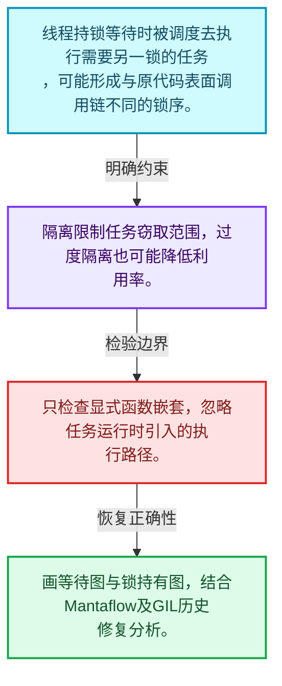
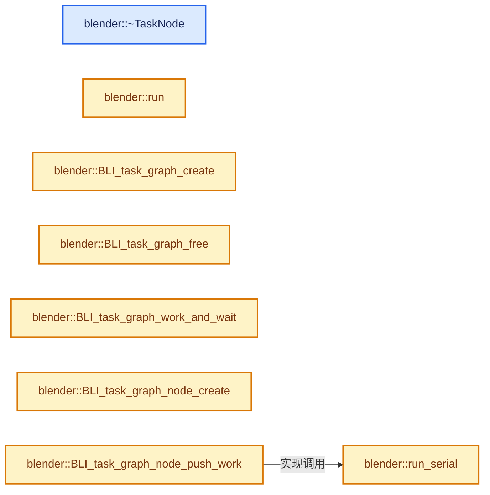
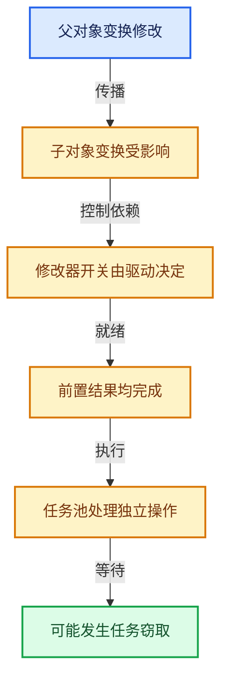

# 11-08 任务隔离死锁与实战

[方向导航](README.md) · [总目录](../README.md) · [实现索引](../00-课程指南/02-源码与提交索引/符号依赖与实现索引.md)

## 从问题到实现

任务窃取为什么可能进入意料之外的锁组合？

等待期间执行其他任务改变调用路径，嵌套外部运行时或GIL需要分析锁序与隔离边界。

**数据模型**

线程持锁等待时被调度去执行需要另一锁的任务，可能形成与原代码表面调用链不同的锁序。

**设计取舍**

隔离限制任务窃取范围，过度隔离也可能降低利用率。

**最小反例**

只检查显式函数嵌套，忽略任务运行时引入的执行路径。

**推导**

画等待图与锁持有图，结合Mantaflow及GIL历史修复分析。

## 阅读地图与执行推演








图中的数值推演是本方向的教学模型；实际函数之间的调用边与概念分析边分别标注，不能把概念关系当作运行时调度顺序。

## 完整源码单元与就地讲解

中文讲解直接放在相关代码旁，复杂机制在代码下展开。原文折叠区保留基准行号；不需要在行号表和函数之间来回查找。类布局可分段展示，函数实现不按固定行数切开。

### 类型布局、声明与编译条件 · task_graph.cc L1—L71

<a id="t-af9b2dd89c67"></a>

`TaskGraph`在这里声明的数据成员：

- `tbb::flow::graph tbb_graph`
- `std::vector<std::unique_ptr<TaskNode>> nodes`

<a id="t-69b899df0bf5"></a>

`TaskNode`在这里声明的数据成员：

- `tbb::flow::continue_node<tbb::flow::continue_msg> tbb_node`
- `std::vector<TaskNode *> successors`
- `TaskGraphNodeRunFunction run_func`
- `void task_data`
- `TaskGraphNodeFreeFunction free_func`
- `tbb_node task_graph`

<!-- annotated:d1440a752a206d -->

```cpp
/* SPDX-FileCopyrightText: 2023 Blender Authors
 *
 * SPDX-License-Identifier: GPL-2.0-or-later */

/** \file
 * \ingroup bli
 *
 * Task graph.
 */

#include "MEM_guardedalloc.h"

#include "BLI_task_c.hh"

#include <memory>
#include <vector>

#ifdef WITH_TBB
#  include <tbb/flow_graph.h>
#endif

namespace blender {

/* Task Graph */
struct TaskGraph {
#ifdef WITH_TBB
  tbb::flow::graph tbb_graph;
#endif
  std::vector<std::unique_ptr<TaskNode>> nodes;

  MEM_CXX_CLASS_ALLOC_FUNCS("task_graph:TaskGraph")
};

/* TaskNode - a node in the task graph. */
struct TaskNode {
  /* TBB Node. */
#ifdef WITH_TBB
  tbb::flow::continue_node<tbb::flow::continue_msg> tbb_node;
#endif
  /* Successors to execute after this task, for serial execution fallback. */
  std::vector<TaskNode *> successors;

  /* User function to be executed with given task data. */
  TaskGraphNodeRunFunction run_func;
  void *task_data;
  /* Optional callback to free task data along with the graph. If task data
   * is shared between nodes, only a single task node should free the data. */
  TaskGraphNodeFreeFunction free_func;

  TaskNode(TaskGraph *task_graph,
           TaskGraphNodeRunFunction run_func,
           void *task_data,
           TaskGraphNodeFreeFunction free_func)
      :
#ifdef WITH_TBB
        tbb_node(task_graph->tbb_graph,
                 tbb::flow::unlimited,
                 [&](const tbb::flow::continue_msg input) { run(input); }),
#endif
        run_func(run_func),
        task_data(task_data),
        free_func(free_func)
  {
#ifndef WITH_TBB
    UNUSED_VARS(task_graph);
#endif
  }

  TaskNode(const TaskNode &other) = delete;
  TaskNode &operator=(const TaskNode &other) = delete;

```

<details>
<summary>核对原始源码：source/blender/blenlib/intern/task_graph.cc · L1—L71</summary>

<!-- original:d1440a752a206d:source/blender/blenlib/intern/task_graph.cc:1:71 -->

```cpp
/* SPDX-FileCopyrightText: 2023 Blender Authors
 *
 * SPDX-License-Identifier: GPL-2.0-or-later */

/** \file
 * \ingroup bli
 *
 * Task graph.
 */

#include "MEM_guardedalloc.h"

#include "BLI_task_c.hh"

#include <memory>
#include <vector>

#ifdef WITH_TBB
#  include <tbb/flow_graph.h>
#endif

namespace blender {

/* Task Graph */
struct TaskGraph {
#ifdef WITH_TBB
  tbb::flow::graph tbb_graph;
#endif
  std::vector<std::unique_ptr<TaskNode>> nodes;

  MEM_CXX_CLASS_ALLOC_FUNCS("task_graph:TaskGraph")
};

/* TaskNode - a node in the task graph. */
struct TaskNode {
  /* TBB Node. */
#ifdef WITH_TBB
  tbb::flow::continue_node<tbb::flow::continue_msg> tbb_node;
#endif
  /* Successors to execute after this task, for serial execution fallback. */
  std::vector<TaskNode *> successors;

  /* User function to be executed with given task data. */
  TaskGraphNodeRunFunction run_func;
  void *task_data;
  /* Optional callback to free task data along with the graph. If task data
   * is shared between nodes, only a single task node should free the data. */
  TaskGraphNodeFreeFunction free_func;

  TaskNode(TaskGraph *task_graph,
           TaskGraphNodeRunFunction run_func,
           void *task_data,
           TaskGraphNodeFreeFunction free_func)
      :
#ifdef WITH_TBB
        tbb_node(task_graph->tbb_graph,
                 tbb::flow::unlimited,
                 [&](const tbb::flow::continue_msg input) { run(input); }),
#endif
        run_func(run_func),
        task_data(task_data),
        free_func(free_func)
  {
#ifndef WITH_TBB
    UNUSED_VARS(task_graph);
#endif
  }

  TaskNode(const TaskNode &other) = delete;
  TaskNode &operator=(const TaskNode &other) = delete;

```

</details>

<a id="f-3daec5900620b239"></a>

### `blender::~TaskNode`

实现位置：[source/blender/blenlib/intern/task_graph.cc](../../../../../source/blender/blenlib/intern/task_graph.cc) · L72—L77。

**教学注释版**

<!-- annotated:632d144b267c0a -->

```cpp
  ~TaskNode()
  {
    if (task_data && free_func) {
      free_func(task_data);
    }
  }
```

<details>
<summary>核对原始源码：source/blender/blenlib/intern/task_graph.cc · L72—L77</summary>

<!-- original:632d144b267c0a:source/blender/blenlib/intern/task_graph.cc:72:77 -->

```cpp
  ~TaskNode()
  {
    if (task_data && free_func) {
      free_func(task_data);
    }
  }
```

</details>

**继续追踪实现**

- `free_func` → [free_func · L228](../90-实现依赖专题/07-Intern运行时与平台/cycles/blender/python.cpp.md#f-1fdac534bda17f3c)。

### 类型布局、声明与编译条件 · task_graph.cc L78—L79

<!-- annotated:94347fa96c81df -->

```cpp

#ifdef WITH_TBB
```

<details>
<summary>核对原始源码：source/blender/blenlib/intern/task_graph.cc · L78—L79</summary>

<!-- original:94347fa96c81df:source/blender/blenlib/intern/task_graph.cc:78:79 -->

```cpp

#ifdef WITH_TBB
```

</details>

<a id="f-e0a9311a21289c7b"></a>

### `blender::run`

实现位置：[source/blender/blenlib/intern/task_graph.cc](../../../../../source/blender/blenlib/intern/task_graph.cc) · L80—L84。

接口参数：

- `const tbb::flow::continue_msg`

**教学注释版**

<!-- annotated:ea69d8e60f41bc -->

```cpp
  tbb::flow::continue_msg run(const tbb::flow::continue_msg /*input*/)
  {
    run_func(task_data);
    return tbb::flow::continue_msg();
  }
```

<details>
<summary>核对原始源码：source/blender/blenlib/intern/task_graph.cc · L80—L84</summary>

<!-- original:ea69d8e60f41bc:source/blender/blenlib/intern/task_graph.cc:80:84 -->

```cpp
  tbb::flow::continue_msg run(const tbb::flow::continue_msg /*input*/)
  {
    run_func(task_data);
    return tbb::flow::continue_msg();
  }
```

</details>

**结果出口**

- `return tbb::flow::continue_msg();`

**继续追踪实现**

- `run_func` → [调用协议](../00-课程指南/01-路线与规范/模板宏与动态分派协议.md)：函数指针、局部可调用对象或未展开的宏；必须结合调用者环境。调用位置L82。
- `tbb::flow::continue_msg` → [外部契约](https://uxlfoundation.github.io/oneTBB/)：任务调度属于第三方运行时；检查任务寿命、等待与隔离规则，不能把并行等待当作普通同步函数调用。

### 类型布局、声明与编译条件 · task_graph.cc L85—L86

<!-- annotated:dd3483004126c4 -->

```cpp
#endif

```

<details>
<summary>核对原始源码：source/blender/blenlib/intern/task_graph.cc · L85—L86</summary>

<!-- original:dd3483004126c4:source/blender/blenlib/intern/task_graph.cc:85:86 -->

```cpp
#endif

```

</details>

<a id="f-f0332d4951a6bc42"></a>

### `blender::run_serial`

实现位置：[source/blender/blenlib/intern/task_graph.cc](../../../../../source/blender/blenlib/intern/task_graph.cc) · L87—L93。

**教学注释版**

<!-- annotated:ab6e5e9ffafcfb -->

```cpp
  void run_serial()
  {
    run_func(task_data);
    for (TaskNode *successor : successors) {
      successor->run_serial();
    }
  }
```

<details>
<summary>核对原始源码：source/blender/blenlib/intern/task_graph.cc · L87—L93</summary>

<!-- original:ab6e5e9ffafcfb:source/blender/blenlib/intern/task_graph.cc:87:93 -->

```cpp
  void run_serial()
  {
    run_func(task_data);
    for (TaskNode *successor : successors) {
      successor->run_serial();
    }
  }
```

</details>

**继续追踪实现**

- `run_func` → [调用协议](../00-课程指南/01-路线与规范/模板宏与动态分派协议.md)：函数指针、局部可调用对象或未展开的宏；必须结合调用者环境。调用位置L89。
- `successor->run_serial` → [调用协议](../00-课程指南/01-路线与规范/模板宏与动态分派协议.md)：接收对象类型依赖auto、返回值或模板实例；不按同名猜测目标。调用位置L91。

### 类型布局、声明与编译条件 · task_graph.cc L94—L97

<!-- annotated:8b93034d92a30b -->

```cpp

  MEM_CXX_CLASS_ALLOC_FUNCS("task_graph:TaskNode")
};

```

<details>
<summary>核对原始源码：source/blender/blenlib/intern/task_graph.cc · L94—L97</summary>

<!-- original:8b93034d92a30b:source/blender/blenlib/intern/task_graph.cc:94:97 -->

```cpp

  MEM_CXX_CLASS_ALLOC_FUNCS("task_graph:TaskNode")
};

```

</details>

<a id="f-134046033975a50e"></a>

### `blender::BLI_task_graph_create`

实现位置：[source/blender/blenlib/intern/task_graph.cc](../../../../../source/blender/blenlib/intern/task_graph.cc) · L98—L101。

**教学注释版**

<!-- annotated:bf18ee52668870 -->

```cpp
TaskGraph *BLI_task_graph_create()
{
  return new TaskGraph();
}
```

<details>
<summary>核对原始源码：source/blender/blenlib/intern/task_graph.cc · L98—L101</summary>

<!-- original:bf18ee52668870:source/blender/blenlib/intern/task_graph.cc:98:101 -->

```cpp
TaskGraph *BLI_task_graph_create()
{
  return new TaskGraph();
}
```

</details>

**结果出口**

- `return new TaskGraph();`

**继续追踪实现**

本实现没有需要继续展开的显式调用；检查返回表达式、对象转换和调用者前置条件。

<!-- annotated:b2d4e8d32bd907 -->

```cpp

```

<details>
<summary>核对原始源码：source/blender/blenlib/intern/task_graph.cc · L102—L102</summary>

<!-- original:b2d4e8d32bd907:source/blender/blenlib/intern/task_graph.cc:102:102 -->

```cpp

```

</details>

<a id="f-77159d0ad0099d45"></a>

### `blender::BLI_task_graph_free`

实现位置：[source/blender/blenlib/intern/task_graph.cc](../../../../../source/blender/blenlib/intern/task_graph.cc) · L103—L106。

接口参数：

- `TaskGraph *task_graph`

**教学注释版**

<!-- annotated:be36649d8ab4f2 -->

```cpp
void BLI_task_graph_free(TaskGraph *task_graph)
{
  delete task_graph;
}
```

<details>
<summary>核对原始源码：source/blender/blenlib/intern/task_graph.cc · L103—L106</summary>

<!-- original:be36649d8ab4f2:source/blender/blenlib/intern/task_graph.cc:103:106 -->

```cpp
void BLI_task_graph_free(TaskGraph *task_graph)
{
  delete task_graph;
}
```

</details>

**继续追踪实现**

本实现没有需要继续展开的显式调用；检查返回表达式、对象转换和调用者前置条件。

<!-- annotated:4a2708d0bda211 -->

```cpp

```

<details>
<summary>核对原始源码：source/blender/blenlib/intern/task_graph.cc · L107—L107</summary>

<!-- original:4a2708d0bda211:source/blender/blenlib/intern/task_graph.cc:107:107 -->

```cpp

```

</details>

<a id="f-598dba109d651b96"></a>

### `blender::BLI_task_graph_work_and_wait`

实现位置：[source/blender/blenlib/intern/task_graph.cc](../../../../../source/blender/blenlib/intern/task_graph.cc) · L108—L115。

接口参数：

- `TaskGraph *task_graph`

**教学注释版**

<!-- annotated:fc72d920eb06fa -->

```cpp
void BLI_task_graph_work_and_wait(TaskGraph *task_graph)
{
#ifdef WITH_TBB
  task_graph->tbb_graph.wait_for_all();
#else
  UNUSED_VARS(task_graph);
#endif
}
```

<details>
<summary>核对原始源码：source/blender/blenlib/intern/task_graph.cc · L108—L115</summary>

<!-- original:fc72d920eb06fa:source/blender/blenlib/intern/task_graph.cc:108:115 -->

```cpp
void BLI_task_graph_work_and_wait(TaskGraph *task_graph)
{
#ifdef WITH_TBB
  task_graph->tbb_graph.wait_for_all();
#else
  UNUSED_VARS(task_graph);
#endif
}
```

</details>

**继续追踪实现**

- `task_graph->tbb_graph.wait_for_all` → [调用协议](../00-课程指南/01-路线与规范/模板宏与动态分派协议.md)：接收对象类型依赖auto、返回值或模板实例；不按同名猜测目标。调用位置L111。
- `UNUSED_VARS` → [UNUSED_VARS · L522](../90-实现依赖专题/01-BLI基础库/BLI_utildefines.hh.md#m-013582537634)；[UNUSED_VARS · L41](../90-实现依赖专题/08-其他Blender模块/gpu/GPU_shader_shared_utils.hh.md#m-05d9d7a33da0)；[UNUSED_VARS · L62](../90-实现依赖专题/08-其他Blender模块/gpu/GPU_shader_shared_utils.hh.md#m-e12c683a4aca)。宏定义由构建条件选择。

<!-- annotated:527ef394b98c6a -->

```cpp

```

<details>
<summary>核对原始源码：source/blender/blenlib/intern/task_graph.cc · L116—L116</summary>

<!-- original:527ef394b98c6a:source/blender/blenlib/intern/task_graph.cc:116:116 -->

```cpp

```

</details>

<a id="f-c18650b423c23ceb"></a>

### `blender::BLI_task_graph_node_create`

实现位置：[source/blender/blenlib/intern/task_graph.cc](../../../../../source/blender/blenlib/intern/task_graph.cc) · L117—L125。

接口参数：

- `TaskGraph *task_graph`
- `TaskGraphNodeRunFunction run`
- `void *user_data`
- `TaskGraphNodeFreeFunction free_func`

**教学注释版**

<!-- annotated:5813ffd7e65d57 -->

```cpp
TaskNode *BLI_task_graph_node_create(TaskGraph *task_graph,
                                     TaskGraphNodeRunFunction run,
                                     void *user_data,
                                     TaskGraphNodeFreeFunction free_func)
{
  TaskNode *task_node = new TaskNode(task_graph, run, user_data, free_func);
  task_graph->nodes.push_back(std::unique_ptr<TaskNode>(task_node));
  return task_node;
}
```

<details>
<summary>核对原始源码：source/blender/blenlib/intern/task_graph.cc · L117—L125</summary>

<!-- original:5813ffd7e65d57:source/blender/blenlib/intern/task_graph.cc:117:125 -->

```cpp
TaskNode *BLI_task_graph_node_create(TaskGraph *task_graph,
                                     TaskGraphNodeRunFunction run,
                                     void *user_data,
                                     TaskGraphNodeFreeFunction free_func)
{
  TaskNode *task_node = new TaskNode(task_graph, run, user_data, free_func);
  task_graph->nodes.push_back(std::unique_ptr<TaskNode>(task_node));
  return task_node;
}
```

</details>

**结果出口**

- `return task_node;`

**继续追踪实现**

- `task_graph->nodes.push_back` → [调用协议](../00-课程指南/01-路线与规范/模板宏与动态分派协议.md)：接收对象类型依赖auto、返回值或模板实例；不按同名猜测目标。调用位置L123。
- `std::unique_ptr<TaskNode>` → [外部契约](https://eel.is/c++draft/)：这个边界按实际表达式及所属类型核对参数、返回值、寿命与失败行为。这里提供接口入口，不声称已解释该第三方版本的内部实现。

<!-- annotated:bdfba5af96ec53 -->

```cpp

```

<details>
<summary>核对原始源码：source/blender/blenlib/intern/task_graph.cc · L126—L126</summary>

<!-- original:bdfba5af96ec53:source/blender/blenlib/intern/task_graph.cc:126:126 -->

```cpp

```

</details>

<a id="f-bea66b2287ad0bbd"></a>

### `blender::BLI_task_graph_node_push_work`

实现位置：[source/blender/blenlib/intern/task_graph.cc](../../../../../source/blender/blenlib/intern/task_graph.cc) · L127—L137。

接口参数：

- `TaskNode *task_node`

**教学注释版**

<!-- annotated:d00b6f9ad4c85a -->

```cpp
bool BLI_task_graph_node_push_work(TaskNode *task_node)
{
#ifdef WITH_TBB
  if (BLI_task_scheduler_num_threads() > 1) {
    return task_node->tbb_node.try_put(tbb::flow::continue_msg());
  }
#endif

  task_node->run_serial();
  return true;
}
```

<details>
<summary>核对原始源码：source/blender/blenlib/intern/task_graph.cc · L127—L137</summary>

<!-- original:d00b6f9ad4c85a:source/blender/blenlib/intern/task_graph.cc:127:137 -->

```cpp
bool BLI_task_graph_node_push_work(TaskNode *task_node)
{
#ifdef WITH_TBB
  if (BLI_task_scheduler_num_threads() > 1) {
    return task_node->tbb_node.try_put(tbb::flow::continue_msg());
  }
#endif

  task_node->run_serial();
  return true;
}
```

</details>

**结果出口**

- `return task_node->tbb_node.try_put(tbb::flow::continue_msg());`
- `return true;`

**继续追踪实现**

- `BLI_task_scheduler_num_threads` → [blender::BLI_task_scheduler_num_threads · L110](07-任务池与TBB接入.md#f-3c1a5dc8137998ab)。
- `task_node->tbb_node.try_put` → [调用协议](../00-课程指南/01-路线与规范/模板宏与动态分派协议.md)：接收对象类型依赖auto、返回值或模板实例；不按同名猜测目标。调用位置L131。
- `tbb::flow::continue_msg` → [外部契约](https://uxlfoundation.github.io/oneTBB/)：任务调度属于第三方运行时；检查任务寿命、等待与隔离规则，不能把并行等待当作普通同步函数调用。
- `task_node->run_serial` → [blender::run_serial · L87](08-任务隔离死锁与实战.md#f-f0332d4951a6bc42)。

<!-- annotated:8b1104aebe7518 -->

```cpp

```

<details>
<summary>核对原始源码：source/blender/blenlib/intern/task_graph.cc · L138—L138</summary>

<!-- original:8b1104aebe7518:source/blender/blenlib/intern/task_graph.cc:138:138 -->

```cpp

```

</details>

<a id="f-b9e5cfbf321df16d"></a>

### `blender::BLI_task_graph_edge_create`

实现位置：[source/blender/blenlib/intern/task_graph.cc](../../../../../source/blender/blenlib/intern/task_graph.cc) · L139—L149。

接口参数：

- `TaskNode *from_node`
- `TaskNode *to_node`

**教学注释版**

<!-- annotated:ea4ec015c5a31c -->

```cpp
void BLI_task_graph_edge_create(TaskNode *from_node, TaskNode *to_node)
{
#ifdef WITH_TBB
  if (BLI_task_scheduler_num_threads() > 1) {
    tbb::flow::make_edge(from_node->tbb_node, to_node->tbb_node);
    return;
  }
#endif

  from_node->successors.push_back(to_node);
}
```

<details>
<summary>核对原始源码：source/blender/blenlib/intern/task_graph.cc · L139—L149</summary>

<!-- original:ea4ec015c5a31c:source/blender/blenlib/intern/task_graph.cc:139:149 -->

```cpp
void BLI_task_graph_edge_create(TaskNode *from_node, TaskNode *to_node)
{
#ifdef WITH_TBB
  if (BLI_task_scheduler_num_threads() > 1) {
    tbb::flow::make_edge(from_node->tbb_node, to_node->tbb_node);
    return;
  }
#endif

  from_node->successors.push_back(to_node);
}
```

</details>

**继续追踪实现**

- `BLI_task_scheduler_num_threads` → [blender::BLI_task_scheduler_num_threads · L110](07-任务池与TBB接入.md#f-3c1a5dc8137998ab)。
- `tbb::flow::make_edge` → [外部契约](https://uxlfoundation.github.io/oneTBB/)：任务调度属于第三方运行时；检查任务寿命、等待与隔离规则，不能把并行等待当作普通同步函数调用。
- `from_node->successors.push_back` → [调用协议](../00-课程指南/01-路线与规范/模板宏与动态分派协议.md)：接收对象类型依赖auto、返回值或模板实例；不按同名猜测目标。调用位置L148。

### 类型布局、声明与编译条件 · task_graph.cc L150—L151

<!-- annotated:b38ea787e83d44 -->

```cpp

}  // namespace blender
```

<details>
<summary>核对原始源码：source/blender/blenlib/intern/task_graph.cc · L150—L151</summary>

<!-- original:b38ea787e83d44:source/blender/blenlib/intern/task_graph.cc:150:151 -->

```cpp

}  // namespace blender
```

</details>

### 类型布局、声明与编译条件 · task_range.cc L1—L44

<a id="t-b4bda84bd3d7"></a>

`RangeTask`在这里声明的数据成员：

- `TaskParallelRangeFunc func`
- `void userdata`
- `TaskParallelSettings settings`
- `void userdata_chunk`

<!-- annotated:e1199243c45e17 -->

```cpp
/* SPDX-FileCopyrightText: 2023 Blender Authors
 *
 * SPDX-License-Identifier: GPL-2.0-or-later */

/** \file
 * \ingroup bli
 *
 * Task parallel range functions.
 */

#include <cstdlib>

#include "MEM_guardedalloc.h"

#include "BLI_array.hh"
#include "BLI_lazy_threading.hh"
#include "BLI_offset_indices.hh"
#include "BLI_task.hh"
#include "BLI_task_c.hh"
#include "BLI_threads.hh"
#include "BLI_vector.hh"

#include "atomic_ops.h"

#ifdef WITH_TBB
#  include <tbb/blocked_range.h>
#  include <tbb/enumerable_thread_specific.h>
#  include <tbb/parallel_for.h>
#  include <tbb/parallel_reduce.h>
#endif

namespace blender {

#ifdef WITH_TBB

/* Functor for running TBB parallel_for and parallel_reduce. */
struct RangeTask {
  TaskParallelRangeFunc func;
  void *userdata;
  const TaskParallelSettings *settings;

  void *userdata_chunk;

  /* Root constructor. */
```

<details>
<summary>核对原始源码：source/blender/blenlib/intern/task_range.cc · L1—L44</summary>

<!-- original:e1199243c45e17:source/blender/blenlib/intern/task_range.cc:1:44 -->

```cpp
/* SPDX-FileCopyrightText: 2023 Blender Authors
 *
 * SPDX-License-Identifier: GPL-2.0-or-later */

/** \file
 * \ingroup bli
 *
 * Task parallel range functions.
 */

#include <cstdlib>

#include "MEM_guardedalloc.h"

#include "BLI_array.hh"
#include "BLI_lazy_threading.hh"
#include "BLI_offset_indices.hh"
#include "BLI_task.hh"
#include "BLI_task_c.hh"
#include "BLI_threads.hh"
#include "BLI_vector.hh"

#include "atomic_ops.h"

#ifdef WITH_TBB
#  include <tbb/blocked_range.h>
#  include <tbb/enumerable_thread_specific.h>
#  include <tbb/parallel_for.h>
#  include <tbb/parallel_reduce.h>
#endif

namespace blender {

#ifdef WITH_TBB

/* Functor for running TBB parallel_for and parallel_reduce. */
struct RangeTask {
  TaskParallelRangeFunc func;
  void *userdata;
  const TaskParallelSettings *settings;

  void *userdata_chunk;

  /* Root constructor. */
```

</details>

<a id="f-b57059423ba8b7bb"></a>

### `blender::RangeTask::RangeTask`

实现位置：[source/blender/blenlib/intern/task_range.cc](../../../../../source/blender/blenlib/intern/task_range.cc) · L45—L49。

接口参数：

- `TaskParallelRangeFunc func`
- `void *userdata`
- `const TaskParallelSettings *settings`

**教学注释版**

<!-- annotated:0ccfb2b2e8b44c -->

```cpp
  RangeTask(TaskParallelRangeFunc func, void *userdata, const TaskParallelSettings *settings)
      : func(func), userdata(userdata), settings(settings)
  {
    init_chunk(settings->userdata_chunk);
  }
```

<details>
<summary>核对原始源码：source/blender/blenlib/intern/task_range.cc · L45—L49</summary>

<!-- original:0ccfb2b2e8b44c:source/blender/blenlib/intern/task_range.cc:45:49 -->

```cpp
  RangeTask(TaskParallelRangeFunc func, void *userdata, const TaskParallelSettings *settings)
      : func(func), userdata(userdata), settings(settings)
  {
    init_chunk(settings->userdata_chunk);
  }
```

</details>

**继续追踪实现**

- `init_chunk` → [blender::RangeTask::init_chunk · L73](08-任务隔离死锁与实战.md#f-ff62e306ec43ab39)。

### 类型布局、声明与编译条件 · task_range.cc L50—L51

<!-- annotated:90ed1f41576554 -->

```cpp

  /* Copy constructor. */
```

<details>
<summary>核对原始源码：source/blender/blenlib/intern/task_range.cc · L50—L51</summary>

<!-- original:90ed1f41576554:source/blender/blenlib/intern/task_range.cc:50:51 -->

```cpp

  /* Copy constructor. */
```

</details>

<a id="f-1d007c2930dec1ac"></a>

### `blender::RangeTask::RangeTask`

实现位置：[source/blender/blenlib/intern/task_range.cc](../../../../../source/blender/blenlib/intern/task_range.cc) · L52—L56。

接口参数：

- `const RangeTask &other`

**教学注释版**

<!-- annotated:98ac3507b3a46e -->

```cpp
  RangeTask(const RangeTask &other)
      : func(other.func), userdata(other.userdata), settings(other.settings)
  {
    init_chunk(settings->userdata_chunk);
  }
```

<details>
<summary>核对原始源码：source/blender/blenlib/intern/task_range.cc · L52—L56</summary>

<!-- original:98ac3507b3a46e:source/blender/blenlib/intern/task_range.cc:52:56 -->

```cpp
  RangeTask(const RangeTask &other)
      : func(other.func), userdata(other.userdata), settings(other.settings)
  {
    init_chunk(settings->userdata_chunk);
  }
```

</details>

**继续追踪实现**

- `init_chunk` → [blender::RangeTask::init_chunk · L73](08-任务隔离死锁与实战.md#f-ff62e306ec43ab39)。

### 类型布局、声明与编译条件 · task_range.cc L57—L58

<!-- annotated:7a6bc9e1f1a4f5 -->

```cpp

  /* Splitting constructor for parallel reduce. */
```

<details>
<summary>核对原始源码：source/blender/blenlib/intern/task_range.cc · L57—L58</summary>

<!-- original:7a6bc9e1f1a4f5:source/blender/blenlib/intern/task_range.cc:57:58 -->

```cpp

  /* Splitting constructor for parallel reduce. */
```

</details>

<a id="f-9972f52c08bf0906"></a>

### `blender::RangeTask::RangeTask`

实现位置：[source/blender/blenlib/intern/task_range.cc](../../../../../source/blender/blenlib/intern/task_range.cc) · L59—L63。

接口参数：

- `RangeTask &other`
- `tbb::split`

**教学注释版**

<!-- annotated:3a53d3d58d80fd -->

```cpp
  RangeTask(RangeTask &other, tbb::split /*unused*/)
      : func(other.func), userdata(other.userdata), settings(other.settings)
  {
    init_chunk(settings->userdata_chunk);
  }
```

<details>
<summary>核对原始源码：source/blender/blenlib/intern/task_range.cc · L59—L63</summary>

<!-- original:3a53d3d58d80fd:source/blender/blenlib/intern/task_range.cc:59:63 -->

```cpp
  RangeTask(RangeTask &other, tbb::split /*unused*/)
      : func(other.func), userdata(other.userdata), settings(other.settings)
  {
    init_chunk(settings->userdata_chunk);
  }
```

</details>

**继续追踪实现**

- `init_chunk` → [blender::RangeTask::init_chunk · L73](08-任务隔离死锁与实战.md#f-ff62e306ec43ab39)。

<!-- annotated:ed036d76964110 -->

```cpp

```

<details>
<summary>核对原始源码：source/blender/blenlib/intern/task_range.cc · L64—L64</summary>

<!-- original:ed036d76964110:source/blender/blenlib/intern/task_range.cc:64:64 -->

```cpp

```

</details>

<a id="f-3e7ece355679ff45"></a>

### `blender::RangeTask::~RangeTask`

实现位置：[source/blender/blenlib/intern/task_range.cc](../../../../../source/blender/blenlib/intern/task_range.cc) · L65—L71。

**教学注释版**

<!-- annotated:1fc5b51c8b482d -->

```cpp
  ~RangeTask()
  {
    if (settings->func_free != nullptr && userdata_chunk != nullptr) {
      settings->func_free(userdata, userdata_chunk);
    }
    MEM_SAFE_DELETE_VOID(userdata_chunk);
  }
```

<details>
<summary>核对原始源码：source/blender/blenlib/intern/task_range.cc · L65—L71</summary>

<!-- original:1fc5b51c8b482d:source/blender/blenlib/intern/task_range.cc:65:71 -->

```cpp
  ~RangeTask()
  {
    if (settings->func_free != nullptr && userdata_chunk != nullptr) {
      settings->func_free(userdata, userdata_chunk);
    }
    MEM_SAFE_DELETE_VOID(userdata_chunk);
  }
```

</details>

**继续追踪实现**

- `settings->func_free` → [调用协议](../00-课程指南/01-路线与规范/模板宏与动态分派协议.md)：由接收对象具体类型或运行时策略提供实现。调用位置L68。
- `MEM_SAFE_DELETE_VOID` → [MEM_SAFE_DELETE_VOID · L448](../90-实现依赖专题/07-Intern运行时与平台/guardedalloc/MEM_guardedalloc.h.md#m-66e7eff3d7bc)。宏定义由构建条件选择。

<!-- annotated:533160768becdc -->

```cpp

```

<details>
<summary>核对原始源码：source/blender/blenlib/intern/task_range.cc · L72—L72</summary>

<!-- original:533160768becdc:source/blender/blenlib/intern/task_range.cc:72:72 -->

```cpp

```

</details>

<a id="f-ff62e306ec43ab39"></a>

### `blender::RangeTask::init_chunk`

实现位置：[source/blender/blenlib/intern/task_range.cc](../../../../../source/blender/blenlib/intern/task_range.cc) · L73—L82。

接口参数：

- `void *from_chunk`

**教学注释版**

<!-- annotated:e2902e9d35dda3 -->

```cpp
  void init_chunk(void *from_chunk)
  {
    if (from_chunk) {
      userdata_chunk = MEM_new_uninitialized(settings->userdata_chunk_size, "RangeTask");
      // [讲解] memcpy：复制字节，源与目标不应重叠。类型生命周期、对齐和可复制表示须由调用者证明，不是任意对象的复制构造。
      memcpy(userdata_chunk, from_chunk, settings->userdata_chunk_size);
    }
    else {
      userdata_chunk = nullptr;
    }
  }
```

<details>
<summary>核对原始源码：source/blender/blenlib/intern/task_range.cc · L73—L82</summary>

<!-- original:e2902e9d35dda3:source/blender/blenlib/intern/task_range.cc:73:82 -->

```cpp
  void init_chunk(void *from_chunk)
  {
    if (from_chunk) {
      userdata_chunk = MEM_new_uninitialized(settings->userdata_chunk_size, "RangeTask");
      memcpy(userdata_chunk, from_chunk, settings->userdata_chunk_size);
    }
    else {
      userdata_chunk = nullptr;
    }
  }
```

</details>

**沿实际写入检查状态**

- `userdata_chunk = MEM_new_uninitialized(settings->userdata_chunk_size, "RangeTask");`
- `userdata_chunk = nullptr;`

**继续追踪实现**

- `MEM_new_uninitialized` → [MEM_new_uninitialized · L590](../90-实现依赖专题/07-Intern运行时与平台/guardedalloc/MEM_guardedalloc.h.md#f-c773b2e5b8fe70e4)；[MEM_new_uninitialized · L124](../90-实现依赖专题/07-Intern运行时与平台/guardedalloc/intern/mallocn.cc.md#f-28a7e00a1e67f699)。同名重载需按实参类型选择。
- `memcpy` → [外部契约](https://eel.is/c++draft/cstring.syn)：复制字节，源与目标不应重叠。类型生命周期、对齐和可复制表示须由调用者证明，不是任意对象的复制构造。

<!-- annotated:16b1ac8c04089b -->

```cpp

```

<details>
<summary>核对原始源码：source/blender/blenlib/intern/task_range.cc · L83—L83</summary>

<!-- original:16b1ac8c04089b:source/blender/blenlib/intern/task_range.cc:83:83 -->

```cpp

```

</details>

<a id="f-51bc1c2fe002281c"></a>

### `blender::RangeTask::operator()`

实现位置：[source/blender/blenlib/intern/task_range.cc](../../../../../source/blender/blenlib/intern/task_range.cc) · L84—L91。

接口参数：

- `const tbb::blocked_range<int> &r`

**教学注释版**

<!-- annotated:5bd2ab438cbdfe -->

```cpp
  void operator()(const tbb::blocked_range<int> &r) const
  {
    TaskParallelTLS tls;
    tls.userdata_chunk = userdata_chunk;
    for (int i = r.begin(); i != r.end(); ++i) {
      func(userdata, i, &tls);
    }
  }
```

<details>
<summary>核对原始源码：source/blender/blenlib/intern/task_range.cc · L84—L91</summary>

<!-- original:5bd2ab438cbdfe:source/blender/blenlib/intern/task_range.cc:84:91 -->

```cpp
  void operator()(const tbb::blocked_range<int> &r) const
  {
    TaskParallelTLS tls;
    tls.userdata_chunk = userdata_chunk;
    for (int i = r.begin(); i != r.end(); ++i) {
      func(userdata, i, &tls);
    }
  }
```

</details>

**沿实际写入检查状态**

- `tls.userdata_chunk = userdata_chunk;`

**继续追踪实现**

- `r.begin` → [外部契约](https://eel.is/c++draft/)：这个边界按实际表达式及所属类型核对参数、返回值、寿命与失败行为。这里提供接口入口，不声称已解释该第三方版本的内部实现。
- `r.end` → [外部契约](https://eel.is/c++draft/)：这个边界按实际表达式及所属类型核对参数、返回值、寿命与失败行为。这里提供接口入口，不声称已解释该第三方版本的内部实现。
- `func` → [调用协议](../00-课程指南/01-路线与规范/模板宏与动态分派协议.md)：函数指针、局部可调用对象或未展开的宏；必须结合调用者环境。调用位置L89。

<!-- annotated:486969518afe5a -->

```cpp

```

<details>
<summary>核对原始源码：source/blender/blenlib/intern/task_range.cc · L92—L92</summary>

<!-- original:486969518afe5a:source/blender/blenlib/intern/task_range.cc:92:92 -->

```cpp

```

</details>

<a id="f-3a0346e2c142802c"></a>

### `blender::RangeTask::join`

实现位置：[source/blender/blenlib/intern/task_range.cc](../../../../../source/blender/blenlib/intern/task_range.cc) · L93—L96。

接口参数：

- `const RangeTask &other`

**教学注释版**

<!-- annotated:9ba54083a75f56 -->

```cpp
  void join(const RangeTask &other)
  {
    settings->func_reduce(userdata, userdata_chunk, other.userdata_chunk);
  }
```

<details>
<summary>核对原始源码：source/blender/blenlib/intern/task_range.cc · L93—L96</summary>

<!-- original:9ba54083a75f56:source/blender/blenlib/intern/task_range.cc:93:96 -->

```cpp
  void join(const RangeTask &other)
  {
    settings->func_reduce(userdata, userdata_chunk, other.userdata_chunk);
  }
```

</details>

**继续追踪实现**

- `settings->func_reduce` → [调用协议](../00-课程指南/01-路线与规范/模板宏与动态分派协议.md)：由接收对象具体类型或运行时策略提供实现。调用位置L95。

### 类型布局、声明与编译条件 · task_range.cc L97—L100

<!-- annotated:0a62f407e0d404 -->

```cpp
};

#endif

```

<details>
<summary>核对原始源码：source/blender/blenlib/intern/task_range.cc · L97—L100</summary>

<!-- original:0a62f407e0d404:source/blender/blenlib/intern/task_range.cc:97:100 -->

```cpp
};

#endif

```

</details>

<a id="f-9d237d7e4e78d7e2"></a>

### `blender::BLI_task_parallel_range`

实现位置：[source/blender/blenlib/intern/task_range.cc](../../../../../source/blender/blenlib/intern/task_range.cc) · L101—L139。

接口参数：

- `const int start`
- `const int stop`
- `void *userdata`
- `TaskParallelRangeFunc func`
- `const TaskParallelSettings *settings`

**教学注释版**

<!-- annotated:56f3be859ce868 -->

```cpp
void BLI_task_parallel_range(const int start,
                             const int stop,
                             void *userdata,
                             TaskParallelRangeFunc func,
                             const TaskParallelSettings *settings)
{
#ifdef WITH_TBB
  /* Multithreading. */
  if (settings->use_threading && BLI_task_scheduler_num_threads() > 1) {
    RangeTask task(func, userdata, settings);
    // [讲解] std::max：按比较关系选取较大值。本讲解中的增长公式同时满足最低请求和几何增长；若保存返回引用，还需注意实参寿命。
    const size_t grainsize = std::max(settings->min_iter_per_thread, 1);
    const tbb::blocked_range<int> range(start, stop, grainsize);

    lazy_threading::send_hint();

    if (settings->func_reduce) {
      parallel_reduce(range, task);
      if (settings->userdata_chunk) {
        // [讲解] memcpy：复制字节，源与目标不应重叠。类型生命周期、对齐和可复制表示须由调用者证明，不是任意对象的复制构造。
        memcpy(settings->userdata_chunk, task.userdata_chunk, settings->userdata_chunk_size);
      }
    }
    else {
      parallel_for(range, task);
    }
    return;
  }
#endif

  /* Single threaded. Nothing to reduce as everything is accumulated into the
   * main userdata chunk directly. */
  TaskParallelTLS tls;
  tls.userdata_chunk = settings->userdata_chunk;
  for (int i = start; i < stop; i++) {
    func(userdata, i, &tls);
  }
  if (settings->func_free != nullptr && settings->userdata_chunk != nullptr) {
    settings->func_free(userdata, settings->userdata_chunk);
  }
}
```

<details>
<summary>核对原始源码：source/blender/blenlib/intern/task_range.cc · L101—L139</summary>

<!-- original:56f3be859ce868:source/blender/blenlib/intern/task_range.cc:101:139 -->

```cpp
void BLI_task_parallel_range(const int start,
                             const int stop,
                             void *userdata,
                             TaskParallelRangeFunc func,
                             const TaskParallelSettings *settings)
{
#ifdef WITH_TBB
  /* Multithreading. */
  if (settings->use_threading && BLI_task_scheduler_num_threads() > 1) {
    RangeTask task(func, userdata, settings);
    const size_t grainsize = std::max(settings->min_iter_per_thread, 1);
    const tbb::blocked_range<int> range(start, stop, grainsize);

    lazy_threading::send_hint();

    if (settings->func_reduce) {
      parallel_reduce(range, task);
      if (settings->userdata_chunk) {
        memcpy(settings->userdata_chunk, task.userdata_chunk, settings->userdata_chunk_size);
      }
    }
    else {
      parallel_for(range, task);
    }
    return;
  }
#endif

  /* Single threaded. Nothing to reduce as everything is accumulated into the
   * main userdata chunk directly. */
  TaskParallelTLS tls;
  tls.userdata_chunk = settings->userdata_chunk;
  for (int i = start; i < stop; i++) {
    func(userdata, i, &tls);
  }
  if (settings->func_free != nullptr && settings->userdata_chunk != nullptr) {
    settings->func_free(userdata, settings->userdata_chunk);
  }
}
```

</details>

**沿实际写入检查状态**

- `tls.userdata_chunk = settings->userdata_chunk;`

**继续追踪实现**

- `BLI_task_scheduler_num_threads` → [blender::BLI_task_scheduler_num_threads · L110](07-任务池与TBB接入.md#f-3c1a5dc8137998ab)。
- `std::max` → [外部契约](https://eel.is/c++draft/alg.min.max)：按比较关系选取较大值。本讲解中的增长公式同时满足最低请求和几何增长；若保存返回引用，还需注意实参寿命。
- `lazy_threading::send_hint` → [blender::lazy_threading::send_hint · L28](../90-实现依赖专题/01-BLI基础库/intern/lazy_threading.cc.md#f-5f17245e2a06695e)。
- `parallel_reduce` → [调用协议](../00-课程指南/01-路线与规范/模板宏与动态分派协议.md)：函数指针、局部可调用对象或未展开的宏；必须结合调用者环境。调用位置L117。
- `memcpy` → [外部契约](https://eel.is/c++draft/cstring.syn)：复制字节，源与目标不应重叠。类型生命周期、对齐和可复制表示须由调用者证明，不是任意对象的复制构造。
- `parallel_for` → [调用协议](../00-课程指南/01-路线与规范/模板宏与动态分派协议.md)：函数指针、局部可调用对象或未展开的宏；必须结合调用者环境。调用位置L123。
- `func` → [调用协议](../00-课程指南/01-路线与规范/模板宏与动态分派协议.md)：局部可调用对象，须结合其初始化与捕获环境。调用位置L134。
- `settings->func_free` → [调用协议](../00-课程指南/01-路线与规范/模板宏与动态分派协议.md)：由接收对象具体类型或运行时策略提供实现。调用位置L137。

<!-- annotated:db15b330493192 -->

```cpp

```

<details>
<summary>核对原始源码：source/blender/blenlib/intern/task_range.cc · L140—L140</summary>

<!-- original:db15b330493192:source/blender/blenlib/intern/task_range.cc:140:140 -->

```cpp

```

</details>

<a id="f-a172a2e649c7a8ef"></a>

### `blender::BLI_task_parallel_thread_id`

实现位置：[source/blender/blenlib/intern/task_range.cc](../../../../../source/blender/blenlib/intern/task_range.cc) · L141—L162。

接口参数：

- `const TaskParallelTLS *`

**教学注释版**

<!-- annotated:3c23c5e3607ffa -->

```cpp
int BLI_task_parallel_thread_id(const TaskParallelTLS * /*tls*/)
{
#ifdef WITH_TBB
  /* Get a unique thread ID for texture nodes. In the future we should get rid
   * of the thread ID and change texture evaluation to not require per-thread
   * storage that can't be efficiently allocated on the stack. */
  static tbb::enumerable_thread_specific<int> tbb_thread_id(-1);
  static int tbb_thread_id_counter = 0;

  int &thread_id = tbb_thread_id.local();
  if (thread_id == -1) {
    thread_id = atomic_fetch_and_add_int32(&tbb_thread_id_counter, 1);
    if (thread_id >= BLENDER_MAX_THREADS) {
      BLI_assert_msg(0, "Maximum number of threads exceeded for sculpting");
      thread_id = thread_id % BLENDER_MAX_THREADS;
    }
  }
  return thread_id;
#else
  return 0;
#endif
}
```

<details>
<summary>核对原始源码：source/blender/blenlib/intern/task_range.cc · L141—L162</summary>

<!-- original:3c23c5e3607ffa:source/blender/blenlib/intern/task_range.cc:141:162 -->

```cpp
int BLI_task_parallel_thread_id(const TaskParallelTLS * /*tls*/)
{
#ifdef WITH_TBB
  /* Get a unique thread ID for texture nodes. In the future we should get rid
   * of the thread ID and change texture evaluation to not require per-thread
   * storage that can't be efficiently allocated on the stack. */
  static tbb::enumerable_thread_specific<int> tbb_thread_id(-1);
  static int tbb_thread_id_counter = 0;

  int &thread_id = tbb_thread_id.local();
  if (thread_id == -1) {
    thread_id = atomic_fetch_and_add_int32(&tbb_thread_id_counter, 1);
    if (thread_id >= BLENDER_MAX_THREADS) {
      BLI_assert_msg(0, "Maximum number of threads exceeded for sculpting");
      thread_id = thread_id % BLENDER_MAX_THREADS;
    }
  }
  return thread_id;
#else
  return 0;
#endif
}
```

</details>

**沿实际写入检查状态**

- `thread_id = atomic_fetch_and_add_int32(&tbb_thread_id_counter, 1);`
- `thread_id = thread_id % BLENDER_MAX_THREADS;`

**结果出口**

- `return thread_id;`
- `return 0;`

**继续追踪实现**

- `tbb_thread_id.local` → [外部契约](https://eel.is/c++draft/)：这个边界按实际表达式及所属类型核对参数、返回值、寿命与失败行为。这里提供接口入口，不声称已解释该第三方版本的内部实现。
- `atomic_fetch_and_add_int32` → [atomic_fetch_and_add_int32 · L577](../90-实现依赖专题/07-Intern运行时与平台/atomic/intern/atomic_ops_unix.h.md#f-69ff836ea2a982eb)；[atomic_fetch_and_add_int32 · L203](../90-实现依赖专题/07-Intern运行时与平台/atomic/intern/atomic_ops_msvc.h.md#f-5f44e7646667f0e3)。同名重载需按实参类型选择。
- `BLI_assert_msg` → [BLI_assert_msg · L55](../90-实现依赖专题/01-BLI基础库/BLI_assert.hh.md#m-695eed20dceb)；[BLI_assert_msg · L64](../90-实现依赖专题/01-BLI基础库/BLI_assert.hh.md#m-7de5563de4db)。宏定义由构建条件选择。

### 类型布局、声明与编译条件 · task_range.cc L163—L166

<!-- annotated:fdcffd38086c4b -->

```cpp

namespace threading::detail {

#ifdef WITH_TBB
```

<details>
<summary>核对原始源码：source/blender/blenlib/intern/task_range.cc · L163—L166</summary>

<!-- original:fdcffd38086c4b:source/blender/blenlib/intern/task_range.cc:163:166 -->

```cpp

namespace threading::detail {

#ifdef WITH_TBB
```

</details>

<a id="f-847d25f3fe873b43"></a>

### `blender::threading::detail::parallel_for_impl_static_size`

实现位置：[source/blender/blenlib/intern/task_range.cc](../../../../../source/blender/blenlib/intern/task_range.cc) · L167—L175。

接口参数：

- `const IndexRange range`
- `const int64_t grain_size`
- `const FunctionRef<void(IndexRange)> function`
- `IndexRange`

**教学注释版**

<!-- annotated:dc5b4e62cf6a3e -->

```cpp
static void parallel_for_impl_static_size(const IndexRange range,
                                          const int64_t grain_size,
                                          const FunctionRef<void(IndexRange)> function)
{
  // [讲解] range.first：读取范围两端的有效索引或值。
  tbb::parallel_for(tbb::blocked_range<int64_t>(range.first(), range.one_after_last(), grain_size),
                    [function](const tbb::blocked_range<int64_t> &subrange) {
                      function(IndexRange(subrange.begin(), subrange.size()));
                    });
}
```

<details>
<summary>核对原始源码：source/blender/blenlib/intern/task_range.cc · L167—L175</summary>

<!-- original:dc5b4e62cf6a3e:source/blender/blenlib/intern/task_range.cc:167:175 -->

```cpp
static void parallel_for_impl_static_size(const IndexRange range,
                                          const int64_t grain_size,
                                          const FunctionRef<void(IndexRange)> function)
{
  tbb::parallel_for(tbb::blocked_range<int64_t>(range.first(), range.one_after_last(), grain_size),
                    [function](const tbb::blocked_range<int64_t> &subrange) {
                      function(IndexRange(subrange.begin(), subrange.size()));
                    });
}
```

</details>

**继续追踪实现**

- `tbb::parallel_for` → [外部契约](https://uxlfoundation.github.io/oneTBB/)：任务调度属于第三方运行时；检查任务寿命、等待与隔离规则，不能把并行等待当作普通同步函数调用。
- `tbb::blocked_range<int64_t>` → [外部契约](https://uxlfoundation.github.io/oneTBB/)：任务调度属于第三方运行时；检查任务寿命、等待与隔离规则，不能把并行等待当作普通同步函数调用。
- `range.first` → [blender::IndexRange::first · L204](../01-基础容器与现代CPP/04-IndexRange连续整数区间.md#f-ab443c94e531befa)。
- `range.one_after_last` → [blender::IndexRange::one_after_last · L235](../01-基础容器与现代CPP/04-IndexRange连续整数区间.md#f-ed04bec9c731fc86)。
- `function` → [调用协议](../00-课程指南/01-路线与规范/模板宏与动态分派协议.md)：局部可调用对象，须结合其初始化与捕获环境。调用位置L173。
- `IndexRange` → [blender::IndexRange](../90-实现依赖专题/01-BLI基础库/BLI_index_range.hh.md#t-caa3466d6776)；[blender::gpu::shader::parser::IndexRange](../90-实现依赖专题/08-其他Blender模块/gpu/shader_tool/utils.hh.md#t-82d2bd4ea71c)；[blender::IndexRange](../90-实现依赖专题/08-其他Blender模块/makesdna/DNA_node_types.h.md#t-0448cc889d39)。
- `subrange.begin` → [外部契约](https://eel.is/c++draft/)：这个边界按实际表达式及所属类型核对参数、返回值、寿命与失败行为。这里提供接口入口，不声称已解释该第三方版本的内部实现。
- `subrange.size` → [外部契约](https://eel.is/c++draft/)：这个边界按实际表达式及所属类型核对参数、返回值、寿命与失败行为。这里提供接口入口，不声称已解释该第三方版本的内部实现。

### 类型布局、声明与编译条件 · task_range.cc L176—L178

<!-- annotated:3259ffeccfe4dc -->

```cpp
#endif /* WITH_TBB */

#ifdef WITH_TBB
```

<details>
<summary>核对原始源码：source/blender/blenlib/intern/task_range.cc · L176—L178</summary>

<!-- original:3259ffeccfe4dc:source/blender/blenlib/intern/task_range.cc:176:178 -->

```cpp
#endif /* WITH_TBB */

#ifdef WITH_TBB
```

</details>

<a id="f-bceaa9d2f1b6301d"></a>

### `blender::threading::detail::parallel_for_impl_individual_size_lookup`

实现位置：[source/blender/blenlib/intern/task_range.cc](../../../../../source/blender/blenlib/intern/task_range.cc) · L179—L218。

接口参数：

- `const IndexRange range`
- `const int64_t grain_size`
- `const FunctionRef<void(IndexRange)> function`
- `IndexRange`
- `const TaskSizeHints_IndividualLookup &size_hints`

**教学注释版**

<!-- annotated:baea435c6228c7 -->

```cpp
static void parallel_for_impl_individual_size_lookup(
    const IndexRange range,
    const int64_t grain_size,
    const FunctionRef<void(IndexRange)> function,
    const TaskSizeHints_IndividualLookup &size_hints)
{
  /* Shouldn't be too small, because then there is more overhead when the individual tasks are
   * small. Also shouldn't be too large because then the serial code to split up tasks causes extra
   * overhead. */
  // [讲解] std::min<int64_t>：按比较关系选取较小值；截断范围时还需先满足非负和可表示范围，min本身不会证明边界安全。
  const int64_t outer_grain_size = std::min<int64_t>(grain_size, 512);
  threading::parallel_for(range, outer_grain_size, [&](const IndexRange sub_range) {
    /* Compute the size of every task in the current range. */
    // [讲解] sub_range.size：读取连续区间或分组的边界信息。
    Array<int64_t, 1024> task_sizes(sub_range.size());
    size_hints.lookup_individual_sizes(sub_range, task_sizes);

    /* Split range into multiple segments that have a size that approximates the grain size. */
    Vector<int64_t, 256> offsets_vec;
    // [讲解] offsets_vec.append：在尾部建立新元素，必要时先扩大存储。
    offsets_vec.append(0);
    int64_t counter = 0;
    for (const int64_t i : sub_range.index_range()) {
      counter += task_sizes[i];
      if (counter >= grain_size) {
        offsets_vec.append(i + 1);
        counter = 0;
      }
    }
    // [讲解] offsets_vec.last：访问有效范围首端或末端元素。
    if (offsets_vec.last() < sub_range.size()) {
      offsets_vec.append(sub_range.size());
    }
    // [讲解] offsets_vec.as_span：构造对当前有效元素区间的借用视图。
    const OffsetIndices<int64_t> offsets = offsets_vec.as_span();

    /* Run the dynamically split tasks in parallel. */
    threading::parallel_for(offsets.index_range(), 1, [&](const IndexRange offsets_range) {
      for (const int64_t i : offsets_range) {
        // [讲解] sub_range.start：读取连续区间或分组的边界信息。
        const IndexRange actual_range = offsets[i].shift(sub_range.start());
        function(actual_range);
      }
    });
  });
}
```

<details>
<summary>核对原始源码：source/blender/blenlib/intern/task_range.cc · L179—L218</summary>

<!-- original:baea435c6228c7:source/blender/blenlib/intern/task_range.cc:179:218 -->

```cpp
static void parallel_for_impl_individual_size_lookup(
    const IndexRange range,
    const int64_t grain_size,
    const FunctionRef<void(IndexRange)> function,
    const TaskSizeHints_IndividualLookup &size_hints)
{
  /* Shouldn't be too small, because then there is more overhead when the individual tasks are
   * small. Also shouldn't be too large because then the serial code to split up tasks causes extra
   * overhead. */
  const int64_t outer_grain_size = std::min<int64_t>(grain_size, 512);
  threading::parallel_for(range, outer_grain_size, [&](const IndexRange sub_range) {
    /* Compute the size of every task in the current range. */
    Array<int64_t, 1024> task_sizes(sub_range.size());
    size_hints.lookup_individual_sizes(sub_range, task_sizes);

    /* Split range into multiple segments that have a size that approximates the grain size. */
    Vector<int64_t, 256> offsets_vec;
    offsets_vec.append(0);
    int64_t counter = 0;
    for (const int64_t i : sub_range.index_range()) {
      counter += task_sizes[i];
      if (counter >= grain_size) {
        offsets_vec.append(i + 1);
        counter = 0;
      }
    }
    if (offsets_vec.last() < sub_range.size()) {
      offsets_vec.append(sub_range.size());
    }
    const OffsetIndices<int64_t> offsets = offsets_vec.as_span();

    /* Run the dynamically split tasks in parallel. */
    threading::parallel_for(offsets.index_range(), 1, [&](const IndexRange offsets_range) {
      for (const int64_t i : offsets_range) {
        const IndexRange actual_range = offsets[i].shift(sub_range.start());
        function(actual_range);
      }
    });
  });
}
```

</details>

**沿实际写入检查状态**

- `counter += task_sizes[i];`
- `counter = 0;`

**继续追踪实现**

- `std::min<int64_t>` → [外部契约](https://eel.is/c++draft/alg.min.max)：按比较关系选取较小值；截断范围时还需先满足非负和可表示范围，min本身不会证明边界安全。
- `threading::parallel_for` → [blender::threading::parallel_for · L68](07-任务池与TBB接入.md#f-838294754c24426c)。
- `sub_range.size` → [blender::IndexRange::size · L156](../01-基础容器与现代CPP/04-IndexRange连续整数区间.md#f-05f66c3ebb2fdfec)。
- `size_hints.lookup_individual_sizes` → [blender::threading::detail::TaskSizeHints_IndividualLookupFn::lookup_individual_sizes · L86](../90-实现依赖专题/01-BLI基础库/BLI_task_size_hints.hh.md#f-3734b4b56aa29ebf)。
- `offsets_vec.append` → [blender::Vector::append · L498](../01-基础容器与现代CPP/11-Vector插入删除与重排.md#f-5bde268a69e443ec)；[blender::Vector::append · L502](../01-基础容器与现代CPP/11-Vector插入删除与重排.md#f-591e0b15e6308532)。同名重载需按实参类型选择。
- `sub_range.index_range` → [blender::IndexRange::index_range · L161](../01-基础容器与现代CPP/04-IndexRange连续整数区间.md#f-fd83072b4b81bce5)。
- `offsets_vec.last` → [blender::Vector::last · L749](../01-基础容器与现代CPP/11-Vector插入删除与重排.md#f-d32e1fd895e766b4)；[blender::Vector::last · L755](../01-基础容器与现代CPP/11-Vector插入删除与重排.md#f-66b262993c080d9d)。同名重载需按实参类型选择。
- `offsets_vec.as_span` → [blender::Vector::as_span · L390](../01-基础容器与现代CPP/10-Vector扩容与增长.md#f-e2eed03cefcdd2ff)。
- `offsets.index_range` → [blender::offset_indices::OffsetIndices::index_range · L77](../05-几何存储与拓扑映射/02-OffsetIndices完整接口.md#f-19b5ca1456de007d)。
- `offsets[i].shift` → [调用协议](../00-课程指南/01-路线与规范/模板宏与动态分派协议.md)：接收对象类型依赖auto、返回值或模板实例；不按同名猜测目标。调用位置L213。
- `sub_range.start` → [blender::IndexRange::start · L243](../01-基础容器与现代CPP/04-IndexRange连续整数区间.md#f-99d2195bd9cfd1f0)。
- `function` → [调用协议](../00-课程指南/01-路线与规范/模板宏与动态分派协议.md)：局部可调用对象，须结合其初始化与捕获环境。调用位置L214。

### 类型布局、声明与编译条件 · task_range.cc L219—L221

<!-- annotated:33479a70b536df -->

```cpp

#endif /* WITH_TBB */

```

<details>
<summary>核对原始源码：source/blender/blenlib/intern/task_range.cc · L219—L221</summary>

<!-- original:33479a70b536df:source/blender/blenlib/intern/task_range.cc:219:221 -->

```cpp

#endif /* WITH_TBB */

```

</details>

<a id="f-978fb03f3f173f7e"></a>

### `blender::threading::detail::parallel_for_impl_accumulated_size_lookup`

实现位置：[source/blender/blenlib/intern/task_range.cc](../../../../../source/blender/blenlib/intern/task_range.cc) · L222—L249。

接口参数：

- `const IndexRange range`
- `const int64_t grain_size`
- `const FunctionRef<void(IndexRange)> function`
- `IndexRange`
- `const TaskSizeHints_AccumulatedLookup &size_hints`

**教学注释版**

<!-- annotated:8eeedee7851a23 -->

```cpp
static void parallel_for_impl_accumulated_size_lookup(
    const IndexRange range,
    const int64_t grain_size,
    const FunctionRef<void(IndexRange)> function,
    const TaskSizeHints_AccumulatedLookup &size_hints)
{
  // [讲解] range.is_empty：读取连续区间或分组的边界信息。
  BLI_assert(!range.is_empty());
  // [讲解] range.size：读取连续区间或分组的边界信息。
  if (range.size() == 1) {
    /* Can't subdivide further. */
    function(range);
    return;
  }
  const int64_t total_size = size_hints.lookup_accumulated_size(range);
  if (total_size <= grain_size) {
    function(range);
    return;
  }
  const int64_t middle = range.size() / 2;
  const IndexRange left_range = range.take_front(middle);
  const IndexRange right_range = range.drop_front(middle);
  threading::parallel_invoke(
      [&]() {
        parallel_for_impl_accumulated_size_lookup(left_range, grain_size, function, size_hints);
      },
      [&]() {
        parallel_for_impl_accumulated_size_lookup(right_range, grain_size, function, size_hints);
      });
}
```

<details>
<summary>核对原始源码：source/blender/blenlib/intern/task_range.cc · L222—L249</summary>

<!-- original:8eeedee7851a23:source/blender/blenlib/intern/task_range.cc:222:249 -->

```cpp
static void parallel_for_impl_accumulated_size_lookup(
    const IndexRange range,
    const int64_t grain_size,
    const FunctionRef<void(IndexRange)> function,
    const TaskSizeHints_AccumulatedLookup &size_hints)
{
  BLI_assert(!range.is_empty());
  if (range.size() == 1) {
    /* Can't subdivide further. */
    function(range);
    return;
  }
  const int64_t total_size = size_hints.lookup_accumulated_size(range);
  if (total_size <= grain_size) {
    function(range);
    return;
  }
  const int64_t middle = range.size() / 2;
  const IndexRange left_range = range.take_front(middle);
  const IndexRange right_range = range.drop_front(middle);
  threading::parallel_invoke(
      [&]() {
        parallel_for_impl_accumulated_size_lookup(left_range, grain_size, function, size_hints);
      },
      [&]() {
        parallel_for_impl_accumulated_size_lookup(right_range, grain_size, function, size_hints);
      });
}
```

</details>

**继续追踪实现**

- `BLI_assert` → [BLI_assert · L48](../90-实现依赖专题/01-BLI基础库/BLI_assert.hh.md#m-57a88495704d)；[BLI_assert · L63](../90-实现依赖专题/01-BLI基础库/BLI_assert.hh.md#m-d07050020cb5)。宏定义由构建条件选择。
- `range.is_empty` → [blender::IndexRange::is_empty · L169](../01-基础容器与现代CPP/04-IndexRange连续整数区间.md#f-9501e070be01ff71)。
- `range.size` → [blender::IndexRange::size · L156](../01-基础容器与现代CPP/04-IndexRange连续整数区间.md#f-05f66c3ebb2fdfec)。
- `function` → [调用协议](../00-课程指南/01-路线与规范/模板宏与动态分派协议.md)：局部可调用对象，须结合其初始化与捕获环境。调用位置L231。
- `size_hints.lookup_accumulated_size` → [blender::threading::detail::TaskSizeHints_AccumulatedLookupFn::lookup_accumulated_size · L102](../90-实现依赖专题/01-BLI基础库/BLI_task_size_hints.hh.md#f-ca8741c0ff0a75fc)。
- `range.take_front` → [blender::IndexRange::take_front · L328](../01-基础容器与现代CPP/04-IndexRange连续整数区间.md#f-63ad1817cc7169c5)。
- `range.drop_front` → [blender::IndexRange::drop_front · L306](../01-基础容器与现代CPP/04-IndexRange连续整数区间.md#f-ef3101407d982c90)。
- `threading::parallel_invoke` → [blender::threading::parallel_invoke · L197](07-任务池与TBB接入.md#f-82fe32e383788161)；[blender::threading::parallel_invoke · L211](07-任务池与TBB接入.md#f-8600ab96e862d7e4)。同名重载需按实参类型选择。
- `parallel_for_impl_accumulated_size_lookup` → [blender::threading::detail::parallel_for_impl_accumulated_size_lookup · L222](08-任务隔离死锁与实战.md#f-978fb03f3f173f7e)。

<!-- annotated:dbfe2403260128 -->

```cpp

```

<details>
<summary>核对原始源码：source/blender/blenlib/intern/task_range.cc · L250—L250</summary>

<!-- original:dbfe2403260128:source/blender/blenlib/intern/task_range.cc:250:250 -->

```cpp

```

</details>

<a id="f-238230997dc52c53"></a>

### `blender::threading::detail::parallel_for_impl`

实现位置：[source/blender/blenlib/intern/task_range.cc](../../../../../source/blender/blenlib/intern/task_range.cc) · L251—L289。

接口参数：

- `const IndexRange range`
- `const int64_t grain_size`
- `const FunctionRef<void(IndexRange)> function`
- `IndexRange`
- `const TaskSizeHints &size_hints`

**教学注释版**

<!-- annotated:d352222c70304f -->

```cpp
void parallel_for_impl(const IndexRange range,
                       const int64_t grain_size,
                       const FunctionRef<void(IndexRange)> function,
                       const TaskSizeHints &size_hints)
{
#ifdef WITH_TBB
  lazy_threading::send_hint();
  switch (size_hints.type) {
    case TaskSizeHints::Type::Static: {
      const int64_t task_size = static_cast<const detail::TaskSizeHints_Static &>(size_hints).size;
      const int64_t final_grain_size = task_size == 1 ?
                                           grain_size :
                                           // [讲解] std::max<int64_t>：按比较关系选取较大值。本讲解中的增长公式同时满足最低请求和几何增长；若保存返回引用，还需注意实参寿命。
                                           std::max<int64_t>(1, grain_size / task_size);
      parallel_for_impl_static_size(range, final_grain_size, function);
      break;
    }
    case TaskSizeHints::Type::IndividualLookup: {
      parallel_for_impl_individual_size_lookup(
          range,
          grain_size,
          function,
          static_cast<const detail::TaskSizeHints_IndividualLookup &>(size_hints));
      break;
    }
    case TaskSizeHints::Type::AccumulatedLookup: {
      parallel_for_impl_accumulated_size_lookup(
          range,
          grain_size,
          function,
          static_cast<const detail::TaskSizeHints_AccumulatedLookup &>(size_hints));
      break;
    }
  }

#else
  UNUSED_VARS(grain_size, size_hints);
  function(range);
#endif
}
```

<details>
<summary>核对原始源码：source/blender/blenlib/intern/task_range.cc · L251—L289</summary>

<!-- original:d352222c70304f:source/blender/blenlib/intern/task_range.cc:251:289 -->

```cpp
void parallel_for_impl(const IndexRange range,
                       const int64_t grain_size,
                       const FunctionRef<void(IndexRange)> function,
                       const TaskSizeHints &size_hints)
{
#ifdef WITH_TBB
  lazy_threading::send_hint();
  switch (size_hints.type) {
    case TaskSizeHints::Type::Static: {
      const int64_t task_size = static_cast<const detail::TaskSizeHints_Static &>(size_hints).size;
      const int64_t final_grain_size = task_size == 1 ?
                                           grain_size :
                                           std::max<int64_t>(1, grain_size / task_size);
      parallel_for_impl_static_size(range, final_grain_size, function);
      break;
    }
    case TaskSizeHints::Type::IndividualLookup: {
      parallel_for_impl_individual_size_lookup(
          range,
          grain_size,
          function,
          static_cast<const detail::TaskSizeHints_IndividualLookup &>(size_hints));
      break;
    }
    case TaskSizeHints::Type::AccumulatedLookup: {
      parallel_for_impl_accumulated_size_lookup(
          range,
          grain_size,
          function,
          static_cast<const detail::TaskSizeHints_AccumulatedLookup &>(size_hints));
      break;
    }
  }

#else
  UNUSED_VARS(grain_size, size_hints);
  function(range);
#endif
}
```

</details>

**继续追踪实现**

- `lazy_threading::send_hint` → [blender::lazy_threading::send_hint · L28](../90-实现依赖专题/01-BLI基础库/intern/lazy_threading.cc.md#f-5f17245e2a06695e)。
- `std::max<int64_t>` → [外部契约](https://eel.is/c++draft/alg.min.max)：按比较关系选取较大值。本讲解中的增长公式同时满足最低请求和几何增长；若保存返回引用，还需注意实参寿命。
- `parallel_for_impl_static_size` → [blender::threading::detail::parallel_for_impl_static_size · L167](08-任务隔离死锁与实战.md#f-847d25f3fe873b43)。
- `parallel_for_impl_individual_size_lookup` → [blender::threading::detail::parallel_for_impl_individual_size_lookup · L179](08-任务隔离死锁与实战.md#f-bceaa9d2f1b6301d)。
- `parallel_for_impl_accumulated_size_lookup` → [blender::threading::detail::parallel_for_impl_accumulated_size_lookup · L222](08-任务隔离死锁与实战.md#f-978fb03f3f173f7e)。
- `UNUSED_VARS` → [UNUSED_VARS · L522](../90-实现依赖专题/01-BLI基础库/BLI_utildefines.hh.md#m-013582537634)；[UNUSED_VARS · L41](../90-实现依赖专题/08-其他Blender模块/gpu/GPU_shader_shared_utils.hh.md#m-05d9d7a33da0)；[UNUSED_VARS · L62](../90-实现依赖专题/08-其他Blender模块/gpu/GPU_shader_shared_utils.hh.md#m-e12c683a4aca)。宏定义由构建条件选择。
- `function` → [调用协议](../00-课程指南/01-路线与规范/模板宏与动态分派协议.md)：局部可调用对象，须结合其初始化与捕获环境。调用位置L287。

<!-- annotated:f2080c39880d13 -->

```cpp

```

<details>
<summary>核对原始源码：source/blender/blenlib/intern/task_range.cc · L290—L290</summary>

<!-- original:f2080c39880d13:source/blender/blenlib/intern/task_range.cc:290:290 -->

```cpp

```

</details>

<a id="f-1a3c280ff004f38d"></a>

### `blender::threading::detail::memory_bandwidth_bound_task_impl`

实现位置：[source/blender/blenlib/intern/task_range.cc](../../../../../source/blender/blenlib/intern/task_range.cc) · L291—L317。

接口参数：

- `const FunctionRef<void()> function`

**教学注释版**

<!-- annotated:da4a34b56ce25d -->

```cpp
void memory_bandwidth_bound_task_impl(const FunctionRef<void()> function)
{
#ifdef WITH_TBB
  /* This is the maximum number of threads that may perform these memory bandwidth bound tasks at
   * the same time. Often fewer threads are already enough to use up the full bandwidth capacity.
   * Additional threads usually have a negligible benefit and can even make performance worse.
   *
   * It's better to use fewer threads here so that the CPU cores can do other tasks at the same
   * time which may be more compute intensive. */
  const int num_threads = 8;
  if (num_threads >= BLI_task_scheduler_num_threads()) {
    /* Avoid overhead of using a task arena when it would not have any effect anyway. */
    function();
    return;
  }
  static tbb::task_arena arena{num_threads};

  /* Make sure the lazy threading hints are send now, because they shouldn't be send out of an
   * isolated region. */
  lazy_threading::send_hint();
  lazy_threading::ReceiverIsolation isolation;

  arena.execute(function);
#else
  function();
#endif
}
```

<details>
<summary>核对原始源码：source/blender/blenlib/intern/task_range.cc · L291—L317</summary>

<!-- original:da4a34b56ce25d:source/blender/blenlib/intern/task_range.cc:291:317 -->

```cpp
void memory_bandwidth_bound_task_impl(const FunctionRef<void()> function)
{
#ifdef WITH_TBB
  /* This is the maximum number of threads that may perform these memory bandwidth bound tasks at
   * the same time. Often fewer threads are already enough to use up the full bandwidth capacity.
   * Additional threads usually have a negligible benefit and can even make performance worse.
   *
   * It's better to use fewer threads here so that the CPU cores can do other tasks at the same
   * time which may be more compute intensive. */
  const int num_threads = 8;
  if (num_threads >= BLI_task_scheduler_num_threads()) {
    /* Avoid overhead of using a task arena when it would not have any effect anyway. */
    function();
    return;
  }
  static tbb::task_arena arena{num_threads};

  /* Make sure the lazy threading hints are send now, because they shouldn't be send out of an
   * isolated region. */
  lazy_threading::send_hint();
  lazy_threading::ReceiverIsolation isolation;

  arena.execute(function);
#else
  function();
#endif
}
```

</details>

**继续追踪实现**

- `BLI_task_scheduler_num_threads` → [blender::BLI_task_scheduler_num_threads · L110](07-任务池与TBB接入.md#f-3c1a5dc8137998ab)。
- `function` → [调用协议](../00-课程指南/01-路线与规范/模板宏与动态分派协议.md)：局部可调用对象，须结合其初始化与捕获环境。调用位置L303。
- `lazy_threading::send_hint` → [blender::lazy_threading::send_hint · L28](../90-实现依赖专题/01-BLI基础库/intern/lazy_threading.cc.md#f-5f17245e2a06695e)。
- `arena.execute` → [外部契约](https://eel.is/c++draft/)：这个边界按实际表达式及所属类型核对参数、返回值、寿命与失败行为。这里提供接口入口，不声称已解释该第三方版本的内部实现。

<!-- annotated:7fc24f986f7f5f -->

```cpp

```

<details>
<summary>核对原始源码：source/blender/blenlib/intern/task_range.cc · L318—L318</summary>

<!-- original:7fc24f986f7f5f:source/blender/blenlib/intern/task_range.cc:318:318 -->

```cpp

```

</details>

<a id="f-9f107d09692b64f8"></a>

### `blender::threading::detail::max_threads_task_impl`

实现位置：[source/blender/blenlib/intern/task_range.cc](../../../../../source/blender/blenlib/intern/task_range.cc) · L319—L338。

接口参数：

- `const int max_threads`
- `const FunctionRef<void()> function`

**教学注释版**

<!-- annotated:0c2f4c801d08fd -->

```cpp
void max_threads_task_impl(const int max_threads, const FunctionRef<void()> function)
{
  BLI_assert(max_threads >= 1);

#ifdef WITH_TBB
  if (max_threads >= BLI_task_scheduler_num_threads()) {
    function();
    return;
  }

  tbb::task_arena arena{max_threads};
  lazy_threading::send_hint();
  lazy_threading::ReceiverIsolation isolation;

  arena.execute(function);
#else
  UNUSED_VARS(max_threads);
  function();
#endif
}
```

<details>
<summary>核对原始源码：source/blender/blenlib/intern/task_range.cc · L319—L338</summary>

<!-- original:0c2f4c801d08fd:source/blender/blenlib/intern/task_range.cc:319:338 -->

```cpp
void max_threads_task_impl(const int max_threads, const FunctionRef<void()> function)
{
  BLI_assert(max_threads >= 1);

#ifdef WITH_TBB
  if (max_threads >= BLI_task_scheduler_num_threads()) {
    function();
    return;
  }

  tbb::task_arena arena{max_threads};
  lazy_threading::send_hint();
  lazy_threading::ReceiverIsolation isolation;

  arena.execute(function);
#else
  UNUSED_VARS(max_threads);
  function();
#endif
}
```

</details>

**继续追踪实现**

- `BLI_assert` → [BLI_assert · L48](../90-实现依赖专题/01-BLI基础库/BLI_assert.hh.md#m-57a88495704d)；[BLI_assert · L63](../90-实现依赖专题/01-BLI基础库/BLI_assert.hh.md#m-d07050020cb5)。宏定义由构建条件选择。
- `BLI_task_scheduler_num_threads` → [blender::BLI_task_scheduler_num_threads · L110](07-任务池与TBB接入.md#f-3c1a5dc8137998ab)。
- `function` → [调用协议](../00-课程指南/01-路线与规范/模板宏与动态分派协议.md)：局部可调用对象，须结合其初始化与捕获环境。调用位置L325。
- `lazy_threading::send_hint` → [blender::lazy_threading::send_hint · L28](../90-实现依赖专题/01-BLI基础库/intern/lazy_threading.cc.md#f-5f17245e2a06695e)。
- `arena.execute` → [外部契约](https://eel.is/c++draft/)：这个边界按实际表达式及所属类型核对参数、返回值、寿命与失败行为。这里提供接口入口，不声称已解释该第三方版本的内部实现。
- `UNUSED_VARS` → [UNUSED_VARS · L522](../90-实现依赖专题/01-BLI基础库/BLI_utildefines.hh.md#m-013582537634)；[UNUSED_VARS · L41](../90-实现依赖专题/08-其他Blender模块/gpu/GPU_shader_shared_utils.hh.md#m-05d9d7a33da0)；[UNUSED_VARS · L62](../90-实现依赖专题/08-其他Blender模块/gpu/GPU_shader_shared_utils.hh.md#m-e12c683a4aca)。宏定义由构建条件选择。

### 类型布局、声明与编译条件 · task_range.cc L339—L341

<!-- annotated:54d1a32bf612b1 -->

```cpp

}  // namespace threading::detail
}  // namespace blender
```

<details>
<summary>核对原始源码：source/blender/blenlib/intern/task_range.cc · L339—L341</summary>

<!-- original:54d1a32bf612b1:source/blender/blenlib/intern/task_range.cc:339:341 -->

```cpp

}  // namespace threading::detail
}  // namespace blender
```

</details>

## 语法与相关类型

### 只读限定 const

const约束当前访问路径可做的修改。const指针、指向const的指针、const视图对象、const元素是不同位置的限定；其他别名可能仍可修改原对象。

分别写T* const、const T*与const T* const，并画出不可修改的层次。

### 异常边界 try与catch

try定义异常传播的局部边界。失败路径需要销毁已经成功构造的部分并释放相应存储；未构造的对象不能被析构。

在第k次构造失败，列出已经存在的对象集合与待释放缓冲。

### 显式静态转换 static_cast

static_cast表达编译期允许的转换，不会自动验证运行时真实类型、指针寿命或索引边界。由void指针恢复T指针时，调用者仍须保证实际存储中确有合法T对象。

标出转换前后的类型以及正确性依据来自哪里。

### 构造与new表达式

普通new可能分配并构造；placement new在给定地址构造，存储由其他机制提供。失败回滚应区分两类责任。

追踪地址来自哪里、构造何时成功、由谁析构、由谁释放。

### 内部断言 assert

断言表达开发者预期成立的内部契约，发布构建可能关闭。它不能替代对不可信输入的完整错误处理，也不保证后续操作被运行时保护。

对每条断言构造违反条件的输入，区分调用者错误与应向用户报告的错误。

### 独占拥有 unique_ptr

unique_ptr通过移动转移拥有关系，默认删除策略必须与资源来源匹配。get返回借用指针，release交出责任而不销毁。

区分move、get、release和reset后谁负责销毁。

### 类型别名 using

类型别名为已有类型建立名字，不创建运行期对象。它常把模板内部使用的类型统一暴露给泛型调用者。

展开别名直到基础类型，区分类型别名和变量声明。

## 实现练习与验证

画出两锁循环等待图，再实现单线程依赖调度基线。

参考推理：画等待图与锁持有图，结合Mantaflow及GIL历史修复分析。

依赖结果先于消费者可见；禁用节点仍保留必要控制计算；没有同时持有锁的循环等待。

## 历史、跨库比较与证据

与构建系统依赖图、oneTBB任务与几何节点图比较：场景更新需要处理源变化和可见性，具体图执行还受领域语义影响。

[历史提交索引](../00-课程指南/02-源码与提交索引/历史提交与设计演化索引.md) · [源码基准](../00-课程指南/02-源码与提交索引/源码版本与覆盖索引.md) · [验收报告](../00-课程指南/03-验收报告/验收报告.md)
