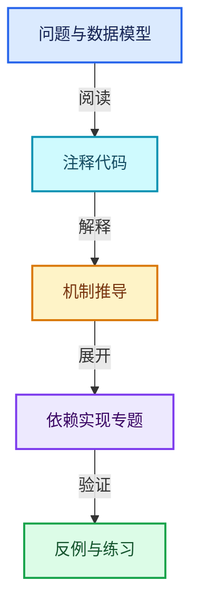
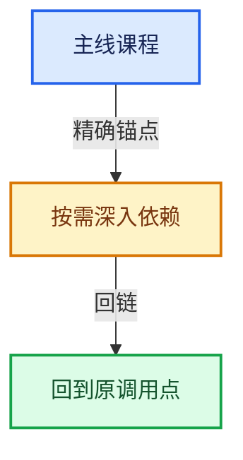

# 11-Depsgraph与并行任务系统

[总目录](../README.md) · [实现索引](../%E7%AC%A6%E5%8F%B7%E4%BE%9D%E8%B5%96%E4%B8%8E%E5%AE%9E%E7%8E%B0%E7%B4%A2%E5%BC%95.md)

## 主线课程

- [11-01 场景更新总体架构](01-%E5%9C%BA%E6%99%AF%E6%9B%B4%E6%96%B0%E6%80%BB%E4%BD%93%E6%9E%B6%E6%9E%84.md)
- [11-02 ID组件与操作节点](02-ID%E7%BB%84%E4%BB%B6%E4%B8%8E%E6%93%8D%E4%BD%9C%E8%8A%82%E7%82%B9.md)
- [11-03 节点构建器](03-%E8%8A%82%E7%82%B9%E6%9E%84%E5%BB%BA%E5%99%A8.md)
- [11-04 关系构建器](04-%E5%85%B3%E7%B3%BB%E6%9E%84%E5%BB%BA%E5%99%A8.md)
- [11-05 失效传播](05-%E5%A4%B1%E6%95%88%E4%BC%A0%E6%92%AD.md)
- [11-06 可见性与求值调度](06-%E5%8F%AF%E8%A7%81%E6%80%A7%E4%B8%8E%E6%B1%82%E5%80%BC%E8%B0%83%E5%BA%A6.md)
- [11-07 任务池与TBB接入](07-%E4%BB%BB%E5%8A%A1%E6%B1%A0%E4%B8%8ETBB%E6%8E%A5%E5%85%A5.md)
- [11-08 任务隔离死锁与实战](08-%E4%BB%BB%E5%8A%A1%E9%9A%94%E7%A6%BB%E6%AD%BB%E9%94%81%E4%B8%8E%E5%AE%9E%E6%88%98.md)

## 共享实现专题

- [source/blender/depsgraph/DEG_depsgraph.hh](%E4%BE%9D%E8%B5%96-DEG_depsgraph-6e4d59.md)
- [source/blender/depsgraph/DEG_depsgraph_query.hh](%E4%BE%9D%E8%B5%96-DEG_depsgraph_query-db0d31.md)
- [source/blender/depsgraph/intern/builder/deg_builder.cc](%E4%BE%9D%E8%B5%96-deg_builder-c9ef5e.md)
- [source/blender/depsgraph/intern/builder/deg_builder_cache.cc](%E4%BE%9D%E8%B5%96-deg_builder_cache-38512e.md)
- [source/blender/depsgraph/intern/builder/deg_builder_key.cc](%E4%BE%9D%E8%B5%96-deg_builder_key-367d58.md)
- [source/blender/depsgraph/intern/builder/deg_builder_key.h](%E4%BE%9D%E8%B5%96-deg_builder_key-402cec.md)
- [source/blender/depsgraph/intern/builder/deg_builder_nodes.h](%E4%BE%9D%E8%B5%96-deg_builder_nodes-c95998.md)
- [source/blender/depsgraph/intern/builder/deg_builder_nodes_rig.cc](%E4%BE%9D%E8%B5%96-deg_builder_nodes_rig-7f79e2.md)
- [source/blender/depsgraph/intern/builder/deg_builder_nodes_scene.cc](%E4%BE%9D%E8%B5%96-deg_builder_nodes_scene-66239a.md)
- [source/blender/depsgraph/intern/builder/deg_builder_pchanmap.cc](%E4%BE%9D%E8%B5%96-deg_builder_pchanmap-f4702f.md)
- [source/blender/depsgraph/intern/builder/deg_builder_relations.h](%E4%BE%9D%E8%B5%96-deg_builder_relations-ee8e7a.md)
- [source/blender/depsgraph/intern/builder/deg_builder_relations_drivers.cc](%E4%BE%9D%E8%B5%96-deg_builder_relations_drivers-dcbcdf.md)
- [source/blender/depsgraph/intern/builder/deg_builder_relations_impl.h](%E4%BE%9D%E8%B5%96-deg_builder_relations_impl-5ae258.md)
- [source/blender/depsgraph/intern/builder/deg_builder_relations_rig.cc](%E4%BE%9D%E8%B5%96-deg_builder_relations_rig-5239a6.md)
- [source/blender/depsgraph/intern/builder/deg_builder_relations_scene.cc](%E4%BE%9D%E8%B5%96-deg_builder_relations_scene-73e2fa.md)
- [source/blender/depsgraph/intern/builder/deg_builder_rna.cc](%E4%BE%9D%E8%B5%96-deg_builder_rna-02a729.md)
- [source/blender/depsgraph/intern/debug/deg_debug.cc](%E4%BE%9D%E8%B5%96-deg_debug-161340.md)
- [source/blender/depsgraph/intern/debug/deg_debug.h](%E4%BE%9D%E8%B5%96-deg_debug-ad205b.md)
- [source/blender/depsgraph/intern/depsgraph.cc](%E4%BE%9D%E8%B5%96-depsgraph-177fcb.md)
- [source/blender/depsgraph/intern/depsgraph_build.cc](%E4%BE%9D%E8%B5%96-depsgraph_build-ea2fc8.md)
- [source/blender/depsgraph/intern/depsgraph_debug.cc](%E4%BE%9D%E8%B5%96-depsgraph_debug-f95ade.md)
- [source/blender/depsgraph/intern/depsgraph_eval.cc](%E4%BE%9D%E8%B5%96-depsgraph_eval-a90044.md)
- [source/blender/depsgraph/intern/depsgraph_light_linking.cc](%E4%BE%9D%E8%B5%96-depsgraph_light_linking-6c0e8b.md)
- [source/blender/depsgraph/intern/depsgraph_physics.cc](%E4%BE%9D%E8%B5%96-depsgraph_physics-40d348.md)
- [source/blender/depsgraph/intern/depsgraph_query.cc](%E4%BE%9D%E8%B5%96-depsgraph_query-e8b1e4.md)
- [source/blender/depsgraph/intern/depsgraph_query_foreach.cc](%E4%BE%9D%E8%B5%96-depsgraph_query_foreach-82ea88.md)
- [source/blender/depsgraph/intern/depsgraph_query_iter.cc](%E4%BE%9D%E8%B5%96-depsgraph_query_iter-272e1a.md)
- [source/blender/depsgraph/intern/depsgraph_registry.cc](%E4%BE%9D%E8%B5%96-depsgraph_registry-f1b523.md)
- [source/blender/depsgraph/intern/depsgraph_relation.cc](%E4%BE%9D%E8%B5%96-depsgraph_relation-5d0905.md)
- [source/blender/depsgraph/intern/depsgraph_tag.cc](%E4%BE%9D%E8%B5%96-depsgraph_tag-d8b3c7.md)
- [source/blender/depsgraph/intern/depsgraph_type.cc](%E4%BE%9D%E8%B5%96-depsgraph_type-fccd49.md)
- [source/blender/depsgraph/intern/depsgraph_type.hh](%E4%BE%9D%E8%B5%96-depsgraph_type-a5aead.md)
- [source/blender/depsgraph/intern/depsgraph_update.cc](%E4%BE%9D%E8%B5%96-depsgraph_update-cd1b89.md)
- [source/blender/depsgraph/intern/depsgraph_writeback_sync.cc](%E4%BE%9D%E8%B5%96-depsgraph_writeback_sync-ff73c3.md)
- [source/blender/depsgraph/intern/eval/deg_eval_copy_on_write.cc](%E4%BE%9D%E8%B5%96-deg_eval_copy_on_write-5fb7a2.md)
- [source/blender/depsgraph/intern/eval/deg_eval_copy_on_write.h](%E4%BE%9D%E8%B5%96-deg_eval_copy_on_write-af0e7c.md)
- [source/blender/depsgraph/intern/eval/deg_eval_runtime_backup.cc](%E4%BE%9D%E8%B5%96-deg_eval_runtime_backup-c4c92a.md)
- [source/blender/depsgraph/intern/eval/deg_eval_stats.cc](%E4%BE%9D%E8%B5%96-deg_eval_stats-b88615.md)
- [source/blender/depsgraph/intern/node/deg_node.cc](%E4%BE%9D%E8%B5%96-deg_node-35126c.md)
- [source/blender/depsgraph/intern/node/deg_node.hh](%E4%BE%9D%E8%B5%96-deg_node-496499.md)
- [source/blender/depsgraph/intern/node/deg_node_component.cc](%E4%BE%9D%E8%B5%96-deg_node_component-2075dd.md)
- [source/blender/depsgraph/intern/node/deg_node_factory.cc](%E4%BE%9D%E8%B5%96-deg_node_factory-22047f.md)
- [source/blender/depsgraph/intern/node/deg_node_factory_impl.hh](%E4%BE%9D%E8%B5%96-deg_node_factory_impl-ce022d.md)
- [source/blender/depsgraph/intern/node/deg_node_id.cc](%E4%BE%9D%E8%B5%96-deg_node_id-71dd5e.md)
- [source/blender/depsgraph/intern/node/deg_node_operation.cc](%E4%BE%9D%E8%B5%96-deg_node_operation-b37865.md)

