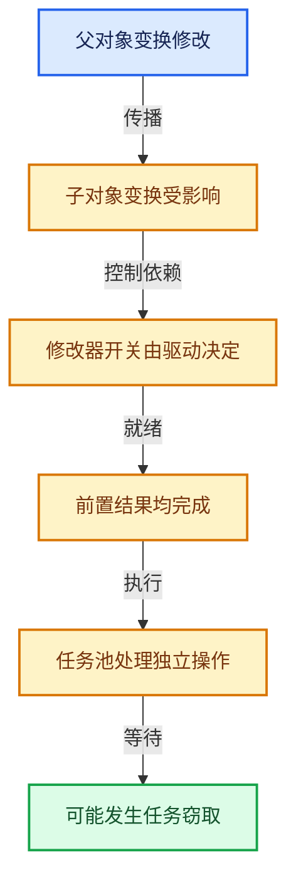

# 11-Depsgraph与并行任务系统

[总目录](../README.md)

标记更新、判断需求、依赖满足和任务执行是分开的阶段。

## 前置知识与阅读层次

- [06-隐式共享与缓存系统](../06-%E9%9A%90%E5%BC%8F%E5%85%B1%E4%BA%AB%E4%B8%8E%E7%BC%93%E5%AD%98%E7%B3%BB%E7%BB%9F/README.md)
- [09-LazyFunction与节点执行架构](../09-LazyFunction%E4%B8%8E%E8%8A%82%E7%82%B9%E6%89%A7%E8%A1%8C%E6%9E%B6%E6%9E%84/README.md)

初读抓住数据模型，复读逐行检查，再完成反例和独立实现。方向间允许按实际问题回查，不要求机械线性阅读。

## 正文与源码范围

| 顺序 | 文档 | 主讲文件与范围 |
|---|---|---|
| 11-01 | [场景更新总体架构](01-%E5%9C%BA%E6%99%AF%E6%9B%B4%E6%96%B0%E6%80%BB%E4%BD%93%E6%9E%B6%E6%9E%84.md) | depsgraph.hh:L1—L206；depsgraph_relation.hh:L1—L51 |
| 11-02 | [ID组件与操作节点](02-ID%E7%BB%84%E4%BB%B6%E4%B8%8E%E6%93%8D%E4%BD%9C%E8%8A%82%E7%82%B9.md) | deg_node_id.hh:L1—L140；deg_node_component.hh:L1—L264；deg_node_operation.hh:L1—L310 |
| 11-03 | [节点构建器](03-%E8%8A%82%E7%82%B9%E6%9E%84%E5%BB%BA%E5%99%A8.md) | deg_builder_nodes.h:L1—L360；deg_builder_nodes.cc:L1—L2520 |
| 11-04 | [关系构建器](04-%E5%85%B3%E7%B3%BB%E6%9E%84%E5%BB%BA%E5%99%A8.md) | deg_builder_relations.h:L1—L376；deg_builder_relations.cc:L1—L3829 |
| 11-05 | [失效传播](05-%E5%A4%B1%E6%95%88%E4%BC%A0%E6%92%AD.md) | deg_eval_flush.cc:L1—L362 |
| 11-06 | [可见性与求值调度](06-%E5%8F%AF%E8%A7%81%E6%80%A7%E4%B8%8E%E6%B1%82%E5%80%BC%E8%B0%83%E5%BA%A6.md) | deg_eval.cc:L1—L518；deg_eval_visibility.cc:L1—L235 |
| 11-07 | [任务池与TBB接入](07-%E4%BB%BB%E5%8A%A1%E6%B1%A0%E4%B8%8ETBB%E6%8E%A5%E5%85%A5.md) | BLI_task.hh:L1—L267；task_pool.cc:L1—L465；task_scheduler.cc:L1—L125 |
| 11-08 | [任务隔离死锁与实战](08-%E4%BB%BB%E5%8A%A1%E9%9A%94%E7%A6%BB%E6%AD%BB%E9%94%81%E4%B8%8E%E5%AE%9E%E6%88%98.md) | task_graph.cc:L1—L151；task_range.cc:L1—L341 |

## 本方向的数据模型

## 状态推演

## 历史入口

- [Depsgraph: Refactor evaluation into smaller reusable functions](https://projects.blender.org/blender/blender/commit/2280a71f900eb7907c243f76930a7e9779a90d7d) · Sergey Sharybin · 2022-07-19
- [Depsgraph: Optimize evaluation of dependencies of disabled modifiers](https://projects.blender.org/blender/blender/commit/f12f7800c2965c721a4eb4baeb6b1ab129bfa375) · Sergey Sharybin · 2022-08-04
- [Task: Use TBB as Task Scheduler](https://projects.blender.org/blender/blender/commit/d8a3f3595af0fb3ca5937e41c2728fd750d986ef) · Brecht Van Lommel · 2020-04-30
- [Fix T92423: Blender freeze rendering animation with Mantaflow](https://projects.blender.org/blender/blender/commit/8507336e76902604a2128b23a4d8e52094031ab0) · Sergey Sharybin · 2021-10-27

## 跨库比较与验收

与构建系统依赖图、oneTBB任务与几何节点图比较：场景更新需要处理源变化和可见性，具体图执行还受领域语义影响。

依赖结果先于消费者可见；禁用节点仍保留必要控制计算；没有同时持有锁的循环等待。

正文和源码区间已建立；自动检查结果见根目录验收报告。阅读者的掌握程度以独立练习与反例推理为准。
