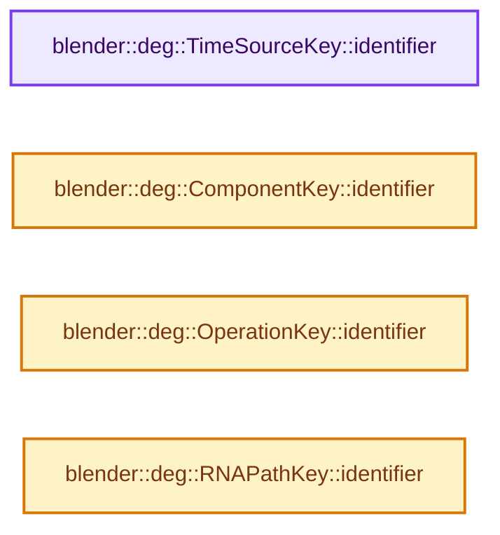

# 实现依赖专题：source/blender/depsgraph/intern/builder/deg_builder_key.cc

[方向导航](README.md) · [符号索引](../%E7%AC%A6%E5%8F%B7%E4%BE%9D%E8%B5%96%E4%B8%8E%E5%AE%9E%E7%8E%B0%E7%B4%A2%E5%BC%95.md)

本专题从正文实际调用进入，集中保存共享实现。函数有稳定锚点，可从调用处直接跳到对应完整函数；递归与互相调用通过回链组织。

## 本文件的实现关系




## 完整成员与函数实现

<a id="f-64a25844f20a974f"></a>

### `blender::deg::TimeSourceKey::identifier`

实现位置：[source/blender/depsgraph/intern/builder/deg_builder_key.cc](../../../../../source/blender/depsgraph/intern/builder/deg_builder_key.cc) · L22—L25。

**教学注释版**

<!-- annotated:c62abe4541ef4a -->

```cpp
std::string TimeSourceKey::identifier() const
{
  return std::string("TimeSourceKey");
}
```

<details>
<summary>核对原始源码：source/blender/depsgraph/intern/builder/deg_builder_key.cc · L22—L25</summary>

<!-- original:c62abe4541ef4a:source/blender/depsgraph/intern/builder/deg_builder_key.cc:22:25 -->

```cpp
std::string TimeSourceKey::identifier() const
{
  return std::string("TimeSourceKey");
}
```

</details>

**结果出口**

- `return std::string("TimeSourceKey");`

**继续追踪实现**

- `std::string` → [外部契约](https://eel.is/c++draft/)：这个边界按实际表达式及所属类型核对参数、返回值、寿命与失败行为。这里提供接口入口，不声称已解释该第三方版本的内部实现。

<a id="f-fa23e63adcfd2e00"></a>

### `blender::deg::ComponentKey::identifier`

实现位置：[source/blender/depsgraph/intern/builder/deg_builder_key.cc](../../../../../source/blender/depsgraph/intern/builder/deg_builder_key.cc) · L33—L44。

**教学注释版**

<!-- annotated:1f553a3bdeadb0 -->

```cpp
std::string ComponentKey::identifier() const
{
  const char *idname = (id) ? id->name : "<None>";
  std::string result = std::string("ComponentKey(");
  result += idname;
  result += ", " + std::string(nodeTypeAsString(type));
  if (name[0] != '\0') {
    result += ", '" + std::string(name) + "'";
  }
  result += ')';
  return result;
}
```

<details>
<summary>核对原始源码：source/blender/depsgraph/intern/builder/deg_builder_key.cc · L33—L44</summary>

<!-- original:1f553a3bdeadb0:source/blender/depsgraph/intern/builder/deg_builder_key.cc:33:44 -->

```cpp
std::string ComponentKey::identifier() const
{
  const char *idname = (id) ? id->name : "<None>";
  std::string result = std::string("ComponentKey(");
  result += idname;
  result += ", " + std::string(nodeTypeAsString(type));
  if (name[0] != '\0') {
    result += ", '" + std::string(name) + "'";
  }
  result += ')';
  return result;
}
```

</details>

**沿实际写入检查状态**

- `result += idname;`
- `result += ", " + std::string(nodeTypeAsString(type));`
- `result += ", '" + std::string(name) + "'";`
- `result += ')';`

**结果出口**

- `return result;`

**继续追踪实现**

- `std::string` → [外部契约](https://eel.is/c++draft/)：这个边界按实际表达式及所属类型核对参数、返回值、寿命与失败行为。这里提供接口入口，不声称已解释该第三方版本的内部实现。
- `nodeTypeAsString` → [blender::deg::nodeTypeAsString · L35](%E4%BE%9D%E8%B5%96-deg_node-35126c.md#f-830e1f086ed0e6b3)。

<a id="f-7329810d2cc46846"></a>

### `blender::deg::OperationKey::identifier`

实现位置：[source/blender/depsgraph/intern/builder/deg_builder_key.cc](../../../../../source/blender/depsgraph/intern/builder/deg_builder_key.cc) · L52—L63。

**教学注释版**

<!-- annotated:80fb86541977bc -->

```cpp
std::string OperationKey::identifier() const
{
  std::string result = std::string("OperationKey(");
  result += "type: " + std::string(nodeTypeAsString(component_type));
  result += ", component name: '" + std::string(component_name) + "'";
  result += ", operation code: " + std::string(operationCodeAsString(opcode));
  if (name[0] != '\0') {
    result += ", '" + std::string(name) + "'";
  }
  result += ")";
  return result;
}
```

<details>
<summary>核对原始源码：source/blender/depsgraph/intern/builder/deg_builder_key.cc · L52—L63</summary>

<!-- original:80fb86541977bc:source/blender/depsgraph/intern/builder/deg_builder_key.cc:52:63 -->

```cpp
std::string OperationKey::identifier() const
{
  std::string result = std::string("OperationKey(");
  result += "type: " + std::string(nodeTypeAsString(component_type));
  result += ", component name: '" + std::string(component_name) + "'";
  result += ", operation code: " + std::string(operationCodeAsString(opcode));
  if (name[0] != '\0') {
    result += ", '" + std::string(name) + "'";
  }
  result += ")";
  return result;
}
```

</details>

**沿实际写入检查状态**

- `result += "type: " + std::string(nodeTypeAsString(component_type));`
- `result += ", component name: '" + std::string(component_name) + "'";`
- `result += ", operation code: " + std::string(operationCodeAsString(opcode));`
- `result += ", '" + std::string(name) + "'";`
- `result += ")";`

**结果出口**

- `return result;`

**继续追踪实现**

- `std::string` → [外部契约](https://eel.is/c++draft/)：这个边界按实际表达式及所属类型核对参数、返回值、寿命与失败行为。这里提供接口入口，不声称已解释该第三方版本的内部实现。
- `nodeTypeAsString` → [blender::deg::nodeTypeAsString · L35](%E4%BE%9D%E8%B5%96-deg_node-35126c.md#f-830e1f086ed0e6b3)。
- `operationCodeAsString` → [blender::deg::operationCodeAsString · L18](%E4%BE%9D%E8%B5%96-deg_node_operation-b37865.md#f-68fb68ebe4b00b3c)。

<a id="f-3dded6cfe70342ea"></a>

### `blender::deg::RNAPathKey::identifier`

实现位置：[source/blender/depsgraph/intern/builder/deg_builder_key.cc](../../../../../source/blender/depsgraph/intern/builder/deg_builder_key.cc) · L101—L106。

**教学注释版**

<!-- annotated:ac7c39b7d61798 -->

```cpp
std::string RNAPathKey::identifier() const
{
  const char *id_name = (id) ? id->name : "<No ID>";
  const char *prop_name = (prop) ? RNA_property_identifier(prop) : "<No Prop>";
  return std::string("RnaPathKey(") + "id: " + id_name + ", prop: '" + prop_name + "')";
}
```

<details>
<summary>核对原始源码：source/blender/depsgraph/intern/builder/deg_builder_key.cc · L101—L106</summary>

<!-- original:ac7c39b7d61798:source/blender/depsgraph/intern/builder/deg_builder_key.cc:101:106 -->

```cpp
std::string RNAPathKey::identifier() const
{
  const char *id_name = (id) ? id->name : "<No ID>";
  const char *prop_name = (prop) ? RNA_property_identifier(prop) : "<No Prop>";
  return std::string("RnaPathKey(") + "id: " + id_name + ", prop: '" + prop_name + "')";
}
```

</details>

**结果出口**

- `return std::string("RnaPathKey(") + "id: " + id_name + ", prop: '" + prop_name + "')";`

**继续追踪实现**

- `RNA_property_identifier` → [blender::RNA_property_identifier · L1275](../05-%E5%87%A0%E4%BD%95%E5%AD%98%E5%82%A8%E4%B8%8E%E6%8B%93%E6%89%91%E6%98%A0%E5%B0%84/%E4%BE%9D%E8%B5%96-rna_access-706bea.md#f-67de6dc6c76092df)。
- `std::string` → [外部契约](https://eel.is/c++draft/)：这个边界按实际表达式及所属类型核对参数、返回值、寿命与失败行为。这里提供接口入口，不声称已解释该第三方版本的内部实现。
