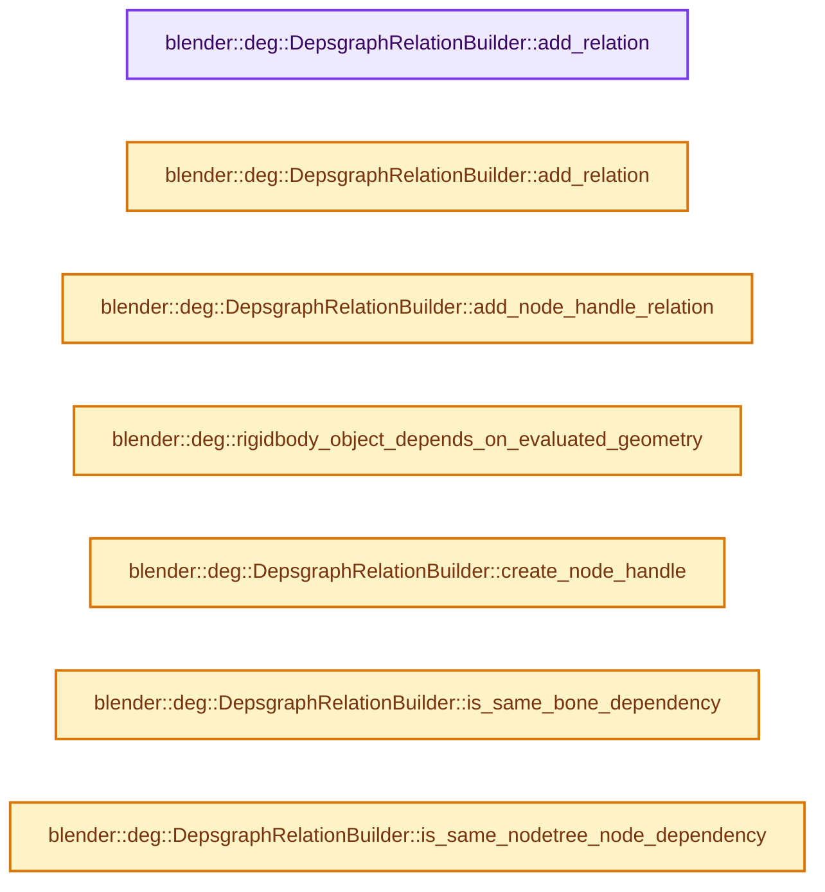
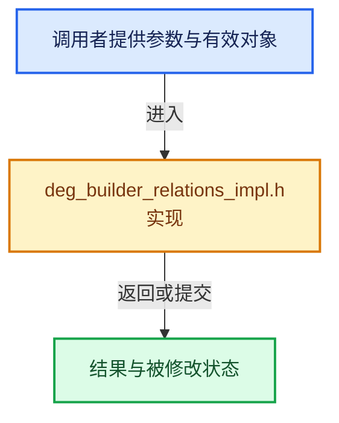

# 实现依赖专题：source/blender/depsgraph/intern/builder/deg_builder_relations_impl.h

[方向导航](README.md) · [符号索引](../%E7%AC%A6%E5%8F%B7%E4%BE%9D%E8%B5%96%E4%B8%8E%E5%AE%9E%E7%8E%B0%E7%B4%A2%E5%BC%95.md)

本专题从正文实际调用进入，集中保存共享实现。函数有稳定锚点，可从调用处直接跳到对应完整函数；递归与互相调用通过回链组织。

## 本文件的实现关系






## 完整成员与函数实现

<a id="f-9c9f4ea4be1f8780"></a>

### `blender::deg::DepsgraphRelationBuilder::add_relation`

实现位置：[source/blender/depsgraph/intern/builder/deg_builder_relations_impl.h](../../../../../source/blender/depsgraph/intern/builder/deg_builder_relations_impl.h) · L29—L64。

接口参数：

- `const KeyFrom &key_from`
- `const KeyTo &key_to`
- `const char *description`
- `int flags`

**教学注释版**

<!-- annotated:983041e0219346 -->

```cpp
template<typename KeyFrom, typename KeyTo>
Relation *DepsgraphRelationBuilder::add_relation(const KeyFrom &key_from,
                                                 const KeyTo &key_to,
                                                 const char *description,
                                                 int flags)
{
  Node *node_from = get_node(key_from);
  Node *node_to = get_node(key_to);
  OperationNode *op_from = node_from ? node_from->get_exit_operation() : nullptr;
  OperationNode *op_to = node_to ? node_to->get_entry_operation() : nullptr;

  if (op_from && op_to) {
    return add_operation_relation(op_from, op_to, description, flags);
  }

  /* TODO(sergey): Report error in the interface. */

  std::cerr << "--------------------------------------------------------------------\n";
  std::cerr << "Failed to add relation \"" << description << "\"\n";

  if (!op_from) {
    std::cerr << "Could not find op_from: " << key_from.identifier() << "\n";
  }

  if (!op_to) {
    std::cerr << "Could not find op_to: " << key_to.identifier() << "\n";
  }

  if (!stack_.is_empty()) {
    std::cerr << "\nTrace:\n\n";
    stack_.print_backtrace(std::cerr);
    std::cerr << "\n";
  }

  return nullptr;
}
```

<details>
<summary>核对原始源码：source/blender/depsgraph/intern/builder/deg_builder_relations_impl.h · L29—L64</summary>

<!-- original:983041e0219346:source/blender/depsgraph/intern/builder/deg_builder_relations_impl.h:29:64 -->

```cpp
template<typename KeyFrom, typename KeyTo>
Relation *DepsgraphRelationBuilder::add_relation(const KeyFrom &key_from,
                                                 const KeyTo &key_to,
                                                 const char *description,
                                                 int flags)
{
  Node *node_from = get_node(key_from);
  Node *node_to = get_node(key_to);
  OperationNode *op_from = node_from ? node_from->get_exit_operation() : nullptr;
  OperationNode *op_to = node_to ? node_to->get_entry_operation() : nullptr;

  if (op_from && op_to) {
    return add_operation_relation(op_from, op_to, description, flags);
  }

  /* TODO(sergey): Report error in the interface. */

  std::cerr << "--------------------------------------------------------------------\n";
  std::cerr << "Failed to add relation \"" << description << "\"\n";

  if (!op_from) {
    std::cerr << "Could not find op_from: " << key_from.identifier() << "\n";
  }

  if (!op_to) {
    std::cerr << "Could not find op_to: " << key_to.identifier() << "\n";
  }

  if (!stack_.is_empty()) {
    std::cerr << "\nTrace:\n\n";
    stack_.print_backtrace(std::cerr);
    std::cerr << "\n";
  }

  return nullptr;
}
```

</details>

**结果出口**

- `return add_operation_relation(op_from, op_to, description, flags);`
- `return nullptr;`

**继续追踪实现**

- `get_node` → [blender::deg::DepsgraphRelationBuilder::get_node · L251](04-%E5%85%B3%E7%B3%BB%E6%9E%84%E5%BB%BA%E5%99%A8.md#f-643623ad522e2b50)；[blender::deg::DepsgraphRelationBuilder::get_node · L256](04-%E5%85%B3%E7%B3%BB%E6%9E%84%E5%BB%BA%E5%99%A8.md#f-3f46f7cef157b43c)；[blender::deg::DepsgraphRelationBuilder::get_node · L270](04-%E5%85%B3%E7%B3%BB%E6%9E%84%E5%BB%BA%E5%99%A8.md#f-bbe823fc394f5d32)；[blender::deg::DepsgraphRelationBuilder::get_node · L282](04-%E5%85%B3%E7%B3%BB%E6%9E%84%E5%BB%BA%E5%99%A8.md#f-bf98884d578c6f50)。同名重载需按实参类型选择。
- `node_from->get_exit_operation` → [blender::deg::Node::get_exit_operation · L213](%E4%BE%9D%E8%B5%96-deg_node-496499.md#f-d9039fab783f3922)。
- `node_to->get_entry_operation` → [blender::deg::Node::get_entry_operation · L209](%E4%BE%9D%E8%B5%96-deg_node-496499.md#f-b637e25cf3666a99)。
- `add_operation_relation` → [blender::deg::DepsgraphRelationBuilder::add_operation_relation · L398](04-%E5%85%B3%E7%B3%BB%E6%9E%84%E5%BB%BA%E5%99%A8.md#f-9185b6ea7f68b11e)。
- `key_from.identifier` → [blender::deg::TimeSourceKey::identifier · L22](%E4%BE%9D%E8%B5%96-deg_builder_key-367d58.md#f-64a25844f20a974f)；[blender::deg::ComponentKey::identifier · L33](%E4%BE%9D%E8%B5%96-deg_builder_key-367d58.md#f-fa23e63adcfd2e00)；[blender::deg::OperationKey::identifier · L52](%E4%BE%9D%E8%B5%96-deg_builder_key-367d58.md#f-7329810d2cc46846)；[blender::deg::RNAPathKey::identifier · L101](%E4%BE%9D%E8%B5%96-deg_builder_key-367d58.md#f-3dded6cfe70342ea)。同名重载需按实参类型选择。
- `key_to.identifier` → [blender::deg::TimeSourceKey::identifier · L22](%E4%BE%9D%E8%B5%96-deg_builder_key-367d58.md#f-64a25844f20a974f)；[blender::deg::ComponentKey::identifier · L33](%E4%BE%9D%E8%B5%96-deg_builder_key-367d58.md#f-fa23e63adcfd2e00)；[blender::deg::OperationKey::identifier · L52](%E4%BE%9D%E8%B5%96-deg_builder_key-367d58.md#f-7329810d2cc46846)；[blender::deg::RNAPathKey::identifier · L101](%E4%BE%9D%E8%B5%96-deg_builder_key-367d58.md#f-3dded6cfe70342ea)。同名重载需按实参类型选择。
- `stack_.is_empty` → [调用协议](../%E6%A8%A1%E6%9D%BF%E5%AE%8F%E4%B8%8E%E5%8A%A8%E6%80%81%E5%88%86%E6%B4%BE%E5%8D%8F%E8%AE%AE.md)：接收对象类型依赖auto、返回值或模板实例；不按同名猜测目标。调用位置L57。
- `stack_.print_backtrace` → [调用协议](../%E6%A8%A1%E6%9D%BF%E5%AE%8F%E4%B8%8E%E5%8A%A8%E6%80%81%E5%88%86%E6%B4%BE%E5%8D%8F%E8%AE%AE.md)：接收对象类型依赖auto、返回值或模板实例；不按同名猜测目标。调用位置L59。

<a id="f-5b2ef1e631a55534"></a>

### `blender::deg::DepsgraphRelationBuilder::add_relation`

实现位置：[source/blender/depsgraph/intern/builder/deg_builder_relations_impl.h](../../../../../source/blender/depsgraph/intern/builder/deg_builder_relations_impl.h) · L66—L79。

接口参数：

- `const TimeSourceKey &key_from`
- `const KeyTo &key_to`
- `const char *description`
- `int flags`

**教学注释版**

<!-- annotated:2de0ab163bf68e -->

```cpp
template<typename KeyTo>
Relation *DepsgraphRelationBuilder::add_relation(const TimeSourceKey &key_from,
                                                 const KeyTo &key_to,
                                                 const char *description,
                                                 int flags)
{
  TimeSourceNode *time_from = get_node(key_from);
  Node *node_to = get_node(key_to);
  OperationNode *op_to = node_to ? node_to->get_entry_operation() : nullptr;
  if (time_from != nullptr && op_to != nullptr) {
    return add_time_relation(time_from, op_to, description, flags);
  }
  return nullptr;
}
```

<details>
<summary>核对原始源码：source/blender/depsgraph/intern/builder/deg_builder_relations_impl.h · L66—L79</summary>

<!-- original:2de0ab163bf68e:source/blender/depsgraph/intern/builder/deg_builder_relations_impl.h:66:79 -->

```cpp
template<typename KeyTo>
Relation *DepsgraphRelationBuilder::add_relation(const TimeSourceKey &key_from,
                                                 const KeyTo &key_to,
                                                 const char *description,
                                                 int flags)
{
  TimeSourceNode *time_from = get_node(key_from);
  Node *node_to = get_node(key_to);
  OperationNode *op_to = node_to ? node_to->get_entry_operation() : nullptr;
  if (time_from != nullptr && op_to != nullptr) {
    return add_time_relation(time_from, op_to, description, flags);
  }
  return nullptr;
}
```

</details>

**结果出口**

- `return add_time_relation(time_from, op_to, description, flags);`
- `return nullptr;`

**继续追踪实现**

- `get_node` → [blender::deg::DepsgraphRelationBuilder::get_node · L251](04-%E5%85%B3%E7%B3%BB%E6%9E%84%E5%BB%BA%E5%99%A8.md#f-643623ad522e2b50)；[blender::deg::DepsgraphRelationBuilder::get_node · L256](04-%E5%85%B3%E7%B3%BB%E6%9E%84%E5%BB%BA%E5%99%A8.md#f-3f46f7cef157b43c)；[blender::deg::DepsgraphRelationBuilder::get_node · L270](04-%E5%85%B3%E7%B3%BB%E6%9E%84%E5%BB%BA%E5%99%A8.md#f-bbe823fc394f5d32)；[blender::deg::DepsgraphRelationBuilder::get_node · L282](04-%E5%85%B3%E7%B3%BB%E6%9E%84%E5%BB%BA%E5%99%A8.md#f-bf98884d578c6f50)。同名重载需按实参类型选择。
- `node_to->get_entry_operation` → [blender::deg::Node::get_entry_operation · L209](%E4%BE%9D%E8%B5%96-deg_node-496499.md#f-b637e25cf3666a99)。
- `add_time_relation` → [blender::deg::DepsgraphRelationBuilder::add_time_relation · L370](04-%E5%85%B3%E7%B3%BB%E6%9E%84%E5%BB%BA%E5%99%A8.md#f-df1064ecbe8b7ea7)。

<a id="f-3155e5998e3f40fb"></a>

### `blender::deg::DepsgraphRelationBuilder::add_node_handle_relation`

实现位置：[source/blender/depsgraph/intern/builder/deg_builder_relations_impl.h](../../../../../source/blender/depsgraph/intern/builder/deg_builder_relations_impl.h) · L81—L108。

接口参数：

- `const KeyType &key_from`
- `const DepsNodeHandle *handle`
- `const char *description`
- `int flags`

**教学注释版**

<!-- annotated:83ad65c54df9be -->

```cpp
template<typename KeyType>
  requires(!std::is_same_v<KeyType, TimeSourceKey>)
Relation *DepsgraphRelationBuilder::add_node_handle_relation(const KeyType &key_from,
                                                             const DepsNodeHandle *handle,
                                                             const char *description,
                                                             int flags)
{
  Node *node_from = get_node(key_from);
  OperationNode *op_from = node_from ? node_from->get_exit_operation() : nullptr;
  OperationNode *op_to = handle->node->get_entry_operation();
  if (op_from != nullptr && op_to != nullptr) {
    return add_operation_relation(op_from, op_to, description, flags);
  }
  if (!op_from) {
    fprintf(stderr,
            "add_node_handle_relation(%s) - Could not find op_from (%s)\n",
            description,
            key_from.identifier().c_str());
  }
  if (!op_to) {
    fprintf(stderr,
            "add_node_handle_relation(%s) - Could not find op_to (%s)\n",
            description,
            key_from.identifier().c_str());
  }

  return nullptr;
}
```

<details>
<summary>核对原始源码：source/blender/depsgraph/intern/builder/deg_builder_relations_impl.h · L81—L108</summary>

<!-- original:83ad65c54df9be:source/blender/depsgraph/intern/builder/deg_builder_relations_impl.h:81:108 -->

```cpp
template<typename KeyType>
  requires(!std::is_same_v<KeyType, TimeSourceKey>)
Relation *DepsgraphRelationBuilder::add_node_handle_relation(const KeyType &key_from,
                                                             const DepsNodeHandle *handle,
                                                             const char *description,
                                                             int flags)
{
  Node *node_from = get_node(key_from);
  OperationNode *op_from = node_from ? node_from->get_exit_operation() : nullptr;
  OperationNode *op_to = handle->node->get_entry_operation();
  if (op_from != nullptr && op_to != nullptr) {
    return add_operation_relation(op_from, op_to, description, flags);
  }
  if (!op_from) {
    fprintf(stderr,
            "add_node_handle_relation(%s) - Could not find op_from (%s)\n",
            description,
            key_from.identifier().c_str());
  }
  if (!op_to) {
    fprintf(stderr,
            "add_node_handle_relation(%s) - Could not find op_to (%s)\n",
            description,
            key_from.identifier().c_str());
  }

  return nullptr;
}
```

</details>

**结果出口**

- `return add_operation_relation(op_from, op_to, description, flags);`
- `return nullptr;`

**继续追踪实现**

- `get_node` → [blender::deg::DepsgraphRelationBuilder::get_node · L251](04-%E5%85%B3%E7%B3%BB%E6%9E%84%E5%BB%BA%E5%99%A8.md#f-643623ad522e2b50)；[blender::deg::DepsgraphRelationBuilder::get_node · L256](04-%E5%85%B3%E7%B3%BB%E6%9E%84%E5%BB%BA%E5%99%A8.md#f-3f46f7cef157b43c)；[blender::deg::DepsgraphRelationBuilder::get_node · L270](04-%E5%85%B3%E7%B3%BB%E6%9E%84%E5%BB%BA%E5%99%A8.md#f-bbe823fc394f5d32)；[blender::deg::DepsgraphRelationBuilder::get_node · L282](04-%E5%85%B3%E7%B3%BB%E6%9E%84%E5%BB%BA%E5%99%A8.md#f-bf98884d578c6f50)。同名重载需按实参类型选择。
- `node_from->get_exit_operation` → [blender::deg::Node::get_exit_operation · L213](%E4%BE%9D%E8%B5%96-deg_node-496499.md#f-d9039fab783f3922)。
- `handle->node->get_entry_operation` → [调用协议](../%E6%A8%A1%E6%9D%BF%E5%AE%8F%E4%B8%8E%E5%8A%A8%E6%80%81%E5%88%86%E6%B4%BE%E5%8D%8F%E8%AE%AE.md)：接收对象类型依赖auto、返回值或模板实例；不按同名猜测目标。调用位置L90。
- `add_operation_relation` → [blender::deg::DepsgraphRelationBuilder::add_operation_relation · L398](04-%E5%85%B3%E7%B3%BB%E6%9E%84%E5%BB%BA%E5%99%A8.md#f-9185b6ea7f68b11e)。
- `fprintf` → [外部契约](https://eel.is/c++draft/)：这个边界按实际表达式及所属类型核对参数、返回值、寿命与失败行为。这里提供接口入口，不声称已解释该第三方版本的内部实现。
- `key_from.identifier().c_str` → [调用协议](../%E6%A8%A1%E6%9D%BF%E5%AE%8F%E4%B8%8E%E5%8A%A8%E6%80%81%E5%88%86%E6%B4%BE%E5%8D%8F%E8%AE%AE.md)：接收对象类型依赖auto、返回值或模板实例；不按同名猜测目标。调用位置L98。
- `key_from.identifier` → [blender::deg::TimeSourceKey::identifier · L22](%E4%BE%9D%E8%B5%96-deg_builder_key-367d58.md#f-64a25844f20a974f)；[blender::deg::ComponentKey::identifier · L33](%E4%BE%9D%E8%B5%96-deg_builder_key-367d58.md#f-fa23e63adcfd2e00)；[blender::deg::OperationKey::identifier · L52](%E4%BE%9D%E8%B5%96-deg_builder_key-367d58.md#f-7329810d2cc46846)；[blender::deg::RNAPathKey::identifier · L101](%E4%BE%9D%E8%B5%96-deg_builder_key-367d58.md#f-3dded6cfe70342ea)。同名重载需按实参类型选择。

<a id="f-b73e1b0988bfec4a"></a>

### `blender::deg::rigidbody_object_depends_on_evaluated_geometry`

实现位置：[source/blender/depsgraph/intern/builder/deg_builder_relations_impl.h](../../../../../source/blender/depsgraph/intern/builder/deg_builder_relations_impl.h) · L110—L121。

接口参数：

- `const RigidBodyOb *rbo`

**教学注释版**

<!-- annotated:45e8af9ec8942e -->

```cpp
static inline bool rigidbody_object_depends_on_evaluated_geometry(const RigidBodyOb *rbo)
{
  if (rbo == nullptr) {
    return false;
  }
  if (ELEM(rbo->shape, RB_SHAPE_CONVEXH, RB_SHAPE_TRIMESH)) {
    if (rbo->mesh_source != RBO_MESH_BASE) {
      return true;
    }
  }
  return false;
}
```

<details>
<summary>核对原始源码：source/blender/depsgraph/intern/builder/deg_builder_relations_impl.h · L110—L121</summary>

<!-- original:45e8af9ec8942e:source/blender/depsgraph/intern/builder/deg_builder_relations_impl.h:110:121 -->

```cpp
static inline bool rigidbody_object_depends_on_evaluated_geometry(const RigidBodyOb *rbo)
{
  if (rbo == nullptr) {
    return false;
  }
  if (ELEM(rbo->shape, RB_SHAPE_CONVEXH, RB_SHAPE_TRIMESH)) {
    if (rbo->mesh_source != RBO_MESH_BASE) {
      return true;
    }
  }
  return false;
}
```

</details>

**结果出口**

- `return false;`
- `return true;`

**继续追踪实现**

- `ELEM` → [ELEM · L88](../05-%E5%87%A0%E4%BD%95%E5%AD%98%E5%82%A8%E4%B8%8E%E6%8B%93%E6%89%91%E6%98%A0%E5%B0%84/%E4%BE%9D%E8%B5%96-GHOST_utildefines-34b996.md#m-d28724a15928)；[ELEM · L135](../01-%E5%9F%BA%E7%A1%80%E5%AE%B9%E5%99%A8%E4%B8%8E%E7%8E%B0%E4%BB%A3CPP/%E4%BE%9D%E8%B5%96-BLI_utildefines-293a0a.md#m-d6572de7cae0)。宏定义由构建条件选择。

<a id="f-33d589def56c6022"></a>

### `blender::deg::DepsgraphRelationBuilder::create_node_handle`

实现位置：[source/blender/depsgraph/intern/builder/deg_builder_relations_impl.h](../../../../../source/blender/depsgraph/intern/builder/deg_builder_relations_impl.h) · L140—L145。

接口参数：

- `const KeyType &key`
- `const char *default_name`

**教学注释版**

<!-- annotated:aeb3322a4e9106 -->

```cpp
template<typename KeyType>
DepsNodeHandle DepsgraphRelationBuilder::create_node_handle(const KeyType &key,
                                                            const char *default_name)
{
  return DepsNodeHandle(this, get_node(key), default_name);
}
```

<details>
<summary>核对原始源码：source/blender/depsgraph/intern/builder/deg_builder_relations_impl.h · L140—L145</summary>

<!-- original:aeb3322a4e9106:source/blender/depsgraph/intern/builder/deg_builder_relations_impl.h:140:145 -->

```cpp
template<typename KeyType>
DepsNodeHandle DepsgraphRelationBuilder::create_node_handle(const KeyType &key,
                                                            const char *default_name)
{
  return DepsNodeHandle(this, get_node(key), default_name);
}
```

</details>

**结果出口**

- `return DepsNodeHandle(this, get_node(key), default_name);`

**继续追踪实现**

- `DepsNodeHandle` → [blender::deg::DepsNodeHandle::DepsNodeHandle · L360](04-%E5%85%B3%E7%B3%BB%E6%9E%84%E5%BB%BA%E5%99%A8.md#f-fa49525c0b319e20)。
- `get_node` → [blender::deg::DepsgraphRelationBuilder::get_node · L251](04-%E5%85%B3%E7%B3%BB%E6%9E%84%E5%BB%BA%E5%99%A8.md#f-643623ad522e2b50)；[blender::deg::DepsgraphRelationBuilder::get_node · L256](04-%E5%85%B3%E7%B3%BB%E6%9E%84%E5%BB%BA%E5%99%A8.md#f-3f46f7cef157b43c)；[blender::deg::DepsgraphRelationBuilder::get_node · L270](04-%E5%85%B3%E7%B3%BB%E6%9E%84%E5%BB%BA%E5%99%A8.md#f-bbe823fc394f5d32)；[blender::deg::DepsgraphRelationBuilder::get_node · L282](04-%E5%85%B3%E7%B3%BB%E6%9E%84%E5%BB%BA%E5%99%A8.md#f-bf98884d578c6f50)。同名重载需按实参类型选择。

<a id="f-d75ce7744e8d2b00"></a>

### `blender::deg::DepsgraphRelationBuilder::is_same_bone_dependency`

实现位置：[source/blender/depsgraph/intern/builder/deg_builder_relations_impl.h](../../../../../source/blender/depsgraph/intern/builder/deg_builder_relations_impl.h) · L151—L180。

接口参数：

- `const KeyFrom &key_from`
- `const KeyTo &key_to`

**教学注释版**

<!-- annotated:790e3fb44a29b5 -->

```cpp
template<typename KeyFrom, typename KeyTo>
bool DepsgraphRelationBuilder::is_same_bone_dependency(const KeyFrom &key_from,
                                                       const KeyTo &key_to)
{
  /* Get operations for requested keys. */
  Node *node_from = get_node(key_from);
  Node *node_to = get_node(key_to);
  if (node_from == nullptr || node_to == nullptr) {
    return false;
  }
  OperationNode *op_from = node_from->get_exit_operation();
  OperationNode *op_to = node_to->get_entry_operation();
  if (op_from == nullptr || op_to == nullptr) {
    return false;
  }
  /* Different armatures, bone can't be the same. */
  if (op_from->owner->owner != op_to->owner->owner) {
    return false;
  }
  /* We are only interested in relations like BONE_DONE -> BONE_LOCAL... */
  if (!(op_from->opcode == OperationCode::BONE_DONE && op_to->opcode == OperationCode::BONE_LOCAL))
  {
    return false;
  }
  /* ... BUT, we also need to check if it's same bone. */
  if (op_from->owner->name != op_to->owner->name) {
    return false;
  }
  return true;
}
```

<details>
<summary>核对原始源码：source/blender/depsgraph/intern/builder/deg_builder_relations_impl.h · L151—L180</summary>

<!-- original:790e3fb44a29b5:source/blender/depsgraph/intern/builder/deg_builder_relations_impl.h:151:180 -->

```cpp
template<typename KeyFrom, typename KeyTo>
bool DepsgraphRelationBuilder::is_same_bone_dependency(const KeyFrom &key_from,
                                                       const KeyTo &key_to)
{
  /* Get operations for requested keys. */
  Node *node_from = get_node(key_from);
  Node *node_to = get_node(key_to);
  if (node_from == nullptr || node_to == nullptr) {
    return false;
  }
  OperationNode *op_from = node_from->get_exit_operation();
  OperationNode *op_to = node_to->get_entry_operation();
  if (op_from == nullptr || op_to == nullptr) {
    return false;
  }
  /* Different armatures, bone can't be the same. */
  if (op_from->owner->owner != op_to->owner->owner) {
    return false;
  }
  /* We are only interested in relations like BONE_DONE -> BONE_LOCAL... */
  if (!(op_from->opcode == OperationCode::BONE_DONE && op_to->opcode == OperationCode::BONE_LOCAL))
  {
    return false;
  }
  /* ... BUT, we also need to check if it's same bone. */
  if (op_from->owner->name != op_to->owner->name) {
    return false;
  }
  return true;
}
```

</details>

**结果出口**

- `return false;`
- `return true;`

**继续追踪实现**

- `get_node` → [blender::deg::DepsgraphRelationBuilder::get_node · L251](04-%E5%85%B3%E7%B3%BB%E6%9E%84%E5%BB%BA%E5%99%A8.md#f-643623ad522e2b50)；[blender::deg::DepsgraphRelationBuilder::get_node · L256](04-%E5%85%B3%E7%B3%BB%E6%9E%84%E5%BB%BA%E5%99%A8.md#f-3f46f7cef157b43c)；[blender::deg::DepsgraphRelationBuilder::get_node · L270](04-%E5%85%B3%E7%B3%BB%E6%9E%84%E5%BB%BA%E5%99%A8.md#f-bbe823fc394f5d32)；[blender::deg::DepsgraphRelationBuilder::get_node · L282](04-%E5%85%B3%E7%B3%BB%E6%9E%84%E5%BB%BA%E5%99%A8.md#f-bf98884d578c6f50)。同名重载需按实参类型选择。
- `node_from->get_exit_operation` → [blender::deg::Node::get_exit_operation · L213](%E4%BE%9D%E8%B5%96-deg_node-496499.md#f-d9039fab783f3922)。
- `node_to->get_entry_operation` → [blender::deg::Node::get_entry_operation · L209](%E4%BE%9D%E8%B5%96-deg_node-496499.md#f-b637e25cf3666a99)。

<a id="f-f051e46e64c896fd"></a>

### `blender::deg::DepsgraphRelationBuilder::is_same_nodetree_node_dependency`

实现位置：[source/blender/depsgraph/intern/builder/deg_builder_relations_impl.h](../../../../../source/blender/depsgraph/intern/builder/deg_builder_relations_impl.h) · L182—L212。

接口参数：

- `const KeyFrom &key_from`
- `const KeyTo &key_to`

**教学注释版**

<!-- annotated:3f9910528267dc -->

```cpp
template<typename KeyFrom, typename KeyTo>
bool DepsgraphRelationBuilder::is_same_nodetree_node_dependency(const KeyFrom &key_from,
                                                                const KeyTo &key_to)
{
  /* Get operations for requested keys. */
  Node *node_from = get_node(key_from);
  Node *node_to = get_node(key_to);
  if (node_from == nullptr || node_to == nullptr) {
    return false;
  }
  OperationNode *op_from = node_from->get_exit_operation();
  OperationNode *op_to = node_to->get_entry_operation();
  if (op_from == nullptr || op_to == nullptr) {
    return false;
  }
  /* Check if this is actually a node tree. */
  if (GS(op_from->owner->owner->id_orig->name) != ID_NT) {
    return false;
  }
  /* Different node trees. */
  if (op_from->owner->owner != op_to->owner->owner) {
    return false;
  }
  /* We are only interested in relations like BONE_DONE -> BONE_LOCAL... */
  if (!(op_from->opcode == OperationCode::PARAMETERS_EVAL &&
        op_to->opcode == OperationCode::PARAMETERS_EVAL))
  {
    return false;
  }
  return true;
}
```

<details>
<summary>核对原始源码：source/blender/depsgraph/intern/builder/deg_builder_relations_impl.h · L182—L212</summary>

<!-- original:3f9910528267dc:source/blender/depsgraph/intern/builder/deg_builder_relations_impl.h:182:212 -->

```cpp
template<typename KeyFrom, typename KeyTo>
bool DepsgraphRelationBuilder::is_same_nodetree_node_dependency(const KeyFrom &key_from,
                                                                const KeyTo &key_to)
{
  /* Get operations for requested keys. */
  Node *node_from = get_node(key_from);
  Node *node_to = get_node(key_to);
  if (node_from == nullptr || node_to == nullptr) {
    return false;
  }
  OperationNode *op_from = node_from->get_exit_operation();
  OperationNode *op_to = node_to->get_entry_operation();
  if (op_from == nullptr || op_to == nullptr) {
    return false;
  }
  /* Check if this is actually a node tree. */
  if (GS(op_from->owner->owner->id_orig->name) != ID_NT) {
    return false;
  }
  /* Different node trees. */
  if (op_from->owner->owner != op_to->owner->owner) {
    return false;
  }
  /* We are only interested in relations like BONE_DONE -> BONE_LOCAL... */
  if (!(op_from->opcode == OperationCode::PARAMETERS_EVAL &&
        op_to->opcode == OperationCode::PARAMETERS_EVAL))
  {
    return false;
  }
  return true;
}
```

</details>

**结果出口**

- `return false;`
- `return true;`

**继续追踪实现**

- `get_node` → [blender::deg::DepsgraphRelationBuilder::get_node · L251](04-%E5%85%B3%E7%B3%BB%E6%9E%84%E5%BB%BA%E5%99%A8.md#f-643623ad522e2b50)；[blender::deg::DepsgraphRelationBuilder::get_node · L256](04-%E5%85%B3%E7%B3%BB%E6%9E%84%E5%BB%BA%E5%99%A8.md#f-3f46f7cef157b43c)；[blender::deg::DepsgraphRelationBuilder::get_node · L270](04-%E5%85%B3%E7%B3%BB%E6%9E%84%E5%BB%BA%E5%99%A8.md#f-bbe823fc394f5d32)；[blender::deg::DepsgraphRelationBuilder::get_node · L282](04-%E5%85%B3%E7%B3%BB%E6%9E%84%E5%BB%BA%E5%99%A8.md#f-bf98884d578c6f50)。同名重载需按实参类型选择。
- `node_from->get_exit_operation` → [blender::deg::Node::get_exit_operation · L213](%E4%BE%9D%E8%B5%96-deg_node-496499.md#f-d9039fab783f3922)。
- `node_to->get_entry_operation` → [blender::deg::Node::get_entry_operation · L209](%E4%BE%9D%E8%B5%96-deg_node-496499.md#f-b637e25cf3666a99)。
- `GS` → [blender::GS · L410](../05-%E5%87%A0%E4%BD%95%E5%AD%98%E5%82%A8%E4%B8%8E%E6%8B%93%E6%89%91%E6%98%A0%E5%B0%84/%E4%BE%9D%E8%B5%96-DNA_ID-3eb091.md#f-c3ff509f79f21b05)。
