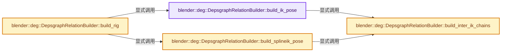
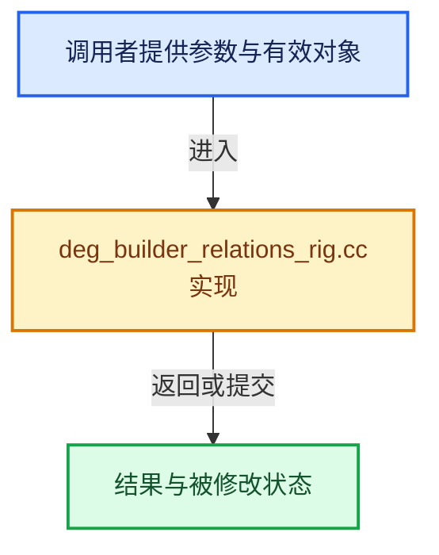

# 实现依赖专题：source/blender/depsgraph/intern/builder/deg_builder_relations_rig.cc

[方向导航](README.md) · [符号索引](../%E7%AC%A6%E5%8F%B7%E4%BE%9D%E8%B5%96%E4%B8%8E%E5%AE%9E%E7%8E%B0%E7%B4%A2%E5%BC%95.md)

本专题从正文实际调用进入，集中保存共享实现。函数有稳定锚点，可从调用处直接跳到对应完整函数；递归与互相调用通过回链组织。

## 本文件的实现关系






## 完整成员与函数实现

<a id="f-03d964b54b6f8341"></a>

### `blender::deg::DepsgraphRelationBuilder::build_ik_pose`

实现位置：[source/blender/depsgraph/intern/builder/deg_builder_relations_rig.cc](../../../../../source/blender/depsgraph/intern/builder/deg_builder_relations_rig.cc) · L49—L206。

接口参数：

- `Object *object`
- `bPoseChannel *pchan`
- `bConstraint *con`
- `RootPChanMap *root_map`

**教学注释版**

<!-- annotated:1b622490ff5d96 -->

```cpp
void DepsgraphRelationBuilder::build_ik_pose(Object *object,
                                             bPoseChannel *pchan,
                                             bConstraint *con,
                                             RootPChanMap *root_map)
{
  if ((con->flag & CONSTRAINT_DISABLE) != 0) {
    /* Do not add disabled IK constraints to the relations. If these needs to be temporarily
     * enabled, they will be added as temporary constraints during transform. */
    return;
  }

  bKinematicConstraint *data = static_cast<bKinematicConstraint *>(con->data);
  /* Attach owner to IK Solver to. */
  bPoseChannel *rootchan = BKE_armature_ik_solver_find_root(pchan, data);
  if (rootchan == nullptr) {
    return;
  }
  OperationKey pchan_local_key(
      &object->id, NodeType::BONE, pchan->name, OperationCode::BONE_LOCAL);
  OperationKey init_ik_key(&object->id, NodeType::EVAL_POSE, OperationCode::POSE_INIT_IK);
  OperationKey solver_key(
      &object->id, NodeType::EVAL_POSE, rootchan->name, OperationCode::POSE_IK_SOLVER);
  OperationKey pose_cleanup_key(&object->id, NodeType::EVAL_POSE, OperationCode::POSE_CLEANUP);
  /* If any of the constraint parameters are animated, connect the relation. Since there is only
   * one Init IK node per armature, this link has quite high risk of spurious dependency cycles.
   */
  const bool is_itasc = (object->pose->iksolver == IKSOLVER_ITASC);
  PointerRNA con_ptr = RNA_pointer_create_discrete(&object->id, RNA_Constraint, con);
  if (is_itasc || cache_->isAnyPropertyAnimated(&con_ptr)) {
    add_relation(pchan_local_key, init_ik_key, "IK Constraint -> Init IK Tree");
  }
  add_relation(init_ik_key, solver_key, "Init IK -> IK Solver");
  /* Never cleanup before solver is run. */
  add_relation(solver_key, pose_cleanup_key, "IK Solver -> Cleanup", RELATION_FLAG_GODMODE);
  /* The ITASC solver currently accesses the target transforms in init tree :(
   * TODO: Fix ITASC and remove this.
   */
  OperationKey target_dependent_key = is_itasc ? init_ik_key : solver_key;
  /* IK target */
  /* TODO(sergey): This should get handled as part of the constraint code. */
  if (data->tar != nullptr) {
    /* Different object - requires its transform. */
    if (data->tar != object) {
      ComponentKey target_key(&data->tar->id, NodeType::TRANSFORM);
      add_relation(target_key, target_dependent_key, con->name);
      /* Ensure target evaluated copy is ready by the time IK tree is built just in case. */
      ComponentKey target_cow_key(&data->tar->id, NodeType::COPY_ON_EVAL);
      add_relation(target_cow_key,
                   init_ik_key,
                   "IK Target Copy-on-Eval -> Init IK Tree",
                   RELATION_CHECK_BEFORE_ADD);
    }
    /* Subtarget references: */
    if ((data->tar->type == OB_ARMATURE) && (data->subtarget[0])) {
      /* Bone - use the final transformation. */
      OperationKey target_key(
          &data->tar->id, NodeType::BONE, data->subtarget, OperationCode::BONE_DONE);
      add_relation(target_key, target_dependent_key, con->name);
    }
    else if (data->subtarget[0] && ELEM(data->tar->type, OB_MESH, OB_LATTICE)) {
      /* Vertex group target. */
      /* NOTE: for now, we don't need to represent vertex groups
       * separately. */
      ComponentKey target_key(&data->tar->id, NodeType::GEOMETRY);
      add_relation(target_key, target_dependent_key, con->name);
      add_customdata_mask(data->tar, DEGCustomDataMeshMasks::MaskVert(CD_MASK_MDEFORMVERT));
    }
    if (data->tar == object && data->subtarget[0]) {
      /* Prevent target's constraints from linking to anything from same
       * chain that it controls. */
      root_map->add_bone(data->subtarget, rootchan->name);
    }
  }
  /* Pole Target. */
  /* TODO(sergey): This should get handled as part of the constraint code. */
  if (data->poletar != nullptr) {
    /* Different object - requires its transform. */
    if (data->poletar != object) {
      ComponentKey target_key(&data->poletar->id, NodeType::TRANSFORM);
      add_relation(target_key, target_dependent_key, con->name);
      /* Ensure target evaluated copy is ready by the time IK tree is built just in case. */
      ComponentKey target_cow_key(&data->poletar->id, NodeType::COPY_ON_EVAL);
      add_relation(target_cow_key,
                   init_ik_key,
                   "IK Target Copy-on-Eval -> Init IK Tree",
                   RELATION_CHECK_BEFORE_ADD);
    }
    /* Subtarget references: */
    if ((data->poletar->type == OB_ARMATURE) && (data->polesubtarget[0])) {
      /* Bone - use the final transformation. */
      OperationKey target_key(
          &data->poletar->id, NodeType::BONE, data->polesubtarget, OperationCode::BONE_DONE);
      add_relation(target_key, target_dependent_key, con->name);
    }
    else if (data->polesubtarget[0] && ELEM(data->poletar->type, OB_MESH, OB_LATTICE)) {
      /* Vertex group target. */
      /* NOTE: for now, we don't need to represent vertex groups
       * separately. */
      ComponentKey target_key(&data->poletar->id, NodeType::GEOMETRY);
      add_relation(target_key, target_dependent_key, con->name);
      add_customdata_mask(data->poletar, DEGCustomDataMeshMasks::MaskVert(CD_MASK_MDEFORMVERT));
    }
  }
  DEG_DEBUG_PRINTF((blender::Depsgraph *)graph_,
                   BUILD,
                   "\nStarting IK Build: pchan = %s, target = (%s, %s), "
                   "segcount = %d\n",
                   pchan->name,
                   data->tar ? data->tar->id.name : "nullptr",
                   data->subtarget,
                   data->rootbone);
  bPoseChannel *parchan = pchan;
  /* Exclude tip from chain if needed. */
  if (!(data->flag & CONSTRAINT_IK_TIP)) {
    parchan = pchan->parent;
  }
  root_map->add_bone(parchan->name, rootchan->name);
  OperationKey parchan_transforms_key(
      &object->id, NodeType::BONE, parchan->name, OperationCode::BONE_READY);
  add_relation(parchan_transforms_key, solver_key, "IK Solver Owner");
  /* Walk to the chain's root. */
  int segcount = 0;
  while (parchan != nullptr) {
    /* Make IK-solver dependent on this bone's result, since it can only run
     * after the standard results of the bone are know. Validate links step
     * on the bone will ensure that users of this bone only grab the result
     * with IK solver results. */
    if (parchan != pchan) {
      OperationKey parent_key(
          &object->id, NodeType::BONE, parchan->name, OperationCode::BONE_READY);
      add_relation(parent_key, solver_key, "IK Chain Parent");
      OperationKey bone_done_key(
          &object->id, NodeType::BONE, parchan->name, OperationCode::BONE_DONE);
      add_relation(solver_key, bone_done_key, "IK Chain Result");
    }
    else {
      OperationKey final_transforms_key(
          &object->id, NodeType::BONE, parchan->name, OperationCode::BONE_DONE);
      add_relation(solver_key, final_transforms_key, "IK Solver Result");
    }
    parchan->flag |= POSE_DONE;
    root_map->add_bone(parchan->name, rootchan->name);
    /* continue up chain, until we reach target number of items. */
    DEG_DEBUG_PRINTF((blender::Depsgraph *)graph_, BUILD, "  %d = %s\n", segcount, parchan->name);
    /* TODO(sergey): This is an arbitrary value, which was just following
     * old code convention. */
    segcount++;
    if ((segcount == data->rootbone) || (segcount > 255)) {
      break;
    }
    parchan = parchan->parent;
  }
  OperationKey pose_done_key(&object->id, NodeType::EVAL_POSE, OperationCode::POSE_DONE);
  add_relation(solver_key, pose_done_key, "PoseEval Result-Bone Link");

  /* Add relation when the root of this IK chain is influenced by another IK chain. */
  build_inter_ik_chains(object, solver_key, rootchan, root_map);
}
```

<details>
<summary>核对原始源码：source/blender/depsgraph/intern/builder/deg_builder_relations_rig.cc · L49—L206</summary>

<!-- original:1b622490ff5d96:source/blender/depsgraph/intern/builder/deg_builder_relations_rig.cc:49:206 -->

```cpp
void DepsgraphRelationBuilder::build_ik_pose(Object *object,
                                             bPoseChannel *pchan,
                                             bConstraint *con,
                                             RootPChanMap *root_map)
{
  if ((con->flag & CONSTRAINT_DISABLE) != 0) {
    /* Do not add disabled IK constraints to the relations. If these needs to be temporarily
     * enabled, they will be added as temporary constraints during transform. */
    return;
  }

  bKinematicConstraint *data = static_cast<bKinematicConstraint *>(con->data);
  /* Attach owner to IK Solver to. */
  bPoseChannel *rootchan = BKE_armature_ik_solver_find_root(pchan, data);
  if (rootchan == nullptr) {
    return;
  }
  OperationKey pchan_local_key(
      &object->id, NodeType::BONE, pchan->name, OperationCode::BONE_LOCAL);
  OperationKey init_ik_key(&object->id, NodeType::EVAL_POSE, OperationCode::POSE_INIT_IK);
  OperationKey solver_key(
      &object->id, NodeType::EVAL_POSE, rootchan->name, OperationCode::POSE_IK_SOLVER);
  OperationKey pose_cleanup_key(&object->id, NodeType::EVAL_POSE, OperationCode::POSE_CLEANUP);
  /* If any of the constraint parameters are animated, connect the relation. Since there is only
   * one Init IK node per armature, this link has quite high risk of spurious dependency cycles.
   */
  const bool is_itasc = (object->pose->iksolver == IKSOLVER_ITASC);
  PointerRNA con_ptr = RNA_pointer_create_discrete(&object->id, RNA_Constraint, con);
  if (is_itasc || cache_->isAnyPropertyAnimated(&con_ptr)) {
    add_relation(pchan_local_key, init_ik_key, "IK Constraint -> Init IK Tree");
  }
  add_relation(init_ik_key, solver_key, "Init IK -> IK Solver");
  /* Never cleanup before solver is run. */
  add_relation(solver_key, pose_cleanup_key, "IK Solver -> Cleanup", RELATION_FLAG_GODMODE);
  /* The ITASC solver currently accesses the target transforms in init tree :(
   * TODO: Fix ITASC and remove this.
   */
  OperationKey target_dependent_key = is_itasc ? init_ik_key : solver_key;
  /* IK target */
  /* TODO(sergey): This should get handled as part of the constraint code. */
  if (data->tar != nullptr) {
    /* Different object - requires its transform. */
    if (data->tar != object) {
      ComponentKey target_key(&data->tar->id, NodeType::TRANSFORM);
      add_relation(target_key, target_dependent_key, con->name);
      /* Ensure target evaluated copy is ready by the time IK tree is built just in case. */
      ComponentKey target_cow_key(&data->tar->id, NodeType::COPY_ON_EVAL);
      add_relation(target_cow_key,
                   init_ik_key,
                   "IK Target Copy-on-Eval -> Init IK Tree",
                   RELATION_CHECK_BEFORE_ADD);
    }
    /* Subtarget references: */
    if ((data->tar->type == OB_ARMATURE) && (data->subtarget[0])) {
      /* Bone - use the final transformation. */
      OperationKey target_key(
          &data->tar->id, NodeType::BONE, data->subtarget, OperationCode::BONE_DONE);
      add_relation(target_key, target_dependent_key, con->name);
    }
    else if (data->subtarget[0] && ELEM(data->tar->type, OB_MESH, OB_LATTICE)) {
      /* Vertex group target. */
      /* NOTE: for now, we don't need to represent vertex groups
       * separately. */
      ComponentKey target_key(&data->tar->id, NodeType::GEOMETRY);
      add_relation(target_key, target_dependent_key, con->name);
      add_customdata_mask(data->tar, DEGCustomDataMeshMasks::MaskVert(CD_MASK_MDEFORMVERT));
    }
    if (data->tar == object && data->subtarget[0]) {
      /* Prevent target's constraints from linking to anything from same
       * chain that it controls. */
      root_map->add_bone(data->subtarget, rootchan->name);
    }
  }
  /* Pole Target. */
  /* TODO(sergey): This should get handled as part of the constraint code. */
  if (data->poletar != nullptr) {
    /* Different object - requires its transform. */
    if (data->poletar != object) {
      ComponentKey target_key(&data->poletar->id, NodeType::TRANSFORM);
      add_relation(target_key, target_dependent_key, con->name);
      /* Ensure target evaluated copy is ready by the time IK tree is built just in case. */
      ComponentKey target_cow_key(&data->poletar->id, NodeType::COPY_ON_EVAL);
      add_relation(target_cow_key,
                   init_ik_key,
                   "IK Target Copy-on-Eval -> Init IK Tree",
                   RELATION_CHECK_BEFORE_ADD);
    }
    /* Subtarget references: */
    if ((data->poletar->type == OB_ARMATURE) && (data->polesubtarget[0])) {
      /* Bone - use the final transformation. */
      OperationKey target_key(
          &data->poletar->id, NodeType::BONE, data->polesubtarget, OperationCode::BONE_DONE);
      add_relation(target_key, target_dependent_key, con->name);
    }
    else if (data->polesubtarget[0] && ELEM(data->poletar->type, OB_MESH, OB_LATTICE)) {
      /* Vertex group target. */
      /* NOTE: for now, we don't need to represent vertex groups
       * separately. */
      ComponentKey target_key(&data->poletar->id, NodeType::GEOMETRY);
      add_relation(target_key, target_dependent_key, con->name);
      add_customdata_mask(data->poletar, DEGCustomDataMeshMasks::MaskVert(CD_MASK_MDEFORMVERT));
    }
  }
  DEG_DEBUG_PRINTF((blender::Depsgraph *)graph_,
                   BUILD,
                   "\nStarting IK Build: pchan = %s, target = (%s, %s), "
                   "segcount = %d\n",
                   pchan->name,
                   data->tar ? data->tar->id.name : "nullptr",
                   data->subtarget,
                   data->rootbone);
  bPoseChannel *parchan = pchan;
  /* Exclude tip from chain if needed. */
  if (!(data->flag & CONSTRAINT_IK_TIP)) {
    parchan = pchan->parent;
  }
  root_map->add_bone(parchan->name, rootchan->name);
  OperationKey parchan_transforms_key(
      &object->id, NodeType::BONE, parchan->name, OperationCode::BONE_READY);
  add_relation(parchan_transforms_key, solver_key, "IK Solver Owner");
  /* Walk to the chain's root. */
  int segcount = 0;
  while (parchan != nullptr) {
    /* Make IK-solver dependent on this bone's result, since it can only run
     * after the standard results of the bone are know. Validate links step
     * on the bone will ensure that users of this bone only grab the result
     * with IK solver results. */
    if (parchan != pchan) {
      OperationKey parent_key(
          &object->id, NodeType::BONE, parchan->name, OperationCode::BONE_READY);
      add_relation(parent_key, solver_key, "IK Chain Parent");
      OperationKey bone_done_key(
          &object->id, NodeType::BONE, parchan->name, OperationCode::BONE_DONE);
      add_relation(solver_key, bone_done_key, "IK Chain Result");
    }
    else {
      OperationKey final_transforms_key(
          &object->id, NodeType::BONE, parchan->name, OperationCode::BONE_DONE);
      add_relation(solver_key, final_transforms_key, "IK Solver Result");
    }
    parchan->flag |= POSE_DONE;
    root_map->add_bone(parchan->name, rootchan->name);
    /* continue up chain, until we reach target number of items. */
    DEG_DEBUG_PRINTF((blender::Depsgraph *)graph_, BUILD, "  %d = %s\n", segcount, parchan->name);
    /* TODO(sergey): This is an arbitrary value, which was just following
     * old code convention. */
    segcount++;
    if ((segcount == data->rootbone) || (segcount > 255)) {
      break;
    }
    parchan = parchan->parent;
  }
  OperationKey pose_done_key(&object->id, NodeType::EVAL_POSE, OperationCode::POSE_DONE);
  add_relation(solver_key, pose_done_key, "PoseEval Result-Bone Link");

  /* Add relation when the root of this IK chain is influenced by another IK chain. */
  build_inter_ik_chains(object, solver_key, rootchan, root_map);
}
```

</details>

**沿实际写入检查状态**

- `parchan = pchan->parent;`
- `parchan->flag |= POSE_DONE;`
- `parchan = parchan->parent;`

**继续追踪实现**

- `BKE_armature_ik_solver_find_root` → [blender::BKE_armature_ik_solver_find_root · L3423](../05-%E5%87%A0%E4%BD%95%E5%AD%98%E5%82%A8%E4%B8%8E%E6%8B%93%E6%89%91%E6%98%A0%E5%B0%84/%E4%BE%9D%E8%B5%96-armature-cc8366.md#f-c3a2d7da0a6ce805)。
- `RNA_pointer_create_discrete` → [blender::RNA_pointer_create_discrete · L181](../05-%E5%87%A0%E4%BD%95%E5%AD%98%E5%82%A8%E4%B8%8E%E6%8B%93%E6%89%91%E6%98%A0%E5%B0%84/%E4%BE%9D%E8%B5%96-rna_access-706bea.md#f-592a276e869c6d94)。
- `cache_->isAnyPropertyAnimated` → [调用协议](../%E6%A8%A1%E6%9D%BF%E5%AE%8F%E4%B8%8E%E5%8A%A8%E6%80%81%E5%88%86%E6%B4%BE%E5%8D%8F%E8%AE%AE.md)：接收对象类型依赖auto、返回值或模板实例；不按同名猜测目标。调用位置L77。
- `add_relation` → [blender::deg::DepsgraphRelationBuilder::add_relation · L29](%E4%BE%9D%E8%B5%96-deg_builder_relations_impl-5ae258.md#f-9c9f4ea4be1f8780)；[blender::deg::DepsgraphRelationBuilder::add_relation · L66](%E4%BE%9D%E8%B5%96-deg_builder_relations_impl-5ae258.md#f-5b2ef1e631a55534)。同名重载需按实参类型选择。
- `ELEM` → [ELEM · L88](../05-%E5%87%A0%E4%BD%95%E5%AD%98%E5%82%A8%E4%B8%8E%E6%8B%93%E6%89%91%E6%98%A0%E5%B0%84/%E4%BE%9D%E8%B5%96-GHOST_utildefines-34b996.md#m-d28724a15928)；[ELEM · L135](../01-%E5%9F%BA%E7%A1%80%E5%AE%B9%E5%99%A8%E4%B8%8E%E7%8E%B0%E4%BB%A3CPP/%E4%BE%9D%E8%B5%96-BLI_utildefines-293a0a.md#m-d6572de7cae0)。宏定义由构建条件选择。
- `add_customdata_mask` → [blender::deg::DepsgraphRelationBuilder::add_customdata_mask · L343](04-%E5%85%B3%E7%B3%BB%E6%9E%84%E5%BB%BA%E5%99%A8.md#f-9d93f68ae452fd31)。
- `DEGCustomDataMeshMasks::MaskVert` → [blender::deg::DEGCustomDataMeshMasks::MaskVert · L97](%E4%BE%9D%E8%B5%96-depsgraph_type-a5aead.md#f-289bf024dafc7a55)。
- `root_map->add_bone` → [blender::deg::RootPChanMap::add_bone · L27](%E4%BE%9D%E8%B5%96-deg_builder_pchanmap-f4702f.md#f-45febaac8da310fe)。
- `DEG_DEBUG_PRINTF` → [DEG_DEBUG_PRINTF · L47](%E4%BE%9D%E8%B5%96-deg_debug-ad205b.md#m-ef590076cffe)。宏定义由构建条件选择。
- `build_inter_ik_chains` → [blender::deg::DepsgraphRelationBuilder::build_inter_ik_chains · L264](%E4%BE%9D%E8%B5%96-deg_builder_relations_rig-5239a6.md#f-8381c115fd0c7558)。

<a id="f-de0228eaa40266cf"></a>

### `blender::deg::DepsgraphRelationBuilder::build_splineik_pose`

实现位置：[source/blender/depsgraph/intern/builder/deg_builder_relations_rig.cc](../../../../../source/blender/depsgraph/intern/builder/deg_builder_relations_rig.cc) · L209—L262。

接口参数：

- `Object *object`
- `bPoseChannel *pchan`
- `bConstraint *con`
- `RootPChanMap *root_map`

**教学注释版**

<!-- annotated:000babee5f2bfb -->

```cpp
void DepsgraphRelationBuilder::build_splineik_pose(Object *object,
                                                   bPoseChannel *pchan,
                                                   bConstraint *con,
                                                   RootPChanMap *root_map)
{
  bSplineIKConstraint *data = static_cast<bSplineIKConstraint *>(con->data);
  bPoseChannel *rootchan = BKE_armature_splineik_solver_find_root(pchan, data);
  OperationKey transforms_key(&object->id, NodeType::BONE, pchan->name, OperationCode::BONE_READY);
  OperationKey init_ik_key(&object->id, NodeType::EVAL_POSE, OperationCode::POSE_INIT_IK);
  OperationKey solver_key(
      &object->id, NodeType::EVAL_POSE, rootchan->name, OperationCode::POSE_SPLINE_IK_SOLVER);
  OperationKey pose_cleanup_key(&object->id, NodeType::EVAL_POSE, OperationCode::POSE_CLEANUP);
  /* Solver depends on initialization. */
  add_relation(init_ik_key, solver_key, "Init IK -> IK Solver");
  /* Never cleanup before solver is run. */
  add_relation(solver_key, pose_cleanup_key, "IK Solver -> Cleanup");
  /* Attach owner to IK Solver. */
  add_relation(transforms_key, solver_key, "Spline IK Solver Owner", RELATION_FLAG_GODMODE);
  /* Attach path dependency to solver. */
  if (data->tar != nullptr) {
    ComponentKey target_geometry_key(&data->tar->id, NodeType::GEOMETRY);
    add_relation(target_geometry_key, solver_key, "Curve.Path -> Spline IK");
    ComponentKey target_transform_key(&data->tar->id, NodeType::TRANSFORM);
    add_relation(target_transform_key, solver_key, "Curve.Transform -> Spline IK");
    add_special_eval_flag(&data->tar->id, DAG_EVAL_NEED_CURVE_PATH);
  }
  pchan->flag |= POSE_DONE;
  OperationKey final_transforms_key(
      &object->id, NodeType::BONE, pchan->name, OperationCode::BONE_DONE);
  add_relation(solver_key, final_transforms_key, "Spline IK Result");
  root_map->add_bone(pchan->name, rootchan->name);
  /* Walk to the chain's root/ */
  int segcount = 1;
  for (bPoseChannel *parchan = pchan->parent; parchan != nullptr && segcount < data->chainlen;
       parchan = parchan->parent, segcount++)
  {
    /* Make Spline IK solver dependent on this bone's result, since it can
     * only run after the standard results of the bone are know. Validate
     * links step on the bone will ensure that users of this bone only grab
     * the result with IK solver results. */
    OperationKey parent_key(&object->id, NodeType::BONE, parchan->name, OperationCode::BONE_READY);
    add_relation(parent_key, solver_key, "Spline IK Solver Update");
    OperationKey bone_done_key(
        &object->id, NodeType::BONE, parchan->name, OperationCode::BONE_DONE);
    add_relation(solver_key, bone_done_key, "Spline IK Solver Result");
    parchan->flag |= POSE_DONE;
    root_map->add_bone(parchan->name, rootchan->name);
  }
  OperationKey pose_done_key(&object->id, NodeType::EVAL_POSE, OperationCode::POSE_DONE);
  add_relation(solver_key, pose_done_key, "PoseEval Result-Bone Link");

  /* Add relation when the root of this IK chain is influenced by another IK chain. */
  build_inter_ik_chains(object, solver_key, rootchan, root_map);
}
```

<details>
<summary>核对原始源码：source/blender/depsgraph/intern/builder/deg_builder_relations_rig.cc · L209—L262</summary>

<!-- original:000babee5f2bfb:source/blender/depsgraph/intern/builder/deg_builder_relations_rig.cc:209:262 -->

```cpp
void DepsgraphRelationBuilder::build_splineik_pose(Object *object,
                                                   bPoseChannel *pchan,
                                                   bConstraint *con,
                                                   RootPChanMap *root_map)
{
  bSplineIKConstraint *data = static_cast<bSplineIKConstraint *>(con->data);
  bPoseChannel *rootchan = BKE_armature_splineik_solver_find_root(pchan, data);
  OperationKey transforms_key(&object->id, NodeType::BONE, pchan->name, OperationCode::BONE_READY);
  OperationKey init_ik_key(&object->id, NodeType::EVAL_POSE, OperationCode::POSE_INIT_IK);
  OperationKey solver_key(
      &object->id, NodeType::EVAL_POSE, rootchan->name, OperationCode::POSE_SPLINE_IK_SOLVER);
  OperationKey pose_cleanup_key(&object->id, NodeType::EVAL_POSE, OperationCode::POSE_CLEANUP);
  /* Solver depends on initialization. */
  add_relation(init_ik_key, solver_key, "Init IK -> IK Solver");
  /* Never cleanup before solver is run. */
  add_relation(solver_key, pose_cleanup_key, "IK Solver -> Cleanup");
  /* Attach owner to IK Solver. */
  add_relation(transforms_key, solver_key, "Spline IK Solver Owner", RELATION_FLAG_GODMODE);
  /* Attach path dependency to solver. */
  if (data->tar != nullptr) {
    ComponentKey target_geometry_key(&data->tar->id, NodeType::GEOMETRY);
    add_relation(target_geometry_key, solver_key, "Curve.Path -> Spline IK");
    ComponentKey target_transform_key(&data->tar->id, NodeType::TRANSFORM);
    add_relation(target_transform_key, solver_key, "Curve.Transform -> Spline IK");
    add_special_eval_flag(&data->tar->id, DAG_EVAL_NEED_CURVE_PATH);
  }
  pchan->flag |= POSE_DONE;
  OperationKey final_transforms_key(
      &object->id, NodeType::BONE, pchan->name, OperationCode::BONE_DONE);
  add_relation(solver_key, final_transforms_key, "Spline IK Result");
  root_map->add_bone(pchan->name, rootchan->name);
  /* Walk to the chain's root/ */
  int segcount = 1;
  for (bPoseChannel *parchan = pchan->parent; parchan != nullptr && segcount < data->chainlen;
       parchan = parchan->parent, segcount++)
  {
    /* Make Spline IK solver dependent on this bone's result, since it can
     * only run after the standard results of the bone are know. Validate
     * links step on the bone will ensure that users of this bone only grab
     * the result with IK solver results. */
    OperationKey parent_key(&object->id, NodeType::BONE, parchan->name, OperationCode::BONE_READY);
    add_relation(parent_key, solver_key, "Spline IK Solver Update");
    OperationKey bone_done_key(
        &object->id, NodeType::BONE, parchan->name, OperationCode::BONE_DONE);
    add_relation(solver_key, bone_done_key, "Spline IK Solver Result");
    parchan->flag |= POSE_DONE;
    root_map->add_bone(parchan->name, rootchan->name);
  }
  OperationKey pose_done_key(&object->id, NodeType::EVAL_POSE, OperationCode::POSE_DONE);
  add_relation(solver_key, pose_done_key, "PoseEval Result-Bone Link");

  /* Add relation when the root of this IK chain is influenced by another IK chain. */
  build_inter_ik_chains(object, solver_key, rootchan, root_map);
}
```

</details>

**沿实际写入检查状态**

- `pchan->flag |= POSE_DONE;`
- `parchan = parchan->parent, segcount++)`
- `parchan->flag |= POSE_DONE;`

**继续追踪实现**

- `BKE_armature_splineik_solver_find_root` → [blender::BKE_armature_splineik_solver_find_root · L3444](../05-%E5%87%A0%E4%BD%95%E5%AD%98%E5%82%A8%E4%B8%8E%E6%8B%93%E6%89%91%E6%98%A0%E5%B0%84/%E4%BE%9D%E8%B5%96-armature-cc8366.md#f-bd3fa009b5204320)。
- `add_relation` → [blender::deg::DepsgraphRelationBuilder::add_relation · L29](%E4%BE%9D%E8%B5%96-deg_builder_relations_impl-5ae258.md#f-9c9f4ea4be1f8780)；[blender::deg::DepsgraphRelationBuilder::add_relation · L66](%E4%BE%9D%E8%B5%96-deg_builder_relations_impl-5ae258.md#f-5b2ef1e631a55534)。同名重载需按实参类型选择。
- `add_special_eval_flag` → [blender::deg::DepsgraphRelationBuilder::add_special_eval_flag · L359](04-%E5%85%B3%E7%B3%BB%E6%9E%84%E5%BB%BA%E5%99%A8.md#f-cd0bbc6fad1fc8a3)。
- `root_map->add_bone` → [blender::deg::RootPChanMap::add_bone · L27](%E4%BE%9D%E8%B5%96-deg_builder_pchanmap-f4702f.md#f-45febaac8da310fe)。
- `build_inter_ik_chains` → [blender::deg::DepsgraphRelationBuilder::build_inter_ik_chains · L264](%E4%BE%9D%E8%B5%96-deg_builder_relations_rig-5239a6.md#f-8381c115fd0c7558)。

<a id="f-8381c115fd0c7558"></a>

### `blender::deg::DepsgraphRelationBuilder::build_inter_ik_chains`

实现位置：[source/blender/depsgraph/intern/builder/deg_builder_relations_rig.cc](../../../../../source/blender/depsgraph/intern/builder/deg_builder_relations_rig.cc) · L264—L286。

接口参数：

- `Object *object`
- `const OperationKey &solver_key`
- `const bPoseChannel *rootchan`
- `const RootPChanMap *root_map`

**教学注释版**

<!-- annotated:3622af91a63aa7 -->

```cpp
void DepsgraphRelationBuilder::build_inter_ik_chains(Object *object,
                                                     const OperationKey &solver_key,
                                                     const bPoseChannel *rootchan,
                                                     const RootPChanMap *root_map)
{
  bPoseChannel *deepest_root = nullptr;
  const char *root_name = rootchan->name;

  /* Find shared IK chain root. */
  for (bPoseChannel *parchan = rootchan->parent; parchan; parchan = parchan->parent) {
    if (!root_map->has_common_root(root_name, parchan->name)) {
      break;
    }
    deepest_root = parchan;
  }
  if (deepest_root == nullptr) {
    return;
  }

  OperationKey other_bone_key(
      &object->id, NodeType::BONE, deepest_root->name, OperationCode::BONE_DONE);
  add_relation(other_bone_key, solver_key, "IK Chain Overlap");
}
```

<details>
<summary>核对原始源码：source/blender/depsgraph/intern/builder/deg_builder_relations_rig.cc · L264—L286</summary>

<!-- original:3622af91a63aa7:source/blender/depsgraph/intern/builder/deg_builder_relations_rig.cc:264:286 -->

```cpp
void DepsgraphRelationBuilder::build_inter_ik_chains(Object *object,
                                                     const OperationKey &solver_key,
                                                     const bPoseChannel *rootchan,
                                                     const RootPChanMap *root_map)
{
  bPoseChannel *deepest_root = nullptr;
  const char *root_name = rootchan->name;

  /* Find shared IK chain root. */
  for (bPoseChannel *parchan = rootchan->parent; parchan; parchan = parchan->parent) {
    if (!root_map->has_common_root(root_name, parchan->name)) {
      break;
    }
    deepest_root = parchan;
  }
  if (deepest_root == nullptr) {
    return;
  }

  OperationKey other_bone_key(
      &object->id, NodeType::BONE, deepest_root->name, OperationCode::BONE_DONE);
  add_relation(other_bone_key, solver_key, "IK Chain Overlap");
}
```

</details>

**沿实际写入检查状态**

- `deepest_root = parchan;`

**继续追踪实现**

- `root_map->has_common_root` → [blender::deg::RootPChanMap::has_common_root · L32](%E4%BE%9D%E8%B5%96-deg_builder_pchanmap-f4702f.md#f-da7b201d3e3cf6c2)。
- `add_relation` → [blender::deg::DepsgraphRelationBuilder::add_relation · L29](%E4%BE%9D%E8%B5%96-deg_builder_relations_impl-5ae258.md#f-9c9f4ea4be1f8780)；[blender::deg::DepsgraphRelationBuilder::add_relation · L66](%E4%BE%9D%E8%B5%96-deg_builder_relations_impl-5ae258.md#f-5b2ef1e631a55534)。同名重载需按实参类型选择。

<a id="f-7a36078fef47376e"></a>

### `blender::deg::DepsgraphRelationBuilder::build_rig`

实现位置：[source/blender/depsgraph/intern/builder/deg_builder_relations_rig.cc](../../../../../source/blender/depsgraph/intern/builder/deg_builder_relations_rig.cc) · L289—L479。

接口参数：

- `Object *object`

**教学注释版**

<!-- annotated:34222b211a3c4d -->

```cpp
void DepsgraphRelationBuilder::build_rig(Object *object)
{
  /* Armature-Data */
  bArmature *armature = id_cast<bArmature *>(object->data);
  /* TODO: selection status? */
  /* Attach links between pose operations. */
  ComponentKey local_transform(&object->id, NodeType::TRANSFORM);
  OperationKey pose_init_key(&object->id, NodeType::EVAL_POSE, OperationCode::POSE_INIT);
  OperationKey pose_init_ik_key(&object->id, NodeType::EVAL_POSE, OperationCode::POSE_INIT_IK);
  OperationKey pose_cleanup_key(&object->id, NodeType::EVAL_POSE, OperationCode::POSE_CLEANUP);
  OperationKey pose_done_key(&object->id, NodeType::EVAL_POSE, OperationCode::POSE_DONE);
  add_relation(local_transform, pose_init_key, "Local Transform -> Pose Init");
  add_relation(pose_init_key, pose_init_ik_key, "Pose Init -> Pose Init IK");
  add_relation(pose_init_ik_key, pose_done_key, "Pose Init IK -> Pose Cleanup");
  /* Make sure pose is up-to-date with armature updates. */
  build_armature(armature);
  OperationKey armature_key(&armature->id, NodeType::ARMATURE, OperationCode::ARMATURE_EVAL);
  add_relation(armature_key, pose_init_key, "Data dependency");
  /* Run cleanup even when there are no bones. */
  add_relation(pose_init_ik_key, pose_cleanup_key, "Init -> Cleanup");
  /* Relation to the instance, so that instancer can use pose of this object. */
  add_relation(ComponentKey(&object->id, NodeType::EVAL_POSE),
               OperationKey{&object->id, NodeType::INSTANCING, OperationCode::INSTANCE},
               "Transform -> Instance");

  /* IK Solvers.
   *
   * - These require separate processing steps are pose-level to be executed
   *   between chains of bones (i.e. once the base transforms of a bunch of
   *   bones is done).
   *
   * - We build relations for these before the dependencies between operations
   *   in the same component as it is necessary to check whether such bones
   *   are in the same IK chain (or else we get weird issues with either
   *   in-chain references, or with bones being parented to IK'd bones).
   *
   * Unsolved Issues:
   * - Care is needed to ensure that multi-headed trees work out the same as
   *   in ik-tree building
   * - Animated chain-lengths are a problem. */
  RootPChanMap root_map;
  bool pose_depends_on_local_transform = false;
  for (bPoseChannel &pchan : object->pose->chanbase) {
    const BuilderStack::ScopedEntry stack_entry = stack_.trace(pchan);

    for (bConstraint &con : pchan.constraints) {
      const BuilderStack::ScopedEntry stack_entry = stack_.trace(con);

      switch (con.type) {
        case CONSTRAINT_TYPE_KINEMATIC:
          build_ik_pose(object, &pchan, &con, &root_map);
          pose_depends_on_local_transform = true;
          break;
        case CONSTRAINT_TYPE_SPLINEIK:
          build_splineik_pose(object, &pchan, &con, &root_map);
          pose_depends_on_local_transform = true;
          break;
        /* Constraints which needs world's matrix for transform.
         * TODO(sergey): More constraints here? */
        case CONSTRAINT_TYPE_ROTLIKE:
        case CONSTRAINT_TYPE_SIZELIKE:
        case CONSTRAINT_TYPE_LOCLIKE:
        case CONSTRAINT_TYPE_TRANSLIKE:
          /* TODO(sergey): Add used space check. */
          pose_depends_on_local_transform = true;
          break;
        default:
          break;
      }
    }
  }
  // root_map.print_debug();
  if (pose_depends_on_local_transform) {
    /* TODO(sergey): Once partial updates are possible use relation between
     * object transform and solver itself in its build function. */
    ComponentKey pose_key(&object->id, NodeType::EVAL_POSE);
    ComponentKey local_transform_key(&object->id, NodeType::TRANSFORM);
    add_relation(local_transform_key, pose_key, "Local Transforms");
  }
  /* Links between operations for each bone. */
  for (bPoseChannel &pchan : object->pose->chanbase) {
    const BuilderStack::ScopedEntry stack_entry = stack_.trace(pchan);

    build_idproperties(pchan.prop);
    build_idproperties(pchan.system_properties);
    OperationKey bone_local_key(
        &object->id, NodeType::BONE, pchan.name, OperationCode::BONE_LOCAL);
    OperationKey bone_pose_key(
        &object->id, NodeType::BONE, pchan.name, OperationCode::BONE_POSE_PARENT);
    OperationKey bone_ready_key(
        &object->id, NodeType::BONE, pchan.name, OperationCode::BONE_READY);
    OperationKey bone_done_key(&object->id, NodeType::BONE, pchan.name, OperationCode::BONE_DONE);
    pchan.flag &= ~POSE_DONE;
    /* Pose init to bone local. */
    add_relation(pose_init_key, bone_local_key, "Pose Init - Bone Local", RELATION_FLAG_GODMODE);

    /* Bone visibility (BONE_VISIBILITY) has no relationships. The node is a no-op, and it's just
     * there to ensure the pose data itself is there. It does have the implicit dependency on the
     * COPY_ON_EVAL node. */

    /* Local to pose parenting operation. */
    add_relation(bone_local_key, bone_pose_key, "Bone Local - Bone Pose");
    /* Parent relation. */
    if (pchan.parent != nullptr) {
      OperationCode parent_key_opcode;
      /* NOTE: this difference in handling allows us to prevent lockups
       * while ensuring correct poses for separate chains. */
      if (root_map.has_common_root(pchan.name, pchan.parent->name)) {
        parent_key_opcode = OperationCode::BONE_READY;
      }
      else {
        parent_key_opcode = OperationCode::BONE_DONE;
      }

      OperationKey parent_key(&object->id, NodeType::BONE, pchan.parent->name, parent_key_opcode);
      add_relation(parent_key, bone_pose_key, "Parent Bone -> Child Bone");
    }
    /* Build constraints. */
    if (pchan.constraints.first() != nullptr) {
      /* Build relations for indirectly linked objects. */
      BuilderWalkUserData data;
      data.builder = this;
      BKE_constraints_id_loop(&pchan.constraints, constraint_walk, IDWALK_NOP, &data);
      /* Constraints stack and constraint dependencies. */
      build_constraints(&object->id, NodeType::BONE, pchan.name, &pchan.constraints, &root_map);
      /* Pose -> constraints. */
      OperationKey constraints_key(
          &object->id, NodeType::BONE, pchan.name, OperationCode::BONE_CONSTRAINTS);
      add_relation(bone_pose_key, constraints_key, "Pose -> Constraints Stack");
      add_relation(bone_local_key, constraints_key, "Local -> Constraints Stack");
      /* Constraints -> ready/ */
      /* TODO(sergey): When constraint stack is exploded, this step should
       * occur before the first IK solver. */
      add_relation(constraints_key, bone_ready_key, "Constraints -> Ready");
    }
    else {
      /* Pose -> Ready */
      add_relation(bone_pose_key, bone_ready_key, "Pose -> Ready");
    }
    /* Bone ready -> Bone done.
     * NOTE: For bones without IK, this is all that's needed.
     *       For IK chains however, an additional rel is created from IK
     *       to done, with transitive reduction removing this one. */
    add_relation(bone_ready_key, bone_done_key, "Ready -> Done");
    /* B-Bone shape is the real final step after Done if present. */
    if (check_pchan_has_bbone(object, &pchan)) {
      OperationKey bone_segments_key(
          &object->id, NodeType::BONE, pchan.name, OperationCode::BONE_SEGMENTS);
      /* B-Bone shape depends on the final position of the bone. */
      add_relation(bone_done_key, bone_segments_key, "Done -> B-Bone Segments");
      /* B-Bone shape depends on final position of handle bones. */
      bPoseChannel *prev, *next;
      Bone *pchan_bone = pchan.bone_get(*object);
      BKE_pchan_bbone_handles_get({&pchan, pchan_bone}, &prev, &next);
      if (prev) {
        OperationCode opcode = OperationCode::BONE_DONE;
        /* Inheriting parent roll requires access to prev handle's B-Bone properties. */
        if ((pchan_bone->bbone_flag & BBONE_ADD_PARENT_END_ROLL) != 0 &&
            check_pchan_has_bbone_segments(object, prev))
        {
          opcode = OperationCode::BONE_SEGMENTS;
        }
        OperationKey prev_key(&object->id, NodeType::BONE, prev->name, opcode);
        add_relation(prev_key, bone_segments_key, "Prev Handle -> B-Bone Segments");
      }
      if (next) {
        OperationKey next_key(&object->id, NodeType::BONE, next->name, OperationCode::BONE_DONE);
        add_relation(next_key, bone_segments_key, "Next Handle -> B-Bone Segments");
      }
      /* Pose requires the B-Bone shape. */
      add_relation(
          bone_segments_key, pose_done_key, "PoseEval Result-Bone Link", RELATION_FLAG_GODMODE);
      add_relation(bone_segments_key, pose_cleanup_key, "Cleanup dependency");
    }
    else {
      /* Assume that all bones must be done for the pose to be ready
       * (for deformers). */
      add_relation(bone_done_key, pose_done_key, "PoseEval Result-Bone Link");

      /* Bones must be traversed before cleanup. */
      add_relation(bone_done_key, pose_cleanup_key, "Done -> Cleanup");

      add_relation(bone_ready_key, pose_cleanup_key, "Ready -> Cleanup");
    }
    /* Custom shape. */
    if (pchan.custom != nullptr) {
      build_object(pchan.custom);
      add_visibility_relation(&pchan.custom->id, &armature->id);
    }
  }
}
```

<details>
<summary>核对原始源码：source/blender/depsgraph/intern/builder/deg_builder_relations_rig.cc · L289—L479</summary>

<!-- original:34222b211a3c4d:source/blender/depsgraph/intern/builder/deg_builder_relations_rig.cc:289:479 -->

```cpp
void DepsgraphRelationBuilder::build_rig(Object *object)
{
  /* Armature-Data */
  bArmature *armature = id_cast<bArmature *>(object->data);
  /* TODO: selection status? */
  /* Attach links between pose operations. */
  ComponentKey local_transform(&object->id, NodeType::TRANSFORM);
  OperationKey pose_init_key(&object->id, NodeType::EVAL_POSE, OperationCode::POSE_INIT);
  OperationKey pose_init_ik_key(&object->id, NodeType::EVAL_POSE, OperationCode::POSE_INIT_IK);
  OperationKey pose_cleanup_key(&object->id, NodeType::EVAL_POSE, OperationCode::POSE_CLEANUP);
  OperationKey pose_done_key(&object->id, NodeType::EVAL_POSE, OperationCode::POSE_DONE);
  add_relation(local_transform, pose_init_key, "Local Transform -> Pose Init");
  add_relation(pose_init_key, pose_init_ik_key, "Pose Init -> Pose Init IK");
  add_relation(pose_init_ik_key, pose_done_key, "Pose Init IK -> Pose Cleanup");
  /* Make sure pose is up-to-date with armature updates. */
  build_armature(armature);
  OperationKey armature_key(&armature->id, NodeType::ARMATURE, OperationCode::ARMATURE_EVAL);
  add_relation(armature_key, pose_init_key, "Data dependency");
  /* Run cleanup even when there are no bones. */
  add_relation(pose_init_ik_key, pose_cleanup_key, "Init -> Cleanup");
  /* Relation to the instance, so that instancer can use pose of this object. */
  add_relation(ComponentKey(&object->id, NodeType::EVAL_POSE),
               OperationKey{&object->id, NodeType::INSTANCING, OperationCode::INSTANCE},
               "Transform -> Instance");

  /* IK Solvers.
   *
   * - These require separate processing steps are pose-level to be executed
   *   between chains of bones (i.e. once the base transforms of a bunch of
   *   bones is done).
   *
   * - We build relations for these before the dependencies between operations
   *   in the same component as it is necessary to check whether such bones
   *   are in the same IK chain (or else we get weird issues with either
   *   in-chain references, or with bones being parented to IK'd bones).
   *
   * Unsolved Issues:
   * - Care is needed to ensure that multi-headed trees work out the same as
   *   in ik-tree building
   * - Animated chain-lengths are a problem. */
  RootPChanMap root_map;
  bool pose_depends_on_local_transform = false;
  for (bPoseChannel &pchan : object->pose->chanbase) {
    const BuilderStack::ScopedEntry stack_entry = stack_.trace(pchan);

    for (bConstraint &con : pchan.constraints) {
      const BuilderStack::ScopedEntry stack_entry = stack_.trace(con);

      switch (con.type) {
        case CONSTRAINT_TYPE_KINEMATIC:
          build_ik_pose(object, &pchan, &con, &root_map);
          pose_depends_on_local_transform = true;
          break;
        case CONSTRAINT_TYPE_SPLINEIK:
          build_splineik_pose(object, &pchan, &con, &root_map);
          pose_depends_on_local_transform = true;
          break;
        /* Constraints which needs world's matrix for transform.
         * TODO(sergey): More constraints here? */
        case CONSTRAINT_TYPE_ROTLIKE:
        case CONSTRAINT_TYPE_SIZELIKE:
        case CONSTRAINT_TYPE_LOCLIKE:
        case CONSTRAINT_TYPE_TRANSLIKE:
          /* TODO(sergey): Add used space check. */
          pose_depends_on_local_transform = true;
          break;
        default:
          break;
      }
    }
  }
  // root_map.print_debug();
  if (pose_depends_on_local_transform) {
    /* TODO(sergey): Once partial updates are possible use relation between
     * object transform and solver itself in its build function. */
    ComponentKey pose_key(&object->id, NodeType::EVAL_POSE);
    ComponentKey local_transform_key(&object->id, NodeType::TRANSFORM);
    add_relation(local_transform_key, pose_key, "Local Transforms");
  }
  /* Links between operations for each bone. */
  for (bPoseChannel &pchan : object->pose->chanbase) {
    const BuilderStack::ScopedEntry stack_entry = stack_.trace(pchan);

    build_idproperties(pchan.prop);
    build_idproperties(pchan.system_properties);
    OperationKey bone_local_key(
        &object->id, NodeType::BONE, pchan.name, OperationCode::BONE_LOCAL);
    OperationKey bone_pose_key(
        &object->id, NodeType::BONE, pchan.name, OperationCode::BONE_POSE_PARENT);
    OperationKey bone_ready_key(
        &object->id, NodeType::BONE, pchan.name, OperationCode::BONE_READY);
    OperationKey bone_done_key(&object->id, NodeType::BONE, pchan.name, OperationCode::BONE_DONE);
    pchan.flag &= ~POSE_DONE;
    /* Pose init to bone local. */
    add_relation(pose_init_key, bone_local_key, "Pose Init - Bone Local", RELATION_FLAG_GODMODE);

    /* Bone visibility (BONE_VISIBILITY) has no relationships. The node is a no-op, and it's just
     * there to ensure the pose data itself is there. It does have the implicit dependency on the
     * COPY_ON_EVAL node. */

    /* Local to pose parenting operation. */
    add_relation(bone_local_key, bone_pose_key, "Bone Local - Bone Pose");
    /* Parent relation. */
    if (pchan.parent != nullptr) {
      OperationCode parent_key_opcode;
      /* NOTE: this difference in handling allows us to prevent lockups
       * while ensuring correct poses for separate chains. */
      if (root_map.has_common_root(pchan.name, pchan.parent->name)) {
        parent_key_opcode = OperationCode::BONE_READY;
      }
      else {
        parent_key_opcode = OperationCode::BONE_DONE;
      }

      OperationKey parent_key(&object->id, NodeType::BONE, pchan.parent->name, parent_key_opcode);
      add_relation(parent_key, bone_pose_key, "Parent Bone -> Child Bone");
    }
    /* Build constraints. */
    if (pchan.constraints.first() != nullptr) {
      /* Build relations for indirectly linked objects. */
      BuilderWalkUserData data;
      data.builder = this;
      BKE_constraints_id_loop(&pchan.constraints, constraint_walk, IDWALK_NOP, &data);
      /* Constraints stack and constraint dependencies. */
      build_constraints(&object->id, NodeType::BONE, pchan.name, &pchan.constraints, &root_map);
      /* Pose -> constraints. */
      OperationKey constraints_key(
          &object->id, NodeType::BONE, pchan.name, OperationCode::BONE_CONSTRAINTS);
      add_relation(bone_pose_key, constraints_key, "Pose -> Constraints Stack");
      add_relation(bone_local_key, constraints_key, "Local -> Constraints Stack");
      /* Constraints -> ready/ */
      /* TODO(sergey): When constraint stack is exploded, this step should
       * occur before the first IK solver. */
      add_relation(constraints_key, bone_ready_key, "Constraints -> Ready");
    }
    else {
      /* Pose -> Ready */
      add_relation(bone_pose_key, bone_ready_key, "Pose -> Ready");
    }
    /* Bone ready -> Bone done.
     * NOTE: For bones without IK, this is all that's needed.
     *       For IK chains however, an additional rel is created from IK
     *       to done, with transitive reduction removing this one. */
    add_relation(bone_ready_key, bone_done_key, "Ready -> Done");
    /* B-Bone shape is the real final step after Done if present. */
    if (check_pchan_has_bbone(object, &pchan)) {
      OperationKey bone_segments_key(
          &object->id, NodeType::BONE, pchan.name, OperationCode::BONE_SEGMENTS);
      /* B-Bone shape depends on the final position of the bone. */
      add_relation(bone_done_key, bone_segments_key, "Done -> B-Bone Segments");
      /* B-Bone shape depends on final position of handle bones. */
      bPoseChannel *prev, *next;
      Bone *pchan_bone = pchan.bone_get(*object);
      BKE_pchan_bbone_handles_get({&pchan, pchan_bone}, &prev, &next);
      if (prev) {
        OperationCode opcode = OperationCode::BONE_DONE;
        /* Inheriting parent roll requires access to prev handle's B-Bone properties. */
        if ((pchan_bone->bbone_flag & BBONE_ADD_PARENT_END_ROLL) != 0 &&
            check_pchan_has_bbone_segments(object, prev))
        {
          opcode = OperationCode::BONE_SEGMENTS;
        }
        OperationKey prev_key(&object->id, NodeType::BONE, prev->name, opcode);
        add_relation(prev_key, bone_segments_key, "Prev Handle -> B-Bone Segments");
      }
      if (next) {
        OperationKey next_key(&object->id, NodeType::BONE, next->name, OperationCode::BONE_DONE);
        add_relation(next_key, bone_segments_key, "Next Handle -> B-Bone Segments");
      }
      /* Pose requires the B-Bone shape. */
      add_relation(
          bone_segments_key, pose_done_key, "PoseEval Result-Bone Link", RELATION_FLAG_GODMODE);
      add_relation(bone_segments_key, pose_cleanup_key, "Cleanup dependency");
    }
    else {
      /* Assume that all bones must be done for the pose to be ready
       * (for deformers). */
      add_relation(bone_done_key, pose_done_key, "PoseEval Result-Bone Link");

      /* Bones must be traversed before cleanup. */
      add_relation(bone_done_key, pose_cleanup_key, "Done -> Cleanup");

      add_relation(bone_ready_key, pose_cleanup_key, "Ready -> Cleanup");
    }
    /* Custom shape. */
    if (pchan.custom != nullptr) {
      build_object(pchan.custom);
      add_visibility_relation(&pchan.custom->id, &armature->id);
    }
  }
}
```

</details>

**沿实际写入检查状态**

- `pose_depends_on_local_transform = true;`
- `pchan.flag &= ~POSE_DONE;`
- `parent_key_opcode = OperationCode::BONE_READY;`
- `parent_key_opcode = OperationCode::BONE_DONE;`
- `data.builder = this;`
- `opcode = OperationCode::BONE_SEGMENTS;`

**继续追踪实现**

- `id_cast<bArmature *>` → [blender::id_cast · L1417](../05-%E5%87%A0%E4%BD%95%E5%AD%98%E5%82%A8%E4%B8%8E%E6%8B%93%E6%89%91%E6%98%A0%E5%B0%84/%E4%BE%9D%E8%B5%96-DNA_ID-3eb091.md#f-6c8ac6412850ac5a)。
- `add_relation` → [blender::deg::DepsgraphRelationBuilder::add_relation · L29](%E4%BE%9D%E8%B5%96-deg_builder_relations_impl-5ae258.md#f-9c9f4ea4be1f8780)；[blender::deg::DepsgraphRelationBuilder::add_relation · L66](%E4%BE%9D%E8%B5%96-deg_builder_relations_impl-5ae258.md#f-5b2ef1e631a55534)。同名重载需按实参类型选择。
- `build_armature` → [blender::deg::DepsgraphRelationBuilder::build_armature · L2915](04-%E5%85%B3%E7%B3%BB%E6%9E%84%E5%BB%BA%E5%99%A8.md#f-96a6ff7467e2302e)；[blender::deg::DepsgraphNodeBuilder::build_armature · L1928](03-%E8%8A%82%E7%82%B9%E6%9E%84%E5%BB%BA%E5%99%A8.md#f-e5e2dac6c811db8a)。同名重载需按实参类型选择。
- `ComponentKey` → [blender::deg::ComponentKey::ComponentKey · L34](%E4%BE%9D%E8%B5%96-deg_builder_key-402cec.md#f-da71b2acaf83ada7)；[blender::deg::ComponentKey::ComponentKey · L36](%E4%BE%9D%E8%B5%96-deg_builder_key-402cec.md#f-305521a961ee776a)。同名重载需按实参类型选择。
- `stack_.trace` → [调用协议](../%E6%A8%A1%E6%9D%BF%E5%AE%8F%E4%B8%8E%E5%8A%A8%E6%80%81%E5%88%86%E6%B4%BE%E5%8D%8F%E8%AE%AE.md)：接收对象类型依赖auto、返回值或模板实例；不按同名猜测目标。调用位置L332。
- `build_ik_pose` → [blender::deg::DepsgraphRelationBuilder::build_ik_pose · L49](%E4%BE%9D%E8%B5%96-deg_builder_relations_rig-5239a6.md#f-03d964b54b6f8341)。
- `build_splineik_pose` → [blender::deg::DepsgraphRelationBuilder::build_splineik_pose · L209](%E4%BE%9D%E8%B5%96-deg_builder_relations_rig-5239a6.md#f-de0228eaa40266cf)。
- `build_idproperties` → [blender::deg::DepsgraphRelationBuilder::build_idproperties · L635](04-%E5%85%B3%E7%B3%BB%E6%9E%84%E5%BB%BA%E5%99%A8.md#f-098c28c24f9a599e)；[blender::deg::DepsgraphNodeBuilder::build_idproperties · L685](03-%E8%8A%82%E7%82%B9%E6%9E%84%E5%BB%BA%E5%99%A8.md#f-cff75bdb39624564)。同名重载需按实参类型选择。
- `root_map.has_common_root` → [blender::deg::RootPChanMap::has_common_root · L32](%E4%BE%9D%E8%B5%96-deg_builder_pchanmap-f4702f.md#f-da7b201d3e3cf6c2)。
- `pchan.constraints.first` → [调用协议](../%E6%A8%A1%E6%9D%BF%E5%AE%8F%E4%B8%8E%E5%8A%A8%E6%80%81%E5%88%86%E6%B4%BE%E5%8D%8F%E8%AE%AE.md)：接收对象类型依赖auto、返回值或模板实例；不按同名猜测目标。调用位置L407。
- `BKE_constraints_id_loop` → [blender::BKE_constraints_id_loop · L6267](../05-%E5%87%A0%E4%BD%95%E5%AD%98%E5%82%A8%E4%B8%8E%E6%8B%93%E6%89%91%E6%98%A0%E5%B0%84/%E4%BE%9D%E8%B5%96-constraint-42d573.md#f-77ed04bc15846e57)。
- `build_constraints` → [blender::deg::DepsgraphRelationBuilder::build_constraints · L1424](04-%E5%85%B3%E7%B3%BB%E6%9E%84%E5%BB%BA%E5%99%A8.md#f-099364e4eb7b10ee)。
- `check_pchan_has_bbone` → [blender::deg::DepsgraphBuilder::check_pchan_has_bbone · L116](%E4%BE%9D%E8%B5%96-deg_builder-c9ef5e.md#f-82db2501b96f01e4)。
- `pchan.bone_get` → [调用协议](../%E6%A8%A1%E6%9D%BF%E5%AE%8F%E4%B8%8E%E5%8A%A8%E6%80%81%E5%88%86%E6%B4%BE%E5%8D%8F%E8%AE%AE.md)：接收对象类型依赖auto、返回值或模板实例；不按同名猜测目标。调用位置L441。
- `BKE_pchan_bbone_handles_get` → [blender::BKE_pchan_bbone_handles_get · L1173](../05-%E5%87%A0%E4%BD%95%E5%AD%98%E5%82%A8%E4%B8%8E%E6%8B%93%E6%89%91%E6%98%A0%E5%B0%84/%E4%BE%9D%E8%B5%96-armature-cc8366.md#f-134258dd866e2a82)。
- `check_pchan_has_bbone_segments` → [blender::deg::DepsgraphBuilder::check_pchan_has_bbone_segments · L141](%E4%BE%9D%E8%B5%96-deg_builder-c9ef5e.md#f-d544610faa56d2c9)；[blender::deg::DepsgraphBuilder::check_pchan_has_bbone_segments · L147](%E4%BE%9D%E8%B5%96-deg_builder-c9ef5e.md#f-9bbc17caf0c5ee2d)。同名重载需按实参类型选择。
- `build_object` → [blender::deg::DepsgraphRelationBuilder::build_object · L738](04-%E5%85%B3%E7%B3%BB%E6%9E%84%E5%BB%BA%E5%99%A8.md#f-0ddc4dbd91400df3)；[blender::deg::DepsgraphNodeBuilder::build_object · L751](03-%E8%8A%82%E7%82%B9%E6%9E%84%E5%BB%BA%E5%99%A8.md#f-61a6bd9952a2c7da)。同名重载需按实参类型选择。
- `add_visibility_relation` → [blender::deg::DepsgraphRelationBuilder::add_visibility_relation · L391](04-%E5%85%B3%E7%B3%BB%E6%9E%84%E5%BB%BA%E5%99%A8.md#f-021d97766a652a27)。
