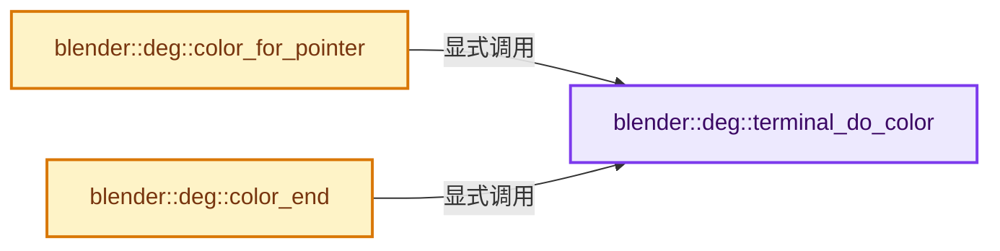
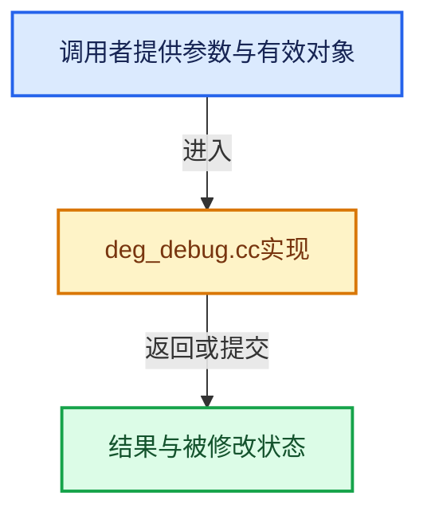

# 实现依赖专题：source/blender/depsgraph/intern/debug/deg_debug.cc

[方向导航](README.md) · [符号索引](../%E7%AC%A6%E5%8F%B7%E4%BE%9D%E8%B5%96%E4%B8%8E%E5%AE%9E%E7%8E%B0%E7%B4%A2%E5%BC%95.md)

本专题从正文实际调用进入，集中保存共享实现。函数有稳定锚点，可从调用处直接跳到对应完整函数；递归与互相调用通过回链组织。

## 本文件的实现关系






## 完整成员与函数实现

<a id="f-4b756996633304c6"></a>

### `blender::deg::terminal_do_color`

实现位置：[source/blender/depsgraph/intern/debug/deg_debug.cc](../../../../../source/blender/depsgraph/intern/debug/deg_debug.cc) · L56—L59。

**教学注释版**

<!-- annotated:3b62b388cfdae8 -->

```cpp
bool terminal_do_color()
{
  return (G.debug & G_DEBUG_DEPSGRAPH_PRETTY) != 0;
}
```

<details>
<summary>核对原始源码：source/blender/depsgraph/intern/debug/deg_debug.cc · L56—L59</summary>

<!-- original:3b62b388cfdae8:source/blender/depsgraph/intern/debug/deg_debug.cc:56:59 -->

```cpp
bool terminal_do_color()
{
  return (G.debug & G_DEBUG_DEPSGRAPH_PRETTY) != 0;
}
```

</details>

**结果出口**

- `return (G.debug & G_DEBUG_DEPSGRAPH_PRETTY) != 0;`

**继续追踪实现**

本实现没有需要继续展开的显式调用；检查返回表达式、对象转换和调用者前置条件。

<a id="f-87fb1d447f276c4a"></a>

### `blender::deg::color_for_pointer`

实现位置：[source/blender/depsgraph/intern/debug/deg_debug.cc](../../../../../source/blender/depsgraph/intern/debug/deg_debug.cc) · L61—L71。

接口参数：

- `const void *pointer`

**教学注释版**

<!-- annotated:1f1caee1fb04ae -->

```cpp
std::string color_for_pointer(const void *pointer)
{
  if (!terminal_do_color()) {
    return "";
  }
  int r, g, b;
  BLI_hash_pointer_to_color(pointer, &r, &g, &b);
  char buffer[64];
  SNPRINTF(buffer, TRUECOLOR_ANSI_COLOR_FORMAT, r, g, b);
  return std::string(buffer);
}
```

<details>
<summary>核对原始源码：source/blender/depsgraph/intern/debug/deg_debug.cc · L61—L71</summary>

<!-- original:1f1caee1fb04ae:source/blender/depsgraph/intern/debug/deg_debug.cc:61:71 -->

```cpp
std::string color_for_pointer(const void *pointer)
{
  if (!terminal_do_color()) {
    return "";
  }
  int r, g, b;
  BLI_hash_pointer_to_color(pointer, &r, &g, &b);
  char buffer[64];
  SNPRINTF(buffer, TRUECOLOR_ANSI_COLOR_FORMAT, r, g, b);
  return std::string(buffer);
}
```

</details>

**结果出口**

- `return "";`
- `return std::string(buffer);`

**继续追踪实现**

- `terminal_do_color` → [blender::deg::terminal_do_color · L56](%E4%BE%9D%E8%B5%96-deg_debug-161340.md#f-4b756996633304c6)。
- `BLI_hash_pointer_to_color` → [blender::BLI_hash_pointer_to_color · L99](../02-%E5%93%88%E5%B8%8C%E8%A1%A8%E4%B8%8E%E5%85%B3%E8%81%94%E6%95%B0%E6%8D%AE%E7%BB%93%E6%9E%84/%E4%BE%9D%E8%B5%96-BLI_hash_c-2ab8ea.md#f-80aedf0b284dbe6b)。
- `SNPRINTF` → [SNPRINTF · L601](../01-%E5%9F%BA%E7%A1%80%E5%AE%B9%E5%99%A8%E4%B8%8E%E7%8E%B0%E4%BB%A3CPP/%E4%BE%9D%E8%B5%96-BLI_string-b43058.md#m-6193d55b5ab8)。宏定义由构建条件选择。
- `std::string` → [外部契约](https://eel.is/c++draft/)：这个边界按实际表达式及所属类型核对参数、返回值、寿命与失败行为。这里提供接口入口，不声称已解释该第三方版本的内部实现。

<a id="f-94d53c2f95c8c4b3"></a>

### `blender::deg::color_end`

实现位置：[source/blender/depsgraph/intern/debug/deg_debug.cc](../../../../../source/blender/depsgraph/intern/debug/deg_debug.cc) · L73—L79。

**教学注释版**

<!-- annotated:a2dc0714d7e132 -->

```cpp
std::string color_end()
{
  if (!terminal_do_color()) {
    return "";
  }
  return std::string(TRUECOLOR_ANSI_COLOR_FINISH);
}
```

<details>
<summary>核对原始源码：source/blender/depsgraph/intern/debug/deg_debug.cc · L73—L79</summary>

<!-- original:a2dc0714d7e132:source/blender/depsgraph/intern/debug/deg_debug.cc:73:79 -->

```cpp
std::string color_end()
{
  if (!terminal_do_color()) {
    return "";
  }
  return std::string(TRUECOLOR_ANSI_COLOR_FINISH);
}
```

</details>

**结果出口**

- `return "";`
- `return std::string(TRUECOLOR_ANSI_COLOR_FINISH);`

**继续追踪实现**

- `terminal_do_color` → [blender::deg::terminal_do_color · L56](%E4%BE%9D%E8%B5%96-deg_debug-161340.md#f-4b756996633304c6)。
- `std::string` → [外部契约](https://eel.is/c++draft/)：这个边界按实际表达式及所属类型核对参数、返回值、寿命与失败行为。这里提供接口入口，不声称已解释该第三方版本的内部实现。
