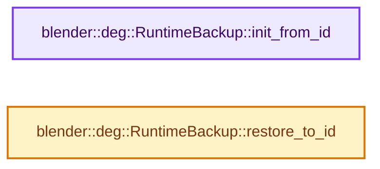
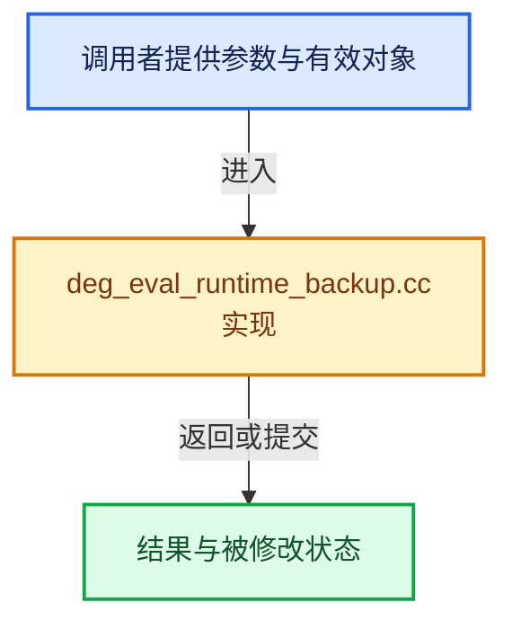

# 实现依赖专题：source/blender/depsgraph/intern/eval/deg_eval_runtime_backup.cc

[方向导航](README.md) · [符号索引](../%E7%AC%A6%E5%8F%B7%E4%BE%9D%E8%B5%96%E4%B8%8E%E5%AE%9E%E7%8E%B0%E7%B4%A2%E5%BC%95.md)

本专题从正文实际调用进入，集中保存共享实现。函数有稳定锚点，可从调用处直接跳到对应完整函数；递归与互相调用通过回链组织。

## 本文件的实现关系






## 完整成员与函数实现

<a id="f-8bbf68e5b3b03711"></a>

### `blender::deg::RuntimeBackup::init_from_id`

实现位置：[source/blender/depsgraph/intern/eval/deg_eval_runtime_backup.cc](../../../../../source/blender/depsgraph/intern/eval/deg_eval_runtime_backup.cc) · L29—L62。

接口参数：

- `ID *id`

**教学注释版**

<!-- annotated:769b242ddff053 -->

```cpp
void RuntimeBackup::init_from_id(ID *id)
{
  if (!deg_eval_copy_is_expanded(id)) {
    return;
  }
  have_backup = true;

  /* Clear, so freeing the expanded data doesn't touch this Python reference. */
  id_data.py_instance = id->py_instance;
  id->py_instance = nullptr;

  animation_backup.init_from_id(id);

  const ID_Type id_type = GS(id->name);
  switch (id_type) {
    case ID_OB:
      object_backup.init_from_object(reinterpret_cast<Object *>(id));
      break;
    case ID_SCE:
      scene_backup.init_from_scene(reinterpret_cast<Scene *>(id));
      break;
    case ID_SO:
      sound_backup.init_from_sound(reinterpret_cast<bSound *>(id));
      break;
    case ID_MC:
      movieclip_backup.init_from_movieclip(reinterpret_cast<MovieClip *>(id));
      break;
    case ID_VO:
      volume_backup.init_from_volume(reinterpret_cast<Volume *>(id));
      break;
    default:
      break;
  }
}
```

<details>
<summary>核对原始源码：source/blender/depsgraph/intern/eval/deg_eval_runtime_backup.cc · L29—L62</summary>

<!-- original:769b242ddff053:source/blender/depsgraph/intern/eval/deg_eval_runtime_backup.cc:29:62 -->

```cpp
void RuntimeBackup::init_from_id(ID *id)
{
  if (!deg_eval_copy_is_expanded(id)) {
    return;
  }
  have_backup = true;

  /* Clear, so freeing the expanded data doesn't touch this Python reference. */
  id_data.py_instance = id->py_instance;
  id->py_instance = nullptr;

  animation_backup.init_from_id(id);

  const ID_Type id_type = GS(id->name);
  switch (id_type) {
    case ID_OB:
      object_backup.init_from_object(reinterpret_cast<Object *>(id));
      break;
    case ID_SCE:
      scene_backup.init_from_scene(reinterpret_cast<Scene *>(id));
      break;
    case ID_SO:
      sound_backup.init_from_sound(reinterpret_cast<bSound *>(id));
      break;
    case ID_MC:
      movieclip_backup.init_from_movieclip(reinterpret_cast<MovieClip *>(id));
      break;
    case ID_VO:
      volume_backup.init_from_volume(reinterpret_cast<Volume *>(id));
      break;
    default:
      break;
  }
}
```

</details>

**沿实际写入检查状态**

- `have_backup = true;`
- `id_data.py_instance = id->py_instance;`
- `id->py_instance = nullptr;`

**继续追踪实现**

- `deg_eval_copy_is_expanded` → [blender::deg::deg_eval_copy_is_expanded · L1040](%E4%BE%9D%E8%B5%96-deg_eval_copy_on_write-5fb7a2.md#f-1e059be54ffbb837)。
- `animation_backup.init_from_id` → [调用协议](../%E6%A8%A1%E6%9D%BF%E5%AE%8F%E4%B8%8E%E5%8A%A8%E6%80%81%E5%88%86%E6%B4%BE%E5%8D%8F%E8%AE%AE.md)：接收对象类型依赖auto、返回值或模板实例；不按同名猜测目标。调用位置L40。
- `GS` → [blender::GS · L410](../05-%E5%87%A0%E4%BD%95%E5%AD%98%E5%82%A8%E4%B8%8E%E6%8B%93%E6%89%91%E6%98%A0%E5%B0%84/%E4%BE%9D%E8%B5%96-DNA_ID-3eb091.md#f-c3ff509f79f21b05)。
- `object_backup.init_from_object` → [调用协议](../%E6%A8%A1%E6%9D%BF%E5%AE%8F%E4%B8%8E%E5%8A%A8%E6%80%81%E5%88%86%E6%B4%BE%E5%8D%8F%E8%AE%AE.md)：接收对象类型依赖auto、返回值或模板实例；不按同名猜测目标。调用位置L45。
- `scene_backup.init_from_scene` → [调用协议](../%E6%A8%A1%E6%9D%BF%E5%AE%8F%E4%B8%8E%E5%8A%A8%E6%80%81%E5%88%86%E6%B4%BE%E5%8D%8F%E8%AE%AE.md)：接收对象类型依赖auto、返回值或模板实例；不按同名猜测目标。调用位置L48。
- `sound_backup.init_from_sound` → [调用协议](../%E6%A8%A1%E6%9D%BF%E5%AE%8F%E4%B8%8E%E5%8A%A8%E6%80%81%E5%88%86%E6%B4%BE%E5%8D%8F%E8%AE%AE.md)：接收对象类型依赖auto、返回值或模板实例；不按同名猜测目标。调用位置L51。
- `movieclip_backup.init_from_movieclip` → [调用协议](../%E6%A8%A1%E6%9D%BF%E5%AE%8F%E4%B8%8E%E5%8A%A8%E6%80%81%E5%88%86%E6%B4%BE%E5%8D%8F%E8%AE%AE.md)：接收对象类型依赖auto、返回值或模板实例；不按同名猜测目标。调用位置L54。
- `volume_backup.init_from_volume` → [调用协议](../%E6%A8%A1%E6%9D%BF%E5%AE%8F%E4%B8%8E%E5%8A%A8%E6%80%81%E5%88%86%E6%B4%BE%E5%8D%8F%E8%AE%AE.md)：接收对象类型依赖auto、返回值或模板实例；不按同名猜测目标。调用位置L57。

<a id="f-98db55913f312016"></a>

### `blender::deg::RuntimeBackup::restore_to_id`

实现位置：[source/blender/depsgraph/intern/eval/deg_eval_runtime_backup.cc](../../../../../source/blender/depsgraph/intern/eval/deg_eval_runtime_backup.cc) · L64—L94。

接口参数：

- `ID *id`

**教学注释版**

<!-- annotated:6410a442e1be64 -->

```cpp
void RuntimeBackup::restore_to_id(ID *id)
{
  if (!have_backup) {
    return;
  }

  id->py_instance = id_data.py_instance;

  animation_backup.restore_to_id(id);

  const ID_Type id_type = GS(id->name);
  switch (id_type) {
    case ID_OB:
      object_backup.restore_to_object(reinterpret_cast<Object *>(id));
      break;
    case ID_SCE:
      scene_backup.restore_to_scene(reinterpret_cast<Scene *>(id));
      break;
    case ID_SO:
      sound_backup.restore_to_sound(reinterpret_cast<bSound *>(id));
      break;
    case ID_MC:
      movieclip_backup.restore_to_movieclip(reinterpret_cast<MovieClip *>(id));
      break;
    case ID_VO:
      volume_backup.restore_to_volume(reinterpret_cast<Volume *>(id));
      break;
    default:
      break;
  }
}
```

<details>
<summary>核对原始源码：source/blender/depsgraph/intern/eval/deg_eval_runtime_backup.cc · L64—L94</summary>

<!-- original:6410a442e1be64:source/blender/depsgraph/intern/eval/deg_eval_runtime_backup.cc:64:94 -->

```cpp
void RuntimeBackup::restore_to_id(ID *id)
{
  if (!have_backup) {
    return;
  }

  id->py_instance = id_data.py_instance;

  animation_backup.restore_to_id(id);

  const ID_Type id_type = GS(id->name);
  switch (id_type) {
    case ID_OB:
      object_backup.restore_to_object(reinterpret_cast<Object *>(id));
      break;
    case ID_SCE:
      scene_backup.restore_to_scene(reinterpret_cast<Scene *>(id));
      break;
    case ID_SO:
      sound_backup.restore_to_sound(reinterpret_cast<bSound *>(id));
      break;
    case ID_MC:
      movieclip_backup.restore_to_movieclip(reinterpret_cast<MovieClip *>(id));
      break;
    case ID_VO:
      volume_backup.restore_to_volume(reinterpret_cast<Volume *>(id));
      break;
    default:
      break;
  }
}
```

</details>

**沿实际写入检查状态**

- `id->py_instance = id_data.py_instance;`

**继续追踪实现**

- `animation_backup.restore_to_id` → [调用协议](../%E6%A8%A1%E6%9D%BF%E5%AE%8F%E4%B8%8E%E5%8A%A8%E6%80%81%E5%88%86%E6%B4%BE%E5%8D%8F%E8%AE%AE.md)：接收对象类型依赖auto、返回值或模板实例；不按同名猜测目标。调用位置L72。
- `GS` → [blender::GS · L410](../05-%E5%87%A0%E4%BD%95%E5%AD%98%E5%82%A8%E4%B8%8E%E6%8B%93%E6%89%91%E6%98%A0%E5%B0%84/%E4%BE%9D%E8%B5%96-DNA_ID-3eb091.md#f-c3ff509f79f21b05)。
- `object_backup.restore_to_object` → [调用协议](../%E6%A8%A1%E6%9D%BF%E5%AE%8F%E4%B8%8E%E5%8A%A8%E6%80%81%E5%88%86%E6%B4%BE%E5%8D%8F%E8%AE%AE.md)：接收对象类型依赖auto、返回值或模板实例；不按同名猜测目标。调用位置L77。
- `scene_backup.restore_to_scene` → [调用协议](../%E6%A8%A1%E6%9D%BF%E5%AE%8F%E4%B8%8E%E5%8A%A8%E6%80%81%E5%88%86%E6%B4%BE%E5%8D%8F%E8%AE%AE.md)：接收对象类型依赖auto、返回值或模板实例；不按同名猜测目标。调用位置L80。
- `sound_backup.restore_to_sound` → [调用协议](../%E6%A8%A1%E6%9D%BF%E5%AE%8F%E4%B8%8E%E5%8A%A8%E6%80%81%E5%88%86%E6%B4%BE%E5%8D%8F%E8%AE%AE.md)：接收对象类型依赖auto、返回值或模板实例；不按同名猜测目标。调用位置L83。
- `movieclip_backup.restore_to_movieclip` → [调用协议](../%E6%A8%A1%E6%9D%BF%E5%AE%8F%E4%B8%8E%E5%8A%A8%E6%80%81%E5%88%86%E6%B4%BE%E5%8D%8F%E8%AE%AE.md)：接收对象类型依赖auto、返回值或模板实例；不按同名猜测目标。调用位置L86。
- `volume_backup.restore_to_volume` → [调用协议](../%E6%A8%A1%E6%9D%BF%E5%AE%8F%E4%B8%8E%E5%8A%A8%E6%80%81%E5%88%86%E6%B4%BE%E5%8D%8F%E8%AE%AE.md)：接收对象类型依赖auto、返回值或模板实例；不按同名猜测目标。调用位置L89。
