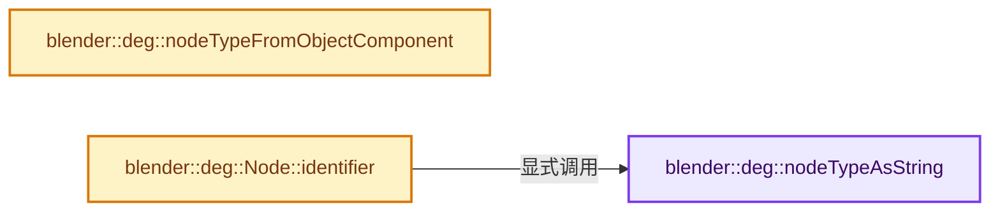
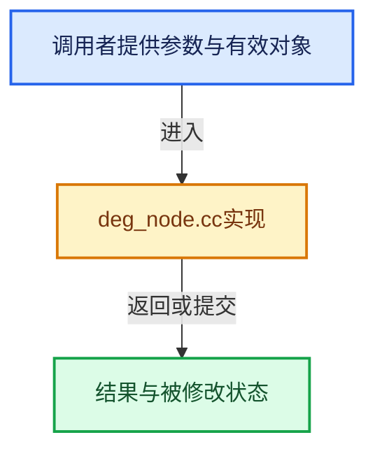

# 实现依赖专题：source/blender/depsgraph/intern/node/deg_node.cc

[方向导航](README.md) · [符号索引](../%E7%AC%A6%E5%8F%B7%E4%BE%9D%E8%B5%96%E4%B8%8E%E5%AE%9E%E7%8E%B0%E7%B4%A2%E5%BC%95.md)

本专题从正文实际调用进入，集中保存共享实现。函数有稳定锚点，可从调用处直接跳到对应完整函数；递归与互相调用通过回链组织。

## 本文件的实现关系






## 完整成员与函数实现

<a id="f-830e1f086ed0e6b3"></a>

### `blender::deg::nodeTypeAsString`

实现位置：[source/blender/depsgraph/intern/node/deg_node.cc](../../../../../source/blender/depsgraph/intern/node/deg_node.cc) · L35—L112。

接口参数：

- `NodeType type`

**教学注释版**

<!-- annotated:19d3d11ac9bd79 -->

```cpp
const char *nodeTypeAsString(NodeType type)
{
  switch (type) {
    case NodeType::UNDEFINED:
      return "UNDEFINED";
    case NodeType::OPERATION:
      return "OPERATION";
    /* **** Generic Types **** */
    case NodeType::TIMESOURCE:
      return "TIMESOURCE";
    case NodeType::ID_REF:
      return "ID_REF";
    /* **** Outer Types **** */
    case NodeType::PARAMETERS:
      return "PARAMETERS";
    case NodeType::ANIMATION:
      return "ANIMATION";
    case NodeType::TRANSFORM:
      return "TRANSFORM";
    case NodeType::GEOMETRY:
      return "GEOMETRY";
    case NodeType::SEQUENCER:
      return "SEQUENCER";
    case NodeType::COMPOSITOR:
      return "COMPOSITOR";
    case NodeType::LAYER_COLLECTIONS:
      return "LAYER_COLLECTIONS";
    case NodeType::COPY_ON_EVAL:
      return "COPY_ON_EVAL";
    case NodeType::OBJECT_FROM_LAYER:
      return "OBJECT_FROM_LAYER";
    case NodeType::HIERARCHY:
      return "HIERARCHY";
    /* **** Evaluation-Related Outer Types (with Sub-data) **** */
    case NodeType::EVAL_POSE:
      return "EVAL_POSE";
    case NodeType::BONE:
      return "BONE";
    case NodeType::PARTICLE_SYSTEM:
      return "PARTICLE_SYSTEM";
    case NodeType::PARTICLE_SETTINGS:
      return "PARTICLE_SETTINGS";
    case NodeType::SHADING:
      return "SHADING";
    case NodeType::CACHE:
      return "CACHE";
    case NodeType::POINT_CACHE:
      return "POINT_CACHE";
    case NodeType::IMAGE_ANIMATION:
      return "IMAGE_ANIMATION";
    case NodeType::BATCH_CACHE:
      return "BATCH_CACHE";
    case NodeType::INSTANCING:
      return "INSTANCING";
    case NodeType::SYNCHRONIZATION:
      return "SYNCHRONIZATION";
    case NodeType::AUDIO:
      return "AUDIO";
    case NodeType::ARMATURE:
      return "ARMATURE";
    case NodeType::GENERIC_DATABLOCK:
      return "GENERIC_DATABLOCK";
    case NodeType::SCENE:
      return "SCENE";
    case NodeType::VISIBILITY:
      return "VISIBILITY";
    case NodeType::NTREE_OUTPUT:
      return "NTREE_OUTPUT";
    case NodeType::NTREE_GEOMETRY_PREPROCESS:
      return "NTREE_GEOMETRY_PREPROCESS";

    /* Total number of meaningful node types. */
    case NodeType::NUM_TYPES:
      return "SpecialCase";
  }
  BLI_assert_msg(0, "Unhandled node type, should never happen.");
  return "UNKNOWN";
}
```

<details>
<summary>核对原始源码：source/blender/depsgraph/intern/node/deg_node.cc · L35—L112</summary>

<!-- original:19d3d11ac9bd79:source/blender/depsgraph/intern/node/deg_node.cc:35:112 -->

```cpp
const char *nodeTypeAsString(NodeType type)
{
  switch (type) {
    case NodeType::UNDEFINED:
      return "UNDEFINED";
    case NodeType::OPERATION:
      return "OPERATION";
    /* **** Generic Types **** */
    case NodeType::TIMESOURCE:
      return "TIMESOURCE";
    case NodeType::ID_REF:
      return "ID_REF";
    /* **** Outer Types **** */
    case NodeType::PARAMETERS:
      return "PARAMETERS";
    case NodeType::ANIMATION:
      return "ANIMATION";
    case NodeType::TRANSFORM:
      return "TRANSFORM";
    case NodeType::GEOMETRY:
      return "GEOMETRY";
    case NodeType::SEQUENCER:
      return "SEQUENCER";
    case NodeType::COMPOSITOR:
      return "COMPOSITOR";
    case NodeType::LAYER_COLLECTIONS:
      return "LAYER_COLLECTIONS";
    case NodeType::COPY_ON_EVAL:
      return "COPY_ON_EVAL";
    case NodeType::OBJECT_FROM_LAYER:
      return "OBJECT_FROM_LAYER";
    case NodeType::HIERARCHY:
      return "HIERARCHY";
    /* **** Evaluation-Related Outer Types (with Sub-data) **** */
    case NodeType::EVAL_POSE:
      return "EVAL_POSE";
    case NodeType::BONE:
      return "BONE";
    case NodeType::PARTICLE_SYSTEM:
      return "PARTICLE_SYSTEM";
    case NodeType::PARTICLE_SETTINGS:
      return "PARTICLE_SETTINGS";
    case NodeType::SHADING:
      return "SHADING";
    case NodeType::CACHE:
      return "CACHE";
    case NodeType::POINT_CACHE:
      return "POINT_CACHE";
    case NodeType::IMAGE_ANIMATION:
      return "IMAGE_ANIMATION";
    case NodeType::BATCH_CACHE:
      return "BATCH_CACHE";
    case NodeType::INSTANCING:
      return "INSTANCING";
    case NodeType::SYNCHRONIZATION:
      return "SYNCHRONIZATION";
    case NodeType::AUDIO:
      return "AUDIO";
    case NodeType::ARMATURE:
      return "ARMATURE";
    case NodeType::GENERIC_DATABLOCK:
      return "GENERIC_DATABLOCK";
    case NodeType::SCENE:
      return "SCENE";
    case NodeType::VISIBILITY:
      return "VISIBILITY";
    case NodeType::NTREE_OUTPUT:
      return "NTREE_OUTPUT";
    case NodeType::NTREE_GEOMETRY_PREPROCESS:
      return "NTREE_GEOMETRY_PREPROCESS";

    /* Total number of meaningful node types. */
    case NodeType::NUM_TYPES:
      return "SpecialCase";
  }
  BLI_assert_msg(0, "Unhandled node type, should never happen.");
  return "UNKNOWN";
}
```

</details>

**结果出口**

- `return "UNDEFINED";`
- `return "OPERATION";`
- `return "TIMESOURCE";`
- `return "ID_REF";`
- `return "PARAMETERS";`
- `return "ANIMATION";`
- `return "TRANSFORM";`
- `return "GEOMETRY";`
- `return "SEQUENCER";`
- `return "COMPOSITOR";`
- `return "LAYER_COLLECTIONS";`
- `return "COPY_ON_EVAL";`
- `return "OBJECT_FROM_LAYER";`
- `return "HIERARCHY";`
- `return "EVAL_POSE";`
- `return "BONE";`
- `return "PARTICLE_SYSTEM";`
- `return "PARTICLE_SETTINGS";`
- `return "SHADING";`
- `return "CACHE";`
- `return "POINT_CACHE";`
- `return "IMAGE_ANIMATION";`
- `return "BATCH_CACHE";`
- `return "INSTANCING";`
- `return "SYNCHRONIZATION";`
- `return "AUDIO";`
- `return "ARMATURE";`
- `return "GENERIC_DATABLOCK";`
- `return "SCENE";`
- `return "VISIBILITY";`
- `return "NTREE_OUTPUT";`
- `return "NTREE_GEOMETRY_PREPROCESS";`
- `return "SpecialCase";`
- `return "UNKNOWN";`

**继续追踪实现**

- `BLI_assert_msg` → [BLI_assert_msg · L55](../01-%E5%9F%BA%E7%A1%80%E5%AE%B9%E5%99%A8%E4%B8%8E%E7%8E%B0%E4%BB%A3CPP/%E4%BE%9D%E8%B5%96-BLI_assert-cc98e8.md#m-695eed20dceb)；[BLI_assert_msg · L64](../01-%E5%9F%BA%E7%A1%80%E5%AE%B9%E5%99%A8%E4%B8%8E%E7%8E%B0%E4%BB%A3CPP/%E4%BE%9D%E8%B5%96-BLI_assert-cc98e8.md#m-7de5563de4db)。宏定义由构建条件选择。

<a id="f-936b7e29b13a72de"></a>

### `blender::deg::nodeTypeFromObjectComponent`

实现位置：[source/blender/depsgraph/intern/node/deg_node.cc](../../../../../source/blender/depsgraph/intern/node/deg_node.cc) · L179—L202。

接口参数：

- `eDepsObjectComponentType component_type`

**教学注释版**

<!-- annotated:cd69b0d85b3509 -->

```cpp
NodeType nodeTypeFromObjectComponent(eDepsObjectComponentType component_type)
{
  switch (component_type) {
    case DEG_OB_COMP_ANY:
      return NodeType::UNDEFINED;
    case DEG_OB_COMP_PARAMETERS:
      return NodeType::PARAMETERS;
    case DEG_OB_COMP_ANIMATION:
      return NodeType::ANIMATION;
    case DEG_OB_COMP_TRANSFORM:
      return NodeType::TRANSFORM;
    case DEG_OB_COMP_GEOMETRY:
      return NodeType::GEOMETRY;
    case DEG_OB_COMP_EVAL_POSE:
      return NodeType::EVAL_POSE;
    case DEG_OB_COMP_BONE:
      return NodeType::BONE;
    case DEG_OB_COMP_SHADING:
      return NodeType::SHADING;
    case DEG_OB_COMP_CACHE:
      return NodeType::CACHE;
  }
  return NodeType::UNDEFINED;
}
```

<details>
<summary>核对原始源码：source/blender/depsgraph/intern/node/deg_node.cc · L179—L202</summary>

<!-- original:cd69b0d85b3509:source/blender/depsgraph/intern/node/deg_node.cc:179:202 -->

```cpp
NodeType nodeTypeFromObjectComponent(eDepsObjectComponentType component_type)
{
  switch (component_type) {
    case DEG_OB_COMP_ANY:
      return NodeType::UNDEFINED;
    case DEG_OB_COMP_PARAMETERS:
      return NodeType::PARAMETERS;
    case DEG_OB_COMP_ANIMATION:
      return NodeType::ANIMATION;
    case DEG_OB_COMP_TRANSFORM:
      return NodeType::TRANSFORM;
    case DEG_OB_COMP_GEOMETRY:
      return NodeType::GEOMETRY;
    case DEG_OB_COMP_EVAL_POSE:
      return NodeType::EVAL_POSE;
    case DEG_OB_COMP_BONE:
      return NodeType::BONE;
    case DEG_OB_COMP_SHADING:
      return NodeType::SHADING;
    case DEG_OB_COMP_CACHE:
      return NodeType::CACHE;
  }
  return NodeType::UNDEFINED;
}
```

</details>

**结果出口**

- `return NodeType::UNDEFINED;`
- `return NodeType::PARAMETERS;`
- `return NodeType::ANIMATION;`
- `return NodeType::TRANSFORM;`
- `return NodeType::GEOMETRY;`
- `return NodeType::EVAL_POSE;`
- `return NodeType::BONE;`
- `return NodeType::SHADING;`
- `return NodeType::CACHE;`

**继续追踪实现**

本实现没有需要继续展开的显式调用；检查返回表达式、对象转换和调用者前置条件。

<a id="f-25dc706a7e9afde2"></a>

### `blender::deg::Node::identifier`

实现位置：[source/blender/depsgraph/intern/node/deg_node.cc](../../../../../source/blender/depsgraph/intern/node/deg_node.cc) · L297—L300。

**教学注释版**

<!-- annotated:c24c01c9594dbb -->

```cpp
std::string Node::identifier() const
{
  return std::string(nodeTypeAsString(type)) + " : " + name;
}
```

<details>
<summary>核对原始源码：source/blender/depsgraph/intern/node/deg_node.cc · L297—L300</summary>

<!-- original:c24c01c9594dbb:source/blender/depsgraph/intern/node/deg_node.cc:297:300 -->

```cpp
std::string Node::identifier() const
{
  return std::string(nodeTypeAsString(type)) + " : " + name;
}
```

</details>

**结果出口**

- `return std::string(nodeTypeAsString(type)) + " : " + name;`

**继续追踪实现**

- `std::string` → [外部契约](https://eel.is/c++draft/)：这个边界按实际表达式及所属类型核对参数、返回值、寿命与失败行为。这里提供接口入口，不声称已解释该第三方版本的内部实现。
- `nodeTypeAsString` → [blender::deg::nodeTypeAsString · L35](%E4%BE%9D%E8%B5%96-deg_node-35126c.md#f-830e1f086ed0e6b3)。
