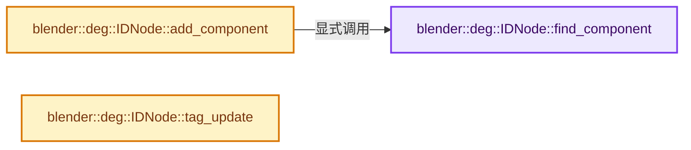
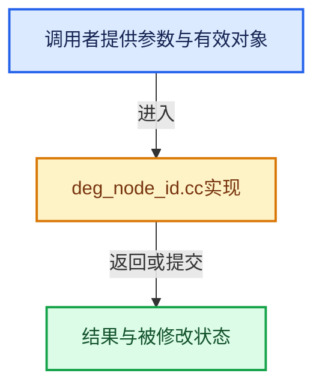

# 实现依赖专题：source/blender/depsgraph/intern/node/deg_node_id.cc

[方向导航](README.md) · [符号索引](../%E7%AC%A6%E5%8F%B7%E4%BE%9D%E8%B5%96%E4%B8%8E%E5%AE%9E%E7%8E%B0%E7%B4%A2%E5%BC%95.md)

本专题从正文实际调用进入，集中保存共享实现。函数有稳定锚点，可从调用处直接跳到对应完整函数；递归与互相调用通过回链组织。

## 本文件的实现关系






## 完整成员与函数实现

<a id="f-9982102eca14b6b6"></a>

### `blender::deg::IDNode::find_component`

实现位置：[source/blender/depsgraph/intern/node/deg_node_id.cc](../../../../../source/blender/depsgraph/intern/node/deg_node_id.cc) · L133—L137。

接口参数：

- `NodeType type`
- `const StringRef name`

**教学注释版**

<!-- annotated:9e08261fb4524f -->

```cpp
ComponentNode *IDNode::find_component(NodeType type, const StringRef name) const
{
  ComponentIDKey key(type, name);
  return components.lookup_default(key, nullptr);
}
```

<details>
<summary>核对原始源码：source/blender/depsgraph/intern/node/deg_node_id.cc · L133—L137</summary>

<!-- original:9e08261fb4524f:source/blender/depsgraph/intern/node/deg_node_id.cc:133:137 -->

```cpp
ComponentNode *IDNode::find_component(NodeType type, const StringRef name) const
{
  ComponentIDKey key(type, name);
  return components.lookup_default(key, nullptr);
}
```

</details>

**结果出口**

- `return components.lookup_default(key, nullptr);`

**继续追踪实现**

- `components.lookup_default` → [调用协议](../%E6%A8%A1%E6%9D%BF%E5%AE%8F%E4%B8%8E%E5%8A%A8%E6%80%81%E5%88%86%E6%B4%BE%E5%8D%8F%E8%AE%AE.md)：接收对象类型依赖auto、返回值或模板实例；不按同名猜测目标。调用位置L136。

<a id="f-37c0b916f0dffd81"></a>

### `blender::deg::IDNode::add_component`

实现位置：[source/blender/depsgraph/intern/node/deg_node_id.cc](../../../../../source/blender/depsgraph/intern/node/deg_node_id.cc) · L139—L153。

接口参数：

- `NodeType type`
- `const StringRef name`

**教学注释版**

<!-- annotated:82ed37a47e8e1a -->

```cpp
ComponentNode *IDNode::add_component(NodeType type, const StringRef name)
{
  ComponentNode *comp_node = find_component(type, name);
  if (!comp_node) {
    DepsNodeFactory *factory = type_get_factory(type);
    BLI_assert(factory);
    comp_node = static_cast<ComponentNode *>(factory->create_node(this->id_orig, "", name));

    /* Register. */
    ComponentIDKey key(type, comp_node->name);
    components.add_new(key, comp_node);
    comp_node->owner = this;
  }
  return comp_node;
}
```

<details>
<summary>核对原始源码：source/blender/depsgraph/intern/node/deg_node_id.cc · L139—L153</summary>

<!-- original:82ed37a47e8e1a:source/blender/depsgraph/intern/node/deg_node_id.cc:139:153 -->

```cpp
ComponentNode *IDNode::add_component(NodeType type, const StringRef name)
{
  ComponentNode *comp_node = find_component(type, name);
  if (!comp_node) {
    DepsNodeFactory *factory = type_get_factory(type);
    BLI_assert(factory);
    comp_node = static_cast<ComponentNode *>(factory->create_node(this->id_orig, "", name));

    /* Register. */
    ComponentIDKey key(type, comp_node->name);
    components.add_new(key, comp_node);
    comp_node->owner = this;
  }
  return comp_node;
}
```

</details>

**沿实际写入检查状态**

- `comp_node = static_cast<ComponentNode *>(factory->create_node(this->id_orig, "", name));`
- `comp_node->owner = this;`

**结果出口**

- `return comp_node;`

**继续追踪实现**

- `find_component` → [blender::deg::IDNode::find_component · L133](%E4%BE%9D%E8%B5%96-deg_node_id-71dd5e.md#f-9982102eca14b6b6)。
- `type_get_factory` → [blender::deg::type_get_factory · L23](%E4%BE%9D%E8%B5%96-deg_node_factory-22047f.md#f-5af7c2ca11c54f63)。
- `BLI_assert` → [BLI_assert · L48](../01-%E5%9F%BA%E7%A1%80%E5%AE%B9%E5%99%A8%E4%B8%8E%E7%8E%B0%E4%BB%A3CPP/%E4%BE%9D%E8%B5%96-BLI_assert-cc98e8.md#m-57a88495704d)；[BLI_assert · L63](../01-%E5%9F%BA%E7%A1%80%E5%AE%B9%E5%99%A8%E4%B8%8E%E7%8E%B0%E4%BB%A3CPP/%E4%BE%9D%E8%B5%96-BLI_assert-cc98e8.md#m-d07050020cb5)。宏定义由构建条件选择。
- `factory->create_node` → [blender::deg::DepsNodeFactoryImpl<ModeObjectType>::create_node · L34](%E4%BE%9D%E8%B5%96-deg_node_factory_impl-ce022d.md#f-dbf39120cc6cbb9b)。
- `components.add_new` → [调用协议](../%E6%A8%A1%E6%9D%BF%E5%AE%8F%E4%B8%8E%E5%8A%A8%E6%80%81%E5%88%86%E6%B4%BE%E5%8D%8F%E8%AE%AE.md)：接收对象类型依赖auto、返回值或模板实例；不按同名猜测目标。调用位置L149。

<a id="f-3f6509b49502a17c"></a>

### `blender::deg::IDNode::tag_update`

实现位置：[source/blender/depsgraph/intern/node/deg_node_id.cc](../../../../../source/blender/depsgraph/intern/node/deg_node_id.cc) · L155—L165。

接口参数：

- `Depsgraph *graph`
- `eUpdateSource source`

**教学注释版**

<!-- annotated:1e6d197ee55158 -->

```cpp
void IDNode::tag_update(Depsgraph *graph, eUpdateSource source)
{
  for (ComponentNode *comp_node : components.values()) {
    /* Relations update does explicit animation update when needed. Here we ignore animation
     * component to avoid loss of possible unkeyed changes. */
    if (comp_node->type == NodeType::ANIMATION && source == DEG_UPDATE_SOURCE_RELATIONS) {
      continue;
    }
    comp_node->tag_update(graph, source);
  }
}
```

<details>
<summary>核对原始源码：source/blender/depsgraph/intern/node/deg_node_id.cc · L155—L165</summary>

<!-- original:1e6d197ee55158:source/blender/depsgraph/intern/node/deg_node_id.cc:155:165 -->

```cpp
void IDNode::tag_update(Depsgraph *graph, eUpdateSource source)
{
  for (ComponentNode *comp_node : components.values()) {
    /* Relations update does explicit animation update when needed. Here we ignore animation
     * component to avoid loss of possible unkeyed changes. */
    if (comp_node->type == NodeType::ANIMATION && source == DEG_UPDATE_SOURCE_RELATIONS) {
      continue;
    }
    comp_node->tag_update(graph, source);
  }
}
```

</details>

**继续追踪实现**

- `components.values` → [调用协议](../%E6%A8%A1%E6%9D%BF%E5%AE%8F%E4%B8%8E%E5%8A%A8%E6%80%81%E5%88%86%E6%B4%BE%E5%8D%8F%E8%AE%AE.md)：接收对象类型依赖auto、返回值或模板实例；不按同名猜测目标。调用位置L157。
- `comp_node->tag_update` → [调用协议](../%E6%A8%A1%E6%9D%BF%E5%AE%8F%E4%B8%8E%E5%8A%A8%E6%80%81%E5%88%86%E6%B4%BE%E5%8D%8F%E8%AE%AE.md)：接收对象类型依赖auto、返回值或模板实例；不按同名猜测目标。调用位置L163。
