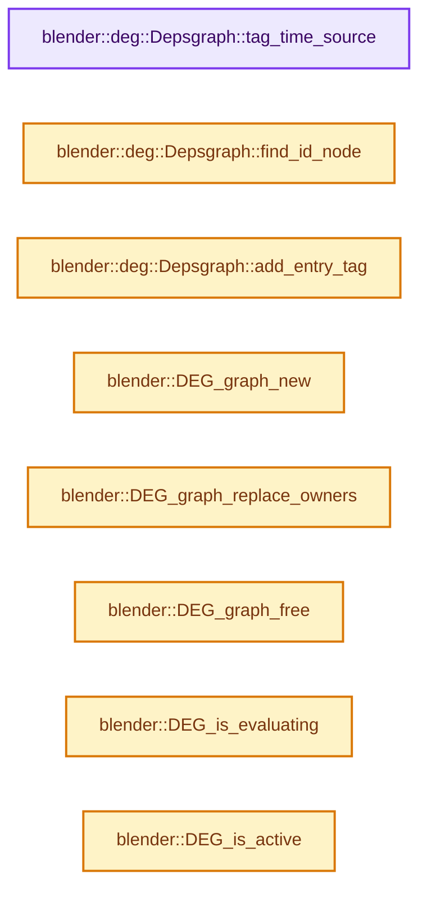
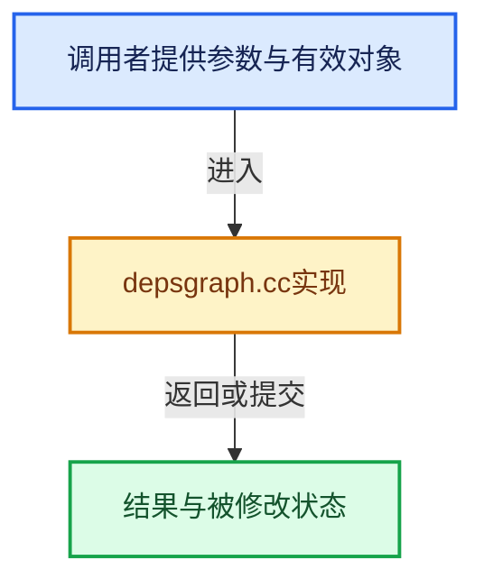

# 实现依赖专题：source/blender/depsgraph/intern/depsgraph.cc

[方向导航](README.md) · [符号索引](../%E7%AC%A6%E5%8F%B7%E4%BE%9D%E8%B5%96%E4%B8%8E%E5%AE%9E%E7%8E%B0%E7%B4%A2%E5%BC%95.md)

本专题从正文实际调用进入，集中保存共享实现。函数有稳定锚点，可从调用处直接跳到对应完整函数；递归与互相调用通过回链组织。

## 本文件的实现关系






## 完整成员与函数实现

<a id="f-18fdd518be732fef"></a>

### `blender::deg::Depsgraph::tag_time_source`

实现位置：[source/blender/depsgraph/intern/depsgraph.cc](../../../../../source/blender/depsgraph/intern/depsgraph.cc) · L97—L100。

**教学注释版**

<!-- annotated:c2dbd3ac48afb6 -->

```cpp
void Depsgraph::tag_time_source()
{
  time_source->tag_update(this, DEG_UPDATE_SOURCE_TIME);
}
```

<details>
<summary>核对原始源码：source/blender/depsgraph/intern/depsgraph.cc · L97—L100</summary>

<!-- original:c2dbd3ac48afb6:source/blender/depsgraph/intern/depsgraph.cc:97:100 -->

```cpp
void Depsgraph::tag_time_source()
{
  time_source->tag_update(this, DEG_UPDATE_SOURCE_TIME);
}
```

</details>

**继续追踪实现**

- `time_source->tag_update` → [调用协议](../%E6%A8%A1%E6%9D%BF%E5%AE%8F%E4%B8%8E%E5%8A%A8%E6%80%81%E5%88%86%E6%B4%BE%E5%8D%8F%E8%AE%AE.md)：接收对象类型依赖auto、返回值或模板实例；不按同名猜测目标。调用位置L99。

<a id="f-09bf92ea2c269980"></a>

### `blender::deg::Depsgraph::find_id_node`

实现位置：[source/blender/depsgraph/intern/depsgraph.cc](../../../../../source/blender/depsgraph/intern/depsgraph.cc) · L102—L105。

接口参数：

- `const ID *id`

**教学注释版**

<!-- annotated:56da037012e34c -->

```cpp
IDNode *Depsgraph::find_id_node(const ID *id) const
{
  return id_hash.lookup_default(id, nullptr);
}
```

<details>
<summary>核对原始源码：source/blender/depsgraph/intern/depsgraph.cc · L102—L105</summary>

<!-- original:56da037012e34c:source/blender/depsgraph/intern/depsgraph.cc:102:105 -->

```cpp
IDNode *Depsgraph::find_id_node(const ID *id) const
{
  return id_hash.lookup_default(id, nullptr);
}
```

</details>

**结果出口**

- `return id_hash.lookup_default(id, nullptr);`

**继续追踪实现**

- `id_hash.lookup_default` → [调用协议](../%E6%A8%A1%E6%9D%BF%E5%AE%8F%E4%B8%8E%E5%8A%A8%E6%80%81%E5%88%86%E6%B4%BE%E5%8D%8F%E8%AE%AE.md)：接收对象类型依赖auto、返回值或模板实例；不按同名猜测目标。调用位置L104。

<a id="f-c15e0426db180972"></a>

### `blender::deg::Depsgraph::add_entry_tag`

实现位置：[source/blender/depsgraph/intern/depsgraph.cc](../../../../../source/blender/depsgraph/intern/depsgraph.cc) · L225—L236。

接口参数：

- `OperationNode *node`

**教学注释版**

<!-- annotated:3f5dfa8094a92a -->

```cpp
void Depsgraph::add_entry_tag(OperationNode *node)
{
  /* Sanity check. */
  if (node == nullptr) {
    return;
  }
  /* Add to graph-level set of directly modified nodes to start searching
   * from.
   * NOTE: this is necessary since we have several thousand nodes to play
   * with. */
  entry_tags.add(node);
}
```

<details>
<summary>核对原始源码：source/blender/depsgraph/intern/depsgraph.cc · L225—L236</summary>

<!-- original:3f5dfa8094a92a:source/blender/depsgraph/intern/depsgraph.cc:225:236 -->

```cpp
void Depsgraph::add_entry_tag(OperationNode *node)
{
  /* Sanity check. */
  if (node == nullptr) {
    return;
  }
  /* Add to graph-level set of directly modified nodes to start searching
   * from.
   * NOTE: this is necessary since we have several thousand nodes to play
   * with. */
  entry_tags.add(node);
}
```

</details>

**继续追踪实现**

- `entry_tags.add` → [调用协议](../%E6%A8%A1%E6%9D%BF%E5%AE%8F%E4%B8%8E%E5%8A%A8%E6%80%81%E5%88%86%E6%B4%BE%E5%8D%8F%E8%AE%AE.md)：接收对象类型依赖auto、返回值或模板实例；不按同名猜测目标。调用位置L235。

<a id="f-11a9e5374e07d3c0"></a>

### `blender::DEG_graph_new`

实现位置：[source/blender/depsgraph/intern/depsgraph.cc](../../../../../source/blender/depsgraph/intern/depsgraph.cc) · L279—L284。

接口参数：

- `Main *bmain`
- `Scene *scene`
- `ViewLayer *view_layer`
- `eEvaluationMode mode`

**教学注释版**

<!-- annotated:fc6fe4bbf4b055 -->

```cpp
Depsgraph *DEG_graph_new(Main *bmain, Scene *scene, ViewLayer *view_layer, eEvaluationMode mode)
{
  deg::Depsgraph *deg_depsgraph = new deg::Depsgraph(bmain, scene, view_layer, mode);
  deg::register_graph(deg_depsgraph);
  return reinterpret_cast<Depsgraph *>(deg_depsgraph);
}
```

<details>
<summary>核对原始源码：source/blender/depsgraph/intern/depsgraph.cc · L279—L284</summary>

<!-- original:fc6fe4bbf4b055:source/blender/depsgraph/intern/depsgraph.cc:279:284 -->

```cpp
Depsgraph *DEG_graph_new(Main *bmain, Scene *scene, ViewLayer *view_layer, eEvaluationMode mode)
{
  deg::Depsgraph *deg_depsgraph = new deg::Depsgraph(bmain, scene, view_layer, mode);
  deg::register_graph(deg_depsgraph);
  return reinterpret_cast<Depsgraph *>(deg_depsgraph);
}
```

</details>

**结果出口**

- `return reinterpret_cast<Depsgraph *>(deg_depsgraph);`

**继续追踪实现**

- `deg::register_graph` → [blender::deg::register_graph · L38](%E4%BE%9D%E8%B5%96-depsgraph_registry-f1b523.md#f-7deece53b9203735)。

<a id="f-70c80b22053f4d88"></a>

### `blender::DEG_graph_replace_owners`

实现位置：[source/blender/depsgraph/intern/depsgraph.cc](../../../../../source/blender/depsgraph/intern/depsgraph.cc) · L286—L305。

接口参数：

- `Depsgraph *depsgraph`
- `Main *bmain`
- `Scene *scene`
- `ViewLayer *view_layer`

**教学注释版**

<!-- annotated:fa30feb558cf28 -->

```cpp
void DEG_graph_replace_owners(Depsgraph *depsgraph,
                              Main *bmain,
                              Scene *scene,
                              ViewLayer *view_layer)
{
  deg::Depsgraph *deg_graph = reinterpret_cast<deg::Depsgraph *>(depsgraph);

  const bool do_update_register = deg_graph->bmain != bmain;
  if (do_update_register && deg_graph->bmain != nullptr) {
    deg::unregister_graph(deg_graph);
  }

  deg_graph->bmain = bmain;
  deg_graph->scene = scene;
  deg_graph->view_layer = view_layer;

  if (do_update_register) {
    deg::register_graph(deg_graph);
  }
}
```

<details>
<summary>核对原始源码：source/blender/depsgraph/intern/depsgraph.cc · L286—L305</summary>

<!-- original:fa30feb558cf28:source/blender/depsgraph/intern/depsgraph.cc:286:305 -->

```cpp
void DEG_graph_replace_owners(Depsgraph *depsgraph,
                              Main *bmain,
                              Scene *scene,
                              ViewLayer *view_layer)
{
  deg::Depsgraph *deg_graph = reinterpret_cast<deg::Depsgraph *>(depsgraph);

  const bool do_update_register = deg_graph->bmain != bmain;
  if (do_update_register && deg_graph->bmain != nullptr) {
    deg::unregister_graph(deg_graph);
  }

  deg_graph->bmain = bmain;
  deg_graph->scene = scene;
  deg_graph->view_layer = view_layer;

  if (do_update_register) {
    deg::register_graph(deg_graph);
  }
}
```

</details>

**沿实际写入检查状态**

- `deg_graph->bmain = bmain;`
- `deg_graph->scene = scene;`
- `deg_graph->view_layer = view_layer;`

**继续追踪实现**

- `deg::unregister_graph` → [blender::deg::unregister_graph · L49](%E4%BE%9D%E8%B5%96-depsgraph_registry-f1b523.md#f-2156782104fe7b89)。
- `deg::register_graph` → [blender::deg::register_graph · L38](%E4%BE%9D%E8%B5%96-depsgraph_registry-f1b523.md#f-7deece53b9203735)。

<a id="f-85cbdc7eccf6ba7e"></a>

### `blender::DEG_graph_free`

实现位置：[source/blender/depsgraph/intern/depsgraph.cc](../../../../../source/blender/depsgraph/intern/depsgraph.cc) · L307—L316。

接口参数：

- `Depsgraph *graph`

**教学注释版**

<!-- annotated:a3e9608554bf7d -->

```cpp
void DEG_graph_free(Depsgraph *graph)
{
  if (graph == nullptr) {
    return;
  }
  using deg::Depsgraph;
  deg::Depsgraph *deg_depsgraph = reinterpret_cast<deg::Depsgraph *>(graph);
  deg::unregister_graph(deg_depsgraph);
  delete deg_depsgraph;
}
```

<details>
<summary>核对原始源码：source/blender/depsgraph/intern/depsgraph.cc · L307—L316</summary>

<!-- original:a3e9608554bf7d:source/blender/depsgraph/intern/depsgraph.cc:307:316 -->

```cpp
void DEG_graph_free(Depsgraph *graph)
{
  if (graph == nullptr) {
    return;
  }
  using deg::Depsgraph;
  deg::Depsgraph *deg_depsgraph = reinterpret_cast<deg::Depsgraph *>(graph);
  deg::unregister_graph(deg_depsgraph);
  delete deg_depsgraph;
}
```

</details>

**继续追踪实现**

- `deg::unregister_graph` → [blender::deg::unregister_graph · L49](%E4%BE%9D%E8%B5%96-depsgraph_registry-f1b523.md#f-2156782104fe7b89)。

<a id="f-c348c5b2ed0037ea"></a>

### `blender::DEG_is_evaluating`

实现位置：[source/blender/depsgraph/intern/depsgraph.cc](../../../../../source/blender/depsgraph/intern/depsgraph.cc) · L318—L322。

接口参数：

- `const Depsgraph *depsgraph`

**教学注释版**

<!-- annotated:010b6914fedc47 -->

```cpp
bool DEG_is_evaluating(const Depsgraph *depsgraph)
{
  const deg::Depsgraph *deg_graph = reinterpret_cast<const deg::Depsgraph *>(depsgraph);
  return deg_graph->is_evaluating;
}
```

<details>
<summary>核对原始源码：source/blender/depsgraph/intern/depsgraph.cc · L318—L322</summary>

<!-- original:010b6914fedc47:source/blender/depsgraph/intern/depsgraph.cc:318:322 -->

```cpp
bool DEG_is_evaluating(const Depsgraph *depsgraph)
{
  const deg::Depsgraph *deg_graph = reinterpret_cast<const deg::Depsgraph *>(depsgraph);
  return deg_graph->is_evaluating;
}
```

</details>

**结果出口**

- `return deg_graph->is_evaluating;`

**继续追踪实现**

本实现没有需要继续展开的显式调用；检查返回表达式、对象转换和调用者前置条件。

<a id="f-d561ff15ce03c64a"></a>

### `blender::DEG_is_active`

实现位置：[source/blender/depsgraph/intern/depsgraph.cc](../../../../../source/blender/depsgraph/intern/depsgraph.cc) · L324—L335。

接口参数：

- `const Depsgraph *depsgraph`

**教学注释版**

<!-- annotated:a6da77b1ccfbe5 -->

```cpp
bool DEG_is_active(const Depsgraph *depsgraph)
{
  if (depsgraph == nullptr) {
    /* Happens for such cases as work object in what_does_obaction(),
     * and sine render pipeline parts. Shouldn't really be accepting
     * nullptr depsgraph, but is quite hard to get proper one in those
     * cases. */
    return false;
  }
  const deg::Depsgraph *deg_graph = reinterpret_cast<const deg::Depsgraph *>(depsgraph);
  return deg_graph->is_active;
}
```

<details>
<summary>核对原始源码：source/blender/depsgraph/intern/depsgraph.cc · L324—L335</summary>

<!-- original:a6da77b1ccfbe5:source/blender/depsgraph/intern/depsgraph.cc:324:335 -->

```cpp
bool DEG_is_active(const Depsgraph *depsgraph)
{
  if (depsgraph == nullptr) {
    /* Happens for such cases as work object in what_does_obaction(),
     * and sine render pipeline parts. Shouldn't really be accepting
     * nullptr depsgraph, but is quite hard to get proper one in those
     * cases. */
    return false;
  }
  const deg::Depsgraph *deg_graph = reinterpret_cast<const deg::Depsgraph *>(depsgraph);
  return deg_graph->is_active;
}
```

</details>

**结果出口**

- `return false;`
- `return deg_graph->is_active;`

**继续追踪实现**

本实现没有需要继续展开的显式调用；检查返回表达式、对象转换和调用者前置条件。

<a id="f-b75d7d0370b6131c"></a>

### `blender::DEG_make_active`

实现位置：[source/blender/depsgraph/intern/depsgraph.cc](../../../../../source/blender/depsgraph/intern/depsgraph.cc) · L337—L342。

接口参数：

- `Depsgraph *depsgraph`

**教学注释版**

<!-- annotated:828f87d309436f -->

```cpp
void DEG_make_active(Depsgraph *depsgraph)
{
  deg::Depsgraph *deg_graph = reinterpret_cast<deg::Depsgraph *>(depsgraph);
  deg_graph->is_active = true;
  /* TODO(sergey): Copy data from evaluated state to original. */
}
```

<details>
<summary>核对原始源码：source/blender/depsgraph/intern/depsgraph.cc · L337—L342</summary>

<!-- original:828f87d309436f:source/blender/depsgraph/intern/depsgraph.cc:337:342 -->

```cpp
void DEG_make_active(Depsgraph *depsgraph)
{
  deg::Depsgraph *deg_graph = reinterpret_cast<deg::Depsgraph *>(depsgraph);
  deg_graph->is_active = true;
  /* TODO(sergey): Copy data from evaluated state to original. */
}
```

</details>

**沿实际写入检查状态**

- `deg_graph->is_active = true;`

**继续追踪实现**

本实现没有需要继续展开的显式调用；检查返回表达式、对象转换和调用者前置条件。

<a id="f-53f32a84c1bed638"></a>

### `blender::DEG_get_update_count`

实现位置：[source/blender/depsgraph/intern/depsgraph.cc](../../../../../source/blender/depsgraph/intern/depsgraph.cc) · L356—L360。

接口参数：

- `const Depsgraph *depsgraph`

**教学注释版**

<!-- annotated:6016091a3bad17 -->

```cpp
uint64_t DEG_get_update_count(const Depsgraph *depsgraph)
{
  const deg::Depsgraph *deg_graph = reinterpret_cast<const deg::Depsgraph *>(depsgraph);
  return deg_graph->update_count;
}
```

<details>
<summary>核对原始源码：source/blender/depsgraph/intern/depsgraph.cc · L356—L360</summary>

<!-- original:6016091a3bad17:source/blender/depsgraph/intern/depsgraph.cc:356:360 -->

```cpp
uint64_t DEG_get_update_count(const Depsgraph *depsgraph)
{
  const deg::Depsgraph *deg_graph = reinterpret_cast<const deg::Depsgraph *>(depsgraph);
  return deg_graph->update_count;
}
```

</details>

**结果出口**

- `return deg_graph->update_count;`

**继续追踪实现**

本实现没有需要继续展开的显式调用；检查返回表达式、对象转换和调用者前置条件。
