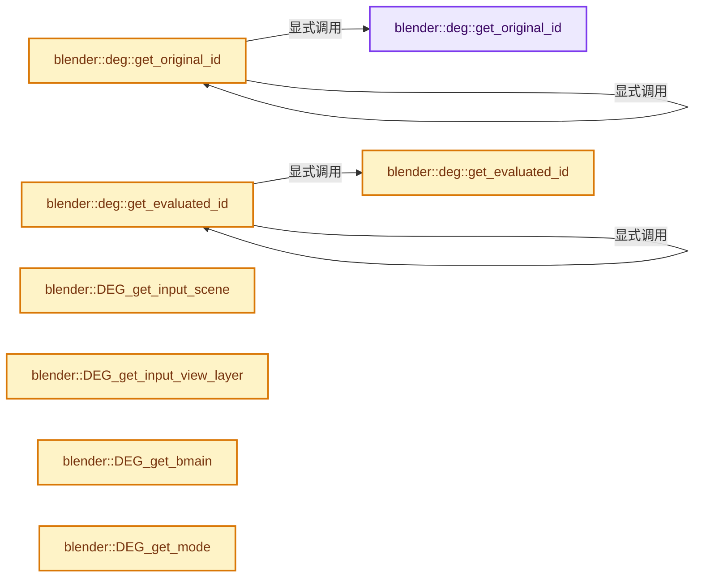

# 实现依赖专题：source/blender/depsgraph/intern/depsgraph_query.cc

[方向导航](README.md) · [符号索引](../%E7%AC%A6%E5%8F%B7%E4%BE%9D%E8%B5%96%E4%B8%8E%E5%AE%9E%E7%8E%B0%E7%B4%A2%E5%BC%95.md)

本专题从正文实际调用进入，集中保存共享实现。函数有稳定锚点，可从调用处直接跳到对应完整函数；递归与互相调用通过回链组织。

## 本文件的实现关系




## 完整成员与函数实现

<a id="f-ca04ecbdaf837c27"></a>

### `blender::deg::get_original_id`

实现位置：[source/blender/depsgraph/intern/depsgraph_query.cc](../../../../../source/blender/depsgraph/intern/depsgraph_query.cc) · L40—L50。

接口参数：

- `const ID *id`

**教学注释版**

<!-- annotated:de684c09e830a1 -->

```cpp
static const ID *get_original_id(const ID *id)
{
  if (id == nullptr) {
    return nullptr;
  }
  if (id->orig_id == nullptr) {
    return id;
  }
  BLI_assert((id->tag & ID_TAG_COPIED_ON_EVAL) != 0);
  return id_cast<ID *>(id->orig_id);
}
```

<details>
<summary>核对原始源码：source/blender/depsgraph/intern/depsgraph_query.cc · L40—L50</summary>

<!-- original:de684c09e830a1:source/blender/depsgraph/intern/depsgraph_query.cc:40:50 -->

```cpp
static const ID *get_original_id(const ID *id)
{
  if (id == nullptr) {
    return nullptr;
  }
  if (id->orig_id == nullptr) {
    return id;
  }
  BLI_assert((id->tag & ID_TAG_COPIED_ON_EVAL) != 0);
  return id_cast<ID *>(id->orig_id);
}
```

</details>

**结果出口**

- `return nullptr;`
- `return id;`
- `return id_cast<ID *>(id->orig_id);`

**继续追踪实现**

- `BLI_assert` → [BLI_assert · L48](../01-%E5%9F%BA%E7%A1%80%E5%AE%B9%E5%99%A8%E4%B8%8E%E7%8E%B0%E4%BB%A3CPP/%E4%BE%9D%E8%B5%96-BLI_assert-cc98e8.md#m-57a88495704d)；[BLI_assert · L63](../01-%E5%9F%BA%E7%A1%80%E5%AE%B9%E5%99%A8%E4%B8%8E%E7%8E%B0%E4%BB%A3CPP/%E4%BE%9D%E8%B5%96-BLI_assert-cc98e8.md#m-d07050020cb5)。宏定义由构建条件选择。
- `id_cast<ID *>` → [blender::id_cast · L1417](../05-%E5%87%A0%E4%BD%95%E5%AD%98%E5%82%A8%E4%B8%8E%E6%8B%93%E6%89%91%E6%98%A0%E5%B0%84/%E4%BE%9D%E8%B5%96-DNA_ID-3eb091.md#f-6c8ac6412850ac5a)。

<a id="f-7d599f2604a7ac3f"></a>

### `blender::deg::get_original_id`

实现位置：[source/blender/depsgraph/intern/depsgraph_query.cc](../../../../../source/blender/depsgraph/intern/depsgraph_query.cc) · L52—L56。

接口参数：

- `ID *id`

**教学注释版**

<!-- annotated:f53cb8365fbe6c -->

```cpp
static ID *get_original_id(ID *id)
{
  const ID *const_id = id;
  return const_cast<ID *>(get_original_id(const_id));
}
```

<details>
<summary>核对原始源码：source/blender/depsgraph/intern/depsgraph_query.cc · L52—L56</summary>

<!-- original:f53cb8365fbe6c:source/blender/depsgraph/intern/depsgraph_query.cc:52:56 -->

```cpp
static ID *get_original_id(ID *id)
{
  const ID *const_id = id;
  return const_cast<ID *>(get_original_id(const_id));
}
```

</details>

**结果出口**

- `return const_cast<ID *>(get_original_id(const_id));`

**继续追踪实现**

- `get_original_id` → [blender::deg::get_original_id · L40](%E4%BE%9D%E8%B5%96-depsgraph_query-e8b1e4.md#f-ca04ecbdaf837c27)；[blender::deg::get_original_id · L52](%E4%BE%9D%E8%B5%96-depsgraph_query-e8b1e4.md#f-7d599f2604a7ac3f)。同名重载需按实参类型选择。

<a id="f-6cc37aaa3f4cec31"></a>

### `blender::deg::get_evaluated_id`

实现位置：[source/blender/depsgraph/intern/depsgraph_query.cc](../../../../../source/blender/depsgraph/intern/depsgraph_query.cc) · L58—L71。

接口参数：

- `const Depsgraph *deg_graph`
- `const ID *id`

**教学注释版**

<!-- annotated:7608e7b685c372 -->

```cpp
static const ID *get_evaluated_id(const Depsgraph *deg_graph, const ID *id)
{
  if (id == nullptr) {
    return nullptr;
  }
  /* TODO(sergey): This is a duplicate of Depsgraph::get_cow_id(),
   * but here we never do assert, since we don't know nature of the
   * incoming ID data-block. */
  const IDNode *id_node = deg_graph->find_id_node(id);
  if (id_node == nullptr) {
    return id;
  }
  return id_node->id_cow;
}
```

<details>
<summary>核对原始源码：source/blender/depsgraph/intern/depsgraph_query.cc · L58—L71</summary>

<!-- original:7608e7b685c372:source/blender/depsgraph/intern/depsgraph_query.cc:58:71 -->

```cpp
static const ID *get_evaluated_id(const Depsgraph *deg_graph, const ID *id)
{
  if (id == nullptr) {
    return nullptr;
  }
  /* TODO(sergey): This is a duplicate of Depsgraph::get_cow_id(),
   * but here we never do assert, since we don't know nature of the
   * incoming ID data-block. */
  const IDNode *id_node = deg_graph->find_id_node(id);
  if (id_node == nullptr) {
    return id;
  }
  return id_node->id_cow;
}
```

</details>

**结果出口**

- `return nullptr;`
- `return id;`
- `return id_node->id_cow;`

**继续追踪实现**

- `deg_graph->find_id_node` → [blender::deg::Depsgraph::find_id_node · L102](%E4%BE%9D%E8%B5%96-depsgraph-177fcb.md#f-09bf92ea2c269980)。

<a id="f-16efd6300fc00baf"></a>

### `blender::deg::get_evaluated_id`

实现位置：[source/blender/depsgraph/intern/depsgraph_query.cc](../../../../../source/blender/depsgraph/intern/depsgraph_query.cc) · L73—L77。

接口参数：

- `const Depsgraph *deg_graph`
- `ID *id`

**教学注释版**

<!-- annotated:43cbcac32846a0 -->

```cpp
static ID *get_evaluated_id(const Depsgraph *deg_graph, ID *id)
{
  const ID *const_id = id;
  return const_cast<ID *>(get_evaluated_id(deg_graph, const_id));
}
```

<details>
<summary>核对原始源码：source/blender/depsgraph/intern/depsgraph_query.cc · L73—L77</summary>

<!-- original:43cbcac32846a0:source/blender/depsgraph/intern/depsgraph_query.cc:73:77 -->

```cpp
static ID *get_evaluated_id(const Depsgraph *deg_graph, ID *id)
{
  const ID *const_id = id;
  return const_cast<ID *>(get_evaluated_id(deg_graph, const_id));
}
```

</details>

**结果出口**

- `return const_cast<ID *>(get_evaluated_id(deg_graph, const_id));`

**继续追踪实现**

- `get_evaluated_id` → [blender::deg::get_evaluated_id · L58](%E4%BE%9D%E8%B5%96-depsgraph_query-e8b1e4.md#f-6cc37aaa3f4cec31)；[blender::deg::get_evaluated_id · L73](%E4%BE%9D%E8%B5%96-depsgraph_query-e8b1e4.md#f-16efd6300fc00baf)。同名重载需按实参类型选择。

<a id="f-674b6004195dc1ed"></a>

### `blender::DEG_get_input_scene`

实现位置：[source/blender/depsgraph/intern/depsgraph_query.cc](../../../../../source/blender/depsgraph/intern/depsgraph_query.cc) · L81—L85。

接口参数：

- `const Depsgraph *graph`

**教学注释版**

<!-- annotated:38fb87899b98e2 -->

```cpp
Scene *DEG_get_input_scene(const Depsgraph *graph)
{
  const deg::Depsgraph *deg_graph = reinterpret_cast<const deg::Depsgraph *>(graph);
  return deg_graph->scene;
}
```

<details>
<summary>核对原始源码：source/blender/depsgraph/intern/depsgraph_query.cc · L81—L85</summary>

<!-- original:38fb87899b98e2:source/blender/depsgraph/intern/depsgraph_query.cc:81:85 -->

```cpp
Scene *DEG_get_input_scene(const Depsgraph *graph)
{
  const deg::Depsgraph *deg_graph = reinterpret_cast<const deg::Depsgraph *>(graph);
  return deg_graph->scene;
}
```

</details>

**结果出口**

- `return deg_graph->scene;`

**继续追踪实现**

本实现没有需要继续展开的显式调用；检查返回表达式、对象转换和调用者前置条件。

<a id="f-ee9cdeb518197b8c"></a>

### `blender::DEG_get_input_view_layer`

实现位置：[source/blender/depsgraph/intern/depsgraph_query.cc](../../../../../source/blender/depsgraph/intern/depsgraph_query.cc) · L87—L91。

接口参数：

- `const Depsgraph *graph`

**教学注释版**

<!-- annotated:c24e8ae33e9401 -->

```cpp
ViewLayer *DEG_get_input_view_layer(const Depsgraph *graph)
{
  const deg::Depsgraph *deg_graph = reinterpret_cast<const deg::Depsgraph *>(graph);
  return deg_graph->view_layer;
}
```

<details>
<summary>核对原始源码：source/blender/depsgraph/intern/depsgraph_query.cc · L87—L91</summary>

<!-- original:c24e8ae33e9401:source/blender/depsgraph/intern/depsgraph_query.cc:87:91 -->

```cpp
ViewLayer *DEG_get_input_view_layer(const Depsgraph *graph)
{
  const deg::Depsgraph *deg_graph = reinterpret_cast<const deg::Depsgraph *>(graph);
  return deg_graph->view_layer;
}
```

</details>

**结果出口**

- `return deg_graph->view_layer;`

**继续追踪实现**

本实现没有需要继续展开的显式调用；检查返回表达式、对象转换和调用者前置条件。

<a id="f-9dfed3e433db8080"></a>

### `blender::DEG_get_bmain`

实现位置：[source/blender/depsgraph/intern/depsgraph_query.cc](../../../../../source/blender/depsgraph/intern/depsgraph_query.cc) · L93—L97。

接口参数：

- `const Depsgraph *graph`

**教学注释版**

<!-- annotated:f73edab595dc54 -->

```cpp
Main *DEG_get_bmain(const Depsgraph *graph)
{
  const deg::Depsgraph *deg_graph = reinterpret_cast<const deg::Depsgraph *>(graph);
  return deg_graph->bmain;
}
```

<details>
<summary>核对原始源码：source/blender/depsgraph/intern/depsgraph_query.cc · L93—L97</summary>

<!-- original:f73edab595dc54:source/blender/depsgraph/intern/depsgraph_query.cc:93:97 -->

```cpp
Main *DEG_get_bmain(const Depsgraph *graph)
{
  const deg::Depsgraph *deg_graph = reinterpret_cast<const deg::Depsgraph *>(graph);
  return deg_graph->bmain;
}
```

</details>

**结果出口**

- `return deg_graph->bmain;`

**继续追踪实现**

本实现没有需要继续展开的显式调用；检查返回表达式、对象转换和调用者前置条件。

<a id="f-fa117f51322cd95c"></a>

### `blender::DEG_get_mode`

实现位置：[source/blender/depsgraph/intern/depsgraph_query.cc](../../../../../source/blender/depsgraph/intern/depsgraph_query.cc) · L99—L103。

接口参数：

- `const Depsgraph *graph`

**教学注释版**

<!-- annotated:cc50b801e78370 -->

```cpp
eEvaluationMode DEG_get_mode(const Depsgraph *graph)
{
  const deg::Depsgraph *deg_graph = reinterpret_cast<const deg::Depsgraph *>(graph);
  return deg_graph->mode;
}
```

<details>
<summary>核对原始源码：source/blender/depsgraph/intern/depsgraph_query.cc · L99—L103</summary>

<!-- original:cc50b801e78370:source/blender/depsgraph/intern/depsgraph_query.cc:99:103 -->

```cpp
eEvaluationMode DEG_get_mode(const Depsgraph *graph)
{
  const deg::Depsgraph *deg_graph = reinterpret_cast<const deg::Depsgraph *>(graph);
  return deg_graph->mode;
}
```

</details>

**结果出口**

- `return deg_graph->mode;`

**继续追踪实现**

本实现没有需要继续展开的显式调用；检查返回表达式、对象转换和调用者前置条件。

<a id="f-156dee0918a22f2f"></a>

### `blender::DEG_get_ctime`

实现位置：[source/blender/depsgraph/intern/depsgraph_query.cc](../../../../../source/blender/depsgraph/intern/depsgraph_query.cc) · L105—L109。

接口参数：

- `const Depsgraph *graph`

**教学注释版**

<!-- annotated:768d15e30823cc -->

```cpp
float DEG_get_ctime(const Depsgraph *graph)
{
  const deg::Depsgraph *deg_graph = reinterpret_cast<const deg::Depsgraph *>(graph);
  return deg_graph->ctime;
}
```

<details>
<summary>核对原始源码：source/blender/depsgraph/intern/depsgraph_query.cc · L105—L109</summary>

<!-- original:768d15e30823cc:source/blender/depsgraph/intern/depsgraph_query.cc:105:109 -->

```cpp
float DEG_get_ctime(const Depsgraph *graph)
{
  const deg::Depsgraph *deg_graph = reinterpret_cast<const deg::Depsgraph *>(graph);
  return deg_graph->ctime;
}
```

</details>

**结果出口**

- `return deg_graph->ctime;`

**继续追踪实现**

本实现没有需要继续展开的显式调用；检查返回表达式、对象转换和调用者前置条件。

<a id="f-f222717e000db539"></a>

### `blender::DEG_id_type_any_updated`

实现位置：[source/blender/depsgraph/intern/depsgraph_query.cc](../../../../../source/blender/depsgraph/intern/depsgraph_query.cc) · L117—L129。

接口参数：

- `const Depsgraph *graph`

**教学注释版**

<!-- annotated:458a255889162c -->

```cpp
bool DEG_id_type_any_updated(const Depsgraph *graph)
{
  const deg::Depsgraph *deg_graph = reinterpret_cast<const deg::Depsgraph *>(graph);

  /* Loop over all ID types. */
  for (char id_type_index : deg_graph->id_type_updated) {
    if (id_type_index) {
      return true;
    }
  }

  return false;
}
```

<details>
<summary>核对原始源码：source/blender/depsgraph/intern/depsgraph_query.cc · L117—L129</summary>

<!-- original:458a255889162c:source/blender/depsgraph/intern/depsgraph_query.cc:117:129 -->

```cpp
bool DEG_id_type_any_updated(const Depsgraph *graph)
{
  const deg::Depsgraph *deg_graph = reinterpret_cast<const deg::Depsgraph *>(graph);

  /* Loop over all ID types. */
  for (char id_type_index : deg_graph->id_type_updated) {
    if (id_type_index) {
      return true;
    }
  }

  return false;
}
```

</details>

**结果出口**

- `return true;`
- `return false;`

**继续追踪实现**

本实现没有需要继续展开的显式调用；检查返回表达式、对象转换和调用者前置条件。

<a id="f-a2bd55d39d7ae064"></a>

### `blender::DEG_id_type_any_exists`

实现位置：[source/blender/depsgraph/intern/depsgraph_query.cc](../../../../../source/blender/depsgraph/intern/depsgraph_query.cc) · L158—L162。

接口参数：

- `const Depsgraph *depsgraph`
- `short id_type`

**教学注释版**

<!-- annotated:659c580adda4b4 -->

```cpp
bool DEG_id_type_any_exists(const Depsgraph *depsgraph, short id_type)
{
  const deg::Depsgraph *deg_graph = reinterpret_cast<const deg::Depsgraph *>(depsgraph);
  return deg_graph->id_type_exist[BKE_idtype_idcode_to_index(id_type)] != 0;
}
```

<details>
<summary>核对原始源码：source/blender/depsgraph/intern/depsgraph_query.cc · L158—L162</summary>

<!-- original:659c580adda4b4:source/blender/depsgraph/intern/depsgraph_query.cc:158:162 -->

```cpp
bool DEG_id_type_any_exists(const Depsgraph *depsgraph, short id_type)
{
  const deg::Depsgraph *deg_graph = reinterpret_cast<const deg::Depsgraph *>(depsgraph);
  return deg_graph->id_type_exist[BKE_idtype_idcode_to_index(id_type)] != 0;
}
```

</details>

**结果出口**

- `return deg_graph->id_type_exist[BKE_idtype_idcode_to_index(id_type)] != 0;`

**继续追踪实现**

- `BKE_idtype_idcode_to_index` → [blender::BKE_idtype_idcode_to_index · L338](../05-%E5%87%A0%E4%BD%95%E5%AD%98%E5%82%A8%E4%B8%8E%E6%8B%93%E6%89%91%E6%98%A0%E5%B0%84/%E4%BE%9D%E8%B5%96-idtype-cbba99.md#f-ec4756d10e8e5ef0)。

<a id="f-473af2481ec478f5"></a>

### `blender::DEG_get_eval_flags_for_id`

实现位置：[source/blender/depsgraph/intern/depsgraph_query.cc](../../../../../source/blender/depsgraph/intern/depsgraph_query.cc) · L164—L183。

接口参数：

- `const Depsgraph *graph`
- `const ID *id`

**教学注释版**

<!-- annotated:4340822160be64 -->

```cpp
uint32_t DEG_get_eval_flags_for_id(const Depsgraph *graph, const ID *id)
{
  if (graph == nullptr) {
    /* Happens when converting objects to mesh from a python script
     * after modifying scene graph.
     *
     * Currently harmless because it's only called for temporary
     * objects which are out of the DAG anyway. */
    return 0;
  }

  const deg::Depsgraph *deg_graph = reinterpret_cast<const deg::Depsgraph *>(graph);
  const deg::IDNode *id_node = deg_graph->find_id_node(deg::get_original_id(id));
  if (id_node == nullptr) {
    /* TODO(sergey): Does it mean we need to check set scene? */
    return 0;
  }

  return id_node->eval_flags;
}
```

<details>
<summary>核对原始源码：source/blender/depsgraph/intern/depsgraph_query.cc · L164—L183</summary>

<!-- original:4340822160be64:source/blender/depsgraph/intern/depsgraph_query.cc:164:183 -->

```cpp
uint32_t DEG_get_eval_flags_for_id(const Depsgraph *graph, const ID *id)
{
  if (graph == nullptr) {
    /* Happens when converting objects to mesh from a python script
     * after modifying scene graph.
     *
     * Currently harmless because it's only called for temporary
     * objects which are out of the DAG anyway. */
    return 0;
  }

  const deg::Depsgraph *deg_graph = reinterpret_cast<const deg::Depsgraph *>(graph);
  const deg::IDNode *id_node = deg_graph->find_id_node(deg::get_original_id(id));
  if (id_node == nullptr) {
    /* TODO(sergey): Does it mean we need to check set scene? */
    return 0;
  }

  return id_node->eval_flags;
}
```

</details>

**结果出口**

- `return 0;`
- `return id_node->eval_flags;`

**继续追踪实现**

- `deg_graph->find_id_node` → [blender::deg::Depsgraph::find_id_node · L102](%E4%BE%9D%E8%B5%96-depsgraph-177fcb.md#f-09bf92ea2c269980)。
- `deg::get_original_id` → [blender::deg::get_original_id · L40](%E4%BE%9D%E8%B5%96-depsgraph_query-e8b1e4.md#f-ca04ecbdaf837c27)；[blender::deg::get_original_id · L52](%E4%BE%9D%E8%B5%96-depsgraph_query-e8b1e4.md#f-7d599f2604a7ac3f)。同名重载需按实参类型选择。

<a id="f-8edb5de4538ae797"></a>

### `blender::DEG_get_customdata_mask_for_object`

实现位置：[source/blender/depsgraph/intern/depsgraph_query.cc](../../../../../source/blender/depsgraph/intern/depsgraph_query.cc) · L185—L210。

接口参数：

- `const Depsgraph *graph`
- `Object *ob`
- `CustomData_MeshMasks *r_mask`

**教学注释版**

<!-- annotated:8b3ac8683c39a0 -->

```cpp
void DEG_get_customdata_mask_for_object(const Depsgraph *graph,
                                        Object *ob,
                                        CustomData_MeshMasks *r_mask)
{
  if (graph == nullptr) {
    /* Happens when converting objects to mesh from a python script
     * after modifying scene graph.
     *
     * Currently harmless because it's only called for temporary
     * objects which are out of the DAG anyway. */
    return;
  }

  const deg::Depsgraph *deg_graph = reinterpret_cast<const deg::Depsgraph *>(graph);
  const deg::IDNode *id_node = deg_graph->find_id_node(DEG_get_original(&ob->id));
  if (id_node == nullptr) {
    /* TODO(sergey): Does it mean we need to check set scene? */
    return;
  }

  r_mask->vmask |= id_node->customdata_masks.vert_mask;
  r_mask->emask |= id_node->customdata_masks.edge_mask;
  r_mask->fmask |= id_node->customdata_masks.face_mask;
  r_mask->lmask |= id_node->customdata_masks.loop_mask;
  r_mask->pmask |= id_node->customdata_masks.poly_mask;
}
```

<details>
<summary>核对原始源码：source/blender/depsgraph/intern/depsgraph_query.cc · L185—L210</summary>

<!-- original:8b3ac8683c39a0:source/blender/depsgraph/intern/depsgraph_query.cc:185:210 -->

```cpp
void DEG_get_customdata_mask_for_object(const Depsgraph *graph,
                                        Object *ob,
                                        CustomData_MeshMasks *r_mask)
{
  if (graph == nullptr) {
    /* Happens when converting objects to mesh from a python script
     * after modifying scene graph.
     *
     * Currently harmless because it's only called for temporary
     * objects which are out of the DAG anyway. */
    return;
  }

  const deg::Depsgraph *deg_graph = reinterpret_cast<const deg::Depsgraph *>(graph);
  const deg::IDNode *id_node = deg_graph->find_id_node(DEG_get_original(&ob->id));
  if (id_node == nullptr) {
    /* TODO(sergey): Does it mean we need to check set scene? */
    return;
  }

  r_mask->vmask |= id_node->customdata_masks.vert_mask;
  r_mask->emask |= id_node->customdata_masks.edge_mask;
  r_mask->fmask |= id_node->customdata_masks.face_mask;
  r_mask->lmask |= id_node->customdata_masks.loop_mask;
  r_mask->pmask |= id_node->customdata_masks.poly_mask;
}
```

</details>

**沿实际写入检查状态**

- `r_mask->vmask |= id_node->customdata_masks.vert_mask;`
- `r_mask->emask |= id_node->customdata_masks.edge_mask;`
- `r_mask->fmask |= id_node->customdata_masks.face_mask;`
- `r_mask->lmask |= id_node->customdata_masks.loop_mask;`
- `r_mask->pmask |= id_node->customdata_masks.poly_mask;`

**继续追踪实现**

- `deg_graph->find_id_node` → [blender::deg::Depsgraph::find_id_node · L102](%E4%BE%9D%E8%B5%96-depsgraph-177fcb.md#f-09bf92ea2c269980)。
- `DEG_get_original` → [blender::DEG_get_original · L128](%E4%BE%9D%E8%B5%96-DEG_depsgraph_query-db0d31.md#f-79782eab82a92d86)；[blender::DEG_get_original · L134](%E4%BE%9D%E8%B5%96-DEG_depsgraph_query-db0d31.md#f-c032f06e9ef8f0cb)。同名重载需按实参类型选择。

<a id="f-be7729d26a71d3fd"></a>

### `blender::DEG_get_evaluated_scene`

实现位置：[source/blender/depsgraph/intern/depsgraph_query.cc](../../../../../source/blender/depsgraph/intern/depsgraph_query.cc) · L212—L220。

接口参数：

- `const Depsgraph *graph`

**教学注释版**

<!-- annotated:d637e21e8fb764 -->

```cpp
Scene *DEG_get_evaluated_scene(const Depsgraph *graph)
{
  const deg::Depsgraph *deg_graph = reinterpret_cast<const deg::Depsgraph *>(graph);
  Scene *scene_cow = deg_graph->scene_cow;
  /* TODO(sergey): Shall we expand data-block here? Or is it OK to assume
   * that caller is OK with just a pointer in case scene is not updated yet? */
  BLI_assert(scene_cow != nullptr && deg::deg_eval_copy_is_expanded(&scene_cow->id));
  return scene_cow;
}
```

<details>
<summary>核对原始源码：source/blender/depsgraph/intern/depsgraph_query.cc · L212—L220</summary>

<!-- original:d637e21e8fb764:source/blender/depsgraph/intern/depsgraph_query.cc:212:220 -->

```cpp
Scene *DEG_get_evaluated_scene(const Depsgraph *graph)
{
  const deg::Depsgraph *deg_graph = reinterpret_cast<const deg::Depsgraph *>(graph);
  Scene *scene_cow = deg_graph->scene_cow;
  /* TODO(sergey): Shall we expand data-block here? Or is it OK to assume
   * that caller is OK with just a pointer in case scene is not updated yet? */
  BLI_assert(scene_cow != nullptr && deg::deg_eval_copy_is_expanded(&scene_cow->id));
  return scene_cow;
}
```

</details>

**结果出口**

- `return scene_cow;`

**继续追踪实现**

- `BLI_assert` → [BLI_assert · L48](../01-%E5%9F%BA%E7%A1%80%E5%AE%B9%E5%99%A8%E4%B8%8E%E7%8E%B0%E4%BB%A3CPP/%E4%BE%9D%E8%B5%96-BLI_assert-cc98e8.md#m-57a88495704d)；[BLI_assert · L63](../01-%E5%9F%BA%E7%A1%80%E5%AE%B9%E5%99%A8%E4%B8%8E%E7%8E%B0%E4%BB%A3CPP/%E4%BE%9D%E8%B5%96-BLI_assert-cc98e8.md#m-d07050020cb5)。宏定义由构建条件选择。
- `deg::deg_eval_copy_is_expanded` → [blender::deg::deg_eval_copy_is_expanded · L1040](%E4%BE%9D%E8%B5%96-deg_eval_copy_on_write-5fb7a2.md#f-1e059be54ffbb837)。

<a id="f-3962e192bc426a3c"></a>

### `blender::DEG_get_evaluated_view_layer`

实现位置：[source/blender/depsgraph/intern/depsgraph_query.cc](../../../../../source/blender/depsgraph/intern/depsgraph_query.cc) · L222—L236。

接口参数：

- `const Depsgraph *graph`

**教学注释版**

<!-- annotated:1d6adbccfe3b51 -->

```cpp
ViewLayer *DEG_get_evaluated_view_layer(const Depsgraph *graph)
{
  const deg::Depsgraph *deg_graph = reinterpret_cast<const deg::Depsgraph *>(graph);
  Scene *scene_cow = DEG_get_evaluated_scene(graph);
  if (scene_cow == nullptr) {
    return nullptr; /* Happens with new, not-yet-built/evaluated graphs. */
  }
  /* Do name-based lookup. */
  /* TODO(sergey): Can this be optimized? */
  ViewLayer *view_layer_orig = deg_graph->view_layer;
  ViewLayer *view_layer_cow = static_cast<ViewLayer *>(
      BLI_findstring(&scene_cow->view_layers, view_layer_orig->name, offsetof(ViewLayer, name)));
  BLI_assert(view_layer_cow != nullptr);
  return view_layer_cow;
}
```

<details>
<summary>核对原始源码：source/blender/depsgraph/intern/depsgraph_query.cc · L222—L236</summary>

<!-- original:1d6adbccfe3b51:source/blender/depsgraph/intern/depsgraph_query.cc:222:236 -->

```cpp
ViewLayer *DEG_get_evaluated_view_layer(const Depsgraph *graph)
{
  const deg::Depsgraph *deg_graph = reinterpret_cast<const deg::Depsgraph *>(graph);
  Scene *scene_cow = DEG_get_evaluated_scene(graph);
  if (scene_cow == nullptr) {
    return nullptr; /* Happens with new, not-yet-built/evaluated graphs. */
  }
  /* Do name-based lookup. */
  /* TODO(sergey): Can this be optimized? */
  ViewLayer *view_layer_orig = deg_graph->view_layer;
  ViewLayer *view_layer_cow = static_cast<ViewLayer *>(
      BLI_findstring(&scene_cow->view_layers, view_layer_orig->name, offsetof(ViewLayer, name)));
  BLI_assert(view_layer_cow != nullptr);
  return view_layer_cow;
}
```

</details>

**结果出口**

- `return nullptr; /* Happens with new, not-yet-built/evaluated graphs. */`
- `return view_layer_cow;`

**继续追踪实现**

- `DEG_get_evaluated_scene` → [blender::DEG_get_evaluated_scene · L212](%E4%BE%9D%E8%B5%96-depsgraph_query-e8b1e4.md#f-be7729d26a71d3fd)。
- `BLI_findstring` → [blender::BLI_findstring · L615](../01-%E5%9F%BA%E7%A1%80%E5%AE%B9%E5%99%A8%E4%B8%8E%E7%8E%B0%E4%BB%A3CPP/%E4%BE%9D%E8%B5%96-listbase-2816d9.md#f-d913b13b2651348e)。
- `BLI_assert` → [BLI_assert · L48](../01-%E5%9F%BA%E7%A1%80%E5%AE%B9%E5%99%A8%E4%B8%8E%E7%8E%B0%E4%BB%A3CPP/%E4%BE%9D%E8%B5%96-BLI_assert-cc98e8.md#m-57a88495704d)；[BLI_assert · L63](../01-%E5%9F%BA%E7%A1%80%E5%AE%B9%E5%99%A8%E4%B8%8E%E7%8E%B0%E4%BB%A3CPP/%E4%BE%9D%E8%B5%96-BLI_assert-cc98e8.md#m-d07050020cb5)。宏定义由构建条件选择。

<a id="f-914145e79742c345"></a>

### `blender::DEG_get_evaluated_id`

实现位置：[source/blender/depsgraph/intern/depsgraph_query.cc](../../../../../source/blender/depsgraph/intern/depsgraph_query.cc) · L238—L241。

接口参数：

- `const Depsgraph *depsgraph`
- `ID *id`

**教学注释版**

<!-- annotated:341c54251424d6 -->

```cpp
ID *DEG_get_evaluated_id(const Depsgraph *depsgraph, ID *id)
{
  return deg::get_evaluated_id(reinterpret_cast<const deg::Depsgraph *>(depsgraph), id);
}
```

<details>
<summary>核对原始源码：source/blender/depsgraph/intern/depsgraph_query.cc · L238—L241</summary>

<!-- original:341c54251424d6:source/blender/depsgraph/intern/depsgraph_query.cc:238:241 -->

```cpp
ID *DEG_get_evaluated_id(const Depsgraph *depsgraph, ID *id)
{
  return deg::get_evaluated_id(reinterpret_cast<const deg::Depsgraph *>(depsgraph), id);
}
```

</details>

**结果出口**

- `return deg::get_evaluated_id(reinterpret_cast<const deg::Depsgraph *>(depsgraph), id);`

**继续追踪实现**

- `deg::get_evaluated_id` → [blender::deg::get_evaluated_id · L58](%E4%BE%9D%E8%B5%96-depsgraph_query-e8b1e4.md#f-6cc37aaa3f4cec31)；[blender::deg::get_evaluated_id · L73](%E4%BE%9D%E8%B5%96-depsgraph_query-e8b1e4.md#f-16efd6300fc00baf)。同名重载需按实参类型选择。

<a id="f-73d3a2c567b88a8b"></a>

### `blender::DEG_get_evaluated_id`

实现位置：[source/blender/depsgraph/intern/depsgraph_query.cc](../../../../../source/blender/depsgraph/intern/depsgraph_query.cc) · L243—L246。

接口参数：

- `const Depsgraph *depsgraph`
- `const ID *id`

**教学注释版**

<!-- annotated:bde467d568df63 -->

```cpp
const ID *DEG_get_evaluated_id(const Depsgraph *depsgraph, const ID *id)
{
  return DEG_get_evaluated_id(depsgraph, const_cast<ID *>(id));
}
```

<details>
<summary>核对原始源码：source/blender/depsgraph/intern/depsgraph_query.cc · L243—L246</summary>

<!-- original:bde467d568df63:source/blender/depsgraph/intern/depsgraph_query.cc:243:246 -->

```cpp
const ID *DEG_get_evaluated_id(const Depsgraph *depsgraph, const ID *id)
{
  return DEG_get_evaluated_id(depsgraph, const_cast<ID *>(id));
}
```

</details>

**结果出口**

- `return DEG_get_evaluated_id(depsgraph, const_cast<ID *>(id));`

**继续追踪实现**

- `DEG_get_evaluated_id` → [blender::DEG_get_evaluated_id · L238](%E4%BE%9D%E8%B5%96-depsgraph_query-e8b1e4.md#f-914145e79742c345)；[blender::DEG_get_evaluated_id · L243](%E4%BE%9D%E8%B5%96-depsgraph_query-e8b1e4.md#f-73d3a2c567b88a8b)。同名重载需按实参类型选择。

<a id="f-1f63a05d72701296"></a>

### `blender::DEG_get_original_id`

实现位置：[source/blender/depsgraph/intern/depsgraph_query.cc](../../../../../source/blender/depsgraph/intern/depsgraph_query.cc) · L303—L306。

接口参数：

- `ID *id`

**教学注释版**

<!-- annotated:9c5a1a5a150b87 -->

```cpp
ID *DEG_get_original_id(ID *id)
{
  return deg::get_original_id(id);
}
```

<details>
<summary>核对原始源码：source/blender/depsgraph/intern/depsgraph_query.cc · L303—L306</summary>

<!-- original:9c5a1a5a150b87:source/blender/depsgraph/intern/depsgraph_query.cc:303:306 -->

```cpp
ID *DEG_get_original_id(ID *id)
{
  return deg::get_original_id(id);
}
```

</details>

**结果出口**

- `return deg::get_original_id(id);`

**继续追踪实现**

- `deg::get_original_id` → [blender::deg::get_original_id · L40](%E4%BE%9D%E8%B5%96-depsgraph_query-e8b1e4.md#f-ca04ecbdaf837c27)；[blender::deg::get_original_id · L52](%E4%BE%9D%E8%B5%96-depsgraph_query-e8b1e4.md#f-7d599f2604a7ac3f)。同名重载需按实参类型选择。

<a id="f-0317557ec3e823ac"></a>

### `blender::DEG_get_original_id`

实现位置：[source/blender/depsgraph/intern/depsgraph_query.cc](../../../../../source/blender/depsgraph/intern/depsgraph_query.cc) · L308—L311。

接口参数：

- `const ID *id`

**教学注释版**

<!-- annotated:9591769fd8ae50 -->

```cpp
const ID *DEG_get_original_id(const ID *id)
{
  return deg::get_original_id(id);
}
```

<details>
<summary>核对原始源码：source/blender/depsgraph/intern/depsgraph_query.cc · L308—L311</summary>

<!-- original:9591769fd8ae50:source/blender/depsgraph/intern/depsgraph_query.cc:308:311 -->

```cpp
const ID *DEG_get_original_id(const ID *id)
{
  return deg::get_original_id(id);
}
```

</details>

**结果出口**

- `return deg::get_original_id(id);`

**继续追踪实现**

- `deg::get_original_id` → [blender::deg::get_original_id · L40](%E4%BE%9D%E8%B5%96-depsgraph_query-e8b1e4.md#f-ca04ecbdaf837c27)；[blender::deg::get_original_id · L52](%E4%BE%9D%E8%B5%96-depsgraph_query-e8b1e4.md#f-7d599f2604a7ac3f)。同名重载需按实参类型选择。

<a id="f-daef9856f1438bae"></a>

### `blender::DEG_get_depsgraph_by_id`

实现位置：[source/blender/depsgraph/intern/depsgraph_query.cc](../../../../../source/blender/depsgraph/intern/depsgraph_query.cc) · L313—L316。

接口参数：

- `const ID &id`

**教学注释版**

<!-- annotated:d2ec056d3ca4db -->

```cpp
Depsgraph *DEG_get_depsgraph_by_id(const ID &id)
{
  return id.runtime->depsgraph;
}
```

<details>
<summary>核对原始源码：source/blender/depsgraph/intern/depsgraph_query.cc · L313—L316</summary>

<!-- original:d2ec056d3ca4db:source/blender/depsgraph/intern/depsgraph_query.cc:313:316 -->

```cpp
Depsgraph *DEG_get_depsgraph_by_id(const ID &id)
{
  return id.runtime->depsgraph;
}
```

</details>

**结果出口**

- `return id.runtime->depsgraph;`

**继续追踪实现**

本实现没有需要继续展开的显式调用；检查返回表达式、对象转换和调用者前置条件。

<a id="f-799edc9c1a83f913"></a>

### `blender::DEG_is_original_id`

实现位置：[source/blender/depsgraph/intern/depsgraph_query.cc](../../../../../source/blender/depsgraph/intern/depsgraph_query.cc) · L318—L336。

接口参数：

- `const ID *id`

**教学注释版**

<!-- annotated:3f81cae25b5ffa -->

```cpp
bool DEG_is_original_id(const ID *id)
{
  /* Some explanation of the logic.
   *
   * What we want here is to be able to tell whether given ID is a result of dependency graph
   * evaluation or not.
   *
   * All the data-blocks which are created by copy-on-evaluation mechanism will have will be tagged
   * with ID_TAG_COPIED_ON_EVAL tag. Those data-blocks can not be original.
   *
   * Localization is usually happening from evaluated data-block, or will have some special pointer
   * magic which will make them to act as evaluated.
   *
   * NOTE: We consider ID evaluated if ANY of those flags is set. We do NOT require ALL of them. */
  if (id->tag & (ID_TAG_COPIED_ON_EVAL | ID_TAG_LOCALIZED)) {
    return false;
  }
  return true;
}
```

<details>
<summary>核对原始源码：source/blender/depsgraph/intern/depsgraph_query.cc · L318—L336</summary>

<!-- original:3f81cae25b5ffa:source/blender/depsgraph/intern/depsgraph_query.cc:318:336 -->

```cpp
bool DEG_is_original_id(const ID *id)
{
  /* Some explanation of the logic.
   *
   * What we want here is to be able to tell whether given ID is a result of dependency graph
   * evaluation or not.
   *
   * All the data-blocks which are created by copy-on-evaluation mechanism will have will be tagged
   * with ID_TAG_COPIED_ON_EVAL tag. Those data-blocks can not be original.
   *
   * Localization is usually happening from evaluated data-block, or will have some special pointer
   * magic which will make them to act as evaluated.
   *
   * NOTE: We consider ID evaluated if ANY of those flags is set. We do NOT require ALL of them. */
  if (id->tag & (ID_TAG_COPIED_ON_EVAL | ID_TAG_LOCALIZED)) {
    return false;
  }
  return true;
}
```

</details>

**结果出口**

- `return false;`
- `return true;`

**继续追踪实现**

本实现没有需要继续展开的显式调用；检查返回表达式、对象转换和调用者前置条件。

<a id="f-96310685368dcb56"></a>

### `blender::DEG_is_evaluated_id`

实现位置：[source/blender/depsgraph/intern/depsgraph_query.cc](../../../../../source/blender/depsgraph/intern/depsgraph_query.cc) · L338—L341。

接口参数：

- `const ID *id`

**教学注释版**

<!-- annotated:0702ae0ba64aee -->

```cpp
bool DEG_is_evaluated_id(const ID *id)
{
  return !DEG_is_original_id(id);
}
```

<details>
<summary>核对原始源码：source/blender/depsgraph/intern/depsgraph_query.cc · L338—L341</summary>

<!-- original:0702ae0ba64aee:source/blender/depsgraph/intern/depsgraph_query.cc:338:341 -->

```cpp
bool DEG_is_evaluated_id(const ID *id)
{
  return !DEG_is_original_id(id);
}
```

</details>

**结果出口**

- `return !DEG_is_original_id(id);`

**继续追踪实现**

- `DEG_is_original_id` → [blender::DEG_is_original_id · L318](%E4%BE%9D%E8%B5%96-depsgraph_query-e8b1e4.md#f-799edc9c1a83f913)。

<a id="f-b301f4062ec09fd4"></a>

### `blender::DEG_is_fully_evaluated`

实现位置：[source/blender/depsgraph/intern/depsgraph_query.cc](../../../../../source/blender/depsgraph/intern/depsgraph_query.cc) · L343—L355。

接口参数：

- `const Depsgraph *depsgraph`

**教学注释版**

<!-- annotated:a6423a10770d59 -->

```cpp
bool DEG_is_fully_evaluated(const Depsgraph *depsgraph)
{
  const deg::Depsgraph *deg_graph = reinterpret_cast<const deg::Depsgraph *>(depsgraph);
  /* Check whether relations are up to date. */
  if (deg_graph->need_update_relations) {
    return false;
  }
  /* Check whether IDs are up to date. */
  if (!deg_graph->entry_tags.is_empty()) {
    return false;
  }
  return true;
}
```

<details>
<summary>核对原始源码：source/blender/depsgraph/intern/depsgraph_query.cc · L343—L355</summary>

<!-- original:a6423a10770d59:source/blender/depsgraph/intern/depsgraph_query.cc:343:355 -->

```cpp
bool DEG_is_fully_evaluated(const Depsgraph *depsgraph)
{
  const deg::Depsgraph *deg_graph = reinterpret_cast<const deg::Depsgraph *>(depsgraph);
  /* Check whether relations are up to date. */
  if (deg_graph->need_update_relations) {
    return false;
  }
  /* Check whether IDs are up to date. */
  if (!deg_graph->entry_tags.is_empty()) {
    return false;
  }
  return true;
}
```

</details>

**结果出口**

- `return false;`
- `return true;`

**继续追踪实现**

- `deg_graph->entry_tags.is_empty` → [调用协议](../%E6%A8%A1%E6%9D%BF%E5%AE%8F%E4%B8%8E%E5%8A%A8%E6%80%81%E5%88%86%E6%B4%BE%E5%8D%8F%E8%AE%AE.md)：接收对象类型依赖auto、返回值或模板实例；不按同名猜测目标。调用位置L351。

<a id="f-bc75d1db0cda38d9"></a>

### `blender::operation_needs_update`

实现位置：[source/blender/depsgraph/intern/depsgraph_query.cc](../../../../../source/blender/depsgraph/intern/depsgraph_query.cc) · L376—L407。

接口参数：

- `const ID &id`
- `const deg::NodeType component_type`
- `const deg::OperationCode opcode`

**教学注释版**

<!-- annotated:006e7388bc56be -->

```cpp
static bool operation_needs_update(const ID &id,
                                   const deg::NodeType component_type,
                                   const deg::OperationCode opcode)
{
  const Depsgraph *depsgraph = DEG_get_depsgraph_by_id(id);
  if (!depsgraph) {
    return false;
  }
  const deg::Depsgraph &deg_graph = *reinterpret_cast<const deg::Depsgraph *>(depsgraph);
  /* Only us the original ID pointer to look up the IDNode, do not dereference it. */
  const ID *id_orig = deg::get_original_id(&id);
  if (!id_orig) {
    return false;
  }
  const deg::IDNode *id_node = deg_graph.find_id_node(id_orig);
  if (!id_node) {
    return false;
  };
  const deg::ComponentNode *component_node = id_node->find_component(component_type);
  if (!component_node) {
    return false;
  }
  const deg::OperationNode *operation_node = component_node->find_operation(opcode);
  if (!operation_node) {
    return false;
  }
  /* Technically, there is potential for a race condition here, because the depsgraph evaluation
   * might update this flag, but it's very unlikely to cause issues right now. Maybe this should
   * become an atomic eventually. */
  const bool needs_update = operation_node->flag & deg::DEPSOP_FLAG_NEEDS_UPDATE;
  return needs_update;
}
```

<details>
<summary>核对原始源码：source/blender/depsgraph/intern/depsgraph_query.cc · L376—L407</summary>

<!-- original:006e7388bc56be:source/blender/depsgraph/intern/depsgraph_query.cc:376:407 -->

```cpp
static bool operation_needs_update(const ID &id,
                                   const deg::NodeType component_type,
                                   const deg::OperationCode opcode)
{
  const Depsgraph *depsgraph = DEG_get_depsgraph_by_id(id);
  if (!depsgraph) {
    return false;
  }
  const deg::Depsgraph &deg_graph = *reinterpret_cast<const deg::Depsgraph *>(depsgraph);
  /* Only us the original ID pointer to look up the IDNode, do not dereference it. */
  const ID *id_orig = deg::get_original_id(&id);
  if (!id_orig) {
    return false;
  }
  const deg::IDNode *id_node = deg_graph.find_id_node(id_orig);
  if (!id_node) {
    return false;
  };
  const deg::ComponentNode *component_node = id_node->find_component(component_type);
  if (!component_node) {
    return false;
  }
  const deg::OperationNode *operation_node = component_node->find_operation(opcode);
  if (!operation_node) {
    return false;
  }
  /* Technically, there is potential for a race condition here, because the depsgraph evaluation
   * might update this flag, but it's very unlikely to cause issues right now. Maybe this should
   * become an atomic eventually. */
  const bool needs_update = operation_node->flag & deg::DEPSOP_FLAG_NEEDS_UPDATE;
  return needs_update;
}
```

</details>

**结果出口**

- `return false;`
- `return needs_update;`

**继续追踪实现**

- `DEG_get_depsgraph_by_id` → [blender::DEG_get_depsgraph_by_id · L313](%E4%BE%9D%E8%B5%96-depsgraph_query-e8b1e4.md#f-daef9856f1438bae)。
- `deg::get_original_id` → [blender::deg::get_original_id · L40](%E4%BE%9D%E8%B5%96-depsgraph_query-e8b1e4.md#f-ca04ecbdaf837c27)；[blender::deg::get_original_id · L52](%E4%BE%9D%E8%B5%96-depsgraph_query-e8b1e4.md#f-7d599f2604a7ac3f)。同名重载需按实参类型选择。
- `deg_graph.find_id_node` → [blender::deg::Depsgraph::find_id_node · L102](%E4%BE%9D%E8%B5%96-depsgraph-177fcb.md#f-09bf92ea2c269980)。
- `id_node->find_component` → [blender::deg::IDNode::find_component · L133](%E4%BE%9D%E8%B5%96-deg_node_id-71dd5e.md#f-9982102eca14b6b6)。
- `component_node->find_operation` → [blender::deg::ComponentNode::find_operation · L68](%E4%BE%9D%E8%B5%96-deg_node_component-2075dd.md#f-172b1268e9ce9e59)；[blender::deg::ComponentNode::find_operation · L87](%E4%BE%9D%E8%B5%96-deg_node_component-2075dd.md#f-3fcfe180a922223a)。同名重载需按实参类型选择。

<a id="f-a62f5fc620060b5d"></a>

### `blender::DEG_object_geometry_is_evaluated`

实现位置：[source/blender/depsgraph/intern/depsgraph_query.cc](../../../../../source/blender/depsgraph/intern/depsgraph_query.cc) · L409—L413。

接口参数：

- `const Object &object`

**教学注释版**

<!-- annotated:c6bf614cbb158f -->

```cpp
bool DEG_object_geometry_is_evaluated(const Object &object)
{
  return !operation_needs_update(
      object.id, deg::NodeType::GEOMETRY, deg::OperationCode::GEOMETRY_EVAL);
}
```

<details>
<summary>核对原始源码：source/blender/depsgraph/intern/depsgraph_query.cc · L409—L413</summary>

<!-- original:c6bf614cbb158f:source/blender/depsgraph/intern/depsgraph_query.cc:409:413 -->

```cpp
bool DEG_object_geometry_is_evaluated(const Object &object)
{
  return !operation_needs_update(
      object.id, deg::NodeType::GEOMETRY, deg::OperationCode::GEOMETRY_EVAL);
}
```

</details>

**结果出口**

- `return !operation_needs_update(`

**继续追踪实现**

- `operation_needs_update` → [blender::operation_needs_update · L376](%E4%BE%9D%E8%B5%96-depsgraph_query-e8b1e4.md#f-bc75d1db0cda38d9)。

<a id="f-d785b69d8c5c7e55"></a>

### `blender::DEG_get_last_evaluation_time`

实现位置：[source/blender/depsgraph/intern/depsgraph_query.cc](../../../../../source/blender/depsgraph/intern/depsgraph_query.cc) · L427—L434。

接口参数：

- `const Depsgraph *depsgraph`

**教学注释版**

<!-- annotated:ae025e66ec4994 -->

```cpp
std::optional<double> DEG_get_last_evaluation_time(const Depsgraph *depsgraph)
{
  if (!DEG_is_fully_evaluated(depsgraph)) {
    return std::nullopt;
  }
  const deg::Depsgraph &deg_graph = *reinterpret_cast<const deg::Depsgraph *>(depsgraph);
  return deg_graph.debug.total_evaluation_time();
}
```

<details>
<summary>核对原始源码：source/blender/depsgraph/intern/depsgraph_query.cc · L427—L434</summary>

<!-- original:ae025e66ec4994:source/blender/depsgraph/intern/depsgraph_query.cc:427:434 -->

```cpp
std::optional<double> DEG_get_last_evaluation_time(const Depsgraph *depsgraph)
{
  if (!DEG_is_fully_evaluated(depsgraph)) {
    return std::nullopt;
  }
  const deg::Depsgraph &deg_graph = *reinterpret_cast<const deg::Depsgraph *>(depsgraph);
  return deg_graph.debug.total_evaluation_time();
}
```

</details>

**结果出口**

- `return std::nullopt;`
- `return deg_graph.debug.total_evaluation_time();`

**继续追踪实现**

- `DEG_is_fully_evaluated` → [blender::DEG_is_fully_evaluated · L343](%E4%BE%9D%E8%B5%96-depsgraph_query-e8b1e4.md#f-b301f4062ec09fd4)。
- `deg_graph.debug.total_evaluation_time` → [调用协议](../%E6%A8%A1%E6%9D%BF%E5%AE%8F%E4%B8%8E%E5%8A%A8%E6%80%81%E5%88%86%E6%B4%BE%E5%8D%8F%E8%AE%AE.md)：接收对象类型依赖auto、返回值或模板实例；不按同名猜测目标。调用位置L433。
