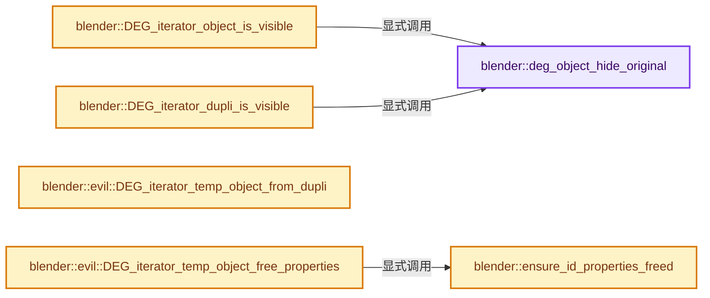
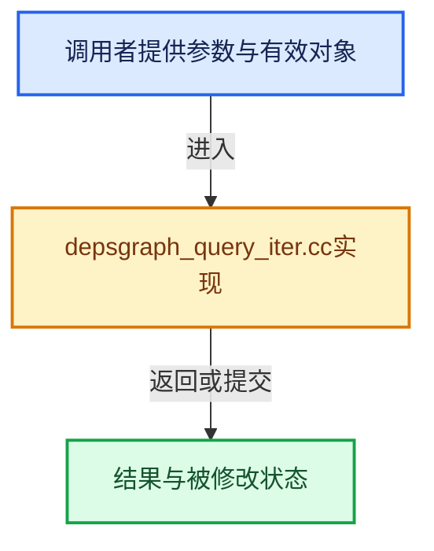

# 实现依赖专题：source/blender/depsgraph/intern/depsgraph_query_iter.cc

[方向导航](README.md) · [符号索引](../%E7%AC%A6%E5%8F%B7%E4%BE%9D%E8%B5%96%E4%B8%8E%E5%AE%9E%E7%8E%B0%E7%B4%A2%E5%BC%95.md)

本专题从正文实际调用进入，集中保存共享实现。函数有稳定锚点，可从调用处直接跳到对应完整函数；递归与互相调用通过回链组织。

## 本文件的实现关系






## 完整成员与函数实现

<a id="f-17317cb4cd5a2e9e"></a>

### `blender::deg_object_hide_original`

实现位置：[source/blender/depsgraph/intern/depsgraph_query_iter.cc](../../../../../source/blender/depsgraph/intern/depsgraph_query_iter.cc) · L68—L89。

接口参数：

- `eEvaluationMode eval_mode`
- `const Object *ob`
- `const DupliObject *dob`

**教学注释版**

<!-- annotated:37779969698fd1 -->

```cpp
bool deg_object_hide_original(eEvaluationMode eval_mode, const Object *ob, const DupliObject *dob)
{
  /* Automatic hiding if this object is being instanced on verts/faces/frames
   * by its parent. Ideally this should not be needed, but due to the wrong
   * dependency direction in the data design there is no way to keep the object
   * visible otherwise. The better solution eventually would be for objects
   * to specify which object they instance, instead of through parenting.
   *
   * This function should not be used for meta-balls. They have custom visibility rules, as hiding
   * the base meta-ball will also hide all the other balls in the group. */
  if (eval_mode == DAG_EVAL_RENDER || dob) {
    const int hide_original_types = OB_DUPLIVERTS | OB_DUPLIFACES;

    if (!dob || !(dob->type & hide_original_types)) {
      if (ob->parent && (ob->parent->transflag & hide_original_types)) {
        return true;
      }
    }
  }

  return false;
}
```

<details>
<summary>核对原始源码：source/blender/depsgraph/intern/depsgraph_query_iter.cc · L68—L89</summary>

<!-- original:37779969698fd1:source/blender/depsgraph/intern/depsgraph_query_iter.cc:68:89 -->

```cpp
bool deg_object_hide_original(eEvaluationMode eval_mode, const Object *ob, const DupliObject *dob)
{
  /* Automatic hiding if this object is being instanced on verts/faces/frames
   * by its parent. Ideally this should not be needed, but due to the wrong
   * dependency direction in the data design there is no way to keep the object
   * visible otherwise. The better solution eventually would be for objects
   * to specify which object they instance, instead of through parenting.
   *
   * This function should not be used for meta-balls. They have custom visibility rules, as hiding
   * the base meta-ball will also hide all the other balls in the group. */
  if (eval_mode == DAG_EVAL_RENDER || dob) {
    const int hide_original_types = OB_DUPLIVERTS | OB_DUPLIFACES;

    if (!dob || !(dob->type & hide_original_types)) {
      if (ob->parent && (ob->parent->transflag & hide_original_types)) {
        return true;
      }
    }
  }

  return false;
}
```

</details>

**结果出口**

- `return true;`
- `return false;`

**继续追踪实现**

本实现没有需要继续展开的显式调用；检查返回表达式、对象转换和调用者前置条件。

<a id="f-af18dc835f5e17d1"></a>

### `blender::DEG_iterator_object_is_visible`

实现位置：[source/blender/depsgraph/intern/depsgraph_query_iter.cc](../../../../../source/blender/depsgraph/intern/depsgraph_query_iter.cc) · L466—L472。

接口参数：

- `eEvaluationMode eval_mode`
- `const Object *ob`

**教学注释版**

<!-- annotated:4cea309b0efb8f -->

```cpp
bool DEG_iterator_object_is_visible(eEvaluationMode eval_mode, const Object *ob)
{
  if (ob->type == OB_MBALL) {
    return true;
  }
  return !deg_object_hide_original(eval_mode, ob, nullptr);
}
```

<details>
<summary>核对原始源码：source/blender/depsgraph/intern/depsgraph_query_iter.cc · L466—L472</summary>

<!-- original:4cea309b0efb8f:source/blender/depsgraph/intern/depsgraph_query_iter.cc:466:472 -->

```cpp
bool DEG_iterator_object_is_visible(eEvaluationMode eval_mode, const Object *ob)
{
  if (ob->type == OB_MBALL) {
    return true;
  }
  return !deg_object_hide_original(eval_mode, ob, nullptr);
}
```

</details>

**结果出口**

- `return true;`
- `return !deg_object_hide_original(eval_mode, ob, nullptr);`

**继续追踪实现**

- `deg_object_hide_original` → [blender::deg_object_hide_original · L68](%E4%BE%9D%E8%B5%96-depsgraph_query_iter-272e1a.md#f-17317cb4cd5a2e9e)。

<a id="f-34b9bff24fc7aed6"></a>

### `blender::DEG_iterator_dupli_is_visible`

实现位置：[source/blender/depsgraph/intern/depsgraph_query_iter.cc](../../../../../source/blender/depsgraph/intern/depsgraph_query_iter.cc) · L474—L487。

接口参数：

- `const DupliObject *dupli`
- `eEvaluationMode eval_mode`

**教学注释版**

<!-- annotated:ef55abcdf5667f -->

```cpp
bool DEG_iterator_dupli_is_visible(const DupliObject *dupli, eEvaluationMode eval_mode)
{
  if (dupli->no_draw) {
    return false;
  }
  if (dupli->ob_data && GS(dupli->ob_data->name) == ID_MB) {
    return false;
  }
  if (dupli->ob->type != OB_MBALL && deg_object_hide_original(eval_mode, dupli->ob, dupli)) {
    return false;
  }

  return true;
}
```

<details>
<summary>核对原始源码：source/blender/depsgraph/intern/depsgraph_query_iter.cc · L474—L487</summary>

<!-- original:ef55abcdf5667f:source/blender/depsgraph/intern/depsgraph_query_iter.cc:474:487 -->

```cpp
bool DEG_iterator_dupli_is_visible(const DupliObject *dupli, eEvaluationMode eval_mode)
{
  if (dupli->no_draw) {
    return false;
  }
  if (dupli->ob_data && GS(dupli->ob_data->name) == ID_MB) {
    return false;
  }
  if (dupli->ob->type != OB_MBALL && deg_object_hide_original(eval_mode, dupli->ob, dupli)) {
    return false;
  }

  return true;
}
```

</details>

**结果出口**

- `return false;`
- `return true;`

**继续追踪实现**

- `GS` → [blender::GS · L410](../05-%E5%87%A0%E4%BD%95%E5%AD%98%E5%82%A8%E4%B8%8E%E6%8B%93%E6%89%91%E6%98%A0%E5%B0%84/%E4%BE%9D%E8%B5%96-DNA_ID-3eb091.md#f-c3ff509f79f21b05)。
- `deg_object_hide_original` → [blender::deg_object_hide_original · L68](%E4%BE%9D%E8%B5%96-depsgraph_query_iter-272e1a.md#f-17317cb4cd5a2e9e)。

<a id="f-75b9c8e3e348ca1e"></a>

### `blender::evil::DEG_iterator_temp_object_from_dupli`

实现位置：[source/blender/depsgraph/intern/depsgraph_query_iter.cc](../../../../../source/blender/depsgraph/intern/depsgraph_query_iter.cc) · L489—L534。

接口参数：

- `const Object *dupli_parent`
- `const DupliObject *dupli`
- `eEvaluationMode eval_mode`
- `bool do_matrix_setup`
- `Object *r_temp_object`
- `bke::ObjectRuntime *r_temp_runtime`

**教学注释版**

<!-- annotated:cf73b5aac70bba -->

```cpp
bool evil::DEG_iterator_temp_object_from_dupli(const Object *dupli_parent,
                                               const DupliObject *dupli,
                                               eEvaluationMode eval_mode,
                                               bool do_matrix_setup,
                                               Object *r_temp_object,
                                               bke::ObjectRuntime *r_temp_runtime)
{
  *r_temp_object = dna::shallow_copy(*dupli->ob);
  r_temp_object->runtime = r_temp_runtime;
  *r_temp_object->runtime = *dupli->ob->runtime;

  r_temp_object->base_flag = dupli_parent->base_flag | BASE_FROM_DUPLI;
  r_temp_object->base_local_view_bits = dupli_parent->base_local_view_bits;
  r_temp_object->runtime->local_collections_bits = dupli_parent->runtime->local_collections_bits;
  // [讲解] std::min：按比较关系选取较小值；截断范围时还需先满足非负和可表示范围，min本身不会证明边界安全。
  r_temp_object->dt = std::min(r_temp_object->dt, dupli_parent->dt);
  copy_v4_v4(r_temp_object->color, dupli_parent->color);
  r_temp_object->runtime->select_id = dupli_parent->runtime->select_id;
  if (dupli->ob->data != dupli->ob_data) {
    BKE_object_replace_data_on_shallow_copy(r_temp_object, dupli->ob_data);
  }

  /* Duplicated elements shouldn't care whether their original collection is visible or not. */
  r_temp_object->base_flag |= BASE_ENABLED_AND_MAYBE_VISIBLE_IN_VIEWPORT;

  /* TODO: Could this be computed in DEG_iterator_dupli_is_visible,
   * before setting up the shallow copy?  */
  int ob_visibility = BKE_object_visibility(r_temp_object, eval_mode);
  if ((ob_visibility & (OB_VISIBLE_SELF | OB_VISIBLE_PARTICLES)) == 0) {
    return false;
  }

  if (do_matrix_setup) {
    /* This could be avoided by refactoring make_dupli() in order to track all negative scaling
     * recursively. */
    bool is_neg_scale = is_negative_m4(dupli->mat);
    SET_FLAG_FROM_TEST(r_temp_object->transflag, is_neg_scale, OB_NEG_SCALE);

    copy_m4_m4(r_temp_object->runtime->object_to_world.ptr(), dupli->mat);
    invert_m4_m4(r_temp_object->runtime->world_to_object.ptr(),
                 r_temp_object->object_to_world().ptr());
  }

  BLI_assert(deg::deg_validate_eval_copy_datablock(&r_temp_object->id));

  return true;
}
```

<details>
<summary>核对原始源码：source/blender/depsgraph/intern/depsgraph_query_iter.cc · L489—L534</summary>

<!-- original:cf73b5aac70bba:source/blender/depsgraph/intern/depsgraph_query_iter.cc:489:534 -->

```cpp
bool evil::DEG_iterator_temp_object_from_dupli(const Object *dupli_parent,
                                               const DupliObject *dupli,
                                               eEvaluationMode eval_mode,
                                               bool do_matrix_setup,
                                               Object *r_temp_object,
                                               bke::ObjectRuntime *r_temp_runtime)
{
  *r_temp_object = dna::shallow_copy(*dupli->ob);
  r_temp_object->runtime = r_temp_runtime;
  *r_temp_object->runtime = *dupli->ob->runtime;

  r_temp_object->base_flag = dupli_parent->base_flag | BASE_FROM_DUPLI;
  r_temp_object->base_local_view_bits = dupli_parent->base_local_view_bits;
  r_temp_object->runtime->local_collections_bits = dupli_parent->runtime->local_collections_bits;
  r_temp_object->dt = std::min(r_temp_object->dt, dupli_parent->dt);
  copy_v4_v4(r_temp_object->color, dupli_parent->color);
  r_temp_object->runtime->select_id = dupli_parent->runtime->select_id;
  if (dupli->ob->data != dupli->ob_data) {
    BKE_object_replace_data_on_shallow_copy(r_temp_object, dupli->ob_data);
  }

  /* Duplicated elements shouldn't care whether their original collection is visible or not. */
  r_temp_object->base_flag |= BASE_ENABLED_AND_MAYBE_VISIBLE_IN_VIEWPORT;

  /* TODO: Could this be computed in DEG_iterator_dupli_is_visible,
   * before setting up the shallow copy?  */
  int ob_visibility = BKE_object_visibility(r_temp_object, eval_mode);
  if ((ob_visibility & (OB_VISIBLE_SELF | OB_VISIBLE_PARTICLES)) == 0) {
    return false;
  }

  if (do_matrix_setup) {
    /* This could be avoided by refactoring make_dupli() in order to track all negative scaling
     * recursively. */
    bool is_neg_scale = is_negative_m4(dupli->mat);
    SET_FLAG_FROM_TEST(r_temp_object->transflag, is_neg_scale, OB_NEG_SCALE);

    copy_m4_m4(r_temp_object->runtime->object_to_world.ptr(), dupli->mat);
    invert_m4_m4(r_temp_object->runtime->world_to_object.ptr(),
                 r_temp_object->object_to_world().ptr());
  }

  BLI_assert(deg::deg_validate_eval_copy_datablock(&r_temp_object->id));

  return true;
}
```

</details>

**沿实际写入检查状态**

- `r_temp_object->runtime = r_temp_runtime;`
- `r_temp_object->base_flag = dupli_parent->base_flag | BASE_FROM_DUPLI;`
- `r_temp_object->base_local_view_bits = dupli_parent->base_local_view_bits;`
- `r_temp_object->runtime->local_collections_bits = dupli_parent->runtime->local_collections_bits;`
- `r_temp_object->dt = std::min(r_temp_object->dt, dupli_parent->dt);`
- `r_temp_object->runtime->select_id = dupli_parent->runtime->select_id;`
- `r_temp_object->base_flag |= BASE_ENABLED_AND_MAYBE_VISIBLE_IN_VIEWPORT;`

**结果出口**

- `return false;`
- `return true;`

**继续追踪实现**

- `dna::shallow_copy` → [blender::dna::shallow_copy · L146](../05-%E5%87%A0%E4%BD%95%E5%AD%98%E5%82%A8%E4%B8%8E%E6%8B%93%E6%89%91%E6%98%A0%E5%B0%84/%E4%BE%9D%E8%B5%96-DNA_defs-ed47fd.md#f-84b6eda95a1c994c)。
- `std::min` → [外部契约](https://eel.is/c++draft/alg.min.max)：按比较关系选取较小值；截断范围时还需先满足非负和可表示范围，min本身不会证明边界安全。
- `copy_v4_v4` → [blender::copy_v4_v4 · L54](../12-%E7%A9%BA%E9%97%B4%E6%95%B0%E6%8D%AE%E7%BB%93%E6%9E%84%E4%B8%8E%E5%87%A0%E4%BD%95%E7%AE%97%E6%B3%95/%E4%BE%9D%E8%B5%96-math_vector_inline-0c8541.md#f-0cf225fc326edf4a)。
- `BKE_object_replace_data_on_shallow_copy` → [blender::BKE_object_replace_data_on_shallow_copy · L5748](../05-%E5%87%A0%E4%BD%95%E5%AD%98%E5%82%A8%E4%B8%8E%E6%8B%93%E6%89%91%E6%98%A0%E5%B0%84/%E4%BE%9D%E8%B5%96-object-843689.md#f-6b828c6b95e6f2e2)。
- `BKE_object_visibility` → [blender::BKE_object_visibility · L2063](../05-%E5%87%A0%E4%BD%95%E5%AD%98%E5%82%A8%E4%B8%8E%E6%8B%93%E6%89%91%E6%98%A0%E5%B0%84/%E4%BE%9D%E8%B5%96-object-843689.md#f-097dd8f6158083c2)。
- `is_negative_m4` → [blender::is_negative_m4 · L2297](../12-%E7%A9%BA%E9%97%B4%E6%95%B0%E6%8D%AE%E7%BB%93%E6%9E%84%E4%B8%8E%E5%87%A0%E4%BD%95%E7%AE%97%E6%B3%95/%E4%BE%9D%E8%B5%96-math_matrix_c-004123.md#f-96d7f70cc2200141)。
- `SET_FLAG_FROM_TEST` → [SET_FLAG_FROM_TEST · L557](../01-%E5%9F%BA%E7%A1%80%E5%AE%B9%E5%99%A8%E4%B8%8E%E7%8E%B0%E4%BB%A3CPP/%E4%BE%9D%E8%B5%96-BLI_utildefines-293a0a.md#m-8e0dc83e01a8)。宏定义由构建条件选择。
- `copy_m4_m4` → [blender::copy_m4_m4 · L84](../12-%E7%A9%BA%E9%97%B4%E6%95%B0%E6%8D%AE%E7%BB%93%E6%9E%84%E4%B8%8E%E5%87%A0%E4%BD%95%E7%AE%97%E6%B3%95/%E4%BE%9D%E8%B5%96-math_matrix_c-004123.md#f-b4390cf8c94710f5)。
- `r_temp_object->runtime->object_to_world.ptr` → [调用协议](../%E6%A8%A1%E6%9D%BF%E5%AE%8F%E4%B8%8E%E5%8A%A8%E6%80%81%E5%88%86%E6%B4%BE%E5%8D%8F%E8%AE%AE.md)：接收对象类型依赖auto、返回值或模板实例；不按同名猜测目标。调用位置L526。
- `invert_m4_m4` → [blender::invert_m4_m4 · L1150](../12-%E7%A9%BA%E9%97%B4%E6%95%B0%E6%8D%AE%E7%BB%93%E6%9E%84%E4%B8%8E%E5%87%A0%E4%BD%95%E7%AE%97%E6%B3%95/%E4%BE%9D%E8%B5%96-math_matrix_c-004123.md#f-c75789f10cdd5b92)。
- `r_temp_object->runtime->world_to_object.ptr` → [调用协议](../%E6%A8%A1%E6%9D%BF%E5%AE%8F%E4%B8%8E%E5%8A%A8%E6%80%81%E5%88%86%E6%B4%BE%E5%8D%8F%E8%AE%AE.md)：接收对象类型依赖auto、返回值或模板实例；不按同名猜测目标。调用位置L527。
- `r_temp_object->object_to_world().ptr` → [调用协议](../%E6%A8%A1%E6%9D%BF%E5%AE%8F%E4%B8%8E%E5%8A%A8%E6%80%81%E5%88%86%E6%B4%BE%E5%8D%8F%E8%AE%AE.md)：接收对象类型依赖auto、返回值或模板实例；不按同名猜测目标。调用位置L528。
- `r_temp_object->object_to_world` → [blender::Object::object_to_world · L5761](../05-%E5%87%A0%E4%BD%95%E5%AD%98%E5%82%A8%E4%B8%8E%E6%8B%93%E6%89%91%E6%98%A0%E5%B0%84/%E4%BE%9D%E8%B5%96-object-843689.md#f-12fc20026327d50c)。
- `BLI_assert` → [BLI_assert · L48](../01-%E5%9F%BA%E7%A1%80%E5%AE%B9%E5%99%A8%E4%B8%8E%E7%8E%B0%E4%BB%A3CPP/%E4%BE%9D%E8%B5%96-BLI_assert-cc98e8.md#m-57a88495704d)；[BLI_assert · L63](../01-%E5%9F%BA%E7%A1%80%E5%AE%B9%E5%99%A8%E4%B8%8E%E7%8E%B0%E4%BB%A3CPP/%E4%BE%9D%E8%B5%96-BLI_assert-cc98e8.md#m-d07050020cb5)。宏定义由构建条件选择。
- `deg::deg_validate_eval_copy_datablock` → [blender::deg::deg_validate_eval_copy_datablock · L1017](%E4%BE%9D%E8%B5%96-deg_eval_copy_on_write-5fb7a2.md#f-7771cf469dcad16c)。

<a id="f-27889cd5a4d09456"></a>

### `blender::ensure_id_properties_freed`

实现位置：[source/blender/depsgraph/intern/depsgraph_query_iter.cc](../../../../../source/blender/depsgraph/intern/depsgraph_query_iter.cc) · L536—L550。

接口参数：

- `const IDProperty *dupli_idprops`
- `IDProperty **temp_dupli_idprops`

**教学注释版**

<!-- annotated:47ac81dbb9ebc8 -->

```cpp
static void ensure_id_properties_freed(const IDProperty *dupli_idprops,
                                       IDProperty **temp_dupli_idprops)
{
  if (*temp_dupli_idprops == nullptr) {
    /* No ID properties in temp data-block -- no leak is possible. */
    return;
  }
  if (*temp_dupli_idprops == dupli_idprops) {
    /* Temp copy of object did not modify ID properties. */
    return;
  }
  /* Free memory which is owned by temporary storage which is about to get overwritten. */
  IDP_FreeProperty(*temp_dupli_idprops);
  *temp_dupli_idprops = nullptr;
}
```

<details>
<summary>核对原始源码：source/blender/depsgraph/intern/depsgraph_query_iter.cc · L536—L550</summary>

<!-- original:47ac81dbb9ebc8:source/blender/depsgraph/intern/depsgraph_query_iter.cc:536:550 -->

```cpp
static void ensure_id_properties_freed(const IDProperty *dupli_idprops,
                                       IDProperty **temp_dupli_idprops)
{
  if (*temp_dupli_idprops == nullptr) {
    /* No ID properties in temp data-block -- no leak is possible. */
    return;
  }
  if (*temp_dupli_idprops == dupli_idprops) {
    /* Temp copy of object did not modify ID properties. */
    return;
  }
  /* Free memory which is owned by temporary storage which is about to get overwritten. */
  IDP_FreeProperty(*temp_dupli_idprops);
  *temp_dupli_idprops = nullptr;
}
```

</details>

**继续追踪实现**

- `IDP_FreeProperty` → [blender::IDP_FreeProperty · L1403](../05-%E5%87%A0%E4%BD%95%E5%AD%98%E5%82%A8%E4%B8%8E%E6%8B%93%E6%89%91%E6%98%A0%E5%B0%84/%E4%BE%9D%E8%B5%96-idprop-006c65.md#f-389134a630df1bed)。

<a id="f-0d3836722a9d42d0"></a>

### `blender::evil::DEG_iterator_temp_object_free_properties`

实现位置：[source/blender/depsgraph/intern/depsgraph_query_iter.cc](../../../../../source/blender/depsgraph/intern/depsgraph_query_iter.cc) · L552—L556。

接口参数：

- `const DupliObject *dupli`
- `Object *temp_object`

**教学注释版**

<!-- annotated:8f0c56ebb7ee6c -->

```cpp
void evil::DEG_iterator_temp_object_free_properties(const DupliObject *dupli, Object *temp_object)
{
  ensure_id_properties_freed(dupli->ob->id.properties, &temp_object->id.properties);
  ensure_id_properties_freed(dupli->ob->id.system_properties, &temp_object->id.system_properties);
}
```

<details>
<summary>核对原始源码：source/blender/depsgraph/intern/depsgraph_query_iter.cc · L552—L556</summary>

<!-- original:8f0c56ebb7ee6c:source/blender/depsgraph/intern/depsgraph_query_iter.cc:552:556 -->

```cpp
void evil::DEG_iterator_temp_object_free_properties(const DupliObject *dupli, Object *temp_object)
{
  ensure_id_properties_freed(dupli->ob->id.properties, &temp_object->id.properties);
  ensure_id_properties_freed(dupli->ob->id.system_properties, &temp_object->id.system_properties);
}
```

</details>

**继续追踪实现**

- `ensure_id_properties_freed` → [blender::ensure_id_properties_freed · L536](%E4%BE%9D%E8%B5%96-depsgraph_query_iter-272e1a.md#f-27889cd5a4d09456)。
