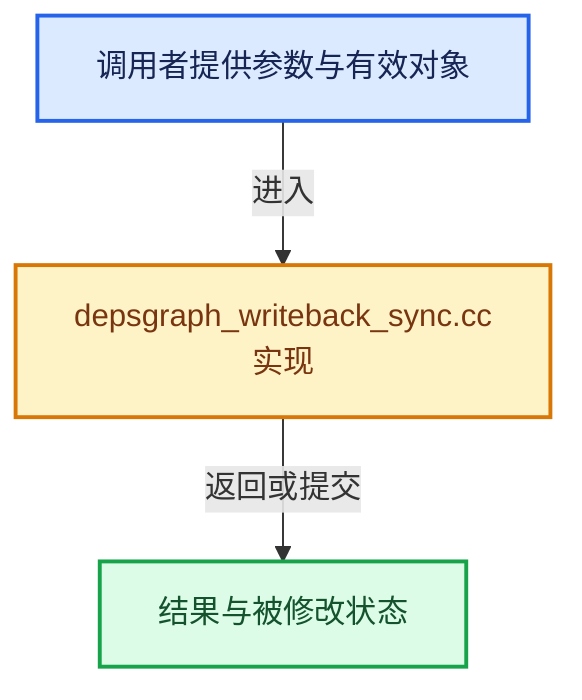

# 实现依赖专题：source/blender/depsgraph/intern/depsgraph_writeback_sync.cc

[方向导航](README.md) · [符号索引](../%E7%AC%A6%E5%8F%B7%E4%BE%9D%E8%B5%96%E4%B8%8E%E5%AE%9E%E7%8E%B0%E7%B4%A2%E5%BC%95.md)

本专题从正文实际调用进入，集中保存共享实现。函数有稳定锚点，可从调用处直接跳到对应完整函数；递归与互相调用通过回链组织。

## 本文件的实现关系





## 完整成员与函数实现

<a id="f-25f4b39d45b66a5a"></a>

### `blender::deg::sync_writeback::add`

实现位置：[source/blender/depsgraph/intern/depsgraph_writeback_sync.cc](../../../../../source/blender/depsgraph/intern/depsgraph_writeback_sync.cc) · L18—L27。

接口参数：

- `blender::Depsgraph &depsgraph`
- `std::function<void()> fn`

**教学注释版**

<!-- annotated:b57b1ad662ad4d -->

```cpp
void add(blender::Depsgraph &depsgraph, std::function<void()> fn)
{
  deg::Depsgraph &deg_graph = reinterpret_cast<deg::Depsgraph &>(depsgraph);
  if (!deg_graph.is_active || deg_graph.sync_writeback == DEG_EVALUATE_SYNC_WRITEBACK_NO) {
    return;
  }

  std::lock_guard lock{deg_graph.sync_writeback_callbacks_mutex};
  // [讲解] std::move：把表达式转换成可供移动重载选择的值类别；不保证真的移动，不结束源对象寿命，对const值可能选择复制。
  deg_graph.sync_writeback_callbacks.append(std::move(fn));
}
```

<details>
<summary>核对原始源码：source/blender/depsgraph/intern/depsgraph_writeback_sync.cc · L18—L27</summary>

<!-- original:b57b1ad662ad4d:source/blender/depsgraph/intern/depsgraph_writeback_sync.cc:18:27 -->

```cpp
void add(blender::Depsgraph &depsgraph, std::function<void()> fn)
{
  deg::Depsgraph &deg_graph = reinterpret_cast<deg::Depsgraph &>(depsgraph);
  if (!deg_graph.is_active || deg_graph.sync_writeback == DEG_EVALUATE_SYNC_WRITEBACK_NO) {
    return;
  }

  std::lock_guard lock{deg_graph.sync_writeback_callbacks_mutex};
  deg_graph.sync_writeback_callbacks.append(std::move(fn));
}
```

</details>

**继续追踪实现**

- `deg_graph.sync_writeback_callbacks.append` → [调用协议](../%E6%A8%A1%E6%9D%BF%E5%AE%8F%E4%B8%8E%E5%8A%A8%E6%80%81%E5%88%86%E6%B4%BE%E5%8D%8F%E8%AE%AE.md)：接收对象类型依赖auto、返回值或模板实例；不按同名猜测目标。调用位置L26。
- `std::move` → [外部契约](https://eel.is/c++draft/utility.forward)：把表达式转换成可供移动重载选择的值类别；不保证真的移动，不结束源对象寿命，对const值可能选择复制。
