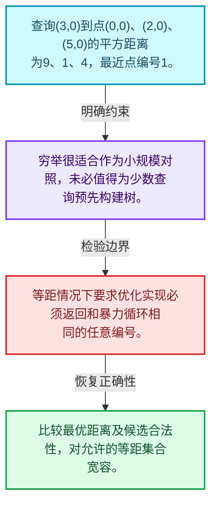
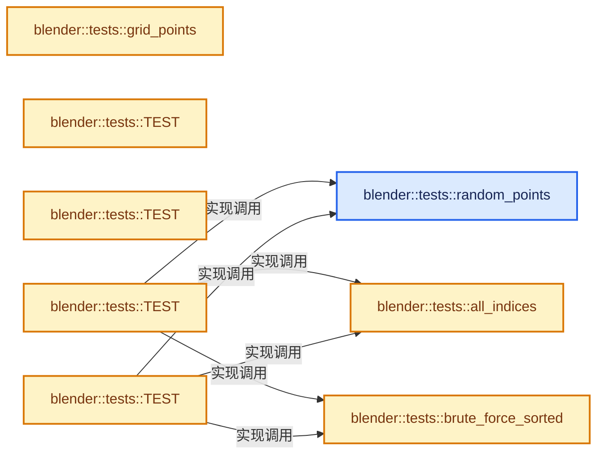
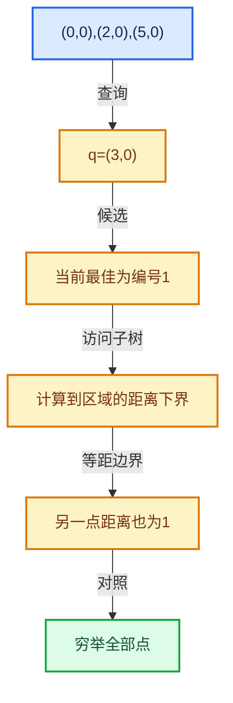

# 12-01 空间查询与暴力基准

[方向导航](README.md) · [总目录](../README.md) · [实现索引](../00-课程指南/02-源码与提交索引/符号依赖与实现索引.md)

## 从问题到实现

如何证明优化查询返回正确结果？

先用穷举距离建立可信对照；等距结果可能不唯一，验证距离和合法集合比固定某个编号更稳健。

**数据模型**

查询(3,0)到点(0,0)、(2,0)、(5,0)的平方距离为9、1、4，最近点编号1。

**设计取舍**

穷举很适合作为小规模对照，未必值得为少数查询预先构建树。

**最小反例**

等距情况下要求优化实现必须返回和暴力循环相同的任意编号。

**推导**

比较最优距离及候选合法性，对允许的等距集合宽容。

## 阅读地图与执行推演








图中的数值推演是本方向的教学模型；实际函数之间的调用边与概念分析边分别标注，不能把概念关系当作运行时调度顺序。

## 完整源码单元与就地讲解

中文讲解直接放在相关代码旁，复杂机制在代码下展开。原文折叠区保留基准行号；不需要在行号表和函数之间来回查找。类布局可分段展示，函数实现不按固定行数切开。

### 类型布局、声明与编译条件 · BLI_kdtree_test.cc L1—L23

<!-- annotated:94a8987e5bb152 -->

```cpp
/* SPDX-FileCopyrightText: 2026 Blender Authors
 *
 * SPDX-License-Identifier: Apache-2.0 */

#include <algorithm>
#include <string>

#include "testing/testing.h"

#include "BLI_array.hh"
#include "BLI_array_utils.hh"
#include "BLI_index_mask.hh"
#include "BLI_kdtree_new.hh"
#include "BLI_math_vector.hh"
#include "BLI_rand.hh"
#include "BLI_task_c.hh"
#include "BLI_threads.hh"
#include "BLI_vector.hh"

namespace blender::tests {

using Nearest = KDTreeNew<float3>::Nearest;

```

<details>
<summary>核对原始源码：source/blender/blenlib/tests/BLI_kdtree_test.cc · L1—L23</summary>

<!-- original:94a8987e5bb152:source/blender/blenlib/tests/BLI_kdtree_test.cc:1:23 -->

```cpp
/* SPDX-FileCopyrightText: 2026 Blender Authors
 *
 * SPDX-License-Identifier: Apache-2.0 */

#include <algorithm>
#include <string>

#include "testing/testing.h"

#include "BLI_array.hh"
#include "BLI_array_utils.hh"
#include "BLI_index_mask.hh"
#include "BLI_kdtree_new.hh"
#include "BLI_math_vector.hh"
#include "BLI_rand.hh"
#include "BLI_task_c.hh"
#include "BLI_threads.hh"
#include "BLI_vector.hh"

namespace blender::tests {

using Nearest = KDTreeNew<float3>::Nearest;

```

</details>

<a id="f-2c5734675ae060dd"></a>

### `blender::tests::random_points`

实现位置：[source/blender/blenlib/tests/BLI_kdtree_test.cc](../../../../../source/blender/blenlib/tests/BLI_kdtree_test.cc) · L24—L32。

接口参数：

- `const int points_num`
- `const int seed = 0`

**教学注释版**

<!-- annotated:b65a8dc5d33894 -->

```cpp
static Array<float3> random_points(const int points_num, const int seed = 0)
{
  RandomNumberGenerator random(seed);
  Array<float3> positions(points_num);
  // [讲解] positions.index_range：查询固定有效长度及其索引范围。
  for (const int i : positions.index_range()) {
    positions[i] = float3(random.get_float(), random.get_float(), random.get_float());
  }
  return positions;
}
```

<details>
<summary>核对原始源码：source/blender/blenlib/tests/BLI_kdtree_test.cc · L24—L32</summary>

<!-- original:b65a8dc5d33894:source/blender/blenlib/tests/BLI_kdtree_test.cc:24:32 -->

```cpp
static Array<float3> random_points(const int points_num, const int seed = 0)
{
  RandomNumberGenerator random(seed);
  Array<float3> positions(points_num);
  for (const int i : positions.index_range()) {
    positions[i] = float3(random.get_float(), random.get_float(), random.get_float());
  }
  return positions;
}
```

</details>

**沿实际写入检查状态**

- `positions[i] = float3(random.get_float(), random.get_float(), random.get_float());`

**结果出口**

- `return positions;`

**继续追踪实现**

- `positions.index_range` → [blender::Array::index_range · L371](../01-基础容器与现代CPP/08-Array复制移动与销毁.md#f-50a09e14742887a0)。
- `float3` → [float3 · L641](../90-实现依赖专题/08-其他Blender模块/compositor/algorithms/intern/smaa.cc.md#m-0ea8254cfdb4)。宏定义由构建条件选择。
- `random.get_float` → [blender::RandomNumberGenerator::get_float · L83](../90-实现依赖专题/01-BLI基础库/BLI_rand.hh.md#f-c43dc1f759b49ddb)。

### 类型布局、声明与编译条件 · BLI_kdtree_test.cc L33—L34

<!-- annotated:de6a6ddce2c76e -->

```cpp

/** Reference implementation used to check the results of the tree. */
```

<details>
<summary>核对原始源码：source/blender/blenlib/tests/BLI_kdtree_test.cc · L33—L34</summary>

<!-- original:de6a6ddce2c76e:source/blender/blenlib/tests/BLI_kdtree_test.cc:33:34 -->

```cpp

/** Reference implementation used to check the results of the tree. */
```

</details>

<a id="f-cb31096772913d3b"></a>

### `blender::tests::brute_force_sorted`

实现位置：[source/blender/blenlib/tests/BLI_kdtree_test.cc](../../../../../source/blender/blenlib/tests/BLI_kdtree_test.cc) · L35—L47。

接口参数：

- `const Span<float3> positions`
- `const Span<int> indices`
- `const float3 &position`

**教学注释版**

<!-- annotated:e97631e7212e52 -->

```cpp
static Vector<Nearest> brute_force_sorted(const Span<float3> positions,
                                          const Span<int> indices,
                                          const float3 &position)
{
  Vector<Nearest> result;
  for (const int i : indices) {
    // [讲解] result.append：在尾部建立新元素，必要时先扩大存储。
    result.append({i, math::distance_squared(positions[i], position)});
  }
  std::ranges::sort(result, [](const Nearest &a, const Nearest &b) {
    return a.distance_sq < b.distance_sq || (a.distance_sq == b.distance_sq && a.index < b.index);
  });
  return result;
}
```

<details>
<summary>核对原始源码：source/blender/blenlib/tests/BLI_kdtree_test.cc · L35—L47</summary>

<!-- original:e97631e7212e52:source/blender/blenlib/tests/BLI_kdtree_test.cc:35:47 -->

```cpp
static Vector<Nearest> brute_force_sorted(const Span<float3> positions,
                                          const Span<int> indices,
                                          const float3 &position)
{
  Vector<Nearest> result;
  for (const int i : indices) {
    result.append({i, math::distance_squared(positions[i], position)});
  }
  std::ranges::sort(result, [](const Nearest &a, const Nearest &b) {
    return a.distance_sq < b.distance_sq || (a.distance_sq == b.distance_sq && a.index < b.index);
  });
  return result;
}
```

</details>

**结果出口**

- `return a.distance_sq < b.distance_sq || (a.distance_sq == b.distance_sq && a.index < b.index);`
- `return result;`

**继续追踪实现**

- `result.append` → [blender::Vector::append · L498](../01-基础容器与现代CPP/11-Vector插入删除与重排.md#f-5bde268a69e443ec)；[blender::Vector::append · L502](../01-基础容器与现代CPP/11-Vector插入删除与重排.md#f-591e0b15e6308532)。同名重载需按实参类型选择。
- `math::distance_squared` → [blender::math::distance_squared · L479](../90-实现依赖专题/01-BLI基础库/BLI_math_vector.hh.md#f-b39a28ba63f85e71)。
- `std::ranges::sort` → [外部契约](https://eel.is/c++draft/)：这个边界按实际表达式及所属类型核对参数、返回值、寿命与失败行为。这里提供接口入口，不声称已解释该第三方版本的内部实现。

### 类型布局、声明与编译条件 · BLI_kdtree_test.cc L48—L49

<!-- annotated:dd02b9001ff334 -->

```cpp

/** A grid of unit spaced points, so that distances land exactly on whole numbers. */
```

<details>
<summary>核对原始源码：source/blender/blenlib/tests/BLI_kdtree_test.cc · L48—L49</summary>

<!-- original:dd02b9001ff334:source/blender/blenlib/tests/BLI_kdtree_test.cc:48:49 -->

```cpp

/** A grid of unit spaced points, so that distances land exactly on whole numbers. */
```

</details>

<a id="f-485cde1e1f051273"></a>

### `blender::tests::grid_points`

实现位置：[source/blender/blenlib/tests/BLI_kdtree_test.cc](../../../../../source/blender/blenlib/tests/BLI_kdtree_test.cc) · L50—L62。

接口参数：

- `const int side`

**教学注释版**

<!-- annotated:8578fd2ce6a20f -->

```cpp
static Array<float3> grid_points(const int side)
{
  Array<float3> positions(side * side * side);
  int i = 0;
  for (const int x : IndexRange(side)) {
    for (const int y : IndexRange(side)) {
      for (const int z : IndexRange(side)) {
        positions[i++] = float3(float(x), float(y), float(z));
      }
    }
  }
  return positions;
}
```

<details>
<summary>核对原始源码：source/blender/blenlib/tests/BLI_kdtree_test.cc · L50—L62</summary>

<!-- original:8578fd2ce6a20f:source/blender/blenlib/tests/BLI_kdtree_test.cc:50:62 -->

```cpp
static Array<float3> grid_points(const int side)
{
  Array<float3> positions(side * side * side);
  int i = 0;
  for (const int x : IndexRange(side)) {
    for (const int y : IndexRange(side)) {
      for (const int z : IndexRange(side)) {
        positions[i++] = float3(float(x), float(y), float(z));
      }
    }
  }
  return positions;
}
```

</details>

**结果出口**

- `return positions;`

**继续追踪实现**

- `IndexRange` → [blender::IndexRange](../90-实现依赖专题/01-BLI基础库/BLI_index_range.hh.md#t-caa3466d6776)；[blender::gpu::shader::parser::IndexRange](../90-实现依赖专题/08-其他Blender模块/gpu/shader_tool/utils.hh.md#t-82d2bd4ea71c)；[blender::IndexRange](../90-实现依赖专题/08-其他Blender模块/makesdna/DNA_node_types.h.md#t-0448cc889d39)。
- `float3` → [float3 · L641](../90-实现依赖专题/08-其他Blender模块/compositor/algorithms/intern/smaa.cc.md#m-0ea8254cfdb4)。宏定义由构建条件选择。

<!-- annotated:94473a040f2246 -->

```cpp

```

<details>
<summary>核对原始源码：source/blender/blenlib/tests/BLI_kdtree_test.cc · L63—L63</summary>

<!-- original:94473a040f2246:source/blender/blenlib/tests/BLI_kdtree_test.cc:63:63 -->

```cpp

```

</details>

<a id="f-73628d17e2e9c4fc"></a>

### `blender::tests::all_indices`

实现位置：[source/blender/blenlib/tests/BLI_kdtree_test.cc](../../../../../source/blender/blenlib/tests/BLI_kdtree_test.cc) · L64—L69。

接口参数：

- `const int points_num`

**教学注释版**

<!-- annotated:f8c261c8d0a0eb -->

```cpp
static Vector<int> all_indices(const int points_num)
{
  Vector<int> indices(points_num);
  // [讲解] indices.as_mutable_span：构造对当前有效元素区间的借用视图。
  array_utils::fill_index_range(indices.as_mutable_span());
  return indices;
}
```

<details>
<summary>核对原始源码：source/blender/blenlib/tests/BLI_kdtree_test.cc · L64—L69</summary>

<!-- original:f8c261c8d0a0eb:source/blender/blenlib/tests/BLI_kdtree_test.cc:64:69 -->

```cpp
static Vector<int> all_indices(const int points_num)
{
  Vector<int> indices(points_num);
  array_utils::fill_index_range(indices.as_mutable_span());
  return indices;
}
```

</details>

**结果出口**

- `return indices;`

**继续追踪实现**

- `array_utils::fill_index_range` → [blender::array_utils::fill_index_range · L434](../05-几何存储与拓扑映射/07-分组访问与反向索引.md#f-f8128b104d76df0f)；[blender::array_utils::fill_index_range · L439](../05-几何存储与拓扑映射/07-分组访问与反向索引.md#f-95ca84458bfc7e7e)；[blender::array_utils::fill_index_range · L445](../05-几何存储与拓扑映射/07-分组访问与反向索引.md#f-c11b114c213cd61a)。同名重载需按实参类型选择。
- `indices.as_mutable_span` → [blender::Vector::as_mutable_span · L395](../01-基础容器与现代CPP/10-Vector扩容与增长.md#f-98b7994c0b2e3bae)。

<!-- annotated:0c3258ce0aecc6 -->

```cpp

```

<details>
<summary>核对原始源码：source/blender/blenlib/tests/BLI_kdtree_test.cc · L70—L70</summary>

<!-- original:0c3258ce0aecc6:source/blender/blenlib/tests/BLI_kdtree_test.cc:70:70 -->

```cpp

```

</details>

<a id="f-0597ebf92ff15050"></a>

### `blender::tests::TEST`

实现位置：[source/blender/blenlib/tests/BLI_kdtree_test.cc](../../../../../source/blender/blenlib/tests/BLI_kdtree_test.cc) · L71—L85。

接口参数：

- `kdtree`
- `Empty`

**教学注释版**

<!-- annotated:28b4a55f6c9c87 -->

```cpp
TEST(kdtree, Empty)
{
  const Array<float3> positions(0);
  const KDTreeNew<float3> tree(positions);
  EXPECT_TRUE(tree.is_empty());
  EXPECT_EQ(tree.size(), 0);
  // [讲解] tree.find_nearest：在空间界限约束下寻找满足条件的点。
  EXPECT_EQ(tree.find_nearest(float3(0.0f)), -1);
  EXPECT_EQ(tree.count_in_radius(float3(0.0f), 100.0f), 0);

  Array<Nearest> nearest(4);
  // [讲解] tree.find_nearest_n：收集半径内或最近K个合法候选。
  EXPECT_EQ(tree.find_nearest_n(float3(0.0f), nearest), 0);

  Vector<Nearest> in_radius;
  EXPECT_EQ(tree.find_in_radius(float3(0.0f), 100.0f, in_radius), 0);
}
```

<details>
<summary>核对原始源码：source/blender/blenlib/tests/BLI_kdtree_test.cc · L71—L85</summary>

<!-- original:28b4a55f6c9c87:source/blender/blenlib/tests/BLI_kdtree_test.cc:71:85 -->

```cpp
TEST(kdtree, Empty)
{
  const Array<float3> positions(0);
  const KDTreeNew<float3> tree(positions);
  EXPECT_TRUE(tree.is_empty());
  EXPECT_EQ(tree.size(), 0);
  EXPECT_EQ(tree.find_nearest(float3(0.0f)), -1);
  EXPECT_EQ(tree.count_in_radius(float3(0.0f), 100.0f), 0);

  Array<Nearest> nearest(4);
  EXPECT_EQ(tree.find_nearest_n(float3(0.0f), nearest), 0);

  Vector<Nearest> in_radius;
  EXPECT_EQ(tree.find_in_radius(float3(0.0f), 100.0f, in_radius), 0);
}
```

</details>

**继续追踪实现**

- `EXPECT_TRUE` → [EXPECT_TRUE · L198](../90-实现依赖专题/08-其他Blender模块/gpu/shaders/common/gpu_shader_test_lib.bsl.hh.md#m-799c1e4a74c0)。宏定义由构建条件选择。
- `tree.is_empty` → [blender::KDTreeNew<T>::is_empty · L498](05-K近邻与范围查询.md#f-67f0ff91cf00b00b)。
- `EXPECT_EQ` → [EXPECT_EQ · L23](../90-实现依赖专题/07-Intern运行时与平台/cycles/test/util_half_test.h.md#m-171ffd5d7770)；[EXPECT_EQ · L191](../90-实现依赖专题/08-其他Blender模块/gpu/shaders/common/gpu_shader_test_lib.bsl.hh.md#m-b4a6a76e53eb)。宏定义由构建条件选择。
- `tree.size` → [blender::KDTreeNew<T>::size · L493](05-K近邻与范围查询.md#f-233c05ce6d5c8d39)。
- `tree.find_nearest` → [blender::KDTreeNew<T>::find_nearest · L513](05-K近邻与范围查询.md#f-2ae1c56f5d4ecf10)。
- `float3` → [float3 · L641](../90-实现依赖专题/08-其他Blender模块/compositor/algorithms/intern/smaa.cc.md#m-0ea8254cfdb4)。宏定义由构建条件选择。
- `tree.count_in_radius` → [blender::KDTreeNew<T>::count_in_radius · L583](06-筛选与子集查询.md#f-25d4ccffbc06de2d)。
- `tree.find_nearest_n` → [blender::KDTreeNew<T>::find_nearest_n · L546](06-筛选与子集查询.md#f-72a182470129c15b)。
- `tree.find_in_radius` → [blender::KDTreeNew<T>::find_in_radius · L568](06-筛选与子集查询.md#f-acec42217fb9ad11)。

<!-- annotated:1b9974d8a0492b -->

```cpp

```

<details>
<summary>核对原始源码：source/blender/blenlib/tests/BLI_kdtree_test.cc · L86—L86</summary>

<!-- original:1b9974d8a0492b:source/blender/blenlib/tests/BLI_kdtree_test.cc:86:86 -->

```cpp

```

</details>

<a id="f-e18b60d586e593cb"></a>

### `blender::tests::TEST`

实现位置：[source/blender/blenlib/tests/BLI_kdtree_test.cc](../../../../../source/blender/blenlib/tests/BLI_kdtree_test.cc) · L87—L100。

接口参数：

- `kdtree`
- `SinglePoint`

**教学注释版**

<!-- annotated:d0f7dfa759f260 -->

```cpp
TEST(kdtree, SinglePoint)
{
  const Array<float3> positions = {float3(1.0f, 2.0f, 3.0f)};
  const KDTreeNew<float3> tree(positions);
  EXPECT_EQ(tree.size(), 1);

  float distance_sq = -1.0f;
  // [讲解] tree.find_nearest：在空间界限约束下寻找满足条件的点。
  EXPECT_EQ(tree.find_nearest(float3(1.0f, 2.0f, 4.0f), &distance_sq), 0);
  EXPECT_FLOAT_EQ(distance_sq, 1.0f);

  /* The only point is filtered out. */
  // [讲解] tree.find_nearest_filtered：在空间界限约束下寻找满足条件的点。
  EXPECT_EQ(tree.find_nearest_filtered(float3(0.0f), [](const int /*index*/) { return false; }),
            -1);
}
```

<details>
<summary>核对原始源码：source/blender/blenlib/tests/BLI_kdtree_test.cc · L87—L100</summary>

<!-- original:d0f7dfa759f260:source/blender/blenlib/tests/BLI_kdtree_test.cc:87:100 -->

```cpp
TEST(kdtree, SinglePoint)
{
  const Array<float3> positions = {float3(1.0f, 2.0f, 3.0f)};
  const KDTreeNew<float3> tree(positions);
  EXPECT_EQ(tree.size(), 1);

  float distance_sq = -1.0f;
  EXPECT_EQ(tree.find_nearest(float3(1.0f, 2.0f, 4.0f), &distance_sq), 0);
  EXPECT_FLOAT_EQ(distance_sq, 1.0f);

  /* The only point is filtered out. */
  EXPECT_EQ(tree.find_nearest_filtered(float3(0.0f), [](const int /*index*/) { return false; }),
            -1);
}
```

</details>

**继续追踪实现**

- `float3` → [float3 · L641](../90-实现依赖专题/08-其他Blender模块/compositor/algorithms/intern/smaa.cc.md#m-0ea8254cfdb4)。宏定义由构建条件选择。
- `EXPECT_EQ` → [EXPECT_EQ · L23](../90-实现依赖专题/07-Intern运行时与平台/cycles/test/util_half_test.h.md#m-171ffd5d7770)；[EXPECT_EQ · L191](../90-实现依赖专题/08-其他Blender模块/gpu/shaders/common/gpu_shader_test_lib.bsl.hh.md#m-b4a6a76e53eb)。宏定义由构建条件选择。
- `tree.size` → [blender::KDTreeNew<T>::size · L493](05-K近邻与范围查询.md#f-233c05ce6d5c8d39)。
- `tree.find_nearest` → [blender::KDTreeNew<T>::find_nearest · L513](05-K近邻与范围查询.md#f-2ae1c56f5d4ecf10)。
- `EXPECT_FLOAT_EQ` → [调用协议](../00-课程指南/01-路线与规范/模板宏与动态分派协议.md)：函数指针、局部可调用对象或未展开的宏；必须结合调用者环境。调用位置L95。
- `tree.find_nearest_filtered` → [blender::KDTreeNew<T>::find_nearest_filtered · L528](05-K近邻与范围查询.md#f-bfd0ae665ae44a28)。

<!-- annotated:f3583791f30fdf -->

```cpp

```

<details>
<summary>核对原始源码：source/blender/blenlib/tests/BLI_kdtree_test.cc · L101—L101</summary>

<!-- original:f3583791f30fdf:source/blender/blenlib/tests/BLI_kdtree_test.cc:101:101 -->

```cpp

```

</details>

<a id="f-60aba2850c904037"></a>

### `blender::tests::TEST`

实现位置：[source/blender/blenlib/tests/BLI_kdtree_test.cc](../../../../../source/blender/blenlib/tests/BLI_kdtree_test.cc) · L102—L117。

接口参数：

- `kdtree`
- `FindNearest`

**教学注释版**

<!-- annotated:c66064cdb078cb -->

```cpp
TEST(kdtree, FindNearest)
{
  const Array<float3> positions = random_points(1000);
  const KDTreeNew<float3> tree(positions);
  EXPECT_EQ(tree.size(), 1000);

  // [讲解] positions.size：查询固定有效长度及其索引范围。
  const Vector<int> indices = all_indices(positions.size());
  const Array<float3> queries = random_points(50, 1);
  for (const float3 &query : queries) {
    const Vector<Nearest> expected = brute_force_sorted(positions, indices, query);
    float distance_sq = -1.0f;
    // [讲解] tree.find_nearest：在空间界限约束下寻找满足条件的点。
    const int index = tree.find_nearest(query, &distance_sq);
    // [讲解] expected.first：访问有效范围首端或末端元素。
    EXPECT_EQ(index, expected.first().index);
    EXPECT_FLOAT_EQ(distance_sq, expected.first().distance_sq);
  }
}
```

<details>
<summary>核对原始源码：source/blender/blenlib/tests/BLI_kdtree_test.cc · L102—L117</summary>

<!-- original:c66064cdb078cb:source/blender/blenlib/tests/BLI_kdtree_test.cc:102:117 -->

```cpp
TEST(kdtree, FindNearest)
{
  const Array<float3> positions = random_points(1000);
  const KDTreeNew<float3> tree(positions);
  EXPECT_EQ(tree.size(), 1000);

  const Vector<int> indices = all_indices(positions.size());
  const Array<float3> queries = random_points(50, 1);
  for (const float3 &query : queries) {
    const Vector<Nearest> expected = brute_force_sorted(positions, indices, query);
    float distance_sq = -1.0f;
    const int index = tree.find_nearest(query, &distance_sq);
    EXPECT_EQ(index, expected.first().index);
    EXPECT_FLOAT_EQ(distance_sq, expected.first().distance_sq);
  }
}
```

</details>

**继续追踪实现**

- `random_points` → [blender::tests::random_points · L24](01-空间查询与暴力基准.md#f-2c5734675ae060dd)。
- `EXPECT_EQ` → [EXPECT_EQ · L23](../90-实现依赖专题/07-Intern运行时与平台/cycles/test/util_half_test.h.md#m-171ffd5d7770)；[EXPECT_EQ · L191](../90-实现依赖专题/08-其他Blender模块/gpu/shaders/common/gpu_shader_test_lib.bsl.hh.md#m-b4a6a76e53eb)。宏定义由构建条件选择。
- `tree.size` → [blender::KDTreeNew<T>::size · L493](05-K近邻与范围查询.md#f-233c05ce6d5c8d39)。
- `all_indices` → [blender::tests::all_indices · L64](01-空间查询与暴力基准.md#f-73628d17e2e9c4fc)。
- `positions.size` → [blender::Array::size · L267](../01-基础容器与现代CPP/08-Array复制移动与销毁.md#f-c13f1b5a44f423b2)。
- `brute_force_sorted` → [blender::tests::brute_force_sorted · L35](01-空间查询与暴力基准.md#f-cb31096772913d3b)。
- `tree.find_nearest` → [blender::KDTreeNew<T>::find_nearest · L513](05-K近邻与范围查询.md#f-2ae1c56f5d4ecf10)。
- `expected.first` → [blender::Vector::first · L766](../01-基础容器与现代CPP/11-Vector插入删除与重排.md#f-2dacb3f08535697d)；[blender::Vector::first · L771](../01-基础容器与现代CPP/11-Vector插入删除与重排.md#f-1d394fd9ab82bf04)。同名重载需按实参类型选择。
- `EXPECT_FLOAT_EQ` → [调用协议](../00-课程指南/01-路线与规范/模板宏与动态分派协议.md)：函数指针、局部可调用对象或未展开的宏；必须结合调用者环境。调用位置L115。

<!-- annotated:081b387135044c -->

```cpp

```

<details>
<summary>核对原始源码：source/blender/blenlib/tests/BLI_kdtree_test.cc · L118—L118</summary>

<!-- original:081b387135044c:source/blender/blenlib/tests/BLI_kdtree_test.cc:118:118 -->

```cpp

```

</details>

<a id="f-bccbe7212055940e"></a>

### `blender::tests::TEST`

实现位置：[source/blender/blenlib/tests/BLI_kdtree_test.cc](../../../../../source/blender/blenlib/tests/BLI_kdtree_test.cc) · L119—L146。

接口参数：

- `kdtree`
- `FindNearestFiltered`

**教学注释版**

<!-- annotated:0559ecb64d3945 -->

```cpp
TEST(kdtree, FindNearestFiltered)
{
  const Array<float3> positions = random_points(500);
  const KDTreeNew<float3> tree(positions);
  // [讲解] positions.size：查询固定有效长度及其索引范围。
  const Vector<int> indices = all_indices(positions.size());

  /* Skipping the search point itself is the common use of the filter. */
  // [讲解] positions.index_range：查询固定有效长度及其索引范围。
  for (const int i : positions.index_range()) {
    const Vector<Nearest> expected = brute_force_sorted(positions, indices, positions[i]);
    // [讲解] expected.first：访问有效范围首端或末端元素。
    ASSERT_EQ(expected.first().index, i);
    // [讲解] tree.find_nearest_filtered：在空间界限约束下寻找满足条件的点。
    const int index = tree.find_nearest_filtered(positions[i],
                                                 [&](const int other) { return other != i; });
    EXPECT_EQ(index, expected[1].index);
  }

  /* Only even indices are accepted. */
  const int index = tree.find_nearest_filtered(positions[3],
                                               [](const int other) { return other % 2 == 0; });
  ASSERT_GE(index, 0);
  EXPECT_EQ(index % 2, 0);
  const Vector<Nearest> expected = brute_force_sorted(positions, indices, positions[3]);
  for (const Nearest &nearest : expected) {
    if (nearest.index % 2 == 0) {
      EXPECT_EQ(nearest.index, index);
      break;
    }
  }
}
```

<details>
<summary>核对原始源码：source/blender/blenlib/tests/BLI_kdtree_test.cc · L119—L146</summary>

<!-- original:0559ecb64d3945:source/blender/blenlib/tests/BLI_kdtree_test.cc:119:146 -->

```cpp
TEST(kdtree, FindNearestFiltered)
{
  const Array<float3> positions = random_points(500);
  const KDTreeNew<float3> tree(positions);
  const Vector<int> indices = all_indices(positions.size());

  /* Skipping the search point itself is the common use of the filter. */
  for (const int i : positions.index_range()) {
    const Vector<Nearest> expected = brute_force_sorted(positions, indices, positions[i]);
    ASSERT_EQ(expected.first().index, i);
    const int index = tree.find_nearest_filtered(positions[i],
                                                 [&](const int other) { return other != i; });
    EXPECT_EQ(index, expected[1].index);
  }

  /* Only even indices are accepted. */
  const int index = tree.find_nearest_filtered(positions[3],
                                               [](const int other) { return other % 2 == 0; });
  ASSERT_GE(index, 0);
  EXPECT_EQ(index % 2, 0);
  const Vector<Nearest> expected = brute_force_sorted(positions, indices, positions[3]);
  for (const Nearest &nearest : expected) {
    if (nearest.index % 2 == 0) {
      EXPECT_EQ(nearest.index, index);
      break;
    }
  }
}
```

</details>

**继续追踪实现**

- `random_points` → [blender::tests::random_points · L24](01-空间查询与暴力基准.md#f-2c5734675ae060dd)。
- `all_indices` → [blender::tests::all_indices · L64](01-空间查询与暴力基准.md#f-73628d17e2e9c4fc)。
- `positions.size` → [blender::Array::size · L267](../01-基础容器与现代CPP/08-Array复制移动与销毁.md#f-c13f1b5a44f423b2)。
- `positions.index_range` → [blender::Array::index_range · L371](../01-基础容器与现代CPP/08-Array复制移动与销毁.md#f-50a09e14742887a0)。
- `brute_force_sorted` → [blender::tests::brute_force_sorted · L35](01-空间查询与暴力基准.md#f-cb31096772913d3b)。
- `ASSERT_EQ` → [调用协议](../00-课程指南/01-路线与规范/模板宏与动态分派协议.md)：函数指针、局部可调用对象或未展开的宏；必须结合调用者环境。调用位置L128。
- `expected.first` → [blender::Vector::first · L766](../01-基础容器与现代CPP/11-Vector插入删除与重排.md#f-2dacb3f08535697d)；[blender::Vector::first · L771](../01-基础容器与现代CPP/11-Vector插入删除与重排.md#f-1d394fd9ab82bf04)。同名重载需按实参类型选择。
- `tree.find_nearest_filtered` → [blender::KDTreeNew<T>::find_nearest_filtered · L528](05-K近邻与范围查询.md#f-bfd0ae665ae44a28)。
- `EXPECT_EQ` → [EXPECT_EQ · L23](../90-实现依赖专题/07-Intern运行时与平台/cycles/test/util_half_test.h.md#m-171ffd5d7770)；[EXPECT_EQ · L191](../90-实现依赖专题/08-其他Blender模块/gpu/shaders/common/gpu_shader_test_lib.bsl.hh.md#m-b4a6a76e53eb)。宏定义由构建条件选择。
- `ASSERT_GE` → [调用协议](../00-课程指南/01-路线与规范/模板宏与动态分派协议.md)：函数指针、局部可调用对象或未展开的宏；必须结合调用者环境。调用位置L137。

<!-- annotated:4fa8461580a742 -->

```cpp

```

<details>
<summary>核对原始源码：source/blender/blenlib/tests/BLI_kdtree_test.cc · L147—L147</summary>

<!-- original:4fa8461580a742:source/blender/blenlib/tests/BLI_kdtree_test.cc:147:147 -->

```cpp

```

</details>

<a id="f-a225518982bb326c"></a>

### `blender::tests::TEST`

实现位置：[source/blender/blenlib/tests/BLI_kdtree_test.cc](../../../../../source/blender/blenlib/tests/BLI_kdtree_test.cc) · L148—L168。

接口参数：

- `kdtree`
- `FindNearestN`

**教学注释版**

<!-- annotated:4bfc17ec0d5955 -->

```cpp
TEST(kdtree, FindNearestN)
{
  const Array<float3> positions = random_points(400);
  const KDTreeNew<float3> tree(positions);
  // [讲解] positions.size：查询固定有效长度及其索引范围。
  const Vector<int> indices = all_indices(positions.size());
  const Array<float3> queries = random_points(20, 2);

  for (const float3 &query : queries) {
    const Vector<Nearest> expected = brute_force_sorted(positions, indices, query);
    Array<Nearest> nearest(7);
    // [讲解] tree.find_nearest_n：收集半径内或最近K个合法候选。
    const int found = tree.find_nearest_n(query, nearest);
    ASSERT_EQ(found, 7);
    for (const int i : IndexRange(found)) {
      EXPECT_EQ(nearest[i].index, expected[i].index);
      EXPECT_FLOAT_EQ(nearest[i].distance_sq, expected[i].distance_sq);
      if (i > 0) {
        EXPECT_LE(nearest[i - 1].distance_sq, nearest[i].distance_sq);
      }
    }
  }
}
```

<details>
<summary>核对原始源码：source/blender/blenlib/tests/BLI_kdtree_test.cc · L148—L168</summary>

<!-- original:4bfc17ec0d5955:source/blender/blenlib/tests/BLI_kdtree_test.cc:148:168 -->

```cpp
TEST(kdtree, FindNearestN)
{
  const Array<float3> positions = random_points(400);
  const KDTreeNew<float3> tree(positions);
  const Vector<int> indices = all_indices(positions.size());
  const Array<float3> queries = random_points(20, 2);

  for (const float3 &query : queries) {
    const Vector<Nearest> expected = brute_force_sorted(positions, indices, query);
    Array<Nearest> nearest(7);
    const int found = tree.find_nearest_n(query, nearest);
    ASSERT_EQ(found, 7);
    for (const int i : IndexRange(found)) {
      EXPECT_EQ(nearest[i].index, expected[i].index);
      EXPECT_FLOAT_EQ(nearest[i].distance_sq, expected[i].distance_sq);
      if (i > 0) {
        EXPECT_LE(nearest[i - 1].distance_sq, nearest[i].distance_sq);
      }
    }
  }
}
```

</details>

**继续追踪实现**

- `random_points` → [blender::tests::random_points · L24](01-空间查询与暴力基准.md#f-2c5734675ae060dd)。
- `all_indices` → [blender::tests::all_indices · L64](01-空间查询与暴力基准.md#f-73628d17e2e9c4fc)。
- `positions.size` → [blender::Array::size · L267](../01-基础容器与现代CPP/08-Array复制移动与销毁.md#f-c13f1b5a44f423b2)。
- `brute_force_sorted` → [blender::tests::brute_force_sorted · L35](01-空间查询与暴力基准.md#f-cb31096772913d3b)。
- `tree.find_nearest_n` → [blender::KDTreeNew<T>::find_nearest_n · L546](06-筛选与子集查询.md#f-72a182470129c15b)。
- `ASSERT_EQ` → [调用协议](../00-课程指南/01-路线与规范/模板宏与动态分派协议.md)：函数指针、局部可调用对象或未展开的宏；必须结合调用者环境。调用位置L159。
- `IndexRange` → [blender::IndexRange](../90-实现依赖专题/01-BLI基础库/BLI_index_range.hh.md#t-caa3466d6776)；[blender::gpu::shader::parser::IndexRange](../90-实现依赖专题/08-其他Blender模块/gpu/shader_tool/utils.hh.md#t-82d2bd4ea71c)；[blender::IndexRange](../90-实现依赖专题/08-其他Blender模块/makesdna/DNA_node_types.h.md#t-0448cc889d39)。
- `EXPECT_EQ` → [EXPECT_EQ · L23](../90-实现依赖专题/07-Intern运行时与平台/cycles/test/util_half_test.h.md#m-171ffd5d7770)；[EXPECT_EQ · L191](../90-实现依赖专题/08-其他Blender模块/gpu/shaders/common/gpu_shader_test_lib.bsl.hh.md#m-b4a6a76e53eb)。宏定义由构建条件选择。
- `EXPECT_FLOAT_EQ` → [调用协议](../00-课程指南/01-路线与规范/模板宏与动态分派协议.md)：函数指针、局部可调用对象或未展开的宏；必须结合调用者环境。调用位置L162。
- `EXPECT_LE` → [EXPECT_LE · L193](../90-实现依赖专题/08-其他Blender模块/gpu/shaders/common/gpu_shader_test_lib.bsl.hh.md#m-925d9744220f)。宏定义由构建条件选择。

<!-- annotated:69e6b9d81b1795 -->

```cpp

```

<details>
<summary>核对原始源码：source/blender/blenlib/tests/BLI_kdtree_test.cc · L169—L169</summary>

<!-- original:69e6b9d81b1795:source/blender/blenlib/tests/BLI_kdtree_test.cc:169:169 -->

```cpp

```

</details>

<a id="f-419f42403a334eda"></a>

### `blender::tests::TEST`

实现位置：[source/blender/blenlib/tests/BLI_kdtree_test.cc](../../../../../source/blender/blenlib/tests/BLI_kdtree_test.cc) · L170—L176。

接口参数：

- `kdtree`
- `FindNearestNMoreThanSize`

**教学注释版**

<!-- annotated:177bca3f214737 -->

```cpp
TEST(kdtree, FindNearestNMoreThanSize)
{
  const Array<float3> positions = random_points(5);
  const KDTreeNew<float3> tree(positions);
  Array<Nearest> nearest(10);
  // [讲解] tree.find_nearest_n：收集半径内或最近K个合法候选。
  EXPECT_EQ(tree.find_nearest_n(float3(0.5f), nearest), 5);
}
```

<details>
<summary>核对原始源码：source/blender/blenlib/tests/BLI_kdtree_test.cc · L170—L176</summary>

<!-- original:177bca3f214737:source/blender/blenlib/tests/BLI_kdtree_test.cc:170:176 -->

```cpp
TEST(kdtree, FindNearestNMoreThanSize)
{
  const Array<float3> positions = random_points(5);
  const KDTreeNew<float3> tree(positions);
  Array<Nearest> nearest(10);
  EXPECT_EQ(tree.find_nearest_n(float3(0.5f), nearest), 5);
}
```

</details>

**继续追踪实现**

- `random_points` → [blender::tests::random_points · L24](01-空间查询与暴力基准.md#f-2c5734675ae060dd)。
- `EXPECT_EQ` → [EXPECT_EQ · L23](../90-实现依赖专题/07-Intern运行时与平台/cycles/test/util_half_test.h.md#m-171ffd5d7770)；[EXPECT_EQ · L191](../90-实现依赖专题/08-其他Blender模块/gpu/shaders/common/gpu_shader_test_lib.bsl.hh.md#m-b4a6a76e53eb)。宏定义由构建条件选择。
- `tree.find_nearest_n` → [blender::KDTreeNew<T>::find_nearest_n · L546](06-筛选与子集查询.md#f-72a182470129c15b)。
- `float3` → [float3 · L641](../90-实现依赖专题/08-其他Blender模块/compositor/algorithms/intern/smaa.cc.md#m-0ea8254cfdb4)。宏定义由构建条件选择。

<!-- annotated:ee7306fc6b2751 -->

```cpp

```

<details>
<summary>核对原始源码：source/blender/blenlib/tests/BLI_kdtree_test.cc · L177—L177</summary>

<!-- original:ee7306fc6b2751:source/blender/blenlib/tests/BLI_kdtree_test.cc:177:177 -->

```cpp

```

</details>

<a id="f-e9d6de4aaf1b1832"></a>

### `blender::tests::TEST`

实现位置：[source/blender/blenlib/tests/BLI_kdtree_test.cc](../../../../../source/blender/blenlib/tests/BLI_kdtree_test.cc) · L178—L218。

接口参数：

- `kdtree`
- `Radius`

**教学注释版**

<!-- annotated:dc7b16488d8c7b -->

```cpp
TEST(kdtree, Radius)
{
  const Array<float3> positions = random_points(600);
  const KDTreeNew<float3> tree(positions);
  // [讲解] positions.size：查询固定有效长度及其索引范围。
  const Vector<int> indices = all_indices(positions.size());
  const Array<float3> queries = random_points(20, 3);

  for (const float3 &query : queries) {
    for (const float radius : {0.05f, 0.2f, 2.0f}) {
      Vector<Nearest> expected;
      for (const Nearest &nearest : brute_force_sorted(positions, indices, query)) {
        if (nearest.distance_sq <= radius * radius) {
          // [讲解] expected.append：在尾部建立新元素，必要时先扩大存储。
          expected.append(nearest);
        }
      }

      Vector<Nearest> found;
      EXPECT_EQ(tree.find_in_radius(query, radius, found), expected.size());
      for (const int i : expected.index_range()) {
        EXPECT_EQ(found[i].index, expected[i].index);
        EXPECT_FLOAT_EQ(found[i].distance_sq, expected[i].distance_sq);
      }

      EXPECT_EQ(tree.count_in_radius(query, radius), expected.size());

      Vector<int> visited;
      // [讲解] tree.foreach_in_radius：收集半径内或最近K个合法候选。
      tree.foreach_in_radius(query, radius, [&](const int index, const float distance_sq) {
        EXPECT_FLOAT_EQ(distance_sq, math::distance_squared(positions[index], query));
        visited.append(index);
      });
      std::ranges::sort(visited);
      ASSERT_EQ(visited.size(), expected.size());
      Vector<int> expected_indices;
      for (const Nearest &nearest : expected) {
        expected_indices.append(nearest.index);
      }
      std::ranges::sort(expected_indices);
      EXPECT_EQ(visited, expected_indices);
    }
  }
}
```

<details>
<summary>核对原始源码：source/blender/blenlib/tests/BLI_kdtree_test.cc · L178—L218</summary>

<!-- original:dc7b16488d8c7b:source/blender/blenlib/tests/BLI_kdtree_test.cc:178:218 -->

```cpp
TEST(kdtree, Radius)
{
  const Array<float3> positions = random_points(600);
  const KDTreeNew<float3> tree(positions);
  const Vector<int> indices = all_indices(positions.size());
  const Array<float3> queries = random_points(20, 3);

  for (const float3 &query : queries) {
    for (const float radius : {0.05f, 0.2f, 2.0f}) {
      Vector<Nearest> expected;
      for (const Nearest &nearest : brute_force_sorted(positions, indices, query)) {
        if (nearest.distance_sq <= radius * radius) {
          expected.append(nearest);
        }
      }

      Vector<Nearest> found;
      EXPECT_EQ(tree.find_in_radius(query, radius, found), expected.size());
      for (const int i : expected.index_range()) {
        EXPECT_EQ(found[i].index, expected[i].index);
        EXPECT_FLOAT_EQ(found[i].distance_sq, expected[i].distance_sq);
      }

      EXPECT_EQ(tree.count_in_radius(query, radius), expected.size());

      Vector<int> visited;
      tree.foreach_in_radius(query, radius, [&](const int index, const float distance_sq) {
        EXPECT_FLOAT_EQ(distance_sq, math::distance_squared(positions[index], query));
        visited.append(index);
      });
      std::ranges::sort(visited);
      ASSERT_EQ(visited.size(), expected.size());
      Vector<int> expected_indices;
      for (const Nearest &nearest : expected) {
        expected_indices.append(nearest.index);
      }
      std::ranges::sort(expected_indices);
      EXPECT_EQ(visited, expected_indices);
    }
  }
}
```

</details>

**继续追踪实现**

- `random_points` → [blender::tests::random_points · L24](01-空间查询与暴力基准.md#f-2c5734675ae060dd)。
- `all_indices` → [blender::tests::all_indices · L64](01-空间查询与暴力基准.md#f-73628d17e2e9c4fc)。
- `positions.size` → [blender::Array::size · L267](../01-基础容器与现代CPP/08-Array复制移动与销毁.md#f-c13f1b5a44f423b2)。
- `brute_force_sorted` → [blender::tests::brute_force_sorted · L35](01-空间查询与暴力基准.md#f-cb31096772913d3b)。
- `expected.append` → [blender::Vector::append · L498](../01-基础容器与现代CPP/11-Vector插入删除与重排.md#f-5bde268a69e443ec)；[blender::Vector::append · L502](../01-基础容器与现代CPP/11-Vector插入删除与重排.md#f-591e0b15e6308532)。同名重载需按实参类型选择。
- `EXPECT_EQ` → [EXPECT_EQ · L23](../90-实现依赖专题/07-Intern运行时与平台/cycles/test/util_half_test.h.md#m-171ffd5d7770)；[EXPECT_EQ · L191](../90-实现依赖专题/08-其他Blender模块/gpu/shaders/common/gpu_shader_test_lib.bsl.hh.md#m-b4a6a76e53eb)。宏定义由构建条件选择。
- `tree.find_in_radius` → [blender::KDTreeNew<T>::find_in_radius · L568](06-筛选与子集查询.md#f-acec42217fb9ad11)。
- `expected.size` → [blender::Vector::size · L780](../01-基础容器与现代CPP/11-Vector插入删除与重排.md#f-714773731767349c)。
- `expected.index_range` → [blender::Vector::index_range · L1026](../01-基础容器与现代CPP/12-Vector异常安全与边界.md#f-ac29cf36ef185ab9)。
- `EXPECT_FLOAT_EQ` → [调用协议](../00-课程指南/01-路线与规范/模板宏与动态分派协议.md)：函数指针、局部可调用对象或未展开的宏；必须结合调用者环境。调用位置L198。
- `tree.count_in_radius` → [blender::KDTreeNew<T>::count_in_radius · L583](06-筛选与子集查询.md#f-25d4ccffbc06de2d)。
- `tree.foreach_in_radius` → [blender::KDTreeNew<T>::foreach_in_radius · L558](06-筛选与子集查询.md#f-5e6826a931e2f8d6)。
- `math::distance_squared` → [blender::math::distance_squared · L479](../90-实现依赖专题/01-BLI基础库/BLI_math_vector.hh.md#f-b39a28ba63f85e71)。
- `visited.append` → [blender::Vector::append · L498](../01-基础容器与现代CPP/11-Vector插入删除与重排.md#f-5bde268a69e443ec)；[blender::Vector::append · L502](../01-基础容器与现代CPP/11-Vector插入删除与重排.md#f-591e0b15e6308532)。同名重载需按实参类型选择。
- `std::ranges::sort` → [外部契约](https://eel.is/c++draft/)：这个边界按实际表达式及所属类型核对参数、返回值、寿命与失败行为。这里提供接口入口，不声称已解释该第三方版本的内部实现。
- `ASSERT_EQ` → [调用协议](../00-课程指南/01-路线与规范/模板宏与动态分派协议.md)：函数指针、局部可调用对象或未展开的宏；必须结合调用者环境。调用位置L209。
- `visited.size` → [blender::Vector::size · L780](../01-基础容器与现代CPP/11-Vector插入删除与重排.md#f-714773731767349c)。
- `expected_indices.append` → [blender::Vector::append · L498](../01-基础容器与现代CPP/11-Vector插入删除与重排.md#f-5bde268a69e443ec)；[blender::Vector::append · L502](../01-基础容器与现代CPP/11-Vector插入删除与重排.md#f-591e0b15e6308532)。同名重载需按实参类型选择。

<!-- annotated:d0c205a05bdc16 -->

```cpp

```

<details>
<summary>核对原始源码：source/blender/blenlib/tests/BLI_kdtree_test.cc · L219—L219</summary>

<!-- original:d0c205a05bdc16:source/blender/blenlib/tests/BLI_kdtree_test.cc:219:219 -->

```cpp

```

</details>

<a id="f-4d156b36789ca642"></a>

### `blender::tests::TEST`

实现位置：[source/blender/blenlib/tests/BLI_kdtree_test.cc](../../../../../source/blender/blenlib/tests/BLI_kdtree_test.cc) · L220—L241。

接口参数：

- `kdtree`
- `RadiusIsInclusive`

**教学注释版**

<!-- annotated:2e23e4cd82975d -->

```cpp
TEST(kdtree, RadiusIsInclusive)
{
  /* A point exactly the radius away is inside it, matching #blender::kdtree_range_search_cb. */
  const Array<float3> positions = grid_points(3);
  const KDTreeNew<float3> tree(positions);
  const float3 center(1.0f, 1.0f, 1.0f);

  /* Only the point on the center itself. */
  EXPECT_EQ(tree.count_in_radius(center, 0.0f), 1);
  /* The center and the six points one unit away along an axis. */
  EXPECT_EQ(tree.count_in_radius(center, 1.0f), 7);
  /* Every point, the furthest being a corner a bit over 1.7 away. */
  EXPECT_EQ(tree.count_in_radius(center, 2.0f), 27);
  /* A radius just short of one leaves everything but the center out. */
  EXPECT_EQ(tree.count_in_radius(center, std::nextafter(1.0f, 0.0f)), 1);

  Vector<Nearest> found;
  EXPECT_EQ(tree.find_in_radius(center, 1.0f, found), 7);
  // [讲解] found.as_span：构造对当前有效元素区间的借用视图。
  for (const Nearest &nearest : found.as_span().drop_front(1)) {
    EXPECT_FLOAT_EQ(nearest.distance_sq, 1.0f);
  }
}
```

<details>
<summary>核对原始源码：source/blender/blenlib/tests/BLI_kdtree_test.cc · L220—L241</summary>

<!-- original:2e23e4cd82975d:source/blender/blenlib/tests/BLI_kdtree_test.cc:220:241 -->

```cpp
TEST(kdtree, RadiusIsInclusive)
{
  /* A point exactly the radius away is inside it, matching #blender::kdtree_range_search_cb. */
  const Array<float3> positions = grid_points(3);
  const KDTreeNew<float3> tree(positions);
  const float3 center(1.0f, 1.0f, 1.0f);

  /* Only the point on the center itself. */
  EXPECT_EQ(tree.count_in_radius(center, 0.0f), 1);
  /* The center and the six points one unit away along an axis. */
  EXPECT_EQ(tree.count_in_radius(center, 1.0f), 7);
  /* Every point, the furthest being a corner a bit over 1.7 away. */
  EXPECT_EQ(tree.count_in_radius(center, 2.0f), 27);
  /* A radius just short of one leaves everything but the center out. */
  EXPECT_EQ(tree.count_in_radius(center, std::nextafter(1.0f, 0.0f)), 1);

  Vector<Nearest> found;
  EXPECT_EQ(tree.find_in_radius(center, 1.0f, found), 7);
  for (const Nearest &nearest : found.as_span().drop_front(1)) {
    EXPECT_FLOAT_EQ(nearest.distance_sq, 1.0f);
  }
}
```

</details>

**继续追踪实现**

- `grid_points` → [blender::tests::grid_points · L50](01-空间查询与暴力基准.md#f-485cde1e1f051273)。
- `EXPECT_EQ` → [EXPECT_EQ · L23](../90-实现依赖专题/07-Intern运行时与平台/cycles/test/util_half_test.h.md#m-171ffd5d7770)；[EXPECT_EQ · L191](../90-实现依赖专题/08-其他Blender模块/gpu/shaders/common/gpu_shader_test_lib.bsl.hh.md#m-b4a6a76e53eb)。宏定义由构建条件选择。
- `tree.count_in_radius` → [blender::KDTreeNew<T>::count_in_radius · L583](06-筛选与子集查询.md#f-25d4ccffbc06de2d)。
- `std::nextafter` → [外部契约](https://eel.is/c++draft/)：这个边界按实际表达式及所属类型核对参数、返回值、寿命与失败行为。这里提供接口入口，不声称已解释该第三方版本的内部实现。
- `tree.find_in_radius` → [blender::KDTreeNew<T>::find_in_radius · L568](06-筛选与子集查询.md#f-acec42217fb9ad11)。
- `found.as_span().drop_front` → [调用协议](../00-课程指南/01-路线与规范/模板宏与动态分派协议.md)：接收对象类型依赖auto、返回值或模板实例；不按同名猜测目标。调用位置L238。
- `found.as_span` → [blender::Vector::as_span · L390](../01-基础容器与现代CPP/10-Vector扩容与增长.md#f-e2eed03cefcdd2ff)。
- `EXPECT_FLOAT_EQ` → [调用协议](../00-课程指南/01-路线与规范/模板宏与动态分派协议.md)：函数指针、局部可调用对象或未展开的宏；必须结合调用者环境。调用位置L239。

<!-- annotated:5e112e87cd583f -->

```cpp

```

<details>
<summary>核对原始源码：source/blender/blenlib/tests/BLI_kdtree_test.cc · L242—L242</summary>

<!-- original:5e112e87cd583f:source/blender/blenlib/tests/BLI_kdtree_test.cc:242:242 -->

```cpp

```

</details>

<a id="f-152451326a606aa0"></a>

### `blender::tests::TEST`

实现位置：[source/blender/blenlib/tests/BLI_kdtree_test.cc](../../../../../source/blender/blenlib/tests/BLI_kdtree_test.cc) · L243—L260。

接口参数：

- `kdtree`
- `FindNearestWithEqualDistances`

**教学注释版**

<!-- annotated:debfb8a57569d0 -->

```cpp
TEST(kdtree, FindNearestWithEqualDistances)
{
  /* Points equally far away never displace the one already found, however the search is pruned. */
  const Array<float3> positions = grid_points(3);
  const KDTreeNew<float3> tree(positions);

  float distance_sq;
  // [讲解] tree.find_nearest：在空间界限约束下寻找满足条件的点。
  const int nearest = tree.find_nearest(float3(1.5f, 1.0f, 1.0f), &distance_sq);
  EXPECT_FLOAT_EQ(distance_sq, 0.25f);
  /* Two points are exactly as close, so it must be one of them. */
  EXPECT_TRUE(nearest == 4 || nearest == 13) << "found point " << nearest;

  Array<Nearest> nearest_n(2);
  // [讲解] tree.find_nearest_n：收集半径内或最近K个合法候选。
  EXPECT_EQ(tree.find_nearest_n(float3(1.5f, 1.0f, 1.0f), nearest_n), 2);
  EXPECT_FLOAT_EQ(nearest_n[0].distance_sq, 0.25f);
  EXPECT_FLOAT_EQ(nearest_n[1].distance_sq, 0.25f);
  EXPECT_NE(nearest_n[0].index, nearest_n[1].index);
}
```

<details>
<summary>核对原始源码：source/blender/blenlib/tests/BLI_kdtree_test.cc · L243—L260</summary>

<!-- original:debfb8a57569d0:source/blender/blenlib/tests/BLI_kdtree_test.cc:243:260 -->

```cpp
TEST(kdtree, FindNearestWithEqualDistances)
{
  /* Points equally far away never displace the one already found, however the search is pruned. */
  const Array<float3> positions = grid_points(3);
  const KDTreeNew<float3> tree(positions);

  float distance_sq;
  const int nearest = tree.find_nearest(float3(1.5f, 1.0f, 1.0f), &distance_sq);
  EXPECT_FLOAT_EQ(distance_sq, 0.25f);
  /* Two points are exactly as close, so it must be one of them. */
  EXPECT_TRUE(nearest == 4 || nearest == 13) << "found point " << nearest;

  Array<Nearest> nearest_n(2);
  EXPECT_EQ(tree.find_nearest_n(float3(1.5f, 1.0f, 1.0f), nearest_n), 2);
  EXPECT_FLOAT_EQ(nearest_n[0].distance_sq, 0.25f);
  EXPECT_FLOAT_EQ(nearest_n[1].distance_sq, 0.25f);
  EXPECT_NE(nearest_n[0].index, nearest_n[1].index);
}
```

</details>

**继续追踪实现**

- `grid_points` → [blender::tests::grid_points · L50](01-空间查询与暴力基准.md#f-485cde1e1f051273)。
- `tree.find_nearest` → [blender::KDTreeNew<T>::find_nearest · L513](05-K近邻与范围查询.md#f-2ae1c56f5d4ecf10)。
- `float3` → [float3 · L641](../90-实现依赖专题/08-其他Blender模块/compositor/algorithms/intern/smaa.cc.md#m-0ea8254cfdb4)。宏定义由构建条件选择。
- `EXPECT_FLOAT_EQ` → [调用协议](../00-课程指南/01-路线与规范/模板宏与动态分派协议.md)：函数指针、局部可调用对象或未展开的宏；必须结合调用者环境。调用位置L251。
- `EXPECT_TRUE` → [EXPECT_TRUE · L198](../90-实现依赖专题/08-其他Blender模块/gpu/shaders/common/gpu_shader_test_lib.bsl.hh.md#m-799c1e4a74c0)。宏定义由构建条件选择。
- `EXPECT_EQ` → [EXPECT_EQ · L23](../90-实现依赖专题/07-Intern运行时与平台/cycles/test/util_half_test.h.md#m-171ffd5d7770)；[EXPECT_EQ · L191](../90-实现依赖专题/08-其他Blender模块/gpu/shaders/common/gpu_shader_test_lib.bsl.hh.md#m-b4a6a76e53eb)。宏定义由构建条件选择。
- `tree.find_nearest_n` → [blender::KDTreeNew<T>::find_nearest_n · L546](06-筛选与子集查询.md#f-72a182470129c15b)。
- `EXPECT_NE` → [EXPECT_NE · L192](../90-实现依赖专题/08-其他Blender模块/gpu/shaders/common/gpu_shader_test_lib.bsl.hh.md#m-0b52f93417c2)。宏定义由构建条件选择。

<!-- annotated:04fc87de9ba8ea -->

```cpp

```

<details>
<summary>核对原始源码：source/blender/blenlib/tests/BLI_kdtree_test.cc · L261—L261</summary>

<!-- original:04fc87de9ba8ea:source/blender/blenlib/tests/BLI_kdtree_test.cc:261:261 -->

```cpp

```

</details>

<a id="f-ad19fbad0e14b360"></a>

### `blender::tests::TEST`

实现位置：[source/blender/blenlib/tests/BLI_kdtree_test.cc](../../../../../source/blender/blenlib/tests/BLI_kdtree_test.cc) · L262—L301。

接口参数：

- `kdtree`
- `MaskedBuild`

**教学注释版**

<!-- annotated:73194d5bde1330 -->

```cpp
TEST(kdtree, MaskedBuild)
{
  const Array<float3> positions = random_points(300);
  IndexMaskMemory memory;
  const IndexMask mask = IndexMask::from_predicate(
      // [讲解] positions.index_range：查询固定有效长度及其索引范围。
      positions.index_range(), memory, [](const int64_t i) { return i % 3 == 0; });
  const KDTreeNew<float3> tree(positions, mask);
  EXPECT_EQ(tree.size(), mask.size());

  const Vector<int> indices = mask.to_indices<int>();
  const Array<float3> queries = random_points(20, 4);
  for (const float3 &query : queries) {
    const Vector<Nearest> expected = brute_force_sorted(positions, indices, query);

    /* Results are indices into the original array, not positions in the mask. */
    float distance_sq = -1.0f;
    // [讲解] tree.find_nearest：在空间界限约束下寻找满足条件的点。
    const int index = tree.find_nearest(query, &distance_sq);
    // [讲解] expected.first：访问有效范围首端或末端元素。
    EXPECT_EQ(index, expected.first().index);
    EXPECT_EQ(index % 3, 0);
    EXPECT_FLOAT_EQ(distance_sq, expected.first().distance_sq);

    Array<Nearest> nearest(4);
    // [讲解] tree.find_nearest_n：收集半径内或最近K个合法候选。
    ASSERT_EQ(tree.find_nearest_n(query, nearest), 4);
    for (const int i : IndexRange(4)) {
      EXPECT_EQ(nearest[i].index, expected[i].index);
    }

    Vector<Nearest> found;
    tree.find_in_radius(query, 0.3f, found);
    for (const Nearest &nearest : found) {
      EXPECT_EQ(nearest.index % 3, 0);
      EXPECT_LE(nearest.distance_sq, 0.3f * 0.3f);
    }
  }

  // [讲解] tree.find_nearest_filtered：在空间界限约束下寻找满足条件的点。
  const int filtered = tree.find_nearest_filtered(positions[0],
                                                  [](const int index) { return index != 0; });
  EXPECT_NE(filtered, 0);
  EXPECT_EQ(filtered % 3, 0);
}
```

<details>
<summary>核对原始源码：source/blender/blenlib/tests/BLI_kdtree_test.cc · L262—L301</summary>

<!-- original:73194d5bde1330:source/blender/blenlib/tests/BLI_kdtree_test.cc:262:301 -->

```cpp
TEST(kdtree, MaskedBuild)
{
  const Array<float3> positions = random_points(300);
  IndexMaskMemory memory;
  const IndexMask mask = IndexMask::from_predicate(
      positions.index_range(), memory, [](const int64_t i) { return i % 3 == 0; });
  const KDTreeNew<float3> tree(positions, mask);
  EXPECT_EQ(tree.size(), mask.size());

  const Vector<int> indices = mask.to_indices<int>();
  const Array<float3> queries = random_points(20, 4);
  for (const float3 &query : queries) {
    const Vector<Nearest> expected = brute_force_sorted(positions, indices, query);

    /* Results are indices into the original array, not positions in the mask. */
    float distance_sq = -1.0f;
    const int index = tree.find_nearest(query, &distance_sq);
    EXPECT_EQ(index, expected.first().index);
    EXPECT_EQ(index % 3, 0);
    EXPECT_FLOAT_EQ(distance_sq, expected.first().distance_sq);

    Array<Nearest> nearest(4);
    ASSERT_EQ(tree.find_nearest_n(query, nearest), 4);
    for (const int i : IndexRange(4)) {
      EXPECT_EQ(nearest[i].index, expected[i].index);
    }

    Vector<Nearest> found;
    tree.find_in_radius(query, 0.3f, found);
    for (const Nearest &nearest : found) {
      EXPECT_EQ(nearest.index % 3, 0);
      EXPECT_LE(nearest.distance_sq, 0.3f * 0.3f);
    }
  }

  const int filtered = tree.find_nearest_filtered(positions[0],
                                                  [](const int index) { return index != 0; });
  EXPECT_NE(filtered, 0);
  EXPECT_EQ(filtered % 3, 0);
}
```

</details>

**继续追踪实现**

- `random_points` → [blender::tests::random_points · L24](01-空间查询与暴力基准.md#f-2c5734675ae060dd)。
- `IndexMask::from_predicate` → [blender::index_mask::IndexMask::from_predicate · L1073](../04-虚拟数组与索引选择/12-重构历史与基准练习.md#f-3864daa059098df8)。
- `positions.index_range` → [blender::Array::index_range · L371](../01-基础容器与现代CPP/08-Array复制移动与销毁.md#f-50a09e14742887a0)。
- `EXPECT_EQ` → [EXPECT_EQ · L23](../90-实现依赖专题/07-Intern运行时与平台/cycles/test/util_half_test.h.md#m-171ffd5d7770)；[EXPECT_EQ · L191](../90-实现依赖专题/08-其他Blender模块/gpu/shaders/common/gpu_shader_test_lib.bsl.hh.md#m-b4a6a76e53eb)。宏定义由构建条件选择。
- `tree.size` → [blender::KDTreeNew<T>::size · L493](05-K近邻与范围查询.md#f-233c05ce6d5c8d39)。
- `mask.size` → [blender::index_mask::IndexMask::size · L743](../04-虚拟数组与索引选择/09-分段存储与遍历.md#f-0163b32abc9a0d9c)。
- `mask.to_indices<int>` → [blender::index_mask::IndexMask::to_indices · L1129](../04-虚拟数组与索引选择/12-重构历史与基准练习.md#f-9821e0729f14f866)；[blender::index_mask::IndexMask::to_indices · L766](../04-虚拟数组与索引选择/10-IndexMask构建与并行.md#f-7d2f4148b6937424)。同名重载需按实参类型选择。
- `brute_force_sorted` → [blender::tests::brute_force_sorted · L35](01-空间查询与暴力基准.md#f-cb31096772913d3b)。
- `tree.find_nearest` → [blender::KDTreeNew<T>::find_nearest · L513](05-K近邻与范围查询.md#f-2ae1c56f5d4ecf10)。
- `expected.first` → [blender::Vector::first · L766](../01-基础容器与现代CPP/11-Vector插入删除与重排.md#f-2dacb3f08535697d)；[blender::Vector::first · L771](../01-基础容器与现代CPP/11-Vector插入删除与重排.md#f-1d394fd9ab82bf04)。同名重载需按实参类型选择。
- `EXPECT_FLOAT_EQ` → [调用协议](../00-课程指南/01-路线与规范/模板宏与动态分派协议.md)：函数指针、局部可调用对象或未展开的宏；必须结合调用者环境。调用位置L281。
- `ASSERT_EQ` → [调用协议](../00-课程指南/01-路线与规范/模板宏与动态分派协议.md)：函数指针、局部可调用对象或未展开的宏；必须结合调用者环境。调用位置L284。
- `tree.find_nearest_n` → [blender::KDTreeNew<T>::find_nearest_n · L546](06-筛选与子集查询.md#f-72a182470129c15b)。
- `IndexRange` → [blender::IndexRange](../90-实现依赖专题/01-BLI基础库/BLI_index_range.hh.md#t-caa3466d6776)；[blender::gpu::shader::parser::IndexRange](../90-实现依赖专题/08-其他Blender模块/gpu/shader_tool/utils.hh.md#t-82d2bd4ea71c)；[blender::IndexRange](../90-实现依赖专题/08-其他Blender模块/makesdna/DNA_node_types.h.md#t-0448cc889d39)。
- `tree.find_in_radius` → [blender::KDTreeNew<T>::find_in_radius · L568](06-筛选与子集查询.md#f-acec42217fb9ad11)。
- `EXPECT_LE` → [EXPECT_LE · L193](../90-实现依赖专题/08-其他Blender模块/gpu/shaders/common/gpu_shader_test_lib.bsl.hh.md#m-925d9744220f)。宏定义由构建条件选择。
- `tree.find_nearest_filtered` → [blender::KDTreeNew<T>::find_nearest_filtered · L528](05-K近邻与范围查询.md#f-bfd0ae665ae44a28)。
- `EXPECT_NE` → [EXPECT_NE · L192](../90-实现依赖专题/08-其他Blender模块/gpu/shaders/common/gpu_shader_test_lib.bsl.hh.md#m-0b52f93417c2)。宏定义由构建条件选择。

<!-- annotated:7b962496646669 -->

```cpp

```

<details>
<summary>核对原始源码：source/blender/blenlib/tests/BLI_kdtree_test.cc · L302—L302</summary>

<!-- original:7b962496646669:source/blender/blenlib/tests/BLI_kdtree_test.cc:302:302 -->

```cpp

```

</details>

<a id="f-f7b9f55e75f35631"></a>

### `blender::tests::TEST`

实现位置：[source/blender/blenlib/tests/BLI_kdtree_test.cc](../../../../../source/blender/blenlib/tests/BLI_kdtree_test.cc) · L303—L309。

接口参数：

- `kdtree`
- `MaskedBuildFullRange`

**教学注释版**

<!-- annotated:8a290c83744f94 -->

```cpp
TEST(kdtree, MaskedBuildFullRange)
{
  const Array<float3> positions = random_points(100);
  // [讲解] positions.index_range：查询固定有效长度及其索引范围。
  const KDTreeNew<float3> tree(positions, IndexMask(positions.index_range()));
  EXPECT_EQ(tree.size(), 100);
  // [讲解] tree.find_nearest：在空间界限约束下寻找满足条件的点。
  EXPECT_EQ(tree.find_nearest(positions[42]), 42);
}
```

<details>
<summary>核对原始源码：source/blender/blenlib/tests/BLI_kdtree_test.cc · L303—L309</summary>

<!-- original:8a290c83744f94:source/blender/blenlib/tests/BLI_kdtree_test.cc:303:309 -->

```cpp
TEST(kdtree, MaskedBuildFullRange)
{
  const Array<float3> positions = random_points(100);
  const KDTreeNew<float3> tree(positions, IndexMask(positions.index_range()));
  EXPECT_EQ(tree.size(), 100);
  EXPECT_EQ(tree.find_nearest(positions[42]), 42);
}
```

</details>

**继续追踪实现**

- `random_points` → [blender::tests::random_points · L24](01-空间查询与暴力基准.md#f-2c5734675ae060dd)。
- `IndexMask` → [blender::index_mask::IndexMask::IndexMask · L704](../04-虚拟数组与索引选择/09-分段存储与遍历.md#f-8c95440e4c5fec78)；[blender::index_mask::IndexMask::IndexMask · L709](../04-虚拟数组与索引选择/09-分段存储与遍历.md#f-fdd9dc18868bc0cd)；[blender::index_mask::IndexMask::IndexMask · L722](../04-虚拟数组与索引选择/09-分段存储与遍历.md#f-4b32f3ba3de66d05)。同名重载需按实参类型选择。
- `positions.index_range` → [blender::Array::index_range · L371](../01-基础容器与现代CPP/08-Array复制移动与销毁.md#f-50a09e14742887a0)。
- `EXPECT_EQ` → [EXPECT_EQ · L23](../90-实现依赖专题/07-Intern运行时与平台/cycles/test/util_half_test.h.md#m-171ffd5d7770)；[EXPECT_EQ · L191](../90-实现依赖专题/08-其他Blender模块/gpu/shaders/common/gpu_shader_test_lib.bsl.hh.md#m-b4a6a76e53eb)。宏定义由构建条件选择。
- `tree.size` → [blender::KDTreeNew<T>::size · L493](05-K近邻与范围查询.md#f-233c05ce6d5c8d39)。
- `tree.find_nearest` → [blender::KDTreeNew<T>::find_nearest · L513](05-K近邻与范围查询.md#f-2ae1c56f5d4ecf10)。

<!-- annotated:5c65a1d2c8630c -->

```cpp

```

<details>
<summary>核对原始源码：source/blender/blenlib/tests/BLI_kdtree_test.cc · L310—L310</summary>

<!-- original:5c65a1d2c8630c:source/blender/blenlib/tests/BLI_kdtree_test.cc:310:310 -->

```cpp

```

</details>

<a id="f-9ac4d8ab716d13fd"></a>

### `blender::tests::TEST`

实现位置：[source/blender/blenlib/tests/BLI_kdtree_test.cc](../../../../../source/blender/blenlib/tests/BLI_kdtree_test.cc) · L311—L317。

接口参数：

- `kdtree`
- `EmptyMask`

**教学注释版**

<!-- annotated:a4a420e6e0aa2c -->

```cpp
TEST(kdtree, EmptyMask)
{
  const Array<float3> positions = random_points(100);
  const KDTreeNew<float3> tree(positions, IndexMask(0));
  EXPECT_TRUE(tree.is_empty());
  // [讲解] tree.find_nearest：在空间界限约束下寻找满足条件的点。
  EXPECT_EQ(tree.find_nearest(positions[0]), -1);
}
```

<details>
<summary>核对原始源码：source/blender/blenlib/tests/BLI_kdtree_test.cc · L311—L317</summary>

<!-- original:a4a420e6e0aa2c:source/blender/blenlib/tests/BLI_kdtree_test.cc:311:317 -->

```cpp
TEST(kdtree, EmptyMask)
{
  const Array<float3> positions = random_points(100);
  const KDTreeNew<float3> tree(positions, IndexMask(0));
  EXPECT_TRUE(tree.is_empty());
  EXPECT_EQ(tree.find_nearest(positions[0]), -1);
}
```

</details>

**继续追踪实现**

- `random_points` → [blender::tests::random_points · L24](01-空间查询与暴力基准.md#f-2c5734675ae060dd)。
- `IndexMask` → [blender::index_mask::IndexMask::IndexMask · L704](../04-虚拟数组与索引选择/09-分段存储与遍历.md#f-8c95440e4c5fec78)；[blender::index_mask::IndexMask::IndexMask · L709](../04-虚拟数组与索引选择/09-分段存储与遍历.md#f-fdd9dc18868bc0cd)；[blender::index_mask::IndexMask::IndexMask · L722](../04-虚拟数组与索引选择/09-分段存储与遍历.md#f-4b32f3ba3de66d05)。同名重载需按实参类型选择。
- `EXPECT_TRUE` → [EXPECT_TRUE · L198](../90-实现依赖专题/08-其他Blender模块/gpu/shaders/common/gpu_shader_test_lib.bsl.hh.md#m-799c1e4a74c0)。宏定义由构建条件选择。
- `tree.is_empty` → [blender::KDTreeNew<T>::is_empty · L498](05-K近邻与范围查询.md#f-67f0ff91cf00b00b)。
- `EXPECT_EQ` → [EXPECT_EQ · L23](../90-实现依赖专题/07-Intern运行时与平台/cycles/test/util_half_test.h.md#m-171ffd5d7770)；[EXPECT_EQ · L191](../90-实现依赖专题/08-其他Blender模块/gpu/shaders/common/gpu_shader_test_lib.bsl.hh.md#m-b4a6a76e53eb)。宏定义由构建条件选择。
- `tree.find_nearest` → [blender::KDTreeNew<T>::find_nearest · L513](05-K近邻与范围查询.md#f-2ae1c56f5d4ecf10)。

<!-- annotated:d84e33c8cf7ba5 -->

```cpp

```

<details>
<summary>核对原始源码：source/blender/blenlib/tests/BLI_kdtree_test.cc · L318—L318</summary>

<!-- original:d84e33c8cf7ba5:source/blender/blenlib/tests/BLI_kdtree_test.cc:318:318 -->

```cpp

```

</details>

<a id="f-d2dfea5e62bf971b"></a>

### `blender::tests::TEST`

实现位置：[source/blender/blenlib/tests/BLI_kdtree_test.cc](../../../../../source/blender/blenlib/tests/BLI_kdtree_test.cc) · L319—L344。

接口参数：

- `kdtree`
- `DuplicatePoints`

**教学注释版**

<!-- annotated:8c48fa80e7cb7b -->

```cpp
TEST(kdtree, DuplicatePoints)
{
  /* Many points at the same position is a common degenerate case. */
  Array<float3> positions(100);
  // [讲解] positions.index_range：查询固定有效长度及其索引范围。
  for (const int i : positions.index_range()) {
    positions[i] = i < 60 ? float3(1.0f, 1.0f, 1.0f) : float3(float(i), 0.0f, 0.0f);
  }
  const KDTreeNew<float3> tree(positions);

  // [讲解] tree.find_nearest：在空间界限约束下寻找满足条件的点。
  EXPECT_LT(tree.find_nearest(float3(1.0f, 1.0f, 1.0f)), 60);
  EXPECT_EQ(tree.count_in_radius(float3(1.0f, 1.0f, 1.0f), 0.001f), 60);

  Array<Nearest> nearest(70);
  // [讲解] tree.find_nearest_n：收集半径内或最近K个合法候选。
  EXPECT_EQ(tree.find_nearest_n(float3(1.0f, 1.0f, 1.0f), nearest), 70);
  for (const int i : IndexRange(60)) {
    EXPECT_LT(nearest[i].index, 60);
    EXPECT_FLOAT_EQ(nearest[i].distance_sq, 0.0f);
  }

  Vector<Nearest> found;
  EXPECT_EQ(tree.find_in_radius(float3(1.0f, 1.0f, 1.0f), 0.5f, found), 60);
  /* Equal distances are broken by index, so the order is deterministic. */
  for (const int i : IndexRange(60)) {
    EXPECT_EQ(found[i].index, i);
  }
}
```

<details>
<summary>核对原始源码：source/blender/blenlib/tests/BLI_kdtree_test.cc · L319—L344</summary>

<!-- original:8c48fa80e7cb7b:source/blender/blenlib/tests/BLI_kdtree_test.cc:319:344 -->

```cpp
TEST(kdtree, DuplicatePoints)
{
  /* Many points at the same position is a common degenerate case. */
  Array<float3> positions(100);
  for (const int i : positions.index_range()) {
    positions[i] = i < 60 ? float3(1.0f, 1.0f, 1.0f) : float3(float(i), 0.0f, 0.0f);
  }
  const KDTreeNew<float3> tree(positions);

  EXPECT_LT(tree.find_nearest(float3(1.0f, 1.0f, 1.0f)), 60);
  EXPECT_EQ(tree.count_in_radius(float3(1.0f, 1.0f, 1.0f), 0.001f), 60);

  Array<Nearest> nearest(70);
  EXPECT_EQ(tree.find_nearest_n(float3(1.0f, 1.0f, 1.0f), nearest), 70);
  for (const int i : IndexRange(60)) {
    EXPECT_LT(nearest[i].index, 60);
    EXPECT_FLOAT_EQ(nearest[i].distance_sq, 0.0f);
  }

  Vector<Nearest> found;
  EXPECT_EQ(tree.find_in_radius(float3(1.0f, 1.0f, 1.0f), 0.5f, found), 60);
  /* Equal distances are broken by index, so the order is deterministic. */
  for (const int i : IndexRange(60)) {
    EXPECT_EQ(found[i].index, i);
  }
}
```

</details>

**沿实际写入检查状态**

- `positions[i] = i < 60 ? float3(1.0f, 1.0f, 1.0f) : float3(float(i), 0.0f, 0.0f);`

**继续追踪实现**

- `positions.index_range` → [blender::Array::index_range · L371](../01-基础容器与现代CPP/08-Array复制移动与销毁.md#f-50a09e14742887a0)。
- `float3` → [float3 · L641](../90-实现依赖专题/08-其他Blender模块/compositor/algorithms/intern/smaa.cc.md#m-0ea8254cfdb4)。宏定义由构建条件选择。
- `EXPECT_LT` → [EXPECT_LT · L194](../90-实现依赖专题/08-其他Blender模块/gpu/shaders/common/gpu_shader_test_lib.bsl.hh.md#m-328a23488cf0)。宏定义由构建条件选择。
- `tree.find_nearest` → [blender::KDTreeNew<T>::find_nearest · L513](05-K近邻与范围查询.md#f-2ae1c56f5d4ecf10)。
- `EXPECT_EQ` → [EXPECT_EQ · L23](../90-实现依赖专题/07-Intern运行时与平台/cycles/test/util_half_test.h.md#m-171ffd5d7770)；[EXPECT_EQ · L191](../90-实现依赖专题/08-其他Blender模块/gpu/shaders/common/gpu_shader_test_lib.bsl.hh.md#m-b4a6a76e53eb)。宏定义由构建条件选择。
- `tree.count_in_radius` → [blender::KDTreeNew<T>::count_in_radius · L583](06-筛选与子集查询.md#f-25d4ccffbc06de2d)。
- `tree.find_nearest_n` → [blender::KDTreeNew<T>::find_nearest_n · L546](06-筛选与子集查询.md#f-72a182470129c15b)。
- `IndexRange` → [blender::IndexRange](../90-实现依赖专题/01-BLI基础库/BLI_index_range.hh.md#t-caa3466d6776)；[blender::gpu::shader::parser::IndexRange](../90-实现依赖专题/08-其他Blender模块/gpu/shader_tool/utils.hh.md#t-82d2bd4ea71c)；[blender::IndexRange](../90-实现依赖专题/08-其他Blender模块/makesdna/DNA_node_types.h.md#t-0448cc889d39)。
- `EXPECT_FLOAT_EQ` → [调用协议](../00-课程指南/01-路线与规范/模板宏与动态分派协议.md)：函数指针、局部可调用对象或未展开的宏；必须结合调用者环境。调用位置L335。
- `tree.find_in_radius` → [blender::KDTreeNew<T>::find_in_radius · L568](06-筛选与子集查询.md#f-acec42217fb9ad11)。

### 类型布局、声明与编译条件 · BLI_kdtree_test.cc L345—L353

<!-- annotated:189c0ab9ce8169 -->

```cpp

/**
 * Which point of a cluster the others merge into depends on the order the tree happens to store
 * its points in, which is not defined. These are the properties that hold whatever that order is.
 *
 * \param indices: The points in the tree.
 * \param pairwise: Also check that no two points in range were both left unmerged, which is
 * quadratic and so only worth doing for small point counts.
 */
```

<details>
<summary>核对原始源码：source/blender/blenlib/tests/BLI_kdtree_test.cc · L345—L353</summary>

<!-- original:189c0ab9ce8169:source/blender/blenlib/tests/BLI_kdtree_test.cc:345:353 -->

```cpp

/**
 * Which point of a cluster the others merge into depends on the order the tree happens to store
 * its points in, which is not defined. These are the properties that hold whatever that order is.
 *
 * \param indices: The points in the tree.
 * \param pairwise: Also check that no two points in range were both left unmerged, which is
 * quadratic and so only worth doing for small point counts.
 */
```

</details>

<a id="f-b0b8f67b7b515b90"></a>

### `blender::tests::check_duplicates`

实现位置：[source/blender/blenlib/tests/BLI_kdtree_test.cc](../../../../../source/blender/blenlib/tests/BLI_kdtree_test.cc) · L354—L395。

接口参数：

- `const Span<float3> positions`
- `const Span<int> indices`
- `const float range`
- `const Span<int> duplicates`
- `const int found`
- `const bool pairwise = true`

**教学注释版**

<!-- annotated:8969b96964fb56 -->

```cpp
static void check_duplicates(const Span<float3> positions,
                             const Span<int> indices,
                             const float range,
                             const Span<int> duplicates,
                             const int found,
                             const bool pairwise = true)
{
  const float range_sq = range * range;

  int merged_num = 0;
  for (const int i : indices) {
    const int target = duplicates[i];
    if (target == -1 || target == i) {
      continue;
    }
    merged_num++;
    /* A point is only ever merged into a point it is actually within the range of. */
    EXPECT_LE(math::distance_squared(positions[i], positions[target]), range_sq)
        << "point " << i << " merged into " << target << " beyond the range";
    /* Merging is a single step, so what a point merged into is never merged itself. */
    EXPECT_EQ(duplicates[target], target) << "point " << i << " merged into a merged point";
  }
  EXPECT_EQ(found, merged_num);

  if (!pairwise) {
    return;
  }
  /* Two points within the range of each other can never both be left out of a cluster: whichever
   * of them the tree visits first claims the other. */
  for (const int i : indices) {
    if (duplicates[i] != -1) {
      continue;
    }
    for (const int j : indices) {
      if (j == i || duplicates[j] != -1) {
        continue;
      }
      EXPECT_GT(math::distance_squared(positions[i], positions[j]), range_sq)
          << "points " << i << " and " << j << " are in range but neither was merged";
    }
  }
}
```

<details>
<summary>核对原始源码：source/blender/blenlib/tests/BLI_kdtree_test.cc · L354—L395</summary>

<!-- original:8969b96964fb56:source/blender/blenlib/tests/BLI_kdtree_test.cc:354:395 -->

```cpp
static void check_duplicates(const Span<float3> positions,
                             const Span<int> indices,
                             const float range,
                             const Span<int> duplicates,
                             const int found,
                             const bool pairwise = true)
{
  const float range_sq = range * range;

  int merged_num = 0;
  for (const int i : indices) {
    const int target = duplicates[i];
    if (target == -1 || target == i) {
      continue;
    }
    merged_num++;
    /* A point is only ever merged into a point it is actually within the range of. */
    EXPECT_LE(math::distance_squared(positions[i], positions[target]), range_sq)
        << "point " << i << " merged into " << target << " beyond the range";
    /* Merging is a single step, so what a point merged into is never merged itself. */
    EXPECT_EQ(duplicates[target], target) << "point " << i << " merged into a merged point";
  }
  EXPECT_EQ(found, merged_num);

  if (!pairwise) {
    return;
  }
  /* Two points within the range of each other can never both be left out of a cluster: whichever
   * of them the tree visits first claims the other. */
  for (const int i : indices) {
    if (duplicates[i] != -1) {
      continue;
    }
    for (const int j : indices) {
      if (j == i || duplicates[j] != -1) {
        continue;
      }
      EXPECT_GT(math::distance_squared(positions[i], positions[j]), range_sq)
          << "points " << i << " and " << j << " are in range but neither was merged";
    }
  }
}
```

</details>

**继续追踪实现**

- `EXPECT_LE` → [EXPECT_LE · L193](../90-实现依赖专题/08-其他Blender模块/gpu/shaders/common/gpu_shader_test_lib.bsl.hh.md#m-925d9744220f)。宏定义由构建条件选择。
- `math::distance_squared` → [blender::math::distance_squared · L479](../90-实现依赖专题/01-BLI基础库/BLI_math_vector.hh.md#f-b39a28ba63f85e71)。
- `EXPECT_EQ` → [EXPECT_EQ · L23](../90-实现依赖专题/07-Intern运行时与平台/cycles/test/util_half_test.h.md#m-171ffd5d7770)；[EXPECT_EQ · L191](../90-实现依赖专题/08-其他Blender模块/gpu/shaders/common/gpu_shader_test_lib.bsl.hh.md#m-b4a6a76e53eb)。宏定义由构建条件选择。
- `EXPECT_GT` → [EXPECT_GT · L196](../90-实现依赖专题/08-其他Blender模块/gpu/shaders/common/gpu_shader_test_lib.bsl.hh.md#m-f1d61106bf8d)。宏定义由构建条件选择。

<!-- annotated:23a493a58dce72 -->

```cpp

```

<details>
<summary>核对原始源码：source/blender/blenlib/tests/BLI_kdtree_test.cc · L396—L396</summary>

<!-- original:23a493a58dce72:source/blender/blenlib/tests/BLI_kdtree_test.cc:396:396 -->

```cpp

```

</details>

<a id="f-dbf98eb2735f8dd5"></a>

### `blender::tests::TEST`

实现位置：[source/blender/blenlib/tests/BLI_kdtree_test.cc](../../../../../source/blender/blenlib/tests/BLI_kdtree_test.cc) · L397—L411。

接口参数：

- `kdtree`
- `CalcDuplicates`

**教学注释版**

<!-- annotated:e9f5cb121cad87 -->

```cpp
TEST(kdtree, CalcDuplicates)
{
  for (const int points_num : {10, 100, 2000}) {
    const Array<float3> positions = random_points(points_num, 5);
    const Vector<int> indices = all_indices(points_num);
    /* From "no point is close enough" to "everything is one cluster". */
    for (const float range : {0.001f, 0.02f, 0.05f, 0.2f, 5.0f}) {
      const KDTreeNew<float3> tree(positions);
      Array<int> duplicates(points_num, -1);
      const int found = kdtree::calc_duplicates(tree, range, duplicates);
      SCOPED_TRACE(std::to_string(points_num) + " points, range " + std::to_string(range));
      check_duplicates(positions, indices, range, duplicates, found);
    }
  }
}
```

<details>
<summary>核对原始源码：source/blender/blenlib/tests/BLI_kdtree_test.cc · L397—L411</summary>

<!-- original:e9f5cb121cad87:source/blender/blenlib/tests/BLI_kdtree_test.cc:397:411 -->

```cpp
TEST(kdtree, CalcDuplicates)
{
  for (const int points_num : {10, 100, 2000}) {
    const Array<float3> positions = random_points(points_num, 5);
    const Vector<int> indices = all_indices(points_num);
    /* From "no point is close enough" to "everything is one cluster". */
    for (const float range : {0.001f, 0.02f, 0.05f, 0.2f, 5.0f}) {
      const KDTreeNew<float3> tree(positions);
      Array<int> duplicates(points_num, -1);
      const int found = kdtree::calc_duplicates(tree, range, duplicates);
      SCOPED_TRACE(std::to_string(points_num) + " points, range " + std::to_string(range));
      check_duplicates(positions, indices, range, duplicates, found);
    }
  }
}
```

</details>

**继续追踪实现**

- `random_points` → [blender::tests::random_points · L24](01-空间查询与暴力基准.md#f-2c5734675ae060dd)。
- `all_indices` → [blender::tests::all_indices · L64](01-空间查询与暴力基准.md#f-73628d17e2e9c4fc)。
- `kdtree::calc_duplicates` → [blender::kdtree::calc_duplicates · L866](06-筛选与子集查询.md#f-117958deb05043c6)；[blender::kdtree::calc_duplicates · L880](06-筛选与子集查询.md#f-f66a4a034d00bb17)；[blender::kdtree::calc_duplicates · L483](05-K近邻与范围查询.md#f-1642fa253cb95b93)。同名重载需按实参类型选择。
- `SCOPED_TRACE` → [调用协议](../00-课程指南/01-路线与规范/模板宏与动态分派协议.md)：函数指针、局部可调用对象或未展开的宏；必须结合调用者环境。调用位置L407。
- `std::to_string` → [外部契约](https://eel.is/c++draft/)：这个边界按实际表达式及所属类型核对参数、返回值、寿命与失败行为。这里提供接口入口，不声称已解释该第三方版本的内部实现。
- `check_duplicates` → [blender::tests::check_duplicates · L354](01-空间查询与暴力基准.md#f-b0b8f67b7b515b90)。

<!-- annotated:f160802fafb991 -->

```cpp

```

<details>
<summary>核对原始源码：source/blender/blenlib/tests/BLI_kdtree_test.cc · L412—L412</summary>

<!-- original:f160802fafb991:source/blender/blenlib/tests/BLI_kdtree_test.cc:412:412 -->

```cpp

```

</details>

<a id="f-1cb9dc6be4563ba6"></a>

### `blender::tests::TEST`

实现位置：[source/blender/blenlib/tests/BLI_kdtree_test.cc](../../../../../source/blender/blenlib/tests/BLI_kdtree_test.cc) · L413—L438。

接口参数：

- `kdtree`
- `CalcDuplicatesWithDuplicatePoints`

**教学注释版**

<!-- annotated:377cdcc005e63e -->

```cpp
TEST(kdtree, CalcDuplicatesWithDuplicatePoints)
{
  /* Exactly equal coordinates are the case this is used for in the first place. Ten groups of
   * twenty points, each group a unit apart, so the clusters are the same whatever the order. */
  Array<float3> positions(200);
  // [讲解] positions.index_range：查询固定有效长度及其索引范围。
  for (const int i : positions.index_range()) {
    positions[i] = float3(float(i % 10), 0.0f, 0.0f);
  }
  // [讲解] positions.size：查询固定有效长度及其索引范围。
  const Vector<int> indices = all_indices(positions.size());

  const KDTreeNew<float3> tree(positions);
  Array<int> duplicates(positions.size(), -1);
  const int found = kdtree::calc_duplicates(tree, 0.1f, duplicates);
  check_duplicates(positions, indices, 0.1f, duplicates, found);

  /* Every point ends up in the cluster of the points that share its coordinates, and each of the
   * ten clusters has exactly one target that the other nineteen merged into. */
  int targets_num = 0;
  for (const int i : positions.index_range()) {
    ASSERT_NE(duplicates[i], -1) << "point " << i << " was left out of a cluster";
    EXPECT_EQ(duplicates[i] % 10, i % 10);
    targets_num += duplicates[i] == i;
  }
  EXPECT_EQ(targets_num, 10);
  EXPECT_EQ(found, 190);
}
```

<details>
<summary>核对原始源码：source/blender/blenlib/tests/BLI_kdtree_test.cc · L413—L438</summary>

<!-- original:377cdcc005e63e:source/blender/blenlib/tests/BLI_kdtree_test.cc:413:438 -->

```cpp
TEST(kdtree, CalcDuplicatesWithDuplicatePoints)
{
  /* Exactly equal coordinates are the case this is used for in the first place. Ten groups of
   * twenty points, each group a unit apart, so the clusters are the same whatever the order. */
  Array<float3> positions(200);
  for (const int i : positions.index_range()) {
    positions[i] = float3(float(i % 10), 0.0f, 0.0f);
  }
  const Vector<int> indices = all_indices(positions.size());

  const KDTreeNew<float3> tree(positions);
  Array<int> duplicates(positions.size(), -1);
  const int found = kdtree::calc_duplicates(tree, 0.1f, duplicates);
  check_duplicates(positions, indices, 0.1f, duplicates, found);

  /* Every point ends up in the cluster of the points that share its coordinates, and each of the
   * ten clusters has exactly one target that the other nineteen merged into. */
  int targets_num = 0;
  for (const int i : positions.index_range()) {
    ASSERT_NE(duplicates[i], -1) << "point " << i << " was left out of a cluster";
    EXPECT_EQ(duplicates[i] % 10, i % 10);
    targets_num += duplicates[i] == i;
  }
  EXPECT_EQ(targets_num, 10);
  EXPECT_EQ(found, 190);
}
```

</details>

**沿实际写入检查状态**

- `positions[i] = float3(float(i % 10), 0.0f, 0.0f);`
- `targets_num += duplicates[i] == i;`

**继续追踪实现**

- `positions.index_range` → [blender::Array::index_range · L371](../01-基础容器与现代CPP/08-Array复制移动与销毁.md#f-50a09e14742887a0)。
- `float3` → [float3 · L641](../90-实现依赖专题/08-其他Blender模块/compositor/algorithms/intern/smaa.cc.md#m-0ea8254cfdb4)。宏定义由构建条件选择。
- `all_indices` → [blender::tests::all_indices · L64](01-空间查询与暴力基准.md#f-73628d17e2e9c4fc)。
- `positions.size` → [blender::Array::size · L267](../01-基础容器与现代CPP/08-Array复制移动与销毁.md#f-c13f1b5a44f423b2)。
- `kdtree::calc_duplicates` → [blender::kdtree::calc_duplicates · L866](06-筛选与子集查询.md#f-117958deb05043c6)；[blender::kdtree::calc_duplicates · L880](06-筛选与子集查询.md#f-f66a4a034d00bb17)；[blender::kdtree::calc_duplicates · L483](05-K近邻与范围查询.md#f-1642fa253cb95b93)。同名重载需按实参类型选择。
- `check_duplicates` → [blender::tests::check_duplicates · L354](01-空间查询与暴力基准.md#f-b0b8f67b7b515b90)。
- `ASSERT_NE` → [调用协议](../00-课程指南/01-路线与规范/模板宏与动态分派协议.md)：函数指针、局部可调用对象或未展开的宏；必须结合调用者环境。调用位置L432。
- `EXPECT_EQ` → [EXPECT_EQ · L23](../90-实现依赖专题/07-Intern运行时与平台/cycles/test/util_half_test.h.md#m-171ffd5d7770)；[EXPECT_EQ · L191](../90-实现依赖专题/08-其他Blender模块/gpu/shaders/common/gpu_shader_test_lib.bsl.hh.md#m-b4a6a76e53eb)。宏定义由构建条件选择。

<!-- annotated:3250adb947fcca -->

```cpp

```

<details>
<summary>核对原始源码：source/blender/blenlib/tests/BLI_kdtree_test.cc · L439—L439</summary>

<!-- original:3250adb947fcca:source/blender/blenlib/tests/BLI_kdtree_test.cc:439:439 -->

```cpp

```

</details>

<a id="f-f76496aa60056e68"></a>

### `blender::tests::TEST`

实现位置：[source/blender/blenlib/tests/BLI_kdtree_test.cc](../../../../../source/blender/blenlib/tests/BLI_kdtree_test.cc) · L440—L463。

接口参数：

- `kdtree`
- `CalcDuplicatesExactRange`

**教学注释版**

<!-- annotated:7c8e7e830e5cc4 -->

```cpp
TEST(kdtree, CalcDuplicatesExactRange)
{
  /* The range is inclusive, so points exactly that far apart are merged. A zero range still
   * merges the points that share a position exactly. */
  Array<float3> positions(60);
  // [讲解] positions.index_range：查询固定有效长度及其索引范围。
  for (const int i : positions.index_range()) {
    positions[i] = float3(float(i % 3), 0.0f, 0.0f);
  }
  // [讲解] positions.size：查询固定有效长度及其索引范围。
  const Vector<int> indices = all_indices(positions.size());
  const KDTreeNew<float3> tree(positions);

  Array<int> duplicates(positions.size(), -1);
  EXPECT_EQ(kdtree::calc_duplicates(tree, 0.0f, duplicates), 57);
  check_duplicates(positions, indices, 0.0f, duplicates, 57);

  /* At exactly the spacing of the groups, the first point claims the first two of them, and the
   * first point of the third group claims what is left. */
  // [讲解] duplicates.fill：对现有元素赋同一个值。
  duplicates.fill(-1);
  EXPECT_EQ(kdtree::calc_duplicates(tree, 1.0f, duplicates), 58);
  check_duplicates(positions, indices, 1.0f, duplicates, 58);
  EXPECT_EQ(duplicates[0], 0);
  EXPECT_EQ(duplicates[1], 0);
  EXPECT_EQ(duplicates[2], 2);
}
```

<details>
<summary>核对原始源码：source/blender/blenlib/tests/BLI_kdtree_test.cc · L440—L463</summary>

<!-- original:7c8e7e830e5cc4:source/blender/blenlib/tests/BLI_kdtree_test.cc:440:463 -->

```cpp
TEST(kdtree, CalcDuplicatesExactRange)
{
  /* The range is inclusive, so points exactly that far apart are merged. A zero range still
   * merges the points that share a position exactly. */
  Array<float3> positions(60);
  for (const int i : positions.index_range()) {
    positions[i] = float3(float(i % 3), 0.0f, 0.0f);
  }
  const Vector<int> indices = all_indices(positions.size());
  const KDTreeNew<float3> tree(positions);

  Array<int> duplicates(positions.size(), -1);
  EXPECT_EQ(kdtree::calc_duplicates(tree, 0.0f, duplicates), 57);
  check_duplicates(positions, indices, 0.0f, duplicates, 57);

  /* At exactly the spacing of the groups, the first point claims the first two of them, and the
   * first point of the third group claims what is left. */
  duplicates.fill(-1);
  EXPECT_EQ(kdtree::calc_duplicates(tree, 1.0f, duplicates), 58);
  check_duplicates(positions, indices, 1.0f, duplicates, 58);
  EXPECT_EQ(duplicates[0], 0);
  EXPECT_EQ(duplicates[1], 0);
  EXPECT_EQ(duplicates[2], 2);
}
```

</details>

**沿实际写入检查状态**

- `positions[i] = float3(float(i % 3), 0.0f, 0.0f);`

**继续追踪实现**

- `positions.index_range` → [blender::Array::index_range · L371](../01-基础容器与现代CPP/08-Array复制移动与销毁.md#f-50a09e14742887a0)。
- `float3` → [float3 · L641](../90-实现依赖专题/08-其他Blender模块/compositor/algorithms/intern/smaa.cc.md#m-0ea8254cfdb4)。宏定义由构建条件选择。
- `all_indices` → [blender::tests::all_indices · L64](01-空间查询与暴力基准.md#f-73628d17e2e9c4fc)。
- `positions.size` → [blender::Array::size · L267](../01-基础容器与现代CPP/08-Array复制移动与销毁.md#f-c13f1b5a44f423b2)。
- `EXPECT_EQ` → [EXPECT_EQ · L23](../90-实现依赖专题/07-Intern运行时与平台/cycles/test/util_half_test.h.md#m-171ffd5d7770)；[EXPECT_EQ · L191](../90-实现依赖专题/08-其他Blender模块/gpu/shaders/common/gpu_shader_test_lib.bsl.hh.md#m-b4a6a76e53eb)。宏定义由构建条件选择。
- `kdtree::calc_duplicates` → [blender::kdtree::calc_duplicates · L866](06-筛选与子集查询.md#f-117958deb05043c6)；[blender::kdtree::calc_duplicates · L880](06-筛选与子集查询.md#f-f66a4a034d00bb17)；[blender::kdtree::calc_duplicates · L483](05-K近邻与范围查询.md#f-1642fa253cb95b93)。同名重载需按实参类型选择。
- `check_duplicates` → [blender::tests::check_duplicates · L354](01-空间查询与暴力基准.md#f-b0b8f67b7b515b90)。
- `duplicates.fill` → [blender::Array::fill · L283](../01-基础容器与现代CPP/08-Array复制移动与销毁.md#f-7c4a16a0c445ca41)。

<!-- annotated:620d2a8b0829e6 -->

```cpp

```

<details>
<summary>核对原始源码：source/blender/blenlib/tests/BLI_kdtree_test.cc · L464—L464</summary>

<!-- original:620d2a8b0829e6:source/blender/blenlib/tests/BLI_kdtree_test.cc:464:464 -->

```cpp

```

</details>

<a id="f-7f7886402011aa2d"></a>

### `blender::tests::TEST`

实现位置：[source/blender/blenlib/tests/BLI_kdtree_test.cc](../../../../../source/blender/blenlib/tests/BLI_kdtree_test.cc) · L465—L492。

接口参数：

- `kdtree`
- `CalcDuplicatesMasked`

**教学注释版**

<!-- annotated:9d6a8d079386b7 -->

```cpp
TEST(kdtree, CalcDuplicatesMasked)
{
  const Array<float3> positions = random_points(500, 6);
  IndexMaskMemory memory;
  const IndexMask mask = IndexMask::from_predicate(
      // [讲解] positions.index_range：查询固定有效长度及其索引范围。
      positions.index_range(), memory, [](const int64_t i) { return i % 4 != 0; });
  const Vector<int> indices = mask.to_indices<int>();

  const KDTreeNew<float3> tree(positions, mask);
  // [讲解] positions.size：查询固定有效长度及其索引范围。
  Array<int> duplicates(positions.size(), -1);
  const int found = kdtree::calc_duplicates(tree, 0.1f, duplicates);
  check_duplicates(positions, indices, 0.1f, duplicates, found);

  /* Points outside the mask are never touched. */
  for (const int i : positions.index_range()) {
    if (i % 4 == 0) {
      EXPECT_EQ(duplicates[i], -1);
    }
  }

  /* Building from an index array must give the same tree as building from the mask, and so the
   * same clusters down to which point of each is the target. */
  // [讲解] indices.as_span：构造对当前有效元素区间的借用视图。
  const KDTreeNew<float3> tree_from_indices(positions, indices.as_span());
  Array<int> from_indices(positions.size(), -1);
  const int found_from_indices = kdtree::calc_duplicates(tree_from_indices, 0.1f, from_indices);
  EXPECT_EQ(Span<int>(from_indices), Span<int>(duplicates));
  EXPECT_EQ(found_from_indices, found);
}
```

<details>
<summary>核对原始源码：source/blender/blenlib/tests/BLI_kdtree_test.cc · L465—L492</summary>

<!-- original:9d6a8d079386b7:source/blender/blenlib/tests/BLI_kdtree_test.cc:465:492 -->

```cpp
TEST(kdtree, CalcDuplicatesMasked)
{
  const Array<float3> positions = random_points(500, 6);
  IndexMaskMemory memory;
  const IndexMask mask = IndexMask::from_predicate(
      positions.index_range(), memory, [](const int64_t i) { return i % 4 != 0; });
  const Vector<int> indices = mask.to_indices<int>();

  const KDTreeNew<float3> tree(positions, mask);
  Array<int> duplicates(positions.size(), -1);
  const int found = kdtree::calc_duplicates(tree, 0.1f, duplicates);
  check_duplicates(positions, indices, 0.1f, duplicates, found);

  /* Points outside the mask are never touched. */
  for (const int i : positions.index_range()) {
    if (i % 4 == 0) {
      EXPECT_EQ(duplicates[i], -1);
    }
  }

  /* Building from an index array must give the same tree as building from the mask, and so the
   * same clusters down to which point of each is the target. */
  const KDTreeNew<float3> tree_from_indices(positions, indices.as_span());
  Array<int> from_indices(positions.size(), -1);
  const int found_from_indices = kdtree::calc_duplicates(tree_from_indices, 0.1f, from_indices);
  EXPECT_EQ(Span<int>(from_indices), Span<int>(duplicates));
  EXPECT_EQ(found_from_indices, found);
}
```

</details>

**继续追踪实现**

- `random_points` → [blender::tests::random_points · L24](01-空间查询与暴力基准.md#f-2c5734675ae060dd)。
- `IndexMask::from_predicate` → [blender::index_mask::IndexMask::from_predicate · L1073](../04-虚拟数组与索引选择/12-重构历史与基准练习.md#f-3864daa059098df8)。
- `positions.index_range` → [blender::Array::index_range · L371](../01-基础容器与现代CPP/08-Array复制移动与销毁.md#f-50a09e14742887a0)。
- `mask.to_indices<int>` → [blender::index_mask::IndexMask::to_indices · L1129](../04-虚拟数组与索引选择/12-重构历史与基准练习.md#f-9821e0729f14f866)；[blender::index_mask::IndexMask::to_indices · L766](../04-虚拟数组与索引选择/10-IndexMask构建与并行.md#f-7d2f4148b6937424)。同名重载需按实参类型选择。
- `positions.size` → [blender::Array::size · L267](../01-基础容器与现代CPP/08-Array复制移动与销毁.md#f-c13f1b5a44f423b2)。
- `kdtree::calc_duplicates` → [blender::kdtree::calc_duplicates · L866](06-筛选与子集查询.md#f-117958deb05043c6)；[blender::kdtree::calc_duplicates · L880](06-筛选与子集查询.md#f-f66a4a034d00bb17)；[blender::kdtree::calc_duplicates · L483](05-K近邻与范围查询.md#f-1642fa253cb95b93)。同名重载需按实参类型选择。
- `check_duplicates` → [blender::tests::check_duplicates · L354](01-空间查询与暴力基准.md#f-b0b8f67b7b515b90)。
- `EXPECT_EQ` → [EXPECT_EQ · L23](../90-实现依赖专题/07-Intern运行时与平台/cycles/test/util_half_test.h.md#m-171ffd5d7770)；[EXPECT_EQ · L191](../90-实现依赖专题/08-其他Blender模块/gpu/shaders/common/gpu_shader_test_lib.bsl.hh.md#m-b4a6a76e53eb)。宏定义由构建条件选择。
- `indices.as_span` → [blender::Vector::as_span · L390](../01-基础容器与现代CPP/10-Vector扩容与增长.md#f-e2eed03cefcdd2ff)。
- `Span<int>` → [blender::Span](../90-实现依赖专题/01-BLI基础库/BLI_span.hh.md#t-8765a8e0c1d5)；[blender::Span](../90-实现依赖专题/01-BLI基础库/BLI_index_range.hh.md#t-86091874a1c0)；[blender::Span](../90-实现依赖专题/08-其他Blender模块/makesdna/DNA_pointcloud_types.h.md#t-112aa6ed842c)；[blender::Span](../90-实现依赖专题/08-其他Blender模块/makesdna/DNA_node_types.h.md#t-49ec6fbb9b69)；[blender::Span](../90-实现依赖专题/08-其他Blender模块/makesdna/DNA_mesh_types.h.md#t-184fd48fb638)；[blender::Span](../90-实现依赖专题/08-其他Blender模块/makesdna/DNA_anim_types.h.md#t-d841071994c2)；[blender::Span](../90-实现依赖专题/08-其他Blender模块/makesrna/RNA_path_fwd.hh.md#t-4dbb08969e41)。

<!-- annotated:78bcca1a206bcd -->

```cpp

```

<details>
<summary>核对原始源码：source/blender/blenlib/tests/BLI_kdtree_test.cc · L493—L493</summary>

<!-- original:78bcca1a206bcd:source/blender/blenlib/tests/BLI_kdtree_test.cc:493:493 -->

```cpp

```

</details>

<a id="f-234eabdb415a65d4"></a>

### `blender::tests::TEST`

实现位置：[source/blender/blenlib/tests/BLI_kdtree_test.cc](../../../../../source/blender/blenlib/tests/BLI_kdtree_test.cc) · L494—L511。

接口参数：

- `kdtree`
- `CalcDuplicatesPresetTargets`

**教学注释版**

<!-- annotated:d24a80fea0f0cc -->

```cpp
TEST(kdtree, CalcDuplicatesPresetTargets)
{
  const Array<float3> positions = random_points(300, 7);
  // [讲解] positions.size：查询固定有效长度及其索引范围。
  const Vector<int> indices = all_indices(positions.size());

  /* Points preset to their own index are kept out of any cluster but can still be targets. */
  Array<int> duplicates(positions.size(), -1);
  for (const int i : IndexRange(0, 20)) {
    duplicates[i] = i;
  }
  const KDTreeNew<float3> tree(positions);
  const int found = kdtree::calc_duplicates(tree, 0.15f, duplicates);

  for (const int i : IndexRange(0, 20)) {
    EXPECT_EQ(duplicates[i], i) << "preset point " << i << " was merged into another point";
  }
  check_duplicates(positions, indices, 0.15f, duplicates, found);
}
```

<details>
<summary>核对原始源码：source/blender/blenlib/tests/BLI_kdtree_test.cc · L494—L511</summary>

<!-- original:d24a80fea0f0cc:source/blender/blenlib/tests/BLI_kdtree_test.cc:494:511 -->

```cpp
TEST(kdtree, CalcDuplicatesPresetTargets)
{
  const Array<float3> positions = random_points(300, 7);
  const Vector<int> indices = all_indices(positions.size());

  /* Points preset to their own index are kept out of any cluster but can still be targets. */
  Array<int> duplicates(positions.size(), -1);
  for (const int i : IndexRange(0, 20)) {
    duplicates[i] = i;
  }
  const KDTreeNew<float3> tree(positions);
  const int found = kdtree::calc_duplicates(tree, 0.15f, duplicates);

  for (const int i : IndexRange(0, 20)) {
    EXPECT_EQ(duplicates[i], i) << "preset point " << i << " was merged into another point";
  }
  check_duplicates(positions, indices, 0.15f, duplicates, found);
}
```

</details>

**沿实际写入检查状态**

- `duplicates[i] = i;`

**继续追踪实现**

- `random_points` → [blender::tests::random_points · L24](01-空间查询与暴力基准.md#f-2c5734675ae060dd)。
- `all_indices` → [blender::tests::all_indices · L64](01-空间查询与暴力基准.md#f-73628d17e2e9c4fc)。
- `positions.size` → [blender::Array::size · L267](../01-基础容器与现代CPP/08-Array复制移动与销毁.md#f-c13f1b5a44f423b2)。
- `IndexRange` → [blender::IndexRange](../90-实现依赖专题/01-BLI基础库/BLI_index_range.hh.md#t-caa3466d6776)；[blender::gpu::shader::parser::IndexRange](../90-实现依赖专题/08-其他Blender模块/gpu/shader_tool/utils.hh.md#t-82d2bd4ea71c)；[blender::IndexRange](../90-实现依赖专题/08-其他Blender模块/makesdna/DNA_node_types.h.md#t-0448cc889d39)。
- `kdtree::calc_duplicates` → [blender::kdtree::calc_duplicates · L866](06-筛选与子集查询.md#f-117958deb05043c6)；[blender::kdtree::calc_duplicates · L880](06-筛选与子集查询.md#f-f66a4a034d00bb17)；[blender::kdtree::calc_duplicates · L483](05-K近邻与范围查询.md#f-1642fa253cb95b93)。同名重载需按实参类型选择。
- `EXPECT_EQ` → [EXPECT_EQ · L23](../90-实现依赖专题/07-Intern运行时与平台/cycles/test/util_half_test.h.md#m-171ffd5d7770)；[EXPECT_EQ · L191](../90-实现依赖专题/08-其他Blender模块/gpu/shaders/common/gpu_shader_test_lib.bsl.hh.md#m-b4a6a76e53eb)。宏定义由构建条件选择。
- `check_duplicates` → [blender::tests::check_duplicates · L354](01-空间查询与暴力基准.md#f-b0b8f67b7b515b90)。

### 类型布局、声明与编译条件 · BLI_kdtree_test.cc L512—L517

<!-- annotated:d9ee63fb1cacb2 -->

```cpp

/**
 * Visiting the points in index order keeps the tree's layout out of the result: the target of
 * every cluster is its lowest index, and the same points built into a different tree cluster the
 * same way.
 */
```

<details>
<summary>核对原始源码：source/blender/blenlib/tests/BLI_kdtree_test.cc · L512—L517</summary>

<!-- original:d9ee63fb1cacb2:source/blender/blenlib/tests/BLI_kdtree_test.cc:512:517 -->

```cpp

/**
 * Visiting the points in index order keeps the tree's layout out of the result: the target of
 * every cluster is its lowest index, and the same points built into a different tree cluster the
 * same way.
 */
```

</details>

<a id="f-695d529f01f99348"></a>

### `blender::tests::TEST`

实现位置：[source/blender/blenlib/tests/BLI_kdtree_test.cc](../../../../../source/blender/blenlib/tests/BLI_kdtree_test.cc) · L518—L554。

接口参数：

- `kdtree`
- `CalcDuplicatesIndexOrder`

**教学注释版**

<!-- annotated:37e7aa8019aaa9 -->

```cpp
TEST(kdtree, CalcDuplicatesIndexOrder)
{
  const Array<float3> positions = random_points(2000, 10);
  // [讲解] positions.size：查询固定有效长度及其索引范围。
  const Vector<int> indices = all_indices(positions.size());

  for (const float range : {0.02f, 0.05f, 0.2f}) {
    SCOPED_TRACE("range " + std::to_string(range));
    const KDTreeNew<float3> tree(positions);
    Array<int> duplicates(positions.size(), -1);
    // [讲解] indices.as_span：构造对当前有效元素区间的借用视图。
    const int found = kdtree::calc_duplicates(tree, range, indices.as_span(), duplicates);
    check_duplicates(positions, indices, range, duplicates, found);

    /* Every cluster is targeted at its lowest index: a point with a lower index would have been
     * visited first and claimed the target rather than the other way around. */
    // [讲解] positions.index_range：查询固定有效长度及其索引范围。
    for (const int i : positions.index_range()) {
      if (duplicates[i] != -1) {
        EXPECT_GE(i, duplicates[i]) << "point " << i << " merged into a higher index";
      }
    }

    /* The mask overload visits the same points in the same order. */
    IndexMaskMemory memory;
    const IndexMask mask = IndexMask::from_indices<int>(indices, memory);
    Array<int> from_mask(positions.size(), -1);
    const int found_from_mask = kdtree::calc_duplicates(tree, range, mask, from_mask);
    EXPECT_EQ(Span<int>(from_mask), Span<int>(duplicates));
    EXPECT_EQ(found_from_mask, found);

    /* Nothing of the tree reaches the result, so a tree with a different leaf size, which stores
     * the points in a different order, gives exactly the same clusters. */
    const KDTreeNew<float3> other_tree(positions, 4);
    Array<int> other(positions.size(), -1);
    const int other_found = kdtree::calc_duplicates(other_tree, range, indices.as_span(), other);
    EXPECT_EQ(Span<int>(other), Span<int>(duplicates));
    EXPECT_EQ(other_found, found);
  }
}
```

<details>
<summary>核对原始源码：source/blender/blenlib/tests/BLI_kdtree_test.cc · L518—L554</summary>

<!-- original:37e7aa8019aaa9:source/blender/blenlib/tests/BLI_kdtree_test.cc:518:554 -->

```cpp
TEST(kdtree, CalcDuplicatesIndexOrder)
{
  const Array<float3> positions = random_points(2000, 10);
  const Vector<int> indices = all_indices(positions.size());

  for (const float range : {0.02f, 0.05f, 0.2f}) {
    SCOPED_TRACE("range " + std::to_string(range));
    const KDTreeNew<float3> tree(positions);
    Array<int> duplicates(positions.size(), -1);
    const int found = kdtree::calc_duplicates(tree, range, indices.as_span(), duplicates);
    check_duplicates(positions, indices, range, duplicates, found);

    /* Every cluster is targeted at its lowest index: a point with a lower index would have been
     * visited first and claimed the target rather than the other way around. */
    for (const int i : positions.index_range()) {
      if (duplicates[i] != -1) {
        EXPECT_GE(i, duplicates[i]) << "point " << i << " merged into a higher index";
      }
    }

    /* The mask overload visits the same points in the same order. */
    IndexMaskMemory memory;
    const IndexMask mask = IndexMask::from_indices<int>(indices, memory);
    Array<int> from_mask(positions.size(), -1);
    const int found_from_mask = kdtree::calc_duplicates(tree, range, mask, from_mask);
    EXPECT_EQ(Span<int>(from_mask), Span<int>(duplicates));
    EXPECT_EQ(found_from_mask, found);

    /* Nothing of the tree reaches the result, so a tree with a different leaf size, which stores
     * the points in a different order, gives exactly the same clusters. */
    const KDTreeNew<float3> other_tree(positions, 4);
    Array<int> other(positions.size(), -1);
    const int other_found = kdtree::calc_duplicates(other_tree, range, indices.as_span(), other);
    EXPECT_EQ(Span<int>(other), Span<int>(duplicates));
    EXPECT_EQ(other_found, found);
  }
}
```

</details>

**继续追踪实现**

- `random_points` → [blender::tests::random_points · L24](01-空间查询与暴力基准.md#f-2c5734675ae060dd)。
- `all_indices` → [blender::tests::all_indices · L64](01-空间查询与暴力基准.md#f-73628d17e2e9c4fc)。
- `positions.size` → [blender::Array::size · L267](../01-基础容器与现代CPP/08-Array复制移动与销毁.md#f-c13f1b5a44f423b2)。
- `SCOPED_TRACE` → [调用协议](../00-课程指南/01-路线与规范/模板宏与动态分派协议.md)：函数指针、局部可调用对象或未展开的宏；必须结合调用者环境。调用位置L524。
- `std::to_string` → [外部契约](https://eel.is/c++draft/)：这个边界按实际表达式及所属类型核对参数、返回值、寿命与失败行为。这里提供接口入口，不声称已解释该第三方版本的内部实现。
- `kdtree::calc_duplicates` → [blender::kdtree::calc_duplicates · L866](06-筛选与子集查询.md#f-117958deb05043c6)；[blender::kdtree::calc_duplicates · L880](06-筛选与子集查询.md#f-f66a4a034d00bb17)；[blender::kdtree::calc_duplicates · L483](05-K近邻与范围查询.md#f-1642fa253cb95b93)。同名重载需按实参类型选择。
- `indices.as_span` → [blender::Vector::as_span · L390](../01-基础容器与现代CPP/10-Vector扩容与增长.md#f-e2eed03cefcdd2ff)。
- `check_duplicates` → [blender::tests::check_duplicates · L354](01-空间查询与暴力基准.md#f-b0b8f67b7b515b90)。
- `positions.index_range` → [blender::Array::index_range · L371](../01-基础容器与现代CPP/08-Array复制移动与销毁.md#f-50a09e14742887a0)。
- `EXPECT_GE` → [EXPECT_GE · L195](../90-实现依赖专题/08-其他Blender模块/gpu/shaders/common/gpu_shader_test_lib.bsl.hh.md#m-70f91a02f991)。宏定义由构建条件选择。
- `IndexMask::from_indices<int>` → [blender::index_mask::IndexMask::from_indices · L414](../04-虚拟数组与索引选择/10-IndexMask构建与并行.md#f-85c4cb3a40ba9bbe)。
- `EXPECT_EQ` → [EXPECT_EQ · L23](../90-实现依赖专题/07-Intern运行时与平台/cycles/test/util_half_test.h.md#m-171ffd5d7770)；[EXPECT_EQ · L191](../90-实现依赖专题/08-其他Blender模块/gpu/shaders/common/gpu_shader_test_lib.bsl.hh.md#m-b4a6a76e53eb)。宏定义由构建条件选择。
- `Span<int>` → [blender::Span](../90-实现依赖专题/01-BLI基础库/BLI_span.hh.md#t-8765a8e0c1d5)；[blender::Span](../90-实现依赖专题/01-BLI基础库/BLI_index_range.hh.md#t-86091874a1c0)；[blender::Span](../90-实现依赖专题/08-其他Blender模块/makesdna/DNA_pointcloud_types.h.md#t-112aa6ed842c)；[blender::Span](../90-实现依赖专题/08-其他Blender模块/makesdna/DNA_node_types.h.md#t-49ec6fbb9b69)；[blender::Span](../90-实现依赖专题/08-其他Blender模块/makesdna/DNA_mesh_types.h.md#t-184fd48fb638)；[blender::Span](../90-实现依赖专题/08-其他Blender模块/makesdna/DNA_anim_types.h.md#t-d841071994c2)；[blender::Span](../90-实现依赖专题/08-其他Blender模块/makesrna/RNA_path_fwd.hh.md#t-4dbb08969e41)。

### 类型布局、声明与编译条件 · BLI_kdtree_test.cc L555—L556

<!-- annotated:faf9356d55ae8d -->

```cpp

/** #CalcDuplicatesIndexOrder for a tree covering a subset of the points. */
```

<details>
<summary>核对原始源码：source/blender/blenlib/tests/BLI_kdtree_test.cc · L555—L556</summary>

<!-- original:faf9356d55ae8d:source/blender/blenlib/tests/BLI_kdtree_test.cc:555:556 -->

```cpp

/** #CalcDuplicatesIndexOrder for a tree covering a subset of the points. */
```

</details>

<a id="f-0b403d82bff0aa29"></a>

### `blender::tests::TEST`

实现位置：[source/blender/blenlib/tests/BLI_kdtree_test.cc](../../../../../source/blender/blenlib/tests/BLI_kdtree_test.cc) · L557—L589。

接口参数：

- `kdtree`
- `CalcDuplicatesIndexOrderMasked`

**教学注释版**

<!-- annotated:810fd63d17f03c -->

```cpp
TEST(kdtree, CalcDuplicatesIndexOrderMasked)
{
  const Array<float3> positions = random_points(500, 11);
  IndexMaskMemory memory;
  const IndexMask mask = IndexMask::from_predicate(
      // [讲解] positions.index_range：查询固定有效长度及其索引范围。
      positions.index_range(), memory, [](const int64_t i) { return i % 4 != 0; });
  const Vector<int> indices = mask.to_indices<int>();

  const KDTreeNew<float3> tree(positions, mask);
  // [讲解] positions.size：查询固定有效长度及其索引范围。
  Array<int> duplicates(positions.size(), -1);
  const int found = kdtree::calc_duplicates(tree, 0.1f, mask, duplicates);
  check_duplicates(positions, indices, 0.1f, duplicates, found);

  for (const int i : indices) {
    if (duplicates[i] != -1) {
      EXPECT_GE(i, duplicates[i]) << "point " << i << " merged into a higher index";
    }
  }

  /* Points outside the mask are never touched. */
  for (const int i : positions.index_range()) {
    if (i % 4 == 0) {
      EXPECT_EQ(duplicates[i], -1);
    }
  }

  /* The span overload visits the same points in the same order. */
  Array<int> from_indices(positions.size(), -1);
  const int found_from_indices = kdtree::calc_duplicates(
      // [讲解] indices.as_span：构造对当前有效元素区间的借用视图。
      tree, 0.1f, indices.as_span(), from_indices);
  EXPECT_EQ(Span<int>(from_indices), Span<int>(duplicates));
  EXPECT_EQ(found_from_indices, found);
}
```

<details>
<summary>核对原始源码：source/blender/blenlib/tests/BLI_kdtree_test.cc · L557—L589</summary>

<!-- original:810fd63d17f03c:source/blender/blenlib/tests/BLI_kdtree_test.cc:557:589 -->

```cpp
TEST(kdtree, CalcDuplicatesIndexOrderMasked)
{
  const Array<float3> positions = random_points(500, 11);
  IndexMaskMemory memory;
  const IndexMask mask = IndexMask::from_predicate(
      positions.index_range(), memory, [](const int64_t i) { return i % 4 != 0; });
  const Vector<int> indices = mask.to_indices<int>();

  const KDTreeNew<float3> tree(positions, mask);
  Array<int> duplicates(positions.size(), -1);
  const int found = kdtree::calc_duplicates(tree, 0.1f, mask, duplicates);
  check_duplicates(positions, indices, 0.1f, duplicates, found);

  for (const int i : indices) {
    if (duplicates[i] != -1) {
      EXPECT_GE(i, duplicates[i]) << "point " << i << " merged into a higher index";
    }
  }

  /* Points outside the mask are never touched. */
  for (const int i : positions.index_range()) {
    if (i % 4 == 0) {
      EXPECT_EQ(duplicates[i], -1);
    }
  }

  /* The span overload visits the same points in the same order. */
  Array<int> from_indices(positions.size(), -1);
  const int found_from_indices = kdtree::calc_duplicates(
      tree, 0.1f, indices.as_span(), from_indices);
  EXPECT_EQ(Span<int>(from_indices), Span<int>(duplicates));
  EXPECT_EQ(found_from_indices, found);
}
```

</details>

**继续追踪实现**

- `random_points` → [blender::tests::random_points · L24](01-空间查询与暴力基准.md#f-2c5734675ae060dd)。
- `IndexMask::from_predicate` → [blender::index_mask::IndexMask::from_predicate · L1073](../04-虚拟数组与索引选择/12-重构历史与基准练习.md#f-3864daa059098df8)。
- `positions.index_range` → [blender::Array::index_range · L371](../01-基础容器与现代CPP/08-Array复制移动与销毁.md#f-50a09e14742887a0)。
- `mask.to_indices<int>` → [blender::index_mask::IndexMask::to_indices · L1129](../04-虚拟数组与索引选择/12-重构历史与基准练习.md#f-9821e0729f14f866)；[blender::index_mask::IndexMask::to_indices · L766](../04-虚拟数组与索引选择/10-IndexMask构建与并行.md#f-7d2f4148b6937424)。同名重载需按实参类型选择。
- `positions.size` → [blender::Array::size · L267](../01-基础容器与现代CPP/08-Array复制移动与销毁.md#f-c13f1b5a44f423b2)。
- `kdtree::calc_duplicates` → [blender::kdtree::calc_duplicates · L866](06-筛选与子集查询.md#f-117958deb05043c6)；[blender::kdtree::calc_duplicates · L880](06-筛选与子集查询.md#f-f66a4a034d00bb17)；[blender::kdtree::calc_duplicates · L483](05-K近邻与范围查询.md#f-1642fa253cb95b93)。同名重载需按实参类型选择。
- `check_duplicates` → [blender::tests::check_duplicates · L354](01-空间查询与暴力基准.md#f-b0b8f67b7b515b90)。
- `EXPECT_GE` → [EXPECT_GE · L195](../90-实现依赖专题/08-其他Blender模块/gpu/shaders/common/gpu_shader_test_lib.bsl.hh.md#m-70f91a02f991)。宏定义由构建条件选择。
- `EXPECT_EQ` → [EXPECT_EQ · L23](../90-实现依赖专题/07-Intern运行时与平台/cycles/test/util_half_test.h.md#m-171ffd5d7770)；[EXPECT_EQ · L191](../90-实现依赖专题/08-其他Blender模块/gpu/shaders/common/gpu_shader_test_lib.bsl.hh.md#m-b4a6a76e53eb)。宏定义由构建条件选择。
- `indices.as_span` → [blender::Vector::as_span · L390](../01-基础容器与现代CPP/10-Vector扩容与增长.md#f-e2eed03cefcdd2ff)。
- `Span<int>` → [blender::Span](../90-实现依赖专题/01-BLI基础库/BLI_span.hh.md#t-8765a8e0c1d5)；[blender::Span](../90-实现依赖专题/01-BLI基础库/BLI_index_range.hh.md#t-86091874a1c0)；[blender::Span](../90-实现依赖专题/08-其他Blender模块/makesdna/DNA_pointcloud_types.h.md#t-112aa6ed842c)；[blender::Span](../90-实现依赖专题/08-其他Blender模块/makesdna/DNA_node_types.h.md#t-49ec6fbb9b69)；[blender::Span](../90-实现依赖专题/08-其他Blender模块/makesdna/DNA_mesh_types.h.md#t-184fd48fb638)；[blender::Span](../90-实现依赖专题/08-其他Blender模块/makesdna/DNA_anim_types.h.md#t-d841071994c2)；[blender::Span](../90-实现依赖专题/08-其他Blender模块/makesrna/RNA_path_fwd.hh.md#t-4dbb08969e41)。

### 类型布局、声明与编译条件 · BLI_kdtree_test.cc L590—L598

<!-- annotated:e9dcdaa7f66b13 -->

```cpp

/**
 * Trees past a certain size are built with several threads, which has to give exactly the same
 * tree as building it on one. Compares against a brute force search over the same points, and
 * against the same points built with several thread counts.
 *
 * #calc_duplicates walks the points in the order the tree stores them, so its result is the
 * sharpest check available that the trees are identical rather than merely equivalent.
 */
```

<details>
<summary>核对原始源码：source/blender/blenlib/tests/BLI_kdtree_test.cc · L590—L598</summary>

<!-- original:e9dcdaa7f66b13:source/blender/blenlib/tests/BLI_kdtree_test.cc:590:598 -->

```cpp

/**
 * Trees past a certain size are built with several threads, which has to give exactly the same
 * tree as building it on one. Compares against a brute force search over the same points, and
 * against the same points built with several thread counts.
 *
 * #calc_duplicates walks the points in the order the tree stores them, so its result is the
 * sharpest check available that the trees are identical rather than merely equivalent.
 */
```

</details>

<a id="f-3ba46f31d79e108f"></a>

### `blender::tests::TEST`

实现位置：[source/blender/blenlib/tests/BLI_kdtree_test.cc](../../../../../source/blender/blenlib/tests/BLI_kdtree_test.cc) · L599—L645。

接口参数：

- `kdtree`
- `ThreadedBuild`

**教学注释版**

<!-- annotated:93f6031b819764 -->

```cpp
TEST(kdtree, ThreadedBuild)
{
  /* Larger than the point count threading threshold. */
  const Array<float3> positions = random_points(50000, 8);
  const KDTreeNew<float3> tree(positions);
  EXPECT_EQ(tree.size(), 50000);

  const Array<float3> queries = random_points(50, 9);
  for (const float3 &query : queries) {
    int expected_index = -1;
    float expected_distance_sq = FLT_MAX;
    // [讲解] positions.index_range：查询固定有效长度及其索引范围。
    for (const int i : positions.index_range()) {
      const float distance_sq = math::distance_squared(positions[i], query);
      if (distance_sq < expected_distance_sq) {
        expected_distance_sq = distance_sq;
        expected_index = i;
      }
    }

    float distance_sq = -1.0f;
    // [讲解] tree.find_nearest：在空间界限约束下寻找满足条件的点。
    EXPECT_EQ(tree.find_nearest(query, &distance_sq), expected_index);
    EXPECT_FLOAT_EQ(distance_sq, expected_distance_sq);
  }

  // [讲解] positions.size：查询固定有效长度及其索引范围。
  Array<int> duplicates(positions.size(), -1);
  const int found = kdtree::calc_duplicates(tree, 0.02f, duplicates);
  EXPECT_GT(found, 0);
  check_duplicates(positions, all_indices(positions.size()), 0.02f, duplicates, found, false);

  /* However many threads the build is given, including none, the tree and so the clusters have to
   * come out the same. */
  for (const int threads_num : {1, 2, 3, 8}) {
    BLI_system_num_threads_override_set(threads_num);
    BLI_task_scheduler_init();
    Array<int> other(positions.size(), -1);
    int other_found = 0;
    {
      const KDTreeNew<float3> other_tree(positions);
      other_found = kdtree::calc_duplicates(other_tree, 0.02f, other);
    }
    BLI_task_scheduler_exit();
    BLI_system_num_threads_override_set(0);

    EXPECT_EQ(Span<int>(other), Span<int>(duplicates)) << threads_num << " threads";
    EXPECT_EQ(other_found, found) << threads_num << " threads";
  }
}
```

<details>
<summary>核对原始源码：source/blender/blenlib/tests/BLI_kdtree_test.cc · L599—L645</summary>

<!-- original:93f6031b819764:source/blender/blenlib/tests/BLI_kdtree_test.cc:599:645 -->

```cpp
TEST(kdtree, ThreadedBuild)
{
  /* Larger than the point count threading threshold. */
  const Array<float3> positions = random_points(50000, 8);
  const KDTreeNew<float3> tree(positions);
  EXPECT_EQ(tree.size(), 50000);

  const Array<float3> queries = random_points(50, 9);
  for (const float3 &query : queries) {
    int expected_index = -1;
    float expected_distance_sq = FLT_MAX;
    for (const int i : positions.index_range()) {
      const float distance_sq = math::distance_squared(positions[i], query);
      if (distance_sq < expected_distance_sq) {
        expected_distance_sq = distance_sq;
        expected_index = i;
      }
    }

    float distance_sq = -1.0f;
    EXPECT_EQ(tree.find_nearest(query, &distance_sq), expected_index);
    EXPECT_FLOAT_EQ(distance_sq, expected_distance_sq);
  }

  Array<int> duplicates(positions.size(), -1);
  const int found = kdtree::calc_duplicates(tree, 0.02f, duplicates);
  EXPECT_GT(found, 0);
  check_duplicates(positions, all_indices(positions.size()), 0.02f, duplicates, found, false);

  /* However many threads the build is given, including none, the tree and so the clusters have to
   * come out the same. */
  for (const int threads_num : {1, 2, 3, 8}) {
    BLI_system_num_threads_override_set(threads_num);
    BLI_task_scheduler_init();
    Array<int> other(positions.size(), -1);
    int other_found = 0;
    {
      const KDTreeNew<float3> other_tree(positions);
      other_found = kdtree::calc_duplicates(other_tree, 0.02f, other);
    }
    BLI_task_scheduler_exit();
    BLI_system_num_threads_override_set(0);

    EXPECT_EQ(Span<int>(other), Span<int>(duplicates)) << threads_num << " threads";
    EXPECT_EQ(other_found, found) << threads_num << " threads";
  }
}
```

</details>

**沿实际写入检查状态**

- `expected_distance_sq = distance_sq;`
- `expected_index = i;`
- `other_found = kdtree::calc_duplicates(other_tree, 0.02f, other);`

**继续追踪实现**

- `random_points` → [blender::tests::random_points · L24](01-空间查询与暴力基准.md#f-2c5734675ae060dd)。
- `EXPECT_EQ` → [EXPECT_EQ · L23](../90-实现依赖专题/07-Intern运行时与平台/cycles/test/util_half_test.h.md#m-171ffd5d7770)；[EXPECT_EQ · L191](../90-实现依赖专题/08-其他Blender模块/gpu/shaders/common/gpu_shader_test_lib.bsl.hh.md#m-b4a6a76e53eb)。宏定义由构建条件选择。
- `tree.size` → [blender::KDTreeNew<T>::size · L493](05-K近邻与范围查询.md#f-233c05ce6d5c8d39)。
- `positions.index_range` → [blender::Array::index_range · L371](../01-基础容器与现代CPP/08-Array复制移动与销毁.md#f-50a09e14742887a0)。
- `math::distance_squared` → [blender::math::distance_squared · L479](../90-实现依赖专题/01-BLI基础库/BLI_math_vector.hh.md#f-b39a28ba63f85e71)。
- `tree.find_nearest` → [blender::KDTreeNew<T>::find_nearest · L513](05-K近邻与范围查询.md#f-2ae1c56f5d4ecf10)。
- `EXPECT_FLOAT_EQ` → [调用协议](../00-课程指南/01-路线与规范/模板宏与动态分派协议.md)：函数指针、局部可调用对象或未展开的宏；必须结合调用者环境。调用位置L620。
- `positions.size` → [blender::Array::size · L267](../01-基础容器与现代CPP/08-Array复制移动与销毁.md#f-c13f1b5a44f423b2)。
- `kdtree::calc_duplicates` → [blender::kdtree::calc_duplicates · L866](06-筛选与子集查询.md#f-117958deb05043c6)；[blender::kdtree::calc_duplicates · L880](06-筛选与子集查询.md#f-f66a4a034d00bb17)；[blender::kdtree::calc_duplicates · L483](05-K近邻与范围查询.md#f-1642fa253cb95b93)。同名重载需按实参类型选择。
- `EXPECT_GT` → [EXPECT_GT · L196](../90-实现依赖专题/08-其他Blender模块/gpu/shaders/common/gpu_shader_test_lib.bsl.hh.md#m-f1d61106bf8d)。宏定义由构建条件选择。
- `check_duplicates` → [blender::tests::check_duplicates · L354](01-空间查询与暴力基准.md#f-b0b8f67b7b515b90)。
- `all_indices` → [blender::tests::all_indices · L64](01-空间查询与暴力基准.md#f-73628d17e2e9c4fc)。
- `BLI_system_num_threads_override_set` → [BLI_system_num_threads_override_set · L294](../90-实现依赖专题/01-BLI基础库/intern/threads.cc.md#f-fd90b4e312efe1bc)。
- `BLI_task_scheduler_init` → [blender::BLI_task_scheduler_init · L70](../11-Depsgraph与并行任务系统/07-任务池与TBB接入.md#f-2a9b04d296c08d20)。
- `BLI_task_scheduler_exit` → [blender::BLI_task_scheduler_exit · L103](../11-Depsgraph与并行任务系统/07-任务池与TBB接入.md#f-18b11f0ce15cd616)。
- `Span<int>` → [blender::Span](../90-实现依赖专题/01-BLI基础库/BLI_span.hh.md#t-8765a8e0c1d5)；[blender::Span](../90-实现依赖专题/01-BLI基础库/BLI_index_range.hh.md#t-86091874a1c0)；[blender::Span](../90-实现依赖专题/08-其他Blender模块/makesdna/DNA_pointcloud_types.h.md#t-112aa6ed842c)；[blender::Span](../90-实现依赖专题/08-其他Blender模块/makesdna/DNA_node_types.h.md#t-49ec6fbb9b69)；[blender::Span](../90-实现依赖专题/08-其他Blender模块/makesdna/DNA_mesh_types.h.md#t-184fd48fb638)；[blender::Span](../90-实现依赖专题/08-其他Blender模块/makesdna/DNA_anim_types.h.md#t-d841071994c2)；[blender::Span](../90-实现依赖专题/08-其他Blender模块/makesrna/RNA_path_fwd.hh.md#t-4dbb08969e41)。

<!-- annotated:a8dcb980b6c81d -->

```cpp

```

<details>
<summary>核对原始源码：source/blender/blenlib/tests/BLI_kdtree_test.cc · L646—L646</summary>

<!-- original:a8dcb980b6c81d:source/blender/blenlib/tests/BLI_kdtree_test.cc:646:646 -->

```cpp

```

</details>

<a id="f-52c45b8f47270115"></a>

### `blender::tests::TEST`

实现位置：[source/blender/blenlib/tests/BLI_kdtree_test.cc](../../../../../source/blender/blenlib/tests/BLI_kdtree_test.cc) · L647—L654。

接口参数：

- `kdtree`
- `Float2`

**教学注释版**

<!-- annotated:79e8b75304b36f -->

```cpp
TEST(kdtree, Float2)
{
  const Array<float2> positions = {
      float2(0.0f, 0.0f), float2(1.0f, 0.0f), float2(0.0f, 5.0f), float2(4.0f, 4.0f)};
  const KDTreeNew<float2> tree(positions);
  // [讲解] tree.find_nearest：在空间界限约束下寻找满足条件的点。
  EXPECT_EQ(tree.find_nearest(float2(0.9f, 0.1f)), 1);
  EXPECT_EQ(tree.count_in_radius(float2(0.0f, 0.0f), 1.5f), 2);
}
```

<details>
<summary>核对原始源码：source/blender/blenlib/tests/BLI_kdtree_test.cc · L647—L654</summary>

<!-- original:79e8b75304b36f:source/blender/blenlib/tests/BLI_kdtree_test.cc:647:654 -->

```cpp
TEST(kdtree, Float2)
{
  const Array<float2> positions = {
      float2(0.0f, 0.0f), float2(1.0f, 0.0f), float2(0.0f, 5.0f), float2(4.0f, 4.0f)};
  const KDTreeNew<float2> tree(positions);
  EXPECT_EQ(tree.find_nearest(float2(0.9f, 0.1f)), 1);
  EXPECT_EQ(tree.count_in_radius(float2(0.0f, 0.0f), 1.5f), 2);
}
```

</details>

**继续追踪实现**

- `float2` → [float2::float2 · L45](../90-实现依赖专题/07-Intern运行时与平台/sky/source/sky_math.h.md#f-04c2783f21f996aa)；[float2::float2 · L47](../90-实现依赖专题/07-Intern运行时与平台/sky/source/sky_math.h.md#f-dba79c4c10e5ea46)；[float2::float2 · L49](../90-实现依赖专题/07-Intern运行时与平台/sky/source/sky_math.h.md#f-920ca90efa37bf0b)；[float2::float2 · L51](../90-实现依赖专题/07-Intern运行时与平台/sky/source/sky_math.h.md#f-4b3fbf848d719a63)；[float2::float2 · L53](../90-实现依赖专题/07-Intern运行时与平台/sky/source/sky_math.h.md#f-9b2acd8475cc2843)；[float2::float2 · L55](../90-实现依赖专题/07-Intern运行时与平台/sky/source/sky_math.h.md#f-1e9233a9a231be51)。同名重载需按实参类型选择。
- `EXPECT_EQ` → [EXPECT_EQ · L23](../90-实现依赖专题/07-Intern运行时与平台/cycles/test/util_half_test.h.md#m-171ffd5d7770)；[EXPECT_EQ · L191](../90-实现依赖专题/08-其他Blender模块/gpu/shaders/common/gpu_shader_test_lib.bsl.hh.md#m-b4a6a76e53eb)。宏定义由构建条件选择。
- `tree.find_nearest` → [blender::KDTreeNew<T>::find_nearest · L513](05-K近邻与范围查询.md#f-2ae1c56f5d4ecf10)。
- `tree.count_in_radius` → [blender::KDTreeNew<T>::count_in_radius · L583](06-筛选与子集查询.md#f-25d4ccffbc06de2d)。

### 类型布局、声明与编译条件 · BLI_kdtree_test.cc L655—L656

<!-- annotated:7e627800896eff -->

```cpp

}  // namespace blender::tests
```

<details>
<summary>核对原始源码：source/blender/blenlib/tests/BLI_kdtree_test.cc · L655—L656</summary>

<!-- original:7e627800896eff:source/blender/blenlib/tests/BLI_kdtree_test.cc:655:656 -->

```cpp

}  // namespace blender::tests
```

</details>

## 语法与相关类型

### 只读限定 const

const约束当前访问路径可做的修改。const指针、指向const的指针、const视图对象、const元素是不同位置的限定；其他别名可能仍可修改原对象。

分别写T* const、const T*与const T* const，并画出不可修改的层次。

### 覆写检查 override

override要求函数确实覆盖基类虚函数，可捕获参数类型和const限定不匹配。它不改变基类规定的生命周期或线程约束。

故意改变一个参数或const，观察编译器如何拒绝误写的新函数。

### 类型别名 using

类型别名为已有类型建立名字，不创建运行期对象。它常把模板内部使用的类型统一暴露给泛型调用者。

展开别名直到基础类型，区分类型别名和变量声明。

## 实现练习与验证

随机小点集逐个查询，对照暴力最近邻。

参考推理：比较最优距离及候选合法性，对允许的等距集合宽容。

返回点属于允许子集；距离不大于任何合法候选；等距按集合或距离验证，不能强制任意固定编号。

## 历史、跨库比较与证据

与nanoflann比较查询模型与来源，与BVH比较划分对象和原语，与暴力搜索比较构建成本是否值得；Blender实现有独立修改和借用契约。

[历史提交索引](../00-课程指南/02-源码与提交索引/历史提交与设计演化索引.md) · [源码基准](../00-课程指南/02-源码与提交索引/源码版本与覆盖索引.md) · [验收报告](../00-课程指南/03-验收报告/验收报告.md)
